# STRATAFLUX<sup>\*</sup>: MEMORY-HIERARCHY-NATIVE LOW-BIT LLM INFERENCE

Jake Hyun <sup>1</sup> Ziyu Zhao <sup>2</sup> Jae-sun Seo <sup>1</sup> Mohamed S. Abdelfattah <sup>1</sup>

<sup>1</sup>Cornell University <sup>2</sup>Carnegie Mellon University

## ABSTRACT

Quantization reduces the memory and bandwidth demands of large language model (LLM) inference but can degrade accuracy; offloading higher-precision data can instead stall generation. We introduce StrataFlux, a framework that challenges this tradeoff by recovering accuracy lost to low-bit weight and key–value (KV) cache quantization while retaining quantization’s memory and speed advantages. StrataFlux co-designs refinement representation, selection, and delivery to make host RAM and solid-state drives useful sources of additional precision. Its selective precision streaming reduces transfer volume, overlaps delivery with computation, and reuses fetched precision across decoding steps so generation need not wait for every transfer. We evaluate 2–4-bit weights and 2–3-bit KV-cache on dedicated GPUs and unified-memory platforms. For 2-bit Llama-3.1-8B-Instruct weights, StrataFlux reduces WikiText-2 perplexity from 9.46 to 8.40 while maintaining 95.4% of the quantized base’s throughput on RTX 5090. With 2-bit weights and KV, StrataFlux raises Qwen3-8B’s AIME 2024/2025 accuracy from 11.0% to 47.1% at unchanged GPU memory use. At 128K context, Llama-3.1-8B-Instruct with 3-bit weights and 2-bit KV achieves comparable perplexity and speed to vLLM’s 4-bit AWQ weights and 8-bit KV on RTX 5090, using approximately half the GPU memory. These results show that GPU-resident precision need not set the accuracy ceiling, nor offloading-tier latency dictate decoding speed.

## 1 INTRODUCTION

LLM inference involves three coupled objectives: accuracy, latency, and memory use. Model weights encode learned parameters, while the key–value (KV) cache retains keys and values from earlier tokens. Their representations determine both the precision available for computation and the volume of data stored and moved during generation.

Quantization and offloading address limited fast-memory capacity differently. Quantization reduces storage and traffic with fewer bits; it can accelerate bandwidth-bound inference but may degrade accuracy (Frantar et al., 2023; Liu et al., 2024). Offloading preserves stored precision by placing data in a larger, slower backing tier, but transfer latency can delay generation (Na et al., 2025). These approaches suggest an apparent choice between accuracy loss and transfer latency.

We argue that this is a false choice imposed by separating representation from placement. Considered alone, quantization discards precision that another tier could retain, while offloading brings in that tier only after choosing the representation. Can we use fewer bits in fast memory without sacrificing accuracy or slowing inference?

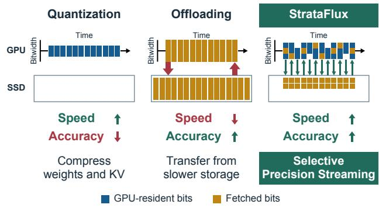  
Figure 1. StrataFlux against quantization and offloading. Column height indicates bitwidth; horizontal flow indicates time. Selective precision streaming recovers accuracy while retaining low-bit inference’s memory and speed advantages.

We address this question with StrataFlux, which employs selective precision streaming to distribute weight and KV precision across tiers (Figure 1). Compact, quantized weights and KV stay in GPU memory as the resident base, providing high-bandwidth access. Larger, cheaper tiers—host memory or solid-state drives (SSDs)—retain additional precision, but their lower bandwidth and higher latency call for selective fetching and flexible scheduling.

Recovering accuracy by fetching all additional precision would erode quantization bandwidth savings. Selectivity is viable because protecting a small subset of weights can improve low-bit accuracy (Lin et al., 2024; Kim et al., 2024), while attention can concentrate on a small, query-dependent subset of tokens (Tang et al., 2024; Ribar et al., 2024). StrataFlux exploits this uneven importance to fetch additional precision selectively for the current computation.

Retaining quantization’s speed advantage also requires flexible scheduling: selective transfers can still stall generation when their results are needed immediately. For weights, overlapping a fetch only with the weight-matrix operation it refines limits the time available to hide delivery. StrataFlux widens this window by selecting channels earlier or adding their refinement later, allowing transfers and refinement computation to overlap intervening operations. For both weights and KV, it also reuses fetched precision across decoding steps, avoiding repeated transfers and letting data arriving too late for one step benefit later selections.

StrataFlux makes LLM inference native to the memory hierarchy, recovering accuracy while retaining the memory and speed advantages of quantization. We contribute:

1. Selective precision streaming. We augment resident low-bit weights and KV with refinement bits from host RAM or SSD, concentrating transfers on channels and tokens that matter most to each computation.

2. Asynchronous precision delivery. By decoupling when precision is fetched from when it is used, StrataFlux hides the latency of fetches without stalling generation.

3. Hierarchy-native inference. By co-designing numerical representation with memory placement, StrataFlux removes the choice between quantization and offloading, enabling fast, accurate, and memory-efficient inference on both dedicated GPU and unified memory platforms.

For 2-bit Llama-3.1-8B-Instruct weights, StrataFlux reduces WikiText-2 perplexity from 9.46 to 8.40 while maintaining 95.4% of the quantized base’s throughput on RTX 5090. With 2-bit weights and KV, StrataFlux raises Qwen3-8B’s AIME 2024/2025 accuracy from 11.0% to 47.1% at unchanged GPU memory use. At 128K context, Llama-3.1- 8B-Instruct with 3-bit weights and 2-bit KV achieves comparable perplexity and speed to vLLM’s 4-bit AWQ weights and 8-bit KV on RTX 5090, using approximately half the GPU memory.

## 2 BACKGROUND AND MOTIVATION

## 2.1 Post-Training Quantization

Interactive on-device LLM inference repeatedly reads model weights and the KV cache to generate new tokens. Their size constrains which models and contexts fit in fast memory, while the traffic per token can make memory bandwidth the bottleneck for generation speed (Pope et al., 2023; Liu et al., 2024). Quantization reduces these demands by representing values with low-bit codes, such as codebook indices (Han et al., 2016) or scaled and offset integers (Jacob et al., 2018). Post-training quantization (PTQ) compresses weights without retraining the model (Frantar et al., 2023), while KV-cache quantization compresses the keys and values generated during inference (Liu et al., 2024).

These savings introduce errors that affect accuracy differently across values. Large-magnitude outliers can be difficult to represent alongside typical values (Dettmers et al., 2022), while saliency describes how strongly representation errors affect computation or loss. PTQ methods address these differences: SmoothQuant rescales activation and weight channels (Xiao et al., 2023), and AWQ protects salient weight channels through scaling (Lin et al., 2024). SqueezeLLM instead combines sensitivity-weighted codebooks with higher-precision storage for selected sensitive weights and outliers (Kim et al., 2024).

## 2.2 Dynamic Precision Refinement

These methods account for weight sensitivity when constructing the quantized representation, but that representation remains fixed during decoding. Input activations change with each token, shifting which weight channels contribute most to the projection error. Let W be the original floatingpoint weights, $\widehat { W }$ their dequantized approximation, and $R = W - { \widehat { W } }$ the weight residual. For input $x ,$ each residual column contributes $x _ { i } R _ { : , i }$ to the projection error. Large activation magnitudes amplify these contributions, making $| x _ { i }$ | a proxy for which channels to refine:

$$
( W - { \widehat { W } } ) x = R x = \sum _ { i } x _ { i } R _ { : , i } .\tag{1}
$$

DecDEC (Park et al., 2025) finds that calibration-selected channels often differ from those with the largest activation magnitudes during decoding. At each step, it selects the k largest |x<sub>i</sub>|, fetches their 4-bit residual columns from host memory, and adds their products with signed $x _ { i }$ to the quantized projection’s output. During single-sequence decoding, the memory-bound projection leaves GPU cores available for concurrent refinement without slowing the projection. Fetching awaits the projection’s input, and refinement must finish before its output is consumed to avoid stalls, confining overlap to that projection’s execution window.

We now turn to the KV cache, where the tokens receiving the most attention can likewise change between decoding steps. Attention compares a query, a vector derived from the current token’s representation, with cached keys to weigh the cached values. Top-k attention and Quest exploit this dependence to restrict attention to selected tokens (Gupta et al., 2021; Tang et al., 2024). SpeCache instead retains a full low-bit cache and substitutes selected 16-bit entries fetched from host memory (Jie et al., 2025). It uses a speculative token to prefetch selected entries for the next decoding step while current-step computation continues. However, fetching complete 16-bit replacements overlooks the opportunity to jointly design refinement encoding and attention computation to reduce transfer and execution costs.

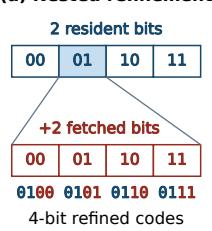

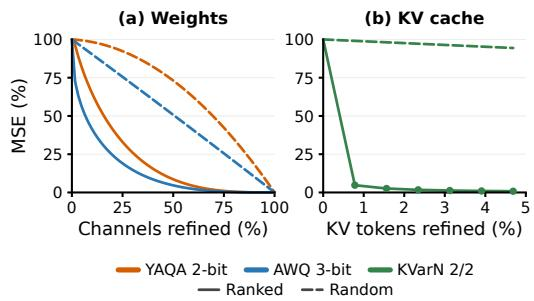

## 2.3 Bandwidth and Latency Constraints

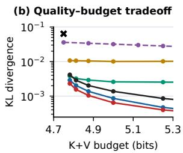  
KVarN 2/2 Sparse attention FP16 fetching +1/+1 +2/+2 +4/+4 +8/+8

Figure 2. (a) Nested refinement subdivides GPU-resident quantization bins with fetched bits. (b) KL divergence from BF16 Llama-3.1-8B-Instruct on PG-19 at matched K+V budgets, including resident, fetched, and metadata bits per K/V pair. K/V bitwidth labels give resident bits per key/value element, respectively. All schemes use KVarN 2/2 and select tokens by attention weights from resident low-bit keys (Equation 7). Sparse attention uses selected FP16 entries alone; FP16 fetching and nested refinement retain unselected low-bit entries. FP16 fetching replaces selected entries; nested +b/ + b adds b bits per key/value element.

Sparse attention reduces KV traffic by omitting unselected tokens from attention. SpeCache preserves their contributions through a low-bit cache and fetches complete 16-bit floating-point (FP16) entries for selected tokens. We instead keep every key and value in low bits on the GPU and, for selected tokens, fetch only the additional bits that refine those resident values, adapting the nested quantization principle used for weights in Any-Precision LLM (Park et al., 2024): the fetched bits pick a finer value inside the interval that the resident low-bit value already represents. Figure 2 compares these three representation choices at matched K+V budgets. Nested refinement with 4 or 8 additional bits per selected key/value element yields lower Kullback–Leibler (KL) divergence than both sparse attention and complete FP16 replacement.

Encoding determines how much data each refinement requires; selection determines which errors it addresses. Figure 3 isolates selection by adding selected channels’ residual contributions or restoring selected KV entries to FP16. We rank weight channels by input-activation magnitude and KV tokens by attention weights from resident low-bit keys.

Figure 3. Ranked versus random selection in Llama-3.1-8B-Instruct. (a) With WikiText-2 inputs, weight channels are ranked by input activation magnitude and refined with corresponding columns of R. (b) For PG-19 inputs, KV tokens are ranked by attention weights from resident low-bit keys and restored to FP16. Output mean squared error (MSE) against FP16 is normalized to the error without refinement, then averaged over tokens and Transformer blocks, across projections in (a) and KV heads in (b).

Refining only a small top-ranked fraction removes a disproportionate share of output mean squared error. Activationmagnitude-based selection remains effective even on YAQA, whose rounding compensates for quantization errors across input and output channels (Tseng et al., 2026).

Compact representations and selective refinement reduce traffic, but do not eliminate access latency. DecDEC’s overlap window shrinks as lower-bit quantization and higher GPU bandwidth accelerate the underlying projection (Park et al., 2025). On DGX Spark, isolated 2 KB random SSD reads have a median latency of 200 $\mu \mathrm { s }$ (709 µs at the 99th percentile)—far longer than the 21 µs average for Llama-3.1-8B-Instruct’s YAQA 2-bit output projection, making long stalls unavoidable with projection-local overlap.

Two prior mechanisms suggest a solution. Each Transformer block’s attention and MLP outputs are added to a running activation vector, the residual stream. Deja Vu finds that this vector’s direction changes slowly across neighboring OPT blocks and uses earlier activations to predict which attention heads and MLP neurons to compute later (Liu et al., 2023). KTransformers’ Expert Deferral adds the outputs of CPUcomputed experts in mixture-of-experts (MoE) models to the residual stream one block later, so that their computation overlaps with the GPU’s work (Chen et al., 2025).

These mechanisms extend to weight refinement (Section 2.2). Query/key/value and gate/up projections read from the residual stream, allowing earlier activations to predict channels and initiate fetching before those projections execute (fetch lead). Refinement is executed once each projection’s input becomes available. Attention-output and down projections write to the stream, allowing refinement to be deferred to a later stream update (fetch lag). Together, these cases expose overlap opportunities for every attention and MLP projection, extending refinement beyond the execution window of a single projection (Figure 4(a)).

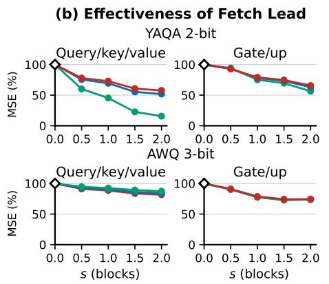

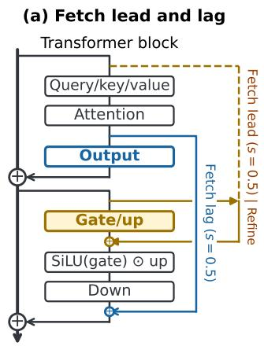

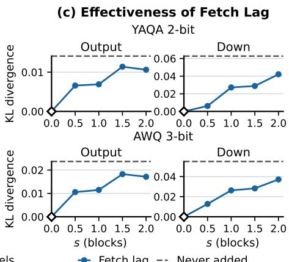  
Figure 4. Fetch lead/lag in Llama-3.1-8B-Instruct on WikiText-2. Shifts s are measured in Transformer blocks; s = 0 means no shift. (a) Gate/up fetch lead and attention-output fetch lag at $s = 0 . 5$ . The dashed gold path shows early selection; the solid gold input arrow feeds the later refinement step. (b) Projection-output MSE reduction retained by fetch lead, relative to selection at the projection’s input (100%), using errors summed over tokens and blocks. (c) Fetch-lag refinement is applied to all input channels to isolate the effect of delayed addition. Only attention-output or down projections are quantized; KL to FP16 is averaged over predicted tokens across all sequences.

We evaluate the shifts separately: fetch lead tests how well earlier activations predict which channels to refine, while fetch lag tests how delaying refinement addition affects model accuracy. Earlier selection can preserve most of the projection-output mean squared error (MSE) reduction at small shifts (Figure 4(b)); delayed additions continue to reduce KL divergence relative to omitting refinement (Figure 4(c)). The benefit of refinement thus persists beyond the original projection’s execution window. In Section 3.3, StrataFlux combines fetch lead and lag across Transformer blocks to overlap refinement transfers and refinement computation with intervening model computation.

An independent opportunity arises from repeated selections across consecutive decoding steps. Figure 5 shows that caching only a fraction of all weight channels or KV tokens can yield very high hit rates. Caching refinement bits for recurring selections avoids repeated transfers. Data arriving too late for one step can also serve subsequent selections. We exploit these two benefits to reduce transfers and waits for weight and KV refinement (Section 3.4).

## 3 STRATAFLUX: SELECTIVE PRECISION STREAMING

StrataFlux’s selective precision streaming expands the precision available to inference beyond what fits in fast memory or can be fetched within a single projection. Figure 6 outlines its weight and KV computation paths and their shared refinement-cache policy. We tailor refinement delivery to both dedicated-GPU and unified-memory platforms.

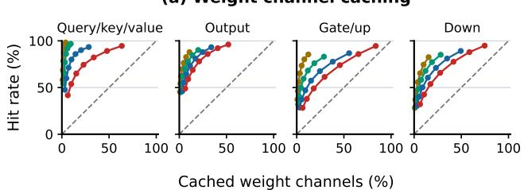

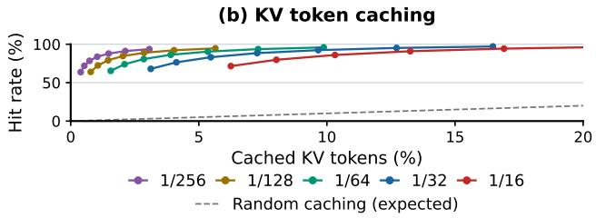  
Figure 5. Reuse across decoding steps in Llama-3.1-8B-Instruct on PG-19. Selections rank (a) weight channels by input activation magnitude and (b) KV tokens by attention weight (Equation 7); legend fractions give the share selected per step. Caches contain the union of selections from the preceding 1, 2, 4, 8, 16, 32, or 64 steps. Axes show the cached share of all entries against hit rate, averaged over decoding steps and Transformer blocks. Dashed lines show expected hit rates under equally likely random caching.

## 3.1 Distributing Precision Across the Memory Hierarchy

On dedicated-GPU platforms, GPU memory holds quantized weights and a compact KV cache covering all tokens, while the GPU fetches refinement bits directly from pinned host RAM. On unified-memory platforms, the CPU and GPU share RAM holding these compact representations, while SSD stores refinement bits that we load into shared RAM for GPU access (Section 3.4). These relatively inexpensive backing tiers let StrataFlux use capacity that would otherwise remain underutilized during LLM inference.

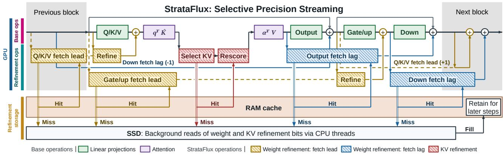  
Figure 6. StrataFlux's selective precision streaming in action. Fetch lead/lag overlaps weight refinement with model computation; KV refinement runs within attention. Labeled lines replace refinement boxes for previous (−1) and next (+1) Transformer blocks. In this unified-memory configuration, the GPU reads the RAM cache directly; misses retain resident low-bit precision while background SSD reads supply later decoding steps. Dedicated GPUs fetch directly from host RAM, without SSD. Some Transformer operations omitted.

## 3.2 Designing Precision for Selective Refinement

## 3.2.1 Weight Refinement

StrataFlux retains the resident weight quantizer’s format and projection kernels. We store quantized weight-refinement columns as refinement bits; $C$ is the corresponding matrix of dequantized values. For selected input-channel indices $S ( x )$ , we add the selected columns’ contribution to the base quantized projection:

$$
y ^ { \prime } = \widehat { W } x + \sum _ { i \in S ( x ) } x _ { i } C _ { : , i } .\tag{2}
$$

Channel selection. Following DecDEC (Park et al., 2025), we partition each projection’s input channels into chunks of 1,024 and select k channels per chunk, targeting the largest $| x _ { i } |$ . These indices form $S ( x )$ ; each selected column’s refinement bits are fetched contiguously. Separate per-chunk budgets $k _ { \mathrm { q k v } } , k _ { \mathrm { o } } , k _ { \mathrm { g u } }$ , and $k _ { \mathrm { d } }$ govern four projection sets: query/key/value, attention-output, gate/up, and down, respectively. We encode refinement values as integers with separate scale factors, giving the refinement kernel a common format independent of the resident weight quantizer.

Fitting refinement values. DecDEC quantizes the weight residual R (Section 2.2). StrataFlux uses refinement fitting to adjust refinement values so selected columns can compensate for omitted contributions. Let $z _ { k } ( x )$ zero all but the k largest-magnitude activations per input chunk. We minimize projection error while penalizing deviations from R with strength λ:

$$
C _ { k } ^ { * } = \arg \operatorname* { m i n } _ { C } ~ \mathrm { E } _ { x } [ \| R x - C z _ { k } ( x ) \| _ { 2 } ^ { 2 } ] + \lambda \| C - R \| _ { F } ^ { 2 } .\tag{3}
$$

The minimizer of Equation 3 solves Equation 4, where

$M _ { k } = \mathrm { E } _ { x } [ z _ { k } ( x ) z _ { k } ( x ) ^ { \top } ] , G _ { k } = \mathrm { E } _ { x } [ x z _ { k } ( x ) ^ { \top } ]$ , and I is the identity matrix. We estimate the expectations on a small RedPajama calibration set (Weber et al., 2024) and use the mean diagonal of $M _ { k }$ as the default λ:

$$
C _ { k } ^ { * } ( M _ { k } + \lambda I ) = R G _ { k } + \lambda R .\tag{4}
$$

We quantize the fitted matrix to 4 bits before inference, following DecDEC’s 4-bit encoding of weight residuals.

Neuron-wise alternative. For input x, the quantized MLP combines gate and up outputs into neuron activations h, then computes its unrefined output $y _ { \mathrm { { q } } } .$

$$
\begin{array} { r l r l } & { \boldsymbol { g } = \widehat { W } _ { \mathrm { g a t e } } \boldsymbol { x } , } & & { \boldsymbol { u } = \widehat { W } _ { \mathrm { u p } } \boldsymbol { x } , } \\ & { \boldsymbol { h } = \phi ( \boldsymbol { g } ) \odot \boldsymbol { u } , } & & { \boldsymbol { y } _ { \mathrm { q } } = \widehat { W } _ { \mathrm { d o w n } } \boldsymbol { h } . } \end{array}\tag{5}
$$

Here ϕ is the gate’s activation function, ⊙ is elementwise multiplication, and $h _ { j }$ is neuron $j ^ { \circ } \mathbf { s }$ activation after gating. Channel-wise refinement targets large input activations separately: $x$ for gate/up and h for down. Neuron-wise refinement instead selects the $k _ { \mathrm { n } }$ neurons with largest $| h _ { j } |$ in each chunk of 1,024 and refines their gate/up rows and down columns together. Each selected neuron’s MLP neuron bundle encodes gate/up refinement rows $c _ { j } ^ { \mathrm { g } } , c _ { j } ^ { \mathrm { u } }$ , a down refinement column $c _ { j } ^ { \mathrm { d } }$ , and a 4-bit copy $d _ { j }$ of the BF16 down column. For selected neuron indices $N ( h )$ , we recompute $h _ { j }$ from Equation 5 as $h _ { j } ^ { \prime }$ . As in Equation 2, the resulting output refinement is added to $y _ { \mathrm { q } }$

$$
\begin{array} { l } { { \displaystyle h _ { j } ^ { \prime } = \phi ( g _ { j } + c _ { j } ^ { \mathrm { g } } x ) ( u _ { j } + c _ { j } ^ { \mathrm { u } } x ) , } } \\ { { \displaystyle y ^ { \prime } = y _ { \mathrm { q } } + \sum _ { j \in N ( h ) } \left[ d _ { j } ( h _ { j } ^ { \prime } - h _ { j } ) + c _ { j } ^ { \mathrm { d } } h _ { j } \right] } . } \end{array}\tag{6}
$$

Neither channel-wise nor neuron-wise MLP refinement consistently offers the better speed–accuracy tradeoff across models, quantizers, platforms, and speed budgets. We therefore retain both options for StrataFlux.

## 3.2.2 KV Refinement

For KV refinement, we tailor nested reconstruction to the resident cache format. Our main KV implementation, StrataFlux-KV, adopts KVarN’s (Muller et al., 2026) quantization format for its balance of accuracy and memory footprint. We co-design its low-bit attention kernels and selective refinement. For adaptations of StrataFlux to other KV-cache formats, see Appendix E.

Nested encoding. As illustrated in Figure 2(a), we subdivide each KVarN code’s quantization interval into equal sub-intervals and store their indices as refinement bits in the backing tier. The resident code and fetched index identify a finer reconstruction, independently for keys and values.

Token selection. We compute attention weights by applying softmax to scores between the current query and resident low-bit keys. A KV head stores keys and values shared by one or more query heads. Let $\alpha _ { h , i }$ denote the resulting attention weight assigned to token i by query head h, and let $H ( j )$ be the query heads sharing KV head j. For token i and KV head j, we define the selection score

$$
s _ { j } ( i ) = \operatorname* { m a x } _ { h \in H ( j ) } \alpha _ { h , i } .\tag{7}
$$

This score captures the strongest attention to the token among query heads sharing its keys and values. For each KV head, we select a configurable number of the highest-scoring tokens for refinement.

Attention refinement. Combining fetched bits with resident codes reconstructs selected tokens’ higher-precision keys and values (Figure 6). For one query head, resident scores $\ell _ { i }$ and values $v _ { i }$ give output o and normalizer $\textstyle Z = \sum _ { i } e ^ { \ell _ { i } }$ Refining tokens S gives scores $\ell _ { i } ^ { \prime } ,$ , values $v _ { i } ^ { \prime } ,$ and output

$$
o ^ { \prime } = \frac { Z o + \sum _ { i \in S } \left( e ^ { \ell _ { i } ^ { \prime } } v _ { i } ^ { \prime } - e ^ { \ell _ { i } } v _ { i } \right) } { Z + \sum _ { i \in S } \left( e ^ { \ell _ { i } ^ { \prime } } - e ^ { \ell _ { i } } \right) } .\tag{8}
$$

In practice, we group consecutive tokens within each KV head and pack each group’s nested refinement bits contiguously for larger reads. We score token groups using Equation 7, with each query head’s attention weights summed over the group. Because token selection depends on the initial attention scores and the weighted sum depends on refined scores, KV refinement adds a region that cannot overlap the surrounding attention computation. We limit this overhead through contiguous fetches and fusion of value refinement into the weighted sum.

Producing KV refinement bits. During prefill, we compute attention on uncompressed keys and values, then encode resident low-bit codes and offload refinement bits. During decoding, we encode completed blocks of new KV entries in the same format.

## 3.3 Extending the Weight Delivery Interval

The runtime uses fetch lead/lag to decouple refinement fetching from its application, hiding latency through overlap with base operations (Section 2.3). Appendix G explains the CUDA stream and event scheduling.

Fetch lead. For each query/key/value or gate/up projection, we apply its normalization to a residual-stream activation s Transformer blocks earlier, then select channels and initiate fetching. Once the projection’s input is available, the refinement kernel multiplies fetched columns by corresponding activations and adds the summed products to the quantized projection’s output (Figure 6).

Fetch lag. We add attention-output and down refinements to the residual stream s Transformer blocks after their original addition point, overlapping their fetching and computation with intervening projections (Figure 6). Neuron-wise MLP refinement likewise supports fetch lag.

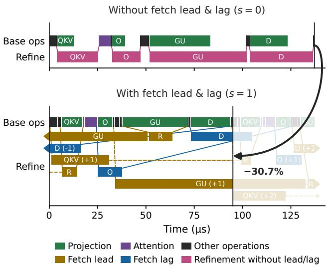  
Figure 7. Nsight Systems kernel traces comparing refinement without fetch lead/lag (s = 0) and with fetch lead/lag (s = 1) on Llama-3.1-8B-Instruct (AWQ 3-bit, RTX 5090, k = 32). QKV/GU/O/D denote query/key/value, gate/up, output, and down projections; R denotes refinement after fetch lead. Refinement for the previous and next blocks are marked with an offset (-1 or +1). Dashed lines show fetch-lead’s early selection; solid lines show activation reads and writes for refinement.

The Nsight Systems kernel traces of our runtime system in Figure 7 confirm the cross-block overlap illustrated in Figure 6. With the projection-local schedule used by DecDEC $( s = 0 )$ , the main stream waits for refinement after each projection, delaying subsequent operations in the Transformer block’s computation graph. Fetch lead/lag at s = 1 successfully overlaps refinement with computation across neighboring Transformer blocks, reducing these waits and shortening block execution at matched channel count k.

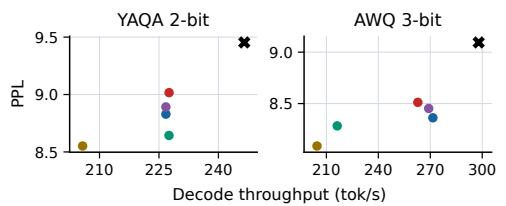  
Base only s = 0 s = 0.5 s = 1 s = 1.5 s = 2  
Figure 8. Perplexity–throughput tradeoffs on Llama-3.1-8B-Instruct with $k = 3 2$ and a common fetch lead/lag distance s across all four projection sets. PPL uses WikiText-2; throughput uses PG-19 on RTX 5090 with refinement bits in host RAM.

However, the shift needed to hide refinement depends on the quantization method. At k = 32, Figure 8 shows that slower YAQA 2-bit obtains most of its throughput gain at s = 0.5, whereas faster AWQ 3-bit needs s = 1 because its shorter projections leave less time to hide refinement. Furthermore, these sweeps apply the same s to all four projection sets within each method, leaving their individual speed–accuracy tradeoffs unexplored. In Section 3.5, we introduce a tuner that directly explores this search space to select s and k per projection set under a configurable speed budget.

## 3.4 Reusing Precision Across Decoding Steps

For dedicated-GPU platforms, host RAM’s lower access latency than SSD allows refinement bits to be fetched directly without an intermediate cache. For unified-memory systems, however, SSD’s higher access latency motivates caching fetched refinement bits in GPU-accessible RAM.

Caching fetched precision. Weight and KV selections recur across consecutive decoding steps (Figure 5). To avoid repeated SSD reads and their latency, we retain fetched refinement bits in a configurably sized RAM cache that the GPU reads directly (Figure 6).

Miss policy. Selections can still miss the cache. For weights and KV, the current step can decide to skip missing refinement and use the resident low-bit representation. A CPU loader fetches the bits into the cache for future selections, keeping the transfer useful without making the requesting step wait. Alternatively, the runtime can wait and apply refinement in the current step, trading speed for accuracy.

Cache organization. Weight and KV refinement have separate cache budgets. The weight cache stores refinement bits for all four projection sets and uses least-recently-used replacement. KV token groups share capacity across all KV heads and Transformer blocks.

Populating the KV refinement cache. During prefill, we write KV refinement bits to SSD and cache copies for the most recently encoded token groups in RAM. During decoding, newly produced refinement bits enter the cache directly, serving subsequent selections without SSD readback.

## 3.5 Tuning Weight Refinement Within a Speed Budget

Search space. The weight tuner selects a configuration subject to a user-specified slowdown limit relative to the quantized base. It chooses channel budgets k, fetch lead/lag distances s for each projection set, and whether the MLP uses channel-wise refinement or neuron-wise refinement with budget $k _ { \mathrm { n } }$ . Following DecDEC (Park et al., 2025), it also tunes the number of GPU thread blocks (groups of cooperating threads) executing refinement. More thread blocks can accelerate refinement but also slow the concurrent quantized projections by competing for GPU resources.

Candidate selection. For each combination of shift distances and channel-wise or neuron-wise MLP refinement, the tuner searches for the largest common channel budget k that meets the slowdown limit in end-to-end decoding. It selects the retained candidate with the lowest KL divergence from the BF16 reference on held-out text, then increases individual channel budgets or the neuron budget while the measured slowdown remains within the limit. We tune each model, weight quantizer, and platform separately. We then fit refinements at the chosen selection budgets, as detailed in Section 3.2.1.

## 4 EVALUATION

We implement StrataFlux as an end-to-end system in llama.cpp (llama.cpp contributors, n.d.), with CUDA and Metal backends. We evaluate StrataFlux on Llama-3.1- 8B-Instruct (Meta, 2024a), Llama-3.3-70B-Instruct (Meta, 2024b), Qwen3-8B, Qwen3-32B, Qwen3-30B-A3B (Qwen Team, 2025), Qwen3.5-9B (Qwen Team, 2026), and DeepSeek-V2-Lite (DeepSeek-AI, 2024). Platforms span dedicated GPUs (RTX 5090, RTX 5070 Ti, and RTX PRO 6000) and unified-memory platforms (DGX Spark and Mac-Book Air M3). Appendix F reports the Mac evaluation. We measure perplexity and KL divergence from BF16 on 2K-token WikiText-2 windows (Merity et al., 2017) and choose PG-19 (Rae et al., 2020) for long-context perplexity. We measure accuracy on RULER (Hsieh et al., 2024), MATH500 (Lightman et al., 2024), and AIME 2024/2025 (Mathematical Association of America, n.d.); AIME averages eight samples per problem. Timings use llama.cpp except for methods with their own runtimes. Appendix A details protocols and implementations.

In tables and figures, StrataFlux-W and StrataFlux-KV isolate weight and KV refinement, respectively; StrataFlux without a suffix denotes the full system with both enabled.

Unless ablated, DGX Spark uses separate 128 MiB RAM caches for weight and KV refinement. At the small slowdown budgets used in our main results, we find that skipping cache misses gives a better latency–accuracy tradeoff on unified-memory platforms. There, we skip misses and set s = 0: no SSD wait remains for fetch lead/lag to hide. Appendix B evaluates fetch lead/lag with waiting on cache misses at larger budgets.

## 4.1 Weight Refinement

We compare StrataFlux-W with DecDEC (Park et al., 2025) on YAQA (Tseng et al., 2026) with QTIP’s format and kernels (Tseng et al., 2024), LNQ with GuidedQuant (GQ) (Kim et al., 2025), AWQ (Lin et al., 2024), and SqueezeLLM (SqLLM) (Kim et al., 2024) bases.

Table 1. Weight-only refinement: WikiText-2 perplexity and KL divergence with 2–3-bit weights. Platform blocks report StrataFlux-W, alongside DecDEC on RTX 5090, tuned to a 5% slowdown budget. DecDEC does not support SSD fetching on DGX Spark. Bold marks the better score within each RTX 5090 pair.
<table><tr><td rowspan="2"></td><td rowspan="2">Weights</td><td rowspan="2">Refinement method</td><td colspan="2">L3.1-8B-I</td><td colspan="2">Qwen3-8B</td></tr><tr><td>PPL</td><td>KL</td><td>PPL</td><td>KL</td></tr><tr><td></td><td>BF16</td><td></td><td>7.22</td><td>0.000</td><td>9.73</td><td>0.000</td></tr><tr><td rowspan="5">Base</td><td>YAQA 2-bit</td><td></td><td>9.46</td><td>0.257</td><td>10.95</td><td>0.214</td></tr><tr><td>YAQA 3-bit</td><td></td><td>7.61</td><td>0.047</td><td>9.98</td><td>0.052</td></tr><tr><td>LNQ+GQ 3-bit</td><td></td><td>8.52</td><td>0.157</td><td>10.92</td><td>0.184</td></tr><tr><td>AWQ 3-bit</td><td></td><td>9.10</td><td>0.229</td><td>11.88</td><td>0.284</td></tr><tr><td>SqLLM 3-bit</td><td></td><td>9.36</td><td>0.263</td><td>11.71</td><td>0.255</td></tr><tr><td rowspan="5">DGX Spark LNQ+GQ 3-bit</td><td>YAQA 2-bit</td><td>StrataFlux-W</td><td>8.94</td><td>0.200</td><td>10.77</td><td>0.175</td></tr><tr><td>YAQA 3-bit</td><td>StrataFlux-W</td><td>7.55</td><td>0.041</td><td>9.89</td><td>0.043</td></tr><tr><td></td><td>StrataFlux-W</td><td>8.29</td><td>0.135</td><td>10.70</td><td>0.159</td></tr><tr><td>AWQ 3-bit</td><td>StrataFlux-W</td><td>8.64</td><td>0.179</td><td>11.30</td><td>0.222</td></tr><tr><td>SqLLM 3-bit</td><td>StrataFlux-W</td><td>8.56</td><td>0.174</td><td>11.03</td><td>0.201</td></tr><tr><td rowspan="10">RTX 5090</td><td rowspan="2">YAQA 2-bit</td><td>DecDEC</td><td>9.03</td><td>0.211</td><td>10.69</td><td>0.184</td></tr><tr><td>StrataFlux-W</td><td>8.40</td><td>0.139</td><td>10.51</td><td>0.132</td></tr><tr><td rowspan="2">YAQA 3-bit</td><td>DecDEC</td><td>7.55</td><td>0.040</td><td>9.89</td><td>0.044</td></tr><tr><td>StrataFlux-W</td><td>7.49</td><td>0.033</td><td>9.89</td><td>0.033</td></tr><tr><td rowspan="2">LNQ+GQ 3-bit</td><td>DecDEC</td><td>8.37</td><td>0.142</td><td>10.66</td><td>0.170</td></tr><tr><td>StrataFlux-W</td><td>8.18</td><td>0.121</td><td>10.47</td><td>0.139</td></tr><tr><td rowspan="2">AWQ 3-bit</td><td>DecDEC</td><td>8.80</td><td>0.195</td><td>11.38</td><td>0.231</td></tr><tr><td>StrataFlux-W</td><td>8.38</td><td>0.145</td><td>10.71</td><td>0.167</td></tr><tr><td rowspan="2">SqLLM 3-bit</td><td>DecDEC</td><td>9.02</td><td>0.225</td><td>11.36</td><td>0.215</td></tr><tr><td>StrataFlux-W</td><td>8.42</td><td>0.156</td><td>10.81</td><td>0.169</td></tr></table>

We use a 5% slowdown budget for main weight comparisons because it is sufficient for large accuracy gains (Figure 9(a)). At matched budgets, StrataFlux-W outperforms DecDEC across quantizers (Table 1). These gains extend to reasoning tasks (Table 2) while retaining quantized speed and low GPU memory use (Figure 9). For Qwen3-8B with YAQA 2-bit weights, AIME accuracy rises from 19.2% to 46.7%. Appendix B gives full 2–4-bit, larger-model, and downstream results; Appendix B.7 lists tuned configurations.

## 4.2 KV Refinement

KV baselines include KVarN (Muller et al., 2026), KIVI (Liu et al., 2024), KVQuant (Hooper et al., 2024), TurboQuant (Zandieh et al., 2026), and AQUA-KV (Shutova et al., 2025); offloading comparisons include ShadowKV (Sun et al., 2025), ParisKV (Qi et al., 2026), TailorKV (Yao et al., 2025), FreeKV (Liu et al., 2026),

Table 2. Weight-only refinement: Qwen3-8B MATH500/AIME accuracy. Platform columns use StrataFlux-W's respective 5% slowdown configurations. 4-bit results appear in Appendix B.
<table><tr><td></td><td colspan="2">Base</td><td colspan="2">StrataFlux-W DGX Spark</td><td colspan="2">StrataFlux-W RTX 5090</td></tr><tr><td>Weights</td><td>M500</td><td>AIME</td><td>M500</td><td>AIME</td><td>M500</td><td>AIME</td></tr><tr><td>BF16</td><td>97.2</td><td>71.0</td><td>1</td><td></td><td>一</td><td>一</td></tr><tr><td>YAQA 2-bit</td><td>77.2</td><td>19.2</td><td>89.4</td><td>40.0</td><td>92.4</td><td>46.7</td></tr><tr><td>YAQA 3-bit</td><td>95.0</td><td>66.7</td><td>95.0</td><td>66.0</td><td>95.2</td><td>70.0</td></tr><tr><td>LNQ+GQ 3-bit</td><td>91.8</td><td>39.4</td><td>93.0</td><td>47.3</td><td>93.2</td><td>49.2</td></tr><tr><td>AWQ 3-bit</td><td>91.8</td><td>46.5</td><td>92.6</td><td>51.9</td><td>93.8</td><td>51.0</td></tr><tr><td>SqLLM 3-bit</td><td>93.0</td><td>47.3</td><td>94.2</td><td>48.3</td><td>93.0</td><td>50.8</td></tr></table>

(a) Weight refinement tradeofs  
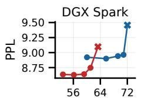  
Throughput (tok/s)

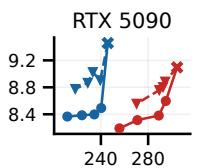  
Throughput (tok/s)

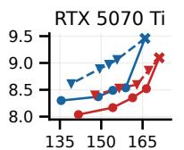  
Throughput (tok/s)

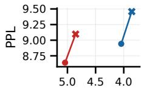

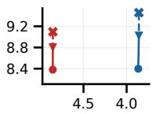

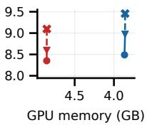

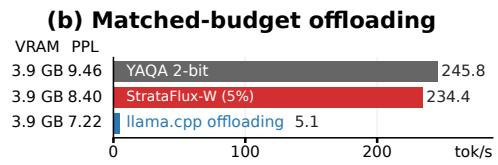  
Figure 9. Weight-refinement tradeoffs on Llama-3.1-8B-Instruct on WikiText-2. (a) Throughput plots connect configurations tuned for slowdown budgets of 2.5% / 5% / 10% / 20%; memory plots show the configurations tuned for the 5% budget. DGX Spark memory includes the RAM cache. DecDEC does not support SSD fetching on Spark. (b) StrataFlux-W tuned for 5% slowdown on YAQA 2-bit base, and llama.cpp BF16 partial offloading at a matched 3.9 GB GPU memory budget, RTX 5090.

SpeCache (Jie et al., 2025), and KVSwap (Zhang et al., 2026). StrataFlux is configured to select 1/128 (0.78%) of token groups for refinement, adding 4 bits per selected key and value element (+4/+4). Groups contain two consecutive tokens on dedicated GPU platforms and four on unified-memory platforms. For other refinement settings, see Appendix C.6; for resident 2/1 KV, see Appendix C.5.

StrataFlux-KV pushes beyond the memory–accuracy and throughput–accuracy frontiers of existing KV quantization and offloading methods, bringing near-BF16 accuracy to 2-bit keys and values without giving up low-bit memory savings or fast decoding (Table 3; Figure 10(a)). Accuracy recovery also extends to alternative attention architectures and MoE models (Appendix C, Table A20). On RTX 5090, Llama-3.1-8B-Instruct with 2/2 KV improves from 68.6% to 78.1% RULER accuracy at 128K. For full task and context comparisons, see Appendix C.

(b) Full system (weights + KV)  
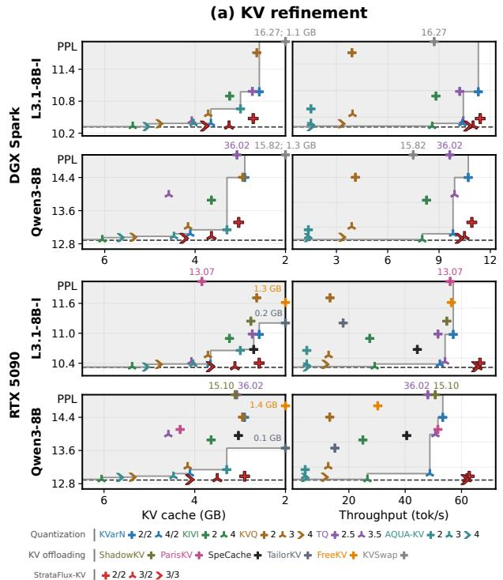

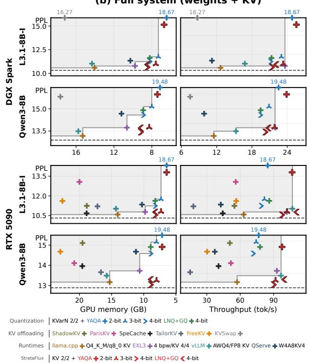  
Figure 10. PG-19 perplexity at 128K: (a) KV refinement with BF16 weights; (b) Weight and KV joint refinement. Memory counts KV in (a), weights+KV in (b), including DGX Spark’s RAM cache. Out-of-range points are shown beside the corresponding borders with their values. Of the evaluated KV offloading systems, only KVSwap supports DGX Spark. The gray boundary marks the baseline frontier. Dashed lines mark BF16 PPL. W/A/KV: weight/activation/cache bits; bpw: bits/weight; KVQ: KVQuant; TQ: TurboQuant.

Table 3. KV-only refinement: PG-19 perplexity/KL and RULER accuracy at 128K, plus MATH500/AIME accuracy, with BF16 weights. Platform blocks report StrataFlux-KV.
<table><tr><td rowspan="2"></td><td rowspan="2"></td><td colspan="3">L3.1-8B-I</td><td colspan="5">Qwen3-8B</td></tr><tr><td>KV PPL</td><td>KL</td><td>R128</td><td>PPL</td><td>KL</td><td>R128</td><td>M500</td><td>AIME</td></tr><tr><td></td><td>BF16</td><td>10.32</td><td>0.000</td><td>77.9</td><td>12.89</td><td>0.000</td><td>74.1</td><td>97.2</td><td>71.0</td></tr><tr><td rowspan="3">Base</td><td>2/2</td><td>10.98</td><td>0.067</td><td>68.6</td><td>14.40</td><td>0.130</td><td>66.0</td><td>96.2</td><td>66.0</td></tr><tr><td>3/2</td><td>10.45</td><td>0.014</td><td>76.2</td><td>13.17</td><td>0.026</td><td>72.3</td><td>96.6</td><td>69.2</td></tr><tr><td>3/3</td><td>10.39</td><td>0.008</td><td>77.2</td><td>13.02</td><td>0.016</td><td>72.9</td><td>95.8</td><td>70.6</td></tr><tr><td rowspan="3">StrataFlux-KV DGX Spark</td><td>2/2</td><td>10.47</td><td>0.011</td><td>75.2</td><td>13.32</td><td>0.030</td><td>71.4</td><td>96.0</td><td>68.3</td></tr><tr><td>3/2</td><td>10.34</td><td>0.002</td><td>77.6</td><td>12.98</td><td>0.005</td><td>74.0</td><td>95.0</td><td>70.2</td></tr><tr><td>3/3</td><td>10.33</td><td>0.001</td><td>77.5</td><td>12.93</td><td>0.004</td><td>74.2</td><td>96.2</td><td>69.4</td></tr><tr><td rowspan="3">StrataFlux-KV RTX 5090</td><td>2/2</td><td>10.40</td><td>0.003</td><td>78.1</td><td>12.98</td><td>0.007</td><td>74.2</td><td>95.6</td><td>69.2</td></tr><tr><td>3/2</td><td>10.33</td><td>0.001</td><td>78.3</td><td>12.92</td><td>0.002</td><td>74.7</td><td>96.2</td><td>70.0</td></tr><tr><td>3/3</td><td>10.33</td><td>0.001</td><td>78.2</td><td>12.90</td><td>0.001</td><td>74.5</td><td>97.0</td><td>71.5</td></tr></table>

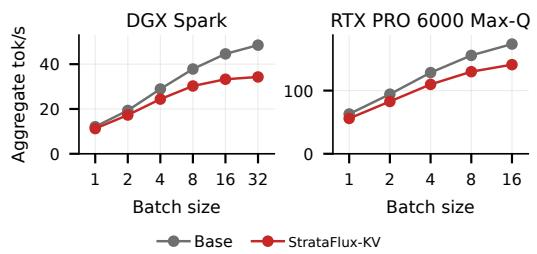  
Figure 11. StrataFlux’s KV refinement overhead versus batch size on Llama-3.1-8B-Instruct at 128K, using 2/2 KV.

At batch sizes 1 and 16, refinement reduces throughput by 11.2% and 18.8% on RTX PRO 6000 Max-Q, versus 7.0% and 25.4% on DGX Spark (Figure 11).

## 4.3 Full-System Results

We enable both refinement techniques and compare the full StrataFlux system with static weight/KV pairs, vLLM (Kwon et al., 2023), EXL3 (ExLlamaV3 contributors, n.d.), QServe (Lin et al., 2025), llama.cpp, and KV offloading systems. Together, weight and KV refinement let StrataFlux recover long-context and reasoning accuracy with aggressively compressed weights and KV (Table 4), pushing beyond the memory–accuracy and throughput– accuracy frontiers of static quantization pairs, KV offloading systems, and inference runtimes (Figure 10(b)). On RTX 5090, refinement raises Qwen3-8B AIME accuracy from 11.0% to 47.1% with YAQA 2-bit weights and 2/2 KV. Appendix D gives the full configuration comparisons and task results.

## 4.4 Ablations

Fetch lead/lag and fitting improve accuracy, while the better MLP scheme, channel-wise refinement or neuron bundles, depends on the quantizer (Figure 12(a)). Weight and KV refinement yield approximately additive accuracy gains and decoding-time overheads, allowing both to run together without negative interference (Figure 12(b)). RAM caches make SSD-backed refinement effective despite skipped misses. Larger caches improve accuracy, while skipping avoids the throughput penalty of waiting (Figure 12(c–e)). Appendix C extends the fetch-budget and cache-capacity sweeps. With 4-bit weight and KV refinement values, backing-tier storage scales roughly with 4-bit weights and KV, plus metadata and values duplicated in neuron bundles (Figure 12(f)). For other KV bases, see Appendix E.

Table 4. Joint refinement: PG-19 perplexity/KL and RULER accuracy at 128K, plus MATH500/AIME accuracy. Platform blocks report StrataFlux.
<table><tr><td></td><td></td><td></td><td colspan="3">L3.1-8B-I</td><td colspan="5">Qwen3-8B</td></tr><tr><td></td><td>Weights</td><td>KV</td><td>PPL</td><td>KL</td><td>R128</td><td>PPL</td><td>KL</td><td></td><td>R128 M500</td><td>) AIME</td></tr><tr><td rowspan="4"></td><td>BF16</td><td></td><td></td><td>10.32 0.000</td><td>77.9</td><td>12.89</td><td>0.000</td><td>74.1</td><td>97.2</td><td>71.0</td></tr><tr><td>YAQA 2-bit</td><td>2/2</td><td></td><td>18.67 0.656</td><td>50.4</td><td>19.48</td><td>0.434</td><td>58.8</td><td>68.0</td><td>11.0</td></tr><tr><td>YAQA 3-bit</td><td>2/2</td><td></td><td>11.75 0.146</td><td>67.2</td><td>15.15 0.185</td><td></td><td>63.8</td><td>94.6</td><td>59.6</td></tr><tr><td>YAQA 4-bit LNQ+GQ 4-bit 2/2</td><td>2/2</td><td>11.62 0.129</td><td>11.24 0.090</td><td>67.5</td><td>14.58 0.143 14.91</td><td></td><td>65.4</td><td>95.0</td><td>62.5</td></tr><tr><td rowspan="4">StrataFlux DGX Spark YAQA 4-bit</td><td></td><td></td><td></td><td></td><td>64.3</td><td></td><td>0.167</td><td>64.0</td><td>95.2</td><td>58.3</td></tr><tr><td>YAQA 2-bit</td><td>2/2</td><td></td><td>15.15 0.422</td><td>60.5</td><td>15.98 0.228</td><td></td><td>65.2</td><td>89.6</td><td>40.6</td></tr><tr><td>YAQA 3-bit</td><td>2/2</td><td></td><td>10.99 0.064 10.66 0.026</td><td>73.2</td><td>13.75 0.068</td><td></td><td>68.4</td><td>95.2</td><td>68.8</td></tr><tr><td>LNQ+GQ 4-bit 2/2</td><td>2/2</td><td></td><td>10.92 0.055</td><td>73.5 71.1</td><td>13.43 13.71 0.062</td><td>0.040</td><td>70.3 70.6</td><td>96.2 96.0</td><td>69.0 65.6</td></tr><tr><td rowspan="4">StrataFlux RTX 5090</td><td>YAQA 2-bit</td><td>2/2</td><td>13.79 0.312</td><td></td><td>63.8</td><td>14.91 0.165</td><td></td><td>68.3</td><td>91.2</td><td>47.1</td></tr><tr><td>YAQA 3-bit</td><td>2/2</td><td></td><td>10.80 0.045</td><td>77.1</td><td>13.25 0.038</td><td></td><td>71.2</td><td>95.4</td><td>65.6</td></tr><tr><td>YAQA 4-bit</td><td>2/2</td><td></td><td>10.55 0.015</td><td>77.2</td><td>13.04 0.015</td><td></td><td>73.5</td><td>96.4</td><td>69.2</td></tr><tr><td>LNQ+GQ 4-bit 2/2</td><td></td><td></td><td></td><td></td><td>10.77 0.03875.213.30 0.035</td><td></td><td>73.8</td><td>94.4</td><td>61.5</td></tr></table>

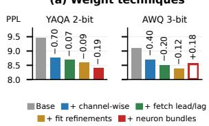

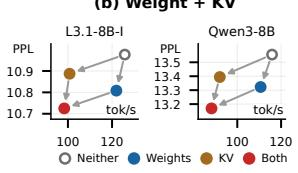

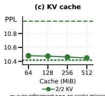

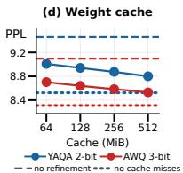

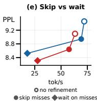

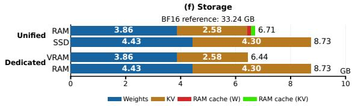  
Figure 12. Refinement ablations on Llama-3.1-8B-Instruct, using RTX 5090 in (a,b) and DGX Spark in (c–e). (a) Adding weightrefinement techniques, re-tuned to a 5% slowdown budget. Labels show WikiText-2 PPL changes. The outlined AWQ bar forces neuron bundles. (b) PPL versus throughput for separate and combined weight/KV refinement (also on Qwen3-8B), using PG-19 at 128K, YAQA 3-bit weights, 3/3 KV, and the 5% weight configuration. (c,d) PPL versus RAM-cache capacity with skipped misses: (c) 2/2 KV on PG-19; (d) weight refinement on WikiText-2 at 5% configurations. (e) WikiText-2 PPL versus throughput for skipping and waiting on weight-cache misses with a 128 MiB cache. (f) Storage (GB) by tier: YAQA 2-bit weights and 2/2 KV at 128K.

## 5 RELATED WORK

Heterogeneous-memory inference systems accommodate weights and KV caches beyond GPU memory. Flex-Gen (Sheng et al., 2023) schedules compressed tensors across GPU, CPU, and disk; InfiniGen (Lee et al., 2024) and FreeKV (Liu et al., 2026) prefetch selected KV entries from host memory. Quest (Tang et al., 2024) and SparQ (Ribar et al., 2024) reduce KV reads through query-dependent selection. SpeCache (Jie et al., 2025) supplements a full low-bit cache with prefetched 16-bit entries. StrataFlux instead co-designs low-bit attention and selectively fetched refinement bits, using caching and skipped misses to recover accuracy without stalling decoding on backing-tier reads.

For weights, DecDEC (Park et al., 2025) selects refinement channels from current activations and overlaps host-memory fetching and refinement with the corresponding quantized projection. Other inference systems overlap work across Transformer blocks: Deja Vu (Liu et al., 2023) uses earlier activations to predict which attention heads and MLP neurons to compute, while KTransformers (Chen et al., 2025) defers expert outputs to overlap CPU and GPU computation. StrataFlux extends weight-refinement overlap beyond DecDEC’s projection window through early channel selection and deferred addition, and fits refinement values to compensate for unselected channels.

## 6 CONCLUSION

StrataFlux recovers accuracy from low-bit weights and KV caches while retaining quantization’s memory and speed advantages. Its selective precision streaming makes host RAM and SSD useful sources of additional precision by coordinating what is fetched, when it arrives, and how it refines computation. Across dedicated GPUs and unifiedmemory platforms, StrataFlux demonstrates that precision distributed across the memory hierarchy can improve accuracy without letting backing-tier transfers dictate decoding speed.

## REFERENCES

Bai, Y., Lv, X., Zhang, J., Lyu, H., Tang, J., Huang, Z., Du, Z., Liu, X., Zeng, A., Hou, L., Dong, Y., Tang, J., and Li, J. LongBench: A bilingual, multitask benchmark for long context understanding. In Proceedings of the 62nd Annual Meeting of the Association for Computational Linguistics (Volume 1: Long Papers), pp. 3119–3137. Association

for Computational Linguistics, 2024. doi: 10.18653/v1/ 2024.acl-long.172. URL https://aclanthology. org/2024.acl-long.172/.

Chen, H., Xie, W., Zhang, B., Tang, J., Wang, J., Dong, J., Chen, S., Yuan, Z., Lin, C., Qiu, C., Zhu, Y., Ou, Q., Liao, J., Chen, X., Ai, Z., Wu, Y., and Zhang, M. KTransformers: Unleashing the full potential of CPU/GPU hybrid inference for MoE models. In Proceedings of the ACM SIGOPS 31st Symposium on Operating Systems Principles, SOSP ’25. Association for Computing Machinery, 2025. doi: 10.1145/3731569.3764843. URL https: //doi.org/10.1145/3731569.3764843.

DeepSeek-AI. DeepSeek-V2-Lite. Model card, 2024. URL https://huggingface.co/deepseek-ai/ DeepSeek-V2-Lite. Accessed October 30, 2026.

Dettmers, T., Lewis, M., Belkada, Y., and Zettlemoyer, L. LLM.int8(): 8-bit matrix multiplication for transformers at scale. In Advances in Neural Information Processing Systems, volume 35, pp. 30318–30332. Curran Associates, Inc., 2022. doi: 10.52202/068431-2198.

ExLlamaV3 contributors. ExLlamaV3: Quantization and inference library. Software repository, n.d. URL https://github.com/turboderp-org/ exllamav3. Accessed October 30, 2026.

Frantar, E., Ashkboos, S., Hoefler, T., and Alistarh, D. OPTQ: Accurate post-training quantization for generative pre-trained transformers. In The Eleventh International Conference on Learning Representations, 2023. URL https://openreview.net/forum? id=tcbBPnfwxS.

Gao, L., Tow, J., Abbasi, B., Biderman, S., Black, S., DiPofi, A., Foster, C., Golding, L., Hsu, J., Le Noac’h, A., Li, H., McDonell, K., Muennighoff, N., Ociepa, C., Phang, J., Reynolds, L., Schoelkopf, H., Skowron, A., Sutawika, L., Tang, E., Thite, A., Wang, B., Wang, K., and Zou, A. A framework for few-shot language model evaluation, 12 2023. URL https://zenodo.org/records/ 10256836.

Gupta, A., Dar, G., Goodman, S., Ciprut, D., and Berant, J. Memory-efficient transformers via top-k attention. In Proceedings of the Second Workshop on Simple and Efficient Natural Language Processing, pp. 39– 52. Association for Computational Linguistics, 2021. doi: 10.18653/v1/2021.sustainlp-1.5. URL https:// aclanthology.org/2021.sustainlp-1.5/.

Han, S., Mao, H., and Dally, W. J. Deep compression: Compressing deep neural networks with pruning, trained quantization and huffman coding. In The Fourth International Conference on Learning Representations, 2016. URL https://arxiv.org/abs/1510.00149.

Hooper, C., Kim, S., Mohammadzadeh, H., Mahoney, M. W., Shao, Y. S., Keutzer, K., and Gholami, A. KVQuant: Towards 10 million context length LLM inference with KV cache quantization. In Advances in Neural Information Processing Systems, volume 37, pp. 1270–1303. Curran Associates, Inc., 2024. doi: 10.52202/079017-0040. URL https://doi.org/ 10.52202/079017-0040.

Hsieh, C.-P., Sun, S., Kriman, S., Acharya, S., Rekesh, D., Jia, F., Zhang, Y., and Ginsburg, B. RULER: What’s the real context size of your long-context language models? In Conference on Language Modeling, 2024. URL https://openreview.net/forum? id=kIoBbc76Sy.

Jacob, B., Kligys, S., Chen, B., Zhu, M., Tang, M., Howard, A., Adam, H., and Kalenichenko, D. Quantization and training of neural networks for efficient integer-arithmetic-only inference. In Proceedings of the IEEE Conference on Computer Vision and Pattern Recognition, pp. 2704–2713, 2018. URL https: //openaccess.thecvf.com/content\_cvpr\_ 2018/html/Jacob\_Quantization\_and\_ Training\_CVPR\_2018\_paper.html.

Jie, S., Tang, Y., Han, K., Deng, Z.-H., and Han, J. SpeCache: Speculative key-value caching for efficient generation of LLMs. In Proceedings of the 42nd International Conference on Machine Learning, volume 267 of Proceedings ofMachine Learning Research, pp. 27917– 27928. PMLR, 2025. URL https://proceedings. mlr.press/v267/jie25a.html.

Kim, J., El Halabi, M., Park, W., Schaefer, C. J., Lee, D., Park, Y., Lee, J. W., and Song, H. O. GuidedQuant: Large language model quantization via exploiting end loss guidance. In Proceedings ofthe 42nd International Conference on Machine Learning, volume 267 of Proceedings ofMachine Learning Research, pp. 30011–30037. PMLR, 2025. URL https://proceedings.mlr.press/ v267/kim25d.html.

Kim, S., Hooper, C. R. C., Gholami, A., Dong, Z., Li, X., Shen, S., Mahoney, M. W., and Keutzer, K. SqueezeLLM: Dense-and-sparse quantization. In Proceedings of the 41st International Conference on Machine Learning, volume 235 of Proceedings of Machine Learning Research, pp. 23901–23923. PMLR, 2024. URL https://proceedings.mlr.press/ v235/kim24f.html.

Kwon, W., Li, Z., Zhuang, S., Sheng, Y., Zheng, L., Yu, C. H., Gonzalez, J. E., Zhang, H., and Stoica, I. Efficient memory management for large language model serving with PagedAttention. In ACM Symposium on Operating Systems Principles, pp. 611–626,

2023. doi: 10.1145/3600006.3613165. URL https: //doi.org/10.1145/3600006.3613165.

Lee, W., Lee, J., Seo, J., and Sim, J. InfiniGen: Efficient generative inference of large language models with dynamic KV cache management. In 18th USENIX Symposium on Operating Systems Design and Implementation, pp. 155–172. USENIX Association, 2024. URL https://www.usenix.org/conference/ osdi24/presentation/lee.

Lightman, H., Kosaraju, V., Burda, Y., Edwards, H., Baker, B., Lee, T., Leike, J., Schulman, J., Sutskever, I., and Cobbe, K. Let’s verify step by step. In International Conference on Learning Representations, 2024.

Lin, J., Tang, J., Tang, H., Yang, S., Chen, W.-M., Wang, W.-C., Xiao, G., Dang, X., Gan, C., and Han, S. AWQ: Activation-aware weight quantization for on-device LLM compression and acceleration. In Proceedings of Machine Learning and Systems, volume 6, pp. 87–100, 2024.

Lin, Y., Tang, H., Yang, S., Zhang, Z., Xiao, G., Gan, C., and Han, S. QServe: W4A8KV4 quantization and system co-design for efficient LLM serving. In Proceedings of Machine Learning and Systems, volume 7, 2025. URL https://hanlab.mit.edu/ projects/qserve.

Liu, G., Li, C., Ning, Z., Lin, J., Yao, Y., Ke, D., Guo, M., and Zhao, J. FreeKV: Boosting KV cache retrieval for efficient LLM inference. In International Conference on Learning Representations, 2026. URL https:// openreview.net/pdf?id=wXAn7orB1H.

Liu, Z., Wang, J., Dao, T., Zhou, T., Yuan, B., Song, Z., Shrivastava, A., Zhang, C., Tian, Y., Re, C., and Chen, B. Deja´ Vu: Contextual sparsity for efficient LLMs at inference time. In Proceedings of the 40th International Conference on Machine Learning, volume 202 of Proceedings ofMachine Learning Research, pp. 22137–22176. PMLR, 2023. URL https://proceedings.mlr.press/ v202/liu23am.html.

Liu, Z., Yuan, J., Jin, H., Zhong, S., Xu, Z., Braverman, V., Chen, B., and Hu, X. KIVI: A tuning-free asymmetric 2bit quantization for KV cache. In Proceedings of the 41st International Conference on Machine Learning, volume 235 of Proceedings of Machine Learning Research, pp. 32332–32344. PMLR, 2024. URL https://proceedings.mlr.press/ v235/liu24bz.html.

llama.cpp contributors. llama.cpp: LLM inference in C/C++. Software repository, n.d. URL https://github. com/ggml-org/llama.cpp. Accessed October 30, 2026.

Mathematical Association of America. AIME 2024 and 2025 problems. Competition problems, reproduced with permission by LIVE by Po-Shen Loh, n.d. URL https://live.poshenloh.com/ past-contests. AIME I and II, 2024 and 2025. Accessed October 30, 2026.

Merity, S., Xiong, C., Bradbury, J., and Socher, R. Pointer sentinel mixture models. In International Conference on Learning Representations, 2017. URL https:// openreview.net/forum?id=Byj72udxe.

Meta. Llama-3.1-8B-Instruct. Model card, 2024a. URL https://huggingface.co/meta-llama/ Llama-3.1-8B-Instruct. Accessed October 30, 2026.

Meta. Llama-3.3-70B-Instruct. Model card, 2024b. URL https://huggingface.co/meta-llama/ Llama-3.3-70B-Instruct. Accessed October 30, 2026.

Muller, L. K., Bich, P., Boretti, C., Chang, H.-M., Zhuang, J., and Cavigelli, L. KVarN: Variance-normalized KVcache quantization mitigates error accumulation in reasoning tasks, 2026. URL https://arxiv.org/abs/ 2606.03458.

Na, S., Jeong, G., Ahn, B. H., Jezghani, A., Young, J., Hughes, C. J., Krishna, T., and Kim, H. FlexInfer: Flexible LLM inference with CPU computations. In Proceedings of Machine Learning and Systems, volume 7. MLSys, 2025.

Park, Y., Hyun, J., Cho, S., Sim, B., and Lee, J. W. Any-precision LLM: Low-cost deployment of multiple, different-sized LLMs. In Proceedings ofthe 41st International Conference on Machine Learning, volume 235 of Proceedings of Machine Learning Research, pp. 39682– 39701. PMLR, 2024. URL https://proceedings. mlr.press/v235/park24e.html.

Park, Y., Hyun, J., Kim, H., and Lee, J. W. DecDEC: A systems approach to advancing low-bit LLM quantization. In 19th USENIX Symposium on Operating Systems Design and Implementation (OSDI 25), pp. 803–819. USENIX Association, 2025.

Pope, R., Douglas, S., Chowdhery, A., Devlin, J., Bradbury, J., Levskaya, A., Heek, J., Xiao, K., Agrawal, S., and Dean, J. Efficiently scaling transformer inference. In Proceedings ofMachine Learning and Systems, volume 5, pp. 606–624, 2023.

Qi, Y., Chen, X., Jiang, H., Wang, Q., Peng, B., and Palpanas, T. ParisKV: Fast and drift-robust KV-cache retrieval for long-context LLMs. In International Con-

ference on Machine Learning, volume 306 of Proceedings ofMachine Learning Research, pp. 100229–100248, 2026. URL https://proceedings.mlr.press/ v306/qi26b.html.

Qwen Team. Qwen3 Model Family. Model repository, 2025. URL https://github.com/QwenLM/ Qwen3. Accessed October 30, 2026.

Qwen Team. Qwen3.5-9B. Model card, 2026. URL https: //huggingface.co/Qwen/Qwen3.5-9B. Accessed October 30, 2026.

Rae, J. W., Potapenko, A., Jayakumar, S. M., Hillier, C., and Lillicrap, T. P. Compressive transformers for longrange sequence modelling. In International Conference on Learning Representations, 2020. URL https:// openreview.net/forum?id=SylKikSYDH.

Ribar, L., Chelombiev, I., Hudlass-Galley, L., Blake, C., Luschi, C., and Orr, D. SparQ attention: Bandwidth-efficient LLM inference. In Proceedings of the 41st International Conference on Machine Learning, volume 235 of Proceedings of Machine Learning Research, pp. 42558–42583. PMLR, 2024. URL https://proceedings.mlr.press/ v235/ribar24a.html.

Sheng, Y., Zheng, L., Yuan, B., Li, Z., Ryabinin, M., Chen, B., Liang, P., Re, C., Stoica, I., and Zhang,´ C. FlexGen: High-throughput generative inference of large language models with a single GPU. In Proceedings of the 40th International Conference on Machine Learning, volume 202 of Proceedings of Machine Learning Research, pp. 31094–31116. PMLR, 2023. URL https://proceedings.mlr.press/ v202/sheng23a.html.

Shutova, A., Malinovskii, V., Egiazarian, V., Kuznedelev, D., Mazur, D., Surkov, N., Ermakov, I., and Alistarh, D. Cache me if you must: Adaptive key-value quantization for large language models. In International Conference on Machine Learning, volume 267 of Proceedings ofMachine Learning Research, pp. 55451–55473, 2025. URL https://proceedings.mlr.press/ v267/shutova25a.html.

Sun, H., Chang, L.-W., Bao, W., Zheng, S., Zheng, N., Liu, X., Dong, H., Chi, Y., and Chen, B. ShadowKV: KV cache in shadows for high-throughput long-context LLM inference. In International Conference on Machine Learning, volume 267 of Proceedings of Machine Learning Research, pp. 57355–57373, 2025. URL https://proceedings.mlr.press/ v267/sun25b.html.

Tang, J., Zhao, Y., Zhu, K., Xiao, G., Kasikci, B., and Han, S. QUEST: Query-aware sparsity for efficient long-context LLM inference. In Proceedings of the 41st International Conference on Machine Learning, volume 235 of Proceedings of Machine Learning Research, pp. 47901– 47911. PMLR, 2024. URL https://proceedings. mlr.press/v235/tang24l.html.

Tseng, A., Sun, Q., Hou, D., and De Sa, C. QTIP: Quantization with trellises and incoherence processing. In Advances in Neural Information Processing Systems, volume 37, pp. 59597–59620. Curran Associates, Inc., 2024. doi: 10.52202/079017-1904. URL https: //doi.org/10.52202/079017-1904.

Tseng, A., Sun, Z., and De Sa, C. Modelpreserving adaptive rounding. In Proceedings of the 43rd International Conference on Machine Learning, volume 306 of Proceedings of Machine Learning Research, pp. 122351–122370. PMLR, 2026. URL https://proceedings.mlr.press/ v306/tseng26b.html.

Weber, M., Fu, D. Y., Anthony, Q., Oren, Y., Adams, S., Alexandrov, A., Lyu, X., Nguyen, H., Yao, X., Adams, V., Athiwaratkun, B., Chalamala, R., Chen, K., Ryabinin, M., Dao, T., Liang, P., Re, C., Rish, I., and Zhang, C.´ RedPajama: an open dataset for training large language models. In Advances in Neural Information Processing Systems, volume 37, pp. 116462–116492. Curran Associates, Inc., 2024. doi: 10.52202/079017-3697. URL https://doi.org/10.52202/079017-3697.

Xiao, G., Lin, J., Seznec, M., Wu, H., Demouth, J., and Han, S. SmoothQuant: Accurate and efficient posttraining quantization for large language models. In Proceedings of the 40th International Conference on Machine Learning, volume 202 of Proceedings of Machine Learning Research, pp. 38087–38099. PMLR, 2023. URL https://proceedings.mlr.press/ v202/xiao23c.html.

Yao, D., Shen, B., Lin, Z., Liu, W., Luan, J., Wang, B., and Wang, W. TailorKV: A hybrid framework for long-context inference via tailored KV cache optimization. In Findings ofthe Associationfor Computational Linguistics: ACL 2025, pp. 20340–20359, 2025. doi: 10.18653/v1/2025. findings-acl.1043. URL https://aclanthology. org/2025.findings-acl.1043/.

Zandieh, A., Daliri, M., Hadian, M., and Mirrokni, V. TurboQuant: Online vector quantization with near-optimal distortion rate. In International Conference on Learning Representations, pp. 56418–56439, 2026. URL https: //openreview.net/pdf?id=tO3ASKZlok.

Zhang, H., Xia, C., and Wang, Z. KVSwap: Disk-aware KV cache offloading for long-context on-device inference. In ACM International Conference on Mobile Systems, Applications and Services, pp. 723–736, 2026. doi: 10. 1145/3745756.3809234. URL https://doi.org/ 10.1145/3745756.3809234.

## AI USAGE DISCLOSURE

We used Anthropic’s Claude Code and OpenAI’s Codex to assist with implementation and debugging, evaluation and visualization scripts, figure and table preparation, and manuscript revision. These tools were used iteratively under author direction. The authors determined the research objectives, directed revisions, and selected the material included in the paper, and remain responsible for the implementation, experimental results, and final manuscript.

## APPENDIX CONTENTS

A Evaluation Setup and Implementation Details 16   
B Extended Weight Evaluation 16   
B.1 Accuracy and Downstream Tasks . 17   
B.2 Long-Context Weight-Only Refinement 17   
B.3 Larger Models . 18   
B.4 Slowdown-Budget Sweeps 18   
B.5 YAQA Recovery Fine-Tuning . 20   
B.6 Refinement and Cache Ablations 20   
B.7 Weight Refinement Tuner . 21   
C Extended KV Evaluation 24   
C.1 Accuracy and Context Length 24   
C.2 Alternative Attention Architectures and MoE Models 28   
C.3 KV Representation and Selection Controls . 29   
C.4 Fetch Budgets, RAM Caches, and Miss Policies . 29   
C.5 Refinement with 2-bit Keys and 1-bit Values . 30   
C.6 KV Refinement Settings Sweep . 31   
D Joint Configurations and Task Results 31   
D.1 Configuration Comparisons . 31   
D.2 Full Task Results 32   
E Applicability to Other KV Bases 33   
Mac Evaluation 34   
G Parallel Weight Refinement with CUDA Streams 34

## A EVALUATION SETUP AND IMPLEMENTATION DETAILS

Perplexity and KL. Weight evaluation uses 2K-token WikiText-2 windows. For long-context evaluation, we sample 17 PG-19 test books with sufficient length and evaluate 16 windows of 128K tokens from each book. We prefill each window except its final 256 tokens, then score those tokens sequentially with teacher forcing. Context-length sweeps shorten the windows to 8K–128K tokens while keeping their endpoints and scored tokens fixed. KL uses the same datasets, windows, and scored tokens as perplexity. We approximate divergence from BF16 by keeping its 1,024 most probable vocabulary tokens separate and grouping all remaining tokens into one category in both distributions.

Evaluation software. Weight evaluation uses the Language Model Evaluation Harness (lm-eval) (Gao et al., 2023). We evaluate LongBench (Bai et al., 2024) using the benchmark’s evaluation scripts.

Timing and memory. We implement StrataFlux in llama.cpp, with CUDA 13.4.2 on NVIDIA GPUs and Metal on the Mac. For fair comparisons, we port baselines with author-provided kernels into the same framework. Systems with their own runtimes, including KV offloading systems, vLLM, and ExLlamaV3, are measured in their respective implementations. KV and joint decode timing uses a PG-19 prompt, prefill to C − 641 tokens for context length C, 512 untimed steps, and 128 timed steps. For weight-only comparisons on NVIDIA GPUs, we measure decode throughput at empty context for WikiText-2 and at 128K context for PG-19. Memory counts stored representations, metadata, and RAM caches where used; captions specify whether weights, KV, or both are counted. Memory values at 128K context assume 131,072 tokens.

KV refinement settings. Main evaluations use resident key/value bitwidths of 2/2, 3/2, and 3/3, with +4/+4 refinement bits and a 1/128 token-group fetch fraction. Groups contain two tokens on dedicated GPUs and four on unifiedmemory platforms. Appendix C.6 varies resident and fetched bitwidths, token-group size, and fetch fraction. The first 128 tokens remain in FP16 unless ablated. A 128-token buffer for the current token block also remains in FP16; resident-memory totals include both allocations.

## Baseline Kernels Integrated into llama.cpp

YAQA. We integrate QTIP’s released decompression and matrix–vector kernels for YAQA’s weight format.

SqLLM and LNQ+GQ. SqLLM uses Any-Precision LLM’s quantizer and kernels; LNQ+GQ uses GuidedQuant’s weights with adapted Any-Precision kernels.

AWQ 4-bit. We integrate the authors’ released matrix–

vector and matrix–matrix kernels.

KVQuant. We add grouped-query attention support to KVQuant’s released quantization and attention kernels.

KIVI. We retain KIVI’s released matrix–vector kernels and supply packing and softmax integration in llama.cpp.

KVarN. KVarN baselines use the released Triton kernels.

DecDEC. We port DecDEC’s correction kernel into llama.cpp and select its configurations with DecDEC’s tuner.

## Our Baseline Implementations and Adaptations

AWQ 3-bit. The authors release a 4-bit matrix–vector kernel but no 3-bit kernel, so we implement a group-size-128 3-bit kernel in llama.cpp.

TurboQuant. With no author-released implementation available at integration time, we adapt the community vLLM backend (v0.30.0) to llama.cpp and match the paper’s quantization settings.

AQUA-KV. The authors release PyTorch code without CUDA kernels; we adapt it to CUDA, reconstructing cached keys and values during decoding.

SpeCache. With no author-released code available, we implement the paper’s low-bit KV cache and selective FP16 fetching in llama.cpp.

## Systems Evaluated in Their Own Runtimes

We measure ShadowKV, FreeKV, ParisKV, TailorKV, and KVSwap in their released runtimes. The vLLM, ExLlamaV3, and QServe comparisons also use their respective runtimes; we add Qwen3-8B support to QServe.

## StrataFlux Implementation

Weights. We adapt DecDEC’s dynamic error-compensation kernel, replacing bucket-based selection with exact radixsort selection and improving zero-copy request batching at low GPU thread-block counts. We add fetch lead/lag scheduling, RAM caches, and refinement delivery logic, and develop an independent tuner inspired by DecDEC’s search procedure.

KV. We adopt KVarN’s quantization algorithm and independently develop CUDA and Metal attention kernels with fused refinement operations.

## B EXTENDED WEIGHT EVALUATION

We extend Sections 4.1 and 4.4 across weight bases, model sizes, slowdown budgets, and cache configurations. We also test weight refinement with YAQA’s recovery fine-tuning (Section B.5).

## B.1 Accuracy and Downstream Tasks

Tables A1 and A2 extend the 2–4-bit PPL/KL comparisons across platforms; Table A4 adds downstream DecDEC comparisons.

Table A1. Weight-only refinement: WikiText-2 perplexity/KL with DGX Spark configurations at 5% slowdown budgets.
<table><tr><td rowspan="2">Weights</td><td rowspan="2">Method</td><td colspan="2">L3.1-8B-I</td><td colspan="2">Qwen3-8B</td></tr><tr><td>PPL</td><td>KL</td><td>PPL</td><td>KL</td></tr><tr><td>BF16</td><td></td><td>7.22</td><td>0.000</td><td>9.73</td><td>0.000</td></tr><tr><td rowspan="2">YAQA 2-bit</td><td>Base</td><td>9.46</td><td>0.257</td><td>10.95</td><td>0.214</td></tr><tr><td>StrataFlux-W</td><td>8.94</td><td>0.200</td><td>10.77</td><td>0.175</td></tr><tr><td rowspan="2">YAQA 3-bit</td><td>Base</td><td>7.61</td><td>0.047</td><td>9.98</td><td>0.052</td></tr><tr><td>StrataFlux-W</td><td>7.55</td><td>0.041</td><td>9.89</td><td>0.043</td></tr><tr><td rowspan="2">YAQA 4-bit</td><td>Base</td><td>7.33</td><td>0.014</td><td>9.79</td><td>0.016</td></tr><tr><td>StrataFlux-W</td><td>7.31</td><td>0.012</td><td>9.72</td><td>0.014</td></tr><tr><td rowspan="2">LNQ+GQ 3-bit</td><td>Base</td><td>8.52</td><td>0.157</td><td>10.92</td><td>0.184</td></tr><tr><td>StrataFlux-W</td><td>8.29</td><td>0.135</td><td>10.70</td><td>0.159</td></tr><tr><td rowspan="2">LNQ+GQ 4-bit</td><td>Base</td><td>7.48</td><td>0.034</td><td>9.95</td><td>0.044</td></tr><tr><td>StrataFlux-W</td><td>7.43</td><td>0.031</td><td>9.87</td><td>0.038</td></tr><tr><td>AWQ</td><td>Base</td><td>9.10</td><td>0.229</td><td>11.88</td><td></td></tr><tr><td rowspan="2">3-bit</td><td>StrataFlux-W</td><td>8.64</td><td>0.179</td><td>11.30</td><td>0.284</td></tr><tr><td></td><td></td><td></td><td></td><td>0.222</td></tr><tr><td rowspan="2">AWQ 4-bit</td><td>Base StrataFlux-W</td><td>7.59</td><td>0.049</td><td>10.01</td><td>0.059</td></tr><tr><td></td><td>7.51</td><td>0.039</td><td>9.96</td><td>0.047</td></tr><tr><td rowspan="2">SqLLM 3-bit</td><td>Base</td><td>9.36</td><td>0.263</td><td>11.71</td><td>0.255</td></tr><tr><td>StrataFlux-W</td><td>8.56</td><td>0.174</td><td>11.03</td><td>0.201</td></tr><tr><td rowspan="2">SqLLM 4-bit</td><td>Base</td><td>7.56</td><td>0.052</td><td>9.98</td><td>0.062</td></tr><tr><td>StrataFlux-W</td><td>7.48</td><td>0.040</td><td>9.97</td><td>0.048</td></tr></table>

Table A2. Weight-only refinement: WikiText-2 perplexity/KL with configurations tuned on RTX 5090 at 5% slowdown budgets.
<table><tr><td rowspan="2">Weights</td><td rowspan="2">Method</td><td colspan="2">L3.1-8B-I</td><td colspan="2">Qwen3-8B</td></tr><tr><td>PPL</td><td>KL</td><td>PPL</td><td>KL</td></tr><tr><td colspan="2">BF16</td><td>7.22</td><td>0.000</td><td>9.73</td><td>0.000</td></tr><tr><td rowspan="3">YAQA 2-bit</td><td>Base</td><td>9.46</td><td>0.257</td><td>10.95</td><td>0.214</td></tr><tr><td>DecDEC</td><td>9.03</td><td>0.211</td><td>10.69</td><td>0.184</td></tr><tr><td>StrataFlux-W</td><td>8.40</td><td>0.139</td><td>10.51</td><td>0.132</td></tr><tr><td rowspan="3">YAQA 3-bit</td><td>Base</td><td>7.61</td><td>0.047</td><td>9.98</td><td>0.052</td></tr><tr><td>DecDEC</td><td>7.55</td><td>0.040</td><td>9.89</td><td>0.044</td></tr><tr><td>StrataFlux-W</td><td>7.49</td><td>0.033</td><td>9.89</td><td>0.033</td></tr><tr><td rowspan="3">YAQA 4-bit</td><td>Base</td><td>7.33</td><td>0.014</td><td>9.79</td><td>0.016</td></tr><tr><td>DecDEC</td><td>7.30</td><td>0.011</td><td>9.75</td><td>0.013</td></tr><tr><td>StrataFlux-W</td><td>7.29</td><td>0.010</td><td>9.75</td><td>0.010</td></tr><tr><td rowspan="3">LNQ+GQ 3-bit</td><td>Base</td><td>8.52</td><td>0.157</td><td>10.92</td><td>0.184</td></tr><tr><td>DecDEC</td><td>8.37</td><td>0.142</td><td>10.66</td><td>0.170</td></tr><tr><td>StrataFlux-W</td><td>8.18</td><td>0.121</td><td>10.47</td><td>0.139</td></tr><tr><td rowspan="3">LNQ+GQ 4-bit</td><td>Base</td><td>7.48</td><td>0.034</td><td>9.95</td><td>0.044</td></tr><tr><td>DecDEC</td><td>7.42</td><td>0.031</td><td>9.89</td><td>0.038</td></tr><tr><td>StrataFlux-W</td><td>7.41</td><td>0.027</td><td>9.88</td><td>0.034</td></tr><tr><td rowspan="3">AWQ 3-bit</td><td>Base</td><td>9.10</td><td>0.229</td><td>11.88</td><td>0.284</td></tr><tr><td>DecDEC</td><td>8.80</td><td>0.195</td><td>11.38</td><td>0.231</td></tr><tr><td>StrataFlux-W</td><td>8.38</td><td>0.145</td><td>10.71</td><td>0.167</td></tr><tr><td rowspan="3">AWQ 4-bit</td><td>Base</td><td>7.59</td><td>0.049</td><td>10.01</td><td>0.059</td></tr><tr><td>DecDEC</td><td>7.52</td><td>0.042</td><td>9.92</td><td>0.049</td></tr><tr><td>StrataFlux-W</td><td>7.44</td><td>0.031</td><td>9.88</td><td>0.038</td></tr><tr><td rowspan="3">SqLLM 3-bit</td><td>Base</td><td>9.36</td><td>0.263</td><td>11.71</td><td>0.255</td></tr><tr><td>DecDEC</td><td>9.02</td><td>0.225</td><td>11.36</td><td>0.215</td></tr><tr><td>StrataFlux-W</td><td>8.42</td><td>0.156</td><td>10.81</td><td>0.169</td></tr><tr><td rowspan="3">SqLLM 4-bit</td><td>Base</td><td>7.56</td><td>0.052</td><td>9.98</td><td>0.062</td></tr><tr><td>DecDEC</td><td>7.51</td><td>0.044</td><td>9.86</td><td>0.049</td></tr><tr><td>StrataFlux-W</td><td>7.44</td><td>0.035</td><td>9.85</td><td>0.038</td></tr></table>

Table A3. Weight-only refinement on non-Instruct Llama-3.1-8B: WikiText-2 PPL, 2K windows, 5% slowdown budget on RTX 5090.
<table><tr><td>Weights</td><td>Base</td><td>DecDEC</td><td>StrataFlux-W</td></tr><tr><td>BF16</td><td>6.24</td><td></td><td></td></tr><tr><td>LNQ+GQ 3-bit</td><td>7.49</td><td>7.37</td><td>7.21</td></tr><tr><td>LNQ+GQ 4-bit</td><td>6.53</td><td>6.50</td><td>6.47</td></tr><tr><td>YAQA 2-bit</td><td>8.12</td><td>7.82</td><td>7.38</td></tr><tr><td>YAQA 3-bit</td><td>6.62</td><td>6.56</td><td>6.51</td></tr><tr><td>YAQA 4-bit</td><td>6.35</td><td>6.32</td><td>6.31</td></tr></table>

Table A3 reports the non-Instruct Llama comparison.

Table A4. Weight-only refinement on Qwen3-8B: MATH500 and AIME 2024/2025 (avg@8) accuracy at 5% slowdown budgets; StrataFlux-W columns use the configuration tuned on each platform.

<table><tr><td></td><td colspan="2"></td><td colspan="2">DecDEC</td><td colspan="2">StrataFlux-W DGX Spark</td><td colspan="2">StrataFlux-W RTX 5090</td></tr><tr><td>Weights</td><td>Base M500</td><td>AIME</td><td>M500</td><td>AIME</td><td>M500</td><td>AIME</td><td>M500</td><td>AIME</td></tr><tr><td>BF16</td><td>97.2</td><td>71.0</td><td></td><td></td><td></td><td></td><td></td><td></td></tr><tr><td>YAQA 2-bit</td><td>77.2</td><td>19.2</td><td>86.2</td><td>30.8</td><td>89.4</td><td>40.0</td><td>92.4</td><td>46.7</td></tr><tr><td>YAQA 3-bit</td><td>95.0</td><td>66.7</td><td>95.4</td><td>66.9</td><td>95.0</td><td>66.0</td><td>95.2</td><td>70.0</td></tr><tr><td>YAQA 4-bit</td><td>95.8</td><td>71.5</td><td>95.4</td><td>67.7</td><td>95.6</td><td>70.8</td><td>97.0</td><td>69.8</td></tr><tr><td>LNQ+GQ 3-bit</td><td>91.8</td><td>39.4</td><td>93.0</td><td>44.4</td><td>93.0</td><td>47.3</td><td>93.2</td><td>49.2</td></tr><tr><td>LNQ+GQ 4-bit</td><td>96.2</td><td>64.4</td><td>96.4</td><td>66.7</td><td>95.8</td><td>66.0</td><td>94.4</td><td>67.5</td></tr><tr><td>AWQ 3-bit</td><td>91.8</td><td>46.5</td><td>92.8</td><td>50.8</td><td>92.6</td><td>51.9</td><td>93.8</td><td>51.0</td></tr><tr><td>AWQ4-bit</td><td>95.8</td><td>64.8</td><td>95.2</td><td>66.9</td><td>96.4</td><td>68.5</td><td>95.8</td><td>65.0</td></tr><tr><td>SqLLM 3-bit</td><td>93.0</td><td>47.3</td><td>92.8</td><td>49.8</td><td>94.2</td><td>48.3</td><td>93.0</td><td>50.8</td></tr><tr><td>SqLLM 4-bit</td><td>95.2</td><td>64.2</td><td>96.0</td><td>67.1</td><td>95.6</td><td>66.5</td><td>95.2</td><td>70.2</td></tr></table>

## B.2 Long-Context Weight-Only Refinement

Table A5 evaluates weight refinement at 128K context with FP16 KV.

Table A5. Weight-only refinement: PG-19 PPL/KL and RTX 5090 tok/s at 128K with FP16 KV, on Llama-3.1-8B-Instruct and Qwen3- 8B. StrataFlux-W reuses its empty-context 5% configurations.
<table><tr><td rowspan="2">Weights</td><td rowspan="2">Method</td><td colspan="3">L3.1-8B-I</td><td colspan="3">Qwen3-8B</td></tr><tr><td>PPL</td><td>KL</td><td>tok/s</td><td>PPL</td><td>KL</td><td>tok/s</td></tr><tr><td>BF16</td><td></td><td>10.32</td><td>0.000</td><td>47.6</td><td>12.89</td><td>0.000</td><td>OOM</td></tr><tr><td rowspan="2">YAQA 2-bit</td><td>Base</td><td>15.89</td><td>0.473</td><td>64.2</td><td>16.55</td><td>0.254</td><td>58.2</td></tr><tr><td>StrataFlux-W</td><td>13.73</td><td>0.311</td><td>57.3</td><td>14.83</td><td>0.162</td><td>50.2</td></tr><tr><td rowspan="2">YAQA 3-bit</td><td>Base</td><td>10.87</td><td>0.057</td><td>62.5</td><td>13.38</td><td>0.045</td><td>57.0</td></tr><tr><td>StrataFlux-W</td><td>10.71</td><td>0.042</td><td>56.0</td><td>13.16</td><td>0.034</td><td>47.2</td></tr><tr><td rowspan="2">YAQA 4-bit</td><td>Base</td><td>10.51</td><td>0.016</td><td>61.4</td><td>13.02</td><td>0.014</td><td>55.4</td></tr><tr><td>StrataFlux-W</td><td>10.47</td><td>0.013</td><td>60.0</td><td>12.95</td><td>0.010</td><td>48.6</td></tr><tr><td rowspan="2">LNQ+GQ 3-bit</td><td>Base</td><td>13.65</td><td>0.303</td><td>68.1</td><td>18.15</td><td>0.328</td><td>61.2</td></tr><tr><td>StrataFlux-W</td><td>12.96</td><td>0.243</td><td>67.3</td><td>17.21</td><td>0.283</td><td>60.6</td></tr><tr><td rowspan="2">LNQ+GQ 4-bit</td><td>Base</td><td>10.77</td><td>0.043</td><td>65.7</td><td>13.28</td><td>0.037</td><td>59.1</td></tr><tr><td>StrataFlux-W</td><td>10.69</td><td>0.037</td><td>65.2</td><td>13.22</td><td>0.032</td><td>58.1</td></tr></table>

## B.3 Larger Models

Table A6 compares weight refinement on Llama-3.3-70B-Instruct and Qwen3-32B.

Table A6. Weight-only refinement: WikiText-2 perplexity and KL divergence on Llama-3.3-70B-Instruct and Qwen3-32B at matched 5% slowdown budgets. Throughput uses empty context: Qwen3- 32B on RTX 5090; <sup>∗</sup> Llama-3.3-70B-Instruct on RTX PRO 6000.
<table><tr><td rowspan="2">Weights</td><td rowspan="2">Method</td><td colspan="3">L3.3-70B-I</td><td colspan="3">Qwen3-32B</td></tr><tr><td>PPL</td><td>KL</td><td>tok/s*</td><td>PPL</td><td>KL</td><td>tok/s</td></tr><tr><td>BF16</td><td>Base</td><td>3.86</td><td>0.000</td><td>OOM</td><td>7.61</td><td>0.000</td><td>OOM</td></tr><tr><td rowspan="3">YAQA 2-bit</td><td>Base</td><td>6.19</td><td>0.449</td><td>43.5</td><td>8.30</td><td>0.211</td><td>76.2</td></tr><tr><td>DecDEC</td><td>5.71</td><td>0.373</td><td>42.8</td><td>8.04</td><td>0.164</td><td>71.8</td></tr><tr><td>StrataFlux-W</td><td>5.52</td><td>0.349</td><td>41.9</td><td>8.04</td><td>0.153</td><td>72.8</td></tr><tr><td rowspan="3">YAQA 3-bit</td><td>Base</td><td>4.50</td><td>0.141</td><td>36.9</td><td>7.70</td><td>0.064</td><td>67.7</td></tr><tr><td>DecDEC</td><td>4.36</td><td>0.111</td><td>35.6</td><td>7.68</td><td>0.049</td><td>62.9</td></tr><tr><td>StrataFlux-W</td><td>4.33</td><td>0.107</td><td>35.3</td><td>7.69</td><td>0.043</td><td>62.5</td></tr><tr><td rowspan="3">YAQA 4-bit</td><td>Base</td><td>4.06</td><td>0.046</td><td>32.7</td><td>7.62</td><td>0.023</td><td>62.9</td></tr><tr><td>DecDEC</td><td>4.00</td><td>0.035</td><td>31.3</td><td>7.61</td><td>0.016</td><td>58.7</td></tr><tr><td>StrataFlux-W</td><td>3.99</td><td>0.033</td><td>31.4</td><td>7.62</td><td>0.015</td><td>59.6</td></tr><tr><td rowspan="3">LNQ+GQ3-bit</td><td>Base</td><td>5.39</td><td>0.320</td><td>46.6</td><td>8.15</td><td>0.173</td><td>98.0</td></tr><tr><td>DecDEC</td><td>5.15</td><td>0.282</td><td>43.5</td><td>8.10</td><td>0.153</td><td>92.9</td></tr><tr><td>StrataFlux-W</td><td>5.05</td><td>0.261</td><td>44.9</td><td>7.94</td><td>0.132</td><td>92.6</td></tr><tr><td rowspan="3">LNQ+GQ 4-bit</td><td>Base</td><td>4.26</td><td>0.096</td><td>36.5</td><td>7.72</td><td>0.053</td><td>78.2</td></tr><tr><td>DecDEC</td><td>4.20</td><td>0.082</td><td>34.0</td><td>7.65</td><td>0.044</td><td>74.4</td></tr><tr><td>StrataFlux-W</td><td>4.17</td><td>0.078</td><td>35.1</td><td>7.65</td><td>0.039</td><td>73.4</td></tr><tr><td rowspan="3">AWQ 3-bit</td><td>Base</td><td>5.75</td><td>0.371</td><td>35.3</td><td>8.56</td><td>0.241</td><td>83.8</td></tr><tr><td>DecDEC</td><td>5.09</td><td>0.260</td><td>34.0</td><td>8.30</td><td>0.187</td><td>81.2</td></tr><tr><td>StrataFlux-W</td><td>5.04</td><td>0.244</td><td>34.1</td><td>8.01</td><td>0.146</td><td>80.8</td></tr><tr><td rowspan="3">AWQ 4-bit</td><td>Base</td><td>4.40</td><td>0.110</td><td>37.8</td><td>7.84</td><td>0.070</td><td>77.6</td></tr><tr><td>DecDEC</td><td>4.16</td><td>0.069</td><td>36.0</td><td>7.76</td><td>0.052</td><td>73.8</td></tr><tr><td>StrataFlux-W</td><td>4.16</td><td>0.066</td><td>36.1</td><td>7.71</td><td>0.043</td><td>73.3</td></tr><tr><td rowspan="3">SqLLM 3-bit</td><td>Base</td><td>5.64</td><td>0.377</td><td>46.3</td><td>8.68</td><td>0.242</td><td>98.1</td></tr><tr><td>DecDEC</td><td>5.10</td><td>0.272</td><td>44.2</td><td>8.52</td><td>0.211</td><td>94.6</td></tr><tr><td>StrataFlux-W</td><td>5.07</td><td>0.253</td><td>44.5</td><td>8.09</td><td>0.148</td><td>94.3</td></tr><tr><td rowspan="3">SqLLM 4-bit</td><td>Base</td><td>4.28</td><td>0.105</td><td>36.1</td><td>7.82</td><td>0.071</td><td>78.1</td></tr><tr><td>DecDEC</td><td>4.17</td><td>0.079</td><td>34.1</td><td>7.71</td><td>0.049</td><td>74.5</td></tr><tr><td>StrataFlux-W</td><td>4.17</td><td>0.074</td><td>34.9</td><td>7.69</td><td>0.043</td><td>73.8</td></tr></table>

## B.4 Slowdown-Budget Sweeps

Tables A7, A8, and A9 compare weight-refinement accuracy and throughput across slowdown budgets on DGX Spark, RTX 5090, and RTX 5070 Ti.

Table A7. Weight-only refinement on DGX Spark: 2–4-bit bases across slowdown budgets. Columns report WikiText-2 PPL/KL and Llama-3.1-8B-Instruct empty-context tok/s.
<table><tr><td colspan="7">DGX Spark</td></tr><tr><td></td><td></td><td colspan="3">L3.1-8B-I</td><td colspan="2">Qwen3-8B</td></tr><tr><td>Weights</td><td>Budget / method</td><td>PPL</td><td>KL</td><td>tok/s</td><td>PPL</td><td>KL</td></tr><tr><td>BF16</td><td>Base</td><td>7.22</td><td>0.000</td><td>15.6</td><td>9.73</td><td>0.000</td></tr><tr><td rowspan="5">YAQA 2-bit</td><td>Base</td><td>9.46</td><td>0.257</td><td>72.0</td><td>10.95</td><td>0.214</td></tr><tr><td>2.5% / StrataFlux-W</td><td>8.96</td><td>0.202</td><td>70.9</td><td>10.81</td><td>0.178</td></tr><tr><td>5% / StrataFlux-W</td><td>8.94</td><td>0.200</td><td>69.2</td><td>10.77</td><td>0.175</td></tr><tr><td>10% / StrataFlux-W</td><td>8.90</td><td>0.194</td><td>65.7</td><td>10.67</td><td>0.174</td></tr><tr><td>20% / StrataFlux-W</td><td>8.92</td><td>0.198</td><td>60.0</td><td>10.69</td><td>0.174</td></tr><tr><td rowspan="5">YAQA 3-bit</td><td>Base</td><td>7.61</td><td>0.047</td><td>57.7</td><td>9.98</td><td>0.052</td></tr><tr><td>2.5% / StrataFlux-W</td><td>7.56</td><td>0.042</td><td>57.4</td><td>9.91</td><td>0.044</td></tr><tr><td>5% / StrataFlux-W</td><td>7.55</td><td>0.041</td><td>55.8</td><td>9.89</td><td>0.043</td></tr><tr><td>10% / StrataFlux-W</td><td>7.56</td><td>0.041</td><td>53.1</td><td>9.89</td><td>0.045</td></tr><tr><td>20% / StrataFlux-W</td><td>7.56</td><td>0.041</td><td>49.0</td><td>9.88</td><td>0.044</td></tr></table>

<table><tr><td rowspan="2">DGX Spark</td><td rowspan="2"></td><td colspan="3">L3.1-8B-I</td><td colspan="2">Qwen3-8B</td></tr><tr><td>PPL</td><td>KL</td><td>tok/s</td><td>PPL</td><td>KL</td></tr><tr><td rowspan="5">LNQ+GQ 3-bit</td><td>Budget / method Base</td><td>8.52</td><td>0.157</td><td>60.9</td><td>10.92</td><td>0.184</td></tr><tr><td>2.5% / StrataFlux-W</td><td>8.34</td><td>0.139</td><td>61.4</td><td>10.73</td><td>0.160</td></tr><tr><td>5% / StrataFlux-W</td><td>8.29</td><td>0.135</td><td>59.8</td><td>10.70</td><td>0.159</td></tr><tr><td>10% / StrataFlux-W</td><td>8.31</td><td>0.135</td><td>57.1</td><td>10.64</td><td>0.149</td></tr><tr><td>20% / StrataFlux-W</td><td>8.31</td><td>0.135</td><td>52.8</td><td>10.66</td><td>0.154</td></tr><tr><td rowspan="5">AWQ 3-bit</td><td>Base</td><td>9.10</td><td>0.229</td><td>63.3</td><td>11.88</td><td>0.284</td></tr><tr><td>2.5% / StrataFlux-W</td><td>8.75</td><td>0.190</td><td>61.1</td><td>11.33</td><td>0.234</td></tr><tr><td>5% / StrataFlux-W</td><td>8.64</td><td>0.179</td><td>59.2</td><td>11.30</td><td>0.222</td></tr><tr><td>10% / StrataFlux-W</td><td>8.63</td><td>0.175</td><td>56.2</td><td>11.16</td><td>0.214</td></tr><tr><td>20% / StrataFlux-W</td><td>8.64</td><td>0.177</td><td>52.9</td><td>11.12</td><td>0.211</td></tr><tr><td rowspan="5">SqLLM 3-bit</td><td>Base</td><td>9.36</td><td>0.263</td><td>60.8</td><td>11.71</td><td>0.255</td></tr><tr><td>2.5% / StrataFlux-W</td><td>8.72</td><td>0.194</td><td>60.5</td><td>11.19</td><td>0.210</td></tr><tr><td>5% / StrataFlux-W</td><td>8.56</td><td>0.174</td><td>59.3</td><td>11.03</td><td>0.201</td></tr><tr><td>10% / StrataFlux-W</td><td>8.51</td><td>0.170</td><td>57.4</td><td>11.14</td><td>0.187</td></tr><tr><td>20% / StrataFlux-W</td><td>8.51</td><td>0.171</td><td>53.1</td><td>11.11</td><td>0.186</td></tr><tr><td rowspan="5">YAQA 4-bit</td><td>Base</td><td>7.33</td><td>0.014</td><td>48.1</td><td>9.79</td><td>0.016</td></tr><tr><td>2.5% / StrataFlux-W</td><td>7.31</td><td>0.012</td><td>47.5</td><td>9.73</td><td>0.014</td></tr><tr><td>5% / StrataFlux-W</td><td>7.31</td><td>0.012</td><td>46.6</td><td>9.72</td><td>0.014</td></tr><tr><td>10% / StrataFlux-W</td><td>7.31</td><td>0.012</td><td>44.4</td><td>9.71</td><td>0.014</td></tr><tr><td>20% / StrataFlux-W</td><td>7.31</td><td>0.012</td><td>40.9</td><td>9.72</td><td>0.014</td></tr><tr><td rowspan="5">LNQ+GQ 4-bit</td><td>Base</td><td>7.48</td><td>0.034</td><td>49.4</td><td>9.95</td><td>0.044</td></tr><tr><td>2.5% / StrataFlux-W</td><td>7.45</td><td>0.031</td><td>49.9</td><td>9.88</td><td>0.038</td></tr><tr><td>5% / StrataFlux-W</td><td>7.43</td><td>0.031</td><td>49.0</td><td>9.87</td><td>0.038</td></tr><tr><td>10% / StrataFlux-W</td><td>7.44</td><td>0.031</td><td>46.7</td><td>9.88</td><td>0.039</td></tr><tr><td>20% / StrataFlux-W</td><td>7.44</td><td>0.031</td><td>42.3</td><td>9.86</td><td>0.038</td></tr><tr><td rowspan="5">AWQ 4-bit</td><td>Base</td><td>7.59</td><td>0.049</td><td>49.5</td><td>10.01</td><td>0.059</td></tr><tr><td>2.5% / StrataFlux-W</td><td>7.52</td><td>0.040</td><td>48.8</td><td>9.96</td><td>0.047</td></tr><tr><td>5% / StrataFlux-W</td><td>7.51</td><td>0.039</td><td>46.1</td><td>9.96</td><td>0.047</td></tr><tr><td>10% / StrataFlux-W</td><td>7.51</td><td>0.038</td><td>45.4</td><td>9.90</td><td>0.046</td></tr><tr><td>20% / StrataFlux-W</td><td>7.51</td><td>0.038</td><td>42.4</td><td>9.90</td><td>0.045</td></tr><tr><td rowspan="5">SqLLM 4-bit</td><td>Base</td><td>7.56</td><td>0.052</td><td>49.5</td><td>9.98</td><td>0.062</td></tr><tr><td>2.5% / StrataFlux-W</td><td>7.50</td><td>0.043</td><td>48.1</td><td>9.89</td><td>0.050</td></tr><tr><td>5% / StrataFlux-W</td><td>7.48</td><td>0.040</td><td>48.6</td><td>9.97</td><td>0.048</td></tr><tr><td>10% / StrataFlux-W</td><td>7.47</td><td>0.039</td><td>46.6</td><td>9.87</td><td>0.046</td></tr><tr><td>20% / StrataFlux-W</td><td>7.47</td><td>0.039</td><td>44.0</td><td>9.88</td><td>0.046</td></tr></table>

Table A8. Weight-only refinement on RTX 5090: 2–4-bit bases across slowdown budgets. Columns report WikiText-2 PPL/KL and empty-context decode tok/s.
<table><tr><td colspan="14">RTX 5090 L3.1-8B-I Qwen3-8B</td></tr><tr><td>Weights</td><td>Budget / method</td><td>PPL</td><td>KL</td><td>tok/s</td><td>PPL</td><td>KL</td><td colspan="7">tok/s</td></tr><tr><td>BF16</td><td>Base</td><td>7.22</td><td>0.000</td><td>104.7</td><td>9.73</td><td>0.000</td><td colspan="7">103.0</td></tr><tr><td rowspan="13">YAQA 2-bit</td><td>Base</td><td>9.46</td><td>0.257</td><td>245.8</td><td>10.95</td><td>0.214</td><td colspan="7">232.3</td></tr><tr><td>2.5% / DecDEC</td><td>8.90</td><td>0.197</td><td>239.4</td><td>10.57</td><td>0.172</td><td colspan="7">223.1</td></tr><tr><td>2.5% / StrataFlux-W</td><td>8.49</td><td>0.149</td><td>240.3</td><td>10.66</td><td>0.144</td><td colspan="7">227.7</td></tr><tr><td>5% / DecDEC</td><td>9.03</td><td>0.211</td><td>233.2</td><td>10.69</td><td>0.184</td><td colspan="7">220.8</td></tr><tr><td>5% / StrataFlux-W</td><td>8.40</td><td>0.139</td><td>234.4</td><td>10.51</td><td>0.132</td><td colspan="7">224.4</td></tr><tr><td>10% / DecDEC</td><td>8.87</td><td>0.193</td><td>228.9</td><td>10.53</td><td>0.170</td><td colspan="7">217.0</td></tr><tr><td>10% / StrataFlux-W</td><td>8.39</td><td>0.137</td><td>223.9</td><td>10.43</td><td>0.123</td><td colspan="7">209.6</td></tr><tr><td>20% / DecDEC</td><td>8.78</td><td>0.183</td><td>218.3</td><td>10.46</td><td>0.163</td><td colspan="7">205.5</td></tr><tr><td>20% / StrataFlux-W</td><td>8.37</td><td>0.134</td><td>211.6</td><td>10.37</td><td>0.120</td><td colspan="7">192.9</td></tr><tr><td rowspan="10">YAQA 3-bit</td><td>Base</td><td>7.61</td><td>0.047</td><td>222.5</td><td>9.98</td><td>0.052</td><td colspan="6">213.1</td></tr><tr><td>2.5% / DecDEC</td><td>7.57</td><td>0.041</td><td>215.1</td><td>9.93</td><td>0.046</td><td colspan="6">206.1</td></tr><tr><td>2.5% / StrataFlux-W</td><td>7.50</td><td>0.034</td><td>217.5</td><td>9.89</td><td>0.036</td><td colspan="6">208.3</td></tr><tr><td>5% / DecDEC</td><td>7.55</td><td>0.040</td><td>213.3</td><td>9.89</td><td>0.044</td><td colspan="6">202.0</td></tr><tr><td>5% / StrataFlux-W</td><td>7.49</td><td>0.033</td><td>212.7</td><td>9.89</td><td>0.033</td><td colspan="7">202.8</td></tr><tr><td>10% / DecDEC</td><td>7.54</td><td>0.038</td><td>209.3</td><td>9.88</td><td>0.042</td><td colspan="7">198.8</td></tr><tr><td>10% / StrataFlux-W</td><td>7.48</td><td>0.032</td><td>202.6</td><td>9.87</td><td>0.032</td><td colspan="7">194.2</td></tr><tr><td>20% / DecDEC</td><td>7.52</td><td>0.037</td><td>197.5</td><td>9.87</td><td>0.041</td><td colspan="7">191.7</td></tr><tr><td>20% / StrataFlux-W</td><td>7.47</td><td>0.030</td><td>184.8</td><td>9.86</td><td>0.031</td><td colspan="7">171.5</td></tr><tr><td></td><td></td><td></td><td></td><td></td><td></td><td colspan="7"></td></tr><tr><td colspan="8" rowspan="1">RTX 5090L3.1-8B-I        Qwen3-8BWeights     Budget / method  PPLKLtok/sPPL KLtok/s</td></tr><tr><td colspan="7" rowspan="2">Base            8.520.157314.310.920.1842.5% / DecDEC    8.400.146312.410.780.187</td><td colspan="1" rowspan="1">290.9</td></tr><tr><td colspan="1" rowspan="1">2.5% / DecDEC</td><td colspan="2" rowspan="1">8.400.146</td><td colspan="1" rowspan="1">312.4</td><td colspan="2" rowspan="1">10.78 0.187</td><td colspan="1" rowspan="1">290.5</td></tr><tr><td colspan="1" rowspan="1"></td><td colspan="1" rowspan="1">2.5% / StrataFlux-W</td><td colspan="1" rowspan="1">8.20</td><td colspan="1" rowspan="1">0.122</td><td colspan="1" rowspan="1">306.0</td><td colspan="1" rowspan="1">10.51</td><td colspan="1" rowspan="1">0.144</td><td colspan="1" rowspan="1">284.5</td></tr><tr><td colspan="1" rowspan="1"></td><td colspan="1" rowspan="1">5% / DecDEC</td><td colspan="1" rowspan="1">8.37</td><td colspan="1" rowspan="1">0.142</td><td colspan="1" rowspan="1">311.5</td><td colspan="1" rowspan="1">10.66</td><td colspan="1" rowspan="1">0.170</td><td colspan="1" rowspan="1">287.1</td></tr><tr><td colspan="1" rowspan="1">LNQ+GQ 3-bit</td><td colspan="1" rowspan="1">5% / StrataFlux-W</td><td colspan="1" rowspan="1">8.18</td><td colspan="1" rowspan="1">0.121</td><td colspan="1" rowspan="1">299.7</td><td colspan="1" rowspan="1">10.47</td><td colspan="1" rowspan="1">0.139</td><td colspan="1" rowspan="1">281.1</td></tr><tr><td colspan="1" rowspan="1"></td><td colspan="1" rowspan="1">10% / DecDEC</td><td colspan="1" rowspan="1">8.32</td><td colspan="1" rowspan="1">0.138</td><td colspan="3" rowspan="1">302.810.550.159</td><td colspan="1" rowspan="1">283.0</td></tr><tr><td colspan="1" rowspan="1"></td><td colspan="1" rowspan="1">10% / StrataFlux-W</td><td colspan="1" rowspan="1">8.11</td><td colspan="1" rowspan="1">0.112</td><td colspan="3" rowspan="1">285.810.540.130</td><td colspan="1" rowspan="1">263.7</td></tr><tr><td colspan="1" rowspan="1"></td><td colspan="1" rowspan="1">20% / DecDEC</td><td colspan="1" rowspan="1">8.39</td><td colspan="1" rowspan="1">0.147</td><td colspan="3" rowspan="1">287.410.850.181</td><td colspan="1" rowspan="1">265.6</td></tr><tr><td colspan="1" rowspan="1"></td><td colspan="1" rowspan="1">20% / StrataFlux-W</td><td colspan="2" rowspan="1">8.070.105</td><td colspan="3" rowspan="1">261.610.420.117</td><td colspan="1" rowspan="1">240.4</td></tr><tr><td colspan="1" rowspan="1"></td><td colspan="1" rowspan="1">Base</td><td colspan="2" rowspan="1">9.100.229</td><td colspan="3" rowspan="1">304.511.880.284</td><td colspan="1" rowspan="1">286.0</td></tr><tr><td colspan="1" rowspan="1"></td><td colspan="1" rowspan="1">2.5% / DecDEC</td><td colspan="1" rowspan="1">8.88</td><td colspan="1" rowspan="1">0.204</td><td colspan="1" rowspan="1">294.4</td><td colspan="1" rowspan="1">11.63</td><td colspan="1" rowspan="1">0.265</td><td colspan="1" rowspan="1">281.5</td></tr><tr><td colspan="1" rowspan="1"></td><td colspan="1" rowspan="1">2.5% / StrataFlux-W</td><td colspan="1" rowspan="1">8.60</td><td colspan="1" rowspan="1">0.170</td><td colspan="1" rowspan="1">295.0</td><td colspan="1" rowspan="1">11.24</td><td colspan="1" rowspan="1">0.208</td><td colspan="1" rowspan="1">273.9</td></tr><tr><td colspan="1" rowspan="1"></td><td colspan="1" rowspan="1">5% / DecDEC</td><td colspan="1" rowspan="1">8.80</td><td colspan="1" rowspan="1">0.195</td><td colspan="1" rowspan="1">292.6</td><td colspan="1" rowspan="1">11.38</td><td colspan="1" rowspan="1">0.231</td><td colspan="1" rowspan="1">276.1</td></tr><tr><td colspan="1" rowspan="1">AWQ 3-bit</td><td colspan="1" rowspan="1">5% / StrataFlux-W</td><td colspan="1" rowspan="1">8.38</td><td colspan="1" rowspan="1">0.145</td><td colspan="2" rowspan="1">289.010.71</td><td colspan="1" rowspan="1">0.167</td><td colspan="1" rowspan="1">271.5</td></tr><tr><td colspan="1" rowspan="1"></td><td colspan="1" rowspan="1">10% / DecDEC</td><td colspan="1" rowspan="1">8.76</td><td colspan="1" rowspan="1">0.189</td><td colspan="1" rowspan="1">289.5</td><td colspan="1" rowspan="1">11.24</td><td colspan="1" rowspan="1">0.220</td><td colspan="1" rowspan="1">273.2</td></tr><tr><td colspan="1" rowspan="1"></td><td colspan="1" rowspan="1">10% / StrataFlux-W</td><td colspan="1" rowspan="1">8.31</td><td colspan="1" rowspan="1">0.140</td><td colspan="1" rowspan="1">270.9</td><td colspan="1" rowspan="1">10.49</td><td colspan="1" rowspan="1">0.143</td><td colspan="1" rowspan="1">259.0</td></tr><tr><td colspan="1" rowspan="1"></td><td colspan="1" rowspan="1">20% / DecDEC</td><td colspan="1" rowspan="1">8.56</td><td colspan="1" rowspan="1">0.166</td><td colspan="1" rowspan="1">270.2</td><td colspan="1" rowspan="1">11.21</td><td colspan="1" rowspan="1">0.218</td><td colspan="1" rowspan="1">253.8</td></tr><tr><td colspan="1" rowspan="1"></td><td colspan="1" rowspan="1">20% / StrataFlux-W</td><td colspan="1" rowspan="1">8.19</td><td colspan="1" rowspan="1">0.120</td><td colspan="1" rowspan="1">255.7</td><td colspan="1" rowspan="1">10.50</td><td colspan="1" rowspan="1">0.144</td><td colspan="1" rowspan="1">238.3</td></tr><tr><td colspan="1" rowspan="1"></td><td colspan="1" rowspan="1">Base</td><td colspan="1" rowspan="1">9.36</td><td colspan="1" rowspan="1">0.263</td><td colspan="1" rowspan="1">315.4</td><td colspan="1" rowspan="1">11.71</td><td colspan="1" rowspan="1">0.255</td><td colspan="1" rowspan="1">292.1</td></tr><tr><td colspan="1" rowspan="1"></td><td colspan="1" rowspan="1">2.5% / DecDEC</td><td colspan="1" rowspan="1">9.10</td><td colspan="1" rowspan="1">0.233</td><td colspan="1" rowspan="1">312.2</td><td colspan="1" rowspan="1">11.42</td><td colspan="1" rowspan="1">0.234</td><td colspan="1" rowspan="1">291.2</td></tr><tr><td colspan="1" rowspan="1"></td><td colspan="1" rowspan="1">2.5% / StrataFlux-W</td><td colspan="1" rowspan="1">8.47</td><td colspan="1" rowspan="1">0.162</td><td colspan="1" rowspan="1">307.3</td><td colspan="1" rowspan="1">10.85</td><td colspan="1" rowspan="1">0.174</td><td colspan="1" rowspan="1">267.1</td></tr><tr><td colspan="1" rowspan="1"></td><td colspan="1" rowspan="1">5% / DecDEC</td><td colspan="1" rowspan="1">9.02</td><td colspan="1" rowspan="1">0.225</td><td colspan="1" rowspan="1">311.3</td><td colspan="1" rowspan="1">11.36</td><td colspan="1" rowspan="1">0.215</td><td colspan="1" rowspan="1">287.3</td></tr><tr><td colspan="1" rowspan="1">SqLLM 3-bit</td><td colspan="1" rowspan="1">5% / StrataFlux-W</td><td colspan="1" rowspan="1">8.42</td><td colspan="1" rowspan="1">0.156</td><td colspan="1" rowspan="1">299.6</td><td colspan="1" rowspan="1">10.81</td><td colspan="1" rowspan="1">0.169</td><td colspan="1" rowspan="1">280.3</td></tr><tr><td colspan="1" rowspan="1"></td><td colspan="1" rowspan="1">10% / DecDEC</td><td colspan="1" rowspan="1">8.91</td><td colspan="1" rowspan="1">0.213</td><td colspan="1" rowspan="1">305.2</td><td colspan="1" rowspan="1">11.20</td><td colspan="1" rowspan="1">0.201</td><td colspan="1" rowspan="1">283.8</td></tr><tr><td colspan="1" rowspan="1"></td><td colspan="1" rowspan="1">10% / StrataFlux-W</td><td colspan="1" rowspan="1">8.33</td><td colspan="1" rowspan="1">0.143</td><td colspan="1" rowspan="1">288.6</td><td colspan="1" rowspan="1">10.62</td><td colspan="1" rowspan="1">0.145</td><td colspan="1" rowspan="1">264.0</td></tr><tr><td colspan="1" rowspan="1"></td><td colspan="1" rowspan="1">20% / DecDEC</td><td colspan="1" rowspan="1">8.86</td><td colspan="1" rowspan="1">0.209</td><td colspan="1" rowspan="1">289.1</td><td colspan="1" rowspan="1">11.41</td><td colspan="1" rowspan="1">0.216</td><td colspan="1" rowspan="1">266.2</td></tr><tr><td colspan="1" rowspan="1"></td><td colspan="1" rowspan="1">20% / StrataFlux-W</td><td colspan="1" rowspan="1">8.13</td><td colspan="1" rowspan="1">0.121</td><td colspan="1" rowspan="1">263.6</td><td colspan="1" rowspan="1">10.53</td><td colspan="1" rowspan="1">0.132</td><td colspan="1" rowspan="1">244.9</td></tr><tr><td colspan="1" rowspan="1"></td><td colspan="1" rowspan="1">Base</td><td colspan="1" rowspan="1">7.33</td><td colspan="1" rowspan="1">0.014</td><td colspan="1" rowspan="1">204.2</td><td colspan="1" rowspan="1">9.79</td><td colspan="1" rowspan="1">0.016</td><td colspan="1" rowspan="1">193.8</td></tr><tr><td colspan="1" rowspan="1"></td><td colspan="1" rowspan="1">2.5% / DecDEC</td><td colspan="1" rowspan="1">7.30</td><td colspan="1" rowspan="1">0.012</td><td colspan="1" rowspan="1">197.6</td><td colspan="1" rowspan="1">9.76</td><td colspan="1" rowspan="1">0.015</td><td colspan="1" rowspan="1">185.9</td></tr><tr><td colspan="1" rowspan="1"></td><td colspan="1" rowspan="1">2.5% / StrataFlux-W</td><td colspan="1" rowspan="1">7.29</td><td colspan="1" rowspan="1">0.010</td><td colspan="1" rowspan="1">199.1</td><td colspan="1" rowspan="1">9.77</td><td colspan="1" rowspan="1">0.011</td><td colspan="1" rowspan="1">189.0</td></tr><tr><td colspan="1" rowspan="1"></td><td colspan="1" rowspan="1">5% / DecDEC</td><td colspan="1" rowspan="1">7.30</td><td colspan="1" rowspan="1">0.011</td><td colspan="1" rowspan="1">195.9</td><td colspan="1" rowspan="1">9.75</td><td colspan="1" rowspan="1">0.013</td><td colspan="1" rowspan="1">183.3</td></tr><tr><td colspan="1" rowspan="1">YAQA 4-bit</td><td colspan="1" rowspan="1">5% / StrataFlux-W</td><td colspan="1" rowspan="1">7.29</td><td colspan="1" rowspan="1">0.010</td><td colspan="1" rowspan="1">194.3</td><td colspan="1" rowspan="1">9.75</td><td colspan="1" rowspan="1">0.010</td><td colspan="1" rowspan="1">184.1</td></tr><tr><td colspan="1" rowspan="1"></td><td colspan="1" rowspan="1">10% / DecDEC</td><td colspan="1" rowspan="1">7.30</td><td colspan="1" rowspan="1">0.011</td><td colspan="1" rowspan="1">190.6</td><td colspan="1" rowspan="1">9.74</td><td colspan="1" rowspan="1">0.013</td><td colspan="1" rowspan="1">180.6</td></tr><tr><td colspan="1" rowspan="1"></td><td colspan="1" rowspan="1">10% / StrataFlux-W</td><td colspan="1" rowspan="1">7.29</td><td colspan="1" rowspan="1">0.010</td><td colspan="1" rowspan="1">185.5</td><td colspan="1" rowspan="1">9.75</td><td colspan="1" rowspan="1">0.010</td><td colspan="1" rowspan="1">176.0</td></tr><tr><td colspan="1" rowspan="1"></td><td colspan="1" rowspan="1">20% / DecDEC</td><td colspan="1" rowspan="1">7.29</td><td colspan="1" rowspan="1">0.010</td><td colspan="1" rowspan="1">180.5</td><td colspan="1" rowspan="1">9.74</td><td colspan="1" rowspan="1">0.012</td><td colspan="1" rowspan="1">172.5</td></tr><tr><td colspan="1" rowspan="1"></td><td colspan="1" rowspan="1">20% / StrataFlux-W</td><td colspan="1" rowspan="1">7.29</td><td colspan="1" rowspan="1">0.009</td><td colspan="1" rowspan="1">169.5</td><td colspan="1" rowspan="1">9.74</td><td colspan="1" rowspan="1">0.010</td><td colspan="1" rowspan="1">158.4</td></tr><tr><td colspan="1" rowspan="1"></td><td colspan="1" rowspan="1">Base</td><td colspan="1" rowspan="1">7.48</td><td colspan="1" rowspan="1">0.034</td><td colspan="1" rowspan="1">264.7</td><td colspan="1" rowspan="1">9.95</td><td colspan="1" rowspan="1">0.044</td><td colspan="1" rowspan="1">248.3</td></tr><tr><td colspan="1" rowspan="1"></td><td colspan="1" rowspan="1">2.5% / DecDEC</td><td colspan="1" rowspan="1">7.43</td><td colspan="1" rowspan="1">0.031</td><td colspan="1" rowspan="1">263.8</td><td colspan="1" rowspan="1">9.89</td><td colspan="1" rowspan="1">0.038</td><td colspan="1" rowspan="1">247.6</td></tr><tr><td colspan="1" rowspan="1"></td><td colspan="1" rowspan="1">2.5% / StrataFlux-W</td><td colspan="1" rowspan="1">7.42</td><td colspan="1" rowspan="1">0.028</td><td colspan="1" rowspan="1">258.9</td><td colspan="1" rowspan="1">9.88</td><td colspan="1" rowspan="1">0.036</td><td colspan="1" rowspan="1">242.5</td></tr><tr><td colspan="1" rowspan="1"></td><td colspan="1" rowspan="1">5% / DecDEC</td><td colspan="1" rowspan="1">7.42</td><td colspan="1" rowspan="1">0.031</td><td colspan="1" rowspan="1">263.1</td><td colspan="1" rowspan="1">9.89</td><td colspan="1" rowspan="1">0.038</td><td colspan="1" rowspan="1">244.9</td></tr><tr><td colspan="1" rowspan="1">LNQ+GQ 4-bit</td><td colspan="1" rowspan="1">5% / StrataFlux-W</td><td colspan="1" rowspan="1">7.41</td><td colspan="1" rowspan="1">0.027</td><td colspan="1" rowspan="1">254.5</td><td colspan="1" rowspan="1">9.88</td><td colspan="1" rowspan="1">0.034</td><td colspan="1" rowspan="1">238.0</td></tr><tr><td colspan="1" rowspan="1"></td><td colspan="1" rowspan="1">10% / DecDEC</td><td colspan="1" rowspan="1">7.45</td><td colspan="1" rowspan="1">0.032</td><td colspan="1" rowspan="1">249.9</td><td colspan="1" rowspan="1">9.89</td><td colspan="1" rowspan="1">0.041</td><td colspan="1" rowspan="1">236.7</td></tr><tr><td colspan="1" rowspan="1"></td><td colspan="1" rowspan="1">10% / StrataFlux-W</td><td colspan="1" rowspan="1">7.40</td><td colspan="1" rowspan="1">0.027</td><td colspan="1" rowspan="1">241.9</td><td colspan="1" rowspan="1">9.89</td><td colspan="1" rowspan="1">0.033</td><td colspan="1" rowspan="1">225.9</td></tr><tr><td colspan="1" rowspan="1"></td><td colspan="1" rowspan="1">20% / DecDEC</td><td colspan="1" rowspan="1">7.45</td><td colspan="1" rowspan="1">0.032</td><td colspan="1" rowspan="1">238.8</td><td colspan="1" rowspan="1">9.96</td><td colspan="1" rowspan="1">0.043</td><td colspan="1" rowspan="1">224.2</td></tr><tr><td colspan="1" rowspan="1"></td><td colspan="1" rowspan="1">20% / StrataFlux-W</td><td colspan="1" rowspan="1">7.39</td><td colspan="1" rowspan="1">0.025</td><td colspan="1" rowspan="1">218.9</td><td colspan="1" rowspan="1">9.89</td><td colspan="1" rowspan="1">0.031</td><td colspan="1" rowspan="1">193.4</td></tr><tr><td colspan="1" rowspan="1"></td><td colspan="1" rowspan="1">Base</td><td colspan="1" rowspan="1">7.59</td><td colspan="1" rowspan="1">0.049</td><td colspan="1" rowspan="1">262.8</td><td colspan="1" rowspan="1">10.01</td><td colspan="1" rowspan="1">0.059</td><td colspan="1" rowspan="1">247.5</td></tr><tr><td colspan="1" rowspan="1"></td><td colspan="1" rowspan="1">2.5% / DecDEC</td><td colspan="1" rowspan="1">7.53</td><td colspan="1" rowspan="1">0.043</td><td colspan="1" rowspan="1">259.5</td><td colspan="1" rowspan="1">9.95</td><td colspan="1" rowspan="1">0.055</td><td colspan="1" rowspan="1">245.2</td></tr><tr><td colspan="1" rowspan="1"></td><td colspan="1" rowspan="1">2.5% / StrataFlux-W</td><td colspan="1" rowspan="1">7.45</td><td colspan="1" rowspan="1">0.033</td><td colspan="1" rowspan="1">257.4</td><td colspan="1" rowspan="1">9.88</td><td colspan="1" rowspan="1">0.040</td><td colspan="1" rowspan="1">241.4</td></tr><tr><td colspan="1" rowspan="1"></td><td colspan="1" rowspan="1">5% / DecDEC</td><td colspan="1" rowspan="1">7.52</td><td colspan="1" rowspan="1">0.042</td><td colspan="1" rowspan="1">257.7</td><td colspan="1" rowspan="1">9.92</td><td colspan="1" rowspan="1">0.049</td><td colspan="1" rowspan="1">242.2</td></tr><tr><td colspan="1" rowspan="1">AWQ 4-bit</td><td colspan="1" rowspan="1">5% / StrataFlux-W</td><td colspan="1" rowspan="1">7.44</td><td colspan="1" rowspan="1">0.031</td><td colspan="1" rowspan="1">250.4</td><td colspan="1" rowspan="1">9.88</td><td colspan="1" rowspan="1">0.038</td><td colspan="1" rowspan="1">236.9</td></tr><tr><td colspan="1" rowspan="1"></td><td colspan="1" rowspan="1">10% / DecDEC</td><td colspan="1" rowspan="1">7.51</td><td colspan="1" rowspan="1">0.041</td><td colspan="1" rowspan="1">254.1</td><td colspan="1" rowspan="1">9.90</td><td colspan="1" rowspan="1">0.047</td><td colspan="1" rowspan="1">238.0</td></tr><tr><td colspan="1" rowspan="1"></td><td colspan="1" rowspan="1">10% / StrataFlux-W</td><td colspan="2" rowspan="1">7.430.029</td><td colspan="1" rowspan="1">237.0</td><td colspan="1" rowspan="1">9.81</td><td colspan="1" rowspan="1">0.034</td><td colspan="1" rowspan="1">223.0</td></tr><tr><td colspan="1" rowspan="1"></td><td colspan="1" rowspan="1">20% / DecDEC</td><td colspan="2" rowspan="1">7.470.036</td><td colspan="1" rowspan="1">236.2</td><td colspan="1" rowspan="1">9.89</td><td colspan="1" rowspan="1">0.045</td><td colspan="1" rowspan="1">226.1</td></tr><tr><td colspan="1" rowspan="1"></td><td colspan="1" rowspan="1">20% / StrataFlux-W</td><td colspan="2" rowspan="1">7.400.028</td><td colspan="1" rowspan="1">218.4</td><td colspan="1" rowspan="1">9.79</td><td colspan="1" rowspan="1">0.031</td><td colspan="1" rowspan="1">206.0</td></tr><tr><td colspan="1" rowspan="1"></td><td colspan="1" rowspan="1">Base</td><td colspan="1" rowspan="1">7.56</td><td colspan="1" rowspan="1">0.052</td><td colspan="1" rowspan="1">265.6</td><td colspan="1" rowspan="1">9.98</td><td colspan="1" rowspan="1">0.062</td><td colspan="1" rowspan="1">249.0</td></tr><tr><td colspan="1" rowspan="1"></td><td colspan="1" rowspan="1">2.5% / DecDEC</td><td colspan="1" rowspan="1">7.51</td><td colspan="1" rowspan="1">0.044</td><td colspan="1" rowspan="1">262.9</td><td colspan="1" rowspan="1">9.87</td><td colspan="1" rowspan="1">0.050</td><td colspan="1" rowspan="1">246.4</td></tr><tr><td colspan="1" rowspan="1"></td><td colspan="1" rowspan="1">2.5% / StrataFlux-W</td><td colspan="1" rowspan="1">7.46</td><td colspan="1" rowspan="1">0.037</td><td colspan="1" rowspan="1">257.9</td><td colspan="1" rowspan="1">9.89</td><td colspan="1" rowspan="1">0.042</td><td colspan="1" rowspan="1">239.3</td></tr><tr><td colspan="1" rowspan="1"></td><td colspan="1" rowspan="1">5% / DecDEC</td><td colspan="1" rowspan="1">7.51</td><td colspan="1" rowspan="1">0.044</td><td colspan="1" rowspan="1">262.2</td><td colspan="1" rowspan="1">9.86</td><td colspan="1" rowspan="1">0.049</td><td colspan="1" rowspan="1">245.0</td></tr><tr><td colspan="1" rowspan="1">SqLLM 4-bit</td><td colspan="1" rowspan="1">5% / StrataFlux-W</td><td colspan="1" rowspan="1">7.44</td><td colspan="1" rowspan="1">0.035</td><td colspan="1" rowspan="1">254.6</td><td colspan="1" rowspan="1">9.85</td><td colspan="1" rowspan="1">0.038</td><td colspan="1" rowspan="1">235.7</td></tr><tr><td colspan="1" rowspan="1"></td><td colspan="1" rowspan="1">10% / DecDEC</td><td colspan="2" rowspan="1">7.520.044</td><td colspan="2" rowspan="1">254.69.87</td><td colspan="1" rowspan="1">0.050</td><td colspan="1" rowspan="1">234.8</td></tr><tr><td colspan="1" rowspan="1"></td><td colspan="1" rowspan="1">10% / StrataFlux-W</td><td colspan="2" rowspan="1">7.420.032</td><td colspan="2" rowspan="1">241.99.81</td><td colspan="1" rowspan="1">0.038</td><td colspan="1" rowspan="1">226.3</td></tr><tr><td colspan="1" rowspan="1"></td><td colspan="1" rowspan="1">20% / DecDEC</td><td colspan="2" rowspan="1">7.520.044</td><td colspan="2" rowspan="1">238.89.88</td><td colspan="1" rowspan="1">0.051</td><td colspan="1" rowspan="1">222.2</td></tr><tr><td colspan="2" rowspan="1">20% / StrataFlux-W</td><td colspan="2" rowspan="1">7.410.029</td><td colspan="3" rowspan="1">216.49.810.033</td><td colspan="1" rowspan="1">205.8</td></tr></table>

Table A9. Weight-only refinement on RTX 5070 Ti: 2–4-bit bases across slowdown budgets. Columns report WikiText-2 PPL/KL and empty-context decode tok/s.
<table><tr><td rowspan=1 colspan=8>RTX 5070 TiL3.1-8B-I        Qwen3-8BWeights     Budget / method  PPL KL tok/sPPL KL tok/s</td></tr><tr><td rowspan=1 colspan=8>Base            9.460.257165.910.950.214158.7</td></tr><tr><td rowspan=1 colspan=2>2.5% / DecDEC</td><td rowspan=1 colspan=3>9.060.215155.8</td><td rowspan=1 colspan=2>10.580.175</td><td rowspan=1 colspan=1>146.4</td></tr><tr><td rowspan=1 colspan=2>2.5% / StrataFlux-W</td><td rowspan=1 colspan=2>8.540.153</td><td rowspan=1 colspan=1>158.9</td><td rowspan=1 colspan=1>10.54</td><td rowspan=1 colspan=1>0.136</td><td rowspan=1 colspan=1>149.8</td></tr><tr><td rowspan=1 colspan=1></td><td rowspan=1 colspan=1>5% / DecDEC</td><td rowspan=1 colspan=2>8.970.205</td><td rowspan=1 colspan=1>152.8</td><td rowspan=1 colspan=1>10.56</td><td rowspan=1 colspan=1>0.173</td><td rowspan=1 colspan=1>144.6</td></tr><tr><td rowspan=1 colspan=1>YAQA 2-bit</td><td rowspan=1 colspan=1>5% / StrataFlux-W</td><td rowspan=1 colspan=1>8.49</td><td rowspan=1 colspan=1>0.147</td><td rowspan=1 colspan=1>154.2</td><td rowspan=1 colspan=1>10.45</td><td rowspan=1 colspan=1>0.129</td><td rowspan=1 colspan=1>149.4</td></tr><tr><td rowspan=1 colspan=1></td><td rowspan=1 colspan=1>10% / DecDEC</td><td rowspan=1 colspan=1>8.89</td><td rowspan=1 colspan=1>0.196</td><td rowspan=1 colspan=1>149.5</td><td rowspan=1 colspan=1>10.54</td><td rowspan=1 colspan=1>0.171</td><td rowspan=1 colspan=1>141.0</td></tr><tr><td rowspan=1 colspan=1></td><td rowspan=1 colspan=1>10% / StrataFlux-W</td><td rowspan=1 colspan=1>8.37</td><td rowspan=1 colspan=1>0.135</td><td rowspan=1 colspan=1>148.9</td><td rowspan=1 colspan=2>10.360.120</td><td rowspan=1 colspan=1>143.5</td></tr><tr><td rowspan=1 colspan=1></td><td rowspan=1 colspan=1>20% / DecDEC</td><td rowspan=1 colspan=2>8.610.164</td><td rowspan=1 colspan=3>139.110.370.151</td><td rowspan=1 colspan=1>134.1</td></tr><tr><td rowspan=1 colspan=2>20% / StrataFlux-W</td><td rowspan=1 colspan=2>8.300.127</td><td rowspan=1 colspan=1>135.5</td><td rowspan=1 colspan=2>10.340.115</td><td rowspan=1 colspan=1>130.8</td></tr><tr><td rowspan=1 colspan=2>Base</td><td rowspan=1 colspan=1>7.61</td><td rowspan=1 colspan=1>0.047</td><td rowspan=1 colspan=1>149.4</td><td rowspan=1 colspan=1>9.98</td><td rowspan=1 colspan=1>0.052</td><td rowspan=1 colspan=1>145.1</td></tr><tr><td rowspan=1 colspan=1></td><td rowspan=1 colspan=1>2.5% / DecDEC</td><td rowspan=1 colspan=1>7.57</td><td rowspan=1 colspan=1>0.041</td><td rowspan=1 colspan=1>141.7</td><td rowspan=1 colspan=1>9.90</td><td rowspan=1 colspan=1>0.044</td><td rowspan=1 colspan=1>136.9</td></tr><tr><td rowspan=1 colspan=1></td><td rowspan=1 colspan=1>2.5% / StrataFlux-W</td><td rowspan=1 colspan=1>7.51</td><td rowspan=1 colspan=1>0.034</td><td rowspan=1 colspan=1>144.5</td><td rowspan=1 colspan=1>9.90</td><td rowspan=1 colspan=1>0.035</td><td rowspan=1 colspan=1>138.6</td></tr><tr><td rowspan=1 colspan=1></td><td rowspan=1 colspan=1>5% / DecDEC</td><td rowspan=1 colspan=1>7.56</td><td rowspan=1 colspan=1>0.040</td><td rowspan=1 colspan=1>138.4</td><td rowspan=1 colspan=1>9.89</td><td rowspan=1 colspan=1>0.043</td><td rowspan=1 colspan=1>133.8</td></tr><tr><td rowspan=1 colspan=1>YAQA 3-bit</td><td rowspan=1 colspan=1>5% / StrataFlux-W</td><td rowspan=1 colspan=1>7.49</td><td rowspan=1 colspan=1>0.032</td><td rowspan=1 colspan=1>141.0</td><td rowspan=1 colspan=1>9.88</td><td rowspan=1 colspan=1>0.034</td><td rowspan=1 colspan=1>137.6</td></tr><tr><td rowspan=1 colspan=1></td><td rowspan=1 colspan=1>10% / DecDEC</td><td rowspan=1 colspan=1>7.51</td><td rowspan=1 colspan=1>0.035</td><td rowspan=1 colspan=1>133.8</td><td rowspan=1 colspan=1>9.88</td><td rowspan=1 colspan=1>0.042</td><td rowspan=1 colspan=1>129.1</td></tr><tr><td rowspan=1 colspan=1></td><td rowspan=1 colspan=1>10% / StrataFlux-W</td><td rowspan=1 colspan=1>7.47</td><td rowspan=1 colspan=1>0.030</td><td rowspan=1 colspan=1>135.5</td><td rowspan=1 colspan=1>9.87</td><td rowspan=1 colspan=1>0.031</td><td rowspan=1 colspan=1>130.0</td></tr><tr><td rowspan=1 colspan=1></td><td rowspan=1 colspan=1>20% / DecDEC</td><td rowspan=1 colspan=1>7.48</td><td rowspan=1 colspan=1>0.032</td><td rowspan=1 colspan=1>125.0</td><td rowspan=1 colspan=1>9.83</td><td rowspan=1 colspan=1>0.037</td><td rowspan=1 colspan=1>120.5</td></tr><tr><td rowspan=1 colspan=1></td><td rowspan=1 colspan=1>20% / StrataFlux-W</td><td rowspan=1 colspan=1>7.45</td><td rowspan=1 colspan=1>0.028</td><td rowspan=1 colspan=1>124.2</td><td rowspan=1 colspan=1>9.85</td><td rowspan=1 colspan=1>0.030</td><td rowspan=1 colspan=1>120.0</td></tr><tr><td rowspan=1 colspan=1></td><td rowspan=1 colspan=1>Base</td><td rowspan=1 colspan=1>8.52</td><td rowspan=1 colspan=1>0.157</td><td rowspan=1 colspan=1>183.1</td><td rowspan=1 colspan=1>10.92</td><td rowspan=1 colspan=1>0.184</td><td rowspan=1 colspan=1>172.5</td></tr><tr><td rowspan=1 colspan=1></td><td rowspan=1 colspan=1>2.5% / DecDEC</td><td rowspan=1 colspan=1>8.23</td><td rowspan=1 colspan=1>0.126</td><td rowspan=1 colspan=1>179.4</td><td rowspan=1 colspan=1>10.42</td><td rowspan=1 colspan=1>0.145</td><td rowspan=1 colspan=1>169.4</td></tr><tr><td rowspan=1 colspan=1></td><td rowspan=1 colspan=1>2.5% / StrataFlux-W</td><td rowspan=1 colspan=1>8.22</td><td rowspan=1 colspan=1>0.123</td><td rowspan=1 colspan=1>176.3</td><td rowspan=1 colspan=1>10.48</td><td rowspan=1 colspan=1>0.123</td><td rowspan=1 colspan=1>167.0</td></tr><tr><td rowspan=1 colspan=1></td><td rowspan=1 colspan=1>5% / DecDEC</td><td rowspan=1 colspan=1>8.33</td><td rowspan=1 colspan=1>0.141</td><td rowspan=1 colspan=1>176.1</td><td rowspan=1 colspan=1>10.69</td><td rowspan=1 colspan=1>0.167</td><td rowspan=1 colspan=1>165.9</td></tr><tr><td rowspan=1 colspan=1>LNQ+GQ 3-bit</td><td rowspan=1 colspan=1>5% / StrataFlux-W</td><td rowspan=1 colspan=1>8.03</td><td rowspan=1 colspan=1>0.103</td><td rowspan=1 colspan=1>170.7</td><td rowspan=1 colspan=1>10.51</td><td rowspan=1 colspan=1>0.126</td><td rowspan=1 colspan=1>163.3</td></tr><tr><td rowspan=1 colspan=1></td><td rowspan=1 colspan=1>10% / DecDEC</td><td rowspan=1 colspan=1>8.33</td><td rowspan=1 colspan=1>0.1411</td><td rowspan=1 colspan=1>70.1</td><td rowspan=1 colspan=1>10.70</td><td rowspan=1 colspan=1>0.171</td><td rowspan=1 colspan=1>160.8</td></tr><tr><td rowspan=1 colspan=1></td><td rowspan=1 colspan=1>10% / StrataFlux-W</td><td rowspan=1 colspan=1>8.06</td><td rowspan=1 colspan=1>0.103</td><td rowspan=1 colspan=1>165.2</td><td rowspan=1 colspan=1>10.42</td><td rowspan=1 colspan=1>0.117</td><td rowspan=1 colspan=1>157.1</td></tr><tr><td rowspan=1 colspan=1></td><td rowspan=1 colspan=1>20% / DecDEC</td><td rowspan=1 colspan=1>8.27</td><td rowspan=1 colspan=1>0.133</td><td rowspan=1 colspan=1>161.0</td><td rowspan=1 colspan=1>10.54</td><td rowspan=1 colspan=1>0.152</td><td rowspan=1 colspan=1>152.4</td></tr><tr><td rowspan=1 colspan=1></td><td rowspan=1 colspan=1>20% / StrataFlux-W</td><td rowspan=1 colspan=1>8.00</td><td rowspan=1 colspan=1>0.098</td><td rowspan=1 colspan=1>147.8</td><td rowspan=1 colspan=1>10.39</td><td rowspan=1 colspan=1>0.109</td><td rowspan=1 colspan=1>139.6</td></tr><tr><td rowspan=1 colspan=1></td><td rowspan=1 colspan=1>Base</td><td rowspan=1 colspan=1>9.10</td><td rowspan=1 colspan=1>0.229</td><td rowspan=1 colspan=1>171.0</td><td rowspan=1 colspan=1>11.88</td><td rowspan=1 colspan=1>0.284</td><td rowspan=1 colspan=1>163.2</td></tr><tr><td rowspan=1 colspan=1></td><td rowspan=1 colspan=1>2.5% / DecDEC</td><td rowspan=1 colspan=1>8.86</td><td rowspan=1 colspan=1>0.202</td><td rowspan=1 colspan=1>167.2</td><td rowspan=1 colspan=1>11.53</td><td rowspan=1 colspan=1>0.243</td><td rowspan=1 colspan=1>156.9</td></tr><tr><td rowspan=1 colspan=1></td><td rowspan=1 colspan=1>2.5% / StrataFlux-W</td><td rowspan=1 colspan=1>8.52</td><td rowspan=1 colspan=1>0.163</td><td rowspan=1 colspan=1>166.4</td><td rowspan=1 colspan=1>11.14</td><td rowspan=1 colspan=1>0.204</td><td rowspan=1 colspan=1>156.5</td></tr><tr><td rowspan=1 colspan=1></td><td rowspan=1 colspan=1>5% / DecDEC</td><td rowspan=1 colspan=1>8.60</td><td rowspan=1 colspan=1>0.172</td><td rowspan=1 colspan=1>162.9</td><td rowspan=1 colspan=1>11.07</td><td rowspan=1 colspan=1>0.207</td><td rowspan=1 colspan=1>154.5</td></tr><tr><td rowspan=1 colspan=1>AWQ 3-bit</td><td rowspan=1 colspan=1>5% / StrataFlux-W</td><td rowspan=1 colspan=1>8.35</td><td rowspan=1 colspan=1>0.142</td><td rowspan=1 colspan=1>161.4</td><td rowspan=1 colspan=1>10.69</td><td rowspan=1 colspan=1>0.153</td><td rowspan=1 colspan=1>154.0</td></tr><tr><td rowspan=1 colspan=1></td><td rowspan=1 colspan=1>10% / DecDEC</td><td rowspan=1 colspan=1>8.53</td><td rowspan=1 colspan=1>0.162</td><td rowspan=1 colspan=1>156.5</td><td rowspan=1 colspan=1>11.04</td><td rowspan=1 colspan=1>0.203</td><td rowspan=1 colspan=1>148.6</td></tr><tr><td rowspan=1 colspan=1></td><td rowspan=1 colspan=1>10% / StrataFlux-W</td><td rowspan=1 colspan=1>8.17</td><td rowspan=1 colspan=1>0.117</td><td rowspan=1 colspan=1>154.2</td><td rowspan=1 colspan=1>10.40</td><td rowspan=1 colspan=1>0.128</td><td rowspan=1 colspan=1>147.4</td></tr><tr><td rowspan=1 colspan=1></td><td rowspan=1 colspan=1>20% / DecDEC</td><td rowspan=1 colspan=1>8.40</td><td rowspan=1 colspan=1>0.146</td><td rowspan=1 colspan=1>147.7</td><td rowspan=1 colspan=1>10.71</td><td rowspan=1 colspan=1>0.170</td><td rowspan=1 colspan=1>140.4</td></tr><tr><td rowspan=1 colspan=1></td><td rowspan=1 colspan=1>20% / StrataFlux-W</td><td rowspan=1 colspan=1>8.04</td><td rowspan=1 colspan=1>0.102</td><td rowspan=1 colspan=1>141.7</td><td rowspan=1 colspan=1>10.33</td><td rowspan=1 colspan=1>0.114</td><td rowspan=1 colspan=1>134.0</td></tr><tr><td rowspan=1 colspan=1></td><td rowspan=1 colspan=1>Base</td><td rowspan=1 colspan=1>9.36</td><td rowspan=1 colspan=1>0.263</td><td rowspan=1 colspan=1>183.1</td><td rowspan=1 colspan=1>11.71</td><td rowspan=1 colspan=1>0.255</td><td rowspan=1 colspan=1>172.6</td></tr><tr><td rowspan=1 colspan=1></td><td rowspan=1 colspan=1>2.5% / DecDEC</td><td rowspan=1 colspan=1>9.09</td><td rowspan=1 colspan=1>0.234</td><td rowspan=1 colspan=1>179.2</td><td rowspan=1 colspan=1>10.90</td><td rowspan=1 colspan=1>0.177</td><td rowspan=1 colspan=1>169.4</td></tr><tr><td rowspan=1 colspan=1></td><td rowspan=1 colspan=1>2.5% / StrataFlux-W</td><td rowspan=1 colspan=1>8.44</td><td rowspan=1 colspan=1>0.158</td><td rowspan=1 colspan=1>173.0</td><td rowspan=1 colspan=1>11.02</td><td rowspan=1 colspan=1>0.179</td><td rowspan=1 colspan=1>164.1</td></tr><tr><td rowspan=1 colspan=1></td><td rowspan=1 colspan=1>5% / DecDEC</td><td rowspan=1 colspan=1>8.64</td><td rowspan=1 colspan=1>0.183</td><td rowspan=1 colspan=1>175.8</td><td rowspan=1 colspan=1>11.21</td><td rowspan=1 colspan=1>0.192</td><td rowspan=1 colspan=1>166.0</td></tr><tr><td rowspan=1 colspan=1>SqLLM 3-bit</td><td rowspan=1 colspan=1>5% / StrataFlux-W</td><td rowspan=1 colspan=1>8.17</td><td rowspan=1 colspan=1>0.129</td><td rowspan=1 colspan=1>166.7</td><td rowspan=1 colspan=1>10.60</td><td rowspan=1 colspan=1>0.138</td><td rowspan=1 colspan=1>163.6</td></tr><tr><td rowspan=1 colspan=1></td><td rowspan=1 colspan=1>10% / DecDEC</td><td rowspan=1 colspan=1>8.71</td><td rowspan=1 colspan=1>0.191</td><td rowspan=1 colspan=1>170.3</td><td rowspan=1 colspan=1>11.27</td><td rowspan=1 colspan=1>0.199</td><td rowspan=1 colspan=1>160.2</td></tr><tr><td rowspan=1 colspan=1></td><td rowspan=1 colspan=1>10% / StrataFlux-W</td><td rowspan=1 colspan=1>8.08</td><td rowspan=1 colspan=1>0.114</td><td rowspan=1 colspan=1>166.3</td><td rowspan=1 colspan=1>10.50</td><td rowspan=1 colspan=1>0.125</td><td rowspan=1 colspan=1>153.0</td></tr><tr><td rowspan=1 colspan=1></td><td rowspan=1 colspan=1>20% / DecDEC</td><td rowspan=1 colspan=1>8.32</td><td rowspan=1 colspan=1>0.145</td><td rowspan=1 colspan=1>160.9</td><td rowspan=1 colspan=1>10.71</td><td rowspan=1 colspan=1>0.150</td><td rowspan=1 colspan=1>152.5</td></tr><tr><td rowspan=1 colspan=1></td><td rowspan=1 colspan=1>20% / StrataFlux-W</td><td rowspan=1 colspan=1>7.97</td><td rowspan=1 colspan=1>0.102</td><td rowspan=1 colspan=1>149.0</td><td rowspan=1 colspan=1>10.38</td><td rowspan=1 colspan=1>0.114</td><td rowspan=1 colspan=1>142.9</td></tr><tr><td rowspan=1 colspan=1></td><td rowspan=1 colspan=1>Base</td><td rowspan=1 colspan=1>7.33</td><td rowspan=1 colspan=1>0.014</td><td rowspan=1 colspan=1>132.2</td><td rowspan=1 colspan=1>9.79</td><td rowspan=1 colspan=1>0.016</td><td rowspan=1 colspan=1>128.0</td></tr><tr><td rowspan=1 colspan=1></td><td rowspan=1 colspan=1>2.5% / DecDEC</td><td rowspan=1 colspan=1>7.30</td><td rowspan=1 colspan=1>0.012</td><td rowspan=1 colspan=1>126.8</td><td rowspan=1 colspan=1>9.75</td><td rowspan=1 colspan=1>0.014</td><td rowspan=1 colspan=1>120.8</td></tr><tr><td rowspan=1 colspan=1></td><td rowspan=1 colspan=1>2.5% / StrataFlux-W</td><td rowspan=1 colspan=1>7.28</td><td rowspan=1 colspan=1>0.009</td><td rowspan=1 colspan=1>127.7</td><td rowspan=1 colspan=1>9.76</td><td rowspan=1 colspan=1>0.011</td><td rowspan=1 colspan=1>123.1</td></tr><tr><td rowspan=1 colspan=1></td><td rowspan=1 colspan=1>5% / DecDEC</td><td rowspan=1 colspan=1>7.29</td><td rowspan=1 colspan=1>0.010</td><td rowspan=1 colspan=1>123.5</td><td rowspan=1 colspan=1>9.74</td><td rowspan=1 colspan=1>0.013</td><td rowspan=1 colspan=1>118.1</td></tr><tr><td rowspan=1 colspan=1>YAQA 4-bit</td><td rowspan=1 colspan=1>5% / StrataFlux-W</td><td rowspan=1 colspan=1>7.29</td><td rowspan=1 colspan=1>0.009</td><td rowspan=1 colspan=1>124.2</td><td rowspan=1 colspan=1>9.75</td><td rowspan=1 colspan=1>0.010</td><td rowspan=1 colspan=1>120.6</td></tr><tr><td rowspan=1 colspan=1></td><td rowspan=1 colspan=1>10% / DecDEC</td><td rowspan=1 colspan=1>7.28</td><td rowspan=1 colspan=1>0.009</td><td rowspan=1 colspan=1>118.2</td><td rowspan=1 colspan=1>9.73</td><td rowspan=1 colspan=2>0.011113.6</td></tr><tr><td rowspan=1 colspan=1></td><td rowspan=1 colspan=1>10% / StrataFlux-W</td><td rowspan=1 colspan=1>7.28</td><td rowspan=1 colspan=1>0.008</td><td rowspan=1 colspan=1>119.2</td><td rowspan=1 colspan=3>9.750.010115.8</td></tr><tr><td rowspan=1 colspan=8>20% / StrataFlux-W 7.280.008109.29.750.010106.2</td></tr></table>

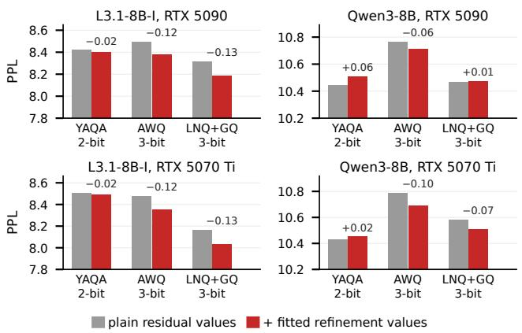  
Figure A1. Fitted versus unfitted weight refinement on WikiText-2, at the 5% configurations tuned on RTX 5090 and RTX 5070 Ti. Each pair fixes selection counts, schedule, and MLP scheme: gray bars use plain residuals; red bars use fitted refinement. Labels give the PPL change from fitting.

<table><tr><td colspan="8">RTX 5070 Ti</td></tr><tr><td></td><td></td><td colspan="3">L3.1-8B-I</td><td colspan="3">Qwen3-8B</td></tr><tr><td>Weights</td><td>Budget / method</td><td>PPL</td><td>KL</td><td>tok/s</td><td>PPL</td><td>KL</td><td>tok/s</td></tr><tr><td rowspan="8">LNQ+GQ 4-bit</td><td>Base</td><td>7.48</td><td>0.034</td><td>148.3</td><td>9.95</td><td>0.044</td><td>141.3</td></tr><tr><td>2.5% / DecDEC</td><td>7.43</td><td>0.030</td><td>144.3</td><td>9.89</td><td>0.041</td><td>139.0</td></tr><tr><td>2.5% / StrataFlux-W</td><td>7.38</td><td>0.024</td><td>142.1</td><td>9.90</td><td>0.032</td><td>137.8</td></tr><tr><td>5% / DecDEC</td><td>7.42</td><td>0.029</td><td>142.2</td><td>9.85</td><td>0.039</td><td>136.5</td></tr><tr><td>5% / StrataFlux-W</td><td>7.38</td><td>0.024</td><td>139.0</td><td>9.88</td><td>0.031</td><td>133.8</td></tr><tr><td>10% / DecDEC</td><td>7.41</td><td>0.028</td><td>137.5</td><td>9.83</td><td>0.037</td><td>132.4</td></tr><tr><td>10% / StrataFlux-W</td><td>7.38</td><td>0.023</td><td>133.4</td><td>9.88</td><td>0.030</td><td>129.5</td></tr><tr><td>20% / DecDEC</td><td>7.40</td><td>0.026</td><td>129.0</td><td>9.83</td><td>0.035</td><td>124.5</td></tr><tr><td></td><td>20% / StrataFlux-W</td><td>7.37</td><td>0.022</td><td>121.7</td><td>9.87</td><td>0.029</td><td>118.7</td></tr><tr><td rowspan="11">AWQ 4-bit</td><td>Base</td><td>7.59</td><td>0.049</td><td>152.4</td><td>10.01</td><td>0.059</td><td>144.8</td></tr><tr><td>2.5% / DecDEC</td><td>7.47</td><td>0.036</td><td>148.4</td><td>9.88</td><td>0.043</td><td>140.8</td></tr><tr><td>2.5% / StrataFlux-W</td><td>7.41</td><td>0.029</td><td>147.2</td><td>9.86</td><td>0.035</td><td>139.7</td></tr><tr><td>5% / DecDEC</td><td>7.48</td><td>0.037</td><td>145.7</td><td>9.95</td><td>0.048</td><td>138.6</td></tr><tr><td>5% / StrataFlux-W</td><td>7.40</td><td>0.026</td><td>143.1</td><td>9.80</td><td>0.032</td><td>136.2</td></tr><tr><td>10% / DecDEC</td><td>7.44</td><td>0.031</td><td>140.8</td><td>9.83</td><td>0.037</td><td>133.6</td></tr><tr><td>10% / StrataFlux-W</td><td>7.38</td><td>0.024</td><td>136.5</td><td>9.77</td><td>0.029</td><td>130.6</td></tr><tr><td>20% / DecDEC</td><td>7.40</td><td>0.026</td><td>132.1</td><td>9.80</td><td>0.034</td><td>126.1</td></tr><tr><td>20% / StrataFlux-W</td><td>7.36</td><td>0.021</td><td>126.8</td><td>9.84</td><td>0.026</td><td>119.5</td></tr><tr><td>Base</td><td>7.56</td><td>0.052</td><td>148.3</td><td>9.98</td><td>0.062</td><td>141.4</td></tr><tr><td>2.5% / DecDEC</td><td>7.46</td><td>0.037</td><td>144.5</td><td>9.85</td><td>0.048</td><td>138.9</td></tr><tr><td rowspan="8">SqLLM 4-bit</td><td>2.5% / StrataFlux-W</td><td>7.38</td><td>0.028</td><td>142.5</td><td>9.83</td><td>0.036</td><td>137.3</td></tr><tr><td>5% / DecDEC</td><td>7.44</td><td>0.035</td><td>142.2</td><td>9.79</td><td>0.041</td><td>136.4</td></tr><tr><td>5% / StrataFlux-W</td><td>7.38</td><td>0.026</td><td>139.4</td><td>9.78</td><td>0.032</td><td>134.3</td></tr><tr><td>10% / DecDEC</td><td>7.41</td><td>0.031</td><td>137.5</td><td>9.77</td><td>0.038</td><td>132.3</td></tr><tr><td>10% / StrataFlux-W</td><td>7.37</td><td>0.025</td><td>134.0</td><td>9.79</td><td>0.030</td><td>129.8</td></tr><tr><td>20% / DecDEC</td><td>7.39</td><td>0.029</td><td>129.0</td><td>9.75</td><td>0.034</td><td>124.4</td></tr><tr><td></td><td></td><td>0.023</td><td></td><td></td><td></td><td></td></tr><tr><td>20% / StrataFlux-W</td><td>7.36</td><td></td><td>123.7</td><td>9.79</td><td>0.027</td><td>118.3</td></tr></table>

## B.5 YAQA Recovery Fine-Tuning

StrataFlux-W is compatible with YAQA recovery finetuning. We use QTIP's RedPajama fine-tuning recipe, but freeze embeddings, final normalization, and the output head during end-to-end fine-tuning; Qwen3-8B’s query/key norms remain frozen during both block-wise and end-toend fine-tuning. This preserves the BF16 refinement target; normalization changes elsewhere are absorbed by rescaling its projection weights. We find that this preserves the gains of fine-tuning while maintaining compatibility with weight refinement (Table A10).

Table A10. Weight-only refinement after YAQA recovery finetuning: WikiText-2 PPL/KL using configurations tuned on RTX 5090. Original and fine-tuned bases are shown for each bitwidth; both DecDEC and StrataFlux-W refine the fine-tuned weights.
<table><tr><td rowspan="2">Weights</td><td rowspan="2">Method</td><td rowspan="2">Budget</td><td colspan="2">L3.1-8B-I</td><td colspan="2">Qwen3-8B</td></tr><tr><td>PPL</td><td>KL</td><td>PPL</td><td>KL</td></tr><tr><td rowspan="9">YAQA 2-bit</td><td>Original base</td><td></td><td>9.46</td><td>0.257</td><td>10.95</td><td>0.214</td></tr><tr><td>Fine-tuned base</td><td></td><td>8.45</td><td>0.161</td><td>10.24</td><td>0.162</td></tr><tr><td>DecDEC</td><td>2.5%</td><td>8.32</td><td>0.142</td><td>10.22</td><td>0.146</td></tr><tr><td>StrataFlux-W</td><td></td><td>8.24 8.35</td><td>0.133</td><td>10.50</td><td>0.137</td></tr><tr><td>DecDEC StrataFlux-W</td><td>5%</td><td>8.19</td><td>0.149 0.128</td><td>10.26 10.40</td><td>0.153 0.125</td></tr><tr><td>DecDEC</td><td>10%</td><td>8.32</td><td>0.141</td><td>10.21</td><td>0.146</td></tr><tr><td>StrataFlux-W</td><td></td><td>8.18</td><td>0.126</td><td>10.37</td><td>0.120</td></tr><tr><td>DecDEC</td><td>20%</td><td>8.28</td><td>0.137</td><td>10.14</td><td>0.140</td></tr><tr><td>StrataFlux-W</td><td></td><td>8.22</td><td>0.126</td><td>10.36</td><td>0.117</td></tr><tr><td rowspan="10">YAQA 3-bit</td><td>Original base</td><td></td><td>7.61</td><td>0.047</td><td>9.98</td><td>0.052</td></tr><tr><td>Fine-tuned base</td><td></td><td>7.50</td><td>0.040</td><td>9.73</td><td>0.046</td></tr><tr><td>DecDEC</td><td>2.5%</td><td>7.48</td><td>0.036</td><td></td><td></td></tr><tr><td>StrataFlux-W</td><td></td><td>7.48</td><td>0.032</td><td>9.75 9.78</td><td>0.043 0.035</td></tr><tr><td>DecDEC</td><td>5%</td><td>7.48</td><td>0.035</td><td>9.75</td><td>0.041</td></tr><tr><td>StrataFlux-W</td><td></td><td>7.47</td><td>0.032</td><td>9.79</td><td>0.032</td></tr><tr><td>DecDEC</td><td>10%</td><td>7.48</td><td>0.035</td><td>9.74</td><td>0.040</td></tr><tr><td>StrataFlux-W</td><td></td><td>7.47</td><td>0.031</td><td>9.77</td><td>0.032</td></tr><tr><td>DecDEC</td><td>20%</td><td>7.47</td><td>0.033</td><td>9.73</td><td>0.039</td></tr><tr><td>StrataFlux-W</td><td></td><td>7.45</td><td>0.029</td><td>9.76</td><td>0.031</td></tr><tr><td rowspan="9">YAQA 4-bit</td><td>Original base</td><td></td><td>7.33</td><td>0.014</td><td>9.79</td><td>0.016</td></tr><tr><td>Fine-tuned base</td><td></td><td>7.28</td><td>0.013</td><td>9.71</td><td>0.015</td></tr><tr><td>DecDEC</td><td></td><td></td><td></td><td></td><td></td></tr><tr><td>StrataFlux-W</td><td>2.5%</td><td>7.27 7.27</td><td>0.011 0.010</td><td>9.70 9.73</td><td>0.014 0.011</td></tr><tr><td>DecDEC</td><td>5%</td><td>7.27</td><td>0.011</td><td>9.69</td><td>0.013</td></tr><tr><td>StrataFlux-W</td><td></td><td>7.28</td><td>0.009</td><td>9.74</td><td>0.010</td></tr><tr><td>DecDEC</td><td></td><td>7.27</td><td>0.011</td><td>9.69</td><td>0.013</td></tr><tr><td>StrataFlux-W</td><td>10%</td><td>7.27</td><td>0.009</td><td>9.74</td><td>0.010</td></tr><tr><td>DecDEC</td><td></td><td>7.26</td><td>0.010</td><td>9.69</td><td></td></tr><tr><td></td><td rowspan="2">20%</td><td></td><td></td><td></td><td></td><td>0.012</td></tr><tr><td>StrataFlux-W</td><td></td><td>7.27</td><td>0.009</td><td>9.74</td><td>0.010</td></tr></table>

## B.6 Refinement and Cache Ablations

Figure A1 compares fitted and unfitted weight refinement at fixed configurations. Figure A2 compares skipping and waiting on weight-cache misses across slowdown budgets. Tables A11 and A12 give the cache measurements and paired technique ablations.

Table A11. Weight-cache capacity and miss policy on DGX Spark: Llama-3.1-8B-Instruct, 5% configuration, YAQA 2-bit and AWQ 3-bit. WikiText-2 PPL/KL and decode tok/s; capacities in MiB. Raw values behind Figure 12(d,e).
<table><tr><td></td><td></td><td colspan="3">YAQA 2-bit</td><td colspan="3">AWQ 3-bit</td></tr><tr><td>MiB</td><td>Miss policy</td><td>PPL</td><td>KL</td><td>tok/s</td><td>PPL</td><td>KL</td><td>tok/s</td></tr><tr><td>64</td><td>skip</td><td>9.01</td><td>0.207</td><td>68.8</td><td>8.70</td><td>0.186</td><td>57.4</td></tr><tr><td>128</td><td>skip</td><td>8.94</td><td>0.200</td><td>69.2</td><td>8.64</td><td>0.179</td><td>57.6</td></tr><tr><td>256</td><td>skip</td><td>8.88</td><td>0.192</td><td>69.7</td><td>8.59</td><td>0.172</td><td>57.6</td></tr><tr><td>512</td><td>skip</td><td>8.80</td><td>0.183</td><td>69.4</td><td>8.53</td><td>0.166</td><td>57.4</td></tr><tr><td>128</td><td>wait</td><td>8.52</td><td>0.152</td><td>17.9</td><td>8.31</td><td>0.137</td><td>27.7</td></tr></table>

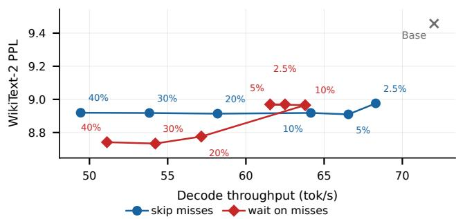  
Figure A2. Waiting versus skipping weight-cache misses on Llama-3.1-8B-Instruct with YAQA 2-bit weights, DGX Spark, and a 128 MiB cache. Curves plot WikiText-2 PPL against throughput. Points follow slowdown budgets of 2.5%, 5%, 10%, 20%, 30%, and 40%. Measured wait-policy throughput is non-monotonic across budgets.

Table A12. Paired weight-refinement ablations on Llama-3.1-8B-Instruct, RTX 5090: WikiText-2 PPL/KL and empty-context decode tok/s. Pairs are tuned separately at a 5% slowdown budget, except in the unchanged-settings pair: there, $s = 0$ disables lead/lag in the final configuration while retaining its k, fitted refinements, MLP scheme, and GPU thread-block counts.
<table><tr><td rowspan="2">Comparison</td><td rowspan="2">Setting</td><td colspan="3">YAQA 2-bit</td><td colspan="3">AWQ 3-bit</td></tr><tr><td>PPL</td><td>KL</td><td>tok/s</td><td>PPL</td><td>KL</td><td>tok/s</td></tr><tr><td rowspan="2">Fitting, s = 0</td><td>Unfitted</td><td>8.76</td><td>0.181</td><td>234.1</td><td>8.70</td><td>0.182</td><td>288.1</td></tr><tr><td>Fitted</td><td>8.67</td><td>0.170</td><td>230.1</td><td>8.61</td><td>0.171</td><td>287.5</td></tr><tr><td rowspan="2">Fitting, tuned s</td><td>Unfitted</td><td>8.68</td><td>0.174</td><td>234.9</td><td>8.50</td><td>0.158</td><td>290.2</td></tr><tr><td>Fitted</td><td>8.59</td><td>0.162</td><td>234.3</td><td>8.38</td><td>0.145</td><td>289.0</td></tr><tr><td rowspan="2">MLP scheme</td><td>Channel-wise</td><td>8.59</td><td>0.162</td><td>234.3</td><td>8.38</td><td>0.145</td><td>289.0</td></tr><tr><td>Neuron bundles</td><td>8.40</td><td>0.139</td><td>234.4</td><td>8.56</td><td>0.165</td><td>289.3</td></tr><tr><td rowspan="2">Lead/lag, unfitted</td><td> $s = 0$ </td><td>8.76</td><td>0.181</td><td>234.1</td><td>8.70</td><td>0.182</td><td>288.1</td></tr><tr><td>Tuned s</td><td>8.68</td><td>0.174</td><td>234.9</td><td>8.50</td><td>0.158</td><td>290.2</td></tr><tr><td rowspan="2">Lead/lag, full method</td><td> $s = 0$ </td><td>8.57</td><td>0.157</td><td>232.2</td><td>8.57</td><td>0.168</td><td>286.8</td></tr><tr><td>Tuned s</td><td>8.40</td><td>0.139</td><td>234.4</td><td>8.38</td><td>0.145</td><td>289.0</td></tr><tr><td rowspan="2">Lead/lag, unchanged settings</td><td> $s = 0$ </td><td>8.34</td><td>0.131</td><td>182.2</td><td>8.33</td><td>0.141</td><td>271.1</td></tr><tr><td> $\operatorname { T u n e d } s$ </td><td>8.40</td><td>0.139</td><td>234.4</td><td>8.38</td><td>0.145</td><td>289.0</td></tr></table>

## B.7 Weight Refinement Tuner

The tuner searches separately for each model, weight quantizer, and platform under a specified slowdown budget relative to the quantized base. It selects channel budgets k, fetch lead/lag distances s, the MLP refinement scheme, and GPU thread-block counts.

Resource allocation. We first profile base projections alongside refinement while varying its thread-block count and selection budget. The resulting timing table identifies launch configurations that balance refinement speed against interference with the base projections.

Budget-constrained search. For each combination of shift distances and channel-wise or neuron-wise MLP refinement, the tuner searches for the largest common channel budget k that satisfies the slowdown limit in end-to-end decoding. For neuron-wise MLP refinement, it sets $k _ { n } = \mathrm { r o u n d } ( 3 k / 4 )$ each increment of $k _ { n }$ fetches $4 / 3$ as many bytes as each increment of k for channel-wise gate/up and down refinement. It also considers disabling refinement for projection sets when needed to meet the budget. On DGX Spark, we search skip-policy configurations only at $s = 0 \mathrm { : }$ skipping cache misses leaves no SSD wait for fetch lead/lag to hide.

Accuracy selection and budget allocation. The tuner compares feasible candidates by KL divergence from BF16 on held-out text. Starting from the lowest-KL candidate, it increases individual selection budgets while remeasuring end-to-end latency and retaining increases that satisfy the slowdown limit. These final per-projection budgets need not be equal.

Refinement fitting during search. Fitted refinement values depend on the selection budget (Section 3.2.1). We approximate candidate KL during search using refinements pre-fitted at a ladder of power-of-two selection budgets, avoiding a separate fit for each candidate. Once the final per-projection budgets are selected, we fit refinement values at those exact budgets before quantizing them for inference.

Tuned configurations. Table A13 lists tuned configurations across slowdown budgets and miss-policy sweeps. Each row displays one configuration. The Weights column gives the quantizer and bitwidth. Four-entry tuples give the query/key/value, attention-output, gate/up, and down configurations for channel-wise refinement. Three-entry tuples give query/key/value, attention-output, and neuron bundles. This order applies to selection counts $( k ,$ or $k _ { n }$ for neuron bundles) and shift distances s. $n _ { \mathrm { t b } }$ lists the GPU threadblock count shared by channel-wise kernels, followed by the count for the neuron-bundle kernel when used. Counts k are per 1,024 input channels or neurons, and s is in Transformer blocks. SSD-backed configurations use a 128 MiB cache; miss-policy sweeps identify skipping or waiting.

Table A13. Tuned weight-refinement configurations. Model and platform headings identify each configuration block. The main DGX Spark skip-policy search uses only s = 0; skip/wait policy sweeps are listed separately.
<table><tr><td colspan="5">Llama-3.1-8B-Instruct / DGX Spark</td></tr><tr><td>Weights</td><td>Budget</td><td>k</td><td>S</td><td>ntb</td></tr><tr><td rowspan="4">AWQ3</td><td>2.5%</td><td>3,3,2</td><td>0,0,0</td><td>7,4</td></tr><tr><td>5%</td><td>10,14,8</td><td>0,0,0</td><td>2,4</td></tr><tr><td>10%</td><td>21,21,21,21</td><td>0,0,0,0</td><td>3</td></tr><tr><td>20%</td><td>31,31,23</td><td>0,0,0</td><td>3,8</td></tr><tr><td rowspan="4">AWQ4</td><td>2.5%</td><td>5,6,0,5</td><td>0,0,0,0</td><td>3</td></tr><tr><td>5%</td><td>16,16,14,16</td><td>0,0,0,0</td><td>4</td></tr><tr><td>10%</td><td>28,28,0,28</td><td>0,0,0,0</td><td>3</td></tr><tr><td>20%</td><td>34,33,33,33</td><td>0,0,0,0</td><td>6</td></tr><tr><td rowspan="4">LNQ+GQ3</td><td>2.5%</td><td>0,4,3</td><td>0,0,0</td><td>7,4</td></tr><tr><td>5%</td><td>11,0,8</td><td>0,0,0</td><td>6,4</td></tr><tr><td>10%</td><td>19,19,14</td><td>0,0,0</td><td>6,8</td></tr><tr><td>20%</td><td>33,32,24</td><td>0,0,0</td><td>5,16</td></tr><tr><td rowspan="4">LNQ+GQ4</td><td>2.5%</td><td>8,8,0,8</td><td>0,0,0,0</td><td>7</td></tr><tr><td>5%</td><td>14,0,9</td><td>0,0,0</td><td>5,4</td></tr><tr><td>10%</td><td>23,24,16</td><td>0,0,0</td><td>7,8</td></tr><tr><td>20%</td><td>40,40,29</td><td>0,0,0</td><td>8,8</td></tr><tr><td rowspan="4">SqLLM 3</td><td>2.5%</td><td>9,8,6</td><td>0,0,0</td><td>6,4</td></tr><tr><td>5%</td><td>10,14,9,9</td><td>0,0,0,0</td><td>3</td></tr><tr><td>10%</td><td>18,18,19,18</td><td>0,0,0,0</td><td>4</td></tr><tr><td>20%</td><td>28,29,28,27</td><td>0,0,0,0</td><td>3</td></tr><tr><td rowspan="4">SqLLM 4</td><td>2.5%</td><td>0,15,15,15</td><td>0,0,0,0</td><td>4</td></tr><tr><td>5%</td><td>10,9,10,10</td><td>0,0,0,0</td><td>6</td></tr><tr><td>10%</td><td>21,21,21,21</td><td>0,0,0,0</td><td>5</td></tr><tr><td>20%</td><td>33,33,33,33</td><td>0,0,0,0</td><td>6</td></tr><tr><td rowspan="4">YAQA 2</td><td>2.5%</td><td>8,0,5</td><td>0,0,0</td><td>1,4</td></tr><tr><td>5%</td><td>14,12,8</td><td>0,0,0</td><td>2,4</td></tr><tr><td>10%</td><td>0,26,18</td><td>0,0,0</td><td>2,8</td></tr><tr><td>20%</td><td>32,33,22</td><td>0,0,0</td><td>3,8</td></tr><tr><td rowspan="4">YAQA 3</td><td>2.5%</td><td>5,5,4</td><td>0,0,0</td><td>1,8</td></tr><tr><td>5%</td><td>16,16,12</td><td>0,0,0</td><td>2,4</td></tr><tr><td>10%</td><td>28,28,21</td><td>0,0,0</td><td>3,8</td></tr><tr><td>20%</td><td>35,35,26</td><td>0,0,0</td><td>3,4</td></tr><tr><td rowspan="4">YAQA 4</td><td>2.5%</td><td>0,6,4</td><td>0,0,0</td><td>1,4</td></tr><tr><td>5%</td><td>18,18,12</td><td>0,0,0</td><td>2,4</td></tr><tr><td>10%</td><td>0,32,24</td><td>0,0,0</td><td>2,8</td></tr><tr><td>20%</td><td>42,43,30</td><td>0,0,0</td><td>3,8</td></tr></table>

<table><tr><td colspan="5">Llama-3.1-8B-Instruct / DGX Spark, skip-policy sweep</td></tr><tr><td>Weights</td><td>Budget</td><td>k</td><td>S</td><td>ntb</td></tr><tr><td rowspan="6">YAQA 2</td><td>2.5%</td><td>6,12,4</td><td>0,0,0</td><td>3,4</td></tr><tr><td>5%</td><td>0,17,12</td><td>0,0,0</td><td>5,4</td></tr><tr><td>10%</td><td>24,23,18</td><td>0,0,0</td><td>2,8</td></tr><tr><td>20%</td><td>0,37,28</td><td>0,0,0</td><td>4,8</td></tr><tr><td>30%</td><td>0,40,30</td><td>0,0,0</td><td>13,4</td></tr><tr><td>40%</td><td>0,46,32</td><td>0,0,0</td><td>13,4</td></tr></table>

<table><tr><td colspan="4">Llama-3.1-8B-Instruct / DGX Spark, wait-policy sweep</td></tr><tr><td>Weights</td><td>Budget</td><td>k</td><td>S</td><td>ntb</td></tr><tr><td rowspan="6">YAQA 2</td><td>2.5%</td><td>0,3,1</td><td>0,1.5,1.5</td><td>2,4</td></tr><tr><td>5%</td><td>0,3,1</td><td>0,1.5,1.5</td><td>4,4</td></tr><tr><td>10%</td><td>4,4,3</td><td>2.5,2,2</td><td>2,4</td></tr><tr><td>20%</td><td>10,10,8</td><td>1.5,1.5,1.5</td><td>3,4</td></tr><tr><td>30%</td><td>40,0,9</td><td>2,0,1.5</td><td>9,4</td></tr><tr><td>40%</td><td>16,0,11</td><td>1.5,0,1.5</td><td>14,4</td></tr></table>

<table><tr><td colspan="5">Llama-3.1-8B-Instruct / RTX 5070 Ti</td></tr><tr><td>Weights</td><td>Budget</td><td>k</td><td>S</td><td>ntb</td></tr><tr><td rowspan="4">AWQ3</td><td>2.5%</td><td>3,10,2</td><td>0,0.5,0</td><td>3,4</td></tr><tr><td>5%</td><td>18,0,18,18</td><td>1,0,0,0</td><td>4</td></tr><tr><td>10%</td><td>37,37,37,37</td><td>1,0,0,0.5</td><td>6</td></tr><tr><td>20%</td><td>45,40,39,40</td><td>0,0,0,0</td><td>7</td></tr><tr><td rowspan="4">AWQ4</td><td>2.5%</td><td>28,28,34,36</td><td>0.5,1,0,0.5</td><td>6</td></tr><tr><td>5%</td><td>52,53,49,52</td><td>1,0.5,0,0.5</td><td>24</td></tr><tr><td>10%</td><td>45,45,45,45</td><td>0,0.5,0,0</td><td>24</td></tr><tr><td>20%</td><td>53,55,52,52</td><td>0,0,0,0</td><td>24</td></tr><tr><td rowspan="4">LNQ+GQ3</td><td>2.5%</td><td>6,8,3</td><td>0,1,0.5</td><td>4,4</td></tr><tr><td>5%</td><td>63,63,33,61</td><td>1,0.5,0,0.5</td><td>16</td></tr><tr><td>10%</td><td>29,28,20</td><td>0.5,0,0.5</td><td>16,16</td></tr><tr><td>20%</td><td>60,61,58,60</td><td>1,0.5,0,0.5</td><td>16</td></tr><tr><td rowspan="4">LNQ+GQ4</td><td>2.5%</td><td>45,42,47,45</td><td>1,0.5,0,0</td><td>16</td></tr><tr><td>5%</td><td>48,45,48,49</td><td>1,0,0,0</td><td>16</td></tr><tr><td>10%</td><td>68,59,58,59</td><td>1,0,0,0.5</td><td>16</td></tr><tr><td>20%</td><td>64,64,64,63</td><td>1,0,0,0</td><td>24</td></tr></table>

<table><tr><td colspan="4">Llama-3.1-8B-Instruct / RTX 5070 Ti</td></tr><tr><td>Weights</td><td>Budget</td><td>k</td><td>S ntb</td></tr><tr><td rowspan="4">SqLLM 3</td><td>2.5%</td><td>10,10,10,10</td><td>0.5,0.5,0,0</td><td>4</td></tr><tr><td>5%</td><td>32,37,31,30</td><td>1,0.5,0,0</td><td>16</td></tr><tr><td>10%</td><td>27,27,26,27</td><td>0,0,0,0</td><td>16</td></tr><tr><td>20%</td><td>43,43,43,43</td><td>1,0,0,0</td><td>16</td></tr><tr><td rowspan="4">SqLLM 4</td><td>2.5%</td><td>85,46,46,45</td><td>1,0.5,0,0</td><td>16</td></tr><tr><td>5%</td><td>48,48,48,48</td><td>1,0,0,0</td><td>16</td></tr><tr><td>10%</td><td>54,53,53,54</td><td>1,0,0,0</td><td>16</td></tr><tr><td>20%</td><td>59,60,57,58</td><td>0,0,0,0</td><td>24</td></tr><tr><td rowspan="4">YAQA 2</td><td>2.5%</td><td>15,23,12</td><td>1,1,0.5</td><td>6,4</td></tr><tr><td>5%</td><td>28,28,16</td><td>1,1,0.5</td><td>6,4</td></tr><tr><td>10%</td><td>37,39,25</td><td>1,0,0.5</td><td>7,16</td></tr><tr><td>20%</td><td>97,49,35</td><td>0.5,0,0.5</td><td>14,32</td></tr><tr><td rowspan="4">YAQA 3</td><td>2.5%</td><td>32,32,31,32</td><td>0.5,0.5,0,0</td><td>5</td></tr><tr><td>5%</td><td>66,50,44,44</td><td>0,0.5,0,0.5</td><td>7</td></tr><tr><td>10%</td><td>62,48,47,48</td><td>0,0,0,0</td><td>14</td></tr><tr><td>20%</td><td>61,61,60,61</td><td>0,0,0,0</td><td>16</td></tr><tr><td rowspan="4">YAQA 4</td><td>2.5%</td><td>59,60,58,58</td><td>1,0,0,0.5</td><td>7</td></tr><tr><td>5%</td><td>82,60,58,60</td><td>0,1,0,0.5</td><td>7</td></tr><tr><td>10%</td><td>73,77,70,70</td><td>1,0,0,0.5</td><td>23</td></tr><tr><td>20%</td><td>87,87,86,87</td><td>0,0,0,0.5</td><td>28</td></tr></table>

<table><tr><td colspan="5">Llama-3.1-8B-Instruct / RTX 5090</td></tr><tr><td>Weights</td><td>Budget</td><td>k</td><td>S</td><td>ntb</td></tr><tr><td rowspan="4">AWQ3</td><td>2.5% 5%</td><td>8,0,0,8</td><td>0.5,0,0,0</td><td>8</td></tr><tr><td></td><td>17,0,17,13</td><td>1,0,0,0</td><td>16</td></tr><tr><td>10%</td><td>13,13,13,13</td><td>0,1,0,0</td><td>14</td></tr><tr><td>20%</td><td>29,28,22,27</td><td>1,0,0,0</td><td>14</td></tr><tr><td rowspan="4">AWQ4</td><td>2.5%</td><td>10,0,10,10</td><td>0.5,0,0,0</td><td>16</td></tr><tr><td>5%</td><td>20,0,18,13</td><td>0.5,0,0,0</td><td>16</td></tr><tr><td>10%</td><td>30,39,26,28</td><td>0.5,0.5,0,0.5</td><td>24</td></tr><tr><td>20%</td><td>53,54,46,46</td><td>0.5,1,1,0.5</td><td>24</td></tr><tr><td rowspan="4">LNQ+GQ3</td><td>2.5%</td><td>18,0,13,9</td><td>0.5,0,0,0</td><td>16</td></tr><tr><td>5%</td><td>17,0,13,13</td><td>0.5,0,0,0</td><td>16</td></tr><tr><td>10%</td><td>59,65,5</td><td>1,1,0.5</td><td>24,4</td></tr><tr><td>20%</td><td>29,29,16</td><td>1,0,0.5</td><td>24,16</td></tr><tr><td rowspan="4">LNQ+GQ4</td><td>2.5%</td><td>25,0,15,11</td><td>0.5,0,0,0</td><td>11</td></tr><tr><td>5%</td><td>21,0,21,18</td><td>0.5,0,0,0</td><td>14</td></tr><tr><td>10%</td><td>23,25,21,22</td><td>1,1,0,0</td><td>16</td></tr><tr><td>20%</td><td>40,32,31,32</td><td>1,0,0,0</td><td>16</td></tr><tr><td rowspan="4">SqLLM 3</td><td>2.5%</td><td>17,0,9,9</td><td>0.5,0,0,0</td><td>16</td></tr><tr><td>5%</td><td>17,0,13,13</td><td>0.5,0,0,0</td><td>16</td></tr><tr><td>10%</td><td>10,10,10,10</td><td>0.5,0,0,0</td><td>16</td></tr><tr><td>20%</td><td>26,26,20,22</td><td>1,0,0,0</td><td>16</td></tr><tr><td rowspan="4">SqLLM 4</td><td>2.5%</td><td>16,0,16,9</td><td>1,0,0,0</td><td>11</td></tr><tr><td>5%</td><td>22,0,21,21</td><td>0.5,0,0,0</td><td>24</td></tr><tr><td>10%</td><td>19,19,19,19</td><td>0.5,0,0,0</td><td>24</td></tr><tr><td>20%</td><td>29,29,28,29</td><td>0,0,0,0</td><td>38</td></tr><tr><td rowspan="4">YAQA 2</td><td>2.5%</td><td>16,28,12</td><td>0,0,0.5</td><td>23,8</td></tr><tr><td>5%</td><td>39,40,18</td><td>0,0,0.5</td><td>23,16</td></tr><tr><td>10%</td><td>39,39,20</td><td>0,0,0.5</td><td>19,32</td></tr><tr><td>20%</td><td>50,51,24</td><td>0.5,0,0.5</td><td>38,16</td></tr><tr><td rowspan="4">YAQA 3</td><td>2.5%</td><td>29,28,26,26</td><td>1,0,0,0</td><td>56</td></tr><tr><td>5%</td><td>45,46,20</td><td>0,0,0.5</td><td>56,16</td></tr><tr><td>10%</td><td>51,51,24</td><td>0.5,0,0.5</td><td>38,32</td></tr><tr><td>20%</td><td>53,53,49,49</td><td>0,0,0,0.5</td><td>38</td></tr><tr><td rowspan="4">YAQA 4</td><td>2.5%</td><td>42,42,34,34</td><td>0,0.5,0,0</td><td>56</td></tr><tr><td>5%</td><td>38,39,38,38</td><td>0,0,0,0.5</td><td>28</td></tr><tr><td>10%</td><td>50,50,50,50</td><td>0.5,0.5,0.5,0.5</td><td>38</td></tr><tr><td>20%</td><td>58,60,57,57</td><td>0,0,0,0.5</td><td>38</td></tr><tr><td colspan="5">Qwen3-8B / DGX Spark</td></tr><tr><td>Weights</td><td>Budget</td><td>k</td><td>S</td><td>ntb</td></tr><tr><td rowspan="4">AWQ3</td><td>2.5% 5%</td><td>0,8,2,2 0,16,16,16</td><td>0,0,0,0 0,0,0,0</td><td>3</td></tr><tr><td></td><td></td><td></td><td>5</td></tr><tr><td>10%</td><td>25,21,20,21</td><td>0,0,0,0</td><td>3</td></tr><tr><td>20%</td><td>28,27,28,27</td><td>0,0,0,0</td><td>5</td></tr><tr><td rowspan="4">AWQ4</td><td>2.5%</td><td>10,10,0,10</td><td>0,0,0,0</td><td>10</td></tr><tr><td>5%</td><td>11,11,0,11</td><td>0,0,0,0</td><td>11</td></tr><tr><td>10%</td><td>20,20,20,19</td><td>0,0,0,0</td><td>11</td></tr><tr><td>20%</td><td>37,37,37,37</td><td>0,0,0,0</td><td>7</td></tr><tr><td rowspan="4">LNQ+GQ3</td><td>2.5%</td><td>4,0,3</td><td>0,0,0</td><td>7,4</td></tr><tr><td>5%</td><td>13,10,7</td><td>0,0,0</td><td>3,4</td></tr><tr><td>10%</td><td>0,24,18</td><td>0,0,0</td><td>3,8</td></tr><tr><td>20%</td><td>34,34,26</td><td>0,0,0</td><td>5,8</td></tr><tr><td rowspan="4">LNQ+GQ4</td><td>2.5%</td><td>0,13,10</td><td>0,0,0</td><td>5,4</td></tr><tr><td>5%</td><td>0,19,12</td><td>0,0,0</td><td>5,8</td></tr><tr><td>10%</td><td>31,31,23</td><td>0,0,0</td><td>5,8</td></tr><tr><td>20%</td><td>44,44,32</td><td>0,0,0</td><td>7,8</td></tr><tr><td rowspan="4">SqLLM 3</td><td>2.5%</td><td>5,4,4,4</td><td>0,0,0,0</td><td>5</td></tr><tr><td>5%</td><td>8,8,8,8</td><td>0,0,0,0</td><td>3</td></tr><tr><td>10%</td><td>22,23,22,22</td><td>0,0,0,0</td><td>4</td></tr><tr><td>20%</td><td>31,30,30,32</td><td>0,0,0,0</td><td>9</td></tr><tr><td rowspan="4">SqLLM 4</td><td>2.5%</td><td>0,9,8,9</td><td>0,0,0,0</td><td>7</td></tr><tr><td>5%</td><td>11,12,11,11</td><td>0,0,0,0</td><td>5</td></tr><tr><td>10%</td><td>24,24,24,24</td><td>0,0,0,0</td><td>6</td></tr><tr><td>20%</td><td>38,38,38,38</td><td>0,0,0,0</td><td>6</td></tr><tr><td rowspan="4">YAQA 2</td><td>2.5%</td><td>5,7,4</td><td>0,0,0</td><td>2,4</td></tr><tr><td>5%</td><td>11,13,8</td><td>0,0,0</td><td>5,4</td></tr><tr><td>10%</td><td>27,29,19</td><td>0,0,0</td><td>2,8</td></tr><tr><td>20%</td><td>32,33,24</td><td>0,0,0</td><td>3,8</td></tr><tr><td rowspan="4">YAQA 3</td><td>2.5%</td><td>0,9,7</td><td>0,0,0</td><td>5,4</td></tr><tr><td>5%</td><td>0,17,12</td><td>0,0,0</td><td>6,4</td></tr><tr><td>10%</td><td>32,34,22</td><td>0,0,0</td><td>4,8</td></tr><tr><td>20%</td><td>38,40,27</td><td>0,0,0</td><td>2,8</td></tr><tr><td rowspan="4">YAQA 4</td><td>2.5%</td><td>0,21,15</td><td>0,0,0</td><td>7,4</td></tr><tr><td>5%</td><td>14,14,11</td><td>0,0,0</td><td>3,4</td></tr><tr><td>10%</td><td>30,29,21</td><td>0,0,0</td><td>3,8</td></tr><tr><td>20%</td><td>42,42,32</td><td>0,0,0</td><td>2,8</td></tr></table>

<table><tr><td colspan="4">Qwen3-8B / RTX 5070 Ti</td></tr><tr><td>Weights</td><td>Budget</td><td>k</td><td></td><td>ntb</td></tr><tr><td rowspan="4">AWQ3</td><td>2.5%</td><td>0,6,6,6</td><td>0,0.5,0,0.5</td><td>3</td></tr><tr><td>5%</td><td>22,21,14</td><td>1,1,0.5</td><td>4,4</td></tr><tr><td>10%</td><td>44,44,44,44</td><td>1,1,0,0.5</td><td>6</td></tr><tr><td>20%</td><td>54,54,53,55</td><td>1,0,0,0.5</td><td>6</td></tr><tr><td rowspan="4">AWQ4</td><td>2.5%</td><td>19,19,19,19</td><td>0.5,1,0,0</td><td>6</td></tr><tr><td>5%</td><td>35,41,35,41</td><td>0.5,1,0,0.5</td><td>8</td></tr><tr><td>10%</td><td>61,61,60,61</td><td>1,0.5,0,0.5</td><td>24</td></tr><tr><td>20%</td><td>63,63,62,62</td><td>0,0,1,0</td><td>24</td></tr><tr><td rowspan="4">LNQ+GQ3</td><td>2.5%</td><td>0,16,14</td><td>0,1,0.5</td><td>5,16</td></tr><tr><td>5%</td><td>15,17,7</td><td>0.5,1,0</td><td>5,32</td></tr><tr><td>10%</td><td>32,39,22</td><td>1,0.5,0.5</td><td>16,16</td></tr><tr><td>20%</td><td>44,44,32</td><td>0.5,0,0.5</td><td>16,32</td></tr><tr><td rowspan="4">LNQ+GQ4</td><td>2.5%</td><td>27,28,21</td><td>0.5,1,0.5</td><td>11,16</td></tr><tr><td>5%</td><td>46,46,24</td><td>0.5,0,0.5</td><td>16,16</td></tr><tr><td>10%</td><td>44,45,29</td><td>0.5,0,0.5</td><td>16,16</td></tr><tr><td>20%</td><td>54,57,40</td><td>0,0,0.5</td><td>16,32</td></tr><tr><td rowspan="4">SqLLM 3</td><td>2.5%</td><td>11,11,8</td><td>0.5,1,0.5</td><td>5,16</td></tr><tr><td>5%</td><td>36,40,24,37</td><td>0.5,0.5,0,0.5</td><td>5</td></tr><tr><td>10%</td><td>42,42,42,42</td><td>1,0.5,1,0</td><td>16</td></tr><tr><td>20%</td><td>51,51,50,51</td><td>1,0,1,0</td><td>16</td></tr><tr><td rowspan="4">SqLLM 4</td><td>2.5%</td><td>38,0,37,37</td><td>1,0,0,0</td><td>16</td></tr><tr><td>5%</td><td>45,42,45,47</td><td>1,0.5,0,0</td><td>16</td></tr><tr><td>10%</td><td>44,45,44,45</td><td>0,0,0,0</td><td>16</td></tr><tr><td>20%</td><td>62,62,61,61</td><td>1,0,0,0</td><td>16</td></tr></table>

<table><tr><td colspan="5">Qwen3-8B / RTX 5070 Ti</td></tr><tr><td>Weights</td><td>Budget</td><td>k</td><td>S</td><td>ntb</td></tr><tr><td rowspan="4">YAQA 2</td><td>2.5%</td><td>21,28,14</td><td>1,1,0.5</td><td>6,4</td></tr><tr><td>5%</td><td>27,28,18</td><td>1,0,0.5</td><td>6,4</td></tr><tr><td>10%</td><td>67,74,29</td><td>0.5,0.5,0.5</td><td>6,32</td></tr><tr><td>20%</td><td>52,52,36</td><td>0,0,0.5</td><td>6,32</td></tr><tr><td rowspan="4">YAQA 3</td><td>2.5%</td><td>26,31,17</td><td>0.5,1,0.5</td><td>5,4</td></tr><tr><td>5%</td><td>32,37,24</td><td>0.5,1,0.5</td><td>6,16</td></tr><tr><td>10%</td><td>72,50,34</td><td>1,0,0.5</td><td>6,32</td></tr><tr><td>20%</td><td>56,57,42</td><td>0,0,0.5</td><td>16,32</td></tr><tr><td rowspan="4">YAQA 4</td><td>2.5%</td><td>38,39,22</td><td>1,0,0.5</td><td>7,4</td></tr><tr><td>5%</td><td>49,52,35</td><td>1,1,0.5</td><td>6,32</td></tr><tr><td>10%</td><td>57,59,40</td><td>0.5,0,0.5</td><td>6,32</td></tr><tr><td>20%</td><td>67,67,48</td><td>0,0,0.5</td><td>16,32</td></tr></table>

<table><tr><td colspan="5">Qwen3-8B / RTX 5090</td></tr><tr><td>Weights</td><td>Budget</td><td>k</td><td>S</td><td>ntb</td></tr><tr><td rowspan="4">AWQ3</td><td>2.5%</td><td>2,0,2</td><td>0,0,0.5</td><td>12,32</td></tr><tr><td>5%</td><td>17,0,16,10</td><td>1,0,0,0</td><td>16</td></tr><tr><td>10%</td><td>60,60,32,32</td><td>1,0.5,1,0.5</td><td>12</td></tr><tr><td>20%</td><td>48,48,44,48</td><td>1,0.5,1,0.5</td><td>16</td></tr><tr><td rowspan="4">AWQ4</td><td>2.5%</td><td>14,0,13,5</td><td>0.5,0,0,0</td><td>16</td></tr><tr><td>5%</td><td>18,0,16,10</td><td>0.5,0,0,0</td><td>16</td></tr><tr><td>10%</td><td>29,29,26,29</td><td>0.5,0.5,0,0.5</td><td>32</td></tr><tr><td>20%</td><td>51,112,50,51</td><td>1,0.5,1,0.5</td><td>32</td></tr><tr><td rowspan="4">LNQ+GQ3</td><td>2.5%</td><td>0,16,12,5</td><td>0,0.5,0,0</td><td>32</td></tr><tr><td>5%</td><td>0,11,11,11</td><td>0,0.5,0,0</td><td>32</td></tr><tr><td>10%</td><td>13,13,10</td><td>0.5,0.5,0.5</td><td>32,16</td></tr><tr><td>20%</td><td>27,31,20</td><td>0.5,0,0.5</td><td>32,16</td></tr><tr><td rowspan="4">LNQ+GQ4</td><td>2.5%</td><td>16,0,14,14</td><td>1,0,1,0</td><td>48</td></tr><tr><td>5%</td><td>31,0,26,25</td><td>1,0,1,0</td><td>32</td></tr><tr><td>10%</td><td>54,54,9</td><td>1,1,0.5</td><td>48,4</td></tr><tr><td>20%</td><td>31,31,23</td><td>0,0,0.5</td><td>16,16</td></tr><tr><td rowspan="4">SqLLM 3</td><td>2.5%</td><td>10,0,9,10</td><td>1,0,1,0</td><td>24</td></tr><tr><td>5%</td><td>11,0,11,11</td><td>1,0,0,0</td><td>32</td></tr><tr><td>10%</td><td>25,27,25,26</td><td>1,0.5,1,0.5</td><td>24</td></tr><tr><td>20%</td><td>28,28,27,28</td><td>1,0,1,0</td><td>32</td></tr><tr><td rowspan="4">SqLLM 4</td><td>2.5%</td><td>16,0,16,16</td><td>0.5,0,0,0</td><td>48</td></tr><tr><td>5%</td><td>34,0,23,21</td><td>1,0,0,0</td><td>32</td></tr><tr><td>10%</td><td>25,25,25,25</td><td>1,0.5,0,0.5</td><td>48</td></tr><tr><td>20%</td><td>37,37,37,37</td><td>1,0,1,0</td><td>16</td></tr><tr><td rowspan="4">YAQA 2</td><td>2.5%</td><td>11,10,8</td><td>0,0,0.5</td><td>7,16</td></tr><tr><td>5%</td><td>22,20,16</td><td>0,0,0.5</td><td>7,16</td></tr><tr><td>10%</td><td>40,41,22</td><td>0,0,0.5</td><td>20,32</td></tr><tr><td>20%</td><td>47,46,26</td><td>0,0,0.5</td><td>32,32</td></tr><tr><td rowspan="4">YAQA 3</td><td>2.5%</td><td>17,17,13</td><td>0,0,0.5</td><td>32,8</td></tr><tr><td>5%</td><td>36,36,23</td><td>0,0,0.5</td><td>24,32</td></tr><tr><td>10%</td><td>57,57,25</td><td>0.5,0,0.5</td><td>32,32</td></tr><tr><td>20%</td><td>44,44,33</td><td>0.5,0,0.5</td><td>32,32</td></tr><tr><td rowspan="4">YAQA 4</td><td>2.5%</td><td>19,18,14</td><td>0,0,0.5</td><td>5,4</td></tr><tr><td>5%</td><td>42,42,26</td><td>0,0,0.5</td><td>8,16</td></tr><tr><td>10%</td><td>44,45,28</td><td>0,0,0.5</td><td>32,32</td></tr><tr><td>20%</td><td>47,48,36</td><td>0.5,0,0.5</td><td>32,16</td></tr></table>

<table><tr><td colspan="3">Llama-3.3-70B-Instruct / RTX PRO 6000 / 5% slowdown budget</td></tr><tr><td>Weights</td><td>k</td><td>S</td><td>ntb</td></tr><tr><td>AWQ3</td><td>25,25,25,25</td><td>0,0.5,0,0</td><td>8</td></tr><tr><td>AWQ4</td><td>30,30,31,29</td><td>1,0,0,0</td><td>40</td></tr><tr><td>LNQ+GQ3</td><td>13,13,10</td><td>0.5,0.5,0.5</td><td>17,32</td></tr><tr><td>LNQ+GQ 4</td><td>24,24,24,24</td><td>0,0.5,0,0</td><td>28</td></tr><tr><td>SqLLM 3</td><td>16,16,15,15</td><td>0,0,0,0</td><td>16</td></tr><tr><td>SqLLM 4</td><td>24,24,24,24</td><td>1,0,0,0</td><td>28</td></tr><tr><td>YAQA 2</td><td>32,32,24</td><td>0.5,0.5,1</td><td>38,8</td></tr><tr><td>YAQA 3</td><td>42,37,33,34</td><td>0,0,0,0.5</td><td>32</td></tr><tr><td>YAQA 4</td><td>42,45,38,42</td><td>0,0,0,0.5</td><td>32</td></tr></table>

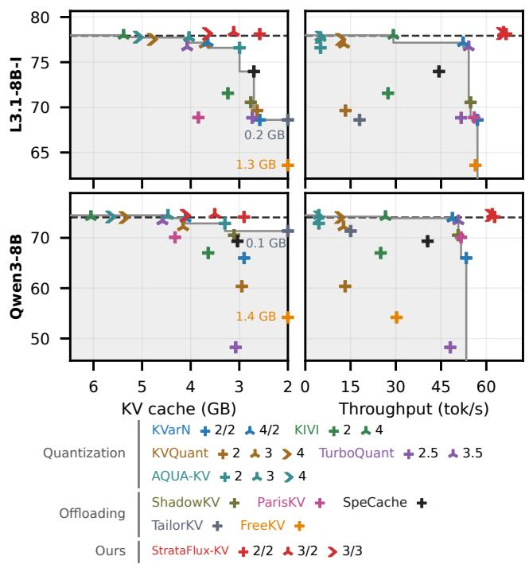  
Figure A3. KV-only refinement: RULER accuracy at 128K (13 tasks, 96 samples each) versus GPU-resident KV-cache size and RTX 5090 throughput at the same context. StrataFlux-KV uses its dedicated-GPU configuration. Gray shading extends below the baseline frontiers; dashed lines mark BF16 accuracy. TailorKV's size is labeled at the KV-cache axis's right edge.

<table><tr><td colspan="3">Qwen3-32B / RTX 5090 / 5% slowdown budget</td><td></td></tr><tr><td>Weights</td><td>k</td><td>S</td><td>ntb</td></tr><tr><td>AWQ3</td><td>18,20,18,18</td><td>0,0.5,0,0</td><td>11</td></tr><tr><td>AWQ4</td><td>19,19,19,17</td><td>0,0.5,0,0</td><td>12</td></tr><tr><td>LNQ+GQ3</td><td>16,18,17,18</td><td>0,0.5,0,0</td><td>14</td></tr><tr><td>LNQ+GQ 4</td><td>28,26,28,26</td><td>1,0,0,0</td><td>16</td></tr><tr><td>SqLLM 3</td><td>16,18,16,16</td><td>0,0.5,0,0</td><td>14</td></tr><tr><td>SqLLM 4</td><td>27,27,26,27</td><td>1,0,0,0</td><td>16</td></tr><tr><td>YÀQA 2</td><td>41,41,15</td><td>0.5,0,0.5</td><td>50,20</td></tr><tr><td>YAQA 3</td><td>201,32,19</td><td>0.5,0,0.5</td><td>50,20</td></tr><tr><td>YAQA 4</td><td>27,28,20</td><td>0.5,0,0.5</td><td>25,20</td></tr></table>

## C EXTENDED KV EVALUATION

We extend Section 4.2 across KV precisions and context lengths. In configuration labels, K and V give resident bits per key and value element; +4/+4 gives their additional refinement bits. The fetch budget is the fraction of eligible token groups selected. Main host-RAM configurations use two-token groups. Main SSD-backed configurations use four-token groups and skip refinement on RAM-cache misses.

## C.1 Accuracy and Context Length

Figure A3 compares KV-cache size and decode throughput against RULER accuracy at 128K.

Table A14. KV-only refinement: GPU-resident KV-cache size and PG-19 PPL/KL at 128K, with RULER accuracy at 8K–128K. <sup>∗</sup>GB counts only KV memory. Baseline sizes are for RTX 5090; StrataFlux-KV headings identify the platform. DGX Spark sizes include its RAM cache. KVQ and TQ denote KVQuant and TurboQuant.

<table><tr><td colspan="9">Llama-3.1-8B-Instruct</td></tr><tr><td>Method</td><td>GB*</td><td>PPL</td><td>KL</td><td>R8</td><td>R16</td><td>R32</td><td>R64</td><td>R128</td></tr><tr><td>BF16</td><td>17.2</td><td>10.32</td><td>0.000</td><td>95.1</td><td>92.9</td><td>87.1</td><td>85.8</td><td>77.9</td></tr><tr><td>KVarN 2/2</td><td>2.6</td><td>10.98</td><td>0.067</td><td>94.4</td><td>90.4</td><td>85.5</td><td>82.5</td><td>68.6</td></tr><tr><td>KVQ 2-bit</td><td>2.6</td><td>11.71</td><td>0.125</td><td>93.4</td><td>88.8</td><td>84.8</td><td>82.3</td><td>69.6</td></tr><tr><td>TQ 2.5-bit</td><td>2.7</td><td>10.98</td><td>0.055</td><td>93.6</td><td>90.8</td><td>84.4</td><td>82.9</td><td>68.8</td></tr><tr><td>KIVI-2</td><td>3.2</td><td>10.90</td><td>0.059</td><td>93.8</td><td>91.7</td><td>85.6</td><td>83.2</td><td>71.6</td></tr><tr><td>KVarN 4/2</td><td>3.7</td><td>10.38</td><td>0.008</td><td>94.8</td><td>92.8</td><td>87.1</td><td>85.9</td><td>77.2</td></tr><tr><td>KVQ 3-bit</td><td>3.7</td><td>10.56</td><td>0.024</td><td>94.8</td><td>92.2</td><td>86.9</td><td>85.3</td><td>77.0</td></tr><tr><td>TQ 3.5-bit</td><td>4.1</td><td>10.43</td><td>0.010</td><td>94.9</td><td>92.6</td><td>87.1</td><td>85.3</td><td>76.7</td></tr><tr><td>KVQ 4-bit</td><td>4.8</td><td>10.38</td><td>0.007</td><td>95.1</td><td>93.0</td><td>87.1</td><td>85.7</td><td>77.5</td></tr><tr><td>KIVI-4</td><td>5.4</td><td>10.33</td><td>0.002</td><td>95.3</td><td>93.1</td><td>87.0</td><td>85.8</td><td>78.0</td></tr><tr><td>TailorKV-2</td><td>0.2</td><td>11.21</td><td>0.107</td><td>94.1</td><td>92.5</td><td>88.4</td><td>81.7</td><td>68.6</td></tr><tr><td>FreeKV</td><td>1.3</td><td>11.62</td><td>0.126</td><td>93.7</td><td>87.8</td><td>80.8</td><td>75.4</td><td>63.6</td></tr><tr><td>SpeCache</td><td>2.7</td><td>10.68</td><td>0.035</td><td>95.0</td><td>92.6</td><td>87.1</td><td>85.5</td><td>74.0</td></tr><tr><td>ShadowKV</td><td>2.8</td><td>11.24</td><td>0.086</td><td>90.5</td><td>88.4</td><td>84.4</td><td>81.0</td><td>70.6</td></tr><tr><td>ParisKV</td><td>3.8</td><td>13.07</td><td>0.282</td><td>93.1</td><td>90.2</td><td>85.6</td><td>78.5</td><td>68.9</td></tr><tr><td colspan="9">StrataFlux-KV / DGX Spark</td></tr><tr><td>2/2</td><td>2.7</td><td>10.47</td><td>0.011</td><td>95.2</td><td>92.7</td><td>87.5</td><td>85.1</td><td>75.2</td></tr><tr><td>3/2</td><td>3.2</td><td>10.34</td><td>0.002</td><td>95.0</td><td>93.2</td><td>87.1</td><td>85.8</td><td>77.6</td></tr><tr><td>3/3</td><td>3.8</td><td>10.33</td><td>0.001</td><td>95.2</td><td>93.2</td><td>87.0</td><td>85.8</td><td>77.5</td></tr><tr><td colspan="9">StrataFlux-KV / RTX 5090</td></tr><tr><td>2/2</td><td>2.6</td><td>10.40</td><td>0.003</td><td>95.1</td><td>92.9</td><td>87.1</td><td>86.0</td><td>78.1</td></tr><tr><td>3/2</td><td>3.1</td><td>10.33</td><td>0.001</td><td>95.1</td><td>93.1</td><td>87.0</td><td>85.8</td><td>78.3</td></tr><tr><td>3/3</td><td>3.7</td><td>10.33</td><td>0.001</td><td>95.0</td><td>93.0</td><td>86.9</td><td>85.8</td><td>78.2</td></tr></table>

<table><tr><td colspan="9">Qwen3-8B</td></tr><tr><td>Method</td><td>GB*</td><td>PPL</td><td>KL</td><td>R8</td><td>R16</td><td>R32</td><td>R64</td><td>R128</td></tr><tr><td>BF16</td><td>19.3</td><td>12.89</td><td>0.000</td><td>93.8</td><td>93.8</td><td>92.1</td><td>80.6</td><td>74.1</td></tr><tr><td>KVarN 2/2</td><td>2.9</td><td>14.40</td><td>0.130</td><td>93.0</td><td>91.9</td><td>89.0</td><td>72.6</td><td>66.0</td></tr><tr><td>KVQ 2-bit</td><td>2.9</td><td>14.40</td><td>0.167</td><td>91.2</td><td>90.2</td><td>85.1</td><td>67.7</td><td>60.4</td></tr><tr><td>TQ 2.5-bit</td><td>3.1</td><td>36.02</td><td>1.115</td><td>90.2</td><td>86.8</td><td>81.3</td><td>58.8</td><td>48.2</td></tr><tr><td>KIVI-2</td><td>3.6</td><td>13.85</td><td>0.106</td><td>92.9</td><td>92.1</td><td>88.8</td><td>73.0</td><td>67.0</td></tr><tr><td>KVarN 4/2</td><td>4.1</td><td>13.04</td><td>0.014</td><td>93.8</td><td>93.6</td><td>91.9</td><td>79.7</td><td>73.9</td></tr><tr><td>KVQ 3-bit</td><td>4.2</td><td>13.21</td><td>0.041</td><td>93.6</td><td>93.1</td><td>91.9</td><td>79.1</td><td>72.2</td></tr><tr><td>TQ 3.5-bit</td><td>4.6</td><td>13.99</td><td>0.102</td><td>94.0</td><td>93.1</td><td>92.0</td><td>78.6</td><td>73.4</td></tr><tr><td>KVQ 4-bit</td><td>5.4</td><td>12.96</td><td>0.011</td><td>93.8</td><td>93.6</td><td>91.9</td><td>79.9</td><td>74.0</td></tr><tr><td>KIVI-4</td><td>6.1</td><td>12.90</td><td>0.004</td><td>94.0</td><td>93.5</td><td>92.1</td><td>80.8</td><td>74.2</td></tr><tr><td>TailorKV-2</td><td>0.1</td><td>13.66</td><td>0.098</td><td>93.7</td><td>93.1</td><td>90.5</td><td>78.1</td><td>71.4</td></tr><tr><td>FreeKV</td><td>1.4</td><td>14.68</td><td>0.184</td><td>91.1</td><td>86.4</td><td>82.2</td><td>68.7</td><td>54.2</td></tr><tr><td>SpeCache</td><td>3.0</td><td>13.96</td><td>0.106</td><td>93.8</td><td>93.6</td><td>91.5</td><td>77.0</td><td>69.3</td></tr><tr><td>ShadowKV</td><td>3.1</td><td>15.10</td><td>0.187</td><td>89.4</td><td>87.3</td><td>82.8</td><td>74.7</td><td>70.5</td></tr><tr><td>ParisKV</td><td>4.3</td><td>14.11</td><td>0.154</td><td>93.3</td><td>91.6</td><td>88.5</td><td>77.4</td><td>70.1</td></tr><tr><td colspan="9">StrataFlux-KV / DGX Spark</td></tr><tr><td>2/2</td><td>3.0</td><td>13.32</td><td>0.030</td><td>94.0</td><td>93.4</td><td>91.6</td><td>77.2</td><td>71.4</td></tr><tr><td>3/2</td><td>3.6</td><td>12.98</td><td>0.005</td><td>93.7</td><td>93.7</td><td>92.0</td><td>79.5</td><td>74.0</td></tr><tr><td>3/3</td><td>4.2</td><td>12.93</td><td>0.004</td><td>93.8</td><td>93.8</td><td>92.2</td><td>79.8</td><td>74.2</td></tr><tr><td colspan="9">StrataFlux-KV / RTX 5090</td></tr><tr><td>2/2</td><td>2.9</td><td>12.98</td><td>0.007</td><td>94.0</td><td>93.8</td><td>91.8</td><td>79.9</td><td>74.2</td></tr><tr><td>3/2</td><td>3.5</td><td>12.92</td><td>0.002</td><td>93.9</td><td>93.8</td><td>92.0</td><td>80.4</td><td>74.7</td></tr><tr><td>3/3</td><td>4.1</td><td>12.90</td><td>0.001</td><td>93.9</td><td>93.8</td><td>92.1</td><td>80.3</td><td>74.5</td></tr></table>

Tables A14 and A15 compare 128K accuracy, memory, and throughput; Tables A16 and A17 report task accuracy. Tables A18 and A19 give context-length sweeps.

Table A15. KV-only refinement: PG-19 PPL/KL and RTX 5090 throughput at 128K. StrataFlux-KV fetches +4/+4 bits from host RAM for 1/128 of two-token groups.
<table><tr><td rowspan="2">KV configuration</td><td colspan="3">L3.1-8B-I</td><td colspan="3">Qwen3-8B</td></tr><tr><td>PPL</td><td>KL</td><td>tok/s</td><td>PPL</td><td>KL</td><td>tok/s</td></tr><tr><td>BF16KV</td><td>10.32</td><td>0.000</td><td>47.6</td><td>12.89</td><td>0.000</td><td>OOM</td></tr><tr><td>KVarN 2/2</td><td>10.98</td><td>0.067</td><td>57.1</td><td>14.40</td><td>0.130</td><td>53.4</td></tr><tr><td>KIVI-2</td><td>10.90</td><td>0.059</td><td>27.4</td><td>13.85</td><td>0.106</td><td>25.0</td></tr><tr><td>KVQuant 2-bit</td><td>11.71</td><td>0.125</td><td>13.3</td><td>14.40</td><td>0.167</td><td>13.2</td></tr><tr><td>TurboQuant 2.5-bit</td><td>10.98</td><td>0.055</td><td>51.7</td><td>36.02</td><td>1.115</td><td>48.1</td></tr><tr><td>AQUA-KV 2-bit</td><td>10.66</td><td>0.030</td><td>5.1</td><td>13.14</td><td>0.029</td><td>4.5</td></tr><tr><td>KVQuant 3-bit</td><td>10.56</td><td>0.024</td><td>12.8</td><td>13.21</td><td>0.041</td><td>12.7</td></tr><tr><td>TurboQuant 3.5-bit</td><td>10.43</td><td>0.010</td><td>54.2</td><td>13.99</td><td>0.102</td><td>50.7</td></tr><tr><td>AQUA-KV 3-bit</td><td>10.39</td><td>0.006</td><td>5.0</td><td>12.98</td><td>0.017</td><td>4.5</td></tr><tr><td>KVarN 4/2</td><td>10.38</td><td>0.008</td><td>52.3</td><td>13.04</td><td>0.014</td><td>48.8</td></tr><tr><td>KIVI-4</td><td>10.33</td><td>0.002</td><td>29.2</td><td>12.90</td><td>0.004</td><td>26.6</td></tr><tr><td>KVQuant 4-bit</td><td>10.38</td><td>0.007</td><td>11.8</td><td>12.96</td><td>0.011</td><td>11.5</td></tr><tr><td>AQUA-KV 4-bit</td><td>10.32</td><td>0.002</td><td>5.0</td><td>12.95</td><td>0.016</td><td>4.5</td></tr><tr><td>ShadowKV</td><td>11.24</td><td>0.086</td><td>54.8</td><td>15.10</td><td>0.187</td><td>50.7</td></tr><tr><td>ParisKV</td><td>13.07</td><td>0.282</td><td>56.0</td><td>14.11</td><td>0.154</td><td>51.6</td></tr><tr><td>TailorKV-2</td><td>11.21</td><td>0.107</td><td>18.0</td><td>13.66</td><td>0.098</td><td>15.0</td></tr><tr><td>FreeKV</td><td>11.62</td><td>0.126</td><td>56.4</td><td>14.68</td><td>0.184</td><td>30.3</td></tr><tr><td>SpeCache</td><td>10.68</td><td>0.035</td><td>44.3</td><td>13.96</td><td>0.106</td><td>40.5</td></tr><tr><td>StrataFlux-KV 2/2</td><td>10.40</td><td>0.003</td><td>66.6</td><td>12.98</td><td>0.007</td><td>62.7</td></tr><tr><td>StrataFlux-KV 3/2</td><td>10.33</td><td>0.001</td><td>65.7</td><td>12.92</td><td>0.002</td><td>61.9</td></tr><tr><td>StrataFlux-KV 3/3</td><td>10.33</td><td>0.001</td><td>65.1</td><td>12.90</td><td>0.001</td><td>61.4</td></tr></table>

Table A16. KV-only refinement: quantized KV task accuracy. R4–R128 give RULER accuracy at 4K–128K; LB32 uses Long-Bench prompts truncated to 32,128 tokens; M500/AIME report MATH500/AIME accuracy. Platform headings distinguish StrataFlux-KV configurations; baseline accuracies are shared across devices.
<table><tr><td colspan="8">Llama-3.1-8B-Instruct</td></tr><tr><td>Configuration</td><td>R4</td><td>R8</td><td>R16</td><td>R32</td><td>R64</td><td>R128</td><td>LB32</td></tr><tr><td>BF16 KV</td><td>95.7</td><td>95.1</td><td>92.9</td><td>87.1</td><td>85.8</td><td>77.9</td><td>49.7</td></tr><tr><td>KVarN 2/2</td><td>94.4</td><td>94.4</td><td>90.4</td><td>85.5</td><td>82.5</td><td>68.6</td><td>49.3</td></tr><tr><td>KIVI-2</td><td>94.7</td><td>93.8</td><td>91.7</td><td>85.6</td><td>83.2</td><td>71.6</td><td>49.2</td></tr><tr><td>KVQuant 2-bit</td><td>94.8</td><td>93.4</td><td>88.8</td><td>84.8</td><td>82.3</td><td>69.6</td><td>48.8</td></tr><tr><td>TurboQuant 2.5-bit</td><td>94.5</td><td>93.6</td><td>90.8</td><td>84.4</td><td>82.9</td><td>68.8</td><td>49.0</td></tr><tr><td>AQUA-KV 2-bit</td><td>95.4</td><td>94.8</td><td>92.8</td><td>86.5</td><td>85.7</td><td>76.6</td><td>49.3</td></tr><tr><td>KVQuant 3-bit</td><td>95.6</td><td>94.8</td><td>92.2</td><td>86.9</td><td>85.3</td><td>77.0</td><td>49.5</td></tr><tr><td>TurboQuant 3.5-bit</td><td>95.7</td><td>94.9</td><td>92.6</td><td>87.1</td><td>85.3</td><td>76.7</td><td>49.5</td></tr><tr><td>AQUA-KV 3-bit</td><td>95.6</td><td>95.0</td><td>92.8</td><td>87.0</td><td>85.8</td><td>77.7</td><td>49.6</td></tr><tr><td>KVarN 4/2</td><td>95.5</td><td>94.8</td><td>92.8</td><td>87.1</td><td>85.9</td><td>77.2</td><td>49.6</td></tr><tr><td>KIVI-4</td><td>95.6</td><td>95.3</td><td>93.1</td><td>87.0</td><td>85.8</td><td>78.0</td><td>49.6</td></tr><tr><td>KVQuant 4-bit</td><td>95.7</td><td>95.1</td><td>93.0</td><td>87.1</td><td>85.7</td><td>77.5</td><td>49.6</td></tr><tr><td>AQUA-KV 4-bit</td><td>95.7</td><td>95.1</td><td>92.9</td><td>87.0</td><td>85.8</td><td>77.8</td><td>49.5</td></tr><tr><td colspan="8">StrataFlux-KV / DGX Spark</td></tr><tr><td>2/2</td><td>95.8</td><td>95.2</td><td>92.7</td><td>87.5</td><td>85.1</td><td>75.2</td><td>49.6</td></tr><tr><td>3/2</td><td>95.7</td><td>95.0</td><td>93.2</td><td>87.1</td><td>85.8</td><td>77.6</td><td>49.5</td></tr><tr><td>3/3</td><td>95.8</td><td>95.2</td><td>93.2</td><td>87.0</td><td>85.8</td><td>77.5</td><td>49.6</td></tr><tr><td colspan="8">StrataFlux-KV / RTX 5090</td></tr><tr><td>2/2</td><td>95.9</td><td>95.1</td><td>92.9</td><td>87.1</td><td>86.0</td><td>78.1</td><td>49.6</td></tr><tr><td>3/2</td><td>95.7</td><td>95.1</td><td>93.1</td><td>87.0</td><td>85.8</td><td>78.3</td><td>49.5</td></tr><tr><td>3/3</td><td>95.7</td><td>95.0</td><td>93.0</td><td>86.9</td><td>85.8</td><td>78.2</td><td>49.5</td></tr></table>

<table><tr><td>Configuration</td><td>R4</td><td>R8</td><td>R16</td><td>R32</td><td>R64</td><td>R128</td><td>LB32</td><td>M500</td><td>AIME</td></tr><tr><td>BF16KV</td><td>95.2</td><td>93.8</td><td>93.8</td><td>92.1</td><td>80.6</td><td>74.1</td><td>49.4</td><td>97.2</td><td>71.0</td></tr><tr><td>KVarN 2/2</td><td>94.2</td><td>93.0</td><td>91.9</td><td>89.0</td><td>72.6</td><td>66.0</td><td>48.6</td><td>96.2</td><td>66.0</td></tr><tr><td>KIVI-2</td><td>94.0</td><td>92.9</td><td>92.1</td><td>88.8</td><td>73.0</td><td>67.0</td><td>48.8</td><td>96.0</td><td>64.8</td></tr><tr><td>KVQuant 2-bit</td><td>93.5</td><td>91.2</td><td>90.2</td><td>85.1</td><td>67.7</td><td>60.4</td><td>48.0</td><td>94.4</td><td>54.0</td></tr><tr><td>TurboQuant 2.5-bit</td><td>92.3</td><td>90.2</td><td>86.8</td><td>81.3</td><td>58.8</td><td>48.2</td><td>48.4</td><td>79.4</td><td>30.0</td></tr><tr><td>AQUA-KV 2-bit</td><td>94.9</td><td>93.7</td><td>93.4</td><td>91.9</td><td>79.8</td><td>72.9</td><td>49.2</td><td>96.0</td><td>70.4</td></tr></table>

<table><tr><td colspan="12">Qwen3-8B</td></tr><tr><td>Configuration</td><td>R4</td><td>R8</td><td>R16</td><td>R32</td><td>R64</td><td>R128</td><td>LB32</td><td>M500</td><td>AIME</td></tr><tr><td>KVQuant 3-bit</td><td>94.9</td><td>93.6</td><td>93.1</td><td>91.9</td><td>79.1</td><td>72.2</td><td>49.2</td><td>96.2</td><td>70.8</td></tr><tr><td>TurboQuant 3.5-bit</td><td>95.1</td><td>94.0</td><td>93.1</td><td>92.0</td><td>78.6</td><td>73.4</td><td>49.4</td><td>97.0</td><td>69.8</td></tr><tr><td>AQUA-KV 3-bit</td><td>95.3</td><td>94.1</td><td>93.6</td><td>92.2</td><td>80.5</td><td>74.5</td><td>49.3</td><td>97.2</td><td>71.9</td></tr><tr><td>KVarN 4/2</td><td>95.4</td><td>93.8</td><td>93.6</td><td>91.9</td><td>79.7</td><td>73.9</td><td>49.3</td><td>96.2</td><td>71.0</td></tr><tr><td>KIVI-4</td><td>95.0</td><td>94.0</td><td>93.5</td><td>92.1</td><td>80.8</td><td>74.2</td><td>49.4</td><td>96.0</td><td>71.3</td></tr><tr><td>KVQuant 4-bit</td><td>95.3</td><td>93.8</td><td>93.6</td><td>91.9</td><td>79.9</td><td>74.0</td><td>49.2</td><td>96.6</td><td>72.1</td></tr><tr><td>AQUA-KV 4-bit</td><td>95.2</td><td>93.9</td><td>93.6</td><td>92.1</td><td>80.7</td><td>74.2</td><td>49.3</td><td>95.6</td><td>70.2</td></tr><tr><td colspan="10">StrataFlux-KV / DGX Spark</td></tr><tr><td>2/2</td><td>95.4</td><td>94.0</td><td>93.4</td><td>91.6</td><td>77.2</td><td>71.4</td><td>49.0</td><td>96.0</td><td>68.3</td></tr><tr><td>3/2</td><td>95.2</td><td>93.7</td><td>93.7</td><td>92.0</td><td>79.5</td><td>74.0</td><td>49.4</td><td>95.0</td><td>70.2</td></tr><tr><td>3/3</td><td>95.3</td><td>93.8</td><td>93.8</td><td>92.2</td><td>79.8</td><td>74.2</td><td>49.3</td><td>96.2</td><td>69.4</td></tr><tr><td colspan="10">StrataFlux-KV / RTX 5090</td></tr><tr><td>2/2</td><td>95.5</td><td>94.0</td><td>93.8</td><td>91.8</td><td>79.9</td><td>74.2</td><td>49.3</td><td>95.6</td><td>69.2</td></tr><tr><td>3/2</td><td>95.3</td><td>93.9</td><td>93.8</td><td>92.0</td><td>80.4</td><td>74.7</td><td>49.3</td><td>96.2</td><td>70.0</td></tr><tr><td>3/3</td><td>95.3</td><td>93.9</td><td>93.8</td><td>92.1</td><td>80.3</td><td>74.5</td><td>49.3</td><td>97.0</td><td>71.5</td></tr></table>

Table A17. KV-only refinement: selective KV task accuracy. R8– R128 give RULER accuracy at 8K–128K; LB32 uses LongBench prompts truncated to 32,128 tokens. M500/AIME report Qwen3- 8B MATH500/AIME accuracy. ShadowKV and TailorKV do not compress KV produced during decoding and are omitted from the M500/AIME comparison. Platform headings distinguish StrataFlux-KV configurations; baseline accuracies are shared across devices.

<table><tr><td colspan="7">Llama-3.1-8B-Instruct</td></tr><tr><td>Configuration</td><td>R8</td><td>R16</td><td>R32</td><td>R64</td><td>R128</td><td>LB32</td></tr><tr><td>BF16 KV</td><td>95.1</td><td>92.9</td><td>87.1</td><td>85.8</td><td>77.9</td><td>49.7</td></tr><tr><td>ShadowKV</td><td>90.5</td><td>88.4</td><td>84.4</td><td>81.0</td><td>70.6</td><td>49.3</td></tr><tr><td>ParisKV</td><td>93.1</td><td>90.2</td><td>85.6</td><td>78.5</td><td>68.9</td><td>49.6</td></tr><tr><td>TailorKV-2</td><td>94.1</td><td>92.5</td><td>88.4</td><td>81.7</td><td>68.6</td><td>48.8</td></tr><tr><td>TailorKV</td><td>93.6</td><td>91.8</td><td>87.3</td><td>77.8</td><td>65.2</td><td>48.6</td></tr><tr><td>FreeKV</td><td>93.7</td><td>87.8</td><td>80.8</td><td>75.4</td><td>63.6</td><td>49.6</td></tr><tr><td>SpeCache</td><td>95.0</td><td>92.6</td><td>87.1</td><td>85.5</td><td>74.0</td><td>49.5</td></tr><tr><td>KVSwap</td><td>83.9</td><td>78.4</td><td>73.3</td><td>69.0</td><td>49.0</td><td>48.5</td></tr><tr><td colspan="7">StrataFlux-KV / DGX Spark</td></tr><tr><td>2/2</td><td>95.2</td><td>92.7</td><td>87.5</td><td>85.1</td><td>75.2</td><td>49.6</td></tr><tr><td>3/2</td><td>95.0</td><td>93.2</td><td>87.1</td><td>85.8</td><td>77.6</td><td>49.5</td></tr><tr><td>3/3</td><td>95.2</td><td>93.2</td><td>87.0</td><td>85.8</td><td>77.5</td><td>49.6</td></tr><tr><td colspan="7">StrataFlux-KV / RTX 5090</td></tr><tr><td>2/2</td><td>95.1</td><td>92.9</td><td>87.1</td><td>86.0</td><td>78.1</td><td>49.6</td></tr><tr><td>3/2</td><td>95.1</td><td>93.1</td><td>87.0</td><td>85.8</td><td>78.3</td><td>49.5</td></tr><tr><td>3/3</td><td>95.0</td><td>93.0</td><td>86.9</td><td>85.8</td><td>78.2</td><td>49.5</td></tr></table>

<table><tr><td colspan="9">Qwen3-8B</td></tr><tr><td>Configuration</td><td>R8</td><td>R16</td><td>R32</td><td>R64</td><td>R128</td><td>LB32</td><td>M500</td><td>AIME</td></tr><tr><td>BF16 KV</td><td>93.8</td><td>93.8</td><td>92.1</td><td>80.6</td><td>74.1</td><td>49.4</td><td>97.2</td><td>71.0</td></tr><tr><td>ShadowKV</td><td>89.4</td><td>87.3</td><td>82.8</td><td>74.7</td><td>70.5</td><td>49.3</td><td></td><td></td></tr><tr><td>ParisKV</td><td>93.3</td><td>91.6</td><td>88.5</td><td>77.4</td><td>70.1</td><td>49.3</td><td>95.4</td><td>64.2</td></tr><tr><td>TailorKV-2</td><td>93.7</td><td>93.1</td><td>90.5</td><td>78.1</td><td>71.4</td><td>49.1</td><td></td><td></td></tr><tr><td>FreeKV</td><td>91.1</td><td>86.4</td><td>82.2</td><td>68.7</td><td>54.2</td><td>49.1</td><td>96.8</td><td>63.5</td></tr><tr><td>SpeCache</td><td>93.8</td><td>93.6</td><td>91.5</td><td>77.0</td><td>69.3</td><td>49.2</td><td>96.6</td><td>70.2</td></tr><tr><td>KVSwap</td><td>88.6</td><td>84.0</td><td>78.3</td><td>68.6</td><td>59.6</td><td>49.1</td><td>94.0</td><td>52.7</td></tr><tr><td colspan="9">StrataFlux-KV / DGX Spark</td></tr><tr><td>2/2</td><td>94.0</td><td>93.4</td><td>91.6</td><td>77.2</td><td>71.4</td><td>49.0</td><td>96.0</td><td>68.3</td></tr><tr><td>3/2</td><td>93.7</td><td>93.7</td><td>92.0</td><td>79.5</td><td>74.0</td><td>49.4</td><td>95.0</td><td>70.2</td></tr><tr><td>3/3</td><td>93.8</td><td>93.8</td><td>92.2</td><td>79.8</td><td>74.2</td><td>49.3</td><td>96.2</td><td>69.4</td></tr><tr><td colspan="9">StrataFlux-KV / RTX 5090</td></tr><tr><td>2/2</td><td>94.0</td><td>93.8</td><td>91.8</td><td>79.9</td><td>74.2</td><td>49.3</td><td>95.6</td><td>69.2</td></tr><tr><td>3/2</td><td>93.9</td><td>93.8</td><td>92.0</td><td>80.4</td><td>74.7</td><td>49.3</td><td>96.2</td><td>70.0</td></tr><tr><td>3/3</td><td>93.9</td><td>93.8</td><td>92.1</td><td>80.3</td><td>74.5</td><td>49.3</td><td>97.0</td><td>71.5</td></tr></table>

Table A18. KV-only refinement: PG-19 context sweep on Llama-3.1-8B-Instruct. <sup>∗</sup>GB counts only the resident KV representation and, on DGX Spark, its refinement RAM cache; weights and backing-tier storage are excluded. Throughput is tok/s at the column’s context length.
<table><tr><td>Configuration</td><td>Metric</td><td>8K</td><td>16K</td><td>32K</td><td>64K</td><td>128K</td></tr><tr><td></td><td>PPL</td><td>10.34</td><td>10.29</td><td>10.27</td><td>10.17</td><td>10.32</td></tr><tr><td>BF16 KV</td><td>KL</td><td>0.000</td><td>0.000</td><td>0.000</td><td>0.000</td><td>0.000</td></tr><tr><td></td><td>GB*</td><td>1.07</td><td>2.15</td><td>4.30</td><td>8.59</td><td>17.18</td></tr><tr><td></td><td>Spark tok/s 5090 tok/s</td><td>14.9</td><td>14.1</td><td>12.5</td><td>9.9</td><td>7.3</td></tr><tr><td></td><td></td><td>96.1</td><td>90.1</td><td>80.2</td><td>65.0</td><td>47.6</td></tr><tr><td>Quantization</td><td></td><td></td><td></td><td></td><td></td><td></td></tr><tr><td></td><td>PPL</td><td>10.74</td><td>10.73</td><td>10.74</td><td>10.64</td><td>10.98</td></tr><tr><td>KVarN 2/2</td><td>KL</td><td>0.045</td><td>0.049</td><td>0.051</td><td>0.052</td><td>0.067</td></tr><tr><td></td><td>Spark tok/s</td><td>15.3</td><td>14.7</td><td>13.9</td><td>13.2</td><td>11.3</td></tr><tr><td></td><td>5090 tok/s</td><td>92.9</td><td>88.0</td><td>79.7</td><td>72.1</td><td>57.1</td></tr><tr><td></td><td>PPL</td><td>10.82</td><td>10.84</td><td>10.81</td><td>10.69</td><td>10.90</td></tr><tr><td>KIVI-2</td><td>KL</td><td>0.055</td><td>0.058</td><td>0.059</td><td>0.059</td><td>0.059</td></tr><tr><td></td><td>Spark tok/s</td><td>14.7</td><td>14.0</td><td>12.9</td><td>11.3</td><td>8.8</td></tr><tr><td></td><td>5090 tok/s</td><td>82.1</td><td>72.5</td><td>58.9</td><td>42.7</td><td>27.4</td></tr><tr><td></td><td>PPL</td><td>11.15</td><td>11.11</td><td>11.12</td><td>11.04</td><td>11.71</td></tr><tr><td>KVQuant 2-bit</td><td>KL</td><td>0.084</td><td>0.086</td><td>0.087</td><td>0.089</td><td>0.125</td></tr><tr><td></td><td>Spark tok/s</td><td>12.9</td><td>11.6</td><td>9.5</td><td>7.0</td><td>3.9</td></tr><tr><td></td><td>5090 tok/s</td><td>60.2</td><td>48.8</td><td>36.2</td><td>22.6</td><td>13.3</td></tr><tr><td></td><td>PPL</td><td>10.77</td><td>10.76</td><td>10.78</td><td>10.67</td><td>10.98</td></tr><tr><td>TurboQuant 2.5-bit</td><td>KL</td><td>0.040</td><td>0.042</td><td>0.045</td><td>0.045</td><td>0.055</td></tr><tr><td></td><td>Spark tok/s</td><td>15.0</td><td>14.5</td><td>13.6</td><td>12.4</td><td>10.2</td></tr><tr><td></td><td>5090 tok/s</td><td>88.9</td><td>85.1</td><td>77.2</td><td>65.9</td><td>51.7</td></tr><tr><td></td><td>PPL</td><td>10.54</td><td>10.51</td><td>10.54</td><td>10.48</td><td>10.66</td></tr><tr><td>AQUA-KV 2-bit</td><td>KL</td><td>0.022</td><td>0.021</td><td>0.024</td><td>0.030</td><td>0.030</td></tr><tr><td></td><td>Spark tok/s</td><td>9.8</td><td>6.9</td><td>4.5</td><td>2.7</td><td>1.5</td></tr><tr><td></td><td>5090 tok/s</td><td>44.4</td><td>30.6</td><td>17.9</td><td>9.1</td><td>5.1</td></tr><tr><td></td><td>PPL</td><td>10.52</td><td>10.47</td><td>10.46</td><td>10.35</td><td>10.56</td></tr><tr><td>KVQuant 3-bit</td><td>KL</td><td>0.020</td><td>0.021</td><td>0.021</td><td>0.021</td><td>0.024</td></tr><tr><td></td><td>Spark tok/s</td><td>12.9</td><td>11.4</td><td>9.1</td><td>6.4</td><td>3.9</td></tr><tr><td></td><td>5090 tok/s</td><td>59.5</td><td>48.1</td><td>35.0</td><td>21.9</td><td>12.8</td></tr><tr><td></td><td>PPL</td><td>10.42</td><td>10.37</td><td>10.35</td><td>10.26</td><td>10.43</td></tr><tr><td>TurboQuant 3.5-bit</td><td>KL</td><td>0.007</td><td>0.007</td><td>0.008</td><td>0.008</td><td>0.010</td></tr><tr><td></td><td>Spark tok/s</td><td>15.0</td><td>14.5</td><td>13.7</td><td>12.5</td><td>10.4</td></tr><tr><td></td><td>5090 tok/s</td><td>89.1</td><td>85.7</td><td>78.7</td><td>67.9</td><td>54.2</td></tr><tr><td></td><td>PPL</td><td>10.38</td><td>10.35</td><td>10.34</td><td>10.24</td><td>10.39</td></tr><tr><td>AQUA-KV 3-bit</td><td>KL</td><td>0.005</td><td>0.006</td><td>0.006</td><td>0.007</td><td>0.006</td></tr><tr><td></td><td>Spark tok/s</td><td>9.7</td><td>6.8</td><td>4.5</td><td>2.6</td><td>1.5</td></tr><tr><td></td><td>5090 tok/s</td><td>44.4</td><td>30.5</td><td>17.9</td><td>9.1</td><td>5.0</td></tr><tr><td></td><td>PPL</td><td></td><td></td><td></td><td></td><td></td></tr><tr><td>KVarN 4/2</td><td>KL</td><td>10.38 0.007</td><td>10.34 0.007</td><td>10.32 0.007</td><td>10.22 0.007</td><td>10.38 0.008</td></tr><tr><td></td><td>Spark tok/s</td><td>15.1</td><td>14.5</td><td>13.5</td><td>12.6</td><td>10.4</td></tr><tr><td></td><td>5090 tok/s</td><td>91.8</td><td>86.2</td><td>76.9</td><td>68.3</td><td>52.3</td></tr><tr><td></td><td></td><td></td><td></td><td></td><td></td><td></td></tr><tr><td>KIVI-4</td><td>PPL</td><td>10.35</td><td>10.30 0.002</td><td>10.28</td><td>10.19 0.002</td><td>10.33 0.002</td></tr><tr><td></td><td>KL Spark tok/s</td><td>0.002 14.7</td><td>14.0</td><td>0.002 12.9</td><td>11.1</td><td>8.6</td></tr><tr><td></td><td>5090 tok/s</td><td>83.4</td><td>74.4</td><td>61.0</td><td>44.8</td><td>29.2</td></tr><tr><td></td><td></td><td></td><td></td><td></td><td></td><td></td></tr><tr><td></td><td>PPL KL</td><td>10.38</td><td>10.34</td><td>10.32</td><td>10.22</td><td>10.38</td></tr><tr><td>KVQuant 4-bit</td><td></td><td>0.006</td><td>0.006</td><td>0.006</td><td>0.006</td><td>0.007</td></tr><tr><td></td><td>Spark tok/s</td><td>12.5</td><td>10.8</td><td>8.4</td><td>5.8</td><td>3.3</td></tr><tr><td></td><td>5090 tok/s</td><td>57.3</td><td>46.0</td><td>33.0</td><td>20.3</td><td>11.8</td></tr></table>

<table><tr><td>Configuration</td><td>Metric</td><td>8K</td><td>16K</td><td>32K</td><td>64K</td><td>128K</td></tr><tr><td></td><td>PPL</td><td>10.35</td><td>10.31</td><td>10.29</td><td>10.19</td><td>10.32</td></tr><tr><td>AQUA-KV 4-bit</td><td>KL</td><td>0.002</td><td>0.002</td><td>0.002</td><td>0.002</td><td>0.002</td></tr><tr><td></td><td>Spark tok/s</td><td>9.7</td><td>6.8</td><td>4.4</td><td>2.6</td><td>1.5</td></tr><tr><td></td><td>5090 tok/s</td><td>44.2</td><td>30.4</td><td>17.8</td><td>9.1</td><td>5.0</td></tr><tr><td>KV offloading / DGX Spark</td><td></td><td></td><td></td><td></td><td></td><td></td></tr><tr><td colspan="7"></td></tr><tr><td></td><td>PPL KL</td><td>10.87</td><td>10.99</td><td>11.10</td><td>11.09</td><td>16.27</td></tr><tr><td>KVSwap</td><td>GB*</td><td>0.056</td><td>0.072</td><td>0.087 0.32</td><td>0.097</td><td>0.477</td></tr><tr><td></td><td>tok/s</td><td>0.12 8.7</td><td>0.19 8.2</td><td>9.2</td><td>0.59</td><td>1.13</td></tr><tr><td></td><td></td><td></td><td></td><td></td><td>8.8</td><td>8.7</td></tr><tr><td colspan="7">KV offloading / RTX 5090</td></tr><tr><td></td><td>PPL</td><td>10.69</td><td>10.66</td><td>10.65</td><td>10.60</td><td>11.24</td></tr><tr><td>ShadowKV</td><td>KL</td><td>0.042</td><td>0.044</td><td>0.045</td><td>0.048</td><td>0.086</td></tr><tr><td></td><td>GB* tok/s</td><td>0.23 88.3</td><td>0.40</td><td>0.74</td><td>1.41</td><td>2.76</td></tr><tr><td></td><td></td><td></td><td>86.9</td><td>84.6</td><td>67.9</td><td>54.8</td></tr><tr><td>ParisKV</td><td>PPL</td><td>10.59</td><td>10.61</td><td>10.62</td><td>10.60</td><td>13.07</td></tr><tr><td></td><td>KL GB*</td><td>0.045 0.32</td><td>0.060 0.55</td><td>0.072 1.02</td><td>0.085 1.96</td><td>0.282 3.84</td></tr><tr><td></td><td>tok/s</td><td>77.6</td><td>75.5</td><td>72.9</td><td>67.2</td><td>56.0</td></tr><tr><td></td><td></td><td></td><td></td><td></td><td></td><td></td></tr><tr><td></td><td>PPL</td><td>10.38 0.018</td><td>10.36 0.027</td><td>10.35 0.035</td><td>10.25 0.040</td><td>11.21 0.107</td></tr><tr><td>TailorKV-2</td><td>KL GB*</td><td>0.03</td><td>0.04</td><td>0.05</td><td>0.09</td><td>0.16</td></tr><tr><td></td><td>tok/s</td><td>36.3</td><td>32.3</td><td>34.9</td><td>23.2</td><td>18.0</td></tr><tr><td></td><td></td><td></td><td></td><td></td><td></td><td></td></tr><tr><td>FreeKV</td><td>PPL</td><td>10.45</td><td>10.50</td><td>10.58</td><td>10.61</td><td>11.62</td></tr><tr><td></td><td>KL</td><td>0.015 0.33</td><td>0.026 0.39</td><td>0.038</td><td>0.052</td><td>0.126</td></tr><tr><td></td><td>GB*</td><td>58.0</td><td>56.3</td><td>0.53 50.8</td><td>0.79 49.6</td><td>1.32</td></tr><tr><td></td><td>tok/s</td><td></td><td></td><td></td><td></td><td>56.4</td></tr><tr><td></td><td>PPL</td><td>10.45</td><td>10.42</td><td>10.42</td><td>10.34</td><td>10.68</td></tr><tr><td>SpeCache</td><td>KL</td><td>0.013</td><td>0.016</td><td>0.018</td><td>0.021</td><td>0.035</td></tr><tr><td></td><td>GB*</td><td>0.18</td><td>0.35</td><td>0.69</td><td>1.36</td><td>2.70</td></tr><tr><td></td><td>tok/s</td><td>78.8</td><td>76.4</td><td>67.7</td><td>58.1</td><td>44.3</td></tr><tr><td>TailorKV-1</td><td>PPL</td><td>11.46</td><td>11.59</td><td>11.58</td><td>11.60</td><td>13.71</td></tr><tr><td colspan="7">KL</td></tr><tr><td></td><td>StrataFlux-KV / DGX Spark</td><td></td><td></td><td></td><td></td><td></td></tr><tr><td>StrataFlux-KV 2/2</td><td>PPL</td><td>10.42</td><td>10.39</td><td>10.37</td><td>10.27</td><td>10.47</td></tr><tr><td></td><td>KL</td><td>0.007 0.32</td><td>0.006</td><td>0.006 0.80</td><td>0.006 1.44</td><td>0.011</td></tr><tr><td></td><td>GB*</td><td>14.9</td><td>0.48 14.7</td><td>14.2</td><td>13.4</td><td>2.71 11.4</td></tr><tr><td></td><td>tok/s</td><td></td><td></td><td></td><td></td><td></td></tr><tr><td></td><td>PPL</td><td>10.35</td><td>10.31</td><td>10.29</td><td>10.19</td><td>10.34</td></tr><tr><td>StrataFlux-KV 3/2</td><td>KL</td><td>0.002</td><td>0.002 0.55</td><td>0.002</td><td>0.002</td><td>0.002 3.25</td></tr><tr><td></td><td>GB*</td><td>0.36 14.8</td><td>14.6</td><td>0.93 14.1</td><td>1.71 13.1</td><td>11.0</td></tr><tr><td></td><td>tok/s</td><td></td><td></td><td></td><td></td><td></td></tr><tr><td></td><td>PPL</td><td>10.35</td><td>10.30</td><td>10.28</td><td>10.18</td><td>10.33</td></tr><tr><td>StrataFlux-KV 3/3</td><td>KL GB*</td><td>0.001</td><td>0.001 0.61</td><td>0.001 1.07</td><td>0.001 1.97</td><td>0.001</td></tr><tr><td></td><td>tok/s</td><td>0.39 14.8</td><td>14.5</td><td>14.0</td><td>12.8</td><td>3.79 10.7</td></tr><tr><td></td><td></td><td></td><td></td><td></td><td></td><td></td></tr><tr><td colspan="7">StrataFlux-KV / RTX 5090</td></tr><tr><td></td><td>PPL</td><td>10.41</td><td>10.37</td><td>10.35</td><td>10.25</td><td>10.40</td></tr><tr><td>StrataFlux-KV 2/2</td><td>KL</td><td>0.004 0.19</td><td>0.004 0.35</td><td>0.003 0.67</td><td>0.002 1.30</td><td>0.003 2.58</td></tr><tr><td></td><td>GB* tok/s</td><td>88.0</td><td>85.4</td><td>81.8</td><td>75.7</td><td>66.6</td></tr><tr><td></td><td></td><td></td><td></td><td></td><td></td><td></td></tr><tr><td></td><td>PPL</td><td>10.35</td><td>10.30</td><td>10.29</td><td>10.18</td><td>10.33</td></tr><tr><td>StrataFlux-KV 3/2</td><td>KL</td><td>0.001</td><td>0.001</td><td>0.001</td><td>0.001 1.57</td><td>0.001 3.12</td></tr><tr><td></td><td>GB*</td><td>0.22 87.5</td><td>0.41 84.9</td><td>0.80 81.2</td><td>75.1</td><td>65.7</td></tr><tr><td></td><td>tok/s</td><td></td><td></td><td></td><td>10.18</td><td>10.33</td></tr><tr><td>StrataFlux-KV 3/3</td><td>PPL KL</td><td>10.35 0.001</td><td>10.30 0.001</td><td>10.28 0.001</td></table>

Table A19. KV-only refinement: PG-19 context sweep on Qwen3- 8B. <sup>∗</sup>GB counts only the resident KV representation and, on DGX Spark, its refinement RAM cache; weights and backing-tier storage are excluded. Throughput is tok/s at the column’s context length.
<table><tr><td>Configuration</td><td>Metric</td><td>8K</td><td>16K</td><td>32K</td><td>64K</td><td>128K</td></tr><tr><td rowspan="5">BF16 KV</td><td>PPL</td><td>13.23</td><td>12.91</td><td>12.64</td><td>12.99</td><td>12.89 0.000</td></tr><tr><td>KL</td><td>0.000</td><td>0.000</td><td>0.000</td><td>0.000</td><td></td></tr><tr><td>GB*</td><td>1.21</td><td>2.42</td><td>4.83</td><td>9.66</td><td>19.33</td></tr><tr><td>Spark tok/s</td><td>14.7</td><td>13.7</td><td>12.1</td><td>9.4</td><td>6.7</td></tr><tr><td>5090 tok/s</td><td>93.8</td><td>87.5</td><td>77.0</td><td>61.4</td><td>OOM</td></tr><tr><td colspan="5">Quantization</td><td></td><td></td></tr><tr><td rowspan="4">KVarN 2/2</td><td>PPL</td><td>13.77</td><td>13.47</td><td>13.11</td><td>14.44</td><td>14.40</td></tr><tr><td>KL</td><td>0.062</td><td>0.065</td><td>0.059</td><td>0.131</td><td>0.130</td></tr><tr><td>Spark tok/s</td><td>14.9</td><td>14.4</td><td>13.6</td><td>12.7</td><td>10.7</td></tr><tr><td>5090 tok/s</td><td>89.9</td><td>84.9</td><td>76.4</td><td>68.5</td><td>53.4</td></tr><tr><td rowspan="4">KIVI-2</td><td>PPL</td><td>13.56</td><td>13.25</td><td>13.01</td><td>13.88</td><td>13.85</td></tr><tr><td>KL</td><td>0.048</td><td>0.048</td><td>0.051</td><td>0.090</td><td>0.106</td></tr><tr><td>Spark tok/s</td><td>14.4</td><td>13.7</td><td>12.5</td><td>10.7</td><td>8.3</td></tr><tr><td>5090 tok/s</td><td>78.6</td><td>69.1</td><td>55.3</td><td>39.4</td><td>25.0</td></tr><tr><td rowspan="4">KVQuant 2-bit</td><td>PPL</td><td>14.48</td><td>14.18</td><td>13.97</td><td>14.39</td><td>14.40</td></tr><tr><td>KL</td><td>0.117</td><td>0.124</td><td>0.129</td><td>0.158</td><td>0.167</td></tr><tr><td>Spark tok/s</td><td>12.8</td><td>11.1</td><td>8.8</td><td>6.3</td><td>4.1</td></tr><tr><td>5090 tok/s</td><td>57.6</td><td>47.3</td><td>34.7</td><td>21.7</td><td>13.2</td></tr><tr><td rowspan="4">TurboQuant 2.5-bit</td><td></td><td>20.66</td><td>21.20</td><td>21.82</td><td>33.85</td><td>36.02</td></tr><tr><td>PPL KL</td><td>0.582</td><td>0.631</td><td>0.685</td><td>1.047</td><td>1.115</td></tr><tr><td>Spark tok/s</td><td>14.7</td><td>14.2</td><td>13.2</td><td>11.9</td><td>9.6</td></tr><tr><td>5090 tok/s</td><td>86.0</td><td>81.9</td><td>73.6</td><td>62.2</td><td>48.1</td></tr><tr><td rowspan="4">AQUA-KV 2-bit</td><td></td><td>13.40</td><td>13.11</td><td>12.88</td><td>13.21</td><td>13.14</td></tr><tr><td>PPL KL</td><td>0.012</td><td>0.013</td><td>0.013</td><td>0.028</td><td>0.029</td></tr><tr><td>Spark tok/s</td><td>9.3</td><td>6.5</td><td>4.1</td><td>2.4</td><td></td></tr><tr><td>5090 tok/s</td><td>41.1</td><td>27.9</td><td>16.2</td><td>8.1</td><td>1.4 4.5</td></tr><tr><td rowspan="4">KVQuant 3-bit</td><td></td><td>13.47</td><td>13.20</td><td>12.90</td><td>13.29</td><td>13.21</td></tr><tr><td>PPL KL</td><td>0.026</td><td>0.027</td><td>0.028</td><td>0.039</td><td>0.041</td></tr><tr><td>Spark tok/s</td><td>12.6</td><td>10.8</td><td>8.5</td><td>6.4</td><td></td></tr><tr><td>5090 tok/s</td><td>56.6</td><td>45.8</td><td>33.5</td><td>21.3</td><td>3.9 12.7</td></tr><tr><td rowspan="4">TurboQuant 3.5-bit</td><td>PPL</td><td>13.80</td><td>13.56</td><td>13.12</td><td>14.32</td><td>13.99</td></tr><tr><td>KL</td><td>0.057</td><td>0.067</td><td>0.051</td><td>0.118</td><td>0.102</td></tr><tr><td>Spark tok/s</td><td>14.7</td><td>14.2</td><td>13.3</td><td>12.0</td><td>9.9</td></tr><tr><td>5090 tok/s</td><td>86.3</td><td>82.4</td><td>75.4</td><td>64.3</td><td>50.7</td></tr><tr><td rowspan="4">AQUA-KV 3-bit</td><td></td><td></td><td></td><td></td><td></td><td></td></tr><tr><td>PPL</td><td>13.27</td><td>12.96</td><td>12.69</td><td>13.08 0.017</td><td>12.98</td></tr><tr><td>KL</td><td>0.005</td><td>0.006</td><td>0.006</td><td></td><td>0.017</td></tr><tr><td>Spark tok/s 5090 tok/s</td><td>9.3 41.0</td><td>6.4 27.8</td><td>4.1 16.1</td><td>2.4 8.1</td><td>1.4 4.5</td></tr><tr><td rowspan="4">KVarN 4/2</td><td></td><td></td><td></td><td></td><td></td><td></td></tr><tr><td>PPL</td><td>13.32</td><td>13.00</td><td>12.72</td><td>13.15</td><td>13.04</td></tr><tr><td>KL</td><td>0.008</td><td>0.008</td><td>0.009</td><td>0.014</td><td>0.014</td></tr><tr><td>Spark tok/s</td><td>14.8 88.8</td><td>14.2 82.9</td><td>13.2 73.3</td><td>12.0 64.7</td><td>9.8 48.8</td></tr><tr><td rowspan="4">KIVI-4</td><td>5090 tok/s</td><td></td><td></td><td></td><td></td><td></td></tr><tr><td>PPL</td><td>13.23</td><td>12.92</td><td>12.64</td><td>13.01</td><td>12.90</td></tr><tr><td>KL</td><td>0.002</td><td>0.002</td><td>0.002</td><td>0.004</td><td>0.004</td></tr><tr><td>Spark tok/s</td><td>14.4 80.1</td><td>13.7 70.8</td><td>12.5</td><td>10.6 41.4</td><td>8.0 26.6</td></tr><tr><td rowspan="4">KVQuant 4-bit</td><td>5090 tok/s</td><td></td><td></td><td>57.5</td><td></td><td></td></tr><tr><td>PPL</td><td>13.30</td><td>12.97</td><td>12.69</td><td>13.04</td><td>12.96</td></tr><tr><td>KL</td><td>0.007</td><td>0.007</td><td>0.007</td><td>0.011</td><td>0.011</td></tr><tr><td>Spark tok/s</td><td>12.3</td><td>10.3</td><td>8.2</td><td>5.6</td><td>3.4</td></tr><tr><td rowspan="4">AQUA-KV 4-bit</td><td>5090 tok/s</td><td>54.5</td><td>43.5</td><td>31.4</td><td>19.3</td><td>11.5</td></tr><tr><td>PPL</td><td>13.24</td><td>12.93</td><td>12.65</td><td>13.05</td><td>12.95</td></tr><tr><td>KL</td><td>0.004</td><td>0.004</td><td>0.004</td><td>0.016</td><td>0.016</td></tr><tr><td>Spark tok/s 5090 tok/s</td><td>9.3 41.0</td><td>6.4 27.8</td><td>4.0 16.1</td><td>2.4 8.1</td><td>1.3 4.5</td></tr></table>

<table><tr><td>Configuration</td><td>Metric</td><td>8K</td><td>16K</td><td>32K</td><td>64K</td><td>128K</td></tr><tr><td colspan="7">KV offloading / DGX Spark</td></tr><tr><td></td><td>PPL</td><td>14.09</td><td>14.10</td><td>14.21</td><td>15.64</td><td>15.82</td></tr><tr><td>KVSwap</td><td>KL</td><td>0.074</td><td>0.101</td><td>0.133</td><td>0.259</td><td>0.289</td></tr><tr><td></td><td>GB*</td><td>0.14</td><td>0.21</td><td>0.36</td><td>0.66</td><td>1.27</td></tr><tr><td></td><td>tok/s</td><td>7.4</td><td>7.7</td><td>7.7</td><td>7.6</td><td>7.5</td></tr><tr><td colspan="7">KV offloading / RTX 5090</td></tr><tr><td></td><td>PPL</td><td>15.78</td><td>14.85</td><td>13.92</td><td>15.65</td><td>15.10</td></tr><tr><td>ShadowKV</td><td>KL GB*</td><td>0.229 0.26</td><td>0.193 0.45</td><td>0.145 0.83</td><td>0.214 1.59</td><td>0.187</td></tr><tr><td></td><td>tok/s</td><td>84.9</td><td>83.3</td><td>81.1</td><td>62.5</td><td>3.11 50.7</td></tr><tr><td></td><td></td><td></td><td>13.10</td><td>12.87</td><td>14.09</td><td></td></tr><tr><td>ParisKV</td><td>PPL KL</td><td>13.34 0.050</td><td>0.064</td><td>0.070</td><td>0.140</td><td>14.11 0.154</td></tr><tr><td></td><td>GB*</td><td>0.36</td><td>0.62</td><td>1.15</td><td>2.21</td><td>4.32</td></tr><tr><td></td><td>tok/s</td><td>70.8</td><td>71.6</td><td>68.9</td><td>62.8</td><td>51.6</td></tr><tr><td></td><td>PPL</td><td>13.09</td><td>12.85</td><td>12.58</td><td>13.62</td><td>13.66</td></tr><tr><td>TailorKV-2</td><td>KL</td><td>0.017</td><td>0.030</td><td>0.037</td><td>0.082</td><td>0.098</td></tr><tr><td></td><td>GB*</td><td>0.03</td><td>0.03</td><td>0.04</td><td>0.05</td><td>0.07</td></tr><tr><td></td><td>tok/s</td><td>24.5</td><td>25.7</td><td>21.8</td><td>16.7</td><td>15.0</td></tr><tr><td></td><td>PPL</td><td>13.45</td><td>13.34</td><td>13.30</td><td>14.37</td><td>14.68</td></tr><tr><td>FreeKV</td><td>KL</td><td>0.021</td><td>0.040</td><td>0.062</td><td>0.146</td><td>0.184</td></tr><tr><td></td><td>GB*</td><td>0.36</td><td>0.43</td><td>0.58</td><td>0.86</td><td>1.42</td></tr><tr><td></td><td>tok/s</td><td>47.3</td><td>38.9</td><td>35.5</td><td>31.5</td><td>30.3</td></tr><tr><td></td><td>PPL</td><td>13.43</td><td>13.14</td><td>12.94</td><td>13.74</td><td></td></tr><tr><td>SpeCache</td><td>KL</td><td>0.026</td><td>0.030</td><td>0.038</td><td>0.080</td><td>13.96 0.106</td></tr><tr><td></td><td>GB*</td><td>0.21</td><td>0.39</td><td>0.77</td><td>1.53</td><td>3.04</td></tr><tr><td></td><td>tok/s</td><td>73.4</td><td>70.9</td><td>63.0</td><td>53.1</td><td>40.5</td></tr><tr><td></td><td></td><td></td><td></td><td></td><td></td><td></td></tr><tr><td colspan="7">StrataFlux-KV / DGX Spark</td></tr><tr><td></td><td>PPL</td><td>13.39</td><td>13.09 0.010</td><td>12.82</td><td>13.34</td><td>13.32</td></tr><tr><td>StrataFlux-KV 2/2</td><td>KL GB*</td><td>0.011 0.35</td><td>0.53</td><td>0.009 0.88</td><td>0.028 1.60</td><td>0.030</td></tr><tr><td></td><td>tok/s</td><td>14.6</td><td>14.4</td><td>13.9</td><td>13.0</td><td>3.04 10.9</td></tr><tr><td></td><td></td><td></td><td></td><td></td><td></td><td></td></tr><tr><td></td><td>PPL</td><td>13.28</td><td>12.96 0.002</td><td>12.69 0.002</td><td>13.07 0.005</td><td>12.98</td></tr><tr><td>StrataFlux-KV 3/2</td><td>KL</td><td>0.002</td><td>0.60</td><td>1.03</td><td>1.90</td><td>0.005 3.64</td></tr><tr><td></td><td>GB*</td><td>0.38 14.6</td><td>14.3</td><td>13.7</td><td>12.6</td><td>10.5</td></tr><tr><td></td><td>tok/s</td><td></td><td></td><td></td><td></td><td></td></tr><tr><td></td><td>PPL</td><td>13.25</td><td>12.93</td><td>12.66</td><td>13.03</td><td>12.93</td></tr><tr><td>StrataFlux-KV 3/3</td><td>KL</td><td>0.001</td><td>0.001</td><td>0.001</td><td>0.003</td><td>0.004</td></tr><tr><td></td><td>GB*</td><td>0.42</td><td>0.67</td><td>1.18</td><td>2.20</td><td>4.24</td></tr><tr><td></td><td>tok/s</td><td>14.5</td><td>14.2</td><td>13.7</td><td>12.4</td><td>10.2</td></tr><tr><td colspan="7">StrataFlux-KV / RTX 5090</td></tr><tr><td></td><td>PPL</td><td>13.39</td><td>13.07</td><td>12.80</td><td>13.07</td><td>12.98</td></tr><tr><td>StrataFlux-KV 2/2</td><td>KL</td><td>0.007</td><td>0.005</td><td>0.004</td><td>0.009</td><td>0.007</td></tr><tr><td></td><td>GB*</td><td>0.21</td><td>0.39</td><td>0.75</td><td>1.47</td><td>2.90</td></tr><tr><td></td><td>tok/s</td><td>84.7</td><td>82.2</td><td>78.5</td><td>72.3</td><td>62.7</td></tr><tr><td></td><td>PPL</td><td>13.28</td><td>12.96</td><td>12.68</td><td>13.02</td><td>12.92</td></tr><tr><td>StrataFlux-KV 3/2</td><td>KL</td><td>0.002</td><td>0.001</td><td>0.001</td><td>0.002</td><td>0.002</td></tr><tr><td></td><td>GB*</td><td>0.25</td><td>0.47</td><td>0.90 77.9</td><td>1.77 71.5</td><td>3.50</td></tr><tr><td></td><td>tok/s</td><td>84.2</td><td>81.6</td><td></td><td></td><td>61.9</td></tr><tr><td></td><td>PPL</td><td>13.25</td><td>12.93</td><td>12.66</td><td>12.99</td><td>12.90</td></tr><tr><td>StrataFlux-KV 3/3</td><td>KL</td><td>0.001</td><td>0.001</td><td>0.001</td><td>0.001</td><td>0.001</td></tr><tr><td></td><td>GB*</td><td>0.29</td><td>0.54</td><td>1.05</td><td>2.07</td><td>4.11</td></tr><tr><td></td><td>tok/s</td><td>84.1</td><td>81.3</td><td>77.4</td><td>70.9</td><td>61.4</td></tr></table>

## C.2 Alternative Attention Architectures and MoE Models

Table A20. KV-only refinement: PG-19 perplexity/KL and RULER accuracy at 32K, plus MATH500 accuracy for Qwen3.5- 9B. The comparison covers hybrid linear/full attention (Qwen3.5- 9B) and MoE models with standard attention (Qwen3-30B-A3B) or latent attention (DeepSeek-V2-Lite). Refinement applies only to full attention. For DeepSeek, 2/2 and 3/3 indicate 2- and 3-bit latent precision; 3/2 is inapplicable because the shared latent representation uses one bitwidth.

<table><tr><td colspan="2"></td><td colspan="4">Qwen3.5-9B</td><td colspan="3">Qwen3-30B-A3B</td><td colspan="2">DeepSeek-V2-Lite</td></tr><tr><td colspan="2">K/V Method</td><td>PPL</td><td>KL R32</td><td>M500</td><td>PPL</td><td>KL</td><td>R32</td><td>PPL</td><td>KL</td><td>R32</td></tr><tr><td colspan="2"></td><td>BF16</td><td>9.48</td><td>0.000 96.6</td><td>85.6</td><td>9.29</td><td>0.000</td><td>94.1</td><td>9.12 0.000</td><td>67.5</td></tr><tr><td rowspan="2">2/2</td><td>Base</td><td>9.71</td><td>0.027 96.3</td><td>83.0</td><td></td><td>10.06 0.086</td><td>89.9</td><td>9.59</td><td>0.138</td><td>59.9</td></tr><tr><td>StrataFlux-KV</td><td>9.54</td><td>0.004 496.5</td><td>88.0</td><td>9.55</td><td>0.021</td><td></td><td>93.6</td><td>9.17 0.017</td><td>67.2</td></tr><tr><td rowspan="2">3/2</td><td>Base</td><td>9.62</td><td>0.014 96.5</td><td>84.6</td><td>9.42</td><td>0.016</td><td></td><td>93.9</td><td></td><td></td></tr><tr><td>StrataFlux-KV</td><td>9.51</td><td>0.003 96.5</td><td>86.6</td><td>9.35</td><td>0.004</td><td></td><td>93.9</td><td></td><td></td></tr><tr><td rowspan="2">3/3</td><td>Base</td><td>9.50</td><td>0.004 96.5</td><td>86.6</td><td>9.34</td><td>0.009</td><td></td><td>93.9</td><td>9.16 0.026</td><td>66.5</td></tr><tr><td>StrataFlux-KV</td><td>9.48</td><td>0.001</td><td>96.5 89.6</td><td>9.32</td><td></td><td>0.002</td><td>94.0</td><td>9.13 0.006</td><td>67.2</td></tr></table>

Table A20 groups the three architectures; Tables A21–A23 give per-model task results.

Table A21. KV-only refinement: accuracy on Qwen3.5-9B. R4– R32 are RULER context lengths in thousands of tokens. M500 is MATH500. KVQuant uses C4 calibration and retains 1% outliers. TurboQuant presets mix bitwidths across channels. StrataFlux-KV uses two-token groups, 1/128 selection, and no cache misses on dedicated GPUs; Base disables refinement.
<table><tr><td>Method</td><td>Bits</td><td>R4</td><td>R8</td><td>R16</td><td>R32</td><td>M500</td></tr><tr><td>BF16KV</td><td>16/16</td><td>97.1</td><td>97.1</td><td>96.6</td><td>96.6</td><td>85.6</td></tr><tr><td rowspan="2">KIVI</td><td>2</td><td>97.2</td><td>97.0</td><td>96.7</td><td>96.4</td><td>81.6</td></tr><tr><td>4</td><td>97.1</td><td>97.1</td><td>96.6</td><td>96.5</td><td>85.2</td></tr><tr><td rowspan="3">KVQuant</td><td>2</td><td>96.9</td><td>97.0</td><td>96.6</td><td>96.6</td><td>94.2</td></tr><tr><td>3</td><td>97.1</td><td>97.0</td><td>96.7</td><td>96.7</td><td>86.2</td></tr><tr><td>4</td><td>97.1</td><td>97.1</td><td>96.6</td><td>96.5</td><td>89.0</td></tr><tr><td rowspan="2">TurboQuant</td><td>2.5</td><td>97.1</td><td>96.9</td><td>96.5</td><td>96.4</td><td>88.8</td></tr><tr><td>3.5</td><td>97.1</td><td>97.2</td><td>96.6</td><td>96.5</td><td>86.2</td></tr><tr><td rowspan="3">AQUA-KV</td><td>2</td><td>97.1</td><td>97.0</td><td>96.9</td><td>96.9</td><td>87.4</td></tr><tr><td>3</td><td>97.1</td><td>97.1</td><td>96.7</td><td>96.7</td><td>83.8</td></tr><tr><td>4</td><td>97.1</td><td>97.1</td><td>96.7</td><td>96.7</td><td>84.6</td></tr><tr><td rowspan="2">Base StrataFlux-KV</td><td>2/2</td><td>97.1</td><td>97.0</td><td>96.5</td><td>96.3</td><td>83.0</td></tr><tr><td></td><td>97.1</td><td>97.2</td><td>96.6</td><td>96.5</td><td>88.0</td></tr><tr><td rowspan="2">Base StrataFlux-KV</td><td>3/2</td><td>97.1</td><td>97.1</td><td>96.4</td><td>96.5</td><td>84.6</td></tr><tr><td></td><td>97.1</td><td>97.2</td><td>96.6</td><td>96.5</td><td>86.6</td></tr><tr><td>Base</td><td></td><td>97.1</td><td>97.2</td><td>96.6</td><td>96.5</td><td>86.6</td></tr><tr><td>StrataFlux-KV</td><td>3/3</td><td>97.1</td><td>97.1</td><td>96.6</td><td>96.5</td><td>89.6</td></tr></table>

Table A22. KV-only refinement: accuracy on DeepSeek-V2-Lite. R4–R32 are RULER context lengths in thousands of tokens. KVQuant uses C4 calibration and retains 1% outliers. Turbo-Quant presets mix bitwidths across channels. StrataFlux-KV uses two-token groups, 1/128 selection, and no cache misses on dedicated GPUs; Base disables refinement. StrataFlux-KV bitwidths give latent precision, rather than separate K/V widths.
<table><tr><td>Method</td><td>Bits</td><td>R4</td><td>R8</td><td>R16</td><td>R32</td></tr><tr><td>BF16 KV</td><td>16/16</td><td>91.1</td><td>85.2</td><td>77.8</td><td>67.5</td></tr><tr><td rowspan="2">KIVI</td><td>2</td><td>86.7</td><td>78.6</td><td>69.8</td><td>58.5</td></tr><tr><td>4</td><td>90.4</td><td>85.3</td><td>77.7</td><td>67.3</td></tr><tr><td rowspan="3">KVQuant</td><td>2</td><td>86.4</td><td>75.4</td><td>65.4</td><td>53.2</td></tr><tr><td>3</td><td>90.2</td><td>83.1</td><td>76.2</td><td>64.0</td></tr><tr><td>4</td><td>90.9</td><td>84.4</td><td>78.1</td><td>66.9</td></tr><tr><td rowspan="2">TurboQuant</td><td>2.5</td><td>84.4</td><td>77.3</td><td>69.0</td><td>52.5</td></tr><tr><td>3.5</td><td>90.9</td><td>84.3</td><td>77.0</td><td>66.0</td></tr><tr><td rowspan="3">AQUA-KV</td><td>2</td><td>90.7</td><td>82.5</td><td>74.8</td><td>63.8</td></tr><tr><td>3</td><td>91.2</td><td>84.8</td><td>77.5</td><td>65.8</td></tr><tr><td>4</td><td>90.9</td><td>85.1</td><td>78.4</td><td>66.7</td></tr><tr><td rowspan="2">Base StrataFlux-KV</td><td>2</td><td>86.8</td><td>79.2</td><td>70.9</td><td>59.9</td></tr><tr><td></td><td>90.4</td><td>84.5</td><td>78.8</td><td>67.2</td></tr><tr><td>Base</td><td>3</td><td>90.6</td><td>84.1</td><td>77.5</td><td>66.5</td></tr><tr><td>StrataFlux-KV</td><td></td><td>90.7</td><td>85.2</td><td>78.2</td><td>67.2</td></tr></table>

Table A23. KV-only refinement: accuracy on Qwen3-30B-A3B. R4–R32 are RULER context lengths in thousands of tokens. KVQuant uses C4 calibration and retains 1% outliers. Turbo-Quant presets mix bitwidths across channels. StrataFlux-KV uses two-token groups, 1/128 selection, and no cache misses on dedicated GPUs; Base disables refinement.
<table><tr><td>Method</td><td>Bits</td><td>R4</td><td>R8</td><td>R16</td><td>R32</td></tr><tr><td>BF16 KV</td><td>16/16</td><td>95.6</td><td>95.8</td><td>95.1</td><td>94.1</td></tr><tr><td rowspan="2">KIVI</td><td>2</td><td>94.6</td><td>95.0</td><td>93.1</td><td>92.3</td></tr><tr><td>4</td><td>95.5</td><td>95.9</td><td>94.8</td><td>94.1</td></tr><tr><td rowspan="3">KVQuant</td><td>2</td><td>93.9</td><td>93.9</td><td>91.9</td><td>90.7</td></tr><tr><td>3</td><td>95.3</td><td>95.3</td><td>94.6</td><td>94.2</td></tr><tr><td>4</td><td>95.5</td><td>95.6</td><td>94.8</td><td>94.2</td></tr><tr><td rowspan="2">TurboQuant</td><td>2.5</td><td>93.0</td><td>91.4</td><td>91.1</td><td>85.2</td></tr><tr><td>3.5</td><td>95.3</td><td>95.7</td><td>94.7</td><td>93.6</td></tr><tr><td rowspan="3">AQUA-KV</td><td>2</td><td>95.6</td><td>95.7</td><td>94.8</td><td>94.1</td></tr><tr><td>3</td><td>95.6</td><td>95.8</td><td>94.7</td><td>94.1</td></tr><tr><td>4</td><td>95.7</td><td>95.8</td><td>94.7</td><td>94.2</td></tr><tr><td>Base StrataFlux-KV</td><td>2/2</td><td>93.4 95.6</td><td>93.3 95.8</td><td>92.0 95.0</td><td>89.9 93.6</td></tr><tr><td>Base</td><td>3/2</td><td>95.5</td><td>95.6</td><td>94.9</td><td>93.9</td></tr><tr><td>StrataFlux-KV</td><td></td><td>95.7</td><td>95.9</td><td>94.8</td><td>93.9</td></tr><tr><td>Base StrataFlux-KV</td><td>3/3</td><td>95.6 95.6</td><td>95.7 95.8</td><td>95.1 94.9</td><td>93.9 94.0</td></tr></table>

## C.3 KV Representation and Selection Controls

Tables A24 and A25 vary the retained FP16 tokens and the attention-score aggregation used for token-group selection.

Table A24. KV representation and selection controls: Llama-3.1- 8B-Instruct, PG-19 at 32K and 128K. Four-token groups, 1/128 fetch fraction. We retain the first 128 tokens in FP16 following KVarN (Muller et al., 2026) and select by the maximum score over query heads; controls change one setting.
<table><tr><td>GPU resident KV</td><td></td><td>32K PPL</td><td>KL</td><td></td><td></td></tr><tr><td rowspan="3">2/2</td><td>Configuration Reference</td><td>10.36</td><td>0.004</td><td>128K PPL 10.42</td><td>KL 0.003</td></tr><tr><td>First 128 tokens quantized</td><td>10.36</td><td>0.004</td><td>10.41</td><td>0.004</td></tr><tr><td>Mean over query heads</td><td>10.36</td><td>0.004</td><td>10.41</td><td>0.003</td></tr><tr><td rowspan="3">3/2</td><td>Reference</td><td>10.29</td><td>0.001</td><td>10.33</td><td>0.001</td></tr><tr><td>First 128 tokens quantized</td><td>10.29</td><td>0.001</td><td>10.33</td><td>0.001</td></tr><tr><td>Mean over query heads</td><td>10.29</td><td>0.001</td><td>10.33</td><td>0.001</td></tr><tr><td rowspan="3">3/3</td><td>Reference</td><td>10.29</td><td>0.001</td><td>10.33</td><td>0.001</td></tr><tr><td>First 128 tokens quantized</td><td>10.29</td><td>0.001</td><td>10.33</td><td>0.001</td></tr><tr><td>Mean over query heads</td><td>10.28</td><td>0.001</td><td>10.33</td><td>0.001</td></tr></table>

Table A25. KV representation and selection controls: Qwen3-8B, PG-19 at 32K and 128K. Four-token groups, 1/128 fetch fraction. Reference shows our configuration, where we retain the first 128 tokens in FP16 following KVarN (Muller et al., 2026) and select token groups using the maximum score over query heads. Each control changes one of these settings.
<table><tr><td colspan="6">GPU resident</td></tr><tr><td>KV</td><td>Configuration</td><td>32K PPL</td><td>KL</td><td>128K PPL</td><td>KL</td></tr><tr><td rowspan="3">2/2</td><td>Reference</td><td>12.81</td><td>0.006</td><td>13.01</td><td>0.009</td></tr><tr><td>First 128 tokens quantized</td><td>12.81</td><td>0.006</td><td>13.00</td><td>0.010</td></tr><tr><td>Mean over query heads</td><td>12.80</td><td>0.006</td><td>13.01</td><td>0.009</td></tr><tr><td rowspan="3">3/2</td><td>Reference</td><td>12.69</td><td>0.001</td><td>12.93</td><td>0.002</td></tr><tr><td>First 128 tokens quantized</td><td>12.69</td><td>0.002</td><td>12.93</td><td>0.002</td></tr><tr><td>Mean over query heads</td><td>12.68</td><td>0.001</td><td>12.93</td><td>0.002</td></tr><tr><td rowspan="3">3/3</td><td>Reference</td><td>12.66</td><td>0.001</td><td>12.90</td><td>0.002</td></tr><tr><td>First 128 tokens quantized</td><td>12.66</td><td>0.001</td><td>12.90</td><td>0.002</td></tr><tr><td>Mean over query heads</td><td>12.66</td><td>0.001</td><td>12.90</td><td>0.002</td></tr></table>

## C.4 Fetch Budgets, RAM Caches, and Miss Policies

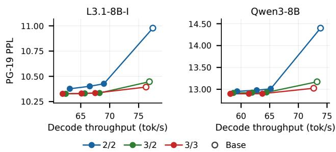  
Figure A4. KV fetch-fraction sweep: PG-19 PPL versus RTX 5090 throughput at 128K. Curves identify resident K/V bitwidths; fractions 1/256, 1/128, and 1/64 run from highest to lowest throughput. StrataFlux-KV uses two-token groups and +4/+4 bits. Open markers show the matching bases without refinement.

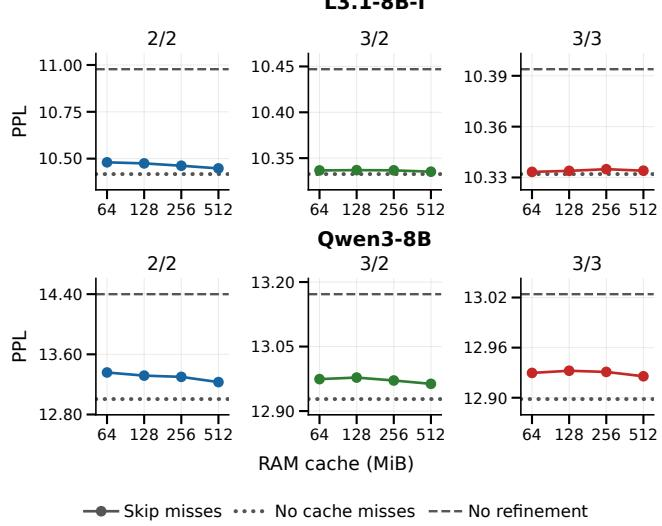  
Figure A5. KV RAM-cache capacity by resident bitwidth on DGX Spark: PG-19 PPL at 128K with four-token groups, +4/+4 bits, 1/128 selection, and skipped misses. Dotted lines assume no cache misses; dashed lines show the matching no-refinement bases.

Figure A4 varies the host-RAM fetch fraction on RTX 5090; Figure A5 varies RAM-cache capacity on DGX Spark. Table A31 reports throughput when waiting on cache misses. Table A26 compares SSD-backed configurations; Tables A27–A30 report cache-capacity and no-cache-miss comparisons.

Table A26. KV-only refinement: PG-19 PPL/KL and DGX Spark throughput at 128K. StrataFlux-KV uses +4/+4 bits, 1/128 selection, four-token groups, and an SSD backing tier with a 128 MiB RAM cache and skipped misses.
<table><tr><td></td><td colspan="3">L3.1-8B-I</td><td colspan="3">Qwen3-8B</td></tr><tr><td>Configuration</td><td>PPL</td><td>KL</td><td>tok/s</td><td>PPL</td><td>KL</td><td>tok/s</td></tr><tr><td>BF16 KV</td><td>10.32</td><td>0.000</td><td>7.3</td><td>12.89</td><td>0.000</td><td>6.7</td></tr><tr><td>KVarN 2/2</td><td>10.98</td><td>0.067</td><td>11.3</td><td>14.40</td><td>0.130</td><td>10.7</td></tr><tr><td>KIVI-2</td><td>10.90</td><td>0.059</td><td>8.8</td><td>13.85</td><td>0.106</td><td>8.3</td></tr><tr><td>KVQuant 2-bit</td><td>11.71</td><td>0.125</td><td>3.9</td><td>14.40</td><td>0.167</td><td>4.1</td></tr><tr><td>TurboQuant 2.5-bit</td><td>10.98</td><td>0.055</td><td>10.2</td><td>36.02</td><td>1.115</td><td>9.6</td></tr><tr><td>AQUA-KV 2-bit</td><td>10.66</td><td>0.030</td><td>1.5</td><td>13.14</td><td>0.029</td><td>1.4</td></tr><tr><td>KVQuant 3-bit</td><td>10.56</td><td>0.024</td><td>3.9</td><td>13.21</td><td>0.041</td><td>3.9</td></tr><tr><td>TurboQuant 3.5-bit</td><td>10.43</td><td>0.010</td><td>10.4</td><td>13.99</td><td>0.102</td><td>9.9</td></tr><tr><td>AQUA-KV 3-bit</td><td>10.39</td><td>0.006</td><td>1.5</td><td>12.98</td><td>0.017</td><td>1.4</td></tr><tr><td>KVarN 4/2</td><td>10.38</td><td>0.008</td><td>10.4</td><td>13.04</td><td>0.014</td><td>9.8</td></tr><tr><td>KIVI-4</td><td>10.33</td><td>0.002</td><td>8.6</td><td>12.90</td><td>0.004</td><td>8.0</td></tr><tr><td>KVQuant 4-bit</td><td>10.38</td><td>0.007</td><td>3.3</td><td>12.96</td><td>0.011</td><td>3.4</td></tr><tr><td>AQUA-KV 4-bit</td><td>10.32</td><td>0.002</td><td>1.5</td><td>12.95</td><td>0.016</td><td>1.3</td></tr><tr><td>StrataFlux-KV 2/2</td><td>10.47</td><td>0.011</td><td>11.4</td><td>13.32</td><td>0.030</td><td>10.9</td></tr><tr><td>StrataFlux-KV 3/2</td><td>10.34</td><td>0.002</td><td>11.0</td><td>12.98</td><td>0.005</td><td>10.5</td></tr><tr><td>StrataFlux-KV 3/3</td><td>10.33</td><td>0.001</td><td>10.7</td><td>12.93</td><td>0.004</td><td>10.2</td></tr></table>

Table A27. SSD-backed KV refinement on DGX Spark: Llama-3.1-8B-Instruct, PG-19 at 128K. PPL, KL, and decode tok/s by resident bits, fetched group fraction, and RAM-cache capacity. The 1/128, 128 MiB configuration repeats Table A26.
<table><tr><td rowspan="2">GPU resident KV</td><td rowspan="2">Fetch fraction</td><td colspan="3">64MiB</td><td colspan="3">128 MiB</td></tr><tr><td>PPL</td><td>KL</td><td>tok/s</td><td>PPL</td><td>KL</td><td>tok/s</td></tr><tr><td rowspan="3">2/2</td><td>1/256</td><td>10.50</td><td>0.014</td><td>11.5</td><td>10.50</td><td>0.013</td><td>11.5</td></tr><tr><td>1/128</td><td>10.48</td><td>0.013</td><td>11.2</td><td>10.47</td><td>0.011</td><td>11.4</td></tr><tr><td>1/64</td><td>10.47</td><td>0.013</td><td>10.6</td><td>10.46</td><td>0.010</td><td>10.8</td></tr><tr><td rowspan="3">3/2</td><td>1/256</td><td>10.34</td><td>0.003</td><td>11.1</td><td>10.34</td><td>0.002</td><td>11.1</td></tr><tr><td>1/128</td><td>10.34</td><td>0.002</td><td>10.7</td><td>10.34</td><td>0.002</td><td>11.0</td></tr><tr><td>1/64</td><td>10.34</td><td>0.002</td><td>10.3</td><td>10.34</td><td>0.002</td><td>10.4</td></tr><tr><td rowspan="3">3/3</td><td>1/256</td><td>10.33</td><td>0.002</td><td>10.8</td><td>10.34</td><td>0.001</td><td>10.8</td></tr><tr><td>1/128</td><td>10.33</td><td>0.001</td><td>10.5</td><td>10.33</td><td>0.001</td><td>10.7</td></tr><tr><td>1/64</td><td>10.33</td><td>0.002</td><td>10.0</td><td>10.33</td><td>0.001</td><td>10.2</td></tr></table>

<table><tr><td rowspan="2">GPU resident KV</td><td rowspan="2">Fetch fraction</td><td colspan="3">256 MiB</td><td colspan="3">512 MiB</td></tr><tr><td>PPL</td><td>KL</td><td>tok/s</td><td>PPL</td><td>KL</td><td>tok/s</td></tr><tr><td rowspan="3">2/2</td><td>1/256</td><td>10.49</td><td>0.011</td><td>11.5</td><td>10.49</td><td>0.010</td><td>11.5</td></tr><tr><td>1/128</td><td>10.46</td><td>0.009</td><td>11.4</td><td>10.45</td><td>0.007</td><td>11.3</td></tr><tr><td>1/64</td><td>10.44</td><td>0.008</td><td>11.1</td><td>10.43</td><td>0.006</td><td>11.0</td></tr><tr><td rowspan="3">3/2</td><td>1/256</td><td>10.34</td><td>0.002</td><td>11.1</td><td>10.34</td><td>0.002</td><td>11.1</td></tr><tr><td>1/128</td><td>10.34</td><td>0.002</td><td>10.9</td><td>10.34</td><td>0.002</td><td>10.9</td></tr><tr><td>1/64</td><td>10.33</td><td>0.002</td><td>10.6</td><td>10.33</td><td>0.001</td><td>10.6</td></tr><tr><td rowspan="3">3/3</td><td>1/256</td><td>10.34</td><td>0.001</td><td>10.8</td><td>10.34</td><td>0.001</td><td>10.7</td></tr><tr><td>1/128</td><td>10.33</td><td>0.001</td><td>10.6</td><td>10.33</td><td>0.001</td><td>10.6</td></tr><tr><td>1/64</td><td>10.33</td><td>0.001</td><td>10.3</td><td>10.33</td><td>0.001</td><td>10.3</td></tr></table>

Table A28. KV refinement with no cache misses: Llama-3.1-8B-Instruct, PG-19 at 128K. PPL/KL by fetched group fraction, using four-token groups.
<table><tr><td></td><td colspan="6">GPU resident KV</td></tr><tr><td></td><td colspan="2">2/2</td><td colspan="2">3/2</td><td colspan="2">3/3</td></tr><tr><td>Fetch fraction</td><td>PPL</td><td>KL</td><td>PPL</td><td>KL</td><td>PPL</td><td>KL</td></tr><tr><td>1/256</td><td>10.44</td><td>0.005</td><td>10.34</td><td>0.001</td><td>10.34</td><td>0.001</td></tr><tr><td>1/128</td><td>10.42</td><td>0.003</td><td>10.33</td><td>0.001</td><td>10.33</td><td>0.001</td></tr><tr><td>1/64</td><td>10.39</td><td>0.003</td><td>10.33</td><td>0.001</td><td>10.33</td><td>0.001</td></tr></table>

Table A29. SSD-backed KV refinement on DGX Spark: Qwen3- 8B, PG-19 at 128K. PPL, KL, and decode tok/s by resident bits, fetched group fraction, and RAM-cache capacity. The 1/128, 128 MiB configuration repeats Table A26.
<table><tr><td rowspan="2">GPU resident KV</td><td rowspan="2">Fetch fraction</td><td colspan="3">64MiB</td><td colspan="3">128 MiB</td></tr><tr><td>PPL</td><td>KL</td><td>tok/s</td><td>PPL</td><td>KL</td><td>tok/s</td></tr><tr><td rowspan="3">2/2</td><td>1/256</td><td>13.41</td><td>0.038</td><td>11.1</td><td>13.37</td><td>0.033</td><td>11.1</td></tr><tr><td>1/128</td><td>13.36</td><td>0.036</td><td>10.6</td><td>13.32</td><td>0.030</td><td>10.9</td></tr><tr><td>1/64</td><td>14.28</td><td>0.119</td><td>10.0</td><td>13.28</td><td>0.028</td><td>10.3</td></tr><tr><td rowspan="3">3/2</td><td>1/256</td><td>12.99</td><td>0.007</td><td>10.6</td><td>12.99</td><td>0.006</td><td>10.7</td></tr><tr><td>1/128</td><td>12.97</td><td>0.006</td><td>10.1</td><td>12.98</td><td>0.005</td><td>10.5</td></tr><tr><td>1/64</td><td>13.14</td><td>0.022</td><td>9.7</td><td>12.97</td><td>0.005</td><td>9.9</td></tr><tr><td rowspan="3">3/3</td><td>1/256</td><td>12.94</td><td>0.005</td><td>10.3</td><td>12.94</td><td>0.004</td><td>10.3</td></tr><tr><td>1/128</td><td>12.93</td><td>0.004</td><td>9.8</td><td>12.93</td><td>0.004</td><td>10.2</td></tr><tr><td>1/64</td><td>13.00</td><td>0.013</td><td>9.4</td><td>12.93</td><td>0.004</td><td>9.6</td></tr></table>

<table><tr><td rowspan="2">GPU resident KV</td><td rowspan="2">Fetch fraction</td><td colspan="3">256 MiB</td><td colspan="3">512 MiB</td></tr><tr><td>PPL</td><td>KL</td><td>tok/s</td><td>PPL</td><td>KL</td><td>tok/s</td></tr><tr><td rowspan="3">2/2</td><td>1/256</td><td>13.34</td><td>0.030</td><td>11.0</td><td>13.28</td><td>0.026</td><td>11.0</td></tr><tr><td>1/128</td><td>13.30</td><td>0.026</td><td>10.9</td><td>13.23</td><td>0.021</td><td>10.9</td></tr><tr><td>1/64</td><td>13.25</td><td>0.023</td><td>10.5</td><td>13.20</td><td>0.018</td><td>10.4</td></tr><tr><td rowspan="3">3/2</td><td>1/256</td><td>12.98</td><td>0.005</td><td>10.6</td><td>12.97</td><td>0.004</td><td>10.6</td></tr><tr><td>1/128</td><td>12.97</td><td>0.005</td><td>10.4</td><td>12.96</td><td>0.004</td><td>10.4</td></tr><tr><td>1/64</td><td>12.96</td><td>0.004</td><td>10.1</td><td>12.96</td><td>0.003</td><td>10.0</td></tr><tr><td rowspan="3">3/3</td><td>1/256</td><td>12.94</td><td>0.004</td><td>10.3</td><td>12.93</td><td>0.003</td><td>10.2</td></tr><tr><td>1/128</td><td>12.93</td><td>0.003</td><td>10.1</td><td>12.93</td><td>0.003</td><td>10.0</td></tr><tr><td>1/64</td><td>12.93</td><td>0.003</td><td>9.8</td><td>12.93</td><td>0.003</td><td>9.7</td></tr></table>

Table A30. KV refinement with no cache misses: Qwen3-8B, PG-19 at 128K. PPL/KL by fetched group fraction, using four-token groups.
<table><tr><td></td><td colspan="6">GPU resident KV</td></tr><tr><td></td><td colspan="2">2/2</td><td colspan="2">3/2</td><td colspan="2">3/3</td></tr><tr><td>Fetch fraction</td><td>PPL</td><td>KL</td><td>PPL</td><td>KL</td><td>PPL</td><td>KL</td></tr><tr><td>1/256</td><td>13.05</td><td>0.013</td><td>12.93</td><td>0.002</td><td>12.90</td><td>0.002</td></tr><tr><td>1/128</td><td>13.01</td><td>0.009</td><td>12.93</td><td>0.002</td><td>12.90</td><td>0.002</td></tr><tr><td>1/64</td><td>12.97</td><td>0.006</td><td>12.92</td><td>0.002</td><td>12.90</td><td>0.001</td></tr></table>

Table A31. KV-only refinement: DGX Spark throughput (tok/s) when waiting on cache misses at 128K, with four-token groups. Columns give RAM-cache capacities (MiB). Matching PPL/KL appears in Tables A28 and A30.
<table><tr><td rowspan="2">GPU resident KV</td><td rowspan="2">Fetch fraction</td><td colspan="4">L3.1-8B-I</td><td colspan="4">Qwen3-8B</td></tr><tr><td>64</td><td>128</td><td>256</td><td>512</td><td>64</td><td>128</td><td>256</td><td>512</td></tr><tr><td rowspan="3">2/2</td><td>1/256</td><td>8.6</td><td>8.8</td><td>9.1</td><td>9.2</td><td>7.8</td><td>8.5</td><td>9.3</td><td>8.5</td></tr><tr><td>1/128</td><td>6.8</td><td>8.1</td><td>8.7</td><td>9.2</td><td>6.5</td><td>7.7</td><td>8.6</td><td>8.4</td></tr><tr><td>1/64</td><td>4.0</td><td>5.8</td><td>7.5</td><td>8.3</td><td>2.9</td><td>5.5</td><td>7.1</td><td>8.1</td></tr><tr><td rowspan="3">3/2</td><td>1/256</td><td>8.2</td><td>8.6</td><td>9.0</td><td>9.0</td><td>7.8</td><td>8.4</td><td>8.9</td><td>8.3</td></tr><tr><td>1/128</td><td>7.0</td><td>7.9</td><td>8.4</td><td>8.8</td><td>6.5</td><td>7.3</td><td>8.0</td><td>8.2</td></tr><tr><td>1/64</td><td>3.9</td><td>6.0</td><td>7.5</td><td>8.0</td><td>3.1</td><td>5.5</td><td>6.9</td><td>8.2</td></tr><tr><td rowspan="3">3/3</td><td>1/256</td><td>8.2</td><td>8.6</td><td>8.9</td><td>8.9</td><td>7.8</td><td>8.2</td><td>8.4</td><td>8.6</td></tr><tr><td>1/128</td><td>6.9</td><td>7.8</td><td>8.2</td><td>8.6</td><td>6.2</td><td>7.1</td><td>7.9</td><td>8.5</td></tr><tr><td>1/64</td><td>4.0</td><td>5.8</td><td>7.2</td><td>7.9</td><td>3.0</td><td>5.4</td><td>7.0</td><td>7.4</td></tr></table>

## C.5 Refinement with 2-bit Keys and 1-bit Values

Table A32 compares Base and StrataFlux-KV with 2-bit keys and 1-bit values.

Table A32. KV refinement with resident 2/1 bits at 128K: PG-19 PPL/KL, RULER accuracy, Qwen3-8B MATH500 accuracy, RTX 5090 decode tok/s at 128K, and memory. <sup>∗</sup>KV memory only. StrataFlux-KV uses +0/+1 bits, two-token groups, and a 1/16 fetch fraction. In our Llama-3.1-8B-Instruct 32K sweep, +0/+1 yields the lowest PPL/KL among tested fetched-bitwidth pairs at matched payload.

<table><tr><td></td><td colspan="5">L3.1-8B-I</td><td colspan="5">Qwen3-8B</td></tr><tr><td>Method</td><td>PPL</td><td>KL</td><td></td><td>R128 tok/s</td><td>GB*PPL</td><td></td><td>KL</td><td>R128 M500</td><td></td><td>tok/s GB</td></tr><tr><td>BF16</td><td>10.32</td><td>0.000</td><td>77.9</td><td>47.6</td><td>17.2 12.89</td><td>90.000</td><td>74.1</td><td>97.2</td><td>OOM 19.3</td><td></td></tr><tr><td>KVarN 2/1</td><td>31.29</td><td>1.180</td><td>40.7</td><td>77.8</td><td>2.0</td><td>112.6 2.318</td><td>18.0</td><td>28.6</td><td>74.2</td><td>2.3</td></tr><tr><td>StrataFlux-KV 2/1 11.65</td><td></td><td>50.135</td><td>64.1</td><td>63.5</td><td>2.0</td><td>15.16 0.181</td><td>60.4</td><td>93.4</td><td>59.8</td><td>2.3</td></tr></table>

## C.6 KV Refinement Settings Sweep

Figure A6 varies fetched key/value bitwidths and the selected token-group fraction for two- and four-token groups. +4/+4 performs well across evaluated fetch budgets and resident precisions, supporting its use in our main comparisons.

## D JOINT CONFIGURATIONS AND TASK RESULTS

These comparisons include the four configurations evaluated in Section 4.3. Table A35 reports all four weight/KV refinement combinations at each resident format; Figure 12 shows the YAQA 3-bit, 3/3 comparison.

## D.1 Configuration Comparisons

Tables A33, A34, and A35 compare inference-system configurations, static weight/KV pairs, and the four weight/KV refinement combinations.

Table A33. Joint configurations at 128K: PG-19 PPL/KL, GPU memory (GB), and decode tok/s. <sup>∗</sup>DGX Spark; <sup>†</sup>RTX 5090. StrataFlux uses RTX 5090's 5% weight configurations. GB counts stored weights and KV. W/A/KV: weight/activation/cache bits; bpw: bits/weight; FP8: 8-bit floating point.
<table><tr><td rowspan="2">Configuration</td><td colspan="6">L3.1-8B-I</td><td colspan="6">Qwen3-8B</td></tr><tr><td>PPL</td><td>KL</td><td>GB</td><td></td><td>tok/s*tok/s†1</td><td></td><td>PPL</td><td>KL</td><td>GB</td><td></td><td></td><td>tok/s*tok/s†</td></tr><tr><td>BF16</td><td>10.32</td><td>0.000</td><td>33.2</td><td></td><td>7.3</td><td>47.6</td><td>12.89</td><td>0.000</td><td>35.7</td><td></td><td>6.7</td><td>OOM</td></tr><tr><td>vLLM AWQ4 + FP8 KV</td><td>11.03</td><td>0.074</td><td>14.3</td><td></td><td>16.8</td><td>106.8</td><td>13.49</td><td>0.078</td><td>15.8</td><td></td><td>15.3</td><td>96.6</td></tr><tr><td>EXL3 3.0 bpw + 4/4 KV</td><td>11.39</td><td>0.107</td><td>8.9</td><td></td><td>25.6</td><td>99.6</td><td>14.00</td><td>0.125</td><td>9.8</td><td></td><td>23.6</td><td>91.3</td></tr><tr><td>EXL3 4.0 bpw + 4/4 KV</td><td>10.78</td><td>0.051</td><td>9.8</td><td></td><td>23.6</td><td>101.7</td><td>13.73</td><td>0.086</td><td></td><td>10.6</td><td>21.9</td><td>92.9</td></tr><tr><td>EXL3 4.0 bpw + 2/2 KV</td><td>36.26</td><td>1.364</td><td>7.6</td><td></td><td>25.7</td><td>104.7</td><td>46.43</td><td>1.394</td><td>8.2</td><td></td><td>24.0</td><td>95.6</td></tr><tr><td>1lama.cpp Q4_K_M + q8_0 KV</td><td>10.59</td><td>0.027</td><td>14.0</td><td></td><td>12.7</td><td>63.1</td><td>13.17</td><td>0.027</td><td>15.3</td><td></td><td>11.5</td><td>57.2</td></tr><tr><td>1lama.cpp Q4_K_M + q4_0 KV</td><td>10.88</td><td>0.062</td><td>9.8</td><td></td><td>14.4</td><td>64.6</td><td>13.94</td><td>0.110</td><td></td><td>10.5</td><td>13.0</td><td>58.7</td></tr><tr><td>1lama.cpp Q3_K_M + q8_0 KV 11.13 0.073</td><td></td><td></td><td>13.1</td><td>13.0</td><td></td><td>64.2</td><td>13.75</td><td>0.092</td><td></td><td>14.4</td><td>11.9</td><td>58.1</td></tr><tr><td>1lama.cpp Q3_K_M + q4_0 KV 11.46 0.109</td><td></td><td></td><td>8.9</td><td></td><td>15.0</td><td>65.9</td><td></td><td>14.64 0.172</td><td>9.6</td><td></td><td>13.5</td><td>59.6</td></tr><tr><td>QServe W4A8KV4</td><td>11.34 0.105</td><td></td><td>10.3</td><td></td><td>11.2</td><td>42.6</td><td></td><td>14.670.163</td><td></td><td>11.2</td><td>9.9</td><td>37.2</td></tr></table>

<table><tr><td rowspan="2">Configuration</td><td colspan="4">L3.1-8B-I</td><td colspan="4">Qwen3-8B</td></tr><tr><td>PPL</td><td>KL</td><td>GB</td><td>tok/s†</td><td>PPL</td><td>KL</td><td>GB</td><td>tok/s†</td></tr><tr><td>BF16</td><td>10.32</td><td>0.000</td><td>33.2</td><td>47.6</td><td>12.89</td><td>0.000</td><td>35.7</td><td>OOM</td></tr><tr><td>StrataFlux / YAQA 2-bit / 2/2</td><td>13.79</td><td>0.312</td><td>6.4</td><td>106.6</td><td>14.91</td><td>0.165</td><td>7.1</td><td>97.6</td></tr><tr><td>StrataFlux / YAQA 2-bit / 3/2</td><td>13.76</td><td>0.313</td><td>7.0</td><td>104.2</td><td>14.88</td><td>0.162</td><td>7.7</td><td>95.4</td></tr><tr><td>StrataFlux / YAQA 2-bit / 3/3</td><td>13.74</td><td>0.311</td><td>7.5</td><td>102.1</td><td>14.84</td><td>0.161</td><td>8.3</td><td>93.3</td></tr><tr><td>StrataFlux / YAQA 3-bit / 2/2</td><td>10.80</td><td>0.045</td><td>7.3</td><td>102.0</td><td>13.25</td><td>0.038</td><td>8.0</td><td>91.7</td></tr><tr><td>StrataFlux / YAQA 3-bit / 3/2</td><td>10.74</td><td>0.044</td><td>7.8</td><td>100.3</td><td>13.20</td><td>0.034</td><td>8.6</td><td>90.3</td></tr><tr><td>StrataFlux / YAQA 3-bit / 3/3</td><td>10.72</td><td>0.042</td><td>8.4</td><td>98.3</td><td>13.17</td><td>0.034</td><td>9.2</td><td>88.2</td></tr><tr><td>StrataFlux / LNQ+GQ 3-bit / 2/2</td><td>12.98</td><td>0.241</td><td>7.3</td><td>117.9</td><td>17.46</td><td>0.292</td><td>8.0</td><td>105.1</td></tr><tr><td>StrataFlux / LNQ+GQ 3-bit / 3/2</td><td>12.95</td><td>0.242</td><td>7.9</td><td>115.8</td><td>17.29</td><td>0.286</td><td>8.6</td><td>103.3</td></tr><tr><td>StrataFlux / LNQ+GQ 3-bit / 3/3</td><td>12.95</td><td>0.242</td><td>8.4</td><td>113.1</td><td>17.27</td><td>0.285</td><td>9.2</td><td>100.6</td></tr></table>

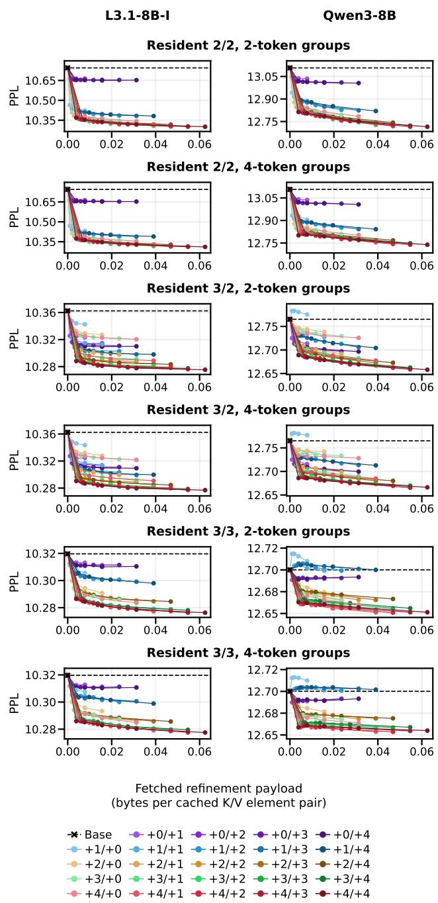

Figure A6. KV refinement payload versus PG-19 PPL at 32K: left, Llama-3.1-8B-Instruct; right, Qwen3-8B. Rows compare resident 2/2, 3/2, and 3/3 with two- and four-token groups. Curves vary fetched key/value bits independently from 0 to 4, excluding 0/0; zero leaves that component unrefined. Color identifies fetched key bits; darker shades indicate more fetched value bits. Each curve shows all registered selected-group fractions from 1/256 to 1/16. Payload bytes per cached K/V element pair equal fetched key plus value bits, multiplied by the selected fraction and divided by eight. Dashed lines mark unrefined bases.

Table A34. Joint refinement: static weight/KV pairs at 128K: PG-19 PPL/KL, GPU memory (GB), and RTX 5090 tokens/s. GB counts stored weights and KV. Neither weight nor KV refinement is enabled.
<table><tr><td></td><td></td><td colspan="3">L3.1-8B-I</td><td colspan="4">Qwen3-8B</td></tr><tr><td>Weight base</td><td>KV configuration</td><td>PPL</td><td>KL GB</td><td>tok/s</td><td>PPL</td><td></td><td>KL GB</td><td>tok/s</td></tr><tr><td>BF16</td><td>16/16</td><td>10.32</td><td>0.000 33.2</td><td>47.6</td><td>12.89</td><td>0.000</td><td>35.7</td><td>OOM</td></tr><tr><td></td><td>KIVI-2</td><td>18.55 0.645</td><td>7.1</td><td>32.9</td><td>18.84</td><td>0.403</td><td>7.9</td><td>29.4</td></tr><tr><td></td><td>KIVI-4</td><td>15.97 0.477</td><td>9.2</td><td>35.2</td><td>16.59</td><td>0.257</td><td>10.3</td><td>31.5</td></tr><tr><td>YAQA w2</td><td>KVQuant 2bit-1%</td><td>19.79 0.708</td><td>6.5</td><td>13.7</td><td>18.92</td><td>0.414</td><td>7.2</td><td>14.2</td></tr><tr><td></td><td>KVQuant 3bit-1%</td><td>16.64 0.521</td><td>7.6</td><td>13.2</td><td>17.09</td><td>0.290</td><td>8.4</td><td>13.5</td></tr><tr><td></td><td>KVQuant 4bit-1%</td><td>16.08 0.486</td><td>8.6</td><td>12.1</td><td>16.63</td><td>0.262</td><td>9.6</td><td>12.2</td></tr><tr><td></td><td>KVarN 2/2</td><td>18.67 0.656</td><td>6.4</td><td>84.7</td><td>19.48</td><td>0.434</td><td>7.1</td><td>76.6</td></tr><tr><td></td><td>KVarN 4/2</td><td>16.18 0.494</td><td>7.5</td><td>74.7</td><td>16.83</td><td>0.271</td><td>8.3</td><td>67.5</td></tr><tr><td></td><td>KIVI-2</td><td>11.62 0.130</td><td>8.0</td><td>32.4</td><td>14.60</td><td>0.155</td><td>8.7</td><td>29.1</td></tr><tr><td></td><td>KIVI-4</td><td>10.90 0.059</td><td>10.1</td><td>34.6</td><td>13.42</td><td>0.049</td><td>11.2</td><td>31.1</td></tr><tr><td>YAQA w3</td><td>KVQuant 2bit-1%</td><td>12.41 0.192</td><td>7.4</td><td>14.2</td><td>14.98</td><td>0.196</td><td>8.1</td><td>14.3</td></tr><tr><td></td><td>KVQuant 3bit-1%</td><td>11.17 0.084</td><td>8.4</td><td>13.6</td><td>13.68</td><td>0.081</td><td>9.3</td><td>13.6</td></tr><tr><td></td><td>KVQuant 4bit-1%</td><td>10.95 0.064</td><td>9.5</td><td>12.5</td><td>13.46</td><td>0.054</td><td>10.5</td><td>12.3</td></tr><tr><td></td><td>KVarN 2/2 KVarN 4/2</td><td>11.75 0.146</td><td>7.3</td><td>81.7</td><td>15.15</td><td>0.185</td><td>8.0</td><td>74.4</td></tr><tr><td></td><td></td><td>10.98 0.068</td><td>8.4</td><td>72.4</td><td>13.59</td><td>0.059</td><td>9.2</td><td>65.7</td></tr><tr><td></td><td>KIVI-2</td><td>11.17 0.079</td><td>8.8</td><td>31.9</td><td>14.01</td><td>0.118</td><td>9.6</td><td>28.6</td></tr><tr><td></td><td>KIVI-4</td><td>10.54 0.018</td><td>11.0</td><td>34.1</td><td>13.04</td><td>0.017</td><td>12.0</td><td>30.6</td></tr><tr><td></td><td>KVQuant 2bit-1%</td><td>11.88 0.140</td><td>8.2</td><td>14.2</td><td>14.51</td><td>0.174</td><td>8.9</td><td>14.2</td></tr><tr><td>YAQA w4</td><td>KVQuant 3bit-1%</td><td>10.77 0.041</td><td>9.3</td><td>13.7</td><td>13.33</td><td>0.051</td><td>10.1</td><td>13.5</td></tr><tr><td></td><td>KVQuant 4bit-1%</td><td>10.58 0.023</td><td>10.4</td><td>12.4</td><td>13.08</td><td>0.023</td><td>11.3</td><td>12.2</td></tr><tr><td>KVarN 4/2</td><td>KVarN 2/2</td><td>11.24 0.090</td><td>8.2</td><td>79.0</td><td>14.58</td><td>0.143</td><td>8.9</td><td>71.8</td></tr><tr><td></td><td>KIVI-2</td><td>10.60 0.025</td><td>9.3</td><td>70.3</td><td>13.18</td><td>0.026</td><td>10.1</td><td>63.7</td></tr><tr><td></td><td>KIVI-4</td><td>15.26 0.427</td><td>8.0</td><td>33.7</td><td>20.27</td><td>0.452</td><td>8.8</td><td>29.9</td></tr><tr><td></td><td>KVQuant 2bit-1%</td><td>13.70 0.306</td><td>10.1</td><td>36.2</td><td>18.20</td><td>0.331</td><td>11.2</td><td>32.3</td></tr><tr><td>LNQ+GQ w3</td><td></td><td>16.52 0.506</td><td>7.4</td><td>14.4</td><td>20.93</td><td>0.491</td><td>8.1</td><td>14.0</td></tr><tr><td></td><td>KVQuant 3bit-1% KVQuant 4bit-1%</td><td>14.18 0.342</td><td>8.5</td><td>13.8</td><td>18.78</td><td>0.366</td><td>9.3</td><td>13.4</td></tr><tr><td>KVarN 2/2</td><td></td><td>13.81 0.315</td><td>9.5</td><td>12.6</td><td>18.34</td><td>0.339</td><td>10.5</td><td>12.2</td></tr><tr><td></td><td>KVarN 4/2</td><td>15.39 0.442 0.317</td><td>7.3</td><td>90.9</td><td>20.76</td><td>0.473</td><td>8.0</td><td>81.6</td></tr><tr><td></td><td>KIVI-2</td><td>13.80</td><td>8.4</td><td>79.9</td><td>18.38</td><td>0.341</td><td>9.2</td><td>71.6</td></tr><tr><td></td><td>KIVI-4</td><td>11.52 0.117 10.79</td><td>8.9</td><td>33.0</td><td>14.40</td><td>0.143</td><td>9.6</td><td>29.5 31.7</td></tr><tr><td></td><td>KVQuant 2bit-1%</td><td>0.046 12.34 0.180</td><td>11.0 8.3</td><td>35.5 14.5</td><td>13.30 14.83</td><td>0.040 0.189</td><td>12.1 9.0</td><td>14.4</td></tr><tr><td>LNQ+GQ w4KVQuant 3bit-1%</td><td></td><td>11.04</td><td></td><td></td><td></td><td></td><td></td><td>13.7</td></tr><tr><td></td><td></td><td>0.068</td><td>9.3</td><td>13.9</td><td>13.60</td><td>0.073</td><td>10.2</td><td></td></tr><tr><td></td><td>KVQuant 4bit-1%</td><td>10.84 0.050</td><td>10.4</td><td>12.6</td><td>13.35</td><td>0.046</td><td>11.4</td><td>12.4</td></tr><tr><td></td><td>KVarN 2/2</td><td>11.62 0.129</td><td>8.2</td><td>86.1</td><td>14.91</td><td>0.167</td><td>8.9 10.1</td><td>77.8</td></tr><tr><td></td><td>KVarN 4/2</td><td>10.840.053</td><td>9.3</td><td></td><td>76.1</td><td>13.46</td><td>0.050</td><td>68.7</td></tr></table>

Table A35. Weight/KV component combinations at 128K: PG-19 PPL/KL, GPU memory (GB), and RTX 5090 tok/s. Each four-row group fixes resident formats and uses the 5% weight configuration. All groups use the same CUDA attention implementation. GB counts weights and KV.
<table><tr><td rowspan="2">Weights</td><td rowspan="2">K/V</td><td colspan="2">StrataFlux</td><td colspan="4">L3.1-8B-I</td><td colspan="4">Qwen3-8B</td></tr><tr><td>Weight KV</td><td></td><td>PPL</td><td>KL</td><td>GB</td><td>tok/s</td><td>PPL</td><td>KL</td><td>GB</td><td>tok/s</td></tr><tr><td rowspan="4">YAQA 2-bit 2/2</td><td rowspan="4"></td><td>一</td><td></td><td>18.67</td><td>0.656</td><td rowspan="4">6.4</td><td>137.5</td><td>19.48</td><td>0.434</td><td rowspan="4">7.1</td><td>125.7</td></tr><tr><td>√</td><td>一</td><td>15.57</td><td>0.458</td><td>133.5</td><td>17.02</td><td>0.311</td><td>123.3</td></tr><tr><td>一</td><td>√</td><td>15.95</td><td>0.472</td><td>109.2</td><td>16.66</td><td>0.255</td><td>99.2</td></tr><tr><td>√</td><td>√</td><td>13.79</td><td>0.312</td><td>106.6</td><td>14.91</td><td>0.165</td><td>97.6</td></tr><tr><td rowspan="4">YAQA 2-bit 3/2</td><td rowspan="4"></td><td>一</td><td>一</td><td>16.42</td><td>0.511</td><td rowspan="4">7.0</td><td>134.6</td><td>17.06</td><td>0.287</td><td rowspan="4">7.7</td><td>123.0</td></tr><tr><td>√</td><td>一</td><td>14.15</td><td>0.348</td><td>130.0</td><td>15.23</td><td>0.189</td><td>120.0</td></tr><tr><td>一</td><td>√</td><td>15.91</td><td>0.473</td><td>107.2</td><td>16.62</td><td>0.255</td><td>97.4</td></tr><tr><td>√</td><td>√</td><td>13.76</td><td>0.313</td><td>104.2</td><td>14.88</td><td>0.162</td><td>95.4</td></tr><tr><td rowspan="4">YAQA 2-bit 3/3</td><td rowspan="4"></td><td>一</td><td>一</td><td>16.21</td><td>0.496</td><td rowspan="4">7.5</td><td>132.5</td><td>16.85</td><td>0.274</td><td rowspan="4">8.3</td><td>120.8</td></tr><tr><td>√</td><td>一</td><td>13.94</td><td>0.329</td><td>128.1</td><td>15.05</td><td>0.179</td><td>118.3</td></tr><tr><td>一</td><td>√</td><td>15.91</td><td>0.472</td><td>105.2</td><td>16.56</td><td>0.253</td><td>95.4</td></tr><tr><td>√</td><td>√</td><td>13.74</td><td>0.311</td><td>102.1</td><td>14.84</td><td>0.161</td><td>93.3</td></tr><tr><td rowspan="4">YAQA 3-bit 2/2</td><td rowspan="4"></td><td>一</td><td>1</td><td>11.75</td><td>0.146</td><td rowspan="4">7.3</td><td>130.7</td><td>15.15</td><td>0.185</td><td rowspan="4">8.0</td><td>120.2</td></tr><tr><td>√</td><td>一</td><td>11.52</td><td>0.124</td><td>126.6</td><td>14.83</td><td>0.167</td><td>114.6</td></tr><tr><td>一</td><td>√</td><td>10.96</td><td>0.058</td><td>105.2</td><td>13.48</td><td>0.048</td><td>95.8</td></tr><tr><td>√</td><td>√</td><td>10.800.045</td><td></td><td>102.0</td><td>13.25</td><td>0.038</td><td>91.7</td></tr></table>

<table><tr><td></td><td></td><td colspan="2">StrataFlux</td><td colspan="3">L3.1-8B-I</td><td colspan="4">Qwen3-8B</td></tr><tr><td>Weights</td><td>K/V</td><td>Weight KV</td><td></td><td>PPL</td><td>KL GB</td><td>tok/s</td><td>PPL</td><td>KL</td><td>GB</td><td>tok/s</td></tr><tr><td rowspan="4">YAQA 3-bit</td><td rowspan="4">3/2</td><td></td><td></td><td>11.06 0.076</td><td></td><td>128.1</td><td>13.71</td><td>0.071</td><td>117.8</td><td></td></tr><tr><td>√</td><td></td><td></td><td>10.890.060</td><td></td><td>123.5</td><td>13.460.058</td><td>8.6</td><td>112.2</td><td></td></tr><tr><td></td><td>V</td><td></td><td>10.900.058</td><td>7.8</td><td>103.0</td><td>13.43</td><td>0.046</td><td></td><td>93.6</td></tr><tr><td></td><td>√</td><td></td><td>10.740.044</td><td></td><td>100.3</td><td>13.20</td><td>0.034</td><td></td><td>90.3</td></tr><tr><td rowspan="4">YAQA 3-bit</td><td rowspan="4"></td><td></td><td></td><td>10.98 0.067</td><td></td><td>125.8</td><td>13.56</td><td>0.061</td><td></td><td></td></tr><tr><td>一</td><td></td><td></td><td></td><td></td><td></td><td></td><td></td><td>115.9 110.7</td></tr><tr><td>√</td><td></td><td></td><td>10.81 0.051</td><td>8.4</td><td>122.0</td><td>13.32</td><td>0.049 9.2</td><td></td></tr><tr><td>1 √</td><td>√ √</td><td>10.89 10.72</td><td>0.057 0.042</td><td></td><td>100.8 98.3</td><td>13.39 0.045 13.17</td><td></td><td>92.0 88.2</td></tr><tr><td rowspan="4">YAQA 4-bit</td><td rowspan="4"></td><td></td><td></td><td></td><td></td><td></td><td></td><td>0.034</td><td></td><td></td></tr><tr><td>一</td><td></td><td></td><td>11.24 0.090</td><td>123.9</td><td></td><td>14.58 0.143</td><td></td><td>113.8</td></tr><tr><td>√</td><td></td><td></td><td>11.17 0.085</td><td>8.2</td><td>119.8</td><td>14.47 0.137</td><td>8.9</td><td>111.1</td></tr><tr><td>√</td><td>√</td><td></td><td>10.600.018 10.550.015</td><td></td><td>100.3</td><td>13.10 0.018</td><td></td><td>91.2 90.1</td></tr><tr><td rowspan="4">YAQA 4-bit</td><td></td><td></td><td>√</td><td></td><td></td><td>97.5</td><td>13.04</td><td>0.015</td><td></td><td></td></tr><tr><td></td><td>√</td><td></td><td>10.660.031</td><td></td><td>121.6</td><td>13.31</td><td>0.038</td><td></td><td>111.4</td></tr><tr><td>3/2</td><td></td><td></td><td>10.610.027</td><td>8.7</td><td>117.1</td><td>13.23</td><td>0.034</td><td>9.5</td><td>108.3</td></tr><tr><td></td><td></td><td>V</td><td>10.530.017</td><td></td><td>98.3</td><td>13.05 12.98</td><td>0.014</td><td></td><td>89.6</td></tr><tr><td rowspan="4">YAQA 4-bit</td><td></td><td></td><td>了</td><td>10.49</td><td>0.014</td><td>95.9</td><td></td><td>0.011</td><td></td><td>87.5</td></tr><tr><td></td><td>√</td><td></td><td>10.59 0.025</td><td></td><td>119.7</td><td></td><td>13.16 0.028</td><td></td><td>110.0</td></tr><tr><td></td><td></td><td></td><td>10.55 0.021</td><td>9.3</td><td>115.7</td><td>13.09</td><td>0.025</td><td>10.1</td><td>107.0</td></tr><tr><td></td><td></td><td>V</td><td>10.53 0.017</td><td></td><td>96.6</td><td>13.03</td><td>0.014</td><td></td><td>87.9</td></tr><tr><td rowspan="4">LNQ+GQ 3-bit 2/2</td><td></td><td></td><td>√</td><td>10.48</td><td>0.013</td><td>94.6</td><td>12.96</td><td>0.011</td><td></td><td>85.8</td></tr><tr><td></td><td>√</td><td></td><td>15.390.442</td><td></td><td>152.2</td><td>20.76</td><td>0.473</td><td></td><td>137.6</td></tr><tr><td></td><td></td><td></td><td>14.480.372</td><td>7.3</td><td>149.4</td><td>19.61</td><td>0.423</td><td>8.0</td><td>134.6</td></tr><tr><td></td><td></td><td>V</td><td>13.680.301</td><td></td><td>119.2</td><td>18.42</td><td>0.336</td><td></td><td>107.0</td></tr><tr><td rowspan="8">LNQ+GQ 3-bit 3/2</td><td></td><td>√</td><td>√</td><td>12.980.241</td><td></td><td>117.9</td><td>17.46</td><td>0.292</td><td></td><td>105.1</td></tr><tr><td></td><td></td><td></td><td></td><td></td><td></td><td>18.61</td><td></td><td></td><td>135.6</td></tr><tr><td></td><td></td><td></td><td></td><td>13.960.330</td><td>150.0 147.2</td><td>17.63</td><td>0.354 0.308</td><td></td><td>132.1</td></tr><tr><td></td><td>√</td><td>V</td><td></td><td>13.23 0.269 13.640.302</td><td>7.9 117.0</td><td>18.23</td><td>0.330</td><td>8.6</td><td>104.8</td></tr><tr><td></td><td>一 √</td><td>√</td><td></td><td>12.950.242</td><td>115.8</td><td>17.29</td><td>0.286</td><td></td><td>103.3</td></tr><tr><td></td><td></td><td></td><td></td><td></td><td></td><td>18.41</td><td></td><td></td><td></td></tr><tr><td></td><td>1</td><td></td><td></td><td>13.83 0.318 13.11 0.258</td><td>147.1 144.4</td><td>17.46</td><td>0.343</td><td></td><td>133.1</td></tr><tr><td>LNQ+GQ 3-bit 3/3</td><td>√ 1</td><td>√</td><td></td><td>13.640.301</td><td>8.4 114.1</td><td>18.20</td><td>0.298 0.329</td><td>9.2</td><td>130.1 102.6</td></tr><tr><td rowspan="4">LNQ+GQ 4-bit 2/2</td><td></td><td></td><td></td><td>12.95</td><td></td><td>113.1</td><td>17.27</td><td>0.285</td><td></td><td>100.6</td></tr><tr><td></td><td>√ 1</td><td>√</td><td></td><td>0.242</td><td></td><td>14.91</td><td></td><td></td><td>127.6</td></tr><tr><td></td><td></td><td></td><td>11.62 0.129 11.52 0.120</td><td></td><td>140.2 137.7</td><td>14.83</td><td>0.167 0.161</td><td></td><td></td></tr><tr><td></td><td></td><td></td><td>10.840.044</td><td>8.2</td><td>111.7</td><td></td><td>13.360.040</td><td>8.9 99.5</td><td>124.6 101.2</td></tr><tr><td</table>

## D.2 Full Task Results

Tables A36, A37, and A38 report RULER, LongBench, MATH500, and AIME results for the evaluated full-system configurations.

Table A36. Joint refinement at 128K on Llama-3.1-8B-Instruct and Qwen3-8B: RULER/MATH500/AIME accuracy, throughput, and GPU memory. GB includes weights, KV, and DGX Spark's RAM caches. StrataFlux combines the 5% weight configuration with 2/2 KV.
<table><tr><td colspan="10">DGX Spark</td></tr><tr><td></td><td colspan="3">L3.1-8B-I</td><td colspan="5">Qwen3-8B</td></tr><tr><td>Configuration</td><td>R128</td><td>tok/s</td><td>GB</td><td>R128</td><td>M500</td><td>AIME</td><td>tok/s</td><td>GB</td></tr><tr><td>BF16</td><td>77.9</td><td>7.3</td><td>33.2</td><td>74.1</td><td>97.2</td><td>71.0</td><td>6.7</td><td>35.7</td></tr><tr><td>StrataFlux (LNQ+GQ 4-bit)</td><td>71.1</td><td>22.1</td><td>8.5</td><td>70.6</td><td>96.0</td><td>65.6</td><td>20.8</td><td>9.2</td></tr><tr><td>StrataFlux (YAQA 4-bit)</td><td>73.5</td><td>21.4</td><td>8.4</td><td>70.3</td><td>96.2</td><td>69.0</td><td>20.3</td><td>9.1</td></tr><tr><td>StrataFlux (YAQA 3-bit)</td><td>73.2</td><td>23.3</td><td>7.6</td><td>68.4</td><td>95.2</td><td>68.8</td><td>21.9</td><td>8.3</td></tr><tr><td>StrataFlux (YAQA 2-bit)</td><td>60.5</td><td>25.6</td><td>6.7</td><td>65.2</td><td>89.6</td><td>40.6</td><td>23.9</td><td>7.4</td></tr><tr><td></td><td colspan="3">L3.1-8B-I</td><td colspan="6">Qwen3-8B</td></tr><tr><td>Configuration</td><td>R128</td><td>tok/s</td><td>GB</td><td>R128</td><td>M500</td><td>AIME</td><td>tok/s</td><td colspan="2">GB</td></tr><tr><td>BF16</td><td>77.9</td><td>47.6</td><td>33.2</td><td>74.1</td><td>97.2</td><td>71.0</td><td>00M 35.7</td><td colspan="2"></td></tr><tr><td>LNQ+GQ 4-bit / 2/2</td><td>64.3</td><td>86.1</td><td>8.2</td><td>64.0</td><td>95.2</td><td>58.3</td><td>77.8</td><td colspan="2">8.9</td></tr><tr><td>StrataFlux (LNQ+GQ 4-bit)</td><td>75.2</td><td>110.4</td><td>8.2</td><td>73.8</td><td>94.4</td><td>61.5</td><td>99.5</td><td colspan="2">8.9</td></tr><tr><td>YAQA 4-bit / 2/2</td><td>67.5</td><td>79.0</td><td>8.2</td><td>65.4</td><td>95.0</td><td>62.5</td><td>71.8</td><td colspan="2">8.9</td></tr><tr><td>StrataFlux (YAQA 4-bit)</td><td>77.2</td><td>97.5</td><td>8.2</td><td>73.5</td><td>96.4</td><td>69.2</td><td>90.1</td><td colspan="2">8.9</td></tr><tr><td>YAQA 3-bit / 2/2</td><td>67.2</td><td>81.7</td><td>7.3</td><td>63.8</td><td>94.6</td><td>59.6</td><td>74.4</td><td colspan="2">8.0</td></tr><tr><td>StrataFlux (YAQA 3-bit)</td><td>77.1</td><td>102.0</td><td>7.3</td><td>71.2</td><td>95.4</td><td>65.6</td><td>91.7</td><td colspan="2">8.0</td></tr><tr><td>YAQA 2-bit / 2/2</td><td>50.4</td><td>84.7</td><td>6.4</td><td>58.8</td><td>68.0</td><td>11.0</td><td>76.6</td><td colspan="2">7.1</td></tr><tr><td>StrataFlux (YAQA 2-bit)</td><td>63.8</td><td>106.6</td><td>6.4</td><td>68.3</td><td>91.2</td><td>47.1</td><td>97.6</td><td colspan="2">7.1</td></tr><tr><td>llama.cpp Q4_K_M + q8_0</td><td>75.3</td><td>63.1</td><td>14.0</td><td>72.0</td><td>95.6</td><td>71.9</td><td>57.2</td><td colspan="2">15.3</td></tr><tr><td>EXL34 bpw + 4/4</td><td>75.5</td><td>101.7</td><td>9.8</td><td>71.6</td><td>94.4</td><td>66.9</td><td>92.9</td><td colspan="2">10.6</td></tr><tr><td>vLLM AWQ4 + FP8 KV</td><td>74.7</td><td>106.814.3</td><td></td><td>70.0</td><td>95.4</td><td>68.3</td><td>96.6</td><td colspan="2">15.8</td></tr></table>

Table A37. Joint refinement: DGX Spark task grid. R4–R128 give RULER accuracy at 4K–128K; LB/M500 report LongBench/- MATH500 accuracy. LongBench prompts are truncated to 130,432 tokens here, versus 32,128 in the KV-only comparisons. Throughput uses 128K context. Each pair uses the same weight base and resident 2/2 KV; Base disables both refinements. Configurations match the main full-system table.
<table><tr><td>Weights</td><td>Method</td><td>R4</td><td>R8</td><td>R16</td><td>R32</td><td>R64</td><td>R128</td><td>LB</td><td>tok/s</td></tr><tr><td>BF16</td><td></td><td>95.7</td><td>95.1</td><td>92.9</td><td>87.1</td><td>85.8</td><td>77.9</td><td>49.6</td><td>7.3</td></tr><tr><td colspan="2">llama.cpp Q4_K_M + q8_0</td><td>95.5</td><td>95.0</td><td>93.2</td><td>87.8</td><td>85.3</td><td>75.3</td><td>49.1</td><td>12.7</td></tr><tr><td colspan="2">EXL34 bpw + 4/4 vLLM AWQ4 + FP8 KV</td><td>95.3</td><td>94.7</td><td>92.6</td><td>88.7</td><td>84.9</td><td>75.5</td><td>48.1</td><td>23.6</td></tr><tr><td colspan="2"></td><td>95.1</td><td>94.1</td><td>92.1</td><td>87.6</td><td>83.2</td><td>74.7</td><td>48.4</td><td>16.8</td></tr><tr><td rowspan="3">LNQ+GQ 4-bit</td><td>Base</td><td>93.7</td><td>92.2</td><td>89.9</td><td>84.0</td><td>79.8</td><td>64.3</td><td>47.9</td><td>21.3</td></tr><tr><td>StrataFlux</td><td>95.4</td><td>94.2</td><td>92.2</td><td>86.1</td><td>84.0</td><td>71.1</td><td>48.3</td><td>22.1</td></tr><tr><td>Base</td><td>94.2</td><td>93.6</td><td>91.2</td><td>86.0</td><td>80.3</td><td>67.5</td><td>48.7</td><td>21.2</td></tr><tr><td rowspan="2">YAQA 3-bit</td><td>StrataFlux</td><td>95.9</td><td>94.9</td><td>93.1</td><td>87.3</td><td>84.5</td><td>73.5</td><td>49.0</td><td>21.4</td></tr><tr><td>Base</td><td>93.8</td><td>92.8</td><td>90.4</td><td>85.7</td><td>80.6</td><td>67.2</td><td>46.8</td><td>23.0</td></tr><tr><td rowspan="2">YAQA 2-bit</td><td>StrataFlux</td><td>95.0</td><td>94.7</td><td>92.6</td><td>86.9</td><td>84.0</td><td>73.2</td><td>47.0</td><td>23.3</td></tr><tr><td>Base</td><td>91.6</td><td>90.5</td><td>87.1</td><td>80.4</td><td>73.0</td><td>50.4</td><td>46.2</td><td>24.8</td></tr><tr><td rowspan="2"></td><td>StrataFlux</td><td>93.9</td><td>93.2</td><td>90.9</td><td>85.5</td><td>80.0</td><td>60.5</td><td>46.5</td><td>25.6</td></tr><tr><td></td><td></td><td></td><td></td><td></td><td></td><td></td><td></td><td></td></tr></table>

<table><tr><td colspan="14">DGX SparK7 Q</td></tr><tr><td>Weights</td><td>Method</td><td>R4</td><td>R8</td><td>R16</td><td>R32</td><td>R64</td><td>R128</td><td>LB</td><td>M500</td><td></td><td>AIME</td><td>tok/s</td><td></td></tr><tr><td>BF16</td><td></td><td></td><td>95.2</td><td>93.8</td><td>93.8</td><td>92.1 80.6</td><td></td><td>74.1</td><td>49.4</td><td>97.2</td><td></td><td>71.0</td><td>6.7</td></tr><tr><td></td><td>llama.cpp Q4_K_M + q8_0</td><td></td><td>95.0</td><td>93.9</td><td>93.4</td><td>91.9</td><td>79.5</td><td>72.0</td><td>49.2</td><td>95.6</td><td>71.9</td><td></td><td>11.5</td></tr><tr><td>EXL3 4 bpw + 4/4</td><td></td><td></td><td>94.8</td><td>94.2</td><td>93.7</td><td>90.8</td><td>78.5</td><td>71.6</td><td>48.1</td><td>94.4</td><td></td><td>66.9</td><td>21.9</td></tr><tr><td></td><td>vLLM AWQ4 + FP8 KV</td><td></td><td>94.8</td><td>93.9</td><td>93.0</td><td>91.0</td><td>78.8</td><td>70.0</td><td>48.0</td><td>95.4</td><td></td><td>68.3</td><td>15.3</td></tr><tr><td rowspan="2">LNQ+GQ 4-bit</td><td>Base</td><td>94.0</td><td>92.9</td><td></td><td>91.3</td><td>87.3 72.4</td><td></td><td>64.0</td><td>48.1</td><td>95.2</td><td>58.3</td><td></td><td>19.5</td></tr><tr><td>StrataFlux</td><td>95.5</td><td>94.2</td><td>93.8</td><td>90.8</td><td>78.8</td><td></td><td>70.6</td><td>48.4</td><td>96.0</td><td>65.6</td><td></td><td>20.8</td></tr><tr><td rowspan="2">YAQA 4-bit</td><td>Base</td><td>94.5</td><td></td><td>93.7</td><td>92.1</td><td>87.9</td><td>71.1</td><td>65.4</td><td>48.4</td><td></td><td>95.0</td><td>62.5</td><td>19.5</td></tr><tr><td>StrataFlux</td><td>95.5</td><td>94.5</td><td></td><td>93.2</td><td>91.3</td><td>76.4</td><td>70.3</td><td>49.0</td><td>96.2</td><td></td><td>69.0</td><td>20.3</td></tr><tr><td rowspan="2">YAQA 3-bit</td><td>Base</td><td>94.4</td><td></td><td>93.4</td><td>92.2</td><td>86.6</td><td>71.1</td><td>63.8</td><td>48.1</td><td>94.6</td><td></td><td>59.6</td><td>20.9</td></tr><tr><td>StrataFlux</td><td>95.3</td><td>94.6</td><td></td><td>93.7</td><td>91.4</td><td>76.0</td><td>68.4</td><td>48.9</td><td>95.2</td><td></td><td>68.8</td><td>21.9</td></tr><tr><td rowspan="2">YAQA 2-bit</td><td>Base</td><td>92.9</td><td></td><td>90.9</td><td>87.2</td><td>77.8</td><td>63.8</td><td>58.8</td><td>43.3</td><td></td><td>68.0</td><td>11.0</td><td>22.5</td></tr><tr><td>StrataFlux</td><td>94.4</td><td>93.0</td><td></td><td>90.8</td><td>83.6</td><td>70.2</td><td>65.2</td><td>44.1</td><td></td><td>89.6</td><td>40.6</td><td>23.9</td></tr></table>

Table A38. Joint refinement: RTX 5090 task grid. R4–R128 give RULER accuracy at 4K–128K; LB/M500 report LongBench/- MATH500 accuracy. LongBench prompts are truncated to 130,432 tokens here, versus 32,128 in the KV-only comparisons. Throughput uses 128K context. Each pair uses the same weight base and resident 2/2 KV; Base disables both refinements. Configurations match the main full-system table.

RTX 5090 / Llama-3.1-8B-Instruct
<table><tr><td>Weights</td><td>Method</td><td>R4</td><td>R8</td><td>R16</td><td>R32</td><td>R64</td><td>R128</td><td>LB</td><td>tok/s</td></tr><tr><td>BF16</td><td></td><td>95.7</td><td>95.1</td><td>92.9</td><td>87.1</td><td>85.8</td><td>77.9</td><td>49.6</td><td>47.6</td></tr><tr><td colspan="2">llama.cpp Q4_K_M + q8_0</td><td>95.5</td><td>95.0</td><td>93.2</td><td>87.8</td><td>85.3</td><td>75.3</td><td>49.1</td><td>63.1</td></tr><tr><td colspan="2">EXL34 bpw + 4/4</td><td>95.3</td><td>94.7</td><td>92.6</td><td>88.7</td><td>84.9</td><td>75.5</td><td>48.1</td><td>101.7</td></tr><tr><td colspan="2">vLLM AWQ4 + FP8 KV</td><td>95.1</td><td>94.1</td><td>92.1</td><td>87.6</td><td>83.2</td><td>74.7</td><td>48.4</td><td>106.8</td></tr><tr><td rowspan="3">LNQ+GQ 4-bit</td><td>Base</td><td>93.7</td><td>92.2</td><td>89.9</td><td>84.0</td><td>79.8</td><td>64.3</td><td>47.9</td><td>86.1</td></tr><tr><td>StrataFlux</td><td>95.4</td><td>94.3</td><td>91.7</td><td>86.2</td><td>84.7</td><td>75.2</td><td>48.4</td><td>110.4</td></tr><tr><td>Base</td><td>94.2</td><td>93.6</td><td>91.2</td><td>86.0</td><td>80.3</td><td>67.5</td><td>48.7</td><td>79.0</td></tr><tr><td rowspan="2">YAQA 4-bit YAQA 3-bit</td><td>StrataFlux</td><td>95.9</td><td>94.7</td><td>93.5</td><td>87.4</td><td>85.3</td><td>77.2</td><td>49.1</td><td>97.5</td></tr><tr><td>Base</td><td>93.8</td><td>92.8</td><td>90.4</td><td>85.7</td><td>80.6</td><td>67.2</td><td>46.8</td><td>81.7</td></tr><tr><td rowspan="2">YAQA 2-bit</td><td>StrataFlux</td><td>94.9</td><td>94.7</td><td>93.0</td><td>86.4</td><td>83.8</td><td>77.1</td><td>47.0</td><td>102.0</td></tr><tr><td>Base</td><td>91.6</td><td>90.5</td><td>87.1</td><td>80.4</td><td>73.0</td><td>50.4</td><td>46.2</td><td>84.7</td></tr><tr><td rowspan="2"></td><td>StrataFlux</td><td>94.1</td><td>92.9</td><td>91.4</td><td>84.2</td><td>81.4</td><td>63.8</td><td>46.5</td><td>106.6</td></tr><tr><td></td><td></td><td></td><td></td><td></td><td></td><td></td><td></td><td></td></tr></table>

<table><tr><td colspan="14">RTX 5090 / Qwen3-8B</td></tr><tr><td>Weights</td><td>Method</td><td>R4</td><td>R8</td><td>R16</td><td>R32</td><td>R64</td><td>R128</td><td>LB</td><td>M500</td><td></td><td>AIME</td><td>tok/s</td></tr><tr><td>llama.cpp Q4_K_M + q8_0</td><td></td><td>95.0</td><td>93.9</td><td>93.4</td><td>91.9</td><td>79.5</td><td>72.0</td><td>49.2</td><td>95.6</td><td></td><td>71.9</td><td>57.2</td></tr><tr><td>EXL34 bpw + 4/4</td><td></td><td>94.8</td><td>94.2</td><td>93.7</td><td>90.8</td><td>78.5</td><td>71.6</td><td>48.1</td><td>94.4</td><td>66.9</td><td></td><td>92.9</td></tr><tr><td>vLLM AWQ4 + FP8 KV</td><td></td><td>94.8</td><td>93.9</td><td>93.0</td><td>91.0</td><td>78.8</td><td>70.0</td><td>48.0</td><td></td><td>95.4</td><td>68.3</td><td>96.6</td></tr><tr><td rowspan="2">LNQ+GQ 4-bit</td><td>Base</td><td>94.0</td><td>92.9</td><td>91.3</td><td>87.3</td><td>72.4</td><td>64.0</td><td>48.1</td><td>95.2</td><td></td><td>58.3</td><td>77.8</td></tr><tr><td>StrataFlux</td><td>95.4</td><td>94.0</td><td>93.8</td><td>91.5</td><td>81.0</td><td>73.8</td><td>48.7</td><td></td><td>94.4</td><td>61.5</td><td>99.5</td></tr><tr><td rowspan="2">YAQA 4-bit</td><td>Base</td><td>94.5</td><td>93.7</td><td>92.1</td><td>87.9</td><td>71.1</td><td>65.4</td><td>48.4</td><td></td><td>95.0</td><td>62.5</td><td>71.8</td></tr><tr><td>StrataFlux</td><td>95.5</td><td>94.5</td><td>93.4</td><td>91.1</td><td>79.5</td><td>73.5</td><td></td><td>49.0</td><td>96.4</td><td>69.2</td><td>90.1</td></tr><tr><td rowspan="2">YAQA 3-bit</td><td>Base</td><td>94.4</td><td>93.4</td><td>92.2</td><td>86.6</td><td>71.1</td><td>63.8</td><td></td><td>48.1</td><td>94.6</td><td>59.6</td><td>74.4</td></tr><tr><td>StrataFlux</td><td>95.4</td><td>94.4</td><td>94.0</td><td>91.3</td><td>78.9</td><td>71.2</td><td></td><td>48.8</td><td>95.4</td><td>65.6</td><td>91.7</td></tr><tr><td rowspan="2">YAQA 2-bit</td><td>Base</td><td>92.9</td><td>90.9</td><td>87.2</td><td>77.8</td><td>63.8</td><td>58.8</td><td></td><td>43.3</td><td>68.0</td><td>11.0</td><td>76.6</td></tr><tr><td>StrataFlux</td><td>94.3</td><td>92.7</td><td>91.2</td><td></td><td>85.6 72.3</td><td></td><td>68.3</td><td>44.5</td><td>91.2</td><td>47.1</td><td>97.6</td></tr></table>

## E APPLICABILITY TO OTHER KV BASES

The main KV implementation adopts KVarN’s quantization format. Other bases require a refinement encoding and decoder that combine their resident codes with separately stored refinement bits. The selection of token groups and the full-sequence attention update remain the same, but the refinement levels must match the base’s quantization bins— the value ranges mapped to each resident code—and its coordinate transformations and metadata.

Nonuniform quantization bins. Our KVQuant-style adaptation starts from sensitivity-weighted nonuniform codebooks (Hooper et al., 2024) and fits finer levels within each bin using sensitivity-weighted calibration samples. Our TurboQuant adaptation uses its scalar quantizer optimized for mean squared error in the rotated, normalized coordinate system (Zandieh et al., 2026); each bin is refined using levels derived from the base’s coordinate distribution restricted to that bin. Both keep the resident code as the identifier of the coarse bin and store the finer-level index separately.

Evaluation scope. Table A39 compares Base and StrataFlux-KV reconstruction accuracy for the KVQuant and TurboQuant adaptations.

Table A39. KV-only refinement: nested refinements for other resident formats, PG-19 at 128K. Base and StrataFlux-KV rows report PPL/KL side by side. Refinement uses +4/+4 bits, two-token groups, and a 1/128 fetch fraction.
<table><tr><td rowspan="2">Resident base</td><td rowspan="2">Method</td><td colspan="2">L3.1-8B-I</td><td colspan="2">Qwen3-8B</td></tr><tr><td>PPL</td><td>KL</td><td>PPL</td><td>KL</td></tr><tr><td rowspan="2">KVQuant 2-bit + 1% outliers</td><td>Base</td><td>11.71</td><td>0.125</td><td>14.40</td><td>0.167</td></tr><tr><td>StrataFlux-KV</td><td>10.46</td><td>0.012</td><td>13.07</td><td>0.021</td></tr><tr><td rowspan="2">KVQuant 3-bit + 1% outliers</td><td>Base</td><td>10.56</td><td>0.024</td><td>13.21</td><td>0.041</td></tr><tr><td>StrataFlux-KV</td><td>10.35</td><td>0.003</td><td>12.92</td><td>0.005</td></tr><tr><td rowspan="2">KVQuant 4-bit + 1% outliers</td><td>Base</td><td>10.38</td><td>0.007</td><td>12.96</td><td>0.011</td></tr><tr><td>StrataFlux-KV</td><td>10.33</td><td>0.001</td><td>12.89</td><td>0.002</td></tr><tr><td rowspan="2">TurboQuant 2.5-bit</td><td>Base</td><td>10.98</td><td>0.055</td><td>36.02</td><td>1.115</td></tr><tr><td>StrataFlux-KV</td><td>10.47</td><td>0.005</td><td>14.03</td><td>0.091</td></tr><tr><td rowspan="2">TurboQuant 3.5-bit</td><td>Base</td><td>10.43</td><td>0.010</td><td>13.99</td><td>0.102</td></tr><tr><td>StrataFlux-KV</td><td>10.34</td><td>0.001</td><td>12.89</td><td>0.004</td></tr></table>

## F MAC EVALUATION

Table A40 compares weight-only, KV-only, and joint refinement on a MacBook Air M3 (16 GB, Metal), using Llama-3.1-8B-Instruct with llama.cpp's Q3 K M weights and KVarN 2/2 KV.

Table A40. MacBook Air M3 weight/KV refinement: WikiText-2 PPL/KL on one sequentially scored 16K-token window. Throughput averages 30 paired 32-token blocks at the listed initial contexts.
<table><tr><td rowspan="2">Configuration</td><td colspan="2">StrataFlux</td><td rowspan="2"></td><td rowspan="2">KL</td><td colspan="2">Throughput (tok/s)</td></tr><tr><td>Weight</td><td>KV PPL</td><td>Empty context</td><td>16K context</td></tr><tr><td>Base</td><td>一</td><td>一</td><td>6.71</td><td>0.126</td><td>14.1</td><td>10.6</td></tr><tr><td>StrataFlux-W</td><td>√</td><td>1</td><td>6.66</td><td>0.118</td><td>15.1</td><td>11.3</td></tr><tr><td>StrataFlux-KV</td><td>一</td><td>√</td><td>6.44</td><td>0.081</td><td>13.8</td><td>9.9</td></tr><tr><td>StrataFlux</td><td>√</td><td>√</td><td>6.38</td><td>0.073</td><td>14.4</td><td>10.5</td></tr></table>

Weight refinement selects k = 2 channels per 1,024 in all four projection sets. Both refinement components use separate 128 MiB SSD-backed RAM caches; KV refinement uses the main unified-memory settings.

## G PARALLEL WEIGHT REFINEMENT WITHCUDA STREAMS

Separate CUDA streams do not guarantee parallel execution. If the base projection starts first, its large grid can occupy all streaming multiprocessors (SMs), leaving refinement queued until an SM becomes available. Merely assigning refinement to another stream does not prevent this serialization.

DecDEC’s projection-local overlap. DecDEC (Park et al., 2025) keeps refinement on the current stream and places the base projection on another stream behind an event wait.

The intent is for faster same-stream scheduling to start refinement before the cross-stream base projection, including during CUDA Graph replay. Refinement’s small grid leaves SMs idle, allowing the scheduler to place the projection’s thread blocks on those SMs while refinement runs.

The event is recorded before refinement, so the cross-stream dependency does not wait for refinement to finish. A second event joins the projection back into the current stream before the output is consumed; that stream’s own ordering also ensures refinement is complete. Both kernels add to the output atomically. The snippets show the stream/event structure captured in the CUDA Graph, with kernel arguments and event/stream allocation omitted.

```matlab
cudaEventRecord(fork, current);
refine<<<small_grid,threads,0,current>>>(...);
cudaStreamWaitEvent(other, fork, 0);
base_gemv(..., other);
cudaEventRecord(done, other);
cudaStreamWaitEvent(current, done, 0);
```

StrataFlux’s fork-and-continue scheduling. We continue the graph on another stream while the fetch-lead or fetch-lag kernel remains in flight on the previous execution stream. Each outstanding operation j has its own events and continuation stream. The graph waits for its completion only where its result is needed, allowing projection sets with different shift distances s to overlap independently. For fetch lead, when the projection’s input activations become available, we fork again: the refinement branch waits for the earlier fetch and applies refinement using those activations, while the base projection proceeds on another stream. The branches join before the projection output is consumed. Fetch lag instead joins before the deferred residual update is consumed. Contributions use atomic additions to initialized accumulators.

```javascript
cudaEventRecord(fork[j], current);
fetch_or_refine<<<small_grid,threads,0,current>>>(...);
cudaEventRecord(done[j], current);
cudaStreamWaitEvent(next[j], fork[j], 0);
current = next[j];
// Where j’s result is consumed:
cudaStreamWaitEvent(current, done[j], 0);
```