# Same Answer, Different Future: Matched Predictions Do Not Imply Matched Belief Updating in Language Models

Weihan Li1, Junhao Wu2, Xinlei Chen3, Tianshi Zheng4

1The University of Tokyo, 2RWTH Aachen University, 3Harbin Institute of Technology, Shenzhen

4The Hong Kong University of Science and Technology

liweihan1107@g.ecc.u-tokyo.ac.jp

## Abstract

Language models can produce similar probabilistic predictions after observing outcomes, reading summaries, receiving instructions, or undergoing activation interventions. Whether these routes induce equivalent belief states remains unclear: agreement in current predic tions does not establish how a model will respond to subsequent evidence. We investigate this distinction in a Bernoulli inference task with an analytic Bayesian reference. Across three open-weight language models, we prepare states through four textual routes and two activation-level interventions, measure both next-outcome continuations and explicit prob abilistic estimates, and append identical new evidence from each prepared state. We quantify the persistence of the initial belief through its effective evidence weight, the number of new observations it is worth. We find that the format of evidence decides which read outs express its content: outcome sequences primarily affect continuations, whereas summaries and stated rates primarily affect explicit estimates. Moreover, effective weights differ substantially across routes, with summaries receiving weights that scale weakly with their stated observation counts and elicitation questions changing inferred weights by orders of magnitude. In a one-shot steering setting, an intervention that reproduces a natural record’s immediate prediction loses most of its effect under subsequent evidence. These results show that agreement in current readouts is insuffi cient to establish equivalence in belief updating: how a belief is acquired and how it is read jointly determine its subsequent dynamics.

## 1 Introduction

Language models adapt their predictions to information provided at inference time, without updating their parameters, and nearly identical shifts in current predictions can be induced through markedly different routes: observing examples, reading natural-language descriptions, receiving explicit instructions, or undergoing interventions on hidden activations. Prior work has investigated the Bayesian properties of in-context learning (Falck et al., 2024; Gupta et al., 2025), characterized its belief-update dynamics (Schubert et al., 2024), and developed a unified account of in-context learning and activation steering (Bigelow et al., 2026). These studies show how diverse forms of evidence and intervention shape model outputs, and they leave a fundamental question about the resulting belief states unresolved: when different routes induce the same current prediction, do they also induce the same response to future evidence?

The question matters because a current prediction does not say how a belief will be revised. In Bayesian sequential inference, two observers can assign the same predictive probability while holding vastly different amounts of supporting evidence: one head in two coin tosses and twenty heads in forty yield the same predictive mean under a uniform Beta prior, yet the two posteriors respond differently to the next observation. Predictive notions of state characterize states through their responses to future inputs (Nerode, 1958; Shalizi and Crutchfield, 2001; Littman et al., 2002), and Ma et al. (2026) brought this criterion to language models by forking futures from a formed state. Evaluating language-model beliefs therefore requires a more stringent test: states that agree now should continue to agree under the same additional evidence.

Existing analyses characterize how predictions change with evidence or intervention strength, through posterior predictions under additional observations (Falck et al., 2024; Gupta et al., 2025) or belief-dependent output curves (Bigelow et al., 2026), and leave open whether beliefs induced through different preparation routes are dynamically equivalent under matched future observations. A second challenge is that one prepared state may be expressed differently depending on how it is queried: language models generate distributions that differ systematically from the probabilities they describe (Hu and Levy, 2023; Jang et al., 2026). Comparing current predictions alone therefore risks overlooking differences both in subsequent updating and in the readout through which a belief is expressed.

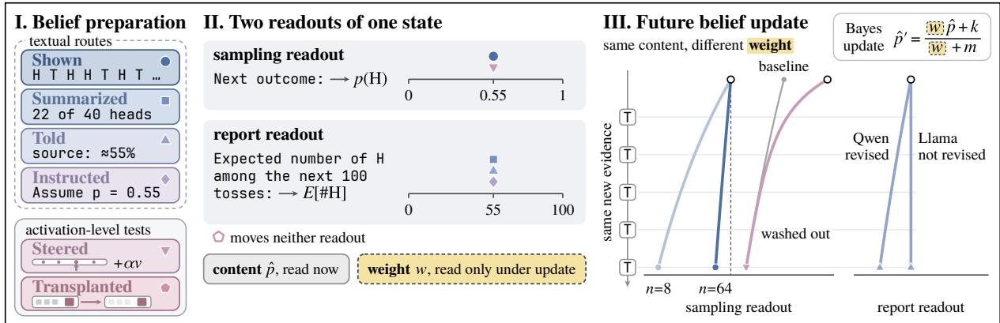  
Figure 1: A belief has a content, which current readouts show, and a weight, which only an update reveals. Both belong to a readout channel, and the route decides all three. I. Four textual routes and two activation-level tests prepare the belief that the next toss is heads with probability 0.55. II. One state, two readouts. III. The same new evidence, forked from each state

We separate two operational properties of a probabilistic belief within each readout: its content, the current estimate before new evidence, and its effective weight w, how strongly that estimate persists against subsequent observations. The characterization is functional and assumes no stored neural variable. We study Bernoulli bias inference, which provides an analytic Bayesian reference and lets the same evidence be presented as an outcome sequence or as its sufficient statistic. Across three open-weight models, we prepare states through four textual routes (observed sequences, count summaries, source assertions, explicit instructions) and test two activation-level interventions, steering and hidden-state transplantation, against them (Figure 1, I). We read every state as a next-outcome continuation and as an explicit estimate (II), and from each cached state we append controlled new evidence under varied framings and elicitation questions, measuring the weight of the old belief in units of additional observations (III).

Our experiments reveal three main findings. First, the format of the evidence decides which readout responds: numerical statements and count summaries drive explicit estimates, whereas observed sequences shape next-outcome continuations. Which continuation carries the record differs by model, and the gap between the readouts narrows when a model explicitly counts or reasons. Second, beliefs induced via different routes carry substantially different effective weights for the same probabilistic information: observed sequences retain far less influence than Bayesian updating implies, and count summaries, the sufficient statistics of those sequences, receive weights that scale only weakly with the stated sample size. The organization of subsequent evidence alters its influence, and alternative elicitation questions shift inferred weights by orders of magnitude.

Third, an activation intervention that matches the immediate effect of a record need not match its persistence: one-shot steering reproduces the current prediction induced by a natural record, yet most of its effect vanishes after a short segment of additional observations, whereas persistent steering acts as an ongoing offset on the readout. The findings have a common reading: the content of a belief is a function of the model’s state at the end of the prompt, while its weight is recovered each time from the text the model re-reads, which is why an activation write sets the first without the second (Section 8). Agreement in current outputs thus incompletely characterizes a language model’s belief state, and belief-setting methods, including memory summaries and activation interventions, are to be evaluated by their updating dynamics under new evidence.

## 2 A belief has a content and a weight

Two readouts of one state. A prompt, together with any intervention applied while it is processed, leaves the model in an internal state s at the boundary where the prompt ends. We cache the prefix and fork every query from that boundary. A readout e is a query appended after the boundary, and it returns a distribution $K _ { e } ( \cdot \mid s )$ over the next token. We read a prediction in the two ways a model can express it: by continuing the sequence of outcomes and by stating a numerical estimate. In the sampling readout the document continues as it was written: after the record and the line Next outcome:, we read the probability of H against T, the continuation. In the report readout the model is asked what it believes: after Expected number of H among the next 100 tosses: we read the distribution over integers and take its expectation, the estimate. An ideal observer performs both operations on one posterior and gives the same number, so any disagreement between them belongs to the model. Inputs come in the same two formats as outputs: a record is data, and a stated rate, a count or an instruction is a description. The content of a belief is the estimate $\hat { p }$ a readout returns now. Its weight w is how much of that estimate survives the next evidence, which no single reading of the current estimate shows.

Futures and exchange rate. An update u is a segment of new evidence inserted between the boundary and the query. It carries the state s to a state $T _ { u } s ,$ and the readout after it is $K _ { e } ( \cdot \mid T _ { u } s )$ The Bernoulli task turns a difference in future into a number: take a family of states whose content is a proportion π of heads, append the same segment of m new observations with a proportion κ of heads, and regress the readout on both,

$$
p _ { \mathrm { p o s t } } = c + a \pi + S \kappa .\tag{1}
$$

The slope a is what remains of the old belief and S, the sensitivity, is what the new segment contributes. Their ratio, scaled by the length of the segment,

$$
w = m \frac { a } { S } ,\tag{2}
$$

is the number of new observations that the old belief is worth: its exchange rate. For a Bayesian observer with prior strength $w _ { 0 }$ who has seen n observations, $a = { n } / ( { w _ { 0 } } + { n } + { m } ) , S = { m } / ( { w _ { 0 } } + { n } + { m } )$ and w = n (Appendix B): forty old observations met by sixteen new ones give $a \ = \ 4 0 / 5 8$ and $S = 1 6 / 5 8$ under the uniform prior, and $w = 4 0$ the old evidence counted in new observations. A shown record should thus be worth its length, a summary the count it states, and an instruction infinitely many observations. A told rate has a reference only once a reliability of the source is assumed: the statement is then discounted by the stated reliability and dropped once the evidence contradicts it. The ratio of two slopes cancels a gain common to both, so a readout that compresses probabilities returns the same w. We read w as a local exchange rate at the design point: it belongs to a route in one readout under one unit of new evidence, and agreement of w across segment lengths and units is the test that one weight describes the route. The retention $R = a / a _ { 0 }$ of the old content, relative to its slope $a _ { 0 }$ before the segment, compares routes whose content is read with different gain.

## 3 Setup: routes, readouts and futures

We first compare four textual routes that convey matched probabilistic content. We then use activation steering to test whether a matching current response also reproduces its persistence, and hidden-state transplantation to probe a possible locus of that persistence. Table 1 lists the routes as minimal pairs.

Textual routes. All begin with the same task description: the coin has an unknown fixed probability of heads, and tosses are independent given it (Appendix L). Shown: the record of $n \in$ {8, 16, 32, 64} outcomes in order. Summarized: the counts of H and T. Told: a source whose previous reports were judged accurate 95% or 55% of the time states the probability of H. Instructed: an instruction to assume the probability, at three strengths from “assume” to “treat as exactly, regardless of any observations”. Content proportions are $\pi \in \{ 0 . 2 5 , 0 . 5 , 0 . 7 5 \}$ for every route, with 0.05 and 0.95 added for the stated routes.

Activation-level tests. Steered: a Shown state to which the mean-difference vector between records with 75% and 25% heads is added at one layer, at the last four or sixteen record positions, while the prompt is processed and removed before any readout. A persistent arm keeps it in place. Transplanted: the residual stream at the last positions of a long record, its frontier, copied into a short one (Appendix E).

Readouts. The two readouts are read in two frames, which differ only in who speaks the query. In the document frame the query stays inside the user turn, USER ⟨task, evidence⟩ Next outcome:, and the model continues the document (the document continuation). In the assistantframe the assistant’s reply begins with it, USER ⟨task, evidence⟩ AS-SISTANT Next outcome: (the assistant-voice continuation). A one-token H or T answer of the assistant, the decision, is read as well (Appendix D). The report readout is the expectation of the distribution over the integers from 0 to 100 (Appendix C), and three paraphrases of the query read the same states (Appendix I). A readout is interpreted only where its admissible answers hold at least 0.3 of the probability mass (hollow markers otherwise).

Futures. New evidence is appended in two layouts. As a new segment, a line of its own, New observations of this coin, in order:, is followed by $m \in \{ 8 , 1 6 , 3 2 \}$ outcomes with a proportion $\kappa \in \{ 0 . 2 5 , 0 . 7 5 \}$ of heads (and 0.5 at m = 16). As an extended line, the same sixteen outcomes continue on the record’s own line, ⟨record⟩ T H T T . . . , with no line between the old and the new. A count segment states the same new evidence as a count, 4 H and 12 T in 16 further tosses. A state with no content completes the set (further controls in Appendix D).

Models and statistics. The models are Llama-3.1-8B-Instruct, Qwen3-8B and Gemma-3-12Bit, called Llama, Qwen and Gemma below (Appendix H). Intervals are 95% bootstrap intervals over families, the independently generated records with their wordings, and equivalence is tested against each model’s wording noise floor (Appendix C).

## 4 Content: the format of the input decides the channel

Figure 2 maps, for each model, how far the proportion conveyed by a route moves each readout before any new evidence arrives. Read as input format against output format, the map is close to diagonal: data moves the continuation and a description moves the estimate.

A stated rate moves the estimate, a shown record moves the continuation. In all three models a stated rate or an instruction moves the readouts in which the model answers and leaves the continuation of the document where it was: the slope of the estimate on the stated rate is at least 0.87 in every model and frame, the slope of the document continuation at most 0.13. Qwen’s one-token H or T answer collapses to the mode under an instruction: its probability of H runs from near zero to near one across stated levels of 0.25 to 0.75, a slope of 2 (Jang et al., 2026). The one place where a statement enters a sampling readout is Qwen’s assistant-voice continuation, which follows a stated rate with a slope of 0.4. A shown record does the reverse, and which continuation follows it depends on the model: in Llama it is the document continuation, with a slope that rises from 0.32 at n = 8 to 0.74 at n = 64; Qwen’s document continuation does not follow the record at any length while its assistant-voice continuation does, so the record enters Qwen’s sampling readout through the assistant frame. Gemma’s continuations run against the most recent outcomes in both frames, a format-induced negative recency that disappears in a bare 0/1 stream and disqualifies them as a sampling channel (Appendix D), so Gemma enters the rest of the paper through its report channel. The map survives controls for token copying and for the document format (Appendix D).

Table 1: The routes as minimal pairs. Each pair changes one thing. The italic line is what a Bayesian observer with a uniform prior would do, the shaded line what the models do and where the paper reports it. Weights are exchange rates in observations.
<table><tr><td rowspan=1 colspan=1>●Shown ↔Summarized the same evidence as a sequence or as a countideal observer: same content, same weight</td></tr><tr><td rowspan=1 colspan=1>different channels: the summary travels with the statements (§4); the recordis worth a fraction of its length where it is sampled, the summary a few dozenobservations whatever count it states (§5)</td></tr><tr><td rowspan=1 colspan=1>Summarized ↔ ▲ Told a count against testimony, in the same formatideal observer: weight n against a reliability discount</td></tr><tr><td rowspan=1 colspan=1>the same channel; a count is worth a few dozen observations, a statementwhat the model grants its source: a rule in Llama, testimony in Qwen andGemma (§5)</td></tr><tr><td rowspan=1 colspan=1>8 observations ↔ 64the amount of evidenceideal observer: weight 8 against 64</td></tr><tr><td rowspan=1 colspan=1>record: 5 rising to 17 in Llama, 3 to 7 at every length in Qwen; summary: 71/ 25 / 21 against 52 / 57 / 72 in the three models (§5)</td></tr><tr><td rowspan=1 colspan=1>▲ Told, reliable ↔ unreliable the reliability of the sourceideal observer: the unreliable rate discounted from the start and dropped first</td></tr><tr><td rowspan=1 colspan=1>Qwen keeps 0.77 of the reliable rate and 0.30 of the unreliable one aftersixteen observations; Gemma discounts before any; Llama neither (§5)</td></tr><tr><td rowspan=1 colspan=1>▲ Told ↔Instructed testimony against a constraintideal observer: finite against infinite weight</td></tr><tr><td rowspan=1 colspan=1>a constraint in all three models under the expected-count query; Llama andQwen revise it under the next-toss question (§5)</td></tr><tr><td rowspan=1 colspan=1> Shown ↔  Steered the medium, with the same contentideal observer: identical</td></tr><tr><td rowspan=1 colspan=1>content installed at 92 to 109%; at most 0.12 of it left after sixteenobservations, against 0.42 for the record (§6)</td></tr></table>

The sufficient statistic travels with the statements. The counts of a record enter the same readouts as a stated rate, with slopes between 0.5 and 1 on the estimates in Figure 2, which pools the two counts, and near zero on the continuation, in every model. The record and its count, one belief for an ideal observer, are held in different channels, and the format of the evidence decides which. New evidence is routed the same way: sixteen further observations written out as a sequence move the estimate with a slope of at most 0.26, stated as a count with a slope of up to 0.51, in every model and at every record length, and a count moves Llama’s document continuation by nothing.

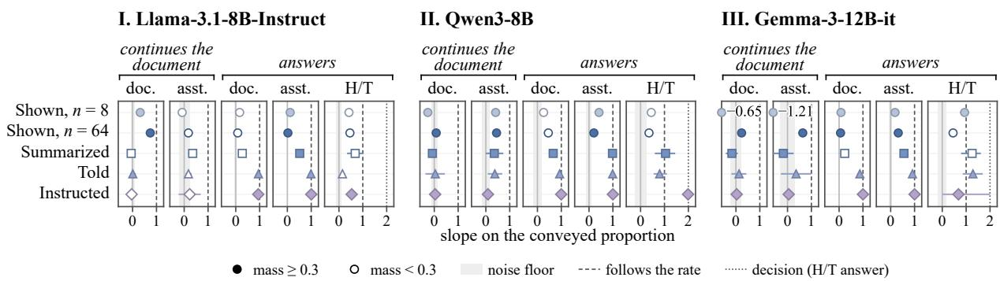  
Figure 2: A statement moves every readout in which the model answers and, but for Qwen’s assistant-voice continuation, none in which it continues the document. A shown record does the reverse. Slope of each readout on the proportion conveyed by the route (1: follows it), with 95% family-bootstrap intervals. Rows: routes; columns: the readouts of the document (doc.) and assistant (asst.) frames and the assistant’s one-token H/T decision, grouped by whether the model continues the document or answers. Gemma’s continuations at n = 8 run against the record (values printed).

The record reaches the estimate through computation. The same records move the estimate far less than the continuation: at n = 64 the estimate follows the record with slopes of 0.02, 0.20 and 0.32 in the three models, against 0.74, 0.45 and 0.64 for the continuation that carries the record in each. Counting closes the gap. Qwen, having counted, reports the record it counted (0.96 at n = 64), and Gemma does so for short records. Llama counts poorly and follows even its own count only in part. Reasoning does the same work: Qwen’s estimate after a thinking block follows a record of 64 outcomes at 0.84, against about 0.2 without. A statement arrives in the form the estimate needs, and the model repeats it. A record must first be compressed, and counting and reasoning are that compression, done out loud. The bridge runs the other way when Qwen writes outcomes of the coin before it continues, following what it wrote (Appendix D): the two channels communicate through tokens the model generates itself.

## 5 Weight: what a belief is worth against new evidence

The channel map of Figure 2 fixes, before any future is read, each model’s sampling channel, the continuation that follows a shown record (the document continuation in Llama, the assistant-voice continuation in Qwen, none in Gemma), and its report channel, the report readout in the assistant frame. Figure 3 follows every route through the same futures: the retention R of the old content after a new segment of m observations, in both channels of each model, against the Bayesian observer (exchange rates in Appendix G). Three results organize it: the amount of evidence is not what the model weighs, the unit in which it arrives is, and the question that reads the estimate sets the scale.

A sufficient statistic does not carry the weight of its evidence. In the sampling channel, Llama’s record is worth 5, 7, 14 and 17 observations at n = 8, 16, 32 and 64 under a new segment of sixteen: the weight grows with the record and saturates near sixteen. Qwen’s record is worth 3 to 7 observations at every length. In the report channel, a summary that states 8 observations is worth 21 to 71 observations in the three models and one that states 64 is worth 52 to 72 (Table 1): the weight follows the count far less than the eightfold the count implies, and in Llama not at all. The summary and the record, which an ideal observer cannot tell apart, thus differ twice, in the channel that holds them and in what they are worth there: a record is worth a fraction of its length, a summary a few dozen observations whatever count it states.

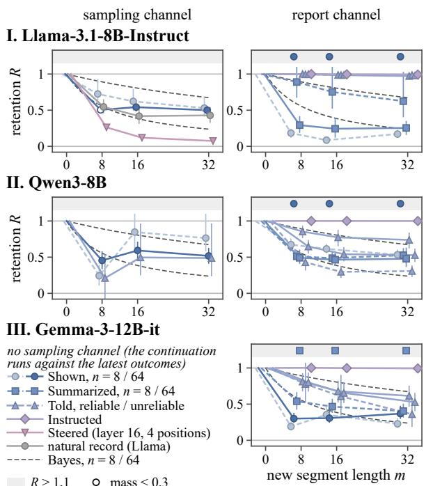  
Figure 3: Same answer, different future: the content of every route under the same new evidence. Retention $R \mathrm { ~ = ~ } a / a _ { 0 }$ of the old content after a new segment of m observations, in the sampling channel (left) and the report channel (right) of each model; dark dashed: the Bayesian observer. Top band: R above 1.1, in cells whose content is hardly read before the segment $( a _ { 0 } < 0 . 3 5 )$ . Qwen’s sampling channel pools the two sources of a told rate. Family-bootstrap 95% intervals.

Evidence is weighted by the unit in which it arrives. At n = 64 the same sixteen outcomes, continued on the record’s own line instead of in a new segment, are ignored: the slope on them is zero in Llama and 0.08 in Qwen, where the record is then worth 51 observations. As a new segment they count, and the exchange rate rises with the length of the segment (from 17 to 26 observations in Llama, 2 to 13 in Qwen), so the per-observation weight of a segment falls with its length: each block of evidence saturates, the old and the new alike. These models weigh the units of text they re-read, and a unit is worth less per observation the longer it is.

A statement is weighted by its kind, and the question that reads it sets the scale. Llama takes a told rate as a rule: sixteen contradicting observations leave its estimate all but where it was, whether written out or stated as a count, so the rate is worth thousands of observations in the one format and hundreds in the other. Qwen and Gemma treat it as testimony and revise it with a finite weight, about 95 and 71 observations against written-out evidence and about 43 and 42 against a count. An observer with a prior on the source’s reliability discounts the statement from the start and drops it once the evidence contradicts it (Appendix B). Qwen does the second, keeping 0.77 of a reliable rate and 0.30 of an unreliable one after sixteen observations while moving toward the evidence at the same rate for both, Gemma does the first, and Llama does neither (Table 1). An instruction is a constraint: under the expected-count query no model revises it.

Every weight above is read with the expectedcount query. Asked for the probability of the next toss instead, the three models revise a told rate with weights of 54, 10 and 23 observations, against no revision, 288 and 205 under the expected-count query when restricted to the same three central levels (Table A3). Llama and Qwen revise an instruction as well (about 50) while Gemma holds it, every summary and record is worth less, and the estimate reads the record at 0.43 to 0.66 in place of 0.02 to 0.32 (Appendix I). What survives the change of question: a statement does not enter the sampling readout, a summary’s weight hardly follows its count, a record is worth a fraction of its length and saturates, and the one-shot write of Section 6 is washed out. The next-toss question brings the estimate’s reading of the record toward the continuation’s and turns every told rate into testimony.

The persistence of a belief thus depends on how it was established, and matching the current estimate does not remove the difference (Appendix J). Among states of different routes whose estimates agree within two points (0.02), a summary of 64 observations moves 1.6 to 2.2 times as far as a record under the same sixteen observations and the nexttoss question in every model, and a told rate holds under the expected-count query where a matched record or summary moves.

## 6 Steering installs the content of a record without its weight

A steering vector installs the answer, and the first evidence erases it. In Llama-3.1-8B-Instruct, adding the mean-difference direction at layer 8 or 16 to the last four or sixteen record positions of a Shown state installs 92 to 109% of the natural content difference between records with 75% and 25% heads (Figure 4; Qwen receives only the told direction, Appendix F). After a new segment of sixteen observations the write retains at most 0.12 of its content, the natural record of the same content 0.42; after eight, about a fifth against 0.55. The sensitivity to the segment is unchanged by the write: a steered state is a natural state whose content the first evidence erases. The erasure is done by evidence: a neutral passage of the same length leaves the written content in place and even enlarges it (retention 1.6, against 0.9 for the natural record): a passage without observations competes with nothing (Appendix F), and random directions of the same norm move nothing.

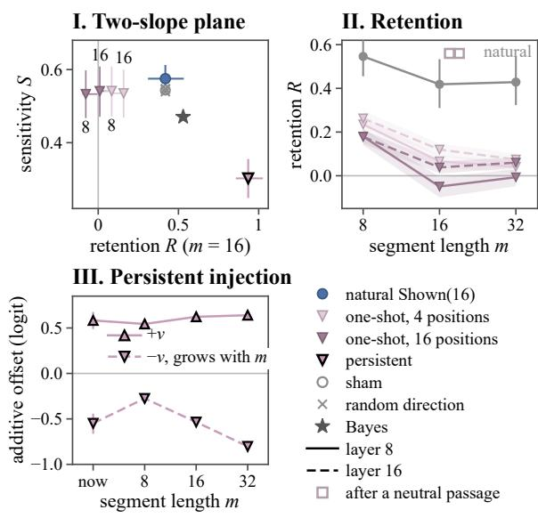

A persistent vector is an offset. Kept in place at every position, the same vector shifts the log-odds by an offset that evidence does not remove and damps the response to new evidence: the regime of the closed form of Bigelow et al. (2026), a bias on the answer.

Writes stay in the sampling channel and carry no weight. None of these writes reaches the estimate: between the two signs of the vector the estimate differs by at most 0.005. A direction taken from told states lands in the same place: in Qwen it moves the assistant-voice continuation by 0.79 of the natural told difference and the estimate by 0.09, and in Llama it moves the estimate by at most 0.12 (Appendix F). Nor does a mean-difference direction carry weight: the difference between a record of 64 observations and one of 8, added to the short record, leaves its exchange rate where it was, 3 to 5 observations against 17 for the long record, and copying the frontier of a long record into a short one moves the receptor toward the donor by nothing (Appendix E). The weight of a long record stays in the record the model re-reads, where neither a direction nor a copied frontier can carry it.

## 7 Related work

States defined by their futures. Table 2 places the protocol among its neighbors. The criterion that two histories are one state when they induce the same future behavior comes from automata theory (Nerode, 1958), computational mechanics (Shalizi and Crutchfield, 2001) and predictive state representations (Littman et al., 2002). Ma et al. (2026) forked futures from a formed state of a language model, and we keep the fork, make the route by which a belief arrives the independent variable and the update the central experiment. Belief-state

Figure 4: Steering writes an answer without a weight behind it. Llama-3.1-8B-Instruct. I. Sensitivity to a new segment of sixteen observations against retention of the old content, for the natural record and the writes. II. Retention of the written content against the length of the segment, with the natural retention in grey; hollow squares at the top edge: the writes after a neutral passage in place of the segment (retention 1.6, above the panel). III. Persistent injection as a logit offset against sham; the two signs are asymmetric. Family-bootstrap 95% intervals.

geometry (Shai et al., 2024; Balcells et al., 2026; Sarfati et al., 2026) decodes the belief of a model continuing a stream of evidence from its activations, one of our two channels in one route, and Li et al. (2026) separate, for such belief states, what stays decodable from what decisions still use. Task and function vectors (Hendel et al., 2023; Todd et al., 2024) carry the identity of a task in a vector at the last position, where the weight of a record cannot be carried (Section 6).

Routes to a belief. Bigelow et al. (2026) matched beliefs installed by in-context demonstrations and by activation steering through their current answer curves and fitted a closed form in which steering adds a constant to the log-odds while evidence accumulates sublinearly. Their steering acts throughout the forward pass that reads the evidence, our persistent arm, and the one-shot write is the case the form does not cover. Slocum et al. (2025) find that a fact implanted by prompting, editing or finetuning is held with different depth, and ours is the in-context counterpart. Davidson et al. (2025) find that demonstrations and instructions recruit different components. Whether a written quantity is used later is a question of its own (Shih et al., 2026; Kang et al., 2026; Heyman and Vandeputte, 2026; Cheng and Kriegeskorte, 2026; Mishra et al., 2026).

Table 2: Neighboring lines of work compare internal states by what they show now or do next. We compare them by how they update on the same new evidence. Links that cross the snapshot boundary hop over the belie weight w, which no current readout shows.
<table><tr><td colspan="3">PREPARATION CURRENT READOUT</td><td rowspan="2"></td><td rowspan="2">FUTURE / UPDATE REPORT identity criterion</td><td rowspan="2"></td></tr><tr><td>Davidson et al. (2025)</td><td>è</td><td>()</td></tr><tr><td>Introspection line</td><td></td><td></td><td></td><td>C</td><td>same task performance</td></tr><tr><td>Lindsey (2025), Binder et al. (2025) Ferrara (2026), Gurnee et al. (2026) Balcells et al. (2026)</td><td></td><td>è</td><td></td><td>●</td><td>report matches injection</td></tr><tr><td>Shai et al. (2024)</td><td>è</td><td>O</td><td></td><td>C</td><td>same probe reading</td></tr><tr><td>Sarfati et al. (2026)</td><td></td><td>è</td><td></td><td>•</td><td>same manifold point</td></tr><tr><td>Bigelow et al. (2026)</td><td></td><td>è</td><td></td><td></td><td>same output curve</td></tr><tr><td>Hidden APIs</td><td></td><td>à</td><td></td><td>O</td><td>same future signature</td></tr><tr><td>Ma et al. (2026)</td><td></td><td></td><td></td><td>motivation only</td><td></td></tr><tr><td>This work</td><td></td><td></td><td></td><td>● •</td><td>same update on same evidence</td></tr><tr><td></td><td></td><td></td><td></td><td></td><td></td></tr><tr><td></td><td></td><td>snapshot boundary</td><td></td><td>belief weight w, invisible to current readouts</td><td></td></tr></table>

Readouts of a probabilistic belief. Behavioral studies of Bayesian in-context learning compare next-outcome predictions with the posterior predictive (Falck et al., 2024; Gupta et al., 2025; Chlon et al., 2025), which in the Bernoulli case is the posterior mean and carries no information about the evidence behind it. Asking for an answer is a different readout from measuring probabilities (Hu and Levy, 2023; Wang et al., 2024; Chen et al., 2026): models answer questions about stated probabilities that their completions ignore (Mondal et al., 2026), cannot state the bias of a coin they were shown (Treutlein et al., 2024), and describe distributions they cannot sample from (Jang et al., 2026; Meister et al., 2025; Gu et al., 2025; Zhang et al., 2026; Gu et al., 2026). How a model revises a belief it was told about depends on the stated confidence and reliability of the source (Kumaran et al., 2026b,a; Du et al., 2026; Atwell et al., 2026; Yang and Yeung, 2026) and on how and when it is asked (Cekinmez et al., 2026; Lei and Cooper, 2026).

## 8 Discussion

A model expresses a prediction by continuing or by describing, and an ideal observer does both from one posterior. In these models the two operations are fed by different inputs, rest on priors of different strength and are revised differently, so “the model believes $p '$ has to say which operation is meant, and an equivalence established on current outputs holds for one channel. Smolin and Wilder (2026) find that a single latent degree of belief predicts the outputs of strong models. At the scale studied here there is at best one such degree per channel, and the format of the input chooses the channel.

The dissociations have a common reading. These models keep no count of the evidence behind a belief. Each readout re-estimates from the tokens it attends to, and the weight of a belief is whatever that re-reading recovers. One hypothesis then predicts the rest. A one-shot write has content without weight because no evidence stands behind the answer when the model looks back, and a copied frontier residual carries nothing for the same reason. A summary is worth a few dozen observations whatever count it states, because the count is one token where the record was n tokens of evidence. A record’s weight saturates and follows the segmentation of the text, a neutral passage leaves a written content in place because nothing in it competes, and the question that reads the estimate changes the weight because it changes what is re-read. A belief that is decodable at the frontier is not thereby used from there (Li et al., 2026). On this hypothesis the content of a belief is a function of the state and its weight a function of the text the model will re-read.

Two practices follow. A steered belief is undone by sixteen observations and never reaches the model’s estimate: steering sets an answer the model will not defend. A memory summary that replaces a record keeps a weight that hardly follows the count it states: the model holds a claim about the evidence and no longer holds the evidence, which suggests that memory compaction in longhorizon agents should keep the weight of a belief along with its prediction.

## Limitations

We study in-context beliefs about one quantity, the rate of a Bernoulli source, in a task family with an analytic reference and an exact sufficient statistic. Extending the protocol to a multinomial posterior, to richer priors and to beliefs installed in the parameters by fine-tuning or model editing remains future work, and the exchange-rate protocol applies to each of them once a future can be forked from a formed state.

The measurements depend on the format of the prompt: in a bare stream of symbols the same layouts move the exchange rate differently and Gemma’s response to new evidence turns positive (Appendix D), and Gemma enters the weight experiments only through its report channel. The report channel is read by four queries whose weights differ by orders of magnitude. Every figure of the main text uses the expected-count query, the end of that range at which a statement comes closest to a rule (Appendix I), so an exchange rate compares routes within one readout and is no constant of the model. Under extended reasoning the estimate is read at single points, without a curve.

The localization of the weight is behavioral. The steering and transplantation tests rule out a single-position or mean-difference carrier at the record’s frontier, and hiding part of the record from the positions after it lowers content and weight in the same proportion (Appendix K). A circuitlevel account of how attention re-reads distributed evidence, and the question whether a model can predict its own updating weight (Lindsey, 2025; Binder et al., 2025; Ferrara, 2026), so that its prediction of how it would answer after five more tails beats an observer who sees only the text (Appendix A), are left to future work.

## References

Katherine Atwell, Pedram Heydari, Anthony Sicilia, and Malihe Alikhani. 2026. BASIL: Bayesian assessment of sycophancy in LLMs. In Proceedings of the 2026 ACM Conference on Fairness, Accountability, and Transparency, pages 6613–6642. Association for Computing Machinery.

Daniel Balcells, Andrew Jun Lee, Chirag Rastogi, Paul M. Riechers, Adam Shai, and Xavier Poncini. 2026. Large language models develop belief state geometry in-context. Preprint, arXiv:2609.17376.

Eric Bigelow, Daniel Wurgaft, YingQiao Wang, Noah Goodman, Tomer Ullman, Hidenori Tanaka, and

Ekdeep Singh Lubana. 2026. Belief dynamics reveal the dual nature of in-context learning and activation steering. In Proceedings of the 43rd International Conference on Machine Learning, volume 306 of Proceedings ofMachine Learning Research, pages 8248–8276.

Felix J Binder, James Chua, Tomek Korbak, Henry Sleight, John Hughes, Robert Long, Ethan Perez, Miles Turpin, and Owain Evans. 2025. Looking inward: Language models can learn about themselves by introspection. In The Thirteenth International Conference on Learning Representations.

Jasin Cekinmez, Addison J. Wu, and Thomas L. Griffiths. 2026. Query timing produces opposite positional biases between LLMs and humans. In Findings of the Association for Computational Linguistics: EMNLP 2026, pages 28741–28758, Budapest, Hungary. Association for Computational Linguistics.

Chacha Chen, Matthew Jörke, Adam Golinski,´ Masha Fedzechkina, Guillermo Sapiro, Sinead Williamson, and Nicholas Foti. 2026. LLMs are not (consistently) Bayesian: Quantifying internal (in)consistencies of LLMs’ probabilistic beliefs. Preprint, arXiv:2605.06915.

Fan L. Cheng and Nikolaus Kriegeskorte. 2026. Decomposing how prompting steers behavior. Preprint, arXiv:2606.03093.

Leon Chlon, Fatima Sheaib, Zein Khamis, Maggie Chlon, Mahdi El Zein, and MarcAntonio M. Awada. 2025. LLMs are Bayesian, in expectation, not in realization. Preprint, arXiv:2507.11768.

Guy Davidson, Todd M. Gureckis, Brenden M. Lake, and Adina Williams. 2025. Do different prompting methods yield a common task representation in language models? In Advances in Neural Information Processing Systems, volume 38, pages 70782–70822.

Kevin Du, Clara Kümpel, Michelle Wastl, and Alex Warstadt. 2026. It’s not what you say, it’s how you say it: Evaluating LLM responses to expressions of belief. In Proceedings of the 64th Annual Meeting of the Associationfor Computational Linguistics (Volume 1: Long Papers), pages 3137–3151, San Diego, California, United States. Association for Computational Linguistics.

Fabian Falck, Ziyu Wang, and Chris Holmes. 2024. Is in-context learning in large language models Bayesian? A martingale perspective. In Proceedings ofthe 41st International Conference on Machine Learning, volume 235 of Proceedings of Machine Learning Research, pages 12784–12805.

Emilio Ferrara. 2026. Open-weight masked introspection: Measuring what language models can report about their own computation. Preprint, arXiv:2608.20569.

Jia Gu, Liang Pang, Huawei Shen, and Xueqi Cheng. 2025. Do LLMs play dice? Exploring probability

distribution sampling in large language models for behavioral simulation. In Proceedings ofthe 31st International Conference on Computational Linguistics, pages 5375–5390, Abu Dhabi, UAE. Association for Computational Linguistics.

Xiangming Gu, Soham De, Michalis Titsias, Larisa Markeeva, Petar Velickoviˇ c, and Razvan Pascanu.´ 2026. The illusion of stochasticity in LLMs. In Third Conference on Language Modeling.

Ritwik Gupta, Rodolfo Corona, Jiaxin Ge, Eric Wang, Dan Klein, Trevor Darrell, and David M. Chan. 2025. Enough coin flips can make LLMs act Bayesian. In Proceedings of the 63rd Annual Meeting of the Associationfor Computational Linguistics (Volume 1: Long Papers), pages 7634–7655, Vienna, Austria. Association for Computational Linguistics.

Wes Gurnee, Nicholas Sofroniew, Adam Pearce, Mateusz Piotrowski, Isaac Kauvar, Runjin Chen, Anna Soligo, Paul Bogdan, Euan Ong, Rowan Wang, Ben Thompson, David Abrahams, Subhash Kantamneni, Emmanuel Ameisen, Joshua Batson, and Jack Lindsey. 2026. Verbalizable representations form a global workspace in language models. Preprint, arXiv:2607.15495.

Roee Hendel, Mor Geva, and Amir Globerson. 2023. In-context learning creates task vectors. In Findings of the Association for Computational Linguistics: EMNLP 2023, pages 9318–9333, Singapore. Association for Computational Linguistics.

Geert Heyman and Frederik Vandeputte. 2026. Steer like the LLM: Activation steering that mimics prompting. In Proceedings ofthe 43rd International Conference on Machine Learning, volume 306 of Proceedings of Machine Learning Research, pages 42968–42997.

Jennifer Hu and Roger Levy. 2023. Prompting is not a substitute for probability measurements in large language models. In Proceedings ofthe 2023 Conference on Empirical Methods in Natural Language Processing, pages 5040–5060, Singapore. Association for Computational Linguistics.

Chaemin Jang, Jihee Kim, and Dongman Lee. 2026. Instruction-tuned language models cannot sample from distributions they can describe. In Findings of the Association for Computational Linguistics: EMNLP 2026, pages 48757–48777, Budapest, Hungary. Association for Computational Linguistics.

Diancheng Kang, Zheyuan Liu, Ningshan Ma, Yue Huang, Zhaoxuan Tan, and Meng Jiang. 2026. Prompt-activation duality: Improving activation steering via attention-level interventions. Preprint, arXiv:2605.10664.

Dharshan Kumaran, Nathaniel Daw, Simon Osindero, Petar Velickoviˇ c, and Viorica Patraucean. 2026a.´ Causal evidence that language models use confidence to drive behaviour. Nature Machine Intelligence, 8(9):1411–1425.

Dharshan Kumaran, Stephen M. Fleming, Larisa Markeeva, Joe Heyward, Andrea Banino, Mrinal Mathur, Razvan Pascanu, Simon Osindero, Benedetto De Martino, Petar Velickoviˇ c, and Viorica Patraucean. 2026b.´ Competing biases underlie overconfidence and underconfidence in LLMs. Nature Machine Intelligence, 8(4):614–627.

Ge Lei and Samuel J. Cooper. 2026. Elicitation matters: How prompts and query protocols shape LLM surrogates under sparse observations. Preprint, arXiv:2605.04764.

Weihan Li, Tianshi Zheng, Junhao Wu, and Xinlei Chen. 2026. Erased, rerouted, or rescaled? post-training and the causal quotient of a language model’s belief state. Preprint, arXiv:2610.05292.

Jack Lindsey. 2025. Emergent introspective awareness in large language models. Transformer Circuits Thread.

Michael L. Littman, Richard S. Sutton, and Satinder Singh. 2002. Predictive representations of state. In Advances in Neural Information Processing Systems 14. MIT Press.

SiYuan Ma, Yiqin Luo, Zhangji, Canran Xiao, Albert Gao, Wei Wang, Qiwei Wu, Xinran Li, Jinfeng Wei, and Qixin Zhang. 2026. Hidden APIs in language models: Discovering reusable causal interfaces from forked futures. Preprint, arXiv:2607.27617.

Nicole Meister, Carlos Guestrin, and Tatsunori Hashimoto. 2025. Benchmarking distributional alignment of large language models. In Proceedings of the 2025 Conference ofthe Nations ofthe Americas Chapter of the Association for Computational Linguistics: Human Language Technologies (Volume 1: Long Papers), pages 24–49, Albuquerque, New Mexico. Association for Computational Linguistics.

Aayush Mishra, Daniel Khashabi, and Anqi Liu. 2026. Steered LLM activations are non-surjective. In ICLR 2026 Workshop on Scientific Methods for Understanding Deep Learning.

Manuel Mondal, Ljiljana Dolamic, Gérôme Bovet, Philippe Cudré-Mauroux, and Julien Audiffren. 2026. Implicit probabilistic reasoning does not reflect explicit answers in large language models. Transactions on Machine Learning Research.

Anil Nerode. 1958. Linear automaton transformations. Proceedings of the American Mathematical Society, 9(4):541–544.

Raphaël Sarfati, Eric Bigelow, Daniel Wurgaft, Siddharth Boppana, Jack Merullo, Atticus Geiger, Owen Lewis, Tom McGrath, and Ekdeep Singh Lubana. 2026. The shape of beliefs: Geometry, dynamics, and interventions along representation manifolds of language models’ posteriors. Preprint, arXiv:2602.02315.

Johannes A. Schubert, Akshay K. Jagadish, Marcel Binz, and Eric Schulz. 2024. In-context learning agents are asymmetric belief updaters. In Proceedings ofthe 41st International Conference on Machine Learning, volume 235 of Proceedings of Machine Learning Research, pages 43928–43946.

Adam S. Shai, Sarah E. Marzen, Lucas Teixeira, Alexander Gietelink Oldenziel, and Paul M. Riechers. 2024. Transformers represent belief state geometry in their residual stream. In Advances in Neural Information Processing Systems, volume 37, pages 75012–75034.

Cosma Rohilla Shalizi and James P. Crutchfield. 2001. Computational mechanics: Pattern and prediction, structure and simplicity. Journal of Statistical Physics, 104(3–4):817–879.

Benjamin Shih, John Winnicki, and Eric Darve. 2026. When does activation steering change what a model computes from? Preprint, arXiv:2606.29522.

Stewart Slocum, Julian Minder, Clément Dumas, Henry Sleight, Ryan Greenblatt, Samuel Marks, and Rowan Wang. 2025. Believe it or not: How deeply do LLMs believe implanted facts? Preprint, arXiv:2510.17941.

Alex Smolin and Bryan Wilder. 2026. Beliefs and behavior in language models. Preprint, arXiv:2609.07943.

Eric Todd, Millicent L. Li, Arnab Sen Sharma, Aaron Mueller, Byron C. Wallace, and David Bau. 2024. Function vectors in large language models. In The Twelfth International Conference on Learning Representations.

Johannes Treutlein, Dami Choi, Jan Betley, Samuel Marks, Cem Anil, Roger Grosse, and Owain Evans. 2024. Connecting the dots: LLMs can infer and verbalize latent structure from disparate training data. In Advances in Neural Information Processing Systems, volume 37, pages 140667–140730.

Xinpeng Wang, Bolei Ma, Chengzhi Hu, Leon Weber-Genzel, Paul Röttger, Frauke Kreuter, Dirk Hovy, and Barbara Plank. 2024. “My answer is C”: First-token probabilities do not match text answers in instructiontuned language models. In Findings of the Association for Computational Linguistics: ACL 2024, pages 7407–7416, Bangkok, Thailand. Association for Computational Linguistics.

Sen Yang and Yuen-Hei Yeung. 2026. Resist and update: Counterfactual report coordinates for incentivecompatible LLMs. Preprint, arXiv:2607.12985.

Jiayi Zhang, Simon Yu, Derek Chong, Anthony Sicilia, Michael R. Tomz, Christopher D. Manning, and Weiyan Shi. 2026. Verbalized sampling: How to mitigate mode collapse and unlock LLM diversity. In Proceedings ofthe 43rd International Conference on Machine Learning, volume 306 of Proceedings of Machine Learning Research, pages 160073–160152.

## A Three notions of an internal state

Three operational notions of an internal state are distinguished in the paper and are kept apart here. A report notion identifies a state by what the model says about it, which is our report readout. Afunctional notion identifies it by what it does next and how it revises, which is our sampling readout together with the forked futures. An access notion asks whether the model can predict its own revision better than an observer who sees only the text, which is the question we leave open. Each notion induces a partition of prepared states, and the relations between the partitions are empirical: the paper finds that the report and functional partitions cross, since a stated rate separates states only under the first and a shown record only under the second.

## B Bayes derivations

Records and summaries. With a $\mathrm { B e t a } ( \alpha _ { 0 } , \beta _ { 0 } )$ prior of strength $w _ { 0 } = \alpha _ { 0 } + \beta _ { 0 }$ , after n observations with a proportion π of heads and a further $m$ with a proportion $\kappa ,$ the posterior predictive probability of heads is

$$
p _ { \mathrm { p o s t } } = \frac { \alpha _ { 0 } + n \pi + m \kappa } { w _ { 0 } + n + m } .\tag{3}
$$

Read as a function of $\pi$ and κ it is linear, with $c = \alpha _ { 0 } / ( w _ { 0 } + n + m ) , a = n / ( w _ { 0 } + n + m )$ and $S = m / ( w _ { 0 } + n + m )$ , so that $w = m a / S = n$ and the remainder $1 - a - S = w _ { 0 } / ( w _ { 0 } + n + m )$ is the share of the readout that returns to the prior mean. The retention of the old content after the segment is $R = a / a _ { 0 } = ( w _ { 0 } + n ) / ( w _ { 0 } + n + m )$ With no record, $S = m / ( w _ { 0 } + m )$ , which gives $w _ { 0 } = m ( 1 - S ) / S$ . For the uniform prior, $w _ { 0 } = 2$ and the predictive is $( k + 1 ) / ( n + 2 )$ . A summary that states the counts $( k , n )$ is the sufficient statistic of the record and gives the same posterior. The same observer answers the report query with one hundred times the predictive, so for a Bayesian observer the report-channel slopes coincide with the sampling-channel ones.

A told rate. A statement that the probability is s has a Bayesian reference only together with a model of the source. Taking the statement at its word is the source model with reliability one: the observer holds s whatever it then observes, $a =$ 1 and $S \ = \ 0 .$ . An observer who holds that the source is right with probability r, and otherwise uninformative, predicts $r s + ( 1 - r ) / 2$ before any observation, so its content slope is $r ,$ and afterwards keeps a posterior over the two cases. After m new observations with k heads, with $L = s ^ { k } ( 1 - s ) ^ { m - }$ −k the likelihood of the evidence under the stated rate and B the beta function, the probability that the source is right is

$$
\rho = \frac { r L } { r L + \left( 1 - r \right) B ( k + 1 , m - k + 1 ) } ,\tag{4}
$$

and the predictive is $\rho s + ( 1 - \rho ) ( k + 1 ) / ( m + 2 )$ The reference keeps the statement and then drops it: ρ stays near one while the evidence is compatible with s and falls to near zero once it is not, faster for a smaller r. In the two-slope regression the drop appears as a lower retention of the statement at a sensitivity to the evidence that comes from the second term. Section 5 reports which half of this reference each model follows. An instruction to assume s is the limit $r = 1$ under any evidence.

Paired states. Two states A and B that differ only in content, such as the two signs of a steered write, give the paired form $a ~ = ~ ( p _ { \mathrm { p o s t } } ( A ) ~ -$ $p _ { \mathrm { p o s t } } ( B ) \big ) / ( \pi _ { A } - \pi _ { B } )$ . When the content scale is taken as the difference between their current readouts, this slope is the retention R of the installed content after the future, and S is estimated from the same two states. Where w differs across m, we report $w ( m )$

## C Estimator details, bootstrap and integer readout

Within a cell, the readout of every state after every future, the probability of H for the sampling readouts and the expected count divided by one hundred for the report readouts, is regressed on $( \pi , \kappa )$ by least squares, and $( a , S , w )$ follow from Eqs. 1 and 2. The unit of resampling is the family, the independently generated record with its wording and its order of futures. We draw 2,000 bootstrap resamples of families with replacement, recompute the three quantities and report percentile intervals. When the lower bound of S reaches zero, w diverges, and we report the upper bound of S and the corresponding lower bound of w instead of a point estimate. Equivalence between two routes or two layouts is tested by two one-sided tests with a tolerance equal to the model’s wording noise floor, the mean absolute difference between the four wordings of the same state: for the sampling readouts that difference in probability units divided by the 0.5 range of the content proportion, the slope it amounts to (0.07 for Llama’s document continuation, 0.16 for Qwen’s assistant-voice continuation), for the report readouts the difference in expected count. The steering comparison of Section 6 uses the within-family standard deviation of the same wordings in logit units (0.15 for Llama). Paired contrasts, such as sixteen against four written positions, a reliable against an unreliable source, or one layout against another, resample the same families on both sides. The mass of a readout is the probability assigned to the admissible answers, H and T for the sampling readouts and the integers from 0 to 100 for the report readouts. A cell whose median mass is below 0.3 is drawn hollow and is not interpreted.

Integer readout. Llama tokenizes the integers from 0 to 100 as single tokens, and the report readout is their distribution at the first position after the query, with a check at each integer that the token completes the number (a leaf check against continuations such as a further digit). Qwen and Gemma tokenize integers digit by digit, and the readout is a tree: each digit position is forked from the cached state, a branch is followed only while its first digit carries at least $1 0 ^ { - 4 }$ of the mass, and a branch terminates when the next token is a terminator or a period followed by nothing or by a zero, which are read as the integer. Branches that continue into an operator, a decimal fraction or further text are excluded from the mass. The same rule is applied to all three models, and the mass it leaves is reported with every cell.

## D Control experiments

Five controls accompany the channel map (Figure A1). Copy control: a statement is followed by four example outcomes whose proportion differs from the stated rate by one half, and the sampling readout is regressed jointly on the example and the stated proportions; the document continuation follows the examples with slopes of 0.11 in Llama and −0.45 in Gemma, and Qwen’s assistant-voice continuation follows the examples and the statement together (0.33 and 0.60). Count, then estimate: on shown records the model is first asked for the number of H in the record, its answer is committed, and the report query follows; we report the accuracy of the count, the slope of the estimate on the true proportion before and after counting, and the slope on the model’s own count (Llama follows its own count with slopes of 0.19 to 0.71 and the true proportion with at most 0.41; Gemma at n = 64 writes an arithmetic expression where the estimate should be). Prose list: one hundred flips written as “I flipped a coin and it landed on heads, then on tails, . . . ” with the first and last fifty at different rates, read as the next element; the recency index, the slope on the last fifty minus the slope on the first fifty, is 0.85, 1.02 and 0.66. Bare stream: the same records written as a 0/1 stream and read as the next symbol; a record of 64 outcomes is continued with slopes of 0.81, 1.22 and 1.34, and under both layouts of new evidence the slope on the new evidence is positive in every model, with no primacy on the same line and a lower weight of the record after a line break (Figure A2). Reasoning: Qwen in thinking mode with 1,536 and 4,096 reasoning tokens, the two assistant-frame readouts prefilled after the reasoning block; after the block the estimate follows a stated rate somewhat less (0.78 against 0.99) and the continuation no longer follows the record. Stated rates at 0.05 and 0.95 were added to the three central levels for the stated routes. The assistant’s unprefilled one-token H or T answer is read as a fifth readout: under an instruction Qwen’s probability of H moves from near zero to near one across the stated levels, Gemma decides only under the strongest instruction, and Llama’s one-token answer follows the stated level with a slope of about 0.5 without collapsing to the mode.

Gemma’s response to new evidence. Under the new-segment layout Gemma’s continuation moves against the new evidence at every segment length in both frames, and under the extended line and the strong contradiction at n = 64 it is near zero (Figure A2), so Gemma has no exchange rate in the document format. In a bare stream its response is positive.

Segmented records. The same 64 observations are written as $g ~ \in ~ \{ 1 , 2 , 4 , 8 \}$ segments, each headed “Observations of this coin, session i of g, in order:”, and read in the model’s sampling channel before and after a new segment of 8, 16 or 32 observations, with the same families at every g. Under a new segment of sixteen, Llama’s record is worth 10.6 observations at $g = 1$ and 18.8, 17.9 and 17.3 at $g = 2 ,$ , 4 and 8, the last three equal to the unsegmented record of Section 5. The one-segment heading alone lowers the weight. In Qwen the weight falls with g (4.3, 1.7 and about zero from g = 4 on) as the slope on the new segment rises to about one, while the current readout follows the record more closely at $g = 8$ than at g = 1 (0.98 against 0.44). Gemma’s current readouts move further against the record when it is split.

Simulate, then sample. Before the continuation is read, the model is asked to write sixteen outcomes of the coin (“Simulated outcomes for this coin, in order:”), sampled at temperature one and restricted to H and T, four samples per state, and the sampling readout is read after the written outcomes. We report the slope of the written proportion on the content of the state, the slope of the continuation on the content before and after the simulation, and, within states, the slope of the continuation on the written proportion. Llama’s written outcomes ignore a told rate (0.02) and follow a shown record (0.50), and its continuation follows what it wrote on told states (0.79 within states). Qwen’s written outcomes follow instructed, summarized and shown content (0.64, 0.90 and 0.87) and a told rate in part (0.30); its continuation after the simulation carries the instructed and summarized content (0.93 and 1.03, against 0.10 and 0.27 before) and the told rate little more than before (0.46 against 0.38). Gemma’s continuation runs against the outcomes it wrote (−1.17 within told states). No simulation collapses to the mode.

## E Transplanted states

A Transplanted state copies the residual stream at the last one or four positions of a Shown state with 64 observations into the same positions of a Shown state with 8, over a band of middle layers, and is judged against sham and sameproportion donors (20 pairs per proportion). The receptor moves toward the donor by −0.02 to 0.05 of the natural content difference, with every interval including zero, and copying four positions erases about half of the receptor’s own content (Figure A3). The frontier of a long record carries nothing of what the record is worth, and copying it disturbs the receptor’s own content.

## F Three further activation writes

Told direction. The mean difference between states told 75% and 25%, taken at the last four positions of the statement line, is 0.05 to 0.06 of the median residual norm there in Llama and 0.025 to 0.05 in Qwen, against 0.22 to 0.31 for the record direction of Section 6. Added to states told 50%

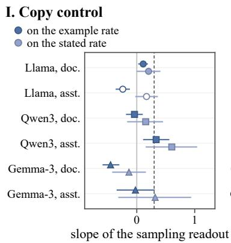

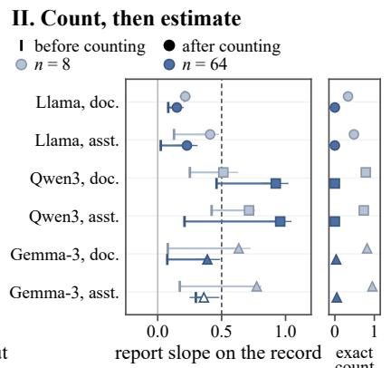

III. Prose-list recency  
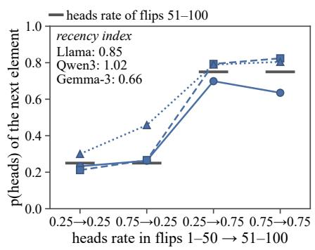

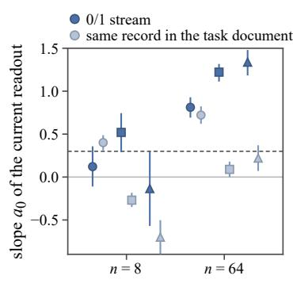

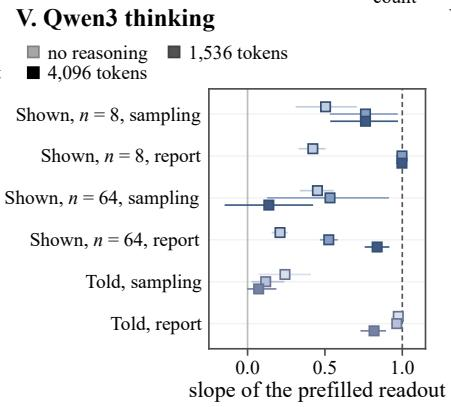

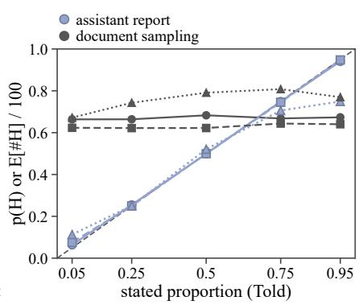  
Llama-3.1-8B-Instruct Qwen3-8B Gemma-3-12B-it mass < 0.3

Figure A1: Control experiments for the channel map. I. Copy control. II. Count, then estimate (with the exact-count accuracy). III. Prose-list recency. IV. Bare-stream continuation. V. Qwen in thinking mode, 1,536 against 4,096 reasoning tokens, with the non-thinking readout as baseline. VI. The five stated-rate levels. In II, Gemma’s assistant-frame point after counting at n = 64 is unreadable (mass 0.04).

at relative magnitudes from 0.125 to 2 of the median norm, in both signs, no dose moves the estimate by more than 0.12 (Llama, layer 8) or 0.09 (Qwen, layer 9) of the natural told difference. In Qwen the layer-9 write moves the assistant-voice continuation by 0.148 [0.038, 0.273], 0.79 of the natural difference on that readout, and the movement is retained at 0.30 after sixteen observations, against 0.43 for natural records. In Llama the document continuation of told states moves by 0.04 to 0.05 and the movement reverses after the segment, while on shown records the largest dose moves the estimate by 0.36 of the told difference and the assistant-voice continuation down by 0.20.

Weight direction. The mean difference between records of 64 and of 8 observations (cosine 0.98 to 0.99 across content levels) is added to records of 8 at one and two times its natural magnitude at layers 8 and 16. Under every dose the exchange rate of the short record stays between 2.9 and 4.7 observations, against 4.6 under sham and 17.2 for the long record; the larger doses lower it slightly, as a random direction does.

Placebo for the washout. A neutral passage of 26 tokens, the token count of a new segment of sixteen observations, is appended in place of the segment to the steered states of Section 6 (layers 8 and 16, four positions). After the segment the written content retains 0.066 and 0.120, the values of Section 6. After the passage it retains 1.57 [1.46, 1.68] and 1.66 [1.54, 1.81], while the natural content of the same records retains 0.90 [0.71, 1.06]. A retention above one has a simple reading: the passage carries no coin observations, so nothing in it competes with the written content, and it dilutes the record’s tokens in what the readout attends to, which leaves the bias injected at the record’s last positions a larger share.

## G Exchange rates in full

Figure A4 sets the exchange rates of Section 5 against their references. Figure A5 gives the sampling-channel exchange rate of a shown record under every layout, and Figure A6 the exchange rate of every route in the report readout, in both frames and all three models, with the symbols for cells that are not revised, that move against the evidence or whose content is not carried.

III. 0/1 stream, S  
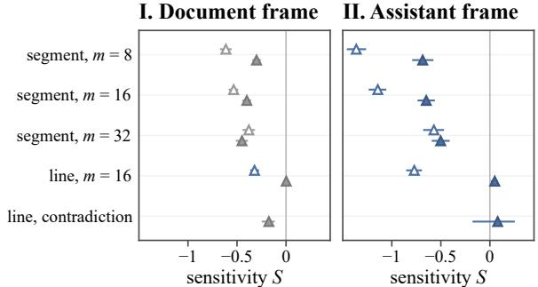

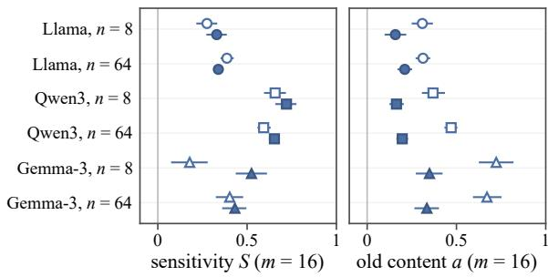  
Gemma-3, n = 8 stream: same line mass < 0.3 Gemma-3, n = 64 stream: new line  
Figure A2: Layout dependence in the bare stream and Gemma’s response to new evidence. I, II. Gemma: the slope S on the new evidence under each layout (segment: a new segment; line: the extended line) in the document and assistant frames, at n = 8 (hollow) and 64 (filled). III, IV. Bare 0/1 stream: S and a for the three models with the new evidence on the same line (hollow) or on a new line (filled).

The two channels of one model hold different priors. With no content at all, Llama’s estimate is held by a prior worth 887 observations, against 14 in its sampling channel, and Qwen’s two channels share a prior of about 20.

## H Models and noise floor

The three models are Llama-3.1-8B-Instruct, Qwen3-8B in non-thinking mode and Gemma-3- 12B-it, loaded in bf16 at pinned revisions (Table A1). Shown records use four wordings of the record line, summaries eight wordings of the counts, told rates four wordings with the source’s past accuracy stated as 95% or 55%, and instructions three strengths. The texts are in Appendix L. Table A2 gives the wording noise floor of every readout: the mean absolute difference between the four wordings of the same shown record, in logit units for the sampling and decision readouts and in expected count for the report readouts, over 240 families, and Figure A7 shows the same differences by record length, in probability units and in expected count over 100. The equivalence tolerances of Sections 5 and 6 are derived from these values: the sampling tolerances are the probability differences divided by the 0.5 range of the content proportion, which turns them into slopes (0.07 and 0.16), the report tolerances are the count differences, and the steering comparison uses the withinfamily standard deviation of the same wordings in logit units (0.15), all in Appendix C.

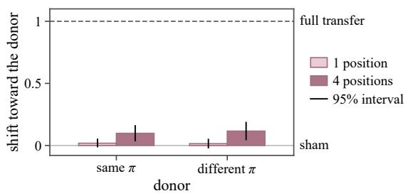  
Figure A3: A frontier residual carries nothing. Shift of the receptor toward the donor, relative to sham, for same-π and different-π donors with one and four copied positions; the shift quoted in the text is the difference between the two donor conditions. Family-bootstrap 95% intervals.

Table A1: Sources of the language models: each repository name links to the revision that was read.
<table><tr><td>Model</td><td>Stage</td><td>Repository</td></tr><tr><td>Llama-3.1-8B-</td><td>instruction-</td><td>meta-1lama/</td></tr><tr><td>Instruct</td><td>tuned</td><td>Llama-3.1-8B- Instruct</td></tr><tr><td>Qwen3-8B</td><td>post-trained, non-thinking mode</td><td>Qwen/Qwen3-8B</td></tr><tr><td>Gemma-3-12B-</td><td>instruction-</td><td>google/</td></tr><tr><td>it</td><td>tuned</td><td>gemma-3-12b-it</td></tr></table>

## I Paraphrases of the report query

The report channel of the main text is read by one query, Q1 Expected number of H among the next 100 tosses:. Three paraphrases read the same states: Q2 Probability that the next outcome is H, as a whole-number percentage:, which asks for the quantity the sampling readout gives; Q3 Best estimate of the number of H in the next 100 tosses:; and Q4 If this coin is tossed 100 more times, the expected number of H is:. Each is read as an integer in both frames on the shown, told, instructed and summarized states of the channel map, and Q2 is also read after the same new segments of sixteen observations as in Section 5, with only the query line changed. Table A3 gives the slopes and the exchange rates.

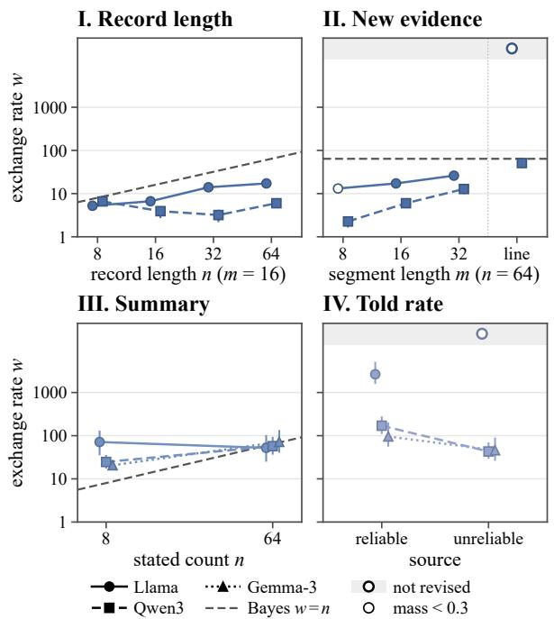  
Figure A4: A record is worth a fraction of its length, a summary a few dozen observations, and a told rate what the model grants its source. I. A shown record in the sampling channel against its length (new segment, $m = 1 6 )$ , with the Bayesian line $w = n$ . II. The same record at n = 64 against the length of the new segment, and under the extended line. III. A summary in the report channel against the count it states. IV. A told rate in the report channel by source reliability. One log scale throughout; top band: not revised $( S \approx 0 )$ . Familybootstrap 95% intervals.

A stated rate and an instruction are reported at 0.85 to 1.00 under every readable query in Llama and Qwen; Gemma answers the next-toss question with a number of its own (0.37). The record and the summary are mostly reported more under Q2 and Q3 than under Q1 and Q4, by up to 0.7 of the slope. Under Q2 every exchange rate is smaller than under Q1: a told rate’s by a factor of about 9 in Gemma and 29 in Qwen, and from no revision to 54 observations in Llama, an instruction’s from no revision to about 50 observations in Llama and Qwen (Gemma holds it, $S = 0 . 0 1 0$ , equivalent to zero), a summary’s and a record’s by factors of 1 to 10. Part of Llama’s answers under Q2 after a summary and a new segment are counts of the segment, which lowers its estimate there (Appendix J). By source reliability under Q2, with 24 paired states per model, Llama retains a reliable and an unreliable rate alike (R 0.39 and 0.42), Qwen reads the unreliable rate at 0.60 against 1.11 before any observation and retains 0.20 and 0.27 of the two afterwards, and Gemma’s told content hardly enters this readout (0.41 and 0.34). In the document frame Q2 leaves an integer mass below 0.3 on told rates in Llama and Qwen and on records and summaries in Gemma, so Q2 is read in the assistant frame throughout. Q3 is readable in the document frame for told rates in all three models (0.92, 0.97 and 0.84).

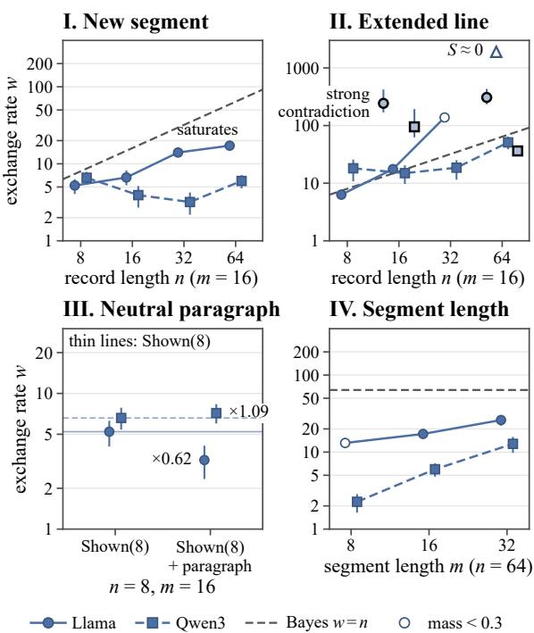  
Figure A5: The sampling-channel exchange rate of a shown record under every layout. I. New segment $( m = 1 6 )$ : w against the record length n, with the Bayesian line $w = n ;$ Llama (solid) rises and saturates, Qwen (dashed) stays flat. II. Extended line: $S \approx 0$ markers at the top edge (primacy); black-edged markers, the strong contradiction. III. A neutral paragraph before the record: ratio of w to the undiluted record. IV. w against the segment length m at $n = 6 4$ . Familybootstrap 95% intervals.

## J Matched current estimates

Section 5 compares routes through the slope of each readout on the content, so two routes are set side by side after each is scaled by how strongly its content is read. The claim that the same answer can have different futures also has a direct form:

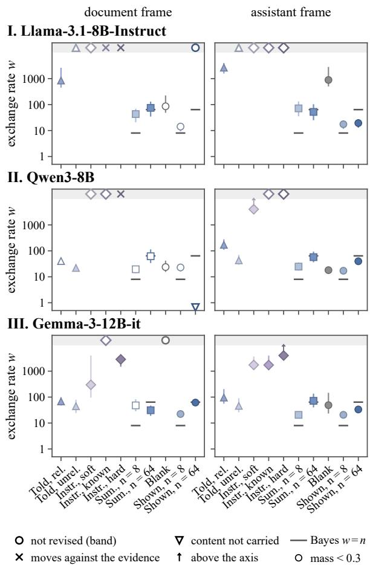  
Figure A6: The exchange rate of every route in the report readout. Exchange rate w of each route in the estimate, document frame (left) and assistant frame (right), for the three models, after a new segment of sixteen observations. Hollow markers in the top band: not revised (S ≈ 0); crosses: moves against the evidence (S < 0); hollow down-triangle: content not carried (a ≈ 0); arrows: values above the axis; grey ticks: the Bayesian w = n for summaries and records. Family-bootstrap 95% intervals.

take two states whose current estimates are equal, append the same evidence to both, and see whether their estimates stay together. This section tests that form on a dense grid of contents.

Design. Each route is prepared at seven content levels. Shown records and summaries hold 16 or 64 observations with 4, 5, 7, 8, 9, 11 and 12, or 16, 21, 27, 32, 37, 43 and 48 heads, eight families per level (the four record wordings twice, and the eight summary templates once, each stating the counts of a record drawn alongside). Told rates and instructions take the values 0.25, 0.33, 0.42, 0.50, 0.58, 0.67 and 0.75, with two sources and four templates for a told rate and three strengths for an instruction, and one state has no content.

Table A2: Wording noise floor per readout and model (mean absolute difference between wordings).
<table><tr><td colspan="3"></td><td colspan="2">Sampling (logit) Report (count) Decision</td><td rowspan="2">(logit)</td></tr><tr><td>Model</td><td>doc.</td><td>asst.</td><td>doc.</td><td>asst.</td></tr><tr><td>Llama</td><td>0.16</td><td>0.64</td><td>2.2</td><td>0.7</td><td>0.25</td></tr><tr><td>Qwen</td><td>0.29</td><td>0.36</td><td>8.4</td><td>5.1</td><td>0.84</td></tr><tr><td>Ġemma 0.59</td><td></td><td>1.15</td><td>1.1</td><td>2.7</td><td>1.46</td></tr></table>

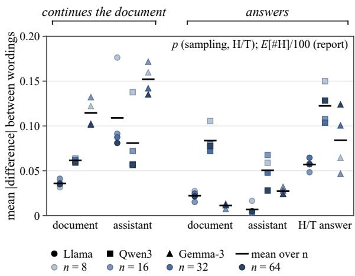  
Figure A7: Wording noise floor. Mean absolute difference between the four wordings of the same shown record, per readout, model and record length, in probability units for the sampling and decision readouts and in expected count over 100 for the report readouts.

Every state is read before and after the same new segments of sixteen observations with 25% or 75% heads, in four orders. Two states of different routes are matched when their current estimates in a readout differ by less than 0.02 (two points). For each matched pair we compare the two estimates after the segment, and the two spreads, the estimate after the 75% segment minus the estimate after the 25% segment. Intervals resample the families of both routes within content levels and recompute the matches. The Steered states are the one-shot writes of Section 6, the mean-difference direction added at layer 8 or 16 with either sign to the last four positions of a record of sixteen observations with 50% heads, whose current estimates cover the range of the natural records.

States with equal estimates move apart. Under both questions in all three models, states of different routes whose current estimates agree within two points no longer agree after the same sixteen observations (Table A4, Figure A8). The difference is clearest in the spread. Under the next-toss question a summary of 64 observations moves 1.6 to 2.2 times as far as a record with the same estimate, and under the expected-count query a told rate stays where it is while a record or a summary with the same estimate moves. In Llama’s sampling channel a steered state, written onto a record of sixteen, moves about as far as a natural record of sixteen with the same estimate (difference in spread 0.03 [−0.01, 0.07]) and farther than a record of 64, as the record of sixteen itself does: the write leaves the response to the segment where it was (Section 6), and both readouts hold less than 0.3 of the mass. Three pairs are not separated: a told rate and an instruction under the expected-count query in Llama and Qwen, which both hold (equivalent within the wording floor); in Qwen a record and a summary under that query (equivalent at a matching tolerance of 0.05); and in Qwen’s sampling channel a record and a summary, which are undecided.

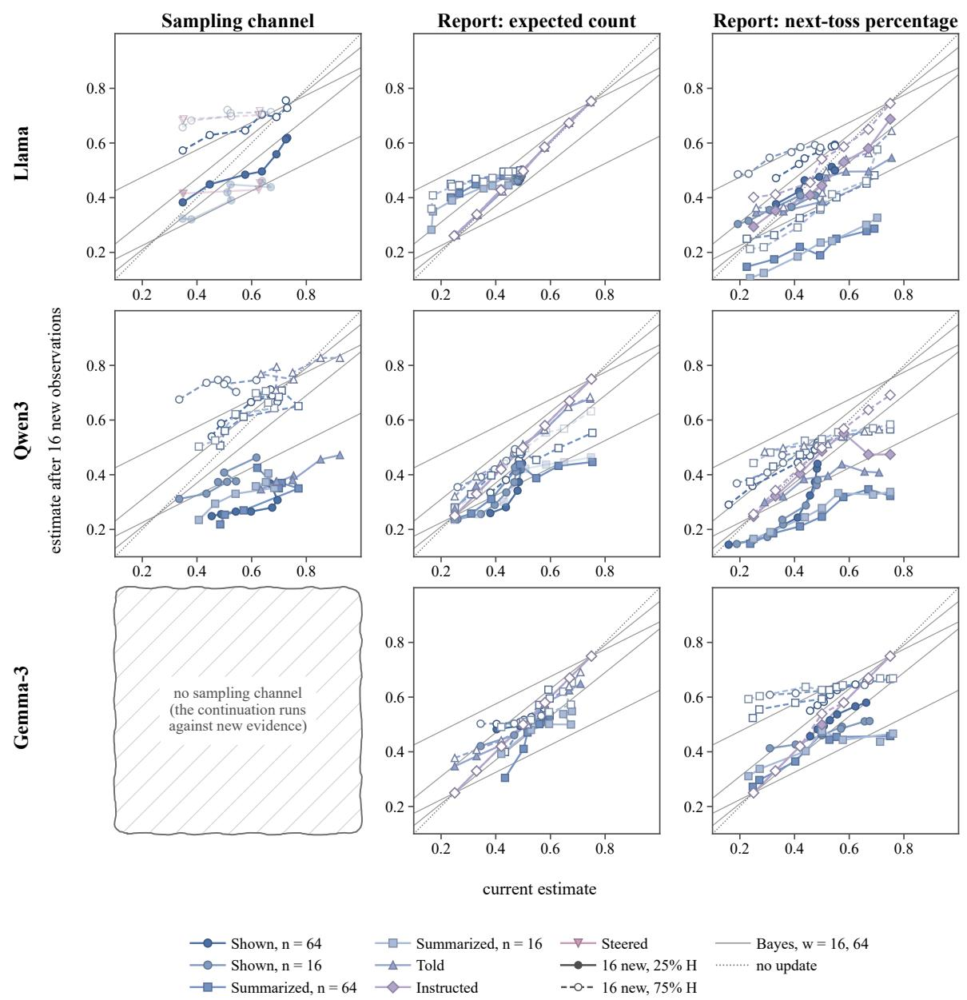  
Figure A8: The estimate after sixteen new observations against the current estimate, route by route. Rows: models. Columns: the sampling channel, the expected-count query and the next-toss question. Each point is the mean over the families of one content level, solid after sixteen observations with 25% heads and hollow after sixteen with 75% heads. Grey: a Bayesian observer whose current estimate is worth 16 or 64 observations. Dotted: no update. A route is drawn where its content reaches the readout, faded where the answer mass is below 0.3. Gemma’s continuation runs against new evidence, so its panel is empty.

Table A3: The report readout under four queries, assistant frame. Slope of the current readout on the content of the route (Told at the central three levels; Instructed at the central three under Q1 and at all five under Q2 to Q4, which round alike), and the exchange rate w of the content under a new segment of sixteen observations with Q1 and with Q2, Told at the central three levels under both (the 95 and 71 of Section 5 pool all five levels). ≡ 0: not revised, the slope on the new segment equivalent to zero within the wording noise floor; n.r.: integer mass below 0.3, not read.
<table><tr><td>Model</td><td>Route</td><td>Q1</td><td>Q2</td><td>Q3</td><td>Q4</td><td>w (Q1)</td><td>w (Q2)</td></tr><tr><td>Llama</td><td>Told Instructed</td><td>0.99</td><td>0.99</td><td>0.99</td><td>0.97</td><td>≡ 0</td><td>54</td></tr><tr><td></td><td>Summarized,  $n = 8$ </td><td>1.00 0.53</td><td>1.00</td><td>1.00</td><td>n.r.</td><td>≡ 0</td><td>49</td></tr><tr><td></td><td>Summarized, n = 64</td><td></td><td>0.94</td><td>0.75</td><td>0.46</td><td>71</td><td>24</td></tr><tr><td></td><td></td><td>0.51</td><td>0.93</td><td>0.72</td><td>0.40</td><td>52</td><td>19</td></tr><tr><td></td><td>Shown, n = 8</td><td>0.12</td><td>0.42</td><td>0.62</td><td>0.20</td><td>17</td><td>7</td></tr><tr><td></td><td>Shown, n = 64</td><td>0.02</td><td>0.43</td><td>0.15</td><td>0.06</td><td>19</td><td>17</td></tr><tr><td>Qwen</td><td>Told</td><td>0.99</td><td>0.85</td><td>0.98</td><td>0.99</td><td>288</td><td>10</td></tr><tr><td></td><td>Instructed</td><td>1.00</td><td>1.00</td><td>1.00</td><td>0.99</td><td>≡0</td><td>49</td></tr><tr><td></td><td>Summarized, n = 8</td><td>0.96</td><td>1.00</td><td>0.99</td><td>0.71</td><td>25</td><td>6</td></tr><tr><td></td><td>Summarized,  $n = 6 4$ </td><td>1.01</td><td>1.02</td><td>1.00</td><td>n.r.</td><td>57</td><td>11</td></tr><tr><td></td><td>Shown, n = 8</td><td>0.42</td><td>0.50</td><td>0.50</td><td>0.49</td><td>17</td><td>6</td></tr><tr><td></td><td>Shown, n = 64</td><td>0.20</td><td>0.66</td><td>0.36</td><td>0.07</td><td>40</td><td>32</td></tr><tr><td>Gemma</td><td>Told</td><td>0.91</td><td>0.37</td><td>0.96</td><td></td><td>205</td><td>23</td></tr><tr><td></td><td>Instructed</td><td>1.00</td><td>1.00</td><td>1.00</td><td>n.r. n.r.</td><td>≡0</td><td>≡ 0</td></tr><tr><td></td><td>Summarized, n = 8</td><td>0.80</td><td>1.01</td><td>0.75</td><td>n.r.</td><td>21</td><td>8</td></tr><tr><td></td><td>Summarized, n = 64</td><td>0.31</td><td>1.01</td><td>0.71</td><td>n.r.</td><td>72</td><td>13</td></tr><tr><td></td><td>Shown, n = 8</td><td>0.18</td><td>0.50</td><td>0.71</td><td>n.r.</td><td>21</td><td>2</td></tr><tr><td></td><td>Shown, n = 64</td><td>0.32</td><td>0.44</td><td>0.75</td><td>n.r.</td><td>33</td><td>20</td></tr></table>

Retention on the matched scale follows the readout. The slope of the estimate after the segment on the current estimate, across the states of one route, ${ \tilde { R } } ,$ is the retention of the route on the scale of its own estimates. Under the next-toss question its order across routes follows the exchange rates of that question (rank correlation 0.77, 0.89 and 0.54 in Llama, Qwen and Gemma; 0.49, 0.20 and 0.77 under the expected-count query) rather than one order of routes: under the expected-count query a told rate keeps more than a summary in Llama and Qwen, and under the next-toss question Qwen keeps more of a record than of a summary or a told rate. Under the expected-count query the current estimate of a record hardly varies with the record (Llama, a slope of 0.02), so its retention on this scale is not defined.

Answers that are counts. Under the next-toss question, after a summary and a new segment, Llama gives part of its answers as counts (the integers up to 20 carry 40 to 47% of the integer mass, against 6 to 16% after a record), which lowers its estimate. Restricted to answers of 21 and above, the difference between a summary and a record with the same estimate falls to a half and to a third (0.12 and 0.06 in place of 0.25 and 0.20) and the difference in spread is unchanged. In Qwen such answers are as frequent after a record as after a summary (about a fifth of the mass), and Gemma almost none.

## K Visibility of the record

The exchange rates of Section 5 suggest that the model recovers the weight of a belief from the text it re-reads, and the transplant of Appendix E shows that the residual at the end of a record does not carry it. A more direct test keeps the record and its cache intact and only takes part of it out of view. For a third of the records of 64 observations of Section 5 (three proportions, twenty families each, worth 14.4 observations here against 17 on all of them), we hide the first h outcomes from every position after the record, the new segment and the query, through the attention mask, while the record’s own positions are computed as usual. With $h = 0$ the masked readout equals the ordinary continuation exactly.

Table A4: Equal current estimates, different futures. Pairs of states of two routes whose current estimates differ by less than 0.02: their number, the range of the matched estimates, the spread of each route (the estimate after sixteen observations with 75% heads minus that after 25%) with its difference $x - y ,$ and the difference $x - y$ of the estimates after each segment. Cont.: the sampling channel. Count: the expected-count query. Next toss: the next-toss question. 64, 16: observations in the record or summary. †: answer mass below 0.3. Family-bootstrap 95% intervals, pairs recomputed on each resample.
<table><tr><td>Model</td><td>Readout</td><td>Routes x / y</td><td>Pairs</td><td>Range</td><td> $\operatorname { S p r e a d } x / y$ </td><td>∆ spread</td><td>∆ after 25 / 75%</td></tr><tr><td rowspan="10">Llama</td><td>cont.</td><td> $\bullet \mathrm { S h o w n } 6 4 / \bullet \mathrm { S h o w n } 1 6 ^ { \dagger }$ </td><td>265</td><td>0.25-0.79</td><td>0.16 / 0.30</td><td> $- 0 . 1 4 \left[ - 0 . 1 9 , - 0 . 0 9 \right]$ </td><td>0.09 / -0.05</td></tr><tr><td>cont.</td><td> $\bullet \operatorname { S h o w n } 6 4 / \mathbb { v } \operatorname { S t e c r e d } ^ { \dagger }$ </td><td>629</td><td>0.25-0.75</td><td>0.16 / 0.26</td><td>-0.10 [−0.15, −0.05]</td><td>0.06 / -0.04</td></tr><tr><td>cont.</td><td> $\bullet \mathrm { S h o w n } ~ 1 6 ^ { \dag } ~ / ~ \mathrm { { v } \mathrm { { S t e e r e d } ^ { \dag } } }$ </td><td>678</td><td>0.23-0.74</td><td>0.30 / 0.27</td><td>0.03 [−0.01, 0.07]</td><td>-0.03 / -0.01</td></tr><tr><td>count</td><td>● Shown 64 /Summarized 64</td><td>655</td><td>0.45–0.52</td><td>0.02 / 0.00</td><td>0.01 [0.01, 0.02]</td><td>-0.01 / 0.00</td></tr><tr><td>count</td><td>● Shown 64  $/ \pm \mathrm { T o l d }$ </td><td>429</td><td>0.48–0.51</td><td>0.02 / 0.00</td><td>0.02 [0.01, 0.02]</td><td>-0.02 / -0.01</td></tr><tr><td>count</td><td>Summarized  $6 4 / { \scriptstyle \pm \mathrm { T o l d } }$ </td><td>238</td><td>0.23-0.52</td><td>0.02 / 0.00</td><td>0.02 [0.01, 0.02]</td><td>0.05 / 0.07</td></tr><tr><td>count</td><td>▲ Told /Instructed</td><td>168</td><td>0.25–0.75</td><td>0.00 / 0.00</td><td>0.00 [0.00, 0.00]</td><td>0.00 / 0.00</td></tr><tr><td>next toss</td><td>● Shown 64 /Summarized 64</td><td>251</td><td>0.27–0.59</td><td>0.08 / 0.13</td><td>-0.05 [−0.08, −0.02]</td><td>0.25 / 0.20</td></tr><tr><td>next toss next toss</td><td>● Shown 64 / ▲ Told</td><td>220</td><td>0.28-0.63</td><td>0.08 / 0.03</td><td>0.06 [0.04, 0.07]</td><td>0.05 / 0.11</td></tr><tr><td></td><td>Summarized 64  $/ \pm \mathrm { T o l d }$ </td><td>281</td><td>0.24–0.76</td><td>0.16 / 0.04</td><td>0.12 [0.09, 0.14]</td><td>-0.22 / -0.10</td></tr><tr><td rowspan="7">Qwen</td><td>cont.</td><td>● Shown 64 /Summarized 64</td><td>128</td><td>0.38–0.85</td><td>0.37 / 0.32</td><td>0.05 [−0.02, 0.11]</td><td>-0.03 / 0.01</td></tr><tr><td>count</td><td>● Shown 64 /Summarized 64</td><td>362</td><td>0.25–0.52</td><td>0.07 / 0.05</td><td>0.01 [-0.03, 0.04]</td><td>-0.02 / -0.01</td></tr><tr><td>count</td><td>● Shown 64 / ▲ Told</td><td>374</td><td>0.25–0.50</td><td>0.07 / 0.00</td><td>0.07 [0.06, 0.07]</td><td>-0.11 / -0.05</td></tr><tr><td>count</td><td>▲ Told /Instructed</td><td>168</td><td>0.25–0.75</td><td>0.01 / 0.00</td><td>0.01 [0.01, 0.02]</td><td>0.00 / 0.01</td></tr><tr><td>next toss next toss</td><td>● Shown 64 / Summarized 64</td><td>160</td><td>0.19–0.50 0.23–0.50</td><td>0.12 / 0.26</td><td>-0.14 [−0.18, −0.11]</td><td>0.13 / -0.01</td></tr><tr><td>next toss</td><td>● Shown 64 / ▲ Told Summarized 64 /▲ Told</td><td>119</td><td>0.25-0.76</td><td>0.14 / 0.15</td><td>0.00 [-0.05, 0.04]</td><td>-0.04 / -0.04</td></tr><tr><td></td><td></td><td>337</td><td></td><td>0.24 / 0.14</td><td>0.10 [0.07, 0.12]</td><td>-0.12 / -0.02</td></tr><tr><td rowspan="3">Gemma</td><td>count</td><td>● Shown 64 /Summarized 64</td><td>1130</td><td>0.25–0.64</td><td>0.01 / 0.03</td><td> $- 0 . 0 2 \left[ - 0 . 0 4 , - 0 . 0 1 \right]$ </td><td>0.03 / 0.01</td></tr><tr><td>count</td><td>Summarized  $6 4 / { \textrm {  { \Delta } T } } _ { \mathrm { 0 l d } }$ </td><td>230</td><td>0.25–0.67 0.40-0.70</td><td>0.05 / 0.00 0.09 / 0.15</td><td>0.05 [0.03, 0.07]</td><td>-0.05 / 0.00</td></tr><tr><td>next toss</td><td>● Shown 64 /Summarized 64</td><td>189</td><td></td><td></td><td> $- 0 . 0 7 \ [ - 0 . 0 9 , - 0 . 0 4 ]$ </td><td>0.06 / 0.00</td></tr></table>

Hiding the first sixteen outcomes changes neither the content nor the weight, though the response to the new segment falls a little at every h (Table A5, Figure A9). Hiding thirty-two or forty-eight lowers both, and in the same proportion: with forty-eight hidden the content keeps 0.34 of its slope and the weight 0.29 of its value, 4.2 observations against 6.6 for a natural record of sixteen. The later outcomes were computed with the earlier ones in view, yet the readout needs to attend to the earlier outcomes themselves for their content and their weight to count. The weight is read from the visible record together with its content, and this experiment cannot separate the two. That the weight is recovered by re-reading, with no store of its own apart from the content, remains a hypothesis consistent with the transplant and with this ablation.

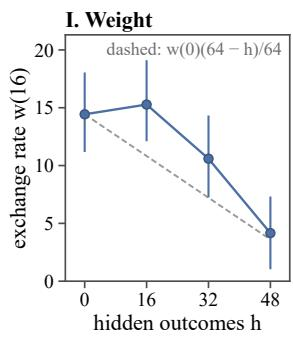

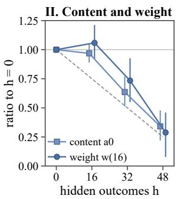  
Figure A9: Content and weight fall together as the record is hidden. I. The exchange rate of a record of 64 observations under sixteen new ones, against the number h of its first outcomes hidden from the positions after the record, dashed where it is proportional to the visible outcomes. II. The content slope $a _ { 0 }$ and the exchange rate as ratios to $h = 0$ . Family-bootstrap 95% intervals.

## L Prompts

Every state is a short document: the task description, one content line set by the route, and a boundary line, read by a query on a line of its own, with new evidence inserted before the boundary line. Generated parts are shown in angle brackets. Steered and Transplanted states are states of the textual routes and add no text of their own.

Table A5: Hiding the beginning of the record lowers content and weight together. Llama’s continuation after a record of 64 observations whose first h outcomes are hidden from the positions after the record. a : slope of the current continuation on the proportion of the record. S, w: slope on the new evidence and exchange rate under sixteen new observations. Ratios to h = 0 from paired resamples. Family-bootstrap 95% intervals.
<table><tr><td>h |a0</td><td></td><td>S</td><td>w</td><td>w ratio</td><td>a0 ratio</td></tr><tr><td>0</td><td>0.70 [0.59, 0.80]</td><td>0.37</td><td>14.4 [11.3, 18.0]</td><td>1.00</td><td>1.00</td></tr><tr><td>16</td><td>0.67 [0.58, 0.76]</td><td>0.28</td><td>15.3 [12.2, 19.0]</td><td>1.06</td><td>0.97</td></tr><tr><td>32</td><td>0.44 [0.36, 0.53]</td><td>0.27</td><td>10.6 [7.3, 14.2]</td><td>0.73</td><td>0.64</td></tr><tr><td>48</td><td>0.24 [0.16, 0.32]</td><td>0.30</td><td>4.2 [1.1, 7.2]</td><td>0.29</td><td>0.34</td></tr></table>

Task and routes. The task description opens every state except the prose list and the bare stream, and the content line of the route follows it on the next line.

## Task description

A coin has an unknown fixed probability of heads. H means heads and T means tails. Tosses are independent given that probability.

A state with no content is this line followed by the boundary line.

## Shown record, wording 1 of 4

The complete observations in their recorded order are: ⟨outcomes⟩

## Shown record, wording 2 of 4

Here is the observed sequence, in order: ⟨outcomes⟩

## Shown record, wording 3 of 4

The record lists the following successive observations: ⟨outcomes⟩

## Shown record, wording 4 of 4

The observations, from first to last, were: ⟨outcomes⟩

The n outcomes are written as H or T, separated by single spaces, on the line of the wording and without a final period. A family’s wording is its replicate index modulo four; the other three wordings of the same record give the noise floor (Appendix H).

## Summarized counts, wording 1 of 8

A complete record contains ⟨k⟩ H outcomes and   
⟨n − k⟩ T outcomes, for ⟨n⟩ observations in   
total.

## Summarized counts, wording 2 of 8

Out of ⟨n⟩ observations, ⟨k⟩ were H and the remaining ⟨n − k⟩ were T.

## Summarized counts, wording 3 of 8

The observed counts are H: ⟨k⟩; T: ⟨n − k⟩; total: ⟨n⟩.

## Summarized counts, wording 4 of 8

The record can be summarized as ⟨k⟩ successes (H) in ⟨n⟩ trials, with ⟨n − k⟩ failures (T).

## Summarized counts, wording 5 of 8

Across ⟨n⟩ completed trials, H occurred ⟨k⟩ times and T occurred ⟨n − k⟩ times.

## Summarized counts, wording 6 of 8

There were ⟨n⟩ outcomes altogether: ⟨k⟩ H outcomes plus ⟨n − k⟩ T outcomes.

## Summarized counts, wording 7 of 8

The tally of the observations is ⟨k⟩ for H and ⟨n − k⟩ for T; the sample size is ⟨n⟩.

## Summarized counts, wording 8 of 8

The observer counted ⟨k⟩ H outcomes among ⟨n⟩ observations, leaving ⟨n − k⟩ T outcomes.

Each summary cell has one state per wording.

## Summarized without counts, 0.25

Most of the observed outcomes were T.

## Summarized without counts, 0.5

About half of the observed outcomes were H.

## Summarized without counts, 0.75

Most of the observed outcomes were H.

## Told, source reliability

On independently checked previous forecasting tasks, this source's reports were judged accurate ⟨95 or 55⟩% of the time.

## Told, wording 1 of 4

A source reports that the probability of H on the next trial is ⟨s⟩.

## Told, wording 2 of 4

According to a source, the next outcome has probability ⟨s⟩ of being H.

## Told, wording 3 of 4

A source gives ⟨s⟩ as its estimate for the probability of the next outcome being H.

## Told, wording 4 of 4

A source states that H has probability ⟨s⟩ on the next observation.

## Told, stated basis

The source says this estimate is based on its   
observations, but supplies neither their   
number nor their individual results.

The told line is the reliability sentence followed, after one space, by one wording, and in half of the states by the stated-basis sentence. The stated rate s is written with two decimals: 0.05, 0.25, 0.50, 0.75 or 0.95.

## Instructed, soft

Assume that the probability of H for this coin   
is ⟨s⟩.

## Instructed, known

It is known that the probability of H for this   
coin is exactly ⟨s⟩.

## Instructed, hard

For this task, treat the probability of H for   
this coin as exactly ⟨s⟩, regardless of any   
observations.

Here s is written as 0.05, 0.25, 0.5, 0.75 or 0.95.

## Boundary line

End of the current instance record.

The boundary line follows the content line, or the last line of new evidence, on a line of its own; a blank line separates it from the query.

Readouts and frames. The two queries take the same place after the boundary line; the frame decides whether the user or the assistant speaks them.

## Sampling query

Next outcome:

The sampling readout is the probability of H against T as the next token, the letter after a space.

## Report query (Q1)

Expected number of H among the next 100   
tosses:␣

The report readout is the distribution over the integers from 0 to 100 that follow the space marked (Appendix C).

## Report query, paraphrase Q2

Probability that the next outcome is H, as a   
whole-number percentage:␣

## Report query, paraphrase Q3

Best estimate of the number of H in the next   
100 tosses:␣

## Report query, paraphrase Q4

If this coin is tossed 100 more times, the   
expected number of H is:␣

Each paraphrase takes the place of Q1 in both frames (Appendix I).

## Document frame Document frame

SYSTEM   
You are a helpful assistant. Follow the task   
instructions and answer in the requested   
format.   
USER   
A coin has an unknown fixed probability of   
heads. H means heads and T means tails.   
Tosses are independent given that   
probability.   
⟨content line⟩   
End of the current instance record.   
Next outcome: Next outcome:

The user turn is left open, and the next token is read inside it.

## Assistant frame

SYSTEM   
You are a helpful assistant. Follow the task   
instructions and answer in the requested   
format.   
USER   
A coin has an unknown fixed probability of   
heads. H means heads and T means tails.   
Tosses are independent given that   
probability.   
⟨content line⟩   
End of the current instance record.   
ASSISTANT   
Next outcome:

The user turn closes after the boundary line, and the assistant turn begins with the query, the sampling query or a report query with its space. Both frames share the system turn, which the three chat templates write in their own way.

## System turn, Llama

SYSTEM   
Cutting Knowledge Date: December 2023   
Today Date: 26 Jul 2024   
You are a helpful assistant. Follow the task   
instructions and answer in the requested   
format.

User turn, Gemma   
USER   
You are a helpful assistant. Follow the task   
instructions and answer in the requested   
format.   
A coin has an unknown fixed probability of   
heads. H means heads and T means tails.   
Tosses are independent given that   
probability.   
⟨content line⟩   
End of the current instance record.

Gemma has no system role: its template writes the

system prompt at the start of the user turn.

## Assistant turn, Qwen in non-thinking mode

ASSISTANT   
<think>   
</think>   
Next outcome:

Qwen’s template opens the assistant turn with an empty reasoning block, and the query follows it.

## Decision prompt

SYSTEM   
⟨system prompt⟩   
USER   
⟨task description⟩   
⟨content line⟩   
End of the current instance record.   
Next outcome? Answer with H or T.   
ASSISTANT   
⟨first token, H or T⟩

The assistant turn is not prefilled; its first token is read as H against T.

New evidence. New evidence goes between the content line and the boundary line, inside the user turn in both frames, and the state is read by the same queries.

## New segment

⟨content line⟩   
New observations of this coin, in order: ⟨m   
new outcomes⟩   
End of the current instance record.

The segment has m ∈ {8, 16, 32} outcomes, written as in the record, with a proportion of 0.25 or 0.75 heads (and 0.5 at m = 16), in four orders per family and eight for the state with no content.

## Extended line

⟨Shown record line⟩ ⟨16 new outcomes⟩   
End of the current instance record.   
Next outcome:

The sixteen new outcomes continue the record’s own line after one space.

## Strong contradiction

⟨Shown record line, n outcomes with 90% H⟩ ⟨16 new   
outcomes with 2 H⟩   
End of the current instance record.   
Next outcome:

The record has 15 heads in 16 or 58 in 64, and the contradicting outcomes come in four orders.

## Count segment, wording 1 of 2

⟨content line⟩   
New observations of this coin: ⟨k⟩ H and   
⟨m − k⟩ T in ⟨m⟩ further tosses.   
End of the current instance record.   
Next outcome:

## Count segment, wording 2 of 2

A further ⟨m⟩ tosses of this coin gave ⟨k⟩ H   
and ⟨m − k⟩ T.

The count segment states m ∈ {8, 16, 32} with k/m of 0.25 or 0.75; the second wording, at m = 16 only, takes the place of the first.

Controls. Each control of Appendix D changes one part of the document or replaces it.

## Count, then estimate

⟨task description⟩   
⟨Shown record line⟩   
End of the current instance record.   
Number of H in the record above:␣⟨count⟩   
Expected number of H among the next 100   
tosses:␣

The count is read as an integer, its most probable value is written in, and the report query follows. In the assistant frame the user turn ends with the boundary line and the assistant turn holds the two query lines.

## Segmented record

⟨task description⟩   
Observations of this coin, session ⟨i⟩ of ⟨g⟩,   
in order: ⟨segment i, 64/g outcomes⟩   
End of the current instance record.

The g lines, one per session i = 1, . . . , g, take the place of the record line, with g ∈ {1, 2, 4, 8}; a new segment follows the last of them.

## Simulate, then sample

⟨task description⟩   
⟨content line⟩   
Simulated outcomes for this coin, in order: ⟨16   
outcomes sampledfrom the model⟩   
End of the current instance record.   
Next outcome:

The outcomes are drawn one at a time at temperature one over H and T and written with single spaces. In the assistant frame the user turn ends with the boundary line, and the assistant turn begins with the simulation line, followed by the boundary line, a blank line and the sampling query.

## Neutral paragraph before the record

⟨task description⟩   
The town library is a quiet old brick building   
near the river. It has tall windows, long   
wooden tables, and a small reading garden   
behind the main hall. On weekday mornings a   
few visitors come in to read the newspapers,   
return books, or sit near the windows before   
lunch.   
⟨Shown record line⟩   
End of the current instance record.

The paragraph stands before records of eight outcomes.

## Washout placebo

⟨Shown record line⟩   
The town library is a quiet old brick building   
near the river. It has tall windows, long   
wooden tables, and a small   
End of the current instance record.   
Next outcome:

The passage takes the place of a new segment of sixteen outcomes: it is the longest word prefix of the same paragraph with that segment’s token count in context, 26 Llama tokens.

## Copy control

⟨told line⟩ For example: ⟨4 outcomes⟩.

The proportion of the examples is 0.75 for a stated 0.25, 0.25 for 0.75, and 0 or 1 for 0.5.

## Prose list

I flipped a coin and it landed on ⟨outcome 1⟩,   
then on ⟨outcome 2⟩, then on ⟨. . . ⟩, then on   
⟨outcome 100⟩, then on

Each outcome is the word heads or tails. There is no task description and no boundary line; the user turn is left open, and the next word, heads or tails, is read.

## Bare stream

⟨record, H as 1 and T as 0, separated by single spaces⟩␣

## Bare stream with new evidence, segment layout

⟨record⟩   
⟨16 new symbols⟩␣

The bare stream has no task description and no boundary line, and the next symbol, 1 or 0, is read after a space. In the line layout the new symbols follow the record after one space.

## Reasoning, Qwen in thinking mode

SYSTEM   
⟨system prompt⟩   
USER   
⟨task description⟩   
⟨content line⟩   
End of the current instance record. ASSISTANT   
⟨reasoning block written by the model⟩

The reasoning block, from the model’s opening to its closing reasoning tag, is decoded greedily up to 1,536 or 4,096 tokens, and the closing tag is added when the model does not write it; the report query takes the place of the sampling query in the same way.

## Health check of an activation write

⟨state⟩   
The weather was mild and the streets were quiet   
that morning.

The mean negative log-likelihood of this line after the state, inside the open user turn, decides with the H and T mass whether a write is healthy.