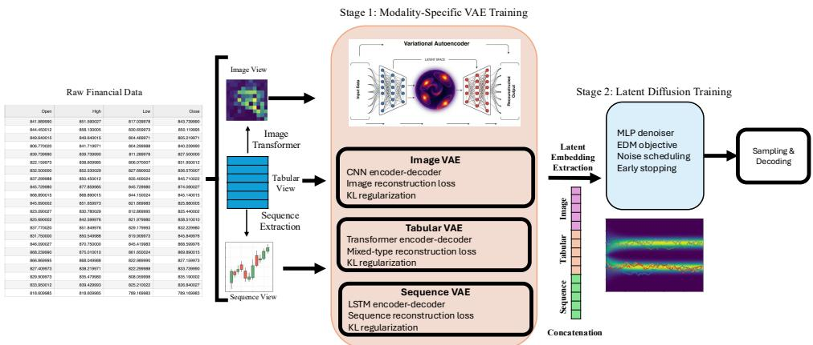
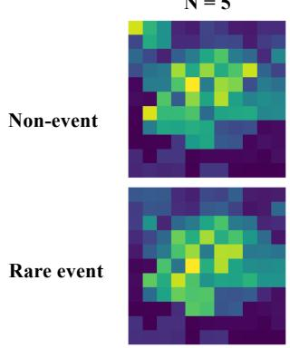
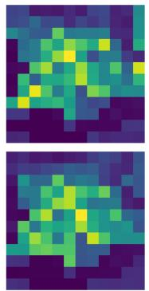
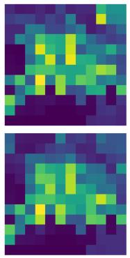
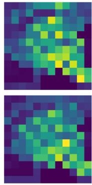
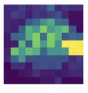
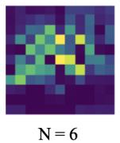
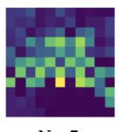
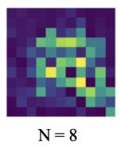

# Scenario Augmentation for Rare Financial Events via Multimodal Latent Diffusion

Mahdi Arab Loodaricheh1 Anita Raja2 Indranil SenGupta2 1The Graduate Center, CUNY 2Hunter College, CUNY Corresponding author: mahdi.arabloodaricheh41@cuny.edu

## Abstract

Extreme market movements are scarce, heterogeneous, and difficult to learn from imbalanced historical data. We study whether generative augmentation can improve the representation and classification of CVaR-labeled rare financial windows while retaining the complementary structure exposed by different financial representations. Each market window is expressed through three aligned modalities: structured market variables, a spatial image transformation, and a sequence of portfolio returns. Separate variational autoencoders map the modalities to compact latent codes, and a class-conditional diffusion model learns their joint latent distribution. Conditional Value-at-Risk (CVaR) provides a risk-aware definition of rare windows and directs generation toward the minority regime. Across four window lengths on U.S. technology equities, the resulting synthetic samples improve fidelity and support relative to tabular diffusion baselines. An XGBoost classifier trained with real and generated samples attains AUCs of 0.953–0.960, exceeding both tabular generators and the corresponding real-only baselines. These results show that multimodal latent generation can provide useful synthetic stress scenarios for data-scarce financial risk models.

Keywords: Rare financial events; scenario augmentation; multimodal learning; latent diffusion models; synthetic financial data; Conditional Value-at-Risk (CVaR); class imbalance.

## 1 Introduction

Data-driven financial risk models face a structural scarcity problem: the market regimes of greatest operational importance are precisely those observed least often. Extreme losses are infrequent, high-dimensional, and heterogeneous, while standard predictors are dominated by normal-market observations [Christoffersen et al., 1998, Basu et al., 2022]. This imbalance is consequential for uncertainty-aware decision support because tail-risk estimates and warning systems depend on a faithful representation of stressed conditions rather than average behavior alone.

Generative augmentation offers a natural response, but financial windows contain several kinds of structure. Raw tabular variables preserve feature-level values; spatial transformations expose local cross-feature and cross-asset relations; and return sequences retain temporal dynamics. Multimodal learning can combine such complementary representations [Baltrušaitis et al., 2019], while diffusion models provide stable distributional coverage for complex data [Ho et al., 2020]. Existing tabular diffusion methods such as TabDDPM [Kotelnikov et al., 2023] and TabSyn [Zhang et al., 2024] are strong generators, but they model only the structured view. MAGE-ID similarly uses multimodal latent diffusion for imbalanced-data augmentation [Loodaricheh et al., 2026]; we extend this approach to financial sequences and CVaR-defined rare events.

We therefore investigate a risk-aware multimodal augmentation framework for rare financial events. A market window is encoded as synchronized tabular, image, and sequence modalities. Modalityspecific variational autoencoders (VAEs) [Kingma and Welling, 2014] produce compact representations that are concatenated and modeled by class-conditional latent diffusion. Rare-event labels are defined using CVaR, connecting the conditioning mechanism to a coherent tail-risk measure [Rockafellar and Uryasev, 2000]. The generated minority samples are evaluated both distributionally and through their utility for a held-out rare-event classifier.

  
Figure 1: Aligned tabular, image, and sequence views are encoded by modality-specific VAEs, modeled by class-conditional latent diffusion, and decoded into synthetic windows.

Our contribution is threefold: (i) a multimodal latent representation of aligned structural, spatial, and temporal financial information; (ii) class-conditional diffusion for targeted synthesis of CVaR-defined rare events; and (iii) an evaluation showing that the generated samples improve synthetic-to-real transfer and real-data augmentation over two tabular diffusion baselines. The study focuses on predictive decision support; it does not claim to evaluate an end-to-end portfolio policy.

## 2 Risk-aware multimodal generation

Financial windows and risk labels. We construct windows of length $N \in \{ 5 , 6 , 7 , 8 \}$ from daily observations of eight major U.S. technology equities. For every equity, the retained variables are open price, close price, and volume, and the overnight gap is defined as ${ \mathrm { G a p } } _ { t } ^ { ( i ) } = \mathrm { O p e n } _ { t } ^ { ( i ) } - \mathrm { C l o s e } _ { t - 1 } ^ { ( i ) }$ Features are min–max normalized using training-fold statistics, and equities are ordered by CAPM beta. For equal-weight return $R _ { t } .$ , define $L _ { t } = - R _ { t }$ and $\operatorname { C V a R } _ { \alpha } = \mathbb { E } [ \hat { L } _ { t } \mid L _ { t } > \operatorname { V a R } _ { \alpha } ] .$ . A window is labeled rare $( y = 1 )$ when its CVaR exceeds the prescribed risk threshold and normal $( y = 0 )$ otherwise, following the risk-aware construction of Mondal et al. [2025]. Risk awareness enters through the CVaR-derived label; the VAE encoders themselves remain risk-agnostic. The label characterizes the same N-day window represented by the input modalities rather than a subsequent prediction horizon. Therefore, the downstream task is contemporaneous rare-window classification, not future-event forecasting. Depending on N, rare windows comprise 9.09–13.65% of the data.We focus on five- to eight-day windows because rare market movements often develop over compact multi-day periods. These horizons provide sufficient temporal context to represent short-term return dynamics while avoiding longer windows that may dilute local rare-event signals and reduce the number of complete training samples.

Aligned modalities. The tabular modality concatenates normalized close, volume, and gap variables across assets and days. For eight equities, this produces $F = 3 | \mathcal { K } | N$ features, ranging from 120 features for $N = 5$ to 192 features for $N = 8 .$ . The image modality applies DeepInsight [Sharma et al., 2019]. The feature layout is learned using only the training fold by embedding features in two dimensions according to their similarity across training samples. The resulting coordinates are mapped to a fixed $1 2 \times 1 2$ grid; when multiple features occupy the same pixel, their values are averaged. For $N = 7$ and ${ \bar { N } } = 8 ,$ , the 168 and 192 features exceed the 144-pixel grid capacity, making collisions and averaging unavoidable; consequently, the image is treated as a lossy auxiliary view, while the tabular branch retains the complete feature-level representation. The sequence modality contains the standardized equal-weight portfolio-return trajectory over the same window.

Thus, the three synchronized modalities expose feature-level, spatial, and temporal structure without introducing unobserved market information.

Modality-specific representation learning. A Transformer VAE models the tabular view, a convolutional VAE models the image, and a bidirectional LSTM VAE models the return sequence. For modality $m \in \{ \mathrm { t a b } , \mathrm { i m g } , \mathrm { s e q } \}$ , the encoder produces $q _ { \phi _ { m } } \left( z _ { m } \mid x _ { m } \right)$ and the decoder reconstructs $\hat { x } _ { m }$ . Stage 1 minimizes reconstruction error and KL regularization, together with pairwise alignment of synchronized latent codes:

$$
\begin{array} { r l } & { \mathcal { L } _ { \mathrm { V A E } } = \displaystyle \sum _ { m } \left[ | | x _ { m } - \hat { x } _ { m } | | _ { 2 } ^ { 2 } + \beta D _ { \mathrm { K L } } ( q _ { \phi _ { m } } ( z _ { m } \mid x _ { m } ) | | \mathcal { N } ( 0 , I ) ) \right] } \\ & { \quad \quad \quad + \lambda _ { \mathrm { a l i g n } } \left( | | z _ { \mathrm { t a b } } - z _ { \mathrm { i m g } } | | _ { 2 } ^ { 2 } + | | z _ { \mathrm { t a b } } - z _ { \mathrm { s e q } } | | _ { 2 } ^ { 2 } \right) . } \end{array}\tag{1}
$$

Equal latent dimensionalities give the three modalities comparable representational capacity before fusion. The image and sequence latents are standardized using training-fold means and standard deviations. The tabular latent is additionally partially whitened to reduce strong correlations and anisotropy while preserving useful structure. These transformations prevent differences in latent scale or covariance from causing one modality to dominate the concatenated representation and provide a better-conditioned space for diffusion training. During generation, the inverse transformations are applied before the modality-specific decoders reconstruct the synthetic observations. The normalized codes are concatenated as $z = [ z _ { \mathrm { t a b } } , z _ { \mathrm { i m g } } , z _ { \mathrm { s e q } } ]$

Conditional latent diffusion. With the VAE parameters fixed, an MLP denoiser is trained on noisy versions of z using a continuous EDM-style schedule. A label embedding conditions the denoiser on normal or rare-event generation. Gaussian noise serves only as the forward corruption process; tail-risk information enters the reverse process through the CVaR-derived class label. Writing $z _ { t }$ for a noisy latent and ϵ for Gaussian noise, Stage 2 minimizes $\mathcal { L } _ { \mathrm { d i f f } } = \mathbb { E } _ { z , \epsilon , t } \lceil \rceil | \epsilon _ { \theta } ( z _ { t } , t , y ) - \check { \epsilon } \rceil | _ { 2 } ^ { 2 } \rceil$ Sampling begins from Gaussian noise, applies the reverse process, separates the generated latent blocks, reverses normalization, and decodes each modality. The generated tabular component is used for downstream rare-event augmentation; the synchronized image and sequence components constrain learning of the joint latent distribution. Figure 1 summarizes the pipeline.

## 3 Experimental evaluation

Protocol. We evaluate $N \in \{ 5 , 6 , 7 , 8 \}$ with five-fold cross-validation. Within every fold, normalization, DeepInsight placement, latent transformations, VAE training, diffusion training, and synthesis use only the training partition. The VAE and diffusion stages are each trained for 2000 epochs. We compare against the official implementations of TabDDPM and TabSyn. Synthetic fidelity and diversity are measured with Precision, Recall, Density, and Coverage (PRDC) [Naeem et al., 2020]. Precision measures the proportion of generated samples supported by the real-data manifold, while Recall measures how broadly the generated distribution covers that manifold. Density evaluates the concentration of synthetic samples around real observations, and Coverage measures the proportion of real samples represented by nearby generated samples. Reporting all four metrics is important because broad distributional coverage alone does not guarantee that the generated observations are locally realistic. Downstream classification utility is evaluated with XGBoost under three protocols: Synth→Real, trained only on generated samples and tested on held-out real data; Real+Synth→Real, trained on augmented real data and tested on held-out real data; and $R e a l {  } R e a l .$ , the unaugmented reference. All reported values are fold means and standard deviations from the existing evaluation.

## 4 Results and discussion

Generative quality. Table 1(a) shows that the multimodal generator provides the strongest overall balance between fidelity and distributional support. For $N = 5 .$ , it achieves the highest Precision, Recall, and Coverage, while TabDDPM obtains the highest Density. A similar pattern appears for $N = 6 \mathrm { : }$ our method produces the highest Precision, Recall, and Coverage, with a moderate reduction in Density relative to TabDDPM. These results indicate that the generated samples cover a broader portion of the rare-event distribution without concentrating only around a small set of observed examples. The difference becomes more pronounced for ${ \check { N } } = { \check { 7 } }$ and $N = 8$ . TabSyn obtains Recall values close to one, but its Precision, Density, and Coverage are nearly zero. This combination suggests that its samples are widely dispersed and frequently fall outside regions strongly supported by the real data. In contrast, multimodal latent diffusion maintains substantially higher Precision, Density, and Coverage at both window sizes. Although its Recall is lower than that of TabSyn, it provides a more balanced trade-off between diversity and local realism. This robustness is consistent with the use of modality-specific encoders and latent normalization, which reduce scale and covariance mismatch before diffusion.

Table 1: Existing five-fold results (mean ± standard deviation). Bold marks the best generated-data value for each N.  
(a) Generative quality (PRDC).
<table><tr><td>N</td><td>Generator</td><td>Precision</td><td>Recall</td><td>Density</td><td>Coverage</td></tr><tr><td rowspan="3">5</td><td>TabDDPM</td><td> $0 . 3 9 7 2 \pm 0 . 0 3 7 6$ </td><td> $0 . 7 4 3 2 \pm 0 . 0 1 5 2$ </td><td> $\mathbf { 0 . 3 1 5 4 \pm 0 . 0 4 0 0 }$ </td><td> $0 . 3 7 9 2 \pm 0 . 0 3 1 7$ </td></tr><tr><td>TabSyn</td><td> $0 . 2 1 3 3 \pm 0 . 0 3 7 5$ </td><td> $0 . 8 0 1 8 \pm 0 . 0 1 2 9$ </td><td> $0 . 1 1 8 9 \pm 0 . 0 2 9 7$ </td><td> $0 . 1 8 2 1 \pm 0 . 0 2 8 8$ </td></tr><tr><td>Ours</td><td> $\mathbf { 0 . 4 0 5 8 \pm 0 . 0 5 1 2 }$ </td><td> $\mathbf { 0 . 8 6 4 0 \pm 0 . 0 0 8 4 }$ </td><td> $0 . 2 3 7 3 \pm 0 . 0 4 3 6$ </td><td> $\mathbf { 0 . 4 1 5 6 \pm 0 . 0 3 4 0 }$ </td></tr><tr><td rowspan="3">6</td><td>TabDDPM</td><td> $0 . 2 3 0 9 \pm 0 . 0 5 8 9$ </td><td> $0 . 7 5 4 8 \pm 0 . 0 1 4 5$ </td><td> $\mathbf { 0 . 1 6 7 9 \pm 0 . 0 4 6 9 }$ </td><td> $0 . 2 4 9 0 \pm 0 . 0 3 6 9$ </td></tr><tr><td>TabSyn</td><td> $0 . 1 0 2 4 \pm 0 . 0 3 4 1$ </td><td> $0 . 8 5 6 6 \pm 0 . 0 5 4 4$ </td><td> $0 . 0 4 8 6 \pm 0 . 0 2 0 1$ </td><td> $0 . 0 8 5 3 \pm 0 . 0 3 2 3$ </td></tr><tr><td>Ours</td><td> $\mathbf { 0 . 2 7 0 8 \pm 0 . 0 4 3 1 }$ </td><td> $\mathbf { 0 . 8 8 9 8 \pm 0 . 0 1 8 1 }$ </td><td> $0 . 1 2 8 9 \pm 0 . 0 5 5 6$ </td><td> $\mathbf { 0 . 2 7 8 6 \pm 0 . 0 3 8 7 }$ </td></tr><tr><td rowspan="3">7</td><td></td><td></td><td></td><td></td><td> $0 . 1 3 9 6 \pm 0 . 0 5 7 9$ </td></tr><tr><td>TabDDPM</td><td> $0 . 1 1 6 1 \pm 0 . 0 5 8 1$   $0 . 0 0 6 5 \pm 0 . 0 0 4 5$ </td><td> $0 . 7 4 8 2 \pm 0 . 0 2 6 6$   $\mathbf { 0 . 9 8 8 7 \mathop { \pm } { 0 . 0 0 5 0 } }$ </td><td> $0 . 0 8 1 6 \pm 0 . 0 4 1 0$   $0 . 0 0 2 4 \pm 0 . 0 0 1 7$ </td><td> $0 . 0 0 4 6 \pm 0 . 0 0 2 8$ </td></tr><tr><td>TabSyn Ours</td><td> $\mathbf { 0 . 3 8 9 2 \mathop { \pm } { 0 . 0 3 6 6 } }$ </td><td> $0 . 5 5 4 5 \pm 0 . 0 2 3 3$ </td><td> $\mathbf { 0 . 3 4 5 2 \pm 0 . 0 5 1 3 }$ </td><td> $\mathbf { 0 . 3 3 2 7 \pm 0 . 0 2 0 9 }$ </td></tr><tr><td rowspan="3">8</td><td></td><td></td><td></td><td></td><td></td></tr><tr><td>TabDDPM</td><td> $0 . 0 8 6 4 \pm 0 . 0 3 2 7$ </td><td> $0 . 7 6 0 5 \pm 0 . 0 1 4 5$ </td><td> $0 . 0 6 4 8 \pm 0 . 0 2 5 7$ </td><td> $0 . 1 3 0 3 \pm 0 . 0 4 0 2$ </td></tr><tr><td>TabSyn Ours</td><td> $0 . 0 0 3 4 \pm 0 . 0 0 2 0$   $\mathbf { 0 . 3 3 0 1 \pm 0 . 0 3 7 7 }$ </td><td> $\mathbf { 0 . 9 8 6 8 \pm 0 . 0 1 1 4 }$   $0 . 5 6 3 4 \pm 0 . 0 4 3 7$ </td><td> $0 . 0 0 1 1 \pm 0 . 0 0 0 7$   $\mathbf { 0 . 2 8 0 2 \mathop { \pm } { 0 . 1 6 8 7 } }$ </td><td> $0 . 0 0 2 2 \pm 0 . 0 0 1 6$   $\mathbf { 0 . 3 0 7 0 \pm 0 . 0 5 7 2 }$ </td></tr></table>

<table><tr><td colspan="5">(b) Downstream AUC. S→R is synthetic-to-real; R+S→R is augmented training.</td></tr><tr><td></td><td>N Generator</td><td>S→R</td><td>R+S→R</td><td>Real→Real</td></tr><tr><td rowspan="3">5</td><td>TabDDPM TabSyn</td><td> $0 . 9 0 5 7 \pm 0 . 0 1 4 3$ </td><td> $0 . 9 3 4 9 \pm 0 . 0 0 8 3$ </td><td rowspan="3"> $0 . 9 2 9 0 \pm 0 . 0 1 1 2$ </td></tr><tr><td></td><td> $0 . 9 0 2 0 \pm 0 . 0 1 7 1$ </td><td> $0 . 9 3 8 3 \pm 0 . 0 0 9 4$ </td></tr><tr><td>Ours</td><td> $\mathbf { 0 . 9 2 6 3 \pm 0 . 0 0 5 3 }$ </td><td> $\mathbf { 0 . 9 5 5 0 \pm 0 . 0 0 0 8 }$ </td></tr><tr><td rowspan="3">6</td><td>TabDDPM</td><td> $0 . 9 1 2 9 \pm 0 . 0 1 0 0$ </td><td> $0 . 9 4 5 1 \pm 0 . 0 0 6 5$ </td><td rowspan="3"> $0 . 9 3 4 2 \pm 0 . 0 0 8 2$ </td></tr><tr><td>TabSyn</td><td> $0 . 8 6 7 8 \pm 0 . 0 6 7 4$ </td><td> $0 . 9 4 3 0 \pm 0 . 0 0 4 4$ </td></tr><tr><td>Ours</td><td> $\mathbf { 0 . 9 3 0 0 \pm 0 . 0 1 4 8 }$ </td><td> $\mathbf { 0 . 9 5 9 6 \pm 0 . 0 0 6 3 }$ </td></tr><tr><td rowspan="3">7</td><td>TabDDPM</td><td> $0 . 9 1 0 1 \pm 0 . 0 1 2 6$ </td><td> $0 . 9 4 4 5 \pm 0 . 0 0 8 5$ </td><td rowspan="3"> $0 . 9 3 2 3 \pm 0 . 0 0 9 7$ </td></tr><tr><td>TabSyn</td><td> $0 . 8 6 0 3 \pm 0 . 0 7 3 7$ </td><td> $0 . 9 4 2 5 \pm 0 . 0 0 6 3$ </td></tr><tr><td>Ours</td><td> $\mathbf { 0 . 9 1 5 1 \pm 0 . 0 0 5 7 }$ </td><td> $\mathbf { 0 . 9 5 3 2 \pm 0 . 0 0 3 4 }$ </td></tr><tr><td rowspan="3">8</td><td>TabDDPM</td><td> $0 . 8 9 1 3 \pm 0 . 0 1 3 4$ </td><td> $0 . 9 3 7 2 \pm 0 . 0 0 6 4$ </td><td rowspan="3"> $0 . 9 2 3 6 \pm 0 . 0 0 4 2$ </td></tr><tr><td>TabSyn</td><td> $0 . 8 1 5 1 \pm 0 . 1 0 0 1$ </td><td> $0 . 9 3 7 4 \pm 0 . 0 0 8 1$ </td></tr><tr><td>Ours</td><td> $\mathbf { 0 . 9 0 4 8 \pm 0 . 0 0 5 1 }$ </td><td> $\mathbf { 0 . 9 5 5 8 \pm 0 . 0 0 5 8 }$ </td></tr></table>

Downstream classification utility. Table 1(b) shows that the proposed generator achieves the highest synthetic-to-real AUC for all four window sizes. This indicates that the generated observations preserve class-discriminative structure that transfers to held-out real data, rather than only reproducing marginal feature statistics. The benefit is stronger when synthetic samples augment the real training set. Real-plus-synthetic AUC ranges from 0.9532 to 0.9596 and exceeds the corresponding realonly result for every window size. For example, at $N = 6 .$ augmentation increases AUC from $0 . 9 \dot { 3 } 4 2 \pm 0 . 0 0 8 2$ to $0 . 9 5 9 6 \pm 0 . 0 0 6 3$ , while at $N = 8$ it increases AUC from $0 . 9 2 3 6 \pm 0 . 0 0 4 2$ to $0 . 9 5 5 8 \pm 0 . 0 0 5 8 .$ . The consistent improvements across all horizons show that the generated rare-event samples provide useful complementary training information under class imbalance. Additional class counts, qualitative examples, and runtime measurements are provided in Appendix A.

## 5 Conclusion

We presented a tail-risk-aware augmentation framework that models aligned tabular, image, and sequence representations through modality-specific VAEs and class-conditional latent diffusion. CVaR provides a risk-aware definition of rare events, while targeted generation addresses their scarcity. Across four window sizes, the generated samples improve synthetic-to-real transfer and real-data augmentation relative to TabDDPM and TabSyn, demonstrating the value of multimodal generation for uncertainty-aware financial risk modeling. The current evaluation focuses on U.S. technology equities; future work will consider broader markets and further analyze the contribution of each modality.

## References

Tadas Baltrušaitis, Chaitanya Ahuja, and Louis-Philippe Morency. Multimodal machine learning: A survey and taxonomy. IEEE Transactions on Pattern Analysis and Machine Intelligence, 41(2): 423–443, 2019. doi: 10.1109/TPAMI.2018.2798607. URL https://doi.org/10.1109/TPAMI. 2018.2798607.

Treena Basu, Olaf Menzer, Joshua Ward, and Indranil SenGupta. A novel implementation of siamese type neural networks in predicting rare fluctuations in financial time series. Risks, 10(2):39, 2022. doi: 10.3390/risks10020039. URL https://doi.org/10.3390/risks10020039.

Peter F. Christoffersen, Francis X. Diebold, and Til Schuermann. Horizon problems and extreme events in financial risk management. Federal Reserve Bank ofNew York Economic Policy Review, 4(3):109–118, October 1998. URL https://www.newyorkfed.org/research/epr/1998n3. html.

Jonathan Ho, Ajay Jain, and Pieter Abbeel. Denoising diffusion probabilistic models. In Advances in Neural Information Processing Systems, volume 33, pages 6840–6851, 2020. URL https://proceedings.neurips.cc/paper/2020/hash/ 4c5bcfec8584af0d967f1ab10179ca4b-Abstract.html.

Diederik P. Kingma and Max Welling. Auto-encoding variational bayes. In The Second International Conference on Learning Representations, 2014. URL https://arxiv.org/abs/1312.6114.

Akim Kotelnikov, Dmitry Baranchuk, Ivan Rubachev, and Artem Babenko. TabDDPM: Modelling tabular data with diffusion models. In Proceedings ofthe 40th International Conference on Machine Learning, volume 202 of Proceedings ofMachine Learning Research, pages 17564–17579. PMLR, 2023. URL https://proceedings.mlr.press/v202/kotelnikov23a.html.

Mahdi Arab Loodaricheh, Mohammad Hossein Manshaei, and Anita Raja. MAGE-ID: A multimodal generative framework for intrusion detection systems. In 2026 International Conference on Computing, Networking and Communications (ICNC), pages 585–589, 2026. doi: 10.1109/ ICNC68183.2026.11416962.

Lubdhak Mondal, Kapil Chandak, Goirik Chakrabarty, and Indranil SenGupta. From pixels to profits: A novel approach to identify rare events for a group of US equities. Annals ofData Science, 2025. doi: 10.1007/s40745-025-00625-9. URL https://doi.org/10.1007/s40745-025-00625-9.

Muhammad Ferjad Naeem, Seong Joon Oh, Youngjung Uh, Yunjey Choi, and Jaejun Yoo. Reliable fidelity and diversity metrics for generative models. In Proceedings of the 37th International Conference on Machine Learning, volume 119 of Proceedings ofMachine Learning Research, pages 7176–7185. PMLR, 2020. URL https://proceedings.mlr.press/v119/naeem20a. html.

R. Tyrrell Rockafellar and Stanislav Uryasev. Optimization of conditional value-at-risk. The Journal ofRisk, 2(3):21–41, 2000. doi: 10.21314/JOR.2000.038. URL https://doi.org/10.21314/ JOR.2000.038.

Alok Sharma, Edwin Vans, Daichi Shigemizu, Keith A. Boroevich, and Tatsuhiko Tsunoda. DeepInsight: A methodology to transform a non-image data to an image for convolution neural network architecture. Scientific Reports, 9(1):11399, 2019. doi: 10.1038/s41598-019-47765-6. URL https://doi.org/10.1038/s41598-019-47765-6.

Hengrui Zhang, Jiani Zhang, Zhengyuan Shen, Balasubramaniam Srinivasan, Xiao Qin, Christos Faloutsos, Huzefa Rangwala, and George Karypis. Mixed-type tabular data synthesis with score-based diffusion in latent space. In The Twelfth International Conference on Learning Representations, 2024. URL https://openreview.net/forum?id=4Ay23yeuz0.

## A Supplementary material

## A.1 Class distribution

Table 2 summarizes the class composition for each window size. Rare events account for only 9.09%–13.65% of the observations, confirming substantial class imbalance across all horizons and motivating targeted minority-class augmentation. The total sample count decreases slightly as N increases because longer rolling windows yield fewer complete observations, while the rare-event proportion rises as longer windows capture more periods of elevated cumulative loss.

Table 2: Class distribution across window sizes.
<table><tr><td>N</td><td>Normal samples</td><td>Rare-event samples</td><td>Rare-event ratio</td></tr><tr><td>5</td><td>5272</td><td>527</td><td>9.09%</td></tr><tr><td>6</td><td>5174</td><td>624</td><td>10.76%</td></tr><tr><td>7</td><td>5085</td><td>712</td><td>12.28%</td></tr><tr><td>8</td><td>5005</td><td>791</td><td>13.65%</td></tr></table>

## A.2 Representative transformed and generated images

Figures 2 and 3 provide qualitative examples of the image modality. Because DeepInsight uses a fixed feature-to-pixel arrangement, differences across images reflect changes in market variables, while the generated examples illustrate the spatial patterns produced under rare-event conditioning.

N = 5  

N = 6  

N = 7  

N = 8  
  
Figure 2: Representative DeepInsight images for normal and rare-event windows across $N \in$ {5, 6, 7, 8}. Pixels encode normalized close, volume, and gap variables arranged by feature similarity.

  
N =5

  
N=7

  
Figure 3: Representative synthetic rare-event image components generated for the four window sizes.

## A.3 Runtime

For $N = 5 ,$ all methods were measured on the same NVIDIA A100 GPU, excluding preprocessing and evaluation. TabSyn required 643.01 seconds for training and 5.47 seconds for sampling; TabDDPM required 463.38 seconds and 14.34 seconds, respectively. The multimodal framework required 697.87 seconds for training and 3.25 seconds for sampling. Its extra training cost reflects the three modality-specific encoders, while latent-space diffusion provides the fastest sampling of the compared methods.