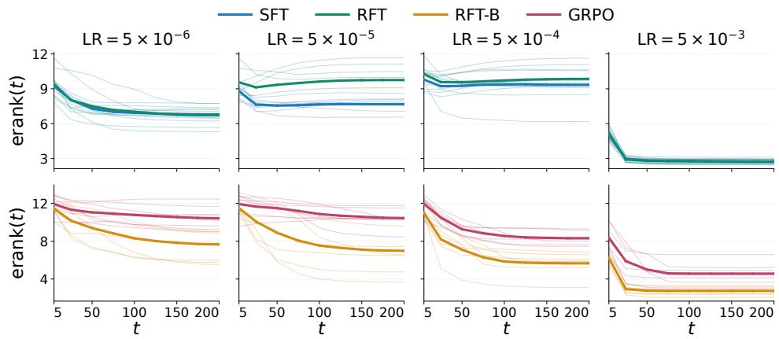
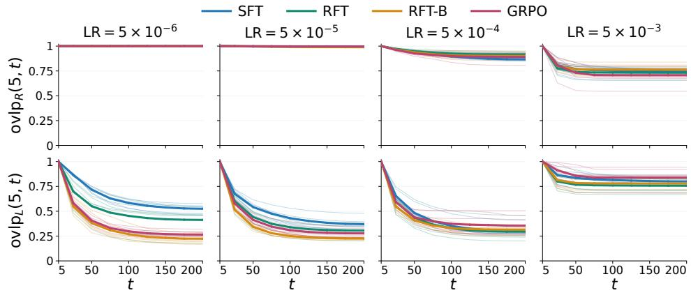
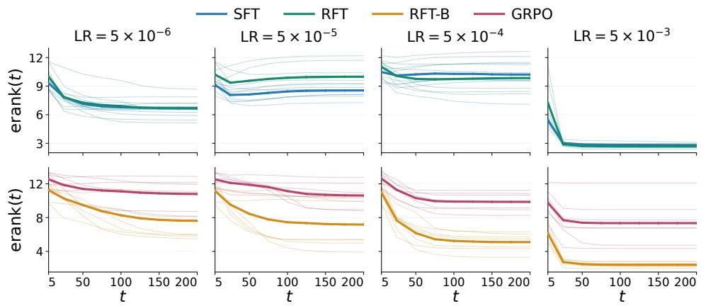
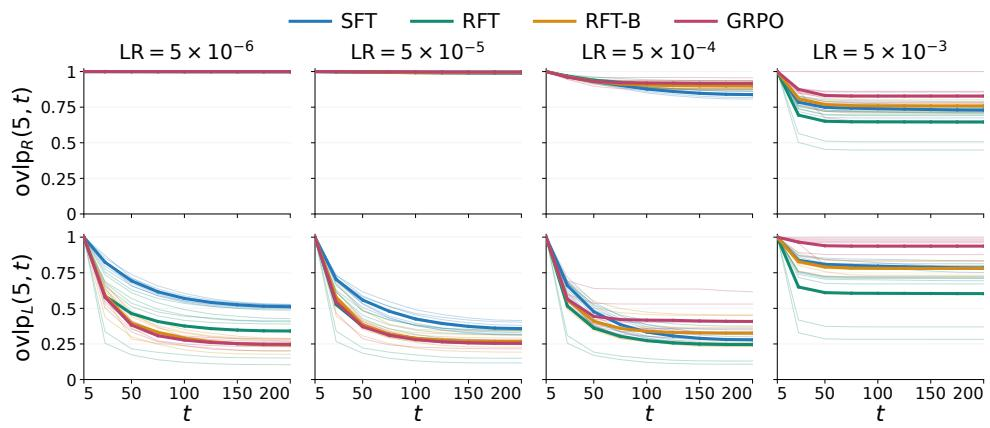
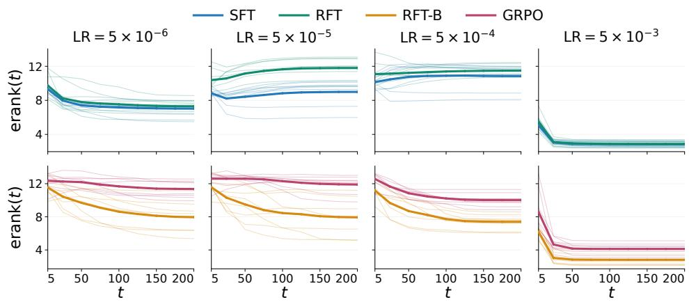
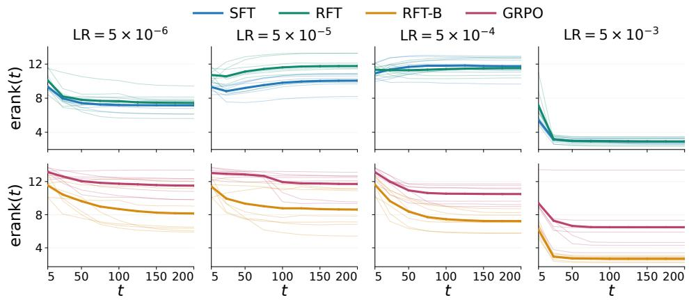
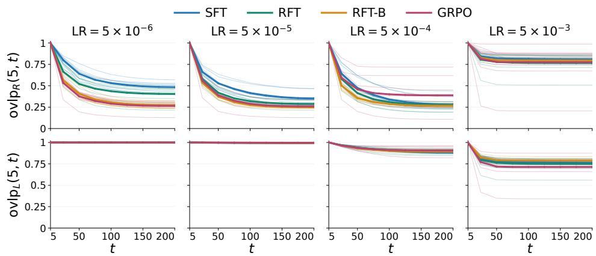
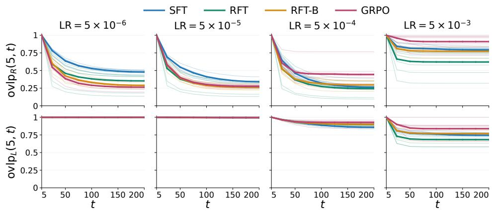
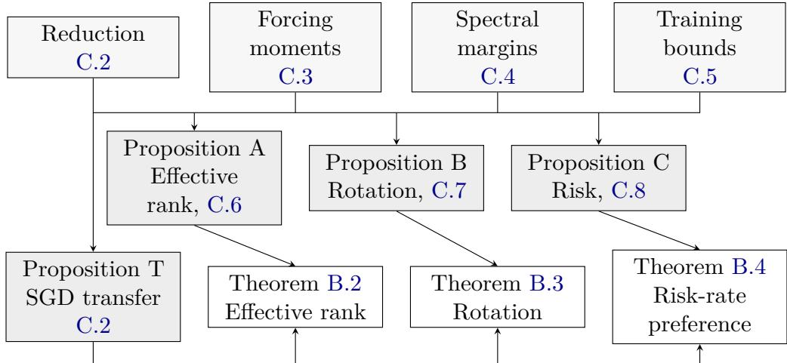

# Spectral and Subspace Dynamics of LoRA in Supervised Fine-Tuning and Reinforcement Learning

Chenruo Liu1∗ Zihan Wang1∗ Yijun Dong2 Qi Lei1

1New York University 2Institute of Science and Technology Austria

## Abstract

Low-rank adaptation (LoRA) is commonly used in both supervised fine-tuning (SFT) and reinforcement learning (RL), often under similar optimizer settings. Yet, how the diferent dynamics of the two stages manifest in the low-rank increment that LoRA optimizes remains unclear. Tracking the singular spectrum and subspaces of LoRA updates on mathematical reasoning tasks, we find that RL concentrates the spectrum at every learning rate, while SFT expands it at moderate learning rates; moreover, RL rotates the singular subspaces much faster than SFT at small learning rates. Interpolating between SFT and RL one ingredient at a time, we pinpoint group-mean baseline subtraction as the source of both contrasts. A quadratic multi-index model updated via LoRA unveils the underlying mechanism: group-mean baseline subtraction tilts the balance between two competing forces, coherent fitting and gradient noise, toward spectral concentration and faster subspace rotation, while forcing the risk-favorable learning rate to be low. Guided by these dynamics, we tailor LoRA updates to each stage: in SFT, we flatten the spectrum of the full update to spread adaptation across singular directions, whereas in RL, we flatten the part of the update outside the current LoRA increment span to promote subspace rotation. Experiments on mathematical reasoning tasks across multiple models show that the respective configurations for SFT and RL yield the best performance among the compared methods in most evaluated settings.

## 1 Introduction

Post-training is an essential step in modern deep learning that adapts a powerful pre-trained model with general knowledge to specialized downstream tasks. A common post-training pipeline consists of two stages: supervised fine-tuning (SFT), which first equips the pre-trained model with primary domain knowledge through of-policy expert demonstrations, followed by reinforcement learning (RL), which further improves the model through its own on-policy responses guided by reward signals like human feedback [25, 27, 32] or verifiable correctness checks [33, 44]. During post-training, parameter-eficient fine-tuning methods like low-rank adaptation (LoRA) [11] are commonly incorporated to reduce the memory and compute footprint. Specifically for LoRA, a frozen pretrained weight $W _ { 0 }$ is adapted by a low-rank update $\begin{array} { r } { \Delta W _ { t } = \frac { \alpha } { r } B _ { t } A _ { t } } \end{array}$ , with trainable factors $B _ { t } \in \mathbb { R } ^ { d _ { o } \times r }$ and $A _ { t } \in \mathbb { R } ^ { r \times d _ { i } }$ of rank $r \ll \operatorname* { m i n } \{ d _ { o } , d _ { i } \}$ , scaled by α. In practice, the LoRA factors

$B _ { t } , A _ { t }$ are often trained by the same optimizer like Adam [17] under nearly identical settings in both SFT and RL.

However, SFT and RL demonstrate distinct behaviors during post-training, suggesting diferent dynamics that can be benefited from tailored optimization strategies. For example, compared to SFT, RL tends to generalize better out of distribution [5, 18], forget less [4, 34], and update sparser subnetworks [24]. RL is also usually run with markedly smaller learning rates compared to SFT [33, 37]. While numerous diferences between $\mathrm { S F T }$ and RL have been observed through model outputs, hidden representations, and full weight matrices, in the context of LoRA, much less is known about how such diferences manifest in the low-rank increment $\Delta W _ { t }$ that LoRA actually optimizes. Filling this gap is a prerequisite for tailoring LoRA optimization to the distinct dynamics of SFT and RL.

We investigate the dynamics of $\Delta W _ { t }$ through two complementary lenses: the spread of singular values measured by the efective rank [30] that determine how the knowledge required for the downstream task is distributed over the r available directions, and the rotation of the left and right singular subspaces that determine which input and output directions are used. We ask through these lenses:

How do SFT and RL difer in the spectrum and singular subspaces of $\Delta W _ { t }$ ; what is the mechanism that drives these diferences; and how can LoRA optimization be tailored to each stage?

## 1.1 Our Contributions

Baseline subtraction separates the LoRA dynamics of SFT and RL (Section 2). Across various Llama and Qwen models on GSM8K [6] and MATH [9], we observed that RL with verifiable reward via group relative policy optimization (GRPO) [33] concentrates the spectrum of $\Delta W _ { t }$ at every learning rate; whereas SFT expands it at moderate learning rates that can facilitate desired downstream performance. For the dynamics of the singular subspaces, we observed that RL with small learning rates rotates the singular subspace much faster than $\mathrm { S F T }$ . Moreover, interpolating between SFT and RL one ingredient at a time, we find that both contrasts appear only once a group-mean baseline is subtracted from the reward, pinpointing baseline subtraction as the key mechanism that separates the LoRA dynamics of SFT and RL.

Baseline subtraction tilts the balance between coherent fitting and gradient noise (Section 3). To understand these contrasts, we analyze a quadratic multi-index model in which a LoRA adapter is trained by stochastic gradient descent (SGD) on pairs of correlated inputs, each pair modeling a GRPO group of responses sampled for the same prompt. Two forces compete in this model: coherent fitting that is linear in the learning rate and concentrates spectral energy on strongly responding directions, as well as feedback from gradient noise that is quadratic in the learning rate and redistributes the spectral energy more evenly. Subtracting a group-mean baseline largely cancels the gradient component shared across a group’s responses, which drives coherent fitting along pretrained directions and anchors successive updates to similar directions, while retaining most of the component that contrasts responses within the group, and damping the gradient noise from task-irrelevant directions. Coherent fitting thus persists through the contrasts while the redistributing feedback loses relative strength, and gradient noise, no longer anchored by the shared component, steers the update directions more, leading to spectral concentration and faster singular subspace rotation during RL. Nevertheless, baseline subtraction can come at a cost for prediction: coherent fitting of the shared component reduces the risk more eficiently than fitting of the contrasts, cancellation of which shrinks the risk reduction from coherent fitting (linear in the learning rate) relative to the cost of gradient noise (quadratic in the learning rate). The risk-favorable learning rate thus remains low, consistent with the common practice in RL.

The dynamics inform stage-specific LoRA optimization (Section 4). Our analysis further shows which dynamics accompany the risk-favorable learning rate: training without a baseline (as in SFT) expands the spectrum of ∆Wt, whereas training with a baseline (as in RL) concentrates the spectrum and rotates the left singular subspace faster. Guided by these dynamics, we tailor the update of LoRA factors to each stage by combining two standard components, a norm-preserving spectral flattening as in Muon [14] and a per-factor choice between SGD and Adam update directions. In SFT, we flatten the singular spectrum of the full update of the factor so that the adaptation is distributed more evenly across singular directions; whereas in RL, we flatten only the component of the update orthogonal to the current left singular subspace of ∆Wt, which promotes subspace rotation while leaving the within-subspace component unchanged. The resulting configurations achieve dominating downstream performance across most evaluated models and tasks.

## 1.2 Related Work

Diferences between supervised and reinforcement fine-tuning. Prior work has characterized diferences between SFT and RL at the output, representation, and parameter levels. At the output level, empirical studies report stronger out-of-distribution performance under RL than SFT [5, 18]. Subsequent work further highlights the dependence of SFT generalization on optimization, data quality, and model capability [29]. Beyond performance, studies examine the diversity of generated outputs: RLHF reduces overall response diversity relative to SFT [18], while analyses distinguishing correct and incorrect reasoning trajectories find that SFT expands the former and RL compresses the latter [21]. Moreover, a line of work examines how changes in the model’s output distribution during fine-tuning relate to the preservation of pretrained capabilities. These studies illustrate how on-policy RL can better preserve distributional modes associated with prior knowledge than SFT [4], and link RL’s better retention to an implicit preference for output distributions closer to that of the initial model in KL divergence [34].

At the hidden representation level, Shi et al. [35] find that SFT rapidly introduces specialized features that stabilize early, whereas RL induces more restrained but continually evolving feature changes.

At the parameter update level, studies report greater sparsity in parameter updates under RL than SFT [24]. Comparisons of update vectors across tasks reveal large absolute cosine similarities under SFT, whereas RL updates are nearly orthogonal [50]. Spectral analyses of the weight matrices further show smaller changes from the pretrained spectra and principal subspaces under RLVR than SFT [49]. Our work also compares spectral and subspace dynamics under SFT and RL. In contrast, we focus on the LoRA update matrix itself, track how its spectral concentration and subspace rotation vary with learning rate and training step, interpolate between SFT and RL through intermediate training settings to identify where these diferences arise, and use these findings to guide the choice of optimizer configurations for LoRA in each paradigm.

Spectral and subspace analyses for LoRA optimization. Prior work uses spectral and subspace analyses to study LoRA and improve it through subspace selection and the allocation of singular values. From a subspace perspective, PiSSA initializes adapters with principal singular components of pretrained weights and reports faster convergence and better task performance than standard LoRA [22]. MiLoRA instead initializes adapters with minor singular components to preserve pretrained knowledge, and its analysis shows less forgetting than PiSSA [40]. Beyond using pretrained weights alone, further work incorporates downstream task information to guide the initialization of LoRA subspaces. LoRA-One initializes LoRA factors to align with the principal singular subspaces of the initial full gradient [48]. Xu et al. [41] study how LoRA factors align with task-relevant directions in a matrix factorization setting and propose a spectral initialization informed by both pretrained weights and the downstream task. Moving from initialization to training, SDC-LoRA finds that LoRA updates can drift toward pretrained principal singular subspaces even with MiLoRA’s minor-subspace initialization. It further reduces forgetting by downscaling the gradient components aligned with these principal subspaces during training [45].

Another line of work examines the allocation of singular values in LoRA update matrices. Kang et al. [15] apply Muon to LoRA and observe more uniform growth of singular values, with efective ranks close to the nominal LoRA rank. Spectral Surgery finds that some singular components of trained LoRA update matrices contribute little to task performance or are even detrimental. It therefore reweights their singular values after training while keeping the learned singular directions fixed to improve task performance [36].

While the above studies address general LoRA optimization and are primarily evaluated in supervised settings, recent work develops methods specifically for RLVR. GeoRA argues that PiSSA’s emphasis on pretrained principal directions can conflict with RLVR’s need to preserve pretrained structure. It therefore uses spectral and weight-magnitude information to construct a masked weight matrix and initializes LoRA adapters from its principal singular components [46]. Similarly, Zhang et al. [47] find that PiSSA and MiLoRA can become unstable under RLVR despite their benefits in SFT. They link this instability to singular-value scaling at initialization and propose an orthonormal initialization that avoids this scaling. In contrast, we compare spectral and subspace dynamics under SFT and RL, and use the observed diferences to guide the choice of optimizer configurations for LoRA during training in each setting.

## 2 Empirical Characterization of LoRA Dynamics

## 2.1 Experimental Setup

Spectral and Subspace Diagnostics of LoRA. For a pretrained weight matrix $W _ { 0 } \in \mathbb { R } ^ { d _ { o } \times d _ { i } }$ 2 LoRA [11] parameterizes the adapted weight at training step t as

$$
W _ { t } = W _ { 0 } + \Delta W _ { t } , \qquad \Delta W _ { t } = \frac { \alpha } { r } B _ { t } A _ { t } ,
$$

where $B _ { t } \in \mathbb { R } ^ { d _ { o } \times r }$ and $A _ { t } \in \mathbb { R } ^ { r \times d _ { i } }$ are trainable, $W _ { 0 }$ remains frozen, $r \ll$ min $\{ d _ { o } , d _ { i } \}$ is the adapter rank, and α controls the scaling. For $t > 0$ , we write the singular value decomposition of the LoRA increment as $\Delta W _ { t } = U _ { t } \Sigma _ { t } V _ { t } ^ { \top }$ , where $\Sigma _ { t } = \operatorname { d i a g } ( \sigma _ { 1 , t } , \ldots , \sigma _ { r , t } )$ with $\sigma _ { 1 , t } \geq \cdot \cdot \cdot \geq \sigma _ { r , t } \geq 0$ , and the matrices $U _ { t } \in \mathbb { R } ^ { d _ { o } \times r }$ and $V _ { t } \in \mathbb { R } ^ { d _ { i } \times r }$ contain the corresponding orthonormal left and right singular vectors, respectively.

We track both the singular values and singular subspaces of the LoRA increment throughout training. To characterize the singular value distribution of $\Delta W _ { t } ,$ we apply the efective rank construction of Roy and Vetterli [30] to the normalized squared singular values:

$$
\operatorname { e r a n k } ( t ) = \exp \left( - \sum _ { i = 1 } ^ { r } \frac { \sigma _ { i , t } ^ { 2 } } { \sum _ { j = 1 } ^ { r } \sigma _ { j , t } ^ { 2 } } \log \frac { \sigma _ { i , t } ^ { 2 } } { \sum _ { j = 1 } ^ { r } \sigma _ { j , t } ^ { 2 } } \right) \in [ 1 , r ] ,
$$

where smaller values indicate a more uneven distribution of $\sigma _ { i , t } ^ { 2 } ,$ i.e., stronger concentration in a few dominant singular directions. Moreover, to characterize subspace rotation between training steps $t _ { 1 }$ and $t _ { 2 } ,$ we measure the overlaps of their left and right singular subspaces:

$$
\begin{array} { r l } & { \mathrm { o v l p } _ { L } ( t _ { 1 } , t _ { 2 } ) = \displaystyle \frac { 1 } { r } \left\| \boldsymbol { U } _ { t _ { 1 } } ^ { \top } \boldsymbol { U } _ { t _ { 2 } } \right\| _ { F } ^ { 2 } \in [ 0 , 1 ] , } \\ & { \mathrm { o v l p } _ { R } ( t _ { 1 } , t _ { 2 } ) = \displaystyle \frac { 1 } { r } \left\| \boldsymbol { V } _ { t _ { 1 } } ^ { \top } \boldsymbol { V } _ { t _ { 2 } } \right\| _ { F } ^ { 2 } \in [ 0 , 1 ] , } \end{array}
$$

where, over the same training interval, smaller overlap values indicate faster subspace rotation.

Interpolating between SFT and RL. Throughout this work, we use GRPO [33] as a representative RL algorithm. To identify the sources of diferences in efective rank and subspace overlap between SFT and RL, we consider a ladder of four training settings that interpolate between the two: (i) SFT, which performs supervised training on gold completions; (ii) Rejection Sampling Fine-Tuning $( \mathrm { R F T } )$ , which replaces gold completions with model-generated completions and trains only on correct ones, corresponding to training weights $r _ { i }$ for binary rewards $r _ { i } \in \{ 0 , 1 \}$ ; (iii) RFT with group-mean baseline subtraction (RFT-B), which introduces baseline subtraction into RFT, changing the weights from $r _ { i }$ to $r _ { i } - { \bar { r } } .$ , where r¯ is the mean reward over all completions for the same prompt; and (iv) GRPO, which extends RFT-B to online sampling and additionally incorporates GRPO optimization mechanisms, including policy ratio clipping and fixed-length loss normalization following Dr. GRPO [20], without KL regularization.

Training and Evaluation Protocol. Our model suite includes the base and instruction-tuned variants of Llama-3.2-1B, Llama-3.2-3B [7], Qwen2.5-3B [26], and Qwen2.5-Math-7B [42], yielding eight models in total. We conduct experiments on the mathematical reasoning benchmarks GSM8K [6] and MATH [9], with the MATH results provided in Appendix A.1. We use LoRA with rank $r = 1 6$ and scaling parameter $\alpha = 3 2$ , applied to all eligible linear modules in the transformer blocks. By default, we use Kaiming uniform initialization for $A _ { 0 } ,$ , with $( A _ { 0 } ) _ { i j } \stackrel { \mathrm { i . i . d . } } { \sim } \mathcal { U } ( - 1 / \sqrt { d _ { i } } , 1 / \sqrt { d _ { i } } )$ and set $B _ { 0 } = 0$ . (Corresponding results with the reverse initialization, using $A _ { 0 } = 0$ and Kaiming uniform initialization for $B _ { 0 }$ , are provided in Appendix A.1.) We use Adam [17] for optimization and consider learning rates $\eta \in \{ 5 \times 1 0 ^ { - 6 } , 5 \times 1 0 ^ { - 5 } , 5 \times 1 0 ^ { - 4 } , 5 \times 1 0 ^ { - 3 } \}$ . For each model and learning rate, we use the same training prompt pool, optimizer hyperparameters, and batch size across the four training settings. RFT and RFT-B additionally share the same ofline completions. All diagnostics are computed separately for each LoRA adapter and then averaged across all adapters.

## 2.2 Spectral and Subspace Dynamics

Efective Rank across Learning Rates. In Figure 1 and Figures 3, 5, and 6 in Appendix A.1, GRPO consistently exhibits decreasing efective rank as training progresses across all learning rates considered. In contrast, the efective rank dynamics of SFT depend on the learning rate: efective rank decreases at both small and large learning rates, while at intermediate learning rates from

Figure 1: On GSM8K under $B _ { 0 } = 0$ initialization, GRPO and RFT-B exhibit decreasing efective rank across all learning rates shown. In contrast, SFT and RFT exhibit an increasing trend from approximately step 25 at intermediate learning rates. Columns correspond to diferent learning rates; the top and bottom rows compare SFT/RFT and GRPO/RFT-B, respectively. Thin curves show individual models, with efective rank averaged over LoRA modules; thick curves show the mean across all models.  
  
Figure 2: On GSM8K under $B _ { 0 } = 0$ initialization, GRPO and RFT-B exhibit a faster decrease in left-subspace overlap than SFT and $\mathrm { R F T }$ at small learning rates, indicating faster subspace rotation. This diference narrows as the learning rate increases. The top and bottom rows show the right-subspace overlap ov $\log _ { R } ( 5 , t )$ and left-subspace overlap $\mathrm { o v l p } _ { L } ( 5 , t )$ , respectively, between the current checkpoint at step t and the reference checkpoint at step 5. Columns correspond to diferent learning rates; each panel compares SFT, RFT, RFT-B, and GRPO. Thin curves show individual models, with overlap averaged over LoRA modules; thick curves show the mean across all models.

$5 \times 1 0 ^ { - 5 }$ to $5 \times 1 0 ^ { - 4 }$ , it begins to increase after approximately 25 training steps. For models that benefit from $\mathrm { S F T ^ { 1 } }$ , this intermediate regime also yields the best SFT performance (Table 5 in Appendix A.2). This observation is consistent with prior findings that both excessively small and large learning rates can impair LoRA SFT performance [3, 8], and further suggests that a less concentrated singular value distribution accompanies more efective adaptation in these settings. Moreover, RFT-B mirrors GRPO in exhibiting decreasing efective rank across all learning rates considered, whereas RFT shares with SFT an intermediate learning rate regime in which efective rank increases. This comparison identifies group-mean baseline subtraction as a key factor underlying the contrasting spectral dynamics.

Subspace Rotation across Learning Rates. Figure 2 and Figures 4, 7, and 8 in Appendix A.1 compare the subspace overlap dynamics across training settings. First, the dominant rotation depends on the LoRA initialization: under $B _ { 0 } = 0$ , the decrease in overlap is generally more pronounced for the left singular subspace, whereas under $A _ { 0 } = 0$ , it is more pronounced for the right singular subspace. Second, at small learning rates, GRPO exhibits a markedly faster decrease in overlap than SFT (in the left subspace under $B _ { 0 } = 0$ and in the right subspace under $A _ { 0 } = 0 )$ indicating more rapid rotation of the LoRA singular subspaces. As the learning rate increases, this gap narrows. Together with the use of smaller learning rates for RL than for SFT in prior studies [33, 37], this pattern suggests that promoting subspace rotation may benefit RL adaptation.

Moreover, as with efective rank, GRPO and RFT-B exhibit similar rotation dynamics, while SFT and RFT form another qualitatively similar pair. These comparisons point to baseline subtraction as the primary source of the observed spectral and subspace diferences in our setting, rather than diferences in completion sources between SFT and RFT, or online sampling and other implementation details distinguishing RFT-B from GRPO. These findings motivate a theoretical understanding of how baseline subtraction shapes spectral concentration and subspace evolution, how these efects depend on the learning rate, and how they relate to prediction risk.

## 3 Theoretical Analysis of LoRA Dynamics

The comparison between RFT and RFT-B in Section 2 suggests that subtracting a group baseline can change how a LoRA adapter learns. We study this mechanism in a model that connects efective rank, singular-subspace rotation, and the learning rates favorable for prediction.

Model and grouped data. We use a quadratic multi-index model, whose prediction depends on several learned projections of the input:

$$
f _ { W } ( x ) = \frac { \| W ^ { \top } x \| _ { 2 } ^ { 2 } - \| W \| _ { F } ^ { 2 } } { \sqrt { 2 } } , \qquad W = W _ { 0 } + B A .
$$

Quadratic models retain learning of both feature strengths and directions, making them useful for studying the two aspects of LoRA geometry considered here [2]. We take unit LoRA scaling, initialize $B _ { 0 } = 0$ and $A _ { 0 }$ with independent Gaussian entries, and train both factors by SGD. The labels are generated from a teacher weight $F _ { \delta } = U _ { 0 } \Sigma _ { 0 } + \delta Z$ , where $W _ { 0 } = U _ { 0 } \Sigma _ { 0 } V _ { 0 } ^ { \top }$ is the compact singular value decomposition and $Z$ is a random task perturbation drawn once, with components along pretrained directions and an orthogonal set of newly useful directions. $\mathrm { A t } ~ \delta = 0$ , the teacher and pretrained student make identical predictions. δ therefore controls the size of the post-training change.

To represent the same-prompt groups in the GRPO formulation, we use a pair of correlated, marginally standard Gaussian inputs. This is the smallest group that contains both shared context and within-group variation. Positive correlation $\rho _ { a }$ along pretrained directions models the common prompt and reusable knowledge. We model completion-specific contrasts by negative correlation $\rho _ { o }$ along newly useful directions. The remaining q task-irrelevant coordinates vary independently. The Gaussian approximation makes this correlation structure analytically tractable. Both training rules sample complete groups from the same fixed dataset.

Their diference is whether they remove the group’s mean residual. Write $\varepsilon _ { \pm } = f _ { W } ( x _ { \pm } ) - f _ { F _ { \delta } } ( x _ { \pm } )$ for the residuals on a pair $( x _ { + } , x _ { - } )$ and $\bar { \varepsilon } = ( \varepsilon _ { + } + \varepsilon _ { - } ) / 2$ . Training without a baseline fits the individual residuals. Training with a group baseline first replaces each $\varepsilon _ { \pm }$ by $\varepsilon _ { \pm } - \bar { \varepsilon }$ , changing the squared loss as follows:

$$
\underbrace { \frac { 1 } { 4 } ( \varepsilon _ { + } ^ { 2 } + \varepsilon _ { - } ^ { 2 } ) } _ { \mathrm { w i t h o u t ~ a ~ b a s e l i n e } } \quad \longrightarrow \quad \underbrace { \frac { 1 } { 4 } \{ ( \varepsilon _ { + } - \bar { \varepsilon } ) ^ { 2 } + ( \varepsilon _ { - } - \bar { \varepsilon } ) ^ { 2 } \} } _ { \mathrm { w i t h ~ a ~ g r o u p ~ b a s e l i n e } } .
$$

This residual operation isolates group baseline subtraction in a regression surrogate for GRPO. We evaluate both rules using the same ordinary population prediction risk.

Post-training regime. It is natural to assume that δZ is suficiently small relative to the pretrained representation, capturing post-training tasks that refine already useful features. We also require enough separation in feature strengths for directions to have diferent learning responses. To obtain a long training window, we let $q \to \infty$ grow polynomially faster than $r ^ { 2 }$ , where r is the LoRA rank. The window in the following theorem then grows without bound and its startup occupies a vanishing fraction.

Theorem 3.1 (Informal main theorem). Under the setting above, there are compatible stable learning-rate intervals such that every low/high pair $\eta _ { L } < \eta _ { H }$ in those intervals has the following properties. After $\widetilde { \cal O } ( r \sqrt { q } )$ startup updates and through $\Theta ( q )$ updates:

1. Efective rank. Without a baseline, expected efective rank increases at every update at $\eta _ { H }$ and decreases at $\eta _ { L }$ . With a group baseline, it decreases at both rates.

2. Left singular-subspace rotation. At either common rate, group baseline subtraction gives smaller expected $\mathrm { o v l p } _ { L } ( t , t + 1 )$ at every adjacent update, for the full rank-r left singular space.

3. Excess risk. At the same update budget, the higher rate gives lower history-averaged risk without a baseline, whereas the lower rate gives lower risk with a group baseline. All four risks decrease. These preferences hold through $\Theta ( q r )$ updates.

See the formal statements, Theorems B.2–B.4, in Appendix B and the complete proofs in Appendix C.

Mechanisms. The efective-rank trend reflects competition between fitting and redistribution across directions. Coherent fitting favors strongly responding directions, concentrating singularvalue energy. Gradient noise, the variation of the stochastic gradient across sampled groups, produces feedback that counteracts this concentration. At leading order in the small task perturbation, the Gram-matrix update has cross terms linear in η and gradient-square terms quadratic in η, so the feedback gains relative influence at larger rates. Normalizing the spectral energy removes uniform growth: efective rank increases only when relative energy becomes more evenly distributed.

Baseline subtraction acts diferently on shared responses and within-group contrasts. Products of shared coordinates have correlation $\rho _ { a } ^ { 2 }$ across the pair, whereas products of shared and newly useful coordinates have correlation $\rho _ { a } \rho _ { o }$ . Subtracting the pair mean therefore retains fractions $\vartheta _ { a } = ( 1 - \rho _ { a } ^ { 2 } ) / 2 < 1 / 2$ and $\vartheta _ { o } = ( 1 - \rho _ { a } \rho _ { o } ) / 2 > 1 / 2$ of their respective residual energies. Similar responses largely cancel, while contrasting responses survive more strongly and continue to drive fitting. When contrasts carry enough task energy, this dispersing feedback loses more relative strength than concentration after spectral normalization. A large learning rate is then needed for redistribution to dominate, allowing to increase efective rank without a baseline and decrease it with one. At the low rate, fitting dominates in both cases.

Rotation measures how much the span of the adapter’s columns changes between checkpoints. Shared responses repeatedly pull updates toward similar directions, helping to stabilize this span across sampled groups. Baseline subtraction suppresses these responses more strongly than within-group contrasts, as reflected by $\vartheta _ { a } < \vartheta _ { o }$ . Diferences between sampled groups consequently have greater influence on the directions of subsequent updates. Then the span changes more between records, giving smaller left singular-subspace overlap.

For risk, the leading prediction gain is linear in the learning rate, while gradient noise contributes a quadratic cost. In this model, fitting the task component along pretrained directions gives more prediction progress per unit residual energy. Since $\vartheta _ { a } < \vartheta _ { o }$ , baseline subtraction suppresses this shared component more strongly, reducing useful progress relative to the noise cost. The favorable learning-rate range therefore shifts downward, yielding the opposite rate preferences in the theorem.

Explaining the empirical observations. The theorem predicts efective-rank growth over a suitable range of learning rates, consistent with the intermediate-rate growth for $\mathrm { S F T / R F T }$ in Figure 1 (Section 2.2). The theoretical high-rate regime has an upper limit, making a diferent trend at the largest tested rates. The leading-order rotation gap also narrows as the learning rate increases over the proved comparison range. Intuitively, larger rates amplify an additional source of rotation from gradient noise. At fixed adjacent updates, this contribution grows quadratically with the rate and is stronger without a baseline, which retains both the group-average and within-group components. It therefore ofsets part of the extra rotation caused by baseline subtraction, consistent with the narrowing empirical separation in Figure 2. Appendix C.7 gives the coeficient comparison.

Implications for optimizer design. The risk comparison first supports diferent learning-rate choices for SFT and group-relative RL. In the model, the favorable higher rate without a baseline accompanies growing efective rank, whereas the favorable lower rate with a baseline accompanies greater left singular-subspace motion than without a baseline at that same rate. The geometry at these respective rates then motivates diferent update priorities: distributing adaptation across singular directions for SFT and promoting motion outside the current left singular subspace for RL. Section 4.1 develops these ideas through a spectral transformation of the full update for SFT and of its component orthogonal to the current left singular subspace for RL. The specific optimizer combinations are evaluated in Section 4.2.

## 4 Dynamics-Informed Configurations for LoRA Optimization

## 4.1 Configuration Design

Motivated by the empirical findings in Section 2 and the theoretical analysis in Section 3, we select dynamics-informed configurations of standard optimizer components for LoRA in SFT and RL, with GRPO as the RL algorithm. Each configuration combines existing ingredients, namely the choice of SGD or Adam update directions for each factor and a spectral transformation of the update of $B ;$ the contribution lies in the principled choice of combination for each stage.

We write an unmodified LoRA step as $A _ { t + 1 } = A _ { t } + \eta D _ { t } ^ { A }$ and $B _ { t + 1 } = B _ { t } + \eta D _ { t } ^ { B }$ , where $D _ { t } ^ { A }$ and $D _ { t } ^ { B }$ denote the signed update directions produced by the base optimizers. For a nonzero matrix $D ,$ we further define a norm-preserving spectral flattening, a variant of the Muon update [14]:

$$
\mathcal { M } ( D ) : = \frac { \| D \| _ { F } } { \sqrt { \operatorname { r a n k } ( D ) } } D \left[ ( D ^ { \top } D ) ^ { \dagger } \right] ^ { 1 / 2 } ,
$$

where † denotes the Moore–Penrose pseudoinverse. This transformation flattens the nonzero singular spectrum by replacing each nonzero singular value with $\| D \| _ { F } / \sqrt { \mathrm { r a n k } ( D ) }$ , while preserving the update magnitude: $\| \mathcal { M } ( D ) \| _ { F } = \| D \| _ { F }$

Dynamics-Informed Configuration for SFT. We use an SGD update direction for B with the spectral transformation M applied to it, and an Adam update direction for A:

$$
\begin{array} { l } { B _ { t + 1 } = B _ { t } + \eta \mathcal { M } ( D _ { t } ^ { B } ) , } \\ { A _ { t + 1 } = A _ { t } + \eta D _ { t } ^ { A } . } \end{array}
$$

Our experiments associate better SFT performance with the growth of efective rank, consistent with the joint geometry and risk trends in Section 3. The configuration therefore departs from standard Adam in two ways. First, prior work finds that Muon promotes more uniform growth across the singular values of the LoRA increment $\Delta W _ { t }$ [15]. We thus apply M to the update of B to encourage spectral flattening. Second, the mechanism of efective rank in Section 3 reflects competition between coherent fitting and feedback from gradient noise. We use SGD for B so that M acts directly on the stochastic gradient’s singular directions, with the aim of encouraging the growth of the efective rank. For A, we retain the standard Adam update, whose moment normalization can compensate for small nonzero gradients and accelerate its early evolution. Meanwhile, since $B _ { 0 } = 0$ , unrolling the updates gives

$$
B _ { t } A _ { t } = \eta \Bigl [ \sum _ { s = 0 } ^ { t - 1 } \mathcal { M } ( D _ { s } ^ { B } ) \Bigr ] A _ { 0 } + \eta ^ { 2 } \Bigl [ \sum _ { s = 0 } ^ { t - 1 } \mathcal { M } ( D _ { s } ^ { B } ) \Bigr ] \Bigl [ \sum _ { s = 0 } ^ { t - 1 } D _ { s } ^ { A } \Bigr ] .
$$

The updates to A enter directly only through the second term, leaving the spectral flattening applied to the B update directions in the first term unchanged.

Dynamics-Informed Configuration for RL. For GRPO, our findings motivate promoting subspace rotation while preserving the within-subspace update. First, we use Adam to compute the base update directions $D _ { t } ^ { A }$ and $D _ { t } ^ { B }$ for the LoRA factors A and B, respectively, retaining adaptive scaling for both factors. Second, while applying M to the full B update distributes the update magnitude more evenly across singular directions and may also promote subspace rotation, the RL configuration further tailors the spectral transformation to target subspace rotation more directly. Define the orthogonal projector onto the current column space of $B _ { t }$ as $P _ { t } : = B _ { t } ( B _ { t } ^ { \top } B _ { t } ) ^ { \dagger } B _ { t } ^ { \top }$ . We apply M only to the component of $D _ { t } ^ { B }$ orthogonal to this space:

$$
\begin{array} { r l } & { B _ { t + 1 } = B _ { t } + \eta \left[ P _ { t } D _ { t } ^ { B } + \mathcal { M } \Big ( ( I - P _ { t } ) D _ { t } ^ { B } \Big ) \right] , } \\ & { A _ { t + 1 } = A _ { t } + \eta D _ { t } ^ { A } . } \end{array}
$$

This update preserves the within-subspace component $P _ { t } D _ { t } ^ { B }$ and flattens the spectrum of the orthogonal component without changing its Frobenius norm. The transformation thus specifically targets updates that move $B _ { t }$ beyond its current column space, providing a direct way to shape subspace rotation.

Table 1: LoRA optimization on GSM8K with Llama-3.2-1B and Llama-3.2-3B. The dynamics-informed configurations in the last row achieve the highest mean accuracies for both SFT (left) and RL (right). Methods are specified by the update directions for the two LoRA factors: Adam and SGD denote the corresponding base optimizer directions $( D _ { t } ^ { A }$ or $D _ { t } ^ { B } )$ , and M denotes the norm-preserving spectral flattening applied to the full direction. For RL, $\mathcal { M } _ { \perp } ( \mathrm { A d a m } )$ denotes $P _ { t } D _ { t } ^ { B } + \mathcal { M } ( ( I - P _ { t } ) D _ { t } ^ { B } )$ with an Adam base direction $\bar { D } _ { t } ^ { B }$ , which preserves the within-subspace component while transforming only the orthogonal component. Values show mean test accuracy $( \% )$ across three seeds, with standard errors in subscripts. For each configuration, results are reported at the learning rate with the highest mean accuracy in a completed sweep. Bold indicates the highest reported mean in each column.
<table><tr><td colspan="4">SFT</td><td colspan="4">RL</td></tr><tr><td></td><td></td><td>A direction B direction Llama-3.2-1B Llama-3.2-3B</td><td></td><td></td><td></td><td>A direction B direction Llama-3.2-1B Llama-3.2-3B</td><td></td></tr><tr><td>Adam</td><td>Adam</td><td> $2 2 . 2 4 _ { \pm 0 . 3 3 }$ </td><td> $4 2 . 9 9 _ { \pm 0 . 3 8 }$ </td><td>Adam</td><td>Adam</td><td> $7 . 6 1 _ { \pm 1 . 2 4 }$ </td><td> $4 2 . 3 6 _ { \pm 3 . 2 5 }$ </td></tr><tr><td>Adam</td><td>M(Adam)</td><td> $2 0 . 9 0 { \scriptstyle \pm 0 . 7 6 }$ </td><td> $4 4 . 4 0 _ { \pm 0 . 9 3 }$ </td><td>Adam</td><td>M(Adam)</td><td> $9 . 6 7 _ { \pm 1 . 2 2 }$ </td><td> $4 6 . 0 0 { \scriptstyle \pm 0 . 7 7 }$ </td></tr><tr><td>Adam</td><td>M(SGD)</td><td> $\mathbf { 2 2 . 8 2 _ { \pm 0 . 1 2 } }$ </td><td> ${ \bf 4 5 . 7 2 _ { \pm 0 . 6 1 } }$ </td><td>Adam</td><td> $\mathcal { M } _ { \perp } ( \mathrm { A d a m } )$ </td><td> $\mathbf { 1 0 . 0 0 _ { \pm 1 . 3 6 } }$ </td><td> $\mathbf { 4 7 . 6 6 _ { \pm 1 . 8 5 } }$ </td></tr></table>

## 4.2 Empirical Evaluation

Experimental Setup. We evaluate SFT and GRPO on GSM8K and MATH. Our model suite includes Llama-3.2-1B, Llama-3.2-1B-Instruct, Llama-3.2-3B, and Qwen2.5-3B. Table 1 presents the GSM8K results for Llama-3.2-1B and Llama-3.2-3B, with additional results provided in Appendix A.2. For both SFT and GRPO, we consider two baselines: standard Adam for both LoRA factors A and $B ;$ and Adam base update directions $D _ { t } ^ { A }$ and $D _ { t } ^ { B }$ , with M applied to $D _ { t } ^ { B }$ . We additionally evaluate the dynamics-informed configurations for SFT and RL described in Section 4.1. These comparisons examine the efects of spectral flattening, base optimizer choice, and selective treatment of the orthogonal component. Detailed experimental configurations are provided in Appendix A.2.

SFT Results. As shown in Tables 1 and 2, while applying M to the full B update with Adam directions does not consistently improve over standard Adam, the dynamics-informed configuration for SFT further replaces the Adam direction for B with SGD and achieves the highest reported mean accuracy across all evaluated models and tasks. These comparisons highlight the benefit of combining spectral flattening with asymmetric optimization of the two LoRA factors.

RL Results. The comparisons in Tables 1, 3, and 4 reveal a diferent preference for GRPO. With Adam directions for both factors, both the configuration that applies M to the full B update and the dynamics-informed RL configuration improve over standard Adam in seven of the eight model–dataset settings. Moreover, the dynamics-informed RL configuration achieves the highest reported mean accuracy in six of the eight settings. This supports the benefit of more selectively targeting the update component responsible for subspace rotation. Overall, the results favor diferent optimizer configurations for SFT and RL, consistent with the distinct dynamics identified in our analysis.

## 5 Conclusion

In this work, we identify distinct spectral and subspace dynamics of LoRA under SFT and RL. Our experiments show that RL efective rank consistently decreases during training across the learning rates considered, while for models that benefit from SFT, the growth of efective rank accompanies better SFT performance at intermediate learning rates. In addition to this diference in spectral dynamics, RL exhibits faster subspace rotation than SFT at small learning rates, with the gap narrowing as the learning rate increases. Controlled comparisons identify group-mean baseline subtraction as a key source of these diferences. Using a multi-index model, our theoretical framework analyzes how baseline subtraction changes coherent fitting and feedback from gradient noise, jointly shaping efective rank, subspace rotation, and learning-rate preferences in prediction risk. These insights guide the choice of two dynamics-informed configurations for LoRA optimization, tailored to the distinct training dynamics of SFT and RL. Both configurations achieve the highest reported mean accuracy in most evaluated settings.

## AI use statement

In this work, we used generative AI tools, including OpenAI’s GPT-6 Astra, Anthropic’s Opus 5.5, and Fable 5.1, to improve manuscript language, identify relevant literature, assist with code creation and editing, and support the development of the theoretical framework and proofs. We have not used generative AI tools to design the core framework, identify the empirical findings, or devise the dynamics-informed configurations. The authors checked the correctness of all AI-assisted revisions and outputs incorporated into this work. We take responsibility for the final content of this work, including text, claims, or artifacts produced with the aid of generative AI.

## Acknowledgements

QL acknowledges support of NSF DMS-2523382.

## References

[1] Radosław Adamczak, Alexander E. Litvak, Alain Pajor, and Nicole Tomczak-Jaegermann. Restricted isometry property of matrices with independent columns and neighborly polytopes by random sampling. Constructive Approximation, 34(1):61–88, 2011. doi: 10.1007/ s00365-010-9117-4. URL https://doi.org/10.1007/s00365-010-9117-4.

[2] Gerard Ben Arous, Murat A Erdogdu, Nuri Mert Vural, and Denny Wu. Learning quadratic neural networks in high dimensions: SGD dynamics and scaling laws. In The Thirty-ninth Annual Conference on Neural Information Processing Systems, 2025.

[3] Dan Biderman, Jacob Portes, Jose Javier Gonzalez Ortiz, Mansheej Paul, Philip Greengard, Connor Jennings, Daniel King, Sam Havens, Vitaliy Chiley, Jonathan Frankle, Cody Blakeney, and John Patrick Cunningham. LoRA learns less and forgets less. Transactions on Machine Learning Research, 2024. ISSN 2835-8856.

[4] Howard Chen, Noam Razin, Karthik R Narasimhan, and Danqi Chen. Retaining by doing: The role of on-policy data in mitigating forgetting. In Forty-third International Conference on Machine Learning, 2026.

[5] Tianzhe Chu, Yuexiang Zhai, Jihan Yang, Shengbang Tong, Saining Xie, Dale Schuurmans, Quoc V Le, Sergey Levine, and Yi Ma. SFT memorizes, RL generalizes: A comparative study of

foundation model post-training. In Forty-second International Conference on Machine Learning, 2025.

[6] Karl Cobbe, Vineet Kosaraju, Mohammad Bavarian, Mark Chen, Heewoo Jun, Lukasz Kaiser, Matthias Plappert, Jerry Tworek, Jacob Hilton, Reiichiro Nakano, et al. Training verifiers to solve math word problems. arXiv preprint arXiv:2110.14168, 2021.

[7] Aaron Grattafiori, Abhimanyu Dubey, Abhinav Jauhri, Abhinav Pandey, Abhishek Kadian, Ahmad Al-Dahle, Aiesha Letman, Akhil Mathur, Alan Schelten, Alex Vaughan, et al. The llama 3 herd of models. arXiv preprint arXiv:2407.21783, 2024.

[8] Soufiane Hayou, Nikhil Ghosh, and Bin Yu. Lora+: Eficient low rank adaptation of large models. arXiv preprint arXiv:2402.12354, 2024.

[9] Dan Hendrycks, Collin Burns, Saurav Kadavath, Akul Arora, Steven Basart, Eric Tang, Dawn Song, and Jacob Steinhardt. Measuring mathematical problem solving with the math dataset. arXiv preprint arXiv:2103.03874, 2021.

[10] Roger A. Horn and Charles R. Johnson. Matrix Analysis. Cambridge University Press, 2 edition, 2013.

[11] Edward J Hu, yelong shen, Phillip Wallis, Zeyuan Allen-Zhu, Yuanzhi Li, Shean Wang, Lu Wang, and Weizhu Chen. LoRA: Low-rank adaptation of large language models. In International Conference on Learning Representations, 2022. URL https://openreview.net/forum?id= nZeVKeeFYf9.

[12] Leon Isserlis. On a formula for the product-moment coeficient of any order of a normal frequency distribution in any number of variables. Biometrika, 12(1–2):134–139, 1918. doi: 10.1093/biomet/12.1-2.134.

[13] Svante Janson. Gaussian Hilbert Spaces, volume 129 of Cambridge Tracts in Mathematics. Cambridge University Press, 1997. doi: 10.1017/CBO9780511526169.

[14] Keller Jordan, Yuchen Jin, Vlado Boza, Jiacheng You, Franz Cesista, Laker Newhouse, and Jeremy Bernstein. Muon: An optimizer for hidden layers in neural networks, 2024. URL https://kellerjordan.github.io/posts/muon.

[15] Changmin Kang, Jihun Yun, Baekrok Shin, Yeseul Cho, and Chulhee Yun. Uniform spectral growth and convergence of muon in lora-style matrix factorization. arXiv preprint arXiv:2602.06385, 2026.

[16] Aayush Karan, Sitan Chen, and Yilun Du. Finetuning with sampling: Sft learns better than you think. arXiv preprint arXiv:2610.02140, 2026.

[17] Diederik P Kingma and Jimmy Ba. Adam: A method for stochastic optimization. arXiv preprint arXiv:1412.6980, 2014.

[18] Robert Kirk, Ishita Mediratta, Christoforos Nalmpantis, Jelena Luketina, Eric Hambro, Edward Grefenstette, and Roberta Raileanu. Understanding the efects of rlhf on llm generalisation and diversity. In International Conference on Learning Representations, volume 2024, pages 20620–20653, 2024.

[19] Franz Lehner and Kamil Szpojankowski. Boolean cumulants and subordination in free probability. Random Matrices: Theory and Applications, 10(4):2150036, 2021. doi: 10.1142/ S2010326321500362. URL https://doi.org/10.1142/S2010326321500362.

[20] Zichen Liu, Changyu Chen, Wenjun Li, Penghui Qi, Tianyu Pang, Chao Du, Wee Sun Lee, and Min Lin. Understanding r1-zero-like training: A critical perspective. In Second Conference on Language Modeling, 2025.

[21] Kohsei Matsutani, Shota Takashiro, Gouki Minegishi, Takeshi Kojima, Yusuke Iwasawa, and Yutaka Matsuo. Rl squeezes, sft expands: A comparative study of reasoning llms. In International Conference on Learning Representations, volume 2026, pages 141482–141526, 2026.

[22] Fanxu Meng, Zhaohui Wang, and Muhan Zhang. Pissa: Principal singular values and singular vectors adaptation of large language models. Advances in Neural Information Processing Systems, 37:121038–121072, 2024.

[23] James A. Mingo and Mihai Popa. Real second order freeness and Haar orthogonal matrices. Journal of Mathematical Physics, 54:051701, 2013. doi: 10.1063/1.4804168. URL https: //doi.org/10.1063/1.4804168.

[24] Sagnik Mukherjee, Lifan Yuan, Dilek Hakkani-Tür, and Hao Peng. Reinforcement learning finetunes small subnetworks in large language models. In The Thirty-ninth Annual Conference on Neural Information Processing Systems, 2025.

[25] Long Ouyang, Jefrey Wu, Xu Jiang, Diogo Almeida, Carroll Wainwright, Pamela Mishkin, Chong Zhang, Sandhini Agarwal, Katarina Slama, Alex Ray, et al. Training language models to follow instructions with human feedback. Advances in Neural Information Processing Systems, 35:27730–27744, 2022.

[26] Qwen, An Yang, Baosong Yang, Beichen Zhang, Binyuan Hui, Bo Zheng, Bowen Yu, Chengyuan Li, Dayiheng Liu, Fei Huang, Haoran Wei, Huan Lin, Jian Yang, Jianhong Tu, Jianwei Zhang, Jianxin Yang, Jiaxi Yang, Jingren Zhou, Junyang Lin, Kai Dang, Keming Lu, Keqin Bao, Kexin Yang, Le Yu, Mei Li, Mingfeng Xue, Pei Zhang, Qin Zhu, Rui Men, Runji Lin, Tianhao Li, Tianyi Tang, Tingyu Xia, Xingzhang Ren, Xuancheng Ren, Yang Fan, Yang Su, Yichang Zhang, Yu Wan, Yuqiong Liu, Zeyu Cui, Zhenru Zhang, and Zihan Qiu. Qwen2.5 technical report, 2025. URL https://arxiv.org/abs/2412.15115.

[27] Rafael Rafailov, Archit Sharma, Eric Mitchell, Christopher D Manning, Stefano Ermon, and Chelsea Finn. Direct preference optimization: Your language model is secretly a reward model. Advances in Neural Information Processing Systems, 36:53728–53741, 2023.

[28] Darshita Rathore, Vineet Kumar, Chetna Bansal, and Anindya Moitra. How much is too much? exploring lora rank trade-ofs for retaining knowledge and domain robustness. In Proceedings of the 14th International Joint Conference on Natural Language Processing and the 4th Conference of the Asia-Pacific Chapter of the Association for Computational Linguistics, pages 1003–1013, 2025.

[29] Qihan Ren, Wang Peng, Ruikun Cai, Shuai Shao, Dadi Guo, Yuejin Xie, Yafu Li, Quanshi Zhang, Xia Hu, Jing Shao, and Dongrui Liu. Rethinking generalization in reasoning SFT: A conditional analysis on optimization, data, and model capability. In Third Conference on Language Modeling, 2026.

[30] Olivier Roy and Martin Vetterli. The efective rank: A measure of efective dimensionality. In 2007 15th European signal processing conference, pages 606–610. IEEE, 2007.

[31] Mark Rudelson and Roman Vershynin. Hanson–Wright inequality and sub-Gaussian concentration. Electronic Communications in Probability, 18:no. 82, 1–9, 2013. doi: 10.1214/ECP. v18-2865. URL https://doi.org/10.1214/ECP.v18-2865.

[32] John Schulman, Filip Wolski, Prafulla Dhariwal, Alec Radford, and Oleg Klimov. Proximal policy optimization algorithms. arXiv preprint arXiv:1707.06347, 2017.

[33] Zhihong Shao, Peiyi Wang, Qihao Zhu, Runxin Xu, Junxiao Song, Xiao Bi, Haowei Zhang, Mingchuan Zhang, YK Li, Yang Wu, et al. Deepseekmath: Pushing the limits of mathematical reasoning in open language models. arXiv preprint arXiv:2402.03300, 2024.

[34] Idan Shenfeld, Jyothish Pari, and Pulkit Agrawal. Rl’s razor: Why online reinforcement learning forgets less. In International Conference on Learning Representations, volume 2026, pages 59839–59864, 2026.

[35] Dan Shi, Zhuowen Han, Simon Ostermann, Renren Jin, Josef van Genabith, and Deyi Xiong. Why does reinforcement learning generalize? a feature-level mechanistic study of post-training in large language models. In Proceedings of the 64th Annual Meeting of the Association for Computational Linguistics (Volume 1: Long Papers), pages 38979–39000, 2026.

[36] Zailong Tian, Yanzhe Chen, Zhuoheng Han, and Lizi Liao. Spectral surgery: Training-free refinement of lora via gradient-guided singular value reweighting. arXiv preprint arXiv:2603.03995, 2026.

[37] Hugo Touvron, Louis Martin, Kevin Stone, Peter Albert, Amjad Almahairi, Yasmine Babaei, Nikolay Bashlykov, Soumya Batra, Prajjwal Bhargava, Shruti Bhosale, et al. Llama 2: Open foundation and fine-tuned chat models. arXiv preprint arXiv:2307.09288, 2023.

[38] Joel A. Tropp. User-friendly tail bounds for sums of random matrices. Foundations of Computational Mathematics, 12:389–434, 2012. doi: 10.1007/s10208-011-9099-z.

[39] Roman Vershynin. Introduction to the non-asymptotic analysis of random matrices. In Yonina C. Eldar and Gitta Kutyniok, editors, Compressed Sensing: Theory and Applications, pages 210–268. Cambridge University Press, 2012.

[40] Hanqing Wang, Yixia Li, Shuo Wang, Guanhua Chen, and Yun Chen. Milora: Harnessing minor singular components for parameter-eficient llm finetuning. In Proceedings of the 2025 Conference of the Nations of the Americas Chapter of the Association for Computational Linguistics: Human Language Technologies (Volume 1: Long Papers), pages 4823–4836, 2025.

[41] Ziqing Xu, Hancheng Min, Jinqi Luo, Lachlan Ewen MacDonald, Salma Tarmoun, Enrique Mallada, and Rene Vidal. Understanding the learning dynamics of loRA: A gradient flow perspective on low-rank adaptation in matrix factorization. In The 28th International Conference on Artificial Intelligence and Statistics, 2025.

[42] An Yang, Beichen Zhang, Binyuan Hui, Bofei Gao, Bowen Yu, Chengpeng Li, Dayiheng Liu, Jianhong Tu, Jingren Zhou, Junyang Lin, et al. Qwen2.5-math technical report: Toward mathematical expert model via self-improvement. arXiv preprint arXiv:2409.12122, 2024.

[43] Huifeng Yin, Yu Zhao, Minghao Wu, Xuanfan Ni, Bo Zeng, Hao Wang, Tianqi Shi, Liangying Shao, Chenyang Lyu, Longyue Wang, Weihua Luo, and Kaifu Zhang. Marco-o1 v2: Towards widening the distillation bottleneck for reasoning models. In Wanxiang Che, Joyce Nabende, Ekaterina Shutova, and Mohammad Taher Pilehvar, editors, Proceedings of the 63rd Annual Meeting of the Association for Computational Linguistics (Volume 1: Long Papers), pages 23506–23516, Vienna, Austria, July 2025. Association for Computational Linguistics. ISBN 979-8-89176-251-0. doi: 10.18653/v1/2025.acl-long.1145. URL https://aclanthology.org/ 2025.acl-long.1145/.

[44] Qiying Yu, Zheng Zhang, Ruofei Zhu, Yufeng Yuan, Xiaochen Zuo, YuYue, Weinan Dai, Tiantian Fan, Gaohong Liu, Juncai Liu, LingJun Liu, Xin Liu, Haibin Lin, Zhiqi Lin, Bole Ma, Guangming Sheng, Yuxuan Tong, Chi Zhang, Mofan Zhang, Ru Zhang, Wang Zhang, Hang Zhu, Jinhua Zhu, Jiaze Chen, Jiangjie Chen, Chengyi Wang, Hongli Yu, Yuxuan Song, Xiangpeng Wei, Hao Zhou, Jingjing Liu, Wei-Ying Ma, Ya-Qin Zhang, Lin Yan, Yonghui Wu, and Mingxuan Wang. DAPO: An open-source LLM reinforcement learning system at scale. In The Thirty-ninth Annual Conference on Neural Information Processing Systems, 2025.

[45] Geyuan Zhang, Xiaofei Zhou, Shihao Liu, Jingyuan Tian, and Jizheng Ma. Sdc-lora: Singularsubspace drift controlled lora to mitigate knowledge forgetting. In Findings of the Association for Computational Linguistics: ACL 2026, pages 24116–24132, 2026.

[46] Jiaying Zhang, Lei Shi, Jiguo Li, Jun Xu, Jiuchong Gao, Jinghua Hao, and Renqing He. Geora: Geometry-aware low-rank adaptation for rlvr. In Proceedings of the 64th Annual Meeting of the Association for Computational Linguistics (Volume 1: Long Papers), pages 24207–24221, 2026.

[47] Ruijia Zhang, Jiacheng Zhu, Hanqing Zhu, and Laixi Shi. Geometry-preserving orthonormal initialization for low-rank adaptation in rlvr. arXiv preprint arXiv:2606.31813, 2026.

[48] Yuanhe Zhang, Fanghui Liu, and Yudong Chen. LoRA-one: One-step full gradient could sufice for fine-tuning large language models, provably and eficiently. In Forty-second International Conference on Machine Learning, 2025.

[49] Hanqing Zhu, Zhenyu Zhang, Hanxian Huang, DiJia Su, Zechun Liu, Jiawei Zhao, Igor Fedorov, Hamed Pirsiavash, Zhizhou Sha, Jinwon Lee, et al. The path not taken: Rlvr provably learns of the principals. arXiv preprint arXiv:2511.08567, 2025.

[50] Kejian Zhu, Zhuoran Jin, Shangqing Tu, Hongbang Yuan, Yushi Bai, Kang Liu, Juanzi Li, and Jun Zhao. Sft conflicts, rl coexists: A theoretical and empirical analysis of multi-task learning for llms. arXiv preprint arXiv:2608.03573, 2026.

## A Supplementary Experiments

## A.1 Additional Experiments for the Empirical Characterization of LoRA Dynamics

Additional Results under $B _ { 0 } = 0$ Initialization. Section 2 reports the main spectral and subspace dynamics on GSM8K under our default initialization, where $A _ { 0 }$ is Kaiming uniform initialized and $B _ { 0 } = 0$ . To examine whether these observations extend across datasets, we additionally report the corresponding results on MATH. As shown in Figures 3 and 4, the dynamics of efective rank and subspace overlap exhibit qualitatively similar patterns to those observed on GSM8K.

  
Figure 3: On MATH under $B _ { 0 } = 0$ initialization, GRPO and $\mathrm { R F T - B }$ exhibit decreasing efective rank across all learning rates shown. In contrast, SFT and RFT exhibit an increasing trend from approximately step 25 at intermediate learning rates. Columns correspond to diferent learning rates; the top and bottom rows compare SFT/RFT and GRPO/RFT-B, respectively. Thin curves show individual models, with efective rank averaged over LoRA modules; thick curves show the mean across all models.

  
Figure 4: On MATH under $B _ { 0 } = 0$ initialization, GRPO and RFT-B exhibit a faster decrease in left-subspace overlap than SFT and RFT at small learning rates, indicating faster subspace rotation. This diference narrows as the learning rate increases. The top and bottom rows show the right-subspace overlap $\mathrm { o v l p } _ { R } ( 5 , t )$ and left-subspace overlap $\mathrm { o v l p } _ { L } ( 5 , t )$ , respectively, between the current checkpoint at step t and the reference checkpoint at step 5. Columns correspond to diferent learning rates; each panel compares SFT, RFT, RFT-B, and GRPO. Thin curves show individual models, with overlap averaged over LoRA modules; thick curves show the mean across all models.

Reverse Initialization with $A _ { 0 } = 0$ . We further examine whether the dynamics identified in Section 2 are robust to the choice of LoRA factor initialization by reversing the default initialization: we set $A _ { 0 } = 0$ and use Kaiming uniform initialization for $B _ { 0 }$ . Figures 5–8 show the corresponding dynamics of efective rank and subspace overlap on GSM8K and MATH. The main qualitative observations remain consistent with those under the default initialization. For efective rank, SFT exhibits a pattern that depends on the learning rate, with efective rank decreasing at small and large learning rates while an increasing trend emerges at intermediate learning rates; in contrast, GRPO predominantly exhibits decreasing efective rank. For subspace overlap, GRPO exhibits a markedly faster decrease in overlap than SFT at small learning rates, while this gap narrows as the learning rate increases. Across both measures, SFT and RFT remain qualitatively similar, while RFT-B and GRPO form another similar pair. These results further support the conclusion from Section 2 that group-mean baseline subtraction is the primary factor underlying the observed diferences in spectral and subspace dynamics.

  
Figure 5: On GSM8K under $A _ { 0 } = 0$ initialization, GRPO and RFT-B exhibit decreasing efective rank across all learning rates shown. In contrast, SFT and RFT exhibit an increasing trend from approximately step 25 at intermediate learning rates. Columns correspond to diferent learning rates; the top and bottom rows compare SFT/RFT and GRPO/RFT-B, respectively. Thin curves show individual models, with efective rank averaged over LoRA modules; thick curves show the mean across all models.

  
Figure 6: On MATH under $A _ { 0 } = 0$ initialization, GRPO and RFT-B exhibit decreasing efective rank across all learning rates shown. In contrast, SFT and RFT exhibit an increasing trend from approximately step 25 at intermediate learning rates. Columns correspond to diferent learning rates; the top and bottom rows compare SFT/RFT and GRPO/RFT-B, respectively. Thin curves show individual models, with efective rank averaged over LoRA modules; thick curves show the mean across all models.

  
Figure 7: On GSM8K under $A _ { 0 } = 0$ initialization, GRPO and RFT-B exhibit a faster decrease in right-subspace overlap than SFT and RFT at small learning rates, indicating faster subspace rotation. This diference narrows as the learning rate increases. The top and bottom rows show the right-subspace overlap $\mathrm { o v l p } _ { R } ( 5 , t )$ and left-subspace overlap $\mathrm { o v l p } _ { L } ( 5 , t )$ , respectively, between the current checkpoint at step t and the reference checkpoint at step 5. Columns correspond to diferent learning rates; each panel compares SFT, RFT, RFT-B, and GRPO. Thin curves show individual models, with overlap averaged over LoRA modules; thick curves show the mean across all models.

  
Figure 8: On MATH under $A _ { 0 } = 0$ initialization, GRPO and $\mathrm { R F T - B }$ exhibit a faster decrease in right-subspace overlap than SFT and RFT at small learning rates, indicating faster subspace rotation. This diference narrows as the learning rate increases. The top and bottom rows show the right-subspace overlap $\mathrm { o v l p } _ { R } ( 5 , t )$ and left-subspace overlap $\mathrm { o v l p } _ { L } ( 5 , t )$ , respectively, between the current checkpoint at step t and the reference checkpoint at step 5. Columns correspond to diferent learning rates; each panel compares SFT, RFT, RFT-B, and GRPO. Thin curves show individual models, with overlap averaged over LoRA modules; thick curves show the mean across all models.

## A.2 Additional Experiments for Dynamics-Informed Configurations

Experimental Configurations. For the configuration experiments in Section 4.2, we use fixed data partitions across all optimizer configurations. For both GSM8K and MATH, we retain the original training and test splits and reserve 1,000 examples from the training split for validation.

We use LoRA with rank $r = 1 6 .$ , scaling parameter $\alpha = 3 2$ , and dropout 0.05. Adapters are applied to all eligible linear modules in the transformer blocks, including the query, key, value, and output projections in self-attention and the gate, up, and down projections in the MLP blocks. We use the standard initialization with Kaiming-uniform $A _ { 0 }$ and $B _ { 0 } = 0$ . For configurations using Adam update directions, we sweep the initial learning rate over $\{ 5 \times 1 0 ^ { - 6 } , 5 \times 1 0 ^ { - 5 } , 5 \times 1 0 ^ { - 4 } , 5 \times 1 0 ^ { - 3 } \}$ For the configuration using an SGD base update direction for B and an Adam direction for A, we use the larger learning-rate grid $\{ 5 \times 1 0 ^ { - 4 } , 5 \times 1 0 ^ { - 3 } , 1 0 ^ { - 2 } , 5 \times 1 0 ^ { - 2 } \}$ to accommodate the SGD direction. The learning rate is linearly decayed during training with no warmup. Adam uses $( \beta _ { 1 } , \beta _ { 2 } ) = ( 0 . 9 , 0 . 9 9 9 )$ and $\epsilon = 1 0 ^ { - 8 }$ . SGD uses zero momentum and zero weight decay.

Each learning rate is evaluated with three random seeds, {7, 42, 44}. Training is run for at most 1,000 optimizer steps. We save a checkpoint and evaluate validation pass@1 every 50 optimizer steps, and stop training after three consecutive validation evaluations without a strict improvement. For each run, the checkpoint attaining the highest mean validation pass@1 is restored for final test evaluation. We then average test accuracy across the three seeds; the results in Section 4.2 report the learning rate with the highest mean accuracy over the completed sweep, together with the standard error across seeds.

Additional Results. Table 2 reports SFT performance on MATH. Tables 3 and 4 report RL performance on GSM8K and MATH, respectively. Table 5 provides the detailed learning-rate sweeps for SFT on both datasets, while Tables 6 and 7 provide the corresponding sweeps for RL on GSM8K and MATH, respectively.

Table 2: SFT optimization on MATH with Llama-3.2-1B and Llama-3.2-3B. The dynamics-informed configuration in the last row achieves the highest mean accuracies. Methods are specified by the update directions for the two LoRA factors: Adam and SGD denote the corresponding base optimizer directions $( D _ { t } ^ { A } \ \mathrm { o r } \ D _ { t } ^ { B } )$ , and M denotes the norm-preserving spectral flattening applied to the full direction. Values show mean test accuracy $( \% )$ across three seeds, with standard errors in subscripts. For each configuration, results are reported at the learning rate with the highest mean accuracy in a completed sweep. Bold indicates the highest reported mean in each model column.
<table><tr><td>A direction</td><td>B direction</td><td>Llama-3.2-1B</td><td>Llama-3.2-3B</td></tr><tr><td>Adam</td><td>Adam</td><td> $5 . 6 6 _ { \pm 0 . 0 9 }$ </td><td> $1 0 . 8 3 _ { \pm 0 . 1 3 }$ </td></tr><tr><td>Adam</td><td>M(Adam)</td><td> $5 . 9 3 _ { \pm 0 . 1 4 }$ </td><td> $1 0 . 5 3 { \scriptstyle \pm 0 . 1 4 }$ </td></tr><tr><td>Adam</td><td>M(SGD)</td><td> ${ \bf 6 . 0 1 } _ { \pm 0 . 2 5 }$ </td><td> ${ \bf 1 1 . 3 2 _ { \pm 0 . 2 2 } }$ </td></tr></table>

Table 3: RL optimization on GSM8K with Llama-3.2-1B, Llama-3.2-1B-Instruct, Llama-3.2-3B, and Qwen2.5-3B. The dynamics-informed configuration in the last row achieves the highest reported mean accuracy in each model column. Methods are specified by the update directions for the two LoRA factors: Adam denotes the corresponding base optimizer direction $( D _ { t } ^ { A }$ or $D _ { t } ^ { B } )$ , and M denotes the norm-preserving spectral flattening applied to the full direction. $\mathcal { M } _ { \perp } ( \mathrm { A d a m } )$ denotes $P t D _ { t } ^ { B } + \mathcal { M } ( ( I - P t ) D _ { t } ^ { B } )$ with an Adam base direction $D _ { t } ^ { B }$ , which preserves the within-subspace component while transforming only the orthogonal component. Values show mean test accuracy (%) across three seeds, with standard errors in subscripts. For each configuration, results are reported at the learning rate with the highest mean accuracy in a completed sweep. Bold indicates the highest reported mean in each mode column.
<table><tr><td>A direction</td><td>B direction</td><td>Llama-3.2-1B</td><td>Llama-3.2-1B-Instruct</td><td>Llama-3.2-3B</td><td>Qwen2.5-3B</td></tr><tr><td>Adam</td><td>Adam</td><td> $7 . 6 1 _ { \pm 1 . 2 4 }$ </td><td> $5 7 . 8 5 _ { \pm 0 . 3 9 }$ </td><td> $4 2 . 3 6 _ { \pm 3 . 2 5 }$ </td><td> $8 3 . 9 3 _ { \pm 0 . 3 4 }$ </td></tr><tr><td>Adam</td><td>M(Adam)</td><td> $9 . 6 7 _ { \pm 1 . 2 2 }$ </td><td> $5 7 . 9 7 _ { \pm 0 . 1 8 }$ </td><td> $4 6 . 0 0 { \scriptstyle \pm 0 . 7 7 }$ </td><td> $8 4 . 4 6 _ { \pm 0 . 3 8 }$ </td></tr><tr><td>Adam</td><td>M⊥(Adam)</td><td> $\mathbf { 1 0 . 0 0 _ { \pm 1 . 3 6 } }$ </td><td> ${ \bf 5 8 . 2 3 _ { \pm 0 . 7 2 } }$ </td><td> $\mathbf { 4 7 . 6 6 _ { \pm 1 . 8 5 } }$ </td><td> ${ \bf 8 4 . 5 1 { \scriptstyle \pm 0 . 6 2 } }$ </td></tr></table>

Table 4: RL optimization on MATH with Llama-3.2-1B, Llama-3.2-1B-Instruct, Llama-3.2-3B, and Qwen2.5-3B. The dynamics-informed configuration in the last row achieves the highest reported mean accuracy on two of the four models. Methods are specified by the update directions for the two LoRA factors: Adam denotes the corresponding base optimizer direction $( D _ { t } ^ { A } \ \mathrm { { o r } } \ D _ { t } ^ { B } )$ , and M denotes the norm-preserving spectral flattening applied to the full direction. $\mathcal { M } _ { \perp } ( \mathrm { A d a m } )$ denotes $P _ { t } D _ { t } ^ { B } + \dot { \mathcal { M } } ( ( I - P _ { t } ) D _ { t } ^ { B } )$ with an Adam base direction $D _ { t } ^ { B }$ , which preserves the within-subspace component while transforming only the orthogonal component. Values show mean test accuracy (%) across three seeds, with standard errors in subscripts. For each configuration, results are reported at the learning rate with the highest mean accuracy in a completed sweep. Bold indicates the highest reported mean in each model column.
<table><tr><td>A direction</td><td>B direction</td><td>Llama-3.2-1B</td><td>Llama-3.2-1B-Instruct</td><td>Llama-3.2-3B</td><td>Qwen2.5-3B</td></tr><tr><td>Adam</td><td>Adam</td><td> $5 . 0 4 _ { \pm 0 . 2 8 }$ </td><td> $3 3 . 4 4 _ { \pm 0 . 5 2 }$ </td><td> ${ \bf 9 . 4 1 _ { \pm 0 . 8 7 } }$ </td><td> $6 3 . 0 3 _ { \pm 0 . 2 3 }$ </td></tr><tr><td>Adam</td><td> ${ \mathcal { M } } ( { \mathrm { A d a m } } )$ </td><td> $5 . 4 3 _ { \pm 0 . 2 8 }$ </td><td> $\mathbf { 3 4 . 1 6 _ { \pm 0 . 6 1 } }$ </td><td> $9 . 2 1 _ { \pm 0 . 4 4 }$ </td><td> $6 3 . 3 7 { \scriptstyle \pm 0 . 2 1 }$ </td></tr><tr><td>Adam</td><td> $\mathcal { M } _ { \perp } ( \mathrm { A d a m } )$ </td><td> ${ \bf 5 . 6 5 { \scriptstyle \pm 0 . 2 7 } }$ </td><td> $3 3 . 7 1 _ { \pm 0 . 1 7 }$ </td><td> $8 . 2 1 _ { \pm 0 . 4 2 }$ </td><td> ${ \bf 6 3 . 5 4 } _ { \pm 0 . 2 1 }$ </td></tr></table>

Table 5: Detailed learning-rate sweeps for SFT on GSM8K and MATH. Methods are specified by the update directions for the two LoRA factors: Adam and SGD denote the corresponding base optimizer directions $( D _ { t } ^ { A }$ or $D _ { t } ^ { B } )$ ), and M denotes the norm-preserving spectral flattening applied to the full direction. Values show mean test accuracy (%) across three seeds, with standard errors in subscripts. Bold indicates the highest mean accuracy across learning rates for each update configuration and model–dataset pair.
<table><tr><td></td><td></td><td></td><td colspan="2">GSM8K</td><td colspan="2">MATH</td></tr><tr><td></td><td>A direction B direction LR</td><td></td><td></td><td>Llama-3.2-1BLlama-3.2-3B</td><td></td><td>Llama-3.2-1BLlama-3.2-3B</td></tr><tr><td>Adam</td><td>Adam</td><td> $5 \times 1 0 ^ { - 6 }$ </td><td> $1 0 . 8 7 _ { \pm 1 . 2 0 }$ </td><td> $3 2 . 3 5 { \scriptstyle \pm 0 . 3 7 }$ </td><td> $5 . 0 6 _ { \pm 0 . 0 2 }$ </td><td> $1 0 . 1 9 _ { \pm 0 . 2 1 }$ </td></tr><tr><td></td><td></td><td> $5 \times 1 0 ^ { - 5 }$ </td><td> $2 0 . 6 0 _ { \pm 0 . 6 1 }$ </td><td> $\mathbf { 4 2 . 9 9 _ { \pm 0 . 3 8 } }$ </td><td> $5 . 4 6 _ { \pm 0 . 1 2 }$ </td><td> $1 0 . 5 7 _ { \pm 0 . 2 1 }$ </td></tr><tr><td></td><td></td><td> $5 \times 1 0 ^ { - 4 }$ </td><td> ${ \bf 2 2 . 2 4 _ { \pm 0 . 3 3 } }$ </td><td> $4 2 . 6 8 _ { \pm 0 . 9 2 }$ </td><td> ${ \bf 5 . 6 6 _ { \pm 0 . 0 9 } }$ </td><td> $\mathbf { 1 0 . 8 3 _ { \pm 0 . 1 3 } }$ </td></tr><tr><td></td><td></td><td> $5 \times 1 0 ^ { - 3 }$ </td><td> $2 . 6 5 _ { \pm 0 . 0 8 }$ </td><td> $0 . 5 8 { \scriptstyle \pm 0 . 5 8 }$ </td><td> $3 . 4 3 _ { \pm 0 . 5 2 }$ </td><td> $2 . 8 3 _ { \pm 1 . 4 1 }$ </td></tr><tr><td>Adam</td><td>M(Adam)</td><td> $5 \times 1 0 ^ { - 6 }$ </td><td> $1 1 . 2 2 _ { \pm 0 . 2 0 }$ </td><td> $3 0 . 6 5 _ { \pm 0 . 6 2 }$ </td><td> $4 . 9 6 _ { \pm 0 . 1 4 }$ </td><td> $1 0 . 4 4 _ { \pm 0 . 1 6 }$ </td></tr><tr><td></td><td></td><td> $5 \times 1 0 ^ { - 5 }$ </td><td> $\mathbf { 2 0 . 9 0 _ { \pm 0 . 7 6 } }$ </td><td> $\mathbf { 4 4 . 4 0 _ { \pm 0 . 9 3 } }$ </td><td> $5 . 4 5 _ { \pm 0 . 1 7 }$ </td><td> $1 0 . 3 9 _ { \pm 0 . 3 6 }$ </td></tr><tr><td></td><td></td><td> $5 \times 1 0 ^ { - 4 }$ </td><td> $2 0 . 6 7 _ { \pm 0 . 3 2 }$ </td><td> $4 3 . 4 7 _ { \pm 0 . 5 4 }$ </td><td> ${ \bf 5 . 9 3 _ { \pm 0 . 1 4 } }$ </td><td> $\mathbf { 1 0 . 5 3 _ { \pm 0 . 1 4 } }$ </td></tr><tr><td></td><td></td><td> $5 \times 1 0 ^ { - 3 }$ </td><td> $2 . 4 3 _ { \pm 0 . 2 7 }$ </td><td> $2 . 4 5 _ { \pm 0 . 2 4 }$ </td><td> $4 . 1 5 _ { \pm 0 . 1 5 }$ </td><td> $3 . 8 3 _ { \pm 0 . 3 8 }$ </td></tr><tr><td>Adam</td><td>M(SGD)</td><td> $5 \times 1 0 ^ { - 4 }$ </td><td> $1 3 . 0 1 _ { \pm 0 . 1 7 }$ </td><td> $3 2 . 1 2 _ { \pm 0 . 4 2 }$ </td><td> $5 . 1 9 _ { \pm 0 . 2 1 }$ </td><td> $1 0 . 4 0 { \scriptstyle \pm 0 . 0 6 }$ </td></tr><tr><td></td><td></td><td> $5 \times 1 0 ^ { - 3 }$ </td><td> $2 2 . 5 2 _ { \pm 0 . 9 9 }$ </td><td> ${ \bf 4 5 . 7 2 _ { \pm 0 . 6 1 } }$ </td><td> $5 . 8 5 { \scriptstyle \pm 0 . 3 0 }$ </td><td> $1 0 . 6 7 _ { \pm 0 . 2 5 }$ </td></tr><tr><td></td><td></td><td> $1 \times 1 0 ^ { - 2 }$ </td><td> ${ \bf 2 2 . 8 2 _ { \pm 0 . 1 2 } }$ </td><td> $4 4 . 7 3 { \scriptstyle \pm 0 . 7 4 }$ </td><td> ${ \bf 6 . 0 1 } _ { \pm 0 . 2 5 }$ </td><td> ${ \bf 1 1 . 3 2 _ { \pm 0 . 2 2 } }$ </td></tr><tr><td></td><td></td><td> $5 \times 1 0 ^ { - 2 }$ </td><td> $2 0 . 8 2 _ { \pm 1 . 0 3 }$ </td><td> $4 0 . 9 7 _ { \pm 1 . 6 1 }$ </td><td> $5 . 8 2 _ { \pm 0 . 5 7 }$ </td><td> $9 . 8 8 _ { \pm 0 . 1 8 }$ </td></tr></table>

Table 6: Detailed learning-rate sweeps for RL on GSM8K. Methods are specified by the update directions for the two LoRA factors: Adam and SGD denote the corresponding base optimizer directions $( D _ { t } ^ { A }$ or $D _ { t } ^ { B } )$ , and M denotes the norm-preserving spectral flattening applied to the full direction. For RL, $\mathcal { M } _ { \perp } ( \mathrm { A d a m } )$ denotes $\dot { P _ { t } } \dot { D } _ { t } ^ { B } + \mathcal { M } ( ( I - P _ { t } ) D _ { t } ^ { B } )$ with an Adam base direction $D _ { t } ^ { \top }$ , which preserves the within-subspace component while transforming only the orthogonal component. Values show mean test accuracy (%) across three seeds, with standard errors in subscripts. Bold indicates the highest mean accuracy across learning rates for each update configuration and model.
<table><tr><td></td><td>A direction B direction LR</td><td></td><td></td><td>Llama-3.2-1B Llama-3.2-1B-Instruct Llama-3.2-3B Qwen2.5-3B</td><td></td><td></td></tr><tr><td>Adam</td><td>Adam</td><td> $5 \times 1 0 ^ { - 6 }$ </td><td> $2 . 6 5 _ { \pm 0 . 1 5 }$ </td><td> ${ \bf 5 7 . 8 5 { \scriptstyle \pm 0 . 3 9 } }$ </td><td> $2 7 . 0 2 { \scriptstyle \pm 3 . 3 1 }$ </td><td> $8 2 . 8 2 _ { \pm 1 . 1 1 }$ </td></tr><tr><td rowspan="4"></td><td rowspan="4"></td><td> $5 \times 1 0 ^ { - 5 }$ </td><td> ${ \bf 7 . 6 1 _ { \pm 1 . 2 4 } }$ </td><td> $5 7 . 2 4 { \scriptstyle \pm 0 . 2 9 }$ </td><td> $\mathbf { 4 2 . 3 6 _ { \pm 3 . 2 5 } }$ </td><td> ${ \bf 8 3 . 9 3 _ { \pm 0 . 3 4 } }$ </td></tr><tr><td> $5 \times 1 0 ^ { - 4 }$ </td><td> $1 . 3 4 _ { \pm 0 . 7 7 }$ </td><td> $2 . 7 5 { \scriptstyle \pm 2 . 2 1 }$ </td><td> $0 . 1 5 _ { \pm 0 . 1 5 }$ </td><td> $0 . 9 6 _ { \pm 0 . 6 8 }$ </td></tr><tr><td> $5 \times 1 0 ^ { - 3 }$ </td><td> $0 . 0 0 { \scriptstyle \pm 0 . 0 0 }$ </td><td> $0 . 0 0 { \scriptstyle \pm 0 . 0 0 }$ </td><td> $0 . 0 0 { \scriptstyle \pm 0 . 0 0 }$ </td><td> $0 . 0 0 { \scriptstyle \pm 0 . 0 0 }$ </td></tr><tr><td> $5 \times 1 0 ^ { - 6 }$ </td><td> $2 . 9 1 _ { \pm 0 . 2 1 }$ </td><td> ${ \bf 5 7 . 9 7 _ { \pm 0 . 1 8 } }$ </td><td> $1 4 . 3 0 { \scriptstyle \pm 1 . 1 2 }$ </td><td> $8 2 . 6 1 _ { \pm 0 . 4 8 }$ </td></tr><tr><td rowspan="4"></td><td></td><td> $5 \times 1 0 ^ { - 5 }$ </td><td> ${ \bf 9 . 6 7 _ { \pm 1 . 2 2 } }$ </td><td> $5 7 . 2 4 { \scriptstyle \pm 0 . 5 9 }$ </td><td> ${ \bf 4 6 . 0 0 _ { \pm 0 . 7 7 } }$ </td><td> ${ \bf 8 4 . 4 6 _ { \pm 0 . 3 8 } }$ </td></tr><tr><td></td><td> $5 \times 1 0 ^ { - 4 }$ </td><td> $0 . 3 5 _ { \pm 0 . 3 2 }$ </td><td> $3 . 8 7 _ { \pm 1 . 5 2 }$ </td><td> $0 . 0 0 { \scriptstyle \pm 0 . 0 0 }$ </td><td> $3 9 . 6 0 _ { \pm 1 9 . 6 7 }$ </td></tr><tr><td></td><td> $5 \times 1 0 ^ { - 3 }$ </td><td> $0 . 0 0 { \scriptstyle \pm 0 . 0 0 }$ </td><td> $0 . 0 0 { \scriptstyle \pm 0 . 0 0 }$ </td><td> $0 . 0 0 { \scriptstyle \pm 0 . 0 0 }$ </td><td> $0 . 0 0 { \scriptstyle \pm 0 . 0 0 }$ </td></tr><tr><td> $\mathcal { M } _ { \perp } ( \mathrm { A d a m } )$ </td><td> $5 \times 1 0 ^ { - 6 }$ </td><td> $2 . 8 8 _ { \pm 0 . 1 9 }$ </td><td> $5 6 . 8 6 _ { \pm 0 . 2 3 }$ </td><td> $1 9 . 6 9 _ { \pm 1 . 4 0 }$ </td><td> $8 3 . 5 0 _ { \pm 0 . 2 4 }$ </td></tr><tr><td rowspan="3">Adam</td><td></td><td> $5 \times 1 0 ^ { - 5 }$ </td><td> $\mathbf { 1 0 . 0 0 _ { \pm 1 . 3 6 } }$ </td><td> ${ \bf 5 8 . 2 3 _ { \pm 0 . 7 2 } }$ </td><td> $\mathbf { 4 7 . 6 6 _ { \pm 1 . 8 5 } }$ </td><td> ${ \bf 8 4 . 5 1 { \scriptstyle \pm 0 . 6 2 } }$ </td></tr><tr><td></td><td> $5 \times 1 0 ^ { - 4 }$ </td><td> $1 . 0 1 _ { \pm 0 . 5 1 }$ </td><td> $0 . 4 8 _ { \pm 0 . 4 0 }$ </td><td> $1 . 4 2 _ { \pm 0 . 7 1 }$ </td><td> $5 1 . 7 6 _ { \pm 1 9 . 4 2 }$ </td></tr><tr><td></td><td> $5 \times 1 0 ^ { - 3 }$ </td><td> $0 . 0 0 { \scriptstyle \pm 0 . 0 0 }$ </td><td> $0 . 0 0 { \scriptstyle \pm 0 . 0 0 }$ </td><td> $0 . 0 0 { \scriptstyle \pm 0 . 0 0 }$ </td><td> $0 . 0 0 { \scriptstyle \pm 0 . 0 0 }$ </td></tr></table>

Table 7: Detailed learning-rate sweeps for RL on MATH. Methods are specified by the update directions for the two LoRA factors: Adam and SGD denote the corresponding base optimizer directions $( D _ { t } ^ { A }$ or $D _ { t } ^ { B } )$ , and M denotes the norm-preserving spectral flattening applied to the full direction. For RL, $\mathcal { M } _ { \perp } ( \mathrm { A d a m } )$ denotes $\dot { P _ { t } } \dot { D } _ { t } ^ { B } + \mathcal { M } ( ( I - P _ { t } ) D _ { t } ^ { B } )$ with an Adam base direction $D _ { t } ^ { \top }$ , which preserves the within-subspace component while transforming only the orthogonal component. Values show mean test accuracy (%) across three seeds, with standard errors in subscripts. Bold indicates the highest mean accuracy across learning rates for each update configuration and model.
<table><tr><td></td><td>A direction B direction LR</td><td></td><td></td><td>Llama-3.2-1B Llama-3.2-1B-Instruct Llama-3.2-3B Qwen2.5-3B</td><td></td><td></td></tr><tr><td>Adam</td><td>Adam</td><td> $5 \times 1 0 ^ { - 6 }$ </td><td> $4 . 7 9 _ { \pm 0 . 0 2 }$ </td><td> $\mathbf { 3 3 . 4 4 _ { \pm 0 . 5 2 } }$ </td><td> $7 . 2 8 _ { \pm 0 . 1 9 }$ </td><td> $6 2 . 7 8 { \scriptstyle \pm 0 . 4 0 }$ </td></tr><tr><td></td><td></td><td> $5 \times 1 0 ^ { - 5 }$ </td><td> ${ \bf 5 . 0 4 _ { \pm 0 . 2 8 } }$ </td><td> $3 2 . 5 5 { \scriptstyle \pm 0 . 2 7 }$ </td><td> ${ \bf 9 . 4 1 _ { \pm 0 . 8 7 } }$ </td><td> ${ \bf 6 3 . 0 3 _ { \pm 0 . 2 3 } }$ </td></tr><tr><td></td><td></td><td> $5 \times 1 0 ^ { - 4 }$ </td><td> $0 . 0 0 { \scriptstyle \pm 0 . 0 0 }$ </td><td> $1 . 1 7 _ { \pm 1 . 1 7 }$ </td><td> $0 . 0 1 { \scriptstyle \pm 0 . 0 1 }$ </td><td> $0 . 5 9 { \scriptstyle \pm 0 . 5 9 }$ </td></tr><tr><td></td><td></td><td> $5 \times 1 0 ^ { - 3 }$ </td><td> $0 . 0 0 { \scriptstyle \pm 0 . 0 0 }$ </td><td> $0 . 0 0 { \scriptstyle \pm 0 . 0 0 }$ </td><td> $0 . 0 0 { \scriptstyle \pm 0 . 0 0 }$ </td><td> $0 . 0 0 { \scriptstyle \pm 0 . 0 0 }$ </td></tr><tr><td>Adam</td><td> ${ \mathcal { M } } ( { \mathrm { A d a m } } )$ </td><td> $5 \times 1 0 ^ { - 6 }$ </td><td> $4 . 8 9 _ { \pm 0 . 0 1 }$ </td><td> $3 2 . 9 1 _ { \pm 0 . 2 1 }$ </td><td> $7 . 0 1 _ { \pm 0 . 0 7 }$ </td><td> $6 1 . 8 0 { \scriptstyle \pm 0 . 6 4 }$ </td></tr><tr><td></td><td></td><td> $5 \times 1 0 ^ { - 5 }$ </td><td> ${ \bf 5 . 4 3 _ { \pm 0 . 2 8 } }$ </td><td> $\mathbf { 3 4 . 1 6 _ { \pm 0 . 6 1 } }$ </td><td> $\mathbf { 9 . 2 1 _ { \pm 0 . 4 4 } }$ </td><td> ${ \bf 6 3 . 3 7 { \scriptstyle \pm 0 . 2 1 } }$ </td></tr><tr><td></td><td></td><td> $5 \times 1 0 ^ { - 4 }$ </td><td> $4 . 0 5 _ { \pm 0 . 3 7 }$ </td><td> $5 . 9 4 _ { \pm 4 . 2 8 }$ </td><td> $2 . 1 8 _ { \pm 1 . 1 7 }$ </td><td> $2 9 . 0 9 _ { \pm 1 1 . 6 7 }$ </td></tr><tr><td></td><td></td><td> $5 \times 1 0 ^ { - 3 }$ </td><td> $0 . 0 0 { \scriptstyle \pm 0 . 0 0 }$ </td><td> $0 . 0 0 { \scriptstyle \pm 0 . 0 0 }$ </td><td> $0 . 0 0 { \scriptstyle \pm 0 . 0 0 }$ </td><td> $0 . 0 0 { \scriptstyle \pm 0 . 0 0 }$ </td></tr><tr><td>Adam</td><td> $\mathcal { M } _ { \perp } ( \mathrm { A d a m } )$ </td><td> $5 \times 1 0 ^ { - 6 }$ </td><td> $4 . 7 1 _ { \pm 0 . 0 6 }$ </td><td> $\mathbf { 3 3 . 7 1 _ { \pm 0 . 1 7 } }$ </td><td> $7 . 3 0 { \scriptstyle \pm 0 . 1 8 }$ </td><td> $6 2 . 2 8 { \scriptstyle \pm 0 . 1 4 }$ </td></tr><tr><td></td><td></td><td> $5 \times 1 0 ^ { - 5 }$ </td><td> ${ \bf 5 . 6 5 _ { \pm 0 . 2 7 } }$ </td><td> $3 2 . 7 2 _ { \pm 0 . 2 9 }$ </td><td> $\mathbf { 8 . 2 1 _ { \pm 0 . 4 2 } }$ </td><td> ${ \bf 6 3 . 5 4 } _ { \pm 0 . 2 1 }$ </td></tr><tr><td></td><td></td><td> $5 \times 1 0 ^ { - 4 }$ </td><td> $3 . 0 6 _ { \pm 0 . 4 1 }$ </td><td> $2 . 5 0 { \scriptstyle \pm 1 . 2 9 }$ </td><td> $1 . 4 3 _ { \pm 1 . 4 3 }$ </td><td> $1 9 . 7 2 _ { \pm 1 0 . 1 3 }$ </td></tr><tr><td></td><td></td><td> $5 \times 1 0 ^ { - 3 }$ </td><td> $0 . 0 0 { \scriptstyle \pm 0 . 0 0 }$ </td><td> $0 . 0 0 { \scriptstyle \pm 0 . 0 0 }$ </td><td> $0 . 0 0 { \scriptstyle \pm 0 . 0 0 }$ </td><td> $0 . 0 0 { \scriptstyle \pm 0 . 0 0 }$ </td></tr></table>

## A.3 Dataset and Model Licenses

GSM8K and MATH are distributed under the MIT License. The base and instruction-tuned variants of Llama-3.2-1B and Llama-3.2-3B are released under the Llama 3.2 Community License Agreement.

The corresponding variants of Qwen2.5-3B and Qwen2.5-Math-7B are released under the Qwen Research License Agreement and the Apache License 2.0, respectively.

## A.4 Computing Infrastructure

Experiments were conducted on an institutional high-performance computing cluster using NVIDIA H200 GPUs.

## B Complete Theoretical Results

## B.1 Setting

Model and task. The student weight has dimensions $W _ { t } \in \mathbb { R } ^ { d _ { o } \times d _ { i } }$ , with $d _ { o } = k + p + q .$ . The quadratic surrogate takes $\boldsymbol { x } \in \mathbb { R } ^ { d _ { o } }$ and has $d _ { i }$ feature columns. Its rank-r adapter has unit gain $\alpha / r = 1$ . The LoRA gain is therefore fixed, and $\alpha , \beta \in \{ + , - \}$ subsequently index positions within a pair:

$$
W _ { t } : = W _ { 0 } + B _ { t } A _ { t } , \qquad f _ { W } ( x ) : = \frac { \langle W W ^ { \top } , x x ^ { \top } - I \rangle _ { F } } { \sqrt { 2 } } , \qquad B _ { t } \in \mathbb { R } ^ { d _ { o } \times r } , \quad A _ { t } \in \mathbb { R } ^ { r \times d _ { i } } .
$$

Write $W _ { 0 } = U _ { 0 } \Sigma _ { 0 } V _ { 0 } ^ { \top }$ , where $U _ { 0 } , V _ { 0 }$ have k orthonormal columns and $\Sigma _ { 0 }$ is positive diagonal. The p-column isometry $U _ { \perp }$ has range orthogonal to $U _ { 0 }$ . The teacher has k columns and is

$$
F _ { \delta } : = U _ { 0 } \Sigma _ { 0 } + \delta ( U _ { 0 } Z _ { a } + U _ { \bot } Z _ { o } ) , \qquad Z _ { a } : = \frac { \sigma _ { a } } { \sqrt { k } } \Xi _ { a } , \quad Z _ { o } : = \frac { \sigma _ { o } } { \sqrt { p } } \Xi _ { o } , \qquad \sigma _ { a } , \sigma _ { o } > 0 .
$$

The entries of $\Xi _ { a } \in \mathbb { R } ^ { k \times k }$ and $\Xi _ { o } \in \mathbb { R } ^ { p \times k }$ are independent, centered, variance-one, and uniformly sub-Gaussian. They are drawn once, independently of initialization and data. Labels equal $f _ { F _ { \delta } } ( x )$ Initialize $B _ { 0 } = 0$ and independent $( A _ { 0 } ) _ { i j } \sim \mathcal { N } ( 0 , 1 / d _ { i } )$

Fixed paired data. Generate n independent Gaussian pairs once. Both positions have marginal $\mathcal { N } ( 0 , I )$ , with

$$
\mathbb { E } x _ { + } x _ { - } ^ { \top } = \rho _ { a } U _ { 0 } U _ { 0 } ^ { \top } + \rho _ { o } U _ { \bot } U _ { \bot } ^ { \top } , \qquad 0 < \rho _ { a } < 1 , \quad - 1 < \rho _ { o } < 0 .
$$

Thus the remaining q nuisance coordinates are independent across positions. Each update samples one complete stored pair uniformly with replacement.

The two training rules. We call training without a baseline the raw rule $( m = R )$ and training with a group baseline the centered rule $( m = C )$ . For $\varepsilon _ { \pm } : = f _ { W } ( x _ { \pm } ) - f _ { F _ { \delta } } ( x _ { \pm } )$ , use either raw or residual-centered loss and simultaneous factor SGD:

$$
\begin{array} { r } { \ell _ { R } : = \frac { \varepsilon _ { + } ^ { 2 } + \varepsilon _ { - } ^ { 2 } } { 4 } , \qquad \ell _ { C } : = \frac { ( \varepsilon _ { + } - \varepsilon _ { - } ) ^ { 2 } } { 8 } , \qquad } \\ { B _ { t + 1 } = B _ { t } - \eta \nabla _ { B } \ell , \qquad A _ { t + 1 } = A _ { t } - \eta \nabla _ { A } \ell . } \end{array}\tag{1}
$$

Centering subtracts the mean residual, without additional gradient rescaling. All runs share the realized teacher, initialization $A _ { 0 }$ , fixed training set, and low/high rate pair.

Observables. For $\Delta W _ { t } = B _ { t } A _ { t } \neq 0$ , define the efective rank used in the paper:

$$
\operatorname { e r a n k } ( \Delta W _ { t } ) : = \exp \left( - \sum _ { i } p _ { i } \log p _ { i } \right) , \qquad p _ { i } : = \frac { \sigma _ { i } ( \Delta W _ { t } ) ^ { 2 } } { \sum _ { j } \sigma _ { j } ( \Delta W _ { t } ) ^ { 2 } } .
$$

Specifically, zero weights contribute zero entropy and set $\mathrm { e r a n k } ( 0 ) = 1$ on exceptional histories. For $t \geq 1$ , write $\Delta W _ { t } = U _ { t } \Sigma _ { t } V _ { t } ^ { \top }$ for its rank-r thin singular value decomposition, with any fixed measurable orthonormal rank-r completion on deficient histories. Define

$$
\mathrm { o v l p } _ { L } ( t , t ^ { \prime } ) : = \frac { 1 } { r } \Vert U _ { t } ^ { \top } U _ { t ^ { \prime } } \Vert _ { F } ^ { 2 } , \qquad \mathrm { r o t } ( t , t ^ { \prime } ) : = 1 - \mathrm { o v l p } _ { L } ( t , t ^ { \prime } ) .
$$

The ordinary population prediction risk is

$$
\mathscr { R } _ { \delta } ( W ) : = \frac 1 2 \mathbb { E } _ { x } \{ f _ { W } ( x ) - f _ { F _ { \delta } } ( x ) \} ^ { 2 } = \frac 1 2 \| W W ^ { \top } - F _ { \delta } F _ { \delta } ^ { \top } \| _ { F } ^ { 2 } .
$$

The test input is an independent standard Gaussian. Fact C.42 proves the risk identity. For any run-dependent object X, the subscript $X _ { m , j , t }$ records the rule $m \in \{ R , C \}$ , rate $j \in \{ L , H \}$ , and update t, in that order. The expectation $\mathbb { E } _ { \mathrm { h i s t } }$ averages the sampled pair indices conditional on the realized initialization $A _ { 0 }$ , task, and training set $\mathcal { D } _ { \mathrm { t r a i n } }$ . Unqualified expectations in the theorems average all four sources of randomness.

## B.2 Assumptions

All population parameters are fixed before drawing the task, initialization, or training set. The following statements specify the primitive assumptions.

Assumption B.1 (Dimensions and training-set size). Along the rank limit,

$$
k / r  \gamma _ { k } > 1 , \qquad d _ { i } / r  \gamma _ { d } > \gamma _ { k } , \qquad p \asymp r , \qquad q = [ r ^ { a _ { q } } ] ( a _ { q } > 2 ) , \qquad n \asymp \gamma _ { n } q r ( \gamma _ { n } > 0 ) .
$$

These scalings separate the startup, geometry, and risk windows and control the number of repeated samples. For example, $k = \lceil 2 r \rceil , d _ { i } = \lceil 3 r \rceil , p = r , q = \lceil r ^ { 3 } \rceil$ , and $n = q r$ satisfy this assumption. Initialization bounds use the aspect-ratio gaps. The trajectory and training-set bounds also use $a _ { q } > 2$ and the stated sample size.

Group coeficients. Define

$$
f : = \frac { \sigma _ { a } ^ { 2 } } { \sigma _ { a } ^ { 2 } + \sigma _ { o } ^ { 2 } } , \qquad \vartheta _ { a } : = \frac { 1 - \rho _ { a } ^ { 2 } } { 2 } , \qquad \vartheta _ { o } : = \frac { 1 - \rho _ { a } \rho _ { o } } { 2 } ,
$$

$$
\bar { \vartheta } _ { 1 } : = f \vartheta _ { a } + ( 1 - f ) \vartheta _ { o } , \qquad \bar { \vartheta } _ { 2 } : = f \vartheta _ { a } ^ { 2 } + ( 1 - f ) \vartheta _ { o } ^ { 2 } , \qquad g : = \frac { \bar { \vartheta } _ { 2 } } { \bar { \vartheta } _ { 1 } } .
$$

Assumption B.2 (Group-response balance). The group parameters satisfy $1 / 2 < g < 3 / 4$

Here f is the limiting within-pretrained response-energy fraction, while $\vartheta _ { a } < 1 / 2 < \vartheta _ { o }$ are the energy fractions retained by centering in the within-pretrained and mixed channels. The ratio g averages these retention factors using the retained energy as weights. Its lower bound separates the raw and centered efective-rank transition rates, while its upper bound is a suficient restriction for compatibility with greater centered rotation in suitable spectral regimes. A concrete group-parameter example is $f = 1 / 5 , \vartheta _ { a } = 1 / 5$ , and $\vartheta _ { o } = 7 / 1 0$ , which gives $g = 2 / 3$ . It is realized by $\rho _ { a } = \sqrt { 3 / 5 }$ $\rho _ { o } = - 2 / ( 5 \rho _ { a } )$ , and $\sigma _ { o } ^ { 2 } = 4 \sigma _ { a } ^ { 2 }$

Pretrained spectrum. Set

$$
M _ { a } : = \frac { r } { d _ { i } } \Sigma _ { 0 } ^ { 2 } , \qquad \mu _ { s , r } : = \frac { 1 } { k } \mathrm { t r } ( M _ { a } ^ { s } ) , \qquad s \geq 1 .
$$

Assumption B.3 (Pretrained spectral dispersion). The eigenvalues of $M _ { a }$ lie in a fixed interval $[ \lambda _ { - } , \lambda _ { + } ] \subset ( 0 , \infty )$ , and their empirical distribution converges to a law H. Writing $\begin{array} { r } { \mu _ { s } = \int \lambda ^ { s } d H ( \lambda ) } \end{array}$ assume

$$
\mu _ { 1 } \mu _ { 3 } - \mu _ { 2 } ^ { 2 } \geq C _ { \mathrm { s p } } \lambda _ { + } \mu _ { 1 } ^ { 3 } ,\tag{2}
$$

where $C _ { \mathrm { s p } } > 0$ is suficiently large, depending only on the fixed aspect ratios and group parameters.

Under the energy-weighted distribution $d H _ { E } ( \lambda ) = \lambda d H ( \lambda ) / \mu _ { 1 }$ , this condition is equivalently $\mathrm { V a r } _ { H _ { E } } ( \lambda ) \geq C _ { \mathrm { s p } } \lambda _ { + } \mu _ { 1 }$ . It requires suficient spectral dispersion relative to the mean and maximum spectral scales, without prescribing a particular spectral density or eigenspace. Section C.4 gives a two-point law satisfying this assumption. Its smallest support point is fixed before the rank grows. The spectral assumption supplies the coeficient margins, while the dimension and training-set conditions control the sampled trajectories and transfer errors.

## B.3 Parameter choices

Write $v _ { H } : = \mu _ { 2 } / \mu _ { 1 } ^ { 2 }$ and define

$$
\begin{array} { c } { { T _ { C } : = \displaystyle \frac { 2 ( v _ { H } + f \vartheta _ { a } / \bar { \vartheta } _ { 1 } ) } { v _ { H } + \gamma _ { k } } , ~ T _ { R } : = \displaystyle \frac { 2 ( v _ { H } + f ) } { v _ { H } + \gamma _ { k } } , } } \\ { { u _ { \operatorname* { m a x } } : = \displaystyle \frac { 1 + \operatorname* { m i n } \{ 2 g , 4 ( 1 - g ) \} } { 2 } , ~ \theta : = \displaystyle \frac { 1 + \operatorname* { m a x } \{ 2 - u _ { \operatorname* { m a x } } , u _ { \operatorname* { m a x } } / ( 2 g ) \} } { 2 } , } } \\ { { I _ { H } : = ( 2 - \theta , u _ { \operatorname* { m a x } } ) , ~ I _ { L } ( u _ { H } ) : = ( T _ { C } - u _ { H } , \operatorname* { m i n } \{ \theta , T _ { R } - u _ { H } \} ) . } } \end{array}
$$

The following proposition provides one common low/high rate pair for all three observables.

Proposition B.1 (Nonempty learning-rate intervals). Under Assumptions $B . 1 { - } B . 3 , \ I _ { H }$ and every $I _ { L } ( u _ { H } )$ with $u _ { H } \in I _ { H }$ are nonempty. Every pair chosen from them satisfies

$$
0 < u _ { L } < \theta < 1 < u _ { H } < u _ { \operatorname* { m a x } } < T _ { C } , \qquad T _ { C } < u _ { L } + u _ { H } < T _ { R } < 2 .
$$

Proof. Since $1 / 2 < g < 3 / 4$ and $\vartheta _ { 1 } > \vartheta _ { a }$

$$
1 < 2 - \theta < u _ { \mathrm { m a x } } < \mathrm { m i n } \{ 2 g \theta , 4 ( 1 - g ) \} , \qquad T _ { C } < T _ { R } < 2 .
$$

Moreover $\mu _ { 3 } \leq \lambda _ { + } \mu _ { 2 }$ and Assumption B.3 give

$$
v _ { H } \geq \frac { \mu _ { 1 } \mu _ { 3 } - \mu _ { 2 } ^ { 2 } } { \lambda _ { + } \mu _ { 1 } ^ { 3 } } \geq C _ { \mathrm { s p } } , \qquad T _ { C } - u _ { \operatorname* { m a x } } = \frac { \left( 2 - u _ { \operatorname* { m a x } } \right) v _ { H } + 2 f \vartheta _ { a } / \bar { \vartheta } _ { 1 } - \gamma _ { k } u _ { \operatorname* { m a x } } } { v _ { H } + \gamma _ { k } } > 0 ,
$$

where it sufices that $C _ { \mathrm { s p } } > \operatorname* { m a x } \{ 1 , ( \gamma _ { k } u _ { \mathrm { m a x } } - 2 f \vartheta _ { a } / \bar { \vartheta } _ { 1 } ) / ( 2 - u _ { \mathrm { m a x } } ) \} . \mathrm { ~ F o r ~ } u _ { H } \in I _ { H }$

$$
0 < T _ { C } - u _ { H } < 2 - u _ { H } < \theta , \qquad T _ { C } - u _ { H } < T _ { R } - u _ { H } .
$$

These inequalities prove the claims.

Thus the low and high rates can be fixed before the task, initialization, or training set is drawn.   
The strict gaps provide room for the first-order and transfer errors.

Parameter choices. Fix $u _ { H } \in I _ { H }$ and $u _ { L } \in I _ { L } ( u _ { H } )$ , and use

$$
\eta _ { j } : = \frac { u _ { j } } { \gamma _ { k } \mu _ { 1 , r } q r } , \qquad j = L , H .
$$

The finite-dimensional mean $\mu _ { 1 , r }$ retains the original spectral scale. For this fixed pair, take $C _ { 0 } , J > 0$ suficiently large and $c _ { N } , c _ { \mathrm { r i s k } } > 0$ suficiently small, and set

$$
\Lambda _ { r } : = \log ( q r + 2 ) , \quad t _ { 0 } : = \lceil C _ { 0 } r \sqrt { q } \Lambda _ { r } ^ { J } \rceil ,
$$

$$
N : = \lfloor c _ { N } q \rfloor , \qquad N _ { \mathrm { r i s k } } : = \lfloor c _ { \mathrm { r i s k } } q r \rfloor ,
$$

$$
\delta _ { * } ( r , q ) : = \operatorname* { m i n } \left\{ \frac { \Lambda _ { r } ^ { J } } { q ^ { 7 / 2 } r \Lambda _ { r } ^ { 3 } } , \frac { 1 } { q ^ { 3 } r ^ { 3 } \Lambda _ { r } ^ { 4 } } \right\} .
$$

Fix $0 < \delta \leq \delta _ { * } ( r , q )$ and take $\kappa > 0$ suficiently small. The choices are deterministic and shared by the three theorems, in the following order:

1. Fix $( u _ { L } , u _ { H } )$ in the stated intervals.

2. Fix $\left( C _ { 0 } , J , c _ { N } , c _ { \mathrm { r i s k } } \right)$ from the first-order margins for this pair.

3. Choose $0 < \delta \leq \delta _ { * } ( r , q )$

4. Use a common suficiently small $\kappa > 0$

The constants depend only on the fixed population parameters and the selected rates, while $\delta _ { * }$ additionally has the displayed dependence on r and q.

Proposition C.4 verifies this explicit suficient task radius, and the end of Section C.1 verifies the common window choices.

## B.4 Main theorems

The first theorem identifies the sign of the efective-rank increment for each of the four runs.

Theorem B.2 (Stepwise expected efective rank). In the setting of Section B.1, under Assumptions $B . 1 { - } B . 3$ and the parameter choices above, for suficiently large r and every $t _ { 0 } \leq t < N$ 9

$$
\mathbb { E } [ \operatorname { e r a n k } ( \Delta W _ { R , H , t + 1 } ) - \operatorname { e r a n k } ( \Delta W _ { R , H , t } ) ] \geq \kappa r \eta _ { H } ,
$$

$$
\mathbb { E } [ \operatorname { e r a n k } ( \Delta W _ { R , L , t + 1 } ) - \operatorname { e r a n k } ( \Delta W _ { R , L , t } ) ] \leq - \kappa r \eta _ { L } ,
$$

$$
\mathbb { E } [ \mathrm { e r a n k } ( \Delta W _ { C , j , t + 1 } ) - \mathrm { e r a n k } ( \Delta W _ { C , j , t } ) ] \leq - \kappa r \eta _ { j } , \qquad j = L , H .
$$

The expectation includes initialization, task, fixed training set, and sampling histories, including exceptional histories.

Since $t _ { 0 } / N \asymp r \Lambda _ { r } ^ { J } / \sqrt { q } \to 0$ , the startup is asymptotically shorter than the window. Summing the increments gives a fixed positive absolute efective-rank change and the change divided by r may vanish.

The next theorem compares the full left singular subspace at a common rate.

Theorem B.3 (Stepwise expected full left singular-subspace rotation). In the setting of Section B.1, under Assumptions B.1–B.3 and the parameter choices above, for suficiently large r, every $t _ { 0 } \leq t < N$ and either common rate satisfy

$$
\begin{array} { r } { \mathbb { E } \operatorname { r o t } _ { C , j } ( t , t + 1 ) - \mathbb { E } \operatorname { r o t } _ { R , j } ( t , t + 1 ) \geq \kappa \eta _ { j } , \qquad j = L , H . } \end{array}
$$

The expectation has the same scope as Theorem B.2.

This compares the complete rank-r LoRA left spaces at every adjacent update after startup.

The last theorem determines which of the two rates gives more prediction progress at a fixed update budget.

Theorem B.4 (Opposite learning-rate preferences in ordinary risk). In the setting of Section B.1, under Assumptions B.1–B.3 and the parameter choices above, for suficiently large r, there is an event of probability 1 − o(1) over initialization, task, and training set such that, conditional on every realization in that event, for every $0 \leq t < N _ { \mathrm { r i s k } }$ , the per-update claims are

$$
\mathbb { E } _ { \mathrm { h i s t } } [ \mathcal { R } _ { \delta } ( W _ { m , j , t + 1 } ) - \mathcal { R } _ { \delta } ( W _ { m , j , t } ) ] < 0 , \qquad m \in \{ R , C \} , \quad j \in \{ L , H \} .
$$

$$
\begin{array} { r l } & { \mathbb { E } _ { \mathrm { h i s t } } [ \mathcal { R } _ { \delta } ( W _ { R , L , t + 1 } ) - \mathcal { R } _ { \delta } ( W _ { R , L , t } ) ] } \\ & { \quad \quad \quad - \mathbb { E } _ { \mathrm { h i s t } } [ \mathcal { R } _ { \delta } ( W _ { R , H , t + 1 } ) - \mathcal { R } _ { \delta } ( W _ { R , H , t } ) ] \geq \kappa \delta ^ { 2 } / q . } \end{array}
$$

$$
\begin{array} { r l } & { \mathbb { E } _ { \mathrm { h i s t } } [ \mathcal { R } _ { \delta } ( W _ { C , H , t + 1 } ) - \mathcal { R } _ { \delta } ( W _ { C , H , t } ) ] } \\ & { \quad \quad \quad - \mathbb { E } _ { \mathrm { h i s t } } [ \mathcal { R } _ { \delta } ( W _ { C , L , t + 1 } ) - \mathcal { R } _ { \delta } ( W _ { C , L , t } ) ] \geq \kappa \delta ^ { 2 } / q . } \end{array}
$$

At every $1 \leq t \leq N _ { \mathrm { r i s k } }$ 2

$$
\mathbb { E } _ { \mathrm { h i s t } } \mathcal { R } _ { \delta } ( W _ { R , L , t } ) - \mathbb { E } _ { \mathrm { h i s t } } \mathcal { R } _ { \delta } ( W _ { R , H , t } ) \geq \kappa \delta ^ { 2 } t / q ,
$$

$$
\mathbb { E } _ { \mathrm { h i s t } } \mathcal { R } _ { \delta } ( W _ { C , H , t } ) - \mathbb { E } _ { \mathrm { h i s t } } \mathcal { R } _ { \delta } ( W _ { C , L , t } ) \geq \kappa \delta ^ { 2 } t / q .
$$

The risk prefix contains the full geometry window for large r. These finite-budget results establish joint efective-rank, rotation, and risk properties under the same assumptions.

Section C.1 assembles the proofs from three first-order propositions and the transfer estimate.   
Theorems B.2, B.3, and B.4 respectively formalize the three items of Theorem 3.1.

## C Complete Proofs

## C.1 Proof architecture

Section C.2 reduces SGD to a response linear in the task amplitude. Sections C.3–C.5 supply its moments, spectral margins, and one static training-set event. Sections C.6–C.8 prove the first-order propositions below. Their transfer gives the three theorems at the end of this subsection. Section C.9 collects the standard tools.

Conventions. Matrices are uppercase, vectors and scalars lowercase, and calligraphic letters denote matrix-space maps, events, or index sets. A tilde marks Euclidean coordinates, superscript 0 the first-order response, and a bar an average (over stored pairs for $G , { \mathcal { H } }$ and over histories for $\Gamma _ { t } )$ Superscript pop denotes a population mean. Indices $( m , j , i , \alpha , t )$ identify rule, rate, stored pair, position, and update. Run subscripts have order $( m , j , t )$ . Constants $c , C$ depend only on the fixed population parameters and selected rates and may change between occurrences, and $C _ { x }$ may also depend on x. Chosen window constants and margins remain fixed.

The norms $\| \cdot \| , \| \cdot \| _ { F } , \| \cdot \|$ are operator, Frobenius, and nuclear norms, with $\langle A , B \rangle _ { F } : = \operatorname { t r } ( A ^ { \top } B )$ . Map norms are induced by the Frobenius norm. The notation $O _ { \mathrm { o p } } , O _ { F } , O _ { * }$ specifies the bounded matrix norm, whereas $O _ { L ^ { p } }$ specifies the probability norm. The symbols $\sigma _ { \mathrm { m i n } } , \sigma _ { \mathrm { m a x } }$ denote extreme singular values. Write $\begin{array} { r } { \| A \| _ { S _ { p } } : = ( \sum _ { i } \sigma _ { i } ( A ) ^ { p } ) ^ { 1 / p } , | A | : = ( A ^ { 2 } ) ^ { 1 / 2 } } \end{array}$ for symmetric A, and $\operatorname { s y m } ( A ) : = ( A + A ^ { \top } ) / 2$ The factor $\mathcal { L } _ { r }$ is a fixed power of $\Lambda _ { r } ,$ whose exponent may increase in finitely many estimates. The startup exponent J is chosen larger.

Unqualified E, P average initialization, task, training set, and sampled history. The subscripts hist, I, train, fresh, and $Z$ respectively average the history, the next uniform stored-pair index, the training-set draw, an independent pair, and the task, holding the other arguments fixed. A diferent scope is stated locally. A tensor $A \otimes B$ acts between the compatible matrix spaces by $( A \otimes B ) [ D ] : = A \langle B , D \rangle _ { F }$ . This convention identifies the second-moment tensors with operators on Frobenius matrix space.
<table><tr><td>Symbol</td><td>Meaning</td><td>Definition site</td></tr><tr><td> $\Pi _ { m }$ </td><td>Raw or centered position projection</td><td>Section C.2</td></tr><tr><td> $L _ { t } ^ { 0 } , Y _ { t }$ </td><td>Euclidean and rescaled first-order responses</td><td>Lemma C.6, (10)</td></tr><tr><td> $X _ { i , \alpha } , y _ { i , \alpha }$ </td><td>Rescaled feature and quadratic label</td><td>(6)</td></tr><tr><td> $G _ { i } , \mathcal { H } _ { i }$ </td><td>Per-pair forcing and feedback</td><td>(10)</td></tr><tr><td> $S , T$ </td><td>Response metric and adapter Gram metric</td><td>Section C.2</td></tr><tr><td> $\Gamma _ { t } , \mathrm { e r } _ { T }$ </td><td>Normalized response Gram and entropy rank</td><td>Section C.2.2</td></tr><tr><td> $\Gamma ^ { ( 0 ) } , \Gamma ^ { ( 1 ) } , \Gamma ^ { \mathrm { a n g } }$ </td><td>Mean-Gram coefficients and angular drift</td><td>(13), (24)</td></tr><tr><td> $\Psi , p _ { R } , p _ { C }$ </td><td>Rotation gap and risk polynomials</td><td>Sections C.4, C.1</td></tr></table>

Events. The static event is constructed without sampling histories. For every fixed confidence exponent $M > 0$ , the constants in its construction may depend on M. A suficiently large exponent is fixed before the final union bounds.

<table><tr><td>Event</td><td>Randomness or construction</td><td>Failure bound</td><td>Reference</td></tr><tr><td> $\mathcal { E } _ { \mathrm { i n i t } }$ </td><td>Initialization and task</td><td> $C _ { M } ( q r ) ^ { - M }$ </td><td>Lemma C.11</td></tr><tr><td> $\mathcal { E } _ { \star } \subset \mathcal { E } _ { \mathrm { i n i t } }$ </td><td>Initialization, task, training set</td><td> $C _ { M } ( q r ) ^ { - M }$ </td><td>Lemma C.21</td></tr><tr><td> $B _ { t }$ </td><td>Static event and past Gram bounds</td><td> $C _ { M } ( q r ) ^ { - M }$ </td><td>Lemma C.32</td></tr><tr><td> ${ \mathcal E } _ { \mathrm { g o o d } }$ </td><td>Four runs, common geometry win-</td><td> $o \big ( \eta _ { L } \big )$ </td><td>Transfer proof below</td></tr><tr><td> $\mathcal { E } _ { \mathrm { r i s k } }$ </td><td>dow Initialization, task, training set</td><td> $o ( 1 )$ </td><td>Proposition C.3</td></tr></table>

The shared estimates below feed three first-order comparisons. Proposition T then transfers their margins to simultaneous-factor SGD. Figure 9 separates these two stages.

  
Figure 9: Proof roadmap. The top row supplies the common response, moment, spectral, and static-event estimates. Sections C.6–C.8 prove Propositions $\mathrm { A - C } ;$ the rotation proof also reuses the trajectory estimates of Section C.6. Combining each first-order comparison with Proposition T proves the corresponding theorem in this subsection.

## C.1.1 First-order propositions and transfer

Fix the population assumptions and a common rate pair from Proposition B.1. The first-order margins determine the windows before the task radius is applied.

Proposition A is the common efective-rank increment estimate established in Section C.6.

Proposition C.1 (A: First-order efective-rank increments). Under Assumptions B.1–B.3 and a fixed rate pair selected by Proposition $B . 1 ,$ choose the startup and geometry-window constants as in Section B.3. For suficiently large r, there is a fixed $\kappa _ { \mathrm { E R } } > 0$ such that, for every t0 $\leq t < N$

$$
\begin{array} { r } { \varsigma _ { m , j } \mathbb { E } \big [ \mathrm { e r } _ { T } ( \Gamma _ { m , j , t + 1 } ) - \mathrm { e r } _ { T } ( \Gamma _ { m , j , t } ) \big ] \geq \kappa _ { \mathrm { E R } } \eta _ { j } , } \end{array}
$$

where $\varsigma _ { R , H } : = 1$ and $\varsigma _ { R , L } : = \varsigma _ { C , L } : = \varsigma _ { C , H } : = - 1$ . The expectation includes initialization, task, training set, and all sampling histories.

The sign difers only for the raw high-rate run. Multiplying by r and controlling the approximation at both endpoints gives the efective-rank theorem for SGD.

The next proposition turns the positive angular coeficient into an adjacent-update rotation gap.

Proposition C.2 (B: Left singular-subspace rotation at every update). Suppose $\Psi \big ( u _ { H } ; h _ { M } \big ) > 0$ with a fixed margin and $0 < u _ { L } < u _ { H } < 2$ . For suficiently small fixed $c _ { N } > 0$ , there is a constant $\kappa _ { \mathrm { r o t } } > 0$ such that, for suficiently large r and every $t _ { 0 } \leq t < N$ , the first-order response at either common rate satisfies

$$
\begin{array} { r } { \mathbb { E } \operatorname { r o t } _ { C , j } ^ { 0 } ( t , t + 1 ) - \mathbb { E } \operatorname { r o t } _ { R , j } ^ { 0 } ( t , t + 1 ) \ge \kappa _ { \mathrm { r o t } } \eta _ { j } , \qquad j = L , H . } \end{array}
$$

The startup and endpoint are the common geometry window of Section B.3. This comparison concerns the full rank-r first-order left singular space at either selected rate.

The first-order prediction risk, with the response map $\mathcal { P }$ defined in Section C.2, is

$$
\mathcal { R } ^ { 0 } ( L ) : = \frac { 1 } { 2 } \| E - \mathcal { P } ( L ) \| _ { F } ^ { 2 } .\tag{3}
$$

For a numerical dimensionless rate u, define

$$
\begin{array} { r l } & { p _ { R } ( u ) : = 2 \gamma _ { d } ( \sigma _ { a } ^ { 2 } + \sigma _ { o } ^ { 2 } ) \mu _ { 1 } ( v _ { H } + \gamma _ { k } ) u ( u - T _ { R } ) , } \\ & { p _ { C } ( u ) : = 2 \gamma _ { d } ( \sigma _ { a } ^ { 2 } + \sigma _ { o } ^ { 2 } ) \mu _ { 1 } \bar { \vartheta } _ { 1 } ( v _ { H } + \gamma _ { k } ) u ( u - T _ { C } ) . } \end{array}\tag{4}
$$

Here $T _ { R } , T _ { C }$ are the thresholds of Section B.3, and a run $( m , j )$ uses $u _ { j }$

The following proposition identifies the first-order risk increment and its uniform persistence.

Proposition C.3 (C: Risk polynomials and their persistence). For fixed rates $0 < u _ { L } < u _ { H } < 2$ and a fixed horizon constant $c _ { \mathrm { r i s k } } > 0$ , there is an event of probability $1 - o ( 1 )$ over the initialization, teacher, and training set on which, uniformly for the four predetermined runs and $0 \leq t \leq c _ { \mathrm { r i s k } } q r$

$$
\mathbb { E } _ { \mathrm { h i s t } } [ \mathcal { R } ^ { 0 } ( L _ { m , j , t + 1 } ^ { 0 } ) - \mathcal { R } ^ { 0 } ( L _ { m , j , t } ^ { 0 } ) ] = q ^ { - 1 } \{ p _ { m } ( u _ { j } ) + o ( 1 ) + O ( t / ( q r ) ) \} .
$$

If additionally $u _ { H } < T _ { C }$ and $T _ { C } < u _ { L } + u _ { H } < T _ { R }$ hold with fixed strict margins, there exist $T _ { \mathrm { m a x } } , c _ { * } ~ > ~ 0$ such that, for every fixed $0 < c _ { \mathrm { r i s k } } \le T _ { \mathrm { m a x } }$ and all suficiently large $r ,$ all four increments on this event are at most $- c _ { * } / q$ , the raw high-rate decrement exceeds the raw low-rate decrement by at least $c _ { * } / q$ , and the centered low-rate decrement exceeds the centered high-rate decrement by at least $c _ { * } / q$ . On the same event, for every $1 \leq t \leq c _ { \mathrm { r i s k } } q r$

$$
\mathbb { E } _ { \mathrm { h i s t } } \mathcal { R } ^ { 0 } ( L _ { { R , L , t } } ^ { 0 } ) - \mathbb { E } _ { \mathrm { h i s t } } \mathcal { R } ^ { 0 } ( L _ { { R , H , t } } ^ { 0 } ) \geq c _ { * } t / q ,
$$

$$
\mathbb { E } _ { \mathrm { h i s t } } \mathcal { R } ^ { 0 } ( L _ { C , H , t } ^ { 0 } ) - \mathbb { E } _ { \mathrm { h i s t } } \mathcal { R } ^ { 0 } ( L _ { C , L , t } ^ { 0 } ) \geq c _ { * } t / q .
$$

The strict margins make all four risks decrease and separate the preferred rates over the same update budget. The event in this proposition is denoted $\mathcal { E } _ { \mathrm { r i s k } }$

## C.1.2 Choice of constants

Fix a rate pair from Section B.3. Lemma C.20 supplies strict population margins. The first-order estimates in Lemmas C.25 and C.35 and Propositions C.2 and C.3 depend only on these margins and the explicit rate/window hypotheses. Choose $J , C _ { 0 }$ large and $c _ { N } , c _ { \mathrm { r i s k } }$ small so their uniform remainders consume at most one quarter of the corresponding margins. Denote the remaining positive constants by $\kappa _ { \mathrm { E R } } , \kappa _ { \mathrm { r o t } } , \kappa _ { \mathrm { r i s k } }$ and set

$$
\begin{array} { r } { \kappa : = \frac { 1 } { 8 } \operatorname* { m i n } \{ \kappa _ { \mathrm { E R } } , \kappa _ { \mathrm { r o t } } , \kappa _ { \mathrm { r i s k } } \} > 0 . } \end{array}
$$

The next proposition makes the task radius explicit after the first-order margins have been fixed.

Proposition C.4 (T: Validity of the task radius). Fix the rate pair and windows in Section B.3. Under the model assumptions, deterministic norm bounds, bounds on $\| y _ { i } \|$ , and a fixed $\zeta > 0$ satisfying $\eta _ { H } \lVert \widetilde { \mathcal { H } } _ { i } \rVert \leq 2 - \zeta$ for every training pair can be chosen with failure probability $O ( ( q r ) ^ { - M } )$ for any fixed $M > 0$ such that the following holds for all suficiently large r. For any fixed $a _ { * } , C _ { \mathrm { E R } } , C _ { \mathrm { r o t } } > 0$ and positive margins κER, κrot, κrisk, with a fixed $c _ { 0 } > 0$ chosen as in Lemma C.9, every $0 < \delta \leq \delta _ { * } ( r , q )$ as defined in Section B.3 satisfies

$$
\begin{array} { r l } { \quad } & { \operatorname* { m a x } \{ \mathrm { e r r } _ { \mathrm { f a c } } \mathrm { G } , \mathrm { e r r } _ { \mathrm { f a c } } \mathrm { R } } \} \leq c _ { 0 } / 2 , \qquad \mathrm { e r r } _ { \mathrm { G r a m } } , \mathrm { e r r } _ { \mathrm { j o i n t } } \leq a _ { * } / 4 ,  \\ { 2 C _ { \mathrm { E R } } \mathrm { e r r } _ { \mathrm { G r a m } } \leq \kappa _ { \mathrm { E R } } \eta _ { L } / 4 , \qquad } & { 2 C _ { \mathrm { r o t } } \mathrm { e r r } _ { \mathrm { j o i n t } } \leq \kappa _ { \mathrm { r o t } } \eta _ { L } / 4 , \qquad 4 \mathrm { e r r } _ { \mathrm { r i s k } } \leq \kappa _ { \mathrm { r i s k } } / ( 4 q ) . } \end{array}\tag{5}
$$

Consequently, Lemma C.9 bounds the factor approximation through both N and $N _ { \mathrm { r i s k } }$ . For geometry times $t , t ^ { \prime } \in [ t _ { 0 } , N ]$ and a fixed $b _ { * } \ > \ a _ { * }$ such that $\Gamma _ { t } , \Gamma _ { t } ,$ have spectra in $[ a _ { * } , b _ { * } ] .$ , Lemma C.10 bounds the efective-rank and left singular-subspace overlap errors by $C _ { \mathrm { E R } } { \mathsf { e r r } } _ { \mathrm { G r a m } }$ and $C _ { \mathrm { r o t } } { \tt e r r } _ { \mathrm { j o i n t } }$ respectively. Its risk error bound ${ \mathsf { e r r } } _ { \mathrm { r i s k } }$ holds through $N _ { \mathrm { r i s k } }$ for every sampling history, without a Gram-matrix condition.

The following estimate collects the exceptional-event and independent-truncation arguments used below.

Lemma C.5 (Polynomial-tail absorption and per-pair truncation). Suppose $\mathbb { P } ( \mathcal { A } _ { r } ^ { c } ) \leq C _ { M } ( q r ) ^ { - M }$ for a selectable fixed exponent M. $I f \left| Z _ { r } \right| \le C ( q r ) ^ { b }$ on an event $\mathcal { E } _ { i }$ , then

$$
\mathbb { E } [ \mathbf { 1 } _ { \mathcal { E } } | Z _ { r } | \mathbf { 1 } _ { { \mathcal { A } } _ { r } ^ { c } } ] \leq C _ { M } ( q r ) ^ { b - M } .
$$

Alternatively, $i f \parallel Z _ { r } \parallel _ { L ^ { 2 p } } \leq C _ { p } ( q r ) ^ { b }$ for a fixed $p > 1 / 2$ , then

$$
\mathbb { E } [ | Z _ { r } | \mathbf { 1 } _ { { \cal A } _ { r } ^ { c } } ] \le C _ { p , M } ( q r ) ^ { b - M ( 1 - 1 / ( 2 p ) ) } .
$$

Thus either bound is $O ( ( q r ) ^ { - K } )$ for any prescribed fixed K by choosing the confidence exponent suficiently large. Taking $K = 2$ gives $o \big ( \eta _ { L } \big )$ . The same conclusion holds conditionally whenever the stated bounds hold uniformly in the conditioning variables. In particular, truncating each independent stored pair separately at $\| x _ { i , \alpha } \| \leq C _ { M } \sqrt { q } , \ \| Q ^ { \top } x _ { i , \alpha } \| \leq C _ { M } \sqrt { r }$ , and $| y _ { i , \alpha } | \le C _ { M } \sqrt { r \Lambda _ { r } }$ changes expectations of fixed-degree polynomial functionals with polynomial moment bounds by an arbitrarily small polynomial order, within the initialization event where those bounds hold.

Proof. The first inequality follows by multiplying by the indicator, and the second is Hölder’s inequality with exponents $2 p$ and $2 p / ( 2 p - 1 )$ ).

Gaussian norm and quadratic-form tails, followed by a union bound over the polynomial number of pairs, give the truncation failure bound. The degree is fixed, so Gaussian moments give the required polynomial $L ^ { 2 p }$ bounds. Apply the preceding estimates to the diference of the original and truncated functionals, which vanishes when no pair is truncated. Truncating each pair separately preserves independence across pairs. Finally $\eta _ { L } \asymp ( q r ) ^ { - 1 }$ □

## C.1.3 Transfer and the three theorem proofs

The transfer argument uses the same deterministic task radius for all four runs. The checklist records the first-order input and the total approximation error in each comparison. The geometry failure bounds include all four runs and the common window. The risk event is static, with a bound uniform over histories.
<table><tr><td>Observable</td><td>First-order input</td><td>Comparison error</td><td>Exceptional probability</td></tr><tr><td>erank  $/ r$ </td><td>Effective rank Proposition A (C.1)</td><td> $2 C _ { \mathrm { E R } } { \mathsf { e r r } } _ { \mathrm { G r a m } }$ </td><td> $o { \left( \eta _ { L } \right) }$ </td></tr><tr><td>Rotation</td><td>Proposition B (C.2)</td><td> $2 C _ { \mathrm { r o t } } { \tt e r r } _ { \mathrm { j o i n t } }$ </td><td> $o { \left( \eta _ { L } \right) }$ </td></tr><tr><td></td><td>Risk-rate gap Proposition C (C.3)</td><td> $_ \mathrm { 4 e r r _ { \mathrm { r i s k } } }$  after division by  $\delta ^ { 2 }$ </td><td> $o ( 1 )$  over initialization task, and training set</td></tr></table>

Proofs of Theorems B.2, B.3, and $B . 4 \cdot$ Theorem B.2 (Efective rank). Let ${ \mathcal E } _ { \mathrm { g o o d } }$ be the intersection of the required norm and Gram eigenvalue events for the four runs and every $t _ { 0 } \leq t \leq N$ . The trajectory estimates and a union bound give $\mathbb { P } ( \mathcal { E } _ { \mathrm { g o o d } } ^ { c } ) = o ( \eta _ { L } )$ . Proposition C.4 and Lemma C.10 bound the normalized rank error by $C _ { \mathrm { E R } } { \mathsf { e r r } } _ { \mathrm { G r a m } }$ at each endpoint on this event. Both normalized ranks lie in $[ 1 / r , 1 ]$ , including exceptional histories. Consequently Proposition C.1 gives

$$
\begin{array} { r } { \underbrace { \varsigma _ { m , j } } _ { r } \mathbb { E } [ \operatorname { e r a n k } ( \Delta W _ { m , j , t + 1 } ) - \operatorname { e r a n k } ( \Delta W _ { m , j , t } ) ] \overset { ( i ) } { \geq } \kappa _ { \mathrm { E R } } \eta _ { j } - 2 C _ { \mathrm { E R } } \mathsf { e r r } _ { \mathrm { G r a m } } - 2 \mathbb { P } ( \mathcal { E } _ { \mathrm { g o o d } } ^ { c } ) } \\ { \overset { ( i i ) } { \geq } \kappa _ { \mathrm { E R } } \eta _ { j } - \kappa _ { \mathrm { E R } } \eta _ { L } / 4 - o ( \eta _ { L } ) \geq \kappa \eta _ { j } . } \end{array}
$$

Here (i) applies the first-order estimate and both endpoint errors, while (ii) uses (5), $\eta _ { L } \leq \eta _ { j }$ , and $\kappa _ { \mathrm { E R } } \geq 8 \kappa$ . This proves all signs in Theorem B.2.

Theorem B.3 (Left singular-subspace rotation). Lemma C.9 gives $\sigma _ { \operatorname* { m i n } } ( A _ { t } ^ { \top } ) \geq c _ { 0 } > 0$ , so rank $A _ { t } = r$ and co $\begin{array} { r } { \mathsf { l } ( B _ { t } A _ { t } ) = \mathsf { c o l } ( B _ { t } ) } \end{array}$ . On ${ \mathcal E } _ { \mathrm { g o o d } }$ , Lemma C.10 bounds each rotation error by $C _ { \mathrm { r o t } } { \tt e r r } _ { \mathrm { j o i n t } }$ . Since rotations lie in [0, 1], Proposition C.2 and (5) imply

$$
\begin{array} { r } { \mathbb { E } \mathrm { r o t } _ { C , j } ( t , t + 1 ) - \mathbb { E } \mathrm { r o t } _ { R , j } ( t , t + 1 ) \ge \kappa _ { \mathrm { r o t } } \eta _ { j } - 2 C _ { \mathrm { r o t } } \mathsf { e r r } _ { \mathrm { j o i n t } } - o ( \eta _ { L } ) \ge \kappa \eta _ { j } . } \end{array}
$$

This proves Theorem B.3.

Theorem $B . 4$ (Excess risk). Intersect $\mathcal { E } _ { \mathrm { r i s k } }$ with the norm event of Proposition C.4. The resulting event still has probability $1 - o ( 1 )$ over initialization, task, and training set. On each realization in this event, the transfer error bound holds for every history through $N _ { \mathrm { r i s k } }$ and therefore remains valid after history averaging. The error in a normalized history-averaged increment is at most $2 \mathsf { e r r } _ { \mathrm { r i s k } }$ , and the error in comparing two such increments is at most $_ \mathrm { 4 e r r _ { \mathrm { r i s k } } }$ . Proposition C.3 and (5) therefore give, respectively,

$$
- \frac { \kappa _ { \mathrm { r i s k } } } { q } + 2 \mathsf { e r r } _ { \mathrm { r i s k } } \leq - \frac { \kappa } { q } , \qquad \frac { \kappa _ { \mathrm { r i s k } } } { q } - 4 \mathsf { e r r } _ { \mathrm { r i s k } } \geq \frac { \kappa } { q } .
$$

The first inequality proves descent for all four runs, and the second proves the raw high-rate and centered low-rate preferences. Multiplying by $\delta ^ { 2 }$ and summing from the common initial weight $W _ { m , j , 0 } = W _ { 0 }$ yields the two cumulative inequalities in Theorem B.4. □

Verification of the common windows. The fixed choice $a _ { q } > 2$ gives

$$
\frac { t _ { 0 } } N \asymp \frac { r \Lambda _ { r } ^ { J } } { \sqrt { q } } \longrightarrow 0 , \qquad \frac N { N _ { \mathrm { r i s k } } } \asymp \frac { c _ { N } } { c _ { \mathrm { r i s k } } r } \longrightarrow 0 .
$$

Moreover, $r \eta _ { j } q = u _ { j } / ( \gamma _ { k } \mu _ { 1 , r } ) \to u _ { j } / ( \gamma _ { k } \mu _ { 1 } ) > 0$ , so lim $\mathrm { i n f } _ { r \to \infty } r \eta _ { j } ( N - t _ { 0 } ) > 0$ . Summing the efective-rank increments proves the positive absolute change after Theorem B.2. Its change divided by r may vanish.

## C.2 From SGD to the first-order response

This subsection reduces the three observables to the first-order response and proves the transfer bounds used by Proposition C.4. The coupling is uniform over sampling histories. The geometry conclusions additionally require the Gram conditions stated below. The rule and rate are fixed and suppressed, and constants follow Section C.1.

## C.2.1 First-order task response and adapter observables.

Put $Z : = U _ { 0 } Z _ { a } + U _ { \bot } Z _ { o }$ , so the output-width representation $W _ { 0 } + \delta Z V _ { 0 } ^ { \top }$ has the same Gram matrix as the teacher. Define

$$
E : = U _ { 0 } \Sigma _ { 0 } Z ^ { \top } + Z \Sigma _ { 0 } U _ { 0 } ^ { \top } , \qquad \Phi ( x ) : = \frac { x x ^ { \top } - I } { \sqrt { 2 } } ,
$$

$$
W _ { 0 } A _ { 0 } ^ { \top } = Q S ^ { 1 / 2 } , \quad S : = A _ { 0 } W _ { 0 } ^ { \top } W _ { 0 } A _ { 0 } ^ { \top } , \quad T : = S ^ { 1 / 2 } ( A _ { 0 } A _ { 0 } ^ { \top } ) S ^ { 1 / 2 } .
$$

This is the thin polar decomposition of $W _ { 0 } A _ { 0 } ^ { \top }$ , with $Q ^ { \top } Q = I _ { r }$ and $S ^ { 1 / 2 }$ positive definite almost surely. The Gaussian initialization and $k > r$ guarantee full column rank. For symmetric $D .$ write $\phi _ { D } ( x ) : = x ^ { \top } D x - \mathrm { t r } D = \sqrt { 2 } \langle D , \Phi ( x ) \rangle _ { F }$ . The matrix $T$ is the Gram matrix of $S ^ { 1 / 2 } A _ { 0 }$ . For any matrix $Y$ , the nonzero squared singular values of $Y S ^ { 1 / 2 } A _ { 0 }$ are the nonzero eigenvalues of $T ^ { 1 / 2 } Y ^ { \top } Y T ^ { 1 / 2 }$ . It is generally correlated with S.

For $\delta > 0$ , write $L _ { t } ^ { \delta } : = B _ { t } / \delta$ , and denote the first-order response by $L _ { t } ^ { 0 } : = \partial _ { \delta } B _ { t } | _ { \delta = 0 }$ . For fixed t and sampling history, this means $B _ { t } ( \delta ) = \delta L _ { t } ^ { 0 } + O _ { F } ( \delta ^ { 2 } )$ . The order refers to the task amplitude $\delta .$ Define $\mathcal { P } ( L ) : = W _ { 0 } A _ { 0 } ^ { \top } L ^ { \top } + L A _ { 0 } W _ { 0 } ^ { \top }$ . For training pair i and position $\alpha \in \{ + , - \}$ , define the rescaled feature and quadratic label by

$$
X _ { i , \alpha } : = ( x _ { i , \alpha } x _ { i , \alpha } ^ { \top } - I ) Q , \qquad y _ { i , \alpha } : = \sqrt { 2 } \langle E , \Phi ( x _ { i , \alpha } ) \rangle _ { F } .\tag{6}
$$

Fix a loss rule $m \in \{ R , C \}$ , where R denotes the raw loss and $C$ the residual-centered loss. Its two-position coeficient matrix is

$$
\begin{array} { r } { \Pi _ { R } : = I _ { 2 } , \qquad \Pi _ { C } : = \frac { 1 } { 2 } \left( \begin{array} { l l } { 1 } & { - 1 } \\ { - 1 } & { 1 } \end{array} \right) , } \end{array}
$$

Rows and columns are ordered as $( + , - )$ . Set $\Pi : = \Pi _ { m }$ and $\Pi _ { \alpha \beta } : = ( \Pi _ { m } ) _ { \alpha \beta }$ . These are entries of the selected loss matrix. For $\varepsilon _ { i , \alpha } ( W ) : = f _ { W } ( x _ { i , \alpha } ) - f _ { F _ { \delta } } ( x _ { i , \alpha } )$ and $\varepsilon _ { i } : = ( \varepsilon _ { i , + } , \varepsilon _ { i , - } ) ^ { \top }$ , the losses in (1) are $\ell _ { i , m } = { \textstyle \frac { 1 } { 4 } } \varepsilon _ { i } ^ { \top } \Pi _ { m } \varepsilon _ { i }$ . Define the sample Hessian $\mathcal { H } _ { i }$ and the additive forcing matrix $\widetilde { G } _ { i }$ by

$$
\begin{array} { r l } & { \widetilde { \mathcal { H } } _ { i } [ L ] : = \frac { 1 } { 2 } \displaystyle \sum _ { \alpha , \beta \in \{ + , - \} } \Pi _ { \alpha \beta } \langle L , \sqrt { 2 } X _ { i , \beta } S ^ { 1 / 2 } \rangle _ { F } \sqrt { 2 } X _ { i , \alpha } S ^ { 1 / 2 } , } \\ & { \qquad \widetilde { G } _ { i } : = \frac { 1 } { 2 } \displaystyle \sum _ { \alpha , \beta \in \{ + , - \} } \Pi _ { \alpha \beta } \langle E , \Phi ( x _ { i , \beta } ) \rangle _ { F } \sqrt { 2 } X _ { i , \alpha } S ^ { 1 / 2 } . } \end{array}
$$

The loss rule is fixed in each calculation, so its index m is suppressed in $\widetilde { \mathcal { H } } _ { i }$ and $\widetilde { G } _ { i }$ . When a single pair is fixed, we also write $x _ { \alpha } , \sqrt { 2 } X _ { \alpha } S ^ { 1 / 2 } , \varepsilon _ { \alpha } , \ell _ { i }$ for $x _ { i , \alpha } , \sqrt { 2 } X _ { i , \alpha } S ^ { 1 / 2 } , \varepsilon _ { i , \alpha } , \ell _ { i , m }$ . For a coeficient vector $v \in$ ran Π, define the feature maps

$$
\mathcal X _ { i } [ v ] : = \sum _ { \alpha } { X _ { i , \alpha } v _ { \alpha } } , \qquad \widetilde { \mathcal X } _ { i } [ v ] : = \mathcal X _ { i } [ v ] S ^ { 1 / 2 } .\tag{7}
$$

Their adjoints use the Frobenius inner product and the Euclidean inner product on ran Π. In particular, $\widetilde { \mathcal { X } } _ { i } ^ { * } [ L ] \ : = \ : \Pi ( \langle X _ { i , \alpha } S ^ { 1 / 2 } , L \rangle _ { F } ) _ { \alpha } .$ Thus $\widetilde { \mathcal { H } } _ { i } = \widetilde { \mathcal { X } } _ { i } \widetilde { \mathcal { X } } _ { i } ^ { * }$ and $\begin{array} { r } { \widetilde { G } _ { i } \ = \ \frac { 1 } { 2 } \widetilde { \mathcal { X } } _ { i } [ \Pi y _ { i } ] } \end{array}$ , where $y _ { i } : =$ $( y _ { i , + } , y _ { i , - } ) ^ { \top }$ . The rescaled response is $Y _ { t } = L _ { t } ^ { 0 } S ^ { - 1 / 2 }$ . For a nonzero positive semidefinite $\Gamma ,$ let $\mathrm { e r } _ { T } ( \Gamma )$ be the entropy rank divided by $^ { r , }$ computed from the eigenvalues of $T ^ { 1 / 2 } \Gamma T ^ { 1 / 2 }$ normalized by their sum. Let $\mathrm { o v l p } _ { L } ^ { 0 } ( t , t ^ { \prime } )$ denote the left singular-subspace overlap of the first-order updates $L _ { t } ^ { 0 } A _ { 0 } , L _ { t ^ { \prime } } ^ { 0 } A _ { 0 }$ , with the completion convention from Section B.1. For full-column-rank $Y _ { t }$ , write $\dot { P _ { Y _ { t } } } : = \dot { Y _ { t } } ( Y _ { t } ^ { \top } Y _ { t } ) ^ { - 1 } Y _ { t } ^ { \top }$ for its orthogonal projector.

The next lemma identifies the first derivative of the factor dynamics with respect to the task amplitude.

Lemma C.6 (Exact first-order response). For either loss rule, a fixed finite training $s e t ,$ and any fixed finite sampling history, the first-order response exists and satisfies

$$
L _ { t + 1 } ^ { 0 } = ( I - \eta \widetilde { \mathcal { H } } _ { I _ { t } } ) L _ { t } ^ { 0 } + \eta \widetilde { G } _ { I _ { t } } , \qquad L _ { 0 } ^ { 0 } = 0 ,
$$

and each $\widetilde { \mathcal { H } } _ { i }$ is positive semidefinite.

Proof. At $B = \delta L$ , the exact scaled residual is

$$
\frac { \varepsilon _ { \alpha } ( W _ { 0 } + \delta L A ) } { \delta } = \left. { W _ { 0 } A ^ { \top } L ^ { \top } + L A W _ { 0 } ^ { \top } - E + \delta \{ L A A ^ { \top } L ^ { \top } - Z Z ^ { \top } \} , \Phi ( x _ { \alpha } ) } \right. _ { F } .
$$

At $\delta = 0 , A = A _ { 0 }$ , diferentiation gives

$$
\begin{array} { c } { \displaystyle \nabla _ { L } \{ \varepsilon _ { \alpha } ( W _ { 0 } + \delta L A ) / \delta \} = \sqrt { 2 } X _ { \alpha } S ^ { 1 / 2 } , } \\ { \displaystyle \nabla _ { L } \left\{ \frac { 1 } { 4 } \sum _ { \alpha , \beta } \Pi _ { \alpha \beta } \langle \mathcal P ( L ) - E , \Phi ( x _ { \alpha } ) \rangle _ { F } \langle \mathcal P ( L ) - E , \Phi ( x _ { \beta } ) \rangle _ { F } \right\} = \widetilde { \mathcal H } _ { i } [ L ] - \widetilde G _ { i } , } \\ { \displaystyle \nabla _ { A } \ell _ { i } = O ( \delta ^ { 2 } ) , \qquad \partial _ { \delta } A _ { t } \big | _ { \delta = 0 } = 0 . } \end{array}
$$

Induction in the factor updates yields the afine recursion. Moreover,

$$
\langle L , \widetilde { \mathcal { H } } _ { i } [ L ] \rangle _ { F } = \frac { 1 } { 2 } \sum _ { \alpha , \beta } \Pi _ { \alpha \beta } \langle L , \sqrt { 2 } X _ { \alpha } S ^ { 1 / 2 } \rangle _ { F } \langle L , \sqrt { 2 } X _ { \beta } S ^ { 1 / 2 } \rangle _ { F } \geq 0 .
$$

The following identities turn the response matrix into the efective-rank and overlap quantities used in the theorem proofs.

Lemma C.7 (First-order adapter observables). Under the hypotheses of Lemma $C . 6 ,$ for $\eta > 0$ and every $t \geq 1$ with $Y _ { t } \neq 0$

$$
\frac { 1 } { r } \operatorname { e r a n k } ( L _ { t } ^ { 0 } A _ { 0 } ) = \operatorname { e r } _ { T } ( \Gamma _ { t } ) , \quad \quad \Gamma _ { t } = \frac { Y _ { t } ^ { \top } Y _ { t } } { t \eta } , \quad t \geq 1 ,
$$

and co $( L _ { t } ^ { 0 } A _ { 0 } ) = \mathrm { c o l } ( Y _ { t } )$ . Whenever $Y _ { t }$ and $Y _ { t ^ { \prime } }$ both have full column rank,

$$
\mathrm { o v l p } _ { L } ^ { 0 } ( t , t ^ { \prime } ) = \frac { 1 } { r } \mathrm { t r } ( P _ { Y _ { t } } P _ { Y _ { t ^ { \prime } } } ) .
$$

Proof. Since $L _ { t } ^ { 0 } = Y _ { t } S ^ { 1 / 2 }$ and $T : = S ^ { 1 / 2 } ( A _ { 0 } A _ { 0 } ^ { \top } ) S ^ { 1 / 2 }$

$$
\begin{array} { r l } & { \mathrm { s p e c } _ { > 0 } \{ ( L _ { t } ^ { 0 } A _ { 0 } ) ( L _ { t } ^ { 0 } A _ { 0 } ) ^ { \top } \} = \mathrm { s p e c } _ { > 0 } \{ T ^ { 1 / 2 } Y _ { t } ^ { \top } Y _ { t } T ^ { 1 / 2 } \} , } \\ & { \quad \quad \quad \quad \quad \quad \quad \mathrm { e r } _ { T } ( c \Gamma ) = \mathrm { e r } _ { T } ( \Gamma ) \quad ( c > 0 ) , \qquad \mathrm { c o l } ( L _ { t } ^ { 0 } A _ { 0 } ) = \mathrm { c o l } ( Y _ { t } ) . } \end{array}
$$

These identities prove the efective-rank and column-space claims.

The orthogonal-projector formula gives

$$
\operatorname { o v l p } _ { L } ^ { 0 } ( t , t ^ { \prime } ) = \frac { 1 } { r } \operatorname { t r } \big ( ( Y _ { t } ^ { \top } Y _ { t } ) ^ { - 1 } Y _ { t } ^ { \top } Y _ { t ^ { \prime } } ( Y _ { t ^ { \prime } } ^ { \top } Y _ { t ^ { \prime } } ) ^ { - 1 } Y _ { t ^ { \prime } } ^ { \top } Y _ { t } \big ) = \frac { 1 } { r } \operatorname { t r } ( P _ { Y _ { t } } P _ { Y _ { t ^ { \prime } } } ) .
$$

The overlap formula is invariant under independent positive rescaling of the two responses. It requires invertibility only of the two diagonal Gram blocks. For positive definite $T$ and symmetric $D ,$ define the weighted covariance with the log-eigenvalues of $T$

$$
\mathcal { C } _ { T } ( D ) : = \frac { \mathrm { t r } \{ T ( \log T - m _ { T } I ) D \} } { \mathrm { t r } T } , \qquad m _ { T } : = \frac { \mathrm { t r } ( T \log T ) } { \mathrm { t r } T } .
$$

## C.2.2 Coordinates and entropy derivatives.

Recall the rescaled response $Y _ { t } = L _ { t } ^ { 0 } S ^ { - 1 / 2 }$ and the adapter Gram matrix $T .$

For $s _ { t } = t \eta > 0$ , write $\Gamma _ { t } : = Y _ { t } ^ { \top } Y _ { t } / s _ { t }$ . Define

$$
\begin{array} { l } { { \displaystyle \mathrm { e r } _ { T } ( \Gamma ) : = \bar { \tau } \exp ( - \bar { \ell } / \bar { \tau } ) , \qquad K : = T ^ { 1 / 2 } \Gamma T ^ { 1 / 2 } , } } \\ { { \displaystyle \bar { \tau } : = \frac { 1 } { r } \mathrm { t r } K , \qquad \bar { \ell } : = \frac { 1 } { r } \mathrm { t r } ( K \log K ) . } } \end{array}
$$

By Lemma $\mathrm { C . 7 } , \mathrm { e r } _ { T } ( \Gamma _ { t } ) = \mathrm { e r a n k } ( \Delta W _ { t } ^ { 0 } ) / r$ . At zero choose $\mathrm { e r } _ { T } ( 0 ) = 1 / r$ . Everywhere $1 / r \le \mathrm { e r } _ { T } \le 1$ The next lemma controls the efect of Gram perturbations on normalized efective rank.

Lemma C.8 (Entropy derivatives about a positive definite reference). Suppose T and a reference $\Gamma _ { * }$ have eigenvalues in fixed compact subintervals of $( 0 , \infty )$ . There is a constant C, depending only on these eigenvalue bounds and a fixed positive spectral interval, such that, for every Γ with spectrum in that interval and symmetric directions $D , D ^ { \prime }$

$$
| D \mathrm { e r } _ { T } ( \Gamma ) [ D ] | \leq C \| D \| _ { * } / { r } , \qquad | D ^ { 2 } \mathrm { e r } _ { T } ( \Gamma ) [ D , D ^ { \prime } ] | \leq C \| D \| _ { F } \| D ^ { \prime } \| _ { F } / { r } ,
$$

and the second bound also holds with $\| D \| \| D ^ { \prime } \|$ ∗ in place of the two Frobenius norms. For every $\Gamma ^ { \prime } \succeq 0$

$$
| \operatorname { e r } _ { T } ( \Gamma ^ { \prime } ) - \operatorname { e r } _ { T } ( \Gamma _ { * } ) - D \operatorname { e r } _ { T } ( \Gamma _ { * } ) [ \Gamma ^ { \prime } - \Gamma _ { * } ] | \leq C \Vert \Gamma ^ { \prime } - \Gamma _ { * } \Vert _ { F } ^ { 2 } / r .
$$

In addition $D \exp ( \Gamma ) [ \Gamma ] = 0$ for every positive definite Γ, and, for every $\lambda > 0$ and symmetric $D$

$$
D \operatorname { e r } _ { T } ( \lambda I ) [ D ] = - { \frac { \operatorname { e r } _ { T } ( I ) } { \lambda } } { \mathcal { C } } _ { T } ( D ) .
$$

Proof. Local derivatives. The normalized spectral traces $\bar { \tau } , \bar { \ell }$ are distinct from rescaled time $s _ { t }$ For $h ( x ) = x$ or x log x, choose a fixed contour C around the positive spectral interval. Resolvent diferentiation gives

$$
\begin{array} { c } { { \displaystyle { D h ( K ) [ D ] = \frac { 1 } { 2 \pi i } \int _ { \mathcal { C } } h ( z ) ( z - K ) ^ { - 1 } D ( z - K ) ^ { - 1 } d z , } } } \\ { { \displaystyle { D \mathrm { t r } h ( K ) [ D ] = \mathrm { t r } ( h ^ { \prime } ( K ) D ) , } } } \\ { { \displaystyle { | D ^ { 2 } \mathrm { t r } h ( K ) [ D , D ^ { \prime } ] | \leq C \operatorname* { m i n } \{ \| D \| _ { F } \| D ^ { \prime } \| _ { F } , \| D \| \| D ^ { \prime } \| _ { * } \} . } } } \end{array}
$$

The last inequality uses bounded resolvents and Hölder’s inequality for Schatten norms. In the definition of $\mathrm { e r } _ { T } , \bar { \tau }$ stays bounded below. The chain rule for $\bar { \tau } \exp ( - \bar { \ell } / \bar { \tau } )$ and normalized traces proves the derivative bounds.

Global quadratic remainder. For $h ( x ) : =$ x log x, with $h ( 0 ) : = 0$ , Taylor’s theorem near a fixed positive $y ,$ continuity at zero, and $h ( x ) = o ( x ^ { 2 } )$ at infinity give $| h ( x ) - h ( y ) - h ^ { \prime } ( y ) ( x - y ) | \leq C | x - y | ^ { 2 }$ for every $x \geq 0$ . Diagonalizing $K ^ { \prime }$ and $K _ { * }$ and using the weights $| u _ { i } ^ { \top } v _ { j } | ^ { 2 }$ therefore yields

$$
\vert \operatorname { t r } \{ h ( K ^ { \prime } ) - h ( K _ { * } ) - h ^ { \prime } ( K _ { * } ) ( K ^ { \prime } - K _ { * } ) \} \vert \overset { ( i ) } { \leq } C \sum _ { i , j } \vert u _ { i } ^ { \top } v _ { j } \vert ^ { 2 } ( x _ { i } - y _ { j } ) ^ { 2 } \overset { ( i i ) } { = } C \Vert K ^ { \prime } - K _ { * } \Vert _ { F } ^ { 2 } ,
$$

where (i) uses the scalar remainder and (ii) uses orthonormality. $\mathrm { I f } \ \| K ^ { \prime } - K _ { * } \| _ { F } / \sqrt { r }$ is small, the normalized trace stays bounded below, and the two-variable Taylor formula for $( \bar { \tau } , \bar { \ell } ) \mapsto \bar { \tau } e ^ { - \bar { \ell } / \bar { \tau } }$ gives the claimed remainder. Otherwise $1 / r \le \mathrm { e r } _ { T } \le 1$ and the reference derivative bound give $1 + C \| K ^ { \prime } - K _ { * } \| _ { F } / \sqrt { r } \leq C \| K ^ { \prime } - K _ { * } \| _ { F } ^ { 2 } / r$ . Finally $\| K ^ { \prime } - K _ { * } \| _ { F } \le \| T \| \| \Gamma ^ { \prime } - \Gamma _ { * } \| _ { F }$

Scale invariance and scalar reference. Positive scaling gives $\mathrm { e r } _ { T } ( c \Gamma ) = \mathrm { e r } _ { T } ( \Gamma )$ for $c > 0$ , hence $D \operatorname { e r } _ { T } ( \Gamma ) [ \Gamma ] = 0 . \mathrm { ~ A t ~ } \Gamma = \lambda I$ , the chain rule yields

$$
D \operatorname { e r } _ { T } ( \lambda I ) [ D ] = - { \frac { \operatorname { e r } _ { T } ( I ) } { \lambda } } { \frac { \operatorname { t r } \{ T ( \log T - m _ { T } I ) D \} } { \operatorname { t r } T } } ,
$$

which is the scalar derivative formula in the statement.

## C.2.3 Coupling to simultaneous-factor SGD.

The next estimate is uniform over histories on the static event ${ { \mathcal E } _ { \star } }$ of Lemma C.21. On that event, choose a fixed $0 < c _ { 0 } \le 1$ so that $\sigma _ { \mathrm { m i n } } ( A _ { 0 } ^ { \top } ) \geq 2 c _ { 0 }$ , and use

$$
\| W _ { 0 } \| + \| A _ { 0 } \| \leq C , \quad \| Z \| _ { F } \leq C \sqrt { r } , \quad \operatorname* { m a x } _ { i , \alpha } \| \Phi ( x _ { i , \alpha } ) \| _ { F } \leq C q , \quad \operatorname* { m a x } _ { i } \| \Pi _ { \mathcal { Y } _ { i } } \| \leq C \sqrt { r \Lambda _ { r } } , \quad 0 \preceq \eta _ { H } \widetilde { H } _ { i } \preceq ( 2 - \zeta ) I .
$$

Fix $N _ { * } \leq N _ { \mathrm { r i s k } }$ and put $T _ { * } : = \eta _ { H } N _ { * }$ . All constants below can depend on the fixed norm and spectral bounds and on $\zeta ,$ , but not on the history. Define the factor error by

$$
\mathsf { e r r } _ { \mathrm { f a c } } : = C \delta T _ { * } q ^ { 2 } r ( 1 + T _ { * } \Lambda _ { r } ) ( 1 + T _ { * } r \Lambda _ { r } ) .\tag{8}
$$

The horizon dependence is retained because the geometry and risk transfers use diferent time scales.

Lemma C.9 (Uniform approximation of the SGD factors). On ${ { \mathcal E } _ { \star } }$ , for either selected rate $0 < \eta \leq$ ηH, the first-order response satisfies max $\iota \leq N _ { * } \| L _ { t } ^ { 0 } \| _ { F } \leq C \sqrt { T _ { * } r \Lambda _ { r } } . \ I f \_ { 0 } < \delta \leq 1$ and the right-hand side of (8), with C chosen suficiently large, is at most $c _ { 0 } / 2$ , then for every history

$$
\operatorname* { m a x } _ { t \leq N _ { * } } \{ \| B _ { t } / \delta - L _ { t } ^ { 0 } \| _ { F } , \| A _ { t } - A _ { 0 } \| _ { F } \} \leq \mathsf { e r r } _ { \mathrm { f a c } } , \qquad \sigma _ { \operatorname* { m i n } } ( A _ { t } ^ { \top } ) \geq c _ { 0 } .
$$

Proof. Response bound and stopping time. The identities after (7) and completion of the square give

$$
\| L _ { t + 1 } ^ { 0 } \| _ { F } ^ { 2 } - \| L _ { t } ^ { 0 } \| _ { F } ^ { 2 } \overset { ( i ) } { \leq } \frac { \eta } { \zeta } \| \Pi y _ { I _ { t } } / 2 \| ^ { 2 } \overset { ( i i ) } { \leq } C \eta r \Lambda _ { r } ,
$$

where (i) uses $0 \preceq \eta \widetilde { \mathcal { H } } _ { I _ { t } } \preceq ( 2 - \zeta ) I$ and (ii) uses the displayed target bound. Summation proves the response estimate. Stop at the first exit from $\Vert B _ { t } / \delta \Vert _ { F } \leq 1 + C \sqrt { T _ { * } r \Lambda _ { r } } \ \mathrm { o r } \ \Vert A _ { t } - A _ { 0 } \Vert _ { F } \leq c _ { 0 }$

Gradient perturbation. For $B = \delta L$ , the exact residual in the proof of Lemma C.6 and

$$
\nabla _ { B } f = 2 \Phi ( x ) ( W _ { 0 } + \delta L A ) A ^ { \top } , \qquad \nabla _ { A } f = 2 \delta L ^ { \top } \Phi ( x ) ( W _ { 0 } + \delta L A )
$$

imply, before exit,

$$
\begin{array} { r l } & { \| \delta ^ { - 1 } \nabla _ { B } \ell _ { i } - ( \widetilde { \mathcal { H } } _ { i } [ L ] - \widetilde { G } _ { i } ) \| _ { F } \overset { ( i ) } { \leq } C q ^ { 2 } r ( 1 + T _ { * } \Lambda _ { r } ) ( 1 + T _ { * } r \Lambda _ { r } ) ( \delta + \| A - A _ { 0 } \| _ { F } ) , } \\ & { \qquad \| \nabla _ { A } \ell _ { i } \| _ { F } \overset { ( i ) } { \leq } C \delta ^ { 2 } q ^ { 2 } r ( 1 + T _ { * } \Lambda _ { r } ) ( 1 + T _ { * } r \Lambda _ { r } ) . } \end{array}
$$

Here (i) expands the residual into its linear and quadratic parts and uses $\begin{array} { r } { \frac { 1 } { 2 } \sum _ { \alpha , \beta } | \Pi _ { \alpha \beta } | \leq 1 } \end{array}$ . Their norms are at most $C ( \sqrt { r } + \| L \| _ { F } )$ and $C ( r + \| L \| _ { F } ^ { 2 } )$ . Every product in the two gradients is bounded by $C q ^ { 2 } ( r + \| L \| _ { F } ^ { 2 } ) ( 1 + \| L \| _ { F } ^ { 2 } )$ , giving the displayed order.

Summation and closure. Since $\lVert I - \eta \tilde { \mathcal { H } } _ { i } \rVert \leq 1$ , summing the right-factor increments and then the left-factor error increments, up to and including the first exit, yields

$$
\begin{array} { r l } & { \underset { t } { \operatorname* { m a x } } \ \lVert A _ { t } - A _ { 0 } \rVert _ { F } \leq C \delta ^ { 2 } T _ { * } q ^ { 2 } r ( 1 + T _ { * } \Lambda _ { r } ) ( 1 + T _ { * } r \Lambda _ { r } ) , } \\ & { \underset { t } { \operatorname* { m a x } } \ \lVert B _ { t } / \delta - L _ { t } ^ { 0 } \rVert _ { F } \leq C \delta T _ { * } q ^ { 2 } r ( 1 + T _ { * } \Lambda _ { r } ) ( 1 + T _ { * } r \Lambda _ { r } ) \{ 1 + C \delta T _ { * } q ^ { 2 } r ( 1 + T _ { * } \Lambda _ { r } ) ( 1 + T _ { * } r \Lambda _ { r } ) \} . } \end{array}
$$

Choose the constant in (8) larger than the constants in these estimates. Its assumed smallness bounds both errors by $\mathsf { e r r } _ { \mathrm { f a c } } \le c _ { 0 } / 2$ , strictly inside the stopping region. An exit is therefore impossible. Weyl’s singular-value bound gives the last conclusion. □

## C.2.4 Observable errors.

Set $s _ { 0 } : = t _ { 0 } \eta _ { L }$ . With suficiently large fixed constants, define the remaining transfer errors by

$$
\begin{array} { r l } & { \mathsf { e r r } _ { \mathrm { G r a m } } : = C ( 1 + T _ { * } r \Lambda _ { r } ) \mathsf { e r r } _ { \mathrm { f a c } } / s _ { 0 } , } \\ & { \quad \mathsf { e r r } _ { \mathrm { j o i n t } } : = C ( 1 + \sqrt { T _ { * } r \Lambda _ { r } } ) \mathsf { e r r } _ { \mathrm { f a c } } / s _ { 0 } , } \\ & { \quad \mathsf { e r r } _ { \mathrm { r i s k } } : = C \sqrt { r \Lambda _ { r } } \{ ( 1 + \sqrt { T _ { * } r \Lambda _ { r } } ) \mathsf { e r r } _ { \mathrm { f a c } } + \delta r \Lambda _ { r } \} } \\ & { \qquad + C \{ ( 1 + \sqrt { T _ { * } r \Lambda _ { r } } ) \mathsf { e r r } _ { \mathrm { f a c } } + \delta r \Lambda _ { r } \} ^ { 2 } . } \end{array}\tag{9}
$$

Only the first two bounds require a positive lower bound on the normalized response Gram matrix. Because S and $A _ { 0 } A _ { 0 } ^ { \top }$ have fixed positive spectral bounds, the conditions below on $\Gamma _ { t }$ are equivalent to the earlier conditions on the response and adapter Gram matrices after adjusting the fixed interval endpoints.

Lemma C.10 (Efective-rank, left singular-subspace overlap, and risk approximation). Under Lemma C.9, let $\eta \geq \eta _ { L }$ . For a history and t0 $\leq t , t ^ { \prime } \leq N _ { * }$ with $a _ { * } I \preceq \Gamma _ { t } , \Gamma _ { t ^ { \prime } } \preceq b _ { * } I$ , where $0 < a _ { * } < b _ { * }$ ∗ are fixed, assume $\mathsf { e r r } _ { \mathrm { G r a m } } , \mathsf { e r r } _ { \mathrm { j o i n t } } \leq a _ { * } / 4$ . Then

$$
\left| r ^ { - 1 } \operatorname { e r a n k } ( B _ { t } A _ { t } ) - r ^ { - 1 } \operatorname { e r a n k } ( L _ { t } ^ { 0 } A _ { 0 } ) \right| \leq C _ { \mathrm { E R } } \operatorname { e r r } _ { \mathrm { G r a m } } , \qquad \left| \operatorname { o v l p } _ { L } ( t , t ^ { \prime } ) - \operatorname { o v l p } _ { L } ^ { 0 } ( t , t ^ { \prime } ) \right| \leq C _ { \mathrm { r o t } } \operatorname { e r r } _ { \mathrm { j o i n t } } .
$$

The constants depend only on the fixed spectral bounds. Without either Gram condition, for every history and $0 \leq t \leq N _ { * }$ \*，

$$
\begin{array} { r } { \left| { \delta ^ { - 2 } \mathcal { R } _ { \delta } ( W _ { t } ) - \frac { 1 } { 2 } \| \mathcal { P } ( L _ { t } ^ { 0 } ) - E \| _ { F } ^ { 2 } } \right| \leq \mathsf { e r r } _ { \mathrm { r i s k } } . } \end{array}
$$

Proof. Efective rank. The square-root map is Lipschitz on a fixed positive spectral interval: the Sylvester identity and its integral solution give

$$
\| ( A _ { t } A _ { t } ^ { \top } ) ^ { 1 / 2 } - ( A _ { 0 } A _ { 0 } ^ { \top } ) ^ { 1 / 2 } \| _ { F } \overset { ( i ) } { \leq } C \| A _ { t } A _ { t } ^ { \top } - A _ { 0 } A _ { 0 } ^ { \top } \| _ { F } \overset { ( i i ) } { \leq } C \mathsf { e r r } _ { \mathsf { f a c } } ,
$$

where (i) uses the common lower singular-value bound and (ii) uses Lemma C.9. Expanding the two adapter Gram matrices consequently bounds their Frobenius diference, after division by $s _ { t } = t \eta \geq s _ { 0 } ,$ by $C ( 1 + T _ { * } r \Lambda _ { r } ) \mathsf { e r r } _ { \mathrm { f a c } } / s _ { 0 }$ . The first-order adapter Gram is a fixed well-conditioned congruence of $\Gamma _ { t } .$ Enlarge the constant in (9) to account for this congruence. Its assumed smallness then preserves the positive spectral interval along the comparison segment. Lemma C.8 and $\| D \| _ { * } / r \le \| D \| _ { F } / \sqrt { r }$ prove the efective-rank bound.

Subspace overlap. Apply $( D - D ^ { \prime } ) ^ { \top } D + D ^ { \prime \top } ( D - D ^ { \prime } ) = D ^ { \top } D - D ^ { \prime \top } D ^ { \prime }$ to the two-column-block matrices $[ L _ { t } ^ { \delta } / \sqrt { s _ { t } } , L _ { t ^ { \prime } } ^ { \delta } / \sqrt { s _ { t ^ { \prime } } } ]$ and their first-order versions. Their joint Gram diference is at most $C ( 1 +$ $\sqrt { T _ { * } r \Lambda _ { r } } ) \mathsf { e r r } _ { \mathrm { f a c } } / s _ { 0 }$ . The diagonal blocks stay positive definite. The derivative identity $D ( M ^ { - 1 } ) [ H ] =$ $- M ^ { - 1 } H M ^ { - 1 }$ , applied to the projector formula in Lemma C.7, bounds the overlap change by $C _ { \mathrm { r o t } } { \tt e r r } _ { \mathrm { j o i n t } }$ . Full row rank of $A _ { t }$ identifies the left column spaces of $B _ { t } A _ { t }$ and $B _ { t }$

Excess risk. Expand $W _ { t } = W _ { 0 } + \delta L _ { t } ^ { \delta } A _ { t }$ and the teacher Gram matrix. Lemma C.9 gives

$$
\begin{array} { r l } & { \| \delta ^ { - 1 } ( W _ { t } W _ { t } ^ { \top } - F _ { \delta } F _ { \delta } ^ { \top } ) - \{ \mathcal { P } ( L _ { t } ^ { 0 } ) - E \} \| _ { F } \leq C \{ ( 1 + \sqrt { T _ { * } r \Lambda _ { r } } ) \mathsf { e r r f a c } + \delta r \Lambda _ { r } \} , } \\ & { \qquad \| \mathcal { P } ( L _ { t } ^ { 0 } ) - E \| _ { F } \leq C \sqrt { r \Lambda _ { r } } . } \end{array}
$$

The identity $| \| U + D \| _ { F } ^ { 2 } - \| U \| _ { F } ^ { 2 } | \leq 2 \| U \| _ { F } \| D \| _ { F } + \| D \| _ { F } ^ { 2 }$ and Fact C.42 prove the risk bound.

## C.2.5 An explicit task radius.

We verify the same deterministic task radius as in Appendix B. Superscripts G, R evaluate the factor error at $N _ { * } = N$ and $N _ { * } = N _ { \mathrm { r i s k } }$ , respectively. Gram and overlap errors use the former, and risk uses the latter.

Proof of Proposition C.4. Lemma C.21 supplies the static norm and step-size event. The windows satisfy $T _ { * } ^ { \mathrm { G } } = { O } ( r ^ { - 1 } ) , T _ { * } ^ { \mathrm { R } } = { O } ( 1 )$ and $s _ { 0 } ^ { - 1 } = O ( \sqrt { q } / \Lambda _ { r } ^ { J } )$ . Substitution in (8)–(9) gives

$$
\begin{array} { r l } { \mathsf { e r r } _ { \mathrm { f a c } } ^ { \mathrm { G } } = O ( \delta q ^ { 2 } \Lambda _ { r } ) , \quad \quad \quad } & { \mathsf { e r r } _ { \mathrm { f a c } } ^ { \mathrm { R } } = O ( \delta q ^ { 2 } r ^ { 2 } \Lambda _ { r } ^ { 2 } ) = o ( 1 ) , } \\ { \mathsf { e r r } _ { \mathrm { G r a m } } = O ( \delta q ^ { 5 / 2 } \Lambda _ { r } ^ { 2 - J } ) , \quad \quad \quad } & { \mathsf { e r r } _ { \mathrm { j o i n t } } = O ( \delta q ^ { 5 / 2 } \Lambda _ { r } ^ { 3 / 2 - J } ) , } \\ { \mathsf { e r r } _ { \mathrm { r i s k } } = O ( \delta q ^ { 2 } r ^ { 3 } \Lambda _ { r } ^ { 3 } ) . \quad \quad \quad } & { } \end{array}
$$

The two terms defining $\delta _ { * }$ therefore imply

$$
\mathsf { e r r } _ { \mathsf { G r a m } } + \mathsf { e r r } _ { \mathsf { j o i n t } } \overset { ( i ) } { = } O ( ( q r \Lambda _ { r } ) ^ { - 1 } ) = o ( \eta _ { L } ) , \qquad \mathsf { e r r } _ { \mathsf { r i s k } } \overset { ( i i ) } { = } O ( ( q \Lambda _ { r } ) ^ { - 1 } ) = o ( q ^ { - 1 } ) ,
$$

where (i) uses $\delta \le \Lambda _ { r } ^ { J - 3 } / ( q ^ { 7 / 2 } r )$ and (ii) uses $\delta \le ( q ^ { 3 } r ^ { 3 } \Lambda _ { r } ^ { 4 } ) ^ { - 1 }$ . The fixed margins in (5) then dominate all four errors for suficiently large r. □

## C.3 Rescaled coordinates and forcing moments

We put the first-order dynamics into regression form and compute their forcing moments. Throughout, the rule is fixed and suppressed, and unqualified expectations average fresh pairs conditional on initialization and task. The constants have the dependence specified in Section C.1.

## C.3.1 Rescaled response coordinates and initialization.

For the selected rule $m ,$ , use the features and quadratic labels in (6) and the projection $\Pi = \Pi _ { m }$ from Section C.2:

$$
Y _ { t + 1 } = Y _ { t } + \eta ( G _ { I _ { t } } - \mathcal { H } _ { I _ { t } } [ Y _ { t } ] ) , \qquad Y _ { 0 } = 0 ,
$$

$$
G _ { i } : = \frac { 1 } { 2 } \sum _ { \alpha , \beta \in \{ + , - \} } \Pi _ { \alpha \beta } y _ { i , \beta } X _ { i , \alpha } ,\tag{10}
$$

$$
{ \mathcal H } _ { i } [ Y ] : = \sum _ { \alpha , \beta \in \{ + , - \} } \Pi _ { \alpha \beta } X _ { i , \alpha } \langle X _ { i , \beta } , Y S \rangle _ { F } .
$$

Here $G _ { i } \in \mathbb { R } ^ { d _ { o } \times r }$ is the additive forcing and $\mathcal { H } _ { i }$ is a linear operator on response matrices. The coordinate relations are

$$
\widetilde { G } _ { i } = G _ { i } S ^ { 1 / 2 } , \qquad \mathcal { H } _ { i } [ \boldsymbol { Y } ] = \widetilde { \mathcal { H } } _ { i } [ \boldsymbol { Y } S ^ { 1 / 2 } ] S ^ { - 1 / 2 } , \qquad \Delta W _ { t } ^ { 0 } = \delta Y _ { t } S ^ { 1 / 2 } A _ { 0 } .
$$

Here $I _ { t }$ is uniform over the stored pairs. For one fresh pair omit i. Write $G _ { m , i }$ when the rule is shown and $\mathcal { H } _ { i } Y : = \mathcal { H } _ { i } [ Y ]$

For row blocks, define

$$
\begin{array} { r } { P _ { \mathrm { s i g } } : = U _ { 0 } U _ { 0 } ^ { \top } + U _ { \perp } U _ { \perp } ^ { \top } , \qquad P _ { \mathrm { n u i s } } : = I - P _ { \mathrm { s i g } } , \qquad X _ { \alpha , \mathrm { s i g } } : = P _ { \mathrm { s i g } } X _ { \alpha } , \quad X _ { \alpha , \mathrm { n u i s } } : = P _ { \mathrm { n u i s } } X _ { \alpha } . } \end{array}
$$

These row blocks have dimensions $k + p$ and $q .$ The same convention applies to forcing and response matrices. For Gram matrices and Hessians it denotes the contributions of the projected features. Put

$$
a _ { i , \alpha } : = Q ^ { \top } x _ { i , \alpha } , \qquad R _ { a } : = \left( \begin{array} { l l } { 1 } & { \rho _ { a } } \\ { \rho _ { a } } & { 1 } \end{array} \right) , \qquad R _ { \times } : = \rho _ { a } U _ { 0 } U _ { 0 } ^ { \top } + \rho _ { o } U _ { \perp } U _ { \perp } ^ { \top } .
$$

Let $z _ { i , \alpha } \in \mathbb { R } ^ { q }$ be the nuisance coordinates in a fixed orthonormal basis. Then $\mathbb { E } [ a _ { i , \alpha } a _ { i , \beta } ^ { \top } ] = ( R _ { a } ) _ { \alpha \beta } I _ { r }$ and $R _ { \mathsf { X } } = \operatorname { C o v } ( x _ { i , + } , x _ { i , - } )$ . The two coordinate norms are equivalent on the initialization event below.

The next lemma supplies the uniformly conditioned coordinates used in all subsequent estimates.

Lemma C.11 (Initialization and teacher bounds). Under the dimension and bounded-spectrum conditions of Assumptions B.1 and B.3, for every fixed $M > 0$ and all suficiently large r, with probability at least $1 - C _ { M } ( q r )$ )−M over initialization and teacher, the spectra of $S , A _ { 0 } A _ { 0 } ^ { \top }$ , and T lie in a fixed interval $[ a _ { * } , b _ { * } ] \subset ( 0 , \infty ) , \| E \| \leq C ;$ and $c _ { * } r \leq \| E \| _ { F } ^ { 2 } \leq C r$ . The constants $a _ { * } , b _ { * } , c _ { * } , C > 0$ depend only on the fixed model bounds. The same event can be chosen to satisfy

$$
\left| \frac { \mathrm { t r } S } { r \mu _ { 1 , r } } - \frac { k } { r } \right| \leq r ^ { - 1 / 2 } .
$$

Moreover tr $S / r \to \gamma _ { k } \mu _ { 1 }$ in every fixed moment, where $\gamma _ { k } = \operatorname* { l i m } k / r$ and $\mu _ { 1 } = \operatorname* { l i m } \mu _ { 1 , r }$

Proof. Fact C.40, applied to standard Gaussian matrices with k and $d _ { i }$ rows and r columns, gives singular values between ${ \sqrt { j } } - { \sqrt { r } } - \varepsilon { \sqrt { r } }$ and ${ \sqrt { j } } + { \sqrt { r } } + \varepsilon { \sqrt { r } }$ for $j = k , d _ { i }$ , except with probability $C e ^ { - c r }$ . Together with the bounded spectrum of $\Sigma _ { 0 }$ and the definitions of $S , T$ , this gives

$$
\begin{array} { r } { \lambda _ { \operatorname* { m i n } } ( \Sigma _ { 0 } ) ^ { 2 } A _ { 0 } V _ { 0 } V _ { 0 } ^ { \top } A _ { 0 } ^ { \top } \preceq S \preceq \lambda _ { \operatorname* { m a x } } ( \Sigma _ { 0 } ) ^ { 2 } A _ { 0 } V _ { 0 } V _ { 0 } ^ { \top } A _ { 0 } ^ { \top } , \qquad a _ { * } I \preceq S , A _ { 0 } A _ { 0 } ^ { \top } , T \preceq b _ { * } I . } \end{array}
$$

Sub-Gaussian matrix norm bounds give $\| Z _ { a } \| + \| Z _ { o } \| \leq C$ with the same exponential confidence. Since $\mathbb { E } \| Z _ { o } \Sigma _ { 0 } \| _ { F } ^ { 2 } = \sigma _ { o } ^ { 2 } \operatorname { t r } \Sigma _ { 0 } ^ { 2 } \asymp r$ , Hanson–Wright gives

$$
c _ { * } r \stackrel { ( i ) } { \leq } 2 \| Z _ { o } \Sigma _ { 0 } \| _ { F } ^ { 2 } \leq \| E \| _ { F } ^ { 2 } \leq 2 ( k + p ) \| E \| ^ { 2 } \stackrel { ( i i ) } { \leq } C r .
$$

Here (i) uses Fact C.43, while (ii) uses $\Vert E \Vert \leq 2 \Vert \Sigma _ { 0 } \Vert ( \Vert Z _ { a } \Vert + \Vert Z _ { o } \Vert ) \leq C$

For independent standard Gaussian entries $\mathsf { G } _ { i j }$

$$
\frac { \mathrm { t r } S } { r } = \frac { 1 } { r ^ { 2 } } \sum _ { i = 1 } ^ { k } \sum _ { j = 1 } ^ { r } \lambda _ { i } ( M _ { a } ) \mathsf { G } _ { i j } ^ { 2 } , \qquad \mathbb { P } \left( \left| \frac { \mathrm { t r } S } { r } - \frac { k } { r } \mu _ { 1 , r } \right| > x \right) \leq 2 e ^ { - c r ^ { 2 } \operatorname* { m i n } \{ x ^ { 2 } , x \} } .
$$

Taking $x = \mu _ { 1 , r } r ^ { - 1 / 2 }$ gives the stated trace event with exponential confidence. Gaussian quadraticform moments also give, for every fixed $p ,$

$$
\left\| \frac { \mathrm { t r } S } { r } - \gamma _ { k } \mu _ { 1 } \right\| _ { L ^ { p } } \leq \frac { C _ { p } } { r } + \left| \frac { k } { r } \mu _ { 1 , r } - \gamma _ { k } \mu _ { 1 } \right| \longrightarrow 0 .
$$

Denote the intersection of these initialization, singular-value and teacher events by $\mathcal { E } _ { \mathrm { i n i t } }$ . Its failure probability is $C e ^ { - c r } = O _ { M } ( ( q r ) ^ { - M } )$ for every fixed M. □

## C.3.2 Forcing moments

Put $Q _ { a } : = U _ { 0 } ^ { \top } Q$ . The teacher perturbation and polar frame from Section C.2 have the following block forms. In the pretrained, new, and nuisance coordinates,

$$
E = \left( \begin{array} { c c c } { E _ { a a } } & { E _ { o a } ^ { \top } } & { 0 } \\ { E _ { o a } } & { 0 } & { 0 } \\ { 0 } & { 0 } & { 0 } \end{array} \right) , \qquad E _ { a a } : = \Sigma _ { 0 } Z _ { a } ^ { \top } + Z _ { a } \Sigma _ { 0 } , \quad E _ { o a } : = Z _ { o } \Sigma _ { 0 } , \qquad Q = \left( \begin{array} { c } { Q _ { a } } \\ { 0 } \\ { 0 } \end{array} \right) .
$$

Define the label energies and their compressed matrices:

$$
\begin{array} { r } { \nu _ { a } : = 2 \| E _ { a a } \| _ { F } ^ { 2 } , \quad \nu _ { o } : = 4 \| E _ { o a } \| _ { F } ^ { 2 } , \qquad \Upsilon _ { a } : = Q _ { a } ^ { \top } E _ { a a } ^ { 2 } Q _ { a } , \quad \Upsilon _ { o } : = Q _ { a } ^ { \top } E _ { o a } ^ { \top } E _ { o a } Q _ { a } . } \end{array}
$$

The retained fractions are defined in Section B.3. For rule $m \in \{ R , C \}$ , let $G _ { m }$ be the rescaled forcing term in (10), $\widetilde { G } _ { m } = G _ { m } S ^ { 1 / 2 }$ its Euclidean version, and $\Omega _ { m }$ the covariance of any one nuisance row of $G _ { m }$ . Define

$$
\nu _ { R } : = ( \nu _ { a } + \nu _ { o } ) / 2 , \qquad \nu _ { C } : = ( \vartheta _ { a } \nu _ { a } + \vartheta _ { o } \nu _ { o } ) / 2 .
$$

Here $\mathbb { E } G _ { m }$ is the coherent fitting drift, while $\Omega _ { m }$ describes initialized stochastic forcing in each of the $q$ nuisance rows. These rows have zero mean, so their covariance equals their second moment. Relative to the raw rule, centering multiplies the pretrained and orthogonal signal components of the mean by $\vartheta _ { a } < 1 / 2 < \vartheta _ { o }$ , respectively.

Lemma C.12 (Initialized drift and prediction variance). Conditional on the teacher and initialization, expectation over a fresh Gaussian pair gives

$$
\mathbb { E } G _ { R } = 2 \left( \begin{array} { c } { E _ { a a } Q _ { a } } \\ { E _ { o a } Q _ { a } } \\ { 0 } \end{array} \right) ,
$$

$$
\begin{array} { r l r } & { } & { \mathbb { E } G _ { C } = 2 \left( \vartheta _ { a } E _ { a a } Q _ { a } \right) , \quad } \\ & { } & { 0 \quad } \\ & { } & { \langle 2 E W _ { 0 } A _ { 0 } ^ { \top } , \mathbb { E } \tilde { G } _ { R } \rangle = 4 ( \mathrm { t r } ( S \Upsilon _ { a } ) + \mathrm { t r } ( S \Upsilon _ { o } ) ) , \quad } \\ & { } & { \langle 2 E W _ { 0 } A _ { 0 } ^ { \top } , \mathbb { E } \tilde { G } _ { C } \rangle = 4 ( \vartheta _ { a } \mathrm { t r } ( S \Upsilon _ { a } ) + \vartheta _ { o } \mathrm { t r } ( S \Upsilon _ { o } ) ) . } \end{array}
$$

The nuisance-row covariances satisfy

$$
\begin{array} { l } { \displaystyle \Omega _ { R } = \frac { \nu _ { a } + \nu _ { o } } { 2 } I + 4 ( \Upsilon _ { a } + \Upsilon _ { o } ) , } \\ { \displaystyle \Omega _ { C } = \frac { \vartheta _ { a } \nu _ { a } + \vartheta _ { o } \nu _ { o } } { 2 } I + 2 \vartheta _ { a } \Upsilon _ { a } + ( 1 + \rho _ { a } ^ { 2 } - 2 \rho _ { a } \rho _ { o } ) \Upsilon _ { o } . } \end{array}\tag{11}
$$

Consequently, on the bounded initialization and teacher event of Lemma $C . 1 1 ,$

$$
\frac 1 2 \mathbb { E } \| \mathcal { P } ( \widetilde { G } _ { m } ) \| _ { F } ^ { 2 } = q \operatorname { t r } ( S ^ { 2 } ) \nu _ { m } + O ( q r + r ^ { 3 } ) , \qquad m \in \{ R , C \} .
$$

The constants are uniform over the fixed model-parameter bounds.

Proof. Mean forcing. Gaussian integration by parts and regression across the pair give

$$
\mathbb { E } [ y _ { + } X _ { + } ] = 2 E Q , \qquad \mathbb { E } [ y _ { - } X _ { + } ] = 2 R _ { \times } E R _ { \times } Q ,
$$

so (10) gives the two stated means. The inner-product identities follow from $W _ { 0 } A _ { 0 } ^ { \top } = Q S ^ { 1 / 2 }$ and $Q ^ { \top } E ^ { 2 } Q = \Upsilon _ { a } + \Upsilon _ { o }$ . For symmetric $D , D ^ { \prime }$ , two integrations by parts give the fourth-moment identity

$$
\begin{array} { r } { \mathbb { E } [ ( x ^ { \top } D x - \mathrm { t r } D ) ( x ^ { \top } D ^ { \prime } x - \mathrm { t r } D ^ { \prime } ) x x ^ { \top } ] = 2 \mathrm { t r } ( D D ^ { \prime } ) I + 4 ( D D ^ { \prime } + D ^ { \prime } D ) . } \end{array}
$$

Nuisance-row covariance. For one nuisance row, its coordinates $z _ { + } , z _ { - }$ are independent standard Gaussians, independent of the signal coordinates. Thus

$$
\begin{array} { r l r } & { G _ { R , b } = \frac { 1 } { 2 } ( y _ { + } z _ { + } a _ { + } ^ { \top } + y _ { - } z _ { - } a _ { - } ^ { \top } ) , } & { \Omega _ { R } = \frac { 1 } { 2 } \mathbb { E } [ y _ { + } ^ { 2 } a _ { + } a _ { + } ^ { \top } ] , } \\ & { G _ { C , b } = \frac { 1 } { 4 } ( y _ { + } - y _ { - } ) ( z _ { + } a _ { + } ^ { \top } - z _ { - } a _ { - } ^ { \top } ) , } & { \Omega _ { C } = \frac { 1 } { 8 } \mathbb { E } [ ( y _ { + } - y _ { - } ) ^ { 2 } a _ { + } a _ { + } ^ { \top } ] . } \end{array}
$$

The fourth-moment identity immediately gives $\Omega _ { R } = \mathrm { t r } ( E ^ { 2 } ) I + 4 Q ^ { \top } E ^ { 2 } Q$ . For $\Omega _ { C }$ , Gaussian regression retains the conditional variance as well as the conditional mean:

$$
\mathbb E [ y _ { - } \mid x _ { + } ] = x _ { + } ^ { \top } R _ { \times } E R _ { \times } x _ { + } - \mathrm { t r } ( R _ { \times } E R _ { \times } ) , \qquad \mathbb E [ y _ { - } ^ { 2 } x _ { + } x _ { + } ^ { \top } ] = 2 \mathrm { t r } ( E ^ { 2 } ) I + 8 R _ { \times } E ^ { 2 } R _ { \times } .
$$

Substitution and the bilinear fourth-moment identity yield

$$
\begin{array} { r l } & { \Omega _ { C } \overset { ( i ) } { = } \frac { \mathrm { t r } ( E ^ { 2 } ) - \mathrm { t r } ( E R _ { \times } E R _ { \times } ) } { 2 } I + Q ^ { \top } ( E ^ { 2 } + R _ { \times } E ^ { 2 } R _ { \times } - E R _ { \times } E R _ { \times } - R _ { \times } E R _ { \times } E ) Q } \\ & { \quad \overset { ( i i ) } { = } \frac { \vartheta _ { a } \nu _ { a } + \vartheta _ { o } \nu _ { o } } { 2 } I + 2 \vartheta _ { a } \Upsilon _ { a } + ( 1 + \rho _ { a } ^ { 2 } - 2 \rho _ { a } \rho _ { o } ) \Upsilon _ { o } . } \end{array}
$$

Here (i) expands $( y _ { + } - y _ { - } ) ^ { 2 }$ , while (ii) uses the displayed blocks of E, $R _ { \times } Q \ = \ \rho _ { a } Q$ , and $2 \operatorname { t r } ( E R _ { \times } E R _ { \times } ) = \rho _ { a } ^ { 2 } \nu _ { a } + \rho _ { a } \rho _ { o } \nu _ { o }$

Prediction variance. The nuisance block contributes $\mathbb { E } \| \mathcal { P } ( \widetilde { G } _ { m } ) _ { \mathrm { n u i s } , a } \| _ { F } ^ { 2 } = \mathbb { E } \| G _ { m , \mathrm { n u i s } } S Q _ { a } ^ { \top } \| _ { F } ^ { 2 } =$ $q \mathrm { t r } ( S ^ { 2 } \Omega _ { m } )$ . On $\mathcal { E } _ { \mathrm { i n i t } } , \ \| \Omega _ { m } - \nu _ { m } I \| \leq C$ , tr $S ^ { 2 } \leq C r$ and $\| { \mathcal { P } } \| \leq C$ . Gaussian moments give $\mathbb { E } | y _ { \alpha } | ^ { 4 } \le C r ^ { 2 }$ and $\mathbb { E } \| X _ { \alpha , \mathrm { s i g } } \| _ { F } ^ { 4 } \leq C r ^ { 4 }$ , hence

$$
\begin{array} { r } { \mathbb { E } \| \widetilde { G } _ { m , \mathrm { s i g } } \| _ { F } ^ { 2 } \overset { ( i ) } { \leq } C ( \mathbb { E } | y _ { \alpha } | ^ { 4 } ) ^ { 1 / 2 } ( \mathbb { E } \| X _ { \alpha , \mathrm { s i g } } \| _ { F } ^ { 4 } ) ^ { 1 / 2 } \leq C r ^ { 3 } , } \end{array}
$$

$$
\begin{array} { r } { \frac 1 2 \mathbb { E } \| \mathcal { P } ( \tilde { G } _ { m } ) \| _ { F } ^ { 2 } \stackrel { ( i i ) } { = } q \mathrm { t r } ( S ^ { 2 } \Omega _ { m } ) + O ( r ^ { 3 } ) = q \mathrm { t r } ( S ^ { 2 } ) \nu _ { m } + O ( q r + r ^ { 3 } ) . } \end{array}
$$

Here (i) is Cauchy–Schwarz and (ii) includes both symmetric nuisance blocks.

## C.4 Adapter spectrum and coeficient margins

The matrices S and T are correlated, so the entropy response requires their joint spectral limit. We first obtain that limit and its population response formulas, then average over the teacher and derive strict coeficient margins. In the free-probability calculations, t, s, z are resolvent or subordination variables, $\tau$ is normalized trace, and $\delta _ { x }$ denotes a Dirac mass. The auxiliary traces m, ℓ and the scalar transforms below are local to these spectral calculations. Constants follow Section C.1.

## C.4.1 Population notation.

For the positive compact law H in Assumption B.3, let $\lambda \sim H$ , put $\varrho : = \lambda / \mu _ { 1 }$ , and define the probability measure $\pi ( d x ) : = x { \mathrm { ~ L a w } } ( \varrho ) ( d x )$ . Its total mass is $\mathbb { E } \varrho = 1$ . Expectations and covariances with subscript π use this measure. Define

$$
\begin{array} { r l } & { \chi _ { H } ( w ) : = \mathbb { E } _ { \pi } ( 1 + w \varrho ) ^ { - 1 } , \qquad \varphi _ { H } ( w ) : = \frac { \gamma _ { k } } { \gamma _ { d } } w \chi _ { H } ( w ) , \qquad j _ { H } ( w ) : = \mathrm { C o v } _ { \pi } ( \varrho , \log ( 1 + w \varrho ) ) , } \\ & { \qquad f _ { \mathrm { M P } } ( z ) : = \frac { \big ( 1 - \gamma _ { d } z \big ) \big ( \gamma _ { d } + 1 - 2 \gamma _ { d } z \big ) ^ { 2 } } { \gamma _ { d } + 1 - \gamma _ { d } z } , \qquad h _ { \mathrm { M P } } ( z ) : = \frac { \gamma _ { d } \big ( \gamma _ { d } + 2 - 2 \gamma _ { d } z \big ) } { \gamma _ { d } + 1 - \gamma _ { d } z } , } \\ & { \qquad w _ { * } : = \operatorname* { i n f } \{ w > 0 : \varphi _ { H } ( w ) \geq 1 / \gamma _ { d } \} . } \end{array}
$$

Endpoint values are interpreted by continuity.

Let $M _ { Q } : = Q _ { a } ^ { \top } M _ { a } Q _ { a }$ be the compressed population covariance. The population spectral moments and vH are defined in Appendix B. Define its normalized leverage limit by

$$
h _ { M } : = \gamma _ { k } \{ 1 - \chi _ { H } ( w _ { * } ) \} .
$$

## C.4.2 Spectrum of the first-order adapter.

For the population covariance $M _ { a }$ from Appendix B, let ${ \sf G } \in \mathbb { R } ^ { d _ { i } \times r }$ be standard Gaussian, and let ${ \sf G } _ { a }$ contain its first k rows. Orthogonal invariance and the polar decomposition give

$$
\begin{array} { c } { { S = { \sf G } _ { a } ^ { \top } M _ { a } { \sf G } _ { a } / r , \quad Q _ { a } = M _ { a } ^ { 1 / 2 } { \sf G } _ { a } S ^ { - 1 / 2 } / \sqrt { r } , } } \\ { { T = S ^ { 1 / 2 } ( { \sf G } ^ { \top } { \sf G } / d _ { i } ) S ^ { 1 / 2 } . } } \end{array}
$$

Here $Q _ { a } ^ { \top } Q _ { a } = I _ { r }$ . For the shared spectral calculations define

$$
\begin{array} { r l r } & { } & { M : = \mathrm { d i a g } ( M _ { a } , 0 _ { d _ { i } - k } ) , \qquad Q _ { \mathrm { e x t } } : = \binom { Q _ { a } } { 0 _ { ( d _ { i } - k ) \times r } } , \qquad W _ { \mathrm { c o v } } : = { \sf G G G } ^ { \top } / r , } \\ & { } & { S _ { 1 } : = M ^ { 1 / 2 } W _ { \mathrm { c o v } } M ^ { 1 / 2 } , \qquad S _ { 2 } : = M ^ { 1 / 2 } W _ { \mathrm { c o v } } ^ { 2 } M ^ { 1 / 2 } . \qquad } \end{array}
$$

The weighted log covariance is defined in Section C.2.

The joint spectral limit controls the two entropy covariances and normalized efective rank.

Lemma C.13 (Limits and concentration of adapter spectral statistics). Suppose $k / r  \gamma _ { k }$ $d _ { i } / r \to \gamma _ { d } , 1 < \gamma _ { k } < \gamma _ { d }$ , and the eigenvalues of $M _ { a }$ lie in a fixed $[ \lambda _ { - } , \lambda _ { + } ] \subset ( 0 , \infty )$ . Along any subsequence with limiting empirical law $H$ , there are constants $0 < m _ { * } < M _ { * } < \infty$ and $c _ { * } > 0$ such that, for all suficiently large r,

$$
\mathbb { P } \{ m _ { * } I \preceq S , T \preceq M _ { * } I \} \geq 1 - \exp ( - c _ { * } r ) .
$$

There are deterministic limits $\omega _ { 1 } , \omega _ { 2 } , \mathrm { e r } _ { H }$ such that

$$
\left( { \mathcal C } _ { T } ( M _ { Q } ) , { \mathcal C } _ { T } ( S ) , { \frac { \mathrm { e r a n k } ( { \sqrt { T } } ) } { r } } \right) \longrightarrow \left( \omega _ { 1 } , \omega _ { 2 } , \mathrm { e r } _ { H } \right)
$$

jointly in probability and in $L ^ { 1 }$ . Moreover,

$$
\mathbb { E } [ \mathcal { C } _ { T } ( M _ { Q } ) \frac { \mathrm { e r a n k } ( \sqrt { T } ) } { r } ]  \omega _ { 1 } \mathrm { e r } _ { H } ,
$$

$$
\mathbb { E } [ \mathcal { C } _ { T } ( S ) \frac { \mathrm { e r a n k } ( \sqrt { T } ) } { r } ]  \omega _ { 2 } \mathrm { e r } _ { H } .
$$

Proof. The Gaussian singular-value bounds included in ${ \mathcal { E } } _ { \mathrm { i n i t } }$ (Lemma C.11) give the stated common positive spectral interval with failure $C e ^ { - c r }$ . For continuous f with $f ( 0 ) = 0$ , the polar decomposition gives

$$
\begin{array} { r l } & { ~ S _ { 1 } = Q _ { \mathrm { e x t } } S Q _ { \mathrm { e x t } } ^ { \top } , \qquad S _ { 2 } = Q _ { \mathrm { e x t } } ( ( d _ { i } / r ) T ) Q _ { \mathrm { e x t } } ^ { \top } , } \\ & { \mathrm { t r } \{ f ( ( d _ { i } / r ) T ) M _ { Q } \} = \mathrm { t r } \{ f ( S _ { 2 } ) M \} , \qquad \mathrm { t r } \{ f ( ( d _ { i } / r ) T ) S \} = \mathrm { t r } \{ f ( S _ { 2 } ) S _ { 1 } \} . } \end{array}
$$

Fact C.14 (Joint covariance–Wishart limit, [23, Theorem 54]). For every mixed polynomial $P ,$ the bounded deterministic covariance M and independent orthogonally invariant real Wishart matrix $W _ { \mathrm { c o v } }$ satisfy

$$
\frac { 1 } { d _ { i } } \operatorname { t r } P \big ( M , W _ { \mathrm { c o v } } \big ) \xrightarrow { \mathbb { P } } \tau P \big ( M , W _ { \mathrm { c o v } } \big ) , \qquad M \sim \big ( 1 - \gamma _ { k } / \gamma _ { d } \big ) \delta _ { 0 } + \big ( \gamma _ { k } / \gamma _ { d } \big ) H , \quad W _ { \mathrm { c o v } } \sim \mathrm { M P } _ { \gamma _ { d } } ,
$$

where the limit variables are freely independent and $\tau$ is normalized trace.

Here $\mathrm { M P } _ { \gamma _ { d } }$ has mean one, zero mass $1 - 1 / \gamma _ { d }$ , and positive support $[ ( \sqrt { \gamma _ { d } } - 1 ) ^ { 2 } , ( \sqrt { \gamma _ { d } } + 1 ) ^ { 2 } ]$ . The same Wishart variable enters $S _ { 1 } , S _ { 2 }$ . On the compact spectral interval, polynomial approximation applies to $M ^ { 1 / 2 }$ and to $f ( x ) = x ,$ , x log $x ,$ since

$$
\begin{array} { r } { \left| d _ { i } ^ { - 1 } \operatorname { t r } \{ [ f ( S _ { 2 } ) - p ( S _ { 2 } ) ] D \} \right| \leq \| f - p \| _ { \infty } \| D \| , \qquad D = M , S _ { 1 } . } \end{array}
$$

Consequently, with $m : = \tau S _ { 2 } > 0$ and $\ell : = \tau ( S _ { 2 } \log S _ { 2 } ) / m$

$$
\mathcal { C } _ { T } ( M _ { Q } ) \stackrel { \mathbb { P } } {  } \omega _ { 1 } : = \tau \{ S _ { 2 } ( \log S _ { 2 } - \ell ) M \} / m ,
$$

$$
\mathcal { C } _ { T } ( S ) \stackrel { \mathbb { P } } {  } \omega _ { 2 } : = \tau \{ S _ { 2 } ( \log S _ { 2 } - \ell ) S _ { 1 } \} / m ,
$$

$$
\mathrm { e r a n k } ( \sqrt { T } ) / r = \frac { \mathrm { t r } S _ { 2 } } { r } \exp \{ - \mathrm { t r } ( S _ { 2 } \log S _ { 2 } ) / \mathrm { t r } S _ { 2 } \} ~ \stackrel { \mathbb { P } } {  } \mathrm { e r } _ { H } : = \gamma _ { d } m e ^ { - \ell } .
$$

The entropy bound $\textstyle \sum _ { i } p _ { i }$ | log $p _ { i } - \textstyle \sum _ { j } p _ { j }$ log $p _ { j } | \ \leq \ 2$ log r gives $| { \mathcal { C } } _ { T } ( D ) | \leq 2 \| D \|$ log r, whereas $| { \mathcal { C } } _ { T } ( D ) | \leq C$ on ${ \mathcal E } _ { \mathrm { i n i t } }$ . Both $M _ { Q }$ and S have bounded fixed norm moments, so the global moment form of Lemma C.5 makes the initialization-complement contribution $o ( 1 )$ . This proves $L ^ { 1 }$ convergence. Since $0 \leq \mathrm { e r a n k } ( \sqrt { T } ) / r \leq 1$ , the two product limits follow from $\mathbb { E } | X Z - x z | \le$ $\mathbb { E } | X - x | + | x | \mathbb { E } | Z - z |$ □

## C.4.3 Population integral formulas and ordered entropy responses.

For the free limiting variables in Lemma C.13, let $\tau$ be their normalized trace and put $H _ { 0 } : =$ $( 1 - \gamma _ { k } / \gamma _ { d } ) \delta _ { 0 } + ( \gamma _ { k } / \gamma _ { d } ) H$ , where $\delta _ { x }$ is the probability measure concentrated at x. For $t , s > 0$ and $D = M , S _ { 1 }$ , define

$$
\begin{array} { r l r } & { } & { \varphi ( t ) : = \tau \{ S _ { 2 } ( S _ { 2 } + t ) ^ { - 1 } \} , \qquad \mathcal { U } ( s ) : = \displaystyle \int \frac { \lambda } { 1 + s \lambda } d H _ { 0 } ( \lambda ) , } \\ & { } & { R _ { D } ( t ) : = \displaystyle \frac { \tau \{ S _ { 2 } ( S _ { 2 } + t ) ^ { - 1 } D \} } { \varphi ( t ) } , \qquad R _ { D } ( \infty ) : = \frac { \tau ( S _ { 2 } D ) } { \tau S _ { 2 } } . } \end{array}
$$

The next result derives both responses in one subordination coordinate, making their strict ordering visible in the integrands.

Proposition C.15 (Population integral formulas and ordering of entropy responses). Under the assumptions of Lemma C.13, suppose the limiting pretrained law H is nonconstant. Then $w _ { * }$ is the unique finite root $o f \varphi _ { H } ( w ) = 1 / \gamma _ { d }$ , and the following integrals are finite and positive. In these integrals, $\varphi : = \varphi _ { H } ( w )$ and unmarked $\chi _ { H }$ means $\chi _ { H } ( w )$ . Primes denote ordinary derivatives.

$$
\begin{array} { l } { \displaystyle \frac { \omega _ { 1 } } { \mu _ { 1 } } = \frac { 1 } { \gamma _ { d } + 1 } \int _ { 0 } ^ { w _ { * } } \{ f _ { \mathrm { M P } } ( \varphi ) - w f _ { \mathrm { M P } } ( \varphi ) \varphi ^ { \prime } \} j _ { H } ^ { \prime } ( w ) d w , } \\ { \displaystyle \frac { \omega _ { 2 } - \omega _ { 1 } } { \mu _ { 1 } } = \frac { \gamma _ { k } } { \gamma _ { d } ( \gamma _ { d } + 1 ) } \int _ { 0 } ^ { w _ { * } } \chi _ { H } \left\{ \frac { f _ { \mathrm { M P } } ( \varphi ) } { w } - f _ { \mathrm { M P } } ^ { \prime } ( \varphi ) \varphi ^ { \prime } \right\} \left\{ h _ { \mathrm { M P } } ( 0 ) - \chi _ { H } h _ { \mathrm { M P } } ( \varphi ) \right\} d w . } \end{array}\tag{12}
$$

Consequently $0 < \omega _ { 1 } < \omega _ { 2 } , s o \omega = \omega _ { 1 } / \omega _ { 2 } \in ( 0 , 1 )$ . The leverage limit and its bounds are those in Lemma C.17.

## Proof. Multiplicative subordination.

Fact C.16 (Multiplicative subordination, [19, Lemma 3.4 and Corollary 3.6]). For the freely independent positive variables $M , W _ { \mathrm { c o v } } ^ { 2 } ;$ , at resolvent argument $- 1 / t$ the positive subordination parameters s, z satisfy

$$
\varphi = s \mathcal { U } ( s ) = \int \frac { z \lambda ^ { 2 } } { 1 + z \lambda ^ { 2 } } d \mathrm { M P } _ { \gamma _ { d } } ( \lambda ) , \qquad s z = \frac { \varphi } { t ( 1 - \varphi ) } .
$$

The identities extend to the zero atoms by analytic continuation for $t > 0$

Here $0 < \varphi ( t ) < 1 / \gamma _ { d }$ and $\varphi ^ { \prime } ( t ) = - \tau \{ S _ { 2 } ( S _ { 2 } + t ) ^ { - 2 } \} < 0$ . Both integrals in the subordination identity increase in their positive parameters, so $s ^ { \prime } ( t ) , z ^ { \prime } ( t ) < 0$ . Conditioning onto the algebra generated by M gives

$$
\tau \{ ( S _ { 2 } + t ) ^ { - 1 } M \} = \mathcal { U } ( s ) / t , \qquad R _ { M } ( t ) = \frac { \int \lambda ^ { 2 } / ( 1 + s \lambda ) d H _ { 0 } ( \lambda ) } { \mathcal { U } ( s ) } .
$$

Use $w : = \mu _ { 1 } s$ and the energy-weighted law π. Since $\mathbb { E } \varrho = \mathbb { E } _ { \pi } \varrho ^ { - 1 } = 1$ and $\mathbb { E } _ { \pi } \varrho = v _ { H }$

$$
\mathcal { U } ( s ) = \frac { \gamma _ { k } } { \gamma _ { d } } \mu _ { 1 } \chi _ { H } ( w ) , \qquad \varphi ( t ) = \varphi _ { H } ( w ) , \qquad R _ { M } ( t ) = \mu _ { 1 } \frac { \mathbb { E } _ { \boldsymbol \pi } [ \varrho / ( 1 + w \varrho ) ] } { \chi _ { H } ( w ) } .
$$

Moreover $\varphi _ { H } ^ { \prime } ( w ) = ( \gamma _ { k } / \gamma _ { d } ) \mathbb { E } _ { \pi } ( 1 + w \varrho ) ^ { - 2 } > 0 , \varphi _ { H } ( 0 ) = 0$ , and $\varphi _ { H } ( \infty ) = \gamma _ { k } / \gamma _ { d } > 1 / \gamma _ { d }$ . Thus the root $w _ { * }$ exists and is unique, and $t : \infty  0$ corresponds to $w : 0 \to w _ { * }$ . The endpoint at $t = 0$

uses the positive support projection of $S _ { 2 }$ , whose trace is $1 / \gamma _ { d }$ by Lemma C.13. For independent $\varrho , \varrho ^ { \prime } \sim \pi$ , the covariance identity gives

$$
\begin{array} { c } { { j _ { H } ^ { \prime } ( w ) = \frac 1 2 \mathbb { E } \displaystyle \frac { ( \varrho - \varrho ^ { \prime } ) ^ { 2 } } { ( 1 + w \varrho ) ( 1 + w \varrho ^ { \prime } ) } > 0 , } } \\ { { v _ { H } \chi _ { H } ( w ) - \mathbb { E } _ { \pi } \displaystyle \frac { \varrho } { 1 + w \varrho } = w j _ { H } ^ { \prime } ( w ) , } } \\ { { R _ { M } ( \infty ) - R _ { M } ( t ) = \displaystyle \frac { \mu _ { 1 } w j _ { H } ^ { \prime } ( w ) } { \chi _ { H } ( w ) } . } } \end{array}
$$

The last equality uses $R _ { M } ( \infty ) = \mu _ { 1 } v _ { H }$ . Nonconstancy is needed for the strict first inequality.

Wishart resolvent diference. Put $\begin{array} { r } { v ( z ) : = \int \lambda / ( 1 + z \lambda ^ { 2 } ) d \mathrm { M P } _ { \gamma _ { d } } ( \lambda ) } \end{array}$ . The resolvent identity for $W _ { \mathrm { c o v } } M ^ { 1 / 2 }$ and its adjoint, followed by subordination onto the Wishart algebra, gives

$$
\begin{array} { l } { { \displaystyle \tau \{ ( S _ { 2 } + t ) ^ { - 1 } S _ { 1 } \} = \tau \{ W _ { \mathrm { c o v } } ^ { \dagger } ( W _ { \mathrm { c o v } } M W _ { \mathrm { c o v } } ) ( W _ { \mathrm { c o v } } M W _ { \mathrm { c o v } } + t ) ^ { - 1 } \} = z v ( z ) , } }  \\ { { \displaystyle R _ { S _ { 1 } } ( t ) - R _ { M } ( t ) = \frac { \mathcal { U } ( s ) - t z v ( z ) } { \varphi } = \frac { 1 } { s } \left( 1 - \frac { v ( z ) } { 1 - \varphi } \right) . } } \end{array}
$$

The pseudoinverse is bounded because the positive Marchenko–Pastur support is bounded away from zero. For $\begin{array} { r } { L ( \zeta ) : = \int ( 1 + \zeta \lambda ) ^ { - 1 } d \mathrm { M P } _ { \gamma _ { d } } ( \lambda ) } \end{array}$ , the quadratic equation at $\zeta = i \sqrt { z }$ reads

$$
\begin{array} { r l r } & { ( 1 - L ) ( 1 + \gamma _ { d } \zeta L ) = \zeta L , } & { L ( i \sqrt { z } ) = 1 - \varphi - i \sqrt { z } v ( z ) , } \\ & { } & { \varphi = z v ( z ) ( \gamma _ { d } + 1 - 2 \gamma _ { d } \varphi ) , \quad v ( z ) ( 1 + \gamma _ { d } z v ( z ) ) = ( 1 - \varphi ) ( 1 - \gamma _ { d } \varphi ) . } \end{array}
$$

Eliminating $z v ( z )$ and using $s z = \varphi / [ t ( 1 - \varphi ) ] \mathrm { ~ y ~ }$ ields

$$
R _ { S _ { 1 } } ( t ) - R _ { M } ( t ) = \mathcal { U } ( s ) h _ { \mathrm { M P } } ( \varphi ) , \qquad t = \frac { f _ { \mathrm { M P } } ( \varphi ) } { s } = \frac { \mu _ { 1 } f _ { \mathrm { M P } } ( \varphi ) } { w } .
$$

Consequently

$$
\begin{array} { r l r } {  { [ R _ { S _ { 1 } } ( \infty ) - R _ { M } ( \infty ) ] - [ R _ { S _ { 1 } } ( t ) - R _ { M } ( t ) ] } } \\ & { } & { = \frac { \gamma _ { k } } { \gamma _ { d } } \mu _ { 1 } \{ h _ { \mathrm { M P } } ( 0 ) - \chi _ { H } ( w ) h _ { \mathrm { M P } } ( \varphi ) \} > 0 . } \end{array}
$$

Indeed $0 < \chi _ { H } ( w ) < 1 , h _ { \mathrm { M P } } > 0$ , and $h _ { \mathrm { M P } } ^ { \prime } ( \varphi ) = - \gamma _ { d } ^ { 3 } / ( \gamma _ { d } + 1 - \gamma _ { d } \varphi ) ^ { 2 } < 0$ on the relevant interval. Change of variables and positivity. The spectral identity x log $\textstyle x = \int _ { 0 } ^ { \infty } \{ x / ( 1 + t ) - x / ( x + t ) \} d t$ with 0 log $0 : = 0$ , and $\tau \{ S _ { 2 } [ D - R _ { D } ( \infty ) ] \} = 0$ give

$$
\begin{array} { c } { \displaystyle { \omega _ { 1 } = \frac { 1 } { m } \int _ { 0 } ^ { \infty } \varphi ( t ) [ R _ { M } ( \infty ) - R _ { M } ( t ) ] d t , } } \\ { \displaystyle { \omega _ { 2 } - \omega _ { 1 } = \frac { 1 } { m } \int _ { 0 } ^ { \infty } \varphi ( t ) \{ [ R _ { S _ { 1 } } ( \infty ) - R _ { M } ( \infty ) ] - [ R _ { S _ { 1 } } ( t ) - R _ { M } ( t ) ] \} d t , } } \end{array}
$$

where $m = \tau S _ { 2 } = ( \gamma _ { k } / \gamma _ { d } ) \mu _ { 1 } ( \gamma _ { d } + 1 )$ . The integrands are bounded at zero: $0 \leq \varphi \leq 1 / \gamma _ { d }$ and $| R _ { D } ( t ) | \leq \| D \|$ . At infinity, $\varphi ( t ) = m / t + O ( t ^ { - 2 } )$ and $R _ { D } ( t ) = R _ { D } ( \infty ) + O ( t ^ { - 1 } )$ , so the integrands are $O ( t ^ { - 2 } )$ . These bounds justify the improper integrals and the change of variables.

Diferentiating this expression for t gives

$$
- \frac { d t } { d w } = \frac { \mu _ { 1 } } { w ^ { 2 } } \{ f _ { \mathrm { M P } } ( \varphi ) - w f _ { \mathrm { M P } } ^ { \prime } ( \varphi ) \varphi _ { H } ^ { \prime } ( w ) \} > 0 .
$$

Here $f _ { \mathrm { M P } } ( 0 ) = \gamma _ { d } + 1 , f _ { \mathrm { M P } } ( 1 / \gamma _ { d } ) = 0$ , and for $0 < u < 1 / \gamma _ { d }$ 2

$$
\frac { f _ { \mathrm { M P } } ^ { \prime } ( u ) } { f _ { \mathrm { M P } } ( u ) } = - \frac { \gamma _ { d } } { 1 - \gamma _ { d } u } - \frac { 4 \gamma _ { d } } { \gamma _ { d } + 1 - 2 \gamma _ { d } u } + \frac { \gamma _ { d } } { \gamma _ { d } + 1 - \gamma _ { d } u } < 0 .
$$

The population and Wishart identities reduce the normalized resolvent integrands to

$$
\begin{array} { c } { \displaystyle \frac { \varphi } { m } [ R _ { M } ( \infty ) - R _ { M } ( t ) ] = \frac { w ^ { 2 } j _ { H } ^ { \prime } ( w ) } { \gamma _ { d } + 1 } , } \\ { \displaystyle \frac { \varphi } { m } \{ [ R _ { S _ { 1 } } ( \infty ) - R _ { M } ( \infty ) ] - [ R _ { S _ { 1 } } ( t ) - R _ { M } ( t ) ] \} = \frac { \gamma _ { k } w \chi _ { H } ( w ) } { \gamma _ { d } ( \gamma _ { d } + 1 ) } \{ h _ { \mathrm { M P } } ( 0 ) - \chi _ { H } ( w ) h _ { \mathrm { M P } } ( \varphi ) \} . } \end{array}
$$

Multiplying by −dt/dw proves both formulas in (12). Their integrands are strictly positive because $j _ { H } ^ { \prime } > 0 , f _ { \mathrm { M P } } > 0 , f _ { \mathrm { M P } } ^ { \prime } < 0$ , and $\varphi _ { H } ^ { \prime } > 0$ , together with the strict Wishart diference derived above. Thus $0 < \omega _ { 1 } < \omega _ { 2 }$ . The subordination identities, unique root and finite integral representations also hold for constant H: then $j _ { H } ^ { \prime } \equiv 0 , \mathrm { s o } \omega _ { 1 } = 0$ , while the Wishart diference remains positive. The leverage lemma below uses these identities for both constant and nonconstant laws. □

The same subordination parameter determines the compressed covariance trace.

Lemma C.17 (Trace of the compressed population covariance). Under the assumptions of Lemma C.13, along each subsequence with limiting law H, the variable tr $M _ { Q } / ( r \mu _ { 1 } )$ converges in probability and in $L ^ { 1 }$ to the deterministic $h _ { M } = \gamma _ { k } \{ 1 - \chi _ { H } ( w _ { * } ) \}$ , which satisfies

$$
1 \leq h _ { M } \leq v _ { H } , \qquad h _ { M } = \gamma _ { k } - w _ { * } ^ { - 1 } < \gamma _ { k } .
$$

Proof. Let $P ~ : = ~ 1 _ { ( 0 , \infty ) } ( S _ { 1 } ) ~ = ~ 1 _ { ( 0 , \infty ) } ( S _ { 2 } )$ The equality follows from ker $\begin{array} { r l } { ( W _ { \mathrm { c o v } } ^ { 1 / 2 } M ^ { 1 / 2 } ) } & { = } \end{array}$ ker $( W _ { \mathrm { c o v } } M ^ { 1 / 2 } )$ . The positive spectral gap in Lemma C.13 permits continuous approximation of $P ,$ and hence

$$
\frac { \mathrm { t r } M _ { Q } } { r \mu _ { 1 } } = \frac { \mathrm { t r } ( M P ) } { r \mu _ { 1 } } \xrightarrow { { \mathbb P } , L ^ { 1 } } \frac { \gamma _ { d } } { \mu _ { 1 } } \tau ( M P ) , \qquad \lambda _ { - } \le \mathrm { t r } M _ { Q } / r \le \lambda _ { + } .
$$

Under the subordination parametrization $w = \mu _ { 1 } s , \varphi ( t ) = \varphi _ { H } ( w ) \to 1 / \gamma _ { d }$ as $t \downarrow 0$ and $\boldsymbol { \mathscr { U } } ( s ) =$ $( \gamma _ { k } / \gamma _ { d } ) \mu _ { 1 } \chi _ { H } ( w )$ . Since $\gamma _ { k } w \chi _ { H } ( w )$ increases strictly from 0 to $\gamma _ { k } > 1 , w \to w _ { * }$ and

$$
\frac { \gamma _ { d } } { \mu _ { 1 } } \tau ( M P ) \overset { ( i ) } { = } \frac { \gamma _ { d } } { \mu _ { 1 } } \operatorname* { l i m } _ { t \downarrow 0 } \{ \tau M - \mathcal { U } ( s ( t ) ) \} = \gamma _ { k } \{ 1 - \chi _ { H } ( w _ { * } ) \} = \gamma _ { k } - w _ { * } ^ { - 1 } = h _ { M } .
$$

Here (i) uses the conditional resolvent identity from Proposition C.15.

Jensen’s inequality, respectively under Law(ϱ) and π, gives

$$
1 = \gamma _ { k } \mathbb { E } \frac { w _ { * } \varrho } { 1 + w _ { * } \varrho } \leq \frac { \gamma _ { k } w _ { * } } { 1 + w _ { * } } , \qquad 1 = \gamma _ { k } w _ { * } \mathbb { E } _ { \pi } \frac { 1 } { 1 + w _ { * } \varrho } \geq \frac { \gamma _ { k } w _ { * } } { 1 + v _ { H } w _ { * } } .
$$

Thus $\gamma _ { k } - v _ { H } \leq w _ { * } ^ { - 1 } \leq \gamma _ { k } - 1$ , proving the bounds.

## C.4.4 From spectral moments to the entropy response.

For a positive compact population law supported in $[ \lambda _ { - } , \lambda _ { + } ]$ , write

$$
D _ { H } : = \frac { \mu _ { 1 } \mu _ { 3 } - \mu _ { 2 } ^ { 2 } } { \lambda _ { + } \mu _ { 1 } ^ { 3 } } .
$$

The next lemma turns ordinary spectral dispersion into a lower bound for the entropy-response ratio.

Lemma C.18 (Entropy response from ordinary spectral moments). For nonconstant H supported in $[ \lambda _ { - } , \lambda _ { + } ] \subset ( 0 , \infty )$ and $1 < \gamma _ { k } < \gamma _ { d } ,$ the entropy-response ratio $\omega = \omega _ { 1 } / \omega _ { 2 }$ satisfies

$$
0 < D _ { H } \leq v _ { H } , \qquad \omega \geq \left( 1 + \frac { C ( \gamma _ { k } , \gamma _ { d } ) } { D _ { H } } \right) ^ { - 1 } .
$$

Here $C ( \gamma _ { k } , \gamma _ { d } ) > 0$ depends only on $\gamma _ { k } , \gamma _ { d } ,$ , independently of H and its spectral bounds.

Proof. Since Va $\mathfrak { r } _ { \pi } \varrho = ( \lambda _ { + } / \mu _ { 1 } ) D _ { H } \leq ( \lambda _ { + } / \mu _ { 1 } ) v _ { H }$ , we have $0 < D _ { H } \le v _ { H }$ . The independent-copy covariance identity and the derivative of $\log ( 1 + w \varrho )$ give

$$
j _ { H } ( 1 / ( 2 \gamma _ { k } ) ) \overset { ( i ) } { \geq } \frac { \operatorname { V a r } _ { \pi } \varrho } { 2 \gamma _ { k } + \lambda _ { + } / \mu _ { 1 } } \overset { ( i i ) } { \geq } \frac { D _ { H } } { 2 \gamma _ { k } + 1 } .
$$

Here (i) uses $\varrho \le \lambda _ { + } / \mu _ { 1 }$ and (ii) uses $\lambda _ { + } / \mu _ { 1 } \geq 1$ . Because $\varphi _ { H } ( 1 / ( 2 \gamma _ { k } ) ) \leq 1 / ( 2 \gamma _ { d } )$ and $f _ { \mathrm { M P } } ^ { \prime } \leq 0$ the first integral in (12) gives

$$
\omega _ { 1 } / \mu _ { 1 } \geq \frac { f _ { \mathrm { M P } } ( 1 / ( 2 \gamma _ { d } ) ) } { \gamma _ { d } + 1 } j _ { H } ( 1 / ( 2 \gamma _ { k } ) ) .
$$

Write $\chi : = \chi _ { H } ( w )$ . Jensen’s inequality gives $\chi \geq ( 1 + v _ { H } w ) ^ { - 1 }$ , while direct diferentiation gives

$$
j _ { H } ^ { \prime } ( w ) = \frac { ( 1 + v _ { H } w ) \{ \chi - ( 1 + v _ { H } w ) ^ { - 1 } \} } { w ^ { 2 } } , \qquad \chi ( 1 - \chi ) \le \frac { v _ { H } w } { ( 1 + v _ { H } w ) ^ { 2 } } + \frac { w ^ { 2 } j _ { H } ^ { \prime } ( w ) } { 1 + v _ { H } w } .
$$

Using $\chi \leq \operatorname* { m i n } \{ 1 , ( \gamma _ { k } w ) ^ { - 1 } \}$ and splitting the first integral at $1 / ( 2 \gamma _ { k } )$ gives

$$
\begin{array} { r l } & { \displaystyle \int _ { 0 } ^ { w _ { * } } \frac { \chi ( 1 - \chi ) } { w } d w \overset { ( i ) } { \leq } 1 + \frac { j _ { H } ( 1 / ( 2 \gamma _ { k } ) ) } { v _ { H } } + \int _ { 1 / ( 2 \gamma _ { k } ) } ^ { \infty } \frac { d w } { \gamma _ { k } w ^ { 2 } } = 3 + \frac { j _ { H } ( 1 / ( 2 \gamma _ { k } ) ) } { v _ { H } } , } \\ & { \quad \quad \displaystyle \int _ { 0 } ^ { w _ { * } } \chi ^ { 3 } d w \leq \int _ { 0 } ^ { \infty } \operatorname* { m i n } \{ 1 , ( \gamma _ { k } w ) ^ { - 3 } \} d w = \frac { 3 } { 2 \gamma _ { k } } . } \end{array}
$$

In (i), integrate $v _ { H } / ( 1 + v _ { H } w ) ^ { 2 }$ over the positive axis and use $w / ( 1 + v _ { H } w ) \leq 1 / v _ { H }$ . Moreover,

$$
0 \leq h _ { \mathrm { M P } } ( 0 ) - h _ { \mathrm { M P } } ( z ) \leq \frac { \gamma _ { d } ^ { 2 } z } { \gamma _ { d } + 1 } , \quad f _ { \mathrm { M P } } ( z ) \leq \gamma _ { d } + 1 , \quad \int _ { 0 } ^ { 1 / \gamma _ { d } } - f _ { \mathrm { M P } } ^ { \prime } ( z ) d z = \gamma _ { d } + 1 .
$$

Substitute these bounds and $\varphi _ { H } ( w ) = ( \gamma _ { k } / \gamma _ { d } ) w \chi$ into the second response integral:

$$
\begin{array} { r l r } {  { \frac { \omega _ { 2 } - \omega _ { 1 } } { \mu _ { 1 } } \le C ( \gamma _ { k } , \gamma _ { d } ) \{ \int _ { 0 } ^ { w _ { * } } \frac { \chi ( 1 - \chi ) } { w } d w + \int _ { 0 } ^ { w _ { * } } \chi ^ { 3 } d w + 1 \} } } \\ & { } & { \le C ( \gamma _ { k } , \gamma _ { d } ) \{ 1 + \frac { j _ { H } ( 1 / ( 2 \gamma _ { k } ) ) } { v _ { H } } \} , ~ } \\ & { } & { \frac { \omega _ { 2 } - \omega _ { 1 } } { \omega _ { 1 } } \le C ( \gamma _ { k } , \gamma _ { d } ) \{ \frac { 1 } { j _ { H } ( 1 / ( 2 \gamma _ { k } ) ) } + \frac { 1 } { v _ { H } } \} \le \frac { C ( \gamma _ { k } , \gamma _ { d } ) } { D _ { H } } . ~ } \end{array}
$$

The first line bounds the term containing $- f _ { \mathrm { M P } } ^ { \prime }$ by its total variation. The last uses the lower bound for the first response. Rearranging proves the claimed ratio bound. □

## C.4.5 Teacher averages.

The following identities separate teacher fluctuations from initialization fluctuations.

Lemma C.19 (Teacher-averaged trace identities and concentration). For the independent-entry teacher and Gaussian initialization in the stated model, the exact finite-dimensional identities are

$$
\mathbb { E } E _ { a a } ^ { 2 } = \sigma _ { a } ^ { 2 } ( 1 + 2 / k ) \Sigma _ { 0 } ^ { 2 } + \frac { \sigma _ { a } ^ { 2 } } { k } \operatorname { t r } ( \Sigma _ { 0 } ^ { 2 } ) I ,
$$

$$
\mathbb { E } E _ { o a } ^ { \top } E _ { o a } = \sigma _ { o } ^ { 2 } \Sigma _ { 0 } ^ { 2 } ,
$$

$$
\mathbb { E } \nu _ { a } = 4 \sigma _ { a } ^ { 2 } ( 1 + 1 / k ) \operatorname { t r } \Sigma _ { 0 } ^ { 2 } ,
$$

$$
\mathbb { E } \nu _ { o } = 4 \sigma _ { o } ^ { 2 } \operatorname { t r } \Sigma _ { 0 } ^ { 2 } ,
$$

$$
\mathbb { E } \operatorname { t r } ( S \Upsilon _ { a } ) = \sigma _ { a } ^ { 2 } ( d _ { i } / r ) k \{ ( 1 + 2 / k ) \mu _ { 2 , r } + \mu _ { 1 , r } ^ { 2 } \} ,
$$

$$
\mathbb { E } \operatorname { t r } ( S \Upsilon _ { o } ) = \sigma _ { o } ^ { 2 } ( d _ { i } / r ) k \mu _ { 2 , r } ,
$$

$$
\mathbb { E } \operatorname { t r } S ^ { 2 } = k ( 1 + 1 / r ) \mu _ { 2 , r } + ( k ^ { 2 } / r ) \mu _ { 1 , r } ^ { 2 } .
$$

Under the dimension and bounded-spectrum conditions of Assumptions B.1 and B.3, the following normalized traces and energies converge in $L ^ { 2 }$ , with uniformly bounded moments of every fixed order:

$$
\nu _ { a } / r \longrightarrow 4 \gamma _ { d } \gamma _ { k } ( \sigma _ { a } ^ { 2 } + \sigma _ { o } ^ { 2 } ) f \mu _ { 1 } ,
$$

$$
\nu _ { o } / r \longrightarrow 4 \gamma _ { d } \gamma _ { k } ( \sigma _ { a } ^ { 2 } + \sigma _ { o } ^ { 2 } ) ( 1 - f ) \mu _ { 1 } ,
$$

$$
\mathrm { t r } ( S \Upsilon _ { a } ) / r \longrightarrow \gamma _ { d } \gamma _ { k } ( \sigma _ { a } ^ { 2 } + \sigma _ { o } ^ { 2 } ) f \mu _ { 1 } ^ { 2 } ( v _ { H } + 1 ) ,
$$

$$
\mathrm { t r } ( S \Upsilon _ { o } ) / r \longrightarrow \gamma _ { d } \gamma _ { k } ( \sigma _ { a } ^ { 2 } + \sigma _ { o } ^ { 2 } ) ( 1 - f ) \mu _ { 1 } ^ { 2 } v _ { H } ,
$$

$$
\mathrm { t r } \Upsilon _ { a } / r \longrightarrow \gamma _ { d } ( \sigma _ { a } ^ { 2 } + \sigma _ { o } ^ { 2 } ) f \mu _ { 1 } ( h _ { M } + 1 ) ,
$$

$$
\mathrm { t r } \Upsilon _ { o } / r \longrightarrow \gamma _ { d } ( \sigma _ { a } ^ { 2 } + \sigma _ { o } ^ { 2 } ) ( 1 - f ) \mu _ { 1 } h _ { M } ,
$$

$$
\operatorname { t r } S / r \longrightarrow \gamma _ { k } \mu _ { 1 } ,
$$

$$
\mathrm { t r } S ^ { 2 } / r \longrightarrow \gamma _ { k } \mu _ { 1 } ^ { 2 } ( v _ { H } + \gamma _ { k } ) .
$$

Proof. Conditional means. Expanding $( \Sigma _ { 0 } Z _ { a } ^ { \top } + Z _ { a } \Sigma _ { 0 } ) ^ { 2 }$ gives four expectations: $\sigma _ { a } ^ { 2 } \Sigma _ { 0 } ^ { 2 } / k , \sigma _ { a } ^ { 2 } \Sigma _ { 0 } ^ { 2 }$ $\sigma _ { a } ^ { 2 } \mathrm { t r } ( \Sigma _ { 0 } ^ { 2 } ) I / k$ , and $\sigma _ { a } ^ { 2 } \Sigma _ { 0 } ^ { 2 } / k$ . Also $\mathbb { E } _ { Z } E _ { o a } ^ { \top } E _ { o a } = \sigma _ { o } ^ { 2 } \Sigma _ { 0 } ^ { 2 }$ . These give the stated matrix and energy

$$
\begin{array} { r l } & { \mathbb { E } _ { Z } \operatorname { t r } ( S \Upsilon _ { a } ) = \sigma _ { a } ^ { 2 } ( 1 + 2 / k ) ( d _ { i } / r ) \operatorname { t r } ( S M _ { Q } ) + ( \sigma _ { a } ^ { 2 } / k ) \operatorname { t r } ( \Sigma _ { 0 } ^ { 2 } ) \operatorname { t r } S , } \\ & { \mathbb { E } _ { Z } \operatorname { t r } ( S \Upsilon _ { o } ) = \sigma _ { o } ^ { 2 } ( d _ { i } / r ) \operatorname { t r } ( S M _ { Q } ) , } \\ & { \quad \mathbb { E } _ { Z } \operatorname { t r } \Upsilon _ { a } = \sigma _ { a } ^ { 2 } ( 1 + 2 / k ) ( d _ { i } / r ) \operatorname { t r } M _ { Q } + ( \sigma _ { a } ^ { 2 } r / k ) \operatorname { t r } ( \Sigma _ { 0 } ^ { 2 } ) , } \\ & { \quad \mathbb { E } _ { Z } \operatorname { t r } \Upsilon _ { o } = \sigma _ { o } ^ { 2 } ( d _ { i } / r ) \operatorname { t r } M _ { Q } . } \end{array}
$$

Since $S = \mathsf { G } _ { a } ^ { \top } M _ { a } \mathsf { G } _ { a } / r$ and $\mathrm { t r } ( S M _ { Q } ) = r ^ { - 1 } \mathrm { t r } ( \mathsf { G } _ { a } ^ { \top } M _ { a } ^ { 2 } \mathsf { G } _ { a } )$ , Gaussian pairings give

$$
\mathbb { E } \operatorname { t r } S = k \mu _ { 1 , r } , \qquad \mathbb { E } \operatorname { t r } ( S M _ { Q } ) = k \mu _ { 2 , r } , \qquad \mathbb { E } \operatorname { t r } S ^ { 2 } = ( 1 + 1 / r ) \operatorname { t r } M _ { a } ^ { 2 } + r ^ { - 1 } ( \operatorname { t r } M _ { a } ) ^ { 2 } .
$$

Substituting these means proves the remaining exact identities.

Concentration and higher moments. For independent centered unit-variance sub-Gaussian entries $\xi _ { i }$ and symmetric $D$

$$
\mathrm { V a r } ( \xi ^ { \top } D \xi ) = 2 \sum _ { i \neq j } D _ { i j } ^ { 2 } + \sum _ { i } ( \mathbb { E } \xi _ { i } ^ { 4 } - 1 ) D _ { i i } ^ { 2 } \leq C \| D \| _ { F } ^ { 2 } .
$$

$\operatorname { I f } \| F \| \leq C / r$ and $\| \ b { F } \| _ { \ b { F } } ^ { 2 } \leq C / r$ , the coeficient matrices of $\mathrm { t r } ( F E _ { a a } ^ { 2 } )$ and $\mathrm { t r } ( F E _ { o a } ^ { \top } E _ { o a } )$ , as quadratic forms in teacher entries, have Frobenius norm at most

$$
\frac { \sigma _ { a } ^ { 2 } } { k } ( 2 \| \Sigma _ { 0 } \| ) ^ { 2 } \| I _ { k } \otimes F \| _ { F } \leq C / r , \qquad \left\| \frac { \sigma _ { o } ^ { 2 } } { p } I _ { p } \otimes \left( \Sigma _ { 0 } F \Sigma _ { 0 } \right) \right\| _ { F } \leq C / r .
$$

The first uses the Frobenius operator norm $2 \| \Sigma _ { 0 } \|$ of $Z \mapsto \Sigma _ { 0 } Z ^ { \top } + Z \Sigma _ { 0 }$ . Thus each teacher-centered trace has $L ^ { 2 } ( Z )$ norm $O ( r ^ { - 1 } )$ . Hanson–Wright gives the same order in every fixed $L ^ { p } ( Z )$ . For initialization, Gaussian quadratic-form variance and Poincaré give

$$
\mathrm { V a r } ( \operatorname { t r } S ) = 2 r ^ { - 1 } \operatorname { t r } M _ { a } ^ { 2 } \leq C , \qquad \mathrm { V a r } ( \operatorname { t r } ( S M _ { Q } ) ) = 2 r ^ { - 1 } \operatorname { t r } M _ { a } ^ { 4 } \leq C ,
$$

$$
\mathrm { V a r } ( \mathrm { t r } S ^ { 2 } ) \stackrel { ( i ) } { \leq } \frac { 1 6 } { r ^ { 4 } } \mathbb { E } \| M _ { a } \mathsf { G } _ { a } ( \mathsf { G } _ { a } ^ { \top } M _ { a } \mathsf { G } _ { a } ) \| _ { F } ^ { 2 } \leq C ,
$$

$$
\left\| \frac { \mathrm { t r } M _ { Q } } { r \mu _ { 1 } } - h _ { M } \right\| _ { L ^ { 2 } } ^ { 2 } \overset { ( i i ) } { \leq } C \left\| \frac { \mathrm { t r } M _ { Q } } { r \mu _ { 1 } } - h _ { M } \right\| _ { L ^ { 1 } } \longrightarrow 0 .
$$

Here (i) is Gaussian Poincaré, while (ii) uses Lemma C.17 and $\lambda _ { - } I \preceq M _ { Q } \preceq \lambda _ { + } I .$ . Apply the teacher estimate with $F = I _ { k } / r , Q _ { a } Q _ { a } ^ { \top } / r , Q _ { a } S Q _ { a } ^ { \top } / r$ on ${ \mathcal { E } } _ { \mathrm { i n i t } }$ , then combine the conditional means with these initialization estimates. This proves every stated $L ^ { 2 }$ limit. Sub-Gaussian matrix norm moments bound all normalized traces in every fixed $L ^ { p }$ . The Gaussian trace polynomials also obey Fact C.44. The global moment form of Lemma C.5 removes $\mathcal { E } _ { \mathrm { i n i t } } ^ { c }$ without changing these limits. □

## C.4.6 Common coeficient margins.

Define the rotation sign function, for $u > 0$ and $h \geq 1$ , by

$$
\Psi ( u ; h ) : = - \gamma _ { k } + 2 \{ ( 1 - g ) v _ { H } + f ( 1 - \vartheta _ { a } ^ { 2 } / \bar { \vartheta } _ { 1 } ) \} + \frac { 2 } { u } \{ ( 1 - g ) h + f ( 1 - \vartheta _ { a } ^ { 2 } / \bar { \vartheta } _ { 1 } ) \} - \frac { v _ { H } + \gamma _ { k } } { 2 } u .
$$

For the constants and rate intervals from Section B.3, set

$$
\begin{array} { r l } & { C _ { * } : = 1 + \operatorname* { m a x } \biggr \{ 1 , \frac { C ( \gamma _ { k } , \gamma _ { d } ) \theta } { 1 - \theta } , \frac { \gamma _ { k } u _ { \operatorname* { m a x } } - 2 f \vartheta _ { a } / \bar { \vartheta } _ { 1 } } { 2 - u _ { \operatorname* { m a x } } } , } \\ & { \qquad \frac { \gamma _ { k } ( 1 + u _ { \operatorname* { m a x } } / 2 ) - 2 f ( 1 - \vartheta _ { a } ^ { 2 } / \bar { \vartheta } _ { 1 } ) - 2 \{ 1 - g + f ( 1 - \vartheta _ { a } ^ { 2 } / \bar { \vartheta } _ { 1 } ) \} / u _ { \operatorname* { m a x } } } { 2 ( 1 - g ) - u _ { \operatorname* { m a x } } / 2 } \biggr \} . } \end{array}
$$

Here $C ( \gamma _ { k } , \gamma _ { d } )$ is the fixed constant from Lemma C.18. Also $f ( 1 - \vartheta _ { a } ^ { 2 } / \bar { \vartheta } _ { 1 } ) > 0$ and $2 ( 1 - g ) - u _ { \mathrm { m a x } } / 2 >$ 0. The next lemma verifies that this suficient spectral threshold gives all common margins.

Lemma C.20 (Common coeficient margins from the moment assumption). Under Assumptions $B . 1 -$ $B . \mathcal { B } ,$ with $C _ { \mathrm { s p } } \geq C _ { * }$ , every rate pair chosen in Section B.3 satisfies

$$
\begin{array} { c } { { 0 < u _ { L } < \theta < \omega < 1 < u _ { H } < u _ { \operatorname* { m a x } } < 2 g \omega < 2 , } } \\ { { { } } } \\ { { u _ { H } < T _ { C } < u _ { L } + u _ { H } < T _ { R } , \qquad \Psi ( u _ { L } ; h _ { M } ) > \Psi ( u _ { H } ; h _ { M } ) > 0 . } } \end{array}
$$

All strict margins are independent of rank and of the random draws.

Proof. The moment assumption and Lemma C.18 give $v _ { H } \geq D _ { H } \geq C _ { * }$ and $\begin{array} { r } { \begin{array} { r l } { \omega } & { { } \geq } & { ( 1 \ + } \end{array} } \end{array}$ $C ( \gamma _ { k } , \gamma _ { d } ) / D _ { H } ) ^ { - 1 } > \theta$ . The last term in the definition of $C _ { * }$ makes

$$
\Psi ( u _ { \mathrm { m a x } } ; 1 ) = \{ 2 ( 1 - g ) - u _ { \mathrm { m a x } } / 2 \} v _ { H } - \gamma _ { k } ( 1 + u _ { \mathrm { m a x } } / 2 ) + 2 f ( 1 - \vartheta _ { a } ^ { 2 } / \bar { \vartheta } _ { 1 } ) + \frac { 2 \{ 1 - g + f ( 1 - \vartheta _ { a } ^ { 2 } / \bar { \vartheta } _ { 1 } ) \} } { u _ { \mathrm { m a x } } } > 0 .
$$

Proposition B.1 gives $u _ { H } < T _ { C } < u _ { L } + u _ { H } < T _ { R }$ and $0 < u _ { L } < \theta < \omega < 1 < u _ { H } < u _ { \operatorname* { m a x } } < 2 g \theta <$ $2 g \omega < 2$

Direct diferentiation gives

$$
\partial _ { u } \Psi = - \frac { 2 \{ ( 1 - g ) h + f ( 1 - \vartheta _ { a } ^ { 2 } / \bar { \vartheta } _ { 1 } ) \} } { u ^ { 2 } } - \frac { v _ { H } + \gamma _ { k } } { 2 } < 0 , \qquad \partial _ { h } \Psi = \frac { 2 ( 1 - g ) } { u } > 0 .
$$

Together with $h _ { M } \geq 1$ , these signs give $\Psi \bigl ( u _ { L } ; h _ { M } \bigr ) > \Psi \bigl ( u _ { H } ; h _ { M } \bigr ) \geq \Psi \bigl ( u _ { H } ; 1 \bigr ) > \Psi \bigl ( u _ { \operatorname* { m a x } } ; 1 \bigr ) > 0 .$ □

## C.4.7 A nonempty class for the moment assumption.

For a fixed $1 < b _ { \circ } < 2$ , the two-point laws

$$
H _ { \epsilon } : = ( 1 - \epsilon ) \delta _ { \epsilon ^ { b _ { 0 } } } + \epsilon \delta _ { 1 } , \qquad 0 < \epsilon < 1 ,
$$

have $\mu _ { 1 } \sim \epsilon$ and

$$
\mu _ { 1 } \mu _ { 3 } - \mu _ { 2 } ^ { 2 } = \epsilon ( 1 - \epsilon ) \epsilon ^ { b _ { \circ } } ( 1 - \epsilon ^ { b _ { \circ } } ) ^ { 2 } , \qquad D _ { H _ { \epsilon } } \sim \epsilon ^ { b _ { \circ } - 2 } \longrightarrow \infty
$$

with $\lambda _ { + } = 1$ . Selecting one suficiently small fixed ϵ therefore satisfies Assumption B.3 with $C _ { \mathrm { s p } } \geq C _ { * }$ Its smallest support point $\epsilon ^ { b _ { \circ } } > 0$ is fixed before rank grows.

## C.5 Training-set bounds and moment recursion

Fix a loss rule and a selected rate unless stated otherwise. Conditional on initialization, teacher, and the realized training set, define

$$
\begin{array} { r } { \bar { G } : = \mathbb { E } _ { I } G _ { I } , \qquad \overline { { \mathcal { H } } } : = \mathbb { E } _ { I } \mathcal { H } _ { I } , \qquad \Gamma ^ { ( 0 ) } : = \eta \mathbb { E } _ { I } G _ { I } ^ { \top } G _ { I } , \qquad \nu _ { m } ^ { \eta } : = q \eta \nu _ { m } . } \end{array}
$$

Here $\mathbb { E } _ { I }$ averages a uniform next index. $\mathbb { E } _ { \mathrm { f r e s h } }$ averages an independent pair with initialization and teacher fixed. Tensor products and operator norms use the Frobenius matrix-space convention in Section C.1. The next event supplies the stability, forcing concentration, and mixed-map estimates used throughout the three observable proofs.

Lemma C.21 (A common static event). For every fixed $M > 0$ , there is an event $\mathcal { E } _ { \star } \subseteq \mathcal { E } _ { \mathrm { i n i t } }$ measurable before the index histories are drawn, such that $\mathbb { P } ( \mathcal { E } _ { \star } ^ { c } ) \le C _ { M } ( q r ) ^ { - M }$ . On this event the following bounds hold simultaneously for both losses and both selected rates, with fixed $\zeta , C > 0$ . The norm-bound constants may depend on M:

$$
\operatorname* { m a x } _ { i , \alpha } \| x _ { i , \alpha } \| \leq C \sqrt { q } , \qquad \operatorname* { m a x } _ { i , \alpha } \| \Phi ( x _ { i , \alpha } ) \| _ { F } \leq C q , \qquad \operatorname* { m a x } _ { i } \| \Pi y _ { i } \| \leq C \sqrt { r \Lambda _ { r } } ,
$$

$$
\begin{array} { r } { 0 \preceq \eta \widetilde { \mathcal { H } } _ { i } \preceq ( 2 - \zeta ) I , \qquad \| \mathbb { E } _ { I } \widetilde { \mathcal { H } } _ { I } \| \leq C , \qquad \eta \mathbb { E } _ { I } \| G _ { I } \| _ { F } ^ { 2 } \leq C r , \qquad \| \bar { G } \| _ { F } \leq C \sqrt { r } , } \end{array}
$$

$$
\operatorname* { m a x } _ { \boldsymbol { i } } \| \mathcal { H } _ { i } \| \leq C q r , \qquad \mathbb { E } _ { I } \| \mathcal { H } _ { I } Y \| _ { F } ^ { 2 } \leq C q r \mathcal { L } _ { r } \| Y \| _ { F } ^ { 2 } , \qquad \| \mathbb { E } _ { I } G _ { I } G _ { I } ^ { \top } \| \leq C r ^ { 2 } \mathcal { L } _ { r } ,
$$

$$
\Gamma ^ { ( 0 ) } = \nu _ { m } ^ { \eta } I + o _ { \mathrm { o p } } ( 1 ) , \qquad c \leq \nu _ { m } ^ { \eta } \leq C , \qquad \left\| Y \mapsto \mathbb { E } _ { I } G _ { I } ^ { \top } \mathcal { H } _ { I } Y \right\| _ { F \to F } \leq C q r \sqrt { \Lambda _ { r } } .
$$

The bounds involving Y hold for every matrix of the rescaled coordinate dimensions. For every fixed $s _ { \mathrm { m a x } } ,$ , there is a fixed b such that $\| Y _ { t } \| _ { F } \le C ( q r ) ^ { b }$ for every history with $t \eta \le s _ { \mathrm { m a x } }$

Proof. Per-pair truncation. All calculations first condition on ${ \mathcal { E } } _ { \mathrm { i n i t } }$ . Independent-sum inequalities use independent truncation of each stored pair. Gaussian tails, Hanson–Wright, and a union bound give

$$
\operatorname* { m a x } _ { i , \alpha } \| x _ { i , \alpha } \| \leq C _ { M } \sqrt { q } , \quad \operatorname* { m a x } _ { i , \alpha } \| a _ { i , \alpha } \| \leq C _ { M } \sqrt { r } , \quad \operatorname* { m a x } _ { i , \alpha } | y _ { i , \alpha } | \leq C _ { M } \sqrt { r \Lambda _ { r } }
$$

outside probability $C _ { M } ( q r ) ^ { - M } ;$ : the label threshold is initially $C _ { M } ( \sqrt { r \Lambda _ { r } } + \Lambda _ { r } )$ , and $\Lambda _ { r } = o ( r )$ Since $\| \Pi \| \leq 1$ and $\Phi ( x ) = ( x x ^ { \top } - I ) / \sqrt { 2 }$ , this also proves the first line of the statement. Every polynomial used below has fixed degree and all fixed Gaussian moments bounded by a fixed power of $q r$ , by Fact C.44. Lemma C.5, conditional on initialization and teacher, therefore makes each truncation bias smaller than any prescribed negative power by increasing the tail exponent.

Hessian bounds. For each pair, Gaussian norm and inner-product concentration gives

$$
\left\| \left( \frac { \langle X _ { i , \alpha } S ^ { 1 / 2 } , X _ { i , \beta } S ^ { 1 / 2 } \rangle _ { F } } { q \operatorname { t r } S } \right) _ { \alpha , \beta \in \{ + , - \} } - I _ { 2 } \right\| \leq C \left( \sqrt { \mathscr { L } _ { r } / r } + \sqrt { \mathscr { L } _ { r } / q } + r / q \right) = o ( 1 ) .
$$

Since $\eta _ { j } q \mathrm { t r } S = u _ { j } ( 1 + o ( 1 ) )$ , the nonzero spectrum of $\eta _ { j } \widetilde { \mathcal { H } } _ { i }$ lies in $[ \zeta , 2 - \zeta ]$ for $\begin{array} { r } { \zeta : = \frac { 1 } { 2 } \operatorname* { m i n } \{ u _ { L } , 2 - } \end{array}$ $u _ { H } \} > 0$ and suficiently large $r .$ This also gives the lower bound on ran Π used in the kernel representation. For the empirical mean, $0 \preceq \Pi \preceq I _ { 2 }$ bounds each paired feature operator by the sum of its two position operators. Treat the two positions separately: within each position the n columns are independent across stored pairs. In the nuisance basis of Section C.3, the feature is $z a ^ { \top } S ^ { 1 / 2 }$ , where $z \in \mathbb { R } ^ { q }$ denotes the nuisance coordinates and $a = Q ^ { \top } x$ . Every unit Frobenius projection has bounded $\psi _ { 1 }$ norm by conditioning on these independent Gaussian factors (or by the Gaussian product moment bound). Its norm is at most $C _ { \sqrt { q r } }$ on the truncation event. Partition the sample indices into finitely many deterministic subsets, each of size at most a suficiently small fixed multiple of $q r .$ . Fact C.47, including the diagonal Gram entries, bounds each subset Gram norm by $C q r$ . Summing and dividing by $n \asymp q r$ gives a bounded nuisance covariance. For the signal feature, the ambient dimension is $O ( r ^ { 2 } )$ , its covariance is bounded by the Gaussian quadratic-form isometry, and its truncated squared norm is at most $C r ^ { 2 } \mathcal { L } _ { r }$ . Matrix Bernstein gives

$$
\| \mathbb { E } _ { I } \widetilde { \mathcal { H } } _ { I , \mathrm { s i g } } \| \le C + C \sqrt { r ^ { 2 } \mathcal { L } _ { r } / n } + C r ^ { 2 } \mathcal { L } _ { r } / n \le C .
$$

The inequality $\| v + w \| ^ { 2 } \leq 2 \| v \| ^ { 2 } + 2 \| w \| ^ { 2 }$ combines the signal and nuisance blocks. Finally, $\eta \widetilde { \mathcal { H } } _ { i } ^ { 2 } \preceq 2 \widetilde { \mathcal { H } } _ { i }$ and the bounded coordinate change by $S ^ { 1 / 2 }$ imply the stated bounds for $\mathcal { H } _ { i }$

Forcing moments and $\Gamma ^ { ( 0 ) }$ . The forcing definition, Gaussian fourth moments, and scalar Bernstein after truncation give $\mathbb { E } _ { I } \Vert G _ { I } \Vert _ { F } ^ { 2 } \leq C q r ^ { 2 }$ . Cauchy–Schwarz in the feature map gives $\| \bar { G } \| _ { F } ^ { 2 } \leq$ $C \mathbb { E } _ { I } \| \Pi y _ { I } \| ^ { 2 } \leq C r$ . For a unit output vector w, use

$$
\begin{array} { r } { \| X _ { \alpha } ^ { \top } w \| ^ { 2 } \leq 2 ( x _ { \alpha } ^ { \top } w ) ^ { 2 } \| a _ { \alpha } \| ^ { 2 } + 2 , \qquad \mathbb { E } _ { \mathrm { f r e s h } } \| G _ { I } ^ { \top } w \| ^ { 2 } \leq C r ^ { 2 } . } \end{array}
$$

The truncated forcing outer products have norm at most $C q r ^ { 2 } \mathcal { L } _ { r }$ . Matrix Bernstein yields $\| \mathbb { E } _ { I } G _ { I } G _ { I } ^ { \top } \| \le C r ^ { 2 } { \mathcal L } _ { r }$ . Lemma C.12 gives $\mathbb { E } _ { \mathrm { f r e s h } } G _ { I , \mathrm { n u i s } } ^ { \top } G _ { I , \mathrm { n u i s } } = q \nu _ { m } I + O _ { \mathrm { o p } } ( q )$ . For every unit $w \in \mathbb { R } ^ { r } , \| X _ { \mathrm { s i g } } w \| _ { L ^ { 4 } ( F ) } \le C \sqrt { r }$ and $\| y \| _ { L ^ { 4 } } \leq C \sqrt { r }$ , so the signal block contributes $O _ { \mathrm { o p } } ( r ^ { 2 } )$ . Consequently

$$
\eta \mathbb { E } _ { \mathrm { f r e s h } } G _ { I } ^ { \top } G _ { I } = q \eta \nu _ { m } I + O _ { \mathrm { o p } } ( r ^ { - 1 } + r / q ) , \qquad \| \Gamma ^ { ( 0 ) } - \eta \mathbb { E } _ { \mathrm { f r e s h } } G _ { I } ^ { \top } G _ { I } \| \le C \sqrt { r \mathcal { L } _ { r } / n } + C r \mathcal { L } _ { r } / n = o ( 1 ) .
$$

For the second bound, the truncated positive summands $\eta G _ { I } ^ { \top } G _ { I }$ have norm $C r { \mathcal { L } } _ { r }$ and bounded expectation. The retained label covariance and $\| E \| _ { F } ^ { 2 } \asymp r$ on Einit give $\nu _ { m } \asymp r$ , hence $\nu _ { m } ^ { \eta } \asymp 1$

Forcing-Hessian cross map. An elementary position term is the rank-one operator

$$
( y _ { \alpha ^ { \prime } } X _ { \beta ^ { \prime } } ^ { \top } X _ { \alpha } ) \otimes ( X _ { \beta } S ) , \qquad \alpha ^ { \prime } , \beta ^ { \prime } , \alpha , \beta \in \{ + , - \} .
$$

Write its two factors locally as $A , B$ . For every fixed $p$ and deterministic $K , Y ,$

$$
\begin{array} { r l } & { \| \langle A , K \rangle _ { F } \| _ { L ^ { p } } \leq C _ { p } q r \| K \| _ { F } , \quad \| A \| _ { L ^ { p } ( F ) } \leq C _ { p } q r ^ { 3 / 2 } , } \\ & { \| \langle B , Y \rangle _ { F } \| _ { L ^ { p } } \leq C _ { p } \| Y \| _ { F } , \quad \quad \| B \| _ { L ^ { p } ( F ) } \leq C _ { p } \sqrt { q r } . } \end{array}
$$

Indeed,

$$
\begin{array} { r } { X _ { \beta ^ { \prime } } ^ { \top } X _ { \alpha } = a _ { \beta ^ { \prime } } ( x _ { \beta ^ { \prime } } ^ { \top } x _ { \alpha } ) a _ { \alpha } ^ { \top } - a _ { \beta ^ { \prime } } a _ { \beta ^ { \prime } } ^ { \top } - a _ { \alpha } a _ { \alpha } ^ { \top } + I , } \end{array}
$$

whose inner product with K has $L ^ { p }$ norm at most $C _ { p } q \sqrt { r } \| K \| _ { F } ,$ including the trace term. Multiply by $\| y \| _ { L ^ { 2 p } } \leq C _ { p } \sqrt { r }$ . The projection of B is a centered quadratic form with coeficient Frobenius norm at most $C \| Y \| _ { F }$ . Hölder’s inequality now gives

$$
\begin{array} { r } { \| \mathbb { E } ( A \otimes B ) \| \leq C q r , \quad \| \mathbb { E } [ \| B \| _ { F } ^ { 2 } ( A \otimes A ) ] \| \leq C q ^ { 3 } r ^ { 3 } , \quad \| \mathbb { E } [ \| A \| _ { F } ^ { 2 } ( B \otimes B ) ] \| \leq C q ^ { 2 } r ^ { 3 } . } \end{array}
$$

Using the weaker cutof $| y | \leq C _ { M } \sqrt { r } \Lambda _ { r } .$ each truncated operator has norm at most $C q ^ { 3 / 2 } r ^ { 2 } \Lambda _ { r }$ Apply Fact C.45 to its self-adjoint dilation in dimension $O ( q r )$

$$
\begin{array} { r l } & { \| \mathbb { E } _ { I } ( A _ { I } \otimes B _ { I } ) - \mathbb { E } _ { \mathrm { f r e s h } } ( A \otimes B ) \| \le C \sqrt { q ^ { 3 } r ^ { 3 } \Lambda _ { r } / n + C q ^ { 3 / 2 } r ^ { 2 } \Lambda _ { r } ^ { 2 } / n } } \\ & { \qquad \overset { ( i ) } { \le } C ( q r \sqrt { \Lambda _ { r } } + \sqrt { q } r \Lambda _ { r } ^ { 2 } ) \overset { ( i i ) } { \le } C q r \sqrt { \Lambda _ { r } } . } \end{array}
$$

Here (i) uses $n \times q r$ and (ii) uses $\Lambda _ { r } ^ { 3 / 2 } / \sqrt { q } = o ( 1 )$ . The displayed fixed moments control the truncation bias. Sum the finitely many position terms. Intersect all these events with ${ \mathcal { E } } _ { \mathrm { i n i t } }$ to obtain ${ \mathcal E } _ { \star }$ . Finally, $\lVert I - \eta \widetilde { \mathcal { H } } _ { i } \rVert \leq 1$ gives $\| L _ { t } ^ { 0 } \| _ { F } \leq$ tη maxi $\| \widetilde { G } _ { i } \| _ { F }$ . The bounded coordinate change proves the polynomial bound for every history. □

The conditional moments are the matrix $m _ { t } : = \mathbb { E } _ { \mathrm { h i s t } } L _ { t } ^ { 0 }$ and the positive operator $V _ { t } : = \mathbb { E } _ { \mathrm { h i s t } } ( L _ { t } ^ { 0 } \otimes L _ { t } ^ { 0 } )$ Thus $\lVert V _ { t } \rVert _ { * } = \mathbb { E } _ { \mathrm { h i s t } } \lVert L _ { t } ^ { 0 } \rVert _ { F } ^ { 2 }$ . The nuclear norm here is that of an operator on Frobenius matrix space. Use the weighted norm $\| ( m , V ) \| : = \| m \| _ { F } / \sqrt { r } + \| V \| _ { * } / r$

Lemma C.22 (Euclidean moment recursion). On ${ { \mathcal E } _ { \star } }$ there is a linear operator $\mathcal { L } _ { \eta }$ on the direct sum of response matrices and self-adjoint operators on their Frobenius space, bounded in this weighted norm, such that

$$
\begin{array} { r l } & { ( m _ { t + 1 } , V _ { t + 1 } ) = ( I + \eta \mathcal { L } _ { \eta } ) ( m _ { t } , V _ { t } ) + \eta \big ( \hat { G } S ^ { 1 / 2 } , \eta \mathbb { E } _ { I } ( \tilde { G } _ { I } \otimes \tilde { G } _ { I } ) \big ) , \qquad ( m _ { 0 } , V _ { 0 } ) = 0 , } \\ & { \qquad \| \mathcal { L } _ { \eta } \| + \| \big ( \hat { G } S ^ { 1 / 2 } , \eta \mathbb { E } _ { I } ( \tilde { G } _ { I } \otimes \tilde { G } _ { I } ) \big ) \| \le C , \qquad \| ( m _ { t } , V _ { t } ) \| \le C s _ { t } e ^ { C s _ { t } } . } \end{array}
$$

Moreover,

$$
\left( m _ { t } , V _ { t } \right) = \left( s _ { t } I + \frac { s _ { t } \left( s _ { t } - \eta \right) } { 2 } \mathcal { L } _ { \eta } \right) \left( \hat { G } S ^ { 1 / 2 } , \eta \mathbb { E } _ { I } ( \widetilde { G } _ { I } \otimes \widetilde { G } _ { I } ) \right) + O ( s _ { t } ^ { 3 } e ^ { C s _ { t } } ) ,
$$

with increment remainder $O ( \eta s _ { t } ^ { 2 } e ^ { C s _ { t } } )$ in the same norm.

Proof. The exact update $L ^ { + } = ( I - \eta \widetilde { \mathcal { H } } _ { I } ) L + \eta \widetilde { G } _ { I }$ and independence of the next index from the past give

$$
\begin{array} { r l } & { m ^ { + } - m = \eta ( \bar { G } S ^ { 1 / 2 } - \mathbb { E } _ { I } \widetilde { \mathcal { H } } _ { I } [ m ] ) , } \\ & { V ^ { + } - V = \eta \{ \bar { G } S ^ { 1 / 2 } \otimes m + m \otimes \bar { G } S ^ { 1 / 2 } - \mathbb { E } _ { I } ( \widetilde { \mathcal { H } } _ { I } V + V \widetilde { \mathcal { H } } _ { I } ) \} } \\ & { ~ + \eta ^ { 2 } \mathbb { E } _ { I } \{ \widetilde { \mathcal { H } } _ { I } V \widetilde { \mathcal { H } } _ { I } - \widetilde { \mathcal { H } } _ { I } [ m ] \otimes \widetilde { G } _ { I } - \widetilde { G } _ { I } \otimes \widetilde { \mathcal { H } } _ { I } [ m ] + \widetilde { G } _ { I } \otimes \widetilde { G } _ { I } \} . } \end{array}
$$

These identities define $\mathcal { L } _ { \eta }$ by collecting the terms linear in $( m , V )$

For every self-adjoint V , signed spectral decomposition and $\eta \widetilde { \mathcal { H } } _ { I } ^ { 2 } \preceq 2 \widetilde { \mathcal { H } } _ { I }$ give

$$
\begin{array} { r l } & { \eta \| \mathbb { E } _ { I } ( \widetilde { \mathcal { H } } _ { I } V \widetilde { \mathcal { H } } _ { I } ) \| _ { * } \overset { ( i ) } { \le } \eta \operatorname { t r } ( | V | \mathbb { E } _ { I } \widetilde { \mathcal { H } } _ { I } ^ { 2 } ) \overset { ( i i ) } { \le } 2 \| \mathbb { E } _ { I } \widetilde { \mathcal { H } } _ { I } \| \| V \| _ { * } , } \\ & { \eta \mathbb { E } _ { I } \| \widetilde { \mathcal { H } } _ { I } [ m ] \| _ { F } \| \widetilde { G } _ { I } \| _ { F } \le \{ \eta \mathbb { E } _ { I } \| \widetilde { \mathcal { H } } _ { I } [ m ] \| _ { F } ^ { 2 } \} ^ { 1 / 2 } \{ \eta \mathbb { E } _ { I } \| \widetilde { G } _ { I } \| _ { F } ^ { 2 } \} ^ { 1 / 2 } \le C \sqrt { r } \| m \| _ { F } . } \end{array}
$$

Here (i) uses signed spectral decomposition and (ii) uses positivity and the trace/operator duality bound. The other coeficients and the afine term are bounded by Lemma C.21 in the weighted norm.

Iterating the afine recursion gives the geometric bound $\begin{array} { r } { C \eta \sum _ { v < t } ( 1 + C \eta ) ^ { v } \leq C s _ { t } e ^ { C s _ { t } } } \end{array}$ . In that same geometric sum, the constant and linear terms of the binomial expansion are $s _ { t } I$ and $s _ { t } ( s _ { t } - \eta ) \mathcal { L } _ { \eta } / 2$ Its remaining terms are $O ( s _ { t } ^ { 3 } e ^ { C s _ { t } } )$ . Taking one increment of the sum gives the stated $O ( \eta s _ { t } ^ { 2 } e ^ { \dot { C } s _ { t } } )$ remainder. □

## C.6 Proof of Proposition C.1

We compute the mean drift, control sampled trajectories, and compare the expected increment with the derivative at the conditional mean. Throughout this subsection, the rule m and rate j are fixed and suppressed, and constants follow Section C.1. The static event ${ { \mathcal E } _ { \star } }$ is established in Lemma C.21 before histories are sampled. Use $\Gamma ^ { ( 0 ) }$ and $\nu _ { m } ^ { \eta }$ from Lemma C.21. Conditional on initialization, task, and the realized training set, write $\bar { \Gamma } _ { t } : = \mathbb { E } _ { \mathrm { h i s t } } \Gamma _ { t }$ and

$$
\begin{array} { r } { \Gamma ^ { ( 1 ) } : = \bar { G } ^ { \top } \bar { G } - \frac { \eta } { 2 } ( M _ { 1 } + M _ { 1 } ^ { \top } + M _ { 2 } + M _ { 2 } ^ { \top } ) + \frac { \eta ^ { 2 } } { 2 } M _ { 3 } , } \end{array}\tag{13}
$$

where independent uniform stored-pair indices $i , i ^ { \prime }$ define

$$
\begin{array} { r } { M _ { 1 } : = \mathbb { E } _ { i , i ^ { \prime } } G _ { i } ^ { \top } \mathcal { H } _ { i ^ { \prime } } [ G _ { i } ] , \quad M _ { 2 } : = \mathbb { E } _ { i , i ^ { \prime } } G _ { i ^ { \prime } } ^ { \top } \mathcal { H } _ { i ^ { \prime } } [ G _ { i } ] , \quad M _ { 3 } : = \mathbb { E } _ { i , i ^ { \prime } } ( \mathcal { H } _ { i ^ { \prime } } [ G _ { i } ] ) ^ { \top } \mathcal { H } _ { i ^ { \prime } } [ G _ { i } ] . } \end{array}
$$

The energies and compressed task matrices are defined in Section C.3.

## C.6.1 Shared drift moments and the conditional mean

In the next calculation $\mathbb { E } _ { \mathrm { t r a i n } }$ averages the training set conditional on initialization and task. Unqualified expectations average fresh pairs with the same conditioning. Let $G ^ { \mathrm { p o p } } : = \mathbb { E } G$ . The channel coeficients used also in Section C.7 are

$$
\frac { \vartheta _ { m , \bullet } } { R } \quad \left| \begin{array} { c c c } { { a } } & { { o } } & { { \mathrm { n u i s } } } \\ { { 1 } } & { { 1 } } & { { 1 } } \\ { { \vartheta _ { a } } } & { { \vartheta _ { o } } } & { { 1 / 2 } } \end{array} \right. \quad \hat { u } : = \eta q \mathrm { t r } S .
$$

The four expectations below determine both efective-rank and angular drift.

Lemma C.23 (Shared drift moments under repeated sampling). Conditional on initialization and

task satisfying Lemma C.11,

$$
\begin{array} { r l } & { \mathbb { E } _ { \mathrm { t r a i n } } \bar { G } ^ { \top } \bar { G } = ( 1 - n ^ { - 1 } ) 4 \displaystyle \sum _ { \bullet \in \{ a , o \} } \vartheta _ { m , \bullet } ^ { 2 } \Upsilon _ { \bullet } + \frac { q \nu _ { m } } { n } I + o _ { \mathrm { o p } } ( 1 ) , } \\ & { \frac { \eta } { 2 } \mathbb { E } _ { \mathrm { t r a i n } } ( M _ { 1 } + M _ { 1 } ^ { \top } ) = ( 1 - n ^ { - 1 } ) 2 \vartheta _ { m , \mathrm { n u i s } } \nu _ { m } ^ { \eta } S + \frac { q \nu _ { m } } { n } \hat { u } I + o _ { \mathrm { o p } } ( 1 ) , } \\ & { \frac { \eta } { 2 } \mathbb { E } _ { \mathrm { t r a i n } } ( M _ { 2 } + M _ { 2 } ^ { \top } ) = ( 1 - n ^ { - 1 } ) 4 q \eta \displaystyle \sum _ { \bullet \in \{ a , o \} } \vartheta _ { m , \bullet } ^ { 2 } \mathrm { t r } ( S \Upsilon _ { \bullet } ) I + \frac { q \nu _ { m } } { n } \hat { u } I + o _ { \mathrm { o p } } ( 1 ) , } \\ & { \frac { \eta ^ { 2 } } { 2 } \mathbb { E } _ { \mathrm { t r a i n } } M _ { 3 } = ( 1 - n ^ { - 1 } ) \vartheta _ { m , \mathrm { n u i s } } ( q \eta ) ^ { 2 } \nu _ { m } \mathrm { t r } ( S ^ { 2 } ) I + \frac { q \nu _ { m } } { 2 n } \hat { u } ^ { 2 } I + o _ { \mathrm { o p } } ( 1 ) . } \end{array}\tag{14}
$$

Every remainder has norm at most $C ( r ^ { - 1 / 2 } + r ^ { 2 } / q )$ . The first has the sharper bound $C ( r ^ { - 1 } + r / q )$ Consequently

$$
\begin{array} { r l } & { \mathbb { E } _ { \mathrm { t r a i n } } \Gamma _ { R } ^ { ( 1 ) } = 4 ( \Upsilon _ { a } + \Upsilon _ { o } ) - 2 \nu _ { R } ^ { \eta } S + O ( 1 ) I + o _ { \mathrm { o p } } ( 1 ) , } \\ & { \mathbb { E } _ { \mathrm { t r a i n } } \Gamma _ { C } ^ { ( 1 ) } = 4 ( \vartheta _ { a } ^ { 2 } \Upsilon _ { a } + \vartheta _ { o } ^ { 2 } \Upsilon _ { o } ) - \nu _ { C } ^ { \eta } S + O ( 1 ) I + o _ { \mathrm { o p } } ( 1 ) , } \end{array}\tag{15}
$$

where each $O ( 1 ) I$ is a scalar multiple of the identity and the same remainder bound holds.

In (15), $4 ( \vartheta _ { m , a } ^ { 2 } \Upsilon _ { a } + \vartheta _ { m , o } ^ { 2 } \Upsilon _ { o } )$ records coherent fitting along task-aligned directions, while $- 2 \vartheta _ { m , \mathrm { n u i s } } \nu _ { m } ^ { \eta } S$ comes from Hessian feedback $- \eta ( M _ { 1 } + M _ { 1 } ^ { \top } ) / 2$ on nuisance gradient noise. Their competition determines the leading efective-rank response at the scalar Gram reference. Scalar multiples of I make no contribution because $D \operatorname { e r } _ { T } ( \lambda I ) [ I ] = 0$

Proof. Distinct pairs $( i \neq i ^ { \prime } )$ . Each empirical double average splits with weights $1 - n ^ { - 1 }$ and $n ^ { - 1 }$ according as $i \neq i ^ { \prime }$ or $i = i ^ { \prime }$ . Lemma C.12 and Gaussian pairing give

$$
\begin{array} { c c } { G _ { R } ^ { \mathrm { p o p } } = 2 E Q , } & { G _ { C } ^ { \mathrm { p o p } } = ( E - R _ { \times } E R _ { \times } ) Q , } \\ { \mathbb { E } \mathcal { H } _ { R } [ Y ] = 2 ( Y S + Q S Y ^ { \top } Q ) , } & { \mathbb { E } \mathcal { H } _ { C } [ Y ] = ( I - \rho _ { a } R _ { \times } ) Y S + ( 1 - \rho _ { a } ^ { 2 } ) Q S Y ^ { \top } Q , } \\ { ( G ^ { \mathrm { p o p } } ) ^ { \top } G ^ { \mathrm { p o p } } = 4 \displaystyle \sum _ { \bullet } \vartheta _ { m , \bullet } ^ { 2 } \mathbf { T _ { \bullet } } , } & { \mathbb { E } G ^ { \top } G = q \nu _ { m } I + O _ { \mathrm { o p } } ( q + r ^ { 2 } ) . } \end{array}
$$

Thus the first row of (14) is exact up to $O ( ( q + r ^ { 2 } ) / n )$ . For independent copies $( G , { \mathcal { H } } ) , ( G ^ { \prime } , { \mathcal { H } } ^ { \prime } )$ , the nuisance action and the signal fourth moments yield

$$
\begin{array} { c } { { \mathbb { E } G ^ { \top } { \mathcal { H } } ^ { \prime } [ G ] = 2 \vartheta _ { m , \mathrm { n u i s } } q \Omega _ { m } S + O _ { \mathrm { o p } } ( r ^ { 3 } ) , } } \\ { { \displaystyle \sum _ { \alpha , \beta } ( \Pi ^ { 2 } ) _ { \alpha \beta } \mathbb { E } [ y _ { \alpha } \langle X _ { \beta } , G ^ { \mathrm { p o p } } S \rangle _ { F } ] = 8 \sum _ { \bullet } \vartheta _ { m , \bullet } ^ { 2 } \operatorname { t r } ( S \Upsilon _ { \bullet } ) , } } \\ { { \displaystyle \mathbb { E } G ^ { \top } { \mathcal { H } } [ G ^ { \mathrm { p o p } } ] = 4 q \sum _ { \bullet } \vartheta _ { m , \bullet } ^ { 2 } \operatorname { t r } ( S \Upsilon _ { \bullet } ) I + O _ { \mathrm { o p } } ( q + r ^ { 3 } ) . } } \end{array}
$$

Here $\Omega _ { m } = \nu _ { m } I + O _ { \mathrm { o p } } ( 1 )$ by (11). For the middle identity, $\langle X _ { \beta } , G ^ { \mathrm { p o p } } S \rangle _ { F }$ is the centered quadratic form with coeficient sym $( G ^ { \mathrm { p o p } } S Q ^ { \top } )$ . Applying Fact C.41 gives its stated two-position contraction. The free-index contractions have norm $O ( q )$ , and signal output contributes $O ( r ^ { 3 } )$ , giving the last remainder.

For the squared-Hessian term, the two required contractions are

$$
\begin{array} { r l } & { \mathbb { E } [ ( z _ { \alpha } ^ { \top } z _ { \alpha ^ { \prime } } ) ( z _ { \beta } ^ { \top } z _ { \beta ^ { \prime } } ) ] = q ^ { 2 } \mathbf { 1 } _ { \{ \alpha = \alpha ^ { \prime } \} } \mathbf { 1 } _ { \{ \beta = \beta ^ { \prime } \} } + q ( \mathbf { 1 } _ { \{ \alpha = \beta \} } \mathbf { 1 } _ { \{ \alpha ^ { \prime } = \beta ^ { \prime } \} } + \mathbf { 1 } _ { \{ \alpha = \beta ^ { \prime } \} } \mathbf { 1 } _ { \{ \alpha ^ { \prime } = \beta \} } ) , } \\ & { \mathbb { E } [ a _ { \alpha } a _ { \alpha } ^ { \top } ( a _ { \beta } ^ { \top } S \Omega _ { m } S a _ { \beta } ) ] = \mathrm { t r } ( S \Omega _ { m } S ) I + 2 ( R _ { a } ) _ { \alpha \beta } ^ { 2 } S \Omega _ { m } S . } \end{array}
$$

Since $\| S \Omega _ { m } S \| ~ \le ~ C r$ and $\mathrm { t r } ( S \Omega _ { m } S ) ~ \le ~ C r ^ { 2 }$ , the nuisance part of $\begin{array} { r } { \frac { \eta ^ { 2 } } { 2 } \mathbb { E } ( \mathcal { H } ^ { \prime } [ G ] ) ^ { \top } \mathcal { H } ^ { \prime } [ G ] } \end{array}$ is $\begin{array} { r } { \frac { ( \eta q ) ^ { 2 } } { 2 } \| \Pi \| _ { F } ^ { 2 } \operatorname { t r } ( S \Omega _ { m } S ) I + O _ { \mathrm { o p } } ( r ^ { - 1 } + q ^ { - 1 } ) } \end{array}$ A signal output or inner product contributes at most $C \eta ^ { 2 } ( q r ^ { 4 } + r ^ { 5 } ) \le C r ^ { 2 } / q \colon$ the forcing covariance, signal feature energy, and full feature energy are bounded by $C r , C r ^ { 2 } , C q r$ , respectively. Using $\| \Pi \| _ { F } ^ { 2 } = 2 \vartheta _ { m , \mathrm { n u i s } }$ now proves all distinct-pair terms.

Repeated pairs $( i = i ^ { \prime } )$ . For every unit vector w and fixed $p ,$ Gaussian norm and quadratic-form moments give

$$
\begin{array} { r l } & { \quad \left\| \displaystyle \frac { \left( \langle X _ { \alpha } , X _ { \beta } S \rangle _ { F } \right) _ { \alpha \beta } } { q \mathrm { t r } S } - I _ { 2 } \right\| _ { L ^ { p } } \leq C _ { p } ( r ^ { - 1 / 2 } + q ^ { - 1 / 2 } + r / q ) , } \\ & { \quad \left\| \displaystyle \frac { \left( \langle X _ { \alpha } w , X _ { \beta } w \rangle \right) _ { \alpha \beta } } { q } - \mathrm { d i a g } ( ( a _ { + } ^ { \top } w ) ^ { 2 } , ( a _ { - } ^ { \top } w ) ^ { 2 } ) \right\| _ { L ^ { p } } \leq C _ { p } ( q ^ { - 1 / 2 } + r / q ) , \qquad \| y \| _ { L ^ { p } } \leq C _ { p } \sqrt { r } . } \end{array}
$$

Indeed $G = \mathcal { X } [ \Pi y ] / 2$ and $\eta \mathcal { H } [ G ] = \mathcal { X } [ \Pi \eta ( \langle X _ { \alpha } , X _ { \beta } S \rangle _ { F } ) _ { \alpha \beta } \Pi y ] / 2$ . Substitution into the quadratic forms of $\begin{array} { r } { G ^ { \top } G , \frac { \eta } { 2 } \{ G ^ { \top } \mathcal { H } [ G ] + \mathcal { H } [ G ] ^ { \top } G \} } \end{array}$ , and ${ \frac { \eta ^ { 2 } } { 2 } } { \mathcal { H } } [ G ] ^ { \top } { \mathcal { H } } [ G ]$ gives, after division by $n _ { \mathrm { : } }$

$$
\frac { q \nu _ { m } } { n } I , \qquad \frac { q \nu _ { m } } { n } \hat { u } I , \qquad \frac { q \nu _ { m } } { 2 n } \hat { u } ^ { 2 } I ,
$$

each with operator error $C ( r ^ { - 1 / 2 } + r ^ { 2 } / q )$ . Hölder controls the substitutions uniformly in $w$ . Pairing the remaining signal coordinates leaves a scalar part $\nu _ { m }$ and a bounded matrix remainder, whose factor $q / n = O ( r ^ { - 1 } )$ vanishes. Both $M _ { 1 }$ and $M _ { 2 }$ have this same repeated-pair contraction.

Combining the four rows with (13) gives the drift expansion. All terms except the displayed task matrices and S are bounded scalar multiples of I. □

The matrix moment recursion controls the conditional mean Gram matrix.

Lemma C.24 (Bounded afine moment evolution). On ${ \mathcal { E } } _ { \star } , f o r$ every integer $t \geq 1$ with $s _ { t } = t \eta \leq 1$

$$
\| \Gamma ^ { ( 1 ) } \| _ { * } / r \leq C , \qquad \| \bar { \Gamma } _ { t } - \Gamma ^ { ( 0 ) } \| _ { * } \leq C r s _ { t } , \qquad \| \bar { \Gamma } _ { t + 1 } - \bar { \Gamma } _ { t } - \eta \Gamma ^ { ( 1 ) } \| _ { * } / r \leq C \eta s _ { t } .
$$

Proof. Compress the covariance expansion of Lemma C.22 to $Y _ { t } ^ { \top } Y _ { t } / s _ { t }$ . Its bounded generator and increment remainder give

$$
\| \bar { \Gamma } _ { t } - \Gamma ^ { ( 0 ) } - ( s _ { t } - \eta ) \Gamma ^ { ( 1 ) } \| _ { * } \le C r s _ { t } ^ { 2 } , \qquad \| \bar { \Gamma } _ { t + 1 } - \bar { \Gamma } _ { t } - \eta \Gamma ^ { ( 1 ) } \| _ { * } \le C r \eta s _ { t } .
$$

Since $Y _ { 2 } = \eta G _ { i } + \eta G _ { i ^ { \prime } } - \eta ^ { 2 } \mathcal { H } _ { i ^ { \prime } } [ G _ { i } ]$ , expanding $\mathbb { E } _ { i , i ^ { \prime } } Y _ { 2 } ^ { \top } Y _ { 2 } / ( 2 \eta ) = \Gamma ^ { ( 0 ) } + \eta \Gamma ^ { ( 1 ) }$ gives (13), its $C r$ coeficient bound, and the discrete ofset. □

The strict rate margins turn the population expansion into a persistent signed entropy derivative.

Lemma C.25 (Sign and persistence of the efective-rank drift at the mean Gram matrix). Suppose $0 < u _ { L } < \omega < u _ { H } <$ 2gω with fixed strict margins, where $\omega = \omega _ { 1 } / \omega _ { 2 }$ . There exist constants $\kappa , c _ { N } > 0$ such that, for all suficiently large r, the expected reference drift $\mathbb { E } [ \mathbf { 1 } _ { \mathcal { E } _ { \star } } D \exp ( \Gamma ^ { ( 0 ) } ) [ \Gamma ^ { ( 1 ) } ] ]$ is at least κ for raw high rate and at most $- \kappa ~ f o r$ raw low rate and both centered rates. For every integer $t \geq 1$ with $0 < s _ { t } \le c _ { N } / r$ , the expected increment

$$
\mathbb { E } [ \mathbf { 1 } _ { \mathcal { E } _ { \star } } D \operatorname { e r } _ { T } ( \bar { \Gamma } _ { t } ) [ \bar { \Gamma } _ { t + 1 } - \bar { \Gamma } _ { t } ] ]
$$

is at least κη for raw high rate and at most −κη for raw low rate and both centered rates.

Proof. Lemma C.19 gives

$$
\mathbb { E } _ { Z } \Upsilon _ { a } = \sigma _ { a } ^ { 2 } ( 1 + 2 / k ) ( d _ { i } / r ) M _ { Q } + ( \sigma _ { a } ^ { 2 } / k ) \operatorname { t r } \Sigma _ { 0 } ^ { 2 } I , \qquad \mathbb { E } _ { Z } \Upsilon _ { o } = \sigma _ { o } ^ { 2 } ( d _ { i } / r ) M _ { Q } ,
$$

and $\nu _ { a } = 4 \sigma _ { a } ^ { 2 } ( 1 + 1 / k ) \operatorname { t r } \Sigma _ { 0 } ^ { 2 } + o _ { L ^ { 2 } } ( r ) , \nu _ { o } = 4 \sigma _ { o } ^ { 2 } \operatorname { t r } \Sigma _ { 0 } ^ { 2 } + o _ { L ^ { 2 } } ( r )$ . The scalar reference in Lemma C.21, the afine bound, and Lemma C.8 imply

$$
\begin{array} { r } { \left| D \operatorname { e r } _ { T } ( \Gamma ^ { ( 0 ) } ) [ \Gamma ^ { ( 1 ) } ] - D \operatorname { e r } _ { T } ( \nu _ { m } ^ { \eta } I ) [ \Gamma ^ { ( 1 ) } ] \right| \leq C \| \Gamma ^ { ( 0 ) } - \nu _ { m } ^ { \eta } I \| \| \Gamma ^ { ( 1 ) } \| _ { * } / r = o ( 1 ) . } \end{array}
$$

Inserting $\mathbf { 1 } _ { \mathcal { E } _ { \star } }$ into the conditional training-set polynomial averages in (15) costs $o ( 1 )$ by Lemma C.5. Initialization and teacher remain restricted as above. Apply the scalar derivative formula to this expansion. Since $\mathcal { C } _ { T } ( I ) = 0 .$ , the raw and centered factors, apart from the common positive factor $\mathrm { e r } _ { T } ( I ) \omega _ { 2 }$ , are respectively $2 ( 1 - \omega / u )$ and $1 - 2 g \omega / u$ , where $\eta = u / ( \gamma _ { k } \mu _ { 1 , r } q r )$ . Lemma C.13 gives joint convergence with $\mathrm { e r } _ { T } ( I )$ , and Proposition C.15 gives $\omega _ { 2 } > \omega _ { 1 } > 0$ . The strict rate margins therefore determine the reference signs.

For persistence, Lemmas C.21, C.24, and C.8 give $\begin{array} { r } { \| \bar { \boldsymbol { \Gamma } } _ { t } - \boldsymbol { \Gamma } ^ { ( 0 ) } \| \le C r s _ { t } , \| \bar { \boldsymbol { \Gamma } } _ { t + 1 } - \bar { \boldsymbol { \Gamma } } _ { t } \| _ { * } \le C r \eta . } \end{array}$ , and

$$
\begin{array} { r } { \left| D \operatorname { e r } _ { T } ( \bar { \Gamma } _ { t } ) [ \bar { \Gamma } _ { t + 1 } - \bar { \Gamma } _ { t } ] - \eta D \operatorname { e r } _ { T } ( \Gamma ^ { ( 0 ) } ) [ \Gamma ^ { ( 1 ) } ] \right| \leq C \eta ( r s _ { t } + s _ { t } + r \eta ) . } \end{array}
$$

Choose $c _ { N }$ small so $r s _ { t } \le c _ { N }$ preserves the spectral bounds and strict margin, then take r large so $s _ { t } + r \eta = o ( 1 )$ □

## C.6.2 Control of sampled trajectories

Condition on the bounded initialization and teacher in Lemma C.11 and evaluate Gaussian moments before event restriction. For a fixed history with bounded counts, $Y _ { t } ^ { [ 0 ] } , Y _ { t } ^ { [ 1 ] }$ are fixed-degree Gaussian polynomials. Independent pair truncations preserve the independent-sum inequalities. Lemma C.28 transfers their moment bounds to the localized events.

Bounded visit counts keep repeated updates from increasing the Gaussian polynomial degree with the horizon.

Lemma C.26 (Visit counts). Let $N _ { i } ( t ) : = \sum _ { v = 0 } ^ { t - 1 } \mathbf { 1 } _ { \{ I _ { v } = i \} }$ count the visits to pair i and let $N = \lfloor c _ { N } q \rfloor$ For every fixed $M > 0$ , there exist constants $N _ { \operatorname* { m a x } } , C _ { N _ { \operatorname* { m a x } } } , C _ { M }$ such that, with probability at least $1 - C _ { M } ( q r ) ^ { - M }$

$$
\operatorname* { m a x } _ { i } N _ { i } ( t ) \le N _ { \operatorname* { m a x } } , \qquad \# \{ i : N _ { i } ( t ) \ge 2 \} \le C _ { N _ { \operatorname* { m a x } } } \{ t ^ { 2 } / n + \log ( q r ) \}
$$

simultaneously for every $t \leq N + 1$

Proof. Choose $N _ { \mathrm { m a x } }$ after the confidence exponent. A union bound and the binomial factorialmoment bound give

$$
\mathbb { P } ( \operatorname* { m a x } _ { i } N _ { i } ( N + 1 ) \ge N _ { \operatorname* { m a x } } ) \le n \left( \frac { e ( N + 1 ) } { N _ { \operatorname* { m a x } } n } \right) ^ { N _ { \operatorname* { m a x } } } \le C _ { M } ( q r ) ^ { - M } ,
$$

using $N / n = O ( r ^ { - 1 } )$

At each of the first t draws, the chance of a repeat is at most $t / n$ . A binomial domination and Chernof bound imply

$$
\mathbb { P } \left( \# \{ i : N _ { i } ( t ) \geq 2 \} > C \{ t ^ { 2 } / n + M \log ( q r ) \} \right) \leq C ( q r ) ^ { - M - 1 } .
$$

Union over the polynomial number of prefixes yields the claimed simultaneous bounds.

Use the rescaled feature maps $\mathcal { X } _ { i }$ and their Euclidean versions $\widetilde { \mathcal { X } } _ { i }$ from Section C.2. The coeficient vector for pair i is ${ \scriptstyle { \frac { 1 } { 2 } } } \Pi y _ { i }$ . For the sampled indices $i _ { v } = I _ { v - 1 }$ , the two strictly lower block operators are

$$
\begin{array} { r l } & { ( \mathcal { T } _ { t } ^ { \mathrm { c r o s s } } ) _ { v , u } = \widetilde { \mathcal { X } } _ { i _ { v } } ^ { * } \widetilde { \mathcal { X } } _ { i _ { u } } \mathbf { 1 } _ { \{ u < v , ~ i _ { u } \neq i _ { v } \} } , } \\ & { ( \mathcal { T } _ { t } ^ { \mathrm { s a m e } } ) _ { v , u } = \widetilde { \mathcal { X } } _ { i _ { v } } ^ { * } \widetilde { \mathcal { X } } _ { i _ { u } } \mathbf { 1 } _ { \{ u < v , ~ i _ { u } = i _ { v } \} } . } \end{array}
$$

Write $\mathcal { T } _ { t } ^ { \mathrm { r e p } } : = ( I + \eta \mathcal { T } _ { t } ^ { \mathrm { s a m e } } ) ^ { - 1 }$ and $y _ { [ t ] } : = ( \textstyle \frac 1 2 \Pi y _ { i _ { v } } ) _ { v \le t }$ . For each integer $h \geq 0$ , the term with exactly h interactions between distinct training pairs is

$$
Y _ { t } ^ { [ h ] } = \eta \left\{ \sum _ { v \le t } \widetilde { \mathcal { X } } _ { i _ { v } } [ ( - \eta T _ { t } ^ { \mathrm { r e p } } \mathcal { T } _ { t } ^ { \mathrm { c r o s s } } ) ^ { h } \mathcal { T } _ { t } ^ { \mathrm { r e p } } y _ { [ t ] } ] _ { v } \right\} S ^ { - 1 / 2 } , \qquad h \ge 0 ,
$$

Define

$$
Y _ { t } = Y _ { t } ^ { [ 0 ] } + Y _ { t } ^ { [ 1 ] } + Y _ { t } ^ { [ \ge 2 ] } , \qquad Y _ { t } ^ { [ \ge 2 ] } = \sum _ { h \ge 2 } Y _ { t } ^ { [ h ] } .\tag{16}
$$

The repeated-update inverse includes every same-pair update, and $Y _ { t } ^ { [ h ] }$ has exactly h distinct-pair interactions. Strict triangularity makes the expansion finite.

On the geometry window $t \in [ t _ { 0 } , N ]$ , reaching $t = \Theta ( q )$ and $s _ { t } = O ( 1 / r )$ , cumulative feedback is small but still afects the leading observable increments. The interaction expansion separates $Y _ { t } ^ { [ 0 ] }$ and $Y _ { t } ^ { [ 1 ] }$ , which are bounded-degree Gaussian polynomials on bounded-visit histories, from the contractive tail $Y _ { t } ^ { [ \geq 2 ] }$ . The next lemma bounds the interaction operators and the tail containing two or more interactions.

Lemma C.27 (Interaction operators for earlier and later updates). For every fixed $M > 0$ , with probability at least $1 - C _ { M } ( q r ) ^ { - M }$ , the bounds

$$
\| \eta T _ { t } ^ { \mathrm { c r o s s } } \| \le C _ { N _ { \operatorname* { m a x } } } \log ( 2 t ) \sqrt { \frac { t } { q r } } \log \biggl ( e \sqrt { \frac { q r } { t } } \biggr ) + C _ { N _ { \operatorname* { m a x } } } s _ { t } \log ( 2 t ) \le \mathcal { L } _ { r } \sqrt { s _ { t } }
$$

and

$$
\| T _ { t } ^ { \mathrm { r e p } } \| \le C , \qquad \| Y _ { t } ^ { [ \ge 2 ] } \| _ { F } \le \mathcal { L } _ { r } \sqrt { r } s _ { t } ^ { 3 / 2 }
$$

hold simultaneously for every $t _ { 0 } \leq t \leq N + 1$

Proof. Resolvent expansion. Recursive substitution of the Euclidean update gives

$$
L _ { t } ^ { 0 } = \eta \sum _ { v \le t } \widetilde { \mathcal { X } } _ { i _ { v } } [ ( I + \eta T _ { t } ^ { \mathrm { s a m e } } + \eta T _ { t } ^ { \mathrm { c r o s s } } ) ^ { - 1 } y _ { [ t ] } ] _ { v } .
$$

Factor the inverse as $( I + \eta T _ { t } ^ { \mathrm { r e p } } \mathcal { T } _ { t } ^ { \mathrm { c r o s s } } ) ^ { - 1 } \mathcal { T } _ { t } ^ { \mathrm { r e p } }$ . Its finite triangular expansion is exactly (16).

Cross-pair operator. For a block Gram matrix, dyadic rectangles partition the strict lower triangle into at most $\lceil \log _ { 2 } ( 2 t ) \rceil$ ⌉ levels, with disjoint input/output supports within each level. Hence triangular restriction multiplies its norm by at most this factor. To apply Fact C.47, independently select one position of each distinct visited pair with probability $1 / 2$ . The paired of-diagonal Gram equals four times the selection average of the selected Gram embedded in the full coeficient space, since each ordered distinct-pair position choice survives with probability $1 / 4$ . Selected columns are independent across pairs and satisfy the fact’s moment hypotheses. For a fixed admissible history there are at least $t / N _ { \mathrm { m a x } }$ distinct pairs. Fact C.47 bounds the joint probability of failure on the per-pair norm event by $C e ^ { - c { \sqrt { t } } }$ . Markov’s inequality makes the conditional fraction of bad selections at most $C e ^ { - c \sqrt { t } / 2 }$ outside probability $C e ^ { - c \sqrt { t } / 2 }$ . The Gram entries are degree-four Gaussian polynomials. On the common per-pair norm event their norms have a deterministic polynomial bound. The contribution of bad selections is therefore smaller than every fixed negative power, and averaging preserves the claimed bound. The bounded projection Π and visit multiplicities change only constants. Dyadic restriction now gives the first term of the cross-operator estimate. For signal features, Matrix Bernstein gives

$$
\| ( \widetilde { \mathcal { X } } _ { i _ { v } } ^ { * } P _ { \mathrm { s i g } } \widetilde { \mathcal { X } } _ { i _ { u } } ) _ { v , u \leq t } \| \overset { ( i ) } { \leq } C \{ t + \sqrt { t r ^ { 2 } \mathcal { L } _ { r } } + r ^ { 2 } \mathcal { L } _ { r } \} \overset { ( i i ) } { \leq } C t .
$$

Here (i) uses covariance norm C and independently truncated squared feature norms $C r ^ { 2 } \mathcal { L } _ { r } ,$ while (ii) uses $t \geq t _ { 0 } \gg r ^ { 2 } \mathcal { L } _ { r }$ . Triangular restriction gives the additional $C s _ { t } \log ( 2 t )$ term.

Same-pair inverse and tail. For one stored pair, write $K : = \widetilde { \mathcal { X } } _ { i } ^ { \ast } \widetilde { \mathcal { X } } _ { i }$ on ran Π. The per-pair Gram bounds in Lemma C.21 give $\zeta I \preceq \eta K \preceq ( 2 - \zeta ) I$ . The repeated-update inverse has diagonal I and hth subdiagonal $- \eta K ( I - \eta K ) ^ { h - 1 }$ , so

$$
\| { \mathcal T } _ { t } ^ { \mathrm { r e p } } \| \overset { ( i ) } { \leq } 1 + \sum _ { h \geq 1 } \| \eta K ( I - \eta K ) ^ { h - 1 } \| \leq 1 + 2 \sum _ { h \geq 0 } ( 1 - \zeta ) ^ { h } = 1 + 2 / \zeta .
$$

Here (i) applies the block Schur test (Fact C.48). The feature-column map has norm $C _ { \sqrt { q r } }$ and $\| y _ { [ t ] } \| \le C \sqrt { t r { \mathscr { L } _ { r } } }$ . Because $\lVert \eta T _ { t } ^ { \mathrm { r e p } } T _ { t } ^ { \mathrm { c r o s s } } \rVert \le C \mathcal { L } _ { r } \sqrt { s _ { t } } = o ( 1 )$ 2

$$
\| Y _ { t } ^ { [ \geq 2 ] } \| _ { F } \overset { ( i ) } { \leq } C \eta \sqrt { q r } \sqrt { t r { \mathscr { L } } _ { r } } \sum _ { h \geq 2 } ( C { \mathscr { L } } _ { r } \sqrt { s _ { t } } ) ^ { h } \overset { ( i i ) } { \leq } { \mathscr { L } } _ { r } \sqrt { r } s _ { t } ^ { 3 / 2 } .
$$

Here (i) is the preceding inverse expansion and (ii) uses $\eta q r \asymp 1$ , absorbing fixed logarithmic powers into $\mathcal { L } _ { r }$ . Independent truncation and the union over polynomially many prefixes preserve the stated confidence by Lemma C.5. □

The following moment inequalities control independent matrix sums and restrictions to largeprobability events. The symbol P denotes a polynomial local to the next lemma.

Lemma C.28 (Fourth moments and restriction to high-probability events). For independent centered rectangular matrices $Z _ { i }$ of the same dimensions and with finite fourth moments,

$$
\mathbb { E } \operatorname { t r } \left[ \left\{ \left( \sum _ { i } Z _ { i } \right) ^ { \top } \left( \sum _ { i } Z _ { i } \right) \right\} ^ { 2 } \right] \leq C \left\{ \operatorname { t r } \left( \sum _ { i } \mathbb { E } Z _ { i } ^ { \top } Z _ { i } \right) ^ { 2 } + \operatorname { t r } \left( \sum _ { i } \mathbb { E } Z _ { i } Z _ { i } ^ { \top } \right) ^ { 2 } + \sum _ { i } \mathbb { E } \| Z _ { i } \| _ { F } ^ { 4 } \right\} .
$$

If P is a nonnegative Gaussian polynomial of fixed degree, then $\| P \| _ { L ^ { p } } \leq C _ { p } \mathbb { E } P$ for every fixed $p \geq 1$ where $C _ { p }$ depends only on p and the degree bound. There is also a constant $\epsilon > 0$ , depending only on the degree bound, such that, for every event $\mathcal { E } _ { \mathrm { l o c } }$ with $\mathbb { P } ( \mathcal { E } _ { \mathrm { l o c } } ^ { c } ) \le \epsilon$

$$
\mathbb { E } P \leq 2 \mathbb { E } ( P \mathbf { 1 } _ { \mathcal { E } _ { \mathrm { l o c } } } ) .
$$

Proof. Expand $\begin{array} { r l } { \sum _ { i , j , k , l } \mathbb { E } \operatorname { t r } ( Z _ { i } ^ { \top } Z _ { j } Z _ { k } ^ { \top } Z _ { l } ) } & { { } } \end{array}$ . Independence and centering kill every singleton index. The two paired patterns $i = j , k = l$ and $i = l , j = k$ give the two variance traces. The remaining pattern satisfies $| \operatorname { t r } ( Z _ { i } ^ { \top } Z _ { j } Z _ { i } ^ { \top } Z _ { j } ) | \leq \operatorname { t r } ( Z _ { i } ^ { \top } Z _ { j } Z _ { j } ^ { \top } Z _ { i } )$ by Frobenius Cauchy–Schwarz. All-equal terms are bounded by $\textstyle \sum _ { i } \mathbb { E } \| Z _ { i } \| _ { F } ^ { 4 }$

Hypercontractivity gives $\| P \| _ { 4 } ~ \le ~ C \| P \| _ { 2 }$ , while interpolation gives $\| P \| _ { 2 } \ \leq \ \| P \| _ { 1 } ^ { 1 / 3 } \| P \| _ { 4 } ^ { 2 / 3 } \ \leq$ $C \| P \| _ { 1 } ^ { 1 / 3 } \| P \| _ { 2 } ^ { 2 / 3 }$ Hence $\| P \| _ { 2 } ~ \le ~ C \mathbb { E } P$ and then $\| P \| _ { p } ~ \le ~ C _ { p } \mathbb { E } P$ . Consequently $\mathbb { E } ( P \mathbf { 1 } _ { \mathcal { E } _ { \mathrm { l o c } } ^ { c } } ) \ \leq$ $\begin{array} { r } { \| P \| _ { 2 } \sqrt { \mathbb { P } ( \mathcal { E } _ { \mathrm { l o c } } ^ { c } ) } \le \frac { 1 } { 2 } \mathbb { E } P } \end{array}$ for suficiently small failure probability. □

These fourth-moment bounds compare the response with its accumulated forcing and control the Taylor remainder.

Lemma C.29 (Fourth moments of the diference between the response and accumulated forcing). Let $\begin{array} { r } { G _ { [ t ] } : = \eta \sum _ { v < t } G _ { I _ { v } } } \end{array}$ be the accumulated additive forcing, and let $\Delta _ { t } : = Y _ { t } - G _ { [ t ] }$ be the correction due to the state-dependent terms. For every $t _ { 0 } \leq t \leq N + 1$ , with $t _ { 0 }$ as in Section B.3,

$$
\begin{array} { r } { \mathbb { E } [ \mathbf { 1 } _ { \mathcal { E } _ { \star } } \| \Delta _ { t } \| ^ { 4 } ] \leq \mathcal { L } _ { r } r s _ { t } ^ { 4 } , \qquad \mathbb { E } [ \mathbf { 1 } _ { \mathcal { E } _ { \star } } \| \Delta _ { t } \| _ { F } ^ { 4 } ] \leq \mathcal { L } _ { r } r ^ { 2 } s _ { t } ^ { 4 } . } \end{array}
$$

Proof. Repeated-visit correction. Fix a history with the visit-count bounds of Lemma C.26. For each pair set $K _ { i } : = \widetilde { \mathcal { X } } _ { i } ^ { \ast } \widetilde { \mathcal { X } } _ { i }$ and

$$
R _ { i } : = \left\{ \widetilde { \mathcal { X } } _ { i } \left[ \sum _ { h = 0 } ^ { N _ { i } ( t ) - 1 } ( I - \eta K _ { i } ) ^ { h } - N _ { i } ( t ) I \right] \frac { 1 } { 2 } \Pi y _ { i } \right\} S ^ { - 1 / 2 } .
$$

Thus $\begin{array} { r } { Y _ { t } ^ { [ 0 ] } - G _ { [ t ] } = \eta \sum _ { N _ { i } ( t ) \geq 2 } R _ { i } } \end{array}$ . On independent per-pair stability truncations, the coeficient matrices in this formula are bounded. Gaussian Hölder bounds, uniformly for deterministic $w , K$ are

$$
\begin{array} { r } { \mathbb { E } [ y _ { \beta } ^ { 2 } \| X _ { \alpha } w \| ^ { 2 } ] \leq C q r \| w \| ^ { 2 } , \quad \mathbb { E } [ y _ { \beta } ^ { 2 } \| X _ { \alpha } ^ { \top } w \| ^ { 2 } ] \leq C r ^ { 2 } \| w \| ^ { 2 } , \quad \| y _ { \beta } \| _ { 2 } \| \langle X _ { \alpha } , K \rangle _ { F } \| _ { 2 } \leq C \sqrt { r } \| K \| _ { F } . } \end{array}
$$

They imply $\| \mathbb { E } R _ { i } \| _ { F } \leq C \sqrt { r } , \mathbb { E } R _ { i } ^ { \top } R _ { i } \preceq C q r I , \mathbb { E } R _ { i } R _ { i } ^ { \top } \preceq C r ^ { 2 } I$ , and $\mathbb { E } \Vert R _ { i } \Vert _ { F } ^ { 4 } \leq C q ^ { 2 } r ^ { 4 }$ . There are at most $C q r s _ { t } ^ { 2 }$ repeated pairs on the window. The two variance traces, individual fourth moments, and mean in Lemma C.28 therefore give

$$
\begin{array} { r l } & { \mathbb { E } \| Y _ { t } ^ { [ 0 ] } - G _ { [ t ] } \| _ { S _ { 4 } } ^ { 4 } \overset { ( i ) } { \leq } C \eta ^ { 4 } \{ ( q r ) ^ { 2 } r ( q r s _ { t } ^ { 2 } ) ^ { 2 } + r ^ { 4 } q ( q r s _ { t } ^ { 2 } ) ^ { 2 } + q ^ { 2 } r ^ { 4 } ( q r s _ { t } ^ { 2 } ) \} + C \{ \eta \sqrt { r } ( q r s _ { t } ^ { 2 } ) \} ^ { 4 } } \\ & { \overset { ( i i ) } { \leq } C ( r s _ { t } ^ { 4 } + r s _ { t } ^ { 2 } / q + r ^ { 2 } s _ { t } ^ { 8 } ) , } \end{array}
$$

where $\| A \| _ { S _ { 4 } } ^ { 4 } : = \mathrm { t r } ( ( A ^ { \top } A ) ^ { 2 } )$ and (ii) uses $\eta q r \asymp 1$

Single distinct-pair interaction. For one distinct-pair interaction, let $Y _ { v - 1 } ^ { [ 0 ] , \neq i _ { v } }$ omit contributions from pair $i _ { v }$ . Keeping every repeated update exactly gives

$$
Y _ { t } ^ { [ 1 ] } = - \eta \sum _ { v } \mathcal { X } _ { i _ { v } } ( I - \eta K _ { i _ { v } } ) ^ { N _ { i _ { v } } ( t ) - N _ { i _ { v } } ( v ) } \mathcal { X } _ { i _ { v } } ^ { * } ( Y _ { v - 1 } ^ { [ 0 ] , \neq i _ { v } } S ) .
$$

Randomly split the pairs into two sets, each with probability $1 / 2$ . Retain feedback pairs in the first set and forcing pairs in the second. Every ordered distinct pair survives with probability $1 / 4$ , so Jensen costs at most $4 ^ { 4 }$ in its fourth Schatten moment. Conditional on the second set, aggregate at most $N _ { \mathrm { m a x } }$ visits for each feedback pair. These aggregates are independent. For a deterministic $Y _ { i }$ , the matrix $\mathcal { X } _ { i } ( I - \eta K _ { i } ) ^ { h } \mathcal { X } _ { i } ^ { * } ( Y S )$ has mean norm at most $C \| Y \| _ { F } ,$ , right covariance at most $C q \| Y \| _ { F } ^ { 2 } I _ { r }$ , left covariance at most $C r \| Y \| _ { F } ^ { 2 } I _ { k + p + q }$ , and fourth Frobenius moment at most $C q ^ { 2 } r ^ { 2 } \| Y \| _ { F } ^ { 4 }$ . These follow by Hölder from

$$
\begin{array} { r } { \| \langle X _ { \beta } , Y S \rangle _ { F } \| _ { L ^ { p } } \leq C _ { p } \| Y \| _ { F } , \quad \| X _ { \alpha } w \| ^ { 2 } \leq 2 \| x _ { \alpha } \| ^ { 2 } ( a _ { \alpha } ^ { \top } w ) ^ { 2 } + 2 \| w \| ^ { 2 } , \quad \| X _ { \alpha } ^ { \top } w \| ^ { 2 } \leq 2 ( x _ { \alpha } ^ { \top } w ) ^ { 2 } \| a _ { \alpha } \| ^ { 2 } + 2 \| w \| ^ { 2 } . } \end{array}
$$

For the response restricted to the forcing set, the independent-sum fourth moment is bounded by $C \{ t ^ { 2 } \eta ^ { 4 } q ^ { 2 } r ^ { 4 } + t \eta ^ { 4 } q ^ { 2 } r ^ { 4 } + r ^ { 2 } s _ { t } ^ { 4 } \} \le C r ^ { 2 } s _ { t } ^ { 2 }$ . Applying Lemma C.28 conditionally and then averaging this set bounds the right/left variance traces, individual fourth moments, and conditional mean by

$$
C r s _ { t } ^ { 4 } , \qquad C ( r ^ { 2 } / q ) s _ { t } ^ { 4 } , \qquad C ( r / q ) s _ { t } ^ { 3 } , \qquad C r ^ { 2 } s _ { t } ^ { 6 } ,
$$

respectively. Hence

$$
\mathbb { E } \| Y _ { t } ^ { [ 1 ] } \| _ { S _ { 4 } } ^ { 4 } \le C ( r s _ { t } ^ { 4 } + r ^ { 2 } s _ { t } ^ { 6 } + r s _ { t } ^ { 3 } / q ) .
$$

Lemma C.28 transfers these fixed-degree Gaussian moment estimates from the pairwise stability truncations.

Combining the corrections. Finally $\Delta _ { t } = ( Y _ { t } ^ { [ 0 ] } - G _ { [ t ] } ) + Y _ { t } ^ { [ 1 ] } + Y _ { t } ^ { [ 2 ] }$ . Since $q s _ { t } ^ { 2 } \geq c C _ { 0 } ^ { 2 } \Lambda _ { r } ^ { 2 J } , s _ { t } \leq C / r _ { 1 }$ and Lemma C.27 bounds the last summand,

$$
\mathbb E [ \mathbf { 1 } _ { \mathcal E _ { \star } } \| \Delta _ { t } \| _ { S _ { 4 } } ^ { 4 } ] \overset { ( i ) } { \leq } C \mathbb E [ \mathbf { 1 } _ { \mathcal E _ { \star } } \{ \| Y _ { t } ^ { [ 0 ] } - G _ { [ t ] } \| _ { S _ { 4 } } ^ { 4 } + \| Y _ { t } ^ { [ 1 ] } \| _ { S _ { 4 } } ^ { 4 } + \| Y _ { t } ^ { [ \geq 2 ] } \| _ { F } ^ { 4 } \} ] \leq \mathcal L _ { r } r s _ { t } ^ { 4 } ,
$$

$$
\mathbb { E } [ \mathbf { 1 } _ { \mathcal { E } _ { \star } } \| \Delta _ { t } \| ^ { 4 } ] \leq \mathcal { L } _ { r } r s _ { t } ^ { 4 } , \qquad \mathbb { E } [ \mathbf { 1 } _ { \mathcal { E } _ { \star } } \| \Delta _ { t } \| _ { F } ^ { 4 } ] \stackrel { ( u ) } { \leq } r \mathbb { E } [ \mathbf { 1 } _ { \mathcal { E } _ { \star } } \| \Delta _ { t } \| _ { S _ { 4 } } ^ { 4 } ] \leq \mathcal { L } _ { r } r ^ { 2 } s _ { t } ^ { 4 } .
$$

Here (i) is the fourth-power triangle inequality and (ii) is Cauchy–Schwarz on the at most r singular values. On $\mathcal { E } _ { \star }$ the finite formulas for the first two interaction terms and the all-history bound for $Y _ { t }$ grow polynomially. Lemma C.5 therefore absorbs count/kernel failures at any required polynomial order. □

The zero-interaction Gram is the reference term for the trajectory variance.

Lemma C.30 (Gram of the zero-interaction response). Under the standing hypotheses and common window of Lemma C.32, the localized moment estimate is, for each $t _ { 0 } \leq t \leq N + 1$ ，

$$
\frac { \mathbb { E } [ \mathbf { 1 } _ { \mathcal { E } _ { \star } } \| Y _ { t } ^ { [ 0 ] \top } Y _ { t } ^ { [ 0 ] } - s _ { t } \Gamma ^ { ( 0 ) } \| _ { F } ^ { 2 } ] } { r s _ { t } ^ { 2 } } \leq C \mathcal { L } _ { r } ( s _ { t } ^ { 2 } + r / t + r / q ) .
$$

The expectation averages the Gaussian training sample and sampling history under the initialization convention above. Moreover, $\| Y _ { t } ^ { [ 0 ] } \| \le C \sqrt { s _ { t } }$ with probability at least $1 - C _ { M } ( q r ) ^ { - M }$ for every prescribed fixed $M > 0$

Proof. Nuisance Gram replacement. Fix an admissible index history. Replace each same-pair nuisance Gram by $q I _ { 2 }$ in the repeated-update products, retaining the exact signal Gram, and denote the resulting response by $\widehat { Y } _ { t } ^ { [ 0 ] }$ . Nuisance concentration, the bounded repeated-update inverse, and Gaussian fourth moments give

$$
\mathbb { E } ( \| Y _ { t } ^ { [ 0 ] } \| _ { F } + \| \widehat { Y } _ { t } ^ { [ 0 ] } \| _ { F } ) ^ { 4 } \le C ( r s _ { t } ) ^ { 2 } , \qquad \mathbb { E } \| Y _ { t } ^ { [ 0 ] } - \widehat { Y } _ { t } ^ { [ 0 ] } \| _ { F } ^ { 4 } \le \mathcal { L } _ { r } ( r s _ { t } / q ) ^ { 2 } .
$$

Thus Cauchy–Schwarz applied to $\| Y ^ { \top } Y - \widehat { Y } ^ { \top } \widehat { Y } \| _ { F } \leq ( \| Y \| _ { F } + \| \widehat { Y } \| _ { F } ) \| Y - \widehat { Y } \| _ { F }$ bounds the normalized squared Gram replacement error by $\mathcal { L } _ { r } r / q$

Conditional variances. Conditional on signal coordinates and counts, the modified nuisance rows are independent Gaussian vectors. Write $C _ { b } : = q \mathrm { C o v } ( \mathrm { o n e }$ nuisance row | signals, counts) $/ s _ { t }$ , with $\| C _ { b } \| \leq C$ . Then Gaussian pairing gives the normalized variance $\{ ( \mathrm { t r } C _ { b } ) ^ { 2 } + \mathrm { t r } ( C _ { b } ^ { 2 } ) \} / ( q r ) \le C r / q$ Each stored pair contributes a covariance with mean norm $C r$ and squared Frobenius moment $C r ^ { 4 }$ Independence across pairs gives $C r / t$ after normalization. Moreover,

$$
\mathbb { E } \# \{ N _ { i } \geq 2 \} \leq C t ^ { 2 } / n , \qquad \mathbb { E } \{ \# \{ N _ { i } \geq 2 \} \} ^ { 2 } \leq C ( t ^ { 2 } / n + t ^ { 4 } / n ^ { 2 } ) .
$$

The repeated covariance correction therefore has mean norm $C t / n = O ( s _ { t } )$ and normalized variance ${ C r / n }$ . Using the per-pair corrections from Lemma C.29,

$$
\| \mathbb { E } Y _ { t } ^ { [ 0 ] } \| \overset { ( i ) } { \leq } s _ { t } \| G ^ { \mathrm { p o p } } \| + \eta \sum _ { N _ { i } ( t ) \geq 2 } \| \mathbb { E } R _ { i } \| \leq C s _ { t } + C \sqrt { r } s _ { t } ^ { 2 } \overset { ( i i ) } { \leq } C s _ { t } .
$$

Here (i) uses $\begin{array} { r } { \mathbb { E } Y _ { t } ^ { [ 0 ] } = s _ { t } G ^ { \mathrm { p o p } } + \eta \sum _ { N _ { i } ( t ) \ge 2 } \mathbb { E } R _ { i } } \end{array}$ and (ii) uses $s _ { t } \leq C / r$ . The independent-pair fourth-trace bound also gives $\mathbb { E } \| Y _ { t , \mathrm { s i g } } ^ { [ 0 ] } - \mathbb { E } Y _ { t , \mathrm { s i g } } ^ { [ 0 ] } \| _ { F } ^ { 4 } \leq C r ^ { 4 } s _ { t } ^ { 2 } / q ^ { 2 }$ . Expanding the signal Gram into mean, cross, and centered-square terms contributes $C ( s _ { t } ^ { 2 } + r s _ { t } / q + r ^ { 3 } / q ^ { 2 } )$ to the normalized squared moment. Consequently

$$
\frac { \mathbb { E } [ \mathbf { 1 } _ { \mathcal { E } _ { \star } } \| Y _ { t } ^ { [ 0 ] \top } Y _ { t } ^ { [ 0 ] } - s _ { t } \Gamma ^ { ( 0 ) } \| _ { F } ^ { 2 } ] } { r s _ { t } ^ { 2 } } \leq \mathcal { L } _ { r } ( s _ { t } ^ { 2 } + r / t + r / q + r s _ { t } / q + r ^ { 3 } / q ^ { 2 } ) \leq C \mathcal { L } _ { r } ( s _ { t } ^ { 2 } + r / t + r / q ) .
$$

Operator-norm bound. Matrix Chernof for the independent covariance contributions (means bounded by $C r I$ , truncated norms $C r ^ { 2 } \mathcal { L } _ { r } )$ and the Gaussian row bound give $\| Y _ { t } ^ { [ 0 ] } \| \le C \sqrt { s _ { t } }$ because $t \gg r ^ { 2 } \mathcal { L } _ { r }$ . Lemma C.28 justifies the localized Gaussian moments, and Lemma C.5 removes exceptional histories. □

The first interaction requires a sharper estimate than a product of separate norm bounds. The letters $k , i , j , p , s , v$ in the following proof are local summation indices.

Lemma C.31 (Cross Gram by Gaussian graph counting). Under the conditions of Lemma C.30, for every $t _ { 0 } \leq t \leq N + 1$ ，

$$
\frac { \mathbb { E } [ \mathbf { 1 } _ { \mathcal { E } _ { \star } } \| Y _ { t } ^ { [ 0 ] \top } Y _ { t } ^ { [ 1 ] } \| _ { F } ^ { 2 } ] } { r s _ { t } ^ { 2 } } \leq \mathcal { L } _ { r } ( s _ { t } ^ { 2 } + r / q ) .
$$

Proof. Surviving partitions. In each term of the finite position sum write $a _ { i } : = Q ^ { \top } x _ { i , \alpha } , z _ { i } : = z _ { i , \alpha }$ and $y _ { i } : = y _ { i , \alpha } .$ , retaining each occurrence’s position in its covariance. The elementary forcing and feedback terms $\eta z _ { k } a _ { k } ^ { \top } y _ { k }$ and $- \eta ^ { 2 } z _ { i } a _ { i } ^ { \top } ( z _ { i } ^ { \top } z _ { j } ) ( a _ { i } ^ { \top } S a _ { j } ) y _ { j } , i \ne j$ , give squared cross-Gram monomials

$$
\eta ^ { 6 } ( z _ { k } ^ { \top } z _ { i } ) ( z _ { p } ^ { \top } z _ { s } ) ( z _ { i } ^ { \top } z _ { j } ) ( z _ { s } ^ { \top } z _ { v } ) ( a _ { i } ^ { \top } S a _ { j } ) ( a _ { s } ^ { \top } S a _ { v } ) ( a _ { i } ^ { \top } a _ { s } ) ( a _ { p } ^ { \top } a _ { k } ) y _ { k } y _ { j } y _ { p } y _ { v } .
$$

For a partition p of these six pair labels, the nuisance and signal quotient multigraphs have edge multisets $\{ k i , p s , i j , s v \}$ and $\{ i j , s v , i s , p k \}$ . Write $c _ { \mathrm { n u i s } } , c _ { \mathrm { s i g } }$ for their component counts. Gaussian pairing leaves precisely those partitions with $i \not \sim j , s \not \sim v .$ , and even nuisance degrees. The four rows list all surviving partitions, with bars separating blocks. The final column bounds each class’s contribution after division by $r s _ { t } ^ { 2 }$

$$
\mathrm { n o r m a l i z e d ~ c o n t r i b u t i o n } \ \lesssim \frac { \eta ^ { 6 } t ^ { | \mathfrak { p } | } q ^ { v _ { \mathrm { n u i s } } } r ^ { v _ { \mathrm { s i g } } } } { r s _ { t } ^ { 2 } } .
$$

<table><tr><td colspan="2">Class  $( { \mathrm { c } } _ { \mathrm { n u i s } } , | { \mathfrak { p } } | )$  Count Surviving partitions p</td><td colspan="4"> $c _ { \mathrm { s i g } } \leq \ v _ { \mathrm { n u i s } } \leq \ v _ { \mathrm { s i g } } \leq$ </td></tr><tr><td rowspan="3">(2,4) (1,4)</td><td>1  $\{ k j \mid i \mid p v \mid s \}$ </td><td>1</td><td>2</td><td>3</td><td>Bound  $s _ { t } ^ { 2 }$ </td></tr><tr><td>2  $\{ k p \mid i \mid j v \mid s \} , \{ k v \mid i \mid j p \mid s \}$ </td><td>2</td><td>1</td><td>4</td><td> $( r / q ) s _ { t } ^ { 2 }$ </td></tr><tr><td>10  $\{ k i p \mid j v \mid s \} , \{ k i v \mid j p \mid s \} .$   $\{ k j \mid i p v \mid s \} , \{ k j \mid i s \mid p v \} .$ </td><td>2</td><td>2</td><td>5</td><td> $( r ^ { 2 } / t ) s _ { t } ^ { 2 }$ </td></tr><tr><td>(1,2)</td><td>4</td><td>2  $\{ k j p v \mid i \mid s \} , \{ k j s \mid i \mid p v \}$  2  $\{ k p \mid i s \mid j v \} , \{ k p s \mid i \mid j v \} .$  の  $\{ k v \mid i \mid j p s \} , \{ k v \mid i s \mid j p \}$   $\{ k i p s \mid j v \} , \{ k i v \mid j p s \} .$   $\{ k j p v \mid i s \} , \{ k j s \mid i p v \}$ </td><td>2</td><td>3</td><td>6</td><td> $r / q$ </td></tr></table>

The cycle columns give the conservative upper bounds derived below.

Cycle-space power counting. There are 17 partitions, and $c _ { \mathrm { s i g } } + c _ { \mathrm { n u i s } } \leq 3$ in every row. Let $v _ { \mathrm { s i g } }$ , vnuis count coordinate cycles of a fixed pairing. Centering a quadratic label excludes pairing its two legs together, but permits cycles with one label and ordinary feature edges. Erase label edges from each cycle and contract the resulting gaps within pairs. Every cycle containing ordinary edges becomes a nonempty closed trail in the quotient graph. Its nonzero edge-indicator vector lies in the cycle space over $\mathbb { F } _ { 2 }$ . The vectors of diferent cycles have disjoint supports and hence are linearly independent. The cycle-space dimension is $4 - | { \mathfrak { p } } | + c _ { \mathrm { s i g } }$ . Label-only cycles use at least two of the four labels, so

$$
v _ { \mathrm { s i g } } \leq 4 - | \mathfrak { p } | + c _ { \mathrm { s i g } } + 2 \leq 9 - | \mathfrak { p } | - c _ { \mathrm { n u i s } } , \qquad v _ { \mathrm { n u i s } } \leq 4 - | \mathfrak { p } | + c _ { \mathrm { n u i s } } .
$$

Each nuisance loop costs $C q .$ and each signal loop costs $C r$ since $k + p = O ( r )$ . The four classes $( c _ { \mathrm { n u i s } } , | \mathfrak { p } | ) = ( 2 , 4 ) , ( 1 , 4 ) , ( 1 , 3 ) , ( 1 , 2 )$ have multiplicities 1, 2, 10, 4. Their contributions therefore satisfy

$$
\begin{array} { r l r } {  { \frac { \mathbb { E } \| Y _ { t , \mathrm { n u i s } } ^ { [ 0 ] \top } Y _ { t , \mathrm { n u i s } } ^ { [ 1 ] } \| _ { F } ^ { 2 } } { r s _ { t } ^ { 2 } } \le \frac { C \eta ^ { 6 } } { r s _ { t } ^ { 2 } } \{ t ^ { 4 } q ^ { 2 } r ^ { 3 } + t ^ { 4 } q r ^ { 4 } + t ^ { 3 } q ^ { 2 } r ^ { 5 } + t ^ { 2 } q ^ { 3 } r ^ { 6 } \} } } \\ & { } & { \le C \{ s _ { t } ^ { 2 } + ( r / q ) s _ { t } ^ { 2 } + ( r ^ { 2 } / t ) s _ { t } ^ { 2 } + r / q \} \le C ( s _ { t } ^ { 2 } + r / q ) . } \end{array}
$$

The last line uses $\eta q r \asymp 1$ and $t \gg r ^ { 2 }$ . Correlated two-position Gaussians are deterministic linear transforms of independent Gaussians. Expanding the finite position sums and dropping the equal-index constraints in Isserlis pairings changes the absolute bound only by a fixed factor.

Repeated updates and signal blocks. Repeated-update powers insert at most $C _ { N _ { \mathrm { m a x } } }$ loops. Each nuisance Gram insertion costs $C \eta q r = O ( 1 )$ and adds one loop in each graph, while each signal Gram insertion costs $C \eta r ^ { 2 } = O ( r / q )$ and adds at most two signal loops. Thus these powers multiply the bound by at most $C _ { N _ { \mathrm { m a x } } }$ . Constant terms from centered features delete edges and cannot increase cycle-space dimension. The four labels are unchanged. The signal part of $\eta T _ { t } ^ { \mathrm { c r o s s } }$ has norm $C s _ { t } \log ( 2 t )$ , giving normalized squared cross-Gram moment at most $ { \mathcal { L } } _ { r } s _ { t } ^ { 2 }$ . Terms with signal output cost at most $\textstyle { \mathcal { L } } _ { r } ( s _ { t } ^ { 2 } + r / q )$ by the centered signal fourth moment used above. Finally Lemmas C.28 and C.5 justify event restriction after the Gaussian calculation. □

The interaction bounds control both the Gram variance and its spectrum on the common window. Lemma C.32 (Gram variance and uniform eigenvalue bounds). For every $t _ { 0 } \leq t \leq N + 1$ 2

$$
\frac 1 r \mathbb E [ \mathbf { 1 } _ { \mathcal E _ { \star } } \| \Gamma _ { t } - \bar { \Gamma } _ { t } \| _ { F } ^ { 2 } ] \le \mathcal L _ { r } ( s _ { t } ^ { 2 } + r / t + r / q ) .
$$

For any prescribed fixed M, with probability at least $1 - C _ { M } ( q r ) ^ { - M }$ ，

$$
c I \preceq Y _ { t } ^ { \top } Y _ { t } / s _ { t } \preceq C I , \qquad c I \preceq G _ { [ t ] } ^ { \top } G _ { [ t ] } / s _ { t } \preceq C I
$$

simultaneously for $t _ { 0 } \leq t \leq N + 1$

Proof. Gram variance. Lemmas C.30 and C.31 bound the zero-interaction Gram and its first cross term. The remaining products satisfy

$$
\begin{array} { r l } & { \frac { \mathbb { E } \| Y _ { t } ^ { [ 1 ] ^ { \top } } Y _ { t } ^ { [ 1 ] } \| _ { F } ^ { 2 } } { r s _ { t } ^ { 2 } } \overset { ( i ) } { \leq } C ( s _ { t } ^ { 2 } + r s _ { t } ^ { 4 } + s _ { t } / q ) \leq C \mathcal { L } _ { r } s _ { t } ^ { 2 } , } \\ & { \frac { \| Y _ { t } ^ { [ 0 ] ^ { \top } } Y _ { t } ^ { [ \geq 2 ] } \| _ { F } ^ { 2 } } { r s _ { t } ^ { 2 } } \overset { ( i i ) } { \leq } \frac { C s _ { t } \mathcal { L } _ { r } r s _ { t } ^ { 3 } } { r s _ { t } ^ { 2 } } = C \mathcal { L } _ { r } s _ { t } ^ { 2 } . } \end{array}
$$

Here (i) uses Lemma C.29, while (ii) uses the zero-interaction operator norm and Lemma C.27. Every other product has at least three interactions and contributes at most $\begin{array} { r } { \mathcal { L } _ { r } r s _ { t } ^ { 3 } \le C \mathcal { L } _ { r } s _ { t } ^ { 2 } } \end{array}$ by the same kernel expansion. On each fixed realization in ${ { \mathcal E } _ { \star } }$

$$
\mathbb { E } _ { \mathrm { h i s t } } \Vert \boldsymbol { \Gamma } _ { t } - \boldsymbol { \Gamma } ^ { ( 0 ) } \Vert _ { F } ^ { 2 } = \mathbb { E } _ { \mathrm { h i s t } } \Vert \boldsymbol { \Gamma } _ { t } - \bar { \boldsymbol { \Gamma } } _ { t } \Vert _ { F } ^ { 2 } + \Vert \bar { \boldsymbol { \Gamma } } _ { t } - \boldsymbol { \Gamma } ^ { ( 0 ) } \Vert _ { F } ^ { 2 } .
$$

Average this identity after multiplying by $\mathbf { 1 } \varepsilon _ { \star }$ . Lemma C.5 and the polynomial state bounds remove count/kernel failures, proving the variance claim.

Uniform eigenvalue bounds. Conditional on signal coordinates and counts, the nuisance rows of $G _ { [ t ] }$ are independent Gaussian vectors of covariance

$$
\frac { \eta ^ { 2 } } { 4 } \sum _ { i } N _ { i } ( t ) ^ { 2 } \sum _ { \alpha \in \{ + , - \} } ( \Pi y _ { i } ) _ { \alpha } ^ { 2 } a _ { i , \alpha } a _ { i , \alpha } ^ { \top } .
$$

The independent per-pair contributions have means between crI and CrI and truncated norms $\boldsymbol { C r ^ { 2 } } \boldsymbol { \mathcal { L } _ { r } }$ . Counts are bounded and have $o ( t )$ repeats. Matrix Chernof and Gaussian singular-value bounds therefore put this covariance between $c s _ { t } I / q$ and $C s _ { t } I / q$ , and put $G _ { [ t ] , \mathrm { n u i s } } ^ { \top } G _ { [ t ] , \mathrm { n u i s } } / s _ { t }$ between fixed positive multiples of I. The signal mean has norm at most $C s _ { t }$ , and hypercontractivity gives

$$
\begin{array} { r } { \mathbb { P } \{ \| G _ { [ t ] , \mathrm { s i g } } - \mathbb E G _ { [ t ] , \mathrm { s i g } } \| > \epsilon \sqrt { s _ { t } } \} \le C _ { p , \epsilon } ( r ^ { 2 } / q ) ^ { p } . } \end{array}
$$

For each fixed admissible history, Lemmas C.28 and C.29 also give

$$
\begin{array} { r l } & { \mathbb { E } \left[ \left( \frac { \| Y _ { t } ^ { [ 0 ] } - G _ { [ t ] } \| _ { S _ { 4 } } ^ { 4 } + \| Y _ { t } ^ { [ 1 ] } \| _ { S _ { 4 } } ^ { 4 } } { s _ { t } ^ { 2 } } \right) ^ { p } \right] \overset { ( i ) } { \leq } C _ { p } \left[ \frac { \mathbb { E } \{ \| Y _ { t } ^ { [ 0 ] } - G _ { [ t ] } \| _ { S _ { 4 } } ^ { 4 } + \| Y _ { t } ^ { [ 1 ] } \| _ { S _ { 4 } } ^ { 4 } \} } { s _ { t } ^ { 2 } } \right] ^ { p } } \\ & { \qquad \leq C _ { p } \mathcal { L } _ { r } ^ { p } r ^ { - p } . } \end{array}
$$

In (i), the bracket is a nonnegative Gaussian polynomial of fixed degree. Markov makes both correction operator norms at most $r ^ { - 1 / 8 } \sqrt { s _ { t } }$ with failure $C _ { p } \mathcal { L } _ { r } ^ { p } r ^ { - p / 2 }$ . The remaining tail is at most ${ \mathcal { L } } _ { r } { \sqrt { r } } s _ { t } { \sqrt { s _ { t } } } = o { \left( { \sqrt { s _ { t } } } \right) }$ . Singular-value perturbation transfers the two bounds for $G _ { [ t ] }$ to $Y _ { t }$ Finally choose p and the count/kernel confidence exponents large enough to take a union over the polynomially many prefixes and all four runs. □

## C.6.3 From mean drift to the expected efective-rank increment

Excluding the currently sampled pair separates its forcing from the independent past contribution. Lemma C.33 (Forcing moments after excluding the currently sampled pair). For $t \leq n , s = t \eta \leq 1$ the accumulated forcing $\begin{array} { r } { G _ { [ t ] } = \eta \sum _ { v < t } G _ { I _ { v } } } \end{array}$ under repeated sampling from the training set satisfies

$$
\begin{array} { r l } & { \mathbb { E } \mathbb { E } _ { I } \| \mathcal { H } _ { I } G _ { [ t ] } \| _ { F } ^ { 4 } \leq C q ^ { 2 } r ^ { 4 } ( s ^ { 2 } + s ^ { 4 } + t / n ) , } \\ & { \mathbb { E } \mathbb { E } _ { I } \| G _ { [ t ] } ^ { \top } \mathcal { H } _ { I } G _ { [ t ] } \| _ { F } ^ { 2 } \leq C ( r ^ { 3 } s ^ { 2 } + r ^ { 2 } s ) . } \end{array}
$$

Proof. Leave-one-out decomposition. Fix the selected pair i and condition on its visit counts. The decomposition

$$
\begin{array} { l l } { { G _ { [ t ] } = \mathring { G } _ { [ t ] } ^ { \backslash i } + s _ { t } ^ { \backslash i } G ^ { \mathrm { p o p } } + \eta N _ { i } G _ { i } , } } \\ { { \mathring { G } _ { [ t ] } ^ { \backslash i } : = \eta \displaystyle \sum _ { i ^ { \prime } \neq i } N _ { i ^ { \prime } } \big ( G _ { i ^ { \prime } } - G ^ { \mathrm { p o p } } \big ) , \ } } & { { s _ { t } ^ { \backslash i } : = \eta ( t - N _ { i } ) } } \end{array}\tag{17}
$$

separates a centered sum independent of pair i. Gaussian quadratic-form moments give $\mathbb { E } | \langle K , G -$ $G ^ { \mathrm { p o p } } \rangle _ { F } | ^ { 2 p } \leq C _ { p } r ^ { p } \| K \| _ { F } ^ { 2 p }$ for $p = 1 , 2$ . The independent fourth-moment expansion yields

$$
\begin{array} { r l } & { \mathbb { E } | \langle X _ { \beta } , \mathring { G } _ { [ t ] } ^ { \setminus i } S \rangle _ { F } | ^ { 4 } \leq C r ^ { 2 } \eta ^ { 4 } \left( \displaystyle \sum _ { i ^ { \prime } \neq i } N _ { i ^ { \prime } } ^ { 2 } \right) ^ { 2 } \| X _ { \beta } \| _ { F } ^ { 4 } , } \\ & { \mathbb { E } \| ( \mathring { G } _ { [ t ] } ^ { \setminus i } ) ^ { \top } X _ { \alpha } \| _ { F } ^ { 4 } \leq C r ^ { 4 } \eta ^ { 4 } \left( \displaystyle \sum _ { i ^ { \prime } \neq i } N _ { i ^ { \prime } } ^ { 2 } \right) ^ { 2 } \| X _ { \alpha } \| _ { F } ^ { 4 } . } \end{array}
$$

For the second estimate, the $r ^ { 2 }$ scalar coeficient matrices have total squared Frobenius norm $r \| X _ { \alpha } \| _ { F } ^ { 2 }$

The six within-pair estimates used when substituting (17) are

$$
\begin{array} { r l } { \mathbb { E } \| X _ { \alpha } \| _ { F } ^ { 8 } \leq C q ^ { 4 } r ^ { 4 } , } & { \mathbb { E } | \langle X _ { \beta } , G S \rangle _ { F } | ^ { 4 } + \mathbb { E } \| G ^ { \top } X _ { \alpha } \| _ { F } ^ { 4 } \leq C q ^ { 4 } r ^ { 6 } , } \\ { \mathbb { E } [ \| X _ { \alpha } \| _ { F } ^ { 2 } \vert \langle X _ { \beta } , G S \rangle _ { F } \vert ^ { 2 } ] + \mathbb { E } [ \| G ^ { \top } X _ { \alpha } \| _ { F } ^ { 2 } \| X _ { \beta } \| _ { F } ^ { 2 } ] \leq C q ^ { 3 } r ^ { 4 } , } & { \quad \mathbb { E } [ \| G ^ { \top } X _ { \alpha } \| _ { F } ^ { 2 } \vert \langle X _ { \beta } , G S \rangle _ { F } \vert ^ { 2 } ] \leq C q ^ { 4 } r ^ { 6 } , } \\ { \mathbb { E } \| ( G ^ { \mathrm { p o p } } ) ^ { \top } X _ { \alpha } \| _ { F } ^ { 4 } \leq C r ^ { 4 } , } & { \quad \mathbb { E } \vert \langle X _ { \beta } , G ^ { \mathrm { p o p } } S \rangle _ { F } \vert ^ { 4 } \leq C r ^ { 2 } . } \end{array}
$$

Indeed, substitute $\begin{array} { r } { G = \frac { 1 } { 2 } \sum \Pi _ { \alpha \beta } y _ { \beta } X _ { \alpha } } \end{array}$ and apply Hölder with

$$
\begin{array} { r } { \| \| X _ { \alpha } \| _ { F } \| _ { L ^ { p } } \leq C _ { p } \sqrt { q r } , \quad \| y _ { \beta } \| _ { L ^ { p } } \leq C _ { p } \sqrt { r } , \quad \| \| X _ { \alpha } ^ { \top } X _ { \beta } \| _ { F } \| _ { L ^ { p } } + \| \langle X _ { \alpha } , X _ { \beta } S \rangle _ { F } \| _ { L ^ { p } } \leq C _ { p } q r ; } \end{array}
$$

The last two estimates use the signal support and bounded operator norm of $G ^ { \mathrm { p o p } }$

Visit-count averaging. For falling factorials, multinomial sampling gives

$$
\mathbb { E } \prod _ { i ^ { \prime } } ( N _ { i ^ { \prime } } ) _ { h ( i ^ { \prime } ) } = \frac { ( t ) \sum h ( i ^ { \prime } ) } { n \sum h ( i ^ { \prime } ) } , \qquad \mathbb { E } \left( \sum _ { i ^ { \prime } \neq i } N _ { i ^ { \prime } } ^ { 2 } \right) ^ { 2 } \leq C t ^ { 2 } ,
$$

$$
\mathbb { E } \left[ N _ { i } ^ { 2 } \sum _ { i ^ { \prime } \neq i } N _ { i ^ { \prime } } ^ { 2 } \right] \leq C ( t ^ { 4 } / n ^ { 3 } + t ^ { 3 } / n ^ { 2 } + t ^ { 2 } / n ) \leq C t ^ { 2 } / n , \quad \quad \mathbb { E } N _ { i } ^ { 4 } \leq C t / n .
$$

Thus the three summands in (17), after applying $\mathcal { H } _ { i } ,$ contribute $C q ^ { 2 } r ^ { 4 } s ^ { 2 } , C q ^ { 2 } r ^ { 4 } s ^ { 4 }$ , and $C q ^ { 2 } r ^ { 4 } t / n$ to the fourth moment. Expanding both factors of $G _ { [ t ] } ^ { \top } \mathcal { H } _ { i } G _ { [ t ] }$ bounds its centered quadratic, mixed, and repeated-pair quadratic terms by $C r ^ { 3 } s ^ { 2 } , C ( r ^ { 3 } + \dot { r } ^ { 2 } ) s ^ { 2 } ( 1 + t / n )$ , and $C r ^ { 2 } t / n$ . Since $t / n \asymp s \leq 1$ these give both claims. □

For a fixed time t, define the event

$$
\begin{array} { r } { \mathcal { B } _ { t } : = \mathcal { E } _ { \star } \cap \{ c I \preceq \Gamma _ { t } \preceq C I , \quad c I \preceq G _ { [ t ] } ^ { \top } G _ { [ t ] } / s _ { t } \preceq C I \} , } \end{array}
$$

with the constants from Lemma C.32. This event is measurable before drawing the next index. The update-direction fourth moment makes the entropy Taylor remainder smaller than the signed first-order increment.

Lemma C.34 (Fourth moment of the update direction and efective-rank Taylor remainder). Let $D _ { t } : = G _ { I } - \mathcal { H } _ { I } Y _ { t }$ . For every $t _ { 0 } \leq t < N$ 2

$$
\mathbb { E } [ \mathbf { 1 } _ { \mathcal { E } _ { \star } } \mathbb { E } _ { I } \| D _ { t } \| _ { F } ^ { 4 } ] \le \mathcal { L } _ { r } q ^ { 2 } r ^ { 4 } ( 1 + q r s _ { t } ^ { 4 } )
$$

and

$$
\frac { 1 } { r \eta } \mathbb { E } [ \mathbf { 1 } _ { B _ { t } } \mathbb { E } _ { I } \| \Gamma _ { t + 1 } - \Gamma _ { t } \| _ { F } ^ { 2 } ] \le \mathcal { L } _ { r } \left\{ \frac { q r ^ { 2 } } { t ^ { 2 } } + r s _ { t } ^ { 2 } + \frac { r ^ { 2 } } { t } + \frac { r } { q } + \frac { r } { t } + \sqrt { r } s _ { t } + s _ { t } \right\} = o ( 1 ) .
$$

The o(1) is uniform on this interval whenever the fixed exponent of $\Lambda _ { r } ^ { J }$ is suficiently large.

Proof. The update direction decomposes as

$$
D _ { t } = G _ { I } - \mathcal { H } _ { I } G _ { [ t ] } - \mathcal { H } _ { I } \Delta _ { t } .\tag{18}
$$

Gaussian moments and Lemma C.33 bound the first two fourth moments. Lemmas C.21 and C.29 control the third through

$$
\mathbb { E } _ { I } \Vert \mathcal { H } _ { I } \Delta _ { t } \Vert _ { F } ^ { 4 } \leq \operatorname* { m a x } _ { I } \Vert \mathcal { H } _ { I } \Vert ^ { 2 } \Vert \Delta _ { t } \Vert _ { F } ^ { 2 } \mathbb { E } _ { I } \Vert \mathcal { H } _ { I } \Delta _ { t } \Vert _ { F } ^ { 2 } \leq C ( q r ) ^ { 3 } \mathcal { L } _ { r } \Vert \Delta _ { t } \Vert _ { F } ^ { 4 } .
$$

The fourth-power triangle inequality proves the stated bound for $D _ { t }$

On $B _ { t } ,$ , write $Y : = Y _ { t }$ . Both $Y , G _ { [ t ] }$ have operator norm $C _ { \nu } / s _ { t }$ and Frobenius norm $C _ { \sqrt { r s _ { t } } }$ . Then

$$
\begin{array} { r l } & { \quad Y ^ { \top } \mathcal { H } _ { I } Y = G _ { [ t ] } ^ { \top } \mathcal { H } _ { I } G _ { [ t ] } + \Delta _ { t } ^ { \top } \mathcal { H } _ { I } G _ { [ t ] } + Y ^ { \top } \mathcal { H } _ { I } \Delta _ { t } , } \\ & { \mathbb { E } _ { I } \| \Delta _ { t } ^ { \top } \mathcal { H } _ { I } G _ { [ t ] } \| _ { F } ^ { 2 } \leq \| \Delta _ { t } \| ^ { 2 } \mathbb { E } _ { I } \| \mathcal { H } _ { I } G _ { [ t ] } \| _ { F } ^ { 2 } \leq C q r ^ { 2 } \mathcal { L } _ { r } s _ { t } \| \Delta _ { t } \| ^ { 2 } , } \\ & { \mathbb { E } _ { I } \| Y ^ { \top } \mathcal { H } _ { I } \Delta _ { t } \| _ { F } ^ { 2 } \leq \| Y \| ^ { 2 } \mathbb { E } _ { I } \| \mathcal { H } _ { I } \Delta _ { t } \| _ { F } ^ { 2 } \leq C q r \mathcal { L } _ { r } s _ { t } \| \Delta _ { t } \| _ { F } ^ { 2 } . } \end{array}\tag{19}
$$

After averaging, Lemma C.29 bounds the last two lines by $\mathcal { L } _ { r } q r ^ { 5 / 2 } s _ { t } ^ { 3 }$ and $\mathcal { L } _ { r } q r ^ { 2 } s _ { t } ^ { 3 }$ . Lemma C.33 bounds the first term. The empirical forcing covariance gives $\mathbb { E } _ { I } \Vert Y ^ { \dagger } G _ { I } \Vert _ { F } ^ { 2 } \leq \Vert \mathbb { E } _ { I } G _ { I } G _ { I } ^ { \top } \Vert \Vert Y \Vert _ { F } ^ { 2 } \leq$ $C r ^ { 3 } \mathcal { L } _ { r } s _ { t }$ . Insert these estimates into the exact increment

$$
\Gamma _ { t + 1 } - \Gamma _ { t } = \frac { \eta } { s _ { t } + \eta } ( Y _ { t } ^ { \top } D _ { t } + D _ { t } ^ { \top } Y _ { t } - \Gamma _ { t } ) + \frac { \eta ^ { 2 } } { s _ { t } + \eta } D _ { t } ^ { \top } D _ { t } .\tag{20}
$$

The squared-norm triangle inequality and the fourth moment of $D _ { t }$ give $\mathcal { L } _ { r } ( q r ^ { 2 } / t ^ { 2 } + r s _ { t } ^ { 2 } )$ from its final term and the remaining displayed terms from the forcing/Hessian bounds.

Uniform vanishing follows from

$$
\begin{array} { r } { q r ^ { 2 } / t ^ { 2 } \le ( C _ { 0 } \Lambda _ { r } ^ { J } ) ^ { - 2 } , \qquad r ^ { 2 } / t \le r / ( C _ { 0 } \Lambda _ { r } ^ { J } \sqrt { q } ) , \qquad r s _ { t } ^ { 2 } \le C / r , \qquad \sqrt { r } s _ { t } \le C / \sqrt { r } , } \end{array}
$$

with $q = r ^ { a _ { q } } , a _ { q } > 2$ , and J suficiently large. Lemma C.8 bounds the entropy Taylor remainder by $C \| \Gamma _ { t + 1 } - \Gamma _ { t } \| _ { F } ^ { 2 } / r = o ( \eta )$ □

The final comparison converts the signed drift of the mean Gram matrix into an unconditional expected increment.

Lemma C.35 (Expected increment compared with the derivative at the conditional mean). Uniformly for $t _ { 0 } \leq t < N$ ,

$$
\begin{array} { r } { \mathbb { E } [ \mathrm { e r } _ { T } ( \Gamma _ { t + 1 } ) - \mathrm { e r } _ { T } ( \Gamma _ { t } ) ] = \mathbb { E } [ \mathbf { 1 } _ { \mathcal { E } _ { \star } } D \mathrm { e r } _ { T } ( \bar { \Gamma } _ { t } ) [ \bar { \Gamma } _ { t + 1 } - \bar { \Gamma } _ { t } ] ] + o ( \eta ) . } \end{array}
$$

Proof. Drift decomposition. Put $s : = s _ { t }$ . Expand the conditional Gram update as

$$
\begin{array} { r l } & { R _ { \mathrm { d e f f } } ( Y ) : = \displaystyle \sum _ { k = 1 } ^ { 5 } T _ { h } ( Y ) , } \\ & { T _ { 1 } ( Y ) : = \displaystyle \frac { \eta } { s + \eta } ( \Gamma ^ { ( 0 ) } - \Gamma _ { t } ) , } \\ & { T _ { 2 } ( Y ) : = \displaystyle \frac { \eta } { s + \eta } ( \Gamma ^ { T } \bar { G } + \bar { G } ^ { T } Y ) , } \\ & { T _ { 3 } ( Y ) : = - \displaystyle \frac { \eta } { s + \eta } \{ Y ^ { T } \bar { \mathcal { H } } Y + ( \bar { \mathcal { H } } Y ) ^ { T } Y \} , } \\ & { T _ { 4 } ( Y ) : = - \displaystyle \frac { \eta ^ { 2 } } { s + \eta } \mathbb { E } _ { t } \{ G _ { T } ^ { T } \mathcal { H } _ { T } Y + ( \mathcal { H } _ { T } Y ) ^ { T } G _ { T } \} , } \\ & { T _ { 5 } ( Y ) : = \displaystyle \frac { \eta ^ { 2 } } { s + \eta } \mathbb { E } _ { t } ( \mathcal { H } _ { T } Y ) ^ { T } \mathcal { H } _ { T } Y . } \end{array}\tag{21}
$$

Then (20) gives $\mathbb { E } _ { I } ( \Gamma _ { t + 1 } - \Gamma _ { t } ) = R _ { \mathrm { d r i f t } } ( Y _ { t } ) - \eta ( \Gamma _ { t } - \bar { \Gamma } _ { t } ) / ( s + \eta )$ . The derivative Hessian bound in Lemma C.8 yields, on $B _ { t }$

$$
\begin{array} { r l } &   { \Big | \{ D \mathrm { e r } _ { T } ( \Gamma _ { t } ) - D \mathrm { e r } _ { T } ( \bar { \Gamma } _ { t } ) \} \{ \mathbb { E } _ { I } ( \Gamma _ { t + 1 } - \Gamma _ { t } ) ] \Big | } \\ & { \qquad \le \frac { C \eta } { r s } \| \Gamma _ { t } - \bar { \Gamma } _ { t } \| _ { F } ^ { 2 } + \frac { C } { r } \| \Gamma _ { t } - \bar { \Gamma } _ { t } \| _ { F } \| R _ { \mathrm { d r i f t } } ( Y _ { t } ) \| _ { F } . } \end{array}
$$

Both reference and current Grams have fixed spectral bounds on this window by Lemmas C.24 and C.32.

Bounding $T _ { 1 } \mathrm { - } T _ { 5 }$ . The five terms are bounded together as follows, with $\| Y \| ^ { 2 } \leq C s$ and $\| Y \| _ { F } ^ { 2 } \leq C r$ s:

$$
\begin{array} { r l } & { \| T _ { 1 } ( Y ) \| _ { F } ^ { 2 } / r \leq \frac { C \eta ^ { 2 } } { r s ^ { 2 } } \| \Gamma ^ { ( 0 ) } - \bar { \Gamma } _ { t } \| _ { F } ^ { 2 } \| _ { F } ^ { 2 } C \eta ^ { 2 } r , } \\ & { \| T _ { 2 } ( Y ) \| _ { F } ^ { 2 } / r \leq \frac { C \eta ^ { 2 } } { r s ^ { 2 } } \| Y \| ^ { 2 } \| \bar { G } \| _ { F } ^ { 2 } \leq C \eta ^ { 2 } / s , } \\ & { \| T _ { 3 } ( Y ) \| _ { F } ^ { 2 } / r \leq \frac { C \eta ^ { 2 } } { r s ^ { 2 } } \| Y \| ^ { 2 } \| \mathcal { W } Y \| _ { F } ^ { 2 } \overset { ( i i ) } { \underset { \mathrm { E } } { \leq } } C \eta ^ { 2 } , } \\ & { \| T _ { 4 } ( Y ) \| _ { F } ^ { 2 } / r \leq \frac { C \eta ^ { 4 } } { r s ^ { 2 } } ( q r \sqrt { \lambda _ { \mathrm { r } } } \| Y \| _ { F } ) ^ { 2 } \overset { ( i i i ) } { \leq } C \eta ^ { 2 } \lambda _ { \mathrm { r } } / s , } \\ & { \| T _ { 5 } ( Y ) \| _ { F } ^ { 2 } / r \leq \frac { C \eta ^ { 4 } } { r s ^ { 2 } } ( q r C _ { \mathrm { r } } \| Y \| _ { F } ^ { 2 } ) ^ { 2 } \overset { ( i i i ) } { \leq } C \eta ^ { 2 } r \hat { C } _ { \mathrm { r } } ^ { 2 } , } \\ & { \| T _ { 4 } \mathrm { r i t } ( Y ) \| _ { F } ^ { 2 } / r \leq 5 \frac { \int _ { Y } ^ { 2 } ( q r C _ { \mathrm { r } } \| Y \| _ { F } ^ { 2 } ) ^ { 2 } } { \mathrm { l o t } ( Y ) } \overset { ( i i i ) } { \underset { \mathrm { E } } { \leq } } C \eta ^ { 2 } r \hat { C } _ { \mathrm { r } } ^ { 2 } , } \\ &  \eta _  \mathrm  \end{array}
$$

Here (i) is Lemma C.24. Bound (ii) uses the mean forcing, mean Hessian, or Hessian second-moment bound in Lemma C.21. Bound (iii) is the empirical map bound in Lemma C.21. All use $\eta q r \asymp 1$

Average the derivative comparison with $\mathbf { 1 } _ { B _ { t } }$ . Cauchy–Schwarz and Lemma C.32 bound its error by

$$
C \eta \left\{ \frac { \mathcal { L } _ { r } ( s ^ { 2 } + r / t + r / q ) } { s } + \sqrt { ( \Lambda _ { r } / s + r \mathcal { L } _ { r } ^ { 2 } + r ) \mathcal { L } _ { r } ( s ^ { 2 } + r / t + r / q ) } \right\} = o ( \eta ) .
$$

The required uniform vanishing, also used for rotation, is explicit:

$$
\begin{array} { r l } & { \Lambda _ { r } \mathcal { L } _ { r } ( s + r / ( t s ) + r / ( q s ) ) \leq C \Lambda _ { r } \mathcal { L } _ { r } \{ r ^ { - 1 } + \Lambda _ { r } ^ { - 2 J } + r / ( \sqrt { q } \Lambda _ { r } ^ { J } ) \} = o ( 1 ) , } \\ & { \qquad r \mathcal { L } _ { r } ^ { 3 } ( s ^ { 2 } + r / t + r / q ) \leq C \mathcal { L } _ { r } ^ { 3 } \{ r ^ { - 1 } + r / ( \sqrt { q } \Lambda _ { r } ^ { J } ) + r ^ { 2 } / q \} = o ( 1 ) . } \end{array}\tag{22}
$$

These follow from $t \ge C _ { 0 } r \sqrt { q } \Lambda _ { r } ^ { J } , s \le C / r$ , and $q = r ^ { a _ { q } } , a _ { q } > 2$ , choosing J large enough.

Taylor expansion and tail removal. Lemma C.34 now justifies Taylor expansion about $\Gamma _ { t }$ on $B _ { t }$ . The event $B _ { t }$ is measurable before the next draw, so the linear Taylor term averages to $D \operatorname { e r } _ { T } ( \Gamma _ { t } ) [ \mathbb { E } _ { I } ( \Gamma _ { t + 1 } - \Gamma _ { t } ) ]$ . The entropy rank is bounded. On $\mathcal { E } _ { \star }$ the reference derivative times the conditional increment has polynomial growth. Lemma C.5 therefore removes $B _ { t } ^ { c }$ from the former and $\mathcal { E } _ { \star } \setminus B _ { t }$ from the latter at cost $o ( \eta )$ . Finally $\bar { \Gamma } _ { t }$ and $\mathcal { E } _ { \star }$ are fixed conditional on initialization, task, and training set, while $\mathbb { E } _ { \mathrm { h i s t } } \mathbb { E } _ { I } ( \Gamma _ { t + 1 } - \Gamma _ { t } ) = \bar { \Gamma } _ { t + 1 } - \bar { \Gamma } _ { t }$ . This proves the comparison, with the reference derivative extended by zero outside ${ { \mathcal E } _ { \star } }$ □

Proof of Proposition C.1. Lemma C.20 gives $0 < u _ { L } < \omega < u _ { H } < 2 g \omega$ . Apply Lemma C.35 to the signed margins in Lemma C.25, and choose $\kappa _ { \mathrm { E R } } > 0$ smaller than their minimum over the four runs. The uniform $o ( \eta _ { j } )$ error then gives, for $t _ { 0 } \leq t < N$ ，

$$
\begin{array} { r } { \varsigma _ { m , j } \mathbb { E } \{ \exp ( \Gamma _ { m , j , t + 1 } ) - \exp ( \Gamma _ { m , j , t } ) \} \geq \kappa _ { \mathrm { E R } } \eta _ { j } . } \end{array}
$$

## C.7 Proof of Proposition C.2

Fix a rule m and rate $j ,$ suppress their indices, and put $s : = t \eta , D _ { t } : = G _ { I _ { t } } - \mathcal { H } _ { I _ { t } } [ Y _ { t } ]$ and $P _ { Y _ { t } } : =$ $Y _ { t } ( Y _ { t } ^ { \top } Y _ { t } ) ^ { - 1 } Y _ { t } ^ { \top }$ on the full-rank event. Write ro $\mathrm { t } ^ { 0 } ( t , t ^ { \prime } ) : = 1 - \mathrm { o v l p } _ { L } ^ { 0 } ( t , t ^ { \prime } )$ . Since $( I - P _ { Y _ { t } } ) Y _ { t + 1 } =$ $\eta ( I - P _ { Y _ { t } } ) D _ { t }$ and $Y _ { t + 1 } ^ { \top } Y _ { t + 1 } = ( s + \eta ) \Gamma _ { t + 1 }$ ，

$$
\mathrm { r o t } ^ { 0 } ( t , t + 1 ) = \frac { \eta ^ { 2 } } { r ( s + \eta ) } \mathrm { t r } \{ \Gamma _ { t + 1 } ^ { - 1 } D _ { t } ^ { \top } ( I - P _ { Y _ { t } } ) D _ { t } \} .\tag{23}
$$

The column spaces of $L _ { t } ^ { 0 } A _ { 0 } = Y _ { t } S ^ { 1 / 2 } A _ { 0 }$ and $Y _ { t }$ agree on Lemma C.11’s event. Expectations average all randomness unless marked otherwise. Constants follow Section C.1.

## C.7.1 Angular coeficient

Use $M _ { 1 } , M _ { 2 } , M _ { 3 }$ , the channel coeficients $\vartheta _ { m , \bullet }$ , and $\hat { u } = \eta q \operatorname { t r } S$ from Section C.6. Define

$$
\begin{array} { r l } & { \Gamma ^ { \mathrm { a n g } } : = - \bar { G } ^ { \top } \bar { G } + \frac { \eta } { 2 } ( M _ { 1 } + M _ { 1 } ^ { \top } - M _ { 2 } - M _ { 2 } ^ { \top } ) + \frac { \eta ^ { 2 } } { 2 } M _ { 3 } , } \\ & { d _ { \mathrm { a n g } } : = \mathrm { t r } \{ ( \Gamma ^ { ( 0 ) } ) ^ { - 1 } \Gamma ^ { \mathrm { a n g } } \} . } \end{array}\tag{24}
$$

The inverse is used only on $\mathcal { E } _ { \star }$ and its angular traces are extended by zero outside. Ratios with denominator $\nu _ { m }$ are likewise zero when $\nu _ { m } = 0$ . On the initialization event $\nu _ { m } \asymp r$

Comparing (24) with (13) explains the sign reversal: coherent fitting pulls adjacent updates toward the same span and therefore contributes $- \hat { G } ^ { \top } \hat { G }$ to rotation. The state-feedback term $M _ { 1 } + M _ { 1 } ^ { \top }$ instead enters $\Gamma ^ { \mathrm { a n g } }$ with a positive sign. The shared drift moments identify the angular coeficient and its rule-independent collision term.

Lemma C.36 (Angular coeficient under repeated sampling). For either rule at a fixed dimensionless rate $u \in ( 0 , 2 )$

$$
\begin{array} { r l } & { \frac { \mathbb { E } _ { \mathrm { t r a i n } } d _ { \mathrm { a n g } , m } } { r } = 2 \vartheta _ { m , \mathrm { n u i s } } \frac { \mathrm { t r } S } { r } - \frac { 4 \sum _ { \bullet \in \{ a , o \} } \vartheta _ { m , \bullet } ^ { 2 } \mathrm { t r } ( S \Upsilon _ { \bullet } ) } { \nu _ { m } } + \vartheta _ { m , \mathrm { n u i s } } q \eta \mathrm { t r } ( S ^ { 2 } ) } \\ & { \qquad - \frac { 4 \sum _ { \bullet \in \{ a , o \} } \vartheta _ { m , \bullet } ^ { 2 } \mathrm { t r } \Upsilon _ { \bullet } } { q \eta \nu _ { m } r } + \frac { - 1 + \hat { u } ^ { 2 } / 2 } { \eta n } + o ( 1 ) . } \end{array}
$$

Here $\mathbb { E } _ { \mathrm { t r a i n } }$ conditions on initialization and task. The remainder tends to zero in $L ^ { 1 }$ over these remaining variables, uniformly over the fixed parameter class, including fixed $\gamma _ { n } > 0$

Proof. On ${ { \mathcal E } _ { \star } }$ , Lemmas C.21 and C.24 give bounded inverses and

$$
\frac { \| \Gamma ^ { \mathrm { a n g } } \| _ { * } } { r } \leq \frac { \| \Gamma ^ { ( 1 ) } \| _ { * } + 2 \| \bar { G } \| _ { F } ^ { 2 } + 2 \eta \| M _ { 1 } \| _ { * } } { r } \leq C , \qquad \eta \| M _ { 1 } \| _ { * } \leq \eta \| \overline { { \mathcal { H } } } \| \mathbb { E } _ { I } \| G _ { I } \| _ { F } ^ { 2 } \leq C r .
$$

Thus the inverse identity bounds the error in replacing $( \Gamma ^ { ( 0 ) } ) ^ { - 1 }$ by $( q \eta \nu _ { m } ) ^ { - 1 } I _ { : }$ , after normalized trace, by $C \| \Gamma ^ { ( 0 ) } - q \eta \nu _ { m } I \| = o ( 1 )$ in expectation.

Now substitute the four shared moments in (14) into (24) and divide by $q \eta \nu _ { m }$ . Their distinct-pair terms give the first four displayed terms. Replacing $1 - n ^ { - 1 }$ by 1 costs $o ( 1 )$ . For repeated pairs the $M _ { 1 }$ and $M _ { 2 }$ terms cancel exactly, leaving $( q \nu _ { m } / n ) ( - 1 + \hat { u } ^ { 2 } / 2 ) I$ , which gives the fifth term. All normalized errors are $o ( 1 )$ since $q \eta \nu _ { m } \asymp 1$ . Gaussian forcing moments and Lemma C.5 remove the event restrictions. □

Proposition C.37 (Left singular-subspace rotation coeficient). At every fixed common dimensionless rate $u \in ( 0 , 2 )$ ，

$$
\frac { \mathbb { E } ( d _ { \mathrm { a n g } , C } - d _ { \mathrm { a n g } , R } ) } { r \mu _ { 1 } } = \Psi ( u ; h _ { M } ) + o ( 1 ) .
$$

Moreover, $\Psi ( \cdot ; h _ { M } )$ is strictly decreasing on $( 0 , \infty )$ . Hence $0 < u _ { L } < u _ { H }$ and $\Psi ( u _ { H } ; h _ { M } ) > 0$ imply $\Psi ( u _ { L } ; h _ { M } ) > \Psi ( u _ { H } ; h _ { M } ) > 0$

Proof. Lemma C.19 gives the following limits, with columns corresponding to $R , C \colon$

$$
\frac { \mathrm { Q u a n t i t y } } { \underbrace { \sum \bullet \vartheta _ { m , \bullet } ^ { 2 } \mathrm { t r } ( S \Upsilon _ { \bullet } ) } _ { \nu _ { m } } } \left| \frac { R } { 2 } \left( v _ { H } + f \right) \begin{array} { l } { { \frac { \mu _ { 1 } } { 2 } } \left( g v _ { H } + f \frac { \vartheta _ { a } ^ { 2 } } { \overline { { \vartheta } } _ { 1 } } \right) } \\ { { \frac { h _ { M } + f } { 2 \gamma _ { k } } } \ } \end{array} \right.
$$

Insert these limits and $q \eta = u / ( \gamma _ { k } \mu _ { 1 , r } r )$ into Lemma C.36. The repeated-pair term cancels between rules at a common rate. The remaining diference is $\Psi ( u ; h _ { M } )$ from Section C.4.

Moreover $g < 1$ and $f \vartheta _ { a } ^ { 2 } / \bar { \vartheta } _ { 1 } < f ,$ , so

$$
\Psi ^ { \prime } ( u ; h _ { M } ) = - \frac { 2 \{ ( 1 - g ) h _ { M } + f - f \vartheta _ { a } ^ { 2 } / \bar { \vartheta } _ { 1 } \} } { u ^ { 2 } } - \frac { v _ { H } + \gamma _ { k } } { 2 } < 0 .
$$

Remark C.1 (Learning-rate dependence). At fixed adjacent update indices, the leading centeredminus-raw rotation gap is proportional to u $\mathfrak { u } ( u ; h _ { M } )$ , because $\eta = u / ( \gamma _ { k } \mu _ { 1 , r } q r )$ . For $u \geq 1$ ，

$$
\frac { d } { d u } \big [ u \Psi ( u ; h _ { M } ) \big ] = - \gamma _ { k } + 2 \left\{ ( 1 - g ) v _ { H } + f - \frac { f \vartheta _ { a } ^ { 2 } } { \bar { \vartheta } _ { 1 } } \right\} - ( v _ { H } + \gamma _ { k } ) u \leq ( 1 - 2 g ) v _ { H } + 2 f - 2 \gamma _ { k } < 0 .
$$

For the additional rate construction with $u _ { L } + u _ { H } = ( T _ { R } + T _ { C } ) / 2  2$ along spectra with $v _ { H } \to \infty$ subtraction gives

$$
\begin{array} { l } { { \displaystyle { u _ { H } \Psi \big ( u _ { H } ; h _ { M } \big ) - u _ { L } \Psi \big ( u _ { L } ; h _ { M } \big ) } } } \\ { { \displaystyle { \quad = \big ( u _ { H } - u _ { L } \big ) \left[ - \gamma _ { k } + 2 \left\{ ( 1 - g ) v _ { H } + f - \frac { f \vartheta _ { a } ^ { 2 } } { \bar { \vartheta } _ { 1 } } \right\} - \frac { v _ { H } + \gamma _ { k } } { 2 } \big ( u _ { H } + u _ { L } \big ) \right] < 0 } } } \end{array}
$$

for spectra with suficiently large $v _ { H }$ in this construction, since the bracket divided by $v _ { H }$ tends to $1 - 2 g < 0$ . This comparison concerns the leading coeficients at common update indices under the additional rate construction above.

## C.7.2 Adjacent updates

The following expansion preserves the zero-lag cancellation uniformly on the common geometry window.

Lemma C.38 (One-step overlap on the common geometry window). For either rule and either common rate, $i f$ the fixed startup exponent J is suficiently large, the first-order response satisfies uniformly for $t _ { 0 } \leq t < N$

$$
\left| \mathbb { E } \operatorname { r o t } ^ { 0 } ( t , t + 1 ) - \frac { 1 } { t + 1 } - \eta \frac { t } { t + 1 } \frac { \mathbb { E } d _ { \mathrm { a n g } } } { r } \right|\tag{25}
$$

$$
\leq C \eta ( r s + t ^ { - 1 } ) + o ( \eta ) .\tag{26}
$$

Proof. Inverse and projector replacement. Start on $\boldsymbol { B } _ { t } \cap \boldsymbol { B } _ { t + 1 }$ from Lemma C.32, where both Gram inverses are bounded. The inverse identity, Cauchy–Schwarz, and Lemma C.34 bound the error from replacing $\Gamma _ { t + 1 } ^ { - 1 }$ by $\Gamma _ { t } ^ { - 1 }$ in (23) by

$$
C \eta \mathcal { L } _ { r } \sqrt { \left( \frac { q r ^ { 2 } } { t ^ { 2 } } + r s ^ { 2 } + \frac { r ^ { 2 } } { t } + \frac { r } { q } + \frac { r } { t } + \sqrt { r } s + s \right) \left( \frac { 1 } { q s ^ { 2 } } + r s ^ { 2 } \right) } .
$$

Indeed the unscaled bound is $C \eta ^ { 2 } ( r s ) ^ { - 1 }$ times the product of the localized $L ^ { 2 }$ norm of $\Gamma _ { t + 1 } - \Gamma _ { t }$ and the localized $L ^ { 2 }$ norm of $\| D _ { t } \| _ { F } ^ { 2 }$ . The projected-direction estimates in the same lemma give

$$
\frac { C \eta ^ { 2 } } { r s ^ { 2 } } \mathbb { E } [ \mathbf { 1 } _ { B _ { t } } \| Y _ { t } ^ { \top } D _ { t } \| _ { F } ^ { 2 } ] \leq C \eta \mathcal { L } _ { r } \left( \frac { r ^ { 2 } } { t } + \frac { r } { q } + \frac { r } { t } + \sqrt { r } s + s \right) .
$$

This removes $P _ { Y _ { t } }$ . The event $B _ { t }$ is measurable before $I _ { t }$ is drawn. Removing $B _ { t + 1 }$ by the tail estimate below therefore leaves $\eta \{ r ( s + \eta ) \} ^ { - 1 } \mathbb { E } [ \mathbf { 1 } _ { \mathcal { B } _ { t } } \mathrm { t r } \{ \Gamma _ { t } ^ { - 1 } \mathcal { V } ( Y _ { t } ) \} ]$ ], where

$$
\begin{array} { r l } & { \mathcal { V } ( Y ) : = \eta \mathbb { E } _ { I } ( G _ { I } - \mathcal { H } _ { I } [ Y ] ) ^ { \top } ( G _ { I } - \mathcal { H } _ { I } [ Y ] ) } \\ & { \quad \quad = \Gamma ^ { ( 0 ) } - \eta \mathbb { E } _ { I } \{ G _ { I } ^ { \top } \mathcal { H } _ { I } [ Y ] + \mathcal { H } _ { I } [ Y ] ^ { \top } G _ { I } \} + \eta \mathbb { E } _ { I } \mathcal { H } _ { I } [ Y ] ^ { \top } \mathcal { H } _ { I } [ Y ] . } \end{array}\tag{27}
$$

Inverse compensation. Condition on initialization, task and training set in $\mathcal { E } _ { \star } .$ , retaining $\bar { \Gamma } _ { t } = \mathbb { E } _ { \mathrm { h i s t } } \Gamma _ { t }$ from Section C.6. The identity $\mathrm { t r } ( \Gamma _ { t } ^ { - 1 } \Gamma _ { t } ) = r$ on $B _ { t }$ gives exactly

$$
\begin{array} { r l } & { \mathbb { E } _ { \mathrm { h i s t } } [ \mathbf { 1 } _ { \mathcal { B } _ { t } } \operatorname { t r } \{ \Gamma _ { t } ^ { - 1 } \mathcal { V } ( Y _ { t } ) \} ] - \operatorname { t r } \{ \bar { \Gamma } _ { t } ^ { - 1 } \mathbb { E } _ { \mathrm { h i s t } } \mathcal { V } ( Y _ { t } ) \} } \\ & { = \mathbb { E } _ { \mathrm { h i s t } } [ \mathbf { 1 } _ { \mathcal { B } _ { t } } \operatorname { t r } \{ ( \Gamma _ { t } ^ { - 1 } - \bar { \Gamma } _ { t } ^ { - 1 } ) ( \mathcal { V } ( Y _ { t } ) - \Gamma _ { t } ) \} ] } \\ & { ~ - \mathbb { E } _ { \mathrm { h i s t } } [ \mathbf { 1 } _ { \mathcal { B } _ { t } ^ { c } } \{ r + \mathrm { t r } [ \bar { \Gamma } _ { t } ^ { - 1 } ( \mathcal { V } ( Y _ { t } ) - \Gamma _ { t } ) ] \} ] . } \end{array}\tag{28}
$$

Only the bounded reference inverse occurs in the last term, handled below. For the first term return to the full average, keeping $\mathbf { 1 } _ { \mathcal { E } _ { \star } }$ . The linear and quadratic terms in (27) have Frobenius norms at most $C \sqrt { \Lambda _ { r } } \| Y \| _ { F }$ and $C { \mathcal { L } } _ { r } \| Y \| _ { F } ^ { 2 }$ , respectively, by Lemma C.21. Since $\| Y _ { t } \| _ { F } ^ { 2 } \le C r s$ on $B _ { t }$ and $\| \bar { \Gamma } _ { t } - \Gamma ^ { ( 0 ) } \| _ { * } \leq C r s$

$$
\frac { 1 } { r } \mathbb { E } [ \mathbf { 1 } _ { \mathcal { B } _ { t } } \| \mathcal { V } ( Y _ { t } ) - \bar { \Gamma } _ { t } \| _ { F } ^ { 2 } ] \leq C ( \Lambda _ { r } s + r \mathcal { L } _ { r } ^ { 2 } s ^ { 2 } + r s ^ { 2 } ) .
$$

Together with Lemma C.32’s variance bound, the inverse identity and Cauchy–Schwarz therefore bound the scaled first term of (28) by

$$
C \eta \mathcal { L } _ { r } \left\{ \frac { s ^ { 2 } + r / t + r / q } { s } + \sqrt { ( s ^ { - 1 } + r ) ( s ^ { 2 } + r / t + r / q ) } \right\} .
$$

Here and above fixed logarithmic powers are absorbed into $\mathcal { L } _ { r }$ . The drift-variance estimate (22) in Lemma C.35 makes this bound $o ( \eta )$ uniformly.

Conditional mean and tail removal. Transport the matrix moments of Lemma C.22 by $Y = L ^ { 0 } S ^ { - 1 / 2 }$ Lemma C.11 bounds this coordinate change. Thus

$$
\mathbb { E } _ { \mathrm { h i s t } } Y _ { t } = s \bar { G } + O _ { F } ( \sqrt { r } s ^ { 2 } ) , \qquad \mathbb { E } _ { \mathrm { h i s t } } ( Y _ { t } \otimes Y _ { t } ) = s \eta \mathbb { E } _ { I } ( G _ { I } \otimes G _ { I } ) + O _ { * } ( r s ^ { 2 } ) .
$$

The map from these two moments to $\mathbb { E } _ { \mathrm { h i s t } } \mathcal { V } ( Y _ { t } ) - \Gamma ^ { ( 0 ) }$ is bounded from the normalized moment norm to $r ^ { - 1 } \parallel \cdot \parallel _ { * } \colon$ Hessian stability and Cauchy–Schwarz give

$$
\eta \mathbb { E } _ { I } \| \mathcal { H } _ { I } [ Y ] \| _ { F } ^ { 2 } \le C \| Y \| _ { F } ^ { 2 } , \qquad \eta \mathbb { E } _ { I } \| G _ { I } \| _ { F } \| \mathcal { H } _ { I } [ Y ] \| _ { F } \le C \sqrt { r } \| Y \| _ { F } .
$$

The quadratic bound extends to signed moments by spectral decomposition. Consequently, using Lemma C.24,

$$
\begin{array} { c } { { \mathbb { E } _ { \mathrm { h i s t } } \mathcal { V } ( Y _ { t } ) = \Gamma ^ { ( 0 ) } + s \{ - \eta ( M _ { 2 } + M _ { 2 } ^ { \top } ) + \eta ^ { 2 } M _ { 3 } \} + O _ { * } ( r s ^ { 2 } ) , } } \\ { { { } } } \\ { { { \bar { \Gamma } } _ { t } = \Gamma ^ { ( 0 ) } + ( s - \eta ) \Gamma ^ { ( 1 ) } + O _ { * } ( r s ^ { 2 } ) , } } \\ { { { \mathbb { E } } _ { \mathrm { h i s t } } \mathcal { V } ( Y _ { t } ) - { \bar { \Gamma } } _ { t } = s \Gamma ^ { \mathrm { a n g } } + \eta \Gamma ^ { ( 1 ) } + O _ { * } ( r s ^ { 2 } ) . } } \end{array}
$$

Since $\| \bar { \Gamma } _ { t } - \Gamma ^ { ( 0 ) } \| \le C r s$ and $\| \Gamma ^ { \mathrm { a n g } } \| _ { * } + \| \Gamma ^ { ( 1 ) } \| _ { * } \leq C r$ , another inverse identity yields

$$
\frac { 1 } { r } \operatorname { t r } \{ \bar { \Gamma } _ { t } ^ { - 1 } \mathbb { E } _ { \mathrm { h i s t } } \mathcal { V } ( Y _ { t } ) \} = 1 + s \frac { d _ { \mathrm { a n g } } } { r } + O ( r s ^ { 2 } + \eta ) .
$$

Multiplying by $\eta / s + \eta )$ gives the two leading terms in (25), with error $C \eta ( r s + t ^ { - 1 } )$

It remains to remove exceptional events and verify uniformity. The all-history bounds of Lemma C.21 give polynomial envelopes on ${ { \mathcal E } _ { \star } }$ for the removed direction terms and for $r + \mathrm { t r } \{ \bar { \Gamma } _ { t } ^ { - 1 } ( \mathcal { V } ( Y _ { t } ) - \Gamma _ { t } ) \}$ Lemma C.5 and the arbitrarily high confidence in Lemma C.32 make their exceptional expectations $o ( \eta )$ . Outside ${ { \mathcal E } _ { \star } }$ use $0 \leq \mathrm { r o t } ^ { 0 } \leq 1$ and its failure probability. Angular traces are already extended by zero.

Finally $s \asymp t / ( q r ) , t \geq C _ { 0 } r \sqrt { q } \Lambda _ { r } ^ { J }$ , and $r s \le C c _ { N }$ . Equation (22) makes the inverse-compensation bound $o ( \eta )$ uniformly. For the first two error bounds use

$$
\frac { 1 } { q s ^ { 2 } } , \frac { q r ^ { 2 } } { t ^ { 2 } } \le C \Lambda _ { r } ^ { - 2 J } , \qquad r s ^ { 2 } \le C / r , \qquad \frac { r ^ { 2 } } { t } \le \frac { C r } { \sqrt { q } \Lambda _ { r } ^ { J } } , \qquad \sqrt { r } s \le C / \sqrt { r } .
$$

The remaining terms are smaller. Assumption B.1 and suficiently large fixed J make both bounds $o ( \eta )$ uniformly. Combining these estimates proves (26). □

Proof of Proposition C.2. Apply Lemma C.38 to the two rules at a common rate. Their $1 / ( t + 1 )$ terms cancel. Proposition C.37 gives, uniformly on the common window,

$$
\mathbb { E } \mathrm { r o t } _ { C , j } ^ { 0 } ( t , t + 1 ) - \mathbb { E } \mathrm { r o t } _ { R , j } ^ { 0 } ( t , t + 1 ) = \eta _ { j } \frac { t } { t + 1 } \{ \mu _ { 1 } \Psi ( u _ { j } ; h _ { M } ) + o ( 1 ) \} + O ( \eta _ { j } r s ) + o ( \eta _ { j } ) .
$$

Here $\Psi ( u _ { j } ; h _ { M } ) \geq \Psi ( u _ { H } ; h _ { M } ) > 0 , t / ( t + 1 ) \geq 1 / 2$ , and $r s \le C c _ { N }$ . Choose $c _ { N }$ suficiently small and then r suficiently large. The diference is at least $\eta _ { j } \mu _ { 1 } \Psi \bigl ( u _ { H } ; h _ { M } \bigr ) / 4$ , giving the claim with $\kappa _ { \mathrm { r o t } } = \mu _ { 1 } \Psi ( u _ { H } ; h _ { M } ) / 4$ □

## C.8 Proof of Proposition C.3

Fix a rule and rate. History and next-index expectations condition on initialization, task and training set. Forcing expectations average a fresh pair. By Fact C.42, (3) equals lim $_ { \cdot \delta \downarrow 0 } \delta ^ { - 2 } \mathcal { R } _ { \delta } ( W _ { 0 } + \delta L A _ { 0 } )$ for fixed $L , A _ { 0 }$

The first two matrix moments separate the risk increment into linear gain and quadratic noise cost.

Lemma C.39 (Exact afine risk calculation). For either rule, on ${ \mathcal E } _ { \star }$ from Lemma $C . 2 1 ,$ the first-order response satisfies uniformly for integers $t \geq 0$ with $s = t \eta \leq s _ { \mathrm { m a x } } ,$ for fixed $s _ { \operatorname* { m a x } } > 0$ ，

$$
\mathbb { E } _ { \mathrm { \hat { \mathrm { { h i s t } } } } } [ \mathcal { R } ^ { 0 } ( L _ { t + 1 } ^ { 0 } ) - \mathcal { R } ^ { 0 } ( L _ { t } ^ { 0 } ) ] = - \eta \langle 2 E W _ { 0 } A _ { 0 } ^ { \top } , \bar { G } S ^ { 1 / 2 } \rangle _ { F } + \frac { \eta ^ { 2 } } { 2 } \mathbb { E } _ { I } \| \mathcal { P } ( \tilde { G } _ { I } ) \| _ { F } ^ { 2 } + O ( r \eta s e ^ { C s } ) .\tag{29}
$$

Proof. Use the matrix moments $( m _ { t } , V _ { t } )$ of Lemma C.22. With ${ \mathcal { P } } ^ { * }$ denoting the Frobenius adjoint and the trace taken on matrix space,

$$
\begin{array} { r } { \mathbb { E } _ { \mathrm { h i s t } } \mathcal { R } ^ { 0 } ( L _ { t } ^ { 0 } ) - \mathcal { R } ^ { 0 } ( 0 ) = - \langle 2 E W _ { 0 } A _ { 0 } ^ { \top } , m _ { t } \rangle _ { F } + \frac { 1 } { 2 } \operatorname { t r } ( \mathcal { P } ^ { * } \mathcal { P } V _ { t } ) . } \end{array}
$$

This linear functional has norm at most $C r$ in the normalized moment norm, since $\Vert 2 E W _ { 0 } A _ { 0 } ^ { \top } \Vert _ { F } \leq$ $C { \sqrt { r } }$ and $\| \mathcal P ^ { * } \mathcal P \| \leq C$ . Apply the exact moment recursion: its afine forcing gives the first two terms of (29), and the bounded generator contributes at most $C r \eta \vert \vert ( m _ { t } , V _ { t } ) \vert \vert \leq C r \eta s e ^ { C s }$ □

Choose fixed $s _ { \mathrm { m a x } } \geq c _ { \mathrm { r i s k } } u _ { H } / ( \gamma _ { k } \mu _ { 1 , r } )$ for all suficiently large r. Then the lemma applies simultaneously to both rates throughout $t \leq c _ { \mathrm { r i s k } } q r$

Proof of Proposition C.3. Condition on Lemma C.11’s event. Gaussian forcing moments and Hölder give

$$
\| y _ { \alpha } \| _ { L ^ { 8 } } \leq C \sqrt { r } , \qquad \| X _ { \alpha } S ^ { 1 / 2 } \| _ { L ^ { 8 } ( F ) } \leq C \sqrt { q r } ,
$$

$$
\begin{array} { r } { \mathbb { E } \| \mathcal { P } ( \widetilde { G } _ { I } ) \| _ { F } ^ { 4 } \leq C q ^ { 2 } r ^ { 4 } , \mathbb { E } | \langle 2 E W _ { 0 } A _ { 0 } ^ { \top } , \widetilde { G } _ { I } \rangle _ { F } | ^ { 2 } \leq C r ^ { 4 } . } \end{array}
$$

For the last estimate, $\langle 2 E W _ { 0 } A _ { 0 } ^ { \top } , X _ { \alpha } S ^ { 1 / 2 } \rangle _ { F }$ is a centered quadratic form whose coeficient has bounded norm and rank $O ( r )$ , hence $L ^ { 4 }$ norm $C \sqrt { r }$ . Its product with $y _ { \beta }$ has $L ^ { 2 }$ norm at most Cr. Independence of the n stored pairs and Lemma C.12, with the channel coeficients of Section C.6, imply

$$
\begin{array} { r l } & { \frac { \langle 2 E W _ { 0 } A _ { 0 } ^ { \top } , \bar { G } _ { m } S ^ { 1 / 2 } \rangle _ { F } - 4 \sum _ { \bullet \in \{ a , o \} } \vartheta _ { m , \bullet } \operatorname { t r } ( S \Upsilon _ { \bullet } ) } { r } = O _ { L ^ { 2 } } ( r / \sqrt { n } ) , } \\ & { \qquad \quad \frac { \mathbb { E } _ { I } \| \mathcal { P } ( \widetilde { G } _ { m , I } ) \| _ { F } ^ { 2 } } { 2 q r ^ { 2 } } - \frac { \operatorname { t r } ( S ^ { 2 } ) \nu _ { m } } { r ^ { 2 } } = O _ { L ^ { 2 } } ( n ^ { - 1 / 2 } ) + O ( r ^ { - 1 } + r / q ) = o ( 1 ) . } \end{array}
$$

Since $n \times q r$ and $q \gg r ^ { 2 }$ , these errors vanish on a common event of probability $1 - o ( 1 )$ over initialization, task and training set. Lemma C.19 and $q \eta = u / ( \gamma _ { k } \mu _ { 1 , r } r )$ give

$$
q \left\{ - 4 \eta \sum _ { \bullet \in \{ a , o \} } \vartheta _ { m , \bullet } \operatorname { t r } ( S \Upsilon _ { \bullet } ) + \eta ^ { 2 } q \operatorname { t r } ( S ^ { 2 } ) \nu _ { m } \right\} \longrightarrow p _ { m } ( u ) ,
$$

where $p _ { R } , p _ { C }$ are exactly (4). Moreover $r \eta s e ^ { C s } \leq ( C / q ) t / ( q r )$ throughout $0 \leq t \leq c _ { \mathrm { r i s k } } q r$ . Together with (29), this proves the claimed uniform expansion.

The strict rate inequalities give $p _ { m } ( u _ { L } ) , p _ { m } ( u _ { H } ) < 0$ . The diference $p _ { m } ( u _ { H } ) - p _ { m } ( u _ { L } )$ is a positive multiple of $( u _ { H } - u _ { L } ) ( u _ { H } + u _ { L } - T _ { m } )$ , hence is negative for R and positive for C. Choose $c _ { * } > 0$ such that

$$
4 c _ { * } \leq \operatorname* { m i n } \left\{ \operatorname* { m i n } _ { m \in \{ R , C \} , j \in \{ L , H \} } [ - p _ { m } ( u _ { j } ) ] , p _ { R } ( u _ { L } ) - p _ { R } ( u _ { H } ) , p _ { C } ( u _ { H } ) - p _ { C } ( u _ { L } ) \right\} .
$$

First choose $c _ { \mathrm { r i s k } }$ small and then r large so that the uniform increment error is at most $c _ { * } / q$ . Each expected increment is then at most $- 3 c _ { * } / q$ , while the raw low-minus-high increment and centered high-minus-low increment are each at least $2 c _ { * } / q$ . Summing from update 0 to $t - 1$ , using $L _ { m , j , 0 } ^ { 0 } = 0 ;$ proves all endpoint comparisons. □

## C.9 Standard tools

The following facts use local generic variables and their stated dimensions.

Fact C.40 (Gaussian extreme singular values, [39, Corollary 5.35]). For $k \geq r$ , let $\mathsf { G } \in \mathbb { R } ^ { k \times r }$ have independent standard Gaussian entries. For $u \geq 0$ 2

$$
\mathbb { P } \{ \sigma _ { \operatorname* { m a x } } ( \mathsf { G } ) > \sqrt { k } + \sqrt { r } + u \} + \mathbb { P } \{ \sigma _ { \operatorname* { m i n } } ( \mathsf { G } ) < \sqrt { k } - \sqrt { r } - u \} \le 2 \exp ( - u ^ { 2 } / 2 ) .
$$

Fact C.41 (Gaussian pairings, [12]). For jointly centered Gaussian scalar variables $x _ { 1 } , \ldots , x _ { 2 s }$

$$
\mathbb { E } \prod _ { i = 1 } ^ { 2 s } x _ { i } = \sum _ { \mathfrak { p } } \prod _ { \{ i , j \} \in \mathfrak { p } } \mathbb { E } [ x _ { i } x _ { j } ] ,
$$

where the sum is over partitions into unordered pairs. Odd joint moments vanish.

Fact C.42 (Gaussian quadratic-form isometry and moments, [12, 13]). For symmetric matrices $D , D ^ { \prime }$ of equal dimension and an independent standard Gaussian vector x, with $\Phi ( x ) : = ( x x ^ { \top } - I ) / \sqrt { 2 }$

$$
{ \mathbb E } \langle D , \Phi ( x ) \rangle _ { F } \langle D ^ { \prime } , \Phi ( x ) \rangle _ { F } = \mathrm { t r } ( D D ^ { \prime } ) .
$$

Consequently, for the centered quadratic form $\phi _ { D } ( x ) : = x ^ { \top } D x - \mathrm { t r } D , \mathbb { E } \phi _ { D } ( x ) = 0$ and $\mathbb { E } \phi _ { D } ( x ) ^ { 2 } =$ $2 \| D \| _ { F } ^ { 2 }$ . For every $p \geq 2$ , Gaussian hypercontractivity gives

$$
\| \phi _ { D } ( x ) \| _ { L ^ { p } } \leq \sqrt { 2 } ( p - 1 ) \| D \| _ { F } .
$$

Fact C.43 (Hanson–Wright inequality, [31]). Let x have independent centered entries of variance one with sub-Gaussian norms bounded by b. For a fixed symmetric matrix D and $u > 0$

$$
\mathbb { P } \{ | x ^ { \top } D x - \mathrm { t r } D | > u \} \leq 2 \exp \left[ - c \mathrm { m i n } \left\{ \frac { u ^ { 2 } } { b ^ { 4 } \| D \| _ { F } ^ { 2 } } , \frac { u } { b ^ { 2 } \| D \| } \right\} \right] .
$$

Fact C.44 (Gaussian hypercontractivity, [13, Chapters 5–6]). If P is a polynomial of degree at most d in independent standard Gaussian variables, then, $f o r p \ge 2$

$$
\| P \| _ { L ^ { p } } \leq ( p - 1 ) ^ { d / 2 } \| P \| _ { L ^ { 2 } } .
$$

Here P denotes a polynomial. The same estimate holds for a matrix-valued polynomial in the Frobenius norm.

Fact C.45 (Matrix Bernstein, [38, Theorem 6.1(ii)]). Let $X _ { i }$ be independent centered self-adjoint matrices of size d, with $\| X _ { i } \| \leq b$ almost surely. Set $v : = \| \sum _ { i } \mathbb { E } X _ { i } ^ { 2 } \|$ . For $u > 0$

$$
\mathbb { P } \left\{ \left\| \sum _ { i } X _ { i } \right\| > u \right\} \leq 2 d \exp \left\{ - \frac { u ^ { 2 } } { 2 ( v + b u / 3 ) } \right\} .
$$

Fact C.46 (Matrix Chernof, [38, Corollary 5.2]). Let $X _ { i }$ be independent positive semidefinite matrices $o f$ size $d ,$ , with $0 \preceq X _ { i } \preceq b I$ . Put $\begin{array} { r } { \boldsymbol { a } _ { - } : = \lambda _ { \operatorname* { m i n } } ( \sum _ { i } \mathbb { E } X _ { i } ) } \end{array}$ and $\begin{array} { r } { a _ { + } : = \lambda _ { \operatorname* { m a x } } ( \sum _ { i } \mathbb { E } X _ { i } ) } \end{array}$ . For $0 < u < 1$

$$
\mathbb { P } \left\{ \lambda _ { \operatorname* { m i n } } \left( \sum _ { i } X _ { i } \right) \leq ( 1 - u ) a _ { - } \right\} \leq d \left[ \frac { e ^ { - u } } { ( 1 - u ) ^ { 1 - u } } \right] ^ { a _ { - } / b } .
$$

For $u > 0$

$$
\mathbb { P } \left\{ \lambda _ { \operatorname* { m a x } } \left( \sum _ { i } X _ { i } \right) \geq ( 1 + u ) a _ { + } \right\} \leq d \left[ \frac { e ^ { u } } { ( 1 + u ) ^ { 1 + u } } \right] ^ { a _ { + } / b } .
$$

Fact C.47 (Independent-column Gram bound, [1, Theorem 3.1]). Write $\| Z \| _ { \psi _ { 1 } } = \operatorname* { i n f } \{ a > 0$ E $\exp ( | Z | / a ) \ \le \ 2 \}$ Let $x _ { 1 } , \ldots , x _ { j } \in \mathbb { R } ^ { s }$ be independent vectors whose scalar projections have uniformly bounded $\psi _ { 1 }$ norms. On the event max $_ { i } \| x _ { i } \| \leq C \sqrt { s }$ , the of-diagonal Gram matrix satisfies

$$
\| ( ( \langle x _ { i } , x _ { i ^ { \prime } } \rangle \mathbf { 1 } _ { \{ i \neq i ^ { \prime } \} } ) ) _ { i , i ^ { \prime } = 1 } ^ { j } \| \leq C s \sqrt { j / s } \log ( e \sqrt { s / j } )
$$

outside an event of probability at most $C \exp ( - c { \sqrt { j } } )$ , provided $j / s$ is suficiently small. The failure probability of the maximum-norm event is added separately.

Fact C.48 (Block Schur bound, [10]). For a block operator $K = ( K _ { i , j } )$ , one has

$$
\left\| K \right\| \leq \left\{ \operatorname* { m a x } _ { i } \sum _ { j } \left\| K _ { i , j } \right\| \right\} ^ { 1 / 2 } \left\{ \operatorname* { m a x } _ { j } \sum _ { i } \left\| K _ { i , j } \right\| \right\} ^ { 1 / 2 } .
$$