# Statistical and Privacy Guarantees for Deep M-Regression via Stochastic Gradient Langevin Dynamics

Yeheng Ge<sup>1</sup> Jian Huang<sup>1,2∗</sup> Shuyuan Wu<sup>3</sup>

<sup>1</sup>Department of Data Science and Artificial Intelligence, The Hong Kong Polytechnic University <sup>2</sup>Department of Applied Mathematics, The Hong Kong Polytechnic University <sup>3</sup>School of Statistics and Data Science, Shanghai University of Finance and Economics

## Abstract

In this article, we study deep nonparametric regression trained via stochastic gradient Langevin dynamics (SGLD), a variant of stochastic gradient descent that injects carefully calibrated Gaussian noise during optimization. Using a PAC–Bayesian analysis tailored to deep ReLU networks, we establish an excess-risk bound that simultaneously accounts for network approximation error, statistical complexity, and the algorithmic cost accumulated along the SGLD trajectory. Under a Bernstein condition and within a stable SGLD regime, the excess-risk bound contains a stochastic term whose coeficient is inversely proportional to the variance of injected noise, while the estimator retains the optimal rate for nonparametric regression under the Hölder smoothness condition up to logarithmic factors. This result provides an approximation-error-aware, rate-optimal statistical perspective on the widely observed generalization benefits of moderate SGLD noise. For per-sample clipped SGLD, we further establish an exact f-DP guarantee and the corresponding asymptotic µ-GDP guarantee for the proposed estimator. We establish statistical convergence rates and diferential privacy guarantees for DNN estimators trained using SGLD, while explicitly accounting for both network approximation error and the efect of injected noise in the excess-risk bound. Extensive simulation studies and analyses of two real datasets examine the finite-sample predictive performance and privacy–utility behavior of the proposed procedure.

Keywords: Deep neural network; Diferential privacy; PAC-Bayesian theory; Stochastic gradient Langevin dynamics.

## 1 Introduction

Classical statistical analysis typically treats noise as a nuisance: additional randomness increases variability and can degrade estimation accuracy. Deep learning presents a diferent perspective. Deep neural networks are trained over high-dimensional and highly non-convex loss surfaces, where the optimization path can directly afect the fitted model. Carefully injected noise can reshape this path, encourage exploration of low-risk regions, and lead to favorable stability and generalization behavior (Mou et al. 2018; Li et al. 2020; Zhu et al. 2023). Stochastic Gradient Langevin Dynamics (SGLD) is a canonical example. It augments each mini-batch stochastic-gradient update with isotropic Gaussian noise. The method retains the scalability of stochastic gradient descent and induces a distribution over network parameters, which is closely connected to approximate Bayesian posterior sampling (Welling and Teh 2011; Teh et al. 2016; Li et al. 2016). These features make SGLD attractive for deep regression and raise a fundamental statistical question: how does the injected Gaussian noise afect the generalization performance of the resulting estimator?

Answering this question is theoretically challenging. Existing statistical analyses of deep learning largely rely on uniform convergence tools, such as VC-dimension and Rademacher complexity bounds, which characterize the complexity of the entire function class without reference to the optimization path (Schmidt-Hieber 2020; Anthony and Bartlett 2009). Such algorithm-agnostic bounds do not describe how injected noise shapes the trajectory of SGLD. PAC–Bayesian analysis ofers a natural alternative. By adopting a Bayesian prior–posterior formulation, it provides generalization guarantees for randomized estimators in terms of their data-dependent parameter distributions, rather than the complexity of the entire function class. Mou et al. (2018) and Li et al. (2020) applied PAC–Bayesian theory to noisy gradient methods in generic non-convex settings and derived data-dependent bounds through the Kullback–Leibler divergence between the algorithmic posterior and a reference prior; see also Zhu et al. (2023) and Dadi and Cevher (2025) for related developments. Alquier and Kengne (2025) developed PAC–Bayesian treatments of neural-network estimators for dependent data.

What remains missing is a unified analysis that combines approximation error and a fast-rate statistical bound with an explicit characterization of the noise-level contribution for deep nonparametric regression.

Beyond its statistical role, Gaussian noise ofers an important privacy benefit. Combined with per-sample gradient clipping and randomized mini-batch sampling, it can provide rigorous diferential privacy (Abadi et al. 2016; Du et al. 2021; Dong et al. 2022). For convex losses, Chaudhuri et al. (2011) formulated diferentially private empirical risk minimization, Bassily et al. (2014) established tight error bounds and eficient algorithms for private convex optimization, and Cai et al. (2021) derived minimax-optimal rates for private estimation in high-dimensional linear models. Privacy–utility trade-ofs have further been studied in kernel learning, inference on regression coeficients, multiple testing, and conformal inference (Jain and Thakurta 2013; Xia et al. 2025; Xia and Cai 2023; Zhang et al. 2025). These studies provide a foundation for private statistical learning. For deep neural networks, however, existing algorithm-agnostic learning theory does not directly link the statistical risk of SGLDtrained estimators to the privacy guarantees induced by clipping, subsampling, and Gaussian perturbation. A unified theory is needed wherein privacy-preserving deep learning can be formally understood from the perspectives of statistical risk and privacy protection.

To address the above issues, we study deep nonparametric M-estimation trained by SGLD and establish an excess-risk bound involving the approximation error, stochastic error, and the Kullback–Leibler divergence between the algorithmic posterior of network weights and a data-independent reference prior. Our contributions are summarized as follows.

• First, we derive a PAC–Bayes oracle inequality for the SGLD posterior. The result is based on the Bernstein condition and leads to the fast statistical rate up to logarithmic factors. It explicitly involves the variance of injected Gaussian noise in the stochastic error term, helping to explain the generalization benefits of moderate SGLD noise.

• Second, by combining this oracle inequality with ReLU approximation results for Hölder classes, we show that, under the stated conditions, the estimator based on the SGLD posterior attains the optimal nonparametric regression rate up to logarithmic factors.

• Third, for per-sample clipped SGLD with randomized mini-batches and heterogeneous step sizes, we obtain an exact finite-sample f-DP guarantee and the corresponding asymptotic $\mu { \mathrm { - G D P } }$ guarantee.

• Last, we conduct simulation studies and real-data analyses to examine the finite-sample prediction and privacy–utility performance of the proposed procedure.

The remainder of the article is organized as follows. Section 2 introduces deep Mestimation, SGLD, and gradient clipping. Section 3 establishes the excess-risk and privacy guarantees. Section 4 presents the simulation studies, and Section 5 presents real-data applications. Section 6 concludes with a discussion of the main implications and limitations.

## 2 Deep Nonparametric Regression with SGLD

This section develops the methodological framework. We first formulate the deep M-estimation problem and introduce the deep ReLU neural network architecture. We then present SGLD. Finally, we introduce per-sample gradient clipping, which bounds the sensitivity required for the privacy analysis in Section 3.2.

## 2.1 Deep M-estimation Problems

Suppose a random pair $Z = ( X , Y )$ is drawn from an unknown joint distribution ${ \mathcal { D } } ,$ with $X \in$ $\mathcal { X } \subset [ 0 , 1 ] ^ { d }$ and $Y \in \mathcal { V } \subset \mathbb { R }$ . For a loss function $\ell : \mathcal { V } \times \mathbb { R } \to \mathbb { R }$ , write $\ell ( f , Z ) : = \ell ( Y , f ( X ) )$ In statistical learning, the target function $f ^ { * }$ is often defined as a population-risk minimizer:

$$
f ^ { * } \in \arg \operatorname* { m i n } _ { f \in \mathcal { H } } R ( f ) , \qquad R ( f ) = \mathbb { E } _ { \mathcal { D } } \big [ \ell ( f , Z ) \big ] ,\tag{1}
$$

where $\mathcal { H }$ denotes the candidate function class. The choice of the loss function $\ell ( \cdot , \cdot )$ in (1) depends on the specific learning task at hand. The framework includes the following familiar

examples when H contains the corresponding population target:

• Under the least-squares loss $\ell ( f , Z ) = { \textstyle { \frac { 1 } { 2 } } } \{ Y - f ( X ) \} ^ { 2 }$ , the minimizer $f ^ { * }$ corresponds to the conditional expectation $f ^ { * } ( x ) = \mathbb { E } [ Y \mid X = x ]$ , recovering classical nonparametric regression.

• For binary classification with $Y ~ \in ~ \{ - 1 , + 1 \}$ , the logistic loss $\ell ( f , Z ) = \log ( 1 +$ exp $\{ - Y f ( X ) \} )$ yields the log-odds target

$$
f ^ { * } ( x ) = \log \left\{ \frac { \mathbb { P } ( Y = 1 \mid X = x ) } { \mathbb { P } ( Y = - 1 \mid X = x ) } \right\} .
$$

Since the target function $f ^ { * }$ is unknown in practice, we employ a flexible function class to approximate it within the M-estimation framework. Deep neural networks, with their established approximation capabilities, provide a natural nonparametric device for this purpose. Throughout, we focus on neural networks with the $\mathrm { R e L U }$ activation function $\sigma ( t ) = \operatorname* { m a x } \{ t , 0 \}$ (Yarotsky 2017; Schmidt-Hieber 2020). To be specific, consider a feedforward network $f _ { w }$ with $L$ hidden layers and parameter vector $w ,$ , and let $p$ denote the number of trainable parameters. We obtain $f _ { w } ( x ) = W _ { L + 1 } \circ \sigma \circ W _ { L } \circ \sigma \circ \cdot \cdot \cdot \circ W _ { 1 } ( x )$ , where $W _ { l } ( \mathbf { z } ) = \mathbf { A } _ { l } \mathbf { z } + \mathbf { b } _ { l }$ is the afine map at layer l, for $l = 1 , \ldots , L + 1$ , and $\sigma$ is the ReLU activation function applied componentwise. The vector w collects all the layer parameters $\{ ( \mathbf { A } _ { l } , \mathbf { b } _ { l } ) \} _ { l = 1 } ^ { L + 1 }$

Subsequently, let $\mathcal { F } _ { n } = \{ f _ { w } : w \in \mathcal { W } \}$ denote the resulting ReLU network class. We define the population network oracle as

$$
f _ { w ^ { * } } = \underset { f \in \mathcal { F } _ { n } } { \arg \operatorname* { m i n } } R ( f ) ,
$$

which is indexed by the oracle parameter $w ^ { * }$

## 2.2 Stochastic Gradient Langevin Dynamics

In practice, we observe an i.i.d. sample ${ \mathcal { D } } _ { n } = \{ Z _ { 1 } , . . . , Z _ { n } \}$ , where $Z _ { i } = ( X _ { i } , Y _ { i } )$ are drawn from the population $\mathcal { D } .$ . Initialize $w _ { 0 } \sim \mathcal { N } ( 0 , \sigma _ { 0 } ^ { 2 } \mathbf { I } _ { p } )$ , where $\sigma _ { 0 } > 0$ and $\mathbf { I } _ { p }$ is the identity matrix of dimension $p .$ . At iteration $k ,$ , the SGLD update for the parameter vector $w _ { k }$ is

$$
\boldsymbol { w } _ { k + 1 } = \boldsymbol { w } _ { k } - \eta _ { k } \nabla _ { \boldsymbol { w } } R _ { B _ { k } } ( f _ { \boldsymbol { w } _ { k } } ) + \sqrt { 2 \eta _ { k } \gamma ^ { - 1 } } \xi _ { k + 1 } , \xi _ { k + 1 } \sim \mathcal { N } ( 0 , \mathbf { I } _ { p } ) .\tag{2}
$$

Here, $\{ \eta _ { k } \} _ { k \ge 0 }$ is a positive decaying step-size sequence. A canonical choice considered below is the polynomially decaying schedule $\eta _ { k } = c _ { \eta } ( k + t _ { 0 } ) ^ { - \nu }$ , where $c _ { \eta } , t _ { 0 } > 0$ and $\nu \in ( 1 / 2 , 1 )$ The inverse-temperature parameter $\gamma > 0$ is proportional to the inverse of the noise variance. Smaller $\gamma$ corresponds to stronger injected noise (Welling and Teh 2011). $\boldsymbol { B } _ { k }$ is the set of sample indices in the kth mini-batch, sampled uniformly from all subsets of $[ n ]$ of size $b ,$ and $\begin{array} { r } { R _ { \mathcal { B } _ { k } } ( f _ { w } ) = b ^ { - 1 } \sum _ { i \in \mathcal { B } _ { k } } \ell ( f _ { w } , Z _ { i } ) } \end{array}$ denotes the mini-batch empirical risk. When $b = n ,$ , we have $B _ { k } = [ n ]$ and $\begin{array} { r } { { \cal R } _ { B _ { k } } ( f _ { w } ) = { \cal R } _ { n } ( f _ { w } ) = n ^ { - 1 } \sum _ { i = 1 } ^ { n } \ell ( f _ { w } , Z _ { i } ) } \end{array}$ , so (2) reduces to the full-gradient Langevin update. When $b = 1$ , it reduces to the single-observation SGLD update. At non-diferentiable points, $\nabla _ { w }$ denotes a fixed measurable choice of subgradient.

To interpret the Gaussian perturbation in (2), consider the continuous-time Langevin difusion associated with this mean drift:

$$
\begin{array} { r } { d w _ { t } = - \nabla _ { w } R _ { n } ( f _ { w _ { t } } ) d t + \sqrt { 2 \gamma ^ { - 1 } } d B _ { t } , \qquad w _ { 0 } \sim \mathcal { N } ( 0 , \sigma _ { 0 } ^ { 2 } { \bf I } _ { p } ) , } \end{array}\tag{3}
$$

where $B _ { t }$ is a standard $p \mathrm { - }$ dimensional Brownian motion. Applying the Euler–Maruyama discretization to (3) and replacing the full gradient $\nabla _ { w } R _ { n } ( f _ { w _ { k } } )$ by its mini-batch estimate $\nabla _ { w } R _ { B _ { k } } ( f _ { w _ { k } } )$ yields (2). Welling and Teh (2011) used this connection to introduce SGLD as a scalable method for approximate Bayesian posterior sampling. Subsequent generalization analyses include Mou et al. (2018), Li et al. (2020), Zhu et al. (2023), and Dadi and Cevher (2025).

In the context of deep learning, the loss landscape has many local minima of vastly difering generalization properties. The moderate Gaussian perturbations help the iterates to persist in a broad low-risk neighborhood, rather than remaining in a narrow local minimum. Consequently, noisy training may favor locally stable solutions with better generalization ability.

## 2.3 Gradient Clipping

In addition to the potential optimization benefit described above, Gaussian perturbation can be calibrated to provide diferential privacy once the sensitivity of each update is bounded. We therefore replace the raw mini-batch gradient $\nabla _ { w } R _ { B _ { k } } ( f _ { w _ { k } } )$ in (2) by an average of per-sample clipped gradients. For a clipping threshold $\tau > 0$ , define

$$
\bar { g } _ { i } ( w ) = \frac { \nabla _ { w } \ell ( f _ { w } , Z _ { i } ) } { \operatorname* { m a x } \{ 1 , \| \nabla _ { w } \ell ( f _ { w } , Z _ { i } ) \| _ { 2 } / \tau \} } , \quad g _ { k } ( w , \mathcal { B } _ { k } ) = \frac { 1 } { b } \sum _ { i \in \mathcal { B } _ { k } } \bar { g } _ { i } ( w ) .\tag{4}
$$

By construction, $\| \bar { g } _ { i } ( w ) \| _ { 2 } \leq \tau$ and $\| g _ { k } ( w , \pmb { \mathscr { B } } _ { k } ) \| _ { 2 } \leq \tau$ . The resulting clipped SGLD update is

$$
w _ { k + 1 } = w _ { k } - \eta _ { k } g _ { k } ( w _ { k } , \mathcal { B } _ { k } ) + \sqrt { 2 \eta _ { k } \gamma ^ { - 1 } } \xi _ { k + 1 } , \xi _ { k + 1 } \sim \mathcal { N } ( 0 , \mathrm { I } _ { p } ) .\tag{5}
$$

Algorithm 1 summarizes the resulting clipped SGLD procedure with randomized mini-batch sampling and Gaussian perturbation. The resulting privacy guarantees are established in Section 3.2.

Gradient clipping changes the update drift and hence the distribution of the optimization trajectory, but the resulting output law remains amenable to PAC–Bayesian analysis under the stated loss assumptions. PAC-Bayesian analysis allows general gradient estimators and controls their contribution through their norms (London 2017; Mou et al. 2018). In our setting, the change-of-measure argument therefore uses the actual clipped updates; it does not require them to be unbiased estimates of the raw gradient.

This formulation provides flexibility beyond analyses tailored to linear models with specific tail conditions. For example, Cai et al. (2021) study private linear regression with Gaussian errors and bounded-design assumptions, using Gaussian tail control to calibrate response truncation. A similar sub-Gaussian condition is considered by Xia et al. (2025). The path-KL bound used below instead requires no sub-Gaussian tail assumption on the raw stochastic gradients and applies equally to nonlinear, non-convex network models.

```latex
Algorithm 1 Clipped SGLD
Input: data $\mathcal { D } _ { n } = \{ Z _ { i } \} _ { i = 1 } ^ { n }$ , loss ℓ, initial variance $\sigma _ { 0 } ^ { 2 } > 0$ , step sizes $\{ \eta _ { k } \} _ { k = 0 } ^ { K - 1 }$ , inverse-noise
parameter γ, clipping threshold $\tau ,$ and batch size b.
1: Draw $w _ { 0 } \sim \mathcal { N } ( 0 , \sigma _ { 0 } ^ { 2 } \mathbf { I } _ { p } )$
2: for $k = 0 , \ldots , K - 1$ do
3: Draw $B _ { k } \sim$ Unif $\{ B \subset [ n ] : | B | = b \}$ independently of previous draws.
4: for $i \in \boldsymbol { B } _ { k }$ do
5: Compute $\bar { g } _ { i } ( w _ { k } )$ as in (4).
6: end for
7: Set $\begin{array} { r } { g _ { k } ( w _ { k } , \mathcal { B } _ { k } ) = b ^ { - 1 } \sum _ { i \in \mathcal { B } _ { k } } \bar { g } _ { i } ( w _ { k } ) } \end{array}$
8: Draw $\xi _ { k + 1 } \sim \mathcal { N } ( 0 , \mathbf { I } _ { p } )$ independently.
9: Update $w _ { k + 1 }$ as in (5).
10: end for
Output: The learned network weights $( w _ { 1 } , \dots , w _ { K } )$
```

## 3 Theoretical Results

We now develop statistical theory for the SGLD estimator within the deep M-estimation framework. We first introduce the notation used below. For two non-negative sequences $\{ a _ { n } \}$ and $\left\{ b _ { n } \right\}$ , we write $a _ { n } = { \mathcal { O } } ( b _ { n } )$ if there exists a constant $C > 0$ such that $a _ { n } \leq C b _ { n }$ for all suficiently large n, and $a _ { n } = { \widetilde { \mathcal { O } } } ( b _ { n } )$ if $a _ { n } = \mathcal { O } ( b _ { n } \log ^ { c } n )$ for some constant $c \geq 0$ . For a sequence of random variables $\{ X _ { n } \}$ , we write $X _ { n } = { \mathcal { O } } _ { \mathbb { P } } ( b _ { n } )$ if $X _ { n } / b _ { n }$ is bounded in probability, and $X _ { n } = \widetilde { \mathcal { O } } _ { \mathbb { P } } ( b _ { n } )$ if $X _ { n } = \mathcal { O } _ { \mathbb { P } } ( b _ { n } \log ^ { c } n )$ for some constant $c \geq 0$ . We write $a _ { n } = o ( b _ { n } )$ if $a _ { n } / b _ { n } \to 0$ . We use E for expectation, R for the real line, KL for Kullback–Leibler divergence, and the parameter space is denoted by W.

## 3.1 Excess Risk Bound

Recall that $\mathcal { D } _ { n } = ( Z _ { 1 } , . . . , Z _ { n } )$ represents the training sample, where $Z _ { i } ~ = ~ ( X _ { i } , Y _ { i } )$ are independent copies of $Z = ( X , Y ) \sim { \mathcal { D } }$ . For a network parameter $w \in \mathcal { W } \subset \mathbb { R } ^ { p }$ , let $f _ { w }$ be the ReLU network and define $R ( f _ { w } ) = \mathbb { E } _ { \mathcal { D } } \ell ( f _ { w } , Z )$ and $\begin{array} { r } { R _ { n } ( f _ { w } ) = \frac { 1 } { n } \sum _ { i = 1 } ^ { n } \ell ( f _ { w } , Z _ { i } ) } \end{array}$ as the population and empirical risks, respectively. The population and empirical excess risks are

$$
{ \mathcal E } ( f _ { w } ) = R ( f _ { w } ) - R ( f ^ { * } ) , \qquad { \mathcal E } _ { n } ( f _ { w } ) = R _ { n } ( f _ { w } ) - R _ { n } ( f ^ { * } ) .
$$

For a probability measure $\rho$ on the parameter space, we use the shorthand

$$
\rho [ { \mathcal E } ] = \int { \mathcal E } ( f _ { w } ) d \rho ( w ) , \quad \rho [ { \mathcal E } _ { n } ] \ = \int { \mathcal E } _ { n } ( f _ { w } ) d \rho ( w ) .
$$

For $k = 0 , \ldots , K$ , let $\mathcal { Q } _ { k } ^ { \gamma } = \mathcal { L } ( w _ { k } \mid \mathcal { D } _ { n } )$ denote the conditional law of the SGLD iterate $w _ { k }$ The algorithm-averaged excess risk is

$$
\mathcal { Q } _ { K } ^ { \gamma } [ \mathcal { E } ( f _ { w } ) ] = \int \mathcal { E } ( f _ { w } ) d \mathcal { Q } _ { K } ^ { \gamma } ( w ) = \int \{ R ( f _ { w } ) - R ( f ^ { * } ) \} d \mathcal { Q } _ { K } ^ { \gamma } ( w ) .
$$

Equivalently, $\mathcal { Q } _ { K } ^ { \gamma } [ \mathcal { E } ( f _ { w } ) ] \ : = \ : \mathbb { E } \{ R ( f _ { w _ { K } } ) \ : - \ : R ( f ^ { * } ) \ : | \ : \mathcal { D } _ { n } \}$ , where the expectation is over all randomness used by SGLD. Before establishing the formal results, we first state the regularity conditions used in the analysis.

Assumption 1 (Bernstein condition). For every $w \in \mathcal W$ , define $h _ { w } ( Z ) = \ell ( f _ { w } , Z ) - \ell ( f ^ { \ast } , Z ) -$ $\mathcal { E } ( f _ { w } )$ . There exist constants $K _ { B } , C _ { B } > 0$ , independent of $n , p _ { i }$ , and $w _ { \mathrm { : } }$ , such that, for every integer $m \geq 2$ 2

$$
\mathbb { E } _ { \mathcal { D } } | h _ { w } ( Z ) | ^ { m } \leq \frac { m ! } { 2 } V _ { w } C _ { B } ^ { m - 2 } , \qquad V _ { w } \leq K _ { B } \mathcal { E } ( f _ { w } ) .
$$

A Gaussian reference law on $\mathbb { R } ^ { p }$ is compatible with Assumption 1, which controls loss fluctuations at each fixed parameter. Uniformly bounded predictors can be obtained through output truncation or a bounded output map, such as $T _ { M } \circ g _ { w }$ or $M \operatorname { t a n h } ( g _ { w } )$ , where the truncation map is defined by $T _ { M } ( u ) = \operatorname* { m a x } \{ - M , \operatorname* { m i n } ( M , u ) \}$ for $M > 0$ . These constructions constrain the predictions while allowing the parameters to range over R<sup>p</sup>. When applied as post-processing, they leave the SGLD recursion and the Gaussian reference law unchanged. In Section A.3 of the Supplementary Material, we verify the Bernstein condition for squared, quantile, and Huber losses and provide suficient conditions under which it holds.

Then we give the definition of the Hölder class.

Definition 1 (β-Hölder class). Let $\beta > 0$ and write $\beta = k + a , k \in \mathbb { N } _ { 0 } , a \in ( 0 , 1 ]$ , where, when $\beta$ is an integer, we adopt the convention $k = \beta - 1$ and $a = 1$ . For $B > 0$ , the β-Hölder class $\mathcal { H } ^ { \beta } ( [ 0 , 1 ] ^ { d } , B )$ consists of all functions $f \in C ^ { k } ( [ 0 , 1 ] ^ { d } )$ satisfying $\begin{array} { r } { \operatorname* { m a x } _ { | { \boldsymbol { \alpha } } | \leq k } \| D ^ { \boldsymbol { \alpha } } f \| _ { \infty } \leq B } \end{array}$ and $\begin{array} { r } { \operatorname* { m a x } _ { | \alpha | = k } \operatorname* { s u p } _ { x , y \in [ 0 , 1 ] ^ { d } } \frac { | D ^ { \alpha } f ( x ) - D ^ { \alpha } f ( y ) | } { \| x - y \| _ { 2 } ^ { a } } \leq B } \end{array}$ . Here, $\alpha = ( \alpha _ { 1 } , \ldots , \alpha _ { d } ) \in  { \mathbb { N } } _ { 0 } ^ { d }$ is a multi-index, $\begin{array} { r } { | \alpha | = \sum _ { j = 1 } ^ { d } \alpha _ { j } , D ^ { \alpha } f = \frac { \partial ^ { | \alpha | } f } { \partial x _ { 1 } ^ { \alpha _ { 1 } } \cdots \partial x _ { d } ^ { \alpha _ { d } } } } \end{array}$ , and $\begin{array} { r } { \| D ^ { \alpha } f \| _ { \infty } = \operatorname* { s u p } _ { x \in [ 0 , 1 ] ^ { d } } | D ^ { \alpha } f ( x ) | } \end{array}$

Assumption 2 (Network approximation). Suppose the target function $f ^ { * }$ belongs to the Hölder space $\mathcal { H } ^ { \beta } ( [ 0 , 1 ] ^ { d } , B )$ . Let $\mathcal { F } _ { n } ( L _ { n } , W _ { n } , p , B _ { n } )$ denote the class of ReLU networks with depth at most $L _ { n }$ , width at most $W _ { n }$ , at most p trainable coordinates, and parameter magnitudes bounded by $B _ { n }$ . There exists a sequence $\epsilon _ { n } \to 0$ such that, for all suficiently large n, the class ${ \mathcal { F } } _ { n }$ contains a network f satisfying

$$
\| f - f ^ { * } \| _ { \infty } \leq C _ { 1 } \epsilon _ { n } \qquad a n d \qquad { \mathcal { E } } ( f ) \leq C _ { 2 } \epsilon _ { n } ^ { 2 } .
$$

The network structure satisfies $L _ { n } = \mathcal { O } \{ \log ( 1 / \epsilon _ { n } ) \} , W _ { n } = \mathcal { O } ( \epsilon _ { n } ^ { - d / \beta } ) , p = \mathcal { O } \{ \epsilon _ { n } ^ { - d / \beta } \log ( 1 / \epsilon _ { n } ) \}$ ， and $B _ { n } = \mathcal { O } ( \epsilon _ { n } ^ { - \xi } )$ , where $C _ { 1 }$ and $\xi$ are positive constants depending only on $d , \beta _ { \cdot }$ , and $B$

Assumption 1 imposes a Bernstein moment bound on the centered loss and links its variance to the excess risk. Closely related Bernstein conditions are standard in fast-rate PAC–Bayesian analysis; see Mhammedi et al. (2019) and Grünwald et al. (2021).

Assumption 2 requires the ReLU class to approximate the Hölder target at rate $\epsilon _ { n }$ in the uniform norm. For squared loss, the excess-risk bound follows from the uniform approximation bound, whereas other losses require an appropriate curvature, margin, or calibration condition.

Similar ReLU approximation conditions are standard in deep nonparametric regression; see Yarotsky (2017) and Schmidt-Hieber (2020). The parameter bound $B _ { n }$ is imposed only on a deterministic approximating network. It does not restrict the Gaussian reference law or the SGLD iterates, which are defined on R<sup>p</sup>. When $\| f _ { w ^ { * } } \| _ { \infty } < M$ is bounded, output truncation preserves the uniform approximation error and can be implemented by a fixed ReLU module of constant size.

To relate the empirical and population excess risks of the data-dependent SGLD output, we use a PAC–Bayesian inequality (Catoni 2007). Under Assumption 1, for any data-independent reference measure $\mathcal { P } _ { : }$ , with probability at least 1 − δ, simultaneously for all $\mathcal { Q }$ with finite $\mathrm { K L } ( \mathcal { Q } | | \mathcal { P } )$ ，

$$
\mathcal { Q } [ \mathcal { E } ] \lesssim \mathcal { Q } [ \mathcal { E } _ { n } ] + \frac { \mathrm { K L } ( \mathcal { Q } \| \mathcal { P } ) + \log ( 1 / \delta ) } { n } .
$$

This uniform guarantee is also applicable to the data-dependent output law $\mathcal { Q } _ { K } ^ { \gamma }$

To connect the KL term to the SGLD trajectory, we choose the terminal law of a dataindependent reference process with the same initialization and Gaussian noise as SGLD but no gradient drift:

$$
v _ { 0 } \sim { \mathcal N } ( 0 , \sigma _ { 0 } ^ { 2 } I _ { p } ) , \qquad v _ { k + 1 } = v _ { k } + \sqrt { 2 \eta _ { k } / \gamma } \zeta _ { k + 1 } ,
$$

where the $\zeta _ { k + 1 }$ are independent standard Gaussian vectors, independent of $v _ { 0 }$ and the training sample. For the prescribed step sizes and noise parameter, this gives

$$
\mathcal { P } _ { \mathrm { r e f } , K } : = \mathcal { L } ( v _ { K } ) = \mathcal { N } \Bigg ( 0 , \left\{ \sigma _ { 0 } ^ { 2 } + \frac { 2 T _ { K } } { \gamma } \right\} I _ { p } \Bigg ) , \qquad T _ { K } = \sum _ { k = 0 } ^ { K - 1 } \eta _ { k } .
$$

The reference therefore provides a baseline for measuring how the accumulated gradient updates change the output distribution. This construction isolates the contribution of the gradient drift to the KL complexity, following the trajectory-based analyses of Mou et al. (2018); Li et al. (2020).

Combining the PAC–Bayesian bound with the network approximation condition and the empirical optimization gap yields the following oracle inequality.

Lemma 1 (Oracle inequality for the SGLD posterior). Suppose Assumptions 1 and 2 hold. Then, for every $\delta \in ( 0 , 1 )$ , with probability at least $1 - 2 \delta$

$$
\mathcal { Q } _ { K } ^ { \gamma } [ \mathcal { E } ( f _ { w } ) ] \lesssim \mathcal { E } ( f _ { w ^ { * } } ) + \varepsilon _ { \mathrm { o p t } , K } + \frac { 1 } { n } \{ \mathrm { K L } ( \mathcal { Q } _ { K } ^ { \gamma } \| \mathcal { P } _ { \mathrm { r e f } , K } ) + \log ( 1 / \delta ) \} ,\tag{6}
$$

where $\begin{array} { r } { \varepsilon _ { \mathrm { o p t } , K } = \int R _ { n } ( f _ { w } ) d \mathcal { Q } _ { K } ^ { \gamma } ( w ) - \operatorname* { i n f } _ { u \in \mathcal { W } } R _ { n } ( f _ { u } ) } \end{array}$ is the nonnegative empirical optimization gap for the predictors.

Lemma 1 gives a fast-rate oracle inequality, with a statistical complexity term of order $\{ \mathrm { K L } ( \mathcal { Q } _ { K } ^ { \gamma } \| \mathcal { P } _ { \mathrm { r e f } , K } ) \} / n$ . This fast-rate scaling relies on the Bernstein condition in Assumption 1. The KL divergence in (6) arises from the PAC–Bayes change of measure from the dataindependent reference law $\mathcal { P } _ { \mathrm { r e f } , K }$ to the data-dependent SGLD output law $\mathcal { Q } _ { K } ^ { \gamma }$ . It serves as a statistical complexity term when converting empirical excess risk into population excess risk.

We next bound the KL term in Lemma 1. Conditional on $\mathcal { D } _ { n } .$ , let $\mathbb { Q } _ { 0 : K }$ and $\mathbb { P } _ { 0 : K }$ be the SGLD and reference path laws. For the reference process constructed above, the KL chain rule expresses the path KL as a sum of expected KL divergences between the parameter transitions. Given the same current iterate and mini-batch, the SGLD and reference transitions, denoted by $Q _ { k } ( \cdot \mid w _ { k } , B _ { k } )$ and $P _ { k } ( \cdot \mid w _ { k } )$ , are Gaussian with the same covariance and means difering by the gradient update. The terminal parameter contains no more information for distinguishing the two processes than the full path. Thus, by the data-processing inequality, its KL is no greater than the path KL. Combining these steps gives

$$
\begin{array} { r l } & { \mathrm { K L } ( \mathcal { Q } _ { K } ^ { \gamma } \| \mathcal { P } _ { \mathrm { r e f } , K } ) \le \mathrm { K L } ( \mathbb { Q } _ { 0 : K } \| \mathbb { P } _ { 0 : K } ) = \displaystyle \sum _ { k = 0 } ^ { K - 1 } \mathbb { E } [ \mathrm { K L } \{ Q _ { k } ( \cdot \ | \ w _ { k } , \mathcal { B } _ { k } ) \| P _ { k } ( \cdot \ | \ w _ { k } ) \} \ | \mathcal { D } _ { n } ] } \\ & { \qquad = \displaystyle \frac { \gamma } { 4 } \sum _ { k = 0 } ^ { K - 1 } \eta _ { k } \mathbb { E } \left[ \| g _ { k } ( w _ { k } , \mathcal { B } _ { k } ) \| _ { 2 } ^ { 2 } \ | \ \mathcal { D } _ { n } \right] \le \frac { \gamma p } { 4 } G _ { K } , } \end{array}
$$

where $\| u \| _ { 2 } ^ { 2 } \leq p \| u \| _ { \infty } ^ { 2 }$ and

$$
G _ { K } = \sum _ { k = 0 } ^ { K - 1 } \eta _ { k } \mathbb { E } \big [ \| g _ { k } ( w _ { k } , \mathcal { B } _ { k } ) \| _ { \infty } ^ { 2 } \mid \mathcal { D } _ { n } \big ] .
$$

Thus the KL penalty is bounded by a term of order $\gamma p G _ { K } / n$ . We next control the network approximation error $\mathcal { E } ( f _ { w ^ { \ast } } )$ and the statistical complexity.

In the following analysis, we focus exclusively on the statistical error and the network approximation error $\mathcal { E } ( f _ { w ^ { \ast } } )$ . Controlling the optimization error $\varepsilon _ { \mathrm { o p t } , K }$ is beyond the scope of this paper and is not pursued here.

Remark 1. In this paper, we do not analyze the optimization error and assume that it is suficiently small not to afect the optimal convergence rate. Specifically, if $\varepsilon _ { \mathrm { o p t } , K } \lesssim p / n$ the target approximation and stochastic errors are the leading terms for excess risk. In practical implementations under the training schedules considered here, SGLD is run until the empirical objective has stabilized, and the terminal iterates typically remain close in empirical risk to the minimizer (Raginsky et al. 2017; Teh et al. 2016). The sampled-estimator results reported in Section C.2 of the Supplementary Materials provide additional empirical support for stability across the terminal output distribution. Intuitively, the injected noise can help SGLD escape narrow minima and explore wider valleys of low empirical risk. This interpretation is related to the wide-valley geometry studied by Chaudhari et al. (2017) and Keskar et al. (2017).

Theorem 1 (Conditional optimal rate for Hölder regression). Suppose Assumptions 1 and 2 hold and the optimization error is of the same order as, or smaller than, the statistical and approximation errors and therefore does not change the convergence rate. Let $f ^ { * } \in$ $\mathcal { H } ^ { \beta } ( [ 0 , 1 ] ^ { d } , B )$ . Choose $\epsilon _ { n } \asymp n ^ { - \beta / ( 2 \beta + d ) } , p = \widetilde { \mathcal { O } } \{ n ^ { d / ( 2 \beta + d ) } \}$ , and a ReLU architecture satisfying Assumption 2. Then

$$
\mathcal { Q } _ { K } ^ { \gamma } [ \mathcal { E } ( f _ { w } ) ] = \widetilde { \mathcal { O } } \big ( n ^ { - 2 \beta / ( 2 \beta + d ) } \big ) + \widetilde { \mathcal { O } } _ { \mathbb { P } } \big ( \gamma G _ { K } n ^ { - 2 \beta / ( 2 \beta + d ) } \big ) .
$$

$I f \gamma G _ { K } = O _ { \mathbb { P } } ( ( \log n ) ^ { c } )$ for some $c > 0$ , we have

$$
\begin{array} { r } { \mathcal { Q } _ { K } ^ { \gamma } [ \mathcal { E } ( f _ { w } ) ] = \widetilde { \mathcal { O } } _ { \mathbb { P } } \big ( n ^ { - 2 \beta / ( 2 \beta + d ) } \big ) . } \end{array}
$$

The first term, $\widetilde { \mathcal { O } } \{ n ^ { - 2 \beta / ( 2 \beta + d ) } \}$ , is the cost of approximating a β-Hölder regression function with ReLU neural networks (Yarotsky 2017; Schmidt-Hieber 2020). The second term $\widetilde { \mathcal { O } } _ { \mathbb { P } } \big ( \gamma G _ { K } n ^ { - 2 \beta / ( 2 \beta + d ) } \big )$ is the algorithm-dependent stochastic error. Since the injected-noise variance is proportional to $\gamma ^ { - 1 }$ , increasing the Gaussian perturbation corresponds to possibly reducing this stochastic error term. Theorem 1 requires $\gamma G _ { K } = O _ { \mathbb { P } } ( ( \log n ) ^ { c } )$ for some $c > 0$ to obtain the stated rate. Theorem 1 clarifies how injected noise enters the excess-risk bound: stronger noise reduces the explicit factor $\gamma$ in the stochastic term, while also shaping $G _ { K }$ and $\varepsilon _ { \mathrm { o p t } , K }$ through the SGLD trajectory. When these trajectory-dependent quantities remain controlled, this result is consistent with the observed generalization benefits of moderate noise in SGLD, while preserving the optimal statistical rate under the stated conditions.

Furthermore, we consider the realized estimator $f _ { w _ { K } } ,$ where $w _ { K }$ is the terminal iterate with conditional law $w _ { K } \mid \mathcal { D } _ { n } \sim \mathcal { Q } _ { K } ^ { \gamma }$ , and give the following high-probability result.

Corollary 1 (Statistical guarantee for the realized terminal predictor). Under the assumptions of Lemma $^ { 1 , }$ let $w _ { K }$ denote the terminal iterate generated by SGLD, so that $w _ { K } \mid \mathcal { D } _ { n } \sim \mathcal { Q } _ { K } ^ { \gamma }$ Then, for any $\alpha \in ( 0 , 1 )$ , with probability at least $1 - 2 \delta - \alpha$ over the sample and algorithmic randomness,

$$
\mathcal { E } ( f _ { w _ { K } } ) \lesssim \frac { 1 } { \alpha } \left\{ \mathcal { E } ( f _ { w ^ { * } } ) + \frac { \gamma p G _ { K } } { n } + \varepsilon _ { \mathrm { o p t } , K } + \frac { \log ( 1 / \delta ) } { n } \right\} .
$$

Hence, under the conditions of Theorem 1, the realized terminal network also satisfies

$$
\begin{array} { r } { \mathcal { E } ( f _ { w _ { K } } ) = \widetilde { \mathcal { O } } _ { \mathbb { P } } \big ( n ^ { - 2 \beta / ( 2 \beta + d ) } \big ) . } \end{array}
$$

In particular, for any fixed $\alpha \in ( 0 , 1 )$ , the realized terminal iterate has the same statistical order as the algorithm-averaged bound.

Remark 2 (From the output distribution to the realized iterate). Conditional on the training sample, E $: \{ \mathcal { E } ( f _ { w _ { K } } ) \mid \mathcal { D } _ { n } \} = \mathcal { Q } _ { K } ^ { \gamma } [ \mathcal { E } ]$ . Since the excess risk is non-negative, Markov’s inequality implies $\mathbb { P } \left\{ \mathcal { E } ( f _ { w _ { K } } ) > \alpha ^ { - 1 } \underline { { \partial } } _ { K } ^ { \gamma } [ \mathcal { E } ] \ | \ D _ { n } \right\} \ \le \ \alpha$ . Corollary 1 therefore converts the algorithmaveraged PAC–Bayes guarantee into a tail bound for the terminal network actually produced by SGLD. A smaller α provides a stronger probability guarantee at the cost of the factor $1 / \alpha$ . For any fixed $\alpha ,$ this factor does not alter the asymptotic order.

Corollary 2 (Statistical guarantee for clipped SGLD). Let $w _ { K } ^ { ( C ) }$ denote the terminal iterate generated by the clipped SGLD in Algorithm 1, and define $\mathcal { Q } _ { K } ^ { ( C ) , \gamma } ~ =$ $\mathcal { L } ( w _ { K } ^ { ( C ) } \ \mid \ \mathcal { D } _ { n } )$ . Let $g _ { k } ^ { ( C ) }$ denote the clipped mini-batch gradient defined in (4), and let $\begin{array} { r } { G _ { K } ^ { ( C ) } = \sum _ { k = 0 } ^ { K - 1 } \eta _ { k } \mathbb { E } \big [ \| g _ { k } ^ { ( C ) } ( w _ { k } ^ { ( C ) } , \mathcal { B } _ { k } ) \| _ { \infty } ^ { 2 } \mid \mathcal { D } _ { n } \big ] } \end{array}$ . Define the empirical optimization gap by

$$
\varepsilon _ { \mathrm { o p t } , K } ^ { ( C ) } = \int R _ { n } ( f _ { w } ) d \mathcal { Q } _ { K } ^ { ( C ) , \gamma } ( w ) - \operatorname* { i n f } _ { u \in \mathcal { W } } R _ { n } ( f _ { u } ) .
$$

We assume that this optimization error satisfies the corresponding condition in Theorem 1. Suppose Assumption 1 and the corresponding conditions of Theorem 1 hold, with $G _ { K }$ replaced by $G _ { K } ^ { ( C ) }$ . Then

$$
\begin{array} { r } { \mathcal { Q } _ { K } ^ { ( C ) , \gamma } [ \mathcal { E } ( f _ { w } ) ] = \widetilde { \mathcal { O } } \left( n ^ { - 2 \beta / ( 2 \beta + d ) } \right) + \widetilde { \mathcal { O } } _ { \mathbb { P } } \left( n ^ { - 2 \beta / ( 2 \beta + d ) } \right) . } \end{array}
$$

Thus, clipped SGLD has the same statistical order as the unclipped algorithm-averaged bound whenever its cumulative-gradient quantity and empirical optimization gap satisfy the corresponding conditions.

Remark 3 (Efect of adding an $\ell _ { 2 }$ regularizer). For the regularized objective $R _ { n } ( f _ { w } ) +$ ${ \frac { \lambda _ { \mathrm { r e g } } } { 2 } } \| w \| _ { 2 } ^ { 2 }$ , the SGLD recursion becomes $w _ { k + 1 } = ( 1 - \eta _ { k } \lambda _ { \mathrm { r e g } } ) w _ { k } - \eta _ { k } g _ { k } ( w _ { k } , \mathcal { B } _ { k } ) + \sqrt { 2 \eta _ { k } \gamma ^ { - 1 } } \xi _ { k + 1 }$ Adding the penalty $\lambda _ { \mathrm { r e g } } \| w \| _ { 2 } ^ { 2 } / 2$ introduces the shrinkage factor $1 - \eta _ { k } \lambda _ { \mathrm { r e g } }$ into the SGLD update. This motivates an exponentially weighted analogue of $G _ { K }$ , schematically written as

$$
\sum _ { k = 0 } ^ { K - 1 } \eta _ { k } \exp \{ - c \lambda _ { \mathrm { r e g } } ( T _ { K } - T _ { k } ) \} \mathbb { E } \left[ \| g _ { k } ( w _ { k } , \mathcal { B } _ { k } ) \| _ { \infty } ^ { 2 } \mid \mathcal { D } _ { n } \right] ,
$$

where $c > 0$ and $\begin{array} { r } { T _ { k } = \sum _ { j = 0 } ^ { k - 1 } \eta _ { j } ; } \end{array}$ see Mou et al. (2018) and Li et al. (2020). By discounting earlier gradient contributions, this weighting ofers a mechanism for controlling the trajectory-dependent complexity. For bounded $\gamma ,$ a corresponding trajectory term of at most polylogarithmic order preserves the optimal statistical rate up to logarithmic factors, provided

the optimization error remains controlled.

## 3.2 Diferential Privacy Guarantee

We next establish the privacy guarantee for the proposed SGLD algorithm with gradient clipping in Algorithm 1. The statistical and privacy results apply to the same clipped SGLD algorithm and therefore provide simultaneous guarantees under their combined assumptions; see Corollary 4. The privacy guarantee itself does not require the cumulative-gradient or optimization-gap conditions. The statistical rate remains conditional on these additional conditions, which are not shown to follow automatically from the privacy calibration.

Definition 2 (f-DP and GDP, Dong et al. (2022)). (i) Under replacement adjacency, two datasets D and $D ^ { \prime }$ , each of size $n ,$ are adjacent if one record in $D$ is replaced to obtain $D ^ { \prime }$ (ii) For two probability laws $\mathsf { P } _ { 1 }$ and $\mathsf { P } _ { 2 }$ on the same measurable space, their trade-of function is

$$
T ( \mathsf { P } _ { 1 } , \mathsf { P } _ { 2 } ) ( \alpha ) = \operatorname* { i n f } _ { 0 \leq \phi \leq 1 } \left\{ 1 - \int \phi d \mathsf { P } _ { 2 } : \int \phi d \mathsf { P } _ { 1 } \leq \alpha \right\} , \qquad 0 \leq \alpha \leq 1 ,
$$

where the infimum is taken over all measurable tests. (iii) A mechanism M is $f { \mathrm { - D P } }$ if $T \{ \mathcal { L } ( \mathcal { M } ( D ) ) , \mathcal { L } ( \mathcal { M } ( D ^ { \prime } ) ) \} \ge f$ for every adjacent pair (D, D<sup>′</sup>). (iv) Let Φ denote the standard normal distribution function and define ${ \mathcal G } _ { \mu } ( \alpha ) = \Phi \{ \Phi ^ { - 1 } ( 1 - \alpha ) - \mu \}$ for $\mu \geq 0$ . A mechanism is µ-Gaussian diferentially private, or $\mu { \mathrm { - G D P } } ,$ , if it is $\mathcal { G } _ { \mu } . . \mathrm { D P } .$

Definition 3 (Asymptotic GDP). A sequence of mechanisms $\{ { \mathcal { M } } _ { n } \} _ { n \geq 1 }$ is said to admit an asymptotic $\mu { \mathrm { - G D P } }$ guarantee if there exist symmetric trade-of functions $\{ F _ { n } \} _ { n \ge 1 }$ such that $\mathcal { M } _ { n }$ is $F _ { n } { \mathrm { - D P } }$ for every n and $\| F _ { n } - \mathcal { G } _ { \mu } \| _ { \infty } \to 0$ , where the norm is the supremum norm on [0, 1].

For a trade-of function $f ,$ let ${ \mathrm { I d } } ( \alpha ) = 1 - \alpha$ and $f ^ { - 1 } ( \alpha ) = \operatorname* { i n f } \left\{ t \in [ 0 , 1 ] : f ( t ) \leq \alpha \right\}$ . When a fixed-size mini-batch is sampled at rate $q = b / n$ and the selected indices are not released, the $f { \mathrm { - D P } }$ subsampling operator is $C _ { q } ( f ) = \{ \operatorname* { m i n } ( f _ { q } , f _ { q } ^ { - 1 } ) \} ^ { * * }$ for $f _ { q } = q f + ( 1 - q ) \mathrm { I d }$ , where $h ^ { * * }$ denotes the greatest convex lower bound of h. For trade-of functions $f = T ( \mathsf { P } _ { 1 } , \mathsf { P } _ { 2 } )$ and $g = T ( \mathsf Q _ { 1 } , \mathsf Q _ { 2 } )$ , define their tensor product by $f \otimes g : = T ( \mathsf { P } _ { 1 } \otimes \mathsf { Q } _ { 1 } , \mathsf { P } _ { 2 } \otimes \mathsf { Q } _ { 2 } )$ , where $\mathsf { P } _ { i } \otimes \mathsf { Q } _ { i }$ denotes the product probability measure for $i = 1 , 2$ , and $\bigotimes _ { k = 0 } ^ { K - 1 } f _ { k }$ denotes its repeated application. Throughout the asymptotic analysis below, the number of iterations $K$ , the batch size $b ,$ the clipping threshold $\tau .$ , the noise parameter $\gamma ,$ and the step-size schedule $\{ \eta _ { k } \} _ { k = 0 } ^ { K - 1 }$ may depend on n. We impose the following assumption.

Assumption 3. Assume that $b / n  0$ and ${ \mathrm { s u p } } _ { n }$ $\operatorname* { m a x } _ { 0 \le k < K } \tau \sqrt { 2 \gamma \eta _ { k } } / b < \infty$ , where $b$ is the batch size and $\tau$ is the clipping threshold.

Assumption 3 requires the mini-batch sampling fraction $b / n$ to vanish and the iterationspecific Gaussian privacy parameters $\tau \sqrt { 2 \gamma \eta _ { k } } / b$ to remain uniformly bounded; a closely related asymptotic regime is considered in Dong et al. (2022). The following theorem first establishes the exact finite-sample $f { \mathrm { - D P } }$ composition and then, under this assumption, derives its asymptotic GDP limit.

Theorem 2 (Privacy guarantee). (i) Algorithm 1 satisfies $f { - } D P$ with

$$
f = \bigotimes _ { k = 0 } ^ { K - 1 } C _ { b / n } \big ( \mathcal G _ { \tau \sqrt { 2 \gamma \eta _ { k } } / b } \big ) \ .
$$

(ii) Furthermore, under Assumption ${ \mathcal { B } } ,$ suppose that $\begin{array} { r } { n ^ { - 2 } b ^ { 2 } \sum _ { k = 0 } ^ { K - 1 } \chi \bigl ( \tau \sqrt { 2 \gamma \eta _ { k } } / b \bigr ) \longrightarrow \mu ^ { 2 } / 2 } \end{array}$ for some $\mu > 0$ , where $\chi ( u ) = e ^ { u ^ { 2 } } \Phi ( 3 u / 2 ) + 3 \Phi ( - u / 2 ) - 2$ for $u \geq 0$ . Then Algorithm 1 admits an asymptotic $\mu { - } G D P$ guarantee in the sense of Definition ${ \mathcal { B } } .$

We next specialize the general condition to two commonly used step-size schedules: polynomial decay and terminal decay, and provide directly verifiable suficient conditions in Corollary 3.

Corollary 3. Suppose Assumption $\mathcal { B }$ holds.

(i) Suppose $\eta _ { k } = c _ { \eta } ( k + t _ { 0 } ) ^ { - \nu }$ , where $c _ { \eta } > 0 , t _ { 0 } > 0$ , and $\nu \in ( 0 , 1 )$ . $I f \tau ^ { 2 } \gamma c _ { \eta } K ^ { 1 - \nu } / \{ ( 1 -$ $\nu ) n ^ { 2 } \} \to \mu ^ { 2 } / 2$ for some $\mu > 0$ , then Algorithm 1 admits an asymptotic $\mu { - } G D P$ guarantee.

(ii) Suppose $\eta _ { k } = \eta _ { 0 } ( 1 - k / K ) ^ { \nu }$ , where $\eta _ { 0 } > 0$ and $\nu > 0$ $I f \tau ^ { 2 } \gamma \eta _ { 0 } K / \{ ( \nu + 1 ) n ^ { 2 } \}  \mu ^ { 2 } / 2$ for some $\mu > 0$ and $( \tau / b ) \sqrt { 2 \gamma \eta _ { 0 } } \to 0$ , then Algorithm 1 admits an asymptotic $\mu { - } G D P$ guarantee.

More generally, for arbitrary positive step sizes $\{ \eta _ { k } \} _ { k = 0 } ^ { K - 1 }$ , the same conclusion holds if

$$
\frac { \tau ^ { 2 } \gamma } { n ^ { 2 } } \sum _ { k = 0 } ^ { K - 1 } \eta _ { k } \to \frac { \mu ^ { 2 } } { 2 } \quad f o r \ s o m e \ \mu > 0 , \qquad \frac { \tau ^ { 3 } \gamma ^ { 3 / 2 } } { b n ^ { 2 } } \sum _ { k = 0 } ^ { K - 1 } \eta _ { k } ^ { 3 / 2 } \to 0 .
$$

Remark 4. The preceding asymptotic GDP guarantees can also be interpreted on the more familiar (ε, δ)-DP scale through the standard conversion below. By Dong et al. (2022, Corollary 1), $\mathcal { G } _ { \mu } . . \mathrm { D P }$ is equivalent to $( \varepsilon , \delta ) – \mathrm { D P }$ for every $\varepsilon \geq 0$ , with

$$
\delta = \Phi \left( - \frac { \varepsilon } { \mu } + \frac { \mu } { 2 } \right) - e ^ { \varepsilon } \Phi \left( - \frac { \varepsilon } { \mu } - \frac { \mu } { 2 } \right) .
$$

Remark 5 (Comparison with conventional DP–SGD). Compared with equation (2), conventional DP–SGD (Dong et al. 2022) can be written as

$$
w _ { k + 1 } = w _ { k } - \eta _ { k } g _ { k } ( w _ { k } , \mathcal { B } _ { k } ) + \eta _ { k } \sqrt { 2 \gamma ^ { - 1 } } \xi _ { k + 1 } , \xi _ { k + 1 } \sim \mathcal { N } ( 0 , \mathrm { I } _ { p } ) .
$$

In conventional DP–SGD, the standard deviation of the Gaussian perturbation is proportional to $\eta _ { k }$ , whereas in SGLD it is proportional to $\sqrt { \eta _ { k } }$ . Thus the privacy accounting analysis above for SGLD is diferent from that in the conventional DP-SGD algorithm. To be specific, the composition result of Dong et al. (2022) therefore gives $\mu _ { \mathrm { D P - S G D } } ^ { 2 } \sim 2 \tau ^ { 2 } \gamma K / n ^ { 2 }$ when $\tau \sqrt { \gamma } / b  0$ For clipped SGLD, Corollary 3 gives $\mu _ { \mathrm { S G L D } } ^ { 2 } \sim 2 \tau ^ { 2 } \gamma \sum _ { k = 0 } ^ { K - 1 } \eta _ { k } / n ^ { 2 }$ . Thus, conventional DP–SGD accumulates privacy loss according to the raw iteration count $K$ , whereas SGLD is governed by the cumulative step size $\sum _ { k } \eta _ { k }$ . For example, let $\eta _ { k } = c _ { \eta } ( k + t _ { 0 } ) ^ { - \nu }$ with $\nu \in ( 1 / 2 , 1 )$ , so that $\textstyle \sum _ { k < K } \eta _ { k } \asymp K ^ { 1 - \nu } . { \mathrm { ~ I f ~ } } b \asymp { \sqrt { n } } , \tau \asymp { \sqrt { \log n } }$ , then $\tau \sqrt { \gamma } / b  0$ , and maintaining the same

fixed nonzero asymptotic GDP level gives

$$
K _ { \mathrm { D P - S G D } } \asymp \frac { n ^ { 2 } } { \log n } , \qquad K _ { \mathrm { S G L D } } \asymp \left( \frac { n ^ { 2 } } { \log n } \right) ^ { 1 / ( 1 - \nu ) } .
$$

Therefore, under these calibrations, the privacy constraint permits substantially more SGLD iterations than conventional $\mathrm { D P - S G D }$ at the same asymptotic GDP level.

Building on the preceding analysis, we obtain the following joint statistical and privacy guarantees.

Corollary 4 (Joint statistical and privacy guarantees). Consider the clipped SGLD algorithm in Algorithm 1. Suppose Assumptions 1 and 2 hold, with the architecture chosen as in Theorem 1. Assume further that $\varepsilon _ { \mathrm { o p t } , K } ^ { ( C ) } \lesssim p / n$ so that the optimization error is of the same order as the target statistical rate or smaller. If

$$
\gamma { G _ { K } ^ { ( C ) } } = O _ { \mathbb { P } } \{ ( \log n ) ^ { c } \} ,
$$

for some fixed $c \geq 0$ , then

$$
\mathcal { Q } _ { K } ^ { ( C ) , \gamma } [ \pmb { \mathscr { E } } ] = \widetilde { O } _ { \mathbb { P } } \big ( n ^ { - 2 \beta / ( 2 \beta + d ) } \big ) .
$$

The same algorithm simultaneously satisfies the finite-sample f-DP guarantee in Theorem $\mathcal { Q } ( i )$ If, additionally, the conditions of Theorem $\mathcal { Q } ( i i )$ hold, it admits the stated asymptotic $\mu { - } G D P$ guarantee.

A comparison of the scope of our theoretical results with related studies is provided in Table S1 of the Supplementary Material.

## 4 Simulation

In this section, we examine the finite-sample performance of SGLD. We first present a toy example to illustrate how moderate Gaussian perturbation may be helpful for out-ofsample prediction. We then conduct more systematic experiments for deep M-regression and clipped SGLD, focusing respectively on generalization across noise levels and the resulting privacy–utility trade-of. Further implementation details are provided in Section C of the Supplementary Materials. The test losses summarize predictive risk across the reported configurations. Throughout this section, $\gamma ^ { - 1 }$ denotes the injected-noise scale, with parameter-noise covariance $2 \eta _ { k } \gamma ^ { - 1 } I _ { p }$ at update k. The baseline $\gamma ^ { - 1 } = 0$ removes this Gaussian perturbation while retaining mini-batch sampling.

## 4.1 Illustrative Example

Example 1: Sparse Linear Regression with LASSO and SCAD. We first consider a sparse linear model. The linear class contains the regression function, so its approximation error is zero. This example illustrates how prediction and estimation errors vary with injected noise in the presence of penalty bias, finite-time optimization error, and sampling variability. The data are generated from

$$
y _ { i } = x _ { i } ^ { \top } w ^ { * } + \varepsilon _ { i } , \qquad \varepsilon _ { i } \sim \mathcal { N } ( 0 , 0 . 5 ^ { 2 } ) , \qquad i = 1 , \dots , n ,
$$

with $( n , d ) = ( 1 2 0 0 , 6 0 )$ , where d is the covariate dimension. The covariates are Gaussian with an AR(1) covariance matrix Σ, where $\Sigma _ { j l } = 0 . 7 0 ^ { | j - l | }$ for $j , l = 1 , \ldots , d .$ . The coeficient vector has two active pairs, $( w _ { 2 k - 1 } ^ { * } , w _ { 2 k } ^ { * } ) = ( 5 , - 5 ) , k = 1 , 2$ , and all remaining coordinates are zero. The regularized mini-batch gradient $\nabla \widehat { R } _ { t } ( w )$ is computed using mini-batch $B _ { t }$ and the corresponding objective function is

$$
\widehat { R } _ { t } ( w ) = \frac { 1 } { | \mathcal { B } _ { t } | } \sum _ { i \in \mathcal { B } _ { t } } \frac { 1 } { 2 } ( y _ { i } - x _ { i } ^ { \top } w ) ^ { 2 } + \sum _ { j = 1 } ^ { d } P ( w _ { j } ) ,
$$

where $P ( w _ { j } )$ is either the convex LASSO penalty or the non-convex SCAD penalty.

Figure 1 shows a clear diference between the SCAD and LASSO settings. For the non-convex SCAD penalty, both the parameter MSE and test MSE attain their smallest values at $\gamma ^ { - 1 } = 0 . 3$ , and both are lower than their noise-free counterparts. At this tested noise level, the displayed estimation and prediction errors are lower than those of the baseline. For the convex LASSO penalty, both errors are minimized at $\gamma ^ { - 1 } = 0$ , and the positive noise levels tested yield larger errors.

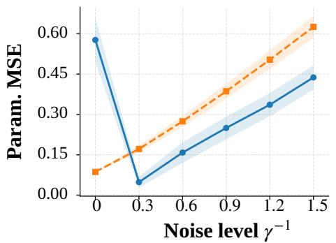

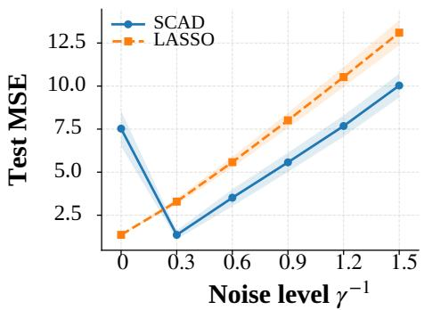  
Figure 1: Sparse linear regression with SCAD and LASSO penalties. The left panel reports the tail-averaged parameter MSE, and the right panel reports the tail-averaged test MSE, across the injected-noise levels $\gamma ^ { - 1 }$

Figure 2 illustrates the associated training dynamics. Under SCAD, the noise-free trajectory remains in a region with relatively large parameter error. The active-coordinate norm remains near 6, well below the true value 10, and the parameter MSE remains relatively large. With moderate Gaussian perturbation, the trajectory leaves this region, moves toward the correct active-coordinate scale, and reaches a solution with lower parameter error. In contrast, the LASSO objective is convex and has no suboptimal local minima. Its noisefree trajectory already reaches a stable solution, while additional noise increases both the objective value and the parameter error. The displayed SCAD trajectories are consistent with a potential optimization benefit of moderate perturbation.

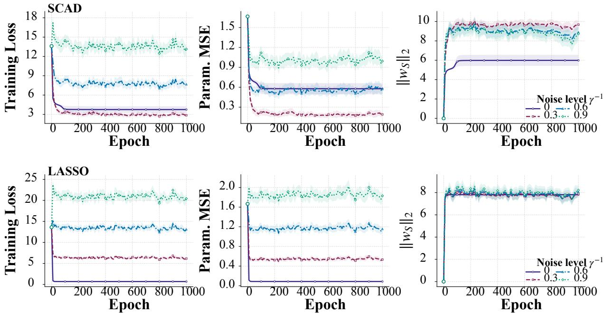  
Figure 2: Optimization trajectories under the SCAD (upper panel) and LASSO (lower panel) penalties. From left to right, each row displays the current loss value, current parameter MSE, and the $\ell _ { 2 }$ norm of the active coordinates. The true active-coordinate norm is 10.

## 4.2 Generalization Performance in Multivariate Deep Regression

We next conduct a more systematic study of the generalization performance of SGLD in multivariate deep regression. We vary the sample size, input dimension, and injected-noise level, and evaluate out-of-sample performance over 100 independent replications. Section C of the Supplementary Materials contains the implementation details and simulation results for additional quantile levels and the Huber loss.

The experiments use a fully connected network with two hidden layers of width 32. The network is trained for 800 epochs using mini-batches of size 50. The predictions are averaged over the checkpoints from the final 10% of training. Writing T for the retained checkpoints, the predictor is $\begin{array} { r } { \bar { f } ( x ) = | T | ^ { - 1 } \sum _ { k \in \mathcal { T } } f _ { w _ { k } } ( x ) } \end{array}$ , and test losses are evaluated using ${ \bar { f } } .$ The reported means and standard deviations summarize variation across replications; the comparisons below describe these observed patterns.

Example 2: Quantile regression. Let $\widetilde { X } \sim N ( 0 , \Sigma )$ , where $\begin{array} { r } { \Sigma _ { j k } = 0 . 2 ^ { | j - k | } } \end{array}$ , and define $X _ { j } = 4 \{ \Phi ( \widetilde { X } _ { j } ) - 1 / 2 \}$ . We consider the heteroscedastic location–scale model

$$
Y = m ( X ) + s ( X ) \epsilon , \qquad \epsilon \sim N ( 0 , 1 ) ,
$$

where

$$
\begin{array} { r l } & { m ( x ) = 3 x _ { 1 } + 1 . 5 ( 2 x _ { 2 } + 1 ) ( 2 x _ { 3 } - 1 ) + 0 . 2 \sin ( \pi x _ { 4 } ) } \\ & { \qquad + 0 . 4 \cos ( \pi x _ { 4 } ) + ( 2 - \sin ( \pi x _ { 5 } ) ) ^ { - 1 } 2 \sin ( \pi x _ { 5 } ) , } \\ & { \qquad s ( x ) = 1 + 0 . 3 x _ { 5 } ( | x _ { 6 } | + 1 ) ^ { 2 } . } \end{array}
$$

The conditional quantile is therefore $Q _ { q } ( Y \mid X = x ) = m ( x ) + \vert s ( x ) \vert \Phi ^ { - 1 } ( q )$ . We estimate the conditional quantile at $q = 0 . 2$ using the check loss.

Quantile Loss vs. Noise Level (Quantile $q = 0 . 2 )$

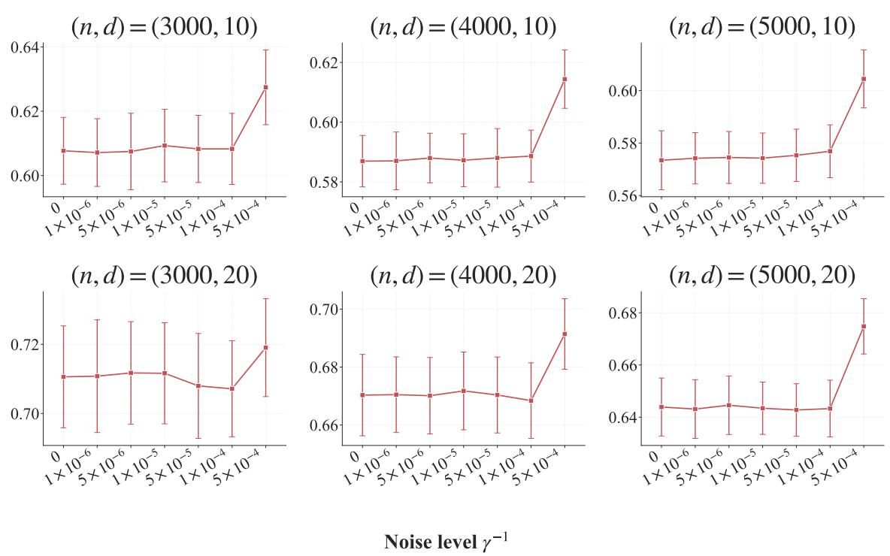  
Figure 3: Test quantile loss for quantile regression at $q = 0 . 2$ under diferent noise levels. Points and error bars report the mean and standard deviation, respectively, on an independent test set of size 10,000 over 100 independent replications.

Figure 3 shows a quantitatively consistent pattern across all six combinations of sample size n and input dimension d. At small and moderate noise levels, the mean test quantile losses are comparable to, and in several settings slightly lower than, their noise-free counterparts. When the injected-noise level increases to $\gamma ^ { - 1 } = 5 \times 1 0 ^ { - 4 }$ , the test quantile loss exceeds the noise-free value in all six settings. The mean losses vary relatively little across the smaller-noise settings, with some below the baseline; the largest tested noise level gives higher mean losses in every panel. Results for $q = 0 . 5$ and $q = 0 . 8$ are presented in Section C of the Supplementary Materials and show a similar pattern. Together, these results illustrate how the observed prediction errors vary across the tested noise levels.

We also present results for the sampled estimator at quantile level $q = 0 . 2$ in Section C.2 of the Supplementary Materials. In this example, the sampled estimator has empirical test losses similar to those of the checkpoint-averaged predictor reported in the main text.

## 4.3 Privacy–Utility Performance of Clipped SGLD

We finally examine the privacy–utility performance of clipped SGLD in a multivariate least-squares regression setting.

Example 3: Least-squares regression. Let $\widetilde { X } \sim N ( 0 , \Sigma )$ , where $\begin{array} { r } { \Sigma _ { j l } = 0 . 2 ^ { | j - l | } } \end{array}$ for $j , l = 1 , \ldots , d ;$ , and define $X _ { j } = 4 \{ \Phi ( \widetilde { X } _ { j } ) - 1 / 2 \}$ . The response is generated from

$$
Y = m ( X ) + \epsilon , \qquad \epsilon \sim N ( 0 , 1 ) ,
$$

where $m ( x ) = 3 x _ { 1 } + 1 . 5 ( 2 x _ { 2 } + 1 ) ( 2 x _ { 3 } - 1 ) + 2 x _ { 5 } ( | x _ { 6 } | + 1 ) ^ { 2 }$ . The covariate distribution and network architecture are the same as those in Example 2. We set $d = 2 0$ and consider $n \in \{ 3 0 0 0 , 4 0 0 0 , 5 0 0 0 \}$ . Training uses mini-batches of size $b = \lfloor { \sqrt { n } } \rfloor$ and $K = \lfloor 0 . 0 2 n ^ { 2 } / \log n \rfloor$ parameter updates. At each update, the per-sample gradients are clipped as in (4), with threshold $\tau _ { n } = 2 \sqrt { \log n }$ . We consider $\gamma ^ { - 1 } \in \{ 0 , 1 0 ^ { - 5 } , 5 \times 1 0 ^ { - 5 } , 1 0 ^ { - 4 } , 5 \times 1 0 ^ { - 4 } \}$ . SGLD models from the final 10% of the training updates are averaged for prediction. For each positive noise level, we report the asymptotic GDP parameter in Theorem 2(ii).

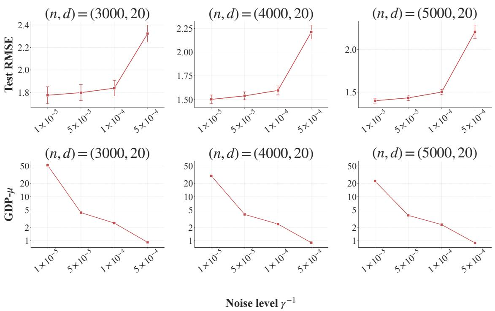  
Figure 4: Prediction and privacy performance of least-squares regression with per-sample gradient clipping. The upper panels report the mean test RMSE, with error bars showing the mean ± one standard deviation over 100 independent replications.  
Figure 4 shows a similar privacy–utility pattern across the three sample sizes. At $\gamma ^ { - 1 } = 1 0 ^ { - 4 }$ , the mean test RMSE is 1.838, 1.596, and 1.500 for $n = 3 0 0 0 , 4 0 0 0$ , and 5000, respectively. Increasing the noise level to $\gamma ^ { - 1 } = 5 \times 1 0 ^ { - 4 }$ reduces $\mu ,$ but raises the mean test RMSE above 2.2 in all three settings. The mean test RMSE changes less over the smaller-noise settings and is higher at the largest tested noise level, alongside a decrease in the reported asymptotic GDP parameter.

Test RMSE and GDP- vs. Noise Level

## 5 Real Data Analysis

In this section, we apply the proposed method to the publicly available ACTG-175 and MNIST datasets, which represent regression and classification tasks, respectively. Both analyses use the clipped update in Algorithm 1. For both datasets, we report the asymptotic GDP parameter $\mu$ corresponding to Theorem 2(ii). We compare the reported mean test metrics across noise levels to describe the accompanying changes in predictive performance and the asymptotic privacy parameter.

## 5.1 The ACTG-175 Dataset

We first consider the AIDS Clinical Trials Group Study 175 (ACTG-175) dataset from Hammer et al. (1996), available through the R package spef2trial.<sup>1</sup> The original study was a randomized, double-blind clinical trial that compared four antiretroviral treatment regimens for adults infected with human immunodeficiency virus type 1. The dataset contains records from 2,139 patients and 27 variables. These variables describe demographic characteristics, treatment history, baseline immunologic measurements, randomized treatment assignments, and follow-up outcomes. The patient-level clinical records provide a natural setting for privacy-preserving prediction (Suriyakumar et al. 2021).

We use the CD4 T-cell count measured at approximately 20 weeks as the response, denoted by Y. The predictors include five continuous variables: age, body weight, Karnofsky score, baseline CD4 count, and baseline CD8 count. We also include seven binary baseline indicators for hemophilia, homosexual activity, intravenous drug use, race, gender, treatment-history stratum, and symptomatic status, together with three indicators for randomized treatment assignment. The resulting input dimension is 15. In each replication, 90% of the observations are randomly assigned to the training set and the remaining 10% to the test set. The split is stratified by treatment arm, giving 1,925 training observations and 214 test observations.

We fit a one-hidden-layer ReLU network with width 32 and 545 trainable parameters.

Training uses mini-batches of size 64, and each per-sample gradient is clipped at $\tau = 4 . 8 5 9 <$ $2 { \sqrt { \log ( 1 , 9 2 5 ) } }$ . We set $\eta _ { k } = 1 0 ^ { - 3 } ( 1 - k / K ) ^ { 0 . 5 0 1 }$ . Final predictions are obtained by averaging the predictions from network states collected during the last 20% of the training trajectory. We compute

$$
\mathrm { N L L } _ { \mathrm { t e s t } } = \frac { 1 } { n _ { \mathrm { t e s t } } } \sum _ { i = 1 } ^ { n _ { \mathrm { t e s t } } } \left\{ \frac { 1 } { 2 } \log ( 2 \pi { \widehat { \sigma } } ^ { 2 } ) + \frac { \{ Y _ { i } - { \bar { f } } ( X _ { i } ) \} ^ { 2 } } { 2 { \widehat { \sigma } } ^ { 2 } } \right\} ,
$$

where $\begin{array} { r } { \widehat { \sigma } ^ { 2 } = \sum _ { i \in \mathcal { T } _ { \mathrm { t r a i n } } } \{ Y _ { i } - \bar { f } ( X _ { i } ) \} ^ { 2 } / n _ { \mathrm { t r a i n } } } \end{array}$ is the mean squared residual of the tail-averaged predictor on the corresponding training set. The NLL is used solely for internal evaluation and does not enter the training objective or the SGLD updates. Neither the NLL nor the residual variance is included in the private release, so this internal evaluation incurs no additional privacy cost. We also report test RMSE. The experiment is repeated independently 20 times.

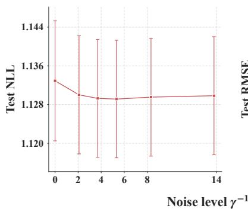

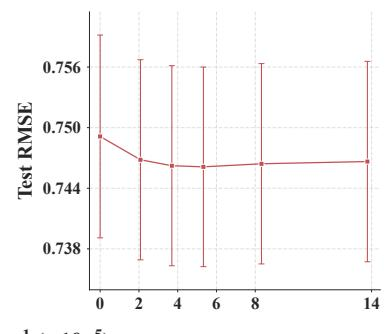

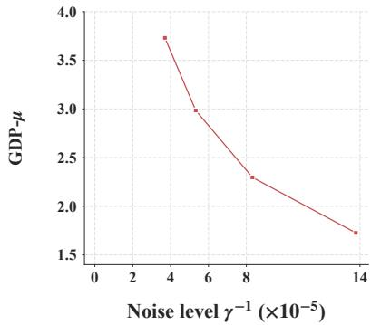  
Figure 5: Prediction results for the ACTG-175 data across diferent noise levels $\gamma ^ { - 1 }$ . The left, middle, and right panels report test negative log-likelihood (NLL), test root mean squared error (RMSE), and the asymptotic GDP parameter $\mu$ corresponding to Theorem 2(ii), respectively. The noise-free setting $\gamma ^ { - 1 } = 0$ is the matched clipped-SGD baseline and is omitted from the privacy panel.

Figure 5 shows similar mean predictive metrics across the reported moderate-noise settings. The baseline with $\gamma ^ { - 1 } = 0$ has mean NLL 1.1329 and mean RMSE 0.7491. At $\gamma ^ { - 1 } \approx 8 . 3 2 { \times } 1 0 ^ { - 5 }$ and $1 . 3 8 \times 1 0 ^ { - 4 }$ , the mean RMSE values are 0.7464 and 0.7466, respectively. These mean RMSE values are slightly below the baseline, alongside a lower reported asymptotic $\mathrm { G D P }$ parameter $\mu$

## 5.2 The MNIST Dataset

We next consider the MNIST handwritten-digit dataset of LeCun et al. (1998).<sup>2</sup> The dataset contains 70,000 grayscale images of handwritten digits from 0 to 9. Each image consists of $2 8 \times 2 8$ pixels. The standard split contains 60,000 training images and 10,000 test images. MNIST is widely used to evaluate privacy-preserving neural-network training (Abadi et al. 2016). In this experiment, we draw a class-stratified sample of 3,000 images from the standard training set and retain all 10,000 test images for evaluation. The sampling scheme preserves the original class proportions and gives approximately 300 training images for each digit. Pixel intensities are rescaled to [0, 1]. The reported privacy calculation concerns the selected 3,000-image training dataset.

We use the convolutional neural-network architecture considered by Li et al. (2016). The network contains two convolution–max-pooling blocks with 32 and 64 filters of size $5 \times 5$ . These are followed by two fully connected ReLU layers of width 200 and a 10-class output layer. The resulting network contains 299,306 trainable parameters. Training uses mini-batches of size 64 and a per-sample gradient-clipping threshold of $\tau = 5 < 2 \sqrt { \log ( 3 0 0 0 ) }$ We again use the terminal-decay schedule, $\eta _ { k } = 1 0 ^ { - 3 } ( 1 - k / K ) ^ { 0 . 5 0 1 }$ . For each test image, we average the predicted class probabilities over the network states collected during the last 20% of the training trajectory. Performance is evaluated using test negative log-likelihood and test classification accuracy. The experiment is repeated independently 20 times.

Figure 6 shows mean test accuracies above 97% across the displayed noise levels. The baseline with $\gamma ^ { - 1 } = 0$ has mean NLL 0.1530 and mean accuracy 97.518%. $\operatorname { A t } \gamma ^ { - 1 } \approx 2 . 0 8 { \times } 1 0 ^ { - 5 }$ and $3 . 4 5 \times 1 0 ^ { - 5 }$ , the mean accuracies are 97.303% and 97.123%, respectively. At these two noise levels, mean accuracy is approximately 0.22 and 0.40 percentage points below the baseline, respectively, alongside lower reported asymptotic GDP parameters. Across the displayed moderate-noise settings, the two applications show modest changes in mean predictive metrics alongside decreasing asymptotic GDP parameters.

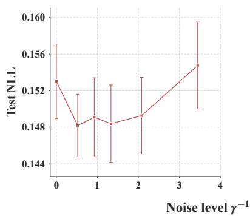

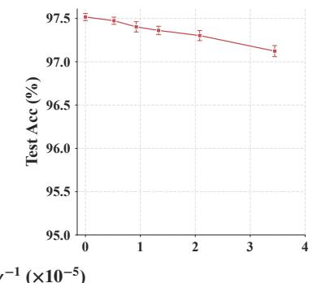

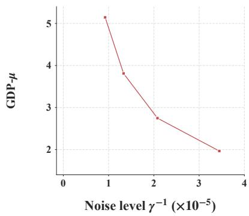  
Figure 6: Prediction results for MNIST across diferent noise levels $\gamma ^ { - 1 }$ . The left, middle, and right panels report test negative log-likelihood (NLL), test classification accuracy, and the asymptotic GDP parameter $\mu$ corresponding to Theorem $2 ( \mathrm { i i } )$ , respectively. The noise-free setting $\gamma ^ { - 1 } = 0$ is the matched clipped-SGD baseline and is omitted from the privacy panel.

## 6 Conclusion

This paper develops a finite-time analysis of SGLD for deep nonparametric M-estimation, with guarantees for both statistical risk and diferential privacy. By treating the final-iterate law as an algorithm-dependent PAC–Bayes posterior, the analysis separates network approximation, the pathwise KL cost, and the finite-time empirical optimization error. Under the stated conditions, the SGLD output based on a suitably chosen ReLU architecture attains the optimal rate for Hölder-smooth target functions in M-regression up to logarithmic factors. For clipped SGLD, we establish an exact finite-sample $f { \mathrm { - D P } }$ guarantee and an asymptotic GDP characterization under heterogeneous step-size schedules. Extensive numerical studies demonstrate the satisfactory empirical performance of SGLD across diferent noise levels, while the real-data analyses illustrate the trade-of between privacy and utility for clipped SGLD at the reported asymptotic GDP levels.

An important direction for future research is to extend SGLD to settings with group structure or distributional heterogeneity. Diferent populations may share common components while difering in smoothness, noise level, sample size, or privacy requirements. Recent studies on federated SGLD and federated averaging Langevin dynamics show that such heterogeneity can afect gradient accuracy and convergence (el Mekkaoui et al. 2021; Deng et al. 2024). Building on these results, one could develop hierarchical or multitask SGLD procedures with group-adaptive clipping and noise calibration, together with risk bounds that distinguish shared and group-specific errors.

## References

Abadi, M., A. Chu, I. Goodfellow, H. B. McMahan, I. Mironov, K. Talwar, and L. Zhang (2016). Deep learning with diferential privacy. In Proceedings of the 2016 ACM SIGSAC Conference on Computer and Communications Security, pp. 308–318.

Alquier, P. and W. Kengne (2025). Minimax optimality of deep neural networks on dependent data via PAC-Bayes bounds. Electronic Journal of Statistics 19(2), 5895–5924.

Anthony, M. and P. L. Bartlett (2009). Neural Network Learning: Theoretical Foundations. Cambridge University Press.

Bassily, R., A. Smith, and A. Thakurta (2014). Private empirical risk minimization: Eficient algorithms and tight error bounds. In 2014 IEEE 55th Annual Symposium on Foundations of Computer Science, pp. 464–473. IEEE.

Cai, T. T., Y. Wang, and L. Zhang (2021). The cost of privacy: Optimal rates of convergence for parameter estimation with diferential privacy. The Annals of Statistics 49 (5), 2825– 2850.

Catoni, O. (2007). PAC-Bayesian Supervised Classification: The Thermodynamics of Statistical Learning, Volume 56 of Institute of Mathematical Statistics Lecture Notes–Monograph Series. Beachwood, Ohio: Institute of Mathematical Statistics.

Chaudhari, P., A. Choromanska, S. Soatto, Y. LeCun, C. Baldassi, C. Borgs, J. Chayes, L. Sagun, and R. Zecchina (2017). Entropy-SGD: Biasing gradient descent into wide valleys. In International Conference on Learning Representations.

Chaudhuri, K., C. Monteleoni, and A. D. Sarwate (2011). Diferentially private empirical risk

minimization. Journal of Machine Learning Research 12 (29), 1069–1109.

Dadi, L. T. and V. Cevher (2025). Generalization of noisy SGD in unbounded non-convex settings. In Proceedings of the 42nd International Conference on Machine Learning, Volume 267 of Proceedings of Machine Learning Research, pp. 11862–11883. PMLR.

Deng, W., Q. Zhang, Y. Ma, Z. Song, and G. Lin (2024). On convergence of federated averaging Langevin dynamics. In Proceedings of the Fortieth Conference on Uncertainty in Artificial Intelligence, Volume 244 of Proceedings of Machine Learning Research, pp. 1022–1054. PMLR.

Dong, J., A. Roth, and W. J. Su (2022). Gaussian diferential privacy. Journal of the Royal Statistical Society Series B: Statistical Methodology 84 (1), 3–37.

Du, J., S. Li, X. Chen, S. Chen, and M. Hong (2021). Dynamic diferential-privacy preserving SGD. arXiv:2111.00173.

el Mekkaoui, K., D. Mesquita, P. Blomstedt, and S. Kaski (2021). Federated stochastic gradient Langevin dynamics. In Proceedings of the Thirty-Seventh Conference on Uncertainty in Artificial Intelligence, Volume 161 of Proceedings of Machine Learning Research, pp. 1703– 1712. PMLR.

Grünwald, P., T. Steinke, and L. Zakynthinou (2021). PAC-Bayes, MAC-Bayes and conditional mutual information: Fast rate bounds that handle general VC classes. In M. Belkin and S. Kpotufe (Eds.), Proceedings of the Thirty-Fourth Conference on Learning Theory, Volume 134 of Proceedings of Machine Learning Research, pp. 2217–2247. PMLR.

Hammer, S. M., D. A. Katzenstein, M. D. Hughes, H. Gundacker, R. T. Schooley, R. H. Haubrich, W. K. Henry, M. M. Lederman, J. P. Phair, M. Niu, M. S. Hirsch, and T. C. Merigan (1996). A trial comparing nucleoside monotherapy with combination therapy in HIV-infected adults with CD4 cell counts from 200 to 500 per cubic millimeter. New England Journal of Medicine 335 (15), 1081–1090.

Jain, P. and A. Thakurta (2013). Diferentially private learning with kernels. In Proceedings of the 30th International Conference on Machine Learning, Volume 28 of Proceedings of

Machine Learning Research, pp. 118–126. PMLR. Part 3.

Keskar, N. S., D. Mudigere, J. Nocedal, M. Smelyanskiy, and P. T. P. Tang (2017). On largebatch training for deep learning: Generalization gap and sharp minima. In International Conference on Learning Representations.

LeCun, Y., L. Bottou, Y. Bengio, and P. Hafner (1998). Gradient-based learning applied to document recognition. Proceedings of the IEEE 86 (11), 2278–2324.

Li, C., C. Chen, D. Carlson, and L. Carin (2016). Preconditioned stochastic gradient Langevin dynamics for deep neural networks. Proceedings of the AAAI Conference on Artificial Intelligence 30 (1), 1788–1794.

Li, J., X. Luo, and M. Qiao (2020). On generalization error bounds of noisy gradient methods for non-convex learning. In International Conference on Learning Representations.

London, B. (2017). A PAC-Bayesian analysis of randomized learning with application to stochastic gradient descent. In I. Guyon, U. von Luxburg, S. Bengio, H. Wallach, R. Fergus, S. Vishwanathan, and R. Garnett (Eds.), Advances in Neural Information Processing Systems, Volume 30, pp. 2931–2940. Curran Associates, Inc.

Mhammedi, Z., P. D. Grünwald, and B. Guedj (2019). PAC-Bayes un-expected Bernstein inequality. In Advances in Neural Information Processing Systems, Volume 32, pp. 12202– 12213.

Mou, W., L. Wang, X. Zhai, and K. Zheng (2018). Generalization bounds of SGLD for non-convex learning: Two theoretical viewpoints. In Proceedings of the 31st Conference on Learning Theory, Volume 75 of Proceedings of Machine Learning Research, pp. 605–638. PMLR.

Raginsky, M., A. Rakhlin, and M. Telgarsky (2017). Non-convex learning via stochastic gradient Langevin dynamics: A nonasymptotic analysis. In Proceedings of the 2017 Conference on Learning Theory, Volume 65 of Proceedings of Machine Learning Research, pp. 1674–1703. PMLR.

Schmidt-Hieber, J. (2020). Nonparametric regression using deep neural networks with ReLU

activation function. The Annals of Statistics 48 (4), 1875–1897.

Suriyakumar, V. M., N. Papernot, A. Goldenberg, and M. Ghassemi (2021). Chasing your long tails: Diferentially private prediction in health care settings. In Proceedings of the 2021 ACM Conference on Fairness, Accountability, and Transparency, pp. 723–734.

Teh, Y. W., A. H. Thiéry, and S. J. Vollmer (2016). Consistency and fluctuations for stochastic gradient Langevin dynamics. Journal of Machine Learning Research 17(7), 1–33.

Welling, M. and Y. W. Teh (2011). Bayesian learning via stochastic gradient Langevin dynamics. In Proceedings of the 28th International Conference on Machine Learning, pp. 681–688.

Xia, X. and Z. Cai (2023). Adaptive false discovery rate control with privacy guarantee. Journal of Machine Learning Research 24 (252), 1–35.

Xia, X., L. Zhang, and Z. Cai (2025). Statistical inference for diferentially private stochastic gradient descent. arXiv:2507.20560.

Yarotsky, D. (2017). Error bounds for approximations with deep ReLU networks. Neural Networks 94, 103–114.

Zhang, Q., T. Li, X. Feng, X. Yan, and J. Xie (2025). Online diferentially private conformal prediction for uncertainty quantification. In Proceedings of the 42nd International Conference on Machine Learning, Volume 267 of Proceedings of Machine Learning Research, pp. 75329–75368. PMLR.

Zhu, L., M. Gürbüzbalaban, A. Raj, and U. Şimşekli (2023). Uniform-in-time Wasserstein stability bounds for (noisy) stochastic gradient descent. In Advances in Neural Information Processing Systems, Volume 36, pp. 1794–1832.