# Synthesis of Ovarian Cancer Multi-Omics Datasets: A Biology-Informed Evaluation Framework

Déborah Boyenval1∗, Alina Malyutina2,   
Jaana Oikkonen1, Sammeli Liikkanen3, Sampsa Hautaniemi1   
1Research Program in Systems Oncology, Research Programs Unit, Faculty of Medicine, University of Helsinki, Helsinki, Finland 2Orion Pharma, Espoo, Finland 3PalsaIQ, Finland

## Abstract

Paired multi-omic cancer cohorts are costly to assemble and difficult to share, motivating synthetic cohorts as a complementary resource. As generative model development accelerates, we shift the focus from proposing yet another architecture to defining evaluation criteria that determine whether synthetic data preserve biologically relevant structure. We introduce a biology-informed and patientdisjoint framework for evaluating the generation of paired RNA expression and copy-number variation (CNV) profiles, and apply it to the longitudinal DECIDER high-grade serous ovarian cancer cohort. The framework assesses modality-specific fidelity and coherence between RNA and CNV pairs using agreement between real training and held-out data as a reference, alongside complementary training-data proximity diagnostics. We adapt three multi-omic integration architectures based on variational autoencoders to generate paired profiles. The model leading several fidelity and coherence measures also shows the strongest training-data proximity. The protocol and case study offer the community a reference for comparing future multi-omic generators.

## 1 Introduction

Analyzing molecular data from heterogeneous diseases, such as ovarian cancer, requires cohorts that capture variation across patients and biological contexts [The Cancer Genome Atlas Research Network, 2011]. Because these data are sensitive and difficult to pool across institutions, synthetic cohorts could provide a useful resource for model development and evaluation, but only if they preserve biologically relevant structure without simply reproducing training samples [Qian et al., 2023, Chen et al., 2024]. In sequencing studies, a multimodal molecular cohort contains complementary omic measurements obtained from the same biological samples. Such cohorts are costly to assemble and often small relative to the number of molecular variables they contain.

Studies of the DECIDER high-grade serous carcinoma (HGSC) cohort illustrate why cross-modal relationships matter for questions of treatment response and resistance [Turku University Hospital, 2025]. Copy-number variations (CNV) are gains or losses of DNA segments that can alter gene expression in cancer cells. One study combined CNV profiles with tumor-cell expression estimated from bulk RNA sequencing to quantify these transcriptional effects and identify pathways associated with poor treatment response [Jamalzadeh et al., 2024]. Another integrated whole-genome sequencing with bulk RNA sequencing to distinguish functionally credible driver alterations from non-functional events and identify biomarkers that could guide targeted therapy selection [Muranen et al., 2026]. A third combined somatic mutations, CNV, paired bulk RNA sequencing, and histopathology to link tumor evolutionary states to biological pathways, morphology, and treatment response [Lahtinen et al., 2023]. In this paper, we simplify the multimodal generation problem by considering only two modalities: CNV and RNA.

From a machine-learning perspective, the central problem is to synthesize new paired molecular profiles from such cohorts. This task is difficult because each modality has a distinct distribution and biological structure, while a valid synthetic sample must also retain the association between modalities. For example, a generator may reproduce the separate distributions of RNA and CNV yet fail to associate the two measurements within a synthetic sample. Developing multimodal generators is insufficient without an evaluation framework tailored to multimodal omics. Statistical fidelity, biological coherence, and training-data proximity must be assessed as separate dimensions [Qian et al., 2023, Chen et al., 2024]. The framework must also distinguish properties within each modality from coherence across modalities. We address this need by benchmarking de novo generation of paired RNA and CNV profiles. Our evaluation examines modality-specific structure, within-sample RNA-CNV associations, and how closely synthetic profiles resemble the training data.

Related work. Synthcity provides a common framework for generating and benchmarking synthetic tabular data across use cases [Qian et al., 2023]. Its plugins include conditional generative adversarial networks, variational autoencoders, normalizing flows, and diffusion models. Its fidelity metrics include Jensen-Shannon and Wasserstein distances and real-versus-synthetic detection. It combines fidelity measures with downstream and empirical privacy evaluations. This breadth supports consistent comparisons, but each dataset is represented through a single tabular interface. Synthcity does not test assay-specific biological properties or relationships between separately structured molecular modalities such as the transcriptome, genome, or methylome.

A related line of work addresses multimodal generation by reconstructing a missing modality for an observed sample. Marchesi et al. use latent-space diffusion models to reconstruct a CNV, RNA, protein, or histopathology representation from the modalities observed for the same tumor in The Cancer Genome Atlas (TCGA) [Marchesi et al., 2026]. At single-cell resolution, scDiffusion-X uses a diffusion model to generate paired RNA and chromatin-accessibility profiles or infer either modality from the other [Luo et al., 2026]. Multi-Omic Synthetic Augmentation (MOSA) uses a variational autoencoder to complete missing genomic, transcriptomic, proteomic, and drug-response measurements for cancer cell lines [Cai et al., 2024]. These settings differ, however, from de novo generation of complete paired bulk RNA and CNV profiles.

Evaluation studies have also moved beyond generic statistical fidelity. The Critical Assessment of Massive Data Analysis (CAMDA) Health Privacy Challenge evaluates synthetic bulk RNA-sequencing data through distributional fidelity, downstream utility, biological plausibility, and empirical privacy risk [Öztürk et al., 2026]. Its biologically motivated tasks test the recovery of condition-specific differential expression and gene-gene co-expression networks. Its utility analysis asks whether a classifier trained on synthetic TCGA breast-cancer RNA profiles can predict molecular subtypes in held-out real samples. However, these evaluations remain unimodal. Marchesi et al. evaluate each reconstructed modality separately by testing whether it retains signals for tumor-type and stage prediction [Marchesi et al., 2026]. This is again a modality-specific evaluation and does not assess whether newly generated RNA and CNV profiles preserve their within-sample association.

Contributions. We study how to evaluate de novo generators of paired RNA and CNV profiles when realistic marginal distributions do not necessarily imply biologically coherent pairs (Figure 1).

• Evaluation protocol. We propose an evaluation protocol that uses different patients for training and testing. It examines how well synthetic profiles reproduce statistical and biological properties within each modality, preserve relationships across modalities, and avoid excessive similarity to the training data. Its RNA-CNV instantiation provides a concrete starting point for broader evaluation frameworks for synthetic multi-omic cohorts.

• Generative benchmark. We adapt ISOMERIC [Selega et al., 2025], TMO-Net [Wang et al., 2024], and CustOmics [Benkirane et al., 2023], three multi-omic architectures based on variational autoencoders with distinct integration mechanisms, to a common de novo generation task. Their latent-variable formulations support generative decoding, we define explicit prior-sampling paths that produce complete paired RNA-CNV profiles without encoding an observed sample.

• Empirical comparison. We evaluate the adapted models on patient-disjoint DECIDER cohorts, highlighting differences in modality-specific fidelity, preservation of RNA-CNV relationships, and proximity to training data.

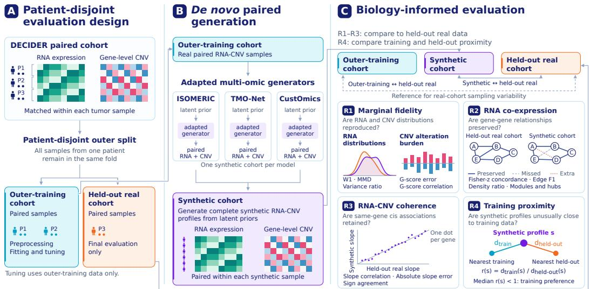  
Figure 1: Patient-disjoint generation and evaluation of paired RNA–CNV profiles. (A) All samples from a patient remain in one outer fold, preprocessing, fitting, and tuning use training data only. Treatment cohorts are evaluated separately. (B) Each adapted model generates its own cohort of complete pairs from latent priors. (C) R1–R3 compare synthetic and held-out real data, with real training–held-out agreement as a reference. R1 assesses marginal fidelity. R2 compares RNA co-expression networks, links denote preserved, missed, or extra edges. R3 compares RNA-CNV slopes. R4 compares nearest-neighbor distances to equally sized training and held-out reference sets. A median distance ratio below one indicates training preference, without establishing copying or privacy. All illustrations are schematic.

## 2 Background on multi-omic generative models

Generative approaches for multi-omic data span several model families. We focus on variational autoencoder (VAE) architectures because they define distributions over latent variables and specify how these variables are decoded into each modality. This provides a common framework for comparing how RNA and CNV are coupled during generation. We first recall some preliminary concepts [Kingma and Welling, 2013], then describe the three adaptations evaluated for paired RNA-CNV generation.

## 2.1 Variational autoencoders

Model. A VAE models the marginal distribution of observations $p _ { \theta } ( x )$ using an unobserved latent representation, or latent code, z:

$$
p _ { \theta } ( x ) = \int p _ { \theta } ( x \mid z ) p ( z ) \mathrm { d } z , \qquad p ( z ) = \mathcal { N } ( 0 , I ) .
$$

The decoder maps z to the parameters of $p _ { \theta } ( x \mid z )$ , the conditional distribution of observations given the latent representation. Learning from an observation x requires inferring the latent values that could have generated it. Since the exact posterior $p _ { \theta } ( z \mid x )$ is generally intractable, an encoder maps x to the parameters of a tractable approximation $q _ { \phi } ( z \mid x )$ . A common choice, used in our adaptations, is a Gaussian with diagonal covariance:

$$
\begin{array} { r } { q _ { \phi } ( z \mid x ) = \mathcal { N } \big ( \mu _ { \phi } ( x ) , \mathrm { d i a g } \big ( \sigma _ { \phi } ^ { 2 } ( x ) \big ) \big ) . } \end{array}
$$

Training. Latent vectors are sampled from the encoder’s approximate posteriors and decoded to reconstruct the inputs. Both networks are updated jointly to minimize the negative evidence lower bound (ELBO), combining reconstruction loss with Kullback–Leibler (KL) regularization of the

posteriors toward the prior. Reparameterization allows gradients through sampling. The objective is given in Appendix B.

Sampling. Once the model has been trained, a new observation can be generated by drawing $z \sim p ( z )$ , followed by $x \sim p _ { \theta } ( x \mid z )$ . This procedure does not require encoding an observed profile. Figure 4(a) illustrates this sampling path.

## 2.2 VAE-based models for paired RNA-CNV generation

We consider paired observations $\boldsymbol { x } = \left( r , c \right)$ , where $r \in \mathbb { R } ^ { d _ { R } }$ and $c \in \mathbb { R } ^ { d _ { C } }$ denote RNA and CNV profiles from the same sample, after applying the scaling transformation used by each model. A hat denotes a reconstruction and a tilde denotes a generated profile. The RNA and CNV decoders, denoted by $D ,$ output conditional means. For all three adaptations, we generate profiles by sampling latent variables and using these decoder means as synthetic profiles, without adding observation noise. The generated profiles are then mapped back to the input scales.

All models use standard Gaussian priors during training. For sampling, we write

$$
S _ { T } ( \mu , \sigma ) = \mu + T \sigma \odot \epsilon , \qquad \epsilon \sim \mathcal { N } ( 0 , I ) ,
$$

where $T > 0$ scales the latent standard deviation and $T = 1$ recovers the specified Gaussian. Thus $S _ { T } ( 0 , 1 )$ draws from $\mathcal { N } ( 0 , T ^ { 2 } I )$

ISOMERIC [Selega et al., 2025]. The main idea of the model is the separation of RNA variation into two latent components: w, which contributes to both RNA and CNV reconstruction, and z, which contributes to RNA reconstruction only. A single RNA encoder predicts the means and variances of the Gaussian approximate posteriors for z and w. We retain this factorization:

$$
\begin{array} { r l } & { p _ { \theta } ( r , c , z , w ) = p ( z ) p ( w ) p _ { \theta _ { C } } ( c \mid w ) p _ { \theta _ { R } } ( r \mid z , w ) , } \\ & { ~ q _ { \phi } ( z , w \mid r ) = q _ { \phi _ { z } } ( z \mid r ) q _ { \phi _ { w } } ( w \mid r ) , } \\ & { ~ \widehat { r } = D _ { R } ( z , w ) , ~ \widehat { c } = D _ { C } ( w ) . } \end{array}\tag{1}
$$

The original model was developed for single-cell expression and regional copy-number profiles. We adapt it to tumor samples, using expression inferred for tumor cells from bulk RNA sequencing and continuous CNV values for each gene. Training combines RNA and CNV reconstruction, two KL penalties, and a linear adversarial CNV predictor $A _ { C }$ . The adversarial objective discourages CNV predictability from z but does not guarantee independence (Appendix B). The encoder takes only RNA as input to parameterize both approximate posteriors. During training, paired CNV profiles provide targets for the CNV decoder and the adversarial predictor. For prior-based generation,

$$
z = S _ { T _ { z } } ( 0 , 1 ) , \qquad w = S _ { T _ { w } } ( 0 , 1 ) , \qquad \widetilde { r } = D _ { R } ( z , w ) , \qquad \widetilde { c } = D _ { C } ( w ) .
$$

TMO-Net [Wang et al., 2024]. TMO-Net learns to predict missing modalities from observed ones. We retain RNA and CNV, with one VAE reconstructing each modality from its own input. A third encoder takes CNV as input and predicts the parameters of a Gaussian latent distribution. Latent samples are decoded into RNA profiles using the same decoder as the RNA VAE. During training, we compare the RNA predicted from CNV with the RNA observed in the same sample, encouraging the model to learn associations between copy number and expression. We retain only the CNV to RNA direction, motivated by the transcriptional effects of copy number [Jamalzadeh et al., 2024]. With CNV as the sole conditioning modality, fusion across source modalities is unnecessary. The original model also includes clinical prediction heads, which are outside the scope of our generation task. The original contrastive objective separates cancer types and is omitted for this HGSC cohort. We omit the adversarial objective as a training simplification whose impact is not evaluated separately. This gives three paths:

$$
\begin{array} { r l } { z _ { C } \sim q _ { \phi _ { C } } ( z _ { C } \mid c ) , \quad } & { \widehat { c } = D _ { C } ( z _ { C } ) , } \\ { z _ { R } \sim q _ { \phi _ { R } } ( z _ { R } \mid r ) , \quad } & { \widehat { r } _ { \mathrm { s e l f } } = D _ { R } ( z _ { R } ) , } \\ { z _ { C  R } \sim q _ { \phi _ { C  R } } ( z _ { C  R } \mid c ) , \quad } & { \widehat { r } _ { C  R } = D _ { R } ( z _ { C  R } ) . } \end{array}\tag{2}
$$

Training combines reconstruction along these paths with KL regularization toward standard Gaussian priors. An additional KL term encourages agreement between the RNA latent distributions inferred

from CNV and RNA for each paired sample (Appendix B). For generation, we first sample a CNV profile and then generate RNA conditionally on it, allowing dependencies within each synthetic pair:

$$
\begin{array} { r l r } & { \boldsymbol { z } _ { C } = S _ { T _ { C } } ( 0 , 1 ) , } & { \widetilde { c } = D _ { C } ( \boldsymbol { z } _ { C } ) , } \\ & { \boldsymbol { z } _ { C  R } = S _ { T _ { C  R } } ( \mu _ { C  R } ( \widetilde { c } ) , \sigma _ { C  R } ( \widetilde { c } ) ) , } & { \widetilde { \boldsymbol { r } } = D _ { R } ( \boldsymbol { z } _ { C  R } ) . } \end{array}
$$

We sample the CNV latent from its prior, then the RNA latent given the generated CNV.

CustOmics [Benkirane et al., 2023]. CustOmics first learns a compact representation of each modality, then integrates them in a central VAE. The authors propose this strategy to accommodate different learning dynamics and limit domination by sources with stronger signals. We adapt this hierarchy to RNA and CNV generation, removing classification and survival heads. RNA and CNV autoencoders learn compact vectors $h _ { R }$ and $h _ { C }$ by reconstructing their respective inputs, without latent sampling. We concatenate these vectors for each paired sample into h. The central encoder uses h to compute the means and variances of a Gaussian distribution over $z ,$ decoder G reconstructs h from a sampled latent vector:

$$
\begin{array} { r } { h _ { R } = E _ { R } ( r ) , \quad \widehat { r } _ { \mathrm { s e l f } } = D _ { R } ( h _ { R } ) , \quad h _ { C } = E _ { C } ( c ) , \quad \widehat { c } _ { \mathrm { s e l f } } = D _ { C } ( h _ { C } ) , } \\ { h = [ h _ { R } , h _ { C } ] , \quad z \sim q _ { \phi } ( z \mid h ) , \quad \widehat { h } = G ( z ) . \qquad } \end{array}\tag{3}
$$

Training first fits the modality autoencoders, then jointly adjusts all modules with modality reconstruction, reconstruction of $h ,$ and maximum mean discrepancy (MMD) regularization for prior matching. There is no direct reconstruction loss on the RNA and CNV profiles obtained through G and the modality decoders, the full objective is given in Appendix B. For generation, G maps one central latent sample to two representations, which the modality decoders turn into paired RNA and CNV profiles:

$$
z = S _ { T } ( 0 , 1 ) , \qquad ( \widetilde { h } _ { R } , \widetilde { h } _ { C } ) = G ( z ) , \qquad \widetilde { r } = D _ { R } ( \widetilde { h } _ { R } ) , \qquad \widetilde { c } = D _ { C } ( \widetilde { h } _ { C } ) .
$$

Comparison scope. ISOMERIC uses one latent shared by RNA and CNV together with an RNAspecific latent. TMO-Net generates CNV first and then RNA conditionally on that CNV. CustOmics branches one central latent into modality-specific representations. All three produce complete RNA-CNV pairs without encoding an observed profile. Appendix A shows the corresponding sampling graphs. Appendix Figure 5 shows the computations and objectives used to train each adaptation.

## 3 Real-data cohort and evaluation framework

## 3.1 Cohort and evaluation protocol

DECIDER cohort. We use data from DECIDER, a prospective longitudinal observational study of high-grade serous carcinoma (HGSC, NCT04846933) [Turku University Hospital, 2025]. Most patients received either primary debulking surgery (PDS) or neoadjuvant chemotherapy (NACT) as their initial treatment strategy. Tumor samples were collected from adnexal or tubo-ovarian tissue, solid metastatic sites, or fluids such as ascites or pleural fluid. The cohort contains 632 samples with paired RNA and CNV profiles from 255 patients: 493 before-treatment samples from 232 patients and 139 after-treatment samples from 89 patients.

The RNA modality consists of gene-expression profiles inferred from bulk RNA sequencing and apply a log (x + 1) transformation. The gene expression matrix has been decovoluted to extract cancer-cell specific RNA profiles [Häkkinen et al., 2021]. The CNV modality consists of continuous gene-level copy-number log-ratios derived from whole-genome sequencing and adjusted for tumor purity and ploidy. Each gene is assigned the minimum adjusted value across overlapping segments, with zero denoting the reference state and positive and negative values indicating relative gains and losses [Lavikka et al., 2024]. CNV features therefore represent segmental alterations at gene resolution, and multiple genes may reflect the same event. The RNA and CNV matrices are aligned by sample, so each paired row represents measurements from the same tumor sample.

Cross-validation and feature selection. We evaluated the before and after-treatment cohorts separately with three patient-disjoint outer folds, balanced across sampling sites, so all samples from a patient remained in the same fold. For each split, one fold was held out for evaluation. Feature selection and preprocessing used only the outer training data. Patient-grouped inner cross-validation selected training hyperparameters and sampling temperatures for all three models, followed by refitting on the full outer training set. The resulting synthetic cohort was compared separately with the corresponding real training and held-out sets: held-out comparisons assess fidelity to unseen data, whereas training comparisons support the training-proximity diagnostics.

From the 58037 genes for RNA and 36860 genes for CNV, we independently selected the 3000 highest-variance genes (HVG) per modality within each outer training set to reduce the data dimension. However, we retained 14 prespecified HGSC biomarkers to keep copy-number events of biological interest [Lavikka et al., 2024], [Muranen et al., 2026], including CCNE1, AKT2, PTK2, KRAS, NF1 and PTEN. Amplification of these oncogenes or inactivation of these tumor suppressors can alter transcriptional programs and suggest potential therapeutic vulnerabilities in HGSC [Muranen et al., 2026].

## 3.2 Evaluation metrics

Marginal CNV fidelity. We assess whether synthetic cohorts reproduce how often each gene is amplified or deleted in the real cohort and the magnitude of these alterations. For each CNV gene g, amplification and deletion G-scores summarize these events across samples:

$$
G _ { g } ^ { \mathrm { a m p } } = \frac { 1 } { n } \sum _ { i = 1 } ^ { n } \mathbf { 1 } ( x _ { i g } > \tau ) \operatorname* { m i n } ( x _ { i g } , \kappa ) , \qquad G _ { g } ^ { \mathrm { d e l } } = \frac { 1 } { n } \sum _ { i = 1 } ^ { n } \mathbf { 1 } ( x _ { i g } < - \tau ) \operatorname* { m i n } ( - x _ { i g } , \kappa ) .\tag{4}
$$

Here $x _ { i g }$ is the base-2 logarithm of the copy-number ratio relative to the reference level for gene g in sample i, after the purity and ploidy adjustment described in Appendix C.1. Values of $0 , + 1$ , and −1 correspond to the reference level, twice that level, and half that level, respectively. The G-scores average over n samples, use $\tau = 0 . 7$ to select gains and losses, and cap each contribution at $\kappa = 2 . 5$ Across the 3,000 CNV genes per fold, we compare synthetic and held-out G-scores using Pearson correlations, with real train–held-out correlations as a reference. Mean absolute G-score differences and overlap among the 50 highest-scoring genes are additionally reported in Appendix Tables 1 and 2.

Marginal RNA fidelity. We assess whether each gene shows similar expression levels and variability across samples in the synthetic and real cohorts. We compare gene-level distributions using mean 1-Wasserstein $( W _ { 1 } )$ and Jensen–Shannon (JS) distances, the correlation of gene means, and the median synthetic-to-real variance ratio (target: 1) [Qian et al., 2023, Öztürk et al., 2026]. Multivariate fidelity is assessed using radial basis function maximum mean discrepancy (RBF $\mathbf { M M D ^ { 2 } } )$ in PCA space [Gretton et al., 2012]. An out-of-fold logistic classifier provides a complementary real-versus-synthetic separability score, $D _ { \mathrm { d i s c } } = 2 | \mathrm { A U \bar { C } - 0 . 5 }$ |, ranging from zero (no separation by this classifier) to one (perfect separation) [Lopez-Paz and Oquab, 2016]. Details are provided in Appendix C.2.

RNA co-expression preservation. We assess whether synthetic RNA preserves how gene expression levels vary together across samples in the real cohort. Within each outer fold, we select the same number of samples from the real training, held-out real, and synthetic cohorts. We then use hCoCena v1.1.2 [Oestreich et al., 2022] to build one co-expression network per cohort. For held-out data H and a candidate cohort C (synthetic or real training), we compare all evaluated Pearson gene-pair correlations:

$$
C _ { z } = \mathrm { c o r } _ { \mathrm { P e a r s o n } } \left( \{ z ( r _ { g h } ^ { H } ) \} _ { g < h } , \{ z ( r _ { g h } ^ { C } ) \} _ { g < h } \right) , \qquad z ( r ) = \mathrm { a r c t a n h } ( r ) .\tag{5}
$$

Edges require $r \geq 0 . 7 0$ and a Benjamini–Hochberg-adjusted $p < 0 . 0 5$ , their recovery is summarized by Edge $\mathrm { \bar { F } } 1 = 2 | E _ { H } \cap E _ { C } | / ( | E _ { H } | + | E _ { C } | )$ . We also compare Leiden modules using the adjusted Rand index on genes assigned to modules in both networks, and the 50 highest-degree hubs using Jaccard overlap. To interpret synthetic-held-out agreement, we also apply these metrics to real training and held-out networks, measuring the reproducibility of co-expression structure between real cohorts. Appendix C.4 provides the detailed metric definitions.

Cis RNA-CNV association. Marginal fidelity does not establish that RNA and CNV remain associated within paired profiles. Because copy-number alterations can affect transcription at the same locus [Muranen et al., 2026, Selega et al., 2025], we fit the following model for each gene in the intersection of the independently selected RNA and CNV panels:

$$
y _ { i g } = \alpha _ { g } + \beta _ { g } x _ { i g } + \varepsilon _ { i g } .\tag{6}
$$

where $y _ { i g }$ is the $\log _ { 2 } ( \mathrm { e x p r e s s i o n } + 1 )$ RNA value and $x _ { i g }$ is the continuous purified CNV log ratio. We fit this model separately in the real training, held-out, and synthetic cohorts. The analysis describes preservation within this selected gene subset and does not estimate genome-wide cis preservation.

Across genes, we compare the slopes $\beta _ { g }$ using mean and median absolute differences, Pearson and Spearman correlations, and an agreement in slope sign. The real train-test comparison provides a reference for sampling variation between real cohorts. Figure 3(c) illustrates the slope comparison.

Memorization diagnostics. We assess training preference in RNA, CNV, and paired feature spaces m. For synthetic profiles $s ,$ we compare nearest-neighbor distances to equally sized training (T) and held-out (H) reference se

$$
\begin{array} { r } { \hat { \boldsymbol { R } } _ { m } = \underset { s \in \cal { S } } { \mathrm { m e d i a n } } \frac { d _ { \mathcal { T } } ^ { m } ( s ) } { \mathrm { m a x } \{ d _ { \mathcal { H } } ^ { m } ( s ) , \epsilon \} } . } \end{array}\tag{7}
$$

Distances are Euclidean and ϵ is machine epsilon, paired modality scaling and reference subsampling are detailed in Appendix C.3. We also report membership AUC using negative distance to the nearest synthetic profile as the score, with training membership as the positive class [Shokri et al., 2017, van Breugel et al., 2023]. Values $R _ { m } ~ < ~ 1$ or $\mathrm { A U C } \dot { > } 0 . 5$ indicate training preference, $\mathrm { { A U C } < 0 . 5 }$ indicates reversed separation, not stronger privacy. Neither diagnostic establishes copying or guarantees privacy.

## 4 DECIDER case study: evaluating de novo RNA-CNV generation

We use the before-treatment DECIDER cohort described in Section 3.1 as the main case study. It contains 493 paired RNA-CNV samples from 232 patients. Across three outer folds, training sets contain 332, 341, and 313 paired samples, with 161, 152, and 180 corresponding held-out samples, patients are disjoint between training and evaluation within each fold. Within each fold, we select 3000 RNA and 3000 CNV features from the outer training data and fit each generator from Section 2 with three random initializations. Training details are provided in Appendix B. Each fitted model generates a cohort with the same number of paired profiles as its outer training set. Unless otherwise specified, results are means ± sample standard deviations across three outer folds after averaging metrics over three initializations within each fold. These standard deviations summarize between-fold variability. Descriptive model rankings are complemented by paired fold differences in Appendix E.

The after-treatment DECIDER cohort is reported in Appendix Figure 6, Appendix Figure 7, and Appendix D. This cohort contains 139 paired samples from 89 patients, with 86-96 training samples per outer fold.

Figure 2 summarizes the held-out evaluation. Complete results are provided in Appendix D. Figure 3 illustrates RNA and CNV fidelity, RNA-CNV association, and RNA co-expression, using the model with the best score on the selected metric for each property. Appendix G provides the same diagnostics for each model individually, with after-treatment counterparts in Appendix H. We examine these results through four questions: marginal fidelity (R1), co-expression (R2), cis RNA-CNV association (R3), and training proximity (R4).

R1. Are marginal RNA and CNV distributions reproduced? We assess RNA fidelity with genewise $W _ { \mathrm { 1 } } , \mathrm { R B F M M D ^ { 2 } }$ , and variance ratios, and CNV fidelity with G-score correlations. In Figure 2(a), TMO-Net has the lowest observed mean $W _ { 1 } ~ ( 0 . 1 6 6 \pm 0 . 0 2 7 )$ , compared with $0 . 1 8 4 \pm 0 . 0 2 0$ for ISOMERIC and $0 . 1 8 5 \pm 0 . 0 1 3$ for CustOmics. The corresponding distance between real training and held-out data is $0 . 1 0 5 \pm 0 . 0 0 7$ . Mean RBF MMD2 is lowest for ISOMERIC (0.0125), followed by TMO-Net (0.0157) and CustOmics (0.0200). All models underestimate RNA variation: their median synthetic-to-held-out variance ratios range from 0.57 to 0.66, below the target of 1 (Appendix Table 1). The complementary classifier-based diagnostic also gives higher separation scores for synthetic versus held-out RNA than for real training versus held-out RNA (Appendix Table 1, methodological details in Appendix C.2).

For CNV, amplification G-score correlations range from 0.908 to 0.919, compared with 0.952 between real training and held-out data. Deletion correlations are 0.877 for both TMO-Net and ISOMERIC and 0.815 for CustOmics, compared with 0.969 between real cohorts (Figure 2(d)). To assess CNV fidelity at the 14 prespecified biomarkers, we also measure absolute G-score errors. Across models, mean absolute errors range from 0.066 to 0.070 for amplification and from 0.090 to 0.126 for deletion, compared with 0.041 and 0.033, respectively, between real training and held-out profiles (Appendix Table 3). Appendix Tables 4–7 report G-scores, signed biases, and absolute errors for each biomarker in both cohorts. Figure 3(a,b) illustrates RNA profiles in PCA space and CNV G-scores for six biomarker genes. Overall, high CNV G-score correlations coexist with systematically underestimated RNA variability.

Beforetreatment

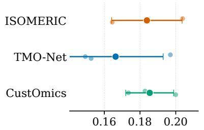

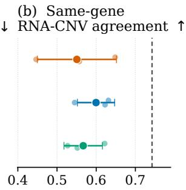

(c) Relative distance to training (target = 1)  
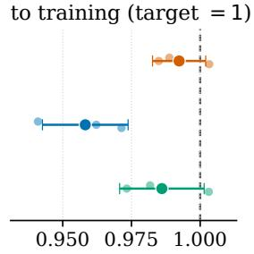

(d) CNV burden agreement ↑  
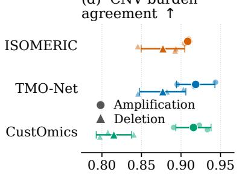

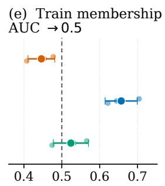

(f) RNA co-expression edge F1 ↑  
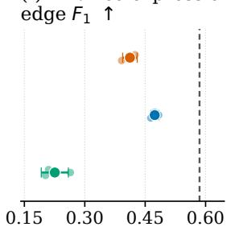  
Figure 2: Held-out evaluation in the before-treatment DECIDER cohort (493 paired samples from 232 patients). Panels (a–f) summarize RNA fidelity, same-gene RNA-CNV association, paired training proximity, CNV fidelity, paired membership, and RNA co-expression. Small points show outer folds, large markers and bars show mean ± sample SD. Dashed lines mark real train–held-out references or neutral values. Appendix E complements these mean comparisons with paired model differences within each outer fold, showing whether the observed model orderings persist or reverse across folds.

R2. Is RNA co-expression preserved? TMO-Net has the highest observed mean edge F1, 0.474 ± 0.010, compared with 0.585 ± 0.035 between real cohorts (Figure 2(f)). This is 0.81× the reference, versus 0.70× for ISOMERIC and 0.39× for CustOmics.

All models retain the broad pattern of gene-gene correlations: Fisher-z concordance (C ) is close to the real-cohort reference (0.91–0.93×), with ISOMERIC highest. Yet their networks are too dense, with density ratios at 1.86× the real-cohort reference (0.956) for TMO-Net, 2.69× for ISOMERIC, and 7.02× for CustOmics. CustOmics recovers many held-out links, but most of its inferred links are absent from the held-out network, resulting in low precision and F1. Figure 3(d) shows the agreement in correlations and the mismatch in recovered links. Further network comparisons are provided in Appendix Tables 8 and 9. In the before-treatment cohort, all three models retain mean network density ratios above one across correlation thresholds from 0.60 to 0.80. The observed ordering of mean edge F1 also remains unchanged (Appendix K).

Overall, broad correlation agreement coexists with overly dense co-expression networks. Generating profiles from decoder means omits residual variation and may contribute to low RNA variance and overly dense co-expression networks. The experiment in Appendix I tests this explanation by adding independent Gaussian noise calibrated from training residuals to the same generated RNA profiles. Mean RNA variance ratios move closer to one, and mean network density decreases. However, mean edge F1 decreases for ISOMERIC and CustOmics. Lower network density therefore does not necessarily indicate better recovery of co-expression structure.

R3. Are the cis RNA-CNV associations retained? The RNA-CNV panel intersections contain 320, 313, and 313 genes in the three outer folds, respectively, all with estimable slopes $\beta _ { g }$ from Equation 6 in every real and synthetic cohort. We compare these slopes using their correlation $( r _ { \beta } )$ and median absolute difference (median $| \Delta \beta | )$ . TMO-Net has the highest observed mean $r _ { \beta }$ $( 0 . 6 0 0 \pm 0 . 0 4 7 )$ , compared with 0.743 ± 0.046 between real cohorts: 0.81× the reference, versus

(a) Before-treatment RNA PCA — outer fold 0

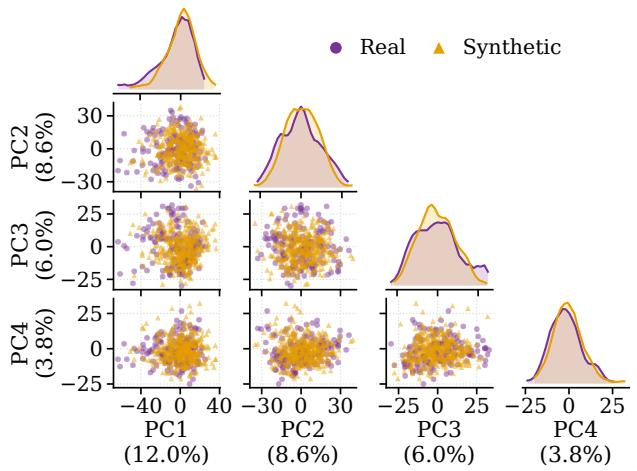

(b) CNV ensemble visualization  
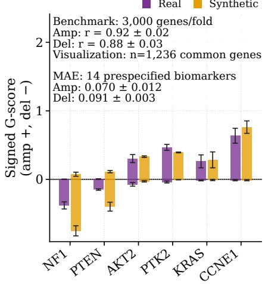  
(d) Gene-pair correlation agreement

(c) RNA-CNV ensemble visualization  
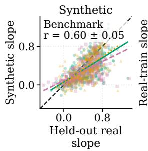

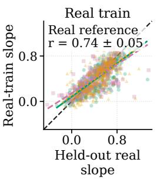  
Outer fold 0 Outer fold 1 Outer fold 2

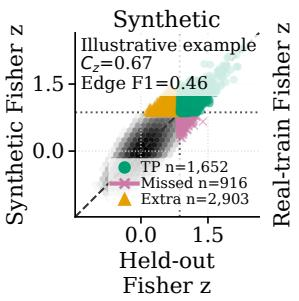

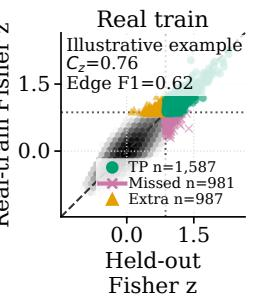  
Illustrative R2 example Outer fold 0, initialization 44

Figure 3: Before-treatment DECIDER visual diagnostics. (a) ISOMERIC: RNA PCA, (b) TMO-Net: CNV G-scores, (c) TMO-Net: same-gene RNA-CNV slopes, (d) TMO-Net: RNA co-expression. Model selection and benchmark annotations use metrics computed per initialization, averaged within fold, then summarized as mean ± sample SD across three folds. Panels (b,c) display synthetic gene-level values averaged across initializations within fold, G-score error bars show fold SD. The 1,236 genes are the intersection of the three fold-specific 3,000-gene CNV panels, used for visualization, benchmark correlations use all 3,000 genes per fold. MAE denotes mean absolute error between synthetic and held-out G-scores across the 14 prespecified biomarkers, separately for amplification and deletion. The MAEs in (b) follow the same metric aggregation. Panel (d) shows one illustrative fold and initialization, its Fisher-z concordance $( C _ { z } )$ and edge F1 describe that example.

0.76× for CustOmics and 0.74× for ISOMERIC (Figure 2(b)). Figure 3(c) illustrates the agreement of individual gene slopes.

ISOMERIC has the lowest absolute slope error, at $0 . 1 1 8 \pm 0 . 0 1 1$ versus 0.093 ± 0.006 between real cohorts, or 1.26× the reference. TMO-Net and CustOmics reach 1.63× and 2.31×, respectively (Appendix Table 10). Observed means favor TMO-Net for slope correlation and ISOMERIC for absolute slope error.

R4. Do generated profiles raise memorization concerns? The diagnostics raise memorization concerns, most clearly for TMO-Net. Its paired distance ratio $( R _ { \mathrm { p a i r e d } } = 0 . 9 5 8 \pm 0 . 0 1 6 )$ and membership AUC $( 0 . 6 5 7 \pm 0 . 0 4 3 )$ indicate greater proximity to training than held-out samples (Figure 2(c,e)). The signal is stronger in $\mathbf { R N A } ^ { - } ( \mathbf { A U C } \bar { = } 0 . 8 0 4 \bar { \pm } 0 . 0 3 5 )$ than CNV $( 0 . 5 5 4 \pm 0 . 0 \bar { 5 } 8 )$

Paired scores are less concerning for ISOMERIC and CustOmics, but their RNA AUCs (0.647 and 0.689, respectively) also indicate training preference (Appendix Table 12). TMO-Net is also the largest adaptation, with approximately 4.2 million trainable parameters (Appendix B). This motivates testing whether model size contributes to overfitting, but the present comparison does not isolate its effect from other modeling and training choices. Overall, TMO-Net’s advantages in fidelity and coherence coexist with the strongest preference for training data, particularly in RNA.

We added two simple controls to assess whether the evaluation detects disrupted RNA-CNV pairing (Appendix J). The shuffling control reassigns CNV profiles between held-out patients within the same tissue and treatment phase, while keeping RNA profiles fixed. This permutation should preserve modality-specific fidelity but reduce RNA-CNV slope agreement. The observed slope correlations fall close to zero in both cohorts. The second control independently resamples RNA and CNV profiles from different training patients within each tissue group. This baseline has lower mean RNA Wasserstein distance and higher mean edge F1 than the three adapted VAEs in both cohorts, but its slope correlations remain near zero.

## 5 Conclusion

We introduced a protocol for evaluating generation of paired RNA and CNV profiles using statistical and biological metrics. The protocol keeps training and evaluation patients disjoint and interprets fidelity and RNA-CNV coherence relative to real train-test agreement. This empirical reference con textualizes discrepancies between synthetic and held-out data against variation between real cohorts. We focused on VAEs because their latent-variable formulations provide a common framework for adapting different RNA-CNV coupling mechanisms to the same de novo generation task. ISOMERIC uses shared and modality-specific latent variables. TMO-Net generates RNA conditionally on CNV. CustOmics uses a central joint latent representation. We illustrate the protocol through a practical case study of ovarian HGSC in the DECIDER cohort. The contrasting model results identify specific targets for development that marginal fidelity alone would miss. For ISOMERIC, a priority is to reduce excess co-expression links while retaining its comparatively accurate RNA-CNV association magnitudes. For TMO-Net, greater proximity to training samples, particularly in RNA, motivates testing regularization focused on RNA generation. For CustOmics, low RNA variance and excessive co-expression motivate learning and sampling variation around decoder means.

Limitations and perspectives. The focus on VAEs allows us to compare different coupling strategies while keeping the generative family fixed. However, it does not assume that VAEs are universally optimal for synthetic multi-omics generation. Comparisons with generative adversarial networks, normalizing flows, and diffusion models would extend the benchmark to other generative families. Beyond the variational autoencoders studied here, our evaluation framework could also be applied, for example, to multiomic foundation models that generate paired molecular profiles. This perspective aligns with recent calls for benchmarks that better capture the biological relevance of biomedical foundation models [Saez-Rodriguez et al., 2026]. In this paper, the distance-based membership AUC provides an initial assessment of membership disclosure risk. Further evaluation could compare several membership inference attacks under explicit assumptions about the attacker’s access, following the CAMDA Health Privacy Challenge benchmark [Öztürk et al., 2026]. These attacks test whether an individual’s participation in training can be inferred from synthetic data. An absence of detected training preference does not guarantee privacy. Model size and training objectives differ across the evaluated adaptations. Future comparisons with matched parameter counts and targeted trainingobjective ablations could help clarify the contribution of RNA-CNV coupling. Also, the generators do not condition on tissue origin, treatment phase (e.g., before versus after treatment), or other clinical covariates. Future work could explore conditional and longitudinal generative approaches that share information across these contexts while accounting for dependence between repeated measurements from the same patient. Such extensions would also enable evaluation of differential expression between groups defined by tissue origin or treatment phase. Finally, adding molecular modalities such as somatic mutations or DNA methylation could further broaden biological evaluations and use cases.

## References

Hakim Benkirane, Yoann Pradat, Stefan Michiels, and Paul-Henry Cournède. CustOmics: a versatile deep-learning based strategy for multi-omics integration. PLOS Computational Biology, 19(3): e1010921, 2023. doi: 10.1371/journal.pcbi.1010921.

Zhaoxiang Cai, Sofia Apolinário, Ana R. Baião, Clare Pacini, Miguel D. Sousa, Susana Vinga, Roger R. Reddel, Phillip J. Robinson, Mathew J. Garnett, Qing Zhong, and Emanuel Gonçalves. Synthetic augmentation of cancer cell line multi-omic datasets using unsupervised deep learning. Nature Communications, 15:10390, 2024. doi: 10.1038/s41467-024-54771-4.

Dingfan Chen, Marie Oestreich, Tejumade Afonja, Raouf Kerkouche, Matthias Becker, and Mario Fritz. Towards biologically plausible and private gene expression data generation. Proceedings on Privacy Enhancing Technologies, 2024(2):531–554, 2024. doi: 10.56553/popets-2024-0062.

Arthur Gretton, Karsten M. Borgwardt, Malte J. Rasch, Bernhard Schölkopf, and Alexander Smola. A kernel two-sample test. Journal ofMachine Learning Research, 13(25):723–773, 2012. URL https://www.jmlr.org/papers/v13/gretton12a.html.

Antti Häkkinen, Kaiyang Zhang, Amjad Alkodsi, Noora Andersson, Erdogan Pekcan Erkan, Jun Dai, Katja Kaipio, Tarja Lamminen, Naziha Mansuri, Kaisa Huhtinen, Anna Vähärautio, Olli Carpén, Johanna Hynninen, Sakari Hietanen, Rainer Lehtonen, and Sampsa Hautaniemi. PRISM: recovering cell-type-specific expression profiles from individual composite RNA-seq samples. Bioinformatics, 37(18):2882–2888, 2021. doi: 10.1093/bioinformatics/btab178.

Sanaz Jamalzadeh, Jun Dai, Kari Lavikka, Yilin Li, Jing Jiang, Kaisa Huhtinen, Anni Virtanen, Jaana Oikkonen, Sakari Hietanen, Johanna Hynninen, Anna Vähärautio, Antti Häkkinen, and Sampsa Hautaniemi. Genome-wide quantification of copy-number aberration impact on gene expression in ovarian high-grade serous carcinoma. BMC Cancer, 24:173, 2024. doi: 10.1186/ s12885-024-11895-6.

Diederik P. Kingma and Max Welling. Auto-encoding variational Bayes. arXiv, 2013. URL https://doi.org/10.48550/arXiv.1312.6114. Preprint.

Alexandra Lahtinen, Kari Lavikka, Anni Virtanen, Yilin Li, Sanaz Jamalzadeh, Aikaterini Skorda, Anna Røssberg Lauridsen, Kaiyang Zhang, Giovanni Marchi, Veli-Matti Isoviita, Valeria Ariotta, Oskari Lehtonen, Taru A. Muranen, Kaisa Huhtinen, Olli Carpén, Sakari Hietanen, Wojciech Senkowski, Tuula Kallunki, Antti Häkkinen, Johanna Hynninen, Jaana Oikkonen, and Sampsa Hautaniemi. Evolutionary states and trajectories characterized by distinct pathways stratify patients with ovarian high grade serous carcinoma. Cancer Cell, 41(6):1103–1117.e12, 2023. doi: 10.1016/j.ccell.2023.04.017.

Kari Lavikka, Jaana Oikkonen, Yilin Li, Taru Muranen, Giulia Micoli, Giovanni Marchi, Alexandra Lahtinen, Kaisa Huhtinen, Rainer Lehtonen, Sakari Hietanen, Johanna Hynninen, Anni Virtanen, and Sampsa Hautaniemi. Deciphering cancer genomes with GenomeSpy: a grammar-based visualization toolkit. GigaScience, 13:giae040, 2024. doi: 10.1093/gigascience/giae040.

David Lopez-Paz and Maxime Oquab. Revisiting classifier two-sample tests. arXiv, 2016. URL https://doi.org/10.48550/arXiv.1610.06545. Preprint.

Erpai Luo, Lei Wei, Minsheng Hao, Xuegong Zhang, and Qiao Liu. A multi-modal diffusion model with dual-cross-attention for multi-omics data generation and translation. Nature Communications, 17:5196, 2026. doi: 10.1038/s41467-026-71744-x.

Raffaele Marchesi, Nicolò Lazzaro, Walter Endrizzi, Gianluca Leonardi, Matteo Pozzi, Flavio Ragni, Stefano Bovo, Monica Moroni, Venet Osmani, and Giuseppe Jurman. Coherent crossmodal generation of synthetic biomedical data to advance multimodal precision medicine. PLOS Computational Biology, 22(4):e1013455, 2026. doi: 10.1371/journal.pcbi.1013455.

Taru A. Muranen, Andreas Hainari, Daria Afenteva, Wojciech Senkowski, Jaana Oikkonen, Johann Dreo, Kyriaki Driva, Susanna Holmström, Veli-Matti Isoviita, Alexandra Lahtinen, Kari Lavikka, Yilin Li, Marta Lovino, Ilari Maarala, Giovanni Marchi, Francesca Miccolis, Giulia Micoli, Matthieu Najm, Ann-Christin Ostwaldt, Pablo Rodriguez-Mier, Jenni Söderlund, Sakari Hietanen,

Anni Virtanen, Julio Saez-Rodriguez, Elisa Ficarra, Benno Schwikowski, Erika Alanne, Krister Wennerberg, Sampsa Hautaniemi, and Johanna Hynninen. Multi-modal data integration reveals functionally credible predictive biomarkers in ovarian cancer. Genome Medicine, 2026. doi: 10.1186/s13073-026-01706-x. Online ahead of print.

Marie Oestreich, Lisa Holsten, Shobhit Agrawal, Kilian Dahm, Philipp Koch, Han Jin, Matthias Becker, and Thomas Ulas. hCoCena: horizontal integration and analysis of transcriptomics datasets. Bioinformatics, 38(20):4727–4734, 2022. doi: 10.1093/bioinformatics/btac589.

Hakime Öztürk, Tejumade Afonja, Joonas Jälkö, Ruta Binkyte, Pablo Rodriguez-Mier, Sebastian Lobentanzer, Andrew Wicks, Jules Kreuer, Sofiane Ouaari, Nico Pfeifer, Shane Menzies, Sikha Pentyala, Daniil Filienko, Steven Golob, Patrick McKeever, Jineta Banerjee, Luca Foschini, Martine De Cock, Julio Saez-Rodriguez, Mario Fritz, Oliver Stegle, and Antti Honkela. Towards useful and private synthetic omics: community benchmarking of generative models for transcriptomics data. bioRxiv, 2026. URL https://doi.org/10.64898/2026.03.02.707794. Preprint.

Zhaozhi Qian, Rob Davis, and Mihaela van der Schaar. Synthcity: a benchmark framework for diverse use cases of tabular synthetic data. In Advances in Neural Information Processing Systems, volume 36, pages 3173–3188, 2023. doi: 10.52202/075280-0140.

Julio Saez-Rodriguez, Philipp Sven Lars Schäfer, Nikolas Kalavros, and Gustavo Stolovitzky. Benchmarking biomedical foundation models. Nature Methods, 23(9):1724–1733, 2026. doi: 10.1038/s41592-026-03182-y.

Alina Selega, Hassaan Maan, Chengxin Yu, Tiak Ju Tan, and Kieran R. Campbell. Learning copy number dependent variation in single tumour cell transcriptomes with deep generative models. bioRxiv, 2025. URL https://doi.org/10.1101/2025.04.21.649842. Preprint.

Reza Shokri, Marco Stronati, Congzheng Song, and Vitaly Shmatikov. Membership inference attacks against machine learning models. In 2017 IEEE Symposium on Security and Privacy (SP), pages 3–18, 2017. doi: 10.1109/SP.2017.41.

The Cancer Genome Atlas Research Network. Integrated genomic analyses of ovarian carcinoma. Nature, 474(7353):609–615, 2011. doi: 10.1038/nature10166.

Turku University Hospital. Integration of multiple data levels to improve diagnosis, predict treatment response and suggest targets to overcome therapy resistance in high-grade serous ovarian cancer. ClinicalTrials.gov, 2025. URL https://clinicaltrials.gov/study/NCT04846933. ClinicalTrials.gov identifier NCT04846933, last updated January 16, 2025, accessed September 10, 2026.

Boris van Breugel, Hao Sun, Zhaozhi Qian, and Mihaela van der Schaar. Membership inference attacks against synthetic data through overfitting detection. In Proceedings ofthe 26th International Conference on Artificial Intelligence and Statistics, volume 206 of Proceedings ofMachine Learning Research, pages 3493–3514, 2023. URL https://proceedings.mlr.press/v206/breugel23a. html.

Feng-ao Wang, Zhenfeng Zhuang, Feng Gao, Ruikun He, Shaoting Zhang, Liansheng Wang, Junwei Liu, and Yixue Li. TMO-Net: an explainable pretrained multi-omics model for multi-task learning in oncology. Genome Biology, 25:149, 2024. doi: 10.1186/s13059-024-03293-9.

## Organization of the appendices.

• Appendix A: prior-sampling graphs.

• Appendix B: training objectives and settings.

• Appendix C: metric definitions.

• Appendix D: detailed evaluation tables for both cohorts.

• Appendix E: paired model differences across outer folds.

• Appendix F: after-treatment benchmark and visual diagnostics.

• Appendices G and H: visual diagnostics for each model in the before- and after-treatment cohorts, respectively.

• Appendix I: stochastic RNA decoding, variance, and correlations.

• Appendix J: shuffled-pair controls and an independent-modality baseline.

• Appendix K: sensitivity to the co-expression edge threshold.

## A Prior sampling graphs

Figure 4 translates the sampling equations in Section 2 into directed acyclic computational graphs. We omit paths and objectives used only during training. The encoder from CNV to RNA is shown because generation uses it.

(a) Standard VAE  
(b) ISOMERIC  
(c) TMO-Net  
(d) CustOmics  
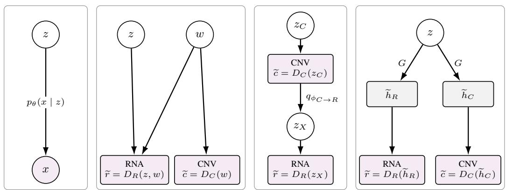  
Figure 4: Generation from the prior in a standard VAE and the three adaptations. (a) The VAE samples $z \sim p ( z )$ , then $x \sim p _ { \theta } ( x \mid z )$ . (b) ISOMERIC samples independent z and $w ,$ w contributes to both profiles and z only to RNA. (c) TMO-Net decodes CNV from $z _ { C }$ , then uses the generated CNV to parameterize and sample $z _ { X } = z _ { C  R }$ before decoding RNA. (d) CustOmics decodes one central z into two representations, one for each modality, and then into RNA and CNV. White circles denote sampled Gaussian latents, the shaded circle denotes a sampled observation, and boxes denote deterministic decoder outputs. Arrows denote computational dependence rather than causality.

## B Model training details

Common setup. All models are trained from scratch on each paired outer training set, without pan-cancer pretraining or patient, sampling-site, or treatment-phase covariates. Each fit uses 3,000 RNA and 3,000 CNV variables from 313–341 primary or 86–96 post-treatment samples, depending on the outer split, and is repeated with three random initializations. For the objectives below, $\ell ( a , b )$ denotes mean-squared error in the scaled feature space, and KL denotes Kullback–Leibler divergence. Per-observation objectives are averaged over the training set, reconstruction expectations are estimated using sampled latents. The standard negative ELBO has unit KL weight:

$$
\begin{array} { r l } & { \mathcal { L } _ { \mathrm { V A E } } ( x ) = \mathbb { E } _ { q _ { \phi } ( z \mid x ) } [ - \log p _ { \theta } ( x \mid z ) ] } \\ & { \quad \quad \quad + \mathrm { K L } ( q _ { \phi } ( z \mid x ) \parallel p ( z ) ) . } \end{array}\tag{8}
$$

The coefficients below define the weighted objectives used by the adaptations.

Figure 5 summarizes the corresponding training graphs. It uses the paired observations available during training and is distinct from the prior-sampling graphs in Figure 4.

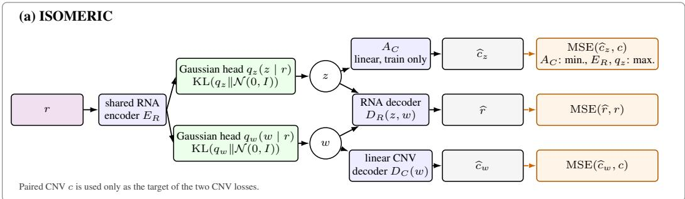

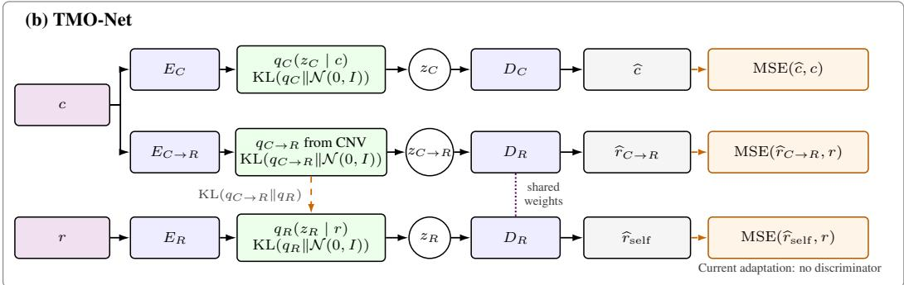

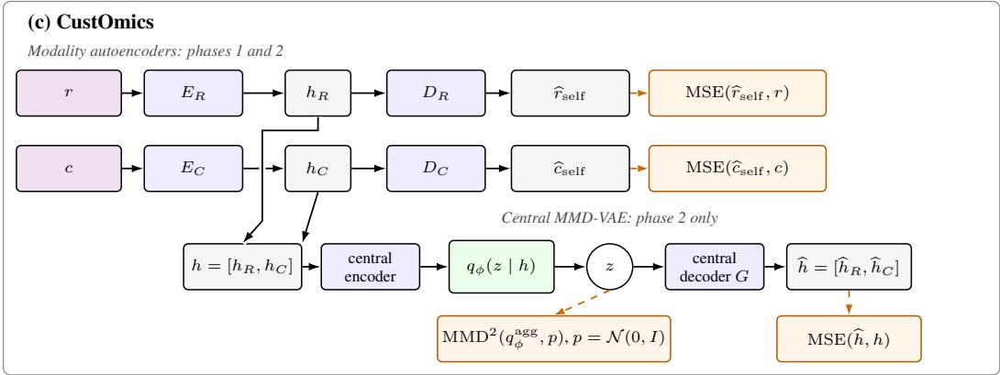  
Figure 5: Training architectures: (a) ISOMERIC, (b) TMO-Net, and (c) CustOmics. Observed RNA and CNV profiles are denoted by r and c, hats denote reconstructions. Green boxes denote Gaussian approximate posteriors and circles denote reparameterized samples. Solid arrows show forward computations, orange dashed arrows show objective terms. See Section 2 for model definitions.

ISOMERIC. The encoder–decoder parameters minimize

$$
\begin{array} { r l } & { \mathcal { L } _ { \mathrm { I S O } } = \ell ( D _ { R } ( z , w ) , r ) } \\ & { \qquad + \beta _ { z } \mathrm { K L } ( q _ { \phi _ { z } } ( z \mid r ) \parallel p ( z ) ) } \\ & { \qquad + \beta _ { w } \mathrm { K L } ( q _ { \phi _ { w } } ( w \mid r ) \parallel p ( w ) ) } \\ & { \qquad + \ell ( D _ { C } ( w ) , c ) } \\ & { \qquad - \beta _ { \mathrm { a d v } } \ell ( A _ { C } ( z ) , c ) , } \end{array}\tag{9}
$$

while the adversary separately minimizes $\ell ( A _ { C } ( \mathrm { s t o p g r a d } ( z ) ) , c )$ . The negative term therefore encourages, but does not guarantee, separation of CNV information from z. The selected model uses $\beta _ { z } = \beta _ { w } = 1 0 ^ { - 2 } , \beta _ { \mathrm { a d v } } = 0 . 1$ , one 128-unit hidden layer, and 10 dimensions for each of z and w. It

has 845,488 trainable parameters and is trained for 300 epochs with Adam, learning rate $1 0 ^ { - 3 }$ , and batch size 16.

TMO-Net. Writing $q _ { C } , q _ { R } , q _ { X }$ for the three approximate posteriors in Equation 2 and $p _ { C } , p _ { R } , p _ { X }$ for their standard Gaussian priors, training minimizes

$$
\begin{array} { r l } { \left. { \mathcal { L } _ { \mathrm { T M O } } = \mathbb { E } [ \ell ( c , \widehat { c } ) + \ell ( r , \widehat { r } _ { \mathrm { s e l f } } ) } \right.} \\ & { ~ + \ell ( r , \widehat { r } _ { C  R } ) ] } \\ & { + \sum _ { a \in \{ C , R , X \} } \beta _ { a } \mathrm { K L } ( q _ { a } \| p _ { a } ) } \\ & { } \\ & { + \beta _ { A } \mathrm { K L } ( q _ { X } \| q _ { R } ) . } \end{array}\tag{10}
$$

The expectation is over the three latent draws. The final term aligns the CNV-derived RNA posterior with the RNA self-posterior. All reconstruction weights equal one. Across outer splits, the selected KL weights are $1 0 ^ { - 3 } \mathrm { o r } 3 \times 1 0 ^ { - 3 }$ and the alignment weight is $1 0 ^ { - 3 } \mathrm { o r } 1 0 ^ { - 2 }$ , these weights increase linearly during the first 100 of 300 training epochs. Each encoder and decoder has two 256-unit hidden layers. The selected latent dimension is 32 in the primary cohort and ranges from 16 to 64 after treatment, giving 4.21–4.31 million trainable parameters, optimization uses Adam with learning rate $5 \times 1 0 ^ { - 4 }$ and batch size 16.

CustOmics. Training has two phases. The first fits the two modality autoencoders for 150 epochs with

$$
\mathcal { L } _ { 1 } = \frac { 1 } { n } \sum _ { i = 1 \atop + \ell ( D _ { C } ( E _ { C } ( c _ { i } ) ) , c _ { i } ) ] . } ^ { n } \left[ \ell ( D _ { R } ( E _ { R } ( r _ { i } ) ) , r _ { i } ) \right.
$$

The second jointly fine-tunes all modules for another 150 epochs with

$$
\begin{array} { r l } & { \mathcal { L } _ { 2 } = \mathcal { L } _ { 1 } + \displaystyle \frac { 1 } { n } \sum _ { i = 1 } ^ { n } \mathbb { E } _ { q _ { \phi } ( z | h _ { i } ) } [ \ell ( G ( z ) , h _ { i } ) ] } \\ & { \quad \quad \quad + \lambda _ { \mathrm { M M D } } \mathrm { M M D } ^ { 2 } \Big ( q _ { \phi } ^ { \mathrm { a g g } } , p \Big ) . } \end{array}
$$

Here $h _ { i } = [ E _ { R } ( r _ { i } ) , E _ { C } ( c _ { i } ) ]$ ], and

$$
q _ { \phi } ^ { \mathrm { a g g } } ( z ) = n ^ { - 1 } \sum _ { i = 1 } ^ { n } q _ { \phi } ( z \mid h _ { i } )
$$

is the aggregated posterior over n training observations. MMD encourages this mixture to match the Gaussian prior $p ( z )$ . Unlike the per-observation KL in a standard VAE, this penalty acts on the mixture rather than on each posterior separately. The implementation estimates squared MMD between minibatch posterior samples and independent standard Gaussian samples, retaining diagonal kernel terms. It uses the original CustOmics radial basis function kernel $\begin{array} { r } { \dot { k ( u , v ) } = \exp ( - \| \dot { u } - v \| ^ { 2 } / d _ { z } ^ { 2 } ) } \end{array}$ , where $d _ { z }$ is the central latent dimension. The selected baseline assigns unit weight to these terms and does not add a direct RNA or CNV reconstruction loss through the central path. Each modality autoencoder uses widths 3000–256–128–32 and a mirrored decoder, the 64-dimensional concatenated representation is mapped through central hidden layers of widths 128 and 64 to a 32-dimensional latent. The model has 3.27 million trainable parameters and uses Adam with learning rate $1 0 ^ { - 3 }$ and batch size 16.

## C Evaluation metric details

## C.1 Marginal CNV fidelity

Following the purity and ploidy adjustment described in GenomeSpy [Lavikka et al., 2024], let $R _ { i s } > 0$ denote the observed linear copy ratio for segment s in sample i. The adjusted ratio is

$$
R _ { i s } ^ { \mathrm { p u r } } = \frac { \rho _ { i } \psi _ { i } R _ { i s } + 2 ( 1 - \rho _ { i } ) ( R _ { i s } - 1 ) } { \rho _ { i } \psi _ { i } } ,
$$

where $\rho _ { i }$ is the estimated tumor purity and $\psi _ { i }$ is the estimated tumor ploidy. We map segments to genes by assigning gene g the minimum adjusted log ratio among its overlapping segments:

$$
x _ { i g } = \operatorname* { m i n } _ { s : s \cap g \neq \emptyset } x _ { i s } .
$$

Thus, $x _ { i g } = 0$ denotes the adjusted reference copy-ratio state rather than zero genomic copies.   
Positive and negative values indicate relative copy-number gains and losses, respectively.

Event frequencies alone ignore alteration magnitude. We therefore adapt the amplitude and frequency summary implemented in GenomeSpy [Lavikka et al., 2024] from genomic segments to gene-level CNV features. For each cohort, we compute the amplification and deletion G-scores defined in Equation (4). The alteration threshold is $\tau = 0 . 7$ , and $\kappa = 2 . 5$ caps the contribution of extreme values. Across all 3,000 CNV genes per fold, we compare synthetic and held-out scores using gene-wise absolute differences, correlations, and overlap among the 50 highest-scoring genes. Rea train–held-out agreement provides a reference.

For the fixed panel B of 14 prespecified biomarkers, we additionally compute signed differences and mean absolute errors for each alteration type $a \in$ {amp, del}:

$$
\begin{array} { r c l } { { \Delta _ { g f s } ^ { a } = G _ { g f s , \mathrm { s y n t h } } ^ { a } - G _ { g f , \mathrm { t e s t } } ^ { a } , } } \\ { { \mathrm { M A E } _ { B f s } ^ { a } = \displaystyle \frac { 1 } { 1 4 } \sum _ { g \in B } | \Delta _ { g f s } ^ { a } | , } } \end{array}\tag{11}
$$

where f indexes outer folds and s indexes model initializations. All 14 biomarkers are present in every fold. We first compute absolute errors for each initialization, then average within fold and report the mean ± sample standard deviation (SD) of the three fold means. Per-gene absolute errors follow the same aggregation, signed differences are retained separately to distinguish overestimation from underestimation. Taking absolute differences before averaging prevents opposite errors from cancelling. For the real-data reference, we replace synthetic G-scores with real-training G-scores and summarize the three train–held-out comparisons. Deletion G-scores are nonnegative, although the figures plot them below zero. All errors are in G-score units, which combine event frequency and capped amplitude, rather than percentage points of deletion frequency. Table 3 pairs panel MAEs with the correlations over all 3,000 genes, Tables 4–7 report the individual biomarker scores and errors.

## C.2 Marginal RNA fidelity

At the gene level, we compute 1-Wasserstein $( W _ { 1 } )$ and Jensen–Shannon (JS) distances between real and synthetic expression distributions and report their means across genes. The correlation of gene means assesses whether genes with high mean expression in real data also have high mean expression in synthetic data. The median synthetic-to-real variance ratio summarizes agreement in variability across samples, a ratio of one is the target [Qian et al., 2023, Öztürk et al., 2026].

At the sample level, principal component analysis (PCA) provides a common space for comparing multivariate RNA profiles. We compute radial basis function maximum mean discrepancy (RBF MMD2) in this space to assess distributional differences, including location, dispersion, and concentration [Gretton et al., 2012].

As a complementary diagnostic, logistic regression distinguishes real from synthetic profiles using out-of-fold predictions. We summarize the area under the receiver operating characteristic curve (AUC) as

$$
D _ { \mathrm { d i s c } } = 2 \left| \mathrm { A U C } - 0 . 5 \right| .
$$

A score of zero indicates no separation by this classifier, while a score of one indicates perfect separation [Lopez-Paz and Oquab, 2016].

The real-data reference applies the same metrics to real training and held-out profiles, using the same fold-specific features and training-fitted preprocessing. We summarize these three comparisons without seed averaging, the reference variance ratio is training/held-out. Before treatment, held-out discriminative scores range from 0.183 to 0.431, compared with 0.082 between real cohorts (Table 1). After treatment, the corresponding range is 0.291–0.600, compared with 0.0068 (Table 2). These differences indicate residual separability under this classifier despite close agreement in gene means. The reference describes empirical between-cohort variation, it is not a formal noise floor. The discriminator uses five sample-stratified internal folds after training-fitted standardization and PCA. These internal folds are not grouped by patient, so this score remains a descriptive diagnostic, a low value does not establish distributional equivalence.

## C.3 Training-proximity metric definitions

Good agreement with real RNA and CNV data does not rule out that generated samples may be unusually close to the training data [Chen et al., 2024, Öztürk et al., 2026]. For each feature space $m \in \{ R , C , \operatorname { p a i r } \}$ and synthetic profile $s \in S$ , let $d _ { T } ^ { m } ( s )$ and $d _ { \mathcal { H } } ^ { m } ( s )$ denote its Euclidean nearest-neighbor distances to equally sized real training and held-out reference sets, respectively. We summarize the relative proximity to training using $R _ { m }$ in Equation (7). Here ϵ is double-precision machine epsilon. The reference sets are subsampled to the same size, and distances are averaged over five reproducible subsampling repeats before computing the ratio for each synthetic profile. A value $R _ { m } = 1$ is the equal-proximity reference, while values below or above one indicate training or held-out preference, respectively.

Each feature is standardized using the real training mean and standard deviation. For paired profiles, we balance the RNA and CNV blocks using their median leave-one-out nearest-neighbor distances in the real training set:

$$
D _ { \mathrm { p a i r } } ( u , v ) ^ { 2 } = \left( \frac { D _ { R } ( u , v ) } { q _ { R } } \right) ^ { 2 } + \left( \frac { D _ { C } ( u , v ) } { q _ { C } } \right) ^ { 2 } .
$$

We also report the fraction of synthetic profiles whose nearest RNA and CNV neighbors in the real training set identify the same paired sample.

For the membership diagnostic, each real profile x receives the score

$$
a _ { m } ( x ) = - \operatorname* { m i n } _ { s \in \mathcal { S } } D _ { m } ( x , s ) ,
$$

and we report the area under the receiver operating characteristic curve (AUC), with real training members as the positive class and held-out non-members as the negative class [Shokri et al., 2017, van Breugel et al., 2023]. An AUC of 0.5 indicates no separation by this score, values above 0.5 indicate that training samples tend to be closer to synthetic profiles, whereas values below 0.5 indicate reversed separation, not stronger privacy. These diagnostics provide a preliminary assessment of training preference and help identify models that warrant further investigation. They do not establish copying or guarantee privacy, but can guide dedicated analyses of profile memorization and membership inference under explicit threat models [van Breugel et al., 2023].

## C.4 RNA co-expression metric definitions

Within each fold, the real training, held-out, and synthetic cohorts are subsampled to the same size before network construction. For each retained gene pair $g < h$ , Fisher-z denotes the Fisher transformation, not a hypothesis test:

$$
z ( r ) = \operatorname { a r c t a n h } ( r ) = \frac { 1 } { 2 } \log \left( \frac { 1 + r } { 1 - r } \right) .
$$

For a candidate cohort $C ,$ , either synthetic or real training, and the held-out real cohort $H ,$ Fisherz concordance $C _ { z }$ is defined in Equation (5). This calculation uses all retained gene pairs with finite correlations and is independent of edge selection. Real train–held-out agreement provides a descriptive reference for reproducibility between real cohorts.

An edge is retained separately in each network when $r \geq 0 . 7 0$ and its Benjamini–Hochberg-adjusted p-value is below 0.05. For the thresholded edge sets $E _ { H }$ and $E _ { C }$ , we define

$$
\begin{array} { c } { { \mathrm { T P } = | E _ { H } \cap E _ { C } | , } } \\ { { \mathrm { F N } = | E _ { H } \setminus E _ { C } | , } } \\ { { \mathrm { F P } = | E _ { C } \setminus E _ { H } | , } } \\ { { \mathrm { E d g e } \mathrm { F 1 } = \displaystyle \frac { 2 \mathrm { T P } } { 2 \mathrm { T P } + \mathrm { F P } + \mathrm { F N } } . } } \end{array}
$$

Edge F1 is the harmonic mean of precision and recall. Precision is the fraction of candidate edges present in the held-out network, while recall is the fraction of held-out edges recovered. Thus, true negatives, which are pairs selected as edges in neither network, do not enter Edge F1. Here TP, FP, and FN treat the held-out network as the evaluation reference, not as biological ground truth.

Module ARI (adjusted Rand index) compares module assignments after separate Leiden clustering, using only genes assigned to modules in both networks. Hub Jaccard is the size of the intersection divided by the size of the union of the sets of 50 highest-degree genes in the two networks.

Tables 8 and 9 report network preservation and edge diagnostics for the before-treatment and aftertreatment cohorts, respectively.

## D Synthetic data evaluation tables

• Tables 1–2: marginal fidelity.

• Table 3 and Tables 4–7: biomarker G-score fidelity.

• Tables 8–9: RNA co-expression.

• Tables 10–11: cis RNA-CNV association.

• Tables 12–13: training proximity.

Results are reported separately for the before- and after-treatment cohorts. Boldface identifies the most favorable model mean for each metric and comparison, with ties at the displayed precision retained. This ranking is descriptive and does not indicate statistical significance. Real-data references are excluded from the ranking.

Table 1: Detailed marginal fidelity for the before-treatment primary cohort. Each model cell reports comparison with real training data on the first line and held-out real test data on the second line. Values are the mean ± sample SD across three patient-disjoint outer folds after averaging three model initializations within each fold. The final row in each panel compares real training with held-out data once per fold, its variance ratio is training/held-out. Bold marks the best model mean separately for train and test, following the directions shown in the headers. (a) RNA distribution fidelity  
(a) RNA distribution fidelity
<table><tr><td>Method</td><td>Mean gene-wise Wasserstein ↓</td><td>Mean JS distance ↓</td><td> $\mathbf { R B F \ M M D ^ { 2 } \downarrow }$ </td><td>Median variance ratio → 1</td><td>Gene-mean correlation ↑</td><td>Discriminative score ↓</td></tr><tr><td rowspan="2">TMO-Net</td><td>0.1389 ± 0.0132</td><td>0.2370 ± 0.0057</td><td> $0 . 0 0 9 9 \pm 0 . 0 0 4 0$ </td><td> $\overline { { { \bf 0 . 6 2 8 7 \pm 0 . 0 5 5 9 } } }$ </td><td> $\overline { { 0 . 9 9 7 8 \pm 0 . 0 0 0 5 } }$ </td><td> $\overline { { 0 . 1 0 0 6 \pm 0 . 0 5 3 5 } }$ </td></tr><tr><td>0.1663 ± 0.0266</td><td>0.2807 ± 0.0116</td><td> $0 . 0 1 5 7 \pm 0 . 0 0 8 9$ </td><td> $\mathbf { 0 . 6 5 6 2 \pm 0 . 0 9 3 5 }$ </td><td>0.9934 ± 0.0025</td><td> $0 . 2 9 5 5 \pm 0 . 0 8 8 6$ </td></tr><tr><td rowspan="2">ISOMERIC</td><td>0.1639 ± 0.0151</td><td>0.2528 ± 0.0065</td><td> $\mathbf { 0 . 0 0 8 9 \pm 0 . 0 0 2 6 }$ </td><td> $0 . 5 4 1 9 \pm 0 . 0 7 1 4$ </td><td> $\mathbf { 0 . 9 9 9 1 \pm 0 . 0 0 0 4 }$ </td><td> $\mathbf { 0 . 0 6 3 1 \pm 0 . 0 1 0 8 }$ </td></tr><tr><td>0.1838 ± 0.0197</td><td>0.2904 ± 0.0130</td><td> $\mathbf { 0 . 0 1 2 5 \pm 0 . 0 0 3 2 }$ </td><td> $0 . 5 6 5 2 \pm 0 . 1 0 0 9$ </td><td> $\mathbf { 0 . 9 9 5 0 \pm 0 . 0 0 1 2 }$ </td><td> $\mathbf { 0 . 1 8 3 2 \mathop { \pm } { 0 . 0 6 2 6 } }$ </td></tr><tr><td rowspan="2">CustOmics</td><td>0.1657 ± 0.0109</td><td>0.2500 ± 0.0071</td><td> $0 . 0 1 3 4 \pm 0 . 0 0 4 7$ </td><td> $0 . 5 6 7 7 \pm 0 . 0 1 3 9$ </td><td>0.9968 ± 0.0006</td><td> $0 . 3 1 0 3 \pm 0 . 0 5 9 5$ </td></tr><tr><td>0.1854 ± 0.0134</td><td>0.2886 ± 0.0009</td><td> $0 . 0 2 0 0 \pm 0 . 0 1 3 0$ </td><td> $0 . 5 9 5 9 \pm 0 . 0 2 0 7$ </td><td> $0 . 9 9 2 6 \pm 0 . 0 0 1 6$ </td><td> $0 . 4 3 0 6 \pm 0 . 1 2 9 1$ </td></tr><tr><td>Real train-held-out</td><td>0.1055 ± 0.0071</td><td>0.2392 ± 0.0046</td><td>0.0092 ± 0.0024</td><td>1.0330 ± 0.0598</td><td>0.9960 ± 0.0009</td><td> $0 . 0 8 1 8 \pm 0 . 0 2 8 0$ </td></tr></table>

(b) CNV G-score fidelity

<table><tr><td>Method</td><td>Mean amplification error ↓</td><td>Mean deletion error ↓</td><td>Amplification Pearson ↑</td><td>Deletion Pearson ↑</td><td>Top-50 amplification overlap ↑</td><td>Top-50 deletion overlap ↑</td></tr><tr><td rowspan="2">TMO-Net</td><td>0.0290 ± 0.0014</td><td>0.0713 ± 0.0147</td><td>0.9563 ± 0.0112</td><td>0.9169 ± 0.0278</td><td> $\mathbf { 0 . 7 2 6 7 \pm 0 . 0 2 0 0 }$ </td><td> ${ \bf 0 . 3 4 6 7 \pm 0 . 1 2 8 8 }$ </td></tr><tr><td>0.0368 ± 0.0047</td><td>0.0856 ± 0.0192</td><td>0.9186 ± 0.0243</td><td>0.8769 ± 0.0292</td><td>0.4644 ± 0.2306</td><td> $\mathbf { 0 . 2 8 2 2 \pm 0 . 1 6 1 2 }$ </td></tr><tr><td rowspan="2">ISOMERIC</td><td>0.0378 ± 0.0075</td><td>0.0697 ± 0.0094</td><td>0.9441 ± 0.0115</td><td>0.9143 ± 0.0236</td><td>0.7267 ± 0.1157</td><td>0.3444 ± 0.1003</td></tr><tr><td>0.0469 ± 0.0128</td><td>0.0825 ± 0.0099</td><td>0.9084 ± 0.0033</td><td>0.8772 ± 0.0275</td><td>0.4289 ± 0.2586</td><td> $0 . 2 4 4 4 \pm 0 . 1 4 5 2$ </td></tr><tr><td rowspan="2">CustOmics</td><td>0.0341 ± 0.0022</td><td>0.0984 ± 0.0135</td><td>0.9516 ± 0.0162</td><td>0.8519 ± 0.0086</td><td>0.4356 ± 0.0505</td><td> $\overline { { 0 . 1 7 7 8 \pm 0 . 0 7 1 3 } }$ </td></tr><tr><td>0.0395 ± 0.0005</td><td>0.1175 ± 0.0183</td><td>0.9158 ± 0.0222</td><td>0.8151 ± 0.0224</td><td>0.2556 ± 0.1718</td><td> $0 . 1 6 8 9 \pm 0 . 0 8 8 0$ </td></tr><tr><td>Real train-held-out</td><td>0.0289 ± 0.0032</td><td>0.0479 ± 0.0032</td><td>0.9517 ± 0.0089</td><td>0.9689 ± 0.0068</td><td>0.4933 ± 0.3443</td><td>0.3533 ± 0.2157</td></tr></table>

Table 2: Detailed marginal fidelity for the after-treatment cohort. Each model cell reports comparison with real training data on the first line and held-out real test data on the second line. Values are the mean ± sample SD across three patient-disjoint outer folds after averaging three model initializations within each fold. The final row in each panel compares real training with held-out data once per fold, its variance ratio is training/held-out. Bold marks the best model mean separately for train and test, following the directions shown in the headers. (a) RNA distribution fidelity
<table><tr><td>Method</td><td>Mean gene-wise Wasserstein ↓</td><td>Mean JS distance ↓</td><td> $\mathbf { R B F \ M M D ^ { 2 } \downarrow }$ </td><td>Median variance ratio → 1</td><td>Gene-mean correlation ↑</td><td>Discriminative score ↓</td></tr><tr><td rowspan="2">TMO-Net</td><td> $\mathbf { 0 . 1 5 5 1 \pm 0 . 0 0 7 7 }$ </td><td> $\overline { { { \bf 0 . 3 7 7 9 \pm 0 . 0 0 8 8 } } }$ </td><td> $\mathbf { \overline { { 0 . 0 1 3 8 \pm 0 . 0 0 3 9 } } }$ </td><td> $\overline { { { \bf 0 . 6 3 6 0 \pm 0 . 0 0 8 7 } } }$ </td><td> $\overline { { 0 . 9 9 6 7 \pm 0 . 0 0 1 6 } }$ </td><td> $\mathbf { 0 . 1 4 6 0 \pm 0 . 0 2 3 5 }$ </td></tr><tr><td> $\mathbf { 0 . 2 1 0 2 \pm 0 . 0 2 5 8 }$ </td><td> $\mathbf { 0 . 4 6 4 8 \pm 0 . 0 1 4 8 }$ </td><td> $0 . 0 2 8 4 \pm 0 . 0 1 2 5$ </td><td> $\mathbf { 0 . 7 0 0 1 \pm 0 . 0 3 7 1 }$ </td><td> $0 . 9 8 6 4 \pm 0 . 0 0 5 9$ </td><td> $\mathbf { 0 . 2 9 1 2 \pm 0 . 1 5 7 1 }$ </td></tr><tr><td rowspan="2">ISOMERIC</td><td> $\overline { { 0 . 1 9 0 2 \pm 0 . 0 1 0 8 } }$ </td><td> $0 . 3 8 8 9 \pm 0 . 0 1 0 8$ </td><td> $0 . 0 1 7 2 \pm 0 . 0 0 3 6$ </td><td> $0 . 5 0 3 7 \pm 0 . 0 3 7 9$ </td><td> $\mathbf { 0 . 9 9 8 7 \mathop { \pm } 0 . 0 0 0 0 }$ </td><td> $0 . 2 5 7 5 \pm 0 . 0 4 1 4$ </td></tr><tr><td> $0 . 2 3 1 4 \pm 0 . 0 0 6 2$ </td><td> $0 . 4 7 1 4 \pm 0 . 0 1 1 8$ </td><td> $\mathbf { 0 . 0 2 6 6 \pm 0 . 0 0 1 5 }$ </td><td> $0 . 5 5 2 7 \pm 0 . 0 3 1 7$ </td><td> $\mathbf { 0 . 9 8 8 4 \ : \pm 0 . 0 0 0 9 }$ </td><td> $0 . 3 4 6 3 \pm 0 . 0 6 4 9$ </td></tr><tr><td rowspan="2">CustOmics</td><td> $\overline { { 0 . 2 4 1 2 \pm 0 . 0 2 8 5 } }$ </td><td> $\overline { { 0 . 3 9 8 5 \pm 0 . 0 1 4 1 } }$ </td><td> $0 . 0 4 6 6 \pm 0 . 0 1 5 1$ </td><td> $0 . 4 5 8 8 \pm 0 . 1 0 9 5$ </td><td> $\overline { { 0 . 9 9 2 6 \pm 0 . 0 0 1 2 } }$ </td><td> $\overline { { 0 . 3 2 3 1 \pm 0 . 1 3 1 7 } }$ </td></tr><tr><td> $0 . 2 6 9 4 \pm 0 . 0 4 1 1$ </td><td> $0 . 4 7 8 2 \pm 0 . 0 1 8 5$ </td><td> $0 . 0 5 9 7 \pm 0 . 0 2 5 7$ </td><td> $0 . 5 1 0 6 \pm 0 . 1 3 9 3$ </td><td> $0 . 9 8 2 7 \pm 0 . 0 0 4 0$ </td><td> $0 . 6 0 0 1 \pm 0 . 1 5 4 4$ </td></tr><tr><td>Real train-held-out</td><td> $0 . 1 7 2 1 \pm 0 . 0 0 5 1$ </td><td> $0 . 4 3 2 3 \pm 0 . 0 1 1 7$ </td><td> $0 . 0 2 3 6 \pm 0 . 0 0 3 1$ </td><td> $1 . 0 9 2 0 \pm 0 . 0 5 0 7$ </td><td> $0 . 9 9 0 4 \pm 0 . 0 0 1 4$ </td><td> $0 . 0 0 6 8 \pm 0 . 0 0 5 5$ </td></tr></table>

(b) CNV G-score fidelity

<table><tr><td>Method</td><td>Mean amplification error ↓</td><td>Mean deletion error ↓</td><td>Amplification Pearson ↑</td><td>Deletion Pearson ↑</td><td>Top-50 amplification overlap ↑</td><td>Top-50 deletion overlap ↑</td></tr><tr><td rowspan="2">TMO-Net</td><td> $0 . 0 3 7 3 \pm 0 . 0 0 8 9$ </td><td> $\overline { { 0 . 1 0 1 7 \pm 0 . 0 1 6 5 } }$ </td><td> $\overline { { 0 . 8 9 9 6 \pm 0 . 0 3 1 0 } }$ </td><td> $\overline { { 0 . 8 9 2 9 \pm 0 . 0 1 8 0 } }$ </td><td> $\overline { { 0 . 3 9 1 1 \pm 0 . 1 1 7 8 } }$ </td><td> $0 . 4 2 4 4 \pm 0 . 3 4 3 1$ </td></tr><tr><td> $\mathbf { 0 . 0 4 0 7 \pm 0 . 0 0 6 7 }$ </td><td> $0 . 1 3 5 4 \pm 0 . 0 1 7 4$ </td><td> $0 . 8 3 6 8 \pm 0 . 0 7 3 5$ </td><td> $0 . 8 1 1 0 \pm 0 . 0 3 8 8$ </td><td> $\mathbf { 0 . 2 4 8 9 \pm 0 . 1 1 7 4 }$ </td><td> $0 . 3 4 8 9 \pm 0 . 3 0 7 6$ </td></tr><tr><td rowspan="2">ISOMERIC</td><td> $\mathbf { 0 . 0 3 3 5 \pm 0 . 0 0 3 9 }$ </td><td> $\mathbf { 0 . 0 9 1 6 \pm 0 . 0 2 1 0 }$ </td><td> $\mathbf { 0 . 9 2 1 1 \pm 0 . 0 1 0 8 }$ </td><td> $\mathbf { 0 . 9 0 7 9 \pm 0 . 0 3 4 0 }$ </td><td> $0 . 4 7 5 6 \pm 0 . 1 8 6 5$ </td><td> $\overline { { { \bf 0 . 4 6 8 9 \pm 0 . 3 5 2 9 } } }$ </td></tr><tr><td> $0 . 0 4 7 0 \pm 0 . 0 0 6 5$ </td><td> $\mathbf { 0 . 1 3 1 9 \pm 0 . 0 4 1 4 }$ </td><td> $\mathbf { 0 . 8 3 7 4 \pm 0 . 0 4 3 8 }$ </td><td> $\mathbf { 0 . 8 2 0 6 \pm 0 . 0 3 6 7 }$ </td><td> $0 . 1 5 5 6 \pm 0 . 1 3 6 7$ </td><td> $\mathbf { 0 . 4 2 2 2 \mathop { \pm } { 0 . 2 6 0 0 } }$ </td></tr><tr><td rowspan="2">CustOmics</td><td> $\overline { { 0 . 0 4 5 8 \pm 0 . 0 1 0 0 } }$ </td><td> $\overline { { 0 . 1 9 3 8 \pm 0 . 0 3 9 6 } }$ </td><td> $0 . 9 1 5 4 \pm 0 . 0 3 6 4$ </td><td> $\overline { { 0 . 6 1 4 1 \pm 0 . 0 5 2 9 } }$ </td><td> $\overline { { { \bf 0 . 5 3 3 3 \pm 0 . 1 3 6 8 } } }$ </td><td> $\overline { { 0 . 0 8 8 9 \pm 0 . 1 1 9 5 } }$ </td></tr><tr><td> $0 . 0 4 3 7 \pm 0 . 0 0 9 3$ </td><td> $0 . 2 3 7 5 \pm 0 . 0 2 7 0$ </td><td> $0 . 8 2 6 3 \pm 0 . 1 0 8 2$ </td><td> $0 . 5 4 4 2 \pm 0 . 0 3 1 6$ </td><td> $0 . 2 1 5 6 \pm 0 . 0 3 9 1$ </td><td> $0 . 1 7 7 8 \pm 0 . 1 4 1 3$ </td></tr><tr><td>Real train-held-out</td><td> $0 . 0 3 5 5 \pm 0 . 0 1 0 6$ </td><td> $0 . 0 8 1 9 \pm 0 . 0 2 0 0$ </td><td> $0 . 9 1 4 5 \pm 0 . 0 4 9 2$ </td><td> $0 . 9 3 9 6 \pm 0 . 0 3 7 5$ </td><td> $0 . 2 0 0 0 \pm 0 . 1 5 1 0$ </td><td> $0 . 4 2 0 0 \pm 0 . 2 9 0 5$ </td></tr></table>

(a) Before treatment  
Table 3: CNV correlations and biomarker-level absolute errors. Pearson correlations use all 3,000 evaluated CNV genes per fold, mean absolute errors (MAEs) use the fixed panel of 14 prespecified biomarkers. All comparisons use held-out real data. Values are means ± sample SD across three patient-disjoint outer folds after averaging per-initialization metrics within fold. The real-data reference compares real training with held-out scores once per fold. MAEs are in G-score units, lower values indicate closer agreement.
<table><tr><td></td><td colspan="2">Pearson correlation ↑</td><td colspan="2">Biomarker MAE ↓</td></tr><tr><td>Method</td><td>Amplification</td><td>Deletion</td><td>Amplification</td><td>Deletion</td></tr><tr><td>TMO-Net</td><td> $0 . 9 1 9 \pm 0 . 0 2 4$ </td><td> $0 . 8 7 7 \pm 0 . 0 2 9$ </td><td> $0 . 0 7 0 \pm 0 . 0 1 2$ </td><td> $0 . 0 9 1 \pm 0 . 0 0 3$ </td></tr><tr><td>ISOMERIC</td><td> $0 . 9 0 8 \pm 0 . 0 0 3$ </td><td> $0 . 8 7 7 \pm 0 . 0 2 8$ </td><td> $0 . 0 6 6 \pm 0 . 0 1 1$ </td><td> $0 . 0 9 0 \pm 0 . 0 2 8$ </td></tr><tr><td>CustOmics</td><td> $0 . 9 1 6 \pm 0 . 0 2 2$ </td><td> $0 . 8 1 5 \pm 0 . 0 2 2$ </td><td> $0 . 0 6 6 \pm 0 . 0 1 5$ </td><td> $0 . 1 2 6 \pm 0 . 0 2 6$ </td></tr><tr><td>Real train-held-out</td><td> $0 . 9 5 2 \pm 0 . 0 0 9$ </td><td> $0 . 9 6 9 \pm 0 . 0 0 7$ </td><td> $0 . 0 4 1 \pm 0 . 0 1 2$ </td><td> $0 . 0 3 3 \pm 0 . 0 0 2$ </td></tr></table>

(b) After treatment
<table><tr><td></td><td colspan="2">Pearson correlation ↑</td><td colspan="2">Biomarker MAE ↓</td></tr><tr><td>Method</td><td>Amplification</td><td>Deletion</td><td>Amplification</td><td>Deletion</td></tr><tr><td>TMO-Net</td><td> $0 . 8 3 7 \pm 0 . 0 7 4$ </td><td> $0 . 8 1 1 \pm 0 . 0 3 9$ </td><td> $0 . 0 6 7 \pm 0 . 0 2 4$ </td><td> $0 . 0 8 1 \pm 0 . 0 1 6$ </td></tr><tr><td>ISOMERIC</td><td> $0 . 8 3 7 \pm 0 . 0 4 4$ </td><td> $0 . 8 2 1 \pm 0 . 0 3 7$ </td><td> $0 . 0 8 7 \pm 0 . 0 0 2$ </td><td> $0 . 0 7 8 \pm 0 . 0 1 8$ </td></tr><tr><td>CustOmics</td><td> $0 . 8 2 6 \pm 0 . 1 0 8$ </td><td> $0 . 5 4 4 \pm 0 . 0 3 2$ </td><td> $0 . 0 9 6 \pm 0 . 0 0 8$ </td><td> $0 . 1 3 7 \pm 0 . 0 2 2$ </td></tr><tr><td>Real train-held-out</td><td> $0 . 9 1 4 \pm 0 . 0 4 9$ </td><td> $0 . 9 4 0 \pm 0 . 0 3 8$ </td><td> $0 . 0 6 8 \pm 0 . 0 1 8$ </td><td> $0 . 0 3 5 \pm 0 . 0 0 8$ </td></tr></table>

Table 4: Biomarker-level amplification G-scores for the before-treatment primary cohort. All 14 prespecified biomarkers are reported. Values are means ± sample SD across three patient-disjoint outer folds. Within each fold, synthetic scores, signed biases, and absolute errors are averaged over three initializations, absolute errors are computed before averaging. Bias is synthetic minus held-out real G-score, positive values indicate overestimation. G-scores summarize event frequency and amplitude, so errors are in G-score units, not frequency percentage points. Lower absolute error indicates closer agreement.
<table><tr><td>Gene</td><td>Real held-out</td><td>Model</td><td>Synthetic</td><td>Bias</td><td>Absolute error</td></tr><tr><td>FOLR1</td><td> $0 . 1 0 8 \pm 0 . 0 4 1$ </td><td>TMO-Net</td><td> $0 . 0 5 1 \pm 0 . 0 3 0$ </td><td> $- 0 . 0 5 7 \pm 0 . 0 5 9$ </td><td> $0 . 0 5 9 \pm 0 . 0 5 6$ </td></tr><tr><td rowspan="4"></td><td rowspan="4"></td><td>ISOMERIC</td><td> $0 . 0 0 3 \pm 0 . 0 0 2$ </td><td> $- 0 . 1 0 5 \pm 0 . 0 4 0$ </td><td> $0 . 1 0 5 \pm 0 . 0 4 0$ </td></tr><tr><td>CustOmics</td><td> $0 . 0 1 5 \pm 0 . 0 1 0$ </td><td> $- 0 . 0 9 2 \pm 0 . 0 4 5$ </td><td> $0 . 0 9 2 \pm 0 . 0 4 5$ </td></tr><tr><td>TMO-Net</td><td> $0 . 0 3 0 \pm 0 . 0 1 8$ </td><td> $- 0 . 0 3 7 \pm 0 . 0 3 5$ </td><td> $0 . 0 3 9 \pm 0 . 0 3 3$ </td></tr><tr><td>ISOMERIC</td><td> $0 . 0 0 1 \pm 0 . 0 0 0$ </td><td> $- 0 . 0 6 7 \pm 0 . 0 1 9$ </td><td> $0 . 0 6 7 \pm 0 . 0 1 9$ </td></tr><tr><td rowspan="4">PTEN</td><td rowspan="4"> $0 . 0 0 4 \pm 0 . 0 0 4$ </td><td>CustOmics</td><td> $0 . 0 0 1 \pm 0 . 0 0 1$ </td><td> $- 0 . 0 6 7 \pm 0 . 0 1 8$ </td><td> $0 . 0 6 7 \pm 0 . 0 1 8$ </td></tr><tr><td>TMO-Net</td><td> $0 . 1 1 2 \pm 0 . 0 1 7$ </td><td> $0 . 1 0 8 \pm 0 . 0 1 9$ </td><td> $0 . 1 0 8 \pm 0 . 0 1 9$ </td></tr><tr><td>ISOMERIC</td><td> $0 . 0 2 2 \pm 0 . 0 1 1$ </td><td> $0 . 0 1 8 \pm 0 . 0 1 0$ </td><td> $0 . 0 1 8 \pm 0 . 0 1 0$ </td></tr><tr><td>CustOmics</td><td> $0 . 0 2 0 \pm 0 . 0 0 7$ </td><td> $0 . 0 1 6 \pm 0 . 0 0 3$ </td><td> $0 . 0 1 6 \pm 0 . 0 0 3$ </td></tr><tr><td rowspan="4">KRAS</td><td rowspan="4"> $0 . 2 6 3 \pm 0 . 0 9 5$ </td><td>TMO-Net</td><td> $0 . 2 8 4 \pm 0 . 1 1 6$ </td><td> $0 . 0 2 1 \pm 0 . 2 1 0$ </td><td> $0 . 1 6 8 \pm 0 . 0 5 0$ </td></tr><tr><td>ISOMERIC</td><td> $0 . 1 7 9 \pm 0 . 1 2 4$ </td><td> $- 0 . 0 8 4 \pm 0 . 2 1 3$ </td><td> $0 . 1 3 6 \pm 0 . 1 6 8$ </td></tr><tr><td>CustOmics</td><td> $0 . 1 9 6 \pm 0 . 0 9 7$ </td><td> $- 0 . 0 6 7 \pm 0 . 1 9 2$ </td><td> $0 . 1 5 4 \pm 0 . 1 1 0$ </td></tr><tr><td>TMO-Net</td><td> $0 . 0 7 5 \pm 0 . 0 3 0$ </td><td> $0 . 0 7 4 \pm 0 . 0 3 2$ </td><td> $0 . 0 7 4 \pm 0 . 0 3 2$ </td></tr><tr><td rowspan="4">NF1</td><td rowspan="4"> $0 . 0 0 1 \pm 0 . 0 0 2$ </td><td>ISOMERIC</td><td> $0 . 0 2 6 \pm 0 . 0 2 1$ </td><td> $0 . 0 2 5 \pm 0 . 0 2 3$ </td><td> $0 . 0 2 5 \pm 0 . 0 2 2$ </td></tr><tr><td>CustOmics</td><td> $0 . 0 0 9 \pm 0 . 0 0 5$ </td><td> $0 . 0 0 8 \pm 0 . 0 0 7$ </td><td> $0 . 0 1 0 \pm 0 . 0 0 4$ </td></tr><tr><td>TMO-Net</td><td> $0 . 3 3 2 \pm 0 . 0 1 1$ </td><td> $0 . 0 2 9 \pm 0 . 0 6 9$ </td><td> $0 . 0 6 3 \pm 0 . 0 1 1$ </td></tr><tr><td>ISOMERIC</td><td> $0 . 3 4 8 \pm 0 . 0 4 4$ </td><td> $0 . 0 4 5 \pm 0 . 1 0 0$ </td><td> $0 . 0 9 2 \pm 0 . 0 2 2$ </td></tr><tr><td rowspan="4">PTK2</td><td rowspan="4"> $0 . 4 6 7 \pm 0 . 0 4 3$ </td><td>CustOmics</td><td> $0 . 3 2 3 \pm 0 . 0 5 4$ </td><td> $0 . 0 2 0 \pm 0 . 1 0 5$ </td><td> $0 . 0 8 9 \pm 0 . 0 2 8$ </td></tr><tr><td>TMO-Net</td><td> $0 . 3 9 3 \pm 0 . 0 0 6$ </td><td> $- 0 . 0 7 4 \pm 0 . 0 4 6$ </td><td> $0 . 0 7 9 \pm 0 . 0 3 7$ </td></tr><tr><td>ISOMERIC</td><td> $0 . 4 8 0 \pm 0 . 0 4 0$ </td><td> $0 . 0 1 3 \pm 0 . 0 4 0$ </td><td> $0 . 0 3 8 \pm 0 . 0 0 4$ </td></tr><tr><td>CustOmics</td><td> $0 . 4 2 1 \pm 0 . 0 2 7$ </td><td> $- 0 . 0 4 6 \pm 0 . 0 6 6$ </td><td> $0 . 1 0 1 \pm 0 . 0 1 4$ </td></tr><tr><td rowspan="3">CCNE1</td><td rowspan="3"> $0 . 6 3 7 \pm 0 . 1 0 9$ </td><td>TMO-Net</td><td> $0 . 7 6 2 \pm 0 . 0 9 1$ </td><td> $0 . 1 2 6 \pm 0 . 1 9 9$ </td><td> $0 . 1 5 7 \pm 0 . 1 6 5$ </td></tr><tr><td>ISOMERIC</td><td> $0 . 7 5 3 \pm 0 . 0 7 4$ </td><td> $0 . 1 1 7 \pm 0 . 1 5 7$ </td><td> $0 . 1 5 6 \pm 0 . 0 9 4$ </td></tr><tr><td>CustOmics</td><td> $0 . 7 0 0 \pm 0 . 0 8 8$ </td><td> $0 . 0 6 4 \pm 0 . 1 9 7$ </td><td> $0 . 1 4 0 \pm 0 . 1 2 4$ </td></tr><tr><td rowspan="3">MTOR</td><td rowspan="3"> $0 . 0 6 2 \pm 0 . 0 1 4$ </td><td>TMO-Net</td><td> $0 . 0 3 7 \pm 0 . 0 2 3$ </td><td> $- 0 . 0 2 6 \pm 0 . 0 3 2$ </td><td> $0 . 0 3 0 \pm 0 . 0 2 8$ </td></tr><tr><td>ISOMERIC</td><td> $0 . 0 0 1 \pm 0 . 0 0 3$ </td><td> $- 0 . 0 6 1 \pm 0 . 0 1 3$ </td><td> $0 . 0 6 1 \pm 0 . 0 1 3$ </td></tr><tr><td>CustOmics</td><td> $0 . 0 0 3 \pm 0 . 0 0 1$ </td><td> $- 0 . 0 6 0 \pm 0 . 0 1 3$ </td><td> $0 . 0 6 0 \pm 0 . 0 1 3$ </td></tr><tr><td rowspan="3">PIK3CA</td><td rowspan="3"> $0 . 4 5 4 \pm 0 . 0 6 4$ </td><td>TMO-Net</td><td> $0 . 4 5 2 \pm 0 . 0 6 8$ </td><td> $- 0 . 0 0 2 \pm 0 . 1 3 0$ </td><td> $0 . 0 9 9 \pm 0 . 0 4 9$ </td></tr><tr><td>ISOMERIC</td><td> $0 . 2 9 9 \pm 0 . 0 9 6$ </td><td> $- 0 . 1 5 5 \pm 0 . 1 5 7$ </td><td> $0 . 1 5 5 \pm 0 . 1 5 7$ </td></tr><tr><td>CustOmics</td><td> $0 . 3 3 0 \pm 0 . 0 6 2$ </td><td> $- 0 . 1 2 4 \pm 0 . 0 5 4$ </td><td> $0 . 1 2 4 \pm 0 . 0 5 4$ </td></tr><tr><td rowspan="3">BRCA1</td><td rowspan="3"> $0 . 0 0 9 \pm 0 . 0 1 2$ </td><td>TMO-Net</td><td> $0 . 0 1 0 \pm 0 . 0 1 1$ </td><td> $0 . 0 0 1 \pm 0 . 0 1 8$ </td><td> $0 . 0 1 3 \pm 0 . 0 0 8$ </td></tr><tr><td>ISOMERIC</td><td> $0 . 0 0 0 \pm 0 . 0 0 0$ </td><td> $- 0 . 0 0 9 \pm 0 . 0 1 2$ </td><td> $0 . 0 0 9 \pm 0 . 0 1 2$ </td></tr><tr><td>CustOmics</td><td> $0 . 0 0 4 \pm 0 . 0 0 5$ </td><td> $- 0 . 0 0 5 \pm 0 . 0 1 5$ </td><td> $0 . 0 1 1 \pm 0 . 0 0 9$ </td></tr><tr><td rowspan="3">BRCA2</td><td rowspan="3"> $0 . 0 2 5 \pm 0 . 0 2 9$ </td><td>TMO-Net</td><td> $0 . 0 0 6 \pm 0 . 0 0 4$ </td><td> $- 0 . 0 1 9 \pm 0 . 0 3 3$ </td><td> $0 . 0 2 6 \pm 0 . 0 2 5$ </td></tr><tr><td>ISOMERIC</td><td> $0 . 0 0 0 \pm 0 . 0 0 0$ </td><td> $- 0 . 0 2 5 \pm 0 . 0 2 9$ </td><td> $0 . 0 2 5 \pm 0 . 0 2 9$ </td></tr><tr><td>CustOmics</td><td> $0 . 0 0 0 \pm 0 . 0 0 0$ </td><td> $- 0 . 0 2 5 \pm 0 . 0 2 9$ </td><td> $0 . 0 2 5 \pm 0 . 0 2 9$ </td></tr><tr><td rowspan="3">RAD51C</td><td rowspan="3"> $0 . 0 3 9 \pm 0 . 0 1 5$ </td><td>TMO-Net</td><td> $0 . 0 8 6 \pm 0 . 0 4 7$ </td><td> $0 . 0 4 7 \pm 0 . 0 6 0$ </td><td> $0 . 0 6 1 \pm 0 . 0 3 7$ </td></tr><tr><td>ISOMERIC</td><td> $0 . 0 0 2 \pm 0 . 0 0 2$ </td><td> $- 0 . 0 3 8 \pm 0 . 0 1 8$ </td><td> $0 . 0 3 8 \pm 0 . 0 1 8$ </td></tr><tr><td>CustOmics</td><td> $0 . 0 1 1 \pm 0 . 0 1 1$ </td><td> $- 0 . 0 2 8 \pm 0 . 0 2 0$ </td><td> $0 . 0 2 9 \pm 0 . 0 1 9$ </td></tr><tr><td rowspan="4">RAD51D</td><td rowspan="4"> $0 . 0 0 6 \pm 0 . 0 1 0$ </td><td>TMO-Net</td><td> $0 . 0 0 1 \pm 0 . 0 0 1$ </td><td> $- 0 . 0 0 5 \pm 0 . 0 0 9$ </td><td> $0 . 0 0 5 \pm 0 . 0 0 9$ </td></tr><tr><td>ISOMERIC</td><td> $0 . 0 0 0 \pm 0 . 0 0 0$ </td><td> $- 0 . 0 0 6 \pm 0 . 0 1 0$ </td><td> $0 . 0 0 6 \pm 0 . 0 1 0$ </td></tr><tr><td>CustOmics</td><td> $0 . 0 0 0 \pm 0 . 0 0 0$ </td><td> $- 0 . 0 0 5 \pm 0 . 0 1 0$ </td><td> $0 . 0 0 6 \pm 0 . 0 1 0$ </td></tr><tr><td></td><td></td><td></td><td></td></tr></table>

Table 5: Biomarker-level deletion G-scores for the before-treatment primary cohort. All 14 prespecified biomarkers are reported. Values are means ± sample SD across three patient-disjoint outer folds. Within each fold, synthetic scores, signed biases, and absolute errors are averaged over three initializations, absolute errors are computed before averaging. Bias is synthetic minus held-out real G-score, positive values indicate overestimation. G-scores summarize event frequency and amplitude, so errors are in G-score units, not frequency percentage points. Lower absolute error indicates closer agreement.
<table><tr><td>Gene</td><td>Real held-out</td><td>Model</td><td>Synthetic</td><td>Bias</td><td>Absolute error</td></tr><tr><td>FOLR1</td><td> $0 . 0 0 9 \pm 0 . 0 1 5$ </td><td>TMO-Net</td><td> $0 . 0 0 1 \pm 0 . 0 0 1$ </td><td> $- 0 . 0 0 8 \pm 0 . 0 1 5$ </td><td> $0 . 0 0 9 \pm 0 . 0 1 4$ </td></tr><tr><td rowspan="4"></td><td rowspan="4"></td><td>ISOMERIC</td><td> $0 . 0 0 0 \pm 0 . 0 0 0$ </td><td> $- 0 . 0 0 9 \pm 0 . 0 1 5$ </td><td> $0 . 0 0 9 \pm 0 . 0 1 5$ </td></tr><tr><td>CustOmics</td><td> $0 . 0 0 0 \pm 0 . 0 0 0$ </td><td> $- 0 . 0 0 9 \pm 0 . 0 1 5$ </td><td> $0 . 0 0 9 \pm 0 . 0 1 5$ </td></tr><tr><td>TMO-Net</td><td> $0 . 1 9 2 \pm 0 . 0 6 5$ </td><td> $- 0 . 0 1 3 \pm 0 . 0 9 9$ </td><td> $0 . 0 7 0 \pm 0 . 0 5 1$ </td></tr><tr><td>ISOMERIC</td><td> $0 . 0 4 2 \pm 0 . 0 3 3$ </td><td> $- 0 . 1 6 4 \pm 0 . 0 5 9$ </td><td> $0 . 1 6 4 \pm 0 . 0 5 9$ </td></tr><tr><td rowspan="4">PTEN</td><td rowspan="4"> $0 . 1 5 0 \pm 0 . 0 1 0$ </td><td>CustOmics</td><td> $0 . 1 0 5 \pm 0 . 0 3 6$ </td><td> $- 0 . 1 0 0 \pm 0 . 0 4 6$ </td><td> $0 . 1 0 2 \pm 0 . 0 4 3$ </td></tr><tr><td>TMO-Net</td><td> $0 . 3 9 9 \pm 0 . 0 6 5$ </td><td> $0 . 2 4 9 \pm 0 . 0 7 5$ </td><td> $0 . 2 4 9 \pm 0 . 0 7 5$ </td></tr><tr><td>ISOMERIC</td><td> $0 . 1 7 9 \pm 0 . 0 2 1$ </td><td> $0 . 0 2 9 \pm 0 . 0 2 3$ </td><td> $0 . 0 4 0 \pm 0 . 0 1 1$ </td></tr><tr><td>CustOmics</td><td> $0 . 3 5 0 \pm 0 . 0 8 9$ </td><td> $0 . 2 0 0 \pm 0 . 0 9 7$ </td><td> $0 . 2 0 7 \pm 0 . 0 8 5$ </td></tr><tr><td rowspan="4">KRAS</td><td rowspan="4"> $0 . 0 1 5 \pm 0 . 0 0 7$ </td><td>TMO-Net</td><td> $0 . 0 0 9 \pm 0 . 0 0 9$ </td><td> $- 0 . 0 0 6 \pm 0 . 0 0 4$ </td><td> $0 . 0 0 6 \pm 0 . 0 0 4$ </td></tr><tr><td>ISOMERIC</td><td> $0 . 0 0 5 \pm 0 . 0 0 6$ </td><td> $- 0 . 0 1 0 \pm 0 . 0 1 0$ </td><td> $0 . 0 1 4 \pm 0 . 0 0 5$ </td></tr><tr><td>CustOmics</td><td> $0 . 0 0 1 \pm 0 . 0 0 2$ </td><td> $- 0 . 0 1 4 \pm 0 . 0 0 8$ </td><td> $0 . 0 1 4 \pm 0 . 0 0 8$ </td></tr><tr><td>TMO-Net</td><td> $0 . 7 5 1 \pm 0 . 0 7 4$ </td><td> $0 . 3 7 1 \pm 0 . 1 2 5$ </td><td> $0 . 3 7 1 \pm 0 . 1 2 5$ </td></tr><tr><td rowspan="3"></td><td rowspan="3"> $0 . 3 8 0 \pm 0 . 0 5 2$ </td><td>ISOMERIC</td><td> $0 . 7 1 9 \pm 0 . 1 0 3$ </td><td> $0 . 3 3 8 \pm 0 . 1 3 4$ </td><td> $0 . 3 3 8 \pm 0 . 1 3 4$ </td></tr><tr><td>CustOmics</td><td> $1 . 0 4 9 \pm 0 . 1 2 7$ </td><td> $0 . 6 6 8 \pm 0 . 1 7 3$ </td><td> $0 . 6 6 8 \pm 0 . 1 7 3$ </td></tr><tr><td>TMO-Net</td><td> $0 . 0 2 9 \pm 0 . 0 1 0$ </td><td> $- 0 . 0 4 4 \pm 0 . 0 3 7$ </td><td> $0 . 0 4 7 \pm 0 . 0 3 1$ </td></tr><tr><td rowspan="3">PTK2</td><td rowspan="3"> $0 . 0 7 3 \pm 0 . 0 2 7$   $0 . 0 3 9 \pm 0 . 0 1 5$ </td><td>ISOMERIC</td><td> $0 . 0 9 3 \pm 0 . 0 4 3$ </td><td> $0 . 0 1 9 \pm 0 . 0 6 9$ </td><td> $0 . 0 4 6 \pm 0 . 0 4 6$ </td></tr><tr><td>CustOmics</td><td> $0 . 0 4 4 \pm 0 . 0 2 5$ </td><td> $- 0 . 0 2 9 \pm 0 . 0 3 6$ </td><td> $0 . 0 3 8 \pm 0 . 0 2 5$ </td></tr><tr><td>TMO-Net</td><td> $0 . 0 0 6 \pm 0 . 0 0 1$ </td><td> $- 0 . 0 3 3 \pm 0 . 0 1 6$ </td><td> $0 . 0 3 3 \pm 0 . 0 1 6$ </td></tr><tr><td rowspan="3"></td><td rowspan="3"> $0 . 0 1 2 \pm 0 . 0 0 9$ </td><td>ISOMERIC</td><td> $0 . 0 3 8 \pm 0 . 0 3 4$ </td><td> $- 0 . 0 0 1 \pm 0 . 0 4 7$ </td><td> $0 . 0 3 6 \pm 0 . 0 1 4$ </td></tr><tr><td>CustOmics</td><td> $0 . 0 1 5 \pm 0 . 0 0 3$ </td><td> $- 0 . 0 2 4 \pm 0 . 0 1 2$ </td><td> $0 . 0 2 4 \pm 0 . 0 1 2$ </td></tr><tr><td>TMO-Net</td><td> $0 . 0 1 3 \pm 0 . 0 0 8$ </td><td> $0 . 0 0 1 \pm 0 . 0 1 5$ </td><td> $0 . 0 1 1 \pm 0 . 0 0 8$ </td></tr><tr><td rowspan="3">MTOR</td><td rowspan="3"> $0 . 0 6 2 \pm 0 . 0 2 1$ </td><td>ISOMERIC</td><td> $0 . 0 2 4 \pm 0 . 0 2 2$ </td><td> $0 . 0 1 2 \pm 0 . 0 3 1$ </td><td> $0 . 0 2 5 \pm 0 . 0 1 8$ </td></tr><tr><td>CustOmics</td><td> $0 . 0 1 2 \pm 0 . 0 1 0$ </td><td> $0 . 0 0 0 \pm 0 . 0 1 9$ </td><td> $0 . 0 1 5 \pm 0 . 0 0 8$ </td></tr><tr><td>TMO-Net</td><td> $0 . 0 1 6 \pm 0 . 0 0 4$ </td><td> $- 0 . 0 4 5 \pm 0 . 0 2 3$ </td><td> $0 . 0 4 5 \pm 0 . 0 2 3$ </td></tr><tr><td rowspan="3">PIK3CA</td><td rowspan="3"> $0 . 0 0 3 \pm 0 . 0 0 6$ </td><td>ISOMERIC</td><td> $0 . 0 0 0 \pm 0 . 0 0 0$ </td><td> $- 0 . 0 6 1 \pm 0 . 0 2 0$ </td><td> $0 . 0 6 1 \pm 0 . 0 2 0$ </td></tr><tr><td>CustOmics</td><td> $0 . 0 0 2 \pm 0 . 0 0 3$ </td><td> $- 0 . 0 6 0 \pm 0 . 0 1 9$ </td><td> $0 . 0 6 0 \pm 0 . 0 1 9$ </td></tr><tr><td>TMO-Net</td><td> $0 . 0 0 0 \pm 0 . 0 0 0$ </td><td> $- 0 . 0 0 3 \pm 0 . 0 0 6$ </td><td> $0 . 0 0 3 \pm 0 . 0 0 6$ </td></tr><tr><td rowspan="3"></td><td rowspan="3"> $0 . 2 2 7 \pm 0 . 0 6 2$ </td><td>ISOMERIC</td><td> $0 . 0 0 0 \pm 0 . 0 0 0$ </td><td> $- 0 . 0 0 3 \pm 0 . 0 0 6$ </td><td> $0 . 0 0 3 \pm 0 . 0 0 6$ </td></tr><tr><td>CustOmics</td><td> $0 . 0 0 0 \pm 0 . 0 0 0$ </td><td> $- 0 . 0 0 3 \pm 0 . 0 0 6$ </td><td> $0 . 0 0 3 \pm 0 . 0 0 6$ </td></tr><tr><td>TMO-Net</td><td> $0 . 2 4 1 \pm 0 . 1 0 1$ </td><td> $0 . 0 1 4 \pm 0 . 1 6 3$ </td><td> $0 . 1 2 8 \pm 0 . 0 4 8$ </td></tr><tr><td rowspan="3"></td><td rowspan="3"></td><td>ISOMERIC</td><td> $0 . 1 1 9 \pm 0 . 0 7 6$ </td><td> $- 0 . 1 0 7 \pm 0 . 1 3 8$ </td><td> $0 . 1 2 3 \pm 0 . 1 2 3$ </td></tr><tr><td>CustOmics</td><td> $0 . 4 1 5 \pm 0 . 1 1 5$ </td><td> $0 . 1 8 8 \pm 0 . 1 3 3$ </td><td> $0 . 1 9 9 \pm 0 . 1 2 1$ </td></tr><tr><td>TMO-Net</td><td> $0 . 1 4 3 \pm 0 . 0 1 3$ </td><td> $- 0 . 0 6 2 \pm 0 . 0 6 4$ </td><td> $0 . 0 6 9 \pm 0 . 0 5 7$ </td></tr><tr><td rowspan="3"></td><td rowspan="3"> $0 . 2 0 5 \pm 0 . 0 5 8$ </td><td>ISOMERIC</td><td> $0 . 0 5 1 \pm 0 . 0 2 2$ </td><td> $- 0 . 1 5 4 \pm 0 . 0 7 4$ </td><td> $0 . 1 5 4 \pm 0 . 0 7 4$ </td></tr><tr><td>CustOmics</td><td> $0 . 0 7 4 \pm 0 . 0 2 0$ </td><td> $- 0 . 1 3 1 \pm 0 . 0 7 8$ </td><td> $0 . 1 3 1 \pm 0 . 0 7 8$ </td></tr><tr><td>TMO-Net</td><td> $0 . 1 6 1 \pm 0 . 1 2 4$ </td><td> $0 . 0 4 1 \pm 0 . 1 9 2$ </td><td> $0 . 1 4 0 \pm 0 . 0 9 9$ </td></tr><tr><td rowspan="3"></td><td rowspan="3"> $0 . 1 2 0 \pm 0 . 0 6 8$ </td><td>ISOMERIC</td><td> $0 . 0 2 3 \pm 0 . 0 2 9$ </td><td> $- 0 . 0 9 7 \pm 0 . 0 9 6$ </td><td> $0 . 1 0 6 \pm 0 . 0 8 2$ </td></tr><tr><td>CustOmics</td><td> $0 . 1 9 1 \pm 0 . 1 6 3$ </td><td> $0 . 0 7 1 \pm 0 . 2 2 2$ </td><td> $0 . 1 9 4 \pm 0 . 0 0 9$ </td></tr><tr><td>TMO-Net</td><td> $0 . 2 0 6 \pm 0 . 0 6 9$ </td><td> $- 0 . 0 7 0 \pm 0 . 1 1 1$ </td><td> $0 . 0 8 4 \pm 0 . 0 9 7$ </td></tr><tr><td rowspan="3"></td><td rowspan="3"></td><td>ISOMERIC</td><td> $0 . 1 3 5 \pm 0 . 0 6 3$ </td><td> $- 0 . 1 4 1 \pm 0 . 0 9 4$ </td><td> $0 . 1 4 1 \pm 0 . 0 9 4$ </td></tr><tr><td>CustOmics</td><td> $0 . 1 9 8 \pm 0 . 0 4 3$ </td><td> $- 0 . 0 7 8 \pm 0 . 0 6 3$ </td><td> $0 . 1 0 1 \pm 0 . 0 2 5$ </td></tr><tr><td></td><td></td><td></td><td></td></tr></table>

Table 6: Biomarker-level amplification G-scores for the after-treatment cohort. All 14 prespecified biomarkers are reported. Values are means ± sample SD across three patient-disjoint outer folds. Within each fold, synthetic scores, signed biases, and absolute errors are averaged over three initializations, absolute errors are computed before averaging. Bias is synthetic minus held-out real G-score, positive values indicate overestimation. G-scores summarize event frequency and amplitude, so errors are in G-score units, not frequency percentage points. Lower absolute error indicates closer agreement.
<table><tr><td>Gene</td><td>Real held-out</td><td>Model</td><td>Synthetic</td><td>Bias</td><td>Absolute error</td></tr><tr><td>FOLRI</td><td> $0 . 1 1 5 \pm 0 . 0 6 2$ </td><td>TMO-Net</td><td> $0 . 0 6 6 \pm 0 . 0 2 3$ </td><td> $- 0 . 0 4 9 \pm 0 . 0 8 4$ </td><td> $0 . 0 6 9 \pm 0 . 0 6 2$ </td></tr><tr><td></td><td></td><td>ISOMERIC</td><td> $0 . 0 1 9 \pm 0 . 0 2 4$ </td><td> $- 0 . 0 9 6 \pm 0 . 0 8 3$ </td><td> $0 . 0 9 6 \pm 0 . 0 8 3$ </td></tr><tr><td></td><td></td><td>CustOmics</td><td> $0 . 0 2 3 \pm 0 . 0 2 9$ </td><td> $- 0 . 0 9 2 \pm 0 . 0 8 6$ </td><td> $0 . 0 9 5 \pm 0 . 0 8 1$ </td></tr><tr><td>ERBB2</td><td> $0 . 0 4 2 \pm 0 . 0 4 4$ </td><td>TMO-Net</td><td> $0 . 0 0 4 \pm 0 . 0 0 4$ </td><td> $- 0 . 0 3 8 \pm 0 . 0 4 8$ </td><td> $0 . 0 4 4 \pm 0 . 0 4 0$ </td></tr><tr><td></td><td></td><td>ISOMERIC</td><td> $0 . 0 0 0 \pm 0 . 0 0 0$ </td><td> $- 0 . 0 4 2 \pm 0 . 0 4 4$ </td><td> $0 . 0 4 2 \pm 0 . 0 4 4$ </td></tr><tr><td></td><td></td><td>CustOmics</td><td> $0 . 0 0 0 \pm 0 . 0 0 0$ </td><td> $- 0 . 0 4 2 \pm 0 . 0 4 4$ </td><td> $0 . 0 4 2 \pm 0 . 0 4 4$ </td></tr><tr><td>PTEN</td><td> $0 . 0 0 0 \pm 0 . 0 0 0$ </td><td>TMO-Net</td><td> $0 . 0 2 7 \pm 0 . 0 2 3$ </td><td> $0 . 0 2 7 \pm 0 . 0 2 3$ </td><td> $0 . 0 2 7 \pm 0 . 0 2 3$ </td></tr><tr><td></td><td></td><td>ISOMERIC</td><td> $0 . 0 0 7 \pm 0 . 0 0 9$ </td><td> $0 . 0 0 7 \pm 0 . 0 0 9$ </td><td> $0 . 0 0 7 \pm 0 . 0 0 9$ </td></tr><tr><td></td><td></td><td>CustOmics</td><td> $0 . 0 1 0 \pm 0 . 0 1 4$ </td><td> $0 . 0 1 0 \pm 0 . 0 1 4$ </td><td> $0 . 0 1 0 \pm 0 . 0 1 4$ </td></tr><tr><td>KRAS</td><td> $0 . 2 5 1 \pm 0 . 0 4 7$ </td><td>TMO-Net</td><td> $0 . 2 5 3 \pm 0 . 0 1 4$ </td><td> $0 . 0 0 2 \pm 0 . 0 3 3$ </td><td> $0 . 0 4 7 \pm 0 . 0 1 9$ </td></tr><tr><td></td><td></td><td>ISOMERIC</td><td> $0 . 3 4 6 \pm 0 . 1 6 7$ </td><td> $0 . 0 9 5 \pm 0 . 1 9 8$ </td><td> $0 . 1 5 5 \pm 0 . 1 2 9$ </td></tr><tr><td></td><td></td><td>CustOmics</td><td> $0 . 1 9 5 \pm 0 . 0 5 7$ </td><td> $- 0 . 0 5 6 \pm 0 . 0 4 8$ </td><td> $0 . 0 5 6 \pm 0 . 0 4 8$ </td></tr><tr><td>NF1</td><td> $0 . 0 0 0 \pm 0 . 0 0 0$ </td><td>TMO-Net</td><td> $0 . 0 5 7 \pm 0 . 0 5 6$ </td><td> $0 . 0 5 7 \pm 0 . 0 5 6$ </td><td> $0 . 0 5 7 \pm 0 . 0 5 6$ </td></tr><tr><td></td><td></td><td>ISOMERIC</td><td> $0 . 0 2 6 \pm 0 . 0 2 0$ </td><td> $0 . 0 2 6 \pm 0 . 0 2 0$ </td><td> $0 . 0 2 6 \pm 0 . 0 2 0$ </td></tr><tr><td></td><td></td><td>CustOmics</td><td> $0 . 0 0 4 \pm 0 . 0 0 2$ </td><td> $0 . 0 0 4 \pm 0 . 0 0 2$ </td><td> $0 . 0 0 4 \pm 0 . 0 0 2$ </td></tr><tr><td>AKT2</td><td> $0 . 2 6 6 \pm 0 . 1 0 9$ </td><td>TMO-Net</td><td> $0 . 2 4 3 \pm 0 . 0 4 3$ </td><td> $- 0 . 0 2 3 \pm 0 . 1 4 3$ </td><td> $0 . 1 0 9 \pm 0 . 0 5 9$ </td></tr><tr><td></td><td></td><td>ISOMERIC</td><td> $0 . 2 7 1 \pm 0 . 0 7 4$ </td><td> $0 . 0 0 5 \pm 0 . 1 7 1$ </td><td> $0 . 1 3 0 \pm 0 . 0 6 4$ </td></tr><tr><td></td><td></td><td>CustOmics</td><td> $0 . 1 1 7 \pm 0 . 0 1 3$ </td><td> $- 0 . 1 5 0 \pm 0 . 0 9 9$ </td><td> $0 . 1 5 0 \pm 0 . 0 9 9$ </td></tr><tr><td>PTK2</td><td> $0 . 4 9 6 \pm 0 . 0 6 1$ </td><td>TMO-Net</td><td> $0 . 4 3 0 \pm 0 . 0 2 1$ </td><td> $- 0 . 0 6 7 \pm 0 . 0 6 3$ </td><td> $0 . 0 7 4 \pm 0 . 0 6 0$ </td></tr><tr><td></td><td></td><td>ISOMERIC</td><td> $0 . 4 7 1 \pm 0 . 0 7 7$ </td><td> $- 0 . 0 2 5 \pm 0 . 1 3 8$ </td><td> $0 . 1 1 4 \pm 0 . 0 2 3$ </td></tr><tr><td></td><td></td><td>CustOmics</td><td> $0 . 3 0 5 \pm 0 . 0 8 4$ </td><td> $- 0 . 1 9 1 \pm 0 . 1 2 0$ </td><td> $0 . 1 9 1 \pm 0 . 1 2 0$ </td></tr><tr><td>CCNE1</td><td> $0 . 5 9 2 \pm 0 . 2 7 6$ </td><td>TMO-Net</td><td> $0 . 6 6 6 \pm 0 . 1 4 6$ </td><td> $0 . 0 7 4 \pm 0 . 4 2 2$ </td><td> $0 . 2 9 8 \pm 0 . 2 3 0$ </td></tr><tr><td></td><td></td><td>ISOMERIC</td><td> $0 . 5 8 4 \pm 0 . 1 7 1$ </td><td> $- 0 . 0 0 8 \pm 0 . 4 4 7$ </td><td> $0 . 3 4 1 \pm 0 . 1 5 8$ </td></tr><tr><td></td><td></td><td>CustOmics</td><td> $0 . 4 0 2 \pm 0 . 2 5 4$ </td><td> $- 0 . 1 9 0 \pm 0 . 5 2 7$ </td><td> $0 . 4 6 9 \pm 0 . 0 4 9$ </td></tr><tr><td>MTOR</td><td> $0 . 0 0 6 \pm 0 . 0 1 1$ </td><td>TMO-Net</td><td> $0 . 0 0 5 \pm 0 . 0 0 5$ </td><td> $- 0 . 0 0 1 \pm 0 . 0 0 9$ </td><td> $0 . 0 0 6 \pm 0 . 0 0 6$ </td></tr><tr><td></td><td></td><td>ISOMERIC</td><td> $0 . 0 0 0 \pm 0 . 0 0 0$ </td><td> $- 0 . 0 0 6 \pm 0 . 0 1 1$ </td><td> $0 . 0 0 6 \pm 0 . 0 1 1$ </td></tr><tr><td></td><td></td><td>CustOmics</td><td> $0 . 0 0 0 \pm 0 . 0 0 0$ </td><td> $- 0 . 0 0 6 \pm 0 . 0 1 1$ </td><td> $0 . 0 0 6 \pm 0 . 0 1 1$ </td></tr><tr><td>PIK3CA</td><td> $0 . 5 1 2 \pm 0 . 1 8 4$ </td><td>TMO-Net</td><td> $0 . 4 5 1 \pm 0 . 0 6 4$ </td><td> $- 0 . 0 6 1 \pm 0 . 2 4 5$ </td><td> $0 . 1 7 3 \pm 0 . 1 4 5$ </td></tr><tr><td></td><td></td><td>ISOMERIC</td><td> $0 . 3 7 9 \pm 0 . 1 3 2$ </td><td> $- 0 . 1 3 2 \pm 0 . 3 1 4$ </td><td> $0 . 2 6 1 \pm 0 . 1 5 1$ </td></tr><tr><td></td><td></td><td>CustOmics</td><td> $0 . 2 7 4 \pm 0 . 1 0 7$ </td><td> $- 0 . 2 3 8 \pm 0 . 2 9 1$ </td><td> $0 . 2 7 5 \pm 0 . 2 4 0$ </td></tr><tr><td>BRCA1</td><td> $0 . 0 0 5 \pm 0 . 0 0 9$ </td><td>TMO-Net</td><td> $0 . 0 0 0 \pm 0 . 0 0 0$ </td><td> $- 0 . 0 0 5 \pm 0 . 0 0 9$ </td><td> $0 . 0 0 5 \pm 0 . 0 0 9$ </td></tr><tr><td></td><td></td><td>ISOMERIC</td><td> $0 . 0 0 1 \pm 0 . 0 0 2$ </td><td> $- 0 . 0 0 5 \pm 0 . 0 1 0$ </td><td> $0 . 0 0 6 \pm 0 . 0 0 9$ </td></tr><tr><td></td><td></td><td>CustOmics</td><td> $0 . 0 0 0 \pm 0 . 0 0 0$ </td><td> $- 0 . 0 0 5 \pm 0 . 0 0 9$ </td><td> $0 . 0 0 5 \pm 0 . 0 0 9$ </td></tr><tr><td>BRCA2</td><td> $0 . 0 1 9 \pm 0 . 0 3 2$ </td><td>TMO-Net</td><td> $0 . 0 0 0 \pm 0 . 0 0 0$ </td><td> $- 0 . 0 1 9 \pm 0 . 0 3 2$ </td><td> $0 . 0 1 9 \pm 0 . 0 3 2$ </td></tr><tr><td></td><td></td><td>ISOMERIC</td><td> $0 . 0 0 0 \pm 0 . 0 0 0$ </td><td> $- 0 . 0 1 9 \pm 0 . 0 3 2$ </td><td> $0 . 0 1 9 \pm 0 . 0 3 2$ </td></tr><tr><td></td><td></td><td>CustOmics</td><td> $0 . 0 0 0 \pm 0 . 0 0 0$ </td><td> $- 0 . 0 1 9 \pm 0 . 0 3 2$ </td><td> $0 . 0 1 9 \pm 0 . 0 3 2$ </td></tr><tr><td>RAD51C</td><td> $0 . 0 2 1 \pm 0 . 0 0 5$ </td><td>TMO-Net</td><td> $0 . 0 1 1 \pm 0 . 0 0 9$ </td><td> $- 0 . 0 1 0 \pm 0 . 0 1 3$ </td><td> $0 . 0 1 6 \pm 0 . 0 0 7$ </td></tr><tr><td></td><td></td><td>ISOMERIC</td><td> $0 . 0 0 2 \pm 0 . 0 0 2$ </td><td> $- 0 . 0 1 9 \pm 0 . 0 0 5$ </td><td> $0 . 0 1 9 \pm 0 . 0 0 5$ </td></tr><tr><td></td><td></td><td>CustOmics</td><td> $0 . 0 0 0 \pm 0 . 0 0 0$ </td><td> $- 0 . 0 2 1 \pm 0 . 0 0 5$ </td><td> $0 . 0 2 1 \pm 0 . 0 0 5$ </td></tr><tr><td>RAD51D</td><td> $0 . 0 0 0 \pm 0 . 0 0 0$ </td><td>TMO-Net</td><td> $0 . 0 0 0 \pm 0 . 0 0 0$ </td><td> $0 . 0 0 0 \pm 0 . 0 0 0$ </td><td> $0 . 0 0 0 \pm 0 . 0 0 0$ </td></tr><tr><td></td><td></td><td>ISOMERIC</td><td> $0 . 0 0 0 \pm 0 . 0 0 0$ </td><td> $0 . 0 0 0 \pm 0 . 0 0 0$ </td><td> $0 . 0 0 0 \pm 0 . 0 0 0$ </td></tr><tr><td></td><td></td><td>CustOmics</td><td> $0 . 0 0 0 \pm 0 . 0 0 0$ </td><td> $0 . 0 0 0 \pm 0 . 0 0 0$ </td><td> $0 . 0 0 0 \pm 0 . 0 0 0$ </td></tr></table>

Table 7: Biomarker-level deletion G-scores for the after-treatment cohort. All 14 prespecified biomarkers are reported. Values are means ± sample SD across three patient-disjoint outer folds. Within each fold, synthetic scores, signed biases, and absolute errors are averaged over three initializations, absolute errors are computed before averaging. Bias is synthetic minus held-out real G-score, positive values indicate overestimation. G-scores summarize event frequency and amplitude, so errors are in G-score units, not frequency percentage points. Lower absolute error indicates closer agreement.
<table><tr><td>Gene</td><td>Real held-out</td><td>Model</td><td>Synthetic</td><td>Bias</td><td>Absolute error</td></tr><tr><td>FOLRI</td><td> $0 . 0 0 6 \pm 0 . 0 1 0$ </td><td>TMO-Net</td><td> $0 . 0 0 4 \pm 0 . 0 0 4$ </td><td> $- 0 . 0 0 2 \pm 0 . 0 1 3$ </td><td> $0 . 0 0 9 \pm 0 . 0 0 7$ </td></tr><tr><td rowspan="4"></td><td rowspan="4"></td><td>ISOMERIC</td><td> $0 . 0 0 1 \pm 0 . 0 0 2$ </td><td> $- 0 . 0 0 5 \pm 0 . 0 1 1$ </td><td> $0 . 0 0 6 \pm 0 . 0 0 9$ </td></tr><tr><td>CustOmics</td><td> $0 . 0 0 1 \pm 0 . 0 0 2$ </td><td> $- 0 . 0 0 4 \pm 0 . 0 0 8$ </td><td> $0 . 0 0 4 \pm 0 . 0 0 8$ </td></tr><tr><td>TMO-Net</td><td> $0 . 0 8 8 \pm 0 . 0 1 8$ </td><td> $- 0 . 0 6 5 \pm 0 . 0 2 7$ </td><td> $0 . 0 6 5 \pm 0 . 0 2 7$ </td></tr><tr><td>ISOMERIC</td><td> $0 . 0 2 6 \pm 0 . 0 2 0$ </td><td> $- 0 . 1 2 7 \pm 0 . 0 2 7$ </td><td> $0 . 1 2 7 \pm 0 . 0 2 7$ </td></tr><tr><td rowspan="4">PTEN</td><td rowspan="4"> $0 . 0 9 2 \pm 0 . 0 3 6$ </td><td>CustOmics</td><td> $0 . 0 5 9 \pm 0 . 0 3 4$ </td><td> $- 0 . 0 9 4 \pm 0 . 0 4 1$ </td><td> $0 . 0 9 4 \pm 0 . 0 4 1$ </td></tr><tr><td>TMO-Net</td><td> $0 . 1 6 1 \pm 0 . 1 3 3$ </td><td> $0 . 0 6 9 \pm 0 . 1 5 6$ </td><td> $0 . 1 4 3 \pm 0 . 0 3 0$ </td></tr><tr><td>ISOMERIC</td><td> $0 . 0 3 1 \pm 0 . 0 3 0$ </td><td> $- 0 . 0 6 1 \pm 0 . 0 5 2$ </td><td> $0 . 0 6 1 \pm 0 . 0 5 2$ </td></tr><tr><td>CustOmics</td><td> $0 . 3 6 2 \pm 0 . 4 0 1$ </td><td> $0 . 2 7 0 \pm 0 . 4 3 6$ </td><td> $0 . 3 5 0 \pm 0 . 3 4 1$ </td></tr><tr><td rowspan="4">KRAS</td><td rowspan="4"> $0 . 0 1 8 \pm 0 . 0 1 6$ </td><td>TMO-Net</td><td> $0 . 0 1 8 \pm 0 . 0 1 8$ </td><td> $0 . 0 0 0 \pm 0 . 0 1 8$ </td><td> $0 . 0 1 6 \pm 0 . 0 1 2$ </td></tr><tr><td>ISOMERIC</td><td> $0 . 0 3 4 \pm 0 . 0 4 5$ </td><td> $0 . 0 1 7 \pm 0 . 0 4 2$ </td><td> $0 . 0 2 7 \pm 0 . 0 3 2$ </td></tr><tr><td>CustOmics</td><td> $0 . 0 1 0 \pm 0 . 0 0 4$ </td><td> $- 0 . 0 0 8 \pm 0 . 0 1 5$ </td><td> $0 . 0 1 7 \pm 0 . 0 0 9$ </td></tr><tr><td>TMO-Net</td><td> $0 . 8 1 0 \pm 0 . 1 9 8$ </td><td> $0 . 5 0 1 \pm 0 . 3 3 3$ </td><td> $0 . 5 0 1 \pm 0 . 3 3 3$ </td></tr><tr><td rowspan="4">NF1</td><td rowspan="4"> $0 . 3 0 9 \pm 0 . 1 3 7$ </td><td>ISOMERIC</td><td> $0 . 6 9 4 \pm 0 . 2 4 1$ </td><td> $0 . 3 8 5 \pm 0 . 3 7 7$ </td><td> $0 . 3 8 5 \pm 0 . 3 7 7$ </td></tr><tr><td>CustOmics</td><td> $1 . 3 4 7 \pm 0 . 1 4 9$ </td><td> $1 . 0 3 8 \pm 0 . 2 8 6$ </td><td> $1 . 0 3 8 \pm 0 . 2 8 6$ </td></tr><tr><td>TMO-Net</td><td> $0 . 0 3 7 \pm 0 . 0 1 2$ </td><td> $- 0 . 0 6 5 \pm 0 . 0 1 1$ </td><td> $0 . 0 6 5 \pm 0 . 0 1 1$ </td></tr><tr><td>ISOMERIC</td><td> $0 . 0 4 5 \pm 0 . 0 2 2$ </td><td> $- 0 . 0 5 7 \pm 0 . 0 2 8$ </td><td> $0 . 0 5 7 \pm 0 . 0 2 8$ </td></tr><tr><td rowspan="4">PTK2</td><td rowspan="4"> $0 . 0 0 5 \pm 0 . 0 0 9$ </td><td>CustOmics</td><td> $0 . 0 3 9 \pm 0 . 0 3 0$ </td><td> $- 0 . 0 6 4 \pm 0 . 0 3 5$ </td><td> $0 . 0 6 9 \pm 0 . 0 2 7$ </td></tr><tr><td>TMO-Net</td><td> $0 . 0 0 0 \pm 0 . 0 0 0$ </td><td> $- 0 . 0 0 5 \pm 0 . 0 0 9$ </td><td> $0 . 0 0 5 \pm 0 . 0 0 9$ </td></tr><tr><td>ISOMERIC</td><td> $0 . 0 0 5 \pm 0 . 0 0 4$ </td><td> $0 . 0 0 0 \pm 0 . 0 1 3$ </td><td> $0 . 0 1 0 \pm 0 . 0 0 5$ </td></tr><tr><td>CustOmics</td><td> $0 . 0 0 5 \pm 0 . 0 0 6$ </td><td> $0 . 0 0 0 \pm 0 . 0 1 2$ </td><td> $0 . 0 0 8 \pm 0 . 0 0 7$ </td></tr><tr><td rowspan="4">CCNE1</td><td rowspan="4"> $0 . 0 0 6 \pm 0 . 0 1 0$ </td><td>TMO-Net</td><td> $0 . 0 0 4 \pm 0 . 0 0 4$ </td><td> $- 0 . 0 0 2 \pm 0 . 0 1 3$ </td><td> $0 . 0 1 0 \pm 0 . 0 0 7$ </td></tr><tr><td>ISOMERIC</td><td> $0 . 0 0 4 \pm 0 . 0 0 4$ </td><td> $- 0 . 0 0 2 \pm 0 . 0 1 3$ </td><td> $0 . 0 0 9 \pm 0 . 0 0 7$ </td></tr><tr><td>CustOmics</td><td> $0 . 0 0 2 \pm 0 . 0 0 4$ </td><td> $- 0 . 0 0 3 \pm 0 . 0 1 2$ </td><td> $0 . 0 0 8 \pm 0 . 0 0 9$ </td></tr><tr><td>TMO-Net</td><td> $0 . 0 0 2 \pm 0 . 0 0 2$ </td><td> $- 0 . 0 4 2 \pm 0 . 0 3 5$ </td><td> $0 . 0 4 2 \pm 0 . 0 3 5$ </td></tr><tr><td rowspan="3"></td><td rowspan="3"> $0 . 0 4 4 \pm 0 . 0 3 3$ </td><td>ISOMERIC</td><td> $0 . 0 0 0 \pm 0 . 0 0 0$ </td><td> $- 0 . 0 4 4 \pm 0 . 0 3 3$ </td><td> $0 . 0 4 4 \pm 0 . 0 3 3$ </td></tr><tr><td>CustOmics</td><td> $0 . 0 0 5 \pm 0 . 0 0 8$ </td><td> $- 0 . 0 4 0 \pm 0 . 0 3 6$ </td><td> $0 . 0 4 0 \pm 0 . 0 3 6$ </td></tr><tr><td>TMO-Net</td><td> $0 . 0 0 0 \pm 0 . 0 0 0$ </td><td> $0 . 0 0 0 \pm 0 . 0 0 0$ </td><td> $0 . 0 0 0 \pm 0 . 0 0 0$ </td></tr><tr><td rowspan="3"></td><td rowspan="3"> $0 . 0 0 0 \pm 0 . 0 0 0$ </td><td>ISOMERIC</td><td> $0 . 0 0 0 \pm 0 . 0 0 0$ </td><td> $0 . 0 0 0 \pm 0 . 0 0 0$ </td><td> $0 . 0 0 0 \pm 0 . 0 0 0$ </td></tr><tr><td>CustOmics</td><td> $0 . 0 0 0 \pm 0 . 0 0 0$ </td><td> $0 . 0 0 0 \pm 0 . 0 0 0$ </td><td> $0 . 0 0 0 \pm 0 . 0 0 0$ </td></tr><tr><td>TMO-Net</td><td> $0 . 0 7 5 \pm 0 . 0 4 1$ </td><td> $- 0 . 0 6 4 \pm 0 . 0 6 4$ </td><td> $0 . 0 7 4 \pm 0 . 0 4 9$ </td></tr><tr><td rowspan="3"></td><td rowspan="3"> $0 . 1 3 9 \pm 0 . 0 3 1$ </td><td>ISOMERIC</td><td> $0 . 0 3 4 \pm 0 . 0 1 7$ </td><td> $- 0 . 1 0 5 \pm 0 . 0 4 6$ </td><td> $0 . 1 0 5 \pm 0 . 0 4 6$ </td></tr><tr><td>CustOmics</td><td> $0 . 0 7 2 \pm 0 . 0 4 5$ </td><td> $- 0 . 0 6 7 \pm 0 . 0 7 3$ </td><td> $0 . 0 8 3 \pm 0 . 0 5 1$ </td></tr><tr><td>TMO-Net</td><td> $0 . 0 7 9 \pm 0 . 0 5 4$ </td><td> $- 0 . 0 7 7 \pm 0 . 1 1 0$ </td><td> $0 . 0 9 0 \pm 0 . 0 9 5$ </td></tr><tr><td rowspan="3"></td><td rowspan="3"> $0 . 1 5 6 \pm 0 . 0 5 6$ </td><td>ISOMERIC</td><td> $0 . 0 5 3 \pm 0 . 0 5 2$ </td><td> $- 0 . 1 0 4 \pm 0 . 1 0 7$ </td><td> $0 . 1 0 8 \pm 0 . 1 0 1$ </td></tr><tr><td>CustOmics</td><td> $0 . 0 4 5 \pm 0 . 0 2 8$ </td><td> $- 0 . 1 1 2 \pm 0 . 0 8 0$ </td><td> $0 . 1 1 2 \pm 0 . 0 8 0$ </td></tr><tr><td>TMO-Net</td><td> $0 . 0 1 4 \pm 0 . 0 1 3$ </td><td> $- 0 . 0 1 0 \pm 0 . 0 5 3$ </td><td> $0 . 0 3 7 \pm 0 . 0 2 9$ </td></tr><tr><td rowspan="3"></td><td rowspan="3"> $0 . 0 2 4 \pm 0 . 0 4 1$ </td><td>ISOMERIC</td><td> $0 . 0 0 3 \pm 0 . 0 0 5$ </td><td> $- 0 . 0 2 1 \pm 0 . 0 4 4$ </td><td> $0 . 0 2 7 \pm 0 . 0 3 9$ </td></tr><tr><td>CustOmics</td><td> $0 . 0 0 8 \pm 0 . 0 1 2$ </td><td> $- 0 . 0 1 6 \pm 0 . 0 4 9$ </td><td> $0 . 0 3 2 \pm 0 . 0 3 5$ </td></tr><tr><td>TMO-Net</td><td> $0 . 1 4 3 \pm 0 . 0 4 0$ </td><td> $- 0 . 0 6 4 \pm 0 . 0 7 0$ </td><td> $0 . 0 7 1 \pm 0 . 0 6 0$ </td></tr><tr><td rowspan="3"></td><td rowspan="3"></td><td>ISOMERIC</td><td> $0 . 0 8 3 \pm 0 . 0 2 8$ </td><td> $- 0 . 1 2 3 \pm 0 . 0 6 1$ </td><td> $0 . 1 2 3 \pm 0 . 0 6 1$ </td></tr><tr><td>CustOmics</td><td> $0 . 1 9 2 \pm 0 . 0 7 1$ </td><td> $- 0 . 0 1 4 \pm 0 . 0 5 7$ </td><td> $0 . 0 6 2 \pm 0 . 0 1 5$ </td></tr><tr><td></td><td></td><td></td><td></td></tr></table>

Table 8: RNA co-expression preservation in the before-treatment primary cohort. Synthetic rows compare synthetic with held-out real networks, the final row in each panel compares real training with held-out real networks. Networks use equal-sized cohorts, the same $3 { , } 0 0 0 ^ { \cdot }$ -gene panel, positive Pearson correlations $\geq 0 . 7 0$ , and Benjamini–Hochberg-adjusted $p < 0 . 0 5$ . Values are the mean ± sample SD across three patient-disjoint outer folds after averaging three model initializations within each fold. Bold marks the highest model mean except for the density ratio, for which it marks the mean closest to one.  
(a) Network preservation
<table><tr><td rowspan=1 colspan=1>Method</td><td rowspan=1 colspan=1>Fisher-z concordance ↑</td><td rowspan=1 colspan=1>Edge F1 ↑</td><td rowspan=1 colspan=1> $\mathbf { M o d u l e } \mathbf { A R I } \uparrow$ </td><td rowspan=1 colspan=1>Hub Jaccard ↑</td></tr><tr><td rowspan=1 colspan=1>ISOMERIC</td><td rowspan=1 colspan=1> $\mathbf { 0 . 6 8 9 7 \pm 0 . 0 1 2 5 }$ </td><td rowspan=1 colspan=1> $0 . 4 1 2 1 \pm 0 . 0 1 8 0$ </td><td rowspan=1 colspan=1> $0 . 6 8 5 9 \pm 0 . 0 8 3 6$ </td><td rowspan=1 colspan=1> $\mathbf { 0 . 2 5 9 9 \pm 0 . 0 3 8 5 }$ </td></tr><tr><td rowspan=1 colspan=1>TMO-Net</td><td rowspan=1 colspan=1> $\overline { { 0 . 6 8 3 7 \pm 0 . 0 2 7 8 } }$ </td><td rowspan=1 colspan=1> $\mathbf { 0 . 4 7 3 7 \mathop { \pm } { 0 . 0 0 9 7 } }$ </td><td rowspan=1 colspan=1> $\overline { { { \bf 0 . 7 2 1 6 \pm 0 . 0 5 4 8 } } }$ </td><td rowspan=1 colspan=1> $\overline { { 0 . 2 5 0 5 \pm 0 . 0 7 5 6 } }$ </td></tr><tr><td rowspan=1 colspan=1>CustOmics</td><td rowspan=1 colspan=1> $0 . 6 8 0 5 \pm 0 . 0 0 1 6$ </td><td rowspan=1 colspan=1> $0 . 2 2 5 6 \pm 0 . 0 3 3 7$ </td><td rowspan=1 colspan=1> $0 . 6 2 5 8 \pm 0 . 0 5 8 5$ </td><td rowspan=1 colspan=1> $0 . 1 7 6 1 \pm 0 . 0 6 4 0$ </td></tr><tr><td rowspan=1 colspan=1>Real train-test</td><td rowspan=1 colspan=1> $0 . 7 4 3 8 \pm 0 . 0 1 1 7$ </td><td rowspan=1 colspan=1> $0 . 5 8 4 9 \pm 0 . 0 3 4 5$ </td><td rowspan=1 colspan=1> $0 . 8 4 7 5 \pm 0 . 0 2 6 7$ </td><td rowspan=1 colspan=1> $0 . 4 2 4 4 \pm 0 . 1 4 0 3$ </td></tr></table>

(b) Edge diagnostics
<table><tr><td rowspan=1 colspan=1>Method</td><td rowspan=1 colspan=1>Edge precision ↑</td><td rowspan=1 colspan=1>Edge recall ↑</td><td rowspan=1 colspan=1>Density ratio → 1</td></tr><tr><td rowspan=1 colspan=1>ISOMERIC</td><td rowspan=1 colspan=1> $0 . 2 8 9 6 \pm 0 . 0 2 0 9$ </td><td rowspan=1 colspan=1> $0 . 7 3 0 6 \pm 0 . 0 3 0 7$ </td><td rowspan=1 colspan=1> $2 . 5 7 5 5 \pm 0 . 2 9 9 5$ </td></tr><tr><td rowspan=1 colspan=1>TMO-Net</td><td rowspan=1 colspan=1> $\mathbf { 0 . 3 8 8 9 \pm 0 . 0 6 3 7 }$ </td><td rowspan=1 colspan=1> $0 . 6 4 7 6 \pm 0 . 1 2 5 7$ </td><td rowspan=1 colspan=1> $\mathbf { 1 . 7 8 0 2 \mathop { \pm } { 0 . 6 3 2 8 } }$ </td></tr><tr><td rowspan=1 colspan=1>CustOmics</td><td rowspan=1 colspan=1> $0 . 1 3 1 6 \pm 0 . 0 2 4 9$ </td><td rowspan=1 colspan=1> $\mathbf { 0 . 8 3 6 5 \pm 0 . 0 7 2 2 }$ </td><td rowspan=1 colspan=1> $\overline { { 6 . 7 1 0 2 \pm 1 . 7 3 9 8 } }$ </td></tr><tr><td rowspan=1 colspan=1>Real train-test</td><td rowspan=1 colspan=1> $0 . 6 0 7 7 \pm 0 . 0 5 1 9$ </td><td rowspan=1 colspan=1> $0 . 5 7 3 9 \pm 0 . 0 8 8 4$ </td><td rowspan=1 colspan=1> $\overline { { 0 . 9 5 6 0 \pm 0 . 2 1 5 2 } }$ </td></tr></table>

Table 9: RNA co-expression preservation in the after-treatment cohort. Synthetic rows compare synthetic with held-out real networks, the final row in each panel compares real training with held-out real networks. Networks use equal-sized cohorts, the same 3,000-gene panel, positive Pearson correlations $\geq 0 . 7 0$ , and Benjamini–Hochberg-adjusted $p < 0 . 0 5$ . Values are the mean ± sample SD across three patient-disjoint outer folds after averaging three model initializations within each fold. Bold marks the highest model mean except for the density ratio, for which it marks the mean closest to one.  
(a) Network preservation
<table><tr><td rowspan=1 colspan=1>Method</td><td rowspan=1 colspan=1>Fisher-z concordance ↑</td><td rowspan=1 colspan=1>Edge F1 ↑</td><td rowspan=1 colspan=1>Module ARI ↑</td><td rowspan=1 colspan=1>Hub Jaccard ↑</td></tr><tr><td rowspan=1 colspan=1>ISOMERIC</td><td rowspan=1 colspan=1> $\overline { { 0 . 5 3 8 9 \pm 0 . 0 4 3 7 } }$ </td><td rowspan=1 colspan=1> $0 . 2 4 5 6 \pm 0 . 0 1 5 0$ </td><td rowspan=1 colspan=1> $\overline { { 0 . 3 1 0 5 \pm 0 . 0 3 3 7 } }$ </td><td rowspan=1 colspan=1> $\overline { { 0 . 0 9 9 4 \pm 0 . 0 3 4 2 } }$ </td></tr><tr><td rowspan=1 colspan=1>TMO-Net</td><td rowspan=1 colspan=1> $\mathbf { 0 . 5 5 5 2 \ : \pm 0 . 0 1 6 7 }$ </td><td rowspan=1 colspan=1> $\mathbf { 0 . 2 5 3 9 \pm 0 . 0 1 6 4 }$ </td><td rowspan=1 colspan=1> $\overline { { { \bf 0 . 3 3 2 5 \pm 0 . 0 4 4 2 } } }$ </td><td rowspan=1 colspan=1> $\overline { { { \bf 0 . 1 0 7 7 \pm 0 . 0 4 5 6 } } }$ </td></tr><tr><td rowspan=1 colspan=1>CustOmics</td><td rowspan=1 colspan=1> $0 . 5 3 3 5 \pm 0 . 0 1 5 6$ </td><td rowspan=1 colspan=1> $0 . 1 4 7 2 \pm 0 . 0 1 3 5$ </td><td rowspan=1 colspan=1> $0 . 2 7 6 2 \pm 0 . 0 6 8 2$ </td><td rowspan=1 colspan=1> $0 . 0 5 6 1 \pm 0 . 0 2 4 9$ </td></tr><tr><td rowspan=1 colspan=1>Real train-test</td><td rowspan=1 colspan=1> $\overline { { 0 . 5 8 4 0 \pm 0 . 0 2 3 8 } }$ </td><td rowspan=1 colspan=1> $\overline { { 0 . 3 3 7 2 \pm 0 . 0 2 9 2 } }$ </td><td rowspan=1 colspan=1> $\overline { { 0 . 4 3 2 3 \pm 0 . 0 3 7 6 } }$ </td><td rowspan=1 colspan=1> $\overline { { 0 . 2 4 4 9 \pm 0 . 1 3 6 7 } }$ </td></tr></table>

(b) Edge diagnostics
<table><tr><td rowspan=1 colspan=1>Method</td><td rowspan=1 colspan=1>Edge precision ↑</td><td rowspan=1 colspan=1>Edge recall ↑</td><td rowspan=1 colspan=1>Density ratio → 1</td></tr><tr><td rowspan=1 colspan=1>ISOMERIC</td><td rowspan=1 colspan=1> $0 . 1 7 7 9 \pm 0 . 0 1 2 2$ </td><td rowspan=1 colspan=1> $0 . 4 1 1 9 \pm 0 . 0 4 7 0$ </td><td rowspan=1 colspan=1> $2 . 3 7 4 7 \pm 0 . 2 6 3 3$ </td></tr><tr><td rowspan=1 colspan=1>TMO-Net</td><td rowspan=1 colspan=1> $\mathbf { 0 . 1 8 8 7 \pm 0 . 0 2 2 0 }$ </td><td rowspan=1 colspan=1> $\overline { { 0 . 4 0 5 8 \pm 0 . 0 4 8 7 } }$ </td><td rowspan=1 colspan=1> $\mathbf { \lambda } ^ { 2 . 2 2 5 1 \pm 0 . 4 4 3 2 }$ </td></tr><tr><td rowspan=1 colspan=1>CustOmics</td><td rowspan=1 colspan=1> $0 . 0 8 5 4 \pm 0 . 0 0 9 4$ </td><td rowspan=1 colspan=1> $\mathbf { 0 . 5 5 6 1 \pm 0 . 0 2 1 5 }$ </td><td rowspan=1 colspan=1> $6 . 7 7 2 4 \pm 0 . 7 9 1 3$ </td></tr><tr><td rowspan=1 colspan=1>Real train-test</td><td rowspan=1 colspan=1> $0 . 3 2 9 2 \pm 0 . 0 2 3 6$ </td><td rowspan=1 colspan=1> $0 . 3 4 6 7 \pm 0 . 0 4 2 6$ </td><td rowspan=1 colspan=1> $1 . 0 5 2 8 \pm 0 . 0 9 7 6$ </td></tr></table>

Table 10: Detailed cis RNA-CNV association results for the before-treatment primary cohort. Values are the mean ± sample SD across three patient-disjoint outer folds after averaging three model initializations within each fold. The RNA-CNV panel intersections contain 320, 313, and 313 genes in the three folds, respectively, all have estimable slopes for every model and initialization. Cells show train–synthetic, test–synthetic, and the real train–test reference in brackets. Sign agreement is the fraction of genes with matching slope signs among finite, nonzero pairs, all shared genes satisfy this criterion here. Bold marks the highest correlation or sign agreement, or lowest error, separately for train and test.  
Same-gene copy-number impact
<table><tr><td>Method</td><td>Pearson of slopes ↑</td><td> $\mathbf { M e d i a n } \mid \Delta \beta \mid \downarrow$ </td><td>Spearman of slopes ↑</td><td> $\mathbf { M e a n } \mid \Delta \beta \mid \downarrow$ </td><td>Sign agreement ↑</td></tr><tr><td rowspan="2">TMO-Net</td><td> $\overline { { { \bf 0 . 8 3 4 9 \pm 0 . 0 2 3 3 } } }$ </td><td> $0 . 0 9 7 2 \pm 0 . 0 1 0 7$ </td><td> $\overline { { { \bf 0 . 8 5 1 4 \pm 0 . 0 2 1 8 } } }$ </td><td> $\overline { { 0 . 1 2 6 7 \pm 0 . 0 1 4 3 } }$ </td><td> $\overline { { { \bf 0 . 9 4 8 5 \pm 0 . 0 0 3 7 } } }$ </td></tr><tr><td> $\mathbf { 0 . 5 9 9 6 \pm 0 . 0 4 7 5 }$ </td><td> $0 . 1 5 1 8 \pm 0 . 0 0 8 4$ </td><td> $0 . 6 2 0 9 \pm 0 . 0 3 4 3$ </td><td> $0 . 1 9 3 6 \pm 0 . 0 0 7 4$ </td><td> $\mathbf { 0 . 9 2 6 6 \pm 0 . 0 1 1 0 }$ </td></tr><tr><td rowspan="3">ISOMERIC</td><td> $[ 0 . 7 4 2 5 \pm 0 . 0 4 5 5 ]$ </td><td> $[ 0 . 0 9 3 1 \pm 0 . 0 0 6 3 ]$ </td><td> $[ 0 . 7 5 8 1 \pm 0 . 0 3 2 6 ]$ </td><td> $[ 0 . 1 2 9 1 \pm 0 . 0 0 6 0 ]$ </td><td> $[ 0 . 9 5 7 7 \pm 0 . 0 0 8 4 ]$ </td></tr><tr><td> $0 . 7 3 6 5 \pm 0 . 0 8 7 4$ </td><td> $\mathbf { 0 . 0 7 5 8 \pm 0 . 0 0 0 8 }$ </td><td> $0 . 8 0 0 7 \pm 0 . 0 6 8 1$ </td><td> $\mathbf { 0 . 1 1 6 4 \pm 0 . 0 1 2 3 }$ </td><td> $0 . 9 4 6 5 \pm 0 . 0 1 1 6$ </td></tr><tr><td> $0 . 5 5 0 6 \pm 0 . 1 0 1 0$ </td><td> $\mathbf { 0 . 1 1 7 6 \pm 0 . 0 1 0 8 }$ </td><td> $\mathbf { 0 . 6 6 0 2 \pm 0 . 0 6 1 7 }$ </td><td> $\mathbf { 0 . 1 6 7 0 \pm 0 . 0 1 0 5 }$ </td><td> $0 . 9 1 9 0 \pm 0 . 0 0 2 9$ </td></tr><tr><td rowspan="3">CustOmics</td><td> $[ 0 . 7 4 2 5 \pm 0 . 0 4 5 5 ]$ </td><td> $[ 0 . 0 9 3 1 \pm 0 . 0 0 6 3 ]$ </td><td> $[ 0 . 7 5 8 1 \pm 0 . 0 3 2 6 ]$ </td><td> $[ 0 . 1 2 9 1 \pm 0 . 0 0 6 0 ]$ </td><td> $[ 0 . 9 5 7 7 \pm 0 . 0 0 8 4 ]$ </td></tr><tr><td> $0 . 7 8 2 8 \pm 0 . 0 3 2 6$ </td><td> $0 . 1 9 0 6 \pm 0 . 0 1 4 6$ </td><td> $0 . 8 0 0 5 \pm 0 . 0 2 8 6$ </td><td> $0 . 2 0 3 4 \pm 0 . 0 0 8 8$ </td><td> $0 . 8 9 4 3 \pm 0 . 0 0 6 9$ </td></tr><tr><td> $0 . 5 6 6 9 \pm 0 . 0 4 9 1$   $[ 0 . 7 4 2 5 \pm 0 . 0 4 5 5 ]$ </td><td> $0 . 2 1 5 4 \pm 0 . 0 1 4 1$   $[ 0 . 0 9 3 1 \pm 0 . 0 0 6 3 ]$ </td><td> $0 . 5 9 9 1 \pm 0 . 0 4 4 0$   $[ 0 . 7 5 8 1 \pm 0 . 0 3 2 6 ]$ </td><td> $0 . 2 4 7 0 \pm 0 . 0 0 8 1$   $[ 0 . 1 2 9 1 \pm 0 . 0 0 6 0 ]$ </td><td> $0 . 8 8 6 6 \pm 0 . 0 0 8 3$   $[ 0 . 9 5 7 7 \pm 0 . 0 0 8 4 ]$ </td></tr></table>

Same-gene copy-number impact  
Table 11: Detailed cis RNA-CNV association results for the after-treatment cohort. Values are the mean ± sample SD across three patient-disjoint outer folds after averaging three model initializations within each fold. The RNA-CNV panel intersections contain 349, 291, and 293 genes in the three folds, respectively, all have estimable slopes for every model and initialization. Cells show train–synthetic, test–synthetic, and the real train–test reference in brackets. Sign agreement is the fraction of genes with matching slope signs among finite, nonzero pairs, all shared genes satisfy this criterion here. Bold marks the highest correlation or sign agreement, or lowest error, separately for train and test.
<table><tr><td>Method</td><td>Pearson of slopes ↑</td><td>Median |∆β| ↓</td><td>Spearman of slopes ↑</td><td> $\mathbf { M e a n } \mid \Delta \beta \mid \downarrow$ </td><td>Sign agreement ↑</td></tr><tr><td rowspan="3">TMO-Net</td><td> $\overline { { { \bf 0 . 7 6 8 6 \pm 0 . 0 1 8 0 } } }$ </td><td> $0 . 1 1 6 7 \pm 0 . 0 1 3 0$ </td><td> $\overline { { 0 . 7 6 2 0 \pm 0 . 0 1 9 6 } }$ </td><td> $\overline { { 0 . 1 4 5 8 \pm 0 . 0 1 0 6 } }$ </td><td> $\overline { { { \bf 0 . 9 3 4 2 \pm 0 . 0 0 4 1 } } }$ </td></tr><tr><td> $0 . 3 0 4 9 \pm 0 . 0 4 1 9$ </td><td> $0 . 1 9 8 7 \pm 0 . 0 0 9 3$ </td><td> $0 . 3 2 7 0 \pm 0 . 0 3 8 8$ </td><td> $0 . 2 5 3 4 \pm 0 . 0 0 5 7$ </td><td> $\mathbf { 0 . 8 9 2 1 \pm 0 . 0 0 6 5 }$ </td></tr><tr><td> $[ 0 . 4 2 3 5 \pm 0 . 0 7 4 4 ]$ </td><td> $[ 0 . 1 6 9 7 \pm 0 . 0 1 8 8 ]$ </td><td> $[ 0 . 4 5 9 4 \pm 0 . 0 7 9 3 ]$ </td><td> $[ 0 . 2 1 3 9 \pm 0 . 0 0 7 5 ]$ </td><td> $[ 0 . 9 2 9 7 \pm 0 . 0 1 3 3 ]$ </td></tr><tr><td rowspan="3">ISOMERIC</td><td> $0 . 7 6 2 2 \pm 0 . 0 2 9 1$ </td><td> $\mathbf { 0 . 1 1 5 7 \pm 0 . 0 1 3 1 }$ </td><td> $\mathbf { 0 . 7 8 5 6 \pm 0 . 0 2 8 2 }$ </td><td> $\mathbf { 0 . 1 4 3 0 \pm 0 . 0 1 2 1 }$ </td><td> $0 . 9 2 6 0 \pm 0 . 0 1 0 4$ </td></tr><tr><td> $\mathbf { 0 . 3 3 8 9 \pm 0 . 0 7 5 5 }$ </td><td> $\mathbf { 0 . 1 7 4 1 \pm 0 . 0 0 1 4 }$ </td><td> $\mathbf { 0 . 3 6 1 4 \ : \pm { \ : 0 . 0 6 5 9 } }$ </td><td> $\mathbf { 0 . 2 3 4 3 \pm 0 . 0 0 3 4 }$ </td><td> $0 . 8 8 0 7 \pm 0 . 0 0 5 9$ </td></tr><tr><td> $[ 0 . 4 2 3 5 \pm 0 . 0 7 4 4 ]$ </td><td> $[ 0 . 1 6 9 7 \pm 0 . 0 1 8 8 ]$ </td><td> $[ 0 . 4 5 9 4 \pm 0 . 0 7 9 3 ]$ </td><td> $[ 0 . 2 1 3 9 \pm 0 . 0 0 7 5 ]$ </td><td> $[ 0 . 9 2 9 7 \pm 0 . 0 1 3 3 ]$ </td></tr><tr><td rowspan="3">CustOmics</td><td> $\overline { { 0 . 6 3 3 3 \pm 0 . 0 4 8 1 } }$ </td><td> $\overline { { 0 . 2 3 3 4 \pm 0 . 0 5 6 3 } }$ </td><td> $0 . 6 5 9 0 \pm 0 . 0 5 8 6$ </td><td> $\overline { { 0 . 2 5 3 9 \pm 0 . 0 4 0 3 } }$ </td><td> $0 . 8 6 6 7 \pm 0 . 0 1 3 6$ </td></tr><tr><td> $0 . 2 2 2 6 \pm 0 . 0 8 2 9$ </td><td> $0 . 2 4 8 3 \pm 0 . 0 1 0 9$ </td><td> $0 . 2 4 7 9 \pm 0 . 0 6 7 8$ </td><td> $0 . 2 9 9 8 \pm 0 . 0 1 4 6$ </td><td> $0 . 8 3 5 1 \pm 0 . 0 0 5 0$ </td></tr><tr><td> $[ 0 . 4 2 3 5 \pm 0 . 0 7 4 4 ]$ </td><td> $[ 0 . 1 6 9 7 \pm 0 . 0 1 8 8 ]$ </td><td> $[ 0 . 4 5 9 4 \pm 0 . 0 7 9 3 ]$ </td><td> $[ 0 . 2 1 3 9 \pm 0 . 0 0 7 5 ]$ </td><td> $[ 0 . 9 2 9 7 \pm 0 . 0 1 3 3 ]$ </td></tr></table>

Table 12: Training-proximity diagnostics for the before-treatment primary cohort. Values are the mean ± sample SD across three patient-disjoint outer folds after averaging three model initializations within each fold. A nearest-neighbor distance ratio of 1 indicates equal proximity to training and held-out samples, a membership AUC of 0.5 indicates no separation between the two groups. For paired nearest-neighbor agreement, the held-out real-pair baseline is shown in brackets. Bold marks the model mean closest to one for the distance ratio, 0.5 for membership AUC, and the real-pair baseline for paired nearest-neighbor agreement.  
(a) RNA diagnostics
<table><tr><td rowspan=1 colspan=1>Method</td><td rowspan=1 colspan=1>Median NN ratio → 1</td><td rowspan=1 colspan=1>Membership $\mathbf { A U C } \to 0 . 5$ </td></tr><tr><td rowspan=1 colspan=1>TMO-Net</td><td rowspan=1 colspan=1> $0 . 8 8 5 7 \pm 0 . 0 2 2 7$ </td><td rowspan=1 colspan=1> $0 . 8 0 3 9 \pm 0 . 0 3 4 7$ </td></tr><tr><td rowspan=1 colspan=1>ISOMERIC</td><td rowspan=1 colspan=1> $\mathbf { 0 . 9 5 0 1 } \pm \mathbf { 0 . 0 1 0 1 }$ </td><td rowspan=1 colspan=1> $\mathbf { 0 . 6 4 6 9 \pm 0 . 0 4 9 5 }$ </td></tr><tr><td rowspan=1 colspan=1>CustOmics</td><td rowspan=1 colspan=1> $0 . 9 3 8 0 \pm 0 . 0 0 9 4$ </td><td rowspan=1 colspan=1> $0 . 6 8 8 7 \pm 0 . 0 4 5 0$ </td></tr></table>

(b) CNV diagnostics

<table><tr><td rowspan=1 colspan=1>Method</td><td rowspan=1 colspan=1>Median NN ratio → 1</td><td rowspan=1 colspan=1> $\mathbf { M e m b e r s h i p ~ A U C }  0 . 5$ </td></tr><tr><td rowspan=1 colspan=1>TMO-Net</td><td rowspan=1 colspan=1> $0 . 9 8 2 5 \pm 0 . 0 2 0 0$ </td><td rowspan=1 colspan=1> $0 . 5 5 3 8 \pm 0 . 0 5 8 1$ </td></tr><tr><td rowspan=1 colspan=1>ISOMERIC</td><td rowspan=1 colspan=1> $\mathbf { 1 . 0 0 7 4 \ : \pm 0 . 0 2 0 3 }$ </td><td rowspan=1 colspan=1> $0 . 3 8 8 4 \pm 0 . 0 3 7 5$ </td></tr><tr><td rowspan=1 colspan=1>CustOmics</td><td rowspan=1 colspan=1> $0 . 9 8 5 3 \pm 0 . 0 3 0 6$ </td><td rowspan=1 colspan=1> $\mathbf { 0 . 4 8 4 6 \pm 0 . 0 5 0 5 }$ </td></tr></table>

(c) Paired RNA-CNV diagnostics

<table><tr><td rowspan=1 colspan=1>Method</td><td rowspan=1 colspan=1>Median NN ratio → 1</td><td rowspan=1 colspan=1>Membership $\mathbf { A U C } \to 0 . 5$ </td><td rowspan=1 colspan=1>Paired NN agreement</td></tr><tr><td rowspan=1 colspan=1>TMO-Net</td><td rowspan=1 colspan=1> $0 . 9 5 8 2 \pm 0 . 0 1 5 6$ </td><td rowspan=1 colspan=1> $0 . 6 5 7 0 \pm 0 . 0 4 2 5$ </td><td rowspan=1 colspan=1> $0 . 0 8 9 5 \pm 0 . 0 1 2 6$  $[ 0 . 0 1 6 3 \pm 0 . 0 0 3 7 ]$ </td></tr><tr><td rowspan=1 colspan=1>ISOMERIC</td><td rowspan=1 colspan=1> $\mathbf { 0 . 9 9 2 3 \pm 0 . 0 0 9 7 }$ </td><td rowspan=1 colspan=1> $0 . 4 4 6 2 \pm 0 . 0 3 5 4$ </td><td rowspan=1 colspan=1> $0 . 0 2 7 3 \pm 0 . 0 0 1 8$  $[ 0 . 0 1 6 3 \pm 0 . 0 0 3 7 ]$ </td></tr><tr><td rowspan=1 colspan=1>CustOmics</td><td rowspan=1 colspan=1> $0 . 9 8 6 1 \pm 0 . 0 1 5 4$ </td><td rowspan=1 colspan=1> $\mathbf { 0 . 5 2 4 1 \pm 0 . 0 4 6 3 }$ </td><td rowspan=1 colspan=1> $\mathbf { 0 . 0 1 5 6 \pm 0 . 0 0 3 1 }$  $[ 0 . 0 1 6 3 \pm 0 . 0 0 3 7 ]$ </td></tr></table>

Table 13: Training-proximity diagnostics for the after-treatment cohort. Values are the mean ± sample SD across three patient-disjoint outer folds after averaging three model initializations within each fold. A nearest-neighbor distance ratio of 1 indicates equal proximity to training and held-out samples, a membership AUC of 0.5 indicates no separation between the two groups. For paired nearest-neighbor agreement, the held-out real-pair baseline is shown in brackets. Bold marks the model mean closest to one for the distance ratio, 0.5 for membership AUC, and the real-pair baseline for paired nearest-neighbor agreement.  
(a) RNA diagnostics
<table><tr><td rowspan=1 colspan=1>Method</td><td rowspan=1 colspan=1>Median NN ratio → 1</td><td rowspan=1 colspan=1>Membership $\mathbf { A U C } \to 0 . 5$ </td></tr><tr><td rowspan=1 colspan=1>TMO-Net</td><td rowspan=1 colspan=1> $0 . 8 1 0 5 \pm 0 . 0 2 1 2$ </td><td rowspan=1 colspan=1> $0 . 8 5 6 4 \pm 0 . 0 1 6 5$ </td></tr><tr><td rowspan=1 colspan=1>ISOMERIC</td><td rowspan=1 colspan=1> $\mathbf { 0 . 9 1 5 4 \pm 0 . 0 2 1 8 }$ </td><td rowspan=1 colspan=1> $\mathbf { 0 . 6 8 6 1 \pm 0 . 0 2 5 0 }$ </td></tr><tr><td rowspan=1 colspan=1>CustOmics</td><td rowspan=1 colspan=1> $0 . 9 0 6 7 \pm 0 . 0 1 3 4$ </td><td rowspan=1 colspan=1> $0 . 7 1 9 9 \pm 0 . 0 2 4 3$ </td></tr></table>

(b) CNV diagnostics

<table><tr><td rowspan=1 colspan=1>Method</td><td rowspan=1 colspan=1> $\mathbf { M e d i a n N N r a t i o }  1$ </td><td rowspan=1 colspan=1> $\mathbf { M e m b e r s h i p ~ A U C }  0 . 5$ </td></tr><tr><td rowspan=1 colspan=1>TMO-Net</td><td rowspan=1 colspan=1> $0 . 9 7 3 8 \pm 0 . 0 5 6 1$ </td><td rowspan=1 colspan=1> $0 . 5 9 8 4 \pm 0 . 0 9 0 3$ </td></tr><tr><td rowspan=1 colspan=1>ISOMERIC</td><td rowspan=1 colspan=1> $\mathbf { 0 . 9 9 8 5 \pm 0 . 0 4 5 3 }$ </td><td rowspan=1 colspan=1> $\mathbf { 0 . 4 6 1 5 \pm 0 . 0 8 2 0 }$ </td></tr><tr><td rowspan=1 colspan=1>CustOmics</td><td rowspan=1 colspan=1> $0 . 9 7 8 3 \pm 0 . 0 5 2 6$ </td><td rowspan=1 colspan=1> $0 . 5 4 9 2 \pm 0 . 0 8 8 2$ </td></tr></table>

(c) Paired RNA-CNV diagnostics

<table><tr><td rowspan=1 colspan=1>Method</td><td rowspan=1 colspan=1>Median NN ratio → 1</td><td rowspan=1 colspan=1>Membership AUC → 0.5</td><td rowspan=1 colspan=1>Paired NN agreement</td></tr><tr><td rowspan=1 colspan=1>TMO-Net</td><td rowspan=1 colspan=1> $0 . 9 1 2 4 \pm 0 . 0 3 5 8$ </td><td rowspan=1 colspan=1> $0 . 7 7 1 2 \pm 0 . 0 5 9 4$ </td><td rowspan=1 colspan=1> $0 . 1 6 6 9 \pm 0 . 0 2 9 4$  $[ 0 . 0 2 9 5 \pm 0 . 0 3 6 1 ]$ </td></tr><tr><td rowspan=1 colspan=1>ISOMERIC</td><td rowspan=1 colspan=1> $\mathbf { 0 . 9 7 3 0 \pm 0 . 0 2 2 2 }$ </td><td rowspan=1 colspan=1> $\mathbf { 0 . 5 6 3 1 \pm 0 . 0 6 9 7 }$ </td><td rowspan=1 colspan=1> $0 . 0 6 4 0 \pm 0 . 0 1 4 6$  $[ 0 . 0 2 9 5 \pm 0 . 0 3 6 1 ]$ </td></tr><tr><td rowspan=1 colspan=1>CustOmics</td><td rowspan=1 colspan=1> $0 . 9 6 9 9 \pm 0 . 0 2 3 1$ </td><td rowspan=1 colspan=1> $0 . 5 9 7 8 \pm 0 . 0 7 2 2$ </td><td rowspan=1 colspan=1> $\mathbf { 0 . 0 4 3 9 \pm 0 . 0 1 1 3 }$  $[ 0 . 0 2 9 5 \pm 0 . 0 3 6 1 ]$ </td></tr></table>

## E Paired model comparisons across outer folds

To show whether model orderings persist across the evaluated folds, we report paired differences for all 33 metrics reported in Appendix D. Fidelity, co-expression and cis association use heldout references, training-proximity diagnostics retain their original definitions. Let $m _ { A , f }$ be the metric for model A in fold f, averaged over training seeds 42, 43 and 44. Tables 14 and 15 give $\Delta _ { f } = m _ { A , f } - m _ { B , f }$ for each fold and model pair, together with the mean across the three folds.

Positive differences indicate a higher score for the first model, a sign change indicates a reversal of the observed ordering. Higher scores are not uniformly preferable, particularly for ratios and proximity diagnostics. These comparisons are descriptive: held-out patient groups are disjoint, but training sets overlap, and selected gene panels can differ between folds. The three fold differences are therefore not independent replications and do not establish statistically significant superiority or equivalence.

Table 14: Before-treatment paired model differences. T: TMO-Net, I: ISOMERIC, C: CustOmics. Each contrast is the first model minus the second after averaging three training seeds within fold. Arrows indicate preferred directions or targets for the original scores, differences retain their original units. NN: nearest neighbor, AUC: area under the receiver operating characteristic curve.
<table><tr><td>Metric</td><td>A - B</td><td> $\Delta _ { 0 }$ </td><td> $\Delta _ { 1 }$ </td><td> $\Delta _ { 2 }$ </td><td>Mean</td></tr><tr><td>RNA fidelity</td><td></td><td></td><td></td><td></td><td></td></tr><tr><td>Mean gene-wise W1 ↓</td><td>T-I</td><td>-0.0069</td><td>-0.0339</td><td>-0.0118</td><td>-0.0175</td></tr><tr><td></td><td>T-C</td><td>+0.0142</td><td>-0.0242</td><td>-0.0474</td><td>-0.0191</td></tr><tr><td></td><td>I-C</td><td>+0.0211</td><td>+0.0097</td><td>-0.0356</td><td>-0.0016</td></tr><tr><td>Mean Jensen-Shannon distance ↓</td><td>T-I</td><td>-0.0075</td><td>-0.0164</td><td>-0.0053</td><td>-0.0097</td></tr><tr><td></td><td>T-C</td><td>+0.0038</td><td>-0.0096</td><td>-0.0180</td><td>-0.0079</td></tr><tr><td></td><td>I-C</td><td>+0.0113</td><td>+0.0068</td><td>-0.0127</td><td>+0.0018</td></tr><tr><td>RBF MMD2↓</td><td>T-I</td><td>+0.0107</td><td>-0.0012</td><td>+0.0002</td><td>+0.0033</td></tr><tr><td></td><td>T-C</td><td>+0.0140</td><td>-0.0060</td><td>-0.0206</td><td>-0.0042</td></tr><tr><td></td><td>I-C</td><td>+0.0033</td><td>-0.0049</td><td>-0.0209</td><td>-0.0075</td></tr><tr><td>Median variance ratio (→ 1)</td><td>T-I</td><td>+0.0564</td><td>+0.1708</td><td>+0.0458</td><td>+0.0910</td></tr><tr><td></td><td>T-C</td><td>-0.0225</td><td>+0.0888</td><td>+0.1146</td><td>+0.0603</td></tr><tr><td></td><td>I-C</td><td>-0.0789</td><td>-0.0820</td><td>+0.0689</td><td>-0.0307</td></tr><tr><td>Gene-mean correlation ↑</td><td>T-I</td><td>-0.0034</td><td>-0.0009</td><td>-0.0004</td><td>-0.0016</td></tr><tr><td></td><td>T-C</td><td>-0.0028</td><td>+0.0019</td><td>+0.0034</td><td>+0.0009</td></tr><tr><td></td><td>I-C</td><td>+0.0007</td><td>+0.0028</td><td>+0.0038</td><td>+0.0024</td></tr><tr><td>Discriminative score ↓</td><td>TI</td><td>+0.1646</td><td>+0.0799</td><td>+0.0926</td><td>+0.1123</td></tr><tr><td></td><td>T-C</td><td>+0.0313</td><td>-0.1907</td><td>-0.2459</td><td>-0.1351</td></tr><tr><td></td><td>I-C</td><td>-0.1333</td><td>-0.2705</td><td>-0.3385</td><td>-0.2474</td></tr><tr><td>CNV fidelity</td><td></td><td></td><td></td><td></td><td></td></tr><tr><td>Mean amplification error ↓</td><td>T-I</td><td>-0.0119</td><td>+0.0027</td><td>-0.0213</td><td>-0.0101</td></tr><tr><td></td><td>T-C</td><td>-0.0076</td><td>-0.0009</td><td>+0.0002</td><td>-0.0028</td></tr><tr><td></td><td>I-C</td><td>+0.0044</td><td>-0.0036</td><td>+0.0214</td><td>+0.0074</td></tr><tr><td>Mean deletion error ↓</td><td>T-I</td><td>-0.0157</td><td>+0.0031</td><td>+0.0219</td><td>+0.0031</td></tr><tr><td></td><td>T-C</td><td>-0.0309</td><td>-0.0640</td><td>-0.0007</td><td>-0.0319</td></tr><tr><td></td><td>I-C</td><td>-0.0153</td><td>-0.0671</td><td>-0.0226</td><td>-0.0350</td></tr><tr><td>Amplification Pearson ↑</td><td>T-I</td><td>+0.0340</td><td>-0.0159</td><td>+0.0123</td><td>+0.0101</td></tr><tr><td></td><td>T-C</td><td>+0.0204</td><td>+0.0043</td><td>-0.0163</td><td>+0.0028</td></tr><tr><td></td><td>I-C</td><td>-0.0136</td><td>+0.0202</td><td>-0.0286</td><td>-0.0073</td></tr><tr><td>Deletion Pearson ↑</td><td>T-I</td><td>+0.0577</td><td>-0.0113</td><td>-0.0471</td><td>-0.0002</td></tr><tr><td></td><td>T-C</td><td>+0.0957</td><td>+0.0419</td><td>+0.0480</td><td>+0.0619</td></tr><tr><td></td><td>I-C</td><td>+0.0379</td><td>+0.0532</td><td>+0.0951</td><td>+0.0621</td></tr><tr><td>Top-50 amplification overlap ↑</td><td>T-I</td><td>+0.0800</td><td>-0.1000</td><td>+0.1267</td><td>+0.0356</td></tr><tr><td></td><td>T-C</td><td>+0.1133</td><td>+0.2867</td><td>+0.2267</td><td>+0.2089</td></tr><tr><td></td><td>I-C</td><td>+0.0333</td><td>+0.3867</td><td>+0.1000</td><td>+0.1733</td></tr><tr><td>Top-50 deletion overlap ↑</td><td>T-I</td><td>+0.0467</td><td>+0.0600</td><td>+0.0067</td><td>+0.0378</td></tr><tr><td></td><td>T-C</td><td>+0.2067</td><td>+0.0733</td><td>+0.0600</td><td>+0.1133</td></tr><tr><td></td><td>I-C</td><td>+0.1600</td><td>+0.0133</td><td>+0.0533</td><td>+0.0756</td></tr><tr><td>Prespecified 14-biomarker panel</td><td></td><td></td><td></td><td></td><td></td></tr><tr><td>Amplification mean absolute error ↓</td><td>TI</td><td>-0.0016</td><td>+0.0072</td><td>+0.0053</td><td>+0.0036</td></tr><tr><td></td><td>T-C</td><td>-0.0074</td><td>+0.0077</td><td>+0.0116</td><td>+0.0040</td></tr><tr><td></td><td>I-C</td><td>-0.0057</td><td>+0.0005</td><td>+0.0063</td><td>+0.0004</td></tr><tr><td>Deletion mean absolute error ↓</td><td>T-I</td><td>-0.0106</td><td>-0.0172</td><td>+0.0293</td><td>+0.0005</td></tr><tr><td></td><td>T-C</td><td>-0.0242</td><td>-0.0617</td><td></td><td></td></tr><tr><td></td><td></td><td></td><td></td><td>-0.0207</td><td>-0.0356</td></tr><tr><td></td><td>I-C</td><td>-0.0137</td><td>-0.0445</td><td>-0.0500</td><td>-0.0361</td></tr><tr><td>Cis RNA-CNV association</td><td></td><td></td><td></td><td></td><td></td></tr><tr><td>Pearson of slopes ↑</td><td>T-I</td><td>-0.0171</td><td>+0.0984</td><td>+0.0656</td><td>+0.0490</td></tr><tr><td></td><td>T-C</td><td>+0.0095</td><td>+0.0179</td><td>+0.0708</td><td>+0.0327</td></tr><tr><td></td><td>I-C</td><td>+0.0266</td><td>-0.0805</td><td>+0.0052</td><td>-0.0162</td></tr><tr><td>Median absolute slope error ↓</td><td>T-I</td><td>+0.0507</td><td>+0.0387</td><td>+0.0132</td><td>+0.0342</td></tr><tr><td></td><td>T-C</td><td>-0.0660</td><td>-0.0463</td><td>-0.0787</td><td>-0.0637</td></tr><tr><td></td><td>I-C</td><td>-0.1166</td><td>-0.0850</td><td>-0.0920</td><td>-0.0979</td></tr><tr><td>Spearman of slopes ↑</td><td>T-I</td><td>-0.0680</td><td>-0.0092</td><td>-0.0407</td><td>-0.0393</td></tr><tr><td></td><td>T-C</td><td>-0.0004</td><td>+0.0286</td><td>+0.0373</td><td>+0.0218</td></tr><tr><td></td><td>I-C</td><td>+0.0676</td><td>+0.0378</td><td>+0.0780</td><td>+0.0611</td></tr><tr><td>Mean absolute slope error ↓</td><td>T-I</td><td>+0.0382</td><td>+0.0272</td><td>+0.0146</td><td>+0.0267</td></tr><tr><td></td><td>T-C</td><td>-0.0629</td><td>-0.0391</td><td>-0.0582</td><td>-0.0534</td></tr><tr><td></td><td>I-C</td><td>-0.1011</td><td>-0.0663</td><td>-0.0729</td><td>-0.0801</td></tr><tr><td>Slope sign agreement ↑</td><td>T-I</td><td>+0.0208</td><td>+0.0021</td><td>0.0000</td><td>+0.0077</td></tr><tr><td></td><td>T-C</td><td>+0.0615</td><td>+0.0330</td><td>+0.0256</td><td>+0.0400</td></tr><tr><td></td><td>I-C</td><td>+0.0406</td><td>+0.0309</td><td>+0.0256</td><td>+0.0324</td></tr><tr><td>RNA co-expression</td><td></td><td></td><td></td><td></td><td></td></tr><tr><td>Fisher-z concordance ↑</td><td>T-I</td><td>-0.0242</td><td>-0.0330</td><td>+0.0392</td><td>-0.0060</td></tr><tr><td></td><td>T-C</td><td>-0.0155</td><td>-0.0118</td><td>+0.0366</td><td>+0.0031</td></tr><tr><td></td><td>I-C</td><td>+0.0087</td><td>+0.0212</td><td>-0.0025</td><td>+0.0091</td></tr><tr><td>Edge F1 ↑</td><td>T-I</td><td>+0.0490</td><td>+0.0632</td><td>+0.0724</td><td>+0.0615</td></tr><tr><td></td><td>T-C</td><td>+0.2637</td><td>+0.2192</td><td>+0.2615</td><td>+0.2481</td></tr><tr><td></td><td>I-C</td><td>+0.2147</td><td>+0.1560</td><td>+0.1891</td><td>+0.1866</td></tr><tr><td>Module adjusted Rand index ↑</td><td>T-I</td><td>+0.0148</td><td>+0.0752</td><td>+0.0173</td><td>+0.0358</td></tr><tr><td></td><td>T-C</td><td>+0.1080</td><td>+0.1150</td><td>+0.0645</td><td>+0.0959</td></tr><tr><td></td><td>I-C</td><td>+0.0932</td><td>+0.0398</td><td>+0.0473</td><td>+0.0601</td></tr><tr><td>Hub Jaccard ↑</td><td>T-I</td><td>-0.0278</td><td>-0.0429</td><td>+0.0423</td><td>-0.0095</td></tr><tr><td></td><td>T-C</td><td>+0.1293</td><td>+0.0183</td><td>+0.0754</td><td>+0.0744</td></tr><tr><td></td><td>I-C</td><td>+0.1571</td><td>+0.0613</td><td>+0.0331</td><td>+0.0838</td></tr><tr><td>Edge precision ↑</td><td>T-I</td><td>+0.0641</td><td>+0.1580</td><td>+0.0759</td><td>+0.0993</td></tr><tr><td></td><td>T-C</td><td>+0.2441</td><td>+0.3010</td><td>+0.2269</td><td>+0.2573</td></tr><tr><td></td><td>I-C</td><td>+0.1800</td><td>+0.1430</td><td>+0.1510</td><td>+0.1580</td></tr><tr><td>Edge recall ↑</td><td>T-I</td><td>-0.0584</td><td>-0.1879</td><td>-0.0027</td><td>-0.0830</td></tr><tr><td></td><td>T-C</td><td>-0.1947</td><td>-0.2438</td><td>-0.1280</td><td>-0.1888</td></tr><tr><td></td><td>I-C</td><td>-0.1363</td><td>-0.0559</td><td>-0.1253</td><td>-0.1058</td></tr><tr><td>Edge density ratio (→ 1)</td><td>T-I</td><td>-0.6092</td><td>-1.2305</td><td>-0.5461</td><td>-0.7953</td></tr><tr><td></td><td>T-C</td><td>-5.7368</td><td>-3.5961</td><td>-5.4572</td><td>-4.9300</td></tr><tr><td></td><td>I-C</td><td>-5.1276</td><td>-2.3655</td><td>-4.9111</td><td>-4.1348</td></tr><tr><td>Training proximity</td><td></td><td></td><td></td><td></td><td></td></tr><tr><td>RNA median NN ratio</td><td>T-I</td><td>-0.0785</td><td>-0.0545</td><td>-0.0602</td><td>-0.0644</td></tr><tr><td></td><td>T-C</td><td>-0.0682</td><td>-0.0354 +0.0191</td><td>-0.0531 +0.0071</td><td>-0.0523 +0.0121</td></tr><tr><td></td><td>I-C</td><td>+0.0103 +0.1396</td><td></td><td></td><td>+0.1570</td></tr><tr><td>RNA membership AUC</td><td>T-I</td><td></td><td>+0.1629 +0.1069</td><td>+0.1684 +0.1343</td><td></td></tr><tr><td></td><td>T-C</td><td>+0.1044</td><td></td><td></td><td>+0.1152</td></tr><tr><td></td><td>I-C</td><td>-0.0352</td><td>-0.0560</td><td>-0.0341</td><td>-0.0418</td></tr><tr><td>CNV median NN ratio</td><td>T-I</td><td>-0.0498</td><td>-0.0125</td><td>-0.0123</td><td>-0.0249</td></tr><tr><td></td><td>T-C</td><td>-0.0231</td><td>+0.0201</td><td>-0.0052</td><td>-0.0027</td></tr><tr><td></td><td>I-C</td><td>+0.0267</td><td>+0.0326</td><td>+0.0071</td><td>+0.0221</td></tr><tr><td>CNV membership AUC</td><td>T-I</td><td>+0.2107</td><td>+0.1281</td><td>+0.1573</td><td>+0.1654</td></tr><tr><td></td><td>T-C</td><td>+0.0954</td><td>+0.0367</td><td>+0.0756</td><td>+0.0692</td></tr><tr><td></td><td>I-C</td><td>-0.1154</td><td>-0.0914</td><td>-0.0817</td><td>-0.0962</td></tr><tr><td>Paired median NN ratio</td><td>T-I</td><td>-0.0478</td><td>-0.0227</td><td>-0.0319</td><td>-0.0341</td></tr><tr><td></td><td>T-C</td><td>-0.0408</td><td>-0.0111</td><td>-0.0318</td><td>-0.0279</td></tr><tr><td></td><td>I-C</td><td>+0.0070</td><td>+0.0116</td><td>+0.0001</td><td>+0.0063</td></tr><tr><td>Paired membership AUC</td><td>T-I</td><td>+0.2272</td><td>+0.1907</td><td>+0.2144</td><td>+0.2108</td></tr><tr><td></td><td>T-C</td><td>+0.1386</td><td>+0.1123</td><td>+0.1477</td><td>+0.1329</td></tr><tr><td></td><td>I-C</td><td>-0.0886</td><td>-0.0784</td><td>-0.0667</td><td>-0.0779</td></tr><tr><td>Paired NN agreement</td><td>T-I</td><td>+0.0703</td><td>+0.0479</td><td>+0.0682</td><td>+0.0621</td></tr><tr><td></td><td>T-C</td><td>+0.0853</td><td>+0.0616</td><td>+0.0745</td><td>+0.0738</td></tr><tr><td></td><td>I-C</td><td>+0.0151</td><td>+0.0137</td><td>+0.0064</td><td>+0.0117</td></tr></table>

Table 15: After-treatment paired model differences. T: TMO-Net, I: ISOMERIC, C: CustOmics. Each contrast is the first model minus the second after averaging three training seeds within fold. Arrows indicate preferred directions or targets for the original scores, differences retain their original units. NN: nearest neighbor, AUC: area under the receiver operating characteristic curve.
<table><tr><td>Metric</td><td>A- B</td><td> $\Delta _ { 0 }$ </td><td> $\Delta _ { 1 }$ </td><td> $\Delta _ { 2 }$ </td><td>Mean</td></tr><tr><td>RNA fidelity</td><td></td><td></td><td></td><td></td><td></td></tr><tr><td>Mean gene-wise W1 ↓</td><td>T-I</td><td>-0.0354</td><td>-0.0295</td><td>+0.0012</td><td>-0.0212</td></tr><tr><td></td><td>T-C</td><td>-0.0826</td><td>-0.0263</td><td>-0.0687</td><td>-0.0592</td></tr><tr><td></td><td>I-C</td><td>-0.0473</td><td>+0.0032</td><td>-0.0699</td><td>-0.0380</td></tr><tr><td>Mean Jensen-Shannon distance ↓</td><td>T-I</td><td>-0.0093</td><td>-0.0081</td><td>-0.0023</td><td>-0.0066</td></tr><tr><td></td><td>T-C</td><td>-0.0158</td><td>-0.0031</td><td>-0.0213</td><td>-0.0134</td></tr><tr><td></td><td>1-C</td><td>-0.0064</td><td>+0.0050</td><td>-0.0190</td><td>-0.0068</td></tr><tr><td>RBFMMD2↓</td><td>T-I</td><td>-0.0034</td><td>-0.0079</td><td>+0.0167</td><td>+0.0018</td></tr><tr><td></td><td>T-C</td><td>-0.0453</td><td>-0.0106</td><td>-0.0379</td><td>-0.0313</td></tr><tr><td></td><td>I-C</td><td>-0.0419</td><td>-0.0027</td><td>-0.0547</td><td>-0.0331</td></tr><tr><td>Median variance ratio (→ 1)</td><td>T-I</td><td>+0.2089</td><td>+0.1272</td><td>+0.1061</td><td>+0.1474</td></tr><tr><td></td><td>T-C</td><td>+0.1907</td><td>+0.0784</td><td>+0.2995</td><td>+0.1896</td></tr><tr><td></td><td>I-C</td><td>-0.0182</td><td>-0.0488</td><td>+0.1935</td><td>+0.0422</td></tr><tr><td>Gene-mean correlation ↑</td><td>T-I</td><td>+0.0001</td><td>+0.0017</td><td>-0.0079</td><td>-0.0021</td></tr><tr><td></td><td>T-C</td><td>+0.0054</td><td>+0.0042</td><td>+0.0013</td><td>+0.0037</td></tr><tr><td></td><td>I-C</td><td>+0.0053</td><td>+0.0025</td><td>+0.0093</td><td>+0.0057</td></tr><tr><td>Discriminative score ↓</td><td>T-I</td><td>+0.0101</td><td>-0.3004</td><td>+0.1250</td><td>-0.0551</td></tr><tr><td></td><td>T-C</td><td>-0.3915</td><td>-0.3038</td><td>-0.2316</td><td>-0.3090</td></tr><tr><td></td><td>1-C</td><td>-0.4016</td><td>-0.0034</td><td>-0.3566</td><td>-0.2539</td></tr><tr><td>CNV fidelity</td><td></td><td></td><td></td><td></td><td></td></tr><tr><td>Mean amplification error ↓</td><td>T-I</td><td>-0.0019</td><td>-0.0117</td><td>-0.0055</td><td>-0.0064</td></tr><tr><td></td><td>T-C</td><td>-0.0057</td><td>+0.0056</td><td>-0.0090</td><td>-0.0030</td></tr><tr><td></td><td>I-C</td><td>-0.0038</td><td>+0.0173</td><td>-0.0035</td><td></td></tr><tr><td>Mean deletion error ↓</td><td>T-I</td><td>+0.0222</td><td>+0.0121</td><td>-0.0237</td><td>+0.0033</td></tr><tr><td></td><td>T-C</td><td>-0.1014</td><td>-0.1410</td><td>-0.0638</td><td>+0.0035</td></tr><tr><td></td><td>I-C</td><td>-0.1235</td><td>-0.1532</td><td>-0.0401</td><td>-0.1021 -0.1056</td></tr><tr><td>Amplification Pearson ↑</td><td>T-I</td><td>-0.0361</td><td>+0.0087</td><td>+0.0255</td><td></td></tr><tr><td></td><td>T-C</td><td>+0.0568</td><td>-0.0175</td><td>-0.0078</td><td>-0.0006</td></tr><tr><td></td><td>I-C</td><td>+0.0929</td><td>-0.0262</td><td>-0.0334</td><td>+0.0105</td></tr><tr><td>Deletion Pearson ↑</td><td>T-I</td><td>-0.0543</td><td>-0.0093</td><td>+0.0348</td><td>+0.0111</td></tr><tr><td></td><td>T-C</td><td>+0.2175</td><td>+0.3369</td><td>+0.2461</td><td>-0.0096</td></tr><tr><td></td><td>I-C</td><td>+0.2717</td><td>+0.3462</td><td>+0.2112</td><td>+0.2668 +0.2764</td></tr><tr><td>Top-50 amplification overlap ↑</td><td>T-I</td><td>+0.0933</td><td>+0.0267</td><td>+0.1600</td><td></td></tr><tr><td></td><td>T-C</td><td>-0.0733</td><td>+0.0600</td><td>+0.1133</td><td>+0.0933</td></tr><tr><td></td><td>I-C</td><td>-0.1667</td><td>+0.0333</td><td>-0.0467</td><td>+0.0333</td></tr><tr><td>Top-50 deletion overlap ↑</td><td>T-I</td><td>+0.0200</td><td>-0.2067</td><td></td><td>-0.0600</td></tr><tr><td></td><td>T-C</td><td>+0.3933</td><td>+0.0200</td><td>-0.0333</td><td>-0.0733</td></tr><tr><td></td><td>I-C</td><td>+0.3733</td><td>+0.2267</td><td>+0.1000 +0.1333</td><td>+0.1711</td></tr><tr><td></td><td></td><td></td><td></td><td></td><td>+0.2444</td></tr><tr><td>Prespecified 14-biomarker panel</td><td>T-I</td><td>+0.0051</td><td>-0.0291</td><td>-0.0354</td><td>-0.0198</td></tr><tr><td>Amplification mean absolute error ↓</td><td>T-C</td><td>-0.0048</td><td>-0.0455</td><td>-0.0354</td><td>-0.0286</td></tr><tr><td></td><td>I-C</td><td>-0.0099</td><td>-0.0164</td><td>0.0000</td><td>-0.0088</td></tr><tr><td>Deletion mean absolute error ↓</td><td>T-I</td><td>+0.0135</td><td>-0.0040</td><td>-0.0013</td><td>+0.0027</td></tr><tr><td></td><td>T-C</td><td>-0.0727</td><td>-0.0461</td><td>-0.0501</td><td>-0.0563</td></tr><tr><td></td><td>I-C</td><td>-0.0861</td><td>-0.0421</td><td>-0.0488</td><td>-0.0590</td></tr><tr><td>Cis RNA-CNV association</td><td></td><td></td><td></td><td></td><td></td></tr><tr><td>Pearson of slopes ↑</td><td>T-I</td><td>-0.0778</td><td>+0.0132</td><td>-0.0375</td><td>-0.0340</td></tr><tr><td></td><td>T-C</td><td>+0.0813</td><td>+0.1239</td><td>+0.0417</td><td>+0.0823</td></tr><tr><td></td><td>I-C</td><td>+0.1591</td><td>+0.1107</td><td>+0.0792</td><td>+0.1163</td></tr><tr><td>Median absolute slope error ↓</td><td>T-I</td><td>+0.0177</td><td>+0.0202</td><td>+0.0356</td><td>+0.0245</td></tr><tr><td></td><td>T-C</td><td>-0.0673</td><td>-0.0512</td><td>-0.0304</td><td>-0.0497</td></tr><tr><td></td><td>I-C</td><td>-0.0850</td><td>-0.0715</td><td>-0.0660</td><td></td></tr><tr><td></td><td></td><td></td><td></td><td></td><td>-0.0742</td></tr><tr><td>Spearman of slopes ↑</td><td>T-I</td><td>-0.0386</td><td>-0.0045</td><td>-0.0600</td><td>-0.0343</td></tr><tr><td></td><td>T-C</td><td>+0.0908</td><td>+0.1061</td><td>+0.0404</td><td>+0.0791</td></tr><tr><td></td><td>I-C</td><td>+0.1293</td><td>+0.1105</td><td>+0.1004</td><td>+0.1134</td></tr><tr><td>Mean absolute slope error ↓</td><td>T-I</td><td>+0.0248</td><td>+0.0113</td><td>+0.0213</td><td>+0.0191</td></tr><tr><td></td><td>T-C</td><td>-0.0608</td><td>-0.0406</td><td>-0.0377</td><td>-0.0464</td></tr><tr><td></td><td>I-C</td><td>-0.0856</td><td>-0.0519</td><td>-0.0590</td><td>-0.0655</td></tr><tr><td>Slope sign agreement ↑</td><td>T-I</td><td>+0.0191</td><td>+0.0137</td><td>+0.0011</td><td>+0.0113</td></tr><tr><td></td><td>T-C I-C</td><td>+0.0602 +0.0411</td><td>+0.0573 +0.0435</td><td>+0.0535 +0.0523</td><td>+0.0570 +0.0456</td></tr><tr><td>RNA co-expression</td></tr><tr><td rowspan="2">Edge F1 ↑</td><td>T-I</td><td>+0.0079</td><td>+0.0071</td><td>+0.0100</td><td>+0.0083</td></tr><tr><td>T-C I-C</td><td>+0.1148</td><td>+0.0989</td><td>+0.1064</td><td>+0.1067</td></tr><tr><td rowspan="3">Module adjusted Rand index ↑</td><td></td><td>+0.1069</td><td>+0.0917</td><td>+0.0964</td><td>+0.0983</td></tr><tr><td>T-I</td><td>+0.0334</td><td>+0.0273</td><td>+0.0053</td><td>+0.0220</td></tr><tr><td>T-C</td><td>+0.0280</td><td>+0.0721</td><td>+0.0687</td><td>+0.0562</td></tr><tr><td rowspan="3">Hub Jaccard ↑</td><td>I-C</td><td>-0.0054</td><td>+0.0448</td><td>+0.0634</td><td>+0.0342</td></tr><tr><td>T-I</td><td>-0.0027</td><td>-0.0100</td><td>+0.0373</td><td>+0.0082</td></tr><tr><td>T-C</td><td>+0.0663</td><td>+0.0270</td><td>+0.0614</td><td>+0.0516</td></tr><tr><td rowspan="3">Edge precision ↑</td><td>I-C</td><td>+0.0689</td><td>+0.0370</td><td>+0.0241</td><td>+0.0434</td></tr><tr><td>T-I</td><td>+0.0068</td><td>+0.0037</td><td>+0.0221</td><td>+0.0108</td></tr><tr><td>T-C</td><td>+0.0998</td><td>+0.0928</td><td>+0.1174</td><td>+0.1033</td></tr><tr><td rowspan="3">Edge recall ↑</td><td>I-C</td><td>+0.0930</td><td>+0.0891</td><td>+0.0954</td><td>+0.0925</td></tr><tr><td>T-I</td><td>+0.0085</td><td>+0.0204</td><td>-0.0471</td><td>-0.0061</td></tr><tr><td>T-C</td><td>-0.1190</td><td>-0.1626</td><td>-0.1691</td><td>-0.1503</td></tr><tr><td rowspan="3">Edge density ratio (→ 1)</td><td>I-C</td><td>-0.1276</td><td>-0.1830</td><td>-0.1220</td><td>-0.1442</td></tr><tr><td>T-I</td><td>+0.0062</td><td>+0.0758</td><td>-0.5310</td><td>-0.1496</td></tr><tr><td>T-C I-C</td><td>-4.6661</td><td>-4.8912 -4.9670</td><td>-4.0846</td><td>-4.5473</td></tr><tr><td rowspan="3">Training proximity</td><td></td><td>-4.6723</td><td></td><td>-3.5536</td><td>-4.3976</td></tr><tr><td>T-I</td><td>-0.1436</td><td>-0.0897</td><td>-0.0816</td><td>-0.1050</td></tr><tr><td>T-C</td><td>-0.1166</td><td>-0.0881</td><td>-0.0839</td><td>-0.0962</td></tr><tr><td rowspan="3">RNA membership AUC</td><td>I-C</td><td>+0.0269</td><td>+0.0015</td><td>-0.0023</td><td>+0.0087</td></tr><tr><td>T-I</td><td>+0.1788</td><td>+0.2032</td><td>+0.1288</td><td>+0.1703</td></tr><tr><td>T-C</td><td>+0.1210</td><td>+0.1579</td><td>+0.1307</td><td>+0.1365</td></tr><tr><td rowspan="3">CNV median NN ratio</td><td>I-C</td><td>-0.0578</td><td>-0.0453</td><td>+0.0019</td><td>-0.0337</td></tr><tr><td>T-I</td><td>-0.0333</td><td>-0.0096</td><td>-0.0310</td><td>-0.0246</td></tr><tr><td>T-C</td><td>-0.0114</td><td>-0.0047</td><td>+0.0025</td><td>-0.0045</td></tr><tr><td rowspan="3">CNV membership AUC</td><td>I-C</td><td>+0.0219</td><td>+0.0049</td><td>+0.0335</td><td>+0.0201</td></tr><tr><td>T-I</td><td>+0.1531</td><td>+0.1475</td><td>+0.1101</td><td>+0.1369</td></tr><tr><td>T-C</td><td>+0.0543</td><td>+0.0569</td><td>+0.0363</td><td>+0.0492</td></tr><tr><td rowspan="3">Paired median NN ratio</td><td>I-C</td><td>-0.0988</td><td>-0.0906</td><td>-0.0738</td><td>-0.0877</td></tr><tr><td>T-I</td><td>-0.0755</td><td>-0.0478</td><td>-0.0585</td><td>-0.0606</td></tr><tr><td>T-C</td><td>-0.0712</td><td>-0.0455</td><td>-0.0559</td><td>-0.0575</td></tr><tr><td rowspan="3"></td><td>I-C</td><td>+0.0043</td><td>+0.0023</td><td>+0.0026</td><td>+0.0031</td></tr><tr><td>T-I</td><td></td><td></td><td></td><td>+0.2081</td></tr><tr><td>T-C</td><td>+0.2010 +0.1632</td><td>+0.2297 +0.1964</td><td>+0.1936 +0.1607</td><td>+0.1734</td></tr><tr><td rowspan="3"></td><td>I-C</td><td>-0.0378</td><td>-0.0333</td><td>-0.0329</td><td>-0.0347</td></tr><tr><td>T-I</td><td>+0.0620</td><td>+0.1319</td><td>+0.1146</td><td>+0.1028</td></tr><tr><td>T-C</td><td>+0.1085</td><td>+0.1458</td><td>+0.1146</td><td>+0.1230</td></tr><tr><td></td><td>I-C</td><td>+0.0465</td><td>+0.0139</td><td>0.0000</td><td>+0.0201</td></tr></table>

## F After-treatment benchmark and visual diagnostics

Aftertreatment

(g) Gene-wise RNA $W _ { 1 }$ ↓

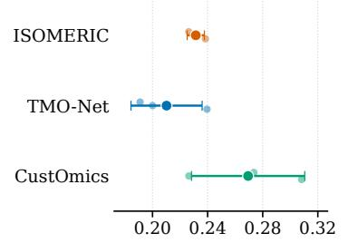

(h) Same-gene RNA-CNV agreement ↑  
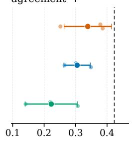  
(i) Relative distance to training (target = 1)

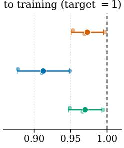

(j) CNV burden agreement ↑  
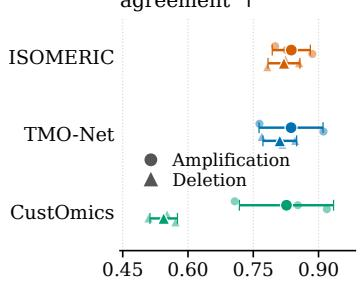

(k) Train membership AUC → 0.5  
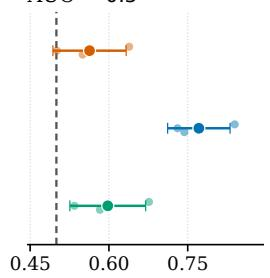

(l) RNA co-expression edge F1 ↑  
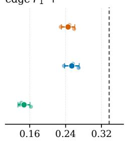  
Figure 6: Held-out evaluation in the after-treatment DECIDER cohort (139 paired samples from 89 patients). (g) Mean gene-wise RNA $W _ { 1 }$ , (h) correlation of same-gene RNA-CNV slopes, (i) distance to the closest paired training sample relative to the closest paired held-out sample, (j) amplification and deletion G-score correlations, and (k) paired membership AUC. Panel (l) reports RNA co-expression edge F1. Arrows and dashed lines indicate preferred directions, neutral targets, or real train-test references. Small points show individual outer folds, large markers and horizontal bars show the mean and sample standard deviation across the three folds. TMO-Net has the lowest RNA $W _ { 1 }$ and the highest co-expression edge F1 but also shows the strongest training preference. ISOMERIC leads the same-gene and G-score metrics. No architecture dominates overall.

(e) After-treatment RNA PCA — outer fold 1  
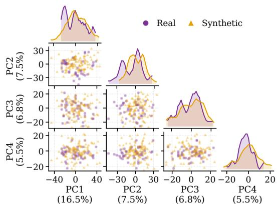

(f) CNV ensemble visualization  
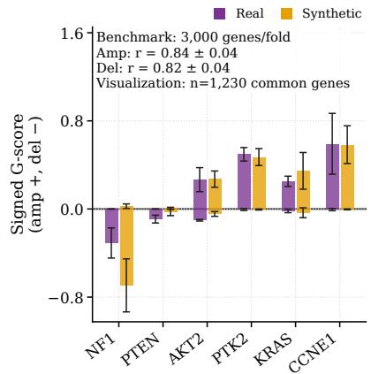

(g) RNA-CNV ensemble visualization  
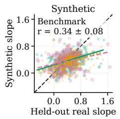

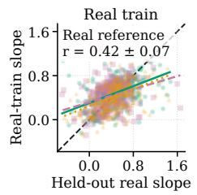

(h) Gene-pair correlation agreement  
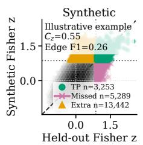

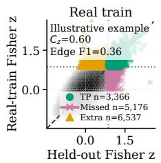  
Illustrative R2 example Outer fold 0, initialization 43

Figure 7: After-treatment visual diagnostics. (e) RNA fidelity: Held-out real and ISOMERIC synthetic RNA profiles in a PCA space fitted on real training data. (f) CNV fidelity: Real and ISOMERIC synthetic G-scores for six HGSC genes, deletions are plotted below zero. Bars show mean G-scores across the three folds, error bars indicate sample SD. The CNV visualization uses the intersection of fold-specific evaluated genes $( n = 1 , 2 3 0 )$ , benchmark correlations use all 3,000 CNV genes per fold. (g) RNA-CNV association: For each gene, the linear association estimated in the heldout data is compared with the corresponding estimate from ISOMERIC synthetic and real-training data. Points near the diagonal indicate agreement. Panels $\mathbf { ( f , g ) }$ are ensemble visualizations: synthetic gene-level values are averaged across initializations within each fold. Their benchmark annotations use correlations computed separately per initialization, averaged within fold, then summarized as mean ± sample SD across three folds. MAE denotes mean absolute error between synthetic and held-out G-scores across the 14 prespecified biomarkers. Amplification and deletion MAEs are reported in Table 3. (h) RNA co-expression: The two subpanels compare Fisher-transformed genepair correlations in held-out real data (x-axis) with those in TMO-Net synthetic data and real training data (y-axes), using identical scales. Diagonals mark equality, dotted lines mark $r = 0 . 7 0$ . Grayscale hexbins show gene-pair density, colored markers show recovered (TP), missed (FN), and extra (FP) edges, with counts in the legends. Panel (h) is an illustrative example from one fold and initialization, its Fisher-z concordance $( \bar { C _ { z } } )$ and edge F1 are example statistics. Models were selected separately for each property, so the panels are illustrative rather than an overall model ranking. The CNV criterion is the mean of amplification and deletion G-score correlations. Examples in $\mathbf { \Gamma } ( \mathbf { e } , \mathbf { h } )$ use the median fold and the initialization closest to its mean score (Appendix G).

## G Before-treatment visual diagnostics by model

Figures 8–10 show diagnostics for each model. PCA and co-expression examples select the median outer fold by initialization-averaged mean PC Wasserstein distance and edge F1, respectively, then the initialization closest to that fold’s mean score.

(a) ISOMERIC RNA PCA — outer fold 0

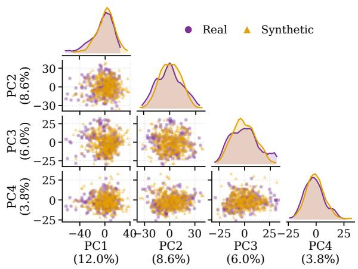  
(b) CNV ensemble visualization

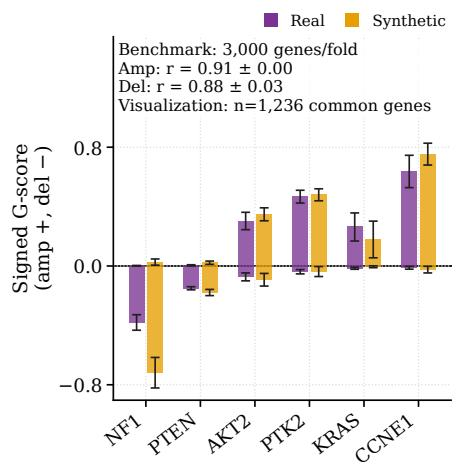

(c) RNA-CNV ensemble visualization  
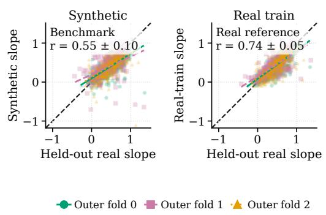

(d) Gene-pair correlation agreement  
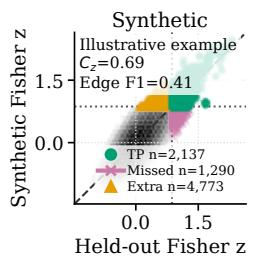

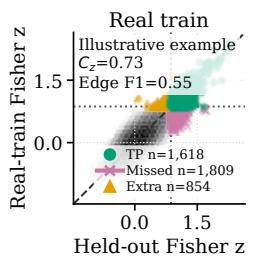  
Illustrative R2 example Outer fold 1, initialization 44

Figure 8: ISOMERIC: before-treatment visual diagnostics. (a) RNA PCA, (b) CNV G-scores, (c) same-gene RNA-CNV slopes, and (d) RNA co-expression. Panels $^ { ( \mathbf { b } , \mathbf { c } ) }$ are ensemble visualizations, averaging synthetic gene-level values across initializations within each fold. The CNV plot uses 1,236 genes common to folds, benchmark correlations use all 3,000 CNV genes per fold. MAE denotes mean absolute error between synthetic and held-out G-scores across the 14 prespecified biomarkers. Amplification and deletion MAEs are reported in Table 3. Benchmark correlations are computed per initialization, averaged within fold, then summarized as mean ± sample SD across three folds. Panel (d) shows one illustrative fold and initialization, Fisher-z concordance $( C _ { z } )$ and edge F1 describe that example. Other plotting conventions follow Figure 3.

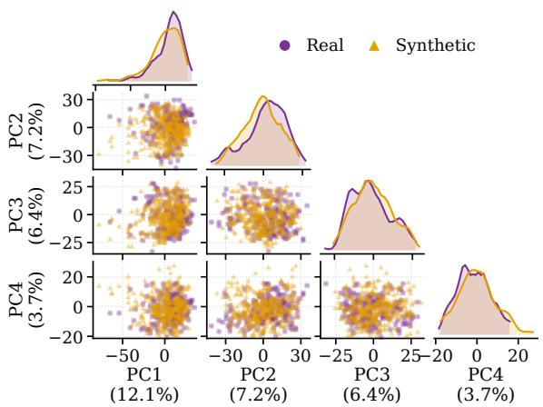

(b) CNV ensemble visualization  
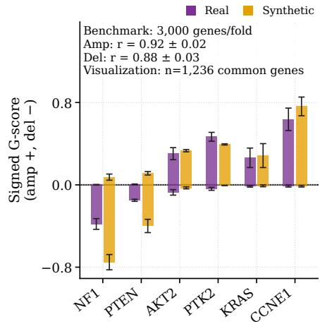

(c) RNA-CNV ensemble visualization  
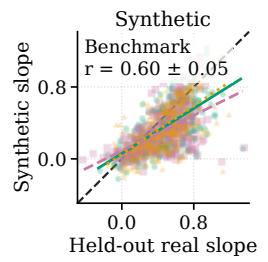

(d) Gene-pair correlation agreement  
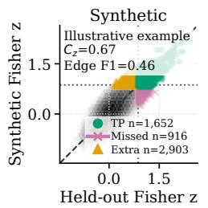

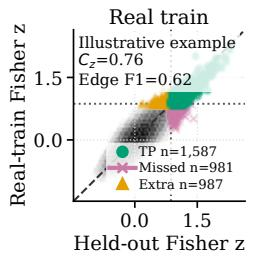  
Illustrative R2 example Outer fold 0, initialization 44  
Figure 9: TMO-Net: before-treatment visual diagnostics. (a) RNA PCA, (b) CNV G-scores, (c) same-gene RNA-CNV slopes, and (d) RNA co-expression. Panels (b,c) are ensemble visualizations, averaging synthetic gene-level values across initializations within each fold. The CNV plot uses 1,236 genes common to folds, benchmark correlations use all 3,000 CNV genes per fold. MAE denotes mean absolute error between synthetic and held-out G-scores across the 14 prespecified biomarkers. Amplification and deletion MAEs are reported in Table 3. Benchmark correlations are computed per initialization, averaged within fold, then summarized as mean ± sample SD across three folds. Panel (d) shows one illustrative fold and initialization, Fisher-z concordance $( C _ { z } )$ and edge F1 describe that example. Other plotting conventions follow Figure 3.

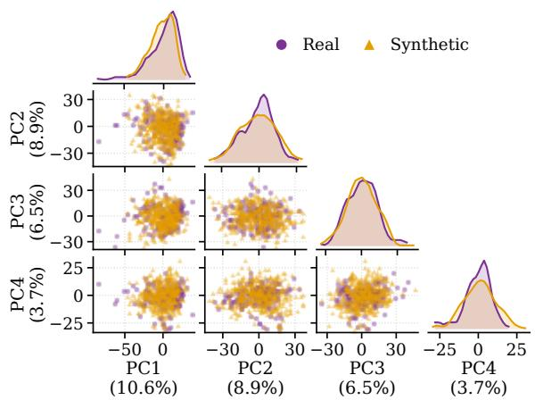

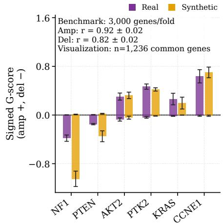

(c) RNA-CNV ensemble visualization  
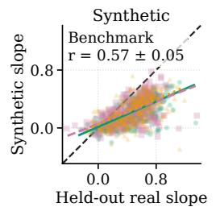

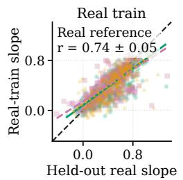

(d) Gene-pair correlation agreement  
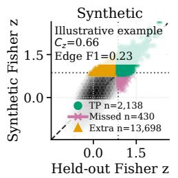

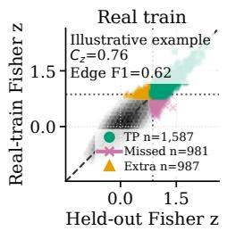  
Illustrative R2 example Outer fold 0, initialization 42  
Figure 10: CustOmics: before-treatment visual diagnostics. (a) RNA PCA, (b) CNV G-scores, (c) same-gene RNA-CNV slopes, and (d) RNA co-expression. Panels (b,c) are ensemble visualizations, averaging synthetic gene-level values across initializations within each fold. The CNV plot uses 1,236 genes common to folds, benchmark correlations use all 3,000 CNV genes per fold. MAE denotes mean absolute error between synthetic and held-out G-scores across the 14 prespecified biomarkers. Amplification and deletion MAEs are reported in Table 3. Benchmark correlations are computed per initialization, averaged within fold, then summarized as mean ± sample SD across three folds. Panel (d) shows one illustrative fold and initialization, Fisher-z concordance $( C _ { z } )$ and edge F1 describe that example. Other plotting conventions follow Figure 3.

## H After-treatment visual diagnostics by model

Figures 11–13 show the four diagnostics for each benchmark model in the after-treatment DECIDER cohort (139 paired samples from 89 patients). Fold and initialization selection and within-fold averaging follow Appendix G.

(a) ISOMERIC RNA PCA — outer fold 1

  
(b) CNV ensemble visualization

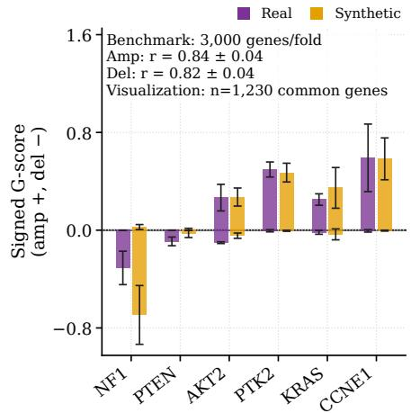

(c) RNA-CNV ensemble visualization  
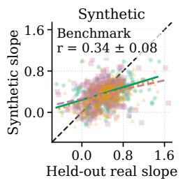

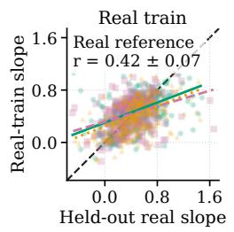

(d) Gene-pair correlation agreement  
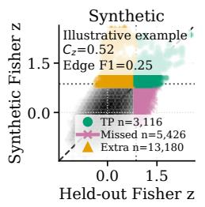

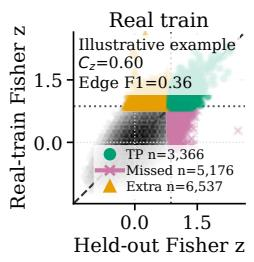  
Illustrative R2 example Outer fold 0, initialization 43

Figure 11: ISOMERIC: after-treatment visual diagnostics. (a) RNA PCA, (b) CNV G-scores, (c) same-gene RNA-CNV slopes, and (d) RNA co-expression. Panels (b,c) are ensemble visualizations, averaging synthetic gene-level values across initializations within each fold. The CNV plot uses 1,230 genes common to folds, benchmark correlations use all 3,000 CNV genes per fold. MAE denotes mean absolute error between synthetic and held-out G-scores across the 14 prespecified biomarkers. Amplification and deletion MAEs are reported in Table 3. Benchmark correlations are computed per initialization, averaged within fold, then summarized as mean ± sample SD across three folds. Panel (d) shows one illustrative fold and initialization, Fisher-z concordance $( C _ { z } )$ and edge F1 describe that example. Other plotting conventions follow Figure 7.

(b) CNV ensemble visualization  

(c) RNA-CNV ensemble visualization  

(d) Gene-pair correlation agreement  

  
Illustrative R2 example Outer fold 0, initialization 43

Figure 12: TMO-Net: after-treatment visual diagnostics. (a) RNA PCA, (b) CNV G-scores, (c) same-gene RNA-CNV slopes, and (d) RNA co-expression. Panels (b,c) are ensemble visualizations, averaging synthetic gene-level values across initializations within each fold. The CNV plot uses 1,230 genes common to folds, benchmark correlations use all 3,000 CNV genes per fold. MAE denotes mean absolute error between synthetic and held-out G-scores across the 14 prespecified biomarkers. Amplification and deletion MAEs are reported in Table 3. Benchmark correlations are computed per initialization, averaged within fold, then summarized as mean ± sample SD across three folds. Panel (d) shows one illustrative fold and initialization, Fisher-z concordance $( C _ { z } )$ and edge F1 describe that example. Other plotting conventions follow Figure 7.

(b) CNV ensemble visualization  

(c) RNA-CNV ensemble visualization  

(d) Gene-pair correlation agreement  

  
Illustrative R2 example Outer fold 0, initialization 42

Figure 13: CustOmics: after-treatment visual diagnostics. (a) RNA PCA, (b) CNV G-scores, (c) same-gene RNA-CNV slopes, and (d) RNA co-expression. Panels (b,c) are ensemble visualizations, averaging synthetic gene-level values across initializations within each fold. The CNV plot uses 1,230 genes common to folds, benchmark correlations use all 3,000 CNV genes per fold. MAE denotes mean absolute error between synthetic and held-out G-scores across the 14 prespecified biomarkers. Amplification and deletion MAEs are reported in Table 3. Benchmark correlations are computed per initialization, averaged within fold, then summarized as mean ± sample SD across three folds. Panel (d) shows one illustrative fold and initialization, Fisher-z concordance $( C _ { z } )$ and edge F1 describe that example. Other plotting conventions follow Figure 7.

## I Stochastic decoding: RNA variance and co-expression

Question. Does omitting variation around RNA decoder means contribute to the variance deficit and excessive co-expression observed in Section 4? We examine this question by adding independent Gaussian residual noise to the same generated RNA profiles and assessing variance, network density, and edge preservation together.

Matched diagnostic intervention. We use the before-treatment cohort, three patient-disjoint outer folds, and one training initialization (seed 42) for each architecture, giving nine fitted models. The fitted weights, selected sampling temperatures, latent draws, synthetic cohort sizes, and generated CNV profiles remain fixed. Only the RNA decoder output is perturbed, no model is retrained or sampling setting retuned.

For each fitted model, we reconstruct its outer-training RNA in the saved, model-specific scaled space, using latent means. ISOMERIC infers both latent means from RNA. TMO-Net maps observed training CNV through its CNV-to-RNA encoder and decodes the conditional latent mean, neither its RNA self-encoder nor a preceding CNV reconstruction is used. CustOmics encodes paired RNA and CNV, passes their concatenated representations through the central latent mean and central decoder, then applies the RNA modality decoder. Writing $e _ { i g } = r _ { i g } - \widehat { r } _ { i g }$ for these scaled training residuals, we compute

$$
\bar { e } _ { g } = \frac { 1 } { n } \sum _ { i = 1 } ^ { n } e _ { i g } , \qquad s _ { g } ^ { 2 } = \frac { 1 } { n - 1 } \sum _ { i = 1 } ^ { n } ( e _ { i g } - \bar { e } _ { g } ) ^ { 2 } ,
$$

$$
\widetilde { r } ^ { \mathrm { G } } = \widetilde { r } ^ { \mathrm { D } } + \eta , \qquad \eta \sim { \mathcal N } \big ( 0 , \mathrm { d i a g } ( s _ { 1 } ^ { 2 } , \dots , s _ { d _ { R } } ^ { 2 } ) \big ) .
$$

Here D denotes decoder means and G the Gaussian condition. Independent noise vectors are drawn for each synthetic sample, with unit noise amplitude, before applying the original inverse scaling and export procedure. Calibration uses outer-training observations only. Centering removes the estimated residual bias from calibration, the generated noise is zero-mean in expectation.

Both conditions are evaluated with the same R1–R4 procedures, including co-expression thresholds and reference subsampling. We report arithmetic means ± sample standard deviations across the three folds. For each metric, $\Delta = \hat { \mathrm { G } } - \mathrm { D }$ is computed within fold before summarizing, its standard deviation describes paired fold differences.

Results. Adding noise increases the mean RNA variance ratio from 0.667 to 0.714 for TMO-Net, 0.568 to 0.844 for ISOMERIC, and 0.600 to 1.058 for CustOmics (Figure 14, Table 16). TMO-Net’s density ratio approaches one (1.681 to 1.051), with edge F1 increasing from 0.499 to 0.519. ISOMERIC and CustOmics instead become overly sparse: density ratios fall to 0.190 and 0.049, while edge F1 falls from 0.432 to 0.193 and from 0.226 to 0.076, respectively. Gene-wise Wasserstein distances decrease for all three models, but Fisher-z concordance and cis-slope Pearson correlations also decrease (Table 17). RNA membership AUCs remain above 0.5 (Table 18).

Interpretation and scope. Independent noise can reduce correlations mechanically. These results support a contribution of omitted residual variation to variance compression, but restoring variance alone does not recover co-expression structure. Training residuals combine model error and unexplained biological variation and do not identify observation noise. For TMO-Net, some of this variation may already be represented by its conditional latent, so the perturbation can double-count it. This is a diagnostic intervention, not a learned observation model or an established improvement in generation. The single initialization provides no estimate of between-initialization variability, and proximity changes do not establish privacy protection.

Figure 14: RNA residual-noise ablation before treatment. Decoder means (gray) and Gaussian residual noise (blue) share fitted models, sampling temperatures, latent draws, and CNV profiles. (a) Median gene-wise RNA variance ratio, (b) co-expression edge-density ratio (logarithmic axis), (c) edge F1. Ratios compare synthetic with held-out data and target one (dashed lines), higher F1 indicates greater edge agreement. Connected points show paired outer folds, diamonds and bars show arithmetic means ± sample SD across three folds, using training seed 42 only.
<table><tr><td>Model</td><td>Condition</td><td>RNA variance  $\mathrm { r a t i o }  1$ </td><td>Edge-density  $\mathrm { r a t i o }  1$ </td><td> $\mathrm { E d g e } F _ { 1 } \uparrow$ </td></tr><tr><td>TMO-Net</td><td>Decoder mean</td><td> $0 . 6 6 7 \pm 0 . 0 9 0$ </td><td> $1 . 6 8 1 \pm 0 . 4 1 7$ </td><td> $0 . 4 9 9 \pm 0 . 0 2 3$ </td></tr><tr><td></td><td>Gaussian</td><td> $0 . 7 1 4 \pm 0 . 0 8 0$ </td><td> $1 . 0 5 1 \pm 0 . 3 0 2$ </td><td> $0 . 5 1 9 \pm 0 . 0 4 7$ </td></tr><tr><td></td><td> $\Delta \left( \mathbf { G } - \mathbf { D } \right)$ </td><td> $+ 0 . 0 4 7 \pm 0 . 0 1 1$ </td><td> $- 0 . 6 3 0 \pm 0 . 2 0 9$ </td><td> $+ 0 . 0 2 1 \pm 0 . 0 2 7$ </td></tr><tr><td></td><td>ISOMERIC Decoder mean</td><td> $0 . 5 6 8 \pm 0 . 0 9 4$ </td><td> $2 . 5 3 5 \pm 0 . 4 1 3$ </td><td> $0 . 4 3 2 \pm 0 . 0 2 2$ </td></tr><tr><td></td><td>Gaussian</td><td> $0 . 8 4 4 \pm 0 . 1 0 3$ </td><td> $0 . 1 9 0 \pm 0 . 1 2 9$ </td><td> $0 . 1 9 3 \pm 0 . 0 5 9$ </td></tr><tr><td></td><td> $\Delta \left( \mathbf { G } - \mathbf { D } \right)$ </td><td> $+ 0 . 2 7 7 \pm 0 . 0 2 2$ </td><td> $- 2 . 3 4 5 \pm 0 . 3 5 0$ </td><td> $- 0 . 2 3 9 \pm 0 . 0 8 0$ </td></tr><tr><td>CustOmics Decoder mean</td><td></td><td> $0 . 6 0 0 \pm 0 . 0 4 6$ </td><td> $6 . 4 4 1 \pm 1 . 5 9 5$ </td><td> $0 . 2 2 6 \pm 0 . 0 3 4$ </td></tr><tr><td></td><td>Gaussian</td><td> $1 . 0 5 8 \pm 0 . 0 4 8$ </td><td> $0 . 0 4 9 \pm 0 . 0 3 5$ </td><td> $0 . 0 7 6 \pm 0 . 0 6 0$ </td></tr><tr><td></td><td> $\Delta \left( \mathbf { G } - \mathbf { D } \right)$ </td><td> $+ 0 . 4 5 8 \pm 0 . 0 4 9$ </td><td> $- 6 . 3 9 2 \pm 1 . 6 1 1$ </td><td> $- 0 . 1 5 0 \pm 0 . 0 5 2$ </td></tr></table>

Table 16: Variance and co-expression under RNA residual noise. Before-treatment cohort, training seed 42, three patient-disjoint outer folds. Values are means ± sample SD across folds. D denotes decoder means and G Gaussian residual noise, $\Delta = \mathrm { G } - \mathrm { D }$ is computed within fold before summarizing. Both synthetic-to-held-out ratios target one, higher edge F1 indicates greater agreement. Weights, temperatures, latent draws, and CNV are fixed.

<table><tr><td>Model</td><td>Condition</td><td> $W _ { 1 } \downarrow$ </td><td> $\mathrm { M M D ^ { 2 } \downarrow }$ </td><td>Fisher-z Pearson ↑</td><td> $r _ { \beta } \uparrow$ </td><td>Median |∆β|↓</td></tr><tr><td>TMO-Net</td><td>Decoder mean</td><td> $0 . 1 6 2 0 \pm 0 . 0 1 8 0$ </td><td> $0 . 0 1 3 1 3 \pm 0 . 0 0 2 4 3$ </td><td> $0 . 6 9 2 5 \pm 0 . 0 3 4 1$ </td><td> $0 . 5 9 5 0 \pm 0 . 0 5 7 7$ </td><td> $0 . 1 4 6 3 \pm 0 . 0 0 8 7$ </td></tr><tr><td></td><td>Gaussian</td><td> $0 . 1 5 6 6 \pm 0 . 0 1 4 5$ </td><td> $0 . 0 1 3 1 0 \pm 0 . 0 0 2 4 0$ </td><td> $0 . 6 8 6 1 \pm 0 . 0 3 4 9$ </td><td> $0 . 5 9 2 2 \pm 0 . 0 5 5 2$ </td><td> $0 . 1 4 7 9 \pm 0 . 0 1 3 4$ </td></tr><tr><td></td><td> $\Delta \left( \mathbf { G } - \mathbf { D } \right)$ </td><td> $- 0 . 0 0 5 4 \pm 0 . 0 0 3 5$ </td><td> $- 0 . 0 0 0 0 3 \pm 0 . 0 0 0 0 4$ </td><td> $- 0 . 0 0 6 4 \pm 0 . 0 0 1 8$ </td><td> $- 0 . 0 0 2 8 \pm 0 . 0 0 4 7$ </td><td> $+ 0 . 0 0 1 7 \pm 0 . 0 0 6 0$ </td></tr><tr><td></td><td>ISOMERIC Decoder mean</td><td> $0 . 1 8 4 6 \pm 0 . 0 1 7 8$ </td><td> $0 . 0 1 3 7 0 \pm 0 . 0 0 3 7 0$ </td><td> $0 . 6 9 6 5 \pm 0 . 0 1 8 8$ </td><td> $0 . 5 4 6 3 \pm 0 . 1 2 3 8$ </td><td> $0 . 1 2 0 4 \pm 0 . 0 0 7 0$ </td></tr><tr><td></td><td>Gaussian</td><td> $0 . 1 5 4 5 \pm 0 . 0 1 1 0$ </td><td> $0 . 0 1 3 6 9 \pm 0 . 0 0 3 7 8$ </td><td> $0 . 6 5 9 3 \pm 0 . 0 1 3 9$ </td><td> $0 . 5 3 8 6 \pm 0 . 1 2 3 2$ </td><td> $0 . 1 2 2 9 \pm 0 . 0 0 0 2$ </td></tr><tr><td></td><td> $\Delta \left( \mathbf { G } - \mathbf { D } \right)$ </td><td> $- 0 . 0 3 0 1 \pm 0 . 0 1 6 7$ </td><td>-0.00002 ± 0.00010-0.0373 ± 0.0092</td><td></td><td> $- 0 . 0 0 7 7 \pm 0 . 0 2 0 7$ </td><td> $+ 0 . 0 0 2 5 \pm 0 . 0 0 6 9$ </td></tr><tr><td>CustOmics Decoder mean</td><td></td><td> $0 . 1 8 6 4 \pm 0 . 0 1 5 3$ </td><td> $0 . 0 2 0 8 5 \pm 0 . 0 1 0 0 4$ </td><td> $0 . 6 7 0 4 \pm 0 . 0 0 8 8$ </td><td> $0 . 5 5 7 8 \pm 0 . 0 3 8 8$ </td><td> $0 . 2 2 2 9 \pm 0 . 0 2 0 8$ </td></tr><tr><td></td><td>Gaussian</td><td> $0 . 1 6 9 3 \pm 0 . 0 0 8 0$ </td><td> $0 . 0 2 0 5 9 \pm 0 . 0 0 9 9 1$ </td><td> $0 . 6 2 9 7 \pm 0 . 0 1 1 4$ </td><td> $0 . 5 4 2 1 \pm 0 . 0 2 7 7$ </td><td> $0 . 2 2 1 0 \pm 0 . 0 2 1 0$ </td></tr><tr><td></td><td>∆ (G − D)</td><td></td><td>−0.0171 ± 0.0087 −0.00026 ± 0.00015 −0.0408 ± 0.0052 −0.0157 ± 0.0184 −0.0019 ± 0.0023</td><td></td><td></td><td></td></tr></table>

Table 17: RNA fidelity and cis RNA–CNV association under residual noise. Before-treatment cohort, seed 42, means ± sample SD across three patient-disjoint outer folds. ∆ summarizes paired Gaussian-minus-decoder-mean differences. $W _ { 1 } { : }$ mean gene-wise Wasserstein distance, $\mathbf { \bar { M M D } ^ { 2 } } ;$ squared maximum mean discrepancy in PCA space, Fisher-z Pearson: RNA correlation concordance, rβ: slope Pearson correlation. Arrows indicate preferred directions against held-out data.

<table><tr><td>Model</td><td>Condition</td><td>RNA NN ratio</td><td>RNA AUC</td><td>Paired NN ratio</td><td>Paired AUC</td><td>Paired NN agreement</td></tr><tr><td>TMO-Net</td><td>Decoder mean</td><td> $0 . 8 8 5 5 \pm 0 . 0 2 0 0$ </td><td> $0 . 8 1 4 2 \pm 0 . 0 3 2 1$ </td><td> $0 . 9 5 5 2 \pm 0 . 0 1 3 7$ </td><td> $0 . 6 6 9 1 \pm 0 . 0 4 1 9$ </td><td> $0 . 0 9 9 8 \pm 0 . 0 1 7 9$ </td></tr><tr><td></td><td>Gaussian</td><td> $0 . 8 9 2 7 \pm 0 . 0 1 7 2$ </td><td> $0 . 8 1 3 6 \pm 0 . 0 3 2 5$ </td><td> $0 . 9 5 5 6 \pm 0 . 0 1 3 9$ </td><td> $0 . 6 6 8 7 \pm 0 . 0 4 2 2$ </td><td> $0 . 0 9 8 7 \pm 0 . 0 1 4 5$ </td></tr><tr><td></td><td> $\Delta \left( \mathbf { G } - \mathbf { D } \right)$ </td><td> $+ 0 . 0 0 7 2 \pm 0 . 0 0 2 8$ </td><td> $- 0 . 0 0 0 6 \pm 0 . 0 0 0 7$ </td><td> $+ 0 . 0 0 0 3 \pm 0 . 0 0 0 3$ </td><td> $- 0 . 0 0 0 4 \pm 0 . 0 0 0 5$ </td><td> $- 0 . 0 0 1 1 \pm 0 . 0 0 3 5$ </td></tr><tr><td></td><td>ISOMERIC Decoder mean</td><td> $0 . 9 4 9 8 \pm 0 . 0 1 1 7$ </td><td> $0 . 6 4 8 6 \pm 0 . 0 5 2 7$ </td><td> $0 . 9 9 3 2 \pm 0 . 0 1 4 2$ </td><td> $0 . 4 4 2 2 \pm 0 . 0 3 1 2$ </td><td> $0 . 0 3 0 1 \pm 0 . 0 0 9 8$ </td></tr><tr><td></td><td>Gaussian</td><td> $0 . 9 6 2 7 \pm 0 . 0 0 9 1$ </td><td> $0 . 6 4 7 3 \pm 0 . 0 5 2 9$ </td><td> $0 . 9 9 4 6 \pm 0 . 0 1 2 7$ </td><td> $0 . 4 4 2 2 \pm 0 . 0 3 0 5$ </td><td> $0 . 0 3 3 2 \pm 0 . 0 0 9 7$ </td></tr><tr><td></td><td> $\Delta \left( \mathbf { G } - \mathbf { D } \right)$ </td><td> $+ 0 . 0 1 2 9 \pm 0 . 0 0 5 2$ </td><td> $- 0 . 0 0 1 3 \pm 0 . 0 0 5 2$ </td><td> $+ 0 . 0 0 1 4 \pm 0 . 0 0 1 5$ </td><td> $+ 0 . 0 0 0 0 \pm 0 . 0 0 1 1$ </td><td> $+ 0 . 0 0 3 0 \pm 0 . 0 0 0 1$ </td></tr><tr><td></td><td>CustOmics Decoder mean</td><td> $0 . 9 3 8 9 \pm 0 . 0 0 8 0$ </td><td> $0 . 6 9 3 0 \pm 0 . 0 4 8 1$ </td><td> $0 . 9 8 5 8 \pm 0 . 0 1 5 6$ </td><td> $0 . 5 2 2 1 \pm 0 . 0 5 3 7$ </td><td> $0 . 0 1 8 1 \pm 0 . 0 0 7 4$ </td></tr><tr><td></td><td>Gaussian</td><td> $0 . 9 6 1 1 \pm 0 . 0 0 6 7$ </td><td> $0 . 6 8 6 5 \pm 0 . 0 5 0 3$ </td><td> $0 . 9 8 7 5 \pm 0 . 0 1 4 2$ </td><td> $0 . 5 2 2 9 \pm 0 . 0 5 2 6$ </td><td> $0 . 0 2 0 3 \pm 0 . 0 0 7 4$ </td></tr><tr><td></td><td>∆ (G − D)</td><td>+0.0222 ± 0.0023 −0.0064 ± 0.0026 +0.0017 ± 0.0014 +0.0008 ± 0.0015</td><td></td><td></td><td></td><td> $+ 0 . 0 0 2 1 \pm 0 . 0 0 3 7$ </td></tr></table>

Table 18: Training proximity under RNA residual noise. Before-treatment cohort, seed 42, means ± sample SD across three patient-disjoint outer folds. ∆ summarizes paired Gaussian-minus-decoder mean differences. Nearest-neighbor (NN) ratios compare distances from synthetic profiles to equally sized training and held-out sets. Ratios below one or membership AUC above 0.5 indicate training preference. Paired NN agreement is the fraction whose closest training RNA and CNV profiles identify the same sample. These diagnostics do not establish privacy protection.

## J Controls for pairing sensitivity and independent empirical marginals

These controls test whether agreement within each modality can coexist with incorrect RNA–CNV pairing. We first disrupt real held-out pairs to assess the sensitivity of the cis metrics, then evaluate a baseline that recombines complete RNA and CNV profiles from different training patients.

## J.1 Pair-shuffled held-out control

Protocol. Within each held-out fold, we keep RNA profiles fixed and randomly reassign complete CNV profiles between different patients from the same tissue and clinical treatment phase. Each CNV profile is used once per permutation. This changes the pairing while preserving the individual RNA and CNV profiles. Groups containing only one patient are excluded from both conditions. The intact and shuffled comparisons use the same remaining samples and estimable genes from the original gene panels.

We repeat the permutation 100 times in each of the three folds, separately before and after treatment. For each cohort and fold, we recompute same-gene RNA–CNV slopes using all eligible samples. Each slope describes how a gene’s RNA expression varies with its CNV across samples. Slopes from the original real-training pairs provide the reference for both intact and shuffled held-out slopes. The training pairs remain unchanged. No generator is trained.

Results and interpretation. Disrupting pairing reduces mean slope correlation from 0.742 to 0.013 before treatment and from 0.410 to 0.005 after treatment (Table 19, Figure 15). Absolute slope error increases and sign agreement falls. Summaries average permutations within each fold, then report mean ± sample standard deviation (SD) across the three folds. Checks of RNA distributions, CNV G-scores, RNA correlations, and co-expression edges confirm that these properties remain unchanged after shuffling. Module and hub metrics were not recomputed.

The cis metrics therefore detect errors missed by these marginal and RNA-only network measures. This is a descriptive intervention, not a formal patient-level permutation test. Repeated samples and tissue or phase associations remain relevant, so pooled shuffled slopes need not be exactly zero.
<table><tr><td>Cohort</td><td>Pairing</td><td> $r _ { \beta } \uparrow$ </td><td> ${ \mathrm { m e d i a n } } \left| \Delta \beta \right| \downarrow$ </td><td>Sign agreement ↑</td></tr><tr><td rowspan="2">Before treatment Intact</td><td></td><td> $0 . 7 4 2 \pm 0 . 0 4 6$ </td><td> $0 . 0 9 3 \pm 0 . 0 0 6$ </td><td> $0 . 9 5 8 \pm 0 . 0 0 8$ </td></tr><tr><td>Shuffled</td><td> $0 . 0 1 3 \pm 0 . 0 2 9$ </td><td> $0 . 4 3 6 \pm 0 . 0 2 1$ </td><td> $0 . 4 8 0 \pm 0 . 0 0 7$ </td></tr><tr><td rowspan="2">After treatment</td><td>Intact</td><td> $0 . 4 1 0 \pm 0 . 0 6 1$ </td><td> $0 . 1 6 3 \pm 0 . 0 1 7$ </td><td> $0 . 9 2 2 \pm 0 . 0 2 2$ </td></tr><tr><td>Shuffled</td><td> $0 . 0 0 5 \pm 0 . 0 6 5$ </td><td> $0 . 4 7 2 \pm 0 . 0 3 7$ </td><td> $0 . 4 6 4 \pm 0 . 0 2 1$ </td></tr></table>

Table 19: Cis association scores for intact and shuffled held-out pairs against real-training slopes. Values are means ± sample standard deviations across three outer folds. For shuffled pairs, the 100 permutation scores are first averaged within each fold. $r _ { \beta }$ is the Pearson correlation of same-gene slopes. Sign agreement excludes exact-zero slopes. Intact and shuffled comparisons use the same eligible held-out samples and fixed gene set in each fold. Arrows indicate closer agreement with the reference, the standard deviations are descriptive, not confidence intervals.

  
Figure 15: Sensitivity of cis RNA–CNV slope correlation to pair shuffling. The upper and lower panels show the before- and after-treatment cohorts. Orange diamonds show correlations between slopes from intact held-out pairs and slopes from the original real-training pairs. Teal points show the R1/R2 vs intact hecorresponding correlations after each of 100 CNV permutations in the held-out data. The training pairs remain unchanged in every comparison. Boxes show the median and interquartile range, whiskers extend to the most extreme values within 1.5 interquartile ranges of the box. Labels give the number of eligible held-out samples (n) and the fixed number of estimable genes (G). Folds are R1 · RNA median variance ratiodisplayed separately. The spread describes variation among permutations and is not a confidence interval.

## J.2 Independent empirical marginal baseline

Protocol. We construct each synthetic pair from a complete RNA profile and a complete CNV profile drawn from the training data. Donors are initially sampled independently within the same fold and tissue group, with replacement. We redraw both donors if they belong to the same patient. No generator is trained.

Before- and after-treatment cohorts are sampled separately. Within the after-treatment cohort, interval and relapse samples share the same donor pool within each tissue group. Generated cohorts match the training sample count and tissue composition, using the benchmark preprocessing and gene panels. Individual profiles may be reused, so their frequencies can differ from those in the training data.

We generate three replicate cohorts per fold and evaluate each with the benchmark R1–R4 metrics. R1–R3 compare generated cohorts with intact held-out data. R4 measures their proximity to training versus held-out samples. Metric values are averaged over replicates within each fold, then reported as mean ± sample SD across three folds (Table 20). Unlike the adapted VAEs, this baseline explicitly matches tissue composition, so the comparison does not isolate model architecture.

Results and interpretation. Independent marginals has lower mean RNA Wasserstein distance and higher mean RNA edge F1 than the three learned generators in both cohorts (Figure 16). These favorable RNA-only scores coexist with near-zero cis slope correlation: $0 . 0 2 4 \overset { \cdot } { \pm } 0 . 0 3 1$ before treatment and $- 0 . 0 2 2 \pm 0 . 0 8 3$ after treatment. The learned generators retain higher correlations, supporting separate evaluation of paired dependence.

Paired membership AUC is high: 0.876 ± 0.021 before treatment and 0.767 ± 0.054 after treatment, the latter similar to TMO-Net’s 0.771 ± 0.059. Individual profiles are copied from training donors by construction. Favorable marginal scores do not establish novelty or privacy. Balanced reference subsampling can omit a copied donor, so not every nearest-training distance must be zero. These descriptive comparisons separate marginal fidelity, paired association, and training proximity without claiming significance from three fold summaries.
<table><tr><td>Method</td><td>RNA W1↓</td><td>Edge F1 ↑</td><td> $r _ { \beta } \uparrow$ </td><td>Paired AUC</td></tr><tr><td>Before treatment</td><td></td><td></td><td></td><td></td></tr><tr><td>ISOMERIC</td><td> $0 . 1 8 4 \pm 0 . 0 2 0$ </td><td> $0 . 4 1 2 \pm 0 . 0 1 8$ </td><td> $0 . 5 5 1 \pm 0 . 1 0 1$ </td><td> $0 . 4 4 6 \pm 0 . 0 3 5$ </td></tr><tr><td>TMO-Net</td><td> $0 . 1 6 6 \pm 0 . 0 2 7$ </td><td> $0 . 4 7 4 \pm 0 . 0 1 0$ </td><td> $0 . 6 0 0 \pm 0 . 0 4 7$ </td><td> $0 . 6 5 7 \pm 0 . 0 4 3$ </td></tr><tr><td>CustOmics</td><td> $0 . 1 8 5 \pm 0 . 0 1 3$ </td><td> $0 . 2 2 6 \pm 0 . 0 3 4$ </td><td> $0 . 5 6 7 \pm 0 . 0 4 9$ </td><td> $0 . 5 2 4 \pm 0 . 0 4 6$ </td></tr><tr><td>Independent marginals</td><td> $0 . 1 1 5 \pm 0 . 0 0 7$ </td><td> $0 . 5 4 6 \pm 0 . 0 0 7$ </td><td> $0 . 0 2 4 \pm 0 . 0 3 1$ </td><td> $0 . 8 7 6 \pm 0 . 0 2 1$ </td></tr><tr><td>After treatment</td><td></td><td></td><td></td><td></td></tr><tr><td>ISOMERIC</td><td> $0 . 2 3 1 \pm 0 . 0 0 6$ </td><td> $0 . 2 4 6 \pm 0 . 0 1 5$ </td><td> $0 . 3 3 9 \pm 0 . 0 7 6$ </td><td> $0 . 5 6 3 \pm 0 . 0 7 0$ </td></tr><tr><td>TMO-Net</td><td> $0 . 2 1 0 \pm 0 . 0 2 6$ </td><td> $0 . 2 5 4 \pm 0 . 0 1 6$ </td><td> $0 . 3 0 5 \pm 0 . 0 4 2$ </td><td> $0 . 7 7 1 \pm 0 . 0 5 9$ </td></tr><tr><td>CustOmics</td><td> $0 . 2 6 9 \pm 0 . 0 4 1$ </td><td> $0 . 1 4 7 \pm 0 . 0 1 3$ </td><td> $0 . 2 2 3 \pm 0 . 0 8 3$ </td><td> $0 . 5 9 8 \pm 0 . 0 7 2$ </td></tr><tr><td>Independent marginals</td><td> $0 . 1 9 0 \pm 0 . 0 0 7$ </td><td> $0 . 2 7 5 \pm 0 . 0 3 4$ </td><td> $- 0 . 0 2 2 \pm 0 . 0 8 3$ </td><td> $0 . 7 6 7 \pm 0 . 0 5 4$ </td></tr></table>

Table 20: Independent empirical marginal baseline compared with the three learned generators. RNA W (R1), RNA co-expression edge F1 (R2), and same-gene slope correlation $r _ { \beta }$ (R3) compare generated and held-out real cohorts. Paired membership AUC (R4) measures training-versus-held-out separation, 0.5 denotes no separation and values above 0.5 indicate training preference. Each entry is the mean ± sample standard deviation across three outer folds after averaging three replicates per fold. Replicates are sampling cohorts for Independent marginals and training initializations for the learned models. Arrows indicate closer held-out agreement. These four selected metrics do not summarize every property assessed by the complete R1–R4 evaluation.

Before treatment

(a) R1. RNA fidelity Gene-wise W1 ↓

(b) R2. RNA co-expression Edge F1 ↑  
  
(d) R4. Training proximity Paired AUC → 0.5

(c) R3. RNA–CNV slopes Pearson correlation ↑  
  
After treatment

  
(e) R1. RNA fidelity Gene-wise W1 ↓

(f) R2. RNA co-expression Edge F1 ↑  

(g) R3. RNA–CNV slopes Pearson correlation ↑  

(h) R4. Training proximity Paired AUC → 0.5  

Figure 16: Independent empirical marginals compared with the adapted VAEs. Panels a–d show the before-treatment cohort and e–h show the after-treatment cohort. RNA Wasserstein distance (R1), RNA co-expression edge F1 (R2), and same-gene slope correlation (R3) compare generated cohorts with held-out data. Arrows indicate the direction of closer agreement. Paired membership AUC (R4) measures training-versus-held-out separation: 0.5 denotes no separation, and higher values indicate training preference. Bars show means and error bars show sample SDs across three outer folds. Points show individual fold values after averaging three generated cohorts for the baseline or three training initializations for each VAE. The baseline combines favorable RNA-only scores with near-zero slope correlations. Table 20 reports the numerical values.

## K Sensitivity to the co-expression edge threshold

Does excess synthetic network density depend on the primary correlation threshold of 0.70? We repeat the before-treatment edge analysis at $r \geq \tau$ , with $\bar { \tau } \in \{ 0 . 6 0 , 0 . 6 5 , 0 . 7 0 , 0 . 7 5 , 0 . 8 0 \}$ , retaining Benjamini–Hochberg-adjusted $q < 0 . 0 5$ across all gene pairs. We reuse the saved Pearson correlation matrices for the three models, three outer folds, and three training seeds. Each fold retains its 3,000-gene panel and equal-sized real-training, held-out, and synthetic RNA subsets (161, 152, and 180 samples per subset in folds 0, 1, and 2). Only edge selection changes.

Across the five thresholds, mean density ratios exceed one for all models, and the observed mean edge-F1 ordering remains $\mathrm { T M O - N e t } > \mathrm { I S O M E R I C } >$ CustOmics (Figure 17, Table 21). Both patterns also hold within each fold after averaging seeds. This descriptive check concerns edge metrics, module agreement and hub overlap were not recomputed. We retain 0.70 as the primary threshold.

  
Before treatment · Mean ± sample SD across 3 outer folds, seeds averaged within each fold

  
Figure 17: Co-expression threshold sensitivity before treatment. (A) Candidate/held-out network density ratio (one denotes equal density), (B–D) edge precision, recall, and F1 (higher indicates greater recovery of held-out edges). Colored curves compare synthetic RNA with held-out RNA, the gray dashed curve uses real-training RNA as the candidate. Points and bars show mean ± sample standard deviation across three outer folds, after averaging metrics over three training seeds per fold.

Table 21: Edge metrics across correlation thresholds before treatment. Values are mean ± sample SD across three outer folds, after averaging three training seeds within each fold. Each candidate is compared with held-out real RNA. The shared real-training reference appears once per threshold, $\tau = 0 . 7 0$ is the primary setting.
<table><tr><td>T</td><td>Candidate</td><td>Density ratio</td><td>Precision</td><td>Recall</td><td>Edge F1</td></tr><tr><td>0.60</td><td>ISOMERIC</td><td> $2 . 6 2 0 \pm 0 . 3 1 3$ </td><td> $0 . 2 6 4 \pm 0 . 0 2 5$ </td><td> $0 . 6 7 7 \pm 0 . 0 2 1$ </td><td> $0 . 3 7 7 \pm 0 . 0 2 2$ </td></tr><tr><td></td><td>TMO-Net</td><td> $1 . 8 8 2 \pm 0 . 6 0 7$ </td><td> $0 . 3 3 6 \pm 0 . 0 5 1$ </td><td> $0 . 5 9 6 \pm 0 . 1 0 9$ </td><td> $0 . 4 2 0 \pm 0 . 0 0 9$ </td></tr><tr><td></td><td>CustOmics</td><td> $6 . 3 8 0 \pm 1 . 7 4 9$ </td><td> $0 . 1 3 1 \pm 0 . 0 2 9$ </td><td> $0 . 7 9 3 \pm 0 . 0 5 6$ </td><td> $0 . 2 2 4 \pm 0 . 0 4 0$ </td></tr><tr><td></td><td>Real training</td><td> $0 . 9 5 2 \pm 0 . 2 1 6$ </td><td> $0 . 5 7 8 \pm 0 . 0 5 2$ </td><td> $0 . 5 4 2 \pm 0 . 0 8 1$ </td><td> $0 . 5 5 4 \pm 0 . 0 2 4$ </td></tr><tr><td>0.65</td><td>ISOMERIC</td><td> $2 . 5 8 7 \pm 0 . 2 8 5$ </td><td> $0 . 2 7 8 \pm 0 . 0 1 9$ </td><td> $0 . 7 0 5 \pm 0 . 0 3 0$ </td><td> $0 . 3 9 6 \pm 0 . 0 1 4$ </td></tr><tr><td></td><td>TMO-Net</td><td> $1 . 8 3 3 \pm 0 . 6 3 4$ </td><td> $0 . 3 6 4 \pm 0 . 0 5 9$ </td><td> $0 . 6 2 3 \pm 0 . 1 2 0$ </td><td> $0 . 4 4 8 \pm 0 . 0 0 9$ </td></tr><tr><td></td><td>CustOmics</td><td> $6 . 6 8 5 \pm 1 . 8 2 3$ </td><td> $0 . 1 2 9 \pm 0 . 0 2 8$ </td><td> $0 . 8 1 7 \pm 0 . 0 6 3$ </td><td> $0 . 2 2 2 \pm 0 . 0 3 8$ </td></tr><tr><td></td><td>Real training</td><td> $0 . 9 6 1 \pm 0 . 2 1 8$ </td><td>0.596 ± 0.045</td><td> $0 . 5 6 6 \pm 0 . 0 9 2$ </td><td> $0 . 5 7 5 \pm 0 . 0 3 3$ </td></tr><tr><td>0.70</td><td>ISOMERIC</td><td> $2 . 5 7 5 \pm 0 . 2 9 9$ </td><td>0.290 ± 0.021</td><td> $0 . 7 3 1 \pm 0 . 0 3 1$ </td><td> $0 . 4 1 2 \pm 0 . 0 1 8$ </td></tr><tr><td></td><td>TMO-Net</td><td> $1 . 7 8 0 \pm 0 . 6 3 3$ </td><td>0.389 ± 0.064</td><td> $0 . 6 4 8 \pm 0 . 1 2 6$ </td><td> $0 . 4 7 4 \pm 0 . 0 1 0$ </td></tr><tr><td></td><td>CustOmics</td><td> $6 . 7 1 0 \pm 1 . 7 4 0$ </td><td> $0 . 1 3 2 \pm 0 . 0 2 5$ </td><td> $0 . 8 3 6 \pm 0 . 0 7 2$ </td><td> $0 . 2 2 6 \pm 0 . 0 3 4$ </td></tr><tr><td></td><td>Real training</td><td> $0 . 9 5 6 \pm 0 . 2 1 5$ </td><td>0.608 ± 0.052</td><td> $0 . 5 7 4 \pm 0 . 0 8 8$ </td><td> $0 . 5 8 5 \pm 0 . 0 3 5$ </td></tr><tr><td>0.75</td><td>ISOMERIC</td><td> $2 . 6 3 3 \pm 0 . 3 2 0$ </td><td> $0 . 2 8 9 \pm 0 . 0 2 1$ </td><td> $0 . 7 4 5 \pm 0 . 0 4 0$ </td><td> $0 . 4 1 4 \pm 0 . 0 1 9$ </td></tr><tr><td></td><td>TMO-Net</td><td> $1 . 7 2 7 \pm 0 . 5 8 4$ </td><td> $0 . 4 0 1 \pm 0 . 0 5 9$ </td><td> $0 . 6 5 3 \pm 0 . 1 2 6$ </td><td> $0 . 4 8 6 \pm 0 . 0 0 5$ </td></tr><tr><td></td><td>CustOmics</td><td> $6 . 5 8 1 \pm 1 . 6 5 9$ </td><td> $0 . 1 3 6 \pm 0 . 0 2 5$ </td><td> $0 . 8 4 7 \pm 0 . 0 6 5$ </td><td> $0 . 2 3 2 \pm 0 . 0 3 4$ </td></tr><tr><td></td><td>Real training</td><td> $0 . 9 6 6 \pm 0 . 2 0 4$ </td><td> $0 . 5 9 4 \pm 0 . 0 4 1$ </td><td> $0 . 5 6 9 \pm 0 . 0 8 8$ </td><td> $0 . 5 7 7 \pm 0 . 0 3 8$ </td></tr><tr><td>0.80</td><td>ISOMERIC</td><td> $2 . 7 0 6 \pm 0 . 1 6 6$ </td><td> $0 . 2 8 9 \pm 0 . 0 2 1$ </td><td> $0 . 7 6 8 \pm 0 . 0 3 9$ </td><td> $0 . 4 1 8 \pm 0 . 0 2 7$ </td></tr><tr><td></td><td>TMO-Net</td><td> $1 . 6 1 3 \pm 0 . 4 0 9$ </td><td> $0 . 4 1 6 \pm 0 . 0 4 7$ </td><td> $0 . 6 4 7 \pm 0 . 1 0 5$ </td><td> $0 . 4 9 9 \pm 0 . 0 2 1$ </td></tr><tr><td></td><td>CustOmics</td><td> $6 . 1 4 8 \pm 1 . 3 4 6$ </td><td> $0 . 1 4 5 \pm 0 . 0 2 2$ </td><td> $0 . 8 5 3 \pm 0 . 0 6 7$ </td><td> $0 . 2 4 6 \pm 0 . 0 2 8$ </td></tr><tr><td></td><td>Real training</td><td> $0 . 9 0 0 \pm 0 . 0 6 2$ </td><td> $0 . 6 4 8 \pm 0 . 0 3 3$ </td><td> $0 . 5 8 4 \pm 0 . 0 6 6$ </td><td> $0 . 6 1 4 \pm 0 . 0 5 1$ </td></tr></table>