# Using Transformers to Generate 3-Manifold Triangulations

Daniel Bruwel1, Ashvni Narayanan2, and Jonathan Spreer1

1School of Mathematics and Statistics F07, The University of Sydney, NSW 2006 Australia,

daniel.bruwel@sydney.edu.au, jonathan.spreer@sydney.edu.au

2Department of Computer Science, Technion, Haifa, 3200003, Israel, ashvni.n@campus.technion.ac.il

## Abstract

Using dehydration signatures as an encoding, we train GPT-2-style transformers to generate triangulations of 3-dimensional manifolds. Our main runs each use ≈ 3 exaFLOPs, spanning a 200 million parameter model trained on 60 million sphere triangulations to an 11 million parameter model trained on 1.1 billion sphere triangulations. The optimal model has 10 blocks, width 640 and generates dehydration signatures of closed manifolds of various topological types at a rate of 6.9%, 82% of which are spheres. To investigate how our method scales, we use the technique of IsoFLOP curves on 15-tetrahedron triangula tions of the 3-sphere, over a compute range of 6–3000 petaFLOPs, and observe neural scaling behaviour. We extract a parameter scaling exponent of α = 0.49 ([0.48, 0.50] stat, ±0.02 syst), and an optimal ratio of 234 tokens per parameter for training. In addition, we present a number of smaller experiments, including evidence that transformers are able to learn to count degree-one edges near-perfectly, but get progressively worse when counting edges with higher degrees.

MSC 2020 classification: 57Q15; 57K30, 57-08, 68T07

Keywords: 3-manifold triangulations, transformer models, generative machine learning, dehydration signatures, neural scaling laws

## 1 Introduction

The study of manifolds is central to research in geometric topology. One way to achieve this is to decompose a given manifold M into simplices, that is, to construct a triangulation T of M, and to then use the finite combinatorial nature of T to compute topological properties of M using algorithms and mathematical software.

For this pipeline of mathematical research to be successful, having access to large numbers of example triangulations with particular properties (determined by the application) is crucial. Ideally, we would have some version of a random generator for triangulations of manifolds that would sample from a controlled distribution over the combinatorial isomorphism types of triangulations with a given number of simplices. The motivation for this requirement stems from algorithms in the field whose performance only depends on the combinatorial isomorphism type of the input, and nothing else.

For manifolds of dimension two, i.e., surfaces, producing such a random generator is well within reach. There exist many random models, see, for instance [9, 12, 34, 35], including one by Shankar and the third author that is asymptotically uniform on the set of combinatorial isomorphism types of triangulations under consideration [41], and one by Altmann and the third author based on a Markov chain that converges to a uniform distribution [1].

In dimension d = 3, a truly random generator with control over its distribution is much more dificult to obtain. See [13] for seminal work on random 3-manifolds, including a discussion of random triangulations. Their main investigations, however, focus on a diferent probabilistic model based on random Heegaard splittings.

If we are interested in sampling triangulations of a given fixed 3-manifold M, we can apply repeated loca modifications, e.g., bistellar flips, to a seed triangulation of M. Organising this random walk through the space of triangulations of M in a Markov Chain Monte Carlo model achieves asymptotic control over a sampling distribution. See, for instance, [1] where this has been done in the case where M is the 3-sphere. Although convergence rates and mixing times remain unknown, experimental evidence suggests that such methods approximate a random generator of moderately sized triangulations of a given 3-manifold relatively well.

If we do not want to fix the topology of the triangulation, one straightforward approach is to randomly sample a 4-regular multi-graph $G = ( V , E )$ , and for each node $v \in V$ , introduce a tetrahedron $\Delta _ { v } ,$ and for each edge $e \in E$ connecting a vertex v to $w \in V$ (possibly $v = w )$ , glue a triangle of $\Delta _ { v }$ to a triangle of $\Delta _ { w }$ along a random bijection between their vertices. The issue with this approach is that the probability that this triangulation represents a manifold tends to zero extremely quickly as $\# V \to \infty$ , see Section 3 for some specific numbers.

In this work, we address this issue using machine learning techniques. More specifically, we train a transformer to learn to randomly generate dehydration signatures of 3-manifold triangulations.

Our contributions We use GPT-2-style transformers trained on large quantities of dehydration signatures (first presented in [8]) of 3-sphere triangulations. Our hypothesis is that as compute increases, the transformer will improve primarily by increasing the rate of closed manifolds, and to a lesser extent by learning to generate the correct manifold type. This is motivated by the observation that checking if a 3-dimensional triangulation is a manifold is a linear time procedure, while there is still no polynomial algorithm known for recognising the 3-sphere [23, 25], arguably the simplest closed 3-manifold.

We run a series of small experiments on classifying triangulations as manifolds and learning certain properties from their input signatures. We find a large degree of success for simple properties, such as the number of loops in the dual graph, and classification of the manifold property over a small range of topologies. For more complex properties, such as the edge-degree variance, success is more limited.

We run a series of larger experiments for generation. Our models succeed in generating valid triangulations at very high rates, and for triangulations of closed manifolds, at rates many orders of magnitude greater than the baseline. We also find evidence that the optimal parameter count as a function of compute follows a power law, and the optimal loss as a function of compute follows a power law with constant ofset.

We observe that our model is significantly biased towards generating spheres, but interestingly that the fraction of generated closed manifolds that are not spheres has a relatively small spread over the range of models we test. In particular, we find it to be only ≈ 1% relative to the spread in the total sphere shortfall. This supports our initial hypothesis that learning is focused on improving the rate of closed manifolds, rather than ensuring those manifolds are the correct type.

Finally, we analyse the statistical properties of our model, and find that there are sphere triangulations with very low likelihoods, preventing our models from being used with techniques such as importance sampling.

Related work There exist rich and extremely useful data sources for example triangulations, such as censuses of several billion triangulations of manifolds of various topological types in dimensions 3 [6] and 4 [4]. By their very nature, these data sources only contain examples with relatively few tetrahedra. To obtain large quantities of triangulations with many tetrahedra $( \geq 1 2 )$ , local searches, such as the one from [1], are very useful. However, these only produce a fixed manifold type.

Generating large numbers of example triangulations with distinct topologies can be done using layered handlebodies and random layerings [17], or by operating on framed links [42]. Here the combinatoria structure of the examples is very restricted, which is a problem that can be addressed by, again, using local search methods.

Regarding machine learning on triangulations, in [11], the authors work with a similar data source, namely, isomorphism signatures of triangulations, to train classifiers to discriminate between topological types, and specific topological properties of the underlying manifold of triangulations. In their work, the machine learning models must pick up on topological features of 3-manifolds, which are often hard to compute. In contrast, we want our models to learn the manifold property in dimension three, which is a linear time procedure (essentially an Euler characteristic computation).

In a more recent study [40], the authors operate on a census of simplicial triangulations of surfaces and 3- manifolds due to Lutz [28]. They find that the representation of data is very important for learning success, and that performance is highly dependent on the combinatorial structure of the input, along with limited generalisability to triangulations of diferent sizes.

Acknowledgements The authors would like to thank the MATRIX Institute, and in particular the organisers of the MATRIX-Oberwolfach Tandem Workshop Machine Learning and AI for Mathematics, where this project was started.

The second author would like to thank the Hooper-Shaw Foundation and Sydney Mathematical Research Institute for supporting her as a postdoc when the project began. The third author is supported by the Australian Research Council under the Discovery Scheme, grant number DP220102588. This research was undertaken with the assistance of resources and services from the National Computational Infrastructure (NCI), supported by the Australian Government, under project io00: Learning triangulations of manifolds. The authors acknowledge the technical assistance provided by the Sydney Informatics Hub, a Core Research Facility of the University of Sydney.

AI disclosure statement: The authors acknowledge the use of generative AI—specifically, web-based ChatGPT 6.0 and Claude Opus 5.5—for proofreading, for writing some of the TikZ code, and for assistance with minor coding tasks.

## 2 Background

## 2.1 Manifolds

A manifold of dimension d is a space that locally looks like Euclidean space $\mathbb { R } ^ { d }$ , but globally may have very diferent properties. The prime example of a manifold is the 2-dimensional sphere, that is, the surface of the Earth. For an example in arbitrary dimension d, consider the d-fold Cartesian product of the circle, which, for $d = 2$ , forms the surface of a doughnut. For an interesting family of 3-dimensional manifolds, consider two solid tori, glued along their boundaries such that a closed curve bounding a disc (called the meridian) on one side is glued to an arbitrarily complicated simple closed curve on the other side. This forms an infinite family of manifolds called lens spaces, parameterised by two coprime integers $p > 0$ and $q \geq 0$ and denoted by $L ( p , q )$ . The family contains the 3-dimensional sphere, that is, the space of points in $\mathbb { R } ^ { 4 }$ at unit distance from the origin.

Manifolds play an important role in many fields of mathematics, and other sciences such as physics or chemistry, or disciplines in engineering such as robotics. We consider manifolds from the viewpoint of geometric topology. That is, we see two manifolds as equivalent, or, homeomorphic, if one can be transformed into the other by a continuous deformation. Specifically, we focus on manifolds in dimension $d = 3$ . This is an interesting special case for many reasons. First, in this case, every topological 3-manifold has a unique piecewise linear (PL) structure. This means that the topological (continuous deformations) and PL (piecewise linear deformations) classifications agree, making this dimension very suitable for studying manifolds using triangulations (see below). Second, dimension $d = 3$ is the last dimension where we have an algorithmic solution to the homeomorphism problem, that is, the task of deciding whether two given manifolds are equivalent [3, 29].

See [16, 21] for more background on 3-manifolds, and [2] for a general overview of basic topology.

## 2.2 Triangulations

A suficiently well-behaved manifold, specifically one that is piecewise linear $( P L ) ,$ , admits a decomposition into finitely many simplices. To this end and in dimension $d = 3$ , consider n disjoint tetrahedra $\Delta _ { 1 } , \ldots , \Delta _ { n }$ together with a set of 2n afine maps $\Phi _ { 1 } , \ldots , \Phi _ { 2 n }$ identifying their 4n boundary triangles in pairs. Then the quotient $\mathcal { T } = \{ \Delta _ { 1 } , \hdots , \Delta _ { n } \} / \{ \Phi _ { 1 } , \hdots , \Phi _ { 2 n } \}$ forms an underlying 3-dimensional space, denoted by |T| that can be thought of as the underlying space obtained from gluing n tetrahedra together along their triangular faces (vertex to vertex).

We refer to such a T as a triangulation. As a result of the face gluings, many vertices, edges, and triangles of the $\Delta _ { i } , 1 \le i \le n$ , become identified in $\tau$ and we will refer to them as vertices, edges and triangles of the triangulation T. We refer to the number of tetrahedra n in a triangulation as its size.

We say that T is valid, if no edge of any of the tetrahedra becomes identified with itself in reverse as a consequence of the face gluings. Moreover, we say that $\tau$ is a triangulated manifold or closed if, in addition, its vertex links, that is the boundaries of small neighbourhoods of the vertices of $\tau$ , are all 2-dimensiona spheres. Note that this is equivalent to checking that all points in $| \tau |$ locally look like Euclidean space. Finally, given a manifold M, we say that T triangulates M if |T | is homeomorphic to M.

Given a triangulation T, its Euler characteristic is given by the alternating sum over the number of faces in every dimension. For a 3-dimensional triangulation this is the number of vertices minus the number of edges plus the number of triangles minus the number of tetrahedra. The Euler characteristic is a topological invariant. This means that, given a manifold ${ \mathcal { M } } ,$ every triangulation of M must have the same Euler characteristic, but two triangulations with equal Euler characteristics may triangulate distinct manifolds. In dimension three (in fact, in all odd dimensions), all closed manifolds must have Euler characteristic 0. In contrast, in dimension 2, the topological type of a connected, closed, orientable surface is determined by its Euler characteristic [15].

If the link of a vertex in a valid triangulation is a surface other than the sphere, we call this vertex ideal, and think of a small open neighbourhood of it as being removed from the triangulation. This implicitly creates a boundary component of the underlying space of $\tau$ . In this case we call $\tau$ an ideal triangulation1. Given an ideal triangulation, we will use the Euler characteristic of its vertex links as a heuristic diagnostic for how much the triangulation fails to be closed. Here, the “distance” from being a closed manifold is captured by how far away this quantity is from the Euler characteristic of the 2-sphere.

## 2.3 Dehydration signatures

A dehydration signature, as first described in [8, Section 4], is an encoding of a triangulation with $n \leq 2 5$ tetrahedra into a string of ≈ $5 n / 2$ lowercase English alphabet characters. It consists of four sections: $\mathrm { ~ a ~ } ^ { 6 } \mathrm { { s i z e } ^ { 5 } }$ character, a run of “new tetrahedra” characters, n + 1 “where” characters, and $n + 1 \ \mathrm { \stackrel {  } { h o w } } ^ { \mathfrak { H } }$ characters.

The “size” character encodes the number of tetrahedra that the triangulation has: a means the triangulation is empty, b means it has a single tetrahedron and so on. The “new tetrahedra” characters encode ordinal information about each tetrahedron. Specifically, while looping through all 2n face pairings, they encode when new tetrahedra are first introduced. For this, the signature reserves $2 \lfloor ( n + 3 ) / 4 \rfloor$ characters that are read in pairs XY. Each X and $Y$ takes one of 16 letters letting the pair encode a bit string of length 8, encoding which of 8 gluings add a new tetrahedron. Note, these tetrahedra are glued together along identity permutations, which gives suficient information to glue all n tetrahedra along a spanning tree of the dual graph of the triangulation, and to fix the labelling. This takes care of $n - 1$ of the overall 2n face pairings.

To identify the remaining $n + 1$ gluings, the next $n + 1$ “where” characters encode to which tetrahedron the remaining open faces are glued. Here, the order of the open faces is determined by the previous step. For each target tetrahedron, one letter is used to encode an integer between 0 and 25. Finally, the last $n + 1 \ \mathrm { \stackrel {  } { h o w } } ^ { \mathfrak { H } }$ characters determine the permutation of the remaining face pairings. Here, note that there are $4 ! = 2 4$ possible gluings, since not only the vertices of a triangle must be glued, but also the face of the target tetrahedron must be identified. For this, one character with possible values $" a '$ encoding $0 1 2 3 \mathrm { ~ t o ~ } ^ { \ast } x ^ { \ast }$ encoding 3210 is used. These permutations are in “reverse bijection notation”. I.e. 0123 maps $3  0 , 2  1$ $1  2 , 0  3$ and 3210 is the identity. Figure 1 demonstrates this gluing for a single vertex triangulation of $S ^ { 3 }$ . All indices start at 0.

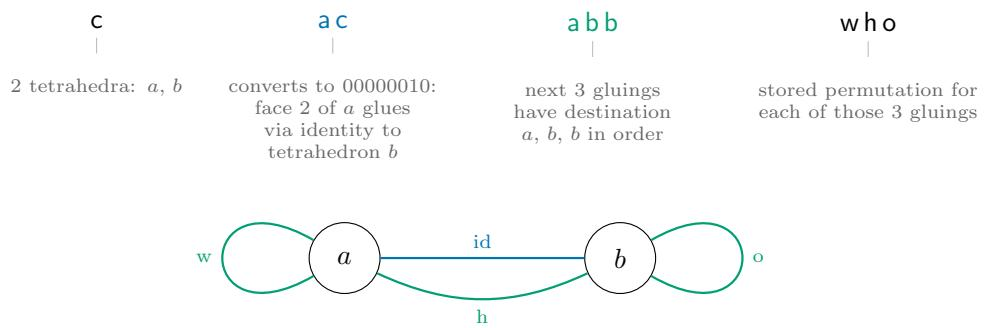  
Figure 1: Example dehydration signature for a single vertex triangulation of $S ^ { 3 }$ — cacabbwho

Remark 2.1. We use the term dehydration signature in a more general sense than other literature. In particular, we mean any signature that can be decoded by the above technique and produce valid gluing information, even if it is not strictly the dehydration of a triangulation. See Section 3 for more details.

Remark 2.2. Note that this encoding only slightly masks the combinatorics of the underlying triangulation. This is in contrast to more modern and compact encodings such as the isomorphism signatures used by Regina [7]. It is reasonable to assume that this has a positive efect on learning by transformers, as suggested by preliminary tests.

Remark 2.3. For similar experiments involving triangulations with more than 25 tetrahedra a slight tweak to the dehydration signature format is necessary. This, as well as investigating other machine-learning-friendly triangulation encodings, is subject of future work.

## 3 Baseline Generation Eficiency

Before commencing our examination of deep learning techniques, we establish a series of baselines. Our investigations are done entirely on generating dehydration signatures, see Section 2.3 for details. We note that the generation technique we will consider is autoregressive, that is to say it generates the dehydration signatures character by character. This motivates the following definitions.

Definition 3.1.

• A string is acceptable if it can be parsed as a dehydration signature

• A dehydration signature is valid if the gluing rules encode a valid triangulation. That is, the gluing rules do not identify an edge with itself in reverse.

• A dehydration signature is closed if the triangulation it represents is a valid closed manifold. That is, the link of each vertex is PL-homeomorphic to $S ^ { 2 }$

• A dehydration signature is a sphere if the triangulation it represents is PL-homeomorphic to an $S ^ { 3 }$

By construction, we have

$$
\mathrm { s p h e r e } \subset \mathrm { c l o s e d } \subset \mathrm { v a l i d } \subset \mathrm { a c c e p t a b l e }
$$

Acceptable Dehydration Signatures As a naive baseline, we want to establish the probability that a random sequence of lower case English letters, of the correct length, forms an acceptable dehydration signature. Exact enumeration of dehydration signatures is challenging, primarily due to the fact that “forward references” are possible: that is, a face can be glued to a tetrahedron that has not yet been defined to exist in the “new tetrahedra” characters of the string. Instead of exact enumeration, we use probabilistic estimates on the tree of acceptable dehydration signatures, as introduced in [24]. Details are provided in Section A. Table 1 includes our estimation of the probabilities: column 2 contains P(Acceptable | Random), the probabilities when sampling each character unrestricted from all 26 lower case English letters; column

3 contains P(Acceptable | Subset), the probabilities when sampling each character from a restricted “subset” of available characters at each position (e.g. the letter k is always required for the first position of a 10-tetrahedron signature).

We take a moment to define an important subclass of acceptable dehydration signatures called encodable dehydration signatures. These are defined as acceptable dehydration signatures that result from the encoding of some triangulation via the standard dehydration algorithm [8]. These are important because all training data will only consist of encodable dehydration signatures. For a fixed triangulation, the number of unique encodable dehydration signatures, s(T), is given by

$$
s ( T ) = { \frac { 2 4 N _ { \mathrm { t e t } } ( T ) } { \# \mathrm { A u t } ( T ) } }\tag{1}
$$

where $N _ { \mathrm { t e t } } ( T )$ denotes the number of tetrahedra in T, and Aut(T) denotes its group of symmetries.

Valid Triangulations We now consider the conditional probability of a triangulation being valid, given that it has an acceptable dehydration signature. We estimate this by randomly sampling from the space of triangulations directly. We first note an important detail: a triangulation has a dehydration signature if and only if it is connected and has no boundary faces. To generate such triangulations we randomly pair faces together to form a perfect matching, and assign a random permutation to each pairing. This is guaranteed to form a triangulation with no boundary faces. Our sampled triangulation may not be connected so we discard all disconnected triangulations. This is eficient as asymptotically almost surely a randomly generated 4- valent graph is connected, and for $N _ { \mathrm { t e t } } = 1 0$ the probability of being connected is $> 9 5 \%$ . We generate 100,000 such triangulations for each $N _ { \mathrm { t e t } } = 1 0$ to 20 and find that P(Valid | Acceptable), the probability of being valid given an acceptable signature, is on the order of 14-18%. This is included in the fourth column of Table 1.

Triangulations of Closed Manifolds For $N _ { \mathrm { t e t } } = 5$ , 6 we use the above random gluing method to generate connected triangulations with no boundary faces. For each $N _ { \mathrm { t e t } }$ we take 5 million random gluings (of which in both cases ≈ 1 million are valid) and find that P(Closed | Acceptable), the probability of being closed given the signature is acceptable, for $N _ { \mathrm { t e t } } = 5$ is 0.053% and for $N _ { \mathrm { t e t } } = 6$ is 0.005%. For $N _ { \mathrm { t e t } } = 1 0$ we test 1 billion samples and find not a single triangulation of a closed manifold. Hence, with 95% confidence we can say that P(Closed | Acceptable) ${ \mathrm { i s } } < 3 \times 1 0 ^ { - 9 }$ . It is known that the probability of being closed tends to 0 as the number of tetrahedra tends to infinity [13, Proposition 2.8]. Hence, direct sampling with the above method can be assumed to be ineficient for $N _ { \mathrm { t e t } } \geq 1 0$

Triangulations of Spheres Considering the above manifold generation is ineficient for generating closed manifolds, we cannot use it to estimate the percentage of closed manifolds that are spheres. We also cannot practically use the other random sampling techniques such as layered handlebodies or random layerings as the combinatorial type is not uniform. Hence, we look to the exhaustive census of closed triangulations of manifolds for $1 \leq N _ { \mathrm { t e t } } \leq 9$ (with arbitrary numbers of vertices) [5]. From this, approximately 31% of closed triangulations are spheres, the breakdown for $1 \leq N _ { \mathrm { t e t } } \leq 9$ is shown in Table 2. For larger $N _ { \mathrm { t e t } }$ the census is incomplete, though it is reasonable to assume that, as N increases, the percentage of closed manifolds that are spheres declines.

## 4 Data and Model Description

## 4.1 Training Data Generation

Triangulations While our primary goal is to study the generation of triangulations, we will first establish a collection of classification and regression tasks. These serve as critical diagnostic tools to understand if transformer architectures can inherently learn to compute fundamental topological and combinatorial properties from dehydration signatures. To support this and the final generation tasks, we generate four sets of triangulation data. We generate most of these data using MCMC as discussed in [1]. We use a step size of $d _ { \mathrm { s t e p } } = 1$ and choose $\gamma ,$ the growth control factor, according to the number of tetrahedra that we are trying to generate, extracted via the method outlined in Section 4.1 of [1].

<table><tr><td rowspan=1 colspan=1> $N _ { \mathrm { t e t } }$ </td><td rowspan=1 colspan=1>P(Acceptable | Random)</td><td rowspan=1 colspan=1>P(Acceptable | Subset)</td><td rowspan=1 colspan=1>P(Valid |</td><td rowspan=1 colspan=1>Acceptable)(%)</td></tr><tr><td rowspan=1 colspan=1>10</td><td rowspan=1 colspan=1> $\overline { { 1 . 8 6 \times 1 0 ^ { - 1 5 } } }$ </td><td rowspan=1 colspan=1> $\overline { { 7 . 8 8 \times 1 0 ^ { - 8 } } }$ </td><td rowspan=1 colspan=2>17.70%</td></tr><tr><td rowspan=1 colspan=1>11</td><td rowspan=1 colspan=1> $5 . 2 3 \times 1 0 ^ { - 1 6 }$ </td><td rowspan=1 colspan=1> $1 . 9 9 \times 1 0 ^ { - 8 }$ </td><td rowspan=1 colspan=1></td><td rowspan=1 colspan=1>17.40%</td></tr><tr><td rowspan=1 colspan=1>12</td><td rowspan=1 colspan=1> $1 . 7 1 \times 1 0 ^ { - 1 6 }$ </td><td rowspan=1 colspan=1> $5 . 3 7 \times 1 0 ^ { - 9 }$ </td><td rowspan=1 colspan=1></td><td rowspan=1 colspan=1>17.00%</td></tr><tr><td rowspan=1 colspan=1>13</td><td rowspan=1 colspan=1> $2 . 6 5 \times 1 0 ^ { - 1 7 }$ </td><td rowspan=1 colspan=1> $1 . 6 8 \times 1 0 ^ { - 9 }$ </td><td rowspan=1 colspan=1></td><td rowspan=1 colspan=1>16.60%</td></tr><tr><td rowspan=1 colspan=1>14</td><td rowspan=1 colspan=1> $9 . 5 3 \times 1 0 ^ { - 1 8 }$ </td><td rowspan=1 colspan=1> $4 . 3 1 \times 1 0 ^ { - 1 0 }$ </td><td rowspan=1 colspan=1></td><td rowspan=1 colspan=1>16.30%</td></tr><tr><td rowspan=1 colspan=1>15</td><td rowspan=1 colspan=1> $4 . 0 0 \times 1 0 ^ { - 1 8 }$ </td><td rowspan=1 colspan=1> $1 . 2 1 \times 1 0 ^ { - 1 0 }$ </td><td rowspan=1 colspan=1></td><td rowspan=1 colspan=1>15.90%</td></tr><tr><td rowspan=1 colspan=1>16</td><td rowspan=1 colspan=1> $1 . 6 6 \times 1 0 ^ { - 1 8 }$ </td><td rowspan=1 colspan=1> $3 . 1 4 \times 1 0 ^ { - 1 1 }$ </td><td rowspan=1 colspan=1></td><td rowspan=1 colspan=1>15.70%</td></tr><tr><td rowspan=1 colspan=1>17</td><td rowspan=1 colspan=1> $2 . 8 5 \times 1 0 ^ { - 1 9 }$ </td><td rowspan=1 colspan=1> $8 . 4 2 \times 1 0 ^ { - 1 2 }$ </td><td rowspan=1 colspan=1></td><td rowspan=1 colspan=1>15.50%</td></tr><tr><td rowspan=1 colspan=1>18</td><td rowspan=1 colspan=1> $2 . 1 9 \times 1 0 ^ { - 1 9 }$ </td><td rowspan=1 colspan=1> $3 . 6 2 \times 1 0 ^ { - 1 2 }$ </td><td rowspan=1 colspan=1></td><td rowspan=1 colspan=1>15.30%</td></tr><tr><td rowspan=1 colspan=1>19</td><td rowspan=1 colspan=1> $8 . 4 7 \times 1 0 ^ { - 2 0 }$ </td><td rowspan=1 colspan=1> $7 . 4 3 \times 1 0 ^ { - 1 3 }$ </td><td rowspan=1 colspan=1></td><td rowspan=1 colspan=1>15.00%</td></tr><tr><td rowspan=1 colspan=1>20</td><td rowspan=1 colspan=1> $6 . 0 5 \times 1 0 ^ { - 2 0 }$ </td><td rowspan=1 colspan=1> $2 . 6 8 \times 1 0 ^ { - 1 3 }$ </td><td rowspan=1 colspan=2>14.80%</td></tr></table>

Table 1: Baseline generation eficiency of valid and acceptable dehydration signatures.

First, for each $1 0 \leq N _ { \mathrm { t e t } } \leq 2 0$ , we generate 4 million unique triangulations of $S ^ { 3 }$ with one vertex. Second, we generate 1.2 billion unique samples of $S ^ { 3 }$ with $N _ { \mathrm { t e t } } = 1 5$ , with one vertex. Third, we generate 1,000 unique samples for the following manifolds: $L ( 1 , 0 ) = S ^ { 3 } , S ^ { 2 } \times S ^ { 1 } , L ( 2 , 1 ) = \mathbb { R } P ^ { 3 } , L ( 7 , 1 )$ , and $L ( 7 , 2 )$ , all with $N _ { \mathrm { t e t } } = 1 0$ . Finally, we generate a single “manifold learning” dataset with $N _ { \mathrm { t e t } } = 1 0$ . This dataset consists of

• 1 million unique samples of $S ^ { 3 }$ (a subset from above).

• 1 million unique triangulations of manifolds generated by randomly selecting a triangulation from the census of “internal, finite” triangulations of 6 tetrahedra, and performing 4 random (2-3) moves.

• 1 million unique valid, connected triangulations with no boundary faces generated by random gluings and rejection sampling as outlined in Section 3.

• 1 million unique random “near miss” triangulations, generated by taking a pair of triangulations from the census of “internal, finite” triangulations of 6 tetrahedra, removing one tetrahedron from each triangulation (chosen at random among those without self-identified triangles), and then randomly gluing the 4 faces of the first punctured manifold with the 4 faces of the second punctured manifold. This is also run with rejection sampling to ensure that the resulting triangulation is connected, valid, and not a manifold.

This gives 4 million unique triangulations all without boundary faces, valid, and connected, half of which are manifolds, and half of which are not.

<table><tr><td> $N _ { \mathrm { t e t } }$ </td><td>Closed</td><td>Sphere</td><td>Sphere Percent</td></tr><tr><td>1</td><td>4</td><td>2</td><td>50%</td></tr><tr><td>2</td><td>17</td><td>6</td><td>35%</td></tr><tr><td>3</td><td>81</td><td>32</td><td>40%</td></tr><tr><td>4</td><td>577</td><td>198</td><td>34%</td></tr><tr><td>5 6</td><td>5,184 57,753</td><td>1,903</td><td>37%</td></tr><tr><td>7</td><td>722,765</td><td>19,935 247,644</td><td>35% 34%</td></tr><tr><td>8</td><td>9,787,509</td><td>3,185,275</td><td></td></tr><tr><td>9</td><td></td><td></td><td>33%</td></tr><tr><td></td><td>139,103,032</td><td>43,461,431</td><td>31%</td></tr><tr><td>Total</td><td>149,676,922</td><td>46,916,426</td><td>31%</td></tr></table>

Table 2: Sphere triangulation rates for small triangulations [5]

All the above triangulations are saved with their dehydration signatures, and no canonicalisation is done. Additionally, uniqueness is qualified on the signature level, not the triangulation level; i.e., two combinatorially identical triangulations with diferent labellings are considered to be distinct.

Scalar Objective Functions For each of the 4 million samples of $S ^ { 3 }$ with one vertex and $N _ { \mathrm { t e t } } = 1 0$ , we compute the following objective functions.

1. The number of self loops in the dual graph.

2. The number of edges with degree one, two, three, four, and five.

3. The variance of the edge degree.

## 4.2 Model

We use transformer models, first described in [43]. More precisely, our model is based on $\mathrm { O p e n A I ` s }$ GPT-2 transformer introduced in [36].

Signature Tokenisation Transformer models are built to expect a list of “tokens” as their input. These tokens are discrete elements of some “vocabulary”. Hence we need to tokenise our dehydration signatures. See Section 2.3 for a detailed description of its format. Given a dehydration signature, we tokenise each character independently, accounting for the letter $( { \mathsf { a } } , \ { \mathsf { b } } , \ { \mathsf { c } } , \ \ldots )$ and its role (size, new tetrahedra, where, how). The vocabulary consists of tokens such as size <a>, size $\mathtt { < b > }$ , where $\mathtt { \le a > }$ etc. with an overall vocabulary size of 1 start of sentence character [SOS], 1 end of sentence character [EOS], 1 “size” character, 16 “new tetrahedra” characters, $N _ { \mathrm { t e t } }$ “where” characters, and 24 “how” characters, totaling $4 3 + N _ { \mathrm { t e t } }$

Core Model Design For the core transformer, we use a standard GPT-2-style architecture from [36]. Here, we briefly review its structure for convenience. The transformer consists of learned positional and token embeddings into Rdmodel that are added together. This is followed by a dropout layer, a series of transformer blocks, a layer norm and a final dense layer projecting to $\mathbb { R } ^ { d _ { \mathrm { o u t } } }$ . Each of the transformer blocks consists of an initial layer norm for stability, a residually connected attention layer, a dropout layer, a second layer norm, a residually connected feed forward layer, and a final dropout. The feed forward layer is a simple dense projection into R4·dmodel space, a Gaussian Error Linear Unit (GELU) activation [19], and a projection back into $\mathbb { R } ^ { d _ { \mathrm { m o d e l } } }$ . The hyperparameters we need to choose to determine the shape of the model are the embedding dimension $d _ { \mathrm { m o d e l } }$ , the number of transformer blocks $n _ { \mathrm { b l o c k } }$ , the number of attention heads per block $n _ { \mathrm { h e a d } }$ , and output dimension $d _ { \mathrm { o u t } }$ . Additionally, each transformer block can include a causal attention mask.

The total number of model parameters can be approximated as $1 2 \cdot d _ { \mathrm { m o d e l } } ^ { 2 } \cdot n _ { \mathrm { b l o c k } }$ . Note that in any case where the parameter count is explicitly stated, the exact parameter count is used rather than this approximation.

Classification and Scalar Regression Model For the scalar regression objectives, we use the main transformer block from above specifying $d _ { \mathrm { o u t } }$ . This produces a list of vectors $v _ { 0 } , \ldots , v _ { n } \in \mathbb { R } ^ { d _ { \mathrm { o u t } } }$ corresponding to each input token. To convert these to a scalar value, we use a custom scalar head illustrated in Figure 2. The scalar head takes each of the output vectors, applies a layer normalisation to them to produce $\hat { v } _ { 0 } , \dotsc , \hat { v } _ { n } \in$ $\mathbb { R } ^ { d _ { \mathrm { o u t } } }$ . These normalised vectors are then projected down to one dimensional logits $l _ { 0 } , \ldots , l _ { n } \in \mathbb { R }$ which are then passed through a softmax to obtain weight $\begin{array} { r } { w _ { i } = \frac { e ^ { l _ { i } } } { \sum _ { j } e ^ { l _ { j } } } \in \mathbb { R } } \end{array}$ . These are pooled together to form $\textstyle v = \sum _ { i } w _ { i } { \hat { v } } _ { i }$

This is then passed through another layer normalisation, and then a dense layer, a Rectified Linear Unit (ReLU) activation function, and finally projected down to a single scalar value. For the classification models, this scalar value is then passed through a final sigmoid function and the loss function used is binary cross entropy. The scalar regression models are all trained with mean squared error as the loss, and the data is normalised to a mean of 0 and standard deviation of 1 prior to training.

Additionally, there is some ambiguity whether causal masking should be used or not. On the one hand, the masking can introduce inductive bias and lead to faster convergence, on the other hand it may limit the ability for tokens to attend to each other. Initial testing found that causal masking performed better and is included in all the models.

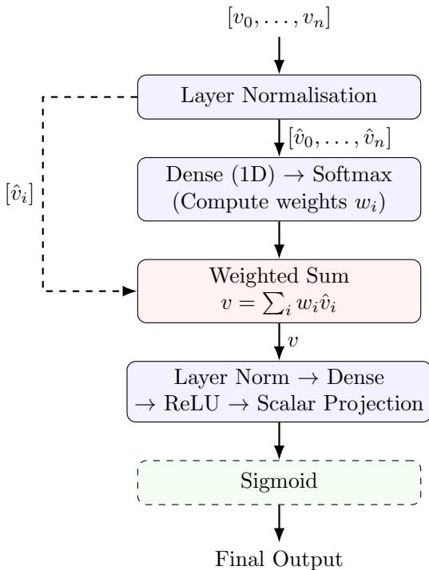  
Figure 2: Architecture for the classification/regression head. The final sigmoid term is only included during classification.

Autoregression Model For autoregression, we take the standard transformer with $d _ { \mathrm { o u t } }$ equal to the size of the vocabulary. We take our encoded signature and prepend a start of sentence token [SOS] to it. The model is trained with the objective of predicting the next token in the sequence. That is, we want to take a sequence [SOS, $T _ { 1 } , \ T _ { 2 } , \ T _ { 3 } , \ . . . , \ T _ { n } ]$ and, for each token $T _ { i } ,$ predict $T _ { i + 1 }$ , that is, predict $[ T _ { 1 } , \ T _ { 2 }$ $T _ { 3 } , \ldots , T _ { n }$ , EOS]. The output represents the logits for each token, and standard cross entropy is used. Causal masking is included to ensure the model does not use future tokens to predict the current token.

The dropout rate is fixed at 0.1 for training across all models. This includes single epoch runs where dropout is not needed, and may have degraded performance slightly.

Generation is done by initialising a sequence to [SOS], predicting the next token, appending to extend the sequence, and repeating. At each point, the next token is decided by taking the output logits over the vocabulary, applying a softmax to form a list of probabilities, and then randomly sampling according to these probabilities.

Training is done in bfloat16. Small models are trained on NVIDIA A5000 GPUs, and large models are trained on NVIDIA H200 GPUs.

Training All models use the stochastic optimisation algorithm AdamW to reduce the training error. We operate on a batch size of 512. AdamW is chosen for its robustness to hyperparameter choice, and its fast wall-clock convergence. For AdamW there are 4 hyperparameters. We keep the weight decay, $\beta _ { 1 }$ and $\beta _ { 2 }$ at the standard values of 0.01, 0.9 and 0.999 respectively for all models. For the learning rate we use a standard learning rate schedule consisting of a linear warm-up over the first ≈ 5% of the iterations to a predetermined peak learning rate, followed immediately by a cosine annealing schedule down to 10% of the peak learning rate [18]. This learning rate schedule is very stable, but because it depends on the total number of iterations, a checkpoint taken partway through a run is not equivalent to a fully trained model with a smaller budget; we therefore train every (model, budget) pair from scratch.

The peak learning rate needs to be determined independently for each model and each objective function to prevent conflation between architectural and objective function performance with suboptimal learning rate choices. That is, we avoid saying that one objective function is easier to learn than another, or one architecture is better than another, if the performance diference is simply due to a poor learning rate choice.

To choose the peak learning rate we rely on two techniques. First, for all the small tests, we run a coarse grid search of 3-5 learning rates, approximately logarithmically spaced, and pick the optimum. In each case, the models are trained to completion and the optimum is chosen based on a combination of the final test loss and the training loss profile. This strategy is chosen due to its simplicity and to avoid spending large amounts of compute on fine grained hyperparameter tuning where it is not necessary. Second, for large scale tests, we use the full $\mu P$ parametrisation of [44]. Concretely, $\mu P$ is a parametrisation under which a base learning rate is fixed, and diferent layers get diferent learning rate multipliers and initialisation variances depending on their role. In this parametrisation, the optimal base learning rate is approximately independent of width $\left( d _ { \mathrm { m o d e l } } \right)$ , so it can be tuned on a narrow model and transferred.

## 5 Numeric Experiments

While the primary goal of this study is to assess the eficiency of transformers for autoregression of dehydration signatures, we include some experiments on classification and regression tasks to assess and diagnose the transformer architecture’s performance on learning the combinatorial properties of dehydration signatures.

This is important as it helps diagnose what sorts of combinatorial properties transformers can recognise. Often, simple properties give important insights to the nature of a triangulation. For instance, low-degree edges often permit simplification, and under standard hypotheses they are excluded from minimal triangulations [22]. Another example is given by a conjecture due to Thurston and proven by Elder, McCammond and Meier [14], stating that a triangulation of a manifold with all edges having degree five or six and no two degree five edges in a single triangle must have a word-hyperbolic fundamental group.

Hence, we start this section by looking at the learnability of combinatorial properties of triangulations in Sections 5.1 and 5.2 before moving on to our main experiment in Section 5.3.

## 5.1 Detection of the Manifold Property

We begin by looking at the task of classifying if a given triangulation is a manifold or not. We run a single model architecture consisting of $d _ { \mathrm { m o d e l } } = 5 1 2 , n _ { \mathrm { h e a d } } = 8 , n _ { \mathrm { b l o c k } } = 8$ , and $d _ { \mathrm { o u t } } = 6 4$ . This model has ≈ 25 million parameters. We therefore trained the model for 16 epochs on the 4 million samples in the “manifold learning” dataset described in Section 4, leading to approximately 2.5 samples per parameter, setting aside 1,000 of each of the sphere, random manifold, random gluing, and near miss datasets for testing. We also include the 1,000 samples of $L ( 7 , 1 ) , L ( 7 , 2 ) , \mathbb { R } P ^ { 3 }$ and $S ^ { \bar { 2 } } \times \bar { S ^ { 1 } }$ in the testing group for a total of 8, 000 test samples. We use a coarse peak learning rate grid of $3 \times 1 0 ^ { - 5 } , 1 \times 1 0 ^ { - 4 } , 3 \times 1 0 ^ { - 4 }$ , and $1 \times 1 0 ^ { - 3 }$ , determining the optimal value as $1 \times 1 0 ^ { - 4 }$ . This is a small model and a small dataset with a high number of epochs. Consequently, the results are limited and would likely be surpassed by larger models with more training data.

The loss profile between the diferent manifold classes and the training loss is shown in Figure 3. The loss for all manifold types follows a consistent profile over the duration of the training. However, there is a substantial diference in the scale of the loss. We extract the final loss in Table 3. On the classes of triangulations used for training (spheres, random manifolds, random gluings, and “near misses”) the fina test loss is 0.0576. Interestingly, we find that the test losses for the specific “extra” manifold types are al very low despite being topologies that were not seen by the model during training. This suggests that the model could be learning to characterise some property that is common to manifolds, rather than something specific only to the training data. However, the out of sample test data are all positive cases (manifolds), and are “similar” to $S ^ { 3 }$ , hence may be more easily identifiable. Consistent with this theory, we find that the test loss for the “random” manifolds is higher than average, as is the test loss for “near misses”. This suggests that the model has not specifically learned to examine the vertex link, and that it can be “confused” by complex manifolds or triangulations that look like manifolds almost everywhere.

The test loss of 0.0576 is a substantial improvement from the baseline of ln $\iota ( 2 ) \approx 0 . 6 9$ , particularly considering the size of the model and the limited training data and compute spent on it. While the model does not perfectly learn to classify manifolds, it seems to largely learn what a manifold “looks $\mathrm { l i k e } ^ { \mathrm { \uparrow \mathrm { \uparrow } } }$ . The loss of 0.0088 on the random gluings indicates that transformers are able to learn some manifold structure beyond that of random gluings.

<table><tr><td>Triangulation Type</td><td>Final Loss</td></tr><tr><td> $\overline { { S ^ { 3 } } }$ </td><td>0.0129</td></tr><tr><td>Random manifold</td><td>0.0755</td></tr><tr><td>Near miss</td><td>0.1331</td></tr><tr><td>Random gluing</td><td>0.0088</td></tr><tr><td> $S ^ { 2 } \times \bar { S } ^ { 1 }$ </td><td>0.0033</td></tr><tr><td> $\mathbb { R } P ^ { 3 }$ </td><td>0.0753</td></tr><tr><td>L(7,1)</td><td>0.0249</td></tr><tr><td>L(7,2)</td><td>0.0159</td></tr></table>

Table 3: Final test loss for manifold classification on diferent test sets. The first 4 sets are classes that are explicitly included in training.

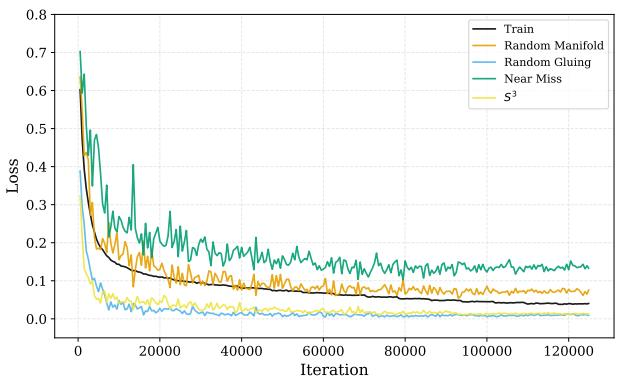  
(a)

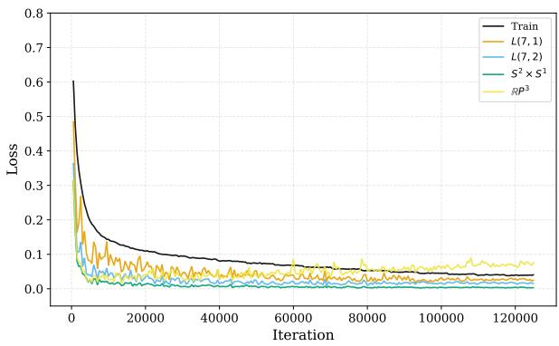  
(b)  
Figure 3: Loss curves for manifold classification task.

## 5.2 Scalar Regression

We examine a series of objective functions of difering complexity. Performance on these objective functions is an indication of the features that the machine learning architecture can learn. All tasks are done with a single model with $d _ { \mathrm { m o d e l } } = 5 1 2 , n _ { \mathrm { h e a d } } = 8 , n _ { \mathrm { b l o c k } } = 8 ,$ and $d _ { \mathrm { o u t } } = 6 4$ , and hence ≈ 25 million parameters. We ran 16 epochs of training on the 4 million scored samples of 10-tetrahedra triangulations of the single vertex 3-sphere, setting aside 4, 000 samples for testing.

All models are scored according to mean square error (MSE), and the data is standardised before training. This means that a naive model $f ( \mathrm { s i g } ) = 0$ has an MSE = 1. We use a coarse peak learning rate grid of $1 \times 1 0 ^ { - 5 } , 3 \times 1 0 ^ { - 5 } , 1 \times 1 0 ^ { - 4 } , 3 \times 1 0 ^ { - 4 }$ , and $1 \times 1 0 ^ { - 3 }$ to determine the optimal peak learning rate in each case. Similar to the classification task from Section 5.1, this is a small model with a small dataset and a large number of epochs. Hence, performance would likely be higher on larger models with more data.

Dual Graph Self Loops The number of self loops in the dual graph is a simple objective function to learn. It contains limited information on the triangulation, and only requires learning to decode the gluing table from the dehydration signature. We find the optimal learning rate to be $1 \times 1 0 ^ { - 4 }$ , and observe the loss to converge to zero. The training run converged after two epochs, when we terminated the experiment.

Edge Degree Count We examine the edge degree count of the triangulations, that is, the number of edges that have a given degree.

The set of edge degrees of a triangulation is an interesting and intricate combinatorial property. It allows conclusions on how much a triangulation can be simplified [22], it is related to curvature computation in Regge calculus [37], and it is used in the assignment of a hyperbolic geometry to a triangulation (Thurston’s Gluing Equations) [32].

We perform our experiments for edge degree = 1, 2, 3, 4, 5. We choose to stop here because, as a consequence of Euler characteristic computations, the average edge degree of a closed triangulation with n tetrahedra and v vertices is $\frac { 6 n } { n + v } < 6$ . Hence, knowing about the edges of low degrees < 6 already determines much about the edges of higher degree. Moreover, as the degree increases, it becomes increasingly challenging to predict the number of edges of such degrees. This is because, whenever an edge has degree k, the dual graph must have a closed walk of length k (the converse is not true). Hence, the edge degree count is related to cycle detection, which is a known challenge for deep learning models, both for graph neural networks [10, 27, 45] and for transformers operating on graph inputs [38, 39].

We detail the outcome for each edge degree count in Table 4, including the best learning rate selected from the grid and the minimum test loss. We observe that the model learns to essentially perfectly determine the degree-one and degree-two edge counts. For these tasks, we stop training after two epochs. This is mostly unsurprising as these are associated (but not equivalent) to loops and double edges in the dual graph. The loss increases for learning the counts of degree 3, 4, and 5 edges. Nonetheless, in all cases the loss does not exceed 0.51 indicating a 49% reduction in MSE.

<table><tr><td rowspan=3 colspan=3>Degree</td><td></td><td></td></tr><tr><td rowspan=2 colspan=1></td><td></td><td></td></tr><tr><td rowspan=1 colspan=1>Optimal LR</td><td rowspan=1 colspan=1>Minimum loss (test)</td></tr><tr><td rowspan=1 colspan=2>1</td><td rowspan=1 colspan=1></td><td rowspan=1 colspan=1>3 × 10−4</td><td rowspan=1 colspan=1>2.0 × 10−4</td></tr><tr><td rowspan=1 colspan=3>2</td><td rowspan=1 colspan=1>3 × 10−4</td><td rowspan=1 colspan=1>0.031</td></tr><tr><td rowspan=3 colspan=3>345</td><td rowspan=2 colspan=1>3 × 10−41 × 10−4</td><td rowspan=1 colspan=1>0.16</td></tr><tr><td rowspan=1 colspan=1>0.23</td></tr><tr><td rowspan=1 colspan=1>1 × 10−4</td><td rowspan=1 colspan=1>0.51</td></tr></table>

Table 4: Performance metrics for scalar regression of the count of edges with a given degree.

Edge Degree Variance The edge degree variance, that is, the mean squared deviation between edge degrees and the average edge degree of a triangulation, is studied for a few reasons. On the one hand, it is a useful aggregate measure for the count of edge degrees above. On the other hand, it is a measure that is known to be highly correlated with some notions of “complicatedness” of triangulations, and related to how “wild” the curvature of the geometric realisation of the triangulation is [33].

We find the best learning rate to be $1 \times 1 0 ^ { - 4 }$ which achieves a minimum test loss of 0.36. While the model does not learn to perfectly determine the edge degree variance, this is a 64% reduction in MSE, suggesting that the model has at least learned to identify something that is correlated with edge degree variance.

## 5.3 Autoregression

We now consider the main goal of the paper: generating triangulations. We conduct three experiments. First, we examine small models on triangulations of diferent sizes to establish how performance difers on diferent numbers of tetrahedra. We then examine the scaling law behaviour of the learning task. Finally, we examine the characteristics of the generated data.

Generation Eficiency for Diferent Triangulation Sizes We begin our analysis by performing a small investigation into the generation eficiency for diferent numbers of tetrahedra. We choose a consistent model architecture of $d _ { \mathrm { m o d e l } } = 5 1 2 , n _ { \mathrm { h e a d } } = 8$ , and $n _ { \mathrm { b l o c k } } = 8$ . This model has ≈ 25 million parameters, and we run 64 epochs of training on 1 million samples for $1 0 \leq N _ { \mathrm { t e t } } \leq 2 0$ , leading to approximately 2.5 samples per parameter, consistent across each value of $N _ { \mathrm { t e t } }$ . We leave 4, 000 samples out for holdout. We run a learning rate grid of $1 0 ^ { - 4 } , 3 \times 1 0 ^ { - 4 } , 1 0 ^ { - 3 }$ , and $3 \times 1 0 ^ { - 3 }$ . After training, we generate 10, 000 samples from the best model. For each generated signature we check if it is an acceptable string, if it is valid, if the triangulation it represents is a closed manifold, and if it is a sphere. These results are included in Table 5. We find in all cases, every string generated is unique and represents a combinatorially unique triangulation. In all cases, every generated string is distinct from the training data.

We observe that even for the small models we train, the performance metrics are much better than those established in Section 3. Additionally, the percentage of signatures that load, and are valid is particularly high. We additionally observe an approximate exponential decline in the closed and sphere generation eficiency as $N _ { \mathrm { t e t } }$ increases.
<table><tr><td rowspan=1 colspan=1> $N _ { \mathrm { t e t } }$ </td><td rowspan=1 colspan=1>Signature Length</td><td rowspan=1 colspan=1>Optimal LR</td><td rowspan=1 colspan=1>Acceptable (%)</td><td rowspan=1 colspan=1>Valid (%)</td><td rowspan=1 colspan=1>Closed (%)</td><td rowspan=1 colspan=1>Sphere (%)</td></tr><tr><td rowspan=1 colspan=1>10</td><td rowspan=1 colspan=1>29</td><td rowspan=1 colspan=1> $\overline { { 1 \times 1 0 ^ { - 3 } } }$ </td><td rowspan=1 colspan=1>99.55</td><td rowspan=1 colspan=1>99.53</td><td rowspan=1 colspan=1>9.95</td><td rowspan=1 colspan=1>8.08</td></tr><tr><td rowspan=1 colspan=1>11</td><td rowspan=1 colspan=1>31</td><td rowspan=1 colspan=1> $1 \times 1 0 ^ { - 3 }$ </td><td rowspan=1 colspan=1>98.32</td><td rowspan=1 colspan=1>98.32</td><td rowspan=1 colspan=1>6.2</td><td rowspan=1 colspan=1>4.89</td></tr><tr><td rowspan=1 colspan=1>12</td><td rowspan=1 colspan=1>33</td><td rowspan=1 colspan=1> $1 \times 1 0 ^ { - 3 }$ </td><td rowspan=1 colspan=1>96.02</td><td rowspan=1 colspan=1>96.01</td><td rowspan=1 colspan=1>4.03</td><td rowspan=1 colspan=1>3.08</td></tr><tr><td rowspan=1 colspan=1>13</td><td rowspan=1 colspan=1>37</td><td rowspan=1 colspan=1> $1 \times 1 0 ^ { - 3 }$ </td><td rowspan=1 colspan=1>96.64</td><td rowspan=1 colspan=1>96.64</td><td rowspan=1 colspan=1>2.35</td><td rowspan=1 colspan=1>1.83</td></tr><tr><td rowspan=1 colspan=1>14</td><td rowspan=1 colspan=1>39</td><td rowspan=1 colspan=1> $1 \times 1 0 ^ { - 3 }$ </td><td rowspan=1 colspan=1>95.87</td><td rowspan=1 colspan=1>95.86</td><td rowspan=1 colspan=1>1.80</td><td rowspan=1 colspan=1>1.25</td></tr><tr><td rowspan=1 colspan=1>15</td><td rowspan=1 colspan=1>41</td><td rowspan=1 colspan=1> $1 \times 1 0 ^ { - 3 }$ </td><td rowspan=1 colspan=1>91.29</td><td rowspan=1 colspan=1>91.28</td><td rowspan=1 colspan=1>1.22</td><td rowspan=1 colspan=1>0.92</td></tr><tr><td rowspan=1 colspan=1>16</td><td rowspan=1 colspan=1>43</td><td rowspan=1 colspan=1> $1 \times 1 0 ^ { - 3 }$ </td><td rowspan=1 colspan=1>88.53</td><td rowspan=1 colspan=1>88.52</td><td rowspan=1 colspan=1>0.71</td><td rowspan=1 colspan=1>0.47</td></tr><tr><td rowspan=1 colspan=1>17</td><td rowspan=1 colspan=1>47</td><td rowspan=1 colspan=1> $1 \times 1 0 ^ { - 3 }$ </td><td rowspan=1 colspan=1>86.02</td><td rowspan=1 colspan=1>86.00</td><td rowspan=1 colspan=1>0.42</td><td rowspan=1 colspan=1>0.33</td></tr><tr><td rowspan=1 colspan=1>18</td><td rowspan=1 colspan=1>49</td><td rowspan=1 colspan=1> $1 \times 1 0 ^ { - 3 }$ </td><td rowspan=1 colspan=1>85.59</td><td rowspan=1 colspan=1>85.56</td><td rowspan=1 colspan=1>0.37</td><td rowspan=1 colspan=1>0.20</td></tr><tr><td rowspan=1 colspan=1>19</td><td rowspan=1 colspan=1>51</td><td rowspan=1 colspan=1> $1 \times 1 0 ^ { - 3 }$ </td><td rowspan=1 colspan=1>74.73</td><td rowspan=1 colspan=1>74.72</td><td rowspan=1 colspan=1>0.12</td><td rowspan=1 colspan=1>0.07</td></tr><tr><td rowspan=1 colspan=1>20</td><td rowspan=1 colspan=1>53</td><td rowspan=1 colspan=1> $1 \times 1 0 ^ { - 3 }$ </td><td rowspan=1 colspan=1>67.21</td><td rowspan=1 colspan=1>67.16</td><td rowspan=1 colspan=1>0.05</td><td rowspan=1 colspan=1>0.05</td></tr></table>

Table 5: Generation eficiency of the 25 million parameter model for triangulations with diferent numbers of tetrahedra. Based on 10,000 samples. The signature length does not include the appended [SOS] or [EOS] tokens.

IsoFLOP Neural Scaling Laws In this section we investigate how the training loss of our models relates to compute, model size, and training data. For this purpose, we estimate the scaling laws of our problem, with our attention focused on triangulations with 15 tetrahedra. We focus on this size because 15 tetrahedra is small enough to expect reasonable performance (based on the above results), and fast computation; but large enough that it is outside of the scope of existing censuses, containing unexplored territory.

In order to determine the scaling behaviour, we use the IsoFLOP method (i.e. fixed compute method) described in [20]. That is, we fix a compute budget C, and fit models of a range of diferent parameter counts (and data sizes) to estimate the optimal achievable loss for the given compute budget. Repeating this for compute budgets from $6 \cdot 1 0 ^ { 1 5 }$ to $\bar { 3 } \cdot 1 0 ^ { 1 8 }$ FLOPs allows us to extract the relationship between the model size, data, loss and compute.

To ensure validity and consistency, for each FLOP target, we compute in advance the required number of training iterations via the formula FLOPs ≈ 6ND, where N is the number of parameters and D is the number of tokens in the training data. While this is just an approximation for the compute budget, it is consistent and independent of hardware and the compiler. Computing the number of iterations in advance is critical for setting up the learning rate schedule, as the model is not fully fit until the schedule is complete. For each FLOP target, the model is completely retrained with its target iterations to ensure the learning rate schedule is complete by the time the final loss is extracted. We perform 63 training runs, detailed in Section B. Each model has a consistent aspect ratio $\left( d _ { \mathrm { m o d e l } } / n _ { \mathrm { b l o c k } } \right)$ of 64 which has been chosen based on investigations outlined in Section C. Because training a large model is computationally expensive, we run a learning rate grid search on a narrow model and scale the learning rate with $\mu P$ [44]. We find that for the range of depths being considered, using a consistent base learning rate across all the model depths is stable, and results in an acceptable performance loss (performance loss on the order of the noise). The details of this learning rate search are included in Section D.

For each fixed compute budget we fit a quadratic to the loss as a function of the log number of parameters, shown in Figure 4. For each quadratic fit, we are interested in determining the confidence intervals. However, the residual standard error, $\sigma ( C )$ , is heteroscedastic (has non-constant variance), ranging from 0.0013 to 0.015 with a peak at an intermediate compute. This heteroscedasticity is not captured by a linear trend in $\ln ( C )$ $( r = - 0 . 2 )$ Furthermore, the residuals are heavy-tailed (Shapiro–Wilk $p = 0 . 0 0 0 4 )$ Therefore, we use the wild bootstrap technique on leverage-corrected residuals, which is valid under heteroscedasticity, as our primary method of determining the confidence intervals. As a robustness check, we use a residual bootstrap from the pooled leverage-corrected residuals, which assumes homoscedastic noise and is conservative here.

Remark 5.1. The residual standard errors above are consistent with Section D, which had $\sigma = 0 . 0 0 4$

Remark 5.2. Although a shared random key was used during initialisation, a permutation test found no correlation between the residuals of the same architecture at neighbouring compute budgets $( \rho = 0 . 0 2$ $p = 0 . 9 0 )$

With bootstrapping $( B = 1 , 0 0 0 )$ , we refit the quadratic to each IsoFLOP test, and extract the optimal parameter count, and the associated loss. We fit a power law $N \sim C ^ { \alpha }$ to the optimal parameter counts and find $\alpha = 0 . 4 9 , 9 5 \% \mathrm { C I } \ [ 0 . 4 8 , 0 . 5 0 ]$ (wild bootstrap), [0.47, 0.51] (residual bootstrap); this fit is shown in Figure 5a. The optimal amount of data follows the same parametric form with exponent $1 - \alpha$ , indicating that data and parameters scale at approximately equal rates. At a reference compute of 1,000 petaFLOPs, the ratio of optimal data to optimal parameters is 234 tokens per parameter, or 5.6 samples (that is, dehydration signatures) per parameter.

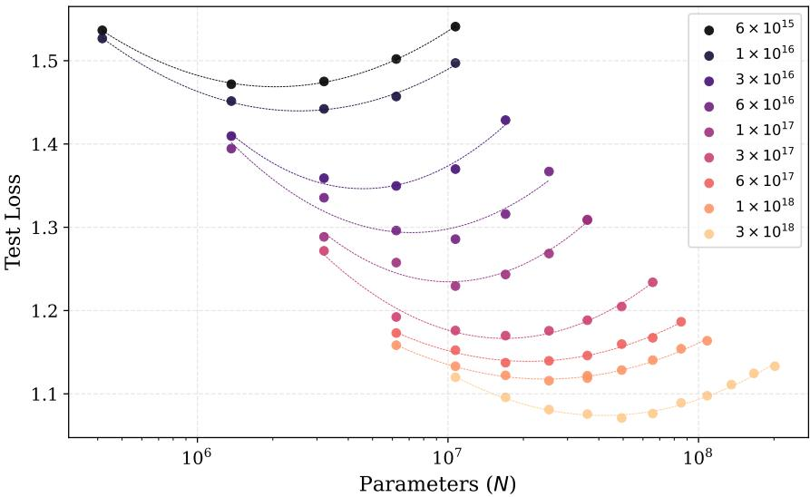  
Figure 4: IsoFLOP curves fitted with quadratics. Log x-axis

Figure 5b shows optimal loss $L ( C )$ as a function of compute C. We fit the standard form $L ( C ) = E + a C ^ { - b }$ Because the residuals contain no isolated outliers, we use least squares loss, and run a grid search on b before refining via Levenberg-Marquardt [26, 30]. From this, we find that $E = 0 . 7 9$ , 95% CI [0.71, 0.86] (wild bootstrap) [0.70, 0.85] (residual bootstrap) and $b = 0 . 1 5 ,$ , 95% CI [0.13, 0.17] (wild bootstrap) [0.12, 0.17] (residual bootstrap).

We corroborate these results by separately fitting $L ( N , D ) = E + A N ^ { - \alpha ^ { \prime } } + B D ^ { - \beta ^ { \prime } }$ following Method 3 of [20]. From this, we derive point estimates: a parameter-scaling exponent of $\begin{array} { r } { \alpha = \frac { \beta ^ { \prime } } { \alpha ^ { \prime } + \beta ^ { \prime } } = 0 . 5 0 , [ 0 . 4 4 , 0 . 5 5 ] } \end{array}$ (wild bootstrap), a data-scaling exponent of $1 - \alpha ,$ a reducible-loss exponent of $\begin{array} { r } { b = { \frac { \alpha ^ { \prime } \beta ^ { \prime } } { \alpha ^ { \prime } + \beta ^ { \prime } } } = 0 . 1 5 , [ 0 . 1 3 , 0 . 1 7 ] } \end{array}$ (wild bootstrap), and an irreducible loss of $E = 0 . 8 1 , [ 0 . 7 4 , 0 . 8 7 ]$ (wild bootstrap). These estimates are consistent with the previous analysis.

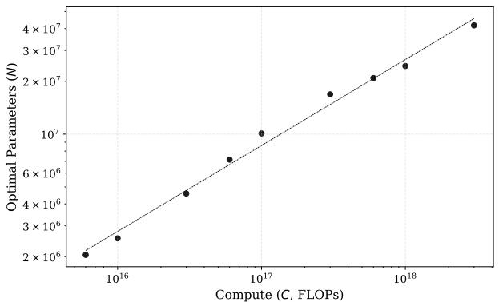  
(a) Optimal parameters extracted from quadratic fits vs compute budget. Log-log plot with fitted power law curve.

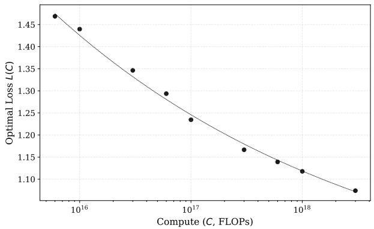  
(b) Optimal loss L(C) extracted from IsoFLOP curves vs compute budget C. Log x-axis plot with fitted power law with constant ofset.  
Figure 5: Analysis of parameter and loss scaling.

To assess systematic error, we repeat the analysis with cubic rather than quadratic fits to each IsoFLOP curve, and with the lowest and highest compute budgets excluded in turn. Together with the Method 3 estimates, this gives five point estimates for each quantity. We take half their range as the systematic uncertainty, giving α = 0.49, [0.48, 0.50] (stat) ±0.02 (syst), E = 0.79, [0.71, 0.86] (stat) ±0.10 (syst), and $b = 0 . 1 5 , [ 0 . 1 3 , 0 . 1 7 ]$ (stat) ±0.04 (syst). Our estimate for α is robust under both systematic and statistical noise, being of comparable scales. E and b are only weakly constrained in this compute range.

Exploring the Characteristics of the Generated Samples. For each compute budget, we select the best model and generate 1,000,000 samples. In each case, every acceptable sample represents a combinatorially unique triangulation. In all cases, every generated string is distinct from the training data, indicating that the models are not simply memorising.

From these samples we compute the sphere generation shortfall in $n a t s , - \ln ( p _ { \mathrm { s p h e r e } } )$ , where $p _ { \mathrm { s p h e r e } }$ is the fraction of generated samples that are spheres. This is shown in Figure 6a. The highest observed sphere rate is 5.63% [5.59%, 5.68%] or 2.88 [2.87, 2.89] nats, achieved by $d _ { \mathrm { m o d e l } } = 6 4 0$ . This is significantly higher than the random-gluing baseline of Section 3. Pooling the two highest runs and comparing to the best run, the shortfall declines from 12.56 to 2.88 nats across the sweep, corresponding to an approximately 16,000-fold increase in the sphere generation rate.

To examine how much of this shortfall improvement is from topology compared to closedness, Figure 6b shows the conditional shortfall, − ln(P(sphere | closed)). Across the models with more than 100 closed samples, the conditional shortfall varies between 0.17 and 0.26 nats (77%–84% of closed samples are spheres), with no monotone trend. This is about 1% of the overall 9.68-nat spread in sphere generation shortfall. Our best model $( d _ { \mathrm { m o d e l } } = 6 4 0 )$ generates non-sphere closed manifolds at a rate of 1.27% [1.25%, 1.29%].

For each valid triangulation, we examine the vertex link. We look at both orientability, and the Euler characteristic. As a baseline we perform random gluings as in Section 3 on $N = 1 5$ tetrahedra. Including invalid triangulations, we find that 99.6% of samples generated have non-orientable vertex links, and that the Euler characteristic (averaged across vertices) is −25 [95% central range: −29, −18]. Figure 6c shows the percentage of vertex links that are orientable against test loss, demonstrating that the models learn the combinatorial property of orientability for the vertex link very quickly. Figure 6d shows the number of samples that have vertex link Euler characteristic greater than some threshold vs the test loss, showing how, as loss improves, the triangulations become steadily “closer” to becoming closed manifolds, but that they still typically have negative Euler characteristic. In either case, the transformer generates triangulations that are closer to satisfying the closed-manifold condition.

Remark 5.3. The vertex link of the triangulations may be an invalid surface; following Regina [7], we still define its Euler characteristic as $v - e + f$ . Hence, a vertex link Euler characteristic of −29 is possible with just $N _ { \mathrm { t e t } } = 1 5$

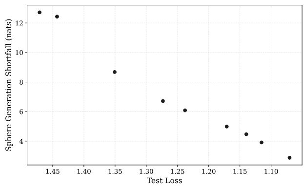  
(a) Shortfall (nats) of samples generated that are spheres $\left( - \ln ( p _ { \mathrm { s p h e r e } } ) \right)$ as a function of loss. Inverted x-axis.

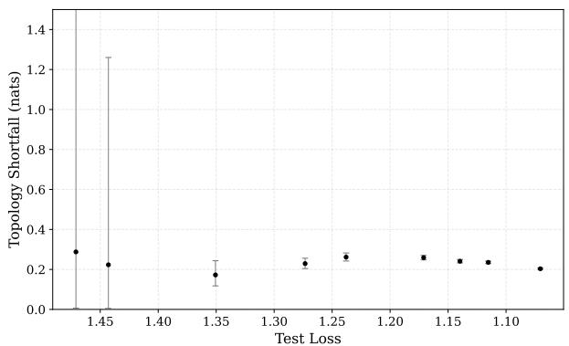  
(b) Incremental shortfall of spheres from closed manifolds. Inverted x-axis

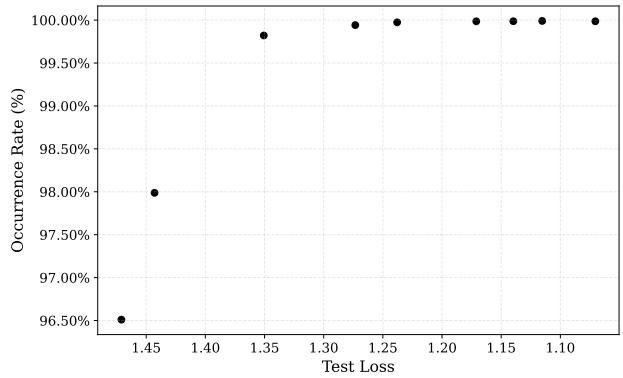  
(c) Percentage of vertex links that are orientable vs final test loss.

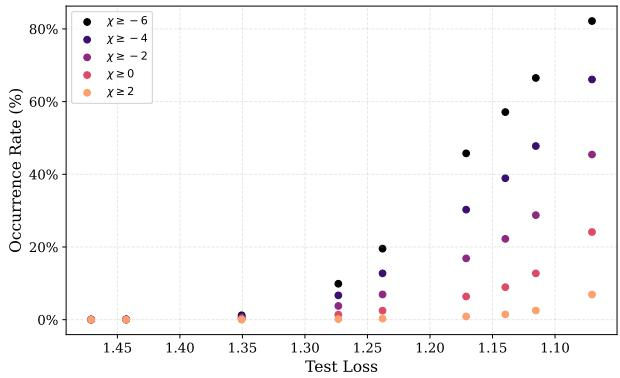  
(d) Percentage of generated samples with vertex averaged Euler characteristic χ exceeding a given threshold.  
Figure 6: Analysis of generated manifolds.

We pool the above samples together, removing duplicates. This yields 24,148 non-sphere closed manifold triangulations. For each of the non-sphere closed manifold triangulations, using Regina [7], we simplify the triangulation to find 335 unique “base” triangulations. This may contain some duplicate manifolds where a triangulation was unable to be simplified. The prime summands of these triangulations consist of $S ^ { 1 } \times S ^ { 2 }$ genuine lens spaces $( L ( p , q )$ with $p \geq 2 )$ , and prism manifolds. That is, with the exception of $S ^ { 2 } \times S ^ { 1 }$ , all prime summands are spherical. Table 6 shows the generation abundance of each prime summand. Of the unique manifolds generated, 84 are prime, 246 consist of two prime components, and 5 consist of three prime components.

In a separate sample, the largest lens space generated was L(60, 29) which conjecturally has 15 tetrahedra in its minimal triangulation [31].

Remark 5.4. The number of unique pooled samples is lower than expected. This is because each run generated its samples with the same random key, which leads to high cross run duplication despite the within run duplication being low. This is not a reflection of anything mathematical.

<table><tr><td>Prime component</td><td> $\pi _ { 1 }$ </td><td>Occurrences</td></tr><tr><td> $L ( p , q ) , p \ge 2$ </td><td> $\mathbb { Z } _ { p }$ </td><td>15,717</td></tr><tr><td> $S ^ { 1 } \times S ^ { 2 }$ </td><td> $\mathbb { Z }$ </td><td>9,080</td></tr><tr><td> $S ^ { 3 } / Q _ { 8 }$ </td><td> $Q _ { 8 }$ </td><td>15</td></tr><tr><td>Prism manifold</td><td> $Q _ { 1 2 }$ </td><td>5</td></tr><tr><td>Prism manifold</td><td> $\mathbb { Z } _ { 3 } \rtimes \mathbb { Z } _ { 8 }$ </td><td>3</td></tr><tr><td>Prism manifold</td><td> $Q _ { 8 } \times \mathbb { Z } _ { 3 }$ </td><td>2</td></tr><tr><td>Prism manifold</td><td> $\mathbb { Z } _ { 5 } \rtimes \mathbb { Z } _ { 8 }$ </td><td>2</td></tr><tr><td>Prism manifold</td><td> $Q _ { 1 6 } \times \mathbb { Z } _ { 3 }$ </td><td>1</td></tr><tr><td>Prism manifold</td><td> $\mathbb { Z } _ { 3 } \rtimes \mathbb { Z } _ { 1 6 }$ </td><td>1</td></tr><tr><td>Total</td><td></td><td>24,826</td></tr></table>

Table 6: Occurrences of each prime summand, counted with multiplicity.

## 5.4 Statistical Properties

We are interested in assessing the statistical properties of our models, and their feasibility in producing reliable statistical estimates over the space of triangulations. In order to do this, we train a large model on $N _ { \mathrm { t e t } } = 1 5$ with 9,000 petaFLOPs based on the scaling laws above, achieving a loss of 1.036, consistent with the fitted curves.

Spheres Using the algorithm from [1], we generate 100,000 triangulations of the 3-sphere with $N _ { \mathrm { t e t } } = 1 5$ tetrahedra. We assume that this is a nearly uniform sample. For varying compute budgets, including 9,000 petaFLOPs, we take the best model and, for each triangulation in the sample, compute its negative log likelihood (NLL), that is, $x \in \mathbb { R }$ , if the probability for generating the triangulation is $e ^ { - x }$

We compute the mean, µ, and standard deviation, σ, of the NLLs. Naturally, lower values of σ indicate that the sample is closer to uniform. Figure 7 shows σ as a function of compute. We observe that for larger and larger models, σ declines, indicating that the samples are getting increasingly uniform. The smallest observed value of σ is 3.44. However, we also observe a heavy tail in the distribution of the NLLs, with the least likely 3-sphere triangulation having an NLL of 76.87. These outliers prevent us from using techniques such as importance sampling to efectively deduce properties of the space of 3-sphere triangulations from the sample (as done successfully in the MCMC setting in [1]).

Other Manifold Types We generate and score 12,500 samples of a range of diferent manifold types. We score each of them with the 9,000 petaFLOP model and compute its mean NLL, µ. This is shown in Table 7. If the model was generating signatures uniformly across the space of all closed dehydration signatures, regardless of topology, the NLL would be constant. We observe that the mean NLL for $S ^ { 3 }$ is significantly (but not prohibitively) smaller than that of the other manifold types, suggesting that our models are heavily biased towards generating spheres. Additionally, we observe that the mean for lens spaces and $S ^ { 2 } \times S ^ { 1 }$ is significantly lower than for the hyperbolic Weeks manifold or $S ^ { 3 } / Q _ { 8 }$ .

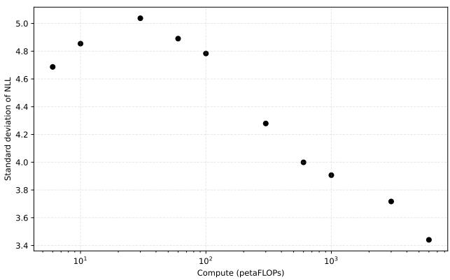  
Figure 7: The standard deviation of the NLL vs compute. Log x-axis.

<table><tr><td>Manifold</td><td>μ</td></tr><tr><td> $\overline { { S ^ { 3 } } }$   $\mathbb { R } P ^ { 3 }$ </td><td>44.54 50.74</td></tr><tr><td> $L ( 5 , 2 )$   $L ( 7 , 2 )$ </td><td>50.41</td></tr><tr><td> $S ^ { 2 } \times S ^ { 1 }$ </td><td>50.29 51.46</td></tr><tr><td> $S ^ { 3 } / Q _ { 8 }$ </td><td>54.02</td></tr><tr><td>Weeks</td><td>54.32</td></tr></table>

Table 7: Mean negative log likelihood for a range of diferent manifold types.

## 6 Future work and discussion

Interpretability of our models is currently a hard open question. Instead, we interpret our experimental data. Our work in Section 5.2 and work done in [11] indicate that neural networks are eficient at learning simple combinatorial properties, but struggle to fully learn the details required to distinguish topological type. Additionally, our work in Section 5.3 demonstrates that, at least over the compute range we tested, the majority of the improvement in the sphere generation shortfall is due to increased eficiency in generating closed manifolds, not in improving the relative fraction of spheres. While it is not a strict requirement that the model learns to detect topology in order to generate correct samples, the alignment of these two results suggests that there may be a connection. One interpretation could be that in order to learn to produce spherical triangulations, the model needs to be able to learn to detect if a triangulation is a sphere. Despite this, it is important to recognise that the relative rate of spheres compared to closed manifolds is higher than the baseline rate found in Section 3, and that the rate is high even at high test losses. Additionally, the non-sphere closed manifolds are all “simple” or “sphere-like” e.g., there are no hyperbolic manifolds. These observations are not contrary to our hypothesis, but rather suggest that there may be some easily learnable properties that correlate well with being a sphere.

Increasing diversity of topological types in samples The topological types of closed manifolds generated by our 15-tetrahedron model are listed in Table 6. The list is heavily skewed towards quotients of spheres, but nonetheless exhibits a diversity that is similar to the list of topological types of very small manifolds in the census of closed manifolds shipped with [7]. We treat this as emerging experimental evidence that, despite the model being trained entirely on sphere triangulations, it is not fully biased to generate spheres. The model can therefore be used as a first stepping stone for exploration over the space of all triangulations.

There are a number of straightforward extensions of our approach to increase the topological diversity of generated data. First, we can use generated samples from our trained model as seeds to generate new training data to feed into a new model. Iterating this procedure will (a) likely have some efect on the distribution of topological types in samples, and (b) potentially lead to a stable distribution of topological types. This stable distribution, especially if compared to estimates of the true distribution of topological types in the space of all triangulations, is a much stronger indicator for how well transformers pick up on topological properties in the training data.

Another approach is to start with a larger variety of topological types in the training data by, for instance, combining 105 samples for each of the ≈ 13, 400 closed manifolds admitting a triangulation with at most 11 tetrahedra, available from [6], into one data set.

Reinforcement learning Using one of our models as a pretrained baseline, a reasonable extension of our work is to fine-tune this model using reinforcement learning techniques. Given that our pretrained models already have high generation eficiency for closed triangulations (see Table 5), and that vertex link Euler characteristic could be an appropriate candidate for a scoring function, we see this as a promising approach to improve our models.

Other model architectures Autoregression can have dificulty on long sequences as it is unable to correct chance mistakes during generation. Difusion-style models are a possible approach to address this, and investigation into this could yield improved generation eficiencies.

Additionally, we have only looked into transformers of a very specific type as a model architecture. However, triangulations have a natural graph structure given by their dual graphs. Derivatives of graph neural networks may be good at exploiting this dual-graph structure.

Machine-learning-friendly encoding of triangulations In this article, we use dehydration signatures to represent triangulations. While this works well with our GPT-2-style transformers, there are some natural limitations to this framework. Most importantly, dehydration signatures are only defined for triangulations up to 25 tetrahedra. While extending dehydration signatures to larger triangulations is straightforward, other tweaks may be possible to expose the combinatorics of a triangulation even more eficiently to a transformer.

A systematic optimisation of triangulation encodings for machine learning applications has the potential to substantially afect training success: initial training runs with Regina isomorphism signatures showed much lower generation eficiency compared to dehydration signatures in similar models.

## References

[1] Eduardo G. Altmann and Jonathan Spreer. Sampling Triangulations of Manifolds Using Monte Carlo Methods. Experimental Mathematics, 35(1):260–274, 2026.

[2] M. A. Armstrong. Basic Topology. Undergraduate Texts in Mathematics. Springer-Verlag, 1983.

[3] Matthias Aschenbrenner, Stefan Friedl, and Henry Wilton. Decision Problems for 3-Manifolds and Their Fundamental Groups. In Interactions Between Low-Dimensional Topology and Mapping Class Groups, volume 19 of Geometry & Topology Monographs, pages 201–236. Mathematical Sciences Publishers, 2015.

[4] Rhuaidi Burke. Dim4census. https://github.com/raburke/Dim4Census/, 2026.

[5] Benjamin A. Burton. The Pachner graph and the simplification of 3-sphere triangulations. In Proceedings of the twenty-seventh annual symposium on Computational geometry, SoCG ’11, pages 153–162, New York, NY, USA, 2011. Association for Computing Machinery.

[6] Benjamin A. Burton. Regina–Supporting Data. https://regina-normal.github.io/data.html, 2026.

[7] Benjamin A. Burton, Ryan Budney, William Pettersson, et al. Regina: Software for low-dimensional topology. http://regina-normal.github.io/, 1999–2025.

[8] Patrick J. Callahan, Martin V. Hildebrand, and Jefrey R. Weeks. A Census of Cusped Hyperbolic 3-Manifolds. Mathematics of Computation, 68(225):321–332, 1999.

[9] Alessandra Caraceni and Alexandre Staufer. Growing uniform planar maps face by face. Random Structures & Algorithms, 63(4):942–967, 2023.

[10] Zhengdao Chen, Lei Chen, Soledad Villar, and Joan Bruna. Can graph neural networks count substructures? In Advances in Neural Information Processing Systems, 2020.

[11] Francesco Costantino, Yang-Hui He, Elli Heyes, and Edward Hirst. Learning 3-manifold triangulations. Journal of Physics A: Mathematical and Theoretical, 58(9):095201, 2025.

[12] Philippe Duchon, Philippe Flajolet, Guy Louchard, and Gilles Schaefer. Boltzmann Samplers for the Random Generation of Combinatorial Structures. Combinatorics, Probability and Computing, 13(4–5):577–625, 2004.

[13] Nathan M. Dunfield and William P. Thurston. Finite covers of random 3-manifolds. Inventiones mathematicae, 166:457–521, 2006.

[14] Murray Elder, Jon McCammond, and John Meier. Combinatorial conditions that imply wordhyperbolicity for 3-manifolds. Topology, 42(6):1241–1259, 2003.

[15] Jean Gallier and Dianna Xu. A Guide to the Classification Theorem for Compact Surfaces. Geometry and Computing. Springer, Berlin, Heidelberg, 2013.

[16] Allen Hatcher. Notes on Basic 3-Manifold Topology. Available online at https://pi.math.cornell. edu/ hatcher/3M/3Mdownloads.html, 2000. Unpublished lecture notes.

[17] Alexander He, James Morgan, and Em K. Thompson. An algorithm to construct one-vertex triangulations of Heegaard splittings. Journal of Computational Geometry, 16(1):635–693, 2025.

[18] Tong He, Zhi Zhang, Hang Zhang, Zhongyue Zhang, Junyuan Xie, and Mu Li. Bag of tricks for image classification with convolutional neural networks, 2018.

[19] Dan Hendrycks and Kevin Gimpel. Gaussian error linear units (gelus), 2023.

[20] Jordan Hofmann, Sebastian Borgeaud, Arthur Mensch, Elena Buchatskaya, Trevor Cai, Eliza Rutherford, Diego de Las Casas, Lisa Anne Hendricks, Johannes Welbl, Aidan Clark, Tom Hennigan, Eric Noland, Katie Millican, George van den Driessche, Bogdan Damoc, Aurelia Guy, Simon Osindero, Karen Simonyan, Erich Elsen, Oriol Vinyals, Jack W. Rae, and Laurent Sifre. Training compute-optimal large language models. In Proceedings of the 36th International Conference on Neural Information Processing Systems, NIPS ’22, Red Hook, NY, USA, 2022. Curran Associates Inc.

[21] William Jaco. Lectures on Three-Manifold Topology, volume 43 of CBMS Regional Conference Series in Mathematics. American Mathematical Society, Providence, RI, 1980.

[22] William Jaco, Hyam Rubinstein, and Stephan Tillmann. Minimal triangulations for an infinite family of lens spaces. Journal of Topology, 2(1):157–180, 2009.

[23] Michael Joswig, Davide Lofano, Frank H. Lutz, and Mimi Tsuruga. Frontiers of sphere recognition in practice. Journal of Applied and Computational Topology, 6:503–527, 2022.

[24] Donald E. Knuth. Estimating the Eficiency of Backtrack Programs. Mathematics of Computation, 29(129):121–136, 1975.

[25] Marc Lackenby. Algorithms in 3-manifold theory. Surveys in Diferential Geometry, 25:163–213, 2022.

[26] Kenneth Levenberg. A method for the solution of certain non-linear problems in least squares. Quarterly of applied mathematics, 2(2):164–168, 1944.

[27] Andreas Loukas. What Graph Neural Networks Cannot Learn: Depth vs Width. In International Conference on Learning Representations, 2020.

[28] Frank H. Lutz. The Manifold Page, 2017. https://www3.math.tu-berlin.de/IfM/Nachrufe/Frank\_ Lutz/stellar/.

[29] A. A. Markov. Unsolvability of the problem of homeomorphy. In Proceedings of the International Congress of Mathematicians, Edinburgh, 1958, pages 300–306. Cambridge University Press, 1960.

[30] Donald W Marquardt. An algorithm for least-squares estimation of nonlinear parameters. Journal of the society for Industrial and Applied Mathematics, 11(2):431–441, 1963.

[31] S. V. Matveev. Complexity theory of three-dimensional manifolds. Acta Applicandae Mathematica, 19(2):101–130, May 1990.

[32] Walter D. Neumann and Don Zagier. Volumes of Hyperbolic Three-Manifolds. Topology, 24(3):307–332, 1985.

[33] Jo˜ao Paix˜ao and Jonathan Spreer. Random collapsibility and 3-sphere recognition. https://arxiv. org/abs/1509.07607, 2015. 18 pages, 6 figures.

[34] Nicholas Pippenger and Kristin Schleich. Topological characteristics of random triangulated surfaces. Random Structures and Algorithms, 28:247–288, 2006.

[35] Dominique Poulalhon and Gilles Schaefer. Optimal Coding and Sampling of Triangulations. Algorithmica, 46:505–527, 2006.

[36] Alec Radford, Jefrey Wu, Rewon Child, David Luan, Dario Amodei, and Ilya Sutskever. Language Models are Unsupervised Multitask Learners. OpenAI, 2019.

[37] Tullio Regge. General Relativity Without Coordinates. Il Nuovo Cimento, 19(3):558–571, 1961.

[38] Clayton Sanford, Bahare Fatemi, Ethan Hall, Anton Tsitsulin, Mehran Kazemi, Jonathan Halcrow, Bryan Perozzi, and Vahab Mirrokni. Understanding Transformer Reasoning Capabilities via Graph Algorithms. In The Thirty-eighth Annual Conference on Neural Information Processing Systems, 2024.

[39] Clayton Sanford, Daniel Hsu, and Matus Telgarsky. Transformers, parallel computation, and logarithmic depth. In Proceedings of the 41st International Conference on Machine Learning, 2024.

[40] Johannes S. Schmidt, Martin Carrasco, Ernst R¨oell, Guy Wolf, Nello Blaser, and Bastian Rieck. No Triangulation Without Representation: Generalization in Topological Deep Learning. https://arxiv. org/abs/2605.06467, 2026.

[41] Rajan Shankar and Jonathan Spreer. A Uniform Sampling Procedure for Abstract Triangulations of Surfaces. In 2023 Proceedings ofthe Symposium on Algorithm Engineering and Experiments (ALENEX), pages 15–26. Society for Industrial and Applied Mathematics, 2023.

[42] Lucy Tobin. Vertex Bounds, Complexity and Random Generation in 4-Manifold Topology. PhD thesis, The University of Sydney, 2026.

[43] Ashish Vaswani, Noam Shazeer, Niki Parmar, Jakob Uszkoreit, Llion Jones, Aidan N. Gomez, Lukasz Kaiser, and Illia Polosukhin. Attention is all you need. In Proceedings of the 31st International Conference on Neural Information Processing Systems, NIPS’17, page 6000–6010, Red Hook, NY, USA, 2017. Curran Associates Inc.

[44] Greg Yang, Edward J. Hu, Igor Babuschkin, Szymon Sidor, Xiaodong Liu, David Farhi, Nick Ryder, Jakub Pachocki, Weizhu Chen, and Jianfeng Gao. Tensor programs v: Tuning large neural networks via zero-shot hyperparameter transfer, 2022.

[45] Bohang Zhang, Shengjie Luo, Liwei Wang, and Di He. Rethinking the Expressive Power of GNNs via Graph Biconnectivity. In International Conference on Learning Representations, 2023.

## Appendices

## A Estimating Unique Dehydration Signatures

To estimate the number of unique, acceptable dehydration signatures, we construct a tree where each proper leaf of the tree represents a unique dehydration signature. Specifically, for a fixed $N _ { \mathrm { t e t } } ,$ we break each dehydration signature into 4 parts: A binary string encoding the “new tetrahedra” information, a series of letters encoding the “where” information, a list of numbers from 0–3 representing which face is glued in each “explicit” gluing, and a list of permutations of the vertices (now in $S _ { 3 }$ as the face data is separated). Because any choice of vertex permutation for a fixed face leads to an acceptable dehydration signature, we do not include it in our tree, multiplying by $6 ^ { N _ { \mathrm { t e t } } + 1 }$ at the end of our estimation. Additionally, to form a dehydration signature, we need to have a multiple of 16 bits in the gluing bit string, these remaining bits are essentially “padding” and can be set to any value without impacting the decoding process, leading to a further multiplicative factor that we include at the end.

To construct the tree, we start at the root where the binary string is empty, the “where” string is empty, and the face gluing list is empty. At any node we can choose to add a new tetrahedron by concatenating a 1 to the binary string, or we can choose to perform a gluing to an “explicit” tetrahedron, concatenating a 0 to the binary string, and adding the letter of the target tetrahedron and face id to their respective data. When we say “explicit”, we allow forward references where we glue to a tetrahedron that hasn’t been declared in the binary string yet as these are acceptable. Before listing these children, we remove any children that are not partially valid by checking if they lead to any obvious double gluings or gluings of a face to itself. Because the partial check is not perfect, the tree contains dead ends in it i.e., nodes that have no partially valid children but are not themselves complete.

To form our estimate, we use random walks as introduced in [24], with non-uniform selection probabilities. That is, we start at the root of the tree, randomly select a child node according to some probability distribution, and repeat down the tree. Each walk gives an unbiased estimate of the number of leaves, $\hat { N } = 1 / \Pi _ { i } p _ { i }$ where $p _ { i }$ is the probability of the child chosen at step $i ,$ and $\hat { N } = 0$ if the walk fails to reach an acceptable dehydration signature. Specifically, on the dehydration signature tree, if a child that involves gluing a new tetrahedron exists, it gets a weight of 1 if it is the only child, and otherwise a weight of exactly $\begin{array} { r } { p _ { \mathrm { n e w } } = \frac { n _ { 1 } } { n _ { 0 } + n _ { 1 } } } \end{array}$ where $n _ { 0 } = N _ { \mathrm { t e t } } + 1 - \#$ {zeros used} and $n _ { 1 } = N _ { \mathrm { t e t } } - 1 - \#$ {ones used} where the number of ones and zeros used refers to the binary string. The remaining children get the remaining weight divided evenly between them. With this method, in the largest case of $N _ { \mathrm { t e t } } = 2 0$ there are still $\approx 5 \%$ of samples that are not dead ends.

For each $N _ { \mathrm { t e t } }$ we perform 10,000 walks as above and compute the average of $\hat { N }$ over all walks. This is our estimate of the number of dehydration signatures. It is important to acknowledge that, despite this being an unbiased estimate, the variance can be extremely high and “heavy tailed”, and it is dificult to estimate what it is. Hence, to provide some diagnostic confidence, we plot the running average and visually confirm our estimate has converged by checking for an absence $/$ stabilisation of “jumps”. This is not a perfect diagnostic.

## B IsoFLOP Training Run Details

Table 8 includes the model shape, FLOPs, and data used for each run of the IsoFLOP scaling law test.

## C Aspect Ratio Tuning

We examine the influence of the aspect ratio of the model on the final test loss. We do not perform an exhaustive study on this topic, running only small tests of $1 0 ^ { 1 6 }$ FLOPs on a target parameter count of 6.2 million, specifically on the 15-tetrahedron dataset at one epoch on a subset of the 1.2 billion sphere dataset.

<table><tr><td colspan="8"></td></tr><tr><td>dmodel nblock</td><td></td><td>N</td><td>6 10</td><td>30</td><td>Target petaFLOPs 60</td><td>100</td><td>300</td><td>600</td><td>1000</td><td>3000</td></tr><tr><td>128</td><td>2</td><td>417280</td><td>58</td><td>97</td><td></td><td></td><td></td><td></td><td>一</td><td></td></tr><tr><td>192</td><td>3</td><td>1 365 696</td><td>18</td><td>30</td><td>89 179</td><td></td><td></td><td></td><td>1</td><td></td></tr><tr><td>256</td><td>4</td><td>3 200 512</td><td>8</td><td>13</td><td>38</td><td>76 127</td><td>381</td><td></td><td></td><td></td></tr><tr><td>320</td><td>5</td><td>6 216 640</td><td>4</td><td>7</td><td>20</td><td>39</td><td>65 196</td><td>392</td><td>654</td><td></td></tr><tr><td>384</td><td>6</td><td>10 708 992</td><td>2</td><td>4</td><td>11</td><td>23</td><td>38 114</td><td>228</td><td>380</td><td>1139</td></tr><tr><td>448</td><td>7</td><td>16 972 480</td><td></td><td>一</td><td>7</td><td>14</td><td>24</td><td>72 144</td><td>240</td><td>719</td></tr><tr><td>512</td><td>8</td><td>25 302 016</td><td></td><td></td><td></td><td>10</td><td>16</td><td>48 96</td><td>161</td><td>482</td></tr><tr><td>576</td><td>9</td><td>35 992 512</td><td></td><td></td><td></td><td>一</td><td>11</td><td>34 68</td><td>113</td><td>339</td></tr><tr><td>640</td><td>10</td><td>49 338 880</td><td></td><td></td><td></td><td></td><td></td><td>25 49</td><td>82</td><td>247</td></tr><tr><td>704</td><td>11</td><td>65 636 032</td><td></td><td></td><td></td><td>一</td><td>一</td><td>19 37</td><td>62</td><td>186</td></tr><tr><td>768</td><td>12</td><td>85 178 880</td><td></td><td></td><td></td><td></td><td></td><td>29 1</td><td>48</td><td>143</td></tr><tr><td>832</td><td>13</td><td>108 262 336</td><td></td><td></td><td></td><td></td><td></td><td></td><td>38</td><td>113</td></tr><tr><td>896</td><td>14</td><td>135 181 312</td><td></td><td></td><td></td><td>一</td><td></td><td></td><td>一</td><td>90</td></tr><tr><td>960</td><td>15</td><td>166 230 720</td><td></td><td></td><td></td><td></td><td></td><td></td><td>一</td><td>73</td></tr><tr><td>1024</td><td>16</td><td>201 705 472</td><td>一</td><td>一</td><td>一</td><td>一</td><td>一</td><td>一</td><td>一 1</td><td>60</td></tr></table>

Table 8: Number of training samples $( \times 1 0 ^ { 6 } )$ for each IsoFLOP run, by model size and target compute. N is the exact parameter count. Each model has $n _ { \mathrm { h e a d } } = n _ { \mathrm { b l o c k } } = d _ { \mathrm { m o d e l } } / 6 4 .$ “–” indicates configurations not run at that budget.

This dataset is chosen because it is the testing ground for the IsoFLOP scaling law work. With 41 tokens per signature, this is approximately 1 sample per parameter.

We run a range of diferent aspect ratios, attempting to find models with as close to 6.2 million parameters as possible. However, there is some variance resulting from the need to keep the depth an integer, and the width a multiple of 32. Hence we use (width, depth)-pairs of (512, 2), (416, 3), (352, 4), (320, 5), (288, 6), (256, 8), and (224, 10). For each model we fix the head size at 32 for consistency. We train each model for approximately $1 0 ^ { 1 6 } ~ \mathrm { F L O P s }$ to account for the minor diferences in the parameter counts.

We use a coarse learning rate grid of $6 \times 1 0 ^ { - 4 } , 1 0 ^ { - 3 } , 3 \times 1 0 ^ { - 3 } , 6 \times 1 0 ^ { - 3 } .$ , and $1 0 ^ { - 2 }$ . The exact parameter counts, optimal learning rate, and final loss for each model are shown in Table 9. We observe some performance diferences at the extremes of the tested aspect ratios, but for aspect ratios between 48 and 138.7 we find a range of 0.015 on the final test loss, aligning with the theory that model performance is robust to minor aspect ratio variation in the vicinity of the optimum. Hence, for subsequent experiments we assume a convenient aspect ratio of 64, acknowledging that performance could be marginally improved by specifically tuning it for each run.

<table><tr><td rowspan=1 colspan=1>Width</td><td rowspan=1 colspan=1>Depth</td><td rowspan=1 colspan=1>Aspect Ratio</td><td rowspan=1 colspan=1>Parameter Count</td><td rowspan=1 colspan=1>Optimal learning rate</td><td rowspan=1 colspan=1>Final test loss</td></tr><tr><td rowspan=1 colspan=1>224</td><td rowspan=1 colspan=1>10</td><td rowspan=1 colspan=1>22.4</td><td rowspan=1 colspan=1>6,086,528</td><td rowspan=1 colspan=1> $\overline { { 3 \times 1 0 ^ { - 3 } } }$ </td><td rowspan=1 colspan=1>1.473</td></tr><tr><td rowspan=1 colspan=1>256</td><td rowspan=1 colspan=1>8</td><td rowspan=1 colspan=1>32</td><td rowspan=1 colspan=1>6,359,552</td><td rowspan=1 colspan=1> $3 \times 1 0 ^ { - 3 }$ </td><td rowspan=1 colspan=1>1.444</td></tr><tr><td rowspan=1 colspan=1>288</td><td rowspan=1 colspan=1>6</td><td rowspan=1 colspan=1>48</td><td rowspan=1 colspan=1>6,041,088</td><td rowspan=1 colspan=1> $3 \times 1 0 ^ { - 3 }$ </td><td rowspan=1 colspan=1>1.386</td></tr><tr><td rowspan=1 colspan=1>320</td><td rowspan=1 colspan=1>5</td><td rowspan=1 colspan=1>64</td><td rowspan=1 colspan=1>6,216,640</td><td rowspan=1 colspan=1> $3 \times 1 0 ^ { - 3 }$ </td><td rowspan=1 colspan=1>1.378</td></tr><tr><td rowspan=1 colspan=1>352</td><td rowspan=1 colspan=1>4</td><td rowspan=1 colspan=1>88</td><td rowspan=1 colspan=1>6,022,720</td><td rowspan=1 colspan=1> $1 \times 1 0 ^ { - 3 }$ </td><td rowspan=1 colspan=1>1.382</td></tr><tr><td rowspan=1 colspan=1>416</td><td rowspan=1 colspan=1>3</td><td rowspan=1 colspan=1>138.7</td><td rowspan=1 colspan=1>6,313,632</td><td rowspan=1 colspan=1> $3 \times 1 0 ^ { - 3 }$ </td><td rowspan=1 colspan=1>1.371</td></tr><tr><td rowspan=1 colspan=1>512</td><td rowspan=1 colspan=1>2</td><td rowspan=1 colspan=1>256</td><td rowspan=1 colspan=1>6,387,712</td><td rowspan=1 colspan=1> $3 \times 1 0 ^ { - 3 }$ </td><td rowspan=1 colspan=1>1.402</td></tr></table>

Table 9: Performance for diferent aspect ratios with a target parameter count of 6.2 million. Each model is trained for $1 0 ^ { 1 6 } \ \mathrm { F L O P s }$ (up to minor variance from batching).

## D Peak Learning Rate Tuning

Running a grid search for the optimal learning rate for large models is computationally ineficient. This section focuses on running a search on $d _ { \mathrm { m o d e l } } = 2 5 6$ so we can use $\mu P$ to scale the learning rate to larger models. We do this independently for each depth from 2 to 16 (as these are the depths used) with 4 heads, trained for one epoch with a dataset approximately equal to the number of parameters, that is, ≈ 1 sample per parameter. In keeping with the work of [20], we want to find a stable learning rate that is not excessively low. As such we run 4 copies of the learning rate grid $( 0 . 6 , 1 , 2 , 3 , 4 , 6 ) \times 1 0 ^ { - 3 }$ with identical datasets but diferent initialisations. We make two observations from these tests. First, there is a clear “stable” and “unstable” learning rate range. The centre-point of the stable learning rate range is recorded in Table 10 as “Optimal learning rate”, along with the number of samples and parameter count. Second, within the “stable” learning rate range there is some relation between average final test loss and learning rate. However, the variance of the average loss across diferent stable learning rates is on the order of the variance between replications, making this a minor factor. Hence, to ensure stability during training, and to reduce confounding efects, we fix the base learning rate at $0 . 6 \times 1 0 ^ { - 3 }$ for all depths, noting that using a per depth learning rate would yield lower individual losses, but over the small range of depths we are testing, such a minor optimisation is unlikely to significantly contribute to the outcomes.

<table><tr><td rowspan=1 colspan=1>Depth</td><td rowspan=1 colspan=1>Parameter count</td><td rowspan=1 colspan=1>Number of samples</td><td rowspan=1 colspan=1>Optimal learning rate</td></tr><tr><td rowspan=1 colspan=1>2</td><td rowspan=1 colspan=1>1,620,992</td><td rowspan=1 colspan=1>1,572,864</td><td rowspan=1 colspan=1> $\overline { { 4 \times 1 0 ^ { - 3 } } }$ </td></tr><tr><td rowspan=1 colspan=1>3</td><td rowspan=1 colspan=1>2,410,752</td><td rowspan=1 colspan=1>2,359,296</td><td rowspan=1 colspan=1> $2 \times 1 0 ^ { - 3 }$ </td></tr><tr><td rowspan=1 colspan=1>4</td><td rowspan=1 colspan=1>3,200,512</td><td rowspan=1 colspan=1>3,145,728</td><td rowspan=1 colspan=1> $3 \times 1 0 ^ { - 3 }$ </td></tr><tr><td rowspan=1 colspan=1>5</td><td rowspan=1 colspan=1>3,990,272</td><td rowspan=1 colspan=1>3,932,160</td><td rowspan=1 colspan=1> $1 \times 1 0 ^ { - 3 }$ </td></tr><tr><td rowspan=1 colspan=1>6</td><td rowspan=1 colspan=1>4,780,032</td><td rowspan=1 colspan=1>4,718,592</td><td rowspan=1 colspan=1> $3 \times 1 0 ^ { - 3 }$ </td></tr><tr><td rowspan=1 colspan=1>7</td><td rowspan=1 colspan=1>5,569,792</td><td rowspan=1 colspan=1>5,505,024</td><td rowspan=1 colspan=1> $3 \times 1 0 ^ { - 3 }$ </td></tr><tr><td rowspan=1 colspan=1>8</td><td rowspan=1 colspan=1>6,359,552</td><td rowspan=1 colspan=1>6,291,456</td><td rowspan=1 colspan=1> $2 \times 1 0 ^ { - 3 }$ </td></tr><tr><td rowspan=1 colspan=1>9</td><td rowspan=1 colspan=1>7,149,312</td><td rowspan=1 colspan=1>7,077,888</td><td rowspan=1 colspan=1> $2 \times 1 0 ^ { - 3 }$ </td></tr><tr><td rowspan=1 colspan=1>10</td><td rowspan=1 colspan=1>7,939,072</td><td rowspan=1 colspan=1>7,864,320</td><td rowspan=1 colspan=1> $3 \times 1 0 ^ { - 3 }$ </td></tr><tr><td rowspan=1 colspan=1>11</td><td rowspan=1 colspan=1>8,728,832</td><td rowspan=1 colspan=1>8,650,752</td><td rowspan=1 colspan=1> $1 \times 1 0 ^ { - 3 }$ </td></tr><tr><td rowspan=1 colspan=1>12</td><td rowspan=1 colspan=1>9,518,592</td><td rowspan=1 colspan=1>9,437,184</td><td rowspan=1 colspan=1> $2 \times 1 0 ^ { - 3 }$ </td></tr><tr><td rowspan=1 colspan=1>13</td><td rowspan=1 colspan=1>10,308,352</td><td rowspan=1 colspan=1>10,223,616</td><td rowspan=1 colspan=1> $1 \times 1 0 ^ { - 3 }$ </td></tr><tr><td rowspan=1 colspan=1>14</td><td rowspan=1 colspan=1>11,098,112</td><td rowspan=1 colspan=1>11,010,048</td><td rowspan=1 colspan=1> $1 \times 1 0 ^ { - 3 }$ </td></tr><tr><td rowspan=1 colspan=1>15</td><td rowspan=1 colspan=1>11,887,872</td><td rowspan=1 colspan=1>11,796,480</td><td rowspan=1 colspan=1> $0 . 6 \times 1 0 ^ { - 3 }$ </td></tr><tr><td rowspan=1 colspan=1>16</td><td rowspan=1 colspan=1>12,677,632</td><td rowspan=1 colspan=1>12,582,912</td><td rowspan=1 colspan=1> $0 . 6 \times 1 0 ^ { - 3 }$ </td></tr></table>

Table 10: Optimal learning rate for diferent model depths.