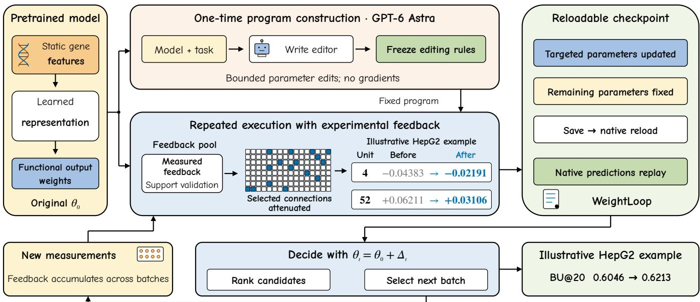
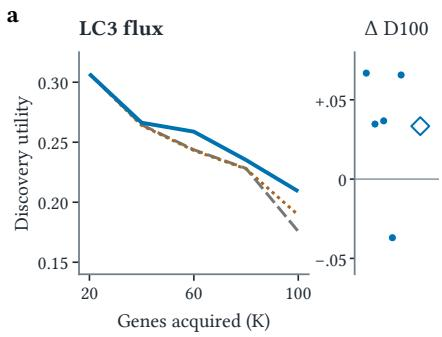
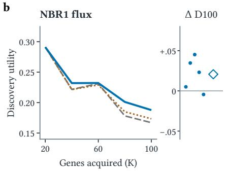
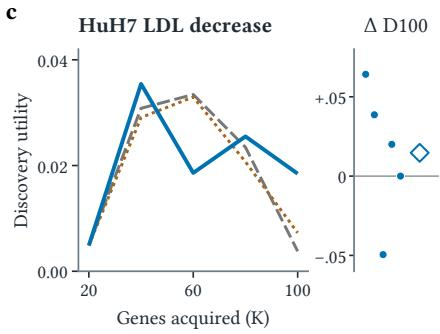
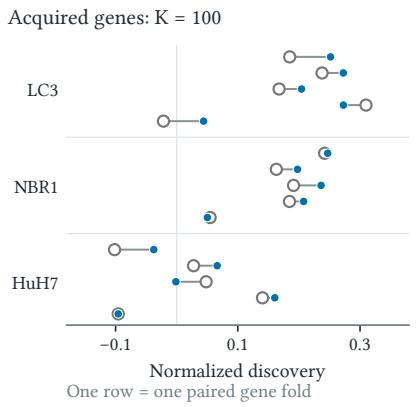
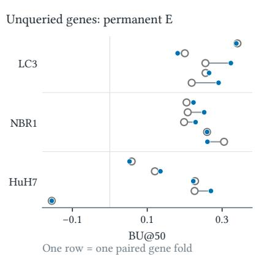
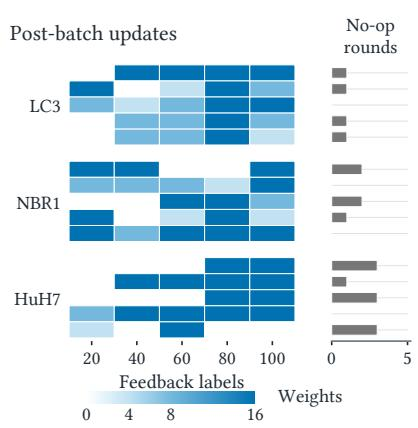

# WeightLoop: Weight-Space Programming with Experimental Feedback

Mengran Li1, Bo Li2, Weijing Zhao2, Chengyang Zhang3, Boyu Zhang4

Jinfeng Xu5,\*, Zelin Zang1,\*, Victor C. M. Leung5, Stan Z. Li6

1Hong Kong Institute of Science and Innovation 2University of Macau

3Sichuan University 4Sun Yat-sen University

5The University of British Columbia 6Westlake University

limengran1998@163.com

\*Co-corresponding authors: Jinfeng Xu and Zelin Zang.

## Abstract

Weight-space programming (WSP) shows that language models can reason about and rewrite neural network weights; recursive self-improvement (RSI) motivates feedback-driven improvement. Models guiding experiments receive concrete feedback: completed assays reveal prediction errors and inform what to test next. We introduce WeightLoop, a framework that turns experimental feedback into persistent updates to deployed predictors. GPT-6 Astra inspects a task specification and the model implementation, then writes a bounded, reusable parameter-editing program. As new measurements arrive, the program identifies prediction discrepan cies, validates candidate edits using observed outcomes, and writes the selected changes back to the original model. The editor remains fixed while the predictor evolves, enabling repeated updates without further LLM calls or gradient retraining while preserving the original inference interface. In ofline replay, targeted edits improve mean ranking utility in seven of eight endpoint–budget settings (all eight versus random edits) and mean final discovery across three sequential tasks. WeightLoop connects WSP with an RSI-inspired improvement loop, making experimental evidence a direct driver of model change and subsequent decisions.

## Keywords

Scientific recommendation, model editing, experimental feedback, weight-space programming

## 1 Introduction

An experiment does more than test a prediction: it produces evidence that can change the next decision. In experimental decisionmaking [11, 17, 18], a predictor ranks candidate interventions, but their efects become known only after measurement. Historical data provide reusable knowledge, yet a new objective may have only a few dozen functional measurements. These results can expose task-specific errors in an otherwise useful model. The challenge is therefore not only to evaluate predictions, but to incorporate evidence into the deployed predictor so subsequent decisions reflect what has been learned. Cellular perturbation research [6, 16] and virtual cells [3] provide a demanding example.

From model editing to weight-space programming. Model-editing research studies targeted corrections to neural parameters [7, 12– 14, 20]. Takehi et al. introduced weight-space programming (WSP), demonstrating language models interpreting and rewriting weights according to natural-language objectives in specified settings [21].

This opens a possibility: can an LLM program how a deployed model should change when experimental evidence arrives? Beyond producing one parameter correction, such a program could connect successive measurements to the model’s future behavior.

Where the improvement loop lives. Recursive self-improvement (RSI) motivates systems such as STOP, whose improvement program revises itself [23]. In WeightLoop, the sequence is concrete: the LLM writes an editor once; each returned assay batch lets that editor revise the predictor; the revised predictor recommends the next batch. The editor code and LLM remain fixed during this loop. New measured outcomes determine the parameter changes, without another LLM call or gradient retraining. The scientific predictor is the object of this improvement loop.

The WeightLoop workflow. Given a task objective and model, GPT-6 Astra [15] identifies task-relevant mutable parameters and writes a bounded editing program. When feedback arrives, the program evaluates discrepancies between predictions and measurements, constructs candidate changes, and selects a validated update. Changes are written into the checkpoint, which reloads through its original inference interface. The updated predictor guides the next decision, and the process repeats as measurements arrive (Figure 1). Feedback therefore changes the model itself, beyond adjusting one recommendation list.

We study two complementary settings: single-round ranking and sequential discovery. Cellular growth, migration, autophagy, and LDL-uptake measurements supply concrete feedback across objectives. Here, biology supplies measurable outcomes for testing a reusable editing workflow. Neural, linear, and tree-based predic tors ofer diferent parameter structures for the same workflow. Recorded measurements enable ofline replay to test whether updates improve subsequent decisions and remain usable after checkpoint writeback and reload. Together, these experiments demonstrate how WSP can turn returned measurements into an ongoing source of model improvement.

## 2 WeightLoop

## 2.1 Fixed editor, updating predictor

GPT-6 Astra [15] constructs the editor from the task objective, model implementation, parameter structure, and available feedback. It produces an executable editor specifying mutable parameters, candidate updates, validation rules, and model saving. The editor uses measured support to update the predictor through repeated numerical execution, with no additional LLM calls. For original parameters $\theta _ { 0 } ,$ editor $\varepsilon _ { \tau }$ , and accumulated support ${ { S } _ { t } } = \{ ( { { g } _ { i } } , { { x } _ { i } } , { { y } _ { i } } ) \}$ recording identities, inputs, and measured outcomes,

  
Figure 1: WeightLoop separates one-time program construction from repeated execution with experimental feedback. The LLM builds a reusable editor; returned measurements validate parameter changes, followed by model save, reload, and the next decision. Weight values and ranking gains illustrate a HepG2 example.

$$
\Delta _ { t } = \mathcal { E } _ { \bar { I } } ( \theta _ { 0 } , S _ { t } ) , \qquad \theta _ { t } = \theta _ { 0 } + \Delta _ { t } , \qquad A _ { t + 1 } = \mathcal { D } ( f _ { \theta _ { t } } ) ,\tag{1}
$$

where D applies the remaining candidates, budget, and decision rule; $\Delta _ { t , j } ~ = ~ 0$ outside I. Updates are constructed on supporttraining records, selected on support-validation records, then reconstructed on all support. No qualifying improvement gives $\Delta _ { t } = 0 .$ Each update starts from $\theta _ { 0 } ,$ so patches do not compound. Only observed outcomes enter support; outcomes of unmeasured candi dates and the permanent test set are excluded.

A concrete program-design choice. The neural editor exposes the functional output weights as its update interface. The model code separates a reusable molecular encoder from a linear functional readout: changing one readout weight alters that feature’s contribution while preserving both the representation and the RNA auxiliary branches. This structure also makes a candidate change exactly computable from cached activations, so the editor can test individual connections without backpropagation. Its diagnostic asks whether weakening a connection improves the ordering of measured genes; its validation combines a pairwise ranking loss with top-budget utility. For coeficient and leaf-value updates, the implemented objective is instead residual prediction error. Thus the program construction ties the mutable interface and validation criterion to the model structure and task objective. Once those choices are encoded, measurements determine the afected coordinates and accepted parameter values on each execution.

## 2.2 Neural output-weight editing

A ReLU MLP encodes static GO [22], scGPT [6], and MAP-KG features, with availability indicators, as $h _ { \phi } ( x _ { q } ) \in \mathbb { R } ^ { 1 2 8 }$ . Its original fit used functional labels and historical RNA auxiliary supervision; candidate-specific perturbation RNA is not an inference input. The functional prediction in assay units is

$$
f _ { \theta } ( g ) = s _ { y } \{ w ^ { \top } h _ { \phi } ( x _ { g } ) + b \} + \mu _ { y } .\tag{2}
$$

Only the 128 entries of � are editable. The encoder, bias, input transform, original 25-label output scaler $( \mu _ { y } , s _ { y } )$ , RNA head, and source parameters remain fixed; the edit reweights the existing representation.

Diagnose, select, and write. Feedback consists of newly measured gene efects. If a hidden feature gives high scores to genes with weak measured efects, attenuating its output connection can reduce ranking errors. The editor tests this possibility against the observed measurements. Using the original 25-label output scaler, let $\mathbf { \nabla } \mathcal { P } \boldsymbol { i } \mathbf { \nabla } =$ $( f _ { \theta } ( g _ { i } ) - \mu _ { y } ) / s _ { y }$ and $\tilde { y } _ { i } ~ = ~ ( y _ { i } - \mu _ { y } ) / s _ { y }$ . Let $a _ { i j } = | \tilde { y } _ { i } - \tilde { y } _ { j } |$ | and �� $\mathbf { \Phi } _ { j } = \operatorname { s g n } ( \tilde { y } _ { i } - \tilde { y } _ { j } )$ . The support loss is

$$
\mathcal { L } ( \boldsymbol { p } , \tilde { \boldsymbol { y } } ) = \frac { \sum _ { i < j } a _ { i j } \log \{ 1 + \exp [ - s _ { i j } ( \boldsymbol { p } _ { i } - \boldsymbol { p } _ { j } ) ] \} } { \sum _ { i < j } a _ { i j } } .\tag{3}
$$

The logistic comparison follows learning-to-rank formulations [4]. We cache $h _ { i }$ and probe each connection by halving $w _ { j } ,$ which changes standardized predictions by exactly $- 0 . 5 w _ { j } h _ { i j }$ . Its diagnostic gain is the resulting decrease in L. The top positive gains above $\bar { 1 } 0 ^ { - 1 2 }$ determine at most � coordinates $S _ { k }$ for six update settings: $k \in \{ 4 , 8 , 1 6 \}$ and $\alpha \in \{ 0 . 2 5 , 0 . 5 \}$ ,

$$
w _ { j } ^ { \prime } = w _ { j } \big ( 1 - \alpha \pmb { 1 } \big [ j \in S _ { k } \big ] \big ) .\tag{4}
$$

e  

d  

f  
  
Figure 2: Measured feedback changes discovery and prediction. (a–c) Complete acquisition curves and paired final $\Delta D _ { 1 0 0 } ;$ diamonds are means. HuH7 has an expanded scale. (d,e) All paired gene-fold scores for $D _ { 1 0 0 }$ and permanent-set BU@50. (f) Modified-weight counts, including no-ops; fold order 0–4 is shared. The last update afects only permanent-set prediction. Folds partition the same studies.

Equal-label pairs have zero weight; an all-tied set has zero loss. Diagnostic and update ties follow fixed orders. Three identity-based support folds select the lowest mean validation loss subject to non-decreasing mean validation utility (BU@10 for single-round ranking). Each fold diagnoses coordinates using only its training genes. The accepted update is rebuilt on all feedback and written to the model’s output-weight vector. Its efect is gene-specific: $\delta f ( g ) =$ $s _ { y } \textstyle \sum _ { j } \delta w _ { j } h _ { j } ( x _ { g } )$ , so it can change ordering while preserving the learned representation.

Matched controls permute the same diagnostic update across coordinates. For a given support set and update setting, they preserve the number and norm of changes and receive the same six-setting validation opportunity. Single-round ranking uses three fixed per mutations; sequential discovery uses one and may acquire diferent subsequent support.

## 2.3 Coeficient and leaf-value editing

With standardized feedback $\tilde { y } _ { i }$ and original prediction $\begin{array} { r } { \mathbf { \nabla } p _ { 0 i } , } \end{array}$ define residuals $r _ { i } = \tilde { y } _ { i } - p _ { 0 i }$ . Ridge [10] adds $\delta \boldsymbol { w } = ( X _ { c } ^ { \top } X _ { c } + \lambda I ) ^ { - 1 } X _ { c } ^ { \top } r _ { c }$ and $\delta b \ = \ \bar { r } - \bar { x } ^ { \top } \delta w$ , where centering uses the fitting support, $\lambda \ = \ m \gamma ;$ , and $\gamma ~ \in ~ \{ 0 . 1 , 1 , 1 0 , 1 0 0 \}$ }. XGBoost [5] retains all 300 tree structures and revises each supported prediction leaf by $v _ { \ell } ^ { \prime } =$ $\textstyle v _ { \ell } + \alpha \sum _ { i \in \ell } r _ { i } / [ 3 0 0 ( n _ { \ell } + 5 ) ]$ , with $\alpha \in \{ 0 . 1 , 0 . 2 5 , 0 . 5 \}$ . Here � is the support size; $n _ { \ell }$ counts support records reaching leaf ℓ. Unsupported leaves remain unchanged. Three-fold support MSE selects these updates; no improvement retains the original model. These supervised analytical operators change coeficients or native leaf values while retaining input/output transforms and inference code.

Table 1: Single-round ranking: all eight endpoint–budget settings, mean BU over five folds and two seeds. Rand.: threecontrol mean; Full: original 100-label fit.
<table><tr><td>Endpoint</td><td>B</td><td> ${ \mathrm { O r i g . } }$ </td><td>Rand.</td><td>Edited</td><td>Full</td></tr><tr><td>HepG2 growth</td><td>20</td><td>0.5239</td><td>0.5270</td><td>0.5419</td><td>0.6254</td></tr><tr><td>HepG2 growth</td><td>50</td><td>0.5208</td><td>0.5309</td><td>0.5421</td><td>0.6025</td></tr><tr><td>Jurkat growth</td><td>20</td><td>0.5223</td><td>0.5270</td><td>0.5344</td><td>0.5993</td></tr><tr><td>Jurkat growth</td><td>50</td><td>0.5175</td><td>0.5304</td><td>0.5355</td><td>0.6038</td></tr><tr><td>HL60 proliferation</td><td>20</td><td>0.2251</td><td>0.2239</td><td>0.2254</td><td>0.2201</td></tr><tr><td>HL60 proliferation</td><td>50</td><td>0.2523</td><td>0.2590</td><td>0.2665</td><td>0.2632</td></tr><tr><td>HL60 migration</td><td>20</td><td>-0.0171</td><td>-0.0246</td><td>-0.0147</td><td>0.0832</td></tr><tr><td>HL60 migration</td><td>50</td><td>0.0103</td><td>0.0051</td><td>0.0087</td><td>0.0581</td></tr></table>

## 3 Evaluation and Results

We evaluate single-round ranking and sequential discovery using public functional screens. Editor design used DepMap experiments; the resulting rules were fixed for HL60 and sequential evaluation. Each prediction or batch choice precedes access to its evaluation outcomes. Tables present the complete endpoint–budget grid under matched feedback budgets.

## 3.1 Single-round ranking

The single-round experiment asks whether one feedback update improves subsequent ranking. It covers HepG2/Jurkat negative Chronos efects from DepMap 24Q4 [2, 8], HL60 proliferation, and serum-gradient migration inhibition [1]. Five gene partitions and two seeds per endpoint give 40 initial � = 25 models. Feedback is the 75 genes in the corresponding � = 100 training set but outside the initial 25; query genes are excluded from both. All six arms share the query pool. The existing � = 100 reference and initial models were each fitted for 1600 updates; editing maintains the � = 25 model using the additional measurements.

For budget � = 20, 50, let $d _ { r }$ be $1 / \log _ { 2 } ( r + 1 )$ normalized over all � positions. We report

$$
U _ { B } = \sum _ { r = 1 } ^ { B } d _ { r } y _ { \pi _ { r } } , \qquad \mathrm { B U } _ { B } = \frac { U _ { B } - \bar { y } } { U _ { B } ^ { \mathrm { o r a c l e } } - \bar { y } } .\tag{5}
$$

where zero is the same-pool random expectation and one the oracle. Paired summaries average seeds within each gene partition of a study.

Edited utility exceeds Random in all eight settings and improves over Original in seven (Table 1). HepG2 improves in all five paired folds at both budgets, connecting the mean gains to consistent within-task improvements.

Tracing a recommendation. In the HepG2 example ofFigure 1, the editor selects $k = 1 6 , \alpha = 0 .$ 5: validation loss falls 0.54235 → 0.53837 and BU@10 rises 0.43363 → 0.47502. Figure 1 shows two realized weight changes. Top20 retains 19 genes, adds SNRPB, and removes GEMIN2; query BU@20 rises 0.604554 → 0.621258 (BU@50: 0.559769 → 0.560715).

## 3.2 Sequential discovery

Sequential discovery reuses 15 initial 25-label models for LC3/NBR1 autophagic flux [19] and reduced LDL uptake in HuH7 cells with lipoprotein-rich medium [9]: three endpoints, five gene folds, and one seed. Unchanged, targeted-edit, and permuted-edit policies each acquire five batches of 20 genes. Each batch is chosen before its measurements become available. Later edits use only that policy’s acquired feedback; the initial 25 labels influence $\theta _ { 0 }$ but do not reenter $S _ { t }$ . Each patch is reconstructed from $\theta _ { 0 } ,$ , with a validation guard at $B = \operatorname* { m i n } ( 5 , n _ { \mathrm { v a l i d a t i o n } } - 1 )$

For acquired set �� from candidate pool $C ,$ discovery is $D _ { K } =$ $\big ( \sum _ { g \in A _ { K } } y _ { g } - K \bar { y } _ { C } \big ) / \big ( \sum _ { g \in \mathrm { T o p } _ { K } ( C ) } y _ { g } - K \bar { y } _ { C } \big )$ . Its oracle normalization changes with �, so policies are compared at the same acquisition count. Permanent-set predictions are evaluated after all 45 trajecto ries finish, separately from discovery in the queried pool.

Edited selection improves mean $D _ { 1 0 0 }$ over both controls in all three tasks, with 4/5, 4/5, and 3/5 positive paired folds (Table 2).

Identical first batches locate these diferences in later feedbackdriven selections. Permanent-set BU@50 increases by 0.0254, 0.0098, and 0.0096 (Figure 2e). Of 75 targeted updates, 56 change weights, at most 16 each; the final update serves only permanent-set prediction.

The paired panels connect these aggregate improvements to actual model updates. Discovery measures the value of genes selected for assay, whereas permanent-set utility measures ranking of genes that never supplied feedback. Their joint mean improvement links the selection loop to predictions beyond the acquired set. The edit-count panel makes the mechanism visible: individual feedback batches can retain the original model or select diferent numbers of coordinates. Thus the fixed program translates changing evidence into adaptive model states, rather than applying the same perturbation after every batch.

Table 2: Sequential discovery: mean $D _ { 1 0 0 }$ from the same initial models. Δ: edited minus original; Pos.: positive paired folds. HuH7: LDL decrease, lipoprotein-rich conditions.
<table><tr><td>Task</td><td>Original</td><td>Permuted</td><td>Edited</td><td>∆</td><td>Pos.</td></tr><tr><td>LC3</td><td>0.1757</td><td>0.1894</td><td>0.2091</td><td>+0.0334</td><td>4/5</td></tr><tr><td>NBR1</td><td>0.1671</td><td>0.1735</td><td>0.1878</td><td>+0.0207</td><td>4/5</td></tr><tr><td>HuH7</td><td>0.0038</td><td>0.0073</td><td>0.0185</td><td>+0.0147</td><td>3/5</td></tr></table>

## 3.3 Coeficient and leaf interfaces

Ridge and XGBoost reuse the two DepMap cells, five folds, and one seed (20 models), with 25 initial labels and 75 feedback genes. Here support MSE selects updates and query MSE is primary; ranking is secondary. Coeficient updates reduce MSE by 10.0% and 13.0%, and leaf updates by 2.4% and 2.6% (Table 3); all four mean BU@20 values also increase. Parameter edits also improve MSE over samefeedback afine calibration in three of four model–cell settings.

Table 3: All coeficient/leaf settings: original-unit MSE and edited-minus-original ΔBU@20. Af.: feedback-fitted afine calibration; Full: 100-label fit. H=HepG2, J=Jurkat.
<table><tr><td>Model</td><td>Orig.</td><td>Edited</td><td>Aff.</td><td>Full</td><td>∆BU@20</td></tr><tr><td>Ridge/H</td><td>0.3023</td><td>0.2720</td><td>0.2844</td><td>0.2705</td><td>+0.1086</td></tr><tr><td>Ridge/J</td><td>0.3239</td><td>0.2817</td><td>0.3110</td><td>0.2852</td><td>+0.0586</td></tr><tr><td>XGB/H</td><td>0.3218</td><td>0.3140</td><td>0.3188</td><td>0.2807</td><td>+0.0069</td></tr><tr><td>XGB/J</td><td>0.3346</td><td>0.3258</td><td>0.3183</td><td>0.2957</td><td>+0.0013</td></tr></table>

Persistent model updates. In a deployed predictor with 3,604,535 network parameters, the HepG2 update changes only 16 weights (0.00044%) and reproduces all 914 edited predictions exactly after native checkpoint reload. These are 16 of the 128 functional output weights; the network count includes the encoder and RNA head. Both remain unchanged, as do the separately stored source adapters. Reordered queries also reproduce all saved scores, and a single-gene inference check passes with the original input/output transforms. The update therefore persists in the predictor and serves subsequent queries through the original inference interface.

## 4 Conclusion

WeightLoop converts experimental feedback into persistent model updates. A fixed, LLM-constructed editor selects parameter changes from observed measurements, and the updated predictor guides the next decision. Ranking, sequential acquisition, and multiple parameter interfaces demonstrate how WSP connects accumulating scientific evidence to future experimental choices through the original prediction interface.

## Ethical Considerations

The study uses public functional-screen measurements, with no new human-subject experiments or personal data collection. Recommendations guide research assays; biological eficacy requires validation in the intended setting. Retaining the original model makes parameter updates reversible and supports traceable deploy ment.

## References

[1] Nathan M. Belliveau, Matthew J. Footer, Emel Akdogan, Aaron P. van Loon,ˇ Sean R. Collins, and Julie A. Theriot. 2023. Whole-Genome Screens Reveal Regulators of Diferentiation State and Context-Dependent Migration in Human Neutrophils. Nature Communications 14, 1 (2023), 5770. doi:10.1038/s41467-023- 41452-x

[2] Broad DepMap. 2024. DepMap 24Q4 Public. Figshare+, dataset, version 1. doi:10.25452/figshare.plus.27993248.v1

[3] Charlotte Bunne, Yusuf Roohani, Yanay Rosen, Ankit Gupta, Xikun Zhang, Marcel Roed, et al. 2024. How to Build the Virtual Cell with Artificial Intelligence: Priorities and Opportunities. Cell 187, 25 (2024), 7045–7063. doi:10.1016/j.cell. 2024.11.015

[4] Chris Burges, Tal Shaked, Erin Renshaw, Ari Lazier, Matt Deeds, Nicole Hamil ton, and Greg Hullender. 2005. Learning to Rank Using Gradient Descent. In Proceedings ofthe 22nd International Conference on Machine Learning. Association for Computing Machinery, 89–96. doi:10.1145/1102351.1102363

[5] Tianqi Chen and Carlos Guestrin. 2016. XGBoost: A Scalable Tree Boosting System. In Proceedings of the 22nd ACM SIGKDD International Conference on Knowledge Discovery and Data Mining. Association for Computing Machinery, 785–794. doi:10.1145/2939672.2939785

[6] Haotian Cui, Chloe Wang, Hassaan Maan, Kuan Pang, Fengning Luo, Nan Duan, and Bo Wang. 2024. scGPT: Toward Building a Foundation Model for Single Cell Multi-omics Using Generative AI. Nature Methods 21 (2024), 1470–1480. doi:10.1038/s41592-024-02201-0

[7] Nicola De Cao, Wilker Aziz, and Ivan Titov. 2021. Editing Factual Knowledge in Language Models. In Proceedings ofthe 2021 Conference on Empirical Methods in Natural Language Processing. Association for Computational Linguistics, 6491– 6506. doi:10.18653/v1/2021.emnlp-main.522

[8] Joshua M. Dempster, Isabella Boyle, Francisca Vazquez, David E. Root, Jesse S. Boehm, William C. Hahn, Aviad Tsherniak, and James M. McFarland. 2021.

Chronos: A Cell Population Dynamics Model of CRISPR Experiments That Improves Inference of Gene Fitness Efects. Genome Biology 22, 1 (2021), 343. doi:10.1186/s13059-021-02540-7

[9] Brian T. Emmer, Emily J. Sherman, Paul J. Lascuna, Sarah E. Graham, Cristen J. Willer, and David Ginsburg. 2021. Genome-Scale CRISPR Screening for Modifiers of Cellular LDL Uptake. PLOS Genetics 17, 1 (2021), e1009285. doi:10.1371/journal. pgen.1009285

[10] Arthur E. Hoerl and Robert W. Kennard. 1970. Ridge Regression: Biased Estimation for Nonorthogonal Problems. Technometrics 12, 1 (1970), 55–67. doi:10.1080/00401706.1970.10488634

[11] Ross D. King, Jem Rowland, Stephen G. Oliver, Michael Young, Wayne Aubrey, Emma Byrne, Maria Liakata, Magdalena Markham, Pinar Pir, Larisa N. Soldatova, Andrew Sparkes, Kenneth E. Whelan, and Amanda Clare. 2009. The Automation of Science. Science 324, 5923 (2009), 85–89. doi:10.1126/science.1165620

[12] Kevin Meng, David Bau, Alex Andonian, and Yonatan Belinkov. 2022. Locating and Editing Factual Associations in GPT. In Advances in Neural Information Processing Systems, Vol. 35. https://proceedings.neurips.cc/paper\_files/paper/ 2022/hash/6f1d43d5a82a37e89b0665b33bf3a182-Abstract-Conference.html

[13] Kevin Meng, Arnab Sen Sharma, Alex Andonian, Yonatan Belinkov, and David Bau. 2023. Mass-Editing Memory in a Transformer. In International Conference on Learning Representations. https://openreview.net/forum?id=MkbcAHIYgyS

[14] Eric Mitchell, Charles Lin, Antoine Bosselut, Chelsea Finn, and Christopher D. Manning. 2022. Fast Model Editing at Scale. In International Conference on Learning Representations. https://arxiv.org/abs/2110.11309

[15] OpenAI. 2026. GPT-6 Astra. OpenAI API model documentation. https:// developers.openai.com/api/docs/models/gpt-6-astra Accessed: 2026-11-03.

[16] YusufRoohani, Kexin Huang, and Jure Leskovec. 2023. Predicting Transcriptional Outcomes of Novel Multigene Perturbations with GEARS. Nature Biotechnology (2023). doi:10.1038/s41587-023-01905-6 Published online 17 August 2023.

[17] Yusuf Roohani, Andrew Lee, Qian Huang, Jian Vora, Zachary Steinhart, Kexin Huang, Alexander Marson, Percy Liang, and Jure Leskovec. 2025. BioDiscoveryAgent: An AI Agent for Designing Genetic Perturbation Experiments. In International Conference on Learning Representations. https://proceedings.iclr.cc/paper\_files/paper/2025/hash/ 4252dc94531833029000f85dc5fac792-Abstract-Conference.html

[18] Burr Settles. 2009. Active Learning Literature Survey. Computer Sciences Technical Report 1648. University of Wisconsin–Madison. https://research.cs.wisc. edu/techreports/2009/TR1648.pdf

[19] Christopher J. Shoemaker, Tina Q. Huang, Nicholas R. Weir, Nicole J. Polyakov, Sebastian W. Schultz, and Vladimir Denic. 2019. CRISPR Screening Using an Expanded Toolkit of Autophagy Reporters Identifies TMEM41B as a Novel Autophagy Factor. PLOS Biology 17, 4 (2019), e2007044. doi:10.1371/journal.pbio. 2007044

[20] Anton Sinitsin, Vsevolod Plokhotnyuk, Dmitriy Pyrkin, Sergei Popov, and Artem Babenko. 2020. Editable Neural Networks. arXiv:2004.00345 [cs.LG] doi:10.48550/ arXiv.2004.00345

[21] Rikiya Takehi, Jayden Teoh, Alex Zhang, and Omar Khattab. 2026. Sparks of Weight-Space Programming: LLMs can natively read & write neural network weights. https://rikiyat.github.io/blog/weight-space-programming/. Blog post.

[22] The Gene Ontology Consortium. 2023. The Gene Ontology Knowledgebase in 2023. Genetics 224, 1 (2023), iyad031. doi:10.1093/genetics/iyad031

[23] Eric Zelikman, Eliana Lorch, Lester Mackey, and Adam Tauman Kalai. 2024. Self-Taught Optimizer (STOP): Recursively Self-Improving Code Generation. In Conference on Language Modeling. https://arxiv.org/abs/2310.02304