# ZYFA: Speed and Accuracy of FP8 FlashAttention on AMD CDNA4

Quentin Anthony\* Ganesh Bikshandi

Praneeth Medepalli Stephen Ebert

Zyphra

San Francisco, CA

Abstract—Attention is a core building block of frontier models and often dominates compute-bound prefill at long context. FP8 matrix instructions offer twice the peak throughput of BF16, but they accelerate only matrix multiplication, so a GPU kernel’s total speedup from FP8 shrinks as other operations take a larger share of the overall kernel time. For example in attention, the softmax between the two matrix multiplications is on vector units which FP8 does not accelerate. On the AMD Instinct MI355X, the vendor’s AITER kernels (AMD’s library of inference kernels) reach 39% of peak FP8 matrix throughput at 32K tokens, compared with 49% in BF16. Unlike NVIDIA’s Hopper and Blackwell GPUs, the MI355X also does not track the completion of matrix instructions in hardware, so fine-grained instruction order must be carried out via more manual methods like assembly instruction ordering, which is vital for attention kernels such as overlapping the softmax with the matrix multiplications. Finally, attention is more numerically sensitive to quantization than feed-forward layers, so considerable numerical analysis must be done to ensure fidelity. To overcome these challenges, we present ZYFA, prefill kernels for the MI355X built on three techniques: (1) computing each FP8 probability directly from its score with a multiply-add and an integer conversion instead of an exponential, since an FP8 bit pattern approximates a scaled base-2 logarithm of its raw value; (2) a ping-pong schedule in which one group of threads computes its softmax while another executes its matrix multiplications; and (3) scaling each block of probabilities up by a power of two before rounding, so that far fewer small probabilities round to zero, and normalizing by the sum of the rounded probabilities, so that the attention weights still sum to one. On attention inputs captured from three representative models and timed at sustained clock speeds (the lower, steady clock that the GPU settles at after a few seconds of back-to-back launches), ZYFA achieves 1.16–1.76× the throughput of AITER. On the random Gaussian inputs of kernel benchmarks at 32K tokens, ZYFA achieves 1.26–1.37× the throughput of AITER at head dimension 128 and 1.99× for DeepSeek-style multi-head latent attention. The sustained clock of the MI355X depends on operand values, so throughput on random inputs does not reliably predict throughput on real model activations, where ZYFA takes fewer clock cycles than AITER’s kernel but runs at a lower per-cycle clock speed. At head dimension 128, ZYFA’s numerical error is within a few percent of that of AMD’s Composable Kernel and Triton kernels and 62–78% lower than that of AITER’s. The source code is available at https://github.com/Zyphra/zyfa.

## I. INTRODUCTION

The attention operation remains both widespread and compu tationally expensive. The longer the input context to a model, the larger the share of prefill time that attention takes, and long contexts are becoming increasingly common: coding agents work across large repositories [Jimenez et al., 2024], and genomic models read long DNA sequences [Nguyen et al., 2024]. At these lengths attention often dominates the prefill phase of autoregressive inference. IO-aware algorithms like FlashAttention perform the same arithmetic as standard attention, but stream blocks of keys and values through on-chip memory and keep a running softmax for each query, so that the score matrix never reaches the comparatively slow highbandwidth memory (HBM) of the GPU [Dao et al., 2022, Dao, 2024]. The speed of attention then depends on how well its GPU kernel can keep the arithmetic units of the GPU busy, and because the throughput of matrix or tensor cores has increased significantly faster in subsequent GPU generations than all other hardware elements, the kernel engineer’s primary focus has shifted to keeping them fed. FlashAttention-3 hides the softmax behind asynchronous matrix instructions on Hopper GPUs [Shah et al., 2024], and FlashAttention-4 approximates portions of the exponentials with polynomials on Blackwell GPUs, whose matrix hardware units grew faster than their exponential units [Zadouri et al., 2026]. Low precision worsens this hardware gap further. Recent GPUs execute 8-bit floatingpoint (FP8) matrix instructions at twice the theoretical BF16 rate [Micikevicius et al., 2022, Advanced Micro Devices, 2025b], so FP8 attention could, in principle, take half the time of BF16 attention if it were purely bound by its matrix multiplications.

However, on the AMD Instinct MI355X, FP8 attention gains much less than this in practice. At 32K tokens on random Gaussian inputs, the FP8 attention kernel of AITER, AMD’s library of inference kernels [AMD, 2025a], reaches 39% of the FP8 datasheet peak, while its BF16 kernel reaches 49% of the BF16 peak. Accuracy is a second concern. DeepSeek-V3, for example, trains its linear layers, including the experts, in FP8 but keeps attention in higher precision because attention is more numerically sensitive [DeepSeek-AI, 2024b]. This paper asks what limits the FP8 attention operation on the MI355X GPU, how to work around these limits, and how the error of FP8 attention can be sourced and mitigated.

The first limit is the softmax. FP8 doubles the speed of the matrix products but not of the softmax operation. Each score still needs an exponential, and an FP8 kernel must also convert each probability to 8 bits before the second matrix product, and both of these operations are performed on vector units whose speed is the same in both FP8 and BF16. For 32 queries against a block of 128 keys at head dimension 128, the two matrix products take 2048 matrix-unit cycles in BF16 and 1024 in FP8, while the softmax takes 896 vector-unit cycles in FP8, even more than the 768 it takes in BF16, because converting a probability to FP8 costs more than converting it to BF16 (see Section III-B). Having nearly the same clock cycles spent in vector units and matrix units is troubling for the programmer, since one must overlap the softmax with matrix products in order to keep the matrix cores busy. FP8 therefore requires almost perfect overlap (1024 matrix cycles against 896 vector cycles), but BF16 has considerable slack (2048 against 768) that makes implementation easier. In our thread traces of AITER’s FP8 kernel (cycle-by-cycle records of every instruction that a wave issues), we see the matrix unit idle for 31.7% of cycles while the softmax runs. NVIDIA’s Hopper and Blackwell GPUs provide asynchronous matrix instructions whose completion events are tracked by hardware [Shah et al., 2024, Zadouri et al., 2026], so the hardware tells a kernel when a matrix product is ready and overlap is much easier to organize by the kernel programmer. On the MI355X, however, matrix instructions keep running while the wave that issued them (a group of 64 threads that issue instructions together) issues other instructions, and the hardware does not track their completion, so the overlap depends entirely on the order in which the kernel issues its instructions, whose order must also ensure that each matrix instruction has finished before its result is read (Section II-A). We find this often necessitates raw GPU assembly kernels, whose development can be eased by generator functions written in higher-level languages like Python.

The clock speed is the second limit one encounters when implementing attention. Under sustained load, the MI355X lowers its clock, and since each bit flip draws current, the clock rate falls as more operand bits change from one instruction to the next. This clock behavior is an important factor for attention, since as we remove softmax as a bottleneck, the matrix cores can do more arithmetic per cycle, which is more bit flips and therefore a lower clock. This effect is further complicated by the fact that real-world inputs have very different distributions from classical synthetic kernel inputs, such as random Gaussian values, which one uses for development or kernel comparison. Speed and numerics are therefore closely intertwined. For example, we found that AITER lets more probabilities underflow to zero on some real model inputs, and zeros switch fewer bits in subsequent arithmetic, so AITER will have a higher clock rate but worse numerics. Achieving both high performance and low numerical error is therefore the primary goal of our work.

We measure the low-level instruction costs and the clock behavior of the MI355X and use them to design ZYFA, causal forward kernels in BF16 and FP8. They support head dimension 128 and the head shape of multi-head latent attention (MLA) in DeepSeek-V2 [DeepSeek-AI, 2024a], with query-key dimension 192 and value dimension 128, the per-head form of

MLA that prefill uses.1 Our FP8 kernels attempt to shrink the number of cycles spent in softmax by exploiting the FP8 format to perform a similar numerical operation to the exponential, specifically by using the fact that the exponent bits of an FP8 number already encode an exponential. Read as an integer, the 8-bit bit pattern (or code) of a positive e4m3 number, the FP8 format with 4 exponent and 3 mantissa bits, grows by 8 each time the value doubles, so it is close in effect to a scaled and shifted base-2 logarithm of the value being represented. The code of a probability $p = 2 ^ { x }$ , where x is the score minus the row maximum in base-2 units, is therefore close to 8x plus a constant, the same relation that Schraudolph’s fast exponential uses for IEEE floating-point numbers [Schraudolph, 1999]. At head dimension 128 the FP8 kernel computes this code with one multiply-add and one integer conversion, which we call lean P. Lean P replaces both the exponential and the floating-point conversion, and lowers the vector cycles per block from 896 to 384. It is an approximation that raises the output error of one attention call to 1.22–1.36× that of exact P, which evaluates the exponential, but the kernel’s error stays below that of AITER’s kernel, at 0.26× in geometric mean (Section VI-B). Essentially, lean P trades a small amount of numerical accuracy for speed. Lean P is optional, and ZYFA uses it by default at head dimension 128. The kernel at the MLA shape keeps exact P only because there lean P falls just below the signal-to-noise threshold of our correctness test in 1 of 24 configurations, although it matches exact P end to end (Section VI-B).

Two further changes keep the FP8 probabilities as accurate as possible. In a long row of the attention matrix most probabilities lie far below the largest one, often below $2 ^ { - 6 }$ , where e4m3 values lose precision, or below $2 ^ { - 1 0 }$ , where they underflow to zero and we lose information. The kernels therefore multiply each block of 64 probabilities by a power of two so that its largest value is close to 1, and the scaled FP8 matrix instruction of CDNA4 undoes the factor at no cost. The kernels also keep each output as a weighted average whose weights sum to one. The output divides $\sum _ { j } p _ { j } v _ { j }$ by $\sum _ { j } p _ { j }$ , and the numerator uses the probabilities after rounding to FP8. If the denominator sums the unrounded probabilities, as in AITER’s kernel, probabilities that underflow to zero still count in the denominator, so every output row shrinks slightly, which accounts for much of the larger error of AITER’s FP8 kernel (Section VI-B). ZYFA divides by the sum of the rounded probabilities instead, and it computes this sum with one extra matrix instruction that multiplies the FP8 probabilities by a vector of ones. The extra instruction adds 6% to the matrix work and removes vector additions from the vector unit, which is the principal bottleneck in FP8.

Finally, our assembly schedule pairs two waves, AMD’s counterpart of warps, on each SIMD unit and runs the softmax of one wave during the matrix instructions of the other. With lean P the wave that computes the softmax finishes its work before the wave that issues the matrix instructions does, so the matrix instructions determine the speed of the loop over blocks of keys.

The contributions of this work are as follows.

1) A characterization of the MI355X hardware in the context of attention (Section III), covering the vector cost of each class of instruction, the overlap capability of vector and matrix work on a single SIMD, and clock dependencies on operand values, expanding on the detail provided by the official instruction set architecture (ISA) documentation.

2) ZYFA, whose FP8 kernels achieve 1.16–1.76× the through put of AITER’s default kernels on activations captured from real models at sustained clocks and 1.26–1.99× on Gaussian inputs at 32K tokens (Sections IV and VI-A).

3) A measurement of the error of single attention calls (Section VI-B), which shows that at head dimension 128 ZYFA’s FP8 error is within a few percent of that of Composable Kernel and Triton and 62–78% lower than that of AITER’s assembly kernel.

4) An account of FP8 attention error in three full models (Section VI-C). Most of it comes from quantizing the inputs rather than the probabilities and is spread over most heads, so keeping the most sensitive heads in BF16 is not a useful middle ground. On Mistral-7B and Qwen3-8B, even 90% of heads in BF16 does not sufficiently match BF16 accuracy, and by then attention takes as long as all-BF16. A Hadamard rotation of Q and K instead roughly halves the error from quantizing the inputs at almost no cost.

Table II defines the terms that the rest of the paper uses. The source code is available at https://github.com/Zyphra/zyfa.

## II. BACKGROUND

## A. The MI355X GPU

The AMD Instinct MI355X (CDNA4 architecture) has 256 compute units (CUs), analogous to the streaming multiprocessors of NVIDIA GPUs. The CUs are distributed across eight chiplets (XCDs), each with its own 4 MB L2 cache. At the maximum shader clock (SCLK), 2.4 GHz, the datasheet peak dense matrix throughput is 2.5 PFLOP/s in BF16 and 5.0 PFLOP/s in FP8 [Advanced Micro Devices, 2025b] (Table I). Each CU has four SIMD units, which issue the instructions of the threads that run on them, and 160 KB of shared memory called the local data share (LDS). Threads run in groups of 64 called waves, analogous to the 32-thread warps of NVIDIA GPUs, and we call the position of a thread within its wave its lane. Waves in the same workgroup, a group of waves launched together like a thread block on NVIDIA GPUs, run on one CU and share LDS and workgroup barriers. A wave stays on one SIMD and issues its instructions in program order. Each SIMD has a register file and two execution units, which we call pipes, a vector pipe for elementwise arithmetic (VALU) and a matrix pipe for matrix fused multiply-add (MFMA)

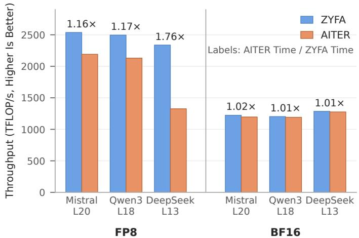  
Fig. 1: Throughput of ZYFA and AITER’s default kernels on the queries, keys, and values captured from one layer per model at sequence length 16K, timed at sustained clocks (the steady clock after warmup launches). L20 is layer 20. The label above each pair is AITER’s time divided by ZYFA’s time. Mistral-7B and Qwen3-8B have head dimension 128, where the FP8 kernel uses lean P, which writes each FP8 probability with one multiply-add instead of an exponential. DeepSeek-V2-Lite has the MLA shape, where the FP8 kernel uses exact P, which evaluates the exponential (Section IV-B), and AITER uses Composable Kernel (CK) in FP8 and its OPUS kernel, written with AITER’s C++ template library, in BF16. Table X gives the clock of these runs.

instructions [Advanced Micro Devices, 2025a].2 When two waves share a SIMD, the vector instructions of one wave can execute while a matrix instruction of the other occupies the matrix pipe (Section III-A). Unlike NVIDIA Hopper GPUs, CDNA4 has no tensor memory accelerator (a unit that copies tiles between global and shared memory), no hardware barrier between producer and consumer waves, and no hardware tracking of matrix instructions in flight, so kernels that use these features to overlap work, such as FlashAttention-3 [Shah et al., 2024], do not port directly. On CDNA4 the order of instructions in the kernel therefore decides how memory, vector, and matrix work overlap.

## B. Tiled Attention

For one head, causal attention computes $\begin{array} { r } { \begin{array} { l } { O } \end{array} = \begin{array} { l } { \mathrm { s o f t m a x } ( c Q K ^ { \top } + M ) V } \end{array} } \end{array}$ where $Q , K \in \mathbb { R } ^ { S \times d _ { \mathbf { q } \mathbf { k } } }$ $V ~ \in ~ \mathbb { R } ^ { S \times d _ { \mathrm { v } } } , ~ S$ is the sequence length, c is the softmax scale, and M is the causal mask. FlashAttention-2 [Dao, 2024] assigns a tile of query rows to a group of threads, which loops over blocks of keys. For each block, the kernel computes scores in base-2 units, $t = c q k ^ { \top } \log _ { 2 } e ,$ updates the running maximum m of each query row, and forms

<table><tr><td>Property</td><td>Value per GPU</td></tr><tr><td>Compute units</td><td>256 in 8 XCDs, 4 SIMDs each</td></tr><tr><td>Wave, VGPRs</td><td>64 lanes, 512 VGPRs per lane per SIMD</td></tr><tr><td>LDS</td><td>160 KB per CU</td></tr><tr><td>L2 cache</td><td>4MB per XCD</td></tr><tr><td>Infinity Cache</td><td>256 MB, shared by the XCDs</td></tr><tr><td>HBM3E</td><td>288 GB, 8 TB/s</td></tr><tr><td>Maximum clock</td><td>2.4 GHz</td></tr><tr><td>Dense matrix peak Total board power (TBP)</td><td>BF16 2.5, FP8 5.0, FP4 10 PFLOP/s 1400 W</td></tr></table>

TABLE I: Properties of one MI355X from [Advanced Micro Devices, 2025b,a]. The peaks assume the maximum clock. VGPRs are the vector registers of a wave, XCDs are the eight chiplets, and LDS is the shared memory of a compute unit (CU). Our system caps the board power at the TBP.

<table><tr><td>Term</td><td>Meaning</td></tr><tr><td>CU, SIMD</td><td>A compute unit (CU) has four SIMD units, each of which issues the instructions of its waves</td></tr><tr><td>wave</td><td>64 threads that issue instructions together, AMD&#x27;s counterpart of a 32-thread NVIDIA warp</td></tr><tr><td>MFMA</td><td>Matrix fused multiply-add, the matrix instruction that runs on the matrix pipe, the SIMD&#x27;s matrix unit</td></tr><tr><td>VALU</td><td>The vector pipe, the SIMD&#x27;s vector unit, which runs elementwise arithmetic such as the softmax</td></tr><tr><td>LDS</td><td>Local data share, the 160 KB shared memory of a CU</td></tr><tr><td>XCD</td><td>One of the eight chiplets of the GPU, each with its own L2 cache</td></tr><tr><td>SCLK</td><td>Shader clock, the clock of the CUs, at most 2.4 GHz The FP8 format with 4 exponent and 3 mantissa bits,</td></tr><tr><td>e4m3</td><td>whose bit pattern, read as an integer, we call its code</td></tr><tr><td>binade</td><td>A range  $[ 2 ^ { k } , 2 ^ { k + 1 } )$  , so a value n binades below another is about  $2 ^ { - n }$  times it</td></tr><tr><td>AITER</td><td>AMD&#x27;s library of inference kernels and the baseline of this paper</td></tr><tr><td>CK</td><td>Composable Kernel, AMD&#x27;s kernel library, which AITER uses for FP8 attention at  $d _ { \mathrm { q k } } { = } 1 9 2$ </td></tr><tr><td>exact P</td><td>Computing each FP8 probability with an exponential and a conversion to FP8</td></tr><tr><td>lean P</td><td>Writing the code of each FP8 probability with one multiply-add and an integer conversion, without an exponential</td></tr><tr><td>kernel-only timing</td><td>Device time of the kernel alone, excluding host launch time</td></tr><tr><td>sustained clocks</td><td>The lower, steady clock that the GPU settles at after seconds of back-to-back launches</td></tr><tr><td></td><td>captured activations The Q, K, and V that a real model passes to attention, recorded during a forward pass</td></tr><tr><td>Gaussian inputs</td><td>Random Q, K, and V with standard deviation 0.1, as in kernel benchmarks</td></tr><tr><td>BF16 noise band</td><td>KL divergences from the BF16 model no larger than that between the models with two correct BF16 kernels, ZYFA&#x27;s and AITER&#x27;s</td></tr><tr><td>ge2</td><td>Gradient-weighted error of a head, which ranks heads by their effect on the model output</td></tr></table>

TABLE II: Terms used throughout the paper.

unnormalized softmax weights $p = 2 ^ { t - m } . ^ { 3 }$ When m grows, the kernel rescales the output accumulator and the row sum ℓ by $2 ^ { m _ { \mathrm { o l d } } - m }$ , and it then accumulates $p V$ and $\sum { p . } ^ { 4 }$ The kernel returns the output $O = \operatorname { a c c } / \ell$ and the log-sum-exp (LSE), which lets results computed over different key ranges be merged. With batch size $B$ and H query heads, a causal forward pass has

$$
F = B H S ^ { 2 } ( d _ { \mathrm { q k } } + d _ { \mathrm { v } } )\tag{1}
$$

floating-point operations, half the count without the causal mask. We report throughput as F divided by kernel time.

## C. FP8 Attention

The FP8 kernels studied here store Q, K, and $V$ in the e4m3 format, which has a 4-bit exponent with bias 7 and a 3-bit mantissa. We call the bit pattern of an e4m3 value, read as an 8-bit unsigned integer, its code. Its largest finite value is 448. A binade is the range $[ 2 ^ { k } , 2 ^ { k + 1 } )$ of values that share one exponent, so a probability n binades below the row maximum is roughly $2 ^ { - n }$ times the row maximum. Values of at least $2 ^ { - 6 }$ are normal values, which keep all 3 mantissa bits, and smaller values are subnormal values, which keep fewer.5 Each of $Q ,$ $K ,$ , and V has one scale factor, which the kernel folds into c and into the output, and $p$ is converted to e4m3 before the $P V$ product [Micikevicius et al., 2022, Shah et al., 2024]. Because $p \leq 1$ , a probability converted to e4m3 without scaling lies in the lower part of the format’s range, where values below $2 ^ { - 6 }$ are subnormal and values below $\bar { 2 } ^ { - 1 0 }$ underflow, that ${ \mathrm { i s } } ,$ round to zero.

## III. PERFORMANCE EFFECTS OF THE MI355X

## A. Cost of Vector Instructions

We time each individual instruction with microbenchmarks comprised of inline-assembly loops over a fixed block of instructions. The compiler emits each block as written, without inserting or reordering instructions. The block names its registers explicitly and declares them clobbered (overwritten by the block), so the compiler keeps no other values in them. One workgroup with 96 KB of LDS runs on each of the 256 CUs, and every wave reads s\_memtime, which counts cycles of the shader clock (SCLK), and s\_memrealtime, which counts time at a constant rate. The operands change on every instruction, because the clock depends on how many bits switch (Section III-C). To measure the cost of one instruction, two waves on one SIMD issue independent copies of it.

We give the cost of an instruction as the number of cycles for which it occupies the vector pipe, during which the pipe accepts no other vector instruction, and this number therefore sets the throughput of the instruction. An FP32 add, multiply, or fused multiply-add (FMA) occupies the pipe for 2 cycles, since the pipe processes the 64 lanes of a wave at 32 lanes per cycle. Maximum, integer conversion, compare, and permute instructions occupy it for 4 cycles, or 16 lanes per cycle. Packed instructions, which apply one operation to two values in each lane, also occupy it for 4 cycles, so a packed FP32 instruction does the work of two FP32 instructions in the same pipe time, while the wave issues one instruction instead of two. A wave issues at most one instruction every 4 cycles. The exponential v\_exp\_f32 and the packed FP8 conversion $\mathtt { v \_ c v t \_ p k \_ f p 8 \_ f 3 2 }$ occupy it for 8 cycles. The exponential therefore runs at a quarter of the FMA rate, as in earlier CDNA GPUs. Lower precision does not make the exponential cheaper. The FP16 exponential also occupies the vector pipe for 8 cycles, and the ISA has no packed exponential that would evaluate two values per lane. Two waves share each SIMD, and a vector instruction from one wave can execute at the same time as a matrix instruction from the other wave scheduled to the SIMD. Next to 32×32 MFMAs a wave of 8-cycle vector instructions takes 1.13–1.28× as long as in isolation, and the matrix wave takes at most 1.05× as long. Next to BF16 16×16 MFMAs the vector wave reaches 57–70% of its throughput in isolation. Packed FP32 instructions are the exception.6 They must wait while an MFMA executes on the same SIMD, so a wave of packed FP32 instructions next to a matrix-bound wave advances only when the matrix pipe is idle. In our test such a wave took 3.8–4.0× as long as alone, which is the largest slowdown that the test can resolve. The softmax in ZYFA’s kernels therefore uses non-packed FP32 instructions. Packed FP16 instructions, by contrast, run next to MFMAs at their standalone rate. The ISA documentation [Advanced Micro Devices, 2025a] describes neither this behavior of packed FP32 instructions nor the 8-cycle cost of the packed FP8 conversion.

Two further rules of the hardware affect hand scheduling. The matrix pipe serves the older of two waves first, so a younger matrix-bound wave waits until the older wave stops issuing MFMAs. An FP8 MFMA of 16 passes, where a pass is 4 cycles of the matrix pipe, writes its 16 destination registers one after another without an interlock, so the last registers are valid only 20 wait states after issue.7

## B. Pipe Cycles per Block

Table III counts the pipe cycles for one wave that computes 32 queries against one 128-key block. In FP8 the softmax needs about as many vector cycles as the two matrix products need matrix cycles, 896 against 1024, so the matrix pipe stays busy only if the vector work of one wave runs entirely during

<table><tr><td>work for one wave and one block</td><td>cycles</td></tr><tr><td>matrix pipe</td><td></td></tr><tr><td> $Q K ^ { \top }$  and PV in FP8</td><td>1024</td></tr><tr><td> $Q K ^ { \top }$  and PV in BF16</td><td>2048</td></tr><tr><td>row sum of the FP8 probabilities</td><td>64</td></tr><tr><td>vector pipe</td><td></td></tr><tr><td>row maximum (32 three-input maxima)</td><td>128</td></tr><tr><td>exact P in FP8 (64 FMA, 64 exp, 32 packed cvt)</td><td>896</td></tr><tr><td>exact P in BF16 (64 FMA, 64 exp, 32 packed cvt)</td><td>768</td></tr><tr><td>lean P (64 FMA, 64 integer cvt)</td><td>384</td></tr></table>

TABLE III: In FP8 the softmax needs about as many vectorpipe cycles as the matrix products need matrix-pipe cycles, so the two must overlap almost perfectly to keep the matrix pipe busy, while in BF16 the matrix products take more than twice as long as the softmax. The table gives pipe cycles for one wave (a group of 64 threads) that computes 32 queries against one 128-key block at $d _ { \mathrm { q k } } { = } d _ { \mathrm { v } } { = } 1 2 8$ , and each of its 64 lanes holds 64 of the 4096 scores. Matrix cycles, on the pipe that runs matrix (MFMA) instructions, follow from the matrix rate per cycle, and vector cycles, on the pipe that runs elementwise instructions, follow from the measured costs in Section III-A. Exact P, the standard method, evaluates the exponential and converts the result to e4m3 or BF16, and the packed BF16 conversion occupies the vector pipe for 4 cycles instead of 8. Lean P, ZYFA’s method, writes the e4m3 bit pattern of each probability with one multiply-add and one integer conversion (Section IV-B1). Rescaling the output adds vector work when the row maximum grows.

the MFMAs of the other wave on the same SIMD. In BF16 the matrix products take 2048 cycles and the softmax 768, so the softmax fits within the time of the matrix work with room to spare, and a schedule that overlaps the two imperfectly still keeps the matrix pipe busy.

Thread traces, cycle-by-cycle records of every instruction that a wave issues, show what happens when the overlap is imperfect. We record them with rocprofv3 advanced thread traces for AITER’s FP8 assembly kernel and for the base kernel, an earlier version of ZYFA’s FP8 kernel written in HIP [AMD, 2026], AMD’s C++ kernel language and the counterpart of CUDA. Table IV counts their pipe cycles at S=32K from their dynamic instruction mixes (the instructions that the waves execute, as opposed to those in the kernel binary) and the instruction costs of Section III-A. In both kernels the vector pipe is busy for about as many cycles as the matrix pipe. A kernel that ran its matrix work and its vector work one after the other would take the sum of the two, the serialized row of the table. AITER takes fewer cycles than this sum because the two waves on each of its SIMDs overlap part of their matrix and vector work. AITER alternates the two waves of a SIMD between a matrix phase and a softmax phase, and each phase ends at a workgroup barrier, where every wave waits until all waves of the workgroup arrive. AITER’s softmax phase takes longer than its matrix phase, so for 31.7% of SIMD cycles the matrix pipe idles while one wave computes probabilities and the other waits at the barrier (Figure 2). The base kernel takes about the serialized sum. All of its pipes are idle in 13.5% of cycles, and in 16.6% of cycles both waves of a SIMD execute vector instructions at the same time, so neither issues MFMAs.

<table><tr><td>cycles per SIMD</td><td>base</td><td>AITER</td></tr><tr><td>matrix pipe (packed FP32)</td><td>1288 (264)</td><td>1156 (132)</td></tr><tr><td>vector pipe</td><td>1210</td><td>1303</td></tr><tr><td>instruction issue</td><td>1027</td><td>891</td></tr><tr><td>LDS</td><td>772</td><td>516</td></tr><tr><td>serialized (matrix + vector)</td><td>2498</td><td>2459</td></tr><tr><td>achieved</td><td>2470</td><td>2051</td></tr><tr><td>SCLK (GHz)</td><td>2.35</td><td>1.95</td></tr></table>

TABLE IV: Both kernels keep the vector pipe about as busy as the matrix pipe, and neither overlaps the two fully. The table gives pipe cycles per SIMD at S=32K for FP8 multi-head attention at $d _ { \mathrm { q k } } { = } 1 2 8 ,$ for two units of work of one wave on 32 queries and 64 keys each, which together equal the work of one wave on one 128-key block in Table III. AITER is AITER’s FP8 assembly kernel. Base is an earlier HIP version of ZYFA’s FP8 kernel with a Schraudolph exponential (an exponential that writes the bits of an FP32 number directly from the score) and an FP32 row sum, and its instruction mix comes from S=8K traces. The matrix row includes the cycles in which packed FP32 instructions block the matrix pipe, given in parentheses. The serialized row is the sum of matrix and vector cycles, which the work would take if the two never overlapped, and the achieved row gives the cycles that each kernel actually takes. SCLK is the shader clock.

How far can the vector work shrink? Each score needs at least one instruction that subtracts the row maximum and applies the scale, and one that converts the result to 8 bits. A kernel that takes the maximum of three values per instruction and computes the row sum on the matrix unit therefore needs at least 512 vector cycles per block, against 1303 in AITER’s kernel. Section IV-B describes how ZYFA reaches this minimum.

## C. Clock Under Sustained Load

The matrix pipe completes the datasheet number of operations per cycle in every run, so throughput differs between runs only through the shader clock (SCLK). We measure SCLK while every SIMD runs the same FP8 MFMA loop and change only the values in the operand registers. The clock is 2.34 GHz with constant operands, 2.07 GHz with operands that change every instruction, as K and V do in attention, and 1.91–1.97 GHz with random bit patterns. Adding v\_fma\_f32 instructions between the MFMAs lowers it further (Table V). The clock thus falls as the values in the arithmetic units change more from one instruction to the next.8 On NVIDIA GPUs, inputs that switch more bits also draw more power [Gregersen et al., 2024] and run at a lower clock once the board reaches

<table><tr><td>workload</td><td>GHz</td><td>kW</td><td>PF/s</td></tr><tr><td>BF16 MFMA 32×32</td><td>1.71</td><td>1.25</td><td>1.79</td></tr><tr><td>BF16 MFMA 16×16</td><td>1.92</td><td>1.27</td><td>1.99</td></tr><tr><td>FP8 MFMA 32×32</td><td>2.07</td><td>1.29</td><td>4.34</td></tr><tr><td>FP8 MFMA 16×16</td><td>2.20</td><td>1.31</td><td>4.60</td></tr><tr><td>FP4MFMA 16×16</td><td>1.91</td><td>1.26</td><td>7.86</td></tr><tr><td>VALU only</td><td>2.39</td><td>0.66–0.70</td><td>一</td></tr><tr><td>LDS reads only</td><td>2.40</td><td>0.88</td><td>1</td></tr><tr><td>FP8 attention loop (synthetic)</td><td>一</td><td>一</td><td>3.03</td></tr><tr><td>datasheet BF16/FP8/FP4</td><td>2.40</td><td>1</td><td>2.5/5.0/10</td></tr></table>

TABLE V: Under sustained load the MFMA loops run below the 2.4 GHz clock that the datasheet peaks assume, so each reaches less than its datasheet throughput. The table gives empirical peaks, the sustained throughput of microbenchmark loops on all 256 compute units (CUs) with two waves per SIMD and operands that change every instruction, over about 2.5 s of back-to-back launches. The columns give the shader clock (SCLK) in GHz, the board power in kW, and the throughput in PFLOP/s. The synthetic attention loop has the per-tile counts of MFMAs, reads from the on-chip shared memory (LDS), loads into it (DMA), and barriers of ZYFA’s FP8 kernel at $d _ { \mathrm { q k } } { = } 1 2 8 .$ The BF16 rows use v\_mfma\_ $\mathtt { f 3 2 \_ 3 2 x 3 2 x 1 6 \_ b f 1 6 }$ and v\_mfma\_f32\_16x16x32\_bf16, the FP8 rows v\_mfma\_f32\_32x32x64\_f8f6f4 and v\_mfma\_f32\_16x16x128\_f8f6f4 with e4m3 operands, and the FP4 row $\mathtt { v \_ m f m a \_ f 3 2 \_ 1 6 \times 1 6 \times 1 } 2 8 \_ \mathtt { f 8 f 6 f 4 }$ with FP4 operands, all in their unscaled forms. The datasheet peaks assume 2.4 GHz.

its power limit [He, 2024]. On the MI355X, board power stays below the 1400 W cap in all of these runs, so the board power limit does not set the clock. Instead, the throttle counters of amd-smi, AMD’s GPU monitoring tool, point to a fastacting limit on current that the telemetry does not identify (Section VI-A).

Because the clock depends on the operands, we measure empirical peaks under sustained load with operands that change every instruction, over about 2.5 s of back-to-back launches on all 256 CUs (Table V). A loop of 16×16 MFMAs, the shape with the higher throughput, sustains 1.99 PFLOP/s in BF16 and 4.60 PFLOP/s in FP8. A synthetic attention loop with the per-tile counts of MFMAs, LDS reads, loads into LDS, and barriers of ZYFA’s FP8 kernel at $d _ { \mathrm { q k } } { = } 1 2 8$ and the vector instructions of lean P sustains 3.03 PFLOP/s. The kernel itself issues two more row-sum MFMAs per tile and more vector-pipe cycles than this loop. A synthetic loop with the instructions of the BF16 kernels runs slower than the kernels themselves, so the table leaves it out.

## IV. KERNEL DESIGN

ZYFA has four causal forward kernels. They cover BF16 and FP8, each at $d _ { \mathrm { q k } } { = } d _ { \mathrm { v } } { = } 1 2 8$ and at the MLA shape with $d _ { \mathrm { q k } } { = } 1 9 2$ and $d _ { \mathrm { v } } { = } 1 2 8 .$ , which they compute without padding the query-key dimension to 256. All four accept multi-head and grouped-query attention and return the LSE (Table VI). The BF16 kernels are written in HIP [AMD, 2026], and the FP8 kernels are CDNA4 assembly emitted by a generator (Section IV-C). The BF16 kernels also run the BF16 heads of the mixed-precision policies in Section VI-C, which run some heads or layers of a model in BF16 and the rest in FP8.

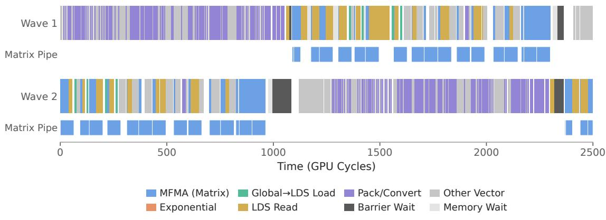  
(a) ZYFA

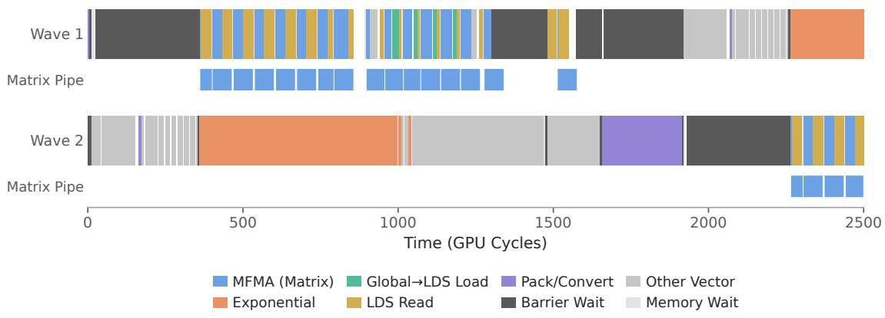  
(b) AITER  
Fig. 2: Thread traces showing that AITER’s FP8 kernel leaves the matrix pipe idle while its waves compute exponential and wait at barriers, and that ZYFA’s FP8 kernel keeps the matrix pipe busy most of the time. A thread trace records every instruction that a wave issues, cycle by cycle, here with the thread-trace mode of AMD’s rocprofv3 profiler. Each pane shows the two waves that share one SIMD over 2500 cycles in the middle of the loop over key blocks, where every block repeats the same work, in the FP8 kernels at $d _ { \mathrm { q k } } { = } 1 2 8$ (S=8K tokens, H=32 heads, multi-head attention). Each wave row shows the class of each instruction that the wave issues, and the matrix-pipe row below it shows when that wave’s MFMAs run. A vector instruction runs on the vector pipe during its bar in the wave row, so the wave rows already show when the vector pipe works. An MFMA keeps running on the matrix pipe for 32 to 64 cycles after its short bar in the wave row, while the wave issues other instructions, so the matrix-pipe rows show that work separately.

## A. Structure Shared by All Kernels

A workgroup has eight waves, two per SIMD, and each wave owns 32 query rows. The kernels compute $K Q ^ { \top }$ instead of $Q K ^ { \top }$ , so that in the output layout of the matrix instruction each lane holds the scores of a single query. The maximum and the sum of a row then need only one exchange between the two lanes that share its query, and rescaling the output takes one scalar per lane. Blocks of K and V pass through LDS, and the kernel loads the next blocks while it processes the current blocks.

Causal pairing: In causal attention, where each query attends only to the keys up to its own position, the queries of tile j (the j-th group of consecutive query rows, counting from 0) attend to j+1 blocks of keys, so tiles near the end of the sequence have the most work. A workgroup runs tile $j$ and tile $\mathrm { \it { l a s t - j } }$ back to back, so every workgroup does the same amount of work (tile $j$ has $j { + 1 }$ blocks and tile last−j has $\{ a s t - j + 1$ , so every pair has last+2). A tile has 256 query rows, which gives 32 pairs per query head at 16K. With grouped-query attention and an even group size, each pair covers two query heads with tiles of half the size, and the number of pairs per query head stays the same. A persistent grid of up to 256 workgroups, one per CU, works through the pairs (each workgroup loops over many pairs instead of processing one and exiting).

Chiplet placement: The hardware places workgroup i on chiplet i mod 8, and each chiplet has its own L2 cache. In the default order of the grid the index of the tile pair varies fastest. Consecutive pairs of one head then run on different chiplets, and each chiplet loads the K and V of that head into its own L2 cache. Similar to the chiplet-aware grid order of HipKittens [Hu et al., 2025], we remap the grid so that each chiplet receives a contiguous run of tile pairs from the same head, which then share K and V in one L2 cache. Figure 3 gives the speed with the map relative to the speed without it. The gain is largest at 2K and falls with the sequence length. Each element of K and V is used by a number of queries that grows with S, so the extra loads take a smaller share of the time at longer sequences.

<table><tr><td>Attention</td><td>Causal forward pass, without sliding-window, document, or block masks</td></tr><tr><td>Heads</td><td>MHA and  $\mathrm { G Q A } ~ ( H _ { q }$  a multiple of  $H _ { k v } )$ </td></tr><tr><td>Layouts</td><td>BHSD and BSHD (strided)</td></tr><tr><td>Batch</td><td>Any B with equal sequence lengths, without packed variable-length batches</td></tr><tr><td>Lengths</td><td> $M { = } N$  a multiple of 256 (no KV-cache prefix or decod- ing)</td></tr><tr><td>Inputs</td><td>BF16, or e4m3 with one FP32 scale per tensor</td></tr><tr><td>Outputs</td><td>BF16 O and FP32 LSE</td></tr></table>

TABLE VI: Configurations that the ZYFA kernels support. MHA is multi-head attention and GQA grouped-query attention, in which $H _ { q } / H _ { k v }$ query heads share each key-value head. BHSD and BSHD give the order of the batch, head, sequence, and head-dimension axes in memory, M and N are the numbers of queries and keys, and LSE is the log-sum-exp of each row of scores.

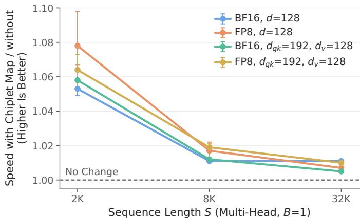  
Fig. 3: The chiplet map helps most at short sequences. The figure gives the throughput of ZYFA with the chiplet map divided by that of the same kernel without it. The map sends consecutive tile pairs of one head to the same chiplet (XCD), so that they share its L2 cache. Multi-head attention, batch size $B { = } 1$ , kernel-only timing on Gaussian inputs as in Table VIII.

Lazy rescaling: When the running maximum of every row in a wave grows by less than a threshold $\tau ,$ the kernel keeps the old maximum and skips the rescale of the output accumulator [Zadouri et al., 2026, Hu et al., 2025]. The output stays the same because the accumulator and ℓ use the same maximum.9 ZYFA uses $\tau { = } 0 . 1 2 5$ in FP8, 0.5 in BF16 at $d _ { \mathrm { q k } } { = } 1 2 8$ , and 8 in BF16 at $d _ { \mathrm { q k } } { = } 1 9 2$ , in base-2 units of the score.

## B. FP8 Probabilities

1) FP8 Probabilities from One Multiply-Add: Write $x =$ $t - m \leq 0$ for the base-2 score of a key relative to the row maximum, so that $p = 2 ^ { x }$ . A standard FP8 kernel computes $x$ with one FMA, evaluates $2 ^ { x }$ with v\_exp\_f32, and rounds the result to e4m3 with $\mathtt { v \_ c v t \_ p k \_ f p 8 \_ f 3 2 }$ . We call this exact P. It occupies the vector pipe for 14 cycles per score, 2 for the FMA, 8 for the exponential, and 4 for its half of a packed conversion (Section III-A).

The code of an e4m3 value is $k = 8 E + F$ , with exponent field E and mantissa field $F .$ For $E \_ 1$ the value is $2 ^ { E - 7 } ( 1 + F / 8 )$ . The value doubles every 8 steps of k and grows linearly between powers of $\mathrm { t w o . } ^ { 1 0 }$ The code of $2 ^ { x }$ is therefore close to 8x plus a constant, which is the observation behind Schraudolph’s fast exponential [Schraudolph, 1999]. Lean P computes

$$
y = 8 \left( x + \sigma + 7 \right) - \beta\tag{2}
$$

and rounds $y$ to the nearest integer. The result is the e4m3 code of an approximation of $2 ^ { x + \sigma }$ . Because x is a linear function of the raw score, Equation 2 is one FMA per score, whose coefficients fold in the softmax scale, the input scales, and the row maximum. The shift $\sigma { = } 6$ multiplies every probability by $2 ^ { 6 } ,$ , which moves small probabilities 6 binades further from the bottom of the e4m3 range. The factor $2 ^ { 6 }$ cancels in the output, because the row sum is computed from the same scaled probabilities (Section IV-B3). The bias $\beta { = } 0 . 3 5$ centers the interpolation error around zero (a straight line between two powers of two lies above the curve $2 ^ { x }$ , so without the bias every probability would be slightly too large). The conversion v\_cvt\_pk\_u8\_f32 rounds y to the nearest integer, clamps it to [0, 255], and writes the byte into a packed register, so a negative y becomes code 0. Lean P occupies the vector pipe for 6 cycles per score, 2 for the FMA and 4 for the conversion, and it lowers the vector cycles per block in Table III from 896 to 384. Compared with an earlier HIP kernel that used a Schraudolph exponential in FP32 and v\_cvt\_pk\_fp8\_f32, lean P reduces the number of 8-cycle vector instructions in the FP8 $d _ { \mathrm { q k } } { = } 1 2 8$ kernel from 182 to 17 and the number of instructions in its loops by 16% (counted in the kernel binary rather than as executed).

Lean P is less accurate than exact P. The linear interpolation between powers of two differs from $2 ^ { x }$ by up to 3% with the bias and by up to 6% without it. After rounding to a code, lean P is within 7.5% of $p ,$ and rounding the exact $2 ^ { x }$ to the nearest code is within 5.9% (Figure 4). Probabilities more than

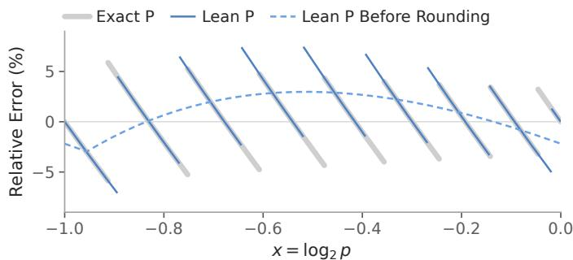  
Fig. 4: Lean P, which computes each FP8 probability with one multiply-add instead of an exponential, stays within 7.5% of the true probability, against 5.9% for rounding the exact value. The figure gives the relative error of the e4m3 probability with exact P and lean P over one binade (one factor of two) of $p ,$ plotted against $x = \log _ { 2 } p .$ Exact P rounds $2 ^ { x }$ to the nearest e4m3 value. Lean P rounds $y$ from Equation 2 (with shift $\sigma { = } 6$ and bias $\beta { = } 0 . 3 5 )$ ) to the nearest integer and uses it as the e4m3 bit pattern, and the dashed line is the error of $y$ before rounding. Over the normal e4m3 range the error depends on the fractional part of $x$ alone, so one binade shows all of it.

12 binades (factors of two) below the row maximum fall into the subnormal range of e4m3, where the value grows linearly with the code instead of doubling every 8 codes, so lean P underestimates them by up to 77%. Section VI-B measures the effect on the output.

2) Per-Block Scaling: An unscaled e4m3 probability keeps its 3 mantissa bits down to 6 binades below the row maximum and underflows to zero more than 10 binades below it. In Mistral-7B layer 20 at 16K, the block maximum is more than 8 binades below the row maximum for 91% of the (row, block) pairs that the causal mask does not hide. The block maximum is more than 16 binades below the row maximum for 24%. For each query and each 64-key block, both FP8 kernels therefore multiply the probabilities of the block by $2 ^ { o }$ , where o is the number of whole binades between the block maximum and the row maximum. In lean P this adds 8o to $y .$ . The block maximum then gets the code that $p { = } 1$ would get (Figure 5). The scaled FP8 matrix instruction of CDNA4, which multiplies its operands by power-of-two block scales as in the microscaling formats [Rouhani et al., 2023], removes the factor with a block scale of $2 ^ { - o }$ in the $P V$ product.11 Probabilities more than 13 binades (lean P) or 16 binades (exact P) below the maximum of their own block still underflow. In the Mistral-7B layer they carry at most 0.8% of the mass of a row. In HIP versions of the kernels, per-block scaling cost 5% of the throughput at $d _ { \mathrm { q k } } { = } 1 2 8$ and 3.5% at $d _ { \mathrm { q k } } { = } 1 9 2$

3) Row Sum on the Matrix Unit: The output divides $\sum _ { j } p _ { j } v _ { j }$ by $\ell = \sum _ { j } p _ { j }$ . Let $\hat { p }$ denote the e4m3-rounded probability. If the numerator uses $\hat { p }$ and ℓ uses the unrounded $p ,$ the two sums differ by the rounding error of every term. Underflow always removes mass, so the difference accumulates over a long row.12 ZYFA computes ℓ from the same rounded probabilities $\hat { p }$ that multiply $\bar { V } .$ The row sum is the product of these FP8 values with a vector of ones. For each 64-key block one extra $1 6 \times 1 6 \times 1 2 8$ FP8 MFMA computes it, with a $0 / 1$ matrix as second operand that gives each lane the sum for its own query. The block sums are multiplied by $2 ^ { - o }$ and accumulated in FP32. The extra MFMA adds 6% to the matrix cycles per block and removes the vector additions. The kernels return the LSE of the rounded probabilities. A split-key merge (as in split-KV decoding or context-parallel attention, where different workgroups or GPUs process different ranges of keys) multiplies each partial output by the exponential of its LSE to recover the unnormalized sum $\sum _ { j } p _ { j } v _ { j }$ , so the LSE has to come from the same rounded probabilities as the output. With lean P this LSE differs from the fp64 LSE by at most 0.02–0.04 nats in the worst row of the synthetic inputs.

AITER, Unscaled p1  
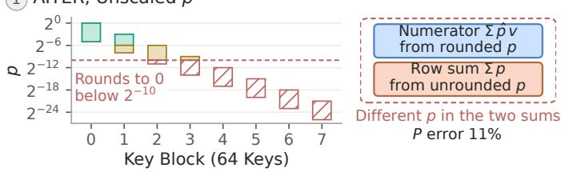

2 ZYFA, p Scaled per 64-Key Block  
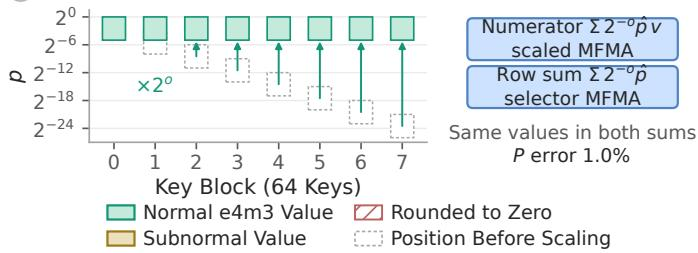  
Fig. 5: Scaling each block of probabilities before rounding keeps them in the range where FP8 is accurate, and dividing by the sum of the same rounded values keeps the attention weights summing to one. The schematic shows the probabilities p of one query row by 64-key block. (1) AITER’s FP8 kernel rounds $p$ to e4m3 relative to the row maximum. Blocks more than 6 binades (factors of two) below the maximum become subnormal, with fewer significant bits, and values more than 10 binades below underflow to zero in the numerator. The row sum adds the unrounded $p$ in FP32. (2) ZYFA multiplies each block by $2 ^ { o }$ so that its largest probability gets the same e4m3 value as $p { = } 1$ , and the scaled matrix instruction (MFMA) that computes $P V$ divides the factor out at no cost. The numerator and the row sum use the same rounded values ${ \hat { p } } .$ The $P$ error is the relative error that rounding p adds to the attention output on Mistral-7B (Figure 20).

Non-finite inputs: The row sum on the matrix unit multiplies the FP8 probabilities of the other queries by 0, and $0 \times \mathrm { N a N }$ is NaN. In the FP8 $d _ { \mathrm { q k } } { = } 1 9 2$ kernel a NaN in query row r therefore also makes row r+16 NaN, and a NaN key reaches rows that cannot see it. In every FP8 kernel a NaN in V reaches rows of the same 256-row tile that cannot see it. With lean P a NaN key converts to code 0, the FP8 value zero, and is dropped. With finite inputs the extra products are zero and change no output row.

## C. Instruction Schedule of the FP8 Kernels

A Python generator emits the FP8 kernels as CDNA4 assembly, one kernel per head dimension. The generator gives us the fine-grained control of assembly together with the ease of development of Python. The two waves of each SIMD take turns in two phases per 128-key block, with a workgroup barrier after each phase (Figure 6). FlashAttention-3 calls this arrangement ping-pong scheduling [Shah et al., 2024], HipKittens uses it on CDNA GPUs [Hu et al., 2025], and AITER uses it as well (Section III-B). In each phase one wave, the MFMA wave, issues the matrix instructions of its block. These instructions are two row-sum MFMAs, eight $Q K ^ { \top }$ MFMAs for the next block, and eight PV MFMAs for the current block. Between these MFMAs the MFMA wave computes the row maximum and the rescale of the next block. The other wave, the softmax wave, computes the FP8 probabilities. In the next phase the two waves swap roles, so the matrix pipe always has one wave that feeds it. The wave that reaches the barrier last sets the length of a phase, and we call it the critical wave.

Both waves issue from the same SIMD, so the vector instructions of the softmax wave and the instructions of the MFMA wave compete for issue slots. In thread traces each vector instruction delays the critical wave by about 4.2 cycles, and exponentials and FP8 conversions delay it longer. With exact P the softmax wave is the critical wave, and the matrix pipe idles at the end of every phase. In steady state, which we take as 40 consecutive phases in the middle of the key loop, the matrix pipe is busy for 60% of the cycles. With lean P the softmax wave issues 128 vector instructions per block and reaches the barrier before the MFMA wave. The MFMA wave becomes the critical wave, and the matrix pipe is busy for 86% of the cycles in steady state. Over the whole key loop, which includes the transitions between query tiles, the matrix pipe is busy for 56% of the cycles with exact P and 78% with lean P. All pipes of the assembly kernel are idle in 10.3% of cycles, against 13.5% in the base kernel of Section III-B (an earlier HIP version of ZYFA’s FP8 kernel), and the vector pipe of the assembly kernel is busy for 626 cycles in the units of Table IV. The HIP kernel with lean P remains the fallback for tensors larger than 32-bit offsets allow, and on captured activations at sustained clocks it needs 43–46% more cycles than the assembly kernel.

## D. BF16 Kernels

The BF16 kernel at $d _ { \mathrm { q k } } { = } 1 2 8$ keeps the 8-wave ping-pong schedule of HipKittens [Hu et al., 2025] and adds the structure of Section IV-A. The BF16 kernel at $d _ { \mathrm { q k } } { = } 1 9 2$ follows the eight-stage pipeline of AITER’s kernel for this shape, with a workgroup barrier after each stage. Memory stages read half of an operand into registers, and compute stages issue the matching MFMAs next to the softmax of the previous block. Waves 4–7 run one stage behind waves 0–3, so on each SIMD the MFMAs of one wave overlap the LDS reads of the other. K is stored in LDS in groups of 8 keys followed by 16 bytes of padding, which makes every read of an MFMA operand free of bank conflicts.13 Figure 7 shows thread traces of both BF16 kernels next to those of AITER’s kernels.

Exact P1 Phase of 1810 cycles, matrix pipe busy 60% in steady state  
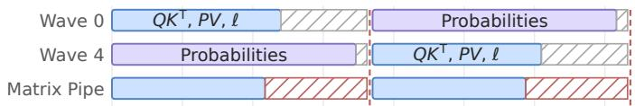

Lean P2 Phase of 1261 cycles, matrix pipe busy 86% in steady state  
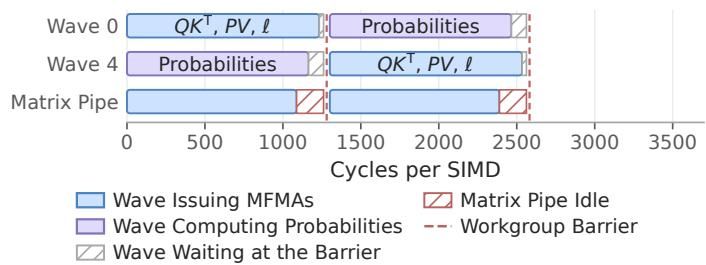  
Fig. 6: With lean P the matrix pipe idles for a much smaller part of each phase, because the probabilities are ready before the matrix work ends. The figure shows one SIMD of ZYFA’s FP8 kernel at $d _ { \mathrm { q k } } { = } 1 2 8$ over two phases, in which its two waves take turns, one issuing the matrix instructions (MFMAs) while the other computes the FP8 probabilities, and each processes one 128-key block. Waves 0 and 4 share SIMD 0. Bar widths are the mean cycles from the start of a phase until each wave reaches the workgroup barrier that ends it, taken from thread traces. The busy cycles of the matrix pipe are drawn together at the start of each phase. (1) With exact P, in an earlier build of the same kernel, the wave that computes probabilities is the critical wave, the wave that reaches the barrier last and so sets the length of the phase, and the matrix pipe idles until the barrier. (2) With lean P the wave that issues the MFMAs is the critical wave. ℓ denotes the row-sum MFMAs.

## V. EXPERIMENTAL SETUP

## A. System and Baselines

All experiments run on one node with eight AMD Instinct MI355X GPUs (gfx950), with the default automatic clock policy without pinned clocks, a 1400 W power cap, and a maximum shader clock (SCLK) of 2.4 GHz. Each job runs on one GPU, selected by its PCI bus address, and a job does not start on a GPU that runs another process. The software is ROCm 7.2.3 with HIP 7.2.53211 and AMD Clang 22.0.0, PyTorch 2.12, AITER 0.1.19, Triton 3.7.1, and transformers 5.15.1 in the vLLM ROCm container v0.28.0 with the amdgpu driver 6.14.14. All kernels are built from one source commit.

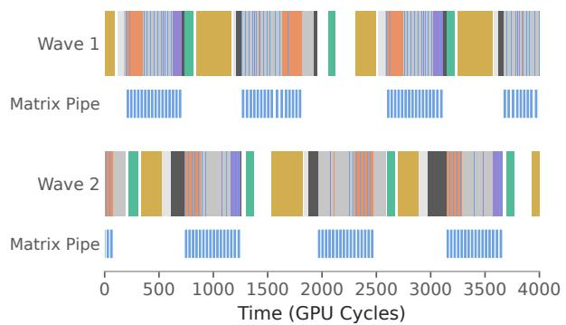

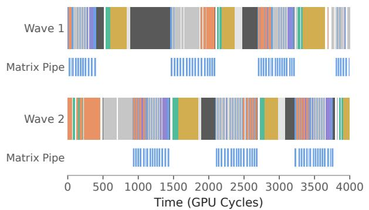

(a) ZYFA, dqk=128  
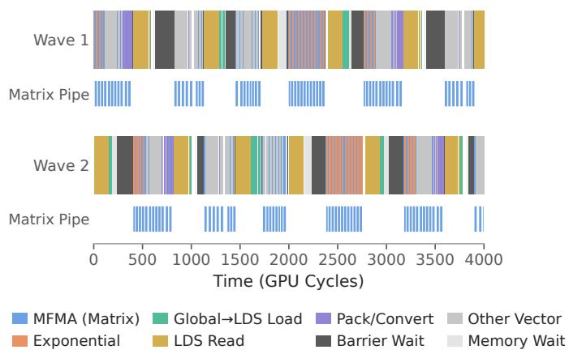  
(c) ZYFA, dqk=192

(b) AITER, dqk=128  
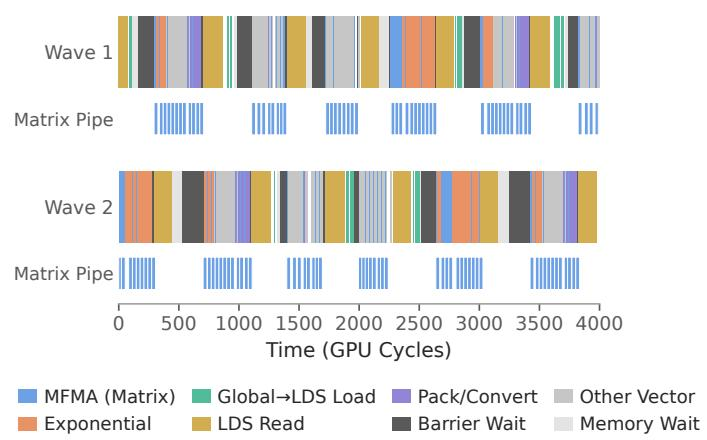  
(d) AITER, dqk=192  
Fig. 7: Thread traces showing that in BF16 the matrix products set the time of all four kernels of ZYFA and AITER, because they take more than twice as many cycles as the softmax (Table III). A thread trace records every instruction that a wave issues, cycle by cycle. Each panel shows the two waves that share one SIMD over 4000 cycles in the middle of the loop over key blocks, where every block repeats the same work (S=8K tokens, H=32 heads, multi-head attention). Each wave row shows the class of each instruction that the wave issues, and the matrix-pipe row below it shows when that wave’s MFMAs run. A vector instruction runs on the vector pipe during its bar in the wave row, whereas an MFMA keeps running on the matrix pipe after its short bar, while the wave issues other instructions.

Throughput follows the clock of the slowest chiplet, which differs between $\mathrm { G P U s . ^ { 1 4 } }$ From 4K tokens up, the throughput of one configuration differs between GPUs by a median of 4% and at most 8%, and the ratio of ZYFA’s to AITER’s throughput by a median of 0.01 and at most 0.08, the most for FP8 at $d _ { \mathrm { q k } } { = } 1 9 2$ and 32K. These differences come from the configurations that were measured on more than one GPU. At 2K tokens and below, a few configurations differ as much between sessions on one GPU as between GPUs, by up to 10% in throughput and 0.24 in the ratio to AITER. The largest difference is in AITER’s FP8 kernel at $d _ { \mathrm { q k } } { = } 1 9 2$ and 1K, which runs at one of two speeds in each session. Each precision and attention type therefore keeps all its kernel-only jobs on one GPU, so every comparison within a table or figure uses runs on one GPU.

The baseline is the kernel that AITER 0.1.19 [AMD, 2025a], AMD’s library of inference kernels, selects by default: an assembly kernel for BF16 and FP8 at $d _ { \mathrm { q k } } { = } 1 2 8 .$ , a HIP kernel written with OPUS, AITER’s C++ template library, for BF16 at $d _ { \mathrm { q k } } { = } 1 9 2$ , and Composable Kernel (CK) [AMD, 2025b] for FP8 at $d _ { \mathrm { q k } } { = } 1 9 2$ , where AITER has no assembly kernel. CK issues the CDNA3 matrix (MFMA) instruction $\mathtt { v \_ m f m a \_ f 3 2 \_ 3 2 \times 3 2 \times 1 6 \_ f p 8 \_ f p 8 }$ for both matrix products. On the MI355X it completes 1020 FLOP per clock per SIMD, the same as BF16 and 0.50× the rate of v\_mfma\_f32\_32x32x64\_f8f6f4, the instruction that

AITER’s assembly kernel and ZYFA use. Table VII lists the FP8 matrix instructions that each FP8 kernel issues, read from the disassembled kernel binaries that the timing runs launch, with their rates measured on all 256 CUs.

Before every timed run a correctness test compares each kernel with AITER on every reported configuration. In BF16 it requires a maximum absolute difference below $2 \times 1 0 ^ { - 3 }$ and in FP8 a maximum absolute difference below 0.03 and a signal-to-noise ratio (SNR) of at least 30 dB, which means that the RMS of the difference is at most about 3% of the RMS of the output. The reference is itself an FP8 kernel, so this test catches defects rather than measuring accuracy, which Section VI-B measures against fp64.

## B. Kernel-Only Timing

Kernel-only timing counts only the time that the GPU spends executing the attention kernel. As in HipKittens [Hu et al., 2025], a library of attention and matrix kernels for AMD GPUs, we report the mean device time of 100 launches after 500 warm-up launches. Device times come from rocprofv3 kernel traces and exclude the time that the host takes to launch a kernel. The time of one launch is the total device time of every kernel that the operation dispatches (launches on the GPU) in the timed range, divided by the number of launches. We use B=1, H= max(32, 262144/S) query heads so that every call has at least $2 ^ { 1 8 }$ query rows, and H/4 key-value heads for grouped-query attention (GQA). The inputs, which we call the Gaussian inputs, are q, k, and v drawn from a normal distribution with standard deviation 0.1, which makes the attention probabilities of each query row nearly uniform (Section VI-A). The GPU idles for 5 s before each configuration with $S \geq 1 6 \mathsf { K }$ . Each configuration runs at least three times, the order of kernels rotates between repetitions, and the reported spread is the range over repetitions. Throughput is F from Equation 1, which counts the FLOPs of $\boldsymbol { Q } \boldsymbol { K } ^ { \intercal }$ and PV in the causal half of the score matrix, divided by the time.

## C. Sustained Timing, Clock, and Power

Kernel-only timing on the Gaussian inputs of kernel benchmarks measures a kernel at the clock that a short burst of launches gets. Because the clock depends on the data and settles under sustained load (Section III-C), we also time kernels on model activations in long runs. We capture the post-RoPE q, k, and v (after the rotary position embedding, as the attention kernel receives them) of one layer each of Mistral 7B-v0.3 [Jiang et al., 2023], Qwen3-8B [Qwen Team, 2025], and DeepSeek-V2-Lite [DeepSeek-AI, 2024a] on WikiText-2 [Merity et al., 2017] at S=16K. We call these captured activations, and Gaussian inputs of the same shape serve as a control. Under sustained load the GPU lowers its shader clock (SCLK) and then holds it at a lower, steady value, which we call the sustained clock. Timing at sustained clocks means timing only after this clock has settled. In a sustained run one kernel launches back to back on a GPU that runs nothing else. After 2 s of idle time each kernel runs 1 s of warm-in launches and then a timed window of at least 3 s, so that the clock settles as it would in a long prefill. The comparisons of exact and lean P on the Mistral-7B layer (Section VI-A) and of the HIP and assembly kernels (Section IV-C) instead run warm-in launches until two consecutive 0.5 s chunks agree in time within 0.3%, and then time a window of 4 s. Each sustained run is repeated three times with alternating kernel order, and we report the median and the range. SCLK is the median, over the samples of a run, of the clock of the slowest chiplet. Board power and the limiter status come from amd-smi. Energy efficiency in TFLOP/J is the throughput in TFLOP/s divided by the board power in watts.

## D. Error of One Attention Call

To measure the error that a kernel itself adds, we compare its output with attention computed in fp64 on the same inputs the kernel receives: Q, K, and V rounded to BF16, or to e4m3 with one power-of-two scale per tensor.15 The error of a kernel is the relative RMS error and the maximum absolute error of its output against this reference. We compute it on every layer of the three models, from the post-RoPE q, k, and v of the first 4095 tokens of the WikiText-2 test set after the BOS token, and report means over layers, or over random seeds for synthetic inputs.

## E. End-to-End Accuracy

For end-to-end accuracy, we run each model in BF16 and replace its attention, per layer and per head, by the kernel under test. The study uses Mistral-7B-v0.3 $( d _ { \mathrm { q k } } { = } 1 2 8$ , 32 query and 8 KV heads), Qwen3-8B $( d _ { \mathrm { q k } } { = } 1 2 8 ,$ , 32 query and 8 KV heads, with QK normalization), and DeepSeek-V2-Lite (MLA with $d _ { \mathrm { q k } } { = } 1 9 2 , d _ { \mathrm { v } } { = } 1 2 8 .$ , and 16 heads), all with BF16 weights. The documents come from the PG-19 test books [Rae et al., 2020] in a seeded shuffle. A document is the text of one book after its first 2000 characters, cut to 8K, 16K, or 32K tokens. Each model is evaluated with teacher forcing (the model reads the true text, and we score its prediction of each next token) on 48 documents from 48 books, one third at each length. A separate calibration set of 12 documents from 12 other books, one third at each length, is used to select policies and to set static FP8 scales.

Metrics and the BF16 noise band: We report the pertoken KL divergence of the next-token distribution from that of the model with ZYFA’s BF16 attention, which measures how far the predictions move, and the change in negative log-likelihood of the true next token (dNLL), both pooled per token over documents. Their 95% confidence intervals are percentile bootstraps over books with 1000 resamples.16 A paired difference between two variants resamples the perdocument sums of both variants together, with 2000 resamples. Two correct BF16 kernels give slightly different model outputs because they round in different orders. The BF16 noise band runs from zero to the upper end of the 95% bootstrap interval of the KL divergence between the models with ZYFA’s and AITER’s BF16 kernels. A policy inside the band is therefore as close to the BF16 model as a second, equally correct BF16 kernel would be. Attention in fp64 lies just inside the BF16 noise band on Mistral-7B, so the band reflects rounding order alone and is a strict criterion.

<table><tr><td>kernel</td><td>product</td><td>instruction</td><td></td><td>per kernel FLOP/clock/SIMD</td></tr><tr><td rowspan="3">ZYFA, FP8 d=128</td><td>row sum of P</td><td>v_mfma_f32_16x16x128_f8f6f4</td><td>20</td><td>2041</td></tr><tr><td> $Q K ^ { \top }$ </td><td>v_mfma_f32_32x32x64_f8f6f4</td><td>64</td><td>2048</td></tr><tr><td>PV</td><td> $\mathtt { v \_ m f m a \_ s c a l e \_ f 3 2 \_ 3 2 \times 3 2 x 6 4 \_ f 8 f 6 f 4 }$ </td><td>80</td><td>2048</td></tr><tr><td rowspan="3">ZYFA, FP8  $d _ { q k } = 1 9 2$ </td><td>row sum of P</td><td>v_mfma_f32_16x16x128_f8f6f4</td><td>10</td><td>2041</td></tr><tr><td> $Q K ^ { \top }$ </td><td>v_mfma_f32_32x32x64_f8f6f4</td><td>48</td><td>2048</td></tr><tr><td> $P V$ </td><td> $\mathtt { v \_ m f m a \_ s c a l e \_ f 3 2 \_ 3 2 \times 3 2 x 6 4 \_ f 8 f 6 f 4 }$ </td><td>40</td><td>2048</td></tr><tr><td>AITER assembly, FP8 d=128</td><td> $Q K ^ { \top }$  and PV</td><td> $\mathtt { v \_ m f m a \_ f 3 2 \_ 3 2 \times 3 2 \times 6 4 \_ f 8 f 6 f 4 }$ </td><td>128</td><td>2048</td></tr><tr><td>Composable Kernel, FP8  $d _ { q k } { = } 1 9 2 \_ Q K ^ { \top }$ </td><td>and PV</td><td> $\mathtt { v \_ m f m a \_ f 3 2 \_ 3 2 \times 3 2 \times 1 6 \_ f p 8 \_ f p 8 }$ </td><td>80</td><td>1020</td></tr></table>

TABLE VII: FP8 matrix (MFMA) instructions of each FP8 kernel, read from the disassembled kernel binaries. The count is the number of times each instruction appears in the kernel binary, and the rate is in FLOP per clock per SIMD unit, measured with two waves (groups of 64 threads) per SIMD on all 256 compute units (CUs). ZYFA’s PV instruction applies the per-block scale of Section IV-B2, a power of two for each block of 64 probabilities. Composable Kernel (CK) is AITER’s FP8 kernel at $d _ { \mathrm { q k } } { = } 1 9 2$

FP8 inputs and policies: FP8 inputs use per-tensor powerof-two descales, computed after RoPE and after any rotation or K smoothing.17 Per-call scales, which we also call dynamic scales, use the absolute maximum of each tensor in each call. Static scales are set per layer, transform, and tensor from the largest absolute maximum over the calibration documents, taken with BF16 attention in every layer. A policy assigns each head or layer to BF16 or FP8 and may rotate the FP8 inputs. Policies and static scales are selected on the calibration documents.

Error of each stage of one call: To attribute the FP8 error of one call to its stages, we divide that error into three terms. The reference for each call is fp64 attention on the BF16 q, k, and v of the call. The input term is the error of fp64 attention on the e4m3-quantized inputs. The P term is the error that quantizing p as the kernel does adds to the input term, emulated with the exact row maximum and FP32 accumulation. The last term is the error that the kernel itself adds, which comes from the accumulation order, the running maximum, and the rounding of the output. Each term is a relative RMS error pooled over all heads of the first 12 evaluation documents, one third at each length.

Rotation and K smoothing: After RoPE, Q and K are multiplied in FP32 by the same orthogonal matrix $R \ =$ $\mathrm { d i a g } ( s ) \left( C _ { m } \otimes H _ { D / m } \right)$ . Here s is a vector of random signs with seed 0, H is the normalized Sylvester–Hadamard matrix, and $C _ { m }$ is the orthonormal DCT-II of size m. We use m=1 for D=128 and m=3 for D=192, because Sylvester’s construction gives only sizes that are powers of two. Since R is orthogonal, $\bar { ( } Q R ) ( K \bar { R } ) ^ { \top } \ : = \ : Q K ^ { \top }$ , and the rotation changes only the rounding error. One matrix serves every layer and head. FP8 scales are computed after the rotation, and V and O are not rotated. K smoothing [Zhang et al., 2025c] subtracts the mean key of each head over the sequence before the rotation. The subtraction lowers every score of a query row by the same value, which the softmax cancels.18

Timing inside the model: Attention time inside the model comes from kernel-only windows, intervals between two GPU timing events that contain only the attention kernels of one call. A short GPU busy-wait before each start event keeps the host launch time out of the window.19 Adding the busy-wait changed the time of policies with mixed layers by up to about 2%, so we treat smaller differences as unresolved. Quantization, the output descale, and the copies that gather the heads of each precision in a mixed layer and scatter their outputs back into O lie outside the window. Times with a fused quantization pass add the time of an existing one-pass kernel that reads Q in BF16 and writes e4m3, plus one pass over K when K is rotated or smoothed. K and V are quantized when they are written to the cache, so no separate pass is added for them. Table XVIII gives the time of the gather and scatter copies, which every mixed-precision time in Section VI-C excludes.

## VI. RESULTS

## A. Speed

Gaussian inputs: ZYFA’s FP8 kernels achieve a higher throughput than AITER’s default kernels at every sequence length from 1K to 32K, and ZYFA’s BF16 kernels are within 3% of AITER’s throughput at 16K and 32K and achieve a higher throughput at 2K (Table VIII and Figure 8). The pipe cycles of Table III explain the difference between the two precisions. In BF16 the matrix products are the critical path of both libraries, the chain of work that sets the kernel time, and the times of the two libraries differ by a few percent. In FP8 the softmax is the critical path of a kernel with an exact softmax, and lean P, which replaces the exponential with one multiply-add, removes more than half of its vector work. The throughput ratio of ZYFA to AITER is largest at FP8 $d _ { \mathrm { q k } } { = } 1 9 2$ where the assembly schedule gives the largest step (Figure 10) and the baseline, Composable Kernel (CK), issues FP8 matrix instructions that run at the BF16 rate (Section V). At 32K the FP8 kernel at $d _ { \mathrm { q k } } { = } 1 2 8$ reaches 53% of the FP8 datasheet peak and 88% of the throughput of the synthetic attention loop of Section III-C. The rest of the distance to the datasheet peak comes from the lower clock under sustained load and from vector work that does not overlap the MFMAs.

<table><tr><td rowspan="2"></td><td colspan="3">multi-head</td><td colspan="3">grouped-query</td><td rowspan="2">spread</td></tr><tr><td>kernel</td><td>2K 16K</td><td>32K</td><td>2K</td><td>16K</td><td>32K</td></tr><tr><td>BF16 128</td><td>1.05</td><td>1.03</td><td>1.02</td><td>1.07</td><td>1.02</td><td>1.02</td><td>1.7%</td></tr><tr><td>BF16 192</td><td>1.04</td><td>1.01</td><td>1.00</td><td>1.07</td><td>1.00</td><td>1.00</td><td>1.7%</td></tr><tr><td>FP8 128</td><td>1.44</td><td>1.34</td><td>1.37</td><td>1.42</td><td>1.28</td><td>1.26</td><td>1.4%</td></tr><tr><td>FP8 192</td><td>2.02</td><td>1.89</td><td>1.99</td><td>1.94</td><td>1.82</td><td>1.88</td><td>0.8%</td></tr></table>

TABLE VIII: Throughput of ZYFA divided by that of AITER’s default kernel at batch size B=1, so values above 1 mean that ZYFA takes less time. Inputs are Gaussian (random q, k, and v with standard deviation 0.1), and times are kernel-only (the device time of the kernel alone), averaged over repetitions. Rows give the precision and the query-key head dimension $d _ { \mathrm { q k } } . \mathrm { A t } d _ { \mathrm { q k } } { = } 1 9 2$ the FP8 baseline is Composable Kernel (CK). The last column is the spread of ZYFA’s multi-head throughput over repetitions at 32K. Figure 8 gives all sequence lengths, and Table IX gives B=4.

<table><tr><td rowspan="2">kernel</td><td colspan="2">S=8K</td><td colspan="2">S=32K</td></tr><tr><td>B=1</td><td>B=4</td><td>B=1</td><td> $B { = } 4$ </td></tr><tr><td>BF16  $d _ { \mathrm { q k } } { = } 1 2 8$ </td><td>1.03</td><td>1.00</td><td>1.02</td><td>1.03</td></tr><tr><td>FP8  $d _ { \mathrm { q k } } { = } 1 2 8$ </td><td>1.35</td><td>1.41</td><td>1.37</td><td>1.38</td></tr><tr><td>BF16  $d _ { \mathrm { q k } } { = } 1 9 2$ </td><td>1.00</td><td>1.03</td><td>1.00</td><td>1.00</td></tr><tr><td>FP8  $d _ { \mathrm { q k } } { = } 1 9 2$ </td><td>1.88</td><td>1.94</td><td>1.99</td><td>1.99</td></tr></table>

TABLE IX: Throughput of ZYFA divided by that of AITER’s default kernel at batch sizes B=1 and $B { = } 4 ,$ , for multi-head attention on Gaussian inputs, kernel-only. Values above 1 mean that ZYFA takes less time.

Figure 8 gives the kernel-only throughput of every configu ration against sequence length at B=1 and B=4, and Table IX compares the two batch sizes at 8K and 32K. Figure 9 places the FP8 kernel at $d _ { \mathrm { q k } } { = } 1 2 8$ on a roofline with empirical roofs.20 The FLOPs of attention grow with $S ^ { 2 }$ and the bytes it moves grow with $S ,$ so its arithmetic intensity grows linearly with the sequence length, and every length from 2K up is computebound.

Design steps: Figure 10 adds the design decisions one at a time. In both FP8 kernels the assembly schedule gives the largest step, and at $d _ { \mathrm { q k } } { = } 1 2 8$ lean P gives the second largest. At $d _ { \mathrm { q k } } { = } 1 9 2$ the base HIP kernel, which issues full-rate FP8 matrix instructions, already reaches 1.51× the throughput of CK at 32K. The HIP and assembly kernels with lean P compute the same output, so the last step at $d _ { \mathrm { q k } } { = } 1 2 8$ comes from the instruction schedule alone. In the BF16 kernels (Figure 11), causal pairing gives the largest step at $d _ { \mathrm { q k } } { = } 1 2 8$ at every length because it balances the work across workgroups, and the eightstage pipeline gives the largest step at $d _ { \mathrm { q k } } { = } 1 9 2$

Each step builds on the previous step in the same source tree, and the last step is the final kernel. The base FP8 kernels are HIP kernels without the chiplet map. They compute each probability in FP32, convert it to e4m3, and sum the rows on the vector unit. The exponential is a Schraudolph exponential at $d _ { \mathrm { q k } } { = } 1 2 8$ and $\mathtt { v \_ e x p \_ f 3 2 }$ at $d _ { \mathrm { q k } } { = } 1 9 2$ . At $d _ { \mathrm { q k } } { = } 1 2 8$ , step “+Lean $\mathbf { P } ^ { \ast }$ switches to lean P. At $d _ { \mathrm { q k } } { = } 1 9 2$ , step “+Row Sum on MFMA” sums the rows on the matrix unit. Both steps also turn on per-block scaling, lower the lazy-rescaling threshold from 8 to 0.125, and multiply p and ℓ by $2 ^ { 6 }$ . Step “+Assembly Schedule” replaces the HIP kernel with the assembly kernel of Section IV-C and its two-wave ping-pong schedule. At $d _ { \mathrm { q k } } { = } 1 9 2$ it also replaces a grid of 512, 1024, and 2048 workgroups at 2K, 16K, and 32K with a persistent grid of 256.

The base BF16 kernel at $d _ { \mathrm { q k } } { = } 1 2 8$ has the HipKittens schedule with two correctness fixes. It applies the softmax scale to the FP32 scores and rescales the output whenever a row maximum grows, while HipKittens skips increases of up to 8. Step “+Causal Pairing” runs the causal pairs of Section IV-A, step “+Chiplet $\boldsymbol { \mathrm { M a p } } ^ { \prime \prime }$ adds the chiplet map, and step “+Persistent Grid” hands out the pairs from a persistent grid. In the base kernel the address descriptor of $Q$ (the base address and size of the tensor, which buffer loads read) lies in vector registers, so each of the eight loads of a $Q$ tile runs in a loop over the lanes and waits for the previous load.21 Step “+Batched Q Load” keeps the descriptor in scalar registers, and the eight loads run concurrently. Step “+Staged O Store” writes the output tile through LDS, so each lane stores 16 contiguous bytes of a row instead of 8. The same step also defers these stores to the next tile and, as for Q, keeps their address descriptor in scalar registers. In the last three 64-key blocks of a tile the causal mask hides every key from some of the waves. Step “+Dead-Block Skip” skips the MFMAs and the softmax of those waves in those blocks, while the loads into LDS and the barriers still run. Step “+Lazy Rescale” enables lazy rescaling with $\tau { = } 0 . 5 .$ Because the base kernel rescales on every increase of the maximum, this step recovers part of a saving that HipKittens already has. The base BF16 kernel at $d _ { \mathrm { q k } } { = } 1 9 2$ runs causal pairs without the chiplet map, and step “+8-Stage Pipeline”

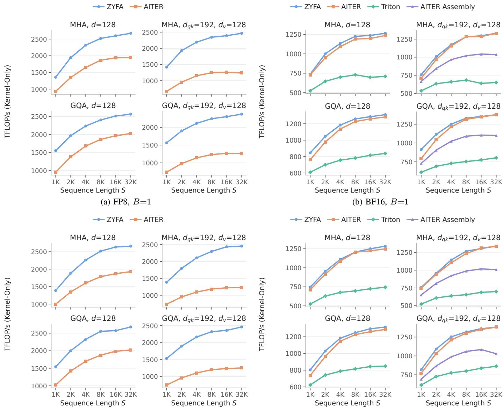  
(c) FP8, B=4  
(d) BF16, B=4  
Fig. 8: Throughput of ZYFA and AITER against sequence length on Gaussian inputs (random q, k, and v with standard deviation 0.1). Times are kernel-only, the device time of the kernel alone without the time that the host takes to launch it AITER is AITER’s default kernel for each configuration, which at $d _ { \mathrm { q k } } { = } 1 9 2$ is its OPUS kernel in BF16 and Composable Kernel in FP8. The BF16 panels also show AITER’s Triton kernel and, at $d _ { \mathrm { q k } } { = } 1 9 2 .$ , AITER’s assembly kernel.

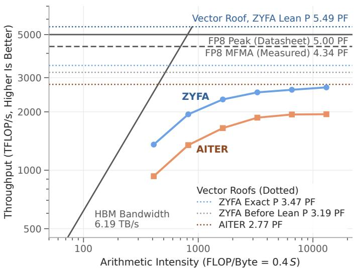  
Fig. 9: Roofline for FP8 multi-head attention at $d _ { \mathrm { q k } } { = } d _ { \mathrm { v } } { = } 1 2 8 ,$ kernel-only on Gaussian inputs. At a given arithmetic intensity, the FLOPs per byte moved from memory, a kernel cannot exceed the sloped memory roof or the flat arithmetic roofs. The roofs are the empirical HBM bandwidth, the datasheet FP8 peak, and the empirical peak of the $3 2 \times 3 2 \times 6 4$ FP8 matrix instruction (MFMA) that the kernels use. The 16×16 shape, which has the higher throughput, reaches 4.60 PFLOP/s (Table V). Each vector roof is the throughput at which all vector instructions of a kernel, packed FP32 included, fill the vector pipe, the unit that runs elementwise arithmetic such as the softmax. The roof of exact P, which evaluates the exponential, comes from a thread trace of an earlier build of the assembly kernel. With FL $\mathrm { O P s } = B H S ^ { 2 } ( d _ { \mathrm { q k } } + d _ { \mathrm { v } } )$ ) the arithmetic intensity is 0.4 S FLOP/byte, so every length from 2K up is compute-bound.

<table><tr><td colspan="2"></td><td colspan="2">time ratio</td><td colspan="2">SCLK (MHz), capt./Gauss.</td></tr><tr><td>model</td><td></td><td>capt.</td><td>Gauss.</td><td>ZYFA</td><td>AITER</td></tr><tr><td>Mistral</td><td>FP8</td><td>1.16</td><td>1.30</td><td>1628/1686</td><td>2108/1991</td></tr><tr><td>Qwen3</td><td>FP8</td><td>1.17</td><td>1.29</td><td>1629/1687</td><td>2048/1993</td></tr><tr><td>DeepSeek</td><td>FP8</td><td>1.76</td><td></td><td>1.84 1742/1803</td><td>2219/2250</td></tr><tr><td>Mistral</td><td>BF16</td><td>1.02</td><td></td><td>1.03 1590/1644</td><td>1446/1502</td></tr><tr><td>Qwen3</td><td>BF16</td><td>1.01</td><td></td><td>1.02 1586/1645</td><td>1438/1503</td></tr><tr><td>DeepSeek BF16</td><td></td><td>1.01</td><td></td><td>1.01 1449/1496</td><td>1403/1448</td></tr></table>

TABLE X: ZYFA and AITER on one layer per model at S=16K (Mistral-7B layer 20, Qwen3-8B layer 18, DeepSeek-V2-Lite layer 13). The captured columns use the q, k, and v that the model produces on WikiText-2 text, and the Gaussian columns use random inputs of the same shape. Each run launches one kernel back to back for seconds and is timed only after the GPU clock has settled (sustained clocks). The time ratio is AITER’s time divided by ZYFA’s time, so values above 1 mean that ZYFA takes less time. SCLK is the shader clock of the slowest of the eight chiplets, which sets the kernel time.

adds the eight-stage pipeline of Section IV-D and applies the softmax scale to the FP32 scores.

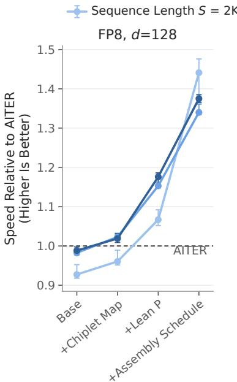

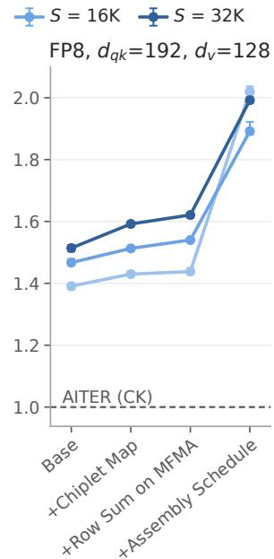  
Fig. 10: Speed of ZYFA’s FP8 kernels relative to AITER’s default kernel as design decisions are added from left to right, kernel-only on Gaussian inputs, multi-head at B=1. Error bars span the repetitions. At $d _ { \mathrm { q k } } { = } 1 9 2$ the baseline is Composable Kernel (CK), AITER’s default FP8 kernel for that shape. Step “+Lean P” computes each FP8 probability with a multiply-add instead of an exponential, and step “+Row Sum on MFMA” sums each row of probabilities on the matrix unit. Both steps also turn on per-block scaling, and step “+Assembly Schedule” replaces the HIP kernel with the hand-scheduled assembly kernel. The rightmost point of each line is the final kernel, measured in the same jobs as Table VIII. Section VI-A defines every step, and Figure 11 shows the BF16 kernels.

Captured activations at sustained clocks: On captured activations ZYFA’s FP8 kernels lead AITER’s by less than on Gaussian inputs of the same shape (Table X). The Gaussian timing inputs have a standard deviation of 0.1, which gives logits with a standard deviation of about 0.01, so attention is nearly uniform, every probability lies close to the row maximum, and both kernels write normal e4m3 values. On the captured layers ZYFA’s clock falls on all three models, while the clock of AITER’s assembly kernel rises on Mistral-7B and Qwen3-8B and the clock of CK on DeepSeek-V2-Lite falls by less than ZYFA’s. ZYFA still needs fewer cycles than AITER on both inputs (Figure 12). In an exact-P version of the FP8 kernel a hardware counter of busy cycles changed by at most 0.7% between the two inputs, so the data distribution changes the total attention time mainly by affecting the clock speed. One cause is the FP8 values of the probabilities that enter the PV product. In the Mistral-7B layer, 91% of the pairs of a row and a 64-key block lie more than 8 binades below the row maximum (Section IV-B2), so AITER, which does not scale these blocks up, writes subnormal values or zeros there, while ZYFA’s per-block scaling keeps them normal. Nonzero values switch more bits in the PV MFMAs and therefore lower the clock (Section III-C). The same effect takes back part of the gain of lean P. On the Mistral-7B layer lean P needs 17% fewer cycles than exact P but runs at a 5–6% lower clock, so exact P takes only 1.131× the time of lean P. Appendix A times every layer of each model and shows that the speedup is nearly the same in every layer, so the layers in Table X are representative.

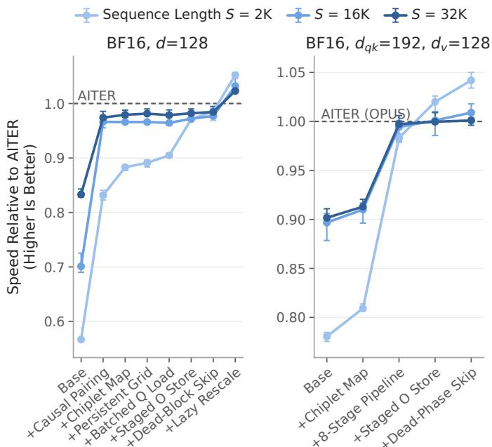  
Fig. 11: Speed of ZYFA’s BF16 kernels relative to AITER’s default kernel as design decisions are added from left to right, kernel-only on Gaussian inputs, multi-head at B=1. At $d _ { \mathrm { q k } } { = } 1 9 2$ the baseline is AITER’s OPUS kernel, a HIP kernel built with AITER’s C++ template library. Section VI-A defines every step.

Clock and power: Figure 13 gives the kernel time, the SCLK of the slowest chiplet, and the board power of each kernel on captured activations and on Gaussian inputs of the same shape, and Figure 12 separates the kernel time on the Mistral-7B layer into cycles and clock. To isolate the effect of the FP8 probabilities on the clock, an MFMA loop multiplies the FP8 probabilities captured from the Mistral-7B layer at 16K, and we compare its clock with that of the same loop on the FP8 probabilities of Gaussian inputs. With ZYFA’s per-block scaled values the clock changes by −8.5%, and with AITER’s unscaled values by +13%.

The telemetry of amd-smi does not name the limit that sets the clock, but it rules out the two limits that it reports. Board power stays below the 1400 W cap for every kernel, and the thermal throttle counters do not change. The power throttle counter is active least often for ZYFA’s FP8 kernel, which runs at the lowest clock, whereas a limit on average power that set the clock would be active most often for the kernel with the lowest clock. The package-power status flag reads active for every kernel, so it does not distinguish the kernels, and amd-smi does not report the voltage. The clock also falls within a single launch. Together these observations point to a fast limit on current rather than on average power.

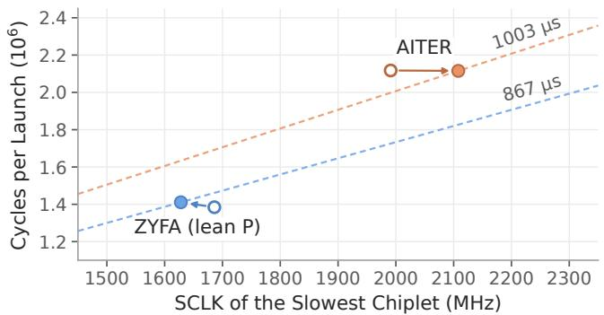  
Captured Activations Gaussian Inputs Equal Kernel Time  
Fig. 12: Cycles per launch against the shader clock (SCLK) for ZYFA’s and AITER’s FP8 kernels on Mistral-7B layer 20 at S=16K, at sustained clocks. Kernel time is cycles divided by clock, so a kernel can take less time by needing fewer cycles or by running at a higher clock. Cycles are kernel time multiplied by the SCLK of the slowest chiplet. Filled markers are captured activations, the q, k, and v of the real model, and open markers are Gaussian inputs of the same shape. Points on a dashed line take the same time as the captured-activation point of that kernel.

Energy: On the captured Mistral-7B and Qwen3-8B layers ZYFA’s FP8 kernel delivers 1.94 and 1.91 TFLOP/J, against 1.60 and 1.56 TFLOP/J for AITER. Figure 14 gives the energy efficiency of each configuration under sustained load on Gaussian inputs. The ratio of the energy efficiencies of two kernels is their throughput ratio divided by the ratio of their board powers. For FP8 at $d _ { \mathrm { q k } } { = } 1 2 8$ and 32K, ZYFA draws 1328 W and AITER 1362 W, and ZYFA reaches 2.05 TFLOP/J and AITER 1.47 TFLOP/J. The kernels were tuned for time only, and we have not determined the cause of the difference in power.

## B. Error of One Attention Call

Table XI compares each kernel with fp64 attention on the same quantized inputs, so it measures the error that the kernel itself adds. In FP8 at head dimension 128 the errors of ZYFA, CK, and Triton [Tillet et al., 2019] differ by a few percent. On Mistral-7B and Qwen3-8B, ZYFA’s error is 0.22 and 0.38 times the error of AITER’s assembly kernel. That kernel divides by the sum of the unrounded probabilities, so probabilities that underflow to zero in the numerator still count in the denominator, and every output row shrinks slightly (Figure 5 and Section IV-B3). In BF16, ZYFA’s error is 1.01–1.02× that of AITER on Mistral-7B and Qwen3-8B. On DeepSeek-V2-Lite ZYFA’s and AITER’s BF16 kernels use the same arithmetic and have the same error.

BF16 kernels: On Mistral-7B the error of ZYFA’s BF16 kernel at $d _ { \mathrm { q k } } { = } 1 2 8$ exceeds AITER’s by up to 0.1–7% per layer. The difference comes from the order in which the kernels visit the keys. For the long-row half of each causal pair, AITER visits the key blocks from the diagonal back to key 0, so the attention-sink token at key 0 (a token that receives a large share of the attention of most queries) comes last. Each key that sets the running maximum before the sink token gets p=1, which BF16 represents exactly. ZYFA visits key 0 first, so the sink token sets the maximum and the probabilities of the other keys are rounded. The BF16 kernels also multiply the FP32 scores by the softmax scale c. Rounding $c q \log _ { 2 } { e }$ to BF16 before the MFMA instead, as the HipKittens attention kernel does, adds an error to each score that grows with the magnitude of the score, and the softmax turns it into a relative error of p (Section VI-C). At logit standard deviations of about 4 to 16 this rounding raises the output error to 2.3–4.7× AITER’s.

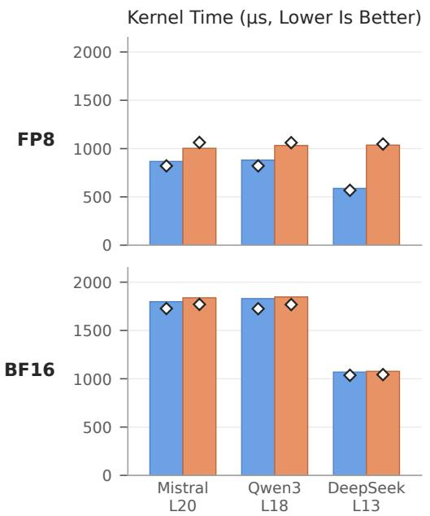

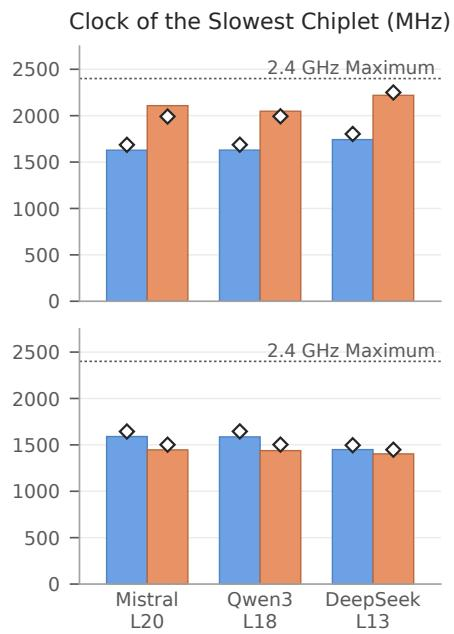

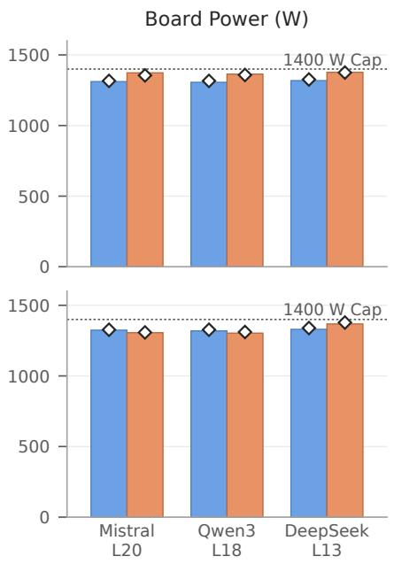  
Fig. 13: Kernel time, shader clock (SCLK) of the slowest chiplet, and board power of ZYFA’s and AITER’s kernels at $S { = } 1 6 \mathrm { K } .$ Bars are captured activations, the q, k, and v of one layer per model, and diamonds are Gaussian inputs of the same shape. Every run launches one kernel back to back and is measured after the clock has settled (sustained clocks). The runs are those of Figure 1.

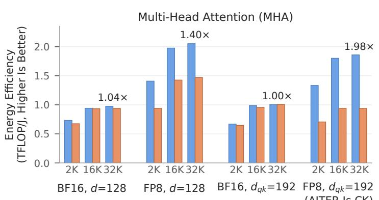

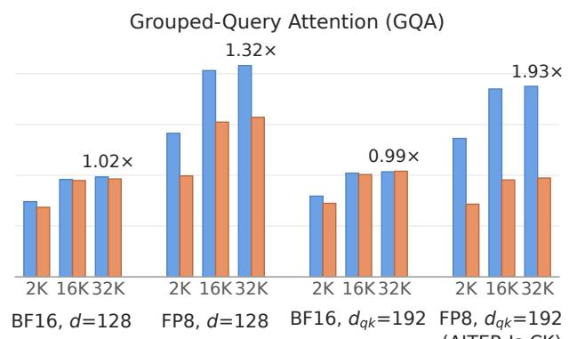  
Fig. 14: ZYFA’s FP8 kernels compute more per joule than AITER’s, and its BF16 kernels match AITER’s. Each pair of bars gives the TFLOP of attention computed per joule of board energy for one configuration and sequence length, under sustained load on Gaussian inputs. For FP8 at $d _ { \mathrm { q k } } { = } 1 2 8$ and 32K, ZYFA reaches 2.05 and AITER 1.47 TFLOP/J. At $d _ { \mathrm { q k } } { = } 1 9 2$ AITER’s FP8 kernel is Composable Kernel (CK).

<table><tr><td rowspan="2">model</td><td colspan="4">FP8</td><td rowspan="2">BF16 ZYFA</td></tr><tr><td>AITER</td><td>ZYFA</td><td>CK</td><td>Triton</td></tr><tr><td>Mistral-7B</td><td> $6 . 4 1 \times 1 0 ^ { - 2 }$ </td><td>0.22</td><td>0.22</td><td>0.21</td><td>1.02</td></tr><tr><td>Qwen3-8B</td><td> $3 . 1 7 \times 1 0 ^ { - 2 }$ </td><td>0.38</td><td>0.37</td><td>0.37</td><td>1.01</td></tr><tr><td>DeepSeek-V2-Lite</td><td> $1 . 0 2 \times 1 0 ^ { - 2 }$ </td><td>0.82</td><td>1.00</td><td>1</td><td>1.00</td></tr></table>

TABLE XI: Output error of one attention call, measured against attention computed in fp64 on the same quantized inputs, so it counts only the error that each kernel adds. Values are means over all layers of each model on WikiText-2 at S=4K. The AITER column gives the relative RMS error of AITER’s default FP8 kernel, which is Composable Kernel (CK) at $d _ { \mathrm { q k } } { = } 1 9 2$ The other FP8 columns give each kernel’s error divided by AITER’s, so values below 1 mean a smaller error. AITER’s Triton kernel does not support FP8 when $d _ { \mathrm { q k } } { \neq } d _ { \mathrm { v } }$ . The BF16 column gives ZYFA’s BF16 error divided by the error of AITER’s BF16 kernel.

Lean P: On 68 real layers at $d _ { \mathrm { q k } } { = } 1 2 8$ , the output error of lean P, which computes each FP8 probability with one multiply-add (Section IV-B1), is 1.22–1.36× that of exact P, which evaluates the exponential, in the same kernel, and the geometric mean of its error is 0.26× the error of AITER’s kernel. Across input distributions the comparison with AITER varies. On Gaussian inputs with q and k of standard deviation 0.5 to 3, the error of lean P is 8–18% higher than AITER’s, on ramp and spike inputs it is up to 19% higher, and on the captured layers at $d _ { \mathrm { q k } } { = } 1 2 8$ its RMS error exceeds AITER’s on 1 of 68 layers. Against a model with fp64 attention, lean P raises the KL divergence of the output by 1.7% relative to exact P on Mistral-7B, and on Qwen3-8B the change rounds to 0.0%. At $d _ { \mathrm { q k } } { = } 1 9 2$ lean P would take 7.9–10.5% less time, but in 1 of 24 configurations its signal-to-noise ratio falls 0.003 dB below the 30 dB threshold of the correctness test, so the kernel at $d _ { \mathrm { q k } } { = } 1 9 2$ uses exact P, although lean P matches exact P end to end on DeepSeek-V2-Lite.

Synthetic and captured inputs: Figure 15 gives the output error of each kernel on synthetic input distributions, and Figure 16 gives it for every captured layer. Figure 17 places each kernel by its time and its error on the captured layers.

Error in a full model: A single call does not show how errors accumulate over the layers of a model. Figure 18 therefore replaces every attention call of each model with the kernel under test and compares the next-token distributions with those of a model with fp64 attention on eight sequences of 4K tokens. The FP8 kernels of ZYFA, Composable Kernel, and Triton give KL divergences on Mistral-7B of $3 . 4 { \times } 1 0 ^ { - 3 } , 3 . 4 { \times } 1 0 ^ { - 3 }$ , and $3 . 3 { \times } 1 0 ^ { - 5 }$ . AITER’s FP8 kernel gives $5 . 9 \times 1 0 ^ { - 3 }$ . Every BF16 kernel gives the KL divergence of FP32 attention, $2 . 7 \times 1 0 ^ { - 4 }$

<table><tr><td>layer</td><td>between launches</td><td>AITER</td><td>ZYFA</td></tr><tr><td>Mistral-7B L20, 4K</td><td>nothing</td><td>0/200</td><td>0/200</td></tr><tr><td>Mistral-7B L20, 4K</td><td>BF16 GEMM</td><td>5/2000</td><td>0/2000</td></tr><tr><td>Mistral-7B L20, 4K</td><td>BF16 attention</td><td>0/200</td><td>0/200</td></tr><tr><td>Qwen3-8B L6, 4K</td><td>nothing</td><td>0/200</td><td>0/200</td></tr><tr><td>Qwen3-8B L6, 4K</td><td>BF16 GEMM</td><td>3/2000</td><td>0/2000</td></tr><tr><td>Qwen3-8B L6, 4K</td><td>BF16 attention</td><td>0/200</td><td>0/200</td></tr><tr><td>Qwen3-8B L18, 16K</td><td>nothing</td><td>0/200</td><td>0/200</td></tr><tr><td>Qwen3-8B L18, 16K</td><td>BF16 GEMM</td><td>10/2000</td><td>0/2000</td></tr><tr><td>Qwen3-8B L18, 16K</td><td>BF16 attention</td><td>0/200</td><td>0/200</td></tr></table>

TABLE XII: Number of launches, out of the total after the slash, whose output differs bitwise from the first launch on the same captured FP8 inputs. Between launches the GPU runs nothing, a BF16 GEMM (matrix multiplication), or a BF16 attention kernel. AITER is AITER’s FP8 assembly kernel.

Run-to-run reproducibility: ZYFA’s kernels return identical outputs in every launch, and AITER’s FP8 assembly kernel changes its output in a few launches when a GEMM (a general matrix multiplication) runs between them. Table XII repeats a launch of each FP8 kernel on the same captured inputs and counts the launches whose output differs bitwise from the first launch. Between launches the GPU runs nothing, a BF16 GEMM, or a BF16 attention kernel. Each kernel runs 7200 launches on three captured layers. ZYFA’s output is identical in every launch. Of AITER’s launches, 18 differ, all with a GEMM between launches. The differences lie in output columns 64–127 of 1–6 heads per launch, and in 17 of the 18 launches they lie only in the last 32 columns, a pattern that suggests a race on the last V or output block that depends on timing. The differences range from one unit in the last place to wrong values. On the affected rows the relative RMS error reaches 0.44, against 0.028 for a launch with the correct output. GEMMs run between the attention calls of a full model, so AITER’s end-to-end results in Section VI-C may include such launches, and in our end-to-end runs two passes of AITER’s FP8 kernel over the same sequence sometimes gave different logits.

## C. FP8 Error in Full Models

Every FP8 variant we test moves the output of the three models outside the BF16 noise band, the range of KL divergence in which a model is as close to the BF16 model as it would be with a second, equally correct BF16 attention kernel (Section V-E). The KL divergence of all-FP8 ZYFA (FP8 attention in every head) is 45.7, 40.8, and 23.8 times the upper end of the BF16 noise band on Mistral-7B, Qwen3-8B, and DeepSeek-V2-Lite. The KL divergence per token measures how far the next-token distributions move from those of the model with ZYFA’s BF16 attention. AITER’s FP8 kernel lowers the

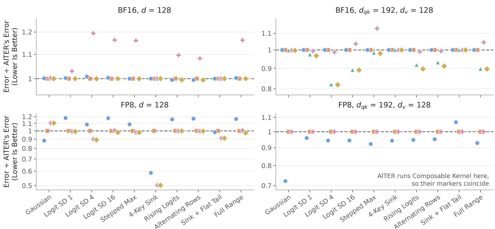  
Fig. 15: Output error of one attention call on synthetic inputs at S=8K tokens, as each kernel’s relative RMS error against attention computed in fp64 on the same inputs, divided by AITER’s error (below 1 is more accurate than AITER). Gaussian draws $q , k ,$ and v from $\mathcal { N } ( 0 , 0 . 1 ^ { 2 } )$ , as in the timing runs. Every other input starts from standard normal q, k, and v. Logit SD 1, 4, and 16 scale q and k by 1, 2, and 4, which gives logits with these standard deviations in nats. Stepped Max raises the logits of each successive block of 64 keys by a fixed step, so the row maximum keeps growing. 4-Key Sink scales the first four keys by 8. Rising Logits adds a linear ramp along the keys to every row, and Alternating Rows adds it to every other row. Sink + Flat Tail puts the first key 12 nats above a nearly uniform rest. Full Range draws magnitudes log-uniformly between $2 ^ { - 6 }$ and $2 ^ { 8 }$ with random signs, which spans the e4m3 range after scaling.

NLL of Qwen3-8B below that of BF16 while it has the largest KL divergence of all variants. A lower NLL therefore does not show that a variant is closer to BF16, and we use the KL divergence as the accuracy metric.22

Lean P and exact P: Figure 19 gives the KL divergence of every FP8 variant on 42 PG-19 test documents per model, split over the three lengths, from a run that preceded the evaluation on 48 documents in Section VI-C. On the 48 evaluation documents of Mistral-7B, lean P raises the NLL relative to exact P by $^ { + 9 . 9 \times 1 0 ^ { - 5 } }$ nats per token, with a 95% interval from $- 7 . 1 { \times } 1 0 ^ { - 5 } \ { \mathrm { t o } } \ + 2 . 5 { \times } 1 0 ^ { - 4 }$

Error added by each stage: We measure the error that each stage of one attention call adds (Figure 20, method in Section V-E). On Mistral-7B, quantizing Q, K, and V adds 8 times the error of quantizing p with lean P, and for ZYFA the input term (the error from quantizing Q, K, and V) is also the largest on the other two models. Quantizing only Q, only K, or only V gives a relative error of $6 . 1 { \times } 1 0 ^ { - 2 } , 5 . 4 { \times } 1 0 ^ { - 2 }$ , and $1 . 8 \times \dot { 1 0 } ^ { - 2 }$ on Mistral-7B, against $8 . 3 { \times } 1 0 ^ { - 2 }$ for all three. An FP8 KV cache with BF16 attention would therefore already add much of this error, and V adds the least. The exponential in the softmax explains why Q and K add more error than V . A rounding error in q or k changes a score by an amount that grows with the magnitude of q and k, and the softmax turns an error of δ in a score, in base-2 units, into a relative error of about δ ln 2 in ${ p . } ^ { 2 3 }$ Rounding p itself adds a relative error that does not depend on the magnitude of the scores. The e4m3 signal-to-noise ratio of Q and K is 31–32 dB in 90% of heads, the value that a 3-bit mantissa gives in the normal range. A floating-point format has the same relative precision over its whole normal range (a scale moves values within the range but does not change how finely the format resolves them), so a separate scale for each head would not raise this signal-to-noise ratio.

Error of one call on every model: Figure 21 extends Figure 20 to all three models, with and without the rotation. For ZYFA the three error terms (input quantization, P quantization, and the rest of the kernel’s arithmetic) add in quadrature to the total within 0.1–0.7%, so they behave as independent errors.24 For AITER at $d _ { \mathrm { q k } } { = } 1 2 8$ the sum in quadrature exceeds the total by 4–6%, because its P term and its last term partly cancel.

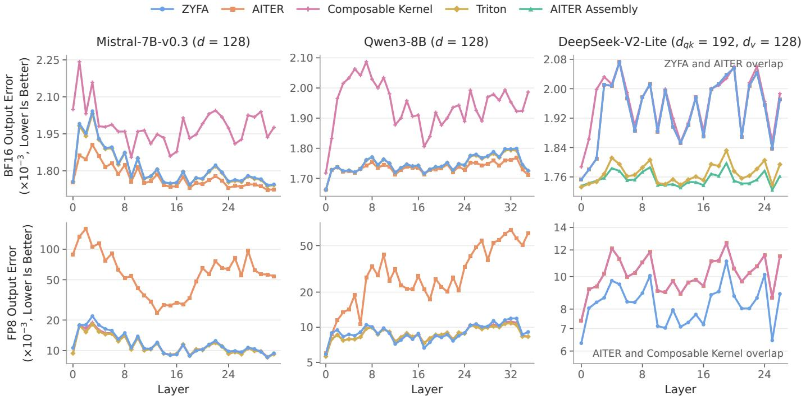  
Fig. 16: Output error of one attention call for every layer of each model, as relative RMS error against attention computed in fp64 on the same inputs (lower is more accurate). The inputs are the q, k, and v that each model produces on the first 4095 tokens of WikiText-2 (S=4K). The FP8 row uses a logarithmic axis.

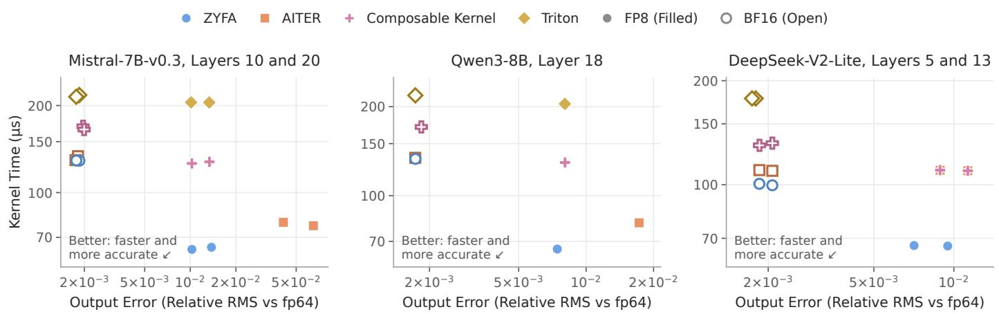  
Fig. 17: Kernel time against output error for each kernel on captured layers at S=4K, the q, k, and v that each model produces on WikiText-2. Output error is the relative RMS error against attention computed in fp64 on the same inputs. Filled markers are FP8 kernels, and open markers are BF16 kernels. Each marker is one kernel on one layer, and markers toward the lower left are faster and more accurate. At the head dimensions of DeepSeek-V2-Lite, AITER’s FP8 kernel is Composable Kernel, so their FP8 markers coincide.

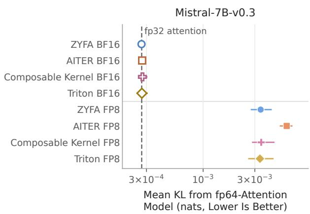

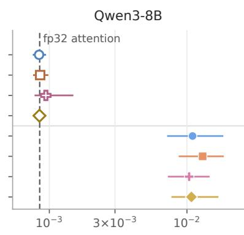

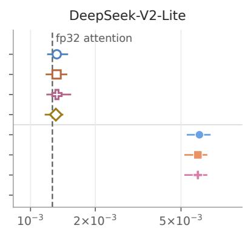  
Fig. 18: KL divergence of each next-token distribution from that of the same model with attention computed in fp64, when every attention call uses the kernel under test, averaged over the tokens of eight WikiText-2 sequences of 4K tokens (lower is closer to fp64). Each marker is the mean over the sequences, and its bar spans the lowest to the highest sequence. The dashed line is attention computed in fp32. Filled markers are FP8 kernels, and open markers are BF16 kernels. Triton has no FP8 kernel at the head dimensions of DeepSeek-V2-Lite.

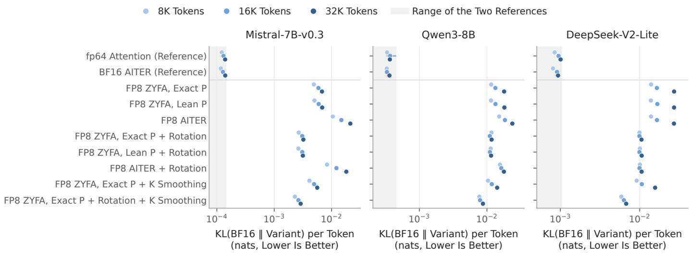  
Fig. 19: KL divergence per token from the model with ZYFA’s BF16 attention, KL(BF16 ∥ variant), when every attention call of the model uses one FP8 kernel variant, at 8K, 16K, and 32K tokens on 42 PG-19 documents per model. Lower means closer to the BF16 model. The first two rows are references, attention in fp64 and AITER’s BF16 kernel, which show how far two correct kernels differ through rounding alone, and the gray band covers their range.

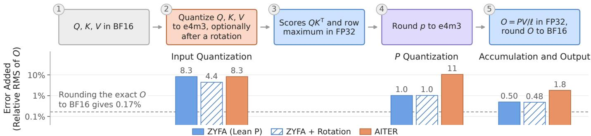  
Fig. 20: Quantizing the inputs Q, K, and V to FP8 adds most of the error of ZYFA’s FP8 attention, and rounding the probabilities p adds much less. The top row shows the stages of one FP8 attention call. Each bar below is the error that a stage adds on Mistral-7B (12 PG-19 documents, log scale), as the RMS of the change that the stage makes to the attention output O, divided by the RMS of fp64 attention on the BF16 inputs, in percent, pooled over all layers, heads, and rows. A relative RMS error of $r \%$ is a signal-to-noise ratio (SNR) of $- 2 0 \log _ { 1 0 } ( r / 1 0 0 )$ dB, and the stages of ZYFA add in quadrature to its total error. Bars show ZYFA with lean P, ZYFA with a Hadamard rotation of Q and K, and AITER’s FP8 kernel. The dashed line is the error of rounding the exact output O to BF16. The error of the running maximum and of the FP32 sums is counted in the last stage.

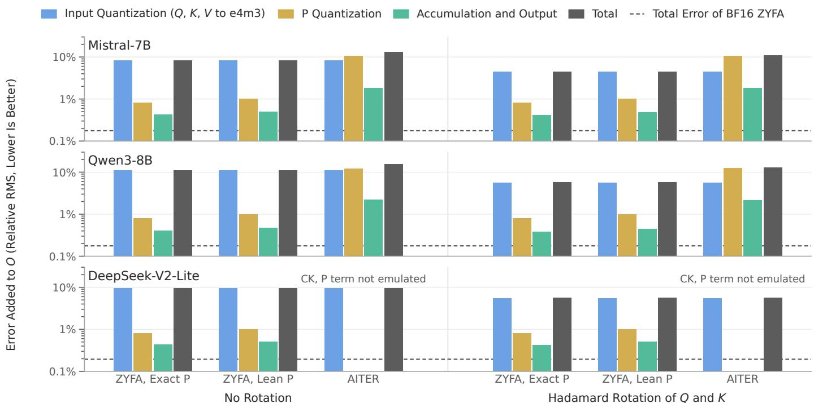  
Fig. 21: Error that each stage of one FP8 attention call adds to the attention output, as relative RMS error against fp64 attention, on all three models, without and with a Hadamard rotation of Q and K. The stages are quantizing Q, K, and V (input), quantizing the probabilities (P), and the rest of the kernel’s arithmetic (Section V-E). The dashed line is the total error of ZYFA’s BF16 kernel. At dqk=192 AITER runs Composable Kernel (CK), whose P arithmetic is not emulated, so only its input term and total are shown.

Rotation and K smoothing: A Hadamard rotation of Q and K over the head dimension before quantization [Shah et al., 2024, Ashkboos et al., 2024] leaves $Q K ^ { \top }$ unchanged. The rounding error of a score $q k ^ { \top }$ grows with $\textstyle \sum _ { i } q _ { i } ^ { 2 } k _ { i } ^ { 2 }$ , which is large when a few channels of q and k are large together, and the rotation lowers this sum by spreading each channel over all channels.25 On Mistral-7B the rotation halves the input error and lowers the KL divergence from 45.7 to 21.9 times the upper end of the BF16 noise band. Subtracting the mean key over the sequence before the rotation (K smoothing [Zhang et al., 2025c]) lowers the KL divergence further on all three models. On Qwen3-8B rotation alone raises the NLL significantly, and with K smoothing the increase is no longer significant (Table XIII). The rotation adds little time. It needs 2D FLOPs per element of Q and K, while causal attention needs about 2S FLOPs per element of Q, so the rotation adds at most 2D/S to the FLOPs. On its own, the rotation takes the time of an extra pass over Q and K, and inside the fused quantization pass it adds almost no time (Table XIII). The fused pass uses a static scale, which lets it quantize Q without first computing its maximum. Static scales from the calibration documents give the same KL divergence as per-call scales. For all-FP8 on Mistral-7B the paired difference in KL divergence between static and per-call scales is $- 2 . 2 0 { \times } 1 0 ^ { - 6 }$ per token, with a 95% interval from $- 2 . 2 0 { \times } 1 0 ^ { - 5 } \ { \mathrm { t o } } + 1 . 6 8 { \times } 1 0 ^ { - 5 }$

Choosing heads for BF16: A mixed-precision policy (a fixed assignment of each head or layer to BF16 or FP8) keeps some heads in BF16, and it should keep those whose FP8 error changes the output of the model most. The local error of a head measures how much FP8 changes its attention output, but its effect on the model output also depends on the later layers. We compare rankings by the KL divergence that remains when the top 10% of heads by a score run in BF16, divided by the KL divergence of all-FP8 attention, on 12 evaluation documents per model (Table XIV). The worst 10% of heads by local error carry 45% of the squared output error on Mistral-7B, yet running them, or the worst 10% of 128-row blocks, in BF16 leaves 0.89–0.94 of the all-FP8 KL divergence on the three models. Local error is largest in the last quarter of layers, while the gradient-weighted score below is largest in the first quarter, whose errors pass through every later layer.

We therefore rank heads by a gradient-weighted score, ge2, named for the product $g ^ { 2 } e ^ { 2 }$ that it sums. A change e in the output of a head changes the loss by about g · e, where g is the gradient of the loss with respect to that output. On 8 calibration documents, half at 8K and half at 16K tokens, one forward and backward pass of the BF16 model gives the difference e between the FP8 and BF16 outputs of each head and the gradient g of the summed next-token NLL, taken at the attention output before the output projection. The FP8 outputs come from an exact-P build of the FP8 kernel on the BF16 inputs of each layer. The score of a head is the sum of $g ^ { 2 } e ^ { 2 }$ over documents, rows, and channels.26 This score is the diagonal Fisher approximation used to assign bit widths in mixed-precision quantization [Kim et al., 2024, Dong et al., 2019]. Running the top 10% of heads by ge2 in BF16 leaves 0.43, 0.57, and 0.34 of the all-FP8 KL divergence on the three models. Policies with rotation use the same ranking and rotate the heads that remain in FP8.

The layer KL score ranks whole layers instead, by how much FP8 attention in one layer alone changes the output of the model. The score of layer L compares the BF16 model with the model that runs ZYFA’s FP8 attention in every head of layer L and BF16 attention in all other layers. The score is the mean over positions of the KL divergence between the next-token distributions of the two models, summed over 4 calibration documents at 8K tokens. The policy keeps the layers with the largest score in BF16, as whole layers and part of one layer at the boundary. As for ge2, the FP8 kernel in this calibration is the exact-P build, and the evaluated policies use lean P. Each policy ranks heads or layers by one score alone.

Scores computed at inference time: A score that needs no gradient could choose heads during inference. Four such dynamic scores ran end to end: a 3σ estimate of the output error from rounding Q, K, and V to e4m3, the attention-weighted mean absolute logit error from rounding Q, the largest absolute logit error from rounding Q over the keys of a row, and the spread of the logits. With the top 10% of heads or 128-row blocks by one of these scores in BF16, these scores leave 0.61–0.98 of the all-FP8 KL divergence. The row maximum of p was computed for Figure 22, but no policy ranked by it ran end to end. Figure 22 ranks heads and 128-row blocks by each dynamic score and by three static scores, which are computed in advance (the error energy on the calibration documents, ge2, and the layer KL), and gives the share of the true FP8 error energy in the top x%. The dynamic scores track the local error rather than the effect of the error on the model output. Table XIV gives the KL divergence that remains when each score chooses the units that run in BF16.

Concentration of the error: The last quarter of the layers holds the largest share of the local FP8 error, 52, 85, and 43% on Mistral-7B, Qwen3-8B, and DeepSeek-V2-Lite. The first quarter holds the largest share of the ge2 score, 56, 42, and 56%. The heads with the largest ge2 score carry small shares of the local error, so a ranking by local error selects different heads. Figure 23 gives the share of the FP8 error energy in the worst layers, heads, and 128-row blocks. Tables XV to XVII list the heads with the largest ge2 score on each model with their attention statistics.

Time and accuracy of mixed-precision policies: Figure 24 places each policy by its attention time and its KL divergence. Attention time includes one fused pass that quantizes Q, while K and V are quantized as they are written to the cache (Section V-E). With this pass, rotation takes 1.001 times the all-FP8 time on Mistral-7B, and all-BF16 attention takes 1.981

<table><tr><td></td><td colspan="2">error of one call</td><td colspan="2"></td><td colspan="2">time / all-FP8</td><td>transform</td></tr><tr><td>transform</td><td>input</td><td>total</td><td>KL</td><td>dNLL [95% interval]</td><td>fused</td><td>separate</td><td>ms at 16K</td></tr><tr><td>Mistral-7B</td><td></td><td></td><td></td><td></td><td></td><td></td><td></td></tr><tr><td>none</td><td>8.27e-02</td><td>8.32e-02</td><td>6.05e-03</td><td>+5.4e-03 [+5.0e-03, +5.8e-03]</td><td>1.000</td><td>1.000</td><td></td></tr><tr><td>rotation</td><td>4.41e-02</td><td>4.52e-02</td><td>2.90e-03</td><td>+2.6e-03 [+2.4e-03, +2.9e-03]</td><td>1.001</td><td>1.089</td><td>2.51</td></tr><tr><td>rotation, K smoothing</td><td>4.55e-02</td><td>4.65e-02</td><td>2.62e-03</td><td>+2.2e-03 [+2.0e-03, +2.5e-03]</td><td>1.006</td><td>1.165</td><td>3.97</td></tr><tr><td>Qwen3-8B</td><td></td><td></td><td></td><td></td><td></td><td></td><td></td></tr><tr><td>none</td><td>1.09e-01</td><td>1.09e-01</td><td>1.53e-02</td><td>+3.9e-03 [+3.2e-03, +4.6e-03]</td><td>1.000</td><td>1.000</td><td></td></tr><tr><td>rotation</td><td>5.64e-02</td><td>5.72e-02</td><td>1.12e-02</td><td>+6.0e-03 [+5.1e-03, +7.0e-03]</td><td>1.001</td><td>1.086</td><td>2.79</td></tr><tr><td>rotation, K smoothing</td><td>5.32e-02</td><td>5.41e-02</td><td>8.29e-03</td><td>+4.3e-03 [+3.5e-03, +5.1e-03]</td><td>1.005</td><td>1.158</td><td>4.44</td></tr><tr><td>DeepSeek-V2-Lite</td><td></td><td></td><td></td><td></td><td></td><td></td><td></td></tr><tr><td>none</td><td>9.49e-02</td><td>9.53e-02</td><td>2.17e-02</td><td>+1.7e-02 [+1.5e-02, +1.9e-02]</td><td>1.000</td><td>1.000</td><td></td></tr><tr><td>rotation</td><td>5.58e-02</td><td>5.64e-02</td><td>9.98e-03</td><td>+7.2e-03 [+6.6e-03, +7.7e-03]</td><td>1.034</td><td>1.176</td><td>2.74</td></tr><tr><td>rotation, K smoothing</td><td>5.30e-02</td><td>5.36e-02</td><td>6.27e-03</td><td>+3.8e-03 [+3.5e-03, +4.1e-03]</td><td>1.039</td><td>1.370</td><td>5.23</td></tr></table>

TABLE XIII: Effect of rotating Q and K with a Hadamard matrix (rotation) and of subtracting the mean key of each head (K smoothing) before FP8 quantization, for all-FP8 ZYFA attention. The error of one call is the relative RMS error of the attention output O against fp64 attention, from quantizing the inputs alone (input) and in total. KL is the per-token KL divergence from the model with BF16 attention, and dNLL the change in negative log-likelihood per token, both on the 48 PG-19 evaluation documents. Times are relative to all-FP8 attention without transforms. The fused column includes one quantization pass that also applies the transforms. The separate column runs the transforms as PyTorch operations and includes no quantization. The last column is the time of the separate transforms per forward pass at 16K.

<table><tr><td colspan="2"></td><td colspan="3">Mistral-7B</td><td colspan="3">Qwen3-8B</td><td colspan="3">DeepSeek-V2-Lite</td></tr><tr><td>score</td><td>unit</td><td>5%</td><td>10%</td><td>20%</td><td>5%</td><td>10%</td><td>20%</td><td>5%</td><td>10%</td><td>20%</td></tr><tr><td>local-error oracle</td><td>heads</td><td>0.94</td><td>0.91</td><td>0.83</td><td>0.94</td><td>0.91</td><td>0.83</td><td>0.98</td><td>0.94</td><td>0.87</td></tr><tr><td>local-error oracle</td><td>row blocks</td><td>0.93</td><td>0.89</td><td>0.82</td><td>0.93</td><td>0.90</td><td>0.81</td><td>0.95</td><td>0.91</td><td>0.84</td></tr><tr><td>ge2</td><td>heads</td><td>0.52</td><td>0.43</td><td>0.31</td><td>0.66</td><td>0.57</td><td>0.43</td><td>0.41</td><td>0.34</td><td>0.25</td></tr><tr><td>layer KL</td><td>layers</td><td>0.67</td><td>0.61</td><td>0.45</td><td>0.74</td><td>0.66</td><td>0.54</td><td>0.85</td><td>0.64</td><td>0.33</td></tr><tr><td>logit spread</td><td>heads</td><td>0.95</td><td>0.92</td><td>0.98</td><td>0.87</td><td>0.79</td><td>0.66</td><td>0.86</td><td>0.70</td><td>0.58</td></tr><tr><td>logit spread</td><td>row blocks</td><td>0.97</td><td>0.98</td><td>0.89</td><td>0.86</td><td>0.76</td><td>0.67</td><td>0.84</td><td>0.71</td><td>0.50</td></tr><tr><td>3σ error estimate</td><td>heads</td><td>0.94</td><td>0.90</td><td>0.83</td><td>0.94</td><td>0.91</td><td>0.84</td><td>0.97</td><td>0.94</td><td>0.85</td></tr><tr><td>3σ error estimate</td><td>row blocks</td><td>0.94</td><td>0.89</td><td>0.82</td><td>0.94</td><td>0.90</td><td>0.82</td><td>0.95</td><td>0.90</td><td>0.83</td></tr><tr><td>weighted logit error of Q</td><td>heads</td><td>0.95</td><td>0.91</td><td>0.84</td><td>0.94</td><td>0.86</td><td>0.70</td><td>0.73</td><td>0.64</td><td>0.28</td></tr><tr><td>weighted logit error of Q</td><td>row blocks</td><td>0.94</td><td>0.90</td><td>0.83</td><td>0.91</td><td>0.81</td><td>0.67</td><td>0.74</td><td>0.61</td><td>0.39</td></tr><tr><td>maximum logit error of Q</td><td>heads</td><td>0.93</td><td>0.89</td><td>0.81</td><td>0.87</td><td>0.78</td><td>0.64</td><td>0.85</td><td>0.76</td><td>0.54</td></tr><tr><td>maximum logit error of Q</td><td>row blocks</td><td>0.93</td><td>0.89</td><td>0.85</td><td>0.84</td><td>0.75</td><td>0.62</td><td>0.83</td><td>0.70</td><td>0.52</td></tr></table>

TABLE XIV: How well each score chooses the units (heads, 128-row blocks, or layers) that run in BF16. Each value is the KL divergence from the BF16 model that remains when the top 5, 10, or 20% of units by the score run in BF16, divided by the KL divergence of all-FP8 attention (lower is better), on 12 evaluation documents per model with the exact-P build of ZYFA’s FP8 kernel. The local-error oracle ranks units by the true FP8 error of their own attention output. ge2 ranks heads by their gradient-weighted error $g ^ { 2 } e ^ { 2 }$ , and layer KL ranks layers by how much FP8 attention in that layer alone changes the output of the model. Both use calibration documents (Section VI-C), and the scores below the rule are computed at inference time. A row block has 128 query rows, and its BF16 share of the causal work differs slightly from the nominal share. On the 48 documents of Figure 24 with lean P, ge2 and layer KL give values within 0.02 of these.

Static Scores, Computed in Advance on Calibration Documents (Dashed)

Error on Calibration Documents ge2 (Gradient-Weighted Error) Layer KL

Dynamic Scores, Computed at Inference Time (Solid)

Quantization Error Bound Logit Error from Rounding Q Logit Spread Row Maximum of p

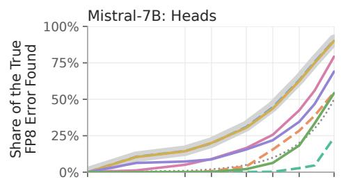

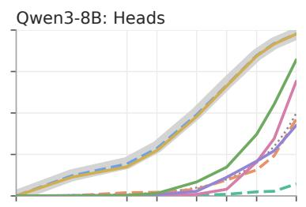

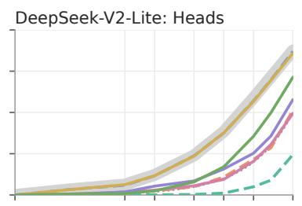

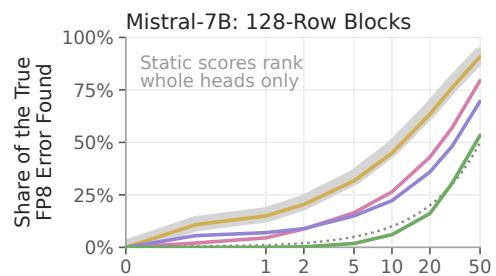  
Top x% of Units, Ranked by Score

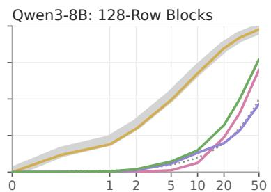  
Top x% of Units, Ranked by Score

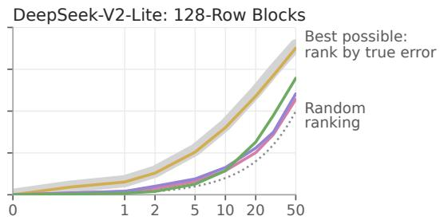  
Top x% of Units, Ranked by Score  
Fig. 22: Scores that measure the local FP8 error (the error of each unit’s own attention output), such as the error on calibration documents and the quantization error bound, find almost as much of it as ranking by the true error (gray band). ge2 (the gradient-weighted error of a head) and layer KL (how much FP8 attention in one layer alone changes the model output) find little of it, because they rank units by their effect on the model output, which works better end to end (Table XIV). Each line gives the share of the true FP8 error energy in the heads (top) or 128-row blocks (bottom) that a score ranks highest. Static scores are computed in advance on calibration documents and dynamic scores at inference time, and the dotted line ranks the heads or row blocks in random order.

Layers Heads 128-Row Blocks Error Spread Evenly  
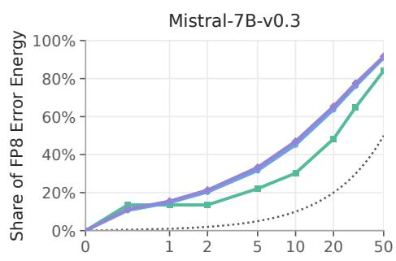  
Worst x% of Units (by FP8 Error)

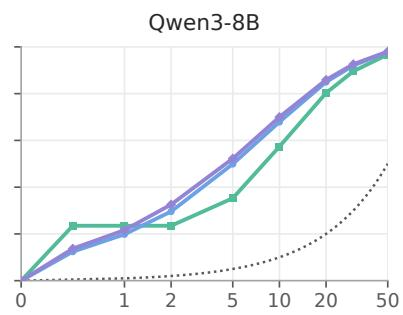  
Worst x% of Units (by FP8 Error)

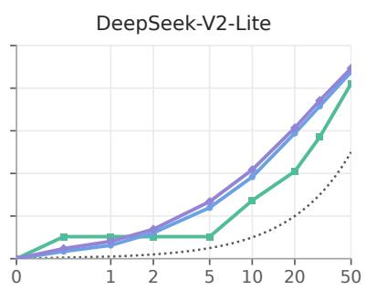  
Worst x% of Units (by FP8 Error)  
Fig. 23: Share of the FP8 error energy of the attention outputs that falls in the worst x% of layers, heads, and 128-row blocks, ranked by their own FP8 error, for the median document. The dotted curve is the share if the error were spread evenly, x% of the error energy in x% of the units. The horizontal axis is linear below 1% and logarithmic above.

<table><tr><td></td><td></td><td colspan="2">share of</td><td colspan="2">attention weight on</td><td colspan="2">mean</td><td colspan="2">top-channel share</td><td></td></tr><tr><td>rank</td><td>layer.head</td><td>ge2</td><td>local error</td><td>key 0</td><td>last 64</td><td>distance</td><td>entropy</td><td>Q</td><td>K</td><td>type</td></tr><tr><td>1</td><td>4.9</td><td>6.6%</td><td>0.01%</td><td>0.49</td><td>0.25</td><td>3108</td><td>1.87</td><td>0.12</td><td>0.18</td><td>long-range</td></tr><tr><td>2</td><td>4.8</td><td>6.2%</td><td>0.01%</td><td>0.51</td><td>0.24</td><td>3159</td><td>1.87</td><td>0.14</td><td>0.18</td><td>sink</td></tr><tr><td>3</td><td>4.11</td><td>2.3%</td><td>0.01%</td><td>0.55</td><td>0.20</td><td>3322</td><td>1.65</td><td>0.12</td><td>0.18</td><td>sink</td></tr><tr><td>4</td><td>5.11</td><td>2.0%</td><td>0.02%</td><td>0.23</td><td>0.06</td><td>2547</td><td>4.85</td><td>0.14</td><td>0.15</td><td>long-range</td></tr><tr><td>5</td><td>2.21</td><td>1.6%</td><td>0.00%</td><td>0.49</td><td>0.03</td><td>3138</td><td>2.41</td><td>0.11</td><td>0.09</td><td>long-range</td></tr><tr><td>6</td><td>4.23</td><td>1.5%</td><td>0.00%</td><td>0.74</td><td>0.04</td><td>3908</td><td>1.18</td><td>0.28</td><td>0.31</td><td>sink, outlier</td></tr><tr><td>7</td><td>1.7</td><td>1.2%</td><td>0.00%</td><td>0.48</td><td>0.49</td><td>2050</td><td>2.26</td><td>0.11</td><td>0.11</td><td>long-range</td></tr><tr><td>8</td><td>3.22</td><td>1.1%</td><td>0.02%</td><td>0.43</td><td>0.30</td><td>2852</td><td>2.04</td><td>0.18</td><td>0.26</td><td>long-range, outlier</td></tr><tr><td>9</td><td>2.22</td><td>1.0%</td><td>0.00%</td><td>0.58</td><td>0.11</td><td>3515</td><td>1.65</td><td>0.09</td><td>0.09</td><td>sink</td></tr><tr><td>10</td><td>3.20</td><td>1.0%</td><td>0.01%</td><td>0.39</td><td>0.36</td><td>2534</td><td>2.68</td><td>0.19</td><td>0.26</td><td>long-range, outlier</td></tr><tr><td>11</td><td>0.31</td><td>0.9%</td><td>0.00%</td><td>0.03</td><td>0.91</td><td>207</td><td>2.37</td><td>0.08</td><td>0.09</td><td>local</td></tr><tr><td>12</td><td>1.0</td><td>0.9%</td><td>0.00%</td><td>0.54</td><td>0.41</td><td>2308</td><td>1.49</td><td>0.07</td><td>0.07</td><td>sink</td></tr><tr><td>13</td><td>0.29</td><td>0.9%</td><td>0.00%</td><td>0.13</td><td>0.65</td><td>724</td><td>2.78</td><td>0.14</td><td>0.09</td><td>local</td></tr><tr><td>14</td><td>4.10</td><td>0.8%</td><td>0.01%</td><td>0.49</td><td>0.25</td><td>3075</td><td>2.01</td><td>0.14</td><td>0.18</td><td>long-range</td></tr><tr><td>15</td><td>5.10</td><td>0.7%</td><td>0.01%</td><td>0.33</td><td>0.03</td><td>3033</td><td>3.95</td><td>0.22</td><td>0.15</td><td>long-range, outlier</td></tr><tr><td>16</td><td>18.9</td><td>0.6%</td><td>0.51%</td><td>0.26</td><td>0.55</td><td>1706</td><td>1.85</td><td>0.28</td><td>0.22</td><td>local, outlier</td></tr></table>

TABLE XV: Heads of Mistral-7B with the largest ge2 score, the gradient-weighted FP8 error $g ^ { 2 } e ^ { 2 }$ of a head (Section VI-C), on the calibration documents. The share columns give the head’s share of the ge2 score and of the local FP8 error. The attention-weight columns give the mean weight on key 0 and on the last 64 keys over the query rows from 256 on, on two calibration documents. Qwen3-8B’s documents have no BOS token, so its key 0 is the first text token. The mean distance between query and key is weighted by attention and given in tokens, and the entropy of the attention row is given in nats. The top-channel share is the share of the energy of post-RoPE Q and K in their largest channel, pooled over the tokens of a document and averaged over eight calibration documents. A head is a sink head with weight on key 0 of at least 0.5, loca with weight on the last 64 keys of at least 0.5, long-range with neither and a mean distance of at least 1024, and an outlier head with a top-channel share of at least 0.2.

<table><tr><td></td><td></td><td colspan="2">share of</td><td colspan="2">attention weight on</td><td colspan="2">mean</td><td colspan="2">top-channel share</td><td></td></tr><tr><td>rank</td><td>layer.head</td><td>ge2</td><td>local error</td><td>key 0</td><td>last 64</td><td>distance</td><td>entropy</td><td>Q</td><td>K</td><td>type</td></tr><tr><td>1</td><td>0.6</td><td>3.3%</td><td>0.00%</td><td>0.00</td><td>0.88</td><td>122</td><td>3.26</td><td>0.08</td><td>0.97</td><td>local, outlier</td></tr><tr><td>2</td><td>0.11</td><td>2.5%</td><td>0.00%</td><td>0.00</td><td>0.87</td><td>138</td><td>3.14</td><td>0.07</td><td>0.97</td><td>local, outlier</td></tr><tr><td>3</td><td>7.7</td><td>2.0%</td><td>0.01%</td><td>0.69</td><td>0.02</td><td>3396</td><td>1.17</td><td>0.28</td><td>0.27</td><td>sink, outlier</td></tr><tr><td>4</td><td>10.2</td><td>1.9%</td><td>0.07%</td><td>0.36</td><td>0.56</td><td>1570</td><td>1.93</td><td>0.31</td><td>0.66</td><td>local, outlier</td></tr><tr><td>5</td><td>7.5</td><td>1.7%</td><td>0.01%</td><td>0.76</td><td>0.08</td><td>3281</td><td>0.92</td><td>0.24</td><td>0.27</td><td>sink, outlier</td></tr><tr><td>6</td><td>10.1</td><td>1.6%</td><td>0.05%</td><td>0.41</td><td>0.49</td><td>1808</td><td>2.41</td><td>0.30</td><td>0.66</td><td>long-range, outlier</td></tr><tr><td>7</td><td>0.23</td><td>1.5%</td><td>0.00%</td><td>0.00</td><td>0.67</td><td>299</td><td>3.87</td><td>0.07</td><td>0.96</td><td>local, outlier</td></tr><tr><td>8</td><td>3.7</td><td>1.2%</td><td>0.00%</td><td>0.02</td><td>0.21</td><td>2055</td><td>3.17</td><td>0.19</td><td>0.21</td><td>long-range, outlier</td></tr><tr><td>9</td><td>34.20</td><td>1.1%</td><td>1.71%</td><td>0.80</td><td>0.07</td><td>3652</td><td>0.69</td><td>0.27</td><td>0.36</td><td>sink, outlier</td></tr><tr><td>10</td><td>14.3</td><td>1.0%</td><td>0.06%</td><td>0.32</td><td>0.63</td><td>1378</td><td>1.83</td><td>0.12</td><td>0.43</td><td>local, outlier</td></tr><tr><td>11</td><td>5.10</td><td>1.0%</td><td>0.00%</td><td>0.00</td><td>0.68</td><td>830</td><td>3.31</td><td>0.27</td><td>0.15</td><td>local, outlier</td></tr><tr><td>12</td><td>11.19</td><td>1.0%</td><td>0.03%</td><td>0.32</td><td>0.62</td><td>1431</td><td>1.94</td><td>0.35</td><td>0.39</td><td>local, outlier</td></tr><tr><td>13</td><td>2.31</td><td>0.8%</td><td>0.00%</td><td>0.01</td><td>0.09</td><td>1675</td><td>4.06</td><td>0.17</td><td>0.20</td><td>long-range, outlier</td></tr><tr><td>14</td><td>10.3</td><td>0.8%</td><td>0.05%</td><td>0.59</td><td>0.37</td><td>2549</td><td>1.80</td><td>0.31</td><td>0.66</td><td>sink, outlier</td></tr><tr><td>15</td><td>10.13</td><td>0.8%</td><td>0.02%</td><td>0.39</td><td>0.55</td><td>1673</td><td>2.90</td><td>0.36</td><td>0.67</td><td>local, outlier</td></tr><tr><td>16</td><td>11.10</td><td>0.8%</td><td>0.03%</td><td>0.59</td><td>0.07</td><td>2626</td><td>1.78</td><td>0.28</td><td>0.34</td><td>sink, outlier</td></tr><tr><td colspan="2"></td><td colspan="2">share of</td><td colspan="2">attention weight on</td><td colspan="2">mean</td><td colspan="2">top-channel share</td><td rowspan="2"></td></tr><tr><td>rank</td><td>layer.head</td><td>ge2</td><td>local error</td><td>key 0</td><td>last 64</td><td>distance</td><td>entropy</td><td>Q</td><td>K type</td></tr><tr><td>1</td><td>0.9</td><td>5.4%</td><td>0.04%</td><td>0.00</td><td>0.95</td><td>114</td><td>0.89</td><td>0.34</td><td>0.55</td><td>local, outlier</td></tr><tr><td>2</td><td>2.9</td><td>5.1%</td><td>0.05%</td><td>0.00</td><td>0.96</td><td>93</td><td>2.96</td><td>0.21</td><td>0.65</td><td>local, outlier</td></tr><tr><td>3</td><td>1.8</td><td>5.0%</td><td>0.01%</td><td>0.00</td><td>0.94</td><td>65</td><td>3.23</td><td>0.24</td><td>0.67</td><td>local, outlier</td></tr><tr><td>4</td><td>4.7</td><td>3.6%</td><td>0.14%</td><td>0.41</td><td>0.56</td><td>1746</td><td>2.11</td><td>0.35</td><td>0.57</td><td>local, outlier</td></tr><tr><td>5</td><td>5.2</td><td>2.7%</td><td>0.61%</td><td>0.17</td><td>0.74</td><td>1073</td><td>1.16</td><td>0.30</td><td>0.68</td><td>local, outlier</td></tr><tr><td>6</td><td>0.8</td><td>2.4%</td><td>0.02%</td><td>0.00</td><td>0.94</td><td>174</td><td>2.39</td><td>0.31</td><td>0.55</td><td>local, outlier</td></tr><tr><td>7</td><td>5.3</td><td>1.3%</td><td>0.34%</td><td>0.28</td><td>0.57</td><td>1752</td><td>2.09</td><td>0.33</td><td>0.67</td><td>local, outlier</td></tr><tr><td>8</td><td>0.6</td><td>1.3%</td><td>0.01%</td><td>0.00</td><td>0.87</td><td>352</td><td>2.78</td><td>0.28</td><td>0.55</td><td>local, outlier</td></tr><tr><td>9</td><td>11.14</td><td>1.3%</td><td>1.42%</td><td>0.15</td><td>0.73</td><td>1055</td><td>1.61</td><td>0.33</td><td>0.43</td><td>local, outlier</td></tr><tr><td>10</td><td>1.13</td><td>1.2%</td><td>0.03%</td><td>0.00</td><td>0.93</td><td>98</td><td>2.21</td><td>0.18</td><td>0.66</td><td>local, outlier</td></tr><tr><td>11</td><td>8.13</td><td>1.2%</td><td>0.60%</td><td>0.17</td><td>0.72</td><td>1135</td><td>1.63</td><td>0.31</td><td>0.67</td><td>local, outlier</td></tr><tr><td>12</td><td>4.10</td><td>1.2%</td><td>0.07%</td><td>0.31</td><td>0.47</td><td>1402</td><td>3.51</td><td>0.38</td><td>0.57</td><td>long-range, outlier</td></tr><tr><td>13</td><td>5.13</td><td>1.1%</td><td>0.31%</td><td>0.40</td><td>0.48</td><td>2106</td><td>1.58</td><td>0.30</td><td>0.67</td><td>long-range, outlier</td></tr><tr><td>14</td><td>5.14</td><td>1.0%</td><td>0.13%</td><td>0.35</td><td>0.48</td><td>2043</td><td>2.48</td><td>0.27</td><td>0.68</td><td>long-range, outlier</td></tr><tr><td>15</td><td>4.5</td><td>1.0%</td><td>0.18%</td><td>0.39</td><td>0.57</td><td>1709</td><td>1.52</td><td>0.26</td><td>0.57</td><td>local, outlier</td></tr><tr><td>16</td><td>2.4</td><td>0.8%</td><td>0.02%</td><td>0.01</td><td>0.92</td><td>194</td><td>1.28</td><td>0.08</td><td>0.65</td><td>local, outlier</td></tr></table>

TABLE XVI: Heads of Qwen3-8B with the largest ge2 score (gradient-weighted FP8 error), with the columns of Table XV.

TABLE XVII: Heads of DeepSeek-V2-Lite with the largest ge2 score (gradient-weighted FP8 error), with the columns of Table XV.

times. A subset of heads in BF16 costs more than its share of the work. A layer with heads in both precisions needs two kernel launches, and the BF16 launch covers few heads and leaves most of the 256 CUs idle (Figure 25). With 5% of Mistral-7B’s heads in BF16, attention takes 1.204× the all-FP8 time, against 1.049× if each head cost its share of the work. These times exclude the copies that gather the heads of each precision and scatter their outputs back into O, which add 0.5–22.3% to the attention time of a mixed policy at 16K, the most for policies with many mixed layers (Table XVIII). The times of mixed policies are therefore lower bounds.

Keeping the most sensitive heads in BF16 is not a useful middle ground on Mistral-7B and Qwen3-8B. No policy short of all-BF16 reaches the BF16 noise band there, with or without rotation. With 90% of heads in BF16 the KL divergence is 1.3 and 1.4 times the upper end of the BF16 noise band without rotation and 1.1 and 1.1 times with it, and the rotated policies take 2.019× and 1.996× the all-FP8 time, more than all-BF16 attention (1.981× and 1.990×). The heads with the largest ge2 score remove a large part of the KL divergence (Table XIV), but the rest is spread over most of the other heads and still lies above the BF16 noise band, so even if each head cost only its share of the work, 90% of the heads in BF16 would take 1.883× and 1.891× the all-FP8 time, close to all-BF16 attention. On DeepSeek-V2-Lite mixed policies do reach the BF16 noise band. Without rotation, 90% of heads in BF16 reaches it at 1.787× the all-FP8 time, more than all-BF16 at 1.712× because of its second launch. With rotation, keeping the 70% of layers with the largest layer KL in BF16 reaches it at 1.519×, but its dNLL interval excludes zero, so it matches BF16 on KL divergence only. Rotation is also a better use of time than BF16 heads. Without rotation, every policy with BF16 heads or layers takes longer than rotation on Mistral-7B and Qwen3-8B, and on DeepSeek-V2-Lite the most accurate such policy that takes no longer than rotation has 2.06 times the KL divergence of rotation.

NLL: Figure 26 repeats Figure 24 with dNLL, the change in negative log-likelihood per token against the BF16 model, on the vertical axis. The dNLL test for matching BF16 is two-sided, so a variant whose NLL is significantly lower than that of BF16 also fails it. Exact fp64 attention fails it on dNLL for Mistral-7B, where it lowers the NLL by $- 4 . 3 \times 1 0 ^ { - 5 }$ nats per token.

Error checks at run time: Instead of choosing heads in advance, a kernel can detect large errors while it runs. Figure 27 models a kernel that computes an error bound for each block in the FP8 pass and recomputes the flagged blocks in BF16. Once the error bound costs 10% of the FP8 time or more, every point of the modeled two-stage scheme lies above the curves of the static policies, which keep fixed heads or layers in BF16, so in this model the two-stage scheme is less accurate than a static policy that takes the same time. Only a bound that costs nothing comes out ahead, and only when it recomputes few blocks.

Retrieval test: A retrieval test plants a 5-digit passcode at 10 to 90% depth in the second half of a test book and uses a cluster-robust t interval over books. Its intervals overlap for all policies, so we do not use it to select policies.

## VII. RELATED WORK

FlashAttention [Dao et al., 2022] computes attention block by block with a running softmax, so the score matrix never leaves on-chip memory, and FlashAttention-2 [Dao, 2024] assigns tiles of query rows to groups of threads to parallelize over the sequence. FlashAttention-3 [Shah et al., 2024] uses the asynchronous copies and matrix instructions of Hopper GPUs. It adds FP8 attention with block quantization (one scale factor per block of each tensor) and with a Hadamard transform of Q and K, which it calls incoherent processing. FlashAttention-4 [Zadouri et al., 2026] targets Blackwell GPUs, where matrix throughput grew faster than the throughput of the exponential unit. It computes part of the exponentials with a polynomial on the FMA units. ZYFA’s lean P, which computes each FP8 probability from its score with one multiply-add and an integer conversion, removes the exponential from the FP8 kernel and uses the interpolation of Schraudolph’s fast exponential [Schraudolph, 1999] to write the e4m3 code, the bit pattern of the FP8 value, directly. Softermax [Stevens et al., 2021] and I-BERT [Kim et al., 2021] also compute the exponential of the softmax with fixed-point or integer arithmetic. SageAttention [Zhang et al., 2025c,a] quantizes Q and K to 8 or 4 bits after subtracting the mean of K and computes $P V$ in FP8 or FP16. SageAttention3 [Zhang et al., 2025b] normalizes each row of probabilities and quantizes them to FP4 with a scale per 16 values, the closest prior work to per-block scaling of probabilities. The microscaling formats [Rouhani et al., 2023] share one power-of-two scale among each block of 32 values, and the scaled MFMA (matrix fused multiply-add instruction) of CDNA4 applies such scales in hardware, which ZYFA uses to remove the per-block factor at no cost.

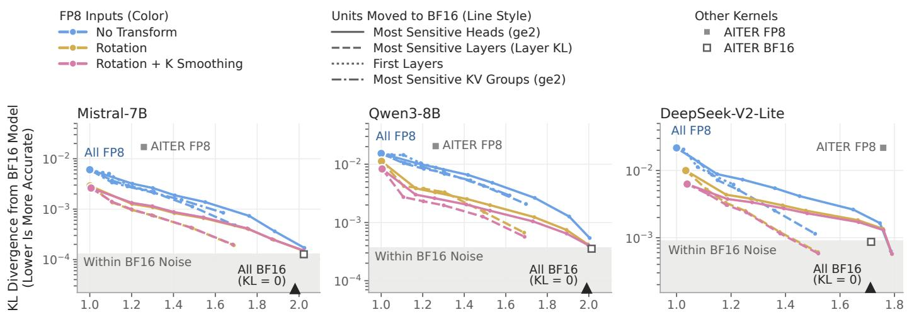  
Attention Time Relative to All-FP8 (Lower Is Faster)  
Fig. 24: Rotating Q and K with a Hadamard matrix before FP8 quantization buys more accuracy per unit of time than running heads or layers in BF16. Each line starts from all-FP8 attention with one input transform (large dot) and moves a growing share of heads or layers to BF16. Time is attention time inside the model relative to all-FP8 ZYFA, including one fused quantization pass. The KL divergence measures how far the next-token distributions move from those of the BF16 model, on 48 PG-19 documents per model. On Mistral-7B and Qwen3-8B, only all-BF16 attention reaches the gray BF16 noise band, where a policy (a choice of the heads or layers that run in BF16) is as close to the BF16 model as a second, equally correct BF16 kerne would be.

<table><tr><td rowspan="2">model</td><td rowspan="2">S</td><td colspan="3">all policies with mixed layers</td><td colspan="4">10% of heads in BF16 by ge2</td></tr><tr><td>policies</td><td>copy ms</td><td>% of attention</td><td>mixed layers</td><td>copy ms</td><td>attention ms</td><td>%</td></tr><tr><td>Mistral-7B</td><td>8K</td><td>28</td><td>0.16–5.38</td><td>1.2–35.2</td><td>23</td><td>3.49</td><td>11.36</td><td>30.8</td></tr><tr><td>Mistral-7B</td><td>16K</td><td>28</td><td>0.31-10.77</td><td>0.7–22.3</td><td>23</td><td>7.15</td><td>35.68</td><td>20.0</td></tr><tr><td>Mistral-7B</td><td>32K</td><td>28</td><td>0.60–21.18</td><td>0.3-12.1</td><td>23</td><td>13.85</td><td>129.21</td><td>10.7</td></tr><tr><td>Qwen3-8B</td><td>8K</td><td>28</td><td>0.15–5.39</td><td>1.0–31.9</td><td>20</td><td>3.04</td><td>12.40</td><td>24.5</td></tr><tr><td>Qwen3-8B</td><td>16K</td><td>28</td><td>0.31-11.01</td><td>0.5–20.5</td><td>20</td><td>6.24</td><td>39.90</td><td>15.6</td></tr><tr><td>Qwen3-8B</td><td>32K</td><td>28</td><td>0.60–21.51</td><td>0.3-11.1</td><td>20</td><td>12.10</td><td>145.76</td><td>8.3</td></tr><tr><td>DeepSeek-V2-Lite</td><td>8K</td><td>20</td><td>0.08–2.53</td><td>1.4–28.4</td><td>12</td><td>1.14</td><td>6.49</td><td>17.5</td></tr><tr><td>DeepSeek-V2-Lite</td><td>16K</td><td>20</td><td>0.18–4.78</td><td>0.8-17.2</td><td>12</td><td>2.25</td><td>20.68</td><td>10.9</td></tr><tr><td>DeepSeek-V2-Lite</td><td>32K</td><td>20</td><td>0.33-9.14</td><td>0.4–9.1</td><td>12</td><td>4.27</td><td>75.72</td><td>5.6</td></tr></table>

TABLE XVIII: Time per forward pass of the copies that gather the heads of each precision into contiguous tensors and scatter their outputs back, in mixed-precision layers (layers with heads in both BF16 and FP8). The left group covers every policy with at least one mixed layer and gives the range over policies. The right group is the policy with the 10% of heads with the largest ge2 score in BF16. The attention times of Section VI-C exclude the copies.

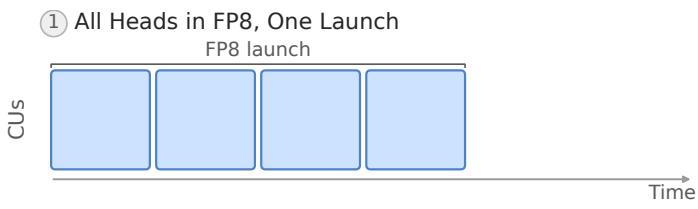

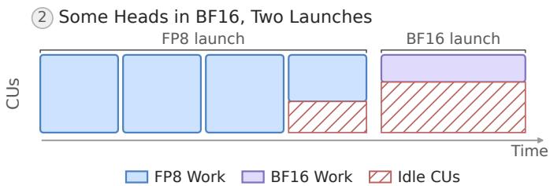  
Fig. 25: Occupancy of the compute units (CUs) of the GPU over time for one attention layer (schematic). (1) With all heads in FP8, one kernel launch runs whole rounds of query-tile pairs, the units of work of the kernel, on every CU. (2) With some heads in BF16, the layer needs two launches. The FP8 launch ends with a partial round, in which only some CUs still have work, and the BF16 launch has too few pairs to occupy all CUs. On Mistral-7B with 5% of heads in BF16, attention takes 1.204 times the all-FP8 time, against 1.049 times by its share of the work. Both times exclude the gather and scatter copies of Table XVIII.

HipKittens [Hu et al., 2025] brings the tile abstractions of ThunderKittens [Spector et al., 2025] to CDNA3 and CDNA4 GPUs and studies two wave schedules for them. The design of ZYFA’s BF16 kernel at head dimension 128 started from the HipKittens attention kernel. Rotations [Ashkboos et al., 2024] and smoothing [Xiao et al., 2023] reduce the quantization error of activations with outliers (Section VI-C). Linear attention [Katharopoulos et al., 2020] and state-space models [Gu and Dao, 2024] replace the softmax with operations whose cost grows linearly with the sequence length, but attention remains a core building block of frontier models.

## VIII. DISCUSSION

Lean P and the number format: Lean P, ZYFA’s computation of each FP8 probability with one multiply-add and an integer conversion instead of an exponential, replaces the evaluation of a function with a property of the number format. A floating-point code already stores the base-2 logarithm of its value in its exponent bits and interpolates linearly between powers of two in its mantissa bits, so the code of $2 ^ { x }$ needs only the linear map of Equation 2 and a rounding to an integer. FlashAttention-4 also avoids the hardware exponential, but it evaluates a polynomial in FP32 and still converts the result to the output format [Zadouri et al., 2026]. Lean P skips both steps, because the output format itself is the approximation. Its error is therefore set by the coarseness of the format. After rounding, lean P is within 7.5% of p, against 5.9% for exact P, which rounds the exact $2 ^ { x }$ to e4m3, and in full models this difference is small next to the error of quantizing Q, K, and V (Section VI-C). The same construction applies to any format whose code grows by a fixed step each time its value doubles, which includes e5m2 and, with coarser steps, FP4, although we have not tested these formats.

Remaining limits of FP8 attention on the MI355X: At 32K tokens on the Gaussian inputs of kernel benchmarks, ZYFA’s FP8 kernel at $d _ { \mathrm { q k } } { = } 1 2 8$ reaches 2672 TFLOP/s, 53% of the datasheet peak and 88% of a synthetic loop with its instruction mix. Three gaps remain, and each points to a different improvement. The first is the clock. Under sustained load, after seconds of back-to-back launches, the kernel runs at about 1628 MHz on captured activations (the q, k, and v of real model layers) at 16K tokens, against the 2.4 GHz that the datasheet peak assumes, and even a loop of FP8 MFMAs alone settles at 2.07 GHz. Most of the distance to the datasheet peak therefore comes from the limit on current that sets the clock (Section VI-A) rather than from the schedule, and kernels that switch fewer bits per FLOP could gain directly. The second is the transitions between query tiles. The matrix pipe is busy for 86% of the cycles in steady state, in the middle of the key loop of one query tile, but for 78% over the whole key loop, so overlapping the end of one tile with the start of the next could recover much of this difference. The third is the work that remains on the MFMA wave, the one of the two waves on a SIMD that issues the matrix instructions in a phase and, with lean P, sets the length of the phase. That wave also computes the row maximum and the rescale, so layers that rescale often take longer (Appendix A), and a schedule that moves this work to the softmax wave, which computes the probabilities, would make the kernel less sensitive to the data.

Comparison with NVIDIA GPUs: We did not measure NVIDIA GPUs, so this comparison uses published numbers, which come from different inputs and clocks. FlashAttention-4 reports up to 1613 TFLOP/s for BF16 attention on the B200,

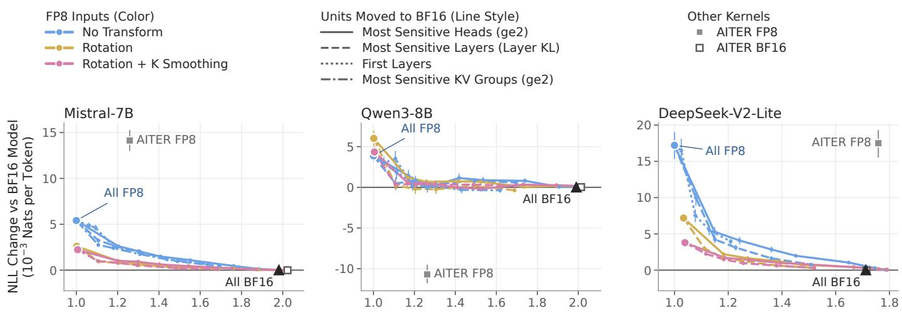  
Attention Time Relative to All-FP8 (Lower Is Faster)  
Fig. 26: On the NLL, most FP8 policies also differ from the BF16 model, and on Qwen3-8B rotation raises the NLL although it lowers the KL divergence. Each point is the change in negative log-likelihood per token against the BF16 model, with its 95% interval over PG-19 books, for the mixed-precision policies of Figure 24 (choices of the heads or layers that run in BF16), against attention time relative to all-FP8 ZYFA. A lower NLL does not mean that a policy is closer to BF16, as AITER’s FP8 kernel on Qwen3-8B shows.

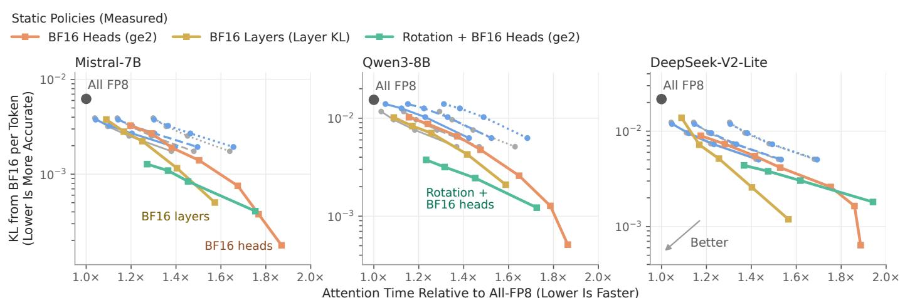  
Fig. 27: Once its error bound has a cost, an in-kernel two-stage scheme is less accurate (it has a higher KL divergence from the BF16 model) than a static policy that takes the same time. The two-stage scheme runs attention in FP8 with an error bound per block and recomputes the flagged blocks in BF16, at a modeled time of $1 + c + r w _ { ; }$ , where c is the cost of the bound, w the share of recomputed blocks, and r the ratio of BF16 to FP8 time. Static policies keep fixed heads or layers in BF16, and their time and KL divergence are measured. The data predate lean P.

71% of its BF16 peak [Zadouri et al., 2026], and FlashAttention-3 reports close to 1.2 PFLOP/s for FP8 attention on the H100 [Shah et al., 2024]. On Gaussian inputs at 32K tokens, ZYFA reaches 1265 TFLOP/s in BF16 (51% of the BF16 peak of the MI355X) and 2672 TFLOP/s in FP8 (53%). Part of the lower share of peak on the MI355X comes from its clock, which falls from the 2.4 GHz of the datasheet peak to 1628 MHz for ZYFA’s FP8 kernel under sustained load. Both vendors face the same imbalance, in which matrix throughput has grown faster than the throughput of the exponential, and FlashAttention-4 and lean P both answer it by avoiding the hardware exponential. They differ in how the softmax overlaps the matrix work. Blackwell GPUs track asynchronous matrix instructions in hardware and keep accumulators in a separate tensor memory, while on the MI355X the instruction schedule alone provides the overlap. A comparison on the same inputs at sustained clocks, where the data-dependent clock of Section III-C would apply on both sides, remains future work.

Recommendations: GPU kernel developers, especially those working on numerically sensitive operations like quantized model blocks, should develop with real model activations and at sustained clocks, the lower steady clock that the GPU reaches after seconds of back-to-back launches, because the clock depends on data distribution and its rate of change. To lower quantization error, target the quantization of the inputs, for example with a Hadamard rotation of Q and K and K smoothing, which cost one extra pass over Q and K. Because V adds the least input error, keeping $Q K ^ { \top }$ in BF16 and running only PV in FP8 would remove most of the input error for three quarters of the matrix cycles of BF16. Reduce the vector work per score before adding matrix throughput. A timing proxy that issues the $Q K ^ { \top }$ MFMAs in FP4 and halves the LDS reads of K raises the throughput by at most 10% at 32K. Keep packed FP32 instructions out of a softmax that runs next to MFMAs. Use head dimensions of at least 128, because the matrix cycles per block grow with $d _ { \mathrm { q k } } { + } d _ { \nu }$ while the softmax cycles do not, so at head dimension 64 even lean P keeps the vector pipe about as busy as the matrix pipe.

Limitations: The kernels compute the causal forward pass for equal query and key lengths that are multiples of the tile size. They cover dense prefill and do not cover decoding, including the form of MLA used in decoding, paged caches, or packed batches of variable length (Table VI). All experiments use one GPU model, one software stack, and one node. The comparisons with AITER describe version 0.1.19, and at $d _ { \mathrm { q k } } { = } 1 9 2$ its FP8 kernel issues older matrix instructions with half the throughput per clock. The end-to-end study uses three models, PG-19, and no downstream tasks, and its attention times come from kernel-only windows inside the model. The instruction costs and the data-dependent clock follow from the MI355X and its platform settings, and the clock may differ with other firmware or power settings. The FP8 kernels propagate a NaN input to more rows than the reference (Section IV-B3), which in packed batches would reach other requests. With few query heads per GPU, as under tensor parallelism, a call at short and medium lengths has too few tile pairs to fill the 256

CUs, a case that our benchmarks with at least 32 heads do not cover. K smoothing with a per-sequence mean cancels in the softmax only if every key of a row uses the same mean, which chunked prefill and prefix caching break unless the mean is fixed in advance. On the MI300X, which uses the FNUZ variant of e4m3 and has no scaled MFMA, lean P needs a different offset and per-block scaling needs extra vector work.27 We did not compare the ping-pong schedule with schedules in which each wave interleaves its own MFMAs and softmax [Hu et al., 2025].

## IX. CONCLUSION

On the MI355X, FP8 attention is limited by the vector work of the softmax and by its clock speed, which depends on the input data. By writing each FP8 probability directly from its score and hiding the softmax behind matrix instructions, ZYFA’s FP8 kernels reach 1.16–1.76× the throughput of the default kernels of AITER, AMD’s library of inference kernels, on activations captured from real models and timed at sustained clocks, after seconds of back-to-back launches. In full models most of the FP8 error comes from quantizing the inputs and is spread over most heads, so keeping the most sensitive heads in BF16 is not a useful middle ground, while a Hadamard rotation of Q and K roughly halves the error from quantizing the inputs at almost no cost.

## ACKNOWLEDGEMENTS

We thank Beren Millidge for detailed feedback on drafts of this paper, and the developers of AITER, Composable Kernel, and HipKittens, whose open-source kernels served as our baselines and as starting points for our BF16 kernels. All experiments ran on an AMD Instinct MI355X node rented from Vultr.

## AUTHOR CONTRIBUTIONS

Quentin Anthony designed and wrote the FP8 kernels, including the assembly generator and its instruction schedule. He carried out the numerical analysis and wrote the paper.

Ganesh Bikshandi carried out the initial exploration and laid the groundwork for the BF16 kernels.

Praneeth Medepalli contributed foundational notes on the numerics of FP8 attention, on which the numerical analysis of this paper builds.

Stephen Ebert contributed foundational notes on the numerics of FP8 attention, on which the numerical analysis of this paper builds.

## REFERENCES

Advanced Micro Devices. AMD Instinct CDNA4 instruction set architecture, August 2025a. URL https://www.amd.com/ content/dam/amd/en/documents/instinct-tech-docs/instruct ion-set-architectures/amd-instinct-cdna4-instruction-set-arc hitecture.pdf.

27The FNUZ variant has an exponent bias of 8 instead of 7, so the same code stands for half the value, and lean P must add 8 to its offset.

Advanced Micro Devices. AMD CDNA 4 architecture, 2025b. URL https://www.amd.com/content/dam/amd/en/documen ts/instinct-tech-docs/white-papers/amd-cdna-4-architectur e-whitepaper.pdf. White paper.

AMD. AITER: AI tensor engine for ROCm. https://github.c om/ROCm/aiter, 2025a.

AMD. Composable kernel. https://github.com/ROCm/compos able kernel, 2025b.

AMD. HIP: C++ heterogeneous-compute interface for portability. https://github.com/ROCm/HIP, 2026.

Saleh Ashkboos, Amirkeivan Mohtashami, Maximilian L. Croci, Bo Li, Pashmina Cameron, Martin Jaggi, Dan Alistarh, Torsten Hoefler, and James Hensman. QuaRot: Outlier-free 4-bit inference in rotated LLMs. In Advances in Neural Information Processing Systems (NeurIPS), 2024.

Tri Dao. FlashAttention-2: Faster attention with better parallelism and work partitioning. In International Conference on Learning Representations (ICLR), 2024.

Tri Dao, Daniel Y. Fu, Stefano Ermon, Atri Rudra, and Christopher Re. FlashAttention: Fast and memory-efficient´ exact attention with IO-awareness. In Advances in Neural Information Processing Systems (NeurIPS), 2022.

DeepSeek-AI. DeepSeek-V2: A strong, economical, and efficient mixture-of-experts language model. arXiv preprint arXiv:2405.04434, 2024a.

DeepSeek-AI. DeepSeek-V3 technical report. arXiv preprint arXiv:2412.19437, 2024b.

Zhen Dong, Zhewei Yao, Amir Gholami, Michael W. Mahoney, and Kurt Keutzer. HAWQ: Hessian AWare quantization of neural networks with mixed-precision. In IEEE/CVF International Conference on Computer Vision (ICCV), 2019.

Theo Gregersen, Pratyush Patel, and Esha Choukse. Inputdependent power usage in GPUs. arXiv preprint arXiv:2409.18324, 2024.

Albert Gu and Tri Dao. Mamba: Linear-time sequence modeling with selective state spaces. In Conference on Language Modeling (COLM), 2024.

Horace He. Strangely, matrix multiplications on GPUs run faster when given “predictable” data! https://www.thonking .ai/p/strangely-matrix-multiplications, 2024.

William Hu, Drew Wadsworth, Simon Siddens, Simon Winata, Daniel Y. Fu, Ryan Swann, Muhammad Osama, Christopher Re, and Simran Arora. HipKittens: Fast and furious AMD´ kernels. arXiv preprint arXiv:2511.08083, 2025.

Albert Q. Jiang, Alexandre Sablayrolles, Arthur Mensch, Chris Bamford, Devendra Singh Chaplot, Diego de las Casas, Florian Bressand, Gianna Lengyel, Guillaume Lample, Lucile Saulnier, et al. Mistral 7B. arXiv preprint arXiv:2310.06825, 2023.

Carlos E. Jimenez, John Yang, Alexander Wettig, Shunyu Yao, Kexin Pei, Ofir Press, and Karthik Narasimhan. SWE-bench: Can language models resolve real-world GitHub issues? In International Conference on Learning Representations (ICLR), 2024.

Angelos Katharopoulos, Apoorv Vyas, Nikolaos Pappas, and Franc¸ois Fleuret. Transformers are RNNs: Fast autoregres-

sive transformers with linear attention. In International Conference on Machine Learning (ICML), 2020.

Sehoon Kim, Amir Gholami, Zhewei Yao, Michael W. Mahoney, and Kurt Keutzer. I-BERT: Integer-only BERT quantization. In International Conference on Machine Learning (ICML), 2021.

Sehoon Kim, Coleman Hooper, Amir Gholami, Zhen Dong, Xiuyu Li, Sheng Shen, Michael W. Mahoney, and Kurt Keutzer. SqueezeLLM: Dense-and-sparse quantization. In International Conference on Machine Learning (ICML), 2024.

Stephen Merity, Caiming Xiong, James Bradbury, and Richard Socher. Pointer sentinel mixture models. In International Conference on Learning Representations (ICLR), 2017.

Paulius Micikevicius, Dusan Stosic, Neil Burgess, Marius Cornea, Pradeep Dubey, Richard Grisenthwaite, Sangwon Ha, Alexander Heinecke, Patrick Judd, John Kamalu, Naveen Mellempudi, Stuart Oberman, Mohammad Shoeybi, Michael Siu, and Hao Wu. FP8 formats for deep learning. arXiv preprint arXiv:2209.05433, 2022.

Eric Nguyen, Michael Poli, Matthew G. Durrant, et al. Sequence modeling and design from molecular to genome scale with Evo. Science, 386(6723), 2024.

Qwen Team. Qwen3 technical report. arXiv preprint arXiv:2505.09388, 2025.

Jack W. Rae, Anna Potapenko, Siddhant M. Jayakumar, Chloe Hillier, and Timothy P. Lillicrap. Compressive transformers for long-range sequence modelling. In International Conference on Learning Representations (ICLR), 2020.

Bita Darvish Rouhani, Ritchie Zhao, Ankit More, Mathew Hall, Alireza Khodamoradi, Summer Deng, Dhruv Choudhary, Marius Cornea, Eric Dellinger, Kristof Denolf, et al. Microscaling data formats for deep learning. arXiv preprint arXiv:2310.10537, 2023.

Nicol N. Schraudolph. A fast, compact approximation of the exponential function. Neural Computation, 11(4):853–862, 1999.

Jay Shah, Ganesh Bikshandi, Ying Zhang, Vijay Thakkar, Pradeep Ramani, and Tri Dao. FlashAttention-3: Fast and accurate attention with asynchrony and low-precision. In Advances in Neural Information Processing Systems (NeurIPS), 2024.

Benjamin F. Spector, Simran Arora, Aaryan Singhal, Daniel Y. Fu, and Christopher Re. ThunderKittens: Simple, fast, and´ adorable AI kernels. In International Conference on Learning Representations (ICLR), 2025.

Jacob R. Stevens, Rangharajan Venkatesan, Steve Dai, Brucek Khailany, and Anand Raghunathan. Softermax: Hardware/- software co-design of an efficient softmax for transformers. In Design Automation Conference (DAC), 2021.

Philippe Tillet, H. T. Kung, and David Cox. Triton: An intermediate language and compiler for tiled neural network computations. In Proceedings of the 3rd ACM SIGPLAN International Workshop on Machine Learning and Programming Languages (MAPL), 2019.

Guangxuan Xiao, Ji Lin, Mickael Seznec, Hao Wu, Julien

Demouth, and Song Han. SmoothQuant: Accurate and efficient post-training quantization for large language models. In International Conference on Machine Learning (ICML), 2023.

Tarik Zadouri, Markus Hoehnerbach, Jay Shah, Tianyi Liu, Vijay Thakkar, and Tri Dao. FlashAttention-4: Algorithm and kernel pipelining co-design for asymmetric hardware scaling. arXiv preprint arXiv:2603.05451, 2026.

Jintao Zhang, Haofeng Huang, Pengle Zhang, Jia Wei, Jun Zhu, and Jianfei Chen. SageAttention2: Efficient attention with thorough outlier smoothing and per-thread INT4 quantization. In International Conference on Machine Learning (ICML), 2025a.

Jintao Zhang, Jia Wei, Haoxu Wang, Pengle Zhang, Xiaoming Xu, Haofeng Huang, Kai Jiang, Jianfei Chen, and Jun Zhu. SageAttention3: Microscaling FP4 attention for inference and an exploration of 8-bit training. In Advances in Neural Information Processing Systems (NeurIPS), 2025b.

Jintao Zhang, Jia Wei, Pengle Zhang, Jun Zhu, and Jianfei Chen. SageAttention: Accurate 8-bit attention for plug-andplay inference acceleration. In International Conference on Learning Representations (ICLR), 2025c.

<table><tr><td>model</td><td>8K</td><td>16K</td><td>32K</td></tr><tr><td>Mistral-7B FP8</td><td>1.27 (1.22–1.35)</td><td>1.26 (1.25–1.29)</td><td>1.24 (1.23–1.27)</td></tr><tr><td>Qwen3-8B FP8</td><td>1.26 (1.22–1.32)</td><td>1.25 (1.21–1.27)</td><td>1.22 (1.19–1.23)</td></tr><tr><td>DeepSeek FP8</td><td>1.88 (1.83–1.91)</td><td>1.75 (1.72–1.76)</td><td>1.77 (1.75–1.81)</td></tr><tr><td>Mistral-7B</td><td>BF16 1.03 (1.01–1.04)</td><td>1.03 (1.02–1.03)</td><td>1.03 (1.02–1.03)</td></tr><tr><td>Qwen3-8B</td><td>BF16 1.01 (0.96–1.03)</td><td>1.02 (0.98–1.03)</td><td>1.02 (0.98–1.03)</td></tr><tr><td>DeepSeek</td><td>BF16 1.00 (0.99–1.01)</td><td>1.00 (0.99–1.01)</td><td>1.00 (0.99–1.01)</td></tr></table>

TABLE XIX: AITER’s time divided by ZYFA’s time for the attention of every layer, measured inside a full forward pass of the model at each sequence length, as the median and, in parentheses, the range over the layers of each model, on two PG-19 documents. Values above 1 mean that ZYFA takes less time. DeepSeek is DeepSeek-V2-Lite.

## APPENDIX A SPEED OF EVERY LAYER

Table X times one captured layer per model, from the q, k, and v of one real layer. To check that these layers are representative, we timed every layer of each model inside a full forward pass, with timing windows that cover only the attention kernels (Section V-E), on two PG-19 documents at 8K, 16K, and 32K tokens. We also timed four or five layers per model alone at sustained clocks, after seconds of back-toback launches of one kernel, on captured activations, with the protocol of Table X. Figure 28 shows the time of every layer at 16K, and Table XIX summarizes all three lengths.

Small differences between layers: Every layer of a model computes attention of the same shape, so in every layer each kernel issues the same instructions and moves the same bytes. Only the data differ, and the data can change the time of a kernel in two ways. They set how often the running maximum of a row grows, which decides how often the kernel rescales its output (Section IV-A), and they set how much the values in the arithmetic units change from one instruction to the next, which decides the clock (Section III-C). In most layers both effects are small, so the speedup is close to a constant of the model. At 16K, ZYFA’s FP8 kernel achieves 1.25–1.29× the throughput of AITER’s across the layers of Mistral-7B, 1.21–1.27× across those of Qwen3-8B, and 1.72–1.76× across those of DeepSeek-V2-Lite. The small differences that remain are partly systematic rather than noise. Measured separately on the two documents, the per-layer speedups have a Pearson correlation of 0.93 on Qwen3-8B, 0.80 on Mistral-7B, and 0.61 on DeepSeek-V2-Lite, whose layers differ the least.

The first layers of Qwen3-8B: The exception is the first three layers of Qwen3-8B. There ZYFA’s FP8 kernel achieves only 1.21–1.22× the throughput of AITER’s, and its BF16 kernel takes longer than AITER’s (0.98×). These layers rescale the output accumulator far more often than the others. Both kernels of ZYFA visit the keys of a row from key 0 toward the diagonal. In most layers an early key, such as an attention sink on the first token, holds the largest score of a row, so the running maximum is set almost at once and rarely grows afterwards. When the largest scores of a row lie close to the query instead, for example in heads that attend mostly to nearby tokens, the maximum keeps growing until the kernel reaches them. In these three layers the FP8 kernel rescales on 38–53% of its tiles, against a median of 4% in the other layers of the model. Lazy rescaling therefore turns a fixed cost into a cost that depends on the data. Lazy rescaling saves time when an early key sets the maximum, and it loses that saving when the maximum keeps growing. On these layers ZYFA’s FP8 kernel takes 5% longer than its median over the other layers, against 2% for AITER’s, and in BF16 ZYFA’s kernel takes 4% longer while AITER’s time does not change (0%). The FP8 kernel is this sensitive because with lean P the rescale lies on its critical path. The MFMA wave, the wave that issues the matrix instructions in a phase, computes the rescale between its matrix instructions, and with lean P that wave sets the length of every phase (Section IV-C), so each rescale delays the matrix pipe directly. Across the layers of Qwen3-8B, the FP8 speedup and the share of rescaled tiles have a Pearson correlation of -0.71. The first layer of DeepSeek-V2-Lite, its slowest, also rescales unusually often, on 21% of its tiles. A larger rescaling threshold for such layers, or a schedule that moves the rescale off the MFMA wave, could recover the difference.

Inside the model and alone: Timed alone at sustained clocks, after seconds of back-to-back launches of one kernel, the FP8 speedup of the same layers is lower on Mistral-7B and Qwen3-8B, 1.16–1.20× and 1.16–1.17× against 1.26× and 1.25× inside the model, and about the same on DeepSeek-V2- Lite, 1.74–1.77× against 1.75×. The two settings differ in three ways. Their inputs come from different text, PG-19 documents inside the model and WikiText-2 alone. Inside the model each call follows the matrix multiplications of its layer and a short busy-wait, while alone it follows the previous launch of the same kernel. Finally, only the sustained runs keep one kernel busy for seconds, long enough for the clock to settle at the level that its own operands allow (Section III-C). We have not yet determined which of these differences raises the speedup inside the model. For Mistral-7B and Qwen3-8B the sustained speedups of Table X are the lower of the two measurements, so the table understates rather than overstates the speedup that these models see.

Reproducibility: Measured again alone at sustained clocks in a later session, the layers of Table X give 1.160×, 1.171×, and 1.762× in FP8, against 1.158×, 1.171×, and 1.762× in the table. Each of these layers lies within the range of the other layers of its model timed alone, so the layers reported in Section VI-A are representative of their models.

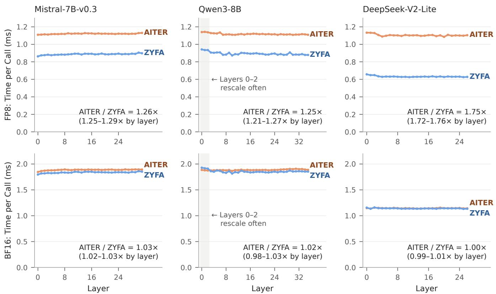  
Fig. 28: The speedup of ZYFA over AITER barely changes between layers. Each line is the time of one attention call of ZYFA or of AITER’s default kernel in every layer, measured inside a full forward pass of each model at sequence length S=16K on two PG-19 documents. The label in each panel gives AITER’s time divided by ZYFA’s time, as the median and the range over layers, so a value above 1 means that ZYFA takes less time. In the shaded first layers of Qwen3-8B the running row maximum keeps growing, so ZYFA rescales its output accumulator far more often than in the other layers.