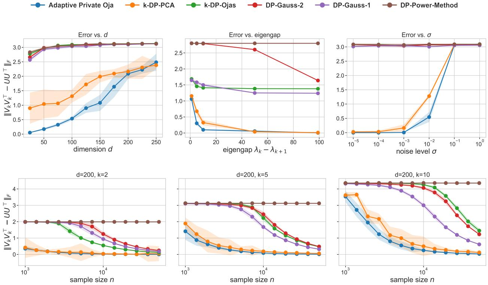
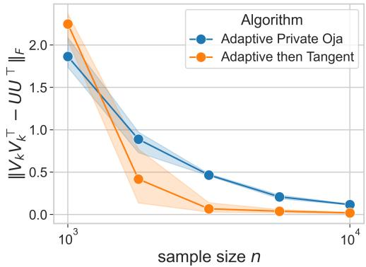
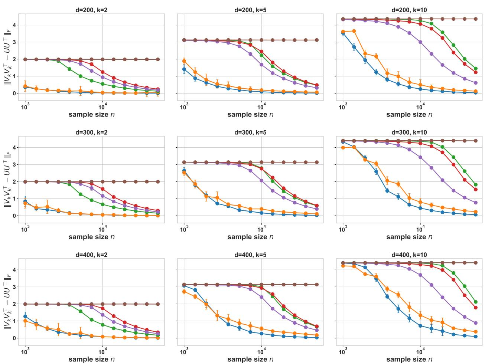

# Optimal Rates for Adaptive Private k-PCA

Johanna Düngler<sup>1</sup> and Amartya Sanyal<sup>1</sup>

<sup>1</sup>Department of Computer Science, University of Copenhagen {jodu, amsa}@di.ku.dk

## Abstract

Given n i.i.d. random matrices $A _ { i } \in \mathbb { R } ^ { d \times d }$ with common expectation Σ, the goal of Diferentially Private Stochastic PCA is to identify a k-dimensional subspace capturing the leading variance directions of Σ, while preserving diferential privacy (DP) for each individual sample $A _ { i }$ . Düngler and Sanyal [2025] introduced k-DP-PCA, the first algorithm to simultaneously (1) achieve sample complexity $n = \widetilde O ( d )$ for sub-Gaussian data, (2) adapt its privacy noise to the intrinsic randomness of the data, and (3) extend seamlessly to any target dimension $k \leq d .$ However, its sample complexity has a suboptimal dependence on k. We propose the first algorithm that achieves optimal sample complexity in both d and $k ,$ , while retaining properties (2) and (3) of k-DP-PCA. Additionally, prior utility guarantees require a minimum sample size with exponential dependence on the eigengap. Our method removes this dependence. It also improves the dependence on spectral parameters, matching known lower bounds for the spiked covariance model. Unlike deflation-based approaches like k-DP-PCA, our algorithm updates the full $d \times k$ subspace jointly rather than one eigenvector at a time. This non-deflation structure simplifies the algorithm, reduces the number of hyper-parameters, and improves computational eficiency, particularly when using block linear algebra libraries.

## 1 Introduction

Principal Component Analysis (PCA) is a basic technique in statistics and machine learning. Given data vectors $x _ { 1 } , \ldots , x _ { n } \in \mathbb { R } ^ { d }$ , classical PCA estimates the leading eigenspace of the empirical second-moment matrix $\begin{array} { r } { \frac { 1 } { n } \sum _ { i } x _ { i } x _ { i } ^ { \top } } \end{array}$ . The task of recovering the top k eigenvectors is typically referred to as k-PCA. In this paper, we study a stochastic variant of this problem. The input is a sequence of independent symmetric matrices $A _ { 1 } , \ldots , A _ { n } \in \mathbb { R } ^ { d \times d }$ with common expectation Σ, and the goal is to estimate the top-k eigenspace of Σ. In addition, we want to protect the privacy of the individual samples $A _ { i }$ in the sense of diferential privacy [Dwork et al., 2006].

Diferential privacy ofers a formal framework for protecting the privacy of individuals represented in a dataset, and has been deployed in settings involving sensitive information, including census data analysis and large-scale industrial analytics [Abowd et al., 2020, Apple, 2017]. Private PCA has commonly been studied in the fixed-dataset setting for nearly two decades [Blum et al., 2005, Chaudhuri et al., 2013, Dwork et al., 2014, Hardt and Roth, 2013], where algorithms typically rely on deterministic norm bounds. When such methods are applied to stochastic PCA, these bounds must be enforced through clipping, but this transfers a worst-case fixed-data requirement into a setting where the observations are random. The resulting privacy-utility guarantees are therefore often suboptimal: they either require sample sizes that grow super-linearly with the ambient dimension d, or add privacy noise at a level that does not exploit the randomness already present in the observations. Consequently, applying fixed-dataset private PCA methods directly in the stochastic setting typically yields error bounds of order $\bar { O ( } \sqrt { d k / n } + d ^ { 3 / 2 } \bar { k } / ( \varepsilon n ) )$ , where ε denotes the privacy parameter, while the known optimal rate is of order $O ( \sqrt { d k / n } + d k / ( \varepsilon n ) )$ (Theorems 7 and 8).

The first adaptive private algorithm for stochastic PCA was given by Liu et al. [2022] for the case $k = 1$ . Their key idea was to privately estimate the fluctuation scale of the stochastic update and to clip around a private center rather than around zero. This makes the privacy noise scale with the randomness in the data. Düngler and Sanyal [2025] extended this adaptive principle to $k > 1$ . Their method, however, is deflation-based: it estimates one direction, projects it out, and repeats. This sequential structure introduces an additional dependence on k: their error bounds are of order ${ \cal O } ( \sqrt { d k ^ { 3 / 2 } / n } + d k ^ { 3 / 2 } / ( \varepsilon n ) )$ . Additionally, their algorithm requires separate parameter tuning for each eigenvector it estimates, making it both more cumbersome to tune and computationally ill-suited for block linear-algebra implementations that are eficient in practice. Ca et al. [2024] obtained optimal rates for Gaussian data when the unknown population covariance Σ satisfies the flat-tail condition $\lambda _ { k + 1 } = \cdot \cdot \cdot = \lambda _ { d }$ . However, because Σ is itself unknown, it is unclear if this condition can be privately certified from the input data in general. As a result, their privacy guarantees rely on an unverified distributional assumption on the data-generating process.

Our Contributions Our first contribution is AdaDPO (Algorithm 2), a non-deflation-based adaptive private variant of Oja’s algorithm (Algorithm 6) that achieves the optimal dependence on k in sample complexity. Unlike deflation-based methods such as k-DP-PCA [Düngler and Sanyal, 2025], which reduce k-PCA to k private one-dimensional problems, our algorithm estimates the target k-dimensional subspace jointly. Moreover, its adaptive privacy mechanism estimates and uses one single scale parameter and one clipping center for all k columns instead of using k separate range estimators. It then adds calibrated Gaussian noise that preserves symmetry. This joint treatment is what avoids the extra cost of handling the k direction separately. We show that AdaDPO achieves the optimal dependence on d and k (Theorem 2), and performs well on simulated data.

Our second contribution is TAdaDPO (Algorithm 3), a refinement of AdaDPO that improves the dependence of the private error bound on the spectrum of Σ. The main idea is that, after obtaining a suficiently accurate initial estimate of the top-k eigenspace, the remaining estimation problem has a more favorable local geometry. TAdaDPO exploits this local structure in a second phase to reduce the amount of privacy noise needed for the final refinement. We prove a general utility guarantee for this procedure in Theorem 6. In the spiked covariance model, this yields the optimal spectral dependence up to logarithmic factors, matching the lower bound of Cai et al. [2024].

Corollary 1 (Informal version of Corollary 3). Assume $A _ { i } = x _ { i } x _ { i } ^ { \top }$ with $x _ { i } \sim \mathcal { N } ( 0 , \Sigma )$ , where Σ is a spiked covariance with a flat tail, meaning that for some $k \in [ d ] , \lambda _ { k + 1 } = \cdot \cdot \cdot = \lambda _ { d } .$ . Let $V _ { k } \in \dot { \mathbb { R } } ^ { d \times k }$ be the true top-k eigenvectors of Σ, and let $\lambda _ { k } - \lambda _ { k + 1 } > 0$ . Then the output $Q _ { T }$ of TAdaDPO satisfies

$$
\left\| Q _ { T } Q _ { T } ^ { \top } - V _ { k } V _ { k } ^ { \top } \right\| _ { F } \leq \tilde { O } \left( \frac { \sqrt { \lambda _ { 1 } \lambda _ { k + 1 } } } { \lambda _ { k } - \lambda _ { k + 1 } } \left[ \sqrt { \frac { d k } { n } } + \frac { d k } { \varepsilon n } \right] \right) .
$$

The rest of the paper is organized as follows: Section 2 defines the stochastic PCA problem, the privacy model, the main assumptions, and a theoretical warm up for the following sections. Section 3 introduces AdaDPO, its guarantees, and experiments. Section 4 presents TAdaDPO and its guarantees. Finally, Section 5 gives an overview of related work and presents the conclusion.

## 2 Problem Formulation

Let $A _ { 1 } , \ldots , A _ { n } \in \mathbb { R } ^ { d \times d }$ be independent symmetric random matrices with common expectation $\Sigma = \mathbb { E } \left[ A _ { i } \right]$ We assume that Σ is positive semidefinite with eigenvalues $\lambda _ { 1 } \geq \cdot \cdot \cdot \geq \lambda _ { d } \geq 0$ , and we denote by $V _ { k } \in \mathbb { R } ^ { d \times k }$ the matrix containing the top k eigenvectors of Σ. The goal of Stochastic $k { - } P C A$ is to output $Q \in \mathbb { R } ^ { d \times k }$ with orthonormal columns such that $Q Q ^ { \top }$ is close to $\bar { V _ { k } } \bar { V _ { k } } ^ { \top }$ , with error measured by $\begin{array} { r } { \| Q \bar { Q } ^ { \top } - V _ { k } V _ { k } ^ { \top } \| _ { F } } \end{array}$ Throughout the paper, we assume a nonzero eigengap $\Delta _ { k } : = \lambda _ { k } - \lambda _ { k + 1 } > 0$ , and we write $\kappa : = \lambda _ { 1 } / \Delta _ { k }$ and $\kappa _ { \perp } : = ( \lambda _ { 1 } - \lambda _ { d } ) / \Delta _ { k } \leq \kappa .$

Let $\mathbb { S } _ { d , k } : = \left\{ Q \in \mathbb { R } ^ { d \times k } : Q ^ { \top } Q = I _ { k } \right\}$ . For $Q \in \mathbb { S } _ { d , k }$ , let $\Pi _ { \boldsymbol { Q } } : = I - Q Q ^ { \intercal }$ and

$$
\mathcal { S } _ { \boldsymbol { Q } } : = \left\{ Y \in \mathbb { R } ^ { d \times k } : \boldsymbol { Q } ^ { \top } Y \mathrm { ~ i s ~ s y m m e t r i c } \right\} .
$$

For a square matrix $B ,$ , write $\begin{array} { r } { \operatorname { s y m } ( B ) : = \frac { B + B ^ { \top } } { 2 } } \end{array}$ . The Frobenius-orthogonal projection onto $\scriptstyle { { \mathcal { S } } _ { Q } }$ is

$$
\mathsf { P } _ { \mathcal { S } _ { \boldsymbol { Q } } } ( Y ) : = \boldsymbol { Q } \operatorname { s y m } ( \boldsymbol { Q } ^ { \top } Y ) + \Pi _ { \boldsymbol { Q } } Y .
$$

We use $\lVert \cdot \rVert _ { 2 }$ for operator norm, $\left\| \cdot \right\| _ { F }$ for Frobenius norm, $\langle A , B \rangle = \operatorname { T r } ( A ^ { \top } B )$ for the Frobenius inner product, and $\lVert \cdot \rVert _ { ( 2 , k ) }$ for the Schatten- $\cdot ( 2 , k )$ norm, and $\left\| \cdot \right\| _ { S _ { p } }$ for the Schatten-p norm $\textstyle { \bigl ( } \sum _ { i } \sigma _ { i } ( \cdot ) ^ { p } { \bigr ) } ^ { 1 / p }$ , so that $\lVert \cdot \rVert _ { S _ { 2 } } = \lVert \cdot \rVert _ { F }$ and $\lVert \cdot \rVert _ { ( 2 , k ) }$ is the rank-k truncation of $\left\| \cdot \right\| _ { S _ { 2 } }$ . The notation ${ \tilde { O } } ( \cdot )$ hides polylogarithmic factors.

Definition 1 (Diferential privacy). Two datasets S and $S ^ { \prime }$ of the same size are neighboring $( S \sim S ^ { \prime } )$ if they difer by replacing one entry. A randomized algorithm M is $( \varepsilon , \delta )$ -diferentially private ${ \mathrm { i f } } ,$ for every neighboring pair $S , S ^ { \prime }$ and every measurable event $\mathcal { E } .$

$$
\operatorname* { P r } \left( M ( S ) \in { \mathcal { E } } \right) \leq e ^ { \varepsilon } \operatorname* { P r } \left( M ( S ^ { \prime } ) \in { \mathcal { E } } \right) + \delta .
$$

A standard way to ensure diferential privacy is the Gaussian mechanism.

Definition 2 (Gaussian Mechanism). For a query f with sensitivity $\begin{array} { r } { \Delta ( f ) : = \operatorname* { s u p } _ { S \sim S ^ { \prime } } \| f ( S ) - f ( S ^ { \prime } ) \| _ { 2 } } \end{array}$ , one releases

$$
M ( S ) = f ( S ) + g , \qquad g \sim \mathcal { N } ( 0 , \sigma ^ { 2 } I ) .
$$

For $\sigma \stackrel { > } { \sim } \Delta ( f ) \sqrt { \log ( 1 / \delta ) } / \varepsilon$ , this mechanism is $( \varepsilon , \delta )$ -diferentially private.

AdaDPO is analyzed under the following global model, which is the same type of model used in prior stochastic private PCA analyses. We emphasize that our privacy guarantees are distribution-free; the assumptions below are used only for utility. In Assumption ${ \mathrm { B } } ,$ we introduce a local tangent-space refinement of this model, which applies after a suficiently accurate warm-up phase and leads to sharper bounds for $\mathrm { T A D A D P O }$

Assumption A $( ( \Sigma , \{ \lambda _ { i } \} _ { i = 1 } ^ { d } , M , V , K , a , \gamma )$ -model). The matrices $A _ { 1 } , \ldots , A _ { n } \in \mathbb { R } ^ { d \times d }$ are independent, symmetric, and satisfy:

A.1 $\mathbb { E } \left[ A _ { i } \right] = \Sigma$ , where $\Sigma \succeq 0$ has eigenvalues $\lambda _ { 1 } \geq \cdot \cdot \cdot \geq \lambda _ { d } \geq 0$ , corresponding eigenvectors $v _ { 1 } , \ldots , v _ { d }$ , and $\lambda _ { k } - \lambda _ { k + 1 } > 0$

A.2 $\left\| A _ { i } - \Sigma \right\| _ { ( 2 , k ) } = \operatorname* { s u p } _ { P \in \mathbb { S } _ { d , k } } \left\| P ^ { \top } ( A _ { i } - \Sigma ) \right\| _ { F } \leq \lambda _ { 1 } M \quad a . s .$

A.3 $\left\| \mathbb { E } \left[ ( A _ { i } - \Sigma ) ^ { 2 } \right] \right\| _ { 2 } \leq \lambda _ { 1 } ^ { 2 } V .$

A.4 $\operatorname* { m a x } _ { \| u \| _ { 2 } = 1 , \| v \| _ { 2 } = 1 } \mathbb { E } \left\lceil \exp \left( \left( \frac { \left| u ^ { \top } ( A _ { i } - \Sigma ) v \right| ^ { 2 } } { K ^ { 2 } \lambda _ { 1 } ^ { 2 } \| H _ { u } \| _ { 2 } } \right) ^ { 1 / 2 a } \right) \right\rceil \leq 2 .$ , where $\begin{array} { r } { \boldsymbol { H _ { u } } = \frac { 1 } { \lambda _ { 1 } ^ { 2 } } \mathbb { E } [ ( \boldsymbol { A _ { i } } - \boldsymbol { \Sigma } ) \boldsymbol { u } \boldsymbol { u } ^ { \top } ( \boldsymbol { A _ { i } } - \boldsymbol { \Sigma } ) ^ { \top } ] } \end{array}$ and we denote $\gamma ^ { 2 } = \operatorname* { m a x } _ { \| u \| = 1 } \| H _ { u } \| _ { 2 }$

Assumptions A.1 to A.3 are standard for matrix concentration $( \mathrm { e . g . }$ , under the matrix Bernstein inequality [Tropp, 2012]) and thus also required for the utility guarantees of Oja’s algorithm even in the non-private setting. Assumption A.4 controls the size of the bilinear form $u ^ { \top } ( A _ { i } - \Sigma ) \colon$ v and can be seen as a Gaussian-like tail bound, which tells us that the magnitude of the projection of the fluctuation $A _ { i } - \Sigma$ is bounded with high probability. It is a standard assumption in related private stochastic PCA analyses [Düngler and Sanyal, 2025, Liu et al., 2022].

## 2.1 Theoretical Warmup

One of the most widely used algorithms for Principal Component Analysis (PCA) is Oja’s algorithm $[ \mathrm { O j a }$ 1982, Oja and Karhunen, 1985]. It is a streaming algorithm that receives a sequence of matrices $A _ { i }$ and at each time step updates a k-dimensional subspace $Q _ { t }$ by

$$
Q _ { t } = \mathrm { Q R } \left( Q _ { t - 1 } + \eta _ { t } A _ { t } Q _ { t - 1 } \right) .
$$

where $\eta _ { t }$ is the learning rate at time t. The standard utility theorem for $\mathrm { O j a ^ { \prime } s }$ method [Huang et al., 2021] assumes that the matrices $A _ { t }$ are independent, symmetric, and have common expectation Σ. We recall the full statement and pseudocode in Theorem 9 and Algorithm 6. These two requirements are exactly what make a private adaptive block update delicate.

If one could release $( A _ { t } + G _ { t } ) Q _ { t - 1 }$ , where $G _ { t }$ is an independent symmetric Gaussian matrix, then the update would simply be Oja’s algorithm run on perturbed symmetric matrices $A _ { t } + G _ { t }$ . The challenge, however, is not merely privacy, but adaptivity: the algorithm must privately estimate the range of the matrix being privatized, choose a clipping threshold, and add Gaussian noise calibrated to the resulting sensitivity.

Adding noise to the full matrix $A _ { t }$ would preserve the standard analysis of Oja’s algorithm, but would require clipping at the range of $A _ { t } .$ , which can be much larger than the range of the projected update $A _ { t } Q _ { t - 1 }$ . Since privacy only needs to protect $A _ { t } Q _ { t - 1 } \in \mathbb { R } ^ { d \times k }$ , this would be unnecessarily conservative and would destroy the adaptive gain. Instead, we estimate the range and add Gaussian noise directly in $\mathbb { R } ^ { d \times k }$ , at the scale of $A _ { t } Q _ { t - 1 }$ . This is the right scale for privacy, but the noise is generally not of the form $G _ { t } Q _ { t - 1 }$ for any symmetric $G _ { t }$ . Hence the efective matrices are no longer symmetric, and the standard theorem for $\mathrm { O j a ^ { \prime } s }$ algorithm no longer applies. This is one reason prior adaptive k-PCA algorithms use deflation. Düngler and Sanyal [2025] reduce the problem to a sequence of private one-dimensional PCA calls. For $k = 1$ , the $\mathrm { O j a }$ update becomes

$$
q _ { t } = \mathrm { Q R } \left( q _ { t - 1 } + \eta _ { t } A _ { t } q _ { t - 1 } \right) ,
$$

with $q _ { t - 1 } \in \mathbb { R } ^ { d }$ . In this $k = 1$ setting, the available utility result does not require the input matrices in the update to be symmetric. Deflation therefore avoids the symmetry obstruction that arises for the full $d \times k$ block update. However, it requires fresh batches of data to maintain independence across directions, which loses a factor in the dependence on $k .$

We retain the block update through two new observations. First, for fixed $Q { \mathrm { . } }$ , the action of any symmetric matrix on Q lies in the linear space

$$
\mathcal { S } _ { \boldsymbol { Q } } = \left\{ Y \in \mathbb { R } ^ { d \times k } : Q ^ { \top } Y \mathrm { ~ i s ~ s y m m e t r i c } \right\} .
$$

Thus the privacy noise only needs to be added inside $ { \boldsymbol { S } } _ { Q }$ , rather than in all of $\mathbb { R } ^ { d \times k }$ . This already restores a symmetric representation: every element of $ { \boldsymbol { S } } _ { Q }$ can be written as $G _ { Q } Q$ for some symmetric matrix $G _ { Q }$ However, with the natural isotropic noise on ${ \cal { S } } _ { \cal { Q } } .$ the representing matrix $G _ { Q }$ depends on $Q .$ . Along the algorithm, $Q = Q _ { t - 1 }$ is random and adaptive, so the resulting efective matrices are not an i.i.d. sequence of symmetric perturbations, and the standard theorem for Oja’s algorithm still does not apply.

The second observation is that adding slightly more noise gives a Q-independent symmetric representation, while preserving the same privacy guarantee. To state this precisely, we use the following notation.

Definition 3 (Gaussian Orthogonal Ensemble). A symmetric matrix $G \in \mathbb { R } ^ { d \times d }$ is sampled from $\mathrm { G O E } _ { d } ( \sigma ^ { 2 } )$ if $G _ { i i } \sim \mathcal { N } ( 0 , 2 \sigma ^ { 2 } )$ and $G _ { i j } \sim \mathcal { N } ( 0 , \sigma ^ { 2 } )$ independently for $i < j$

Lemma 1. $F i x Q \in \mathbb { R } ^ { d \times k }$ with $Q ^ { \top } Q = I _ { k }$ . Let $Z \in \mathbb { R } ^ { d \times k }$ have i.i.d. ${ \mathcal { N } } ( 0 , \sigma ^ { 2 } )$ entries, let $N _ { \mathrm { s y m } } \sim \mathrm { G O E } _ { k } ( \sigma ^ { 2 } )$ ， and let $G \sim \mathrm { G O E } _ { d } ( \sigma ^ { 2 } )$ . Then

$$
Q N _ { \mathrm { s y m } } + ( I - Q Q ^ { \top } ) Z \ \stackrel { d } { = } \ G Q .
$$

To privatize the projected update $A Q$ , we need a uniform sensitivity bound. Since $A Q$ is not deterministically bounded under the stochastic model, we enforce such a bound by clipping in Frobenius norm. For $R > 0$ define

$$
\begin{array}{c} \mathrm { c l i p } _ { R } ( Y ) = \bigg \{ Y , \qquad \| Y \| _ { F } \leq R ,  \\ { R Y / \| Y \| _ { F } , \quad \| Y \| _ { F } > R . } \end{array}
$$

Thus, at an iteration with current iterate $Q _ { t - 1 }$ , we use the private clipped update

$$
Q _ { t } = \mathrm { Q R } \left( Q _ { t - 1 } + \eta _ { t } \left( \mathrm { c l i p } _ { R } ( A _ { t } Q _ { t - 1 } ) + Q _ { t - 1 } N _ { t } + ( I - Q _ { t - 1 } Q _ { t - 1 } ^ { \top } ) Z _ { t } \right) \right) ,
$$

where $N _ { t } \sim \mathrm { G O E } _ { k } ( \sigma ^ { 2 } )$ and $Z _ { t } \in \mathbb { R } ^ { d \times k }$ has i.i.d. ${ \mathcal { N } } ( 0 , \sigma ^ { 2 } )$ entries.

Algorithm 1 Private Oja’s   
Input: $S = \left\{ A _ { i } \right\} _ { i = 1 } ^ { n } , k ,$ batch count T, privacy parameters $( \varepsilon , \delta )$ , learning rates $\left\{ \eta _ { i } \right\} _ { i = 1 } ^ { T }$ , clipping radius R.   
1: Set $B  \lfloor n / T \rfloor , \ \sigma  2 R \sqrt { 2 \log ( 1 . 2 5 / \delta ) } / ( B \varepsilon )$   
2: Choose $\bar { Q _ { 0 } ^ { \prime } } \in \bar { \mathbb { R } } ^ { d \times k }$ uniformly at random and set $Q _ { 0 }  \mathrm { Q R } ( Q _ { 0 } ^ { \prime } )$   
3: for $t = 1 , \ldots , T$ do   
4: Set $\Pi _ { Q _ { t - 1 } }  I - Q _ { t - 1 } Q _ { t - 1 } ^ { \top } .$   
5: Draw $\bar { Z } _ { t } \in \mathbb { R } ^ { d \times k }$ with i.i.d. entries ${ \mathcal { N } } ( 0 , \sigma ^ { 2 } )$ , and draw $N _ { \mathrm { s y m } , t } \sim \mathrm { G O E } _ { k } ( \sigma ^ { 2 } )$   
6: $\begin{array} { r } { Q _ { t } \gets \mathrm { Q R } \left( Q _ { t - 1 } + \eta _ { t } \left[ \frac { 1 } { B } \sum _ { i = B ( t - 1 ) + 1 } ^ { t B } \mathrm { c l i p } _ { R } ( A _ { i } Q _ { t - 1 } ) + Q _ { t - 1 } N _ { \mathrm { s y m } , t } + \Pi _ { Q _ { t - 1 } } Z _ { t } \right] \right) } \end{array}$   
7: end for   
8: return $Q _ { T } .$

For any R for which clipping is rare, the update agrees on the no-clipping event with non-private Oja’s algorithm applied to $A _ { t } + G _ { t - 1 }$ , where $G _ { t - 1 } \sim \mathrm { G O E } _ { d } ( \sigma ^ { 2 } )$ . Thus we can privatize the full $d \times k$ block update while preserving the structure required by Oja’s analysis. For a rigorous privacy proof of Algorithm 1 see Theorem 4 in Section C. The next theorem gives a fixed-radius guarantee, choosing R under Assumption A so that clipping is unlikely and the dependence on k is correct.

Theorem 1 (Utility of Algorithm 1). Assume $A _ { 1 } , \ldots , A _ { n }$ satisfy Assumption A and write $\begin{array} { r } { \kappa = \frac { \lambda _ { 1 } } { \lambda _ { k } - \lambda _ { k + 1 } } } \end{array}$ . Set

$$
R = C \lambda _ { 1 } \sqrt { d k } \big ( K \gamma \log ^ { a } ( n d k / \zeta ) + 1 \big ) , \qquad T = \lceil C _ { T } \kappa \log ( n ) \rceil ,
$$

where $C _ { T }$ is a suficiently large absolute constant. If

$$
n \gtrsim \operatorname* { m a x } \left\{ \frac { k ^ { 2 } \lambda _ { 1 } ^ { 2 } V } { \zeta ^ { 2 } ( \lambda _ { k } - \lambda _ { k + 1 } ) ^ { 2 } } , \kappa ^ { 3 / 2 } \frac { k M } { \zeta } , \kappa ^ { 3 / 2 } \frac { ( K \gamma + 1 ) k ^ { 3 / 2 } d } { \varepsilon \zeta } \right\} ,
$$

then there exist learning rates $\{ \eta _ { t } \}$ so that with probability at least $1 - \zeta ,$ , Algorithm 1 outputs $Q _ { T }$ satisfying

$$
{ \left\| { Q _ { T } Q _ { T } ^ { \top } - V _ { k } V _ { k } ^ { \top } } \right\| } _ { F } \leq \tilde { O } \left( \kappa \frac { \sqrt { k V } } { \sqrt { n } } + \kappa ^ { 3 / 2 } \frac { \sqrt { k } M } { n } + \kappa ^ { 3 / 2 } \frac { ( K \gamma + 1 ) k d } { \varepsilon n } \right) .
$$

The first two terms are the stochastic error of Oja’s algorithm, and the third is the privacy cost. In particular, the privacy term scales as $d k / ( \varepsilon n )$ , reflecting the block update over all k directions.

Example 1 (Gaussian covariance and the k-dependence). Let $A _ { i } = x _ { i } x _ { i } ^ { \top }$ with $x _ { i } \sim \mathcal { N } ( 0 , \Sigma )$ . Then, with high probability, Assumption A holds with $M = { \tilde { O } } ( d )$ , V = O(d), K = O(1), a = 1, and $\gamma = O ( 1 )$ . Thus, applying Theorem 1 on this high-probability event gives

$$
\left\| Q _ { T } Q _ { T } ^ { \top } - V _ { k } V _ { k } ^ { \top } \right\| _ { F } \leq \tilde { O } \left( \kappa \left( \frac { \sqrt { k d } } { \sqrt { n } } + \sqrt { \kappa } \frac { d k } { \varepsilon n } \right) \right) .
$$

However, Algorithm 1 is not adaptive. Since R is fixed before the algorithm runs and clipping is around zero, the radius must cover both $( A _ { i } - \Sigma ) Q$ and $\Sigma Q$ . Consequently, the privacy noise need not vanish even when the stochastic fluctuation does. Thus the block update has the right k-dependence, but its privacy cost is not adaptive to the randomness in the data, as illustrated in the example below.

Example 2 (Spiked covariance and adaptivity). Consider the rank-one spiked model $x _ { i } = s _ { i } + n _ { i }$ , where $s _ { i } \sim \mathrm { U n i f } \{ v , - v \} , n _ { i } \sim \mathcal { N } ( 0 , \sigma ^ { 2 } I _ { d } )$ , and $v \in \mathbb { R } ^ { d }$ is unit norm. Let $A _ { i } = x _ { i } x _ { i } ^ { \top }$ , so $\Sigma = \mathbb { E } \left[ A _ { i } \right] = v v ^ { \top } + \sigma ^ { 2 } I _ { d }$ As $\sigma  0 _ { \cdot }$ , the samples become nearly deterministic: $A _ { i }  v v ^ { \top } = \Sigma$ , and the stochastic fluctuation scale γ tends to zero. However, the radius used in Theorem 1 is $R = C \lambda _ { 1 } \sqrt { d k } \big ( K \gamma \log ^ { a } ( n d k / \zeta ) + 1 \big )$ . Thus R remains of order $\lambda _ { 1 } \sqrt { d k }$ even when $\gamma  0 .$ , and the privacy noise does not vanish in the nearly deterministic regime. The adaptive algorithm in Section 3 removes this obstruction by privately estimating a center for $A _ { i } Q$ and clipping around that center.

## 3 Adaptive Private Oja’s

The warmup in the previous section gives a private block version of Oja’s algorithm with the correct dependence on $k ,$ but its clipping radius is fixed in advance and centered at zero. We now make the block update adaptive. At each iteration $t ,$ Algorithm 2 estimates a center for the projected samples $A _ { i } Q _ { t - 1 } \in \mathbb { R } ^ { d \times k }$ and a range parameter controlling their fluctuations around that center (PrivRange, Algorithm 4). It then clips around the estimated center and computes a truncated batch mean (TruncatedMean, Algorithm 5) and finally privatizes the mean by adding Gaussian noise. The sensitivity, and hence the Gaussian noise scale, is calibrated to the empirical fluctuation radius rather than to a worst-case radius fixed before the algorithm begins. Conditional on $Q _ { t - 1 }$ , the population center of the projected samples is $\Sigma Q _ { t - 1 }$ , so the relevant fluctuation is

$$
A _ { i } Q _ { t - 1 } - \Sigma Q _ { t - 1 } = ( A _ { i } - \Sigma ) Q _ { t - 1 } .
$$

This is the quantity controlled by the fluctuation parameter γ. Consequently, when the stochastic fluctuations are small, the clipping radius and privacy noise become small as well. This is the adaptivity captured in Theorem 2.

Algorithm 2 Adaptive Private Oja’s (AdaDPO)   
Input: $\overline { { S = \{ A _ { 1 } , \ldots , A _ { n } \} , k \in [ d ] } }$ , batch count T, warm-up length $T _ { 0 }$ , base clipping radius R, privacy   
parameters $( \varepsilon , \delta )$ , learning rates $\dot { \{ \eta _ { t } \} } _ { t = 1 } ^ { T }$ , and failure probability ζ   
1: Set $B  \lfloor n / T \rfloor , \ \sigma  2 R \sqrt { 2 \log ( 1 . 2 5 / \delta ) } / ( B \varepsilon )$   
2: Choose $\bar { Q _ { 0 } ^ { \prime } } \in \bar { \mathbb { R } } ^ { d \times k }$ uniformly at random, $Q _ { 0 }  \mathrm { Q R } [ Q _ { 0 } ^ { \prime } ]$   
3: for $t = 1 , \dot { 2 } , \dots , T _ { 0 }$ do ▷ Phase I: non-adaptive warm-up   
4: $\begin{array} { r } { \bar { G } _ { t }  \frac { 1 } { B } \sum _ { i = B ( t - 1 ) + 1 } ^ { t B } \mathrm { c l i p } _ { R } ( A _ { i } Q _ { t - 1 } ) } \end{array}$ and $\sigma _ { t } \gets \sigma$   
5: $Z _ { t } \in \mathbb { R } ^ { d \times k }$ with coordinates $\stackrel { \mathrm { i . i . d } } { \sim } \mathcal { N } ( 0 , \sigma _ { t } ^ { 2 } ) , \quad N _ { \mathrm { s y m } , t } \sim G O E _ { k } ( \sigma _ { t } ^ { 2 } )$   
6: $Q _ { t } \gets \mathrm { Q R } \left[ Q _ { t - 1 } + \eta _ { t } \left( \mathsf { P } _ { \mathcal { S } _ { Q _ { t - 1 } } } ( \bar { G } _ { t } ) + Q _ { t - 1 } N _ { \mathrm { s y m } , t } + ( I - Q _ { t - 1 } Q _ { t - 1 } ^ { \top } ) Z _ { t } \right) \right]$   
7: end for   
8: for $t = T _ { 0 } + 1 , \ldots , T$ do ▷ Phase II: adaptive   
9: Estimate Range Λb ← PrivRange $\left( \left\{ A _ { i } Q _ { t - 1 } \right\} _ { i = B \cdot ( t - 1 ) + 1 } ^ { B \cdot ( t - 1 ) + B / 2 } , ( \varepsilon , \delta ) , \zeta / 2 T \right)$   
10: Set Truncation Threshold $R _ { t } \gets 3 K \sqrt { \widehat { \Lambda } _ { t } \log ^ { a } ( B d k / ( 2 \zeta ) ) }$   
11: $\bar { G } _ { t } \gets \mathrm { T R U N C A T E D M }$ ean $\left( \{ A _ { i } Q _ { t - 1 } \} _ { i = B \cdot ( t - 1 ) + B / 2 + 1 } ^ { t B } , R _ { t } , \widehat { \Lambda } _ { t } , ( \varepsilon / 2 , \delta / 2 ) , \zeta / 2 T \right)$   
12: Set privacy noise multiplier $\begin{array} { r } { \sigma _ { t } \gets \frac { 8 R _ { t } \sqrt { d k } } { B \varepsilon } \sqrt { 2 \log ( 2 . 5 / \delta ) } } \end{array}$   
13: $Z _ { t } \in \mathbb { R } ^ { d \times k }$ with coordinates $\stackrel { \mathrm { i . i . d } } { \sim } \mathcal { N } ( 0 , \sigma _ { t } ^ { 2 } ) , \quad N _ { \mathrm { s y m } , t } \sim G O E _ { k } ( \sigma _ { t } ^ { 2 } )$   
14: $Q _ { t } \gets \mathrm { Q R } \left[ Q _ { t - 1 } + \eta _ { t } \left( \mathsf { P } _ { S _ { Q _ { t - 1 } } } ( \bar { G } _ { t } ) + Q _ { t - 1 } N _ { \mathrm { s y m } , t } + ( I - Q _ { t - 1 } Q _ { t - 1 } ^ { \top } ) Z _ { t } \right) \right]$   
15: end for   
16: return $Q _ { T }$

## Lemma 2 (Privacy of Algorithm 2). $I f 0 < \varepsilon \leq 1$ then Algorithm 2 is $( \varepsilon , \delta ) \ – D P .$

Remark. The restriction on ε can be removed by replacing the standard Gaussian calibration with the analytic Gaussian mechanism. This calibration is less convenient to state in closed form, but is readily implemented in our experiments.

Theorem 2 (Utility of Algorithm 2). Given matrices $A _ { 1 } , \ldots , A _ { n }$ fulfilling Assumption A write $\begin{array} { r } { \kappa = \frac { \lambda _ { 1 } } { \lambda _ { k } - \lambda _ { k + 1 } } } \end{array}$ and set the base clipping radius, the batch count and the warm-up length to

$$
R = C \lambda _ { 1 } \sqrt { d k } \big ( K \gamma \log ^ { a } ( n d k / \zeta ) + 1 \big ) , \qquad T = \lceil C _ { T } \kappa \log ( n ) \rceil , \qquad T _ { 0 } = \lceil T / 2 \rceil ,
$$

where $C _ { T }$ is a suficiently large absolute constant. If

$$
n \gtrsim \operatorname* { m a x } \left\{ \frac { k ^ { 2 } \lambda _ { 1 } ^ { 2 } V } { \zeta ^ { 2 } ( \lambda _ { k } - \lambda _ { k + 1 } ) ^ { 2 } } , \kappa ^ { 3 / 2 } \cdot \frac { k M } { \zeta } , \kappa ^ { 3 / 2 } \cdot \frac { ( K \gamma + 1 ) k ^ { 3 / 2 } d } { \varepsilon \zeta } , \frac { d k } { \varepsilon } , \frac { K ^ { 2 } d } { \varepsilon } \right\} ,
$$

then there exist learning rates $\{ \eta _ { t } \}$ such that, with probability at least $1 - \zeta ,$ Algorithm 2 outputs $Q _ { T }$ with

$$
\| Q _ { T } Q _ { T } ^ { \top } - V _ { k } V _ { k } ^ { \top } \| _ { F } \leq \tilde { O } \left( \kappa \frac { \sqrt { k V } } { \sqrt { n } } + \kappa ^ { 3 / 2 } \frac { \sqrt { k } M } { n } + \kappa ^ { 3 / 2 } \frac { K d k \gamma } { \varepsilon n } \right) .
$$

Remark. The choice $T _ { 0 } = \lceil T / 2 \rceil$ is suficient but far from necessary: We fix it at $T / 2$ because that choice requires no knowledge of V, M or γ.

Corollary 2 (Rank-k spiked covariance). Let $V _ { k } \in \mathbb { R } ^ { d \times k }$ have orthonormal columns, let $\Theta = \mathrm { d i a g } ( \theta _ { 1 } , \dots , \theta _ { k } )$ with $\theta _ { 1 } \geq \cdot \cdot \cdot \geq \theta _ { k } > 0$ , and let $X _ { i } = V _ { k } \Theta ^ { 1 / 2 } + \sigma Z _ { i } , ( Z _ { i } ) _ { a b } \stackrel { \mathrm { i . i . d . } } { \sim } \mathcal { N } ( 0 , 1 )$ . Set $A _ { i } = X _ { i } X _ { i } ^ { \top }$ , then $\Sigma = \mathbb { E } [ A _ { i } ] =$ $V _ { k } \Theta V _ { k } ^ { \top } + k \sigma ^ { 2 } I _ { d }$ . Running Algorithm 2 with input $A _ { 1 } , \ldots , A _ { n }$ outputs $Q _ { T }$ with high probability satisfying

$$
\| Q _ { T } Q _ { T } ^ { \top } - V _ { k } V _ { k } ^ { \top } \| _ { F } \leq \tilde { O } \left( \frac { \sigma \sqrt { ( \theta _ { 1 } + k \sigma ^ { 2 } ) k d } } { \theta _ { k } \sqrt { n } } + \sigma \cdot \sqrt { \frac { \theta _ { 1 } + k \sigma ^ { 2 } } { \theta _ { k } } } \frac { K d k \sqrt { \theta _ { 1 } + \sigma ^ { 2 } k } } { \varepsilon \theta _ { k } n } \right)
$$

Remark. The privacy term in Corollary 2 scales with the fluctuation level σ and vanishes as $\sigma \to 0$

To estimate fluctuations around the mean (Algorithm 4), we build on the private range-estimation idea of Liu et al. [2022] (Algorithm 7). The new dificulty is that our updates are matrix-valued: $A _ { i } Q _ { t - 1 } \in \mathbb { R } ^ { d \times k }$ , rather than vector-valued as in the top-eigenvector setting. A naive extension would estimate a range separately for each column and compose privacy over k runs. Instead, Algorithm 4 estimates one range parameter for the whole batch by taking blockwise maxima over the k column fluctuations and running the private histogram learner only once per update step. This lets us update the entire k-dimensional subspace at once, rather than using a deflation-based sequence of private one-dimensional problems as in Düngler and Sanyal [2025].

## 3.1 Experiments

We compare AdaDPO against the stochastic DP-PCA methods: k-DP-PCA and k-DP-Ojas [Düngler and Sanyal, 2025], and against stochastic adaptations of the DP-Gauss algorithms of Dwork et al. [2014] and the noisy power method of Hardt and Price [2014]. The latter methods were designed for deterministic bounded-data settings, so we adapt them to our stochastic model by clipping.

The algorithms of Dwork et al. [2014] assume a data matrix $\ b { X } \in \mathbb { R } ^ { n \times d }$ with rows bounded in Euclidean norm by one and estimate the top eigenspace of $X ^ { \top } X$ . The noisy power method was originally analyzed under single-entry matrix changes of size at most one. Later analyses [Florina Balcan et al., 2016, Nicolas et al., 2024] showed privacy under perturbations $A ^ { \prime } = A + C$ satisfying $\begin{array} { r } { \sqrt { \sum _ { i } \| C _ { i , : } \| _ { 1 } ^ { 2 } } \leq 1 } \end{array}$ . In contrast, our setting observes independent matrices $A _ { i }$ , with no deterministic norm bound, and the goal is to estimate the top eigenspace of $\mathbb { E } [ A _ { i } ] = \Sigma$

To use deterministic baselines, we clip the samples. A global normalization $\tilde { x } _ { i } = x _ { i } / \operatorname* { m a x } _ { j } \| x _ { j } \| _ { 2 }$ is not private, since one sample can change the normalization of all samples [Hu et al., 2024]. Normalizing each sample individually, $\tilde { x } _ { i } = x _ { i } / \| x _ { i } \| _ { 2 } ,$ changes the target because generally $\mathbb { E } [ x x ^ { \top } / \| x \| _ { 2 } ^ { 2 } ] \neq \Sigma$ . Instead, as in [Düngler and Sanyal, 2025], we clip at a deterministic threshold R chosen so that clipping is inactive with high probability. For the spiked covariance model, we take $R = C \sqrt { \lambda _ { 1 } } + \sigma \sqrt { d \log ( n / \vartheta ) }$ , which ensures $\| x _ { i } \| _ { 2 } \leq R$ for all i with probability at least $1 - \vartheta$ , up to constants. The DP-Gauss privacy noise is then scaled to this clipping radius.

With this clipping, we adapt Algorithms 1 and 2 of Dwork et al. [2014], denoted DP-Gauss-1 and DP-Gauss-2. DP-Gauss-1 clips each sample, adds Gaussian noise to the empirical second-moment matrix, and runs nonprivate PCA on the noisy matrix. DP-Gauss-2 privately estimates the eigengap of the clipped covariance matrix, computes the non-private top-k eigenspace of the clipped data, and perturbs the eigenvectors using noise calibrated to the private eigengap estimate.

We also adapt the noisy power method. Replacing one sample by a adds the rank-one perturbation $C = a a ^ { \top }$ for which $\begin{array} { r } { \sqrt { \sum _ { i } \| C _ { i , : } \| _ { 1 } ^ { 2 } } = \| a \| _ { 2 } \| a \| _ { 1 } } \end{array}$ . Thus, to satisfy the adjacency condition of Florina Balcan et al. [2016],

  
Figure 1: Comparison of AdaDPO with baselines on the spiked covariance model. We plot the mean over 10 trials, with shaded regions representing 95% confidence intervals. We set $\varepsilon = 1 , \delta = 0 . 0 1$ . For the top row figures we set $k = 5$

Nicolas et al. [2024], we clip so that $\| a \| _ { 2 } \leq R$ (same R as for DP-Gauss) and $\| a \| _ { 1 } \leq R ^ { \prime }$ , and scale the privacy noise accordingly. In the spiked covariance model, we use $R ^ { \prime } = \sigma d + \sqrt { \lambda _ { 1 } d } + \sigma \sqrt { d \log ( n / \vartheta ) }$ , so that $\| x _ { i } \| _ { 1 } \leq R ^ { \prime }$ with probability at least $1 - \vartheta .$ up to constants. We call this baseline DP-Power-Method.

Experimental Results on Spiked Covariance Data In Figure 1a we vary the ambient dimension, eigengap, and noise level while keeping the other parameters fixed. The plots show that AdaDPO consistently attains lower subspace error. In Figure 1b we vary the sample size across several choices of k and $d ,$ showing that the advantage persists across diferent ranks and dimensions and that AdaDPO benefits from the predicted block k-dependence. Across all plots, the deterministic bounded-data baselines are less competitive, reflecting the cost of clipping and calibrating noise to worst-case bounds rather than to the stochastic fluctuations of the data. Additional experiments and implementation details are provided in Section G.

## 4 Fine-tuning in tangent space for optimal spectral dependence

AdaDPO has optimal dependence on $d , k , n ,$ and ε for general Gaussian inputs, because its privacy noise adapts to the stochastic fluctuation of the projected update. In the Gaussian spiked covariance model of Cai et al. [2024], however, the data have additional structure. Namely, $A _ { i } = x _ { i } x _ { i } ^ { \top }$ with $x _ { i } \sim \mathcal { N } ( 0 , \Sigma )$ , and $\Sigma =$ $U \Theta U ^ { \top } + \sigma ^ { 2 } I _ { d }$ , where $U \in \mathbb { R } ^ { d \times k }$ has orthonormal columns. Equivalently, all directions outside the signal subspace have the same eigenvalue, $\lambda _ { k + 1 } = \cdot \cdot \cdot = \lambda _ { d } = \sigma ^ { 2 }$ . This flat-tail structure permits a sharper dependence on the spectrum of Σ. The minimax lower bound (Theorem 8) scales as $\begin{array} { r } { \frac { \sqrt { \lambda _ { 1 } \lambda _ { k + 1 } } } { \lambda _ { k } - \lambda _ { k + 1 } } \left( \sqrt { \frac { d k } { n } } + \frac { d k } { \varepsilon n } \right) } \end{array}$ up to logarithmic factors. By contrast, applying Theorem 2 directly to $A _ { i } = x _ { i } x _ { i } ^ { \top }$ yields

```latex
Algorithm 3 Tangent Adaptive Private Ojas (TAdaDPO)
Input: samples $\overline { { S = \left\{ A _ { i } \right\} _ { i = 1 } ^ { n } } }$ , target rank $k ,$ batch count $T ,$ privacy parameters $( \varepsilon , \delta )$ , failure probability $\zeta ,$
learning rates $\{ \eta _ { t } \} _ { t = 1 } ^ { T } ,$ and a private starting point $Q _ { 0 } \in \mathbb { R } ^ { d \times k }$
1: Set $B  \lfloor n / T \rfloor$
2: for $t = 1 , \dots , T$ do
3: Set $\Pi _ { t - 1 } = I - Q _ { t - 1 } Q _ { t - 1 } ^ { \top }$
4: Project updates to tangent space $Y _ { i } \gets \Pi _ { t - 1 } A _ { i } Q _ { t - 1 }$ for $i \in [ B ( t - 1 ) + 1 , B t ]$
5: Estimate Range Λb ← PrivRange $\left. \sum _ { i } \right. _ { i = B \cdot ( t - 1 ) + 1 } ^ { B \cdot ( t - 1 ) + B / 2 } , \varepsilon , \delta , \zeta / ( 8 T ) ) .$
6: Set Truncation Threshold $\begin{array} { r } { r _ { t } = C _ { R } K \sqrt { \widehat { \Lambda } _ { t } } \log ^ { a } \left( \frac { B d k T } { \zeta } \right) } \end{array}$
7: $\bar { Y } _ { t } \gets \mathrm { T R U N C A T E D M E A N } \Big ( \{ Y _ { i } \} _ { i = B ( t - 1 ) + B / 2 + 1 } ^ { B t } , r _ { t } , \widehat { \Lambda } _ { t } , ( \varepsilon / 2 , \delta / 2 ) , \zeta / ( 8 T ) \Big )$
8: Set privacy noise multiplier $\begin{array} { r } { \sigma _ { t } \gets \frac { 8 r _ { t } \sqrt { d k } } { B \varepsilon } \sqrt { 2 \log ( 2 . 5 / \delta ) } } \end{array}$
9: Draw $Z _ { t } \in \mathbb { R } ^ { d \times k }$ with i.i.d. entries $\bar { \mathcal { N } } ( 0 , \bar { \sigma } _ { t } ^ { 2 } )$
10: $Q _ { t } \gets \mathrm { Q R } \left( Q _ { t - 1 } + \eta _ { t } \Pi _ { t - 1 } ( \bar { Y } _ { t } + Z _ { t } ) \right)$
11: end for
12: return $Q _ { T }$
```

$$
\left\| Q _ { T } Q _ { T } ^ { \top } - V _ { k } V _ { k } ^ { \top } \right\| _ { F } \leq \widetilde { O } \left( \kappa \sqrt { \frac { d k } { n } } + \kappa ^ { 3 / 2 } \frac { K d k } { \varepsilon n } \right) .
$$

as shown in Corollary 4. Thus AdaDPO has the correct dependence on the statistical and privacy parameters, but its spectral factors, κ on the statistical term and $\kappa ^ { 3 / 2 }$ on the privacy term, are larger than the single factor $\sqrt { \lambda _ { 1 } \lambda _ { k + 1 } } / ( \lambda _ { k } - \lambda _ { k + 1 } )$ available in the flat-tail Gaussian family.

The reason is geometric. Once an iterate $Q$ is already close to the target subspace, not every component of the update $A _ { i } Q$ contributes equally to improving the subspace estimate. The component lying inside span(Q) changes the coordinates of the basis $Q$ , but not the subspace it spans; the subspace is changed by the orthogonal, or tangent, component. Writing $\Pi _ { \boldsymbol { Q } } : = \boldsymbol { I } - \boldsymbol { Q } \boldsymbol { Q } ^ { \intercal }$ , this tangent component is $\Pi _ { Q } A _ { i } Q$ . Accordingly, our second algorithm uses AdaDPO only as a warm-up phase. After obtaining a private estimate $Q _ { 0 }$ within constant subspace error of the true top-k eigenspace, it runs a second-stage refinement on fresh samples using only the projected tangent updates

$$
Y _ { i } = \Pi _ { t - 1 } A _ { i } Q _ { t - 1 } , \qquad \Pi _ { t - 1 } = I - Q _ { t - 1 } Q _ { t - 1 } ^ { \top } .
$$

This removes the component of the update that merely rotates the current basis and focuses the private mean estimation on the residual correction that moves the subspace.

The benefit of the tangent update can be seen through the scale of the residual fluctuations. For $Q \in \mathbb { S } _ { d , k }$ 2 define

$$
e ( Q ) = \left\| Q Q ^ { \top } - V _ { k } V _ { k } ^ { \top } \right\| _ { F } ,
$$

where $V _ { k } V _ { k } ^ { \top }$ is the projector onto the target eigenspace. The centered tangent fluctuation is

$$
Z _ { Q } ( A ) : = \Pi _ { Q } ( A - \Sigma ) Q .
$$

We measure its variance by

$$
v _ { Q } ^ { 2 } : = \operatorname* { m a x } \left\{ \left| \left| \mathbb { E } \left[ Z _ { Q } ( A ) Z _ { Q } ( A ) ^ { \top } \right] \right| \right| _ { 2 } , \left| \left| \mathbb { E } \left[ Z _ { Q } ( A ) ^ { \top } Z _ { Q } ( A ) \right] \right| \right| _ { 2 } \right\} .
$$

This parameter controls concentration of the tangent minibatch mean. We also define the one-column tangent scale

$$
g _ { Q } ^ { 2 } : = \underset { r \in [ k ] } { \operatorname* { m a x } } \left| \left| \Pi _ { Q } \mathbb { E } \left[ ( A - \Sigma ) q _ { r } q _ { r } ^ { \top } ( A - \Sigma ) ^ { \top } \right] \Pi _ { Q } \right| \right| _ { 2 } ,
$$

where $q _ { 1 } , \ldots , q _ { k }$ are the columns of $Q .$ . This is the scale used for private range estimation and truncation. These quantities explain the improved spectral dependence. For Gaussian covariance data, the fourth-moment identity implies that, in a local basin around $V _ { k } V _ { k } ^ { \top }$ ,

$$
v _ { Q } \lesssim \sqrt { \lambda _ { 1 } ( \mathrm { t r } _ { > k } ( \Sigma ) + k \lambda _ { k + 1 } ) } + \lambda _ { 1 } \sqrt { k } e ( Q ) ,
$$

and

$$
g _ { Q } \lesssim \sqrt { \lambda _ { 1 } \lambda _ { k + 1 } } + \lambda _ { 1 } e ( Q ) .
$$

Thus, once $Q$ is close to the target subspace, the tangent fluctuation scale is governed by the interaction between signal directions and noise directions. In the flat-tail spiked covariance model, $\mathrm { t r } _ { > k } ( \Sigma ) = ( d - k ) \lambda _ { k + 1 } ,$ so the leading scales become $v _ { Q } \approx \sqrt { d \lambda _ { 1 } \lambda _ { k + 1 } }$ , and $g _ { Q } \approx \sqrt { \lambda _ { 1 } \lambda _ { k + 1 } }$ . Substituting these scales into the tangent refinement analysis gives the spectral factor

$$
{ \frac { \sqrt { \lambda _ { 1 } \lambda _ { k + 1 } } } { \lambda _ { k } - \lambda _ { k + 1 } } } ,
$$

rather than $\lambda _ { 1 } / ( \lambda _ { k } - \lambda _ { k + 1 } )$ . Intuitively, the full projected update $A _ { i } Q$ still contains large fluctuations internal to the signal subspace, while the tangent update removes those directions and retains only the signal-noise interaction that actually moves the subspace.

We now state the local model used to analyze this refinement phase. Unlike the global model fo $\mathrm { A D A D P O }$ this model only needs to hold after the warm-up phase has entered a constant-accuracy neighborhood of the target subspace.

Assumption B (Tangent refinement model). There exist constants $c _ { 0 } \in ( 0 , 1 ) , M _ { \bot } \geq 0 , v _ { 0 } , v _ { 1 } \geq 0 , g _ { 0 } , g _ { 1 } \geq 0$ $K \geq 1$ , and $a \ge 1 / 2$ such that the following hold for every $Q \in \mathbb { S } _ { d , k }$ satisfying $\left\| Q Q ^ { \top } - V _ { k } V _ { k } ^ { \top } \right\| _ { 2 } \leq c _ { 0 }$

B.1 $\| \Pi _ { Q } ( A _ { i } - \Sigma ) Q \| _ { 2 } \leq M _ { \bot }$ ，

B.2 $v _ { Q } \leq v _ { 0 } + v _ { 1 } e ( Q )$

B.3 $g _ { Q } \leq g _ { 0 } + g _ { 1 } e ( Q )$

B.4 For every column $q _ { r }$ of Q, every unit vector u ⊥ span(Q), and every $\vartheta \in ( 0 , 1 )$

$$
\operatorname* { P r } \big ( | u ^ { \top } ( A _ { i } - \Sigma ) q _ { r } | > K g _ { Q } \log ^ { a } ( 1 / \vartheta ) \big ) \leq \vartheta .
$$

Remark. Assumption B is a localized version of the global model used for AdaDPO. The global assumptions imply the boundedness and variance parts of this model with $M _ { \perp } \leq \lambda _ { 1 } M , v _ { 0 } = \lambda _ { 1 } \sqrt { V }$ , and $v _ { 1 } = 0 ,$ , but only give the crude tail scale $\lambda _ { 1 } \gamma .$ In structured settings, such as the flat-tail spiked covariance model, the sharper g<sub>Q</sub>-scale tail condition can be verified directly.

Theorem 3 (Utility of TAdaDPO). Suppose $A _ { 1 } , \ldots , A _ { n }$ satisfy Assumption A. Suppose further that, together with the starting point $Q _ { 0 }$ , they satisfy Assumption $B ,$ and that $\left. Q _ { 0 } Q _ { 0 } ^ { \top } - V _ { k } \bar { V _ { k } ^ { \top } } \right. _ { F } \leq c _ { 0 } / 2$ with probability at least $1 - \zeta / 8$ . Set

$$
T = \left\lceil C _ { T } \kappa _ { \perp } \log \left( \frac { n d k } { \zeta \delta \varepsilon } \right) \right\rceil , \qquad \kappa _ { \perp } : = \frac { \lambda _ { 1 } - \lambda _ { d } } { \lambda _ { k } - \lambda _ { k + 1 } } ,
$$

where $C _ { T }$ is a suficiently large absolute constant. If

$$
n \geq \tilde { \Omega } \left( \operatorname* { m a x } \left\{ \frac { K ^ { 2 } d + K d k } { \varepsilon } , \kappa _ { \perp } \frac { k ( v _ { 0 } ^ { 2 } + v _ { 1 } ^ { 2 } ) } { ( \lambda _ { k } - \lambda _ { k + 1 } ) ^ { 2 } } , \kappa _ { \perp } \frac { \sqrt { k } M _ { \perp } } { ( \lambda _ { k } - \lambda _ { k + 1 } ) } , \kappa _ { \perp } \frac { K ( g _ { 0 } + g _ { 1 } ) d k } { \varepsilon ( \lambda _ { k } - \lambda _ { k + 1 } ) } \right\} \right) ,
$$

then there exists a choice of learning rates $\{ \eta _ { t } \} _ { t = 1 } ^ { T }$ such that, with probability at least $1 - \zeta _ { : }$ , Algorithm 3 outputs $Q _ { T }$ satisfying

$$
\big \| Q _ { T } Q _ { T } ^ { \top } - V _ { k } V _ { k } ^ { \top } \big \| _ { F } \leq \mathrm { O p t } _ { T } + \tilde { O } \left( \sqrt { \kappa _ { \perp } } \frac { \sqrt { k } v _ { 0 } } { ( \lambda _ { k } - \lambda _ { k + 1 } ) \sqrt { n } } + \kappa _ { \perp } \frac { \sqrt { k } M _ { \perp } } { ( \lambda _ { k } - \lambda _ { k + 1 } ) n } + \kappa _ { \perp } \frac { K g _ { 0 } d k } { ( \lambda _ { k } - \lambda _ { k + 1 } ) \varepsilon n } \right) ,
$$

  
Figure 2: Comparison of AdaDPO with a two-stage variant that warm-starts with AdaDPO and then runs TAdaDPO.

$$
\begin{array} { r } { w h e r e \mathrm { O p t } _ { T } : = \exp \Bigl ( - c \bigl ( \lambda _ { k } - \lambda _ { k + 1 } \bigr ) \sum _ { t = 1 } ^ { T } \eta _ { t } \Bigr ) \bigl \| Q _ { 0 } Q _ { 0 } ^ { \top } - V _ { k } V _ { k } ^ { \top } \bigr \| _ { F } . } \end{array}
$$

The leading statistical and privacy terms are governed by the tangent scales v<sub>0</sub> and $g _ { 0 }$ . Thus, when these are smaller than their global counterparts, the refinement phase improves the spectral dependence without changing the dependence on $d , k , n , \mathrm { o r } \ \varepsilon .$

Corollary 3 (Gaussian spiked covariance, Algorithm 3). Let $V _ { k } \in \mathbb { R } ^ { d \times k }$ have orthonormal columns, let $\Theta = \mathrm { d i a g } ( \theta _ { 1 } , \dots , \theta _ { k } )$ with $\theta _ { 1 } \geq \cdot \cdot \cdot \geq \theta _ { k } > 0$ and $\theta _ { 1 } \le C _ { 0 } \theta _ { k }$ , and let $\begin{array} { r } { x _ { i } \sim \mathcal { N } ( 0 , \Sigma ) , \ \Sigma = V _ { k } \Theta V _ { k } ^ { \top } + \sigma ^ { 2 } I _ { d } . } \end{array}$ . Set $A _ { i } = x _ { i } x _ { i } ^ { \top }$ , so that $\lambda _ { i } = \theta _ { i } + \sigma ^ { 2 } ~ f o r ~ i \le k$ and $\lambda _ { k + 1 } = \cdot \cdot \cdot = \lambda _ { d } = \sigma ^ { 2 }$ . Running Algorithm 3 with input $A _ { 1 } , \ldots , A _ { n }$ and a starting point Q<sub>0</sub> satisfying $\left\| Q _ { 0 } Q _ { 0 } ^ { \top } - V _ { k } V _ { k } ^ { \top } \right\| _ { F } \leq c _ { 0 } / 2$ outputs $Q _ { T }$ with high probability satisfying

$$
\left\| Q _ { T } Q _ { T } ^ { \top } - V _ { k } V _ { k } ^ { \top } \right\| _ { F } \leq \mathrm { O p t } _ { T } + \tilde { O } \left( \frac { \sigma \sqrt { ( \theta _ { 1 } + \sigma ^ { 2 } ) k d } } { \theta _ { k } \sqrt { n } } + \frac { K d k \sigma \sqrt { \theta _ { 1 } + \sigma ^ { 2 } } } { \varepsilon \theta _ { k } n } + \frac { \sqrt { k } M _ { \perp } } { \theta _ { k } n } \right) ,
$$

where Opt<sub>T</sub> $\begin{array} { r l } { } & { { } : = \exp \biggl ( - c \theta _ { k } \sum _ { t = 1 } ^ { T } \eta _ { t } \biggr ) \left\| Q _ { 0 } Q _ { 0 } ^ { \top } - V _ { k } V _ { k } ^ { \top } \right\| _ { F } } \end{array}$ and $\eta _ { t }$ are the learning rates.

Remark. When the linear Bernstein term is lower order, $M _ { \perp } \lesssim \sigma \sqrt { ( \theta _ { 1 } + \sigma ^ { 2 } ) d n }$ , and $K = O ( 1 )$ , this matches the known flat-tail spiked-covariance lower-bound scaling (Theorem 8) up to logarithmic factors.

The experiment in Figure 2 illustrates the efect of the tangent refinement phase. We first run AdaDPO to obtain a private constant-accuracy warm start, and then run TAdaDPO on fresh samples. Once the warm start is accurate enough, the tangent phase exploits the smaller residual fluctuations and achieves lower error than continuing with AdaDPO alone. For the general privacy guarantee and the full proofs for TAdaDPO, see Section C.5.

## 5 Related Work and Conclusion

Related Work. Private PCA has a long history in the fixed-dataset setting [Blum et al., 2005, Chaudhuri et al., 2013, Dwork et al., 2014, Florina Balcan et al., 2016, Hardt and Roth, 2013, Nicolas et al., 2024]. These methods provide input-wise privacy guarantees, but when applied directly to stochastic PCA they typically rely on worst-case sensitivity bounds or clipping, leading to suboptimal stochastic rates.

Adaptive private algorithms for stochastic PCA were introduced by Liu et al. [2022] for $k = 1$ , using privacy noise calibrated to stochastic fluctuations. The extension of this idea to $k > 1$ by Düngler and Sanyal [2025] is deflation-based and therefore incurs extra dependence on k. In contrast, our method treats the top-k subspace directly through block updates. Cai et al. [2024] obtain optimal guarantees for Gaussian data under a flat-tail condition on the unknown covariance Σ. In contrast our privacy guarantee instead holds input-wise

for every dataset.

Dimension-independent sample complexity bounds have also been obtained under strong multiplicative eigengap assumptions [Singhal and Steinke, 2021, Tsfadia, 2024]. Recent work on private spectral perturbation and low-rank approximation [Tran et al., 2025] analyzes a fixed noisy matrix, whereas our algorithm releases only adaptive projected block actions. Other results study coherent matrix models [d’Orsi and Novikov, 2026], or decentralized privacy models [Campbell et al., 2025, Nicolas et al., 2024]. However, they use diferent adjacency notions which when transformed to our more general adjacency notion yield suboptimal error-guarantees. A more detailed comparison with these results is provided in Section B.

Open Problems and Conclusion. Several directions remain open. Since AdaDPO is not deflation-based and updates the full d × k iterate directly, it is naturally suited to streaming implementations. An interesting next step is to develop a fully online version with adaptive privacy calibration and comparable utility guarantees. A second direction is to weaken the tail assumptions behind the private range estimator. Our current analysis relies on concentration of the projected fluctuations, and extending the range-estimation and truncation steps to heavy-tailed data would substantially broaden the applicability of the method.

To the best of our knowledge, our results give the first diferentially private algorithm for stochastic k-PCA that is sample-complexity optimal in both d and k as well as spectral parameters in some settings, while calibrating its privacy noise to the inherent stochasticity of the data.

## 6 Acknowledgement

JD acknowledges support from the Danish Data Science Academy, which is funded by the Novo Nordisk Foundation (NNF21SA0069429) and VILLUM FONDEN (40516). AS acknowledges the Novo Nordisk Foundation for support via the Startup grant (NNF24OC0087820) and VILLUM FONDEN via the Young Investigator program (72069). The authors would also like to thank Rasmus Pagh for very insightful discussions.

## References

John M Abowd, Gary L Benedetto, Simson L Garfinkel, Scot A Dahl, Aref N Dajani, Matthew Graham, Michael B Hawes, Vishesh Karwa, Daniel Kifer, Hang Kim, et al. The modernization of statistical disclosure limitation at the us census bureau. URL: bit. ly/DPcensus20, 2020.

Diferential Privacy Team Apple. Learning with privacy at scale, 2017. https://machinelearning.apple. com/research/learning-with-privacy-at-scale.

Avrim Blum, Cynthia Dwork, Frank McSherry, and Kobbi Nissim. Practical privacy: the sulq framework. In Principles of Database Systems (PODS), 2005.

T Tony Cai, Dong Xia, and Mengyue Zha. Optimal diferentially private pca and estimation for spiked covariance matrices. arXiv:2401.03820, 2024.

Andrew Campbell, Anna Scaglione, and Sean Peisert. Decentralized diferentially private power method. arXiv preprint arXiv:2507.22849, 2025.

Kamalika Chaudhuri, Anand D Sarwate, and Kaushik Sinha. A near-optimal algorithm for diferentially-private principal components. Journal of Machine Learning Research, 2013.

Johanna Düngler and Amartya Sanyal. An iterative algorithm for diferentially private k-pca with adaptive noise. In Neural Information Processing Systems (NeurIPS), 2025.

Cynthia Dwork, Frank McSherry, Kobbi Nissim, and Adam Smith. Calibrating noise to sensitivity in private data analysis. In Theory of Cryptography (TCC), 2006.

Cynthia Dwork, Kunal Talwar, Abhradeep Thakurta, and Li Zhang. Analyze gauss: optimal bounds for privacy-preserving principal component analysis. In Symposium on Theory of Computing (STOC), 2014.

Tommaso d’Orsi and Gleb Novikov. Tight diferentially private pca via matrix coherence. In Proceedings of the 2026 Annual ACM-SIAM Symposium on Discrete Algorithms (SODA), pages 10–51. SIAM, 2026.

Maria Florina Balcan, Simon S Du, Yining Wang, and Adams Wei Yu. An improved gap-dependency analysis of the noisy power method. In Conference on Algorithmic Learning Theory (ALT), 2016.

Moritz Hardt and Eric Price. The noisy power method: A meta algorithm with applications. Neural Information Processing Systems (NeurIPS), 2014.

Moritz Hardt and Aaron Roth. Beyond worst-case analysis in private singular vector computation. In Symposium on Theory of Computing (STOC), 2013.

Yaxi Hu, Amartya Sanyal, and Bernhard Schölkopf. Provable privacy with non-private pre-processing. In International Conference on Learning Representations (ICLR), 2024.

De Huang, Jonathan Niles-Weed, and Rachel Ward. Streaming k-pca: Eficient guarantees for oja’s algorithm, beyond rank-one updates. In Conference on Algorithmic Learning Theory (ALT), 2021.

Vishesh Karwa and Salil Vadhan. Finite sample diferentially private confidence intervals. In Innovations in Theoretical Computer Science Conference, 2017.

Xiyang Liu, Weihao Kong, Prateek Jain, and Sewoong Oh. Dp-pca: Statistically optimal and diferentially private pca. In Neural Information Processing Systems (NeurIPS), 2022.

Julien Nicolas, César Sabater, Mohamed Maouche, Sonia Ben Mokhtar, and Mark Coates. Diferentially private and decentralized randomized power method. arXiv:2411.01931, 2024.

Erkki Oja. Simplified neuron model as a principal component analyzer. Journal of Mathematical Biology, 1982.

Erkki Oja and Juha Karhunen. On stochastic approximation of the eigenvectors and eigenvalues of the expectation of a random matrix. Journal of mathematical analysis and applications, 106(1):69–84, 1985.

Iosif Pinelis. Optimum bounds for the distributions of martingales in banach spaces. The Annals of Probability, pages 1679–1706, 1994.

Vikrant Singhal and Thomas Steinke. Privately learning subspaces. Neural Information Processing Systems (NeurIPS), 2021.

Phuc Tran, Nisheeth K Vishnoi, and Van H Vu. Spectral perturbation bounds for low-rank approximation with applications to privacy. arXiv preprint arXiv:2510.25670, 2025.

Joel A Tropp. User-friendly tail bounds for sums of random matrices. Foundations of Computational Mathematics (FoCM), 2012.

Joel A Tropp. An introduction to matrix concentration inequalities. Foundations and trends® in machine learning, 8(1-2):1–230, 2015.

Eliad Tsfadia. On diferentially private subspace estimation in a distribution-free setting. In Neural Information Processing Systems (NeurIPS), 2024.

## A Math Preliminaries

Lemma 3 (Variational characterization of the Schatten-(2, k) norm). Let $B \in \mathbb { R } ^ { d \times d }$ , and let

$$
\mathbb { S } _ { d , k } : = \{ P \in \mathbb { R } ^ { d \times k } : P ^ { \top } P = I _ { k } \} .
$$

Then

$$
\operatorname* { s u p } _ { P \in \mathbb { S } _ { d , k } } \| P ^ { \top } B \| _ { F } = \| B \| _ { ( 2 , k ) } : = \left( \sum _ { j = 1 } ^ { k } \sigma _ { j } ( B ) ^ { 2 } \right) ^ { 1 / 2 } ,
$$

where $\sigma _ { 1 } ( B ) \geq \cdot \cdot \cdot \geq \sigma _ { d } ( B ) \geq 0$ are the singular values of B.

Proof. For any $P \in \mathbb { S } _ { d , k } ,$

$$
\| P ^ { \top } B \| _ { F } ^ { 2 } = \operatorname { T r } ( B ^ { \top } P P ^ { \top } B ) = \operatorname { T r } ( P ^ { \top } B B ^ { \top } P ) .
$$

Since $P ^ { \top } P = I _ { k }$ , the matrix $P P ^ { \top }$ is the orthogonal projector onto a k-dimensional subspace of $\mathbb { R } ^ { d }$ . Hence

$$
\| P ^ { \top } B \| _ { F } ^ { 2 } = \mathrm { T r } ( P ^ { \top } B B ^ { \top } P )
$$

is the sum of the Rayleigh quotients of $B B ^ { \top }$ over an orthonormal k-frame. By Ky Fan’s maximum principle,

$$
\operatorname* { s u p } _ { P \in \mathbb { S } _ { d , k } } \mathrm { T r } ( P ^ { \top } B B ^ { \top } P ) = \sum _ { j = 1 } ^ { k } \lambda _ { j } ( B B ^ { \top } ) ,
$$

where $\lambda _ { 1 } ( B B ^ { \top } ) \ge \cdots \ge \lambda _ { d } ( B B ^ { \top } ) \ge 0$ are the eigenvalues of $B B ^ { \top }$ . Since

$$
\begin{array} { r } { \lambda _ { j } ( B B ^ { \top } ) = \sigma _ { j } ( B ) ^ { 2 } , } \end{array}
$$

it follows that

$$
\operatorname* { s u p } _ { P \in \mathbb { S } _ { d , k } } \| P ^ { \top } B \| _ { F } ^ { 2 } = \sum _ { j = 1 } ^ { k } \sigma _ { j } ( B ) ^ { 2 } .
$$

Taking square roots yields the claim.

Lemma 4 (Minibatch concentration in top-k Frobenius norm). Let $X _ { i } : = A _ { i } - \Sigma$ , and suppose Assumption A holds. Let $I _ { t } \subset [ n ]$ be disjoint batches of size $m ,$ and define

$$
\bar { X } _ { t } : = \frac { 1 } { m } \sum _ { i \in I _ { t } } X _ { i } .
$$

Then there exists a universal constant $C > 0$ such that, with probability at least $1 - \zeta$ , simultaneously for all $t \in [ T ]$

$$
\| \bar { X } _ { t } \| _ { ( 2 , k ) } \leq C \sqrt { k } \left( \lambda _ { 1 } \sqrt { \frac { V \log ( 2 d T / \zeta ) } { m } } + \frac { M \log ( 2 d T / \zeta ) } { m } \right) ,
$$

Proof. Let $X _ { i } = A _ { i } - \Sigma$ . Then $X _ { i }$ are independent, symmetric, and mean-zero.

First, by Assumption A.2,

$$
\| X _ { i } \| _ { \mathrm { o p } } \leq \| X _ { i } \| _ { ( 2 , k ) } = \operatorname* { s u p } _ { P \in \mathbb { S } _ { d , k } } \| P ^ { \top } X _ { i } \| _ { F } \leq \lambda _ { 1 } M \qquad \mathrm { a . s . }
$$

Hence each summand is almost surely bounded in operator norm by $\lambda _ { 1 } M$

By the Liu-style variance assumption Assumption A.3,

$$
\begin{array} { r } { \left\| \mathbb { E } [ X _ { i } ^ { 2 } ] \right\| _ { \mathrm { o p } } \leq \lambda _ { 1 } ^ { 2 } V . } \end{array}
$$

Now fix a batch $I _ { t }$ of size $m .$ . Matrix Bernstein applied to

$$
\sum _ { i \in I _ { t } } X _ { i }
$$

with almost-sure bound $\lambda _ { 1 } M$ and variance proxy

$$
\left\| \sum _ { i \in I _ { t } } \mathbb { E } [ X _ { i } ^ { 2 } ] \right\| _ { \mathrm { o p } } \leq m \lambda _ { 1 } ^ { 2 } V
$$

implies that, with probability at least $1 - \alpha$

$$
\left\| \frac { 1 } { m } \sum _ { i \in I _ { t } } X _ { i } \right\| _ { \mathrm { o p } } \leq C \lambda _ { 1 } \left( \sqrt { \frac { V \log ( 2 d / \alpha ) } { m } } + \frac { M \log ( 2 d / \alpha ) } { m } \right) .
$$

Set $\alpha = \zeta / T$ and union bound over $t \in [ T ]$ . Then, with probability at least $1 - \zeta .$ , the above operator-norm bound holds simultaneously for every batch.

Finally, for every matrix $B ,$

$$
\| B \| _ { ( 2 , k ) } = \left( \sum _ { j = 1 } ^ { k } \sigma _ { j } ( B ) ^ { 2 } \right) ^ { 1 / 2 } \leq \sqrt { k } \| B \| _ { \mathrm { o p } } .
$$

Applying this inequality to $B = \bar { X } _ { t }$ gives

$$
\| \bar { X } _ { t } \| _ { ( 2 , k ) } \leq C \sqrt { k } \lambda _ { 1 } \left( \sqrt { \frac { V \log ( 2 d T / \zeta ) } { m } } + \frac { M \log ( 2 d T / \zeta ) } { m } \right)
$$

simultaneously for all $t \in [ T ]$ , as claimed.

Definition 4 (ζ-approximate Utility). We say $U \in \mathbb { R } ^ { d \times k }$ is ζ-approximate if U has orthonormal columns and

$$
\langle U U ^ { \top } , \Sigma \rangle \geq ( 1 - \zeta ^ { 2 } ) \langle V _ { k } V _ { k } ^ { \top } , \Sigma \rangle .
$$

Lemma 5. $I f \langle U U ^ { \top } , \Sigma \rangle \geq ( 1 - \zeta ^ { 2 } ) \langle V _ { k } V _ { k } ^ { \top } , \Sigma \rangle$ then

$$
\Vert U U ^ { \top } - V _ { k } V _ { k } ^ { \top } \Vert _ { F } \leq \zeta \sqrt { \frac { 2 \sum _ { i = 1 } ^ { k } \lambda _ { i } } { \lambda _ { k } - \lambda _ { k + 1 } } }
$$

Proof. Let

$$
P : = U U ^ { \top } , \qquad P _ { \star } : = V _ { k } V _ { k } ^ { \top } .
$$

Since $P _ { \star }$ projects onto the top-k eigenspace of $\Sigma ,$ we have

$$
\langle P _ { \star } , \Sigma \rangle = \sum _ { i = 1 } ^ { k } \lambda _ { i } .
$$

The assumption implies

$$
\langle P _ { \star } , \Sigma \rangle - \langle P , \Sigma \rangle \leq \zeta ^ { 2 } \langle P _ { \star } , \Sigma \rangle = \zeta ^ { 2 } \sum _ { i = 1 } ^ { k } \lambda _ { i } .
$$

We next lower bound the same quantity in terms of the distance between projectors. Let $v _ { 1 } , \ldots , v _ { d }$ be an orthonormal eigenbasis of $\Sigma ,$ ordered so that

$$
\Sigma = \sum _ { i = 1 } ^ { d } \lambda _ { i } v _ { i } v _ { i } ^ { \top } .
$$

Define

$$
a _ { i } : = v _ { i } ^ { \top } P v _ { i } .
$$

Because P is a rank-k orthogonal projector, $0 \leq a _ { i } \leq 1$ and

$$
\sum _ { i = 1 } ^ { d } a _ { i } = \operatorname { t r } ( P ) = k .
$$

Therefore,

$$
\langle P _ { \star } , \Sigma \rangle - \langle P , \Sigma \rangle = \sum _ { i = 1 } ^ { k } \lambda _ { i } ( 1 - a _ { i } ) - \sum _ { i = k + 1 } ^ { d } \lambda _ { i } a _ { i }
$$

$$
\geq \lambda _ { k } \sum _ { i = 1 } ^ { k } ( 1 - a _ { i } ) - \lambda _ { k + 1 } \sum _ { i = k + 1 } ^ { d } a _ { i } .
$$

Since

$$
\sum _ { i = 1 } ^ { k } ( 1 - a _ { i } ) = k - \sum _ { i = 1 } ^ { k } a _ { i } = \sum _ { i = k + 1 } ^ { d } a _ { i } ,
$$

we get

$$
\langle P _ { \star } , \Sigma \rangle - \langle P , \Sigma \rangle \geq ( \lambda _ { k } - \lambda _ { k + 1 } ) \left( k - \sum _ { i = 1 } ^ { k } a _ { i } \right) .
$$

Moreover,

$$
\sum _ { i = 1 } ^ { k } a _ { i } = \operatorname { t r } ( P _ { \star } P ) ,
$$

so

$$
k - \sum _ { i = 1 } ^ { k } a _ { i } = k - \operatorname { t r } ( P _ { \star } P ) .
$$

Using the fact that P and $P _ { \star }$ are rank-k orthogonal projectors,

$$
\| P - P _ { \star } \| _ { F } ^ { 2 } = \operatorname { t r } ( P ) + \operatorname { t r } ( P _ { \star } ) - 2 \operatorname { t r } ( P P _ { \star } ) = 2 \left( k - \operatorname { t r } ( P P _ { \star } ) \right) .
$$

Hence

$$
\langle P _ { \star } , \Sigma \rangle - \langle P , \Sigma \rangle \geq \frac { \lambda _ { k } - \lambda _ { k + 1 } } { 2 } \| P - P _ { \star } \| _ { F } ^ { 2 } .
$$

Combining this with the upper bound from the assumption gives

$$
\frac { \lambda _ { k } - \lambda _ { k + 1 } } { 2 } \| P - P _ { \star } \| _ { F } ^ { 2 } \leq \zeta ^ { 2 } \sum _ { i = 1 } ^ { k } \lambda _ { i } .
$$

Therefore,

$$
\Vert P - P _ { \star } \Vert _ { F } ^ { 2 } \leq \zeta ^ { 2 } \frac { 2 \sum _ { i = 1 } ^ { k } \lambda _ { i } } { \lambda _ { k } - \lambda _ { k + 1 } } .
$$

Taking square roots and substituting back $P = U U ^ { \top }$ and $P _ { \star } = V _ { k } V _ { k } ^ { \top }$ yields

$$
\| U U ^ { \top } - V _ { k } V _ { k } ^ { \top } \| _ { F } \leq \zeta \sqrt { \frac { 2 \sum _ { i = 1 } ^ { k } \lambda _ { i } } { \lambda _ { k } - \lambda _ { k + 1 } } } .
$$

Lemma 6 (High-probability bound for GOE). Let $G \sim \mathrm { G O E } _ { d } ( \sigma ^ { 2 } )$ . Then for every $1 \leq k \leq d$ and every $t \geq 0$

$$
\operatorname* { P r } \Bigl ( \| G \| _ { ( 2 , k ) } \le \sqrt { k } \bigl ( 2 \sigma \sqrt { d } + t \bigr ) \Bigr ) \ge 1 - 2 \exp \left( - \frac { t ^ { 2 } } { 4 \sigma ^ { 2 } } \right) .
$$

Equivalently, for every $\delta \in ( 0 , 1 )$

$$
\operatorname* { P r } \left( \| G \| _ { ( 2 , k ) } \ \leq \ 2 \sigma \sqrt { k d } + 2 \sigma \sqrt { k \log \left( \frac { 2 } { \delta } \right) } \right) \geq 1 - \delta .
$$

Proof. By Lemma $^ { 3 , }$

$$
\| G \| _ { ( 2 , k ) } = \operatorname* { s u p } _ { P \in \mathbb { S } _ { d , k } } \| P ^ { \top } G \| _ { F } = \left( \sum _ { i = 1 } ^ { k } \sigma _ { i } ( G ) ^ { 2 } \right) ^ { 1 / 2 } \leq \sqrt { k } \sigma _ { 1 } ( G ) = \sqrt { k } \| G \| _ { \mathrm { o p } } .
$$

For $G \sim \mathrm { G O E } _ { d } ( \sigma ^ { 2 } )$ , the spectral norm satisfies

$$
\operatorname* { P r } \Bigl ( \| G \| _ { \mathrm { o p } } \geq 2 \sigma \sqrt { d } + t \Bigr ) \leq 2 \exp \mathopen { } \mathclose \bgroup \left( - \frac { t ^ { 2 } } { 4 \sigma ^ { 2 } } \aftergroup \egroup \right) , \qquad t \geq 0 ,
$$

which proves the first claim. Setting $t = 2 \sigma \sqrt { \log ( 2 / \delta ) }$ yields the second.

Lemma 7 (Neumann series). Let A be a random square matrix, let G be an event, and suppose that $\| A \mathbf { 1 } _ { G } \| _ { 2 } \leq \varepsilon$ almost surely for a constant $\varepsilon < 1$ . Then on G the matrices $I - A , I + A$ and $I - A ^ { 2 }$ are invertible, and

$$
\left\| ( I - A ^ { 2 } ) ^ { - 1 } \mathbf { 1 } _ { G } \right\| _ { 2 } \leq { \frac { 1 } { 1 - \varepsilon ^ { 2 } } } ,\tag{1}
$$

$$
\left\| \left[ ( I - A ^ { 2 } ) ^ { - 1 } - I \right] \mathbf { 1 } _ { G } \right\| _ { 2 } \leq { \frac { \varepsilon ^ { 2 } } { 1 - \varepsilon ^ { 2 } } } .\tag{2}
$$

Consequently, for every random matrix X with $X = X \mathbf { 1 } _ { G } .$

$$
\| X \| _ { F } \leq { \frac { 1 } { 1 - \varepsilon ^ { 2 } } } \left\| X ( I - A ^ { 2 } ) \right\| _ { F } \qquad p o i n t w i s e .\tag{3}
$$

Outside G nothing is asserted: the hypothesis constrains A only where $\mathbf { 1 } _ { G } = 1$ , so $I - A ^ { 2 }$ need not be invertible there, and $( I - \bar { A ^ { 2 } } ) ^ { - 1 }$ is to be read as an arbitrary measurable choice, say I. The choice is immaterial, since $( I - A ^ { 2 } ) ^ { - 1 }$ occurs only against ${ \bf 1 } _ { G }$

Proof. Fix ω ∈ G and put $B : = A ( \omega ) ^ { 2 }$ . Submultiplicativity of $\| \cdot \| _ { 2 }$ and the hypothesis give $\| B \| _ { 2 } ~ \leq$ $\| A ( \omega ) \| _ { 2 } ^ { 2 } \le \varepsilon ^ { 2 } < 1$ . Hence $\| B ^ { j } \| _ { 2 } \leq \| B \| _ { 2 } ^ { j } \leq \varepsilon ^ { 2 j }$ and the series $\textstyle \sum _ { j \geq 0 } B ^ { j }$ converges absolutely in operator norm. Its partial sums telescope agains $I - B$

$$
( I - B ) \sum _ { j = 0 } ^ { m } B ^ { j } = I - B ^ { m + 1 } \xrightarrow [ m  \infty ] { } I ,
$$

because $\| B ^ { m + 1 } \| _ { 2 } \leq \varepsilon ^ { 2 ( m + 1 ) }  0 ;$ ; the same computation on the other side gives $\textstyle \sum _ { j = 0 } ^ { m } B ^ { j } ( I - B ) \to I$ Therefore $I - B = I - A ( \omega ) ^ { 2 }$ is invertible with $\begin{array} { r } { ( I - A ( \omega ) ^ { 2 } ) ^ { - 1 } = \sum _ { j > 0 } B ^ { j } } \end{array}$ and

$$
\big \| ( I - A ( \omega ) ^ { 2 } ) ^ { - 1 } \big \| _ { 2 } \leq \sum _ { j \geq 0 } \| B \| _ { 2 } ^ { j } \leq \sum _ { j \geq 0 } \varepsilon ^ { 2 j } = \frac { 1 } { 1 - \varepsilon ^ { 2 } } ,
$$

which is (1). Since A commutes with itself, $I - A ^ { 2 } = ( I - A ) ( I + A )$ , and a product of square matrices is invertible only if both factors are; this gives the invertibility of $I \pm A$ . Subtracting the term $j = 0$ from the series,

$$
( I - A ( \omega ) ^ { 2 } ) ^ { - 1 } - I = \sum _ { j \geq 1 } B ^ { j } = B ( I - A ( \omega ) ^ { 2 } ) ^ { - 1 } ,
$$

so its norm is at most $\varepsilon ^ { 2 } ( 1 - \varepsilon ^ { 2 } ) ^ { - 1 }$ , which is (2).

For (3): on $G$ we may write $X = X ( I - A ^ { 2 } ) ( I - A ^ { 2 } ) ^ { - 1 }$ , while of G both sides of the asserted inequality are unafected because $X = X \mathbf { 1 } _ { G }$ vanishes there. Hence, pointwise, $\| X \| _ { F } \leq \| X ( I - A ^ { 2 } ) \| _ { F } \| ( I - A ^ { 2 } ) ^ { - 1 } \mathbf { 1 } _ { G } \| _ { 2 } \leq$ $( 1 - \varepsilon ^ { 2 } ) ^ { - 1 } \| X ( I - A ^ { 2 } ) \| _ { F } \mathrm { ~ b y ~ } ( 1 )$ , which is the claim. □

## B Comparisons to Prior Work

We provide additional details on the comparisons summarized in the related-work section (Section 5).

Comparison to deterministic bounded-input methods. Several works address k-PCA in the standard setting, while assuming an additive eigengap [Blum et al., 2005, Chaudhuri et al., 2013, Dwork et al., 2014, Hardt and Roth, 2013, Nicolas et al., 2024]. These works operate in a deterministic setting where each sample is assumed to be bounded $( \left\| x _ { i } \right\| \le \beta )$ . When applied to the stochastic setting, these works generally yield suboptimal error rates. This is partially due to the fact that all of these works assume a data independent bound $( \beta = 1 )$ , which we cannot easily enforce in the stochastic setting. Considering Gaussian data with $x _ { i } \sim \mathcal { N } ( 0 , \Sigma )$ , we know $\| x _ { i } \| \le \beta = O ( \sqrt { \lambda _ { 1 } d \log ( n / \zeta ) }$ for all i with probability $1 - \zeta .$ . [Blum et al., 2005, Dwork et al., 2014, Nicolas et al., 2024] use the Gaussian mechanism, so when scaling the privacy noise with a factor $\beta$ we ensure $( \varepsilon , \delta ) – \mathrm { D P }$ in the stochastic setting. The tightest of the previous discussed result then achieves

$$
O \left( \sqrt { d k / n } + d ^ { 3 / 2 } k / ( \varepsilon n ) \right) .
$$

Comparison to Düngler and Sanyal [2025]. Under assumptions comparable to Assumption A, and for inputs of the form $A _ { i } = x _ { i } x _ { i } ^ { \top }$ with $x _ { i } \sim \mathcal { N } ( 0 , \Sigma )$ ), the main result of Düngler and Sanyal [2025] implies that, with high probability, the output subspace U is ζ-approximate in the sense that

$$
\langle U U ^ { \top } , \Sigma \rangle \geq ( 1 - \zeta ^ { 2 } ) \langle V _ { k } V _ { k } ^ { \top } , \Sigma \rangle ,
$$

where

$$
\zeta = \tilde { O } \left( \kappa ^ { \prime } \left( \sqrt { \frac { d k } { n } } + \frac { d k \sqrt { \log ( 1 / \delta ) } } { \varepsilon n } \right) \right) .
$$

Here ${ \tilde { O } } ( \cdot )$ suppresses polylogarithmic factors in $n , d , 1 / \varepsilon$ , and log(1/δ). By Lemma 5, this energy guarantee implies the Frobenius-norm bound

$$
\| U U ^ { \top } - V _ { k } V _ { k } ^ { \top } \| _ { F } \leq \zeta \sqrt { \frac { 2 \sum _ { i = 1 } ^ { k } \lambda _ { i } } { \lambda _ { k } - \lambda _ { k + 1 } } } .
$$

Comparing this rate with the lower bound Corollary 5 in Section D.1 shows that the guarantee of Düngler and Sanyal [2025] is loose by a factor $\sqrt { k }$ in Frobenius norm. The same loss appears when their energy-based utility is compared to the corresponding lower bound. In addition, the error scaling in their main theorem holds only under a sample-size condition containing an exponential eigengap-dependent term. Our result removes this condition and attains the optimal dependence on k.

A further diference is algorithmic. The method of Düngler and Sanyal [2025] recovers the leading eigenspace one direction at a time, requiring stage-wise choices of parameters. Our method instead updates the entire k-dimensional subspace simultaneously. This avoids retuning across stages.

Comparison to fixed-matrix perturbation analyses. The results of Tran et al. [2025] give refined perturbation bounds for private low-rank approximation by analyzing a fixed noisy matrix

$$
\widetilde { M } = M + E
$$

and controlling the error between the best rank-p approximations of M and $\widetilde { M }$ These results are not directly applicable to our algorithm because we do not release a noisy full covariance matrix. Instead, at step t, our method releases only the projected block action

$$
\frac { 1 } { n } \sum _ { i = 1 } ^ { n } A _ { i } Q _ { t - 1 } + Z _ { t } ,
$$

where $Q _ { t - 1 }$ depends on previous private iterates. The privacy noise is therefore calibrated to the range of the projected matrices $A _ { i } Q _ { t - 1 } $ , rather than to a global $d \times d$ perturbation of the covariance matrix. This distinction is essential: the projected stochastic fluctuations can be substantially smaller than the worst-case full-matrix sensitivity.

Comparison to coherent matrix models. The work of d’Orsi and Novikov [2026] studies DP-PCA under matrix coherence assumptions in a non-stochastic setting where the input is a single matrix. Their bounds are stated for

$$
\| ( I - U U ^ { \top } ) V _ { k } \| _ { 2 } ,
$$

which is related to the Frobenius subspace error by

$$
\| V _ { k } V _ { k } ^ { \top } - U U ^ { \top } \| _ { F } \leq \sqrt { 2 k } \| ( I - U U ^ { \top } ) V _ { k } \| _ { 2 } .
$$

To apply their result to the empirical covariance

$$
\widehat { \Sigma } = \frac { 1 } { N } \sum _ { i = 1 } ^ { N } x _ { i } x _ { i } ^ { \top } ,
$$

one must translate their matrix-level adjacency notion into sample-level privacy. In their notation, two matrices M, M<sup>′</sup> are ∆<sub>mat</sub>-adjacent if, for $E = M - M ^ { \prime }$ ，

$$
\sqrt { \| E E ^ { \top } \| _ { 1 } } \leq \Delta _ { \mathrm { m a t } } .
$$

Suppose the Gaussian samples are clipped so that $\| x _ { i } \| _ { 2 } ^ { 2 } \leq R _ { \eta } ^ { 2 }$ . Replacing one sample x by another sample y changes the empirical covariance by

$$
E = { \frac { 1 } { N } } ( \boldsymbol { x } \boldsymbol { x } ^ { \top } - \boldsymbol { y } \boldsymbol { y } ^ { \top } ) .
$$

Hence

$$
\Delta _ { \mathrm { m a t } } \leq \frac { 1 } { N } \sqrt { \| ( x x ^ { \top } - y y ^ { \top } ) ^ { 2 } \| _ { 1 } } \leq \frac { 2 \sqrt { d } R _ { \eta } ^ { 2 } } { N } .
$$

Plugging this into their rank-k private eigenspace bound, and using the worst-case coherence bound $k \mu _ { k } ( \widehat { \Sigma } ) \leq d ,$ gives a privacy error of order

$$
\widetilde { \cal O } \left( \frac { R _ { \eta } ^ { 2 } d } { N \varepsilon \gamma _ { k } } \right) , \qquad \gamma _ { k } = \lambda _ { k } ( \Sigma ) - \lambda _ { k + 1 } ( \Sigma ) .
$$

For $\boldsymbol { x } \sim \mathcal { N } ( 0 , \Sigma )$ , Gaussian quadratic-form concentration gives

$$
R _ { \eta } ^ { 2 } \lesssim \mathrm { t r } ( \Sigma ) + \sqrt { \lambda _ { 1 } ( \Sigma ) \mathrm { t r } ( \Sigma ) \log ( N / \eta ) } + \lambda _ { 1 } ( \Sigma ) \log ( N / \eta ) = \widetilde { O } ( \mathrm { t r } ( \Sigma ) ) .
$$

Combining this privacy term with the usual non-private Davis–Kahan statistical error yields the population subspace bound

$$
\| ( I - \widehat { P } ) V _ { k } \| _ { 2 } \lesssim _ { \log } \frac { \lambda _ { 1 } ( \Sigma ) } { \gamma _ { k } } \sqrt { \frac { d } { N } } + \frac { \mathrm { t r } ( \Sigma ) d } { N \varepsilon \gamma _ { k } } .
$$

The privacy term arises from a worst-case matrix-adjacency conversion. It therefore does not adapt to the stochastic spread of the projected gradients, which is the source of the sharper dependence in our adaptive mechanism.

Decentralized and alternative adjacency models. There are also private PCA algorithms for decentralized settings [Campbell et al., 2025, Nicolas et al., 2024]. These works use privacy and partition models diferent from the sample-level stochastic setting considered here. For example, Campbell et al. [2025] use a power-method-based approach under a neighboring relation based on changing one row of the data matrix, with $\| X - X ^ { \prime } \| \leq 1$ . This does not directly correspond to our model, where each sample contributes a matrix $A _ { i } = x _ { i } x _ { i } ^ { \top }$ . In particular, changing one sample changes one rank-one matrix contribution to the empirical covariance, rather than a single bounded row in the data matrix under their adjacency model.

Similarly, the original noisy power method was analyzed for matrix inputs under single-entry changes of magnitude at most one. Later analyses [Florina Balcan et al., 2016, Nicolas et al., 2024] extended the privacy guarantee to perturbations of the form $A ^ { \prime } = A + C$ satisfying

$$
\sqrt { \sum _ { i } \| C _ { i , : } \| _ { 1 } ^ { 2 } } \leq 1 .
$$

These matrix-adjacency guarantees are useful in fixed-dataset PCA, but they do not directly yield the stochastic, sample-level rates considered in this paper.

## C Proofs

## C.1 Privacy of Algorithm 1

Theorem 4 (Privacy of Algorithm 1). $I f 0 < \varepsilon \leq 1$ , then Algorithm 1 is $( \varepsilon , \delta )$ -DP under replacement neighboring datasets.

Proof. At update step t, the matrices $A _ { i }$ are accessed only through

$$
\mu _ { t } = \frac { 1 } { B } \sum _ { i = B ( t - 1 ) + 1 } ^ { t B } \mathrm { c l i p } _ { R } ( A _ { i } Q _ { t - 1 } ) .
$$

Although $Q _ { t - 1 }$ is data-dependent, it is determined entirely by the outputs of the previous update steps. Hence, conditional on all previous outputs, $Q _ { t - 1 }$ is fixed, and we may analyze the privacy of the t-th update step with $Q _ { t - 1 }$ treated as a constant.

If one matrix $A _ { i }$ in the t-th batch is replaced by $A _ { i } ^ { \prime } ,$ producing $\mu _ { t } ^ { \prime } .$ , then

$$
\Vert \mu _ { t } - \mu _ { t } ^ { \prime } \Vert _ { F } = \frac { 1 } { B } \Vert \mathrm { c l i p } _ { R } ( A _ { i } Q _ { t - 1 } ) - \mathrm { c l i p } _ { R } ( A _ { i } ^ { \prime } Q _ { t - 1 } ) \Vert _ { F } \leq \frac { 2 R } { B } .
$$

Therefore, by Lemma 8, the t-th update step is $( \varepsilon , \delta ) – \mathrm { D P }$ , even conditional on the previous outputs. Since the algorithm is one-pass and each datum $A _ { i }$ is used in exactly one batch, the overall algorithm is $( \varepsilon , \delta ) – \mathrm { D P }$ by parallel composition. □

Lemma 8 (Privacy of Single Update step of Algorithm 1). Fix $R > 0$ and $Q \in \mathbb { R } ^ { d \times k }$ with $Q ^ { \top } Q = I _ { k }$ , and define

$$
f _ { Q } ( A _ { 1 } , \dots , A _ { B } ) : = { \frac { 1 } { B } } \sum _ { i = 1 } ^ { B } \mathrm { c l i p } _ { R } ( A _ { i } Q ) ,
$$

where $A _ { 1 } , \dotsc , A _ { B }$ are symmetric. Consider the mechanism

$$
M ( A _ { 1 } , \dots , A _ { B } ; Q ) = f _ { Q } ( A _ { 1 } , \dots , A _ { B } ) + W _ { Q } ,
$$

where

$$
W _ { Q } : = Q N + N _ { \perp } , \qquad N _ { \perp } = ( I - Q Q ^ { \top } ) Z ,
$$

with $N \sim G O E _ { k } ( \sigma ^ { 2 } )$ and $Z \in \mathbb { R } ^ { d \times k }$ having i.i.d. entries in ${ \mathcal { N } } ( 0 , \sigma ^ { 2 } )$ . Then $M ( \cdot ; Q )$ is (ε, δ)-diferentially private whenever

$$
\sigma \ge \frac { \Delta _ { Q } } { \varepsilon } \sqrt { 2 \log ( 1 . 2 5 / \delta ) } , \qquad \Delta _ { Q } : = \operatorname* { s u p } _ { ( A _ { 1 } , \ldots , A _ { B } ) \sim ( A _ { 1 } ^ { \prime } , \ldots , A _ { B } ^ { \prime } ) } \| f _ { Q } ( A _ { 1 } , \ldots , A _ { B } ) - f _ { Q } ( A _ { 1 } ^ { \prime } , \ldots , A _ { B } ^ { \prime } ) \| _ { F } .
$$

In particular, if neighboring batches $d i f f e r$ in one entry, then

$$
\Delta _ { Q } \leq { \frac { 2 R } { B } } ,
$$

so it sufices to choose

$$
\sigma \ge \frac { 2 R } { B \varepsilon } \sqrt { 2 \log ( 1 . 2 5 / \delta ) } .
$$

Proof. First, each clip ${ } _ { R } ( A _ { i } Q )$ lies in

$$
\mathcal { S } _ { \boldsymbol { Q } } = \{ M \in \mathbb { R } ^ { d \times k } : Q ^ { \top } M \mathrm { ~ i s ~ s y m m e t r i c } \} .
$$

Indeed, $A _ { i } Q \in { \cal S } _ { Q }$ because $Q ^ { \top } A _ { i } Q$ is symmetric whenever $A _ { i } = A _ { i } ^ { \top }$ , and clipping only rescales by a nonnegative scalar. Hence the average $f _ { Q } ( A _ { 1 } , \ldots , A _ { B } )$ also lies in $ { \boldsymbol { S } } _ { Q }$

Next, since $N \sim G O E _ { k } ( \sigma ^ { 2 } )$ , we may write

$$
N \overset { d } { = } N _ { 1 } + N _ { 2 } ,
$$

where $N _ { 1 } , N _ { 2 }$ are independent draws from $\mathrm { G O E } _ { k } ( \sigma ^ { 2 } / 2 )$ . Therefore

$$
\begin{array} { r } { W _ { Q } = Q N + N _ { \perp } \stackrel { d } { = } Q N _ { 1 } + N _ { \perp } + Q N _ { 2 } . } \end{array}
$$

Define

$$
W _ { Q } ^ { ( 1 ) } : = Q N _ { 1 } + N _ { \perp } , \qquad W _ { Q } ^ { ( 2 ) } : = Q N _ { 2 } .
$$

Then

$$
M ( A _ { 1 } , \ldots , A _ { B } ; Q ) \stackrel { d } { = } f _ { Q } ( A _ { 1 } , \ldots , A _ { B } ) + W _ { Q } ^ { ( 1 ) } + W _ { Q } ^ { ( 2 ) } .
$$

We now verify that $W _ { Q } ^ { ( 1 ) }$ is an isotropic Gaussian on $ { \boldsymbol { S } } _ { Q }$ . Every element of $ { \boldsymbol { S } } _ { Q }$ can be written uniquely as

$$
M = Q S + C , \qquad S = S ^ { \top } , \qquad Q ^ { \top } C = 0 .
$$

The two components $\it Q S$ and C are orthogonal in Frobenius inner product. The noise $W _ { Q } ^ { ( 1 ) }$ has exactly this form:

$$
W _ { Q } ^ { ( 1 ) } = Q N _ { 1 } + N _ { \perp } , \qquad N _ { 1 } = N _ { 1 } ^ { \top } , \qquad Q ^ { \top } N _ { \perp } = 0 .
$$

By construction, $N _ { 1 }$ is the Frobenius-isotropic Gaussian on the space of symmetric $k \times k$ matrices, and $N _ { \bot } = ( I - Q Q ^ { \top } ) Z$ is the Frobenius-isotropic Gaussian on the subspace $\{ C : Q ^ { \top } C = 0 \}$ . Since these two parts are independent and orthogonal, $W _ { Q } ^ { ( 1 ) }$ is a centered Gaussian with covariance $\sigma ^ { 2 } I _ { S _ { Q } }$ on $ { \boldsymbol { S } } _ { Q }$

Therefore $f _ { Q } + W _ { Q } ^ { ( 1 ) }$ is the Gaussian mechanism in the Hilbert space $( S _ { Q } , \langle \cdot , \cdot \rangle _ { F } )$ , and it is $( \varepsilon , \delta ) – \mathrm { D P }$ whenever

$$
\sigma \ge \frac { \Delta _ { Q } } { \varepsilon } \sqrt { 2 \log ( 1 . 2 5 / \delta ) } .
$$

Since $W _ { Q } ^ { ( 2 ) }$ is independent of the input data, adding it is post-processing. Hence $M ( \cdot ; Q )$ is also $( \varepsilon , \delta ) – \mathrm { D P }$ under the same condition.

If neighboring batches difer only in the j-th entry, then

$$
f _ { Q } ( A _ { 1 } , \ldots , A _ { B } ) - f _ { Q } ( A _ { 1 } ^ { \prime } , \ldots , A _ { B } ^ { \prime } ) = \frac { 1 } { B } \Bigl ( \mathrm { c l i p } _ { R } ( A _ { j } Q ) - \mathrm { c l i p } _ { R } ( A _ { j } ^ { \prime } Q ) \Bigr ) ,
$$

and so

$$
\| f _ { Q } ( A _ { 1 } , \dots , A _ { B } ) - f _ { Q } ( A _ { 1 } ^ { \prime } , \dots , A _ { B } ^ { \prime } ) \| _ { F } \leq \frac { 1 } { B } \Bigl ( \| \exp _ { R } ( A _ { j } Q ) \| _ { F } + \| \exp _ { R } ( A _ { j } ^ { \prime } Q ) \| _ { F } \Bigr ) \leq \frac { 2 R } { B } .
$$

Thus $\Delta _ { Q } \leq 2 R / B$ , which yields the claim.

□

## C.2 Utility of Algorithm 1

Theorem 1 (Utility of Algorithm 1). Assume $A _ { 1 } , \ldots , A _ { n }$ satisfy Assumption A and write $\begin{array} { r } { \kappa = \frac { \lambda _ { 1 } } { \lambda _ { k } - \lambda _ { k + 1 } } } \end{array}$ . Set

$$
R = C \lambda _ { 1 } \sqrt { d k } \big ( K \gamma \log ^ { a } ( n d k / \zeta ) + 1 \big ) , \qquad T = \lceil C _ { T } \kappa \log ( n ) \rceil ,
$$

where $C _ { T }$ is a suficiently large absolute constant. If

$$
n \gtrsim \operatorname* { m a x } \left\{ \frac { k ^ { 2 } \lambda _ { 1 } ^ { 2 } V } { \zeta ^ { 2 } ( \lambda _ { k } - \lambda _ { k + 1 } ) ^ { 2 } } , \kappa ^ { 3 / 2 } \frac { k M } { \zeta } , \kappa ^ { 3 / 2 } \frac { ( K \gamma + 1 ) k ^ { 3 / 2 } d } { \varepsilon \zeta } \right\} ,
$$

then there exist learning rates $\{ \eta _ { t } \}$ so that with probability at least $1 - \zeta$ , Algorithm 1 outputs $Q _ { T }$ satisfying

$$
\left\| Q _ { T } Q _ { T } ^ { \top } - V _ { k } V _ { k } ^ { \top } \right\| _ { F } \leq \tilde { O } \left( \kappa \frac { \sqrt { k V } } { \sqrt { n } } + \kappa ^ { 3 / 2 } \frac { \sqrt { k } M } { n } + \kappa ^ { 3 / 2 } \frac { ( K \gamma + 1 ) k d } { \varepsilon n } \right) .
$$

Proof. Let $B = \lfloor n / T \rfloor$ . Lemma 9 implies that for our choice of R with probability $1 - \zeta .$ , Algorithm 1 does not have any clipping. Therefore the update step becomes

$$
Q _ { t } ^ { \prime } = Q _ { t - 1 } + \eta _ { t } \left( \frac { 1 } { B } \sum _ { i = B \cdot ( t - 1 ) + 1 } ^ { t B } A _ { i } Q _ { t - 1 } + Q _ { t - 1 } N _ { s y m , t } + ( I - Q _ { t - 1 } Q _ { t - 1 } ^ { \top } ) N _ { t } \right)
$$

By Lemma 1 in distribution this is equal to

$$
\begin{array} { l } { { Q _ { t } ^ { \prime } = Q _ { t - 1 } + \eta _ { t } \left( { \frac { 1 } { B } } \sum _ { i = B \cdot ( t - 1 ) + 1 } ^ { t B } A _ { i } Q _ { t - 1 } + G _ { t } Q _ { t - 1 } \right) } } \\ { { \ = Q _ { t - 1 } + \eta _ { t } \left( { \frac { 1 } { B } } \sum _ { i = B \cdot ( t - 1 ) + 1 } ^ { t B } A _ { i } + G _ { t } \right) Q _ { t - 1 } } } \end{array}
$$

where $G _ { t }$ is independently sampled from $G _ { t } \sim G O E _ { d } ( \sigma ^ { 2 } )$

Let

$$
C _ { t } = \frac { 1 } { B } \sum _ { i = B \cdot ( t - 1 ) + 1 } ^ { t B } A _ { i } + G _ { t } .
$$

We will show that $C _ { t }$ satisfies Assumption $\mathrm { C } ,$ so that Theorem 14 applies. The updates are i.i.d., as the noise multiplier is fixed before the run, so the conditional law of $C _ { t }$ does not depend on the past. Since the blocks are disjoint and the Gaussian noise at step t is fresh, we see straight away that

$$
\mathbb { E } \left[ C _ { t } ~ | ~ \mathcal { F } _ { t - 1 } \right] = \frac { 1 } { B } \sum _ { i = B ( t - 1 ) + 1 } ^ { t B } \mathbb { E } \left[ A _ { i } ~ | ~ \mathcal { F } _ { t - 1 } \right] + \mathbb { E } \left[ G _ { t } ~ | ~ \mathcal { F } _ { t - 1 } \right] = \frac { 1 } { B } \sum _ { i = B ( t - 1 ) + 1 } ^ { t B } \mathbb { E } [ A _ { i } ] = \Sigma ,
$$

as every entry of $G _ { t }$ is a centered Gaussian.

Next we show the upper bound on

$$
\| C _ { t } - \Sigma \| _ { ( 2 , k ) } = \operatorname* { s u p } _ { P \in \mathbb { S } _ { d , k } } \| P ^ { \top } ( C _ { t } - \Sigma ) \| _ { F } .
$$

By the triangle inequality,

$$
\| C _ { t } - \Sigma \| _ { ( 2 , k ) } \leq \left\| \frac { 1 } { B } \sum _ { i = B \cdot ( t - 1 ) + 1 } ^ { t B } ( A _ { i } - \Sigma ) \right\| _ { ( 2 , k ) } + \| G _ { t } \| _ { ( 2 , k ) } .
$$

By Lemma 4, with probability at least $1 - \zeta .$ simultaneously for all $t \in [ T ]$ 2

$$
\left\| \frac { 1 } { B } \sum _ { i = B \cdot ( t - 1 ) + 1 } ^ { t B } ( A _ { i } - \Sigma ) \right\| _ { ( 2 , k ) } \leq C \sqrt { k } \lambda _ { 1 } \left( \sqrt { \frac { V \log ( 2 d T / \zeta ) } { B } } + \frac { M \log ( 2 d T / \zeta ) } { B } \right) = : \mathsf { E } _ { B } .
$$

We know by Lemma 6 that with probability $1 - \zeta$

$$
\| G _ { t } \| _ { ( 2 , k ) } \le C \sigma \sqrt { k ( d + \log ( T / \zeta ) ) }
$$

for all $t \in [ T ]$ . Since

$$
\sigma = \frac { 2 R \sqrt { 2 \ln ( 1 . 2 5 / \delta ) } } { B \varepsilon } ,
$$

and

$$
R = C \lambda _ { 1 } \sqrt { d k } \big ( K \gamma \log ^ { a } ( n d k / \zeta ) + 1 \big ) ,
$$

we have

$$
\| G _ { t } \| _ { ( 2 , k ) } \leq C \frac { \lambda _ { 1 } ( K \gamma + 1 ) k \sqrt { d ( d + \log ( T / \zeta ) ) } } { \varepsilon B } \log ^ { a } ( n d k / \zeta ) \sqrt { \log ( 1 / \delta ) } = : \mathsf { N } _ { B } .
$$

Set

$$
M ^ { \prime } : = \mathsf E _ { B } + \mathsf N _ { B } .
$$

Then, on the above high-probability event,

$$
\| C _ { t } - \Sigma \| _ { ( 2 , k ) } \leq M ^ { \prime } \qquad { \mathrm { f o r ~ a l l ~ } } t \in [ T ] .
$$

We apply Theorem 14 to the sequence $C _ { 1 } , \ldots , C _ { T }$ with M replaced by $M ^ { \prime } .$ . For every $\delta \in ( 0 , 1 )$ define learning rates

$$
n _ { 0 } = \tilde { \Theta } \left( \frac { k M ^ { \prime 2 } } { \delta ^ { 2 } \Delta _ { k } ^ { 2 } } \right) , \qquad \beta = \tilde { \Theta } \left( \operatorname* { m a x } \left\{ \frac { \lambda _ { 1 } \log ( n ) } { \Delta _ { k } } , \frac { M ^ { \prime 2 } \log ^ { 2 } ( n ) } { \Delta _ { k } ^ { 2 } } \right\} \right) ,
$$

and

$$
\eta _ { t } = \left\{ \begin{array} { l l } { \tilde { \Theta } \left( \frac { 1 } { \Delta _ { k } n _ { 0 } } \right) } & { t \leq n _ { 0 } , } \\ { \tilde { \Theta } \left( \frac { 1 } { \Delta _ { k } \left( \beta + t - n _ { 0 } \right) } \right) } & { t > n _ { 0 } . } \end{array} \right.
$$

Then for $V \in \mathbb { R } ^ { d \times k }$ the orthogonal matrix whose columns are the k leading eigenvectors of $\Sigma ,$ the algorithm satisfies

$$
\left\| Q _ { T } Q _ { T } ^ { \top } - V _ { k } V _ { k } ^ { \top } \right\| _ { F } \leq \sqrt { 2 } e \left( \frac { \beta + 1 } { \beta + T - n _ { 0 } } \right) ^ { \alpha } + C ^ { \prime } \frac { M ^ { \prime } } { \Delta _ { k } } \sqrt { \frac { \Lambda } { T - n _ { 0 } } } , \qquad \Lambda \asymp \log \frac { 1 } { \delta } + \log \left( e + \frac { M ^ { \prime 2 } } { \Delta _ { k } ^ { 2 } \delta } \right) ,
$$

with probability at least $1 - \delta$ . With $c _ { \eta } = \lceil \log n \rceil$ one has $\begin{array} { r } { \alpha = \frac { 1 } { 2 } \lceil \log n \rceil } \end{array}$ and $\beta \asymp \kappa \log n$ , so $T = \lceil C _ { T } \kappa \log n \rceil$ gives $S : = \beta + T - n _ { 0 } \geq 2 e ^ { 2 } \beta$ for $C _ { T }$ large enough. Since $\beta \geq \bar { 1 }$ we have $( \beta + 1 ) / S \le e ^ { - 2 }$ , so the first term of Theorem 14 is at most $\sqrt { 2 } e e ^ { - 2 \alpha } = \sqrt { 2 } e ^ { 1 - \lceil \log n \rceil } \leq \sqrt { 2 } e / n \leq n ^ { - 1 / 2 }$ for $n \geq 2 e ^ { 2 }$ , and is dominated by the second.

Taking δ to be a constant multiple of ζ, using $T \geq 2 n _ { 0 }$ , and absorbing logarithmic factors into ${ \tilde { O } } ( \cdot )$

$$
\Vert Q _ { T } Q _ { T } ^ { \top } - V _ { k } V _ { k } ^ { \top } \Vert _ { F } \leq \tilde { O } \left( \frac { M ^ { \prime } } { \Delta _ { k } \sqrt { T } } \right) .
$$

Substituting $M ^ { \prime } = \mathsf E _ { B } + \mathsf N _ { B }$ , we get

$$
\Vert Q _ { T } Q _ { T } ^ { \top } - V _ { k } V _ { k } ^ { \top } \Vert _ { F } \leq \tilde { O } \left( \frac { \mathsf { E } _ { B } } { \Delta _ { k } \sqrt { T } } + \frac { \mathsf { N } _ { B } } { \Delta _ { k } \sqrt { T } } \right) .
$$

Since $T = n / B$ , the minibatch term satisfies

$$
\frac { \mathsf E _ { B } } { \sqrt T } = \tilde { O } \left( \lambda _ { 1 } \sqrt { \frac { k V } { n } } + \sqrt { \kappa } \frac { \sqrt { k } M } { n } \right) ,
$$

while, using $B = n / T$ with $T = \lceil C _ { T } \kappa \log n \rceil$

$$
\frac { { \sf N } _ { B } } { \sqrt { T } } = \tilde { O } \left( \sqrt { \kappa } \frac { \lambda _ { 1 } ( K \gamma + 1 ) k d } { \varepsilon n } \right) .
$$

Therefore,

$$
\| Q _ { T } Q _ { T } ^ { \top } - V _ { k } V _ { k } ^ { \top } \| _ { F } \leq \tilde { O } \left( \frac { \lambda _ { 1 } \sqrt { k V } } { \Delta _ { k } \sqrt { n } } + \sqrt { \kappa } \frac { \sqrt { k } M } { \Delta _ { k } n } + \sqrt { \kappa } \frac { \lambda _ { 1 } ( K \gamma + 1 ) k d } { \varepsilon \Delta _ { k } n } \right) .
$$

Finally, the stated lower bound on n is exactly the condition $T \gtrsim k M ^ { \prime 2 } / ( \zeta ^ { 2 } \Delta _ { k } ^ { 2 } )$ , after substituting $B = n / T .$ $T = \lceil C _ { T } \kappa \log n \rceil$ and suppressing logarithmic factors. □

Lemma 9 (No clipping with high probability). Consider Algorithm 1 under Assumption A, and choose

$$
R  C \lambda _ { 1 } \sqrt { d k } ( K \gamma \log ^ { a } ( n d k / \zeta ) + 1 )
$$

for a suficiently large universal constant $C > 0$ . Then, with probability at least $1 - \zeta ,$ no clipping occurs throughout the algorithm, i.e.

$$
\| A _ { i } Q _ { t - 1 } \| _ { F } \leq R \qquad f o r \ a l l \ t \in [ T ] , \ i \in \{ B ( t - 1 ) + 1 , \ldots , t B \} .
$$

Equivalently, on this event,

$$
\mathrm { c l i p } _ { R } ( A _ { i } Q _ { t - 1 } ) = A _ { i } Q _ { t - 1 } \qquad f o r \ a l l \ s u c h \ i , t .
$$

Proof. Fix $t \in [ T ]$ and $i \in \{ B ( t - 1 ) + 1 , \ldots , t B \}$ . Since the algorithm is one-pass, $Q _ { t - 1 }$ depends only on the matrices $A _ { 1 } , \ldots , A _ { B ( t - 1 ) }$ , and is therefore independent of $A _ { i }$ . Hence, conditional on the past, $Q _ { t - 1 }$ is fixed.

Write the columns of $Q _ { t - 1 }$ as $q _ { 1 } ^ { ( t - 1 ) } , \ldots , q _ { k } ^ { ( t - 1 ) }$ . For any $r \in [ d ]$ and $s \in [ k ]$ , Assumption A.4 applied with $P = I , u = e _ { r } $ , and $v = q _ { s } ^ { ( t - 1 ) }$ yields

$$
\mathbb { E } \left[ \exp \left( \left( \frac { \vert e _ { r } ^ { \top } ( A _ { i } - \Sigma ) q _ { s } ^ { ( t - 1 ) } \vert ^ { 2 } } { K ^ { 2 } \lambda _ { 1 } ^ { 2 } \gamma ^ { 2 } } \right) ^ { 1 / ( 2 a ) } \right) \Bigg | Q _ { t - 1 } \right] \leq 1 .
$$

By a standard sub-Weibull tail bound, this implies that for a suficiently large universal constant $C > 0$

$$
| e _ { r } ^ { \top } ( A _ { i } - \Sigma ) q _ { s } ^ { ( t - 1 ) } | \leq C \lambda _ { 1 } K \gamma \log ^ { a } ( n d k / \zeta )
$$

simultaneously for all $i \in [ n ] , r \in [ d ]$ , and $s \in [ k ]$ with probability at least $1 - \zeta .$ , by a union bound over the ndk such quantities.

On this event,

$$
\| { ( A _ { i } - \Sigma ) } Q _ { t - 1 } \| _ { F } \leq \sqrt { d k } \operatorname* { m a x } _ { r \in [ d ] , s \in [ k ] } | e _ { r } ^ { \top } ( A _ { i } - \Sigma ) q _ { s } ^ { ( t - 1 ) } | \leq C \lambda _ { 1 } \sqrt { d k } K \gamma \log ^ { a } ( n d k / \zeta ) .
$$

Moreover,

$$
\| \Sigma Q _ { t - 1 } \| _ { F } \leq \| \Sigma \| _ { 2 } \| Q _ { t - 1 } \| _ { F } = \lambda _ { 1 } \sqrt { k } \leq \lambda _ { 1 } \sqrt { d k } .
$$

Therefore,

$$
\begin{array} { r } { \| A _ { i } Q _ { t - 1 } \| _ { F } \leq \| \Sigma Q _ { t - 1 } \| _ { F } + \| ( A _ { i } - \Sigma ) Q _ { t - 1 } \| _ { F } \leq C \lambda _ { 1 } \sqrt { d k } \big ( K \gamma \log ^ { a } ( n d k / \zeta ) + 1 \big ) . } \end{array}
$$

By the choice of R, it follows that

$$
\| A _ { i } Q _ { t - 1 } \| _ { F } \leq R
$$

for all $t \in [ T ]$ and all $i \in \{ B ( t - 1 ) + 1 , \ldots , t B \}$ . Thus no clipping occurs throughout the algorithm. □

Lemma 1. Fix $Q \in \mathbb { R } ^ { d \times k }$ with $Q ^ { \top } Q = I _ { k }$ . Let $Z \in \mathbb { R } ^ { d \times k }$ have i.i.d. ${ \mathcal { N } } ( 0 , \sigma ^ { 2 } )$ entries, let $N _ { \mathrm { s y m } } \sim \mathrm { G O E } _ { k } ( \sigma ^ { 2 } )$ and let $G \sim \mathrm { G O E } _ { d } ( \sigma ^ { 2 } )$ . Then

$$
Q N _ { \mathrm { s y m } } + ( I - Q Q ^ { \top } ) Z \ \stackrel { d } { = } \ G Q .
$$

Proof of Lemma 1. Let $U = [ Q , Q _ { \perp } ] \in O ( d )$ . Since Z has i.i.d. ${ \mathcal { N } } ( 0 , \sigma ^ { 2 } )$ entries and $Q _ { \perp }$ has orthonormal columns, $Q _ { \perp } ^ { \top } Z$ has i.i.d. ${ \mathcal { N } } ( 0 , \sigma ^ { 2 } )$ entries and is independent of $N _ { \mathrm { s y m } }$

Now

$$
U ^ { \top } ( Q N _ { \mathrm { s y m } } + ( I - P ) Z ) = \binom { N _ { \mathrm { s y m } } } { Q _ { \perp } ^ { \top } Z } .
$$

On the other hand, by orthogonal invariance of GOE,

$$
U ^ { \top } G U \sim \mathrm { G O E } _ { d } ( \sigma ^ { 2 } ) .
$$

Writing

$$
U ^ { \top } G U = { \binom { A _ { 0 } } { B } } \quad { \begin{array} { l } { B ^ { \top } } \\ { H } \end{array} } ,
$$

we have

$$
A _ { 0 } \sim \mathrm { G O E } _ { k } ( \sigma ^ { 2 } ) , \qquad B \mathrm { h a s ~ i . i . d . } \mathcal { N } ( 0 , \sigma ^ { 2 } ) \mathrm { e n t r i e s , }
$$

and $A _ { 0 } , B$ are independent. Therefore

$$
\begin{array} { r } { U ^ { \top } G Q = \binom { A _ { 0 } } { B } \stackrel { d } { = } \binom { N _ { \mathrm { s y m } } } { Q _ { \perp } ^ { \top } Z } = U ^ { \top } ( Q N _ { \mathrm { s y m } } + ( I - P ) Z ) . } \end{array}
$$

Multiplying by U proves the claim.

## C.3 Privacy of Algorithm 2

Lemma 2 (Privacy of Algorithm 2). $I f 0 < \varepsilon \leq 1$ then Algorithm $\textit { 2 i s } ( \varepsilon , \delta )  – D P$

Proof. Fix an iteration t, and condition on all previous outputs. Then $Q = Q _ { t - 1 }$ is fixed. The range is estimated PrivRange, which is $( \varepsilon , \delta ) – \mathrm { D P }$ by Theorem $5 ,$ and uses samples disjoint from TruncatedMean and therefore parallel DP composition applies.

Now consider TruncatedMean: Let $C = \left( \bar { g } _ { j r } \right)$ be the coordinatewise center computed by TruncatedMean. The dk coordinate histograms each use privacy budget $( \varepsilon / ( 2 d k ) , \delta / ( 2 d k ) )$ , so by basic composition $C$ is $( \varepsilon / 2 , \delta / 2 ) – \mathrm { D P }$

For any fixed value of $C ,$ let $\widetilde { G } _ { i } ( C )$ be $A _ { i } Q$ after coordinatewise truncation to $[ C _ { j r } - R _ { t } , C _ { j r } + R _ { t } ]$ . Since each coordinate of both truncated summands lies in an interval of length $2 R _ { t }$

$$
\| \widetilde { G } _ { i } ( C ) - \widetilde { G } _ { i } ^ { \prime } ( C ) \| _ { F } \leq 2 R _ { t } \sqrt { d k } .
$$

and therefore for neighboring mean batches $S , S ^ { \prime } .$ , coordinatewise truncation gives

$$
\| \frac { 1 } { m } \sum _ { i = 1 } ^ { m } \widetilde { G } _ { i } ( C ) - \frac { 1 } { m } \sum _ { i = 1 } ^ { m } \widetilde { G } _ { i } ^ { \prime } ( C ) \| \le \frac { 2 R _ { t } \sqrt { d k } } { m } .
$$

The algorithm then applies a projection $\mathsf { P } _ { S _ { Q } }$ to the output of TruncatedMean. Define

$$
h _ { C } ( S ) = \mathsf { P } _ { \mathcal { S } _ { Q } } \left( \frac { 1 } { m } \sum _ { i = 1 } ^ { m } \widetilde { G } _ { i } ( C ) \right) .
$$

Then $h _ { C } ( S ) \in { \cal S } _ { Q }$ so by Lemma 8 adding the noise matrix

$$
W _ { Q } = Q N _ { \mathrm { s y m } } + ( I - Q Q ^ { \top } ) Z .
$$

calibrated to twice the sensitivity of $h _ { C } ( S )$ is private. Since $\mathsf { P } _ { S _ { Q } }$ is a projection and therefore cannot increase the norm the sensitivity is

$$
\| h _ { C } ( S ) - h _ { C } ( S ^ { \prime } ) \| _ { F } \leq \frac { 2 R _ { t } \sqrt { d k } } { m } .
$$

For batch size $m = B / 2 ,$ , and privacy parameters $( \varepsilon / 2 , \delta / 2 )$ this gives

$$
\sigma _ { t } \geq \frac { 8 R _ { t } \sqrt { d k } } { B \varepsilon } \sqrt { 2 \log ( 2 . 5 / \delta ) } .
$$

which is exactly the calibration in Algorithm 2.

By adaptive composition,

$$
\left( C , h _ { C } ( S ) + W _ { Q } \right)
$$

is $( \varepsilon , \delta ) – \mathrm { D P }$ . Since the algorithm releases only $h _ { C } ( S ) + W _ { Q }$ , discarding $C$ is post-processing. By the budget choice in Algorithm 2, the mean-half mechanism is therefore $( \varepsilon , \delta ) – \mathrm { D P }$

For $t > T _ { 0 }$ the PrivRange and TruncatedMean act on a disjoint set of inputs, so by parallel composition the adaptive update is $( \varepsilon , \delta ) – \mathrm { D P }$ . For $t \leq T _ { 0 }$ the update is that of Algorithm 1: the batch mean has Frobeniusnorm sensitivity $2 R / B$ in a single $A _ { i } ,$ and $\sigma = 2 R \sqrt { 2 \log ( 1 . 2 5 / \delta ) } / ( B \varepsilon )$ is the Gaussian mechanism calibrated to ${ \mathrm { i t } } ,$ so the warm-up update is $( \varepsilon , \delta ) – \mathrm { D P }$ by Theorem 4. Since the algorithm is one-pass and the update batches are disjoint across t, the final output is also $( \varepsilon , \delta ) – \mathrm { D P }$ □

## C.4 Utility of Algorithm 2

Theorem 2 (Utility of Algorithm 2). Given matrices $A _ { 1 } , \ldots , A _ { n }$ fulfilling Assumption A write $\begin{array} { r } { \kappa = \frac { \lambda _ { 1 } } { \lambda _ { k } - \lambda _ { k + 1 } } } \end{array}$ and set the base clipping radius, the batch count and the warm-up length to

$$
R = C \lambda _ { 1 } \sqrt { d k } \big ( K \gamma \log ^ { a } ( n d k / \zeta ) + 1 \big ) , \qquad T = \lceil C _ { T } \kappa \log ( n ) \rceil , \qquad T _ { 0 } = \lceil T / 2 \rceil ,
$$

where $C _ { T }$ is a suficiently large absolute constant. If

$$
n \gtrsim \operatorname* { m a x } \left\{ \frac { k ^ { 2 } \lambda _ { 1 } ^ { 2 } V } { \zeta ^ { 2 } ( \lambda _ { k } - \lambda _ { k + 1 } ) ^ { 2 } } , \kappa ^ { 3 / 2 } \cdot \frac { k M } { \zeta } , \kappa ^ { 3 / 2 } \cdot \frac { ( K \gamma + 1 ) k ^ { 3 / 2 } d } { \varepsilon \zeta } , \frac { d k } { \varepsilon } , \frac { K ^ { 2 } d } { \varepsilon } \right\} ,
$$

then there exist learning rates $\{ \eta _ { t } \}$ such that, with probability at least $1 - \zeta _ { \cdot }$ , Algorithm 2 outputs $Q _ { T }$ with

$$
\| Q _ { T } Q _ { T } ^ { \top } - V _ { k } V _ { k } ^ { \top } \| _ { F } \leq \tilde { O } \left( \kappa \frac { \sqrt { k V } } { \sqrt { n } } + \kappa ^ { 3 / 2 } \frac { \sqrt { k } M } { n } + \kappa ^ { 3 / 2 } \frac { K d k \gamma } { \varepsilon n } \right) .
$$

Proof. Let $B = \lfloor n / T \rfloor$ and let

$$
I _ { t } : = \{ B ( t - 1 ) + B / 2 + 1 , \ldots , t B \} .
$$

Lemma 10 together with Theorem 5 imply that, under the stated sample-size conditions and after a union bound over $t \in [ T ]$ , with probability $1 - \zeta$ Algorithm 5 does not clip. Hence TruncatedMean returns

$$
\frac { 1 } { m } \sum _ { i \in I _ { t } } A _ { i } Q _ { t - 1 } , \qquad m = B / 2 .
$$

Since each $A _ { i }$ is symmetric, $A _ { i } Q _ { t - 1 } \in S _ { Q _ { t - 1 } }$ . Therefore the raw mean is also in $\boldsymbol { S } _ { Q _ { t - 1 } }$ , and

$$
\mathsf { P } _ { { \cal { S } } _ { { \cal { Q } } _ { t - 1 } } } \left( \frac { 1 } { m } \sum _ { i \in I _ { t } } A _ { i } { \cal { Q } } _ { t - 1 } \right) = \frac { 1 } { m } \sum _ { i \in I _ { t } } A _ { i } { \cal { Q } } _ { t - 1 } .
$$

Therefore the update step becomes

$$
Q _ { t } ^ { \prime } = Q _ { t - 1 } + \eta _ { t } \left( \frac { 2 } { B } \sum _ { \substack { i = B \cdot ( t - 1 ) + B / 2 + 1 } } ^ { t B } A _ { i } Q _ { t - 1 } + Q _ { t - 1 } N _ { \mathrm { s y m } , t } + ( I - Q _ { t - 1 } Q _ { t - 1 } ^ { \top } ) Z _ { t } \right) .
$$

By Lemma 1 in distribution this is equal to

$$
\begin{array} { l } { Q _ { t } ^ { \prime } = Q _ { t - 1 } + \eta _ { t } \left( \frac { 2 } { B } \displaystyle \sum _ { \substack { i = B \cdot ( t - 1 ) + B / 2 + 1 } } ^ { t B } A _ { i } Q _ { t - 1 } + G _ { t } Q _ { t - 1 } \right) } \\ { = Q _ { t - 1 } + \eta _ { t } \left( \displaystyle \frac { 2 } { B } \displaystyle \sum _ { \substack { i = B \cdot ( t - 1 ) + B / 2 + 1 } } ^ { t B } A _ { i } + G _ { t } \right) Q _ { t - 1 } , } \end{array}
$$

where $G _ { t }$ is independently sampled from $G O E _ { d } ( \sigma _ { t } ^ { 2 } )$

Let $\mathcal { F } _ { t - 1 }$ denote the sigma-field generated by all randomness used before iteration $t ,$ and let $\mathcal { R } _ { t }$ denote the randomness in the range-estimation half of the t-th batch. On the no-clipping event, Lemma 1 lets us write the private update in the form

$$
Q _ { t } = \mathrm { Q R } \bigl ( Q _ { t - 1 } + \eta _ { t } C _ { t } Q _ { t - 1 } \bigr ) , \qquad C _ { t } = \frac { 2 } { B } \sum _ { i = B ( t - 1 ) + B / 2 + 1 } ^ { t B } A _ { i } + G _ { t } ,
$$

where $G _ { t } \sim \mathrm { G O E } _ { d } ( \sigma _ { t } ^ { 2 } )$ , and $\sigma _ { t }$ is $\sigma ( \mathcal { F } _ { t - 1 } , \mathcal { R } _ { t } )$ -measurable.

We will show that $C _ { t }$ satisfies Assumption C, conditioned on a high-probability event, and that the warm-up updates are $\mathrm { i . i . d . , }$ so that Theorem 14 applies. The samples in the mean half of the batch are disjoint from the range half, hence independent of $( \mathcal { F } _ { t - 1 } , \mathcal { R } _ { t } , \sigma _ { t } )$ . Therefore

$$
\mathbb { E } [ C _ { t } \mid \mathcal { F } _ { t - 1 } , \mathcal { R } _ { t } ] = \mathbb { E } \left[ \frac { 2 } { B } \sum _ { i = B ( t - 1 ) + B / 2 + 1 } ^ { t B } A _ { i } \right] + \mathbb { E } [ G _ { t } \mid \mathcal { F } _ { t - 1 } , \mathcal { R } _ { t } ] = \Sigma .
$$

Moreover, conditional on $( \mathcal { F } _ { t - 1 } , \mathcal { R } _ { t } )$ , the matrix $C _ { t }$ is symmetric and uses fresh randomness independent of the current iterate $Q _ { t - 1 }$

Next we show the upper bound on

$$
\| C _ { t } - \Sigma \| _ { ( 2 , k ) } = \operatorname* { s u p } _ { P \in \mathbb { S } _ { d , k } } \| P ^ { \top } ( C _ { t } - \Sigma ) \| _ { F } .
$$

By the triangle inequality,

$$
\| C _ { t } - \Sigma \| _ { ( 2 , k ) } \leq \left\| \frac { 2 } { B } \sum _ { \substack { i = B \cdot ( t - 1 ) + B / 2 + 1 } } ^ { t B } ( A _ { i } - \Sigma ) \right\| _ { ( 2 , k ) } + \| G _ { t } \| _ { ( 2 , k ) } .
$$

By Lemma 4, with probability at least $1 - \zeta .$ simultaneously for all $t \in [ T ]$ ，

$$
\left\| \frac { 2 } { B } \sum _ { i = B \cdot ( t - 1 ) + B / 2 + 1 } ^ { t B } ( A _ { i } - \Sigma ) \right\| _ { ( 2 , k ) } \leq C \sqrt { k } \lambda _ { 1 } \left( \sqrt { \frac { V \log ( 2 d T / \zeta ) } { B } } + \frac { M \log ( 2 d T / \zeta ) } { B } \right) = : \mathsf { E } _ { B } .
$$

Moreover, by Theorem $5 ,$

$$
\widehat { \Lambda } _ { t } \leq C \lambda _ { 1 } ^ { 2 } \gamma ^ { 2 }
$$

simultaneously for all $t \in [ T ]$ . Hence

$$
R _ { t } = 3 K \sqrt { \Lambda _ { t } } \log ^ { a } ( B d k / \zeta ) \leq C K \lambda _ { 1 } \gamma \log ^ { a } ( B d k T / \zeta ) = : R _ { \star } .
$$

Since the Gaussian noise variance in iteration t is calibrated using $R _ { t } .$

$$
\sigma _ { t } \leq \frac { 8 R _ { \star } \sqrt { 2 d k \log ( 2 . 5 / \delta ) } } { \varepsilon B } = : \sigma _ { \star } .
$$

By Lemma 6 and a union bound over $t \in [ T ]$ , with probability at least $1 - \zeta .$

$$
\| G _ { t } \| _ { ( 2 , k ) } \le C \sigma _ { \star } \sqrt { k ( d + \log ( T / \zeta ) ) }
$$

for all $t \in [ T ]$ . Therefore,

$$
\| G _ { t } \| _ { ( 2 , k ) } \leq C \frac { \lambda _ { 1 } K \gamma k \sqrt { d ( d + \log ( T / \zeta ) ) } } { \varepsilon B } \log ^ { a } ( B d k T / \zeta ) \sqrt { \log ( 1 / \delta ) } = : \mathsf { N } _ { B } .
$$

Set $M ^ { \prime } : = E _ { B } + N _ { B }$ , and let E be the intersection of the range-estimation, no-clipping, minibatch-concentration, and Gaussian-noise events above. On $\mathcal { E } _ { : }$

$$
\| C _ { t } - \Sigma \| _ { ( 2 , k ) } \leq M ^ { \prime } \qquad { \mathrm { f o r ~ a l l ~ } } t \in [ T ] .
$$

Thus, on E, ADADPO coincides with $\mathrm { O j a ^ { \prime } s }$ method run on the symmetric efective matrices $C _ { 1 } , \ldots , C _ { T }$ Since the range half is disjoint from the mean half, the adaptive choice of $\sigma _ { t }$ is measurable with respect to $\widetilde { \mathcal { F } } _ { t - 1 } = \sigma ( \mathcal { F } _ { t - 1 } , \mathcal { R } _ { t } )$ , while the mean-half samples and the GOE base noise at time t are fresh. Assumption C therefore holds on $\mathcal { E }$ with respect to the pre-update filtration $( \widetilde { \mathcal { F } } _ { t } )$ of (22) and with constant $M ^ { \prime } { : }$ each update matrix is symmetric, satisfies $\mathbb { E } [ C _ { t } \mid \mathcal { \widetilde { F } } _ { t - 1 } ] = \Sigma$ , and obeys $\| C _ { t } - \Sigma \| _ { ( 2 , k ) } \leq M ^ { \prime }$ . This is Lemma $2 7$ with $M = M ^ { \prime }$ . It remains to check the hypothesis that Theorem 14 places on Phase I. On the warm-up batches $t \leq T _ { 0 }$ the multiplier $\sigma _ { t } \equiv \sigma$ is fixed before the run and clipping is inactive on $\mathcal { E } ,$ so

$$
C _ { t } = \frac { 1 } { B } \sum _ { i = B ( t - 1 ) + 1 } ^ { t B } A _ { i } + G _ { t }
$$

does not depend on $Q _ { t - 1 } \colon$ those updates are i.i.d. and independent of $Z _ { 0 }$ , with the constant $M _ { \mathrm { I } } ^ { \prime }$ of Theorem 1 in place of $M ^ { \prime } .$ . Phase II, on $( T _ { 0 } , T ]$ , uses the adaptive constant $M ^ { \prime }$ and nothing beyond Assumption C. Applying Theorem 14 and reducing the final success probability by $\mathbb { P } ( \mathcal { E } ^ { c } )$ gives the following.

For every $\delta \in ( 0 , 1 )$ define learning rates

$$
n _ { 0 } = \tilde { \Theta } \left( \frac { k M ^ { \prime 2 } } { \delta ^ { 2 } \Delta _ { k } ^ { 2 } } \right) , \qquad \beta = \tilde { \Theta } \left( \frac { M ^ { \prime 2 } } { \Delta _ { k } ^ { 2 } } \right) ,
$$

and

$$
\eta _ { t } = \left\{ \begin{array} { l l } { \tilde { \Theta } \left( \frac { 1 } { \Delta _ { k } n _ { 0 } } \right) , } & { t \leq n _ { 0 } , } \\ { \tilde { \Theta } \left( \frac { 1 } { \Delta _ { k } \left( \beta + t - n _ { 0 } \right) } \right) , } & { t > n _ { 0 } . } \end{array} \right.
$$

Then for $V \in \mathbb { R } ^ { d \times k }$ the orthogonal matrix whose columns are the k leading eigenvectors of $\Sigma ,$ the algorithm satisfies

$$
\| Q _ { T } Q _ { T } ^ { \top } - V _ { k } V _ { k } ^ { \top } \| _ { F } \leq \sqrt { 2 } e \left( \frac { \beta + 1 } { \beta + T - T _ { 0 } } \right) ^ { \alpha } + C ^ { \prime } \frac { M ^ { \prime } } { \Delta _ { k } } \sqrt { \frac { \Lambda } { T - T _ { 0 } } } , \qquad \Lambda \asymp \log \frac { 1 } { \delta } + \log \left( e + \frac { M ^ { \prime 2 } } { \Delta _ { k } ^ { 2 } \delta } \right) ,
$$

with probability at least $1 - \delta$

With $c _ { \eta } ~ = ~ \lceil \log n \rceil$ one has $\alpha \ : = \ : \frac { 1 } { 2 } \lceil \log n \rceil$ and $\beta \ : \asymp \ : \kappa \log n$ , so $\begin{array} { r } { T \ = \ \lceil C _ { T } \kappa \log n \rceil } \end{array}$ and $T _ { 0 } ~ = ~ \lceil T / 2 \rceil$ give $S : = \beta \overset { \cdot } { + } T - T _ { 0 } \geq 2 e ^ { 2 } \beta$ for $C _ { T }$ large enough. Since $\beta \geq 1$ we have $( \beta + 1 ) / S \le e ^ { - 2 }$ , so the first term is at most $\sqrt { 2 } e e ^ { - 2 \alpha } \leq \sqrt { 2 } e / n \leq n ^ { - 1 / 2 }$ for $n \geq 2 e ^ { 2 }$ and is dominated by the second. Taking δ to be a constant multiple of $\zeta$ and absorbing logarithmic factors into ${ \tilde { O } } ( \cdot )$

$$
\Vert Q _ { T } Q _ { T } ^ { \top } - V _ { k } V _ { k } ^ { \top } \Vert _ { F } \leq \tilde { O } \left( \frac { M ^ { \prime } } { \Delta _ { k } \sqrt { T } } \right) .
$$

Substituting $M ^ { \prime } = \mathsf E _ { B } + \mathsf N _ { B }$ gives

$$
\Vert Q _ { T } Q _ { T } ^ { \top } - V _ { k } V _ { k } ^ { \top } \Vert _ { F } \leq \tilde { O } \left( \frac { \mathsf { E } _ { B } } { \Delta _ { k } \sqrt { T } } + \frac { \mathsf { N } _ { B } } { \Delta _ { k } \sqrt { T } } \right) .
$$

Since $B T = n$ up to rounding, the minibatch term satisfies

$$
\frac { \mathsf E _ { B } } { \sqrt T } = \tilde { O } \left( \lambda _ { 1 } \sqrt { \frac { k V } { n } } + \sqrt \kappa \frac { \sqrt { k } M } { n } \right) ,
$$

while, using $B = \lfloor n / T \rfloor$ with $T = \lceil C _ { T } \kappa \log n \rceil$

$$
\frac { \mathsf { N } _ { B } } { \sqrt { T } } = \tilde { O } \left( \sqrt { \kappa } \frac { \lambda _ { 1 } K \gamma k d } { \varepsilon n } \right) .
$$

Therefore,

$$
\| Q _ { T } Q _ { T } ^ { \top } - V _ { k } V _ { k } ^ { \top } \| _ { F } \leq \tilde { O } \left( \frac { \lambda _ { 1 } \sqrt { k V } } { \Delta _ { k } \sqrt { n } } + \sqrt { \kappa } \frac { \sqrt { k } M } { \Delta _ { k } n } + \sqrt { \kappa } \frac { \lambda _ { 1 } K \gamma k d } { \varepsilon \Delta _ { k } n } \right) .
$$

Lemma 10 (No clipping for matrix-valued truncated mean). Fix an iteration t, and let $Q = Q _ { t - 1 } \in \mathbb { R } ^ { d \times k }$ have orthonormal columns $q _ { 1 } , \ldots , q _ { k }$ , where Q is measurable with respect to the previous batches and hence independent of the current mean batch $\{ A _ { i } \} _ { i = 1 } ^ { m }$ . Let

$$
G _ { i } = A _ { i } Q \in \mathbb { R } ^ { d \times k } , \qquad i = 1 , \dots , m .
$$

Assume the matrices $A _ { i }$ satisfy Assumption A and assume that $\widehat { \Lambda }$ returned by PrivRange (Algorithm $\it 4 )$ satisfies

$$
\widehat { \Lambda } \geq \operatorname* { m a x } _ { r \in [ k ] } \lambda _ { 1 } ^ { 2 } \| H q _ { r } \| _ { 2 } .
$$

Let TruncatedMean (Algorithm 5) be run with

$$
R = 3 K \sqrt { \hat { \Lambda } } \log ^ { a } ( m d k / \zeta ) \qquad a n d p r i v a c y \ p a r a m e t e r s \ ( \varepsilon _ { C } , \delta _ { C } ) .
$$

If the number of samples m passed to TruncatedMean satisfies

$$
m \geq C { \frac { d k } { \varepsilon _ { C } } } \log \left( { \frac { d k } { \zeta \delta _ { C } } } \right)
$$

for a suficiently large universal constant $C > 0$ , then with probability at least $1 - \zeta ,$ , for every $i \in [ m ] , j \in [ d ]$ and $r \in [ k ]$ 2

$$
( G _ { i } ) _ { j r } \in \Big [ \bar { g } _ { j r } - R , ~ \bar { g } _ { j r } + R \Big ] .
$$

Proof. Fix a column $r \in [ k ]$ . Since $q _ { r }$ is a unit vector and is independent of the current mean batch, the vector-valued gradients

$$
\boldsymbol { g } _ { i } ^ { ( r ) } : = A _ { i } \boldsymbol { q } _ { r } \in \mathbb { R } ^ { d }
$$

satisfy the same one-vector assumptions as in the paper with $u = q _ { r }$ . In particular, if we write

$$
\begin{array} { r } { \mu ^ { ( r ) } : = \mathbb { E } [ g _ { i } ^ { ( r ) } ] = \Sigma q _ { r } , } \end{array}
$$

then for every coordinate $j \in [ d ]$ , the scalar random variable $( g _ { i } ^ { ( r ) } ) _ { j } - \mu _ { j } ^ { ( r ) }$ obeys the same sub-Weibull tail bound, namely

$$
\operatorname* { P r } \Bigl ( | ( g _ { i } ^ { ( r ) } ) _ { j } - \mu _ { j } ^ { ( r ) } | > K \lambda _ { 1 } \sqrt { \| H q _ { r } \| _ { 2 } } \log ^ { a } ( m d k / \zeta ) \Bigr ) \leq \frac { \zeta } { 4 m d k } .
$$

Since

$$
\lambda _ { 1 } ^ { 2 } \| H q _ { r } \| _ { 2 } \leq \widehat { \Lambda } ,
$$

we obtain

$$
\operatorname* { P r } \biggr ( | ( g _ { i } ^ { ( r ) } ) _ { j } - \mu _ { j } ^ { ( r ) } | > K \sqrt { \Lambda } \log ^ { a } ( m d k / \zeta ) \biggr ) \leq \frac { \zeta } { 4 m d k } .
$$

A union bound over all triples $( i , j , r ) \in [ m ] \times [ d ] \times [ k ]$ gives that with probability at least $1 - \zeta / 4$

$$
| ( g _ { i } ^ { ( r ) } ) _ { j } - \mu _ { j } ^ { ( r ) } | \leq K \sqrt { \Lambda } \log ^ { a } ( m d k / \zeta ) \qquad \forall i \in [ m ] , j \in [ d ] , r \in [ k ] .\tag{4}
$$

Next fix $( j , r )$ , and write $L : = K \sqrt { \widehat { \Lambda } } \log ^ { a } ( m d k / \zeta )$ , so that on the event (4) every sample lies in

$$
I _ { j r } : = \Big [ { \mu } _ { j } ^ { ( r ) } - L , ~ { \mu } _ { j } ^ { ( r ) } + L \Big ] .
$$

Consider the histogram used by TruncatedMean on the samples $\{ ( G _ { i } ) _ { j r } \} _ { i = 1 } ^ { m } = \{ ( g _ { i } ^ { ( r ) } ) _ { j } \} _ { i = 1 } ^ { m }$ , with bin width $\sqrt { \widehat { \Lambda } }$ , run with privacy budget $( \varepsilon _ { C } / ( d k ) , \delta _ { C } / ( d k ) )$ . Because all m samples lie in $I _ { j r }$ , every non-empty bin intersects $I _ { j r }$ and every bin disjoint from $I _ { j r }$ is empty; how many bins $I _ { j r }$ spans is immaterial.

It remains to check that the release is not identically zero. Conditionally on the past the variables $( G _ { i } ) _ { j r } ,$ $i \in [ m ]$ , are i.i.d. with mean $\mu _ { j } ^ { ( r ) }$ and variance at most $\lambda _ { 1 } ^ { 2 } \vert \vert H q _ { r } \vert \vert _ { 2 } \leq \widehat { \Lambda }$ , so Chebyshev’s inequality gives $\operatorname* { P r } \left( | ( G _ { i } ) _ { j r } - \mu _ { j } ^ { ( r ) } | > 2 { \sqrt { \Lambda } } \right) \leq { \frac { 1 } { 4 } }$ . The interval $[ \mu _ { j } ^ { ( r ) } - 2 \sqrt { \widehat { \Lambda } } , \mu _ { j } ^ { ( r ) } + 2 \sqrt { \widehat { \Lambda } } ]$ has length $4 \sqrt { \widehat { \Lambda } }$ and therefore meets at most five bins, one of which carries expected mass at least $3 / 2 0 ;$ by a Chernof bound and a union bound over the dk coordinates its empirical mass is at least $\frac { 1 } { 1 0 }$ for every $( j , r )$ with probability at least $1 - \zeta / 8$ . By Lemma 11 at accuracy $\beta < \frac { 1 } { 2 0 }$ , applied with per-coordinate privacy budget $( \varepsilon _ { C } / ( d k ) , \delta _ { C } / ( d k ) )$ , which the stated lower bound on m supplies, that bin is released with positive count; since every empty bin is released as 0, the selected bin is non-empty and therefore intersects $I _ { j r } ,$ , for every coordinate, with probability at least $1 - \zeta / 4$

Since $\bar { g } _ { j r }$ is the left endpoint of the selected bin and that bin meets $I _ { j r }$ and has width ${ \sqrt { \widehat { \Lambda } } } .$ it follows that $| \bar { g } _ { j r } - \mu _ { j } ^ { ( r ) } | \leq L + \sqrt { \widehat { \Lambda } }$ , and hence, using $K \geq 1$ and $\log ^ { a } ( m d k / \zeta ) \geq 1$

$$
\big | \bar { g } _ { j r } - \mu _ { j } ^ { ( r ) } \big | \le 2 K \sqrt { \widehat \Lambda } \log ^ { a } ( m d k / \zeta )\tag{5}
$$

for all $( j , r )$ simultaneously with probability at least $1 - \zeta / 4$ . By basic composition over the dk coordinate histograms, the released coordinate center $\left( \bar { g } _ { j r } \right) _ { j \in [ d ] , r \in [ k ] }$ is $( \varepsilon _ { C } , \delta _ { C } ) \ – \mathrm { D P }$ . This accounts only for the private center selection; the unnoised truncated average returned by TruncatedMean is not a standalone $\mathrm { D P }$ mean release.

Finally, on the intersection of the events (4) and (5), for every $i , j , r .$

$$
| ( G _ { i } ) _ { j r } - \bar { g } _ { j r } | \leq | ( G _ { i } ) _ { j r } - \mu _ { j } ^ { ( r ) } | + | \mu _ { j } ^ { ( r ) } - \bar { g } _ { j r } | \leq 3 K \sqrt { \hat { \Lambda } } \log ^ { a } ( m d k / \zeta ) = R .
$$

Thus

$$
( G _ { i } ) _ { j r } \in [ \bar { g } _ { j r } - R , ~ \bar { g } _ { j r } + R ]
$$

for all $i , j , r$ simultaneously. Hence no coordinate is clipped. Let $\widetilde { G } _ { i }$ be the coordinatewise truncated version of $G _ { i } .$ . The preceding display implies $\widetilde { G } _ { i } = G _ { i } = A _ { i } Q$ for all i. Since each $A _ { i }$ is symmetric, $Q ^ { \top } A _ { i } Q$ is symmetric, and hence $A _ { i } Q \in { \cal S } _ { Q }$ . Therefore the raw mean also belongs to $ { \boldsymbol { S } } _ { Q } .$ so

$$
\mathsf { P } _ { S _ { Q } } \left( \frac { 1 } { m } \sum _ { i = 1 } ^ { m } \widetilde { G } _ { i } \right) = \frac { 1 } { m } \sum _ { i = 1 } ^ { m } A _ { i } Q .
$$

□

```latex
Algorithm 4 PrivRange
Input: $\overline { { S = \{ G _ { i } \} _ { i = 1 } ^ { B } \subset \mathbb { R } ^ { d \times k } } }$ , privacy parameters $( \varepsilon , \delta )$ , failure probability ζ
1: for $i = 1 , 2 , \ldots , \lfloor B / 2 \rfloor$ do
2: Let $\widetilde { G } _ { i }  G _ { 2 i } - G _ { 2 i - 1 } \in \mathbb { R } ^ { d \times k }$
3: end for
4: Let $\bar { \widetilde { S } } = \{ \widetilde { G } _ { i } \} _ { i = 1 } ^ { \lfloor B / 2 \rfloor }$
5: Let $m  C _ { 1 } \log \bar { ( 1 / ( \delta \zeta ) ) } / \varepsilon$
6: Partition $\widetilde { S }$ into m subsets and denote each subset by $\mathcal { G } _ { j }$ , where each subset has size $b = \lfloor B / ( 2 m ) \rfloor$
7: for $j = 1 , \ldots , m$ do
8: for $r = 1 , \ldots , k$ do
9: Let $G _ { j } ^ { ( r ) } \in \mathbb { R } ^ { d \times b }$ be the matrix whose columns are the rth columns of the matrices in $\mathcal { G } _ { j }$
10: Let $\begin{array} { r } { \lambda _ { j , r }  \lambda _ { 1 } \Big ( \frac { 1 } { 2 b } { G _ { j } ^ { ( r ) } } \big ( G _ { j } ^ { ( r ) } \big ) ^ { \top } \Big ) } \end{array}$
11: end for
12: Let $m _ { j } \gets \operatorname* { m a x } _ { r \in [ k ] } \lambda _ { j , r }$
13: end for
14: Partition $[ 0 , \infty )$ into $\Omega  \{ \ldots , [ 2 ^ { - 2 / 4 } , 2 ^ { - 1 / 4 } ) , [ 2 ^ { - 1 / 4 } , 1 ) , [ 1 , 2 ^ { 1 / 4 } ) , [ 2 ^ { 1 / 4 } , 2 ^ { 2 / 4 } ) , \ldots \} \cup \{ [ 0 , 0 ] \}$
15: Run $( \varepsilon , \delta ) – \mathrm { D P }$ histogram learner of Lemma 11 on $\{ m _ { j } \} _ { j = 1 } ^ { m }$ over Ω
16: if all the bins are empty then
17: return ⊥
18: end if
19: Let $[ l , r ]$ be a non-empty bin that contains the maximum number of points in the $\mathrm { D P }$ histogram
20: return $\stackrel { \cdot } { \Lambda } = 2 l$
```

Theorem 5 (Privacy and accuracy of PrivRange). Algorithm $4 i s \left( \varepsilon , \delta \right) - D P .$ Let $Q \in \mathbb { R } ^ { d \times k }$ have orthonormal columns $q _ { 1 } , \ldots , q _ { k }$ , and suppose Q is fixed independently of the current batch $\{ A _ { \ell } \} _ { \ell = 1 } ^ { B }$ . Define $G _ { \ell } = A _ { \ell } Q \in$ $\mathbb { R } ^ { d \times k } , \ell = 1 , \dots , B$ , and let $\begin{array} { r } { \Lambda ( Q ) : = \operatorname* { m a x } _ { r \in [ k ] } \lambda _ { 1 } ^ { 2 } \| H q _ { r } \| _ { 2 } } \end{array}$

Assume that the matrices $A _ { \ell }$ satisfy Assumptions A.1 and $A . 4 .$ If the block size $\begin{array} { r } { { \boldsymbol { b } } = \left\lfloor { \frac { B } { 2 m } } \right\rfloor } \end{array}$ satisfies $b \geq$ $\tilde { O } ( K ^ { 2 } d \log ( k m / \zeta ) )$ , equivalently, $\begin{array} { r } { B \geq \tilde { O } \Big ( \frac { K ^ { 2 } d \log ( k / ( \delta \zeta ) ) \log ( 1 / ( \delta \zeta ) ) } { \varepsilon } \Big ) } \end{array}$ , up to the same logarithmic factors, then with probability at least $1 - \zeta ,$ Algorithm $\it 4$ outputs $\widehat { \Lambda }$ satisfying $\widehat { \Lambda } \in [ \Lambda ( Q ) , C _ { \Lambda } \Lambda ( Q ) ]$

```latex
Algorithm 5 TruncatedMean
Input: $S = \{ G _ { 1 } , \ldots , G _ { B } \} \subset \mathbb { R } ^ { d \times k }$ , truncation threshold $R ,$ range estimate ${ \widehat { \Lambda } } ,$ center privacy parameters
$( \varepsilon _ { C } , \delta _ { C } )$
1: for $j = 1 , \ldots , d$ do
2: for $r = 1 , \ldots , k$ do
3: Run a private histogram learner on $\{ ( G _ { \ell } ) _ { j r } \} _ { \ell = 1 } ^ { B }$ over bins of width $\sqrt { \widehat { \Lambda } }$ using privacy budget
$( \varepsilon _ { C } / ( d k ) , \delta _ { C } / ( d k ) )$
4: Let $[ \ell _ { j r } , h _ { j r } ]$ be the bin with the largest private count
5: Set $\bar { g } _ { j r }  \ell _ { j r }$
6: end for
7: end for
8: for $\ell = 1 , \ldots , B$ do
9: for $j = 1 , \ldots , d$ do
10: for $r = 1 , \ldots , k$ do
11: Truncate $( G _ { \ell } ) _ { j r }$ to $[ \bar { g } _ { j r } - R , \ \bar { g } _ { j r } + R ] .$
12: end for
13: end for
14: Let $\widetilde { G } _ { \ell }$ be the truncated matrix
15: end for
16: return $\begin{array} { r } { \widetilde { \mu }  \frac { 1 } { B } \sum _ { \ell = 1 } ^ { B } \widetilde { G } _ { \ell } } \end{array}$
```

Proof. Privacy is immediate. The algorithm first transforms the batch $\{ G _ { \ell } \} _ { \ell = 1 } ^ { B }$ deterministically into the block maxima $\{ m _ { j } \} _ { j = 1 } ^ { m }$ , and then applies the $( \varepsilon , \delta ) – \mathrm { D P }$ histogram learner (Lemma 11). Hence Algorithm 4 is $( \varepsilon , \delta ) – \mathrm { D P } .$

We now prove the accuracy guarantee. For each column $r \in [ k ]$ , define

$$
\begin{array} { r } { g _ { \ell } ^ { ( r ) } : = G _ { \ell } e _ { r } = A _ { \ell } q _ { r } \in \mathbb { R } ^ { d } . } \end{array}
$$

Since $Q$ is fixed independently of the current batch, each $q _ { r }$ is fixed and independent of the samples $\{ A _ { \ell } \} _ { \ell = 1 } ^ { B }$ Therefore the vectors $\{ g _ { \ell } ^ { ( r ) } \}$ are in the setting of Theorem 6.1 of Liu et al. [2022].

For each block $j \in [ m ]$ and column $r \in [ k ]$ , let $G _ { j } ^ { ( r ) } \in \mathbb { R } ^ { d \times b }$ be the matrix whose columns are the $r { \mathrm { - t h } }$ columns of the paired diferences in $\mathcal { G } _ { j }$ , and define

$$
\lambda _ { j , r } = \lambda _ { 1 } \left( \frac { 1 } { 2 b } G _ { j } ^ { ( r ) } ( G _ { j } ^ { ( r ) } ) ^ { \top } \right) .
$$

The columns of $G _ { j } ^ { ( r ) }$ are pair diferences, whose covariance is twice the target covariance. Thus the factor $1 / ( 2 b )$ normalizes the block covariance to the original target scale. By the concentration result underlying Theorem 6.1 of Liu et al. [2022], provided

$$
b \geq \tilde { O } \big ( K ^ { 2 } d \log ( k m / \zeta ) \big ) ,
$$

we have with probability at least $1 - \zeta / ( 1 0 m )$ that, simultaneously for all $r \in [ k ]$

$$
\lambda _ { j , r } \in \left[ \frac { 1 } { \sqrt { 2 } } \lambda _ { 1 } ^ { 2 } \| H q _ { r } \| _ { 2 } , \sqrt { 2 } \lambda _ { 1 } ^ { 2 } \| H q _ { r } \| _ { 2 } \right] .
$$

On this event,

$$
m _ { j } : = \operatorname* { m a x } _ { r \in [ k ] } \lambda _ { j , r } \in \left[ \frac { 1 } { \sqrt { 2 } } \Lambda ( Q ) , \sqrt { 2 } \Lambda ( Q ) \right] .
$$

Taking a union bound over the m blocks, with probability at least $1 - \zeta / 1 0$ every $m _ { j }$ lies in

$$
I : = \Big [ { \frac { 1 } { \sqrt { 2 } } } \Lambda ( Q ) , \ \sqrt { 2 } \Lambda ( Q ) \Big ] .
$$

The endpoints of I have ratio 2 while the bins of Ω have ratio $2 ^ { 1 / 4 }$ , so I spans $\log _ { 2 ^ { 1 / 4 } } 2 = 4$ bin widths and intersects at most five consecutive bins; and because every $m _ { j }$ lies in $I ,$ every non-empty bin intersects $I ,$ and every bin disjoint from I is empty. At least one of the intersecting bins therefore holds at least a 1/5-fraction of the $m _ { j }$ . By Lemma 11 at accuracy $\beta < \frac { 1 } { 1 0 }$ , which the choice $m = C _ { 1 } \log ( 1 / ( \delta \zeta ) ) / \varepsilon$ supplies, the DP histogram learner returns, with probability at least $1 - \zeta / 2$ , a non-empty bin $[ l , 2 ^ { 1 / 4 } l )$ intersecting I.

Consequently $l < \sqrt { 2 } \Lambda ( Q )$ , while $2 ^ { 1 / 4 } l > \frac { 1 } { \sqrt { 2 } } \Lambda ( Q )$ gives $l > 2 ^ { - 3 / 4 } \Lambda ( Q ) > \textstyle { \frac { 1 } { 2 } } \Lambda ( Q )$ , so the output

$$
\widehat { \Lambda } = 2 l
$$

satisfies

$$
\widehat { \Lambda } \in \bigl [ \Lambda ( Q ) , C _ { \Lambda } \Lambda ( Q ) \bigr ] , \qquad C _ { \Lambda } = 2 \sqrt { 2 } .
$$

Combining the above events proves the theorem.

Lemma 11 (Stability-based histogram [Karwa and Vadhan, 2017, Lemma 2.3]). For every $K \in \mathbb { N } \cup \{ \infty \}$ domain Ω, every collection of disjoint bins $B _ { 1 } , \ldots , B _ { K }$ defined on Ω, $n \in \mathbb { N } , \varepsilon \geq 0 , \delta \in ( 0 , 1 / n ) , \beta > 0 ,$ and $\alpha \in ( 0 , 1 )$ , under the replacement notion of neighboring datasets there exists an (ε, δ)-diferentially private algorithm

$$
\mathcal { M } : \Omega ^ { n } \to \mathbb { R } ^ { K }
$$

such that for any dataset $X _ { 1 } , \dots , X _ { n } \in \Omega ^ { n }$ ，

1.

$$
\hat { p } _ { k } = \frac { 1 } { n } \sum _ { X _ { i } \in B _ { k } } 1 ,
$$

2.

$$
( \widetilde { p } _ { 1 } , \dots , \widetilde { p } _ { K } ) \gets \mathcal { M } ( X _ { 1 } , \dots , X _ { n } ) ,
$$

and

3. $i f$

$$
n \geq \operatorname* { m i n } \left\{ \frac { 8 } { \varepsilon \beta } \log \left( \frac { 2 K } { \alpha } \right) , \frac { 8 } { \varepsilon \beta } \log \left( \frac { 4 } { \alpha \delta } \right) \right\} ,
$$

then

$$
\begin{array} { r } { \mathbb { P } \big ( | \tilde { p } _ { k } - \hat { p } _ { k } | \le \beta \big ) \ge 1 - \alpha . } \end{array}
$$

$\it 4 .$ and $\hat { p } _ { k } = 0$ implies $\tilde { p } _ { k } = 0 ;$ that $i s ,$ every bin released with a positive count contains at least one sample.

Corollary 2 (Rank-k spiked covariance). Let $V _ { k } \in \mathbb { R } ^ { d \times k }$ have orthonormal columns, let $\Theta = \operatorname { d i a g } ( \theta _ { 1 } , \dots , \theta _ { k } )$ with $\theta _ { 1 } \geq \cdot \cdot \cdot \geq \theta _ { k } > 0$ , and let $X _ { i } = V _ { k } \Theta ^ { 1 / 2 } + \sigma Z _ { i } , ( Z _ { i } ) _ { a b } \stackrel { \mathrm { i . i . d . } } { \sim } \mathcal { N } ( 0 , 1 )$ . Set $A _ { i } = X _ { i } X _ { i } ^ { \top }$ , then $\Sigma = \mathbb { E } [ A _ { i } ] =$ $V _ { k } \Theta V _ { k } ^ { \top } + k \sigma ^ { 2 } I _ { d }$ . Running Algorithm 2 with input $A _ { 1 } , \ldots , A _ { n }$ outputs $Q _ { T }$ with high probability satisfying

$$
\| Q _ { T } Q _ { T } ^ { \top } - V _ { k } V _ { k } ^ { \top } \| _ { F } \leq \tilde { O } \left( \frac { \sigma \sqrt { ( \theta _ { 1 } + k \sigma ^ { 2 } ) k d } } { \theta _ { k } \sqrt { n } } + \sigma \cdot \sqrt { \frac { \theta _ { 1 } + k \sigma ^ { 2 } } { \theta _ { k } } } \frac { K d k \sqrt { \theta _ { 1 } + \sigma ^ { 2 } k } } { \varepsilon \theta _ { k } n } \right)
$$

Proof. Let

$$
S _ { i } : = A _ { i } - \Sigma .
$$

First,

$$
A _ { i } = ( V \Lambda ^ { 1 / 2 } + \sigma Z _ { i } ) ( V \Lambda ^ { 1 / 2 } + \sigma Z _ { i } ) ^ { \top } .
$$

Expanding and taking expectations gives

$$
\mathbb { E } [ A _ { i } ] = V \Lambda V ^ { \top } + \sigma V \Lambda ^ { 1 / 2 } \mathbb { E } [ Z _ { i } ^ { \top } ] + \sigma \mathbb { E } [ Z _ { i } ] \Lambda ^ { 1 / 2 } V ^ { \top } + \sigma ^ { 2 } \mathbb { E } [ Z _ { i } Z _ { i } ^ { \top } ] .
$$

The two cross terms vanish because $\mathbb { E } [ Z _ { i } ] = 0$ . Since $Z _ { i } \in \mathbb { R } ^ { d \times k }$ has i.i.d. standard Gaussian entries,

$$
\mathbb { E } [ Z _ { i } Z _ { i } ^ { \top } ] = k I _ { d } .
$$

Therefore

$$
\Sigma = \mathbb { E } [ A _ { i } ] = V \Lambda V ^ { \top } + k \sigma ^ { 2 } I _ { d } .
$$

The eigenvalues of Σ are

$$
\mu _ { j } = \lambda _ { j } + k \sigma ^ { 2 } , \qquad j \le k ,
$$

and

$$
\mu _ { k + 1 } = \cdot \cdot \cdot = \mu _ { d } = k \sigma ^ { 2 } .
$$

Hence

$$
\mu _ { 1 } = \lambda _ { 1 } + k \sigma ^ { 2 } , \qquad \mu _ { k } - \mu _ { k + 1 } = \lambda _ { k } .
$$

Next we control the variance parameter in Assumption A.3. Write

$$
B : = V \Lambda V ^ { \top } .
$$

Then

$$
\begin{array} { r l } & { S _ { i } = A _ { i } - \Sigma } \\ & { \quad = \sigma V \Lambda ^ { 1 / 2 } Z _ { i } ^ { \top } + \sigma Z _ { i } \Lambda ^ { 1 / 2 } V ^ { \top } + \sigma ^ { 2 } ( Z _ { i } Z _ { i } ^ { \top } - k I _ { d } ) . } \end{array}
$$

Define

$$
C _ { i } : = V \Lambda ^ { 1 / 2 } Z _ { i } ^ { \top } + Z _ { i } \Lambda ^ { 1 / 2 } V ^ { \top } , \qquad R _ { i } : = Z _ { i } Z _ { i } ^ { \top } - k I _ { d } .
$$

Thus

$$
S _ { i } = \sigma C _ { i } + \sigma ^ { 2 } R _ { i } .
$$

Since $( A + B ) ^ { 2 } \preceq 2 A ^ { 2 } + 2 B ^ { 2 }$ for symmetric matrices,

$$
\mathbb { E } [ S _ { i } ^ { 2 } ] \preceq 2 \sigma ^ { 2 } \mathbb { E } [ C _ { i } ^ { 2 } ] + 2 \sigma ^ { 4 } \mathbb { E } [ R _ { i } ^ { 2 } ] .
$$

We now compute the two terms. By Gaussian moment calculations,

$$
\mathbb { E } [ C _ { i } ^ { 2 } ] = ( d + 2 ) B + \operatorname { t r } ( \Lambda ) I _ { d } .
$$

Therefore

$$
\begin{array} { r } { \| \mathbb { E } [ C _ { i } ^ { 2 } ] \| _ { 2 } \leq ( d + 2 ) \lambda _ { 1 } + \operatorname { t r } ( \Lambda ) . } \end{array}
$$

Also, since $Z _ { i } Z _ { i } ^ { \top }$ is a Wishart matrix with k degrees of freedom,

$$
\mathbb { E } [ ( Z _ { i } Z _ { i } ^ { \top } - k I _ { d } ) ^ { 2 } ] = k ( d + 1 ) I _ { d } .
$$

Hence

$$
\lVert \mathbb { E } [ R _ { i } ^ { 2 } ] \rVert _ { 2 } = k ( d + 1 ) .
$$

Combining the previous displays,

$$
\begin{array} { r l } & { \| \mathbb { E } [ S _ { i } ^ { 2 } ] \| _ { 2 } \leq 2 \sigma ^ { 2 } \left( ( d + 2 ) \lambda _ { 1 } + \operatorname { t r } ( \Lambda ) \right) + 2 \sigma ^ { 4 } k ( d + 1 ) } \\ & { \qquad \lesssim d \sigma ^ { 2 } ( \lambda _ { 1 } + k \sigma ^ { 2 } ) . } \end{array}
$$

Since $\mu _ { 1 } = \lambda _ { 1 } + k \sigma ^ { 2 }$ , Assumption A.3 holds with

$$
V _ { \mathrm { t h m } } \lesssim \frac { d \sigma ^ { 2 } ( \lambda _ { 1 } + k \sigma ^ { 2 } ) } { ( \lambda _ { 1 } + k \sigma ^ { 2 } ) ^ { 2 } } = \frac { d \sigma ^ { 2 } } { \lambda _ { 1 } + k \sigma ^ { 2 } } .
$$

Next we bound $\gamma .$ For any unit vector $u ,$

$$
S _ { i } u = \sigma C _ { i } u + \sigma ^ { 2 } R _ { i } u .
$$

Again using $( x + y ) ( x + y ) ^ { \top } \preceq 2 x x ^ { \top } + 2 y y ^ { \top }$ , we have

$$
\mathbb { E } [ S _ { i } u u ^ { \top } S _ { i } ] \preceq 2 \sigma ^ { 2 } \mathbb { E } [ C _ { i } u u ^ { \top } C _ { i } ] + 2 \sigma ^ { 4 } \mathbb { E } [ R _ { i } u u ^ { \top } R _ { i } ] .
$$

Now

$$
C _ { i } u = { V \Lambda ^ { 1 / 2 } Z _ { i } ^ { \top } u + Z _ { i } \Lambda ^ { 1 / 2 } V ^ { \top } } u .
$$

Since $Z _ { i } ^ { \top } u \sim { \mathcal { N } } ( 0 , I _ { k } )$

$$
\mathbb { E } [ V \Lambda ^ { 1 / 2 } Z _ { i } ^ { \top } u u ^ { \top } Z _ { i } \Lambda ^ { 1 / 2 } V ^ { \top } ] = V \Lambda V ^ { \top } = B .
$$

Also, letting $a = \Lambda ^ { 1 / 2 } V ^ { \top } u .$

$$
\begin{array} { r } { \mathbb E [ Z _ { i } a a ^ { \top } Z _ { i } ^ { \top } ] = \| a \| _ { 2 } ^ { 2 } I _ { d } \leq \lambda _ { 1 } I _ { d } . } \end{array}
$$

Therefore

$$
\| \mathbb { E } [ C _ { i } u u ^ { \top } C _ { i } ] \| _ { 2 } \lesssim \lambda _ { 1 } .
$$

For the Wishart fluctuation term, another standard Gaussian moment calculation gives

$$
\mathbb { E } [ ( Z _ { i } Z _ { i } ^ { \top } - k I _ { d } ) u u ^ { \top } ( Z _ { i } Z _ { i } ^ { \top } - k I _ { d } ) ] = k ( I _ { d } + u u ^ { \top } ) ,
$$

and hence

$$
\| \mathbb { E } [ R _ { i } u u ^ { \top } R _ { i } ] \| _ { 2 } \leq 2 k .
$$

Thus

$$
\begin{array} { r } { \left\| \mathbb { E } [ S _ { i } u u ^ { \top } S _ { i } ] \right\| _ { 2 } \lesssim \sigma ^ { 2 } \lambda _ { 1 } + k \sigma ^ { 4 } = \sigma ^ { 2 } ( \lambda _ { 1 } + k \sigma ^ { 2 } ) . } \end{array}
$$

By the definition of $\gamma _ { - }$

$$
\gamma ^ { 2 } = \operatorname* { m a x } _ { \| u \| = 1 } \frac { \| \mathbb { E } [ S _ { i } u u ^ { \top } S _ { i } ] \| _ { 2 } } { \mu _ { 1 } ^ { 2 } } ,
$$

so

$$
\gamma ^ { 2 } \lesssim \frac { \sigma ^ { 2 } ( \lambda _ { 1 } + k \sigma ^ { 2 } ) } { ( \lambda _ { 1 } + k \sigma ^ { 2 } ) ^ { 2 } } = \frac { \sigma ^ { 2 } } { \lambda _ { 1 } + k \sigma ^ { 2 } } .
$$

Equivalently,

$$
\mu _ { 1 } \gamma \lesssim \sigma \sqrt { \lambda _ { 1 } + k \sigma ^ { 2 } } .
$$

It remains to verify the boundedness parameter on ${ \mathcal { E } } _ { \mathrm { b d } }$ . The standard Gaussian operator norm bound gives

$$
\begin{array} { r } { \mathbb { P } \left( \| Z _ { i } \| _ { 2 } \leq \sqrt { d } + \sqrt { k } + t \right) \geq 1 - e ^ { - t ^ { 2 } / 2 } . } \end{array}
$$

Taking $t = 2 { \sqrt { \log n } }$ and union bounding over $i \in [ n ] :$ yields

$$
\mathbb { P } ( \mathcal { E } _ { \mathrm { b d } } ) \geq 1 - \frac { 1 } { n } .
$$

On this event,

$$
\| X _ { i } \| _ { 2 } \leq \sqrt { \lambda _ { 1 } } + \sigma ( \sqrt { d } + \sqrt { k } + 2 \sqrt { \log n } ) .
$$

Therefore

$$
\begin{array} { r l } & { \| A _ { i } - \Sigma \| _ { 2 } \leq \| A _ { i } \| _ { 2 } + \| \Sigma \| _ { 2 } } \\ & { \qquad = \| X _ { i } \| _ { 2 } ^ { 2 } + \mu _ { 1 } } \\ & { \qquad \leq \left( \sqrt { \lambda _ { 1 } } + \sigma ( \sqrt { d } + \sqrt { k } + 2 \sqrt { \log n } ) \right) ^ { 2 } + \lambda _ { 1 } + k \sigma ^ { 2 } . } \end{array}
$$

Using

$$
\Vert P ^ { \top } ( A _ { i } - \Sigma ) \Vert _ { ( 2 , k ) } \leq \sqrt { k } \Vert A _ { i } - \Sigma \Vert _ { 2 } ,
$$

we may take

$$
M = \frac { \sqrt { k } } { \lambda _ { 1 } } \left[ \left( \sqrt { \lambda _ { 1 } } + \sigma ( \sqrt { d } + \sqrt { k } + 2 \sqrt { \log n } ) \right) ^ { 2 } + \lambda _ { 1 } + k \sigma ^ { 2 } \right] .
$$

We now apply Theorem 2. Its first term is

$$
\kappa \sqrt { \frac { k V _ { \mathrm { t h m } } } { n } } , \qquad \kappa = \frac { \mu _ { 1 } } { \mu _ { k } - \mu _ { k + 1 } } .
$$

Using

$$
\mu _ { 1 } = \lambda _ { 1 } + k \sigma ^ { 2 } , \qquad \mu _ { k } - \mu _ { k + 1 } = \lambda _ { k } ,
$$

and

$$
V _ { \mathrm { t h m } } \lesssim \frac { d \sigma ^ { 2 } } { \lambda _ { 1 } + k \sigma ^ { 2 } } ,
$$

we obtain

$$
\begin{array} { r l r } {  { \frac { \mu _ { 1 } \sqrt { k V _ { \mathrm { t h m } } } } { ( \mu _ { k } - \mu _ { k + 1 } ) \sqrt { n } } \lesssim \frac { ( \lambda _ { 1 } + k \sigma ^ { 2 } ) \sqrt { k \frac { d \sigma ^ { 2 } } { \lambda _ { 1 } + k \sigma ^ { 2 } } } } { \lambda _ { k } \sqrt { n } } } } \\ & { } & { = \frac { \sigma \sqrt { k d ( \lambda _ { 1 } + k \sigma ^ { 2 } ) } } { \lambda _ { k } \sqrt { n } } . } \end{array}
$$

The boundedness term becomes

$$
{ \frac { { \sqrt { k } } M } { \lambda _ { k } n } } = { \frac { k \left[ \left( { \sqrt { \lambda _ { 1 } } } + \sigma ( { \sqrt { d } } + { \sqrt { k } } + 2 { \sqrt { \log n } } ) \right) ^ { 2 } + \lambda _ { 1 } + k \sigma ^ { 2 } \right] } { \lambda _ { k } n } } .
$$

Finally, the privacy term is

$$
\kappa ^ { 3 / 2 } \frac { K d k \gamma } { \varepsilon n } .
$$

Using $\mu _ { 1 } \gamma \lesssim \sigma \sqrt { \lambda _ { 1 } + k \sigma ^ { 2 } }$ and $\mu _ { k } - \mu _ { k + 1 } = \lambda _ { k }$ , this is bounded by

$$
\sqrt { \kappa } \frac { K d k \sigma \sqrt { \lambda _ { 1 } + k \sigma ^ { 2 } } } { \varepsilon \lambda _ { k } n } .
$$

Combining these three bounds proves the claim.

Corollary 4 (Gaussian spiked covariance, Algorithm 2). With input matrices $A _ { i } = x _ { i } x _ { i } ^ { \top }$ with $x _ { i }$ defined as in Theorem 8 Algorithm 2 gives

$$
\| Q _ { T } Q _ { T } ^ { \top } - V _ { k } V _ { k } ^ { \top } \| _ { F } \leq \widetilde { O } \left( \kappa \sqrt { \frac { d k } { n } } + \kappa ^ { 3 / 2 } \frac { K d k } { \varepsilon n } \right) .
$$

Proof. Since $x _ { i } \sim \mathcal { N } ( 0 , \Sigma )$ , we have

$$
\mathbb { E } [ A _ { i } ] = \mathbb { E } [ x _ { i } x _ { i } ^ { \top } ] = \Sigma .
$$

The eigenvectors corresponding to the top k eigenvalues of Σ are the columns of U. Moreover,

$$
\lambda _ { j } = \theta _ { j } + \sigma ^ { 2 } , \qquad j \le k , \qquad \lambda _ { k + 1 } = \dots = \lambda _ { d } = \sigma ^ { 2 } ,
$$

so the target eigenspace is span(U), and the eigengap is

$$
\Delta _ { k } = \lambda _ { k } - \lambda _ { k + 1 } = \theta _ { k } .
$$

Let

$$
S _ { i } : = A _ { i } - \Sigma = x _ { i } x _ { i } ^ { \top } - \Sigma .
$$

We first compute the variance parameter appearing in Assumption A.3. Since $x _ { i }$ is Gaussian,

$$
\mathbb { E } \left[ \| x _ { i } \| _ { 2 } ^ { 2 } x _ { i } x _ { i } ^ { \top } \right] = \operatorname { t r } ( \Sigma ) \Sigma + 2 \Sigma ^ { 2 } .
$$

Therefore

$$
\begin{array} { r l } & { \mathbb { E } [ S _ { i } ^ { 2 } ] = \mathbb { E } [ ( x _ { i } x _ { i } ^ { \top } - \Sigma ) ^ { 2 } ] } \\ & { \qquad = \mathbb { E } [ \| x _ { i } \| _ { 2 } ^ { 2 } x _ { i } x _ { i } ^ { \top } ] - \Sigma ^ { 2 } } \\ & { \qquad = \mathrm { t r } ( \Sigma ) \Sigma + \Sigma ^ { 2 } . } \end{array}
$$

Hence

$$
{ \big \| } \mathbb { E } [ S _ { i } ^ { 2 } ] { \big \| } _ { 2 } = \lambda _ { 1 } \operatorname { t r } ( \Sigma ) + \lambda _ { 1 } ^ { 2 } = \lambda _ { 1 } \left( \lambda _ { 1 } + \sum _ { j = 1 } ^ { d } \lambda _ { j } \right) .
$$

Thus Assumption A.3 holds with

$$
V _ { \mathrm { t h m } } = { \frac { \lambda _ { 1 } \left( \lambda _ { 1 } + \sum _ { j = 1 } ^ { d } \lambda _ { j } \right) } { \lambda _ { 1 } ^ { 2 } } } = { \frac { \lambda _ { 1 } + \sum _ { j = 1 } ^ { d } \lambda _ { j } } { \lambda _ { 1 } } } .
$$

Next we bound $\gamma$ . For any unit vector $u ,$

$$
\begin{array} { r l } & { \mathbb { E } [ S _ { i } \boldsymbol { u } \boldsymbol { u } ^ { \top } S _ { i } ] = \mathbb { E } [ ( x _ { i } x _ { i } ^ { \top } - \Sigma ) \boldsymbol { u } \boldsymbol { u } ^ { \top } ( x _ { i } x _ { i } ^ { \top } - \Sigma ) ] } \\ & { \qquad = \mathbb { E } [ ( \boldsymbol { u } ^ { \top } x _ { i } ) ^ { 2 } x _ { i } x _ { i } ^ { \top } ] - \Sigma \boldsymbol { u } \boldsymbol { u } ^ { \top } \Sigma . } \end{array}
$$

Using the Gaussian fourth-moment identity,

$$
\mathbb { E } [ ( u ^ { \top } x _ { i } ) ^ { 2 } x _ { i } x _ { i } ^ { \top } ] = ( u ^ { \top } \Sigma u ) \Sigma + 2 \Sigma u u ^ { \top } \Sigma .
$$

Therefore

$$
\mathbb { E } [ S _ { i } u u ^ { \top } S _ { i } ] = ( u ^ { \top } \Sigma u ) \Sigma + \Sigma u u ^ { \top } \Sigma .
$$

Taking operator norms gives

$$
\begin{array} { r l } & { \left\| \mathbb E [ S _ { i } u u ^ { \top } S _ { i } ] \right\| _ { 2 } \leq ( u ^ { \top } \Sigma u ) \| \Sigma \| _ { 2 } + \| \Sigma u \| _ { 2 } ^ { 2 } } \\ & { \qquad \leq \lambda _ { 1 } ^ { 2 } + \lambda _ { 1 } ^ { 2 } = 2 \lambda _ { 1 } ^ { 2 } . } \end{array}
$$

Hence

$$
\gamma ^ { 2 } = \operatorname* { m a x } _ { \| u \| = 1 } \frac { \left\| \mathbb { E } [ S _ { i } u u ^ { \top } S _ { i } ] \right\| _ { 2 } } { \lambda _ { 1 } ^ { 2 } } \leq 2 .
$$

For Gaussian quadratic forms, $\mathrm { A }$ ssumption A.4 holds with $a = 1$ and an absolute constant K. We absorb this absolute constant into the ${ \widetilde { O } } ( \cdot )$ notation.

It remains to verify the boundedness parameter on a high-probability event. Write $x _ { i } = \Sigma ^ { 1 / 2 } g _ { i }$ , where $g _ { i } \sim \mathcal { N } ( 0 , I _ { d } )$ . Then

$$
\| x _ { i } \| _ { 2 } \leq \sqrt { \lambda _ { 1 } } \| g _ { i } \| _ { 2 } .
$$

By the standard Gaussian norm bound,

$$
\begin{array} { r } { \mathbb { P } \left( \| g _ { i } \| _ { 2 } \leq \sqrt { d } + t \right) \geq 1 - e ^ { - t ^ { 2 } / 2 } . } \end{array}
$$

Taking $t = 2 { \sqrt { \log n } }$ and applying a union bound over $i \in [ n ]$ , we get

$$
\mathbb { P } ( \mathcal { E } _ { \mathrm { b d } } ) \geq 1 - \frac { 1 } { n } .
$$

On ${ \mathcal { E } } _ { \mathrm { b d } }$

$$
\begin{array} { r } { \| A _ { i } - \Sigma \| _ { 2 } \leq \| x _ { i } x _ { i } ^ { \top } \| _ { 2 } + \| \Sigma \| _ { 2 } = \| x _ { i } \| _ { 2 } ^ { 2 } + \lambda _ { 1 } \leq \lambda _ { 1 } \left[ \left( \sqrt { d } + 2 \sqrt { \log n } \right) ^ { 2 } + 1 \right] . } \end{array}
$$

Since

$$
\Vert P ^ { \top } ( A _ { i } - \Sigma ) \Vert _ { ( 2 , k ) } \leq \sqrt { k } \Vert A _ { i } - \Sigma \Vert _ { 2 } ,
$$

Assumption A.2 holds on ${ \mathcal E } _ { \mathrm { b d } }$ with

$$
M = \sqrt { k } \left[ \left( \sqrt { d } + 2 \sqrt { \log n } \right) ^ { 2 } + 1 \right] .
$$

We now apply Theorem 2. Its first term becomes

$$
\begin{array} { r } { \kappa \sqrt { \frac { k V _ { \mathrm { t h m } } } { n } } = \frac { \lambda _ { 1 } \sqrt { k \frac { \lambda _ { 1 } + \sum _ { j = 1 } ^ { d } \lambda _ { j } } { \lambda _ { 1 } } } } { \Delta _ { k } \sqrt { n } } } \\ { = \frac { \sqrt { k \lambda _ { 1 } \left( \lambda _ { 1 } + \sum _ { j = 1 } ^ { d } \lambda _ { j } \right) } } { \Delta _ { k } \sqrt { n } } . } \end{array}
$$

The boundedness term becomes

$$
\frac { \sqrt { k } M } { \Delta _ { k } n } = \frac { k \lambda _ { 1 } \left[ \left( \sqrt { d } + 2 \sqrt { \log n } \right) ^ { 2 } + 1 \right] } { \Delta _ { k } n } .
$$

Finally, since $\gamma \leq \sqrt { 2 }$ and K is an absolute constant for Gaussian quadratic forms, the privacy term satisfies

$$
\frac { \lambda _ { 1 } K d k \gamma } { \varepsilon \Delta _ { k } n } \lesssim \frac { d k \lambda _ { 1 } } { \varepsilon \Delta _ { k } n } .
$$

Since $\varepsilon \leq 1$ and $K = O ( 1 )$ , the boundedness term is dominated by the privacy term. Combining these three bounds proves the result. □

## C.5 Proofs for the tangent refinement theorem

Theorem 6 (Utility of $\mathrm { T A D A D P O } )$ . Suppose $A _ { 1 } , \ldots , A _ { n }$ satisfy Assumption A. Suppose further that, together with the starting point $Q _ { 0 }$ , they satisfy Assumption $B ,$ and that

$$
\left\| Q _ { 0 } Q _ { 0 } ^ { \top } - V _ { k } V _ { k } ^ { \top } \right\| _ { F } \leq c _ { 0 } / 2
$$

with probability at least $1 - \zeta / 8$ . Set

$$
B = \lfloor n / T \rfloor , \qquad T = \left\lceil C _ { T } \log \left( \frac { n d k } { \zeta \delta \varepsilon } \right) \right\rceil .
$$

If

$$
n \geq \tilde { \Omega } \left( \operatorname* { m a x } \left\{ \frac { K ^ { 2 } d + K d k } { \varepsilon } , \frac { k ( v _ { 0 } ^ { 2 } + v _ { 1 } ^ { 2 } ) } { \Delta ^ { 2 } } , \frac { \sqrt { k } M _ { \perp } } { \Delta } , \frac { K ( g _ { 0 } + g _ { 1 } ) d k } { \varepsilon \Delta } \right\} \right) ,
$$

then there exists a choice of learning rates $\{ \eta _ { t } \} _ { t = 1 } ^ { T }$ such that, with probability at least $1 - \zeta .$ , Algorithm 3 outputs $Q _ { T }$ satisfying

$$
\big \| Q _ { T } Q _ { T } ^ { \top } - V _ { k } V _ { k } ^ { \top } \big \| _ { F } \leq \mathrm { O p t } _ { T } + \tilde { O } \left( \frac { \sqrt { k } v _ { 0 } } { \Delta \sqrt { n } } + \frac { \sqrt { k } M _ { \perp } } { \Delta n } + \frac { K g _ { 0 } d k } { \Delta \varepsilon n } \right) ,
$$

where $\begin{array} { r } { \mathrm { O p t } _ { T } : = \exp \Bigl ( - c \Delta \sum _ { t = 1 } ^ { T } \eta _ { t } \Bigr ) \left. Q _ { 0 } Q _ { 0 } ^ { \top } - V _ { k } V _ { k } ^ { \top } \right. _ { F } . } \end{array}$

Lemma 12 (Privacy of TAdaDPO). Suppose the warm-start samples and refinement samples are disjoint. If the warm-start algorithm is $( \varepsilon , \delta ) \ – D P$ and each refinement iteration uses disjoint batches with the budget allocation in Algorithm 3, then the full two-stage algorithm is $( \varepsilon , \delta ) \mathopen { } \mathclose \bgroup   D P \aftergroup \egroup $ . If the warm-start and refinement phases reuse records, their privacy costs compose sequentially.

Lemma 13 (Privacy of projected coordinatewise tangent mean). Fix $Q \in \mathbb { S } _ { d , k } , \Pi = I - Q Q ^ { \top }$ , a coordinate center $C \in \mathbb { R } ^ { d \times k }$ , and a coordinatewise radius $r > 0$ . For a batch $S = ( A _ { 1 } , \ldots , A _ { m } )$ , let $\widetilde { Y } _ { i } ( C )$ be $\Pi A _ { i } Q$ after coordinatewise truncation to $[ C _ { j r } - r , C _ { j r } + r ]$ , and define

$$
h _ { C } ( S ) : = \Pi \left( \frac { 1 } { m } \sum _ { i = 1 } ^ { m } \widetilde { Y } _ { i } ( C ) \right) .
$$

Let $Z \in \mathbb { R } ^ { d \times k }$ have i.i.d. entries ${ \mathcal { N } } ( 0 , \sigma ^ { 2 } )$ , and release

$$
M _ { C } ( S ) = h _ { C } ( S ) + \Pi Z .
$$

If

$$
\sigma \geq \frac { 2 r \sqrt { d k } } { m \varepsilon _ { M } } \sqrt { 2 \log ( 1 . 2 5 / \delta _ { M } ) } ,
$$

then $M _ { C }$ is $( \varepsilon _ { M } , \delta _ { M } ) _ { \bf \Gamma } - D P$ conditional on $C .$

Proof. By construction, $h _ { C } ( S )$ lies in the tangent subspace

$$
\mathcal { T } _ { Q } : = \left\{ Y \in \mathbb { R } ^ { d \times k } : Q ^ { \top } Y = 0 \right\} ,
$$

because $Q ^ { \top } \Pi = 0$ . If neighboring batches difer in one entry, then

$$
\Vert h _ { C } ( S ) - h _ { C } ( S ^ { \prime } ) \Vert _ { F } \leq \frac { 2 r \sqrt { d k } } { m } ,
$$

because each coordinatewise-truncated matrix lies in a coordinate box of radius $r ,$ and Π is non-expansive in Frobenius norm. The random matrix ΠZ is a centered isotropic Gaussian on $\tau _ { Q } \colon \mathrm { i f } \ Q _ { \perp }$ is an orthonormal basis for $\operatorname { s p a n } ( Q ) ^ { \perp }$ , then $\Pi Z = Q _ { \perp } ( Q _ { \perp } ^ { \top } Z )$ , and $Q _ { \perp } ^ { \top } Z$ has i.i.d. ${ \mathcal { N } } ( 0 , \sigma ^ { 2 } )$ entries. Thus this is the standard Gaussian mechanism in the Euclidean space $( \mathcal { T } _ { Q } , \lVert \cdot \rVert _ { F } )$ with sensitivity

$$
\Delta _ { t } \leq \frac { 2 r \sqrt { d k } } { m } ,
$$

which proves the claim.

□

Proof of Lemma 12. Fix an iteration $t ,$ and condition on all previous outputs. Then $Q = Q _ { t - 1 }$ and $\Pi =$ $I - Q Q ^ { \top }$ are fixed.

The range half is handled by PrivRange and is $( \varepsilon _ { R } , \delta _ { R } ) – \mathrm { D P }$ . It is disjoint from the mean half.

Now consider the mean half. Let C be the coordinatewise center computed internally by TruncatedMean. Since TruncatedMean runs dk coordinate histograms, each with privacy budget $( \varepsilon _ { C } / ( d k ) , \delta _ { C } / ( d k ) )$ , the center C is $( \varepsilon _ { C } , \delta _ { C } ) \ – \mathrm { D P }$ by basic composition.

Conditional on any fixed value of $C ,$ the projected coordinatewise truncated mean plus $\Pi Z _ { t }$ is $( \varepsilon _ { M } , \delta _ { M } ) { \mathrm { - D P } }$ by Lemma 13, using the Gaussian calibration in Algorithm 3. By adaptive composition,

$$
( C , { \bar { Y } } _ { t } + W _ { t } )
$$

is $( \varepsilon _ { C } + \varepsilon _ { M } , \delta _ { C } + \delta _ { M } ) \ – \mathrm { D P }$ on the mean half. The algorithm releases only ${ \bar { Y } } _ { t } + W _ { t } ,$ so hiding $C$ is post-processing. Since Algorithm 3 sets $( \varepsilon _ { C } , \delta _ { C } ) = ( \varepsilon _ { M } , \delta _ { M } ) = ( \varepsilon / 2 , \delta / 2 )$ , the mean-half mechanism is $( \varepsilon , \delta ) – \mathrm { D P }$

The range and mean halves are disjoint, so one update is $( \varepsilon , \delta ) – \mathrm { D P }$ by parallel composition. The refinement batches are disjoint across $t ,$ so the full refinement phase is $( \varepsilon , \delta ) – \mathrm { D P }$ . Finally, because the warm-start and refinement samples are disjoint, the two-stage algorithm is $( \varepsilon , \delta ) – \mathrm { D P }$ by parallel composition. □

Proof of Theorem 6. Let $\boldsymbol { e } _ { t } : = \left\| \boldsymbol { Q } _ { t } \boldsymbol { Q } _ { t } ^ { \intercal } - \boldsymbol { P } _ { \star } \right\| _ { F }$ . We first collect the high-probability events. By Lemma 14 and a union bound over $t \in [ T ]$

$$
g _ { Q _ { t - 1 } } ^ { 2 } \leq \widehat { \Lambda } _ { t } \leq C \Lambda g _ { Q _ { t - 1 } } ^ { 2 }
$$

holds for all t with probability at least $1 - \zeta / 8$ . On this event, Lemma 15 implies that no coordinate in any mean batch is clipped. Thus, writing $Q = Q _ { t - 1 }$ and $\Pi = I - Q Q ^ { \top }$ , on the no-clipping event,

$$
\mu _ { t } = \frac { 1 } { m } \sum _ { i \in \mathcal { B } _ { t } ^ { \mathrm { m e a n } } } Y _ { i } = \frac { 1 } { m } \sum _ { i \in \mathcal { B } _ { t } ^ { \mathrm { m e a n } } } \Pi A _ { i } Q .
$$

Since each $Y _ { i }$ lies in the tangent space, $\Pi \mu _ { t } = \mu _ { t }$ . Therefore the update has the form

$$
Q _ { t } = \mathrm { Q R } \left( Q + \eta _ { t } \{ \Pi \Sigma Q + E _ { t } \} \right) ,
$$

where

$$
E _ { t } = \frac { 1 } { m } \sum _ { i \in \cal B _ { t } ^ { \operatorname * { m e a n } } } \Pi ( A _ { i } - \Sigma ) Q + W _ { t } .
$$

This is exactly the form needed for the local tangent contraction lemma. By Lemma 16, again union bounded over t,

$$
\left. E _ { t } \right. _ { F } \leq \tilde { O } \bigg ( \sqrt { k } v _ { Q _ { t - 1 } } m ^ { - 1 / 2 } + \sqrt { k } M _ { \perp } m ^ { - 1 } + \frac { K g _ { Q _ { t - 1 } } d k } { m \varepsilon } \bigg )
$$

simultaneously for all t, with probability at least $1 - \zeta / 4$ . Using Assumptions B.2 and B.3, this gives

$$
\| E _ { t } \| _ { F } \leq A + D e _ { t - 1 } ,
$$

where

$$
A : = \tilde { \cal O } \left( \sqrt { k } v _ { 0 } m ^ { - 1 / 2 } + \sqrt { k } M _ { \perp } m ^ { - 1 } + \frac { K g _ { 0 } d k } { m \varepsilon } \right) , \qquad { \cal D } : = \tilde { \cal O } \left( \sqrt { k } v _ { 1 } m ^ { - 1 / 2 } + \frac { K g _ { 1 } d k } { m \varepsilon } \right) .
$$

For every iterate that remains in the local basin, Lemma 17 gives

$$
e _ { t } \leq ( 1 - c \eta _ { t } \Delta ) e _ { t - 1 } + C \eta _ { t } \| E _ { t } \| _ { F } .
$$

The stated lower bound on $n ,$ together with $m \asymp n / T$ and $T \asymp \kappa _ { \perp } \log ( n d k / \zeta \delta \varepsilon )$ , implies $D \leq c \Delta$ for a small enough universal constant: the batch is a factor T smaller than $n ,$ so every branch of that lower bound controlling A or D picks up $\kappa _ { \perp }$ . Hence

$$
e _ { t } \leq ( 1 - c ^ { \prime } \eta _ { t } \Delta ) e _ { t - 1 } + C \eta _ { t } A .
$$

Unrolling this recursion yields

$$
e _ { T } \le \exp \left( - c ^ { \prime } \Delta \sum _ { t = 1 } ^ { T } \eta _ { t } \right) e _ { 0 } + \frac { C A } { \Delta } .
$$

Since $m \asymp n / T$ with $T \asymp \kappa _ { \perp } \log ( n d k / \zeta \delta \varepsilon )$ , and A carries $m ^ { - 1 / 2 }$ in its first term and $m ^ { - 1 }$ in the other two,

$$
\frac { A } { \Delta } = \tilde { O } \left( \sqrt { \kappa _ { \perp } } \frac { \sqrt { k } v _ { 0 } } { \Delta \sqrt { n } } + \kappa _ { \perp } \frac { \sqrt { k } M _ { \perp } } { \Delta n } + \kappa _ { \perp } \frac { K g _ { 0 } d k } { \Delta \varepsilon n } \right) .
$$

This gives the claimed bound after adjusting constants in $\mathrm { O p t } _ { T }$

It remains only to justify that the local condition is valid throughout the proof. The sample-size lower bound also makes $A / \Delta \le c _ { 0 }$ after reducing the universal constants. Since the initializer satisfies $\left\| Q _ { 0 } Q _ { 0 } ^ { \top } - P _ { \star } \right\| _ { F } \leq$ $c _ { 0 } / 2$ , induction gives $\left\| Q _ { t } Q _ { t } ^ { \top } - P _ { \star } \right\| _ { F } \leq c _ { 0 }$ for every $t \leq T$ . Combining the initializer event with the range, center, and perturbation events gives probability at least $1 - \zeta$ □

Lemma 14 (Accuracy of PrivRange on tangent samples). Fix $Q \in \mathbb { S } _ { d , k }$ independently of the current range batch, and let $Y _ { i } = \Pi _ { Q } A _ { i } Q$ . Suppose Assumption $B . 4$ holds at $Q$ . If the block size in Algorithm $\it 4$ satisfies

$$
b \geq \tilde { \Omega } \left( K ^ { 2 } d \log ( k m _ { 0 } / \alpha ) \right) ,
$$

then with probability at least $1 - \alpha$ , PrivRange outputs $\widehat { \Lambda }$ satisfying

$$
g _ { Q } ^ { 2 } \leq \widehat { \Lambda } \leq C _ { \Lambda } g _ { Q } ^ { 2 } .
$$

Proof. The privacy argument is part of Lemma 12; here we prove accuracy. Here PrivRange is applied to the tangent samples $Y _ { i } = \Pi _ { Q } A _ { i } Q$ . We now prove the accuracy guarantee. Fix the current iterate $Q .$ and condition on all previous batches. Then $Q$ is deterministic and independent of the samples used by PrivRange. Let $\begin{array} { r } { P = Q Q ^ { \top } , \Pi _ { Q } = I - P ; } \end{array}$ and write the columns of $Q$ as $q _ { 1 } , \ldots , q _ { k }$ . For each column $r \in [ k ]$ define the tangent covariance

$$
\begin{array} { r } { C _ { r } ( Q ) : = \Pi _ { Q } \mathbb { E } \big [ ( A - \Sigma ) q _ { r } q _ { r } ^ { \top } ( A - \Sigma ) ^ { \top } \big ] \Pi _ { Q } , } \end{array}
$$

and define the corresponding tangent scale

$$
g _ { Q } ^ { 2 } : = \operatorname* { m a x } _ { r \in [ k ] } \| C _ { r } ( Q ) \| _ { 2 } .
$$

For a paired sample, define $\widetilde { Y } _ { s } ^ { ( r ) } : = \Pi _ { Q } ( A _ { 2 s } - A _ { 2 s - 1 } ) q _ { r }$ . Then,

$$
\begin{array} { r l } & { \mathbb { E } \Big [ \widetilde { Y } _ { s } ^ { ( r ) } \big ( \widetilde { Y } _ { s } ^ { ( r ) } \big ) ^ { \top } \Big ] = \mathbb { E } \big [ \Pi _ { Q } ( A _ { 2 s } - \Sigma ) { q } _ { r } { q } _ { r } ^ { \top } ( A _ { 2 s } - \Sigma ) ^ { \top } \Pi _ { Q } \big ] } \\ & { \qquad + \mathbb { E } \big [ \Pi _ { Q } ( A _ { 2 s - 1 } - \Sigma ) { q } _ { r } { q } _ { r } ^ { \top } ( A _ { 2 s - 1 } - \Sigma ) ^ { \top } \Pi _ { Q } \big ] } \\ & { \qquad = 2 C _ { r } ( Q ) . } \end{array}
$$

Thus the empirical matrix $\begin{array} { r } { \widehat { C } _ { j , r } : = \frac { 1 } { 2 b } \sum _ { s \in \mathcal { G } _ { i } } \widetilde { Y } _ { s } ^ { ( r ) } \big ( \widetilde { Y } _ { s } ^ { ( r ) } \big ) ^ { \top } } \end{array}$ is an unbiased estimator of $C _ { r } ( Q )$ . We define $\begin{array} { r } { \lambda _ { j , r } : = \lambda _ { \operatorname* { m a x } } ( \widehat { C } _ { j , r } ) , \qquad m _ { j } : = \operatorname* { m a x } _ { r \in [ k ] } \lambda _ { j , r } . } \end{array}$

By the concentration result underlying Theorem 6.1 of Liu et al. [2022], applied conditionally on $Q$ to the independent centered vectors $\widetilde { Y } _ { s } ^ { ( r ) } / \sqrt { 2 } , s \in \mathcal { G } _ { j }$ , and then union bounded over $r \in [ k ]$ , the batch-size condition

$$
b \geq \widetilde \Omega \biggl ( K ^ { 2 } \left( d + \log \frac { k m _ { 0 } } { \alpha } \right) \biggr )
$$

implies that, for each fixed batch $j ,$ with probability at least $1 - \alpha / ( 1 0 m _ { 0 } )$ 2

$$
\operatorname* { m a x } _ { r \in [ k ] } \left\| \widehat C _ { j , r } - C _ { r } ( Q ) \right\| _ { 2 } \leq \eta _ { 0 } g _ { Q } ^ { 2 } , \eta _ { 0 } : = 1 - 2 ^ { - 1 / 2 } .
$$

A union bound over the $m _ { 0 }$ batches gives that, with probability at least $1 - \alpha / 1 0$ , this event holds simultaneously for all $j \in [ m _ { 0 } ]$ and all $r \in [ k ]$ . On this event, we prove that every batch statistic $m _ { j }$ lies in a constant factor interval around $g _ { Q } ^ { 2 }$ . Let $r _ { \star }$ be a column attaining the maximum in the definition of $g _ { Q } ^ { 2 }$ , so that $\lVert C _ { r _ { \star } } ( Q ) \rVert _ { 2 } = g _ { Q } ^ { 2 }$ . By Weyl’s inequality,

$$
\lambda _ { j , r _ { \star } } = \lambda _ { \operatorname* { m a x } } ( \widehat { C } _ { j , r _ { \star } } ) \geq \lambda _ { \operatorname* { m a x } } ( C _ { r _ { \star } } ( Q ) ) - \| \widehat { C } _ { j , r _ { \star } } - C _ { r _ { \star } } ( Q ) \| _ { 2 } \geq ( 1 - \eta _ { 0 } ) g _ { Q } ^ { 2 } = 2 ^ { - 1 / 2 } g _ { Q } ^ { 2 } .
$$

Therefore

$$
m _ { j } = \operatorname* { m a x } _ { r \in [ k ] } \lambda _ { j , r } \geq 2 ^ { - 1 / 2 } g _ { Q } ^ { 2 } .
$$

For every $r \in [ k ]$

$$
\lambda _ { j , r } \leq \lambda _ { \operatorname* { m a x } } ( C _ { r } ( Q ) ) + \left\| \widehat { C } _ { j , r } - C _ { r } ( Q ) \right\| _ { 2 } \leq 2 ^ { 1 / 2 } g _ { Q } ^ { 2 } .
$$

Taking the maximum over r yields simultaneously for all $j \in [ m _ { 0 } ]$ 7

$$
m _ { j } \in \left[ 2 ^ { - 1 / 2 } g _ { Q } ^ { 2 } , 2 ^ { 1 / 2 } g _ { Q } ^ { 2 } \right] .
$$

It remains to pass from the non-private block statistics to the private range estimate. The geometric bins in the stable histogram algorithm have multiplicative width $2 ^ { 1 / 4 }$ . The interval

$$
I _ { Q } : = \left[ 2 ^ { - 1 / 2 } g _ { Q } ^ { 2 } , 2 ^ { 1 / 2 } g _ { Q } ^ { 2 } \right]
$$

has endpoint ratio $2 ,$ and therefore intersects at most a universal constant number $C _ { \Omega }$ of consecutive geometric bins. Therefore, by Lemma 11, the bin selected by the private histogram intersects $I _ { Q }$ with probability at least $1 - \alpha / 2$

Let the selected bin have left endpoint ℓ. Then,

$$
2 ^ { - 3 / 4 } g _ { Q } ^ { 2 } \leq \ell \leq 2 ^ { 1 / 2 } g _ { Q } ^ { 2 } .
$$

The algorithm outputs $\widehat { \Lambda } = 2 \ell$ , where the factor 2 is a universal safety constant. Hence

$$
g _ { Q } ^ { 2 } \leq \widehat { \Lambda } \leq 2 ^ { 3 / 2 } g _ { Q } ^ { 2 } .
$$

Absorbing $2 ^ { 3 / 2 }$ into a universal constant $C _ { \Lambda }$ , we obtain

$$
g _ { Q } ^ { 2 } \leq \widehat { \Lambda } \leq C _ { \Lambda } g _ { Q } ^ { 2 } .
$$

Combining the concentration event and the histogram event gives the claim with probability at least $1 - \alpha$

Lemma 15 (No clipping for projected tangent truncated mean). Fix an iteration and condition on the past, so that $Q \in \mathbb { S } _ { d , k } , \Pi = I - Q Q ^ { \top }$ , and $\widehat { \Lambda }$ are fixed. Let

$$
Y _ { i } = \Pi A _ { i } Q , \qquad \mu _ { Q } = \operatorname { \mathbb { E } } \left[ Y _ { i } \right] = \Pi \Sigma Q , \qquad i = 1 , \dots , m .
$$

Suppose $g _ { Q } ^ { 2 } \le \widehat { \Lambda } \le C _ { \Lambda } g _ { Q } ^ { 2 }$ . Run TruncatedMean on $Y _ { 1 } , \dots , Y _ { m }$ , with coordinate radius

$$
r = C _ { R } K { \sqrt { \widehat { \Lambda } } } \log ^ { a } \left( { \frac { m d k T } { \alpha } } \right)
$$

and center privacy parameters $( \varepsilon _ { C } , \delta _ { C } )$ . If

$$
m \geq \tilde { \Omega } \left( \frac { d k } { \varepsilon _ { C } } \right) ,
$$

then with probability at least $1 - \alpha$

$$
( Y _ { i } ) _ { j r } \in [ \bar { g } _ { j r } - r , \bar { g } _ { j r } + r ] \qquad f o r \ a l l \ i \in [ m ] , \ j \in [ d ] , \ r \in [ k ] ,
$$

where $\bar { g } _ { j r }$ is the coordinate center selected by TruncatedMean. Consequently, if $\widetilde { Y _ { i } }$ denotes the truncated version of Y ,

$$
\Pi \left( \frac { 1 } { m } \sum _ { i = 1 } ^ { m } \widetilde { Y } _ { i } \right) = \frac { 1 } { m } \sum _ { i = 1 } ^ { m } Y _ { i } .
$$

Proof of Lemma 15. Condition on the past and on the successful event $g _ { Q } ^ { 2 } \le \widehat { \Lambda } \le C _ { \Lambda } g _ { Q } ^ { 2 }$ . Then $Q , \Pi ,$ , and $\widehat { \Lambda }$ are fixed, and the current mean batch is independent of them.

Fix $( j , r ) \in [ d ] \times [ k ]$ . Since

$$
( Y _ { i } - \mu _ { Q } ) _ { j r } = e _ { j } ^ { \top } \Pi ( A _ { i } - \Sigma ) q _ { r } = ( \Pi e _ { j } ) ^ { \top } ( A _ { i } - \Sigma ) q _ { r } ,
$$

if $\Pi e _ { j } = 0$ , this coordinate is identically zero. Otherwise set $\boldsymbol { u } _ { j } = \Pi \boldsymbol { e } _ { j } / \lVert \Pi \boldsymbol { e } _ { j } \rVert _ { 2 }$ . Then $u _ { j } \perp \operatorname { s p a n } ( Q ) , \| u _ { j } \| _ { 2 } = 1$ and

$$
( Y _ { i } - \mu _ { Q } ) _ { j r } = \| { \Pi e } _ { j } \| _ { 2 } u _ { j } ^ { \top } ( A _ { i } - \Sigma ) q _ { r } .
$$

Thus Assumption B.4, together with $\widehat { \Lambda } \geq g _ { Q } ^ { 2 }$ , implies that for

$$
L : = C _ { \mathrm { t a i l } } K \sqrt { \widehat { \Lambda } } \log ^ { a } \left( \frac { m d k T } { \alpha } \right) ,
$$

we have

$$
\operatorname* { P r } [ | ( Y _ { i } - \mu _ { Q } ) _ { j r } | > L ] \leq \frac { \alpha } { 1 6 m d k T } .
$$

A union bound over all dk coordinates and all samples in the mean batch gives, with probability at least $1 - \alpha / 4 ,$

$$
| ( Y _ { i } - \mu _ { Q } ) _ { j r } | \leq L
$$

simultaneously for all $i \in [ m ]$ and all $( j , r )$

On this event, for each coordinate $( j , r )$ , all samples lie in

$$
I _ { j r } : = [ ( \mu _ { Q } ) _ { j r } - L , ( \mu _ { Q } ) _ { j r } + L ] .
$$

Since the histogram bins have width $\sqrt { \widehat { \Lambda } } .$ , the interval $I _ { j r }$ intersects at most

$$
C _ { \mathrm { b i n } } \leq C K \log ^ { a } \left( { \frac { m d k T } { \alpha } } \right)
$$

consecutive bins. By the stability-based histogram guarantee, equivalently by Lemma 11, applied with per-coordinate privacy budget $( \varepsilon _ { C } / ( d k ) , \delta _ { C } / ( d k ) )$ and union bounded over the dk coordinates, the selected private bin intersects $I _ { j \prime }$ for every coordinate with probability at least $1 - \alpha / 8$ , provided

$$
m \geq \tilde { \Omega } \left( \frac { d k } { \varepsilon _ { C } } \right) ,
$$

with logarithmic dependence on $d k , \alpha , \delta _ { C }$ and the $K \log ^ { a } ( m d k T / \alpha )$ factor hidden in $\tilde { \Omega } \left( \cdot \right)$

Let $\bar { g } _ { j r }$ be the left endpoint of the selected bin. Since the selected bin intersects $I _ { j r }$

$$
\left| { \bar { g } } _ { j r } - ( \mu _ { Q } ) _ { j r } \right| \leq L + { \sqrt { \hat { \Lambda } } } \leq C K { \sqrt { \hat { \Lambda } } } \log ^ { a } \left( { \frac { m d k T } { \alpha } } \right) .
$$

Thus, on the intersection of the tail and histogram events, for all $i , j , r .$

$$
| ( Y _ { i } ) _ { j r } - { \bar { g } } _ { j r } | \leq | ( Y _ { i } - \mu _ { Q } ) _ { j r } | + | ( \mu _ { Q } ) _ { j r } - { \bar { g } } _ { j r } | \leq r
$$

after choosing $C _ { R }$ suficiently large. Hence no coordinate is clipped, so ${ \widetilde { Y } } _ { i } = Y _ { i }$ for all i. Since $Y _ { i } = \Pi A _ { i } Q$ , we have $\Pi Y _ { i } = Y _ { i }$ , and therefore

$$
\Pi \left( \frac { 1 } { m } \sum _ { i = 1 } ^ { m } { \widetilde { Y } _ { i } } \right) = \frac { 1 } { m } \sum _ { i = 1 } ^ { m } Y _ { i } .
$$

Summing the failure probabilities gives the stated probability after adjusting constants.

Lemma 16 (Tangent perturbation bound). Fix an iteration and condition on the past and the randomness that determines $r _ { t } .$ , so $\bar { Q } = Q _ { t - 1 } , \Pi = I - Q Q ^ { \top }$ , and $r _ { t }$ are fixed. Let $m = | \boldsymbol { B } _ { t } ^ { \mathrm { m e a n } } |$ , and define

$$
S _ { t } : = \frac { 1 } { m } \sum _ { i \in \mathcal { B } _ { t } ^ { \operatorname { m e a n } } } \Pi ( A _ { i } - \Sigma ) Q , \qquad E _ { t } : = S _ { t } + W _ { t } ,
$$

where $W _ { t } = \Pi Z _ { t } , ( Z _ { t } ) _ { j r } \stackrel { \mathrm { i . i . d . } } { \sim } \mathcal { N } ( 0 , \sigma _ { t } ^ { 2 } )$ , with $\begin{array} { r } { \sigma _ { t } = \frac { 2 r _ { t } \sqrt { d k } } { m \varepsilon _ { M } } \sqrt { 2 \log ( 1 . 2 5 / \delta _ { M } ) } } \end{array}$ . Let

$$
Y _ { i } : = \Pi ( A _ { i } - \Sigma ) Q ,
$$

and define

$$
v _ { Q } ^ { 2 } : = \operatorname* { m a x } \left\{ \left| \left| \mathbb { E } [ Y _ { i } Y _ { i } ^ { \top } ] \right| \right| _ { 2 } , \left| \left| \mathbb { E } [ Y _ { i } ^ { \top } Y _ { i } ] \right| \right| _ { 2 } \right\} .
$$

Assume

$$
\Vert Y _ { i } \Vert _ { 2 } \leq M _ { \perp } \qquad a . s .
$$

Then, on the event $r _ { t } \le C K g _ { Q }$ polylog(BdkT /ζ), with probability at least $1 - \xi$ over the mean batch and Gaussian noise, we have, suppressing logarithmic factors,

$$
\| E _ { t } \| _ { F } \leq \tilde { O } \biggl ( \sqrt { k } v _ { Q } m ^ { - 1 / 2 } + \sqrt { k } M _ { \bot } m ^ { - 1 } + \frac { K g _ { Q } d k } { m \varepsilon } \biggr ) .
$$

Proof. Conditionally on the past and on $r _ { t } .$ , the matrices $Y _ { i } = \Pi ( A _ { i } - \Sigma ) Q , \ i \in \mathcal { B } _ { t } ^ { \mathrm { m e a n } }$ , are independent and mean zero. We first bound the stochastic term $S _ { t }$ . For a rectangular matrix $Y \in \mathbb { R } ^ { d \times k }$ , define its self-adjoint dilation

$$
\mathcal { D } ( Y ) : = \binom { 0 } { Y ^ { \top } } \quad Y \bigg ) \in \mathbb { R } ^ { ( d + k ) \times ( d + k ) } .
$$

Then $\lVert \mathcal { D } ( Y _ { i } ) \rVert _ { 2 } = \lVert Y _ { i } \rVert _ { 2 } \leq M _ { \perp }$ , and by the definition of $\begin{array} { r } { v _ { Q } , \ \left\| \sum _ { i \in { \mathcal { B } } _ { t } ^ { \mathrm { m e a n } } } \mathbb { E } [ { \mathcal { D } } ( Y _ { i } ) ^ { 2 } ] \right\| _ { 2 } \leq m v _ { Q } ^ { 2 } } \end{array}$ . Self-adjoint matrix Bernstein applied in dimension $d + k$ gives, with probability at least $1 - \xi / 2$

$$
\left\| \frac { 1 } { m } \sum _ { i \in \mathcal { B } _ { t } ^ { \operatorname* { m e a n } } } Y _ { i } \right\| _ { 2 } \leq C \left( v _ { Q } \sqrt { \frac { \log ( ( d + k ) / \xi ) } { m } } + \frac { M _ { \perp } \log ( ( d + k ) / \xi ) } { m } \right) .
$$

Since $S _ { t } \in \mathbb { R } ^ { d \times k }$ , we have $\| S _ { t } \| _ { F } \leq \sqrt { k } \| S _ { t } \| _ { 2 }$ . Therefore, with probability at least $1 - \xi / 2$

$$
\| S _ { t } \| _ { F } \leq C \sqrt { k } \left( v _ { Q } \sqrt { \frac { \log ( ( d + k ) / \xi ) } { m } } + \frac { M _ { \perp } \log ( ( d + k ) / \xi ) } { m } \right) .
$$

It remains to bound the Gaussian term. Let $Q _ { \perp }$ be an orthonormal basis for range(Π), so that $\Pi = Q _ { \perp } Q _ { \perp } ^ { \top }$ Then $W _ { t } = \Pi Z _ { t } = Q _ { \perp } ( Q _ { \perp } ^ { \top } Z _ { t } )$ , and $\| W _ { t } \| _ { F } = \| Q _ { \perp } ^ { \top } Z _ { t } \| _ { F }$ . By rotational invariance of the Gaussian distribution, $Q _ { \perp } ^ { \top } Z _ { t } \in \mathbb { R } ^ { ( d - k ) \times k }$ has i.i.d. $\textstyle { \mathcal { N } } ( 0 , \sigma _ { t } ^ { 2 } )$ entries. Thus $\frac { \| W _ { t } \| _ { F } ^ { 2 } } { \sigma _ { t } ^ { 2 } } \sim \chi _ { ( d - k ) k } ^ { 2 } .$ . A standard chi-square tail bound implies that, with probability at least $1 - \xi / 2$

$$
\| W _ { t } \| _ { F } \leq C \sigma _ { t } \sqrt { d k + \log ( 1 / \xi ) } .
$$

Substituting $\begin{array} { r } { \sigma _ { t } = \frac { 2 r _ { t } \sqrt { d k } } { m \varepsilon _ { M } } \sqrt { 2 \log ( 1 . 2 5 / \delta _ { M } ) } } \end{array}$ gives

$$
\| W _ { t } \| _ { F } \leq C \frac { r _ { t } \sqrt { d k } } { m \varepsilon _ { M } } \sqrt { \left( d k + \log ( 1 / \xi ) \right) \log ( 1 / \delta _ { M } ) } .
$$

Combining the bounds for $S _ { t }$ and $W _ { t }$ by the triangle inequality and using the event,

$$
r _ { t } \le C K g _ { Q } \mathrm { p o l y l o g } \left( B d k T / \zeta \right) ,
$$

completes the proof.

Lemma 17 (Local contraction of the noisy tangent step). There exist universal constants $c _ { 0 } , c , c ^ { \prime } , C > 0$ such that the following holds. Let $P _ { \star } = V _ { k } V _ { k } ^ { \top }$ , let $\Delta = \lambda _ { k } - \lambda _ { k + 1 } > 0$ , and let $Q \in \mathbb { S } _ { d , k }$ satisfy

$$
\| Q Q ^ { \top } - P _ { \star } \| _ { F } \leq c _ { 0 } .
$$

Let $E \in \mathbb { R } ^ { d \times k }$ satisfy $Q ^ { \top } E = 0$ . If $\dot { \eta } \le c / ( \lambda _ { 1 } - \lambda _ { d } )$ . and

$$
\begin{array} { r } { Q ^ { + } = \operatorname { Q R } ( Q + \eta ( \Pi _ { Q } \Sigma Q + E ) ) , \qquad \Pi _ { Q } = I - Q Q ^ { \top } , } \end{array}
$$

then

$$
\| Q ^ { + } ( Q ^ { + } ) ^ { \top } - P _ { \star } \| _ { F } \leq ( 1 - c ^ { \prime } \eta \Delta ) \| Q Q ^ { \top } - P _ { \star } \| _ { F } + C \eta \| E \| _ { F } .
$$

Proof. Let $G _ { Q } : = \Pi _ { Q } \Sigma Q$ . We first prove contraction for the noiseless update

$$
\begin{array} { r } { \bar { Q } = \mathrm { Q R } ( Q + \eta G _ { Q } ) , } \end{array}
$$

and then compare Q<sup>¯</sup> with the noisy update. Work in the eigenbasis $[ V _ { k } , V _ { \perp } ]$ of $\Sigma ,$ so that

$$
\Sigma = { \mathrm { d i a g } } ( \Lambda _ { 1 } , \Lambda _ { 2 } ) , \qquad \Lambda _ { 1 } = { \mathrm { d i a g } } ( \lambda _ { 1 } , \ldots , \lambda _ { k } ) , \qquad | | \Lambda _ { 2 } | | _ { 2 } \leq \lambda _ { k + 1 } .
$$

Set

$$
A : = V _ { k } ^ { \top } Q , \qquad B : = V _ { \bot } ^ { \top } Q , \qquad H : = Q ^ { \top } \Sigma Q , \qquad N : = \Lambda _ { 2 } B - B H .
$$

Since $Q ^ { \top } Q = I _ { k }$ , we have $A ^ { \top } A + B ^ { \top } B = I _ { k }$ . Moreover,

$$
\lVert Q Q ^ { \top } - P _ { \star } \rVert _ { F } = \sqrt { 2 } \lVert B \rVert _ { F } ,
$$

Let $\bar { Y } : = Q + \eta G _ { Q }$ . The bottom block of $\bar { Y }$ is $V _ { \perp } ^ { \top } \bar { Y } = B + \eta N$ . Also $Q ^ { \top } G _ { Q } = 0$ , and therefore

$$
\bar { Y } ^ { \top } \bar { Y } = I _ { k } + \eta ^ { 2 } G _ { Q } ^ { \top } G _ { Q } \succeq I _ { k } .
$$

Thus QR normalization right-multiplies $\bar { Y }$ by a matrix of operator norm at most one, so

$$
\| V _ { \perp } ^ { \top } { \bar { Q } } \| _ { F } ^ { 2 } \leq \| B + \eta N \| _ { F } ^ { 2 } = \| B \| _ { F } ^ { 2 } + 2 \eta \langle B , N \rangle + \eta ^ { 2 } \| N \| _ { F } ^ { 2 } .
$$

We now bound the two terms involving N.

$$
- \langle B , N \rangle = \operatorname { t r } ( B ^ { \top } B H ) - \operatorname { t r } ( B ^ { \top } \Lambda _ { 2 } B ) .
$$

Equivalently, using $A ^ { \top } A + B ^ { \top } B = I _ { k }$ and $\lambda _ { i } - \lambda _ { j } \geq \Delta$ for $i \le k < j$

$$
- \langle B , N \rangle = \sum _ { i \leq k < j } ( \lambda _ { i } - \lambda _ { j } ) \lvert ( A B ^ { \top } ) _ { i j } \rvert ^ { 2 } \geq \Delta \Vert A B ^ { \top } \Vert _ { F } ^ { 2 } .
$$

Finally,

$$
\begin{array} { r } { \| A B ^ { \top } \| _ { F } ^ { 2 } = \operatorname { t r } ( B ^ { \top } B A ^ { \top } A ) = \operatorname { t r } \big ( B ^ { \top } B ( I _ { k } - B ^ { \top } B ) \big ) \geq ( 1 - \| B \| _ { F } ^ { 2 } ) \| B \| _ { F } ^ { 2 } . } \end{array}
$$

Hence $- \langle B , N \rangle \geq \Delta ( 1 - \| B \| _ { F } ^ { 2 } ) \| B \| _ { F } ^ { 2 }$ . The same block calculation also gives, for $c _ { 0 }$ suficiently small,

$$
\| N \| _ { F } ^ { 2 } \leq C \sum _ { i \leq k < j } ( \lambda _ { i } - \lambda _ { j } ) ^ { 2 } | ( A B ^ { \top } ) _ { i j } | ^ { 2 } \leq C \lambda _ { 1 } [ - \langle B , N \rangle ] .
$$

Therefore, if $\eta \leq c / ( \lambda _ { 1 } - \lambda _ { d } )$

$$
\begin{array} { r l } & { \| V _ { \bot } ^ { \top } \bar { Q } \| _ { F } ^ { 2 } \leq \| B \| _ { F } ^ { 2 } - 2 \eta [ - \langle B , N \rangle ] + C \eta ^ { 2 } \lambda _ { 1 } [ - \langle B , N \rangle ] } \\ & { \qquad \leq \| B \| _ { F } ^ { 2 } - c \eta \Delta \| B \| _ { F } ^ { 2 } } \\ & { \qquad \leq ( 1 - c \eta \Delta ) \| B \| _ { F } ^ { 2 } , } \end{array}
$$

where in the second line we used $\| B \| _ { F } \le c _ { 0 }$ and chose $c _ { 0 }$ and c small enough. Taking square roots and adjusting constants,

$$
\| V _ { \bot } ^ { \top } \bar { Q } \| _ { F } \leq ( 1 - c ^ { \prime } \eta \Delta ) \| B \| _ { F } .
$$

Since projector Frobenius distance is ${ \sqrt { 2 } } \| V _ { \perp } ^ { \mathsf { T } } Q \| _ { F }$

$$
\lVert \bar { Q } \bar { Q } ^ { \top } - P _ { \star } \rVert _ { F } \leq ( 1 - c ^ { \prime } \eta \Delta ) \lVert Q Q ^ { \top } - P _ { \star } \rVert _ { F } .
$$

Now consider the noisy update

$$
Y : = Q + \eta ( G _ { Q } + E ) .
$$

Since $Q ^ { \top } G _ { Q } = 0$ and $Q ^ { \top } E = 0 ;$

$$
\boldsymbol { Q } ^ { \top } \boldsymbol { Y } = \boldsymbol { Q } ^ { \top } \bar { \boldsymbol { Y } } = I _ { k } .
$$

Thus both $Y$ and $\bar { Y }$ have smallest singular value at least one. The orthogonal projectors onto their column spaces therefore satisfy

$$
\| P _ { Y } - P _ { \bar { Y } } \| _ { F } \le C \| Y - \bar { Y } \| _ { F } = C \eta \| E \| _ { F } ,
$$

where

$$
P _ { Y } = Q ^ { + } ( Q ^ { + } ) ^ { \top } , \qquad P _ { \bar { Y } } = \bar { Q } \bar { Q } ^ { \top } .
$$

The triangle inequality gives

$$
\begin{array} { r l } & { \| Q ^ { + } ( Q ^ { + } ) ^ { \top } - P _ { \star } \| _ { F } \leq \| \bar { Q } \bar { Q } ^ { \top } - P _ { \star } \| _ { F } + \| P _ { Y } - P _ { \bar { Y } } \| _ { F } } \\ & { \qquad \leq ( 1 - c ^ { \prime } \eta \Delta ) \| Q Q ^ { \top } - P _ { \star } \| _ { F } + C \eta \| E \| _ { F } . } \end{array}
$$

This proves the lemma.

Lemma 18 (Gaussian covariance). Let $A _ { i } = x _ { i } x _ { i } ^ { \top }$ with $x _ { i } \sim \mathcal { N } ( 0 , \Sigma )$ , and let

$$
\mathrm { t r } _ { > k } ( \Sigma ) : = \sum _ { j > k } \lambda _ { j } .
$$

In a local basin around $P _ { \star }$ , Assumption B holds with

$$
v _ { 0 } \asymp \sqrt { \lambda _ { 1 } ( \mathrm { t r } _ { > k } ( \Sigma ) + k \lambda _ { k + 1 } ) } , \qquad v _ { 1 } \asymp \lambda _ { 1 } \sqrt { k } ,
$$

and

$$
g _ { 0 } \asymp \sqrt { \lambda _ { 1 } \lambda _ { k + 1 } } , \qquad g _ { 1 } \asymp \lambda _ { 1 } ,
$$

up to logarithmic high-probability truncation factors in $M _ { \bot }$ . Consequently, under the absorption condition in Theorem $\delta ,$

$$
\left\| Q _ { T } Q _ { T } ^ { \top } - P _ { \star } \right\| _ { F } \leq \mathrm { O p t } _ { T } + \tilde { O } \left( \frac { \sqrt { k \lambda _ { 1 } ( \mathrm { t r } _ { > k } ( \Sigma ) + k \lambda _ { k + 1 } ) } } { \Delta \sqrt { n } } + \frac { \sqrt { k } M _ { \perp } } { \Delta n } + \frac { K \sqrt { \lambda _ { 1 } \lambda _ { k + 1 } } d k } { \Delta \varepsilon n } \right) .
$$

Proof. The Gaussian fourth-moment identity gives, for every fixed symmetric matrix $B ,$

$$
\begin{array} { r } { \mathbb { E } \left[ ( A - \Sigma ) B ( A - \Sigma ) \right] = \operatorname { t r } ( \Sigma B ) \Sigma + \Sigma B \Sigma . } \end{array}\tag{6}
$$

Fix $Q \in \mathbb { S } _ { d , k }$ <sub>,k</sub>, set $P = Q Q ^ { \top } , \Pi = I - P$ , and define $e _ { 2 } = \| P - P _ { \star } \| _ { 2 }$ . For a column $q$ of $Q , ( 6 )$ with $B = q q ^ { \top }$ gives

$$
\Pi \mathbb E \left[ ( A - \Sigma ) q q ^ { \top } ( A - \Sigma ) \right] \Pi = ( q ^ { \top } \Sigma q ) \Pi \Sigma \Pi + ( \Pi \Sigma q ) ( \Pi \Sigma q ) ^ { \top } .
$$

$\mathrm { I f } ~ z \in \mathrm { r a n g e ( I I ) }$ is unit norm, then $P z = 0$ , so $P _ { \star } z = ( P _ { \star } - P ) z$ and $\| P _ { \star } z \| \leq e _ { 2 }$ . Hence

$$
z ^ { \top } \Sigma z \leq \lambda _ { k + 1 } + \lambda _ { 1 } e _ { 2 } ^ { 2 } , \qquad \left\| \Pi \Sigma \Pi \right\| _ { 2 } \leq \lambda _ { k + 1 } + \lambda _ { 1 } e _ { 2 } ^ { 2 } .
$$

Moreover,

$$
\| \Pi \Sigma q \| _ { 2 } \leq \| \Pi \Sigma ( P - P _ { \star } ) \| _ { 2 } + \| \Pi P _ { \star } \Sigma P _ { \star } \| _ { 2 } \leq 2 \lambda _ { 1 } e _ { 2 } .
$$

Since $q ^ { \top } \Sigma q \leq \lambda _ { 1 }$

$$
g _ { Q } ^ { 2 } \le C ( \lambda _ { 1 } \lambda _ { k + 1 } + \lambda _ { 1 } ^ { 2 } e _ { 2 } ^ { 2 } ) ,
$$

and therefore

$$
g _ { Q } \leq C ( \sqrt { \lambda _ { 1 } \lambda _ { k + 1 } } + \lambda _ { 1 } e ( Q ) ) .
$$

This gives the stated choices of $g _ { 0 } , g _ { 1 }$

For v<sub>Q</sub>, write $Y = \Pi ( A - \Sigma ) Q$ . Since $P = Q Q ^ { \top }$ 2

$$
Y Y ^ { \top } = \Pi ( A - \Sigma ) P ( A - \Sigma ) \Pi .
$$

Applying (6) with $B = P .$

$$
\mathbb { E } \left[ \boldsymbol { Y } \boldsymbol { Y } ^ { \top } \right] = \Pi \{ \mathrm { t r } ( \Sigma P ) \Sigma + \Sigma P \Sigma \} \Pi .
$$

Using $\mathrm { t r } ( \Sigma P ) \leq k \lambda _ { 1 } , \| \Pi \Sigma \Pi \| _ { 2 } \leq \lambda _ { k + 1 } + \lambda _ { 1 } e _ { 2 } ^ { 2 } .$ , and $\| \Pi \Sigma P \| _ { 2 } \leq 2 \lambda _ { 1 } e _ { 2 }$ , we obtain

$$
\begin{array} { r } { \left\| \mathbb { E } \left[ Y Y ^ { \top } \right] \right\| _ { 2 } \leq C k \lambda _ { 1 } ( \lambda _ { k + 1 } + \lambda _ { 1 } e _ { 2 } ^ { 2 } ) . } \end{array}
$$

Similarly,

$$
\boldsymbol { Y } ^ { \top } \boldsymbol { Y } = \boldsymbol { Q } ^ { \top } ( \boldsymbol { A } - \boldsymbol { \Sigma } ) \Pi ( \boldsymbol { A } - \boldsymbol { \Sigma } ) \boldsymbol { Q } .
$$

Using (6) with $B = \Pi$

$$
\mathbb { E } \left[ Y ^ { \top } Y \right] = Q ^ { \top } \{ \mathrm { t r } ( \Sigma \Pi ) \Sigma + \Sigma \Pi \Sigma \} Q .
$$

Now

$$
\mathrm { t r } ( \Sigma \Pi ) \le \mathrm { t r } _ { > k } ( \Sigma ) + k \lambda _ { 1 } e _ { 2 } ^ { 2 } ,
$$

and $\| \Pi \Sigma Q \| _ { 2 } ^ { 2 } \le 4 \lambda _ { 1 } ^ { 2 } e _ { 2 } ^ { 2 }$ . Thus

$$
\left\| \mathbb { E } \left[ Y ^ { \top } Y \right] \right\| _ { 2 } \leq C \left( \lambda _ { 1 } \operatorname { t r } _ { > k } ( \Sigma ) + k \lambda _ { 1 } ^ { 2 } e _ { 2 } ^ { 2 } \right) .
$$

Combining the two variance bounds yields

$$
v _ { Q } ^ { 2 } \leq C \left( \lambda _ { 1 } [ \mathrm { t r } _ { > k } ( \Sigma ) + k \lambda _ { k + 1 } ] + k \lambda _ { 1 } ^ { 2 } e _ { 2 } ^ { 2 } \right) ,
$$

so

$$
v _ { Q } \leq C \left( \sqrt { \lambda _ { 1 } [ \mathrm { t r } _ { > k } ( \Sigma ) + k \lambda _ { k + 1 } ] } + \lambda _ { 1 } \sqrt { k } e ( Q ) \right) .
$$

This gives the stated $v _ { 0 } , v _ { 1 }$

Proof of Corollary 3. For flat-tail covariance, $\operatorname { t r } _ { > k } ( \Sigma ) = ( d - k ) \lambda _ { k + 1 }$ . Hence Lemma 18 gives

$$
v _ { 0 } \asymp \sqrt { d \lambda _ { 1 } \lambda _ { k + 1 } } , \qquad g _ { 0 } \asymp \sqrt { \lambda _ { 1 } \lambda _ { k + 1 } } .
$$

Substituting these values into Theorem 6 yields

$$
\left\| Q _ { T } Q _ { T } ^ { \top } - P _ { \star } \right\| _ { F } \leq \mathrm { O p t } _ { T } + \widetilde O \left( \frac { \sqrt { \lambda _ { 1 } \lambda _ { k + 1 } } } { \Delta } \left[ \sqrt { \frac { d k } { n } } + \frac { K d k } { \varepsilon n } \right] + \frac { \sqrt { k } M _ { \perp } } { \Delta n } \right) .
$$

Since $\Delta = \lambda _ { k } - \lambda _ { k + 1 }$ , this gives the inequality.

## D Results from Prior work

## D.1 Existing Lower Bounds

Theorem 7 (Lower bound, Gaussian distribution, Theorem 5.3 in Liu et al. [2022]). Let $\mathcal { M } _ { \varepsilon }$ be a class of $( \varepsilon , 0 ) \mathopen { } \mathclose \bgroup  - D P$ estimators that map n i.i.d. samples to an estimate $\hat { v } \in \mathbb R ^ { d }$ . A set of Gaussian distributions with $( \lambda _ { 1 } , \lambda _ { 2 } )$ as the first and second eigenvalues of the covariance matrix is denoted by $\mathcal { P } _ { ( \lambda _ { 1 } , \lambda _ { 2 } ) }$ . There exists a universal constant $C > 0$ such that

$$
\operatorname* { i n f } _ { \hat { v } \in \mathcal { M } _ { \varepsilon } } \operatorname* { s u p } _ { P \in \mathcal { P } _ { ( \lambda _ { 1 } , \lambda _ { 2 } ) } } \mathbb { E } _ { S \sim P ^ { n } } [ \sin ( \hat { v } ( S ) , v _ { 1 } ) ] \geq C \operatorname* { m i n } \left( \kappa \left( \sqrt { \frac { d } { n } } + \frac { d } { \varepsilon n } \right) \sqrt { \frac { \lambda _ { 2 } } { \lambda _ { 1 } } } , 1 \right)
$$

where $v _ { 1 }$ is the true top eigenvector of the expectation of the i.i.d. samples and $\begin{array} { r } { \kappa = \frac { \lambda _ { 1 } } { \lambda _ { 1 } - \lambda _ { 2 } } } \end{array}$

Theorem 8 (Theorem 4.2 in Cai et al. [2024]). Let the $d \times n$ data matrix X have i.i.d. columns sampled from a distribution $P = \mathcal { N } ( 0 , U \Lambda U ^ { \top } + \sigma ^ { 2 } \mathbf { \bar { I } } _ { d } ) \in \mathcal { P } ( \lambda , \sigma ^ { 2 } )$ , where $U \in \mathbb { R } ^ { d \times k }$ has orthonormal columns. Suppose $\delta \leq c _ { 0 } ^ { \prime } \exp \{ 2 \varepsilon - c _ { 0 } ( \varepsilon \sqrt { n d k } + d k ) \}$ for some small constants $c _ { 0 } , c _ { 0 } ^ { \prime } > 0$ . Then, there exists an absolute constant $c _ { 1 } > 0$ such that

$$
\operatorname* { i n f } _ { \bar { U } \in \mathcal { U } _ { \varepsilon , \delta } } \operatorname* { s u p } _ { P \in \mathcal { P } ( \lambda , \sigma ^ { 2 } ) } \frac { \mathbb { E } \| \tilde { U } \tilde { U } ^ { \top } - U U ^ { \top } \| _ { F } } { \sqrt { k } } \geq c _ { 1 } \left( \left( \frac { \sigma \sqrt { \lambda + \sigma ^ { 2 } } } { \lambda } \right) \left( \sqrt { \frac { d } { n } } + \frac { d \sqrt { k } } { n \varepsilon } \right) \bigwedge 1 \right)
$$

where the infimum is taken over all the possible (ε, δ)-DP algorithms, denoted by $\mathcal { U } _ { \varepsilon , \delta }$ and the expectation is taken with respect to both $\tilde { U }$ and P and

$$
\mathscr { P } ( \lambda , \sigma ^ { 2 } ) : = \{ \mathcal { N } ( 0 , \Sigma ) : \Sigma = U \Lambda U ^ { \top } + \sigma ^ { 2 } \mathbf { I } _ { d } , U \in \mathbb { Q } _ { d , k } , \Lambda = d i a g ( \lambda _ { 1 } , . . . , \lambda _ { k } ) , c _ { 0 } \lambda \leq \lambda _ { k } \leq \lambda _ { 1 } \leq C _ { 0 } \lambda \}
$$

Corollary 5 (Corollary 3 in Düngler and Sanyal [2025]). Let the $d \times n$ data matrix X have i.i.d. columns sampled from a distribution $P = \mathcal { N } ( 0 , U \Lambda U ^ { \top } + \sigma ^ { 2 } \mathbf { I } _ { d } ) \in \mathcal { P } ( \lambda , \sigma ^ { 2 } )$ where $\mathcal { P } ( \lambda , \sigma ^ { 2 } ) = \{ \mathcal { N } ( 0 , \Sigma ) , \Sigma = U \Lambda U ^ { \top } +$ $\sigma ^ { 2 } \mathbf { I } _ { d } , c \lambda \leq \lambda _ { k } \leq \cdots \leq \lambda _ { 1 } \leq C \lambda \}$ . Suppose $\delta \leq c _ { 0 } ^ { \prime } \exp \{ 2 \varepsilon - c _ { 0 } ( \varepsilon \sqrt { n d k } + d k ) \}$ for some small constants $c _ { 0 } , c _ { 0 } ^ { \prime } > 0$ . Then, there exists an absolute constant $c _ { 1 } > 0$ such that

$$
\operatorname* { i n f } _ { \tilde { U } \in \mathcal { U } _ { \varepsilon , \delta } } \operatorname* { s u p } _ { P \in \mathcal { P } ( \lambda , \sigma ^ { 2 } ) } \mathbb { E } [ \zeta ] \geq c _ { 1 } \left( \left( \frac { \sigma \sqrt { \lambda _ { 1 } + \sigma ^ { 2 } } } { \sum _ { i = 1 } ^ { k } ( \lambda _ { i } + \sigma ^ { 2 } ) } \right) \left( \sqrt { \frac { d k } { n } } + \frac { d k } { n \varepsilon } \right) \bigwedge 1 \right) .
$$

## D.2 Existing Algorithms

Algorithm 6 Oja’s Algorithm, Huang et al. [2021]   
Input: symmetric matrices $S = \{ A _ { 1 } , \ldots , A _ { n } \}$ in $\mathbb { R } ^ { d \times d } , k \in [ d ]$ , learning rates $\{ \eta _ { t } \} _ { t = 1 } ^ { n }$   
1: Choose $Q _ { 0 } ^ { \prime } \in \mathbb { R } ^ { d \times k }$ uniformly at random, $Q _ { 0 }  \mathrm { Q R } [ Q _ { 0 } ^ { \prime } ]$   
2: for $t = 1 , 2 , \ldots , T = n$ do   
3: $Q _ { t } ^ { \prime }  Q _ { t - 1 } + \eta _ { t } A _ { t } Q _ { t - 1 }$   
4: $Q _ { t }  \mathrm { Q R } [ Q _ { t } ^ { \prime } ]$   
5: end for   
6: return $Q _ { T }$

Theorem 9 (Main Theorem, Huang et al. [2021]). Given matrices $A _ { 1 } , \ldots , A _ { n } \in \mathbb { R } ^ { d \times d }$ that are $i . i . d .$ •, symmetric random matrices, satisfying $\mathbb { E } [ A _ { i } ] = \Sigma$ for all i with $\rho _ { k } = \lambda _ { k } - \lambda _ { k + 1 } > 0$ the kth eigengap $o f \Sigma$ and the uniform bound

$$
\operatorname* { s u p } _ { i } \operatorname* { s u p } _ { P \in S _ { d , k } } \| P ^ { \top } ( A _ { i } - \Sigma ) \| _ { F } \leq M \ a . s .
$$

For every $\delta \in ( 0 , 1 )$ , define learning rates

$$
n _ { 0 } = \tilde { \Theta } \left( \frac { k M ^ { 2 } } { \delta ^ { 2 } \rho _ { k } ^ { 2 } } \right) , \qquad \beta = \tilde { \Theta } \left( \frac { M ^ { 2 } } { \rho _ { k } ^ { 2 } } \right) ,
$$

and

$$
\eta _ { t } = \left\{ \begin{array} { l l } { \displaystyle \tilde { \Theta } \left( \frac { 1 } { \rho _ { k } n _ { 0 } } \right) , } & { t \le n _ { 0 } , } \\ { \displaystyle \Theta \left( \frac { 1 } { \rho _ { k } \left( \beta + t - n _ { 0 } \right) } \right) , } & { t > n _ { 0 } . } \end{array} \right.
$$

Let $V _ { k } \in \mathbb { R } ^ { d \times k }$ be the orthogonal matrix whose columns are the k leading eigenvectors of Σ. Then $f o r$ any $n > n _ { 0 }$ , the output $Q _ { n }$ of Oja’s algorithm satisfies

$$
\big \| Q _ { n } Q _ { n } ^ { \top } - V _ { k } V _ { k } ^ { \top } \big \| _ { 2 } \leq C ^ { \prime } \frac { M } { \rho _ { k } } \sqrt { \frac { \log ( M k / ( \rho _ { k } \delta ) ) } { n - n _ { 0 } } }
$$

with probability at least $1 - \delta ,$ where $C ^ { \prime }$ is a universal positive constant.

Algorithm 7 Private Top Eigenvalue Estimation, Algorithm 4 in [Liu et al., 2022]   
Input: $S = \{ g _ { i } \} _ { i = 1 } ^ { B } , ( \varepsilon , \delta ) \ – \mathrm { D P } ,$ failure probability ζ   
1: Let $\tilde { g } _ { i }  g _ { 2 i } - g _ { 2 i - 1 }$ for $i \in { 1 , 2 , \dots , \lfloor B / 2 \rfloor }$ . Let $\tilde { S } = \{ \tilde { g } _ { i } \} _ { i = 1 } ^ { \lfloor B / 2 \rfloor }$   
2: Partition S<sup>˜</sup> into $k = C _ { 1 } \log ( 1 / ( \delta \zeta ) ) / \varepsilon$ subsets and denote each dataset as $G _ { j } \in \mathbb { R } ^ { d \times b }$ , where each dataset   
is of size $b = \lfloor B / 2 k \rfloor$   
3: Let $\lambda _ { 1 } ^ { ( j ) }$ be the top eigenvalue of $( 1 / b ) G _ { j } G _ { j } ^ { \top }$ for $\forall j \in [ k ]$   
4: Partition [0, ∞) into $\Omega  \{ \dots , [ 2 ^ { - 2 / 4 } , 2 ^ { - 1 / 4 } ) , [ 2 ^ { - 1 / 4 } , 1 ) , [ 1 , 2 ^ { 1 / 4 } ) , [ 2 ^ { 1 / 4 } , 2 ^ { 2 / 4 } ) , \dots \} \cup \{ [ 0 , 0 ] \}$   
5: Run (ε, δ)-DP histogram learner of Lemma 11 on $\{ \lambda _ { 1 } ^ { ( j ) } \} _ { j = 1 } ^ { k }$ over Ω   
6: if all the bins are empty then   
7: return $\perp$   
8: end if   
9: Let $[ l , r ]$ be a non-empty bin that contains the maximum number of points in the DP histogram   
10: return $\hat { \Lambda } = l$

## E A Frobenius-norm analysis of Oja’s algorithm

Theorem 9 is stated in the operator norm, while Theorems 1, 2 and 6 and the lower bound of Theorem 8 are stated in the Frobenius norm. Using Theorem 9 as a black box would cost a conversion factor: by Lemma 19,

$$
\| Q _ { n } Q _ { n } ^ { \top } - V _ { k } V _ { k } ^ { \top } \| _ { F } = \sqrt { 2 } \| \sin \Theta \| _ { F } \leq \sqrt { 2 k } \| Q _ { n } Q _ { n } ^ { \top } - V _ { k } V _ { k } ^ { \top } \| _ { 2 } ,
$$

with equality when the k principal angles coincide. The Frobenius bound obtained this way is loose by a factor $\sqrt { k }$ compared to Theorem 8. This appendix shows that the factor is an artifact of the conversion: under the same assumptions as Huang et al. [2021], carrying both phases of their analysis out directly in the Frobenius norm gives the bound without it. The conclusion is Theorem 14.

The obstruction is the norm in which the recursion runs. Huang et al. [2021] work in $\| X \| _ { p , p } = ( \mathbb { E } \| X \| _ { S _ { n } } ^ { p } ) ^ { 1 / p }$ where the single index $p$ is at once the Schatten exponent inside the expectation and the moment exponent outside it. Exponential tails force $p \asymp \log ( 1 / \delta )$ , and at that exponent $\| W \| _ { F } \le k ^ { 1 / 2 - 1 / p } \| W \| _ { S _ { p } }$ loses ${ \sqrt { k } } ;$ the inequality is an identity at $p = 2 ,$ , but $p$ cannot be small and large at once. Definition 5 pins the inner norm at Frobenius and lets the moment index run independently, which is what makes a Frobenius conclusion with exponential tails available, and since $\| \cdot \| _ { F }$ is a Hilbert norm the martingale step costs only $\sqrt { p - 1 }$ , with no dimensional factor. The analysis below follows Section 4 and Appendices A-D of Huang et al. [2021] closely.

Phase II requires nothing beyond Assumption C. Phase I requires in addition that the updates be i.i.d., which the algorithms arrange by running their first $T _ { 0 }$ steps non adaptively. Section F lifts the finite support results below to that setting.

## E.1 Setting and notation

Assumption C ((Σ, M)-predictable $\mathrm { O j a }$ model). Let $Z _ { 0 } \in \mathbb { R } ^ { d \times k }$ be the initialisation matrix and let $( \mathcal { F } _ { t } ) _ { t \geq 0 }$ be a filtration with

$$
\sigma ( Z _ { 0 } ) \subseteq { \mathcal { F } } _ { 0 } .
$$

The matrices $C _ { 1 } , \dots , C _ { T } \in \mathbb { R } ^ { d \times d }$ are symmetric and satisfy:

$( C . I ) \ C _ { t }$ is $\mathcal { F } _ { t }$ -measurable and $\mathbb { E } [ C _ { t } \ | \ { \mathcal { F } } _ { t - 1 } ] = \Sigma$ for every $t \leq T$ . The matrix $\Sigma \succeq 0$ has eigenvalues $\lambda _ { 1 } \geq \cdot \cdot \cdot \geq \lambda _ { d } \geq 0$ with corresponding eigenvectors $v _ { 1 } , \ldots , v _ { d }$ , and eigengap $\rho _ { k } = \lambda _ { k } - \lambda _ { k + 1 } > 0$

(C.2) The centred updates are uniformly bounded in the $K y$ Fan 2-k norm: $\lVert C _ { t } - \Sigma \rVert _ { ( 2 , k ) } \leq M$ almost surely, for every $t \leq T$

The requirement $\sigma ( Z _ { 0 } ) \subseteq { \mathcal { F } } _ { 0 }$ is not an independence hypothesis and must not be replaced by one: for the adaptive algorithms the updates depend on $Z _ { 0 }$ from the first step onwards, and (C.1) demands the conditional mean be Σ given the initialisation. (C.2) bounds the total fluctuation energy seen through any k-dimensional subspace.

Throughout, $C _ { 1 } , \ldots , C _ { T }$ satisfy Assumption $\mathrm { C } ,$ and we write $V : = [ v _ { 1 } , \ldots , v _ { k } ] \in \mathbb { R } ^ { d \times k }$ and $U : = [ v _ { k + 1 } , \dotsc , v _ { d } ] \in$ $\mathbb { R } ^ { d \times ( d - k ) }$ for the leading and trailing eigenvector blocks of $\Sigma ,$ so that $\left[ V \ U \right]$ is orthogonal and $V ^ { \top } U = 0$ Given the initialisation $Z _ { 0 }$ of Assumption $\mathrm { C } ,$ put $Q _ { 0 } : = \mathrm { Q R } ( Z _ { 0 } )$ , and let $\eta _ { t } > 0$ be step sizes. The Oja iterates are

$$
\begin{array} { r } { Q _ { t } : = \operatorname { Q R } \big ( Q _ { t - 1 } + \eta _ { t } C _ { t } Q _ { t - 1 } \big ) , \qquad Z _ { t } : = \big ( I + \eta _ { t } C _ { t } \big ) \cdot \cdot \cdot \big ( I + \eta _ { 1 } C _ { 1 } \big ) Q _ { 0 } , \qquad t \ge 1 , } \end{array}
$$

so that $Q _ { t }$ is an orthonormal basis for the column span of $Z _ { t }$ , and whenever $V ^ { \top } Z _ { t }$ is invertible we set

$$
\begin{array} { r } { W _ { t } : = U ^ { \top } Z _ { t } ( V ^ { \top } Z _ { t } ) ^ { - 1 } = U ^ { \top } Q _ { t } ( V ^ { \top } Q _ { t } ) ^ { - 1 } . } \end{array}
$$

The analysis is carried out in $W _ { t }$ rather than in the subspace error itself, because the two are equivalent up to an absolute constant.

Lemma 19 (Frobenius sin Θ bound). Let $Q \in \mathbb { R } ^ { d \times k }$ have orthonormal columns and let $\theta _ { 1 } , \dots , \theta _ { k } \in [ 0 , \pi / 2 ]$ be the principal angles between range(Q) and $\mathrm { r a n g e } ( V )$ , so that cos $\theta _ { 1 } , \ldots , \cos \theta _ { k }$ are the singular values of $V ^ { \top } Q$ , and write $\Theta : = \mathrm { d i a g } ( \theta _ { 1 } , \dots , \theta _ { k } )$ . Then

$$
\big \| Q Q ^ { \top } - V V ^ { \top } \big \| _ { F } ^ { 2 } = 2 \| \sin \Theta \| _ { F } ^ { 2 } , \qquad \big \| Q Q ^ { \top } - V V ^ { \top } \big \| _ { 2 } = \| \sin \Theta \| _ { 2 } .
$$

$I f$ moreover $V ^ { \top } Q$ is invertible and $W : = U ^ { \top } Q ( V ^ { \top } Q ) ^ { - 1 }$ , then the singular values of W are tan $\theta _ { 1 } , \ldots , \tan \theta _ { k }$ , and consequently

$$
\left\| Q Q ^ { \top } - V V ^ { \top } \right\| _ { F } \leq \sqrt { 2 } \left\| W \right\| _ { F } .
$$

Proof. Both $Q Q ^ { \top }$ and $V V ^ { \top }$ are rank-k orthogonal projectors, so $( Q Q ^ { \top } ) ^ { 2 } = Q Q ^ { \top } , ( V V ^ { \top } ) ^ { 2 } = V V ^ { \top }$ and $\operatorname { t r } ( Q Q ^ { \top } ) = \operatorname { t r } ( V V ^ { \top } ) = k$ . Expanding,

$$
\begin{array} { r } { \left\| Q Q ^ { \top } - V V ^ { \top } \right\| _ { F } ^ { 2 } = \operatorname { t r } \left( ( Q Q ^ { \top } - V V ^ { \top } ) ^ { 2 } \right) = 2 k - 2 \operatorname { t r } ( Q Q ^ { \top } V V ^ { \top } ) = 2 k - 2 \| V ^ { \top } Q \| _ { F } ^ { 2 } , } \end{array}
$$

since $\begin{array} { r } { \mathrm { t r } ( Q Q ^ { \top } V V ^ { \top } ) = \mathrm { t r } ( Q ^ { \top } V V ^ { \top } Q ) = \| V ^ { \top } Q \| _ { F } ^ { 2 } . \mathrm { ~ A s ~ } \| V ^ { \top } Q \| _ { F } ^ { 2 } = \sum _ { i } \cos ^ { 2 } \theta _ { i } } \end{array}$ , the right-hand side is $2 \sum _ { i } ( 1 -$ $\cos ^ { 2 } \theta _ { i } ) = 2 \| \sin \Theta \| _ { F } ^ { 2 }$ . For the second identity, the nonzero eigenvalues of $\boldsymbol { Q Q } ^ { \top } - V V ^ { \top } \mathrm { a r e } \pm \sin \theta _ { 1 } , \ldots , \pm \sin \theta _ { k }$ each appearing once, so the operator norm is max<sub>i</sub> sin $\theta _ { i } = \parallel \sin \Theta \parallel _ { 2 }$

For the third claim put $Y _ { 1 } : = V ^ { \top } Q , Y _ { 2 } : = U ^ { \top } Q$ . Since $\left[ V U \right]$ is orthogonal, $Y _ { 1 } ^ { \top } Y _ { 1 } + Y _ { 2 } ^ { \top } Y _ { 2 } = Q ^ { \top } Q = I _ { k }$ . Let $Y _ { 1 } = A C B ^ { \top }$ be a singular value decomposition, so $C = \cos \Theta$ after ordering; then $Y _ { 9 } ^ { \mp } Y _ { 2 } = I _ { k } - B C ^ { 2 } B ^ { \mp } =$ $B \sin ^ { 2 } \Theta B ^ { \top }$ . As $V ^ { \top } \bar { Q }$ is invertible, every cos $\theta _ { i } > 0$ , so C is invertible, $W { \bar { = } } Y _ { 2 } Y _ { 1 } ^ { - 1 } { \bar { = } } Y _ { 2 } B C ^ { - 1 } A ^ { \top }$ and

$$
W ^ { \top } W = A C ^ { - 1 } B ^ { \top } Y _ { 2 } ^ { \top } Y _ { 2 } B C ^ { - 1 } A ^ { \top } = A C ^ { - 1 } \sin ^ { 2 } \Theta C ^ { - 1 } A ^ { \top } = A \tan ^ { 2 } \Theta A ^ { \top } .
$$

Hence the singular values of $W$ are the tan $\theta _ { i } .$ , and since sin $\theta \leq$ tan θ on $\begin{array} { r } { [ 0 , \pi / 2 ) , \| W \| _ { F } ^ { 2 } = \sum _ { i } \tan ^ { 2 } \theta _ { i } \ge } \end{array}$ $\begin{array} { r } { \sum _ { i } \sin ^ { 2 } \theta _ { i } = \frac { 1 } { 2 } \| Q Q ^ { \top } - V V ^ { \top } \| _ { F } ^ { 2 } } \end{array}$ □

Applied at $Q \ = \ Q _ { t }$ , Lemma 19 gives $\lVert Q _ { t } Q _ { t } ^ { \top } - V V ^ { \top } \rVert _ { F } \leq \sqrt { 2 } \lVert W _ { t } \rVert _ { F }$ for every t and for our analysis is therefore sufices to bound $\| W \| _ { F }$ . We write $\Lambda _ { 1 } : = \mathrm { d i a g } ( \lambda _ { 1 } , \ldots , \lambda _ { k } )$ and $\Lambda _ { 2 } : = \mathrm { d i a g } ( \lambda _ { k + 1 } , \ldots , \lambda _ { d } )$ , so $\Sigma = V \Lambda _ { 1 } V ^ { \top } + U \Lambda _ { 2 } U ^ { \top }$ , and, for a threshold $\gamma \geq 1$ to be fixed in each phase,

$$
\varepsilon _ { t } : = 2 \eta _ { t } M ( 1 + \gamma ) , \qquad \chi _ { t } : = \frac { 1 + \eta _ { t } \lambda _ { k + 1 } } { 1 + \eta _ { t } \lambda _ { k } } \in ( 0 , 1 ] .
$$

When the step size is constant we drop the subscripts and write $\varepsilon , \chi , \eta$ . Each phase conditions on a sequence of decreasing good events $G _ { 0 } \supseteq G _ { 1 } \supseteq \cdots$ , adapted to the filtration $( \mathcal { F } _ { t } )$ of Assumption C, with indicators $\mathbf { 1 } _ { t } : = \mathbf { 1 } _ { G _ { t } } ;$ the two phases use diferent events, specified in Sections E.5 and E.6. We abbreviate the small-step conditions

$$
\begin{array} { r } { \varepsilon _ { i } \leq \frac { 1 } { 2 } , } \end{array}\tag{S1}
$$

$$
\begin{array} { r } { \eta _ { i } \| \Sigma \| _ { 2 } \le \frac 1 2 , } \end{array}\tag{S2}
$$

$$
e ^ { - \eta _ { i } \rho _ { k } / 4 } \leq \varepsilon _ { i } / \varepsilon _ { i - 1 } \quad \mathrm { ( v a c u o u s ~ a t ~ } i = 1 \mathrm { ~ a n d ~ f o r ~ c o n s t a n t ~ s t e p ~ s i z e ) } ,\tag{S3}
$$

$$
p \varepsilon _ { i } ^ { 2 } \leq \eta _ { i } \rho _ { k } / 4 0 0 .\tag{S4}
$$

$C , C ^ { \prime } , C _ { 0 } , C _ { 1 } , . . .$ . denote absolute positive constants. On the event where $V ^ { \top } Z _ { t }$ fails to be invertible, $W _ { t }$ may be defined arbitrarily, as every quantity involving $W _ { t }$ in the analysis is multiplied by $\mathbf { 1 } _ { t }$ or $\mathbf { 1 } _ { t - 1 }$ , and by Lemma 25 $V ^ { \top } Z _ { t }$ is invertible on theses events.

## E.2 Preliminaries

Definition 5 (Mixed norm). For a random matrix X and $p \geq 2$ set $\| X \| _ { F , p } : = \left( \mathbb { E } \| X \| _ { F } ^ { p } \right) ^ { 1 / p }$

Both the Frobenius norm and the p-th power sit inside the expectation; $\| X \| _ { F , p }$ is the $L ^ { p } ( \Omega )$ norm of the random variable $\| X \| _ { F }$ . In terms of singular values we have,

$$
\| X \| _ { F , p } ^ { p } = \operatorname { \mathbb { E } } \Bigl ( \sum _ { i } \sigma _ { i } ( X ) ^ { 2 } \Bigr ) ^ { p / 2 } ,
$$

as opposed to

$$
\| X \| _ { p , p } ^ { p } = \operatorname { \mathbb { E } } \sum _ { i } \sigma _ { i } ( X ) ^ { p } ,
$$

which is the norm used by Huang et al. [2021]. In $\| \cdot \| _ { p , p }$ the index p serves both as the Schatten exponent inside and as the moment exponent outside, while in $\| \cdot \| _ { F , p }$ the inner norm is pinned at Frobenius and only the outer moment index varies. The two agree at $p = 2 .$ . Decoupling the two indices is what allows a Frobenius-norm conclusion (inner norm fixed) together with exponential tails (outer index large).

Lemma 20 (Properties of $\| \cdot \| _ { F , p } )$ . Let $p \geq 2$ and let X, Y, Z be random matrices of the same size.

(i) $\| \cdot \| _ { F , p }$ is a norm.

(ii) $H A , B$ are random matrices with $\| A \| _ { 2 } \leq a$ and $\| B \| _ { 2 } \leq b$ almost surely, then $\| A X B \| _ { F , p } \leq a b \| X \| _ { F , p }$

(iii) $\| X \mathbf { 1 } _ { G ^ { \prime } } \| _ { F , p } \leq \| X \mathbf { 1 } _ { G } \| _ { F , p } \leq \| X \| _ { F , p }$ whenever $G ^ { \prime } \subseteq G$

(iv) $\| X \| _ { p , p } \leq \| X \| _ { F , p } .$

(v) $\mathbb { P } ( \| X \| _ { F } > s ) \le s ^ { - p } \| X \| _ { F , p } ^ { p }$ for every $s > 0$

(vi) (One-step smoothness.) Let F be a σ-algebra, let X be ${ \mathcal { F } } .$ -measurable and let $\mathbb { E } [ Y \mid { \mathcal { F } } ] = 0$ . Then $\begin{array} { r } { \| \boldsymbol { X } + \boldsymbol { Y } \| _ { F , p } ^ { 2 } \leq \| \boldsymbol { X } \| _ { F , p } ^ { 2 } + 2 \cdot ( p - 1 ) \| \boldsymbol { Y } \| _ { F , p } ^ { 2 } . } \end{array}$

(vii) Under the hypotheses of (vi), for every $Z$ and every $\lambda > 0$

$$
\begin{array} { r } { \| \boldsymbol { X } + \boldsymbol { Y } + \boldsymbol { Z } \| _ { F , p } ^ { 2 } \leq ( 1 + \lambda ) ( \| \boldsymbol { X } \| _ { F , p } ^ { 2 } + 2 ( p - 1 ) \| \boldsymbol { Y } \| _ { F , p } ^ { 2 } + \lambda ^ { - 1 } \| \boldsymbol { Z } \| _ { F , p } ^ { 2 } ) } \end{array}
$$

(viii) (Random class index.) Let D be a finite set of deterministic matrices with $| \mathcal { D } | = m$ , let D be a random matrix taking values in ${ \mathcal { D } } ,$ and let Y be any random matrix of conforming size. Then $\| D Y \| _ { F , p } ~ \leq$ $m ^ { 1 / p } \operatorname* { m a x } _ { D ^ { \prime } \in { \mathcal { D } } } \| D ^ { \prime } Y \| _ { F , p } ;$ in particular $\begin{array} { r } { \| D Y \| _ { F , p } \leq e \operatorname* { m a x } _ { D ^ { \prime } \in \mathcal { D } } \| D ^ { \prime } Y \| _ { F , p } } \end{array}$ whenever $p \geq \log m$

Proof. (i) Note $\| X + Y \| _ { F } \leq \| X \| _ { F } + \| Y \| _ { F }$ , so by monotonicity of $t \mapsto t ^ { p }$ and of the expectation, by Minkowski’s inequality in $L ^ { p } ( \Omega )$ 2

$$
\begin{array} { r } { \| X + Y \| _ { F , p } = \left( \mathbb { E } \| X + Y \| _ { F } ^ { p } \right) ^ { 1 / p } \leq \left( \mathbb { E } ( \| X \| _ { F } + \| Y \| _ { F } ) ^ { p } \right) ^ { 1 / p } \leq \left( \mathbb { E } \| X \| _ { F } ^ { p } \right) ^ { 1 / p } + \left( \mathbb { E } \| Y \| _ { F } ^ { p } \right) ^ { 1 / p } . } \end{array}
$$

Homogeneity and definiteness are immediate.

(ii) holds point-wise from $\| A X B \| _ { F } \leq \| A \| _ { 2 } \| X \| _ { F } \| B \| _ { 2 }$

(iii) from $\| X \mathbf { 1 } _ { G } \| _ { F } = \| X \| _ { F } \mathbf { 1 } _ { G }$ and since ${ \mathbf { 1 } } _ { G } ^ { p } = { \mathbf { 1 } } _ { G }$

$$
\| X \mathbf { 1 } _ { G } \| _ { F , p } ^ { p } = \mathbb { E } \big [ \| X \| _ { F } ^ { p } \mathbf { 1 } _ { G } \big ] .
$$

This is monotone in the event: $G ^ { \prime } \subseteq G$ implies $\mathbf { 1 } _ { G ^ { \prime } } \leq \mathbf { 1 } _ { G }$ pointwise, hence

$$
\mathbb { E } \left[ \| X \| _ { F } ^ { p } \mathbf { 1 } _ { G ^ { \prime } } \right] \leq \mathbb { E } \left[ \| X \| _ { F } ^ { p } \mathbf { 1 } _ { G } \right] \leq \mathbb { E } \left[ \| X \| _ { F } ^ { p } \right] .
$$

(iv) is $\| X \| _ { S _ { p } } \leq \| X \| _ { S _ { 2 } } = \| X \| _ { F }$ for $p \geq 2 .$

(v) is Markov’s inequality applied to $\| X \| _ { F } ^ { p }$

(vi) follows from the 2-smoothness of $L ^ { p } ( \Omega ; H )$ for a Hilbert space $H ;$ here $H = \mathbb { R } ^ { ( d - k ) \times k }$ with the Frobenius inner product. Recall that a Banach space $( \mathcal { X } , \Vert \cdot \Vert ) \ \mathrm { i s } \ ( 2 , D )$ -smooth if

$$
\begin{array} { r } { \| u + v \| ^ { 2 } + \| u - v \| ^ { 2 } \leq 2 \| u \| ^ { 2 } + 2 D ^ { 2 } \| v \| ^ { 2 } \qquad \mathrm { ~ f o r ~ a l l ~ } u , v \in \mathcal { X } . } \end{array}
$$

A Hilbert space is (2, 1)-smooth, with equality: this is the parallelogram law. By Pinelis [1994, Proposition $2 . 1 ] , \ L ^ { p } \ { \mathrm { i s } } \ ( 2 , \sqrt { p - 1 } )$ -smooth for $p \geq 2$ . That proposition is stated for scalar-valued $L ^ { p } ( T , { \cal A } , \nu )$ , but its proof verifies the suficient condition $( \| x \| ^ { 2 } ) ^ { \prime \prime } ( v , v ) \leq 2 D ^ { 2 } \| v \| ^ { 2 }$ by diferentiating $\textstyle \int _ { T } | x | ^ { p } \mathrm { d } \nu$ twice and applying Hölder’s inequality, and for H-valued integrands the same computation applies, Cauchy-Schwarz giving $\begin{array} { r } { \frac { \mathrm { d } ^ { 2 } } { \mathrm { d } s ^ { 2 } } \| x + s v \| _ { H } ^ { p } | _ { s = 0 } \leq p ( p - 1 ) \| x \| _ { H } ^ { p - 2 } \| v \| _ { H } ^ { 2 } } \end{array}$ where the scalar case has equality. Hence $L ^ { p } ( \Omega ; H )$ is $( 2 , { \sqrt { p - 1 } } )$ )-smooth, and taking $u = X$ and $v = Y$

$$
\begin{array} { r } { \| \boldsymbol { X } + \boldsymbol { Y } \| _ { F , p } ^ { 2 } \leq 2 \| \boldsymbol { X } \| _ { F , p } ^ { 2 } + 2 ( p - 1 ) \| \boldsymbol { Y } \| _ { F , p } ^ { 2 } - \| \boldsymbol { X } - \boldsymbol { Y } \| _ { F , p } ^ { 2 } . } \end{array}
$$

Since $\mathbb { E } [ Y \mid { \mathcal { F } } ] = 0$ and X is F-measurable, −Y is again a martingale increment and $\mathbb { E } [ X - Y \mid { \mathcal { F } } ] = X$ , so conditional Jensen applied to the convex map $u \mapsto \| u \| _ { F } ^ { p }$ gives

$$
\begin{array} { r } { \| X - Y \| _ { F , p } ^ { p } = \mathbb { E } \| X - Y \| _ { F } ^ { p } \geq \mathbb { E } \big \| \mathbb { E } [ X - Y \mid \mathcal { F } ] \big \| _ { F } ^ { p } = \mathbb { E } \| X \| _ { F } ^ { p } = \| X \| _ { F , p } ^ { p } , } \end{array}
$$

whence $\| X - Y \| _ { F , p } \geq \| X \| _ { F , p }$ . Substituting gives (vi). At $p = 2$ the mechanism is visible directly:

$$
\begin{array} { r } { { \mathbb { E } } \| X + Y \| _ { F } ^ { 2 } = { \mathbb { E } } \| X \| _ { F } ^ { 2 } + 2 { \mathbb { E } } \langle X , Y \rangle _ { F } + { \mathbb { E } } \| Y \| _ { F } ^ { 2 } , \qquad { \mathbb { E } } \langle X , Y \rangle _ { F } = { \mathbb { E } } \big \langle X , { \mathbb { E } } [ Y \mid { \mathcal F } ] \big \rangle _ { F } = 0 , } \end{array}
$$

the last step because X is F-measurable.

(vii): Using

$$
\left( a + b \right) ^ { 2 } \leq \left( 1 + \lambda \right) \left( a ^ { 2 } + \lambda ^ { - 1 } b ^ { 2 } \right) ,
$$

we obtain

$$
\begin{array} { r l } & { \left\| \boldsymbol { X } + \boldsymbol { Y } + \boldsymbol { Z } \right\| _ { F , p } ^ { 2 } \leq \left( \left\| \boldsymbol { X } + \boldsymbol { Y } \right\| _ { F , p } + \left\| \boldsymbol { Z } \right\| _ { F , p } \right) ^ { 2 } } \\ & { \qquad \leq \left( 1 + \lambda \right) \left( \left\| \boldsymbol { X } + \boldsymbol { Y } \right\| _ { F , p } ^ { 2 } + \lambda ^ { - 1 } \left\| \boldsymbol { Z } \right\| _ { F , p } ^ { 2 } \right) } \\ & { \qquad \leq \left( 1 + \lambda \right) \left( \left\| \boldsymbol { X } \right\| _ { F , p } ^ { 2 } + 2 ( p - 1 ) \left\| \boldsymbol { Y } \right\| _ { F , p } ^ { 2 } + \lambda ^ { - 1 } \left\| \boldsymbol { Z } \right\| _ { F , p } ^ { 2 } \right) , } \end{array}
$$

where the last inequality follows from (vi).

(viii): pointwise $\begin{array} { r } { \| D Y \| _ { F } ^ { p } \leq \sum _ { D ^ { \prime } \in \mathcal { D } } \| D ^ { \prime } Y \| _ { F } ^ { p } } \end{array}$ , since the left-hand side is one of the summands and all are non-negative; taking expectations and the p-th root gives $\| D Y \| _ { F , p } \leq m ^ { 1 / p }$ max ${ \cal D ^ { \prime } } \| { \cal D ^ { \prime } } Y \| _ { { \cal F } , p } ,$ and $m ^ { 1 / p } =$ $e ^ { ( \log m ) / p } \leq e$ when $p \geq \log m$ . No measurability relation between D and $Y$ is required. The factor $m ^ { 1 / p }$ cannot be removed: if Y takes two values $y _ { 1 } , y _ { 2 }$ with probability $\frac { 1 } { 2 }$ each and $\mathcal { D } = \{ D _ { 1 } , D _ { 2 } \}$ with $\| D _ { 1 } y _ { 1 } \| _ { F } = \| D _ { 2 } y _ { 2 } \| _ { F } = 1$ and $\| D _ { 1 } y _ { 2 } \| _ { F } = \| D _ { 2 } y _ { 1 } \| _ { F } = 0$ , then choosing $D \ = \ D _ { i }$ on $\left\{ Y \ = \ y _ { i } \right\}$ gives $\| D Y \| _ { F , p } = 1$ while max<sub>i</sub> $\| D _ { i } Y \| _ { F , p } = 2 ^ { - 1 / p }$ □

## E.3 The one-step decomposition

Lemma 21 (Frobenius bound on the U-block). Under Assumption C.2, almost surely $\| U ^ { \top } ( C _ { t } - \Sigma ) V \| _ { F } \leq M$ and $\lVert C _ { t } - \Sigma \rVert _ { 2 } \leq M$

Proof. Since U has orthonormal columns, $\| U ^ { \top } ( C _ { t } - \Sigma ) V \| _ { F } \leq \| ( C _ { t } - \Sigma ) V \| _ { F } = \| V ^ { \top } ( C _ { t } - \Sigma ) \| _ { F } .$ . As $V \in S _ { d , k } .$ the right-hand side is one of the quantities over which the supremum defining $\| \cdot \| _ { ( 2 , k ) }$ is taken, so it is at most $\lVert C _ { t } - \Sigma \rVert _ { ( 2 , k ) } \leq M$ . The second claim is $\| X \| _ { 2 } \leq \| X \| _ { ( 2 , k ) }$ □

Lemma 22 (One-step decomposition, in factored form). Fix $t \geq 1$ and suppose $V ^ { \top } Z _ { t - 1 }$ and $I - \Delta _ { t } ^ { 2 }$ are invertible, where

$$
\begin{array} { r } { \begin{array} { l l } { H _ { t } : = U ^ { \top } ( I + \eta _ { t } \Sigma ) Z _ { t - 1 } \big ( V ^ { \top } ( I + \eta _ { t } \Sigma ) Z _ { t - 1 } \big ) ^ { - 1 } , } & { \Delta _ { t } : = \eta _ { t } V ^ { \top } ( C _ { t } - \Sigma ) Z _ { t - 1 } \big ( V ^ { \top } ( I + \eta _ { t } \Sigma ) Z _ { t - 1 } \big ) ^ { - 1 } , } \\ { \widehat { \Delta } _ { t } : = \eta _ { t } U ^ { \top } ( C _ { t } - \Sigma ) Z _ { t - 1 } \big ( V ^ { \top } ( I + \eta _ { t } \Sigma ) Z _ { t - 1 } \big ) ^ { - 1 } . } \end{array} } \end{array}
$$

Then $V ^ { \top } Z _ { t } = ( I + \Delta _ { t } ) V ^ { \top } ( I + \eta _ { t } \Sigma ) Z _ { t - 1 }$

$$
\begin{array} { r } { W _ { t } ( I - \Delta _ { t } ^ { 2 } ) = H _ { t } + J _ { t , 1 } + J _ { t , 2 } , \qquad J _ { t , 1 } : = \widehat { \Delta } _ { t } - H _ { t } \Delta _ { t } , \quad J _ { t , 2 } : = - \widehat { \Delta } _ { t } \Delta _ { t } , } \end{array}
$$

and, writing $\boldsymbol { Z } _ { t - 1 } ( \boldsymbol { V } ^ { \top } \boldsymbol { Z } _ { t - 1 } ) ^ { - 1 } = \boldsymbol { V } + \boldsymbol { U } \boldsymbol { W } _ { t - 1 }$

$$
\begin{array} { r } { \begin{array} { r l } { H _ { t } = ( I + \eta _ { t } \Lambda _ { 2 } ) W _ { t - 1 } ( I + \eta _ { t } \Lambda _ { 1 } ) ^ { - 1 } , } & { \Delta _ { t } = \eta _ { t } V ^ { \top } ( C _ { t } - \Sigma ) ( V + U W _ { t - 1 } ) ( I + \eta _ { t } \Lambda _ { 1 } ) ^ { - 1 } , } \\ { \widehat { \Delta } _ { t } = \eta _ { t } U ^ { \top } ( C _ { t } - \Sigma ) ( V + U W _ { t - 1 } ) ( I + \eta _ { t } \Lambda _ { 1 } ) ^ { - 1 } . } \end{array} } \end{array}
$$

Proof. The identity $W _ { t } ( I - \Delta _ { t } ^ { 2 } ) = H _ { t } + J _ { t , 1 } + J _ { t , 2 }$ is Lemma 2.7 of Huang et al. [2021], proved in their Appendix G.1, where $J _ { t , 1 } = \widehat { \Delta } _ { t } - H _ { t } \Delta _ { t }$ and $J _ { t , 2 } = - \widehat { \Delta } _ { t } \Delta _ { i }$ are defined as above; their statement records only that these two matrices have norms $O ( \eta _ { t } )$ and $O ( \eta _ { t } ^ { 2 } )$ . The argument is short, so we give it in full. The closed forms for $H _ { t } , \Delta _ { t }$ and $\widehat { \Delta } _ { t }$ are not stated there.

$V ^ { \top } Z _ { t } = V ^ { \top } ( I + \eta _ { t } C _ { t } ) Z _ { t - 1 } = V ^ { \top } ( I + \eta _ { t } \Sigma ) Z _ { t - 1 } + \eta _ { t } V ^ { \top } ( C _ { t } - \Sigma ) Z _ { t - 1 } = ( I + \Delta _ { t } ) V ^ { \top } ( I + \eta _ { t } \Sigma ) Z _ { t - 1 } .$ , by the definition of $\Delta _ { t }$ . Hence $( V ^ { \top } Z _ { t } ) ^ { - 1 } = ( V ^ { \top } ( I + \eta _ { t } \Sigma ) Z _ { t - 1 } ) ^ { - 1 } ( I + \Delta _ { t } ) ^ { - 1 }$ , and since $\begin{array} { r } { U ^ { \top } Z _ { t } = U ^ { \top } ( I + \eta _ { t } \Sigma ) Z _ { t - 1 } + } \end{array}$ $\eta _ { t } U ^ { \top } ( C _ { t } - \Sigma ) Z _ { t - 1 }$

$$
\boldsymbol { W } _ { t } ( \boldsymbol { I } + \boldsymbol { \Delta } _ { t } ) = \boldsymbol { U } ^ { \top } \boldsymbol { Z } _ { t } \big ( \boldsymbol { V } ^ { \top } ( \boldsymbol { I } + \eta _ { t } \boldsymbol { \Sigma } ) \boldsymbol { Z } _ { t - 1 } \big ) ^ { - 1 } = \boldsymbol { H } _ { t } + \boldsymbol { \widehat { \Delta } } _ { t } .
$$

Multiplying on the right by $I - \Delta _ { t }$ gives the decomposition.

For the closed forms, $\begin{array} { r } { U ^ { \top } ( I + \eta _ { t } \Sigma ) = ( I + \eta _ { t } \Lambda _ { 2 } ) U ^ { \top } } \end{array}$ and $V ^ { \top } ( I + \eta _ { t } \Sigma ) = ( I + \eta _ { t } \Lambda _ { 1 } ) V ^ { \top }$ , so $V ^ { \top } ( I + \eta _ { t } \Sigma ) Z _ { t - 1 } =$ $( I + \eta _ { t } \Lambda _ { 1 } ) V ^ { \top } Z _ { t - 1 } ;$ multiplying each of $\begin{array} { r } { U ^ { \top } ( I + \eta _ { t } \Sigma ) Z _ { t - 1 } , \eta _ { t } V ^ { \top } ( C _ { t } - \Sigma ) Z _ { t - 1 } } \end{array}$ and $\eta _ { t } U ^ { \top } ( C _ { t } - \Sigma ) Z _ { t - 1 }$ on the right by $( V ^ { \top } Z _ { t - 1 } ) ^ { - 1 } ( I + \eta _ { t } \Lambda _ { 1 } ) ^ { - 1 }$ and using $\boldsymbol { Z } _ { t - 1 } ( V ^ { \top } \boldsymbol { Z } _ { t - 1 } ) ^ { - 1 } = V + U \boldsymbol { W } _ { t - 1 }$ gives the three expressions.

Lemma 23 (Contraction). Whenever $V ^ { \top } Z _ { t - 1 }$ is invertible, $\| H _ { t } \mathbf { 1 } _ { t - 1 } \| _ { F } \leq \chi _ { t } \| W _ { t - 1 } \mathbf { 1 } _ { t - 1 } \| _ { F }$ pointwise, and hence $\| H _ { t } \mathbf { 1 } _ { t - 1 } \| _ { F , p } \leq \chi _ { t } \| W _ { t - 1 } \mathbf { 1 } _ { t - 1 } \| _ { F , p }$

Proof. By Lemma 22, $H _ { t } = ( I + \eta _ { t } \Lambda _ { 2 } ) W _ { t - 1 } ( I + \eta _ { t } \Lambda _ { 1 } ) ^ { - 1 } , \mathrm { { s o } } \ \| A X B \| _ { F } \leq \| A \| _ { 2 } \| X \| _ { F } \| B \| _ { 2 }$ gives, pointwise,

$$
\begin{array} { r } { \| H _ { t } \mathbf { 1 } _ { t - 1 } \| _ { F } \leq \| I + \eta _ { t } \Lambda _ { 2 } \| _ { 2 } \| ( I + \eta _ { t } \Lambda _ { 1 } ) ^ { - 1 } \| _ { 2 } \| W _ { t - 1 } \mathbf { 1 } _ { t - 1 } \| _ { F } . } \end{array}
$$

Both $\Lambda _ { 1 }$ and $\Lambda _ { 2 }$ are diagonal with non-negative entries, since $\Sigma \succeq 0$ by Assumption C.1, so $\Vert I + \eta _ { t } \Lambda _ { 2 } \Vert _ { 2 } =$ $1 + \eta _ { t } \lambda _ { k + 1 }$ and $\| ( I + \eta _ { t } \bar { \Lambda } _ { 1 } ) ^ { - 1 } \| _ { 2 } = ( 1 + \eta _ { t } \bar { \lambda } _ { k } ) ^ { - 1 }$ , the largest entry of $\Lambda _ { 2 }$ being $\lambda _ { k + 1 }$ and the smallest of $\Lambda _ { 1 }$ being $\lambda _ { k }$ . Their product is $\chi _ { t } .$ , and taking $L ^ { p }$ norms gives the second claim. □

Lemma 24 (Step bounds). Under the hypotheses of Lemma 25, put $\mathcal { E } _ { t } : = 1 + 2 \| W _ { t - 1 } \mathbf { 1 } _ { t - 1 } \| _ { F , p }$ . Then

$$
\| \widehat { \Delta } _ { t } \mathbf { 1 } _ { t - 1 } \| _ { F , p } \leq \eta _ { t } M \big ( 1 + \| W _ { t - 1 } \mathbf { 1 } _ { t - 1 } \| _ { F , p } \big ) ,\tag{7}
$$

$$
\lVert J _ { t , 1 } \mathbf { 1 } _ { t - 1 } \rVert _ { F , p } \leq \eta _ { t } M + \varepsilon _ { t } \lVert W _ { t - 1 } \mathbf { 1 } _ { t - 1 } \rVert _ { F , p } \leq \varepsilon _ { t } \mathcal { E } _ { t } ,\tag{8}
$$

$$
\| J _ { t , 2 } \mathbf { 1 } _ { t - 1 } \| _ { F , p } \leq \varepsilon _ { t } ^ { 2 } \mathcal { E } _ { t } .\tag{9}
$$

Proof. All three bounds rest on one substitution. By Lemma 25, $V ^ { \top } Z _ { t - 1 }$ is invertible on $G _ { t - 1 } ;$ since $U U ^ { \top } + V V ^ { \top } = I$ and $U ^ { \top } Z _ { t - 1 } ( V ^ { \top } Z _ { t - 1 } ) ^ { - 1 } = W _ { t - 1 }$

$$
Z _ { t - 1 } = \left( V V ^ { \top } + U U ^ { \top } \right) Z _ { t - 1 } = \left( V + U W _ { t - 1 } \right) V ^ { \top } Z _ { t - 1 } ,
$$

while $V ^ { \top } ( I + \eta _ { t } \Sigma ) U = 0$ and $V ^ { \top } ( I + \eta _ { t } \Sigma ) V = I + \eta _ { t } \Lambda _ { 1 }$ give $V ^ { \top } ( I + \eta _ { t } \Sigma ) Z _ { t - 1 } = ( I + \eta _ { t } \Lambda _ { 1 } ) V ^ { \top } Z _ { t - 1 }$ . The right factor common to $\Delta _ { t }$ and $\widehat { \Delta } _ { t }$ therefore collapses:

$$
\begin{array} { r } { Z _ { t - 1 } \big ( V ^ { \top } ( I + \eta \mathtt { k } \Sigma ) Z _ { t - 1 } \big ) ^ { - 1 } = ( V + U W _ { t - 1 } ) V ^ { \top } Z _ { t - 1 } ( V ^ { \top } Z _ { t - 1 } ) ^ { - 1 } ( I + \eta _ { t } \mathtt { A } _ { 1 } ) ^ { - 1 } = ( V + U W _ { t - 1 } ) ( I + \eta _ { t } \mathtt { A } _ { 1 } ) ^ { - 1 } , } \end{array}
$$

which is the closed form of Lemma 22. Since $\Lambda _ { 1 } \succeq 0$ by Assumption C.1, $\| ( I + \eta _ { t } \Lambda _ { 1 } ) ^ { - 1 } \| _ { 2 } \leq 1$

(7): splitting $V + U W _ { t - 1 }$ and discarding the right factor gives, pointwise,

$$
\begin{array} { r l } & { \left\| \widehat { \Delta } _ { t } \mathbf { 1 } _ { t - 1 } \right\| _ { F } \leq \eta _ { t } \left\| U ^ { \top } ( C _ { t } - \Sigma ) V \right\| _ { F } + \eta _ { t } \left\| U ^ { \top } ( C _ { t } - \Sigma ) U \right\| _ { 2 } \left\| W _ { t - 1 } \mathbf { 1 } _ { t - 1 } \right\| _ { F } } \\ & { \qquad \leq \eta _ { t } M \big ( 1 + \| W _ { t - 1 } \mathbf { 1 } _ { t - 1 } \| _ { F } \big ) , } \end{array}
$$

both terms by Lemma 21. Taking $L ^ { p }$ norms gives $( 7 ) ;$ in particular $\| U ^ { \top } ( C _ { t } - \Sigma ) V \| _ { F , p } \leq M$ , since the bound holds almost surely. This is the only step at which the factor $k ^ { 1 / p }$ of Huang et al. arises: their Proposition A.1 bounds the first term by $k ^ { 1 / p } \| \dot { C } _ { t } - \bar { \Sigma } \| _ { 2 }$ rather than by Lemma 21. That is a sharpening of Assumption C.2 and not a consequence of the choice of norm; no product class stands in front of the block here, which is why the point arises at all.

(8): since $J _ { t , 1 } = \widehat { \Delta } _ { t } - H _ { t } \Delta _ { t }$ , pointwise

$$
\begin{array} { r l } & { \| J _ { t , 1 } \mathbf { 1 } _ { t - 1 } \| _ { F } \leq \| \widehat { \Delta } _ { t } \mathbf { 1 } _ { t - 1 } \| _ { F } + \| H _ { t } \mathbf { 1 } _ { t - 1 } \| _ { F } \| \Delta _ { t } \mathbf { 1 } _ { t - 1 } \| _ { 2 } } \\ & { \qquad \leq \eta _ { t } M \big ( 1 + \| W _ { t - 1 } \mathbf { 1 } _ { t - 1 } \| _ { F } \big ) + \frac { 1 } { 2 } \varepsilon _ { t } \| W _ { t - 1 } \mathbf { 1 } _ { t - 1 } \| _ { F } , } \end{array}
$$

by Lemma 23 with $\chi _ { t } \leq 1$ and (10). Taking $L ^ { p }$ norms and using $\eta _ { t } M \leq \textstyle { \frac { 1 } { 2 } } \varepsilon _ { t }$

$$
\| J _ { t , 1 } \mathbf { 1 } _ { t - 1 } \| _ { F , p } \leq \eta _ { t } M + \varepsilon _ { t } \| W _ { t - 1 } \mathbf { 1 } _ { t - 1 } \| _ { F , p } \leq \varepsilon _ { t } \mathcal { E } _ { t } .
$$

(9): since $J _ { t , 2 } = - \widehat { \Delta } _ { t } \Delta _ { t } .$ , pointwise

$$
\begin{array} { r } { \| J _ { t , 2 } \mathbf { 1 } _ { t - 1 } \| _ { F } \leq \| \widehat { \Delta } _ { t } \mathbf { 1 } _ { t - 1 } \| _ { F } \| \Delta _ { t } \mathbf { 1 } _ { t - 1 } \| _ { 2 } \leq \frac { 1 } { 2 } \varepsilon _ { t } \big ( 1 + \| W _ { t - 1 } \mathbf { 1 } _ { t - 1 } \| _ { F } \big ) \cdot \frac { 1 } { 2 } \varepsilon _ { t } , } \end{array}
$$

again by (10), and taking $L ^ { p }$ norms gives $\| J _ { t , 2 } \mathbf { 1 } _ { t - 1 } \| _ { F , p } \leq \frac { 1 } { 4 } \varepsilon _ { t } ^ { 2 } \mathcal { E } _ { t } \leq \varepsilon _ { t } ^ { 2 } \mathcal { E } _ { t }$

No upper bound on $\varepsilon _ { t }$ is used in (7)–(9): they hold at every step size. The condition (S1) enters only through Lemma 25, which supplies the invertibility and (10). □

Lemma 25 (Well-definedness and the bound on $\Delta _ { t } )$ . Assume (S1) and $\| V ^ { \top } ( C _ { t } - \Sigma ) U W _ { t - 1 } \mathbf { 1 } _ { t - 1 } \| _ { 2 } \leq M \gamma$ almost surely, for every $t \leq T$ . Then for every $t \leq T$ , on $G _ { t - 1 }$ the matrix $V ^ { \top } Z _ { t - 1 }$ is invertible, so that $H _ { t }$ $\Delta _ { t }$ and $\widehat { \Delta } _ { t }$ are defined and have the closed forms of Lemma 22;

$$
\| \Delta _ { t } \mathbf { 1 } _ { t - 1 } \| _ { 2 } \leq \frac { 1 } { 2 } \varepsilon _ { t } \leq \varepsilon _ { t } \leq \frac { 1 } { 2 } \qquad a l m o s t ~ s u r e l y ;\tag{10}
$$

and $I - \Delta _ { t } ^ { 2 }$ and $V ^ { \top } Z _ { t }$ are invertible on $G _ { t - 1 }$ , with $\| ( I - \Delta _ { t } ^ { 2 } ) ^ { - 1 } \mathbf { 1 } _ { t - 1 } \| _ { 2 } \leq ( 1 - \varepsilon _ { t } ^ { 2 } ) ^ { - 1 }$

Proof. By induction on t. $\mathrm { A t } ~ t = 0$ the matrix $V ^ { \top } Z _ { 0 } = V ^ { \top } Q _ { 0 }$ is invertible almost surely.

Suppose $V ^ { \top } Z _ { t - 1 }$ is invertible on $G _ { t - 1 }$ . Since $\Lambda _ { 1 } \succeq 0$ by Assumption C.1, $V ^ { \top } ( I + \eta _ { t } \Sigma ) Z _ { t - 1 } = ( I + \eta _ { t } \Lambda _ { 1 } ) V ^ { \top } Z _ { t - 1 }$ is invertible there as well, so $H _ { t } , \ \Delta _ { t }$ and $\widehat { \Delta } _ { t }$ are defined on $G _ { t - 1 }$ and Lemma 22 gives $\Delta _ { t } = \eta _ { t } V ^ { \top } ( C _ { t } -$ $\Sigma ) ( V + U W _ { t - 1 } ) ( I + \eta _ { t } \Lambda _ { 1 } ) ^ { - 1 }$ . Discarding the right factor, whose operator norm is at most 1, and splitting $V + U W _ { t - 1 }$

$$
\begin{array} { r } { \left\| \Delta _ { t } \mathbf { 1 } _ { t - 1 } \right\| _ { 2 } \leq \eta _ { t } \left\| V ^ { \top } ( C _ { t } - \Sigma ) V \right\| _ { 2 } + \eta _ { t } \left\| V ^ { \top } ( C _ { t } - \Sigma ) U W _ { t - 1 } \mathbf { 1 } _ { t - 1 } \right\| _ { 2 } \leq \eta _ { t } M + \eta _ { t } M \gamma = \frac { 1 } { 2 } \varepsilon _ { t } , } \end{array}
$$

the first term by Lemma 21 and the second by hypothesis; with (S1) this is (10). In particular $\begin{array} { r } { \| \Delta _ { t } \mathbf { 1 } _ { t - 1 } \| _ { 2 } \leq } \end{array}$ $\textstyle { \frac { 1 } { 2 } } < 1$ , so Lemma 7 with $A = \Delta _ { t } , G = G _ { t - 1 }$ and $\varepsilon = \varepsilon _ { t }$ shows that $I + \Delta _ { t }$ and $I - \Delta _ { t } ^ { 2 }$ are invertible on $G _ { t - 1 }$ and, by (1), that $\| ( I - \Delta _ { t } ^ { 2 } ) ^ { - 1 } \mathbf { 1 } _ { t - 1 } \| _ { 2 } \leq ( 1 - \varepsilon _ { t } ^ { 2 } ) ^ { - 1 }$ . Finally $V ^ { \top } Z _ { t } = ( I + \Delta _ { t } ) V ^ { \top } ( I + \eta _ { t } \Sigma ) Z _ { t - 1 }$ by Lemma 22 is a product of three matrices each invertible on $G _ { t - 1 }$ , and $G _ { t } \subseteq G _ { t - 1 }$ , so the induction continues. □

Remark. The base case is supplied by the initialisation: $Q _ { 0 } = \mathrm { Q R } ( Q _ { 0 } ^ { \prime } )$ with $Q _ { 0 } ^ { \prime }$ having i.i.d. $\mathcal { N } ( 0 , 1 )$ entries, so $V ^ { \top } Q _ { 0 } = V ^ { \top } Q _ { 0 } ^ { \prime } R ^ { - 1 }$ with $\bar { V } ^ { \top } Q _ { 0 } ^ { \prime }$ a $k \times k$ standard Gaussian matrix, which is invertible almost surely.

## E.4 The main recursive bound

The two results below bound $\| W _ { t } \mathbf { 1 } _ { t } \| _ { F , p }$ itself and they are stated for an arbitrary decreasing sequence of good events $\left( G _ { t } \right)$ and an arbitrary threshold $\gamma ;$ each phase supplies its own events and its own $\gamma ,$ and with them the hypothesis $\| V ^ { \top } ( C _ { t } - \Sigma ) U W _ { t - 1 } \mathbf { 1 } _ { t - 1 } \| _ { 2 } \leq M \gamma$ . Phase I applies Theorem 10 at a constant step size in Proposition 4, Phase II at a decaying one in Proposition 5.

Theorem 10 (Unrolled recursion). Let $t \geq 1$ , set $\begin{array} { r } { s _ { t } : = \sum _ { i < t } \eta _ { i } } \end{array}$ , and assume (S1)–(S3) and $\parallel V ^ { \top } ( C _ { i } -$ $\Sigma ) U W _ { i - 1 } \mathbf { 1 } _ { i - 1 } \| _ { 2 } \leq M \gamma$ almost surely, for every $i \leq t$ . Then for every $p \geq 2$

$$
\| W _ { t } \mathbf { 1 } _ { t } \| _ { F , p } ^ { 2 } \leq \| W _ { t } \mathbf { 1 } _ { t - 1 } \| _ { F , p } ^ { 2 } \leq e ^ { - s _ { t } \rho _ { k } } \| W _ { 0 } \mathbf { 1 } _ { 0 } \| _ { F , p } ^ { 2 } + C _ { 1 } p \varepsilon _ { t } ^ { 2 } \sum _ { i = 0 } ^ { t - 1 } \| W _ { i } \mathbf { 1 } _ { i } \| _ { F , p } ^ { 2 } + C _ { 2 } p \varepsilon _ { t } ^ { 2 } t ,\tag{11}
$$

with $C _ { 1 } = 3 9$ and $C _ { 2 } = 1 0 $ ; and if (S4) also holds for every $i \leq t _ { i }$ , then

$$
\begin{array} { r } { \| W _ { t } \mathbf { 1 } _ { t } \| _ { F , p } ^ { 2 } \leq \| W _ { t } \mathbf { 1 } _ { t - 1 } \| _ { F , p } ^ { 2 } \leq e ^ { - s _ { t } \rho _ { k } / 2 } \| W _ { 0 } \mathbf { 1 } _ { 0 } \| _ { F , p } ^ { 2 } + C _ { 2 } p \varepsilon _ { t } ^ { 2 } t . } \end{array}\tag{12}
$$

These are the two conclusions of Theorem 3.1 of Huang et al. with $k ^ { 2 / p }$ replaced by 1.

Proof. Bounding $K _ { 1 , i }$ . Expanding Proposition 1,

$$
K _ { 1 , i } = \chi _ { i } ^ { 2 } + 1 6 p \varepsilon _ { i } ^ { 2 } + 5 \varepsilon _ { i } ^ { 2 } \chi _ { i } ^ { 2 } + 8 0 p \varepsilon _ { i } ^ { 4 } ,
$$

and $\chi _ { i } \leq 1$ together with $\begin{array} { r } { \varepsilon _ { i } ^ { 2 } \leq \frac { 1 } { 4 } } \end{array}$ from (S1) give $5 \varepsilon _ { i } ^ { 2 } \chi _ { i } ^ { 2 } \le 5 \varepsilon _ { i } ^ { 2 }$ and $8 0 p \varepsilon _ { i } ^ { 4 } \leq 2 0 p \varepsilon _ { i } ^ { 2 }$ , so that

$$
K _ { 1 , i } \leq \chi _ { i } ^ { 2 } + ( 5 + 3 6 p ) \varepsilon _ { i } ^ { 2 } .
$$

For $\chi _ { i } .$ , write $\lambda _ { k + 1 } = \lambda _ { k } - \rho _ { k }$ and use $1 + \eta _ { i } \lambda _ { k } \leq 2$ from (S2):

$$
\chi _ { i } = \frac { 1 + \eta _ { i } \lambda _ { k + 1 } } { 1 + \eta _ { i } \lambda _ { k } } = \frac { 1 + \eta _ { i } \lambda _ { k } - \eta _ { i } \rho _ { k } } { 1 + \eta _ { i } \lambda _ { k } } = 1 - \frac { \eta _ { i } \rho _ { k } } { 1 + \eta _ { i } \lambda _ { k } } \leq 1 - \frac { 1 } { 2 } \eta _ { i } \rho _ { k } ,
$$

whence $\begin{array} { r } { \chi _ { i } ^ { 2 } \leq ( 1 - \frac { 1 } { 2 } \eta _ { i } \rho _ { k } ) ^ { 2 } \leq e ^ { - \eta _ { i } \rho _ { k } } } \end{array}$ . Finally $5 + 3 6 p \leq 3 9 p$ for $p \geq 2 ,$ , so $K _ { 1 , i } \leq e ^ { - \eta _ { i } \rho _ { k } } + C _ { 1 } p \varepsilon _ { i } ^ { 2 }$ . Condition (S2) in fact gives $\begin{array} { r } { \eta _ { i } \lambda _ { k } \le \frac { 1 } { 2 } } \end{array}$ , hence $\begin{array} { r } { 1 + \eta _ { i } \lambda _ { k } \le \frac { 3 } { 2 } } \end{array}$ and the sharper $\begin{array} { r } { \chi _ { i } \leq 1 - \frac { 2 } { 3 } \eta _ { i } \rho _ { k } } \end{array}$ , which is what the proof of Theorem 11 uses; the weaker form is kept here because it delivers the conclusion in exactly the form of Theorem 3.1 of Huang et al.

Proof of (11), by induction on t. $\mathrm { A t } ~ t = 1$ , Proposition 1 gives $\| W _ { 1 } \mathbf { 1 } _ { 1 } \| _ { F , p } ^ { 2 } \le K _ { 1 , 1 } \| W _ { 0 } \mathbf { 1 } _ { 0 } \| _ { F , p } ^ { 2 } + K _ { 2 , 1 } \le$ $e ^ { - \eta _ { 1 } \rho _ { k } } \| W _ { 0 } \mathbf { 1 } _ { 0 } \| _ { F , p } ^ { 2 } + C _ { 1 } p \varepsilon _ { 1 } ^ { 2 } \| W _ { 0 } \mathbf { 1 } _ { 0 } \| _ { F , p } ^ { 2 } + C _ { 2 } p \varepsilon _ { 1 } ^ { 2 }$ . Assume (11) at $t - 1$ . Then

$$
\begin{array} { r l } & { \| W _ { t } \mathbf { 1 } _ { t } \| _ { F , p } ^ { 2 } \leq e ^ { - \eta _ { t } \rho _ { k } } \| W _ { t - 1 } \mathbf { 1 } _ { t - 1 } \| _ { F , p } ^ { 2 } + C _ { 1 } p \varepsilon _ { t } ^ { 2 } \| W _ { t - 1 } \mathbf { 1 } _ { t - 1 } \| _ { F , p } ^ { 2 } + C _ { 2 } p \varepsilon _ { t } ^ { 2 } } \\ & { \qquad \leq e ^ { - \eta _ { t } \rho _ { k } } \Big ( e ^ { - s _ { t - 1 } \rho _ { k } } \| W _ { 0 } \mathbf { 1 } _ { 0 } \| _ { F , p } ^ { 2 } + C _ { 1 } p \varepsilon _ { t - 1 } ^ { 2 } \underset { i = 0 } { \overset { t - 2 } { \sum } } \| W _ { i } \mathbf { 1 } _ { i } \| _ { F , p } ^ { 2 } + C _ { 2 } p \varepsilon _ { t - 1 } ^ { 2 } ( t - 1 ) \Big ) } \\ & { \qquad + C _ { 1 } p \varepsilon _ { t } ^ { 2 } \| W _ { t - 1 } \mathbf { 1 } _ { t - 1 } \| _ { F , p } ^ { 2 } + C _ { 2 } p \varepsilon _ { t } ^ { 2 } } \\ & { \qquad \leq e ^ { - s _ { t } \rho _ { k } } \| W _ { 0 } \mathbf { 1 } _ { 0 } \| _ { F , p } ^ { 2 } + C _ { 1 } p \varepsilon _ { t } ^ { 2 } \underset { i = 0 } { \overset { t - 1 } { \sum } } \| W _ { i } \mathbf { 1 } _ { i } \| _ { F , p } ^ { 2 } + C _ { 2 } p \varepsilon _ { t } ^ { 2 } t , } \end{array}
$$

the last step using $e ^ { - \eta _ { t } \rho _ { k } } \varepsilon _ { t - 1 } ^ { 2 } \leq \varepsilon _ { t } ^ { 2 }$ , which is (S3) squared together with $e ^ { - \eta _ { t } \rho _ { k } } \leq e ^ { - \eta _ { t } \rho _ { k } / 2 }$

Proof of (12). Here $\begin{array} { r } { \eta _ { i } \rho _ { k } \le \eta _ { i } \lambda _ { 1 } \le \frac { 1 } { 2 } \le 1 } \end{array}$ by (S2), so $\begin{array} { r } { \chi _ { i } ^ { 2 } \leq 1 - \eta _ { i } \rho _ { k } + \frac { 1 } { 4 } ( \eta _ { i } \rho _ { k } ) ^ { 2 } \leq 1 - \frac { 3 } { 4 } \eta _ { i } \rho _ { k } } \end{array}$ , and using $1 + x \leq e ^ { x }$ twice,

$$
\begin{array} { r } { K _ { 1 , i } \leq \big ( 1 + 5 \varepsilon _ { i } ^ { 2 } \big ) \big ( 1 - \frac 3 4 \eta _ { i } \rho _ { k } + 1 6 p \varepsilon _ { i } ^ { 2 } \big ) \leq \exp \big ( - \frac 3 4 \eta _ { i } \rho _ { k } + ( 5 + 1 6 p ) \varepsilon _ { i } ^ { 2 } \big ) \leq e ^ { - \eta _ { i } \rho _ { k } / 2 } , } \end{array}
$$

since $5 + 1 6 p \leq \textstyle { \frac { 3 7 } { 2 } } p$ for $p \geq 2$ and (S4) $\mathrm { g i v e } \ ( 5 + 1 6 p ) \varepsilon _ { i } ^ { 2 } \leq { \textstyle { \frac { 1 } { 4 } } } \eta _ { i } \rho _ { k }$ . The induction is then immediate, again by $e ^ { - \eta _ { t } \rho _ { k } / 2 } \varepsilon _ { t - 1 } ^ { 2 } \leq \varepsilon _ { t } ^ { \bar { 2 } }$ □

Proposition 1 (One-step recursion without product classes). Assume (S1), (S2) and $\| V ^ { \top } ( C _ { t } - \Sigma ) U W _ { t - 1 } \mathbf { 1 } _ { t - 1 } \| _ { 2 } \leq$ $M \gamma$ almost surely. Then for $p \geq 2$

$$
\begin{array} { r } { \| W _ { t } \mathbf { 1 } _ { t } \| _ { F , p } ^ { 2 } \leq \| W _ { t } \mathbf { 1 } _ { t - 1 } \| _ { F , p } ^ { 2 } \leq K _ { 1 , t } \| W _ { t - 1 } \mathbf { 1 } _ { t - 1 } \| _ { F , p } ^ { 2 } + K _ { 2 , t } , } \end{array}
$$

$$
K _ { 1 , t } = ( 1 + 5 \varepsilon _ { t } ^ { 2 } ) \big ( \chi _ { t } ^ { 2 } + 1 6 p \varepsilon _ { t } ^ { 2 } \big ) , \qquad K _ { 2 , t } = 1 0 p \varepsilon _ { t } ^ { 2 } .
$$

This is Proposition A.2 of Huang et al. with $K _ { 2 , t } = 5 p k ^ { 2 / p } \varepsilon _ { t } ^ { 2 }$ replaced $b y \ 1 0 p \varepsilon _ { t } ^ { 2 }$

Proof. The first inequality is Lemma 20(iii), since $G _ { t } \subseteq G _ { t - 1 }$

By Lemma 22,

$$
W _ { t } \mathbf { 1 } _ { t - 1 } ( I - \Delta _ { t } ^ { 2 } ) = H _ { t } \mathbf { 1 } _ { t - 1 } + J _ { t , 1 } \mathbf { 1 } _ { t - 1 } + J _ { t , 2 } \mathbf { 1 } _ { t - 1 } , \qquad J _ { t , 1 } = \widehat { \Delta } _ { t } - H _ { t } \Delta _ { t } .
$$

Assumption C.1 gives $\mathbb { E } [ C _ { t } - \Sigma \mid { \mathcal { F } } _ { t - 1 } ] = 0$ , and both $\Delta _ { t }$ and $\widehat { \Delta } _ { t }$ are linear in $C _ { t } - \Sigma$ with $\mathcal { F } _ { t - 1 ^ { - } } \mathrm { m e a s u r a b l e }$ coeficients, so

$$
\begin{array} { r } { \mathbb E \big [ \widehat \Delta _ { t } \mid \mathcal F _ { t - 1 } \big ] = \eta _ { t } { U ^ { \top } } \mathbb E \big [ C _ { t } - \Sigma \mid \mathcal F _ { t - 1 } \big ] Z _ { t - 1 } \big ( { V ^ { \top } } ( I + \eta _ { t } \Sigma ) Z _ { t - 1 } \big ) ^ { - 1 } = 0 , } \end{array}
$$

and likewise $\mathbb { E } [ \Delta _ { t } \ | \ \mathcal { F } _ { t - 1 } ] = 0$ . The matrix $H _ { t }$ is $\mathcal { F } _ { t - 1 }$ -measurable, being a function of $Z _ { t - 1 }$ , as is $\mathbf { 1 } _ { t - 1 } ;$ hence

$$
\begin{array} { r } { \mathbb { E } \big [ J _ { t , 1 } \mathbf { 1 } _ { t - 1 } \mid \mathcal { F } _ { t - 1 } \big ] = \Big ( \mathbb { E } \big [ \widehat { \Delta } _ { t } \mid \mathcal { F } _ { t - 1 } \big ] - H _ { t } \mathbb { E } \big [ \Delta _ { t } \mid \mathcal { F } _ { t - 1 } \big ] \Big ) \mathbf { 1 } _ { t - 1 } = 0 , } \end{array}
$$

which is the hypothesis of Lemma 20(vii) with $\mathcal { F } = \mathcal { F } _ { t - 1 }$ and $X = H _ { t } \mathbf { 1 } _ { t - 1 }$

Lemma 20(vii) with $X = H _ { t } \mathbf { 1 } _ { t - 1 } , Y = J _ { t , 1 } \mathbf { 1 } _ { t - 1 }$ and $Z = J _ { t , 2 } \mathbf { 1 } _ { t - 1 }$ gives, for every $\lambda > 0$

$$
\begin{array} { r } { \| W _ { t } \mathbf { 1 } _ { t - 1 } ( I - \Delta _ { t } ^ { 2 } ) \| _ { F , p } ^ { 2 } \leq ( 1 + \lambda ) \Big ( \| H _ { t } \mathbf { 1 } _ { t - 1 } \| _ { F , p } ^ { 2 } + 2 ( p - 1 ) \| J _ { t , 1 } \mathbf { 1 } _ { t - 1 } \| _ { F , p } ^ { 2 } + \lambda ^ { - 1 } \| J _ { t , 2 } \mathbf { 1 } _ { t - 1 } \| _ { F , p } ^ { 2 } \Big ) , } \end{array}
$$

and inserting $\| J _ { t , 1 } \mathbf { 1 } _ { t - 1 } \| _ { F , p } \leq \varepsilon _ { t } \mathcal { E } _ { t }$ and $\| J _ { t , 2 } \mathbf { 1 } _ { t - 1 } \| _ { F , p } \leq \varepsilon _ { t } ^ { 2 } \mathcal { E } _ { t }$ from Lemma 24,

$$
\begin{array} { r } { \| W _ { t } \mathbf { 1 } _ { t - 1 } ( I - \Delta _ { t } ^ { 2 } ) \| _ { F , p } ^ { 2 } \leq ( 1 + \lambda ) \Big ( \| H _ { t } \mathbf { 1 } _ { t - 1 } \| _ { F , p } ^ { 2 } + 2 ( p - 1 ) \varepsilon _ { t } ^ { 2 } \mathcal { E } _ { t } ^ { 2 } + \lambda ^ { - 1 } \varepsilon _ { t } ^ { 4 } \mathcal { E } _ { t } ^ { 2 } \Big ) . } \end{array}
$$

Choosing $\lambda = \varepsilon _ { t } ^ { 2 }$ collapses the last two terms, since $2 ( p - 1 ) + 1 = 2 p - 1 \leq 2 p \colon$

$$
\begin{array} { r } { \| W _ { t } \mathbf { 1 } _ { t - 1 } ( I - \Delta _ { t } ^ { 2 } ) \| _ { F , p } ^ { 2 } \leq ( 1 + \varepsilon _ { t } ^ { 2 } ) \Big ( \| H _ { t } \mathbf { 1 } _ { t - 1 } \| _ { F , p } ^ { 2 } + 2 p \mathcal { E } _ { t } ^ { 2 } \varepsilon _ { t } ^ { 2 } \Big ) . } \end{array}
$$

By (10) and (S1), $\| \Delta _ { t } \mathbf { 1 } _ { t - 1 } \| _ { 2 } \leq \varepsilon _ { t } \leq \frac 1 2$ , and $W _ { t } \mathbf { 1 } _ { t - 1 } = ( W _ { t } \mathbf { 1 } _ { t - 1 } ) \mathbf { 1 } _ { t - 1 }$ , so (3) of Lemma 7 with $A = \Delta _ { t }$ and $G = G _ { t - 1 }$ gives, pointwise and hence in $\| \cdot \| _ { F , p } ,$

$$
\| W _ { t } \mathbf { 1 } _ { t - 1 } \| _ { F , p } \leq ( 1 - \varepsilon _ { t } ^ { 2 } ) ^ { - 1 } \| W _ { t } \mathbf { 1 } _ { t - 1 } ( I - \Delta _ { t } ^ { 2 } ) \| _ { F , p } .
$$

Squaring and combining,

$$
\| W _ { t } \mathbf { 1 } _ { t - 1 } \| _ { F , p } ^ { 2 } \leq \frac { 1 + \varepsilon _ { t } ^ { 2 } } { ( 1 - \varepsilon _ { t } ^ { 2 } ) ^ { 2 } } \Big ( \| H _ { t } \mathbf { 1 } _ { t - 1 } \| _ { F , p } ^ { 2 } + 2 p \mathcal { E } _ { t } ^ { 2 } \varepsilon _ { t } ^ { 2 } \Big ) \leq ( 1 + 5 \varepsilon _ { t } ^ { 2 } ) \Big ( \| H _ { t } \mathbf { 1 } _ { t - 1 } \| _ { F , p } ^ { 2 } + 2 p \mathcal { E } _ { t } ^ { 2 } \varepsilon _ { t } ^ { 2 } \Big ) ,
$$

the last step because $( 1 + \varepsilon ^ { 2 } ) ( 1 - \varepsilon ^ { 2 } ) ^ { - 2 } \leq 1 + 5 \varepsilon ^ { 2 }$ for $\varepsilon \leq \textstyle { \frac { 1 } { 2 } }$

Lemma 23 gives $\| H _ { t } \mathbf { 1 } _ { t - 1 } \| _ { F , p } ^ { 2 } \leq \chi _ { t } ^ { 2 } \| W _ { t - 1 } \mathbf { 1 } _ { t - 1 } \| _ { F , p } ^ { 2 } ,$ and $( a + b ) ^ { 2 } \leq 2 a ^ { 2 } + 2 b ^ { 2 }$ applied to $\mathcal { E } _ { t } = 1 + 2 \| W _ { t - 1 } \mathbf { 1 } _ { t - 1 } \| _ { F , p }$ gives $\mathcal { E } _ { t } ^ { 2 } \leq 2 + 8 \| W _ { t - 1 } \mathbf { 1 } _ { t - 1 } \| _ { F , p } ^ { 2 } .$ . Hence

$$
\begin{array} { r } { \| W _ { t } \mathbf { 1 } _ { t - 1 } \| _ { F , p } ^ { 2 } \leq \big ( 1 + 5 \varepsilon _ { t } ^ { 2 } \big ) \big ( \chi _ { t } ^ { 2 } + 1 6 p \varepsilon _ { t } ^ { 2 } \big ) \| W _ { t - 1 } \mathbf { 1 } _ { t - 1 } \| _ { F , p } ^ { 2 } + 4 \big ( 1 + 5 \varepsilon _ { t } ^ { 2 } \big ) p \varepsilon _ { t } ^ { 2 } , } \end{array}
$$

and $4 ( 1 + 5 \varepsilon _ { t } ^ { 2 } ) \leq 1 0$ for $\begin{array} { r } { \varepsilon _ { t } \le \frac { 1 } { 2 } } \end{array}$ , which is $K _ { 2 , t }$

## E.5 Phase I

Phase I uses a constant step size η, a threshold $\gamma \geq 2$ , and the product-class construction of Section 5 of Huang et al. [2021], which we recall. Suppose there is a deterministic finite set $\mathcal { A } _ { \star } \subseteq \mathbb { R } ^ { d \times d }$ with $C _ { t } \in \mathcal { A } _ { \star }$ almost surely for every $t \leq T _ { 0 }$ , and put $m : = | \mathcal { A } _ { \star } |$ . Set

$$
\mathcal { E } : = \{ M ^ { - 1 } ( A - \Sigma ) U U ^ { \top } : A \in \mathcal { A } _ { \star } \} ,
$$

$\mathcal { E } _ { r , \ell } : = \big \{ V ^ { \top } F _ { 1 } \cdot \cdot \cdot F _ { r } U : F _ { i } \in \mathcal { E }$ for at most ℓ distinct $i \in [ r ]$ , and $F _ { i } = ( 1 { + } \eta \lambda _ { k { + } 1 } ) ^ { - 1 } ( I { + } \eta \Sigma ) U U ^ { \top } { \mathrm { ~ o t h e r w i s e } } \}$

Lemma 26 (Properties of the product classes). Let $r , \ell \geq 1$ and let $E = V ^ { \top } F _ { 1 } \cdot \cdot \cdot F _ { r } U \in { \mathcal { E } } _ { r , \ell }$ . Then

$$
\begin{array} { c } { \| E \| _ { F } \leq 1 , } \\ { \qquad } \\ { E U ^ { \top } = V ^ { \top } F _ { 1 } \cdot \cdot \cdot F _ { r } U U ^ { \top } = V ^ { \top } F _ { 1 } \cdot \cdot \cdot F _ { r } , } \end{array}\tag{13}
$$

and $\mathcal { E } _ { r , \ell } \subseteq \mathcal { E } _ { r , \ell + 1 }$

Proof. Every factor is a contraction in operator norm. For a noise factor, $\lVert M ^ { - 1 } ( A - \Sigma ) U U ^ { \top } \rVert _ { 2 } \leq M ^ { - 1 } \lVert A -$ $\Sigma \| _ { 2 } \leq 1$ by Assumption C.2; for the drift factor, $( 1 + \eta \lambda _ { k + 1 } ) ^ { - 1 } \| ( I + \eta \Sigma ) U U ^ { \top } \| _ { 2 } = 1$ , since $\Sigma \succeq 0$ and its largest eigenvalue on range(U) is $\lambda _ { k + 1 }$

The leading factor is a contraction in Frobenius norm. If $F _ { 1 }$ is a noise factor then

$$
\| V ^ { \top } F _ { 1 } \| _ { F } = M ^ { - 1 } \| V ^ { \top } ( A - \Sigma ) U U ^ { \top } \| _ { F } \leq M ^ { - 1 } \| V ^ { \top } ( A - \Sigma ) \| _ { F } \leq 1
$$

by Assumption C.2; and if $F _ { 1 }$ is the drift factor then $V ^ { \top } F _ { 1 } = 0$ , since $V ^ { \top } \Sigma U = \Lambda _ { 1 } V ^ { \top } U = 0$ and $V ^ { \top } U = 0$

The bound. Splitting $E = \left( V ^ { \top } F _ { 1 } \right) \left( F _ { 2 } \cdot \cdot \cdot F _ { r } U \right)$ and applying Lemma 20(ii) to the second group,

$$
\| E \| _ { F } \leq \| V ^ { \top } F _ { 1 } \| _ { F } \prod _ { i \geq 2 } \| F _ { i } \| _ { 2 } \| U \| _ { 2 } \leq 1 .
$$

One factor has to be bounded in Frobenius norm: operator-norm bounds alone would give only $\| E \| _ { F } \leq$ ${ \sqrt { k } } \| E \| _ { 2 }$

Every factor ends in $U U ^ { \top }$ , and $U ^ { \top } U = I _ { d - k }$ gives $F _ { r } U U ^ { \top } = F _ { r }$ , which is (13). And finally an element with at most ℓ noise factors has at most $\ell + 1$ □

Define the Phase I good events

$$
G _ { t } : = G _ { t - 1 } \cap \Big \{ \operatorname* { m a x } _ { E \in \mathcal { E } } \| V ^ { \top } E U W _ { t } \| _ { 2 } \leq \gamma \Big \} , \qquad t \geq 1 ,
$$

with $G _ { 0 }$ the initialisation event

$$
G _ { 0 } : = \bigcap _ { r , \ell = 1 } ^ { T _ { 0 } + 1 } \Big \{ \operatorname* { m a x } _ { E \in \mathcal { E } _ { r , \ell } } \| E W _ { 0 } \| _ { F } \leq \sqrt { \ell } \gamma _ { \mathrm { i n i t } } \Big \} \cap \big \{ \| W _ { 0 } \| _ { F } \leq \sqrt { d } \gamma \big \} , \qquad \gamma _ { \mathrm { i n i t } } : = \frac { \gamma } { e \sqrt { 2 } } .
$$

These events satisfy $\| V ^ { \top } ( C _ { t } - \Sigma ) U W _ { t - 1 } \mathbf { 1 } _ { t - 1 } \| _ { 2 } \leq M \gamma$ almost surely, which is needed for the main recursive bound (Theorem 10): for $F _ { t } : = M ^ { - 1 } ( C _ { t } - \Sigma ) U U ^ { \top } \in \mathcal { E }$ one has $\| V ^ { \top } F _ { t } U W _ { t - 1 } \| _ { 2 } \leq \gamma$ on $G _ { t - 1 }$

Proposition 2 (One-step product estimate). Assume (S1), (S2), let $E \in \mathcal { E } _ { r , \ell }$ and let $p \geq \operatorname* { m a x } \{ 2 , \log m \}$ $P u t$

$$
\overline { { E } } _ { t } : = 1 + 2 e \operatorname* { m a x } _ { E ^ { \prime \prime } \in { \mathcal E } _ { r + 1 , \ell + 1 } } \| E ^ { \prime \prime } W _ { t - 1 } \mathbf { 1 } _ { t - 1 } \| _ { F , p } .
$$

Then $E W _ { t } ( I - \Delta _ { t } ^ { 2 } ) = E H _ { t } + E J _ { t , 1 } + E J _ { t , 2 }$ , and

$$
\| E J _ { t , 1 } \mathbf { 1 } _ { t - 1 } \| _ { F , p } \leq \overline { { E } } _ { t } \varepsilon ,\tag{14}
$$

$$
\| E J _ { t , 2 } \mathbf { 1 } _ { t - 1 } \| _ { F , p } \leq \overline { { E } } _ { t } \varepsilon ^ { 2 } ,\tag{15}
$$

$$
\begin{array} { r } { \vert \vert E H _ { t } \mathbf { 1 } _ { t - 1 } \vert \vert _ { F , p } \leq \chi \vert \vert E ^ { \prime } W _ { t - 1 } \mathbf { 1 } _ { t - 1 } \vert \vert _ { F , p } \quad f o r E ^ { \prime } : = ( 1 + \eta \lambda _ { k + 1 } ) ^ { - 1 } E U ^ { \top } ( I + \eta \Sigma ) U \in \mathcal { E } _ { r + 1 , \ell } , } \end{array}\tag{16}
$$

$$
\mathbb { E } \big [ E J _ { t , 1 } \mathbf { 1 } _ { t - 1 } \mid \mathcal { F } _ { t - 1 } \big ] = 0 .\tag{17}
$$

Proof. The decomposition is the identity of Lemma 22 multiplied on the left by $E .$

(16): by Lemma 22, $H _ { t } = ( I + \eta \Lambda _ { 2 } ) W _ { t - 1 } ( I + \eta \Lambda _ { 1 } ) ^ { - 1 }$ . The columns of U are the eigenvectors of $\Sigma$ with eigenvalues $\lambda _ { k + 1 } , \ldots , \lambda _ { d } ,$ , so $U ^ { \top } \Sigma U = \Lambda _ { 2 }$ and $U ^ { \top } U = I _ { d - k }$ , giving $I + \eta \Lambda _ { 2 } = U ^ { \top } ( I + \eta \Sigma ) U$ and

$$
E H _ { t } = \underbrace { E U ^ { \top } ( I + \eta \Sigma ) U } _ { = ( 1 + \eta \lambda _ { k + 1 } ) E ^ { \prime } } W _ { t - 1 } ( I + \eta \Lambda _ { 1 } ) ^ { - 1 } .
$$

Since $\Lambda _ { 1 } \succeq 0$ with smallest entry $\lambda _ { k } , \| ( I + \eta \Lambda _ { 1 } ) ^ { - 1 } \| _ { 2 } = ( 1 + \eta \lambda _ { k } ) ^ { - 1 }$ , so Lemma 20(ii) yields

$$
\| E H _ { t } \mathbf { 1 } _ { t - 1 } \| _ { F , p } \leq \frac { 1 + \eta \lambda _ { k + 1 } } { 1 + \eta \lambda _ { k } } \| E ^ { \prime } W _ { t - 1 } \mathbf { 1 } _ { t - 1 } \| _ { F , p } = \chi \| E ^ { \prime } W _ { t - 1 } \mathbf { 1 } _ { t - 1 } \| _ { F , p } .
$$

That $E ^ { \prime }$ lies in $\mathcal { E } _ { r + 1 , \ell }$ follows from $( 1 3 )$ : with $F _ { r + 1 } : = ( 1 + \eta \lambda _ { k + 1 } ) ^ { - 1 } ( I + \eta \Sigma ) U U ^ { \top }$ , a drift factor of the class, $V ^ { \top } F _ { 1 } \cdot \cdot \cdot F _ { r } F _ { r + 1 } U = ( 1 + \eta \lambda _ { k + 1 } ) ^ { - 1 } E U ^ { \top } ( I + \eta \Sigma ) U = E ^ { \prime }$ , a product of $r + 1$ factors whose new factor is not a noise factor, so the count is still at most ℓ.

(14): by Lemma 22, $J _ { t , 1 } = \widehat { \Delta } _ { t } - H _ { t } \Delta _ { t }$ , so

$$
\begin{array} { r } { \| E J _ { t , 1 } \mathbf { 1 } _ { t - 1 } \| _ { F , p } \leq \underbrace { \| E \widehat { \Delta } _ { t } \mathbf { 1 } _ { t - 1 } \| _ { F , p } } _ { ( * ) } + \underbrace { \| E H _ { t } \mathbf { 1 } _ { t - 1 } \| _ { F , p } } _ { ( * * ) } \| \Delta _ { t } \mathbf { 1 } _ { t - 1 } \| _ { 2 } . } \end{array}
$$

For (∗), the closed form $\widehat { \Delta } _ { t } = \eta U ^ { \top } ( C _ { t } - \Sigma ) ( V + U W _ { t - 1 } ) ( I + \eta \Lambda _ { 1 } ) ^ { - 1 }$ of Lemma 22 gives

$$
( * ) \leq \eta \Big ( \| E U ^ { \top } ( C _ { t } - \Sigma ) V \| _ { F , p } + \| E U ^ { \top } ( C _ { t } - \Sigma ) U W _ { t - 1 } \mathbf { 1 } _ { t - 1 } \| _ { F , p } \Big ) ,
$$

the right factor having operator norm at most 1 and being discarded by Lemma $2 0 ( \mathrm { i i } )$ . The first summand is at most M, since $\| E \| _ { 2 } \leq \| E \| _ { F } \leq 1$ by Lemma 26 and $\| \bar { U } ^ { \top } ( C _ { t } - \Sigma ) \bar { V } \| _ { F } \leq M$ almost surely by Lemma 21. For the second, put $\begin{array} { r }  \begin{array} { r c l } { \displaystyle { F _ { r + 1 } } : = \begin{array} { r c l } \end{array} } \end{array} \end{array}$ , which lies in E because $C _ { t } \in { \mathcal { A } }$ almost surely, and $E ^ { \prime \prime } : = V ^ { \top } F _ { 1 } \cdot \cdot \cdot F _ { r } F _ { r + 1 } U ;$ then (13) and $U ^ { \top } U = I _ { d - k }$ give

$$
E ^ { \prime \prime } = M ^ { - 1 } V ^ { \top } F _ { 1 } \cdot \cdot \cdot F _ { r } ( C _ { t } - \Sigma ) U U ^ { \top } U = M ^ { - 1 } E U ^ { \top } ( C _ { t } - \Sigma ) U ~ \in ~ \mathcal { E } _ { r + 1 , \ell + 1 } ,
$$

the new factor being a noise factor, so the count rises from ℓ to $\ell + 1$ , and hence $E U ^ { \top } ( C _ { t } - \Sigma ) U W _ { t - 1 } =$ M $E ^ { \prime \prime } W _ { t - 1 }$ . Here $E ^ { \prime \prime }$ is random: as $C _ { t }$ ranges over $A _ { \star }$ it takes m values, all of them in the deterministic class $\mathcal { E } _ { r + 1 , \ell + 1 }$ . Lemma 20(viii) with $\mathcal { D } = \{ \bar { M } ^ { - 1 } E U ^ { \top } ( A - \Sigma ) U : A \in \mathcal { A } _ { \star } \}$ and $Y = W _ { t - 1 } \mathbf { 1 } _ { t - 1 }$ therefore gives

$$
\| E ^ { \prime \prime } W _ { t - 1 } \mathbf { 1 } _ { t - 1 } \| _ { F , p } \leq m ^ { 1 / p } \operatorname* { m a x } _ { E ^ { \prime \prime \prime } \in \mathcal { E } _ { r + 1 , \ell + 1 } } \| E ^ { \prime \prime \prime } W _ { t - 1 } \mathbf { 1 } _ { t - 1 } \| _ { F , p } \leq e \operatorname* { m a x } _ { E ^ { \prime \prime \prime } \in \mathcal { E } _ { r + 1 , \ell + 1 } } \| E ^ { \prime \prime \prime } W _ { t - 1 } \mathbf { 1 } _ { t - 1 } \| _ { F , p } ,\tag{18}
$$

using $p \geq$ log m; the maximum is over a finite set of deterministic matrices, so $\overline { { E } } _ { t }$ is deterministic. Combining, and using $\begin{array} { r } { \eta M \le \frac { 1 } { 2 } \varepsilon } \end{array}$ from $\varepsilon = 2 \eta M ( 1 + \gamma )$ with $\gamma \geq 1$

$$
\begin{array} { r } { ( * ) \leq \eta M \Big ( 1 + e \displaystyle \operatorname* { m a x } _ { E ^ { \prime \prime \prime } } \| E ^ { \prime \prime \prime } W _ { t - 1 } \mathbf { 1 } _ { t - 1 } \| _ { F , p } \Big ) \leq \frac { 1 } { 2 } \varepsilon \overline { { E } } _ { t } . } \end{array}
$$

For (∗∗), since $\chi \leq 1$ by Lemma 23 and $\mathcal { E } _ { r + 1 , \ell } \subseteq \mathcal { E } _ { r + 1 , \ell + 1 }$ by Lemma 26,

$$
( * * ) \leq \chi \operatorname* { m a x } _ { \substack { { \cal E } ^ { \prime \prime \prime } \in { \cal E } _ { r + 1 , \ell + 1 } } } \| { \cal E } ^ { \prime \prime \prime } W _ { t - 1 } { \bf 1 } _ { t - 1 } \| _ { { \cal F } , p } \leq e \operatorname* { m a x } _ { \substack { { \cal E } ^ { \prime \prime \prime } \in { \cal E } _ { r + 1 , \ell + 1 } } } \| { \cal E } ^ { \prime \prime \prime } W _ { t - 1 } { \bf 1 } _ { t - 1 } \| _ { { \cal F } , p } = \frac { E _ { t } - 1 } { 2 } \leq \frac { 1 } { 2 } \overline { E } _ { t } .
$$

With $\| \Delta _ { t } \mathbf { 1 } _ { t - 1 } \| _ { 2 } \leq \varepsilon$ from (10) and Lemma 20(ii),

$$
\begin{array} { r } { \| E J _ { t , 1 } \mathbf { 1 } _ { t - 1 } \| _ { F , p } \leq \frac { 1 } { 2 } \varepsilon \overline { { E } } _ { t } + \frac { 1 } { 2 } \overline { { E } } _ { t } \varepsilon = \overline { { E } } _ { t } \varepsilon . } \end{array}
$$

(15): by Lemma 22, $J _ { t , 2 } = - \widehat { \Delta } _ { t } \Delta _ { t }$ , so

$$
\| E J _ { t , 2 } \mathbf { 1 } _ { t - 1 } \| _ { F , p } \leq \underbrace { \| E \widehat { \Delta } _ { t } \mathbf { 1 } _ { t - 1 } \| _ { F , p } } _ { \leq \frac { 1 } { 2 } \varepsilon \overline { { E } } _ { t } } \underbrace { \| \Delta _ { t } \mathbf { 1 } _ { t - 1 } \| _ { 2 } } _ { \leq \varepsilon } \leq \overline { { E } } _ { t } \varepsilon ^ { 2 } .
$$

(17): E is deterministic, and $H _ { t } , W _ { t - 1 }$ and $\mathbf { 1 } _ { t - 1 }$ are $\mathcal { F } _ { t - 1 }$ -measurable, so

$$
\begin{array} { r } { \mathbb { E } \big [ E J _ { t , 1 } \mathbf { 1 } _ { t - 1 } ~ | ~ \mathcal { F } _ { t - 1 } \big ] = E \Big ( \mathbb { E } \big [ \widehat { \Delta } _ { t } ~ | ~ \mathcal { F } _ { t - 1 } \big ] - H _ { t } \mathbb { E } \big [ \Delta _ { t } ~ | ~ \mathcal { F } _ { t - 1 } \big ] \Big ) \mathbf { 1 } _ { t - 1 } . } \end{array}
$$

Both $\widehat { \Delta } _ { t }$ and $\Delta _ { t }$ are linear in $C _ { t } - \Sigma$ with $\mathcal { F } _ { t - 1 }$ -measurable coeficients, so by Assumption C.1,

$$
\begin{array} { r } { \mathbb E \big [ \widehat \Delta _ { t } \mid \mathcal F _ { t - 1 } \big ] = \eta U ^ { \top } \underbrace { \mathbb E \big [ C _ { t } - \Sigma \mid \mathcal F _ { t - 1 } \big ] } _ { = 0 } Z _ { t - 1 } \big ( V ^ { \top } ( I + \eta \Sigma ) Z _ { t - 1 } \big ) ^ { - 1 } = 0 , } \end{array}
$$

and likewise $\mathbb { E } [ \Delta _ { t } \ | \ \mathcal { F } _ { t - 1 } ] = 0$

Proposition 3 (One-step recursion with product classes). Under the hypotheses of Proposition 2, for every $t \leq T _ { 0 }$ 2

$$
\operatorname* { m a x } _ { E \in \mathcal { E } _ { r , \ell } } \| E W _ { t } \mathbf { 1 } _ { t - 1 } \| _ { F , p } ^ { 2 } \leq \overline { { K } } _ { 1 } \operatorname* { m a x } _ { E ^ { \prime } \in \mathcal { E } _ { r + 1 , \ell } } \| E ^ { \prime } W _ { t - 1 } \mathbf { 1 } _ { t - 1 } \| _ { F , p } ^ { 2 } + \overline { { K } } _ { 2 } \operatorname* { m a x } _ { E ^ { \prime \prime } \in \mathcal { E } _ { r + 1 , \ell + 1 } } \| E ^ { \prime \prime } W _ { t - 1 } \mathbf { 1 } _ { t - 1 } \| _ { F , p } ^ { 2 } + \overline { { K } } _ { 2 } ,
$$

with $\overline { { K } } _ { 1 } = ( 1 + 5 \varepsilon ^ { 2 } ) \chi ^ { 2 }$ and $\overline { { K } } _ { 2 } = ( 1 + 5 \varepsilon ^ { 2 } ) 1 6 e ^ { 2 } p \varepsilon ^ { 2 }$ . These are the constants of Huang et al. with $\overline { { K } } _ { 2 }$ multiplied by two independent factors: $e ^ { 2 }$ , supplied by (18), and 2, from the proof of Lemma $\mathcal { Q } \boldsymbol { \theta } ( v i )$

Proof. The argument is that of Proposition 1, with Proposition 2 in place of Lemma 24. Fix $\boldsymbol { E } \in \mathcal { E } _ { r , \ell }$ . By Proposition 2,

$$
\lVert E W _ { t } \mathbf { 1 } _ { t - 1 } ( I - \Delta _ { t } ^ { 2 } ) \rVert _ { F , p } ^ { 2 } = \lVert E H _ { t } \mathbf { 1 } _ { t - 1 } + E J _ { t , 1 } \mathbf { 1 } _ { t - 1 } + E J _ { t , 2 } \mathbf { 1 } _ { t - 1 } \rVert _ { F , p } ^ { 2 } ,
$$

where $E H _ { t } \mathbf { 1 } _ { t - 1 }$ is $\mathcal { F } _ { t - 1 }$ -measurable and $\mathbb { E } [ E J _ { t , 1 } \mathbf { 1 } _ { t - 1 } ~ | ~ \mathcal { F } _ { t - 1 } ] = 0$ by (17), so Lemma 20(vii) applies with $\lambda = \varepsilon ^ { 2 }$ , and (14) and (15) bound the two fluctuation terms:

$$
\begin{array} { r } { \| E W _ { t } \mathbf { 1 } _ { t - 1 } ( I - \Delta _ { t } ^ { 2 } ) \| _ { F , p } ^ { 2 } \leq ( 1 + \varepsilon ^ { 2 } ) \Big ( \| E H _ { t } \mathbf { 1 } _ { t - 1 } \| _ { F , p } ^ { 2 } + 2 ( p - 1 ) \underbrace { \| E J _ { t , 1 } \mathbf { 1 } _ { t - 1 } \| _ { F , p } ^ { 2 } } _ { \leq \overline { { E } } _ { t } ^ { 2 } \varepsilon ^ { 2 } } + \frac { 1 } { \varepsilon ^ { 2 } } \underbrace { \| E J _ { t , 2 } \mathbf { 1 } _ { t - 1 } \| _ { F , p } ^ { 2 } } _ { \leq \overline { { E } } _ { t } ^ { 2 } \varepsilon ^ { 4 } } \Big ) } \end{array}
$$

$$
\begin{array} { r } { \leq ( 1 + \varepsilon ^ { 2 } ) \Big ( \| E H _ { t } \mathbf { 1 } _ { t - 1 } \| _ { F , p } ^ { 2 } + 2 p \overline { { E } } _ { t } ^ { 2 } \varepsilon ^ { 2 } \Big ) , } \end{array}
$$

since $2 ( p - 1 ) + 1 = 2 p - 1 \leq 2 p$

Note $\| \Delta _ { t } \mathbf { 1 } _ { t - 1 } \| _ { 2 } \leq \varepsilon \leq \frac { 1 } { 2 }$ by (10) and (S1), and $E W _ { t } \mathbf { 1 } _ { t - 1 } = ( E W _ { t } \mathbf { 1 } _ { t - 1 } ) \mathbf { 1 } _ { t - 1 }$ , so (3) of Lemma 7 with $A = \Delta _ { t }$ and $G = G _ { t - 1 } \mathrm { ~ g i v e s ~ } \| E \mathbf { \bar { W } } _ { t } \mathbf { 1 } _ { t - 1 } \| _ { F , p } \leq ( 1 - \varepsilon ^ { 2 } ) ^ { - 1 } \| E W _ { t } \mathbf { 1 } _ { t - 1 } ( I - \Delta _ { t } ^ { 2 } ) \| _ { F , p } ,$ whence

$$
\| E W _ { t } \mathbf { 1 } _ { t - 1 } \| _ { F , p } ^ { 2 } \leq \underbrace { \frac { 1 + \varepsilon ^ { 2 } } { ( 1 - \varepsilon ^ { 2 } ) ^ { 2 } } } _ { \leq 1 + 5 \varepsilon ^ { 2 } } \Big ( \| E H _ { t } \mathbf { 1 } _ { t - 1 } \| _ { F , p } ^ { 2 } + 2 p \overline { { E } } _ { t } ^ { 2 } \varepsilon ^ { 2 } \Big ) .
$$

Now $\begin{array} { r } { \overline { { E } } _ { t } = 1 + 2 e \operatorname* { m a x } _ { E ^ { \prime \prime } \in \mathcal { E } _ { r + 1 , \ell + 1 } } \| E ^ { \prime \prime } W _ { t - 1 } \mathbf { 1 } _ { t - 1 } \| _ { F , p } , \mathrm { s o } ( a + b ) ^ { 2 } \leq 2 a ^ { 2 } + 2 b ^ { 2 } } \end{array}$ gives

$$
\overline { { E } } _ { t } ^ { 2 } \leq 2 + 8 e ^ { 2 } \operatorname* { m a x } _ { E ^ { \prime \prime } \in \mathcal { E } _ { r + 1 , \ell + 1 } } \Vert E ^ { \prime \prime } W _ { t - 1 } \mathbf { 1 } _ { t - 1 } \Vert _ { F , p } ^ { 2 } ,
$$

and therefore

$$
\begin{array} { r l } & { ( 1 + 5 \varepsilon ^ { 2 } ) 2 p \overline { { E } } _ { t } ^ { 2 } \varepsilon ^ { 2 } \leq ( 1 + 5 \varepsilon ^ { 2 } ) 1 6 e ^ { 2 } p ^ { \ 5 } \underset { F ^ { \prime \prime } \in \mathcal E _ { \varepsilon ^ { \prime } , 1 , 4 , \ell } ^ { \star } } { \mathrm { m a x } } \Vert E ^ { \prime \prime } W _ { t - 1 } { \bf 1 } _ { t - 1 } \Vert _ { F , p } ^ { 2 } + 4 ( 1 + 5 \varepsilon ^ { 2 } ) p \varepsilon ^ { 2 } \leq \overline { { K } } _ { 2 _ { F ^ { \prime \prime } \in \mathcal E _ { \varepsilon ^ { \prime } , 1 , \ell } ^ { \star } } } \Vert E ^ { \prime \prime } W _ { t - 1 } { \bf 1 } _ { t - 1 } \Vert _ { F , p } ^ { 2 } + \overline { { K } } _ { 2 } , } \end{array}
$$

the last step because $4 \leq 1 6 e ^ { 2 }$

Finally $\begin{array} { r } { \cdot \| E H _ { t } \mathbf { 1 } _ { t - 1 } \| _ { F , p } ^ { 2 } \leq \chi ^ { 2 } \operatorname* { m a x } _ { E ^ { \prime } \in \mathcal { E } _ { r + 1 , \ell } } \| E ^ { \prime } W _ { t - 1 } \mathbf { 1 } _ { t - 1 } \| _ { F , p } ^ { 2 } } \end{array}$ by (16). The right-hand side does not depend on $E \in \mathcal { E } _ { r , \ell } .$ , so the maximum over E may be taken on the left. □

Theorem 11 (Iteration of the product-class recursion). Assume (S1), (S2), (S4) with constant step size, $p \geq \operatorname* { m a x } \{ 2 , \log m \} , \gamma \geq 2$ , and that on $G _ { 0 }$ one has max $\begin{array} { r } { \mathsf { 1 } \leq r , \ell \leq T _ { 0 } + 1 \operatorname* { m a x } _ { E \in { \mathcal { E } _ { r , \ell } } } \| E W _ { 0 } \| _ { F } \leq \sqrt { \ell } \gamma _ { \mathrm { i n i t } } } \end{array}$ . Then for every $1 \leq t \leq T _ { 0 }$ and every $1 \leq r , \ell \leq T _ { 0 } - t + 1$

$$
\operatorname* { m a x } _ { E \in \mathcal { E } _ { r , \ell } } \| E W _ { t } \mathbf { 1 } _ { t } \| _ { F , p } ^ { 2 } \leq \operatorname* { m a x } _ { E \in \mathcal { E } _ { r , \ell } } \| E W _ { t } \mathbf { 1 } _ { t - 1 } \| _ { F , p } ^ { 2 } \leq \ell \gamma _ { \mathrm { i n i t } } ^ { 2 } e ^ { - t \eta \rho _ { k } / 2 } + 1 2 e ^ { 2 } p \gamma ^ { 2 } \varepsilon ^ { 2 } t .
$$

Proof. The first inequality is Lemma 20(iii). Writing $\begin{array} { r } { B _ { t , r , \ell } : = \operatorname* { m a x } _ { E \in { \mathcal E } _ { r , \ell } } \| E W _ { t } \mathbf { 1 } _ { t - 1 } \| _ { F , p } ^ { 2 } } \end{array}$ and $A _ { t , r , \ell } : =$ max $\mathbf { \widetilde { \xi } } _ { E \in \mathcal { E } _ { r , \ell } } \| E W _ { t } \mathbf { 1 } _ { t } \| _ { F , p } ^ { 2 } \leq B _ { t , r , \ell }$ , Proposition 3 reads

$$
B _ { t , r , \ell } \le \overline { { K } } _ { 1 } A _ { t - 1 , r + 1 , \ell } + \overline { { K } } _ { 2 } A _ { t - 1 , r + 1 , \ell + 1 } + \overline { { K } } _ { 2 } , \qquad \overline { { K } } _ { 1 } = ( 1 + 5 \varepsilon ^ { 2 } ) \chi ^ { 2 } , \quad \overline { { K } } _ { 2 } = ( 1 + 5 \varepsilon ^ { 2 } ) 1 6 e ^ { 2 } p \varepsilon ^ { 2 } .
$$

Put $x : = \eta \rho _ { k } , \mathrm { s o } x \leq \textstyle { \frac { 1 } { 2 } }$ by (S2). As in the proof of Theorem 10, $\begin{array} { r } { \chi = 1 - \frac { \eta \rho _ { k } } { 1 + \eta \lambda _ { k } } } \end{array}$ , and (S2) in the form $\begin{array} { r } { \eta \lambda _ { k } \le \frac { 1 } { 2 } } \end{array}$ gives $\begin{array} { r } { 1 + \eta \lambda _ { k } \leq \frac { 3 } { 2 } , \mathrm { { s o } } \ \chi \leq 1 - \frac { 2 } { 3 } x } \end{array}$ . Further, (S4) with $p \geq 2$ gives $\varepsilon ^ { 2 } \leq x / 8 0 0$ , hence

$$
1 6 e ^ { 2 } p \varepsilon ^ { 2 } \leq \frac { 1 6 e ^ { 2 } } { 4 0 0 } x \leq \frac { 3 } { 1 0 } x , \qquad 1 + 5 \varepsilon ^ { 2 } \leq e ^ { 5 \varepsilon ^ { 2 } } \leq e ^ { x / 1 6 0 } ,
$$

and for $x \leq \textstyle { \frac { 1 } { 2 } } , ( 1 - \textstyle { \frac { 2 } { 3 } } x ) ^ { 2 } \leq e ^ { - 4 x / 3 } \leq 1 - \textstyle { \frac { 4 } { 3 } } x + \textstyle { \frac { 8 } { 9 } } x ^ { 2 } \leq 1 - \textstyle { \frac { 8 } { 9 } } x$ . Hence

$$
\begin{array} { r } { \overline { { K } } _ { 1 } + \overline { { K } } _ { 2 } = ( 1 + 5 \varepsilon ^ { 2 } ) \big ( \chi ^ { 2 } + 1 6 c ^ { 2 } p \varepsilon ^ { 2 } \big ) \leq e ^ { x / 1 6 0 } \big ( 1 - \frac 8 9 x + \frac 3 { 1 0 } x \big ) \leq e ^ { x / 1 6 0 } e ^ { - ( 8 / 9 - 3 / 1 0 ) x } \leq e ^ { - x / 2 } = e ^ { - \eta \rho _ { k } / 2 } \leq 1 , } \end{array}
$$

using $1 - u \leq e ^ { - u }$ and $\begin{array} { r } { \frac { 8 } { 9 } - \frac { 3 } { 1 0 } - \frac { 1 } { 1 6 0 } \geq \frac { 1 } { 2 } } \end{array}$ ; and $\overline { { K } } _ { 2 } \leq \frac { 9 } { 4 } \cdot 1 6 e ^ { 2 } p \varepsilon ^ { 2 } = 3 6 e ^ { 2 } p \varepsilon ^ { 2 }$ from $\varepsilon \leq \textstyle { \frac { 1 } { 2 } }$

We show by induction that $\begin{array} { r } { B _ { t , r , \ell } \leq \ell \gamma _ { \mathrm { i n i t } } ^ { 2 } e ^ { - t \eta \rho _ { k } / 2 } + \frac { \gamma ^ { 2 } } { 3 } \overline { { K } } _ { 2 } t } \end{array}$ for all $1 \leq r , \ell \leq T _ { 0 } - t + 1$

At $t = 1$ , the hypothesis on $G _ { 0 }$ gives

$$
B _ { 1 , r , \ell } \le \overline { { K } } _ { 1 } \underbrace { \operatorname* { m a x } _ { E ^ { \prime } \in \mathcal { E } _ { r + 1 , \ell } } \| E ^ { \prime } W _ { 0 } { \mathbf { 1 } } _ { 0 } \| _ { F , p } ^ { 2 } } _ { \le \ell \gamma _ { \mathrm { m i d } } ^ { 2 } } + \overline { { K } } _ { 2 } \underbrace { \operatorname* { m a x } _ { E ^ { \prime \prime } \in \mathcal { E } _ { r + 1 , \ell + 1 } } \| E ^ { \prime \prime } W _ { 0 } { \mathbf { 1 } } _ { 0 } \| _ { F , p } ^ { 2 } } _ { \le ( \ell + 1 ) \gamma _ { \mathrm { m i d } } ^ { 2 } } + \overline { { K } } _ { 2 } \le \ell \gamma _ { \mathrm { m i n t } } ^ { 2 } \big ( \overline { { K } } _ { 1 } + \overline { { K } } _ { 2 } \big ) + \big ( 1 + \gamma _ { \mathrm { m i n t } } ^ { 2 } \big ) \overline { { K } } _ { 2 } ,
$$

and $\gamma \geq 2$ gives $1 + \gamma _ { \mathrm { i n i t } } ^ { 2 } = 1 + \gamma ^ { 2 } / 2 e ^ { 2 } \le \gamma ^ { 2 } / 3$ , which is the claim.

For $t > 1$ , note $r + 1 , \ell + 1 \leq T _ { 0 } - ( t - 1 ) + 1$ , so the induction hypothesis applies to both terms on the right, and

$$
\begin{array} { r l } & { B _ { t , r , \ell } \leq \overline { { K } } _ { 1 } \Big ( \ell \gamma _ { \mathrm { i n i t } } ^ { 2 } e ^ { - ( t - 1 ) \eta \rho _ { k } / 2 } + \frac { \gamma ^ { 2 } } { 3 } \overline { { K } } _ { 2 } ( t - 1 ) \Big ) + \overline { { K } } _ { 2 } \Big ( ( \ell + 1 ) \gamma _ { \mathrm { i n i t } } ^ { 2 } e ^ { - ( t - 1 ) \eta \rho _ { k } / 2 } + \frac { \gamma ^ { 2 } } { 3 } \overline { { K } } _ { 2 } ( t - 1 ) \Big ) + \overline { { K } } _ { 2 } } \\ & { \qquad \leq \ell \gamma _ { \mathrm { i n i t } } ^ { 2 } \big ( \overline { { K } } _ { 1 } + \overline { { K } } _ { 2 } \big ) e ^ { - ( t - 1 ) \eta \rho _ { k } / 2 } + \big ( 1 + \gamma _ { \mathrm { i n i t } } ^ { 2 } \big ) \overline { { K } } _ { 2 } + \frac { \gamma ^ { 2 } } { 3 } \overline { { K } } _ { 2 } ( t - 1 ) \big ( \overline { { K } } _ { 1 } + \overline { { K } } _ { 2 } \big ) } \\ & { \qquad \leq \ell \gamma _ { \mathrm { i n i t } } ^ { 2 } e ^ { - t \eta \rho _ { k } / 2 } + \frac { \gamma ^ { 2 } } { 3 } \overline { { K } } _ { 2 } t , } \end{array}
$$

using $\overline { { K } } _ { 1 } + \overline { { K } } _ { 2 } \leq e ^ { - \eta \rho _ { k } / 2 } \leq 1$ and $1 + \gamma _ { \mathrm { i n i t } } ^ { 2 } \le \gamma ^ { 2 } / 3$ again. Finally $\begin{array} { r } { \frac { \gamma ^ { 2 } } { 3 } \overline { { K } } _ { 2 } t \leq 1 2 e ^ { 2 } p \gamma ^ { 2 } \varepsilon ^ { 2 } t } \end{array}$

Proposition 4 (Phase I moment estimates). Let the updates $C _ { 1 } , \ldots , C _ { T _ { 0 } }$ satisfy Assumption C and lie almost surely in a deterministic finite set A<sub>⋆</sub> with $m : = | \mathcal { A } _ { \star } |$ , let the step size be constant equal to $\eta ,$ let $\gamma \geq 2$ , let $\mathcal { E }$ and $\mathcal { E } _ { r , \ell }$ be the classes built from A<sub>⋆</sub> at the start of this section, and let $( G _ { t } ) _ { t \geq 0 }$ be the good events defined there with $\gamma _ { \mathrm { i n i t } } = \gamma / ( e \sqrt { 2 } )$ . Let $\delta \in ( 0 , 1 )$ , put

$$
p _ { 0 } : = \operatorname* { m a x } \Big \{ 2 , \ \log \frac 6 \delta \Big \} , \qquad p _ { 1 } : = \operatorname* { m a x } \Big \{ 2 , \ \log \frac { 1 2 T _ { 0 } ( m + 1 ) } \delta \Big \} , \qquad p _ { \star } : = \operatorname* { m a x } \{ p _ { 0 } , p _ { 1 } \} ,
$$

and assume (S1), (S2), (S4) with $p = p _ { \star }$ , together with

$$
1 2 e ^ { 2 } p _ { \star } \varepsilon ^ { 2 } T _ { 0 } \leq \frac { 1 } { 2 e ^ { 2 } } , \qquad d \gamma ^ { 2 } e ^ { - T _ { 0 } \eta \rho _ { k } / 2 } \leq \frac { 1 } { 2 e ^ { 2 } } .
$$

Then

$$
\| W _ { T _ { 0 } } \mathbf { 1 } _ { T _ { 0 } } \| _ { F , p _ { 0 } } \leq e ^ { - 1 } \qquad a n d \qquad \operatorname* { m a x } _ { 1 \leq j \leq T _ { 0 } } \operatorname* { m a x } _ { F \in \mathcal { E } } \| V ^ { \top } F U W _ { j } \mathbf { 1 } _ { j - 1 } \| _ { F , p _ { 1 } } \leq \frac { \gamma } { e } .
$$

Proof. Admissible exponents. Definition 5 defines $\| \cdot \| _ { F , p }$ only for $p \geq 2 .$ , and Lemma 20 and Theorems 10–11 are stated under that restriction, so both exponents are truncated at 2; this matches the convention $p _ { \delta } = \operatorname* { m a x } \{ 2 , \log ( 2 / \delta ) \}$ used in Phase II. The truncation is active only for $p _ { 0 } .$ , and only when $\delta > 6 e ^ { - 2 }$ since $1 2 T _ { 0 } ( m + 1 ) \geq 2 4$ we have $\begin{array} { r } { p _ { 1 } = \log \frac { 1 2 T _ { 0 } ( m + 1 ) } { \delta } > \log 2 4 > 2 } \end{array}$ always, whence also $p _ { \star } ~ = ~ p _ { 1 }$ . The truncation costs nothing downstream, because the only property of $p _ { 0 }$ used outside this proof is $e ^ { - p _ { 0 } } \leq \delta / 6$ (Theorem 12), which holds with equality when log $\begin{array} { r } { \frac { 6 } { \delta } \geq 2 } \end{array}$ and, when log $\textstyle { \frac { 6 } { \delta } } < 2$ , holds because $\delta > 6 e ^ { - 2 }$ gives $e ^ { - p _ { 0 } } = e ^ { - 2 } < \delta / 6$

Terminal bound. The Phase I good events supply the hypothesis $\| V ^ { \top } ( C _ { i } - \Sigma ) U W _ { i - 1 } \mathbf { 1 } _ { i - 1 } \| _ { 2 } \leq M \gamma$ of Theorem 10, and (S3) is vacuous for a constant step size, so (12) at $p = p _ { 0 }$ gives

$$
\| W _ { T _ { 0 } } \mathbf { 1 } _ { T _ { 0 } } \| _ { F , p _ { 0 } } ^ { 2 } \leq e ^ { - T _ { 0 } \eta \rho _ { k } / 2 } \| W _ { 0 } \mathbf { 1 } _ { 0 } \| _ { F , p _ { 0 } } ^ { 2 } + 1 0 p _ { 0 } \varepsilon ^ { 2 } T _ { 0 } .
$$

By the definition of $G _ { 0 } , \| W _ { 0 } \mathbf { 1 } _ { 0 } \| _ { F } ^ { 2 } \le d \gamma ^ { 2 }$ pointwise, hence $\| W _ { 0 } \mathbf { 1 } _ { 0 } \| _ { F , p _ { 0 } } ^ { 2 } \leq d \gamma ^ { 2 }$ . The second displayed condition bounds the first term by $\textstyle { \frac { 1 } { 2 e ^ { 2 } } } ,$ , and $p _ { 0 } \ \leq \ p ,$ with the first condition bounds the second by $1 0 p _ { 0 } \varepsilon ^ { 2 } T _ { 0 } \ \le$ $1 2 e ^ { 2 } p _ { \star } \varepsilon ^ { 2 } T _ { 0 } \leq \frac { 1 } { 2 e ^ { 2 } }$ . Hence $\| \tilde { W } _ { T _ { 0 } } \mathbf { 1 } _ { T _ { 0 } } \| _ { F , p _ { 0 } } ^ { 2 } \le e ^ { - 2 }$

Good-event moment bound. For $F \in { \mathcal { E } }$ one has $V ^ { \top } F U \in { \mathcal { E } } _ { 1 , 1 }$ , and the definition of $G _ { 0 }$ gives max $\mathbf { \Psi } _ { E \in \mathcal { E } _ { 1 , 1 } } \| E W _ { 0 } \mathbf { 1 } _ { 0 } \| _ { F , p _ { 1 } } ^ { 2 } \leq$ $\gamma _ { \mathrm { i n i t } } ^ { 2 } = \gamma ^ { 2 } / 2 e ^ { 2 }$ . Theorem 11 with $r = \ell = 1$ and $p = p _ { 1 }$ therefore gives $\begin{array} { r } { \| V ^ { \top } F U W _ { j } \mathbf { 1 } _ { j - 1 } \| _ { F , p _ { 1 } } ^ { 2 } \leq \frac { \gamma ^ { 2 } } { 2 e ^ { 2 } } e ^ { - j \eta \rho _ { k } / 2 } + } \end{array}$

$\begin{array} { r } { 1 2 e ^ { 2 } p _ { 1 } \gamma ^ { 2 } \varepsilon ^ { 2 } j \leq \frac { \gamma ^ { 2 } } { 2 e ^ { 2 } } + \frac { \gamma ^ { 2 } } { 2 e ^ { 2 } } } \end{array}$ , using $e ^ { - j \eta \rho _ { k } / 2 } \leq 1 , p _ { 1 } \leq p _ { \star } , j \leq T _ { 0 }$ and the first condition. Theorem 11 is applicable at $p = p _ { 1 }$ because $\begin{array} { r } { p _ { 1 } \geq \log \frac { 1 2 T _ { 0 } ( m + 1 ) } { \delta } \geq \log m } \end{array}$ , which is the hypothesis $p \geq \log$ m of Propositions $_ { 2 - 3 ; }$ this is the only exponent at which the product-class recursion is used. □

Theorem 12 (Finite-support Phase I). Let the updates satisfy the hypotheses of Proposition $^ { 4 , }$ with deterministic finite support of cardinality m and constant step size η, and let $Q _ { 0 } = \mathrm { Q R } ( Z _ { 0 } )$ for $Z _ { 0 }$ with $i . i . d .$ $\mathcal { N } ( 0 , 1 )$ entries and $\sigma ( Z _ { 0 } ) \subseteq { \mathcal { F } } _ { 0 }$ . Let $\delta \in ( 0 , 1 )$ $C _ { \gamma }$ be a suficiently large absolute constant, and set

$$
\gamma : = \operatorname* { m a x } { \Bigl \{ e , ~ C _ { \gamma } \operatorname* { m i n } \Big \{ \frac { \sqrt { k \log ( e m T _ { 0 } / \delta ) } } { \delta } , ~ \frac { d } { \delta ^ { 2 } } \Big \} } \Big \} , \quad L _ { \gamma } : = \operatorname* { m a x } \{ 1 , \log ( 2 e ^ { 2 } d \gamma ^ { 2 } ) \} , \quad \eta : = \frac { C _ { \eta } L _ { \gamma } } { \rho _ { k } T _ { 0 } } ,
$$

with $C _ { \eta } \geq 2$ . If

$$
T _ { 0 } \ge C \operatorname* { m a x } \Big \{ \frac { L _ { \gamma } M ( 1 + \gamma ) } { \rho _ { k } } , \ \frac { L _ { \gamma } \| \Sigma \| _ { 2 } } { \rho _ { k } } , \ \frac { p _ { \star } L _ { \gamma } M ^ { 2 } ( 1 + \gamma ) ^ { 2 } } { \rho _ { k } ^ { 2 } } , \ \frac { p _ { \star } L _ { \gamma } ^ { 2 } M ^ { 2 } ( 1 + \gamma ) ^ { 2 } } { \rho _ { k } ^ { 2 } } \Big \} ,
$$

then $\mathbb { P } ( \| W _ { T _ { 0 } } \| _ { F } > 1 ) \le \delta / 3$

Proof. The first three lower bounds on $T _ { 0 }$ give (S1), (S2) and (S4) with $p = p _ { \star }$ , and the fourth gives $1 2 e ^ { 2 } p _ { \star } \varepsilon ^ { 2 } T _ { 0 } \leq \frac { 1 } { 2 e ^ { 2 } }$ . The computation of Theorem D.5 of Huang et al. gives the same bound without the factor $2 e ^ { 2 } { \mathrm { ; } }$ ; the two factors are independent, $e ^ { 2 }$ coming from the random class index of (18) and 2 from the constant in Lemma $2 0 ( \mathrm { v i } )$ , and both are absorbed by the free constant in the lower bound on $T _ { 0 }$ . For the contraction condition, $T _ { 0 } \eta \rho _ { k } = C _ { \eta } L _ { \gamma }$ and $C _ { \eta } \geq 2$ give $e ^ { - T _ { 0 } \eta \rho _ { k } / 2 } \le e ^ { - L _ { \gamma } }$ , and the definition of $L _ { \gamma }$ then gives $\begin{array} { r } { d \gamma ^ { 2 } e ^ { - T _ { 0 } \eta \rho _ { k } / 2 } \le \frac { 1 } { 2 e ^ { 2 } } } \end{array}$ , the second condition of Proposition 4. The corresponding definition in Huang et al. is $L _ { \gamma } = \operatorname* { m a x } \{ 1 , \bar { \log } ( 2 e ^ { 2 } d \gamma ^ { 2 } / k ^ { 2 / p _ { 0 } } ) \}$ , and the fourth lower bound on $T _ { 0 }$ carries a denominator $k ^ { 2 / p _ { 0 } }$ since $k ^ { 2 / p _ { 0 } } \in [ 1 , e ^ { 2 } ]$ whenever $p _ { 0 } \geq \log k _ { : }$ the two difer by at most 2 additively and by a factor at most $e ^ { 2 }$ respectively, so $T _ { 0 }$ is unchanged in order.

By Lemma 25, on $G _ { T _ { 0 } }$ the matrix $V ^ { \top } Z _ { T _ { 0 } }$ is invertible and $W _ { T _ { 0 } } = U ^ { \top } Q _ { T _ { 0 } } ( V ^ { \top } Q _ { T _ { 0 } } ) ^ { - 1 }$ , so

$$
\mathbb { P } \big ( \| W _ { T _ { 0 } } \| _ { F } > 1 \big ) \le \mathbb { P } \big ( \| W _ { T _ { 0 } } \mathbf { 1 } _ { T _ { 0 } } \| _ { F } > 1 \big ) + \mathbb { P } ( G _ { T _ { 0 } } ^ { c } ) ,
$$

and by Proposition 4 with Lemma 20(v) at $s = 1$

$$
\mathbb { P } \big ( \| W _ { T _ { 0 } } \mathbf { 1 } _ { T _ { 0 } } \| _ { F } > 1 \big ) \le \| W _ { T _ { 0 } } \mathbf { 1 } _ { T _ { 0 } } \| _ { F , p _ { 0 } } ^ { p _ { 0 } } \le e ^ { - p _ { 0 } } \le \frac \delta 6 .
$$

The corresponding step of Huang et al. produces $k e ^ { - p _ { 0 } }$ and so requires $p _ { 0 } = \log ( 6 k / \delta )$ ; the factor k there is the $k ^ { 1 / p _ { 0 } }$ of their terminal bound, which Proposition 4 does not carry. For $\mathbb { P } ( G _ { T _ { 0 } } ^ { c } )$ , the event $G _ { 0 }$ concerns $W _ { 0 }$ alone, so a union bound over the finitely many elements of the classes $\mathcal { E } _ { r , \ell } ,$ combined with Gaussian bounds on $\| U ^ { \top } Z _ { 0 } \| _ { 2 }$ and $\| ( V ^ { \top } Z _ { 0 } ) ^ { - 1 } \| _ { F } .$ , gives

$$
\mathbb { P } ( G _ { 0 } ^ { c } ) \leq \frac { \delta } { 1 2 }\tag{19}
$$

whenever $\gamma \geq C _ { \gamma }$ min $\{ \sqrt { k \log ( e m T _ { 0 } / \delta ) } / \delta , \ d / \delta ^ { 2 } \}$ , which is the choice made in the statement; this is Lemma H.4 of Huang et al. [2021]. and for $j \geq 1$ , Markov’s inequality in $\| \cdot \| _ { 2 } \leq \| \cdot \| _ { F }$ together with the second bound of Proposition 4 gives $\begin{array} { r } { \mathbb { P } ( G _ { j } ^ { c } \cap G _ { j - 1 } ) \leq \sum _ { F \in \mathcal { E } } \gamma ^ { - p _ { 1 } } \| V ^ { \top } F U W _ { j } \mathbf { 1 } _ { j - 1 } \| _ { F , p _ { 1 } } ^ { p _ { 1 } } \leq m e ^ { - p _ { 1 } } } \end{array}$ , so $\begin{array} { r } { \sum _ { j \leq T _ { 0 } } \mathbb { P } ( G _ { j } ^ { c } \cap G _ { j - 1 } ) \leq } \end{array}$ m ${ \mathit { T } } _ { 0 } e ^ { - p _ { 1 } } \leq \delta / 1 2$ by the choice of $p _ { 1 }$ . Hence $\mathbb { P } ( G _ { T _ { 0 } } ^ { c } ) \le \delta / 6$ and the two terms sum to $\delta / 3 .$ □

## E.6 Phase II

For Phase II the good events are taken in the Frobenius norm. Fix a starting time τ and relabel it as the index 0, so that $W _ { 0 } = W _ { \tau }$ ; fix a threshold $\gamma \geq 1$ and set

$$
G _ { 0 } : = \{ | | W _ { 0 } | | _ { F } \leq 1 \} , \qquad G _ { m } : = G _ { m - 1 } \cap \{ | | W _ { m } | | _ { F } \leq \gamma \} , \qquad { \bf 1 } _ { m } : = { \bf 1 } _ { G _ { m } } .
$$

These events are decreasing, and since $\lVert W _ { s } \mathbf { 1 } _ { s } \rVert _ { 2 } \leq \lVert W _ { s } \mathbf { 1 } _ { s } \rVert _ { F } \leq \gamma$ they imply the hypothesis $\| V ^ { \top } ( C _ { m } -$ $\Sigma ) U W _ { m - 1 } \mathbf { 1 } _ { m - 1 } \| _ { 2 } \leq M \gamma$ of Lemmas 24 and 25. No product class and no finite-support hypothesis is used in this subsection.

Phase II is Theorem 10 with a decaying step size, as in Section 4 of Huang et al. The one point to notice is that the hypotheses (S1)–(S3) of its first conclusion (11) do not involve $p ,$ while the conclusion holds for every $p \geq 2$ . The good-event check at step j may therefore use its own exponent $p _ { j }$ . Choosing $p _ { j }$ to grow linearly in $j ,$ as large as the fluctuation term permits, makes the per-step failure probabilities decay geometrically, so the union bound over the run costs $O ( 1 )$ rather than a factor $T - \tau$ . This is the device of Theorem 4.2 of Huang et al.; in the Frobenius norm it is better still, because their Markov step pays $k e ^ { - p }$ where ours pays $e ^ { - p }$

Proposition 5 (Phase II with decaying step size). Let $\| W _ { 0 } \| _ { F } \leq 1$ . Fix $c _ { \eta } \geq 8 ,$ put $\begin{array} { r } { \alpha : = \frac { 1 } { 2 } c _ { \eta } } \end{array}$ and $\gamma : = 2 e$ and for $m \geq 1$ set

$$
\eta _ { m } = \frac { c _ { \eta } } { \rho _ { k } ( \beta + m ) } , \qquad \beta \geq \operatorname* { m a x } \Big \{ 1 , ~ \frac { 4 c _ { \eta } \lambda _ { 1 } } { \rho _ { k } } , ~ \frac { 2 7 c _ { \eta } M } { \rho _ { k } } , ~ \frac { C _ { 3 } c _ { \eta } ^ { 2 } M ^ { 2 } } { \rho _ { k } ^ { 2 } } \Lambda _ { \delta } \Big \} ,
$$

$$
\Lambda _ { \delta } : = \log \Big ( e + \frac { c _ { \eta } ^ { 2 } M ^ { 2 } } { \rho _ { k } ^ { 2 } \delta } \Big ) + \log \frac { 2 } { \delta } , \qquad p _ { \delta } : = \operatorname* { m a x } \{ 2 , \log ( 2 / \delta ) \} .
$$

Then with probability at least $1 - \delta$

$$
\| W _ { T } \| _ { F } \leq e \Big ( \frac { \beta + 1 } { \beta + T } \Big ) ^ { \alpha } + C _ { 4 } \frac { c _ { \eta } M } { \rho _ { k } } \sqrt { \frac { p _ { \delta } } { \beta + T } } .
$$

Remark. Neither $\beta$ nor the bound depends on $T ,$ d or $k .$ The constant $c _ { \eta }$ is free subject to $c _ { \eta } \geq 8$ , and may be chosen as a function of the sample size, as Theorems 1 and 2 do; β then depends on it through the displayed branches, but still not on $T .$ Every constant in the proof is independent of $c _ { \eta } .$ in particular $C _ { 5 } = 2 ( 1 + \gamma ) \sqrt { C _ { 1 } \gamma ^ { 2 } + C _ { 2 } }$ with $\gamma = 2 e$ , and $C _ { 4 } = e C _ { 5 }$

Proof. Hypotheses of Theorem 10. The good events are decreasing and supply $\| V ^ { \top } ( C _ { m } - \Sigma ) U W _ { m - 1 } \mathbf { 1 } _ { m - 1 } \| _ { 2 } \leq$ $M \gamma$ . Since $\eta _ { m }$ decreases it sufices to check $\mathrm { ( S 1 ) - ( S 2 ) }$ at $m = 1$ . For $\begin{array} { r } { ( \mathrm { S } 2 ) , \eta _ { 1 } \lambda _ { 1 } = c _ { \eta } \lambda _ { 1 } / ( \rho _ { k } ( \beta + 1 ) ) \le \frac 1 4 } \end{array}$ by the second bound on $\beta .$ For (S1), $\begin{array} { r } { \varepsilon _ { 1 } = 2 c _ { \eta } M ( 1 + 2 e ) / ( \rho _ { k } ( \beta + 1 ) ) \le \frac { 1 } { 2 } } \end{array}$ by the third, since $4 ( 1 + 2 e ) < 2 7 .$ . For (S3), write $x : = 1 / ( \beta + m ) \leq \frac { 1 } { 2 }$ ; then $\varepsilon _ { m } / \varepsilon _ { m - 1 } = \eta _ { m } / \eta _ { m - 1 } = 1 - x$ , while $e ^ { - \eta _ { m } \rho _ { k } / 4 } = e ^ { - c _ { \eta } x / 4 } \leq e ^ { - 2 x } \leq 1 - x$ the middle inequality because $c _ { \eta } \geq 8$ and the last because $\begin{array} { r } { x \le \frac { 1 } { 2 } } \end{array}$ . Condition (S4) is never used.

Moment bound. Fix $p \geq 2$ and write $S _ { m } : = \beta + m$ . We have $\| W _ { 0 } \mathbf { 1 } _ { 0 } \| _ { F , p } \leq 1$ and $\| W _ { i } \mathbf { 1 } _ { i } \| _ { F , p } \leq \gamma$ pointwise, so, with $\gamma \geq 1$ , the sum in (11) is at most $m \gamma ^ { 2 }$ and

$$
\| W _ { m } \mathbf { 1 } _ { * } \| _ { F , p } ^ { 2 } \leq e ^ { - s _ { m } \rho _ { k } } + \left( C _ { 1 } \gamma ^ { 2 } + C _ { 2 } \right) p \varepsilon _ { m } ^ { 2 } m , \qquad \mathbf { 1 } _ { * } \in \{ \mathbf { 1 } _ { m } , \mathbf { 1 } _ { m - 1 } \} .
$$

For the first term, $\begin{array} { r } { \rho _ { k } s _ { m } = c _ { \eta } \sum _ { i = 1 } ^ { m } ( \beta + i ) ^ { - 1 } \geq c _ { \eta } } \end{array}$ log $\frac { \beta + m } { \beta + 1 }$ , so $e ^ { - s _ { m } \rho _ { k } } \le ( ( \beta + 1 ) / S _ { m } ) ^ { c _ { \eta } }$ . For the second, $\varepsilon _ { m } ^ { 2 } m = 4 c _ { \eta } ^ { 2 } M ^ { 2 } ( 1 + \gamma ) ^ { 2 } m / ( \rho _ { k } ^ { 2 } S _ { m } ^ { 2 } ) \leq 4 c _ { \eta } ^ { 2 } M ^ { 2 } ( 1 + \gamma ) ^ { 2 } / ( \rho _ { k } ^ { 2 } \dot { S } _ { m } )$ because $m \leq S _ { m }$ . Hence, by ${ \sqrt { u + v } } \leq { \sqrt { u } } + { \sqrt { v } }$

$$
\| W _ { m } \mathbf { 1 } _ { * } \| _ { F , p } \leq \Theta _ { m } ( p ) : = \Big ( \frac { \beta + 1 } { S _ { m } } \Big ) ^ { \alpha } + C _ { 5 } \frac { c _ { \eta } M } { \rho _ { k } } \sqrt { \frac { p } { S _ { m } } } , \qquad C _ { 5 } : = 2 ( 1 + \gamma ) \sqrt { C _ { 1 } \gamma ^ { 2 } + C _ { 2 } } ,\tag{20}
$$

with $\begin{array} { r } { \alpha = \frac { 1 } { 2 } c _ { \eta } } \end{array}$ as stated.

Good event. Put $\nu : = \rho _ { k } ^ { 2 } / ( C _ { 5 } ^ { 2 } c _ { \eta } ^ { 2 } M ^ { 2 } )$ and $p _ { j } : = \nu S _ { j }$ . The fourth bound on $\beta$ gives $\nu \beta \geq 2 .$ , as $\Lambda _ { \delta } \geq 1$ and $C _ { 3 } \geq 2 C _ { 5 } ^ { 2 }$ , so $p _ { j } \geq 2$ and $( 2 0 )$ applies at $p = p _ { j }$ . By construction the second term of $\Theta _ { j } ( p _ { j } )$ equals 1, and the first is at most 1; hence $\Theta _ { j } ( p _ { j } ) \leq 2 = \gamma / e .$ , and Markov’s inequality gives

$$
\begin{array} { r } { { \mathbb P } \big ( \| W _ { j } \| _ { F } > \gamma , ~ G _ { j - 1 } \big ) \leq \gamma ^ { - p _ { j } } \| W _ { j } \mathbf { 1 } _ { j - 1 } \| _ { F , p _ { j } } ^ { p _ { j } } \leq e ^ { - p _ { j } } = e ^ { - \nu ( \beta + j ) } . } \end{array}
$$

Summing and using $e ^ { \nu } - 1 \geq \nu _ { \mathrm { { m } } }$

$$
\mathbb { P } ( G _ { T } ^ { c } ) \le \sum _ { j \ge 1 } e ^ { - \nu ( \beta + j ) } = \frac { e ^ { - \nu \beta } } { e ^ { \nu } - 1 } \le \frac { e ^ { - \nu \beta } } { \nu } \le \frac { \delta } { 2 } ,
$$

the last step because $\begin{array} { r } { \nu \beta \ge \log \frac { 2 } { \nu \delta } } \end{array}$ , which is the fourth bound on $\beta$ once $1 / \nu = C _ { 5 } ^ { 2 } c _ { \eta } ^ { 2 } M ^ { 2 } / \rho _ { k } ^ { 2 }$ is substituted and $C _ { 3 }$ is taken large enough in terms of $C _ { 5 }$ . The number of steps never enters.

Conclusion. Apply (20) once more at $p = p _ { \delta } \colon$ Markov’s inequality gives $\mathbb { P } \big ( \| W _ { T } \| _ { F } > e \Theta _ { T } ( p _ { \delta } ) , G _ { T } \big ) \le e ^ { - p _ { \delta } } \le$ $\delta / 2$ , and $e \Theta _ { T } ( p _ { \delta } )$ is the asserted bound with $C _ { 4 } : = e C _ { 5 }$ □

No constant in this subsection depends on $k ,$ d or $k ^ { 2 / p }$

## E.7 From the error matrix to the subspace error

Theorem 13 (Phase II in Frobenius norm). Let $T _ { 0 } < T$ and suppose Phase I delivers $\| W _ { T _ { 0 } } \| _ { F } \le 1$ with probability at least $1 - \delta _ { I }$ . Run Proposition 5 on $( T _ { 0 } , T ]$ with $\tau = T _ { 0 }$ , failure probability $\delta _ { I I }$ and the $\beta$ defined there, and set $S : = \beta + T - T _ { 0 }$ and $\alpha : = \textstyle \frac { 1 } { 2 } c _ { \eta } \geq 4$ . Then for every $T > T _ { 0 }$ , with probability at least $1 - \delta _ { I } - \delta _ { I I }$

$$
\big \| Q _ { T } Q _ { T } ^ { \top } - V V ^ { \top } \big \| _ { F } \leq \sqrt { 2 } e \Big ( \frac { \beta + 1 } { S } \Big ) ^ { \alpha } + C _ { 8 } \frac { M } { \rho _ { k } } \sqrt { \frac { \Lambda _ { \delta _ { I I } } } { S } } .
$$

No burn-in stage is required between the two phases, and no lower bound on $T - T _ { 0 }$ is needed.

Proof. On the Phase I event $\| W _ { T _ { 0 } } \| _ { F } \le 1$ , the entry hypothesis of Proposition 5 holds. By that proposition, with probability $\begin{array} { r } { 1 - \delta _ { I I } , \| W _ { T } \| _ { F } \le e \big ( \frac { \beta + 1 } { S } \big ) ^ { \alpha } + C _ { 4 } \frac { c _ { \eta } M } { \rho _ { k } } \sqrt { p _ { \delta _ { I I } } / S } } \end{array}$ . For the second term, $\Lambda _ { \delta } \geq 1$ and $\Lambda _ { \delta } \geq \log { \frac { 2 } { \delta } }$ give $p _ { \delta } = \operatorname* { m a x } \{ 2 , \log \frac { 2 } { \delta } \} \leq 2 \Lambda _ { \delta }$ . Lemma 19 converts, multiplying both terms by ${ \sqrt { 2 } } .$ , and the two failure probabilities add; take $C _ { 8 } : = 2 C _ { 4 } c _ { \eta }$ □

## E.8 The main theorem

Theorem 14 (Main theorem, Frobenius form; replaces Theorem 9). Let $C _ { 1 } , \ldots , C _ { n }$ satisfy Assumption C with boundedness constant M and $\rho _ { k } > 0$ , and let $C _ { 1 } , \ldots , C _ { n _ { 0 } }$ be in addition $i . i . d .$ and independent of $Z _ { 0 } ,$ as in Section F. Let $Z _ { 0 }$ have i.i.d. $\mathcal { N } ( 0 , 1 )$ entries with $\sigma ( Z _ { 0 } ) \subseteq { \mathcal { F } } _ { 0 }$ , and let $Z _ { 0 }$ be independent of the auxiliary array of Proposition 6; set $Q _ { 0 } : = \mathrm { Q R } ( Z _ { 0 } )$ . Let $V _ { k }$ contain the k leading eigenvectors of Σ. Fix $\delta \in ( 0 , 1 )$ and put $\delta _ { I } : = \delta / 2 , \xi : = \delta / 6 , \delta _ { I I } : = 2 \delta / 3$ . Let n be the Phase I length, let L and $m _ { \star } = n _ { 0 } ( L + 1 ) + 1$ be as in Proposition 6 at parameters $( \delta _ { I } , \xi )$ , and let $\gamma , L _ { \gamma } , \eta$ and the lower bound on n be as in Theorem 12 at failure probability $\delta _ { I }$ and support size $m _ { \star } ,$ so that $n _ { 0 } = \widetilde { \Theta } \big ( k M ^ { 2 } / \delta ^ { 2 } \rho _ { k } ^ { 2 } \big )$ ; and let $\beta , \Lambda : = \Lambda _ { \delta _ { I I } }$ and $c _ { \eta }$ be as in Proposition 5 at failure probability $\delta _ { I I }$ . Take

$$
\eta _ { t } = \left\{ \begin{array} { l l } { \displaystyle \frac { C _ { \eta } L _ { \gamma } } { \rho _ { k } n _ { 0 } } , } & { t \le n _ { 0 } , } \\ { \displaystyle \frac { c _ { \eta } } { \rho _ { k } ( \beta + t - n _ { 0 } ) } , } & { t > n _ { 0 } . } \end{array} \right.
$$

Then $f o r$ every $n > n _ { 0 }$ , the output $Q _ { n }$ satisfies, with probability at least $1 - \delta$

$$
\bigl \| Q _ { n } Q _ { n } ^ { \top } - V _ { k } V _ { k } ^ { \top } \bigr \| _ { F } \leq \sqrt { 2 } e \Bigl ( \frac { \beta + 1 } { \beta + n - n _ { 0 } } \Bigr ) ^ { \alpha } + C _ { 8 } \frac { M } { \rho _ { k } } \sqrt { \frac { \Lambda } { n - n _ { 0 } } }\tag{21}
$$

where $\alpha = \textstyle { \frac { 1 } { 2 } } c _ { \eta } \geq 4$ and $\begin{array} { r } { \Lambda \asymp \log \frac { 1 } { \delta } + \log \left( e + \frac { M ^ { 2 } } { \rho _ { k } ^ { 2 } \delta } \right) } \end{array}$

Remark (on the two terms). The second term is the rate; the first is the cost of forgetting the Phase I output and decays like $( n - n _ { 0 } ) ^ { - \alpha }$ with $\alpha = c _ { \eta } / 2 \ge 4$ , against $( n - n _ { 0 } ) ^ { - 1 / 2 }$ for the second. It falls below the second once

$$
n - n _ { 0 } ~ \gtrsim ~ \beta \Gamma ^ { 1 / ( 2 \alpha - 1 ) } , \qquad \Gamma : = \frac { \beta \rho _ { k } ^ { 2 } } { C _ { 3 } c _ { \eta } ^ { 2 } M ^ { 2 } \Lambda } ~ \geq ~ 1 ,
$$

where Γ measures how far $\beta$ exceeds its last branch; $\Gamma = O ( 1 )$ exactly when that branch attains the maximum defining $\beta ,$ and $2 \alpha - 1 \geq 7 ,$ so the extra factor is at worst $\Gamma ^ { 1 / 7 }$ . Both displays treat $c _ { \eta }$ as an absolute constant. Proposition 5 requires only $c _ { \eta } \geq 8 ,$ so $c _ { \eta }$ may instead be chosen as a function of the horizon, and this is what Theorems 1 and 2 do. The first term of (21) is at most $\varepsilon _ { \star }$ as soon as $\frac { \beta + n - n _ { 0 } } { \beta + 1 } \geq ( \sqrt { 2 } e / \varepsilon _ { \star } ) ^ { 1 / \alpha }$ Take $\varepsilon _ { \star } = n ^ { - 1 / 2 }$ and $c _ { \eta } \geq \operatorname* { m a x } \{ 8 , \log n \}$ : the right-hand side is $( \sqrt { 2 } e ) ^ { 2 / c _ { \eta } } n ^ { 1 / c _ { \eta } } \leq ( \sqrt { 2 } e ) ^ { 1 / 4 } e < 3 . 8 1$ , since $n ^ { 1 / c _ { \eta } } \leq n ^ { 1 / \log n } = e$ , while $n - n _ { 0 } \ge 7 \beta$ together with $\beta \geq 1$ gives $\begin{array} { r } { \frac { \beta + n - n _ { 0 } } { \beta + 1 } \geq \frac { 8 \beta } { 2 \beta } = 4 } \end{array}$ . Hence

$$
c _ { \eta } \geq \operatorname* { m a x } \{ 8 , \log n \} \mathrm { a n d } n - n _ { 0 } \geq 7 \beta \Longrightarrow { \sqrt { 2 } } e \Big ( \frac { \beta + 1 } { \beta + n - n _ { 0 } } \Big ) ^ { \alpha } \leq \frac { 1 } { \sqrt { n } } ,
$$

so the crossover is a fixed multiple of $\beta$ and no Γ factor survives. This is what lets the batch count of Theorems 1 and 2 be $\Theta ( \varkappa \log n )$ with $\varkappa : = \lambda _ { 1 } / \rho _ { k }$ , since the branch $4 c _ { \eta } \lambda _ { 1 } / \rho _ { k }$ of $\beta$ then reads $4 \varkappa \lceil \log n \rceil$ . At constant $c _ { \eta }$ the first display would instead force $n - n _ { 0 } \gtrsim \beta n ^ { 1 / ( 2 \alpha ) }$ , polynomial in $n .$

Remark (on the hypotheses and on $\widetilde { \Theta } )$ . Phase II uses nothing beyond Assumption C, and its only distributional input is the conditional mean of C.1, through Theorem 10; the almost-sure bound of C.2 enters only pointwise, through Lemma 21. Independence of the updates is required by Phase I alone, and only on the first $n _ { 0 }$ updates, where it is what makes the atom array of Proposition 6 drawable in advance. It is the hypothesis of Huang et al., and on the batches where it is needed it holds because Algorithms 1 and 2 run their first $n _ { 0 }$ batches with a noise multiplier fixed before the run.

The notation $\widetilde { \Theta }$ suppresses factors polylogarithmic in $d , k , n _ { 0 } , 1 / \delta$ and $1 / \xi .$ . The support size is $m _ { \star } =$ $n _ { 0 } ( L + 1 ) + 1$ , and since $L = \widetilde { O } ( k n _ { 0 } ^ { 2 } / \xi ^ { 2 } )$ this gives log $\begin{array} { r } { m _ { \star } = O \big ( \log \frac { k d n _ { 0 } } { \xi } \big ) } \end{array}$ . That $m ,$ depends on $n _ { 0 }$ while the lower bound on $n _ { 0 }$ depends on $m _ { \star }$ , through $p _ { \star }$ and $\gamma ,$ is a fixed point rather than a circularity: the dependence is logarithmic, so the lower bound is of the form $n _ { 0 } \geq A \log ^ { b } ( C n _ { 0 } )$ with $A , b , C$ free of $n _ { 0 } .$ , which is solved by any $n _ { 0 } \geq C ^ { \prime } A \log ^ { b } ( C A )$ and leaves the orde $\widetilde { \Theta } \big ( k M ^ { 2 } / ( \delta ^ { 2 } \rho _ { k } ^ { 2 } ) \big )$ unchanged.

Proof. Proposition 6 gives $\| W _ { n _ { 0 } } \| _ { F } \leq 1$ with probability at least $1 - \delta _ { I } / 3 - \xi = 1 - \delta / 3$ . On that event Theorem 13 applies with $T _ { 0 } = n _ { 0 }$ , Phase I failure probability $\delta / 3$ and Phase II failure probability $\delta _ { I I } = 2 \delta / 3$ and its conclusion is (21), using $\beta + n - n _ { 0 } \geq n - n _ { 0 }$ in the second term. The two failure probabilities sum to $\delta .$ □

Corollary 6 (Operator-norm form). Under the hypotheses of Theorem $^ { 1 \downarrow , }$ with probability at least $1 - \delta$

$$
\big \| Q _ { n } Q _ { n } ^ { \top } - V _ { k } V _ { k } ^ { \top } \big \| _ { 2 } \leq \sqrt { 2 } e \Big ( \frac { \beta + 1 } { \beta + n - n _ { 0 } } \Big ) ^ { \alpha } + C _ { 8 } \frac { M } { \rho _ { k } } \sqrt { \frac { \Lambda } { n - n _ { 0 } } } .
$$

Proof. $\| X \| _ { 2 } \leq \| X \| _ { F }$ for every matrix $X$

Remark. Corollary 6 shows that Theorem 14 implies Theorem 9 at no cost, since $\| \cdot \| _ { 2 } \leq \| \cdot \| _ { F }$ pointwise, and with $\log ( M k / \rho _ { k } \delta )$ improved to Λ. The converse implication is the expensive one, and is what this appendix exists to avoid.

## F Lifting from finite support to i.i.d. bounded updates

Phase I of Algorithm 1 and of the warm-up branch of Algorithm 2 is run at a fixed clipping radius and a fixed noise multiplier. On the no-clipping event the update is therefore

$$
C _ { t } = \frac { 1 } { B } \sum _ { i = B ( t - 1 ) + 1 } ^ { t B } A _ { i } + G _ { t } , \qquad G _ { t } \sim \mathrm { G O E } _ { d } ( \sigma ^ { 2 } ) ,
$$

which does not depend on $Q _ { t - 1 } \colon$ the Phase I updates $C _ { 1 } , \ldots , C _ { T _ { 0 } }$ are i.i.d., independent of the initialisation $Z _ { 0 } .$ , have mean $\Sigma ,$ and satisfy $\| C _ { t } - \Sigma \| _ { ( 2 , k ) } \leq M$ almost surely. Write K for their common law. They are not finitely supported, so Theorem 12 does not apply to them directly; this section supplies the replacement of K by a finitely supported law with the same mean and the same (2, k)-bound. Phase II needs nothing from this section, since it uses only Assumption C.

## F.1 The adaptive updates and the pre-update filtration

The warm-up updates above are i.i.d., and nothing more is needed from them. The adaptive updates of Algorithms 2 and 3 are not, and they enter Phase II, which uses only Assumption C. The next lemma records that they satisfy it, with respect to a filtration that places the step-t multiplier randomness in the conditioning.

Lemma 27 (The private updates satisfy Assumption $\mathrm { C } )$ . The blocks $I _ { t }$ are disjoint and deterministic with $| I _ { t } | = B / 2$ , the matrices $A _ { 1 } , \ldots , A _ { n }$ are independent and symmetric with $\mathbb { E } [ A _ { i } ] = \Sigma$ and $\lVert A _ { i } - \Sigma \rVert _ { ( 2 , k ) } \leq M _ { A }$ almost surely,

$$
C _ { t } = \frac { 2 } { B } \sum _ { i \in I _ { t } } A _ { i } + G _ { t } , \qquad G _ { t } \mid \mathcal { H } _ { t } \sim \mathrm { G O E } _ { d } ( \sigma _ { t } ^ { 2 } ) \mathit { \ c o n d i t i o n e d \ o n } \ \| G _ { t } \| _ { ( 2 , k ) } \leq \mathsf { N } _ { B } ,
$$

with $\sigma _ { t }$ measurable with respect to $\mathcal { H } _ { t } = \sigma ( \mathcal { F } _ { t - 1 } , \mathcal { R } _ { t } )$ and the block $I _ { t }$ independent of $\mathcal { H } _ { t }$ , where $\mathcal { R } _ { t }$ is the randomness the algorithm draws at step t to form $\sigma _ { t }$ and $\mathcal { F } _ { t } : = \sigma ( \mathcal { F } _ { t - 1 } , \mathcal { R } _ { t } , C _ { t } )$ . Define the pre-update filtration

$$
\widetilde { \mathcal { F } } _ { t - 1 } : = \mathcal { H } _ { t } = \sigma ( \mathcal { F } _ { t - 1 } , \mathcal { R } _ { t } ) , \qquad t \geq 1 , \qquad \widetilde { \mathcal { F } } _ { t } = \sigma ( \mathcal { F } _ { t } , \mathcal { R } _ { t + 1 } ) .\tag{22}
$$

Then Assumption C holds with respect to $( \widetilde { \mathcal { F } } _ { t } ) _ { t \geq 0 }$ , with $M = M _ { A } + \mathsf { N } _ { B }$

Proof. Write $\mu _ { t }$ for the law of $\textstyle { \frac { 2 } { B } } \sum _ { i \in I _ { t } } A _ { i } , P _ { \sigma }$ for the law of $\mathrm { G O E } _ { d } ( \sigma ^ { 2 } )$ conditioned on $\{ \| G \| _ { ( 2 , k ) } \leq \mathsf { N } _ { B } \}$ , and set $K _ { t } ^ { ( \sigma ) } : = \mu _ { t } * P _ { \sigma }$

$( \widetilde { \mathcal { F } } _ { t } )$ is a filtration, and the process is adapted to it. Since $\mathcal { F } _ { t } = \sigma ( \mathcal { F } _ { t - 1 } , \mathcal { R } _ { t } , C _ { t } )$ we have $\mathcal F _ { t - 1 } \subseteq \mathcal F _ { t }$ and $\mathcal { R } _ { t } \subseteq \mathcal { F } _ { t }$ , hence $\widetilde { \mathcal { F } } _ { t - 1 } = \sigma ( \mathcal { F } _ { t - 1 } , \mathcal { R } _ { t } ) \subseteq \mathcal { F } _ { t } \subseteq \sigma ( \mathcal { F } _ { t } , \mathcal { R } _ { t + 1 } ) = \widetilde { \mathcal { F } } _ { t }$ , so $( \widetilde { \mathcal { F } } _ { t } ) _ { t \geq 0 }$ is increasing. Moreover $C _ { t }$ is $\mathcal { F } _ { t }$ -measurable and hence $\widetilde { \mathcal { F } } _ { t }$ -measurable, and $Q _ { t } ,$ , being a function of $Q _ { 0 }$ and $C _ { 1 } , \ldots , C _ { t } , \mathrm { i s } \ \widetilde { \mathcal { F } } _ { t }$ -measurable as well. Finally $Z _ { 0 } \in \mathcal { F } _ { 0 } \subseteq \widetilde { \mathcal { F } } _ { 0 }$ , so the requirement $\sigma ( Z _ { 0 } ) \subseteq { \mathcal { F } } _ { 0 }$ of Assumption C is met for $( \mathcal { \widetilde { F } } _ { t } )$

The conditional law. The blocks are disjoint and the $A _ { i }$ independent, so $\textstyle { \frac { 2 } { B } } \sum _ { i \in I _ { t } } A _ { i }$ is independent of $\mathcal { H } _ { t } = \widetilde { \mathcal { F } } _ { t - 1 } ;$ and $G _ { t }$ is conditionally $P _ { \sigma _ { t } }$ given $\widetilde { \mathcal { F } } _ { t - 1 }$ with $\sigma _ { t }$ being $\mathcal { \widetilde { F } } _ { t - 1 }$ <sub>1</sub>-measurable. Hence

$$
\mathcal { L } \big ( C _ { t } \mid \widetilde { \mathcal { F } } _ { t - 1 } \big ) = \mu _ { t } * P _ { \sigma _ { t } } = K _ { t } ^ { ( \sigma _ { t } ) } , \qquad \sigma _ { t } \in \widetilde { \mathcal { F } } _ { t - 1 } ,
$$

so $\left( \sigma _ { t } \right)$ is predictable for $( \widetilde { \mathcal { F } } _ { t } )$ . The indexing matters: $\sigma _ { t }$ is computed from $\mathcal { R } _ { t }$ and so is not $\mathscr { F } _ { t - 1 } . . . \mathrm { m e a s u r a b l e } .$ and conditioning on $\mathcal { F } _ { t - 1 }$ alone would return the mixture $\mathbb { E } [ K _ { t } ^ { ( \sigma _ { t } ) } \ | \ \mathcal { F } _ { t - 1 } ] ;$ shifting to the pre-update filtration (22) places the fresh randomness of step t in the conditioning and recovers the single kernel $K _ { t } ^ { ( \sigma _ { t } ) }$ . The filtration $( \widetilde { \mathcal { F } } _ { t } )$ is strictly larger than the one generated by $C _ { 1 } , \ldots , C _ { t } ;$ Assumption C and the whole of Sections E.5–E.6 are to be read with respect to it. This is legitimate because the computation below gives $\mathbb { E } [ C _ { t } \mid \mathcal { \widetilde { F } } _ { t - 1 } ] = \Sigma$ directly, which is stronger than Assumption C.1 for the smaller filtration, while every quantity the recursions require to be predictable $- \ W _ { t - 1 } , \ \mathbf { 1 } _ { t - 1 }$ and the good events $G _ { t - 1 }$ , all functions of $Z _ { 0 }$ and $C _ { 1 } , \ldots , C _ { t - 1 } - \mathrm { i s } \ \widetilde { \mathcal { F } } _ { t - 1 }$ -measurable.

Mean and bound. Since $| I _ { t } | = B / 2$ and $\mathbb { E } [ A _ { i } ] = \Sigma$ for every $\begin{array} { r } { i , \int C \mu _ { t } ( d C ) = \frac { 2 } { B } \cdot \frac { B } { 2 } \Sigma = \Sigma } \end{array}$ , for every block. The truncated Gaussian is centred: $\mathrm { G O E } _ { d } ( \sigma ^ { 2 } )$ is symmetric under $G \mapsto - { \bar { G } }$ and the truncation event is invariant under that map, so $P _ { \sigma }$ has mean 0. Hence $\begin{array} { r } { \int C K _ { t } ^ { ( \sigma ) } ( d C ) = \Sigma } \end{array}$ for every t and every σ. For the bound, almost surely

$$
\Big \lVert \frac { 2 } { B } \sum _ { i \in I _ { t } } A _ { i } - \Sigma \Big \rVert _ { ( 2 , k ) } = \Big \lVert \frac { 2 } { B } \sum _ { i \in I _ { t } } ( A _ { i } - \Sigma ) \Big \rVert _ { ( 2 , k ) } \leq \frac { 2 } { B } \sum _ { i \in I _ { t } } \lVert A _ { i } - \Sigma \rVert _ { ( 2 , k ) } \leq \frac { 2 } { B } \cdot \frac { B } { 2 } M _ { A } = M _ { A } ,
$$

and $\| G \| _ { ( 2 , k ) } \ \leq \ \mathsf { N } _ { B }$ holds P -almost surely by construction, so $\| C - \Sigma \| _ { ( 2 , k ) } \le M _ { A } + \mathsf { N } _ { B } = M$ holds $K _ { t } ^ { ( \sigma ) }$ -almost surely, again for every t and every σ. Neither computation sees σ or t. □

## F.2 The reduction

The reduction uses four standard ingredients, which we record first: a matrix Bernstein inequality, its consequence for the empirical mean of a (2, k)-bounded law, the mean-preserving replacement that turns such a law into a finitely supported one, and a sequential coupling bound.

Lemma 28 (Matrix Bernstein input). Let $X _ { 1 } , \ldots , X _ { L } \in \mathbb { R } ^ { d \times d }$ be independent, mean-zero, self-adjoint matrices with $\| X _ { \ell } \| _ { 2 } \leq R$ almost surely and $\begin{array} { r } { \big \| \sum _ { \ell = 1 } ^ { L } \mathbb { E } [ X _ { \ell } ^ { 2 } ] \big \| _ { 2 } \leq \sigma ^ { 2 } } \end{array}$ . Then for every $s > 0$

$$
\mathbb { P } \Big ( \Big \| \sum _ { \ell = 1 } ^ { L } X _ { \ell } \Big \| _ { 2 } \geq s \Big ) \leq 2 d \exp \Big ( - \frac { s ^ { 2 } / 2 } { \sigma ^ { 2 } + R s / 3 } \Big ) .
$$

Proof. Theorem 6.1.1 of Tropp [2015] gives $\begin{array} { r } { \mathbb { P } \big ( \lambda _ { \operatorname* { m a x } } ( \sum _ { \ell } X _ { \ell } ) \ge s \big ) \le d \exp \big ( - { \frac { s ^ { 2 } / 2 } { \sigma ^ { 2 } + R s / 3 } } \big ) } \end{array}$ ; applying it to $\textstyle \sum _ { \ell } X _ { \ell }$ and to $- \sum _ { \ell } X _ { \ell } ,$ , whose summands satisfy the same hypotheses, and taking a union bound gives the factor $2 d .$ □

Lemma 29 (Conditional empirical-mean bound). Let K be a probability measure on symmetric d×d matrices with $\textstyle \int C K ( d C ) = \Sigma$ and $\| C - \Sigma \| _ { ( 2 , k ) } \leq M$ for K-almost every C. Let $\widehat { C } _ { 1 } , \ldots , \widehat { \widehat { C } } _ { L }$ be i.i.d. K and put $\begin{array} { r } { \widehat { \Sigma } _ { L } : = \frac { 1 } { L } \sum _ { \ell < L } \widehat { C } _ { \ell } } \end{array}$ . Then for every $u > 0$

$$
\mathbb { P } \big ( \| \widehat { \Sigma } _ { L } - \Sigma \| _ { 2 } \geq u \big ) \leq 2 d \exp \Big ( - \frac { { L } u ^ { 2 } / 2 } { M ^ { 2 } + M u / 3 } \Big ) .
$$

Consequently, if $\begin{array} { r } { 0 < \alpha \le \frac { 1 } { 2 } , 0 < \beta < 1 } \end{array}$ and

$$
L \ge C _ { 0 } \frac { k } { \alpha ^ { 2 } } \log \frac { 2 d } { \beta }
$$

for a suficiently large universal constant $C _ { 0 }$ , then

$$
\mathbb { P } \bigg ( \| \widehat { \Sigma } _ { L } - \Sigma \| _ { 2 } > \frac { \alpha M } { ( 1 - \alpha ) \sqrt { k } } \bigg ) \leq \beta .
$$

Proof. Set $X _ { \ell } : = \widehat { C } _ { \ell } - \Sigma$ ; these are independent, mean-zero and self-adjoint, and $\| X _ { \ell } \| _ { 2 } \leq \| X _ { \ell } \| _ { ( 2 , k ) } \leq M$ Hence $X _ { \ell } ^ { 2 } \preceq M ^ { 2 } I _ { d }$ and $\begin{array} { r } { \big \| \sum _ { \ell \leq L } \mathbb { E } [ X _ { \ell } ^ { 2 } ] \big \| _ { 2 } \leq L M ^ { 2 } } \end{array}$ . Lemma 28 applied with $R = M , \sigma ^ { 2 } = L M ^ { 2 }$ and $s = L u$ gives the first claim. Substituting $u = \alpha M / ( ( 1 - \alpha ) \sqrt { k } )$ and using $\alpha \leq \textstyle { \frac { 1 } { 2 } }$ gives the second, after increasing $C _ { 0 }$ □

Lemma 30 (Mean-preserving finite-support replacement). Let $\widehat { C } _ { 1 } , \ldots , \widehat { C } _ { L }$ be symmetric matrices with $\| \widehat { C } _ { \ell } - \Sigma \| _ { ( 2 , k ) } \leq M$ for every $\ell \leq L$ , and put $\begin{array} { r } { \widehat { \Sigma } _ { L } : = \frac { 1 } { L } \sum _ { \ell \leq L } \widehat { C } _ { \ell } } \end{array}$ . Fix $\textstyle 0 < \alpha \leq { \frac { 1 } { 2 } }$ and assume $\| \widehat { \Sigma } _ { L } - \Sigma \| _ { 2 } \leq$ $\alpha M / ( ( 1 - \alpha ) \sqrt { k } )$ . Define

$$
\widehat { C } _ { 0 } : = \Sigma - \frac { 1 - \alpha } { \alpha } \bigl ( \widehat { \Sigma } _ { L } - \Sigma \bigr ) , \qquad \widehat { K } ^ { \sharp } : = \alpha \delta _ { \widehat { C } _ { 0 } } + ( 1 - \alpha ) \frac { 1 } { L } \sum _ { \ell = 1 } ^ { L } \delta _ { \widehat { C } _ { \ell } } .
$$

Then $\begin{array} { r } { \int C \widehat { K } ^ { \sharp } ( d C ) = \Sigma , \| C - \Sigma \| _ { ( 2 , k ) } \leq M } \end{array}$ for $\widehat { K } ^ { \sharp }$ -almost every $C ,$ and $\widehat { K } ^ { \sharp }$ has support of cardinality at most $L + 1$

Proof. The mean identity is immediate:

$$
\int C \widehat { K } ^ { \sharp } ( d C ) = \alpha \widehat { C } _ { 0 } + ( 1 - \alpha ) \widehat { \Sigma } _ { L } = \alpha \Sigma - ( 1 - \alpha ) \left( \widehat { \Sigma } _ { L } - \Sigma \right) + ( 1 - \alpha ) \widehat { \Sigma } _ { L } = \Sigma .
$$

The original atoms obey the (2, k)-bound by hypothesis, and for the correction atom

$$
\| \widehat { C } _ { 0 } - \Sigma \| _ { ( 2 , k ) } = \frac { 1 - \alpha } { \alpha } \| \widehat { \Sigma } _ { L } - \Sigma \| _ { ( 2 , k ) } \leq \frac { 1 - \alpha } { \alpha } \sqrt { k } \| \widehat { \Sigma } _ { L } - \Sigma \| _ { 2 } \leq M
$$

by the assumed bound. The support bound is clear from the definition.

Lemma 31 (Sequential coupling bound). Let P and $\mathsf { P } ^ { \sharp }$ be the path laws of two predictable processes on $T _ { 0 }$ steps. Suppose that at every time t, whenever the two histories agree up to time $t - 1$ , the two one-step transition laws admit a coupling under which the next updates disagree with probability at most α. Then $d _ { \mathrm { T V } } ( \mathsf { P } , \mathsf { P } ^ { \sharp } ) \leq T _ { 0 } \alpha$ , and consequently $\mathsf { P } ( A ) \leq \mathsf { P } ^ { \sharp } ( A ) + T _ { 0 } \alpha$ for every measurable event A depending on the update path.

Proof. Build the two processes recursively, using the assumed one-step coupling while the histories agree and continuing arbitrarily once they difer. By a union bound the probability that the paths ever disagree is at most $T _ { 0 } \alpha$ , and total variation distance is bounded by the disagreement probability under any coupling.

Proposition 6 (Finite-support reduction for i.i.d. updates). Let $C _ { 1 } , \ldots , C _ { T _ { 0 } }$ be i.i.d. symmetric matrices with common law $K ,$ , mean Σ and $\| C _ { t } - \Sigma \| _ { ( 2 , k ) } \leq M$ almost surely, independent of $Z _ { 0 }$ , and let $Q _ { t }$ be the $O j a$ iterates with constant Phase I step size $\eta _ { t } \equiv \eta$ . Let $\delta , \xi \in ( 0 , 1 )$ and set

$$
\alpha : = \frac { \xi } { 4 T _ { 0 } } , \qquad \beta : = \frac { \xi } { 4 T _ { 0 } } ,
$$

and let L be an integer with

$$
L \ \geq \ C _ { 0 } \ { \frac { k T _ { 0 } ^ { 2 } } { \xi ^ { 2 } } } \log { \frac { 8 d T _ { 0 } } { \xi } } .
$$

Assume that the hypotheses of Theorem 12 hold uniformly for every deterministic finite support $\mathcal { A } _ { \star } \subseteq \mathbb { R } ^ { d \times d }$ with

$$
\begin{array} { r } { | A _ { \star } | \ \leq \ m _ { \star } : = T _ { 0 } ( L + 1 ) + 1 , } \end{array}
$$

with the same constants $M , \eta , \gamma , \delta$ . Then

$$
\mathbb { P } \big ( \| W _ { T _ { 0 } } \| _ { F } > 1 \big ) \le \frac { \delta } { 3 } + \xi .
$$

Proof. The atom array, drawn in advance. On an auxiliary probability space, independent of $C _ { 1 } , \ldots , C _ { T _ { 0 } }$ and of $Q _ { 0 }$ , draw

$$
\widehat C _ { t , 1 } , \ldots , \widehat C _ { t , L } \stackrel { \mathrm { i . i . d . } } { \sim } { \cal K } , \qquad t \leq T _ { 0 } ,
$$

all independent, and write $\mathcal { A }$ for the array and $\{ \widehat { C } _ { t , \ell } : \ell \leq L \}$ for the time-t row. The rows are independent of one another; in particular the time-t row is independent of all rows at times $s < t$

Put $\begin{array} { r } { \widehat { \Sigma } _ { t } : = \frac { 1 } { L } \sum _ { \ell \leq L } \widehat { C } _ { t , \ell } } \end{array}$ and

$$
\mathcal { G } _ { t } : = \Big \{ \| \widehat { \Sigma } _ { t } - \Sigma \| _ { 2 } \leq \frac { \alpha M } { ( 1 - \alpha ) \sqrt { k } } \Big \} .
$$

Since K has mean Σ and is M-bounded in $\| \cdot \| _ { ( 2 , k ) }$ , Lemma 29 applies: the lower bound on $L$ is $L \geq$ $C _ { 0 } \alpha ^ { - 2 } k \log ( 2 d / \beta )$ after absorbing the factor 16 into $C _ { 0 }$ , and therefore

$$
\mathbb { P } ( { \mathcal { G } } _ { t } ^ { c } ) \leq \beta \qquad { \mathrm { f o r ~ e v e r y ~ } } t \leq T _ { 0 } .\tag{23}
$$

On $\mathcal { G } _ { t }$ define the correction atom and the replacement law of Lemma 30,

$$
\widehat { C } _ { t , 0 } : = \Sigma - \frac { 1 - \alpha } { \alpha } \bigl ( \widehat { \Sigma } _ { t } - \Sigma \bigr ) , \qquad \widehat { K } _ { t } ^ { \sharp } : = \alpha \delta _ { \widehat { C } _ { t , 0 } } + ( 1 - \alpha ) \frac { 1 } { L } \sum _ { \ell = 1 } ^ { L } \delta _ { \widehat { C } _ { t , \ell } } ,
$$

and on $\mathcal { G } _ { t } ^ { c }$ set $\widehat { K } _ { t } ^ { \sharp } : = \delta _ { \Sigma }$ . By Lemma 30 in the first case and trivially in the second, in both cases

$$
\int C \widehat { K } _ { t } ^ { \sharp } ( d C ) = \Sigma , \qquad \widehat { K } _ { t } ^ { \sharp } \big ( \{ \| C - \Sigma \| _ { ( 2 , k ) } \leq M \} \big ) = 1 , \qquad \big | \operatorname { s u p p } ( \widehat { K } _ { t } ^ { \sharp } ) \big | \leq L + 1 .\tag{24}
$$

The auxiliary process. Define $C _ { t } ^ { \sharp } \sim { \widehat K } _ { t } ^ { \sharp }$ independently across t, using randomisation independent of ${ \mathcal { A } } ,$ and set $Q _ { t } ^ { \sharp } : = \operatorname { Q R } ( Q _ { t - 1 } ^ { \sharp } + \eta C _ { t } ^ { \sharp } Q _ { t - 1 } ^ { \sharp } )$ . Let $\mathcal { F } _ { t } ^ { \sharp } : = \sigma ( \mathcal { A } , C _ { 1 } ^ { \sharp } , \ldots , C _ { t } ^ { \sharp } )$ . By (24), with no conditioning on a good event,

$$
\mathbb { E } \big [ C _ { t } ^ { \sharp } \mid \mathcal { F } _ { t - 1 } ^ { \sharp } \big ] = \Sigma , \qquad \big \| C _ { t } ^ { \sharp } - \Sigma \big \| _ { ( 2 , k ) } \leq M \mathrm { a . s . } ,
$$

and $C _ { t } ^ { \sharp }$ takes values in

$$
\mathcal { A } _ { \star } ^ { \sharp } : = \{ \Sigma \} \cup \bigcup _ { t \leq T _ { 0 } } \operatorname { s u p p } \bigl ( \widehat { K } _ { t } ^ { \sharp } \bigr ) , \qquad | \mathcal { A } _ { \star } ^ { \sharp } | \leq T _ { 0 } ( L + 1 ) + 1 = m _ { \star } ,
$$

which is A-measurable.

Applying Theorem 12. Condition on ${ \mathcal { A } } .$ The auxiliary process is driven by randomisation independent of A, so its conditional law given A is again that of a process with conditional mean Σ and $\| C _ { t } ^ { \sharp } - \Sigma \| _ { ( 2 , k ) } \leq M$ now with the deterministic finite support $\mathcal { A } _ { \star } ^ { \sharp }$ of cardinality at most $m _ { \star }$ . The initialisation $Z _ { 0 }$ is independent of ${ \mathcal { A } } ,$ so its law is unchanged by the conditioning. Theorem 12 therefore applies and gives

$$
\mathbb { P } \Big ( \big \| \boldsymbol { U } ^ { \top } \boldsymbol { Q } _ { T _ { 0 } } ^ { \sharp } ( \boldsymbol { V } ^ { \top } \boldsymbol { Q } _ { T _ { 0 } } ^ { \sharp } ) ^ { - 1 } \big \| _ { F } > 1 \Big | \ A \Big ) \leq \frac \delta 3 ,
$$

and averaging over ${ \mathcal { A } } ,$

$$
\mathbb { P } \Big ( \lVert U ^ { \top } Q _ { T _ { 0 } } ^ { \sharp } ( V ^ { \top } Q _ { T _ { 0 } } ^ { \sharp } ) ^ { - 1 } \rVert _ { F } > 1 \Big ) \leq \frac { \delta } { 3 } .\tag{25}
$$

Coupling. We realise the two processes on a common space and verify the hypothesis of Lemma 31 with per-step disagreement probability $\alpha + \beta = \xi / ( 2 T _ { 0 } )$ . Draw $J _ { t }$ uniformly from $\{ 1 , \ldots , L \}$ and $B _ { t } \sim$ Bernoulli(α), independently of A and of everything else, and realise unconditionally

$$
C _ { t } : = \widehat { C } _ { t , J _ { t } } , \qquad C _ { t } ^ { \sharp } : = \left\{ \begin{array} { l l } { \widehat { C } _ { t , 0 } , } & { \mathrm { o n ~ } \mathcal { G } _ { t } \mathrm { ~ w i t h ~ } B _ { t } = 1 , } \\ { \widehat { C } _ { t , J _ { t } } , } & { \mathrm { o n ~ } \mathcal { G } _ { t } \mathrm { ~ w i t h ~ } B _ { t } = 0 , } \\ { \Sigma , } & { \mathrm { o n ~ } \mathcal { G } _ { t } ^ { c } . } \end{array} \right.
$$

That $C _ { t }$ is realised from the array on $\mathcal { G } _ { t } ^ { c }$ as well as on $\mathcal { G } _ { t }$ is what keeps its law exact: conditioning the realisation on $\mathcal { G } _ { t } ,$ an event about the time-t row, would bias the row.

The two marginals. The common past $\mathcal { F } _ { t - 1 }$ is a function of $Q _ { 0 } ,$ , of $( J _ { s } , B _ { s } ) _ { s < t }$ and of the rows at times $s < t ,$ so the time-t row is independent of $\mathcal { F } _ { t - 1 }$ . Two conditionings must be kept apart. Given A as well as the past, $C _ { t }$ is a uniform draw from the $L$ realised atoms of row $t ,$ so its law is the empirical measure of that row,

$$
\mathcal { L } \big ( C _ { t } \mid \mathcal { F } _ { t - 1 } , \boldsymbol { \mathcal { A } } \big ) = \frac { 1 } { L } \sum _ { \ell \leq L } \delta _ { \widehat { C } _ { t , \ell } } ,
$$

which is random and is not K. Averaging over the time-t row recovers the law: since $J _ { t }$ is uniform and independent and $\widehat { C } _ { t , 1 } , \ldots , \widehat { C } _ { t , L }$ are i.i.d. K and independent of $\mathcal { F } _ { t - 1 }$ , for every bounded measurable $f$

$$
\mathbb { E } \big [ f ( C _ { t } ) \mid \mathcal { F } _ { t - 1 } \big ] = \frac { 1 } { L } \sum _ { \ell \leq L } \mathbb { E } \big [ f ( \widehat { C } _ { t , \ell } ) \big ] = \int f \mathrm { d } K , \qquad \mathrm { t h a t ~ i s ~ } \qquad \mathcal { L } \big ( C _ { t } \mid \mathcal { F } _ { t - 1 } \big ) = K ,
$$

which is the law of the original update; and $\mathcal { L } ( C _ { t } ^ { \sharp } \mid \mathcal { A } , \mathcal { F } _ { t - 1 } ) = \widehat { K } _ { t } ^ { \sharp }$ by (24), in both of its cases. So the coupling has the two intended marginals, and in particular its ♯-marginal is the process to which (25) applies.

Disagreement. The two updates difer only on $\{ B _ { t } = 1 \} \cup \mathcal { G } _ { t } ^ { c }$ . The first has probability α by construction; the second has probability at most $\beta$ by (23), and $\mathcal { G } _ { t }$ is an event about the time-t row, hence independent of $\mathcal { F } _ { t - 1 }$ . Note that it is not true that $\mathcal { A }$ is independent of $\mathcal { F } _ { t - 1 } -$ the past is built from the earlier rows — and only the independence of the time-t row from the past is used.

By Lemma 31, $\begin{array} { r } { d _ { \mathrm { T V } } ( \mathsf { P } , \mathsf { P } ^ { \sharp } ) \leq T _ { 0 } \cdot \frac { \xi } { 2 T _ { 0 } } = \frac { \xi } { 2 } } \end{array}$ , and with (25),

$$
\mathbb { P } \big ( \| U ^ { \top } Q _ { T _ { 0 } } ( V ^ { \top } Q _ { T _ { 0 } } ) ^ { - 1 } \| _ { F } > 1 \big ) \le \frac \delta 3 + \frac \xi 2 \le \frac \delta 3 + \xi .
$$

Remark (what $m _ { \star }$ costs, and the condition on $L )$ . Only log $m _ { \star }$ enters Theorem 12, through $\gamma$ and through $\begin{array} { r } { p _ { 1 } = \log \frac { 1 2 T _ { 0 } ( m _ { \star } + 1 ) } { \delta } } \end{array}$ . With $L = \widetilde { O } ( k T _ { 0 } ^ { 2 } / \xi ^ { 2 } )$ ，

$$
\log m _ { \star } = O \biggl ( \log \frac { k d T _ { 0 } } { \xi } \biggr ) ,
$$

so the order of $T _ { 0 }$ is unchanged.

Remark. The array must be drawn in advance, and for an adaptive update it cannot instead be drawn along the path: the product class $\mathcal { E } _ { r , \ell }$ of Theorem 12 must be deterministic, because the centring step of Proposition 2 needs $E$ to be $\mathcal { F } _ { t - 1 }$ <sub>1</sub>-measurable while the class elements are built from noise factors at times after t. Conditioning on a path-dependent array would make the class deterministic but would destroy the conditional mean, since the time-s atoms $( s > t )$ are drawn from $K _ { s } ( \omega _ { s - 1 } , \cdot )$ and $\omega _ { s - 1 }$ contains $C _ { t }$ . Appendix E of Huang et al. draws its atoms from a single fixed law, so the obstruction does not arise there and their construction does not transfer verbatim.

## G Experiments

This appendix documents the implementation choices and algorithmic details omitted in the main paper. All experiments were run under the replace-model (ε, δ)-DP setting with $\varepsilon = 1$ and $\delta = 0 . 0 1$ , unless explicitly stated otherwise. In Figure 1a we give additional experiment results that had to be omitted from the main paper due to space constraints.

In Section 3.1 we compare the performance of AdaDPO to k-DP-PCA and k-DP-Ojas [Düngler and Sanyal, 2025], two adapted versions of the DP-Gauss algorithms of Dwork et al. [2014], we refer to as DP-Gauss-1 and DP-Gauss-2 respectively, and an adapted version of the noisy power method [Hardt and Price, 2014].

Given a stream of matrices $\left\{ A _ { i } \right\}$ and a clipping threshold $\beta ,$ chose n according to the input distribution, DP-Gauss-1 first rescales each matrix so that its trace is at most $\beta ^ { 2 }$

$$
\tilde { A } _ { i } = A _ { i } \cdot \operatorname* { m i n } \{ 1 , \beta ^ { 2 } / \operatorname { T r } ( A _ { i } ) \} .
$$

  
Figure 3: Comparison of AdaDPO with baselines for varying k and d on the spiked covariance model. We plot the mean over 10 trials, with the bars representing the standard deviation.

It then forms the clipped sum $\begin{array} { r } { \boldsymbol { X } = \sum _ { i } \tilde { \boldsymbol { A } } _ { i } } \end{array}$ and applies the Gaussian mechanism,

$$
X ^ { \prime } = X + E ,
$$

where E is symmetric and its upper-triangular entries, including the diagonal, are sampled independently from $\mathcal { N } ( 0 , \Delta _ { 1 } ^ { 2 } \mathbf { I } _ { d } )$ , with

$$
\Delta _ { 1 } = \frac { \beta ^ { 2 } \sqrt { 2 \log ( 1 . 2 5 / \delta ) } } { \varepsilon } .
$$

The algorithm finally computes an eigendecomposition of $X ^ { \prime }$ and releases its top k eigenvectors. The second variant, DP-Gauss-2, uses the same clipping and summation steps to obtain X. It then computes the top k eigenvectors $V _ { k }$ of $X$ , and privatizes the eigengap by setting

$$
g _ { k } = \lambda _ { k } - \lambda _ { k + 1 } + z , \qquad z \sim \mathrm { L a p } ( 2 / \varepsilon ) .
$$

Next, it applies the Gaussian mechanism to $V _ { k }$

$$
\boldsymbol { W } = \boldsymbol { V _ { k } } \boldsymbol { V _ { k } } ^ { \top } + \boldsymbol { E } ,
$$

where E is symmetric with independent upper-triangular entries, including the diagonal, sampled from $\mathcal { N } ( 0 , \Delta _ { 2 } ^ { 2 } \mathbf { I } _ { d } )$ , and

$$
\Delta _ { 2 } = \frac { \beta ^ { 2 } \left( 1 + \sqrt { 2 \log ( 1 / \delta ) } / \varepsilon \right) } { | g _ { k } - 2 \left( 1 + \log ( 1 / \delta ) / \varepsilon \right) | } .
$$

Since the added noise may destroy orthogonality, we perform a final eigendecomposition of $W$ and release the resulting top k eigenvectors. If $g _ { k } \le 0$ , the procedure is not diferentially private, even though it follows Algorithm 2 of Dwork et al. [2014]. A fully compliant version, also described in that work, would use the PTR mechanism, but this incurs additional privacy loss. For simplicity and to make the implementation more flexible, we instead resample the noise whenever $g _ { k } \leq 0$ .Finally, DP-Power-Method clips the matrices using both the square root of the trace and the trace of the square root of the diagonal. In the rank-one case $A = a a ^ { \top }$ , with $a \in \mathbb { R } ^ { d }$ , these correspond respectively to clipping $\| a \| _ { 2 } \le \beta$ and $\| a \| _ { 1 } \leq \alpha$ , where $\beta$ is chosen as in the DP-Gauss baselines. The algorithm then sums the clipped matrices and runs the noisy power method, using the version described in Nicolas et al. [2024]. The Gaussian noise added at each power-iteration is scaled by an additional factor of $\beta \alpha .$

k-DP-PCA and k-DP-Ojas are developed for stochastic data, and therefore need no adaptation. However, they both require a learning rate schedule and k-DP-PCA requires a batch size. We discuss the hyperparameter tuning for this together with the hyperparameter tuning done for AdaDPO.

## G.1 Data Generation

We generate synthetic data from a spiked covariance model. Each matrix $A _ { i } \in \mathbb { R } ^ { d \times d }$ contains a deterministic rank-k signal component together with a random noise component that makes the sample full rank. For $k = 1$ , we draw

$$
x _ { i } = s _ { i } + n _ { i } ,
$$

where

$$
s _ { i } \sim \mathrm { U n i f } \{ \lambda _ { 1 } v , - \lambda _ { 1 } v \} ,
$$

$v \in \mathbb { R } ^ { d }$ is a unit vector, $\lambda _ { 1 } \in \mathbb { R }$ is a signal-strength parameter, and

$$
n _ { i } \sim { \mathcal { N } } ( 0 , \sigma ^ { 2 } I _ { d } ) .
$$

We then set $A _ { i } = x _ { i } x _ { i } ^ { \top }$ . The quantities $\lambda _ { 1 }$ and σ are supplied as inputs to the sampler, while v is obtained by sampling a standard Gaussian vector in $\mathbb { R } ^ { d }$ and normalizing it.

For $k > 1$ , we use a diferent construction. We first sample a matrix $V \in \mathbb { R } ^ { d \times k }$ with i.i.d. standard Gaussian entries and orthonormalize its columns via Gram–Schmidt, obtaining $V _ { k } \in \mathbb { R } ^ { d \times k }$ . We then define

$$
\begin{array} { r } { A _ { i } = V _ { k } \Lambda V _ { k } ^ { \top } + z _ { i } z _ { i } ^ { \top } , } \end{array}
$$

where

$$
z _ { i } \sim \mathcal { N } ( 0 , \sigma ^ { 2 } I _ { d } ) ,
$$

and $\Lambda \in \mathbb { R } ^ { k \times k }$ is diagonal with user-specified eigenvalues. This $k > 1$ construction is not a direct generalization of the $k = 1$ sampling scheme. Indeed, independently drawing k vectors as in the rank-one case and summing their outer products would produce a mixture of Gaussians rather than a single spiked covariance model. We therefore fix the signal subspace and impose the rank-k structure deterministically through $V _ { k } \Lambda V _ { k } ^ { \top }$

For DP-Gauss-1 and DP-Gauss-2, we set

$$
\beta = C \sqrt { \lambda _ { 1 } } + \sigma \sqrt { d \log ( n / \zeta ) } ,
$$

where n is the sample size and $1 - \zeta$ is the target probability that no clipping occurs. Throughout all experiments, we use $\zeta = 0 . 0 1$ for every method. AdaDPO, k-DP-PCA and k-DP-Ojas require the parameters $K$ and a from Assumption A. For the synthetic model above, one has $a = 1$ and $K = O ( 1 )$ , so we take $a = 1$ and $K = 1$ in all experiments.

## G.2 Hyperparameter Tuning

General protocol. Hyperparameters are tuned by running each candidate configuration across the full sweep grid, averaging the target subspace error over all settings and trials, and selecting the configuration with minimum mean error. Exact ties are broken uniformly at random.

Learning-rate schedules. Let T denote the number of update steps, let n denote the total sample size, let $\tilde { \lambda } _ { 1 }$ denote the leading population eigenvalue used by the implementation, and let

$$
\Delta _ { 1 } : = \tilde { \lambda } _ { 1 } - \tilde { \lambda } _ { 2 }
$$

denote the leading eigengap. The learning-rate candidates used in the experiments are as follows.

1. For an ofset $c > 0 .$ , a cutof fraction $\rho \in ( 0 , 1 ]$ , and an extra decay power $p \geq 0 ,$ , define

$$
\tau : = \lceil \rho T \rceil .
$$

The schedule is

$$
\eta _ { t } = { \frac { 1 } { t + c } } \qquad { \mathrm { f o r ~ } } 1 \leq t \leq \tau ,
$$

and

$$
\eta _ { t } = { \frac { 1 } { t + c } } \left( { \frac { \tau + c } { t + c } } \right) ^ { p } \qquad { \mathrm { f o r ~ } } t > \tau .
$$

The two step-decay candidates used in the experiments are $( \rho = { \textstyle { \frac { 1 } { 2 } } } , p = { \textstyle { \frac { 1 } { 2 } } } )$ and $( \rho = { \textstyle { \frac { 1 } { 3 } } } , p = 2 )$

2. lambda1\_spiked.

$$
\eta _ { t } = \frac { 1 } { 2 0 \sigma \tilde { \lambda } _ { 1 } + \Delta _ { 1 } t / \log n } , \qquad t = 1 , . . . , T .
$$

3.

$$
\eta _ { t } = \frac { 1 } { 2 0 \sigma \tilde { \lambda } _ { 1 } s _ { d } + \Delta _ { 1 } t / \log n } , \qquad t = 1 , \dots , T ,
$$

where $s _ { d }$ is a dimension factor. In the spiked-data implementation, $s _ { d } = d$ is replaced by the ambient eigenvalue-array length; in the restrained-Gaussian implementation, $s _ { d } = d$ exactly.

Component-wise k-DP-PCA schedules. For $k { \mathrm { - D P - P C A } }$ , the implementation maintains a separate schedule for each deflation step $j = 1 , \dots , k$ . Let

$$
\Delta _ { j } : = \tilde { \lambda } _ { j } - \tilde { \lambda } _ { j + 1 } ,
$$

the component-wise learning rate is

$$
\eta _ { t } ^ { ( j ) } = \frac { 1 } { b _ { j } + \Delta _ { j } t / \log n } ,
$$

where

$$
b _ { j } \in \{ 2 0 \sigma \tilde { \lambda } _ { j } , 2 0 \sigma \tilde { \lambda } _ { j } d \} .
$$

Adaptive Private Oja tuning. AdaDPO is tuned over:

• batch rules $B \in \{ { \sqrt { n } } , n /$ log n} projected to an even batch size and then increased if necessary to satisfy the range-estimation feasibility condition;

• learning-rate ofset 10.0;

• learning-rate families as described above

k-DP-PCA tuning. k-DP-PCA is tuned independently over:

• batch rules $B \in \{ { \sqrt { n } } / { k } , n / ( \log n \cdot k ) \}$ together with an internal feasibility correction enforcing the truncation/range requirements of the implementation;

• the same learning-rate family set as Adaptive Private $\mathrm { O j a }$

The final sweep plots use the best Adaptive Private $\mathrm { O j a }$ configuration and best k-DP-PCA configuration selected independently in this way.

k-DP-Ojas tuning. For k-DP-Ojas, we found empirically that a simple decreasing schedule, independent of the eigenvalues, works well, and therefore set

$$
\eta _ { j } = \frac { 1 } { 1 + j } , \qquad j \in [ n ] ,
$$

for all k iterations of k-DP-Ojas.

Finetuning in Tangent Space The hybrid method uses AdaDPO for the warm start and then runs TAdaDPO on the remaining matrices. The two methods are both finetuned with the options described above, and allowed to have diferent batch sizes and learning-rates

## G.3 Error Metric

All reported curves use the projection Frobenius error

$$
\| U U ^ { \top } - V _ { k } V _ { k } ^ { \top } \| _ { F } ,
$$

where U is the estimated k-dimensional subspace and $V _ { k }$ is the true population top-k eigenspace.