# Out-of-the-Box Tabular Foundation Models for Bayesian Optimization in Materials Discovery

Klemens Flöge1 Simon Bing1 Leo Grinsztajn1 Eliott Kalfon1 Lennart Purucker1,2 Noah Hollmann1 Frank Hutter1,2,3

1Prior Labs 2University of Freiburg 3ELLIS Institute Tübingen

## Abstract

Bayesian optimization is widely used in active learning loops for materials science. Gaussian processes serve as the de-facto surrogate model family, but require task-dependent kernel choices and can lack the modeling capacity for complex relationships. Tabular foundation models (TFMs) have recently emerged as the state-of-the-art for predictive tasks on structured data, without requiring bespoke kernels or hyperparameter tuning. We evaluate two TFMs, TabPFN and TabICL, as out-of-the-box surrogate models on two standard materials science benchmarks, comparing against a large field of baselines encompassing Gaussian processes, random forests, and CatBoost. Our findings indicate that TFMs are highly competitive surrogate models across the two benchmarks, without task-specific training for active learning or GP kernel selection. Our results motivate developing TFMs further as surrogates for active learning in materials discovery.

§ https://github.com/PriorLabs/matsci-bo-bench

## 1 Introduction

Materials discovery is characterized by costly experimental pipelines, where rapid iteration cycles are stifled by the cost of evaluating a candidate set of input parameters. As such, Bayesian optimization (BO) is a natural paradigm to explore the space of experimental configurations, given past results [15, 28, 9]. As running a full active learning campaign for each new candidate method is both impractical and ineffective, methods are commonly evaluated and compared retrospectively in completed learning campaigns [36, 26]. The default surrogate model for the BO loop in these settings is a Gaussian process (GP) [26, 20, 37].

However, Müller et al. [30] have shown in-context learning to be a general and flexible method for surrogate modeling, with strong performance in hyperparameter optimization. While this approach relies on task-dependent priors provided by the user, Tabular Foundation Models (TFMs), trained on a single task-independent prior, are promising candidates as general surrogates for BO. Indeed, these models have become the state of the art for predictive tasks on structured data [12, 32], by leveraging the principle of pretraining on large-scale synthetic datasets in place of per-dataset fitting [21, 33, 17, 18, 47, 46]. TFMs thus combine native predictive distributions [25] with the modeling capacity of neural network-based surrogates [40], without requiring campaign-specific kernel selection.

In practice, GIT-BO [45] utilizes the TFM TabPFN in a high-dimensional continuous engineering design setting, and Rogers and Ponnada [35] find an off-the-shelf TabPFN competitive with BOpretrained transformers on hyperparameter tuning. None of these settings is materials discovery, and rankings need not carry across domains [44]. Hu et al. [22] provide first evidence that TFMs can outperform GPs in small-budget chemistry campaigns, under their own protocol, against one GP, and with a Gaussian approximation of TabPFN’s uncertainty. We instead use published benchmark protocols, seven GP kernels and the TFMs’ native predictive distributions (Appendix E). We share their conclusion, not their finding that TabPFN needs 10-20% of the pool to overtake a GP (Figure 2).

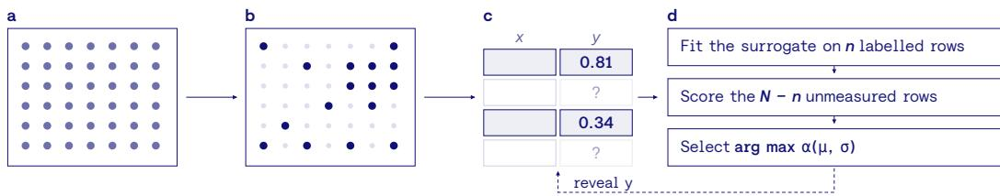  
Figure 1: Retrospective, pool-based BO. a, candidate conditions in the experimental design space. b, the conditions the original campaign measured form the pool. c, the optimizer sees the features x of every candidate; outcomes y stay hidden until queried. d, each round, the surrogate is fit on the queried rows and scores the rest; the acquisition rule picks the next candidate, and its recorded outcome is revealed.

Scope and contribution. We ask whether off-the-shelf TFMs, with no training for BO or chemistry and no tuning, work as drop-in surrogates under the published protocols of established materials benchmarks; we propose no new method. We evaluate TabPFN and TabICL on 15 retrospective, poolbased campaigns from two benchmarks [26, 20], against 56 arms: seven GP kernels, random forests, CatBoost and both TFMs, each under five acquisition rules, plus random search. A TabPFN arm ranks first on both benchmarks (Figure D.3). By avoiding campaign-specific GP kernel selection, tabular foundation models offer a low-friction surrogate for small-data, closed-loop materials optimization.

## 2 Setup

We consider retrospective, pool-based active learning tasks and study how using TFMs as surrogate models in a Bayesian optimization (BO) loop compares to other methods. A pool is the finite set of candidate conditions a published study actually measured, together with its recorded outcomes. An active learning algorithm explores that pool sequentially, optimizing for a given target: at each round a surrogate is fitted to what has been queried so far while an acquisition function selects the next candidate. What makes the task retrospective is that every outcome is already on record, so a campaign can be replayed over many seeds at no experimental cost. Figure 1 illustrates this setup.

Benchmark datasets. We use two benchmarks: the liang dataset containing five materials discovery tasks (3-5 variables; 94-600 candidates) [26] and the (raw) olympus datasets with ten chemistry and colorimetry tasks (3-6 variables; 66-1386 candidates) [20]. See Appendix A for all details of the benchmark datasets. Following Liang et al. [26], for each run, we randomly sample two initial candidates from the pool, acquire one more point per iteration and repeat until the pool is exhausted. Different random seeds determine the initial starting candidate pair, as well as any algorithmic randomness. Method rankings are sensitive to the initial design, budget and scoring rule [36, 4], so we adopt each benchmark’s own seeds and scoring rule: 50 seeds and Top-5% on liang, 100 seeds and best achieved value on olympus. We deviate in one respect. Häse et al. [20] fit emulators to their raw data and have planners query those emulators, whereas we replay the recorded pools directly Selecting from a fixed candidate set is the setting we study, and an emulator smooths the design space, which may favor surrogates whose assumptions match that smoothness [26].

Baselines. We pair eleven surrogates with five acquisition rules and report the full combinatorial set. As surrogate models we consider Gaussian processes with seven kernels [26, 39], since a GP’s kernel choice is itself non-trivial and task-dependent [10], random forests [5], CatBoost [31] and tabular foundation models (TabICL [33] and TabPFN-3 [18]). Every surrogate is run under the acquisition rules greedy [7], expected improvement (EI) [29, 23], probability of improvement (PI) [24] and UCB1, UCB2 [6, 41]. Additionally, we report the baseline of randomly choosing the next candidate point. The full enumeration of all surrogate-acquisition pairs is given in Appendix B.

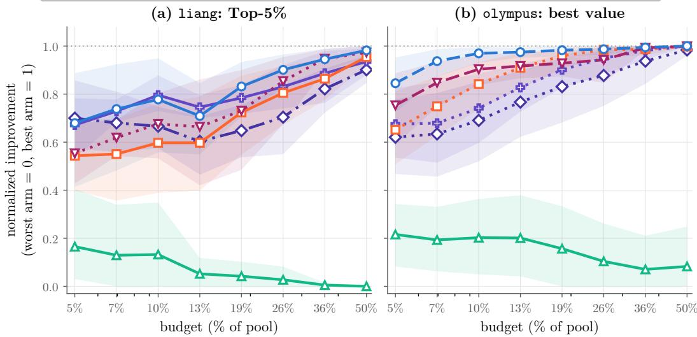  
Figure 2: Normalized improvement (NI) against budget, best arm per surrogate family. (a) liang, Top-5%. (b) olympus, best value. Bands are the 2.5-97.5 percentile bootstrap over campaigns; seed-level differences within each campaign are analyzed in Appendix D.4. TFMs are competitive across benchmarks and budgets.

Features and predictive distributions. All surrogates see the same features: the benchmark’s raw input variables (3–6 numeric variables), with no descriptors or feature engineering. Targets are negated for minimization tasks. GPs normalize inputs and standardize targets; the other surrogates take raw values. Every surrogate is refitted on the queried rows at each round; for TFMs, these rows form the context of one forward pass, with no weight updates. Acquisition uses each TFM’s native predictive distribution, with no Gaussian approximation: EI, PI and UCB are computed exactly on TabPFN’s bar distribution, and from TabICL’s predicted quantile function. UCBβ is the predictive quantile at probability Φ(β), β ∈ {1, 2}, which equals µ + βσ for a Gaussian. GPs, random forests and CatBoost use the Gaussian forms on their predictive mean and standard deviation, and greedy ranks by the mean (Table B.3, Appendix B.1).

Metrics. Top-5% is the fraction of the pool’s top 5% candidates found. Given the different sizes of pools, budgets are stated as a fraction of the pool. To aggregate results over settings within a benchmark, we employ the Normalized Improvement (NI) metric (cf. Appendix C) [11], which rescales every arm within a campaign and budget onto the range [0, 1]: the worst arm maps to 0 and the best to 1. This metric is then averaged over tasks to obtain the final aggregate score.

## 3 Results

Figure 2 shows the best observed arm per surrogate family, selected by area under the NI curve within each benchmark (Figure D.3) [19, 43]. Selection includes the acquisition rule for every family and the kernel for GPs. These curves thus describe configurations selected on the evaluated results. All 56 arms appear in Figures D.4 and D.5.

Across both benchmarks, the TFMs are competitive with the other baselines over most of the budget range. Seed-to-seed spread within a campaign is large (Figures D.1 and D.2). Following Shields et al. [37], we test each campaign with a Welch t-test on performance AUC over seeds (Appendix D.4). The TabPFN arm of Figure 2 is better than each other family’s arm on most campaigns and worse on at most one (Table D.1). Both arms are selected post hoc, so selection bias remains.

Sensitivity to the acquisition function. The best acquisition rule varies across benchmarks and individual campaigns; EI and PI lead on olympus, while PI and UCB1 are stronger on liang. Figure D.9 shows the best observed acquisition rule for each surrogate and campaign; these campaign-specific winners differ from the benchmark-wide selection used in Figure 2 (Appendix D.4). Nevertheless, the NI-AUC ranking in Figure D.3 shows that strong TabPFN performance is not confined to a single acquisition rule, with several TabPFN arms occupying top positions on both benchmarks. In particular, TabPFN-UCB1 and TabPFN-PI take the top two places on liang, and TabPFN-EI and TabPFN-UCB2 take the top two on olympus. Thus, performance depends not only on the surrogate, but also on how it is used for acquisition.

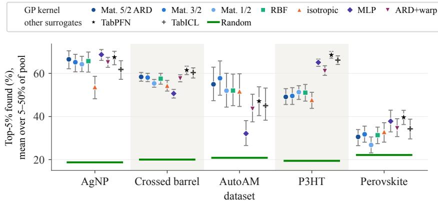  
Figure 3: GP kernel choice per dataset on liang. All arms under UCB1, the acquisition rule of the best-ranked GP arm on liang (Figure D.3). Each mark summarizes one arm’s Top-5% found over eight log-spaced budgets from 5-50% of the pool, on the raw percentage scale. Grey bars are a 2.5-97.5 percentile bootstrap over seeds. We report the analogous results on the olympus benchmark in Figure D.8.

Kernel choices for GPs. The per-campaign results for liang in Figure 3 show considerable heterogeneity across GP kernels, the design of which is an active concern in chemistry applications [16] and a known source of variation in this benchmark family [36, 26]. The MLP arm exemplifies this best: it performs best on some campaigns (AgNP and Perovskite), while doing worst on another (AutoAM). On AutoAM and Perovskite, the spread across kernels is comparable to the gap to random search. The best kernel differs across campaigns, making kernel choice a model selection problem [10, 27]. Kernel misspecification can impair optimization [3]. TFMs avoid this choice, while acquisition selection remains consequential.

Metric dependence. Scoring the same runs on the alternative metric reorders the field. On olympus, the TFMs stand out more under the benchmark’s own metric (best value) than under Top-5%. Appendix D.2 shows both benchmarks under the alternative metric.

## 4 Discussion

We find that tabular foundation models are highly competitive surrogates for retrospective pool-based active learning in materials discovery, despite being used entirely out-of-the-box and not being trained for sequential optimization or chemistry. Across two established benchmarks with small, low-dimensional pools [26, 20], they compete with or outperform carefully specified GP surrogates while avoiding GP kernel selection. Evaluating further benchmarks [36, 37] is an important next step.

Limitations. Our benchmarks are retrospective, with small pools and few variables. Replay measures how well a method reorders an existing pool, not which data it would collect, so our results do not establish superiority in live closed-loop campaigns. The pools are also shaped by earlier policies: four of five liang campaigns were collected along the path of a BO-guided campaign [26], potentially favoring BO-like policies. Autonomous laboratories [1, 14, 38, 13] may enable “live” benchmarks.

As discussed in Section 3, the ranking and ultimately the interpretation of what constitutes a good model depend crucially on the chosen evaluation protocol and metric. We follow the evaluation schemes of the considered benchmarks in an attempt to minimize the effect of custom metrics, but even among the two benchmarks in this work, underlying metrics differ. The development and widespread adoption of unified benchmarks have been central to the success of TFM development [12, 32], and we believe similar efforts for materials science could catalyze the development of active learning methods as well.

Outlook. TFMs can take any auxiliary information expressible as rows, such as prior measurements, sibling campaigns or computed descriptors, directly into their context, whereas GPs typically need purpose-built multi-task or transfer kernels [42]. Existing TFMs [18, 33] scale quadratically with context size, against the cubic cost of GPs.

Our experiments use TFMs without task-specific pretraining. Encoding domain knowledge in their synthetic training priors may improve performance further. Another direction is to adapt TFM training to sequential optimization and acquisition. Our results motivate investigating both directions for materials discovery.

## References

[1] Adedire D. Adesiji, Jiashuo Wang, Cheng-Shu Kuo, and Keith A. Brown. Benchmarking self-driving labs. Digital Discovery, 5(1):14–27, 2026. doi: 10.1039/D5DD00337G. Preprint: arXiv:2508.06642.

[2] Maximilian Balandat, Brian Karrer, Daniel R. Jiang, Samuel Daulton, Benjamin Letham, Andrew Gordon Wilson, and Eytan Bakshy. BoTorch: A framework for efficient Monte-Carlo Bayesian optimization. In Advances in Neural Information Processing Systems (NeurIPS), volume 33, 2020. arXiv:1910.06403.

[3] Felix Berkenkamp, Angela P. Schoellig, and Andreas Krause. No-regret Bayesian optimization with unknown hyperparameters. Journal ofMachine Learning Research, 20(50):1–24, 2019. arXiv:1901.03357.

[4] Christopher K. H. Borg, Eric S. Muckley, Clara Nyby, James E. Saal, Logan Ward, Apurva Mehta, and Bryce Meredig. Quantifying the performance of machine learning models in materials discovery. Digital Discovery, 2(2):327–338, 2023. doi: 10.1039/D2DD00113F.

[5] Leo Breiman. Random forests. Machine Learning, 45(1):5–32, 2001. doi: 10.1023/A:1010933404324.

[6] Dennis D. Cox and Susan John. A statistical method for global optimization. In IEEE International Conference on Systems, Man, and Cybernetics, pages 1241–1246, 1992. doi: 10.1109/ICSMC.1992. 271617.

[7] George De Ath, Richard M. Everson, Alma A. M. Rahat, and Jonathan E. Fieldsend. Greed is good: Exploration and exploitation trade-offs in Bayesian optimisation. ACM Transactions on Evolutionary Learning and Optimization, 1(1), 2021. doi: 10.1145/3425501.

[8] Janez Demšar. Statistical comparisons of classifiers over multiple data sets. Journal of Machine Learning Research, 7:1–30, 2006.

[9] James R. Deneault, Jorge Chang, Jay Myung, Daylond Hooper, Andrew Armstrong, Mark Pitt, and Benji Maruyama. Toward autonomous additive manufacturing: Bayesian optimization on a 3D printer. MRS Bulletin, 46(7):566–575, 2021. doi: 10.1557/s43577-021-00051-1.

[10] David Duvenaud, James Robert Lloyd, Roger Grosse, Joshua B. Tenenbaum, and Zoubin Ghahramani. Structure discovery in nonparametric regression through compositional kernel search. In International Conference on Machine Learning (ICML), pages 1166–1174, 2013. arXiv:1302.4922.

[11] Nick Erickson, Jonas Mueller, Alexander Shirkov, Hang Zhang, Pedro Larroy, Mu Li, and Alexander Smola. AutoGluon-Tabular: Robust and accurate AutoML for structured data. arXiv preprint arXiv:2003.06505, 2020.

[12] Nick Erickson, Lennart Purucker, Andrej Tschalzev, David Holzmüller, Prateek Mutalik Desai, David Salinas, and Frank Hutter. TabArena: A living benchmark for machine learning on tabular data. In Advances in Neural Information Processing Systems 38, Datasets and Benchmarks Track, 2025. arXiv:2506.16791.

[13] Juan L. Gamella, Jonas Peters, and Peter Bühlmann. Causal chambers as a real-world physical testbed for AI methodology. Nature Machine Intelligence, 7(1):107–118, 2025. doi: 10.1038/s42256-024-00964-x.

[14] Tobias Ginsburg, Kyle Hippe, Ryan Lewis, Doga Ozgulbas, Aileen Cleary, Rory Butler, Casey Stone, Abraham Stroka, Rafael Vescovi, and Ian Foster. Exploring benchmarks for self-driving labs using color matching. In Proceedings of the SC ’23 Workshops of the International Conference on High Performance Computing, Network, Storage, and Analysis (SC-W ’23), Denver, CO, USA, 2023. Association for Computing Machinery. doi: 10.1145/3624062.3624614. Preprint: arXiv:2310.00510.

[15] Aldair E. Gongora, Bowen Xu, Wyatt Perry, Chika Okoye, Patrick Riley, Kristofer G. Reyes, Elise F. Morgan, and Keith A. Brown. A Bayesian experimental autonomous researcher for mechanical design. Science Advances, 6(15):eaaz1708, 2020. doi: 10.1126/sciadv.aaz1708.

[16] Ryan-Rhys Griffiths, Leo Klarner, Henry B. Moss, Aditya Ravuri, Sang Truong, Samuel Stanton, Gary Tom, Bojana Rankovic, Yuanqi Du, Arian Jamasb, Aryan Deshwal, Julius Schwartz, Austin Tripp, Gregory Kell, Simon Frieder, Anthony Bourached, Alex Chan, Jacob Moss, Chengzhi Guo, Johannes Durholt, Saudamini Chaurasia, Felix Strieth-Kalthoff, Alpha A. Lee, Bingqing Cheng, Alán Aspuru-Guzik, Philippe Schwaller, and Jian Tang. GAUCHE: A library for Gaussian processes in chemistry. In Advances in Neural Information Processing Systems (NeurIPS), 2023. arXiv:2212.04450.

[17] Léo Grinsztajn, Klemens Flöge, Oscar Key, Felix Birkel, Philipp Jund, Brendan Roof, Benjamin Jäger, Dominik Safaric, Noah Hollmann, Frank Hutter, et al. TabPFN-2.5: Advancing the state of the art in tabular foundation models. arXiv preprint arXiv:2511.08667, 2025.

[18] Léo Grinsztajn, Klemens Flöge, Oscar Key, Felix Birkel, Philipp Jund, Brendan Roof, Mihir Manium, Shi Bin Hoo, Magnus Bühler, Anurag Garg, Dominik Safaric, Jake Robertson, Benjamin Jäger, Simone Alessi, Adrian Hayler, Vladyslav Moroshan, Lennart Purucker, Philipp Singer, Alan Arazi, Julien Siems, Jan Hendrik Metzen, Georg Grab, Nick Erickson, Siyuan Guo, Eliott Kalfon, Simon Bing, David Salinas, Clara Cornu, Lilly Charlotte Wehrhahn, Diana Kriuchkova, Kursat Kaya, Lydia Sidhoum, Marie Salmon, Jerry Chen, Madelon Hulsebos, Yann LeCun, Samuel Müller, Bernhard Schölkopf, Sauraj Gambhir, Noah Hollmann, and Frank Hutter. TabPFN-3: Technical report. arXiv preprint arXiv:2605.13986, 2026.

[19] Isabelle Guyon, Gavin Cawley, Gideon Dror, and Vincent Lemaire. Results of the active learning challenge. In Proceedings ofthe Active Learning and Experimental Design Workshop (AISTATS 2010), volume 16 of Proceedings ofMachine Learning Research, pages 19–45, 2011.

[20] Florian Häse, Matteo Aldeghi, Riley J. Hickman, Loïc M. Roch, Melodie Christensen, Elena Liles, Jason E. Hein, and Alán Aspuru-Guzik. Olympus: A benchmarking framework for noisy optimization and experiment planning. Machine Learning: Science and Technology, 2(3):035021, 2021. doi: 10.1088/ 2632-2153/abedc8.

[21] Noah Hollmann, Samuel Müller, Lennart Purucker, Arjun Krishnakumar, Max Körfer, Shi Bin Hoo, Robin Tibor Schirrmeister, and Frank Hutter. Accurate predictions on small data with a tabular foundation model. Nature, 637(8045):319–326, 2025. doi: 10.1038/s41586-024-08328-6.

[22] Jeffrey Hu, Rongzhi Dong, Ying Feng, Ming Hu, and Jianjun Hu. Foundation-model surrogates enable data-efficient active learning for materials discovery. arXiv preprint arXiv:2603.12567, 2026.

[23] Donald R. Jones, Matthias Schonlau, and William J. Welch. Efficient global optimization of expensive blackbox functions. Journal ofGlobal Optimization, 13(4):455–492, 1998. doi: 10.1023/A:1008306431147.

[24] H. J. Kushner. A new method of locating the maximum point of an arbitrary multipeak curve in the presence of noise. Journal of Basic Engineering, 86(1):97–106, 1964. doi: 10.1115/1.3653121.

[25] Jonas Landsgesell, Pascal Knoll, and Tizian Wenzel. ScoringBench: A benchmark for evaluating tabular foundation models with proper scoring rules. arXiv preprint arXiv:2603.29928, 2026.

[26] Qiaohao Liang, Aldair E. Gongora, Zekun Ren, Armi Tiihonen, Zhe Liu, Shijing Sun, James R. Deneault, Daniil Bash, Flore Mekki-Berrada, Saif A. Khan, Kedar Hippalgaonkar, Benji Maruyama, Keith A. Brown, John Fisher III, and Tonio Buonassisi. Benchmarking the performance of Bayesian optimization across multiple experimental materials science domains. npj Computational Materials, 7(1):188, 2021. doi: 10.1038/s41524-021-00656-9.

[27] Gustavo Malkomes, Charles Schaff, and Roman Garnett. Bayesian optimization for automated model selection. In Advances in Neural Information Processing Systems (NeurIPS), 2016.

[28] Flore Mekki-Berrada, Zekun Ren, Tan Huang, Wai Kuan Wong, Fang Zheng, Jiaxun Xie, Isaac Parker Siyu Tian, Senthilnath Jayavelu, Zackaria Mahfoud, Daniil Bash, Kedar Hippalgaonkar, Saif Khan, Tonio Buonassisi, Qianxiao Li, and Xiaonan Wang. Two-step machine learning enables optimized nanoparticle synthesis. npj Computational Materials, 7(1):55, 2021. doi: 10.1038/s41524-021-00520-w.

[29] Jonas Mockus, Vytautas Tiesis, and Antanas Zilinskas. The application of Bayesian methods for seeking the extremum. In L. C. W. Dixon and G. P. Szego, editors,˝ Towards Global Optimization, volume 2, pages 117–129. North-Holland, Amsterdam, 1978.

[30] Samuel Müller, Matthias Feurer, Noah Hollmann, and Frank Hutter. PFNs4BO: In-context learning for Bayesian optimization. In International Conference on Machine Learning (ICML), 2023. arXiv:2305.17535.

[31] Liudmila Prokhorenkova, Gleb Gusev, Aleksandr Vorobev, Anna Veronika Dorogush, and Andrey Gulin. CatBoost: unbiased boosting with categorical features. In Advances in Neural Information Processing Systems (NeurIPS), volume 31, pages 6639–6649, 2018. arXiv:1706.09516.

[32] Lennart Purucker, Andrej Tschalzev, Nick Erickson, Gioia Blayer, David Holzmüller, Alan Arazi, Alexander Pfefferle, Mustafa Tajjar, Gaël Varoquaux, and Frank Hutter. Beyond IID: How general are tabular foundation models, really? arXiv preprint arXiv:2606.30410, 2026.

[33] Jingang Qu, David Holzmüller, Gaël Varoquaux, and Marine Le Morvan. TabICLv2: A better, faster, scalable, and open tabular foundation model. arXiv preprint arXiv:2602.11139, 2026.

[34] Carl Edward Rasmussen and Christopher K. I. Williams. Gaussian Processesfor Machine Learning. MIT Press, Cambridge, MA, 2006. ISBN 978-0-262-18253-9.

[35] Theodore Rogers and Srividya Ponnada. Zero-shot Bayesian optimization with TabPFN: Competitive with state-of-the-art without per-task training. In International Conference on Automated Machine Learning (AutoML), 2026.

[36] Brian Rohr, Helge S. Stein, Dan Guevarra, Yu Wang, Joel A. Haber, Muratahan Aykol, Santosh K. Suram, and John M. Gregoire. Benchmarking the acceleration of materials discovery by sequential learning. Chemical Science, 11(10):2696–2706, 2020. doi: 10.1039/C9SC05999G.

[37] Benjamin J. Shields, Jason Stevens, Jun Li, Marvin Parasram, Farhan Damani, Jesus I. Martinez Alvarado, Jacob M. Janey, Ryan P. Adams, and Abigail G. Doyle. Bayesian reaction optimization as a tool for chemical synthesis. Nature, 590(7844):89–96, 2021. doi: 10.1038/s41586-021-03213-y.

[38] Kelsey L. Snapp and Keith A. Brown. Driving school for self-driving labs. Digital Discovery, 2(5): 1620–1629, 2023. doi: 10.1039/D3DD00150D.

[39] Jasper Snoek, Kevin Swersky, Richard S. Zemel, and Ryan P. Adams. Input warping for Bayesian optimization of non-stationary functions. In International Conference on Machine Learning (ICML), volume 32 of Proceedings ofMachine Learning Research, pages 1674–1682, 2014. arXiv:1402.0929.

[40] Jost Tobias Springenberg, Aaron Klein, Stefan Falkner, and Frank Hutter. Bayesian optimization with robust Bayesian neural networks. In Advances in Neural Information Processing Systems (NeurIPS), volume 29, pages 4134–4142, 2016.

[41] Niranjan Srinivas, Andreas Krause, Sham M. Kakade, and Matthias Seeger. Gaussian process optimization in the bandit setting: No regret and experimental design. In International Conference on Machine Learning (ICML), pages 1015–1022, 2010. arXiv:0912.3995.

[42] Connor J. Taylor, Kobi C. Felton, Daniel Wigh, Mohammed I. Jeraal, Rachel Grainger, Gianni Chessari, Christopher N. Johnson, and Alexei A. Lapkin. Accelerated chemical reaction optimization using multi-task learning. ACS Central Science, 9(5):957–968, 2023. doi: 10.1021/acscentsci.3c00050.

[43] Ryan Turner, David Eriksson, Michael McCourt, Juha Kiili, Eero Laaksonen, Zhen Xu, and Isabelle Guyon. Bayesian optimization is superior to random search for machine learning hyperparameter tuning: Analysis of the black-box optimization challenge 2020. In Proceedings of the NeurIPS 2020 Competition and Demonstration Track, volume 133 of Proceedings ofMachine Learning Research, pages 3–26, 2021.

[44] Rosen Ting-Ying Yu, Christophe Hatterer, Advaith Narayanan, Cyril Picard, and Faez Ahmed. BOCoDe: Engineering-centered benchmarking for Bayesian optimization. arXiv preprint arXiv:2608.15073, 2026.

[45] Rosen Ting-Ying Yu, Cyril Picard, and Faez Ahmed. GIT-BO: High-dimensional Bayesian optimization with tabular foundation models. In International Conference on Learning Representations (ICLR), 2026. arXiv:2505.20685.

[46] Xingxuan Zhang, Gang Ren, Han Yu, Hao Yuan, Hui Wang, Jiansheng Li, et al. LimiX: Unleashing structured-data modeling capability for generalist intelligence. arXiv preprint arXiv:2509.03505, 2025.

[47] Xiyuan Zhang, Danielle C. Maddix, Junming Yin, Nick Erickson, Abdul Fatir Ansari, Boran Han, Shuai Zhang, Leman Akoglu, Christos Faloutsos, Michael W. Mahoney, Cuixiong Hu, Huzefa Rangwala, George Karypis, and Bernie Wang. Mitra: Mixed synthetic priors for enhancing tabular foundation models. In Advances in Neural Information Processing Systems (NeurIPS), 2025. arXiv:2510.21204.

## A Benchmark datasets details

We provide the full benchmark dataset details in Table A.1.

Table A.1: Dataset details on the two considered benchmarks.
<table><tr><td>Campaign</td><td>N</td><td>d</td><td>Objective</td></tr><tr><td colspan="4">1iang: 5 campaigns, 50 seeds, Top-5% [26]</td></tr><tr><td>Crossed barrel</td><td>600</td><td>4</td><td>toughness ↑</td></tr><tr><td>P3HT</td><td>178</td><td>5</td><td>conductivity  $( \frac { S } { c m } ) \uparrow$ </td></tr><tr><td>AgNP</td><td>164</td><td>5</td><td>spectral loss ↓</td></tr><tr><td>AutoAM</td><td>100</td><td>4</td><td>score ↑</td></tr><tr><td>Perovskite</td><td>94</td><td>3</td><td>instability index ↓</td></tr><tr><td colspan="4">olympus: 10 campaigns, 100 seeds, best value at Häse et al.&#x27;s checkpoints</td></tr><tr><td>hplc</td><td>1386</td><td>6</td><td>peak area ↑</td></tr><tr><td>photo_pce10</td><td>1040</td><td>4</td><td>degradation ↓</td></tr><tr><td>photo_wf3</td><td>1040</td><td>4</td><td>degradation ↓</td></tr><tr><td>suzuki</td><td>247</td><td>4</td><td>yield ↑</td></tr><tr><td>fullerenes</td><td>246</td><td>3</td><td>product ↑</td></tr><tr><td>colors_bob</td><td>241</td><td>5</td><td>difference to green ↓</td></tr><tr><td>alkox</td><td>208</td><td>4</td><td>conversion ↑</td></tr><tr><td>colors_n9</td><td>102</td><td>3</td><td>difference to green ↓</td></tr><tr><td>benzylation</td><td>73</td><td>4</td><td>impurity ↓</td></tr><tr><td>snar</td><td>66</td><td>4</td><td>E-factor ↓</td></tr></table>

## B Baselines

The full list of surrogates can be found in Table B.1, while the five acquisition functions are listed in Table B.3.

Table B.1: Surrogates. Every arm we consider is one of these surrogates under one of the rules in Table B.3, and the set is the full cross product: eleven surrogates × five rules gives the 55 models we report. Random is not part of that product, but it is scored like any other arm and is one of the 56 that set the min-max range. Each arm is run on all 5 liang and all 10 olympus campaigns, at every seed the protocol declares (50 and 100 respectively). Kernels are given in Table B.2; all are anisotropic (ARD) except GP-iso.
<table><tr><td>Surrogate</td><td>Family</td></tr><tr><td>TabPFN</td><td>tabular foundation model [18]</td></tr><tr><td>TabICL</td><td>tabular foundation model [33]</td></tr><tr><td>RF</td><td>random forest, 100 trees, spread across trees [5]</td></tr><tr><td>CatBoost</td><td>boosting, RMSEWithUncertainty + virtual ensembles [31]</td></tr><tr><td>GP-ARD</td><td>Matérn-5/2, ARD [34], the reference kernel</td></tr><tr><td>GP-M32</td><td>Matérn-3/2, ARD</td></tr><tr><td>GP-M12</td><td>Matérn-1/2, ARD</td></tr><tr><td>GP-RBF</td><td>squared exponential, ARD</td></tr><tr><td>GP-iso</td><td>Matérn-5/2, isotropic: one shared lengthscale</td></tr><tr><td>GP-MLP</td><td>arccosine (MLP) kernel, ARD, non-stationary</td></tr><tr><td>GP-ARD-Warp</td><td>Matérn-5/2 ARD on warped inputs, BoTorch&#x27;s [2] Kumaraswamy parameterization of Snoek et al. [39]</td></tr><tr><td>Random</td><td>selects uniformly from the un-queried pool</td></tr></table>

Table B.2: GP kernels. The seven kernels of Table B.1, written as $k ( { \bf x } , { \bf x } ^ { \prime } ) / \sigma ^ { 2 }$ , where $\sigma ^ { 2 }$ is the output scale. All kernels except GP-iso use one lengthscale per input, $\begin{array} { r } { r ^ { 2 } = \sum _ { i = 1 } ^ { d } ( x _ { i } - x _ { i } ^ { \prime } ) ^ { 2 } / \ell _ { i } ^ { 2 } } \end{array}$ GP-iso uses one shared ℓ. Each GP is a BoTorch SingleTaskGP [2]. Inputs are scaled to the unit cube, and targets are standardized on the observed rows. Hyperparameters are fit once by maximizing the exact marginal likelihood, with a lower bound on the noise. If a fit fails, the GP falls back to its prior; we count these failures per kernel and do not drop them.
<table><tr><td>Arm</td><td>Kernel</td><td> $k ( { \bf x } , { \bf x } ^ { \prime } ) / \sigma ^ { 2 }$ </td></tr><tr><td>GP-ARD</td><td>Matérn-5/2, ARD</td><td> $\left( 1 + { \sqrt { 5 } } r + { \textstyle { \frac { 5 } { 3 } } } r ^ { 2 } \right) e ^ { - { \sqrt { 5 } } r }$ </td></tr><tr><td>GP-M32</td><td>Matérn-3/2, ARD</td><td> $\left( 1 + { \sqrt { 3 } } r \right) e ^ { - { \sqrt { 3 } } r }$ </td></tr><tr><td>GP-M12</td><td>Matérn-1/2, ARD</td><td> $e ^ { - r }$ </td></tr><tr><td>GP-RBF</td><td>squared exponential, ARD</td><td> $e ^ { - r ^ { 2 } / 2 }$ </td></tr><tr><td>GP-iso</td><td>Matérn-5/2, isotropic</td><td> $\textstyle \left( 1 + { \sqrt { 5 } } r + { \frac { 5 } { 3 } } r ^ { 2 } \right) e ^ { - { \sqrt { 5 } } r } ,$  one l</td></tr><tr><td>GP-MLP</td><td>arccosine (MLP)</td><td> $\frac { 2 } { \pi } \arcsin \frac { { \mathbf x } ^ { \top } W { \mathbf x } ^ { \prime } + b } { \sqrt { ( { \mathbf x } ^ { \top } W { \mathbf x } + b + 1 ) ( { \mathbf x } ^ { \top } W { \mathbf x } ^ { \prime } + b + 1 ) } }$ </td></tr><tr><td>GP-ARD-Warp</td><td>Matérn-5/2 ARD, warped</td><td> $k _ { 5 / 2 } ( w ( \mathbf { x } ) , w ( \mathbf { x ^ { \prime } } ) ) , w _ { i } ( x ) = 1 - ( 1 - x _ { i } ^ { a _ { i } } ) ^ { b _ { i } }$ </td></tr></table>

Table B.3: Acquisition rules. Each is maximized over the un-queried pool against the incumbent $f ^ { \star } = \operatorname* { m a x } y _ { \mathrm { o b s } } ,$ with ties broken uniformly on their own random stream rather than by argmax, which on a pool in file order would score an arm that cannot separate its candidates as a systematic traversal. Written once here, they apply to every surrogate in Table B.1. For TFMs, the confidence bound is the native predictive quantile $\dot { F } ^ { - 1 } ( \Phi ( \check { \beta } ) )$ ), where $F$ is the predictive cumulative distribution function and Φ is the standard normal cumulative distribution function. For Gaussian predictions this equals $\mu + \beta \sigma$ . UCB1 and UCB2 differ only in this weight, $\beta = 1$ and $\beta = 2 ;$ the larger $\beta$ gives more weight to predictive uncertainty and so explores more. The last column gives the Gaussian forms used by the GP and tree arms; TabPFN uses its bar distribution and TabICL its predicted quantiles.

<table><tr><td>Rule</td><td></td><td>Definition</td><td>Gaussian form,  $z = ( \mu - f ^ { \star } ) / \sigma$ </td></tr><tr><td>greedy</td><td>[7]</td><td>μ</td><td>μ</td></tr><tr><td>EI</td><td>[29, 23]</td><td> $\mathbb { E } \left[ ( f - f ^ { \star } ) _ { + } \right]$ </td><td> $( \mu - f ^ { \star } ) \Phi ( z ) + \sigma \phi ( z )$ </td></tr><tr><td>PI</td><td>[24]</td><td> $\operatorname { P r } \left[ f > f ^ { \star } \right]$ </td><td> $\Phi ( z )$ </td></tr><tr><td>UCB1</td><td>[6,41]</td><td> $F ^ { - 1 } ( \Phi ( 1 ) )$ </td><td> $\mu + \sigma$ </td></tr><tr><td>UCB2</td><td>[6, 41]</td><td> $F ^ { - 1 } ( \Phi ( 2 ) )$ </td><td> $\mu + 2 \sigma$ </td></tr></table>

## B.1 Implementation details

All arms run in src/matbo/methods/ of the code repository.

Inputs. Every surrogate receives the same matrix of the benchmark’s numeric input variables. On liang, repeated measurements of one design point become one candidate whose target is the mean of the distinct measured values, following Liang et al. [26]; on olympus, every recorded row is a candidate. Minimization targets are negated, so every surrogate maximizes.

TabPFN. A new TabPFN-3 regressor per round, with 8 estimators, float32 inference and the seed as random state. One fit and one forward pass per round return the bar distribution; the mean, EI, PI and UCB are that distribution’s own functions.

TabICL. TabICLv2 with 8 estimators and the seed as random state. EI is $\begin{array} { r } { \int _ { 0 } ^ { 1 } \operatorname* { m a x } ( Q ( u ) - f ^ { \star } , 0 ) } \end{array}$ du over the predicted quantile function $Q ,$ by the trapezoid rule on levels refined in the upper tail. PI is $1 - F \bar { ( } f ^ { \star } )$ , with $\hat { \boldsymbol F } ( f ^ { \star } )$ found by interpolating $Q .$ . UCB is $Q ( \Phi ( \beta ) )$ ). If no feature varies in the context, which can happen when the two initial olympus rows are duplicates, the prediction is flat and the tie-break decides.

GPs. See Table B.2. EI is computed as log-EI, which has the same maximizer and does not underflow; PI and UCB use the Gaussian posterior.

Trees. RF uses 100 trees; its mean and standard deviation are taken across trees. CatBoost uses 200 iterations with the RMSEWithUncertainty loss and 10 virtual ensembles; its standard deviation combines the knowledge and data variance. If the context targets are constant, CatBoost cannot fit, so the prediction is flat and the tie-break decides. Both use the Gaussian forms in Table B.3.

## C Normalized improvement metric

The underlying metrics of each benchmark cannot be directly averaged over campaigns as pool sizes range from 66 to 1386. We therefore normalize within a campaign before aggregating. Let $y _ { a } ( c , b )$ be arm a’s metric (Top-5% or best value) on campaign c at budget b, averaged over seeds, and A the set of arms run on every campaign of that benchmark. Then

$$
\mathrm { M } _ { a } ( c , b ) = \frac { y _ { a } ( c , b ) - \operatorname* { m i n } _ { a ^ { \prime } \in A } y _ { a ^ { \prime } } ( c , b ) } { \operatorname* { m a x } _ { a ^ { \prime } \in A } y _ { a ^ { \prime } } ( c , b ) - \operatorname* { m i n } _ { a ^ { \prime } \in A } y _ { a ^ { \prime } } ( c , b ) } , \qquad \overline { { \mathrm { M } } } _ { a } ( b ) = \frac { 1 } { | \mathcal { C } | } \sum _ { c \in \mathcal { C } } \mathrm { N I } _ { a } ( c , b ) ,\tag{C.1}
$$

so the field’s worst arm is 0 and its best is 1. Both extremes are taken over $\mathcal { A }$ rather than over the arms plotted, so the scale does not move with the choice of what to show. Figure bands ${ \overline { { \mathrm { N I } } } } _ { a } ( b )$ are given by a percentile bootstrap over C (400 resamples); seeds are averaged inside $y _ { a } ( c , b )$ and carry no band.

## D Additional results

## D.1 Per-campaign results

Here we show the per-campaign results behind the aggregate figures in the main text (Figure 2), following the visualization scheme of each benchmark’s original paper [26, 20]. Figure D.1 shows the five liang campaigns as Top-5% against learning cycle together with the enhancement and acceleration factors of Liang et al. [26]. Figure D.2 shows the best value found against evaluations on each of the ten olympus campaigns. Figure D.3 shows each benchmark’s ranking of every method, according to the area under the normalized improvement curve. This ranking is the basis upon which the selection of each surrogate model family’s representative for plotting is performed. The underlying NI curves for all methods are presented in Figures D.4 and D.5.

<table><tr><td>TabICL-PI</td><td>RF-greedy</td><td>Random</td><td>-  random (analytic)</td></tr><tr><td>GP-ARD-Warp-UCB1</td><td>CatBoost-UCB1</td><td>TabPFN-UCB1</td><td></td></tr></table>

a Top% against learning cycle b enhancement factor  
c acceleration factor  
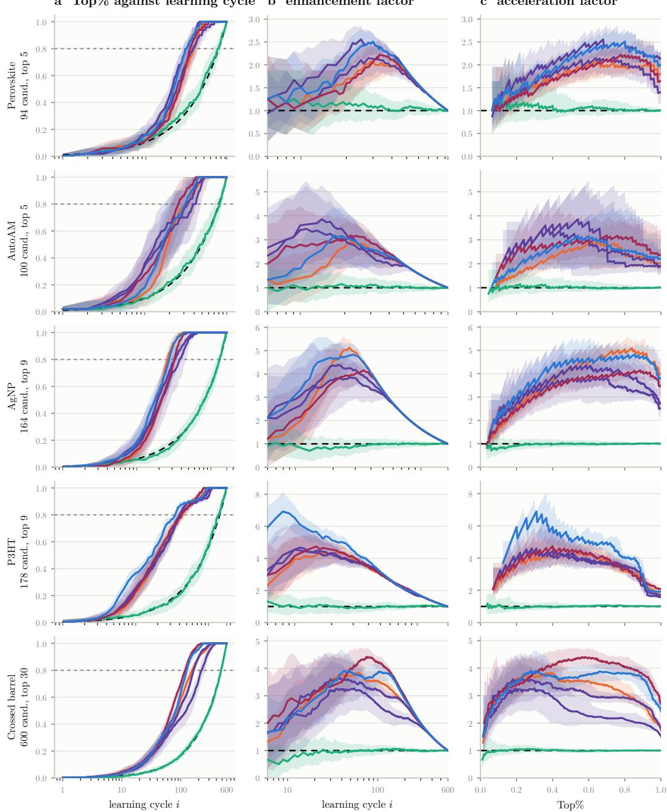  
Figure D.1: Raw per-campaign results on liang, one row per campaign, the arms of Figure 2. a, Top-5% found against learning cycle. b, enhancement factor and c, acceleration factor, both as defined by Liang et al. [26], against a random baseline of 1 (dashed). Bands are the 5–95 percentile over fold means (cf. Liang et al. [26] for full details).

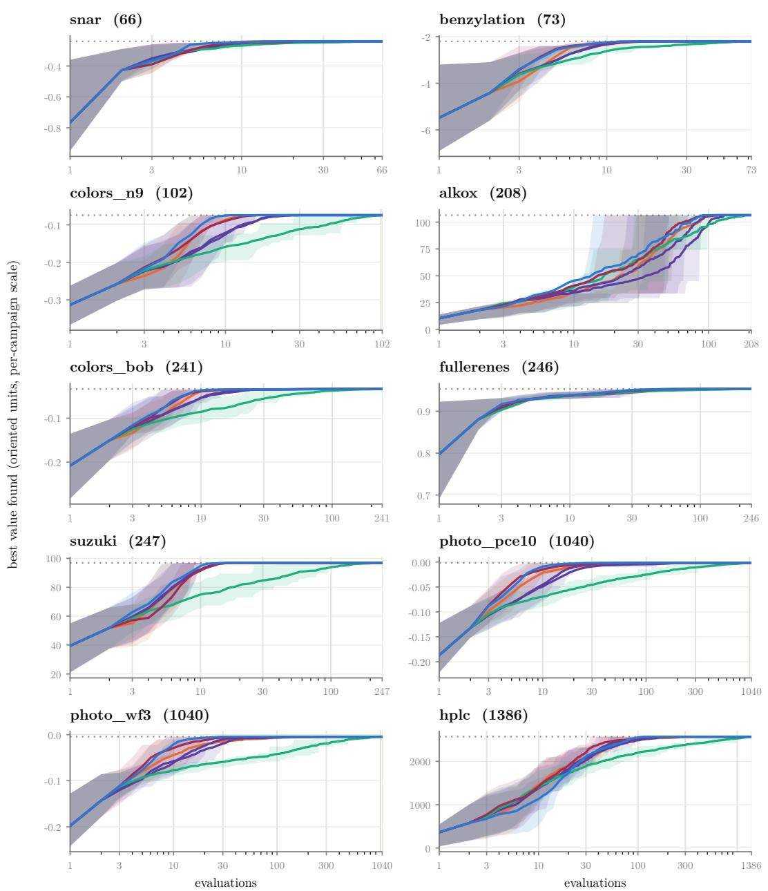

<table><tr><td>TabPFN-EI</td><td>GP-MLP-PI</td><td>CatBoost-PI</td></tr><tr><td>TabICL-EI</td><td>RF-PI</td><td>Random</td><td>pool maximum</td></tr></table>

Figure D.2: Raw per-campaign results on olympus, one panel per campaign with pool size in brackets, the arms of Figure 2. Best value found against number of evaluations, on each campaign’s own oriented scale; the dotted line is the pool maximum. Bands are the 25–75 percentile over 100 runs, reported following the protocol of Häse et al. [20].

liang: 55 arms, Top-5%  
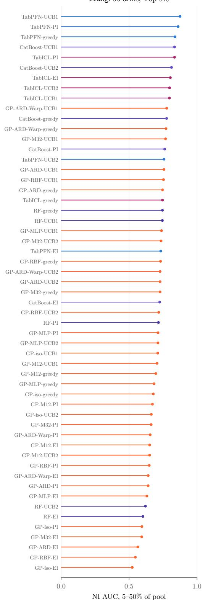

olympus: 55 arms, best value  
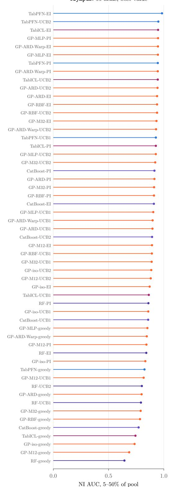  
Figure D.3: Every arm on both benchmarks, ranked by normalized improvement. Each arm’s NI-versus-budget curve (cf. Figures D.4 and D.5) is collapsed to one number: the integral of NI over budget from 5% to 50% of the pool, divided by the length of that axis so it reads on the NI scale. Color represents the surrogate family. Random enters the normalization as an ordinary arm but is omitted from the ranking. Each benchmark is scored on the metric its own paper reports: (a) liang on Top-5% found; (b) olympus on best achieved value.

liang: Top-5%  
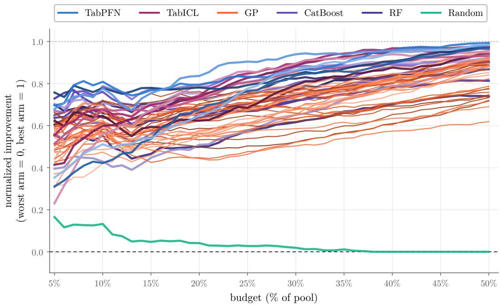  
Figure D.4: Full set of all 56 methods on liang, scored on Top-5%. Color marks the surrogate family.

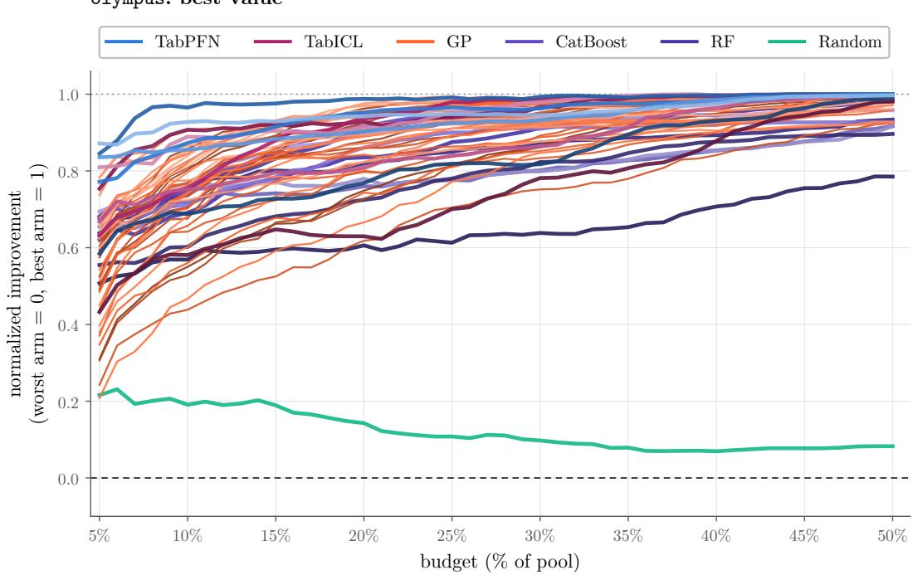  
Figure D.5: Full set of all 56 methods on olympus, scored on best achieved value. Color marks the surrogate family.

<table><tr><td>surrogate o acquisition</td><td>TabPFN UCB1</td><td>VT</td><td>TabICL PI</td><td>IロT</td><td>GP greedy</td><td>I+</td><td>CatBoost UCB2</td><td>RF</td><td></td><td>Random</td><td></td></tr></table>

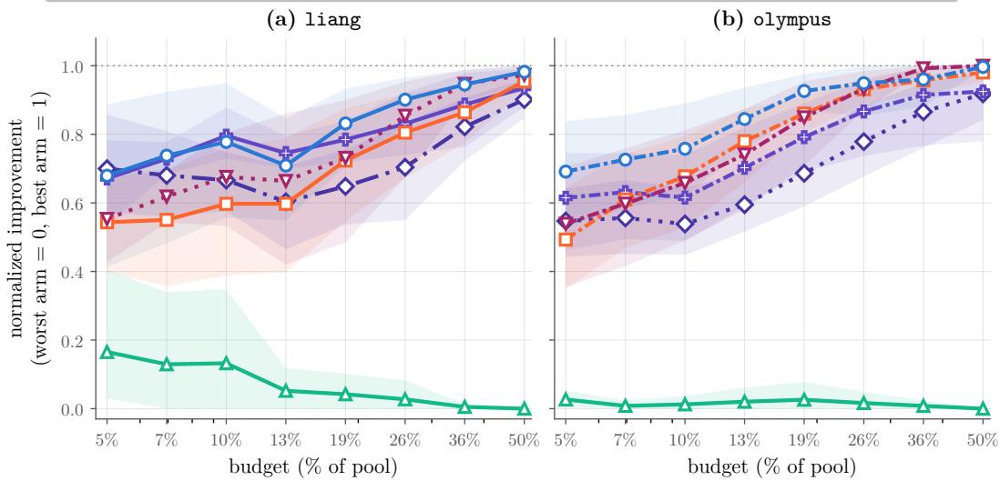  
Figure D.6: Both benchmarks scored on Top-5% found. Normalized improvement against budget, best arm per surrogate family. Panel (a) repeats the main-text scoring, panel (b) is the flipped one.

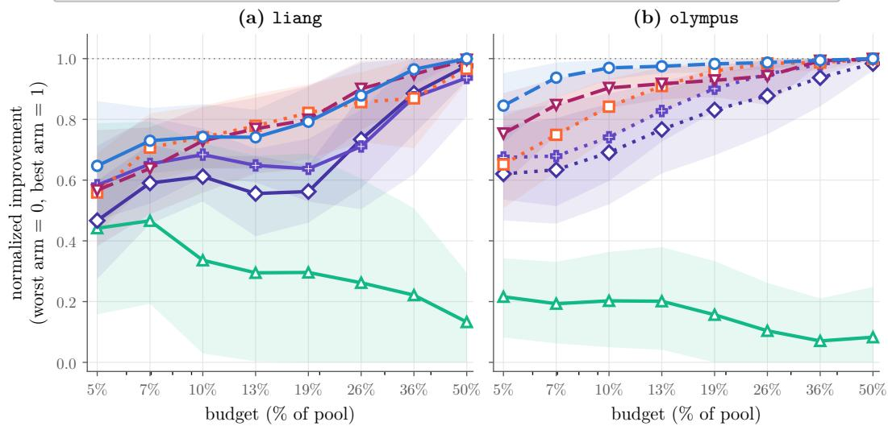  
Figure D.7: Both benchmarks scored on best achieved value. Normalized improvement against budget, best arm per surrogate family. Panel (b) repeats the main-text scoring, panel (a) is the flipped one.

## D.2 Metric dependence

Figures 2 and D.3 score each benchmark on the metric its own paper reports: Top-5% found on liang, best achieved value on olympus. Here we score the same runs on the other benchmark’s metric. Figure D.6 puts both benchmarks on Top-5% found and Figure D.7 puts both on best achieved value, so each metric can be read across benchmarks.

(own scale per campaign; higher is better throughout) best achieved value, mean over 5–50% of pool

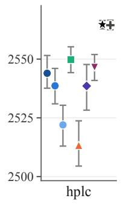

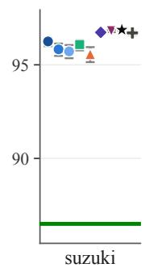

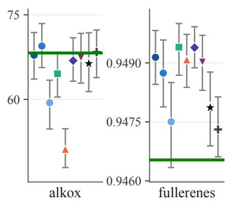

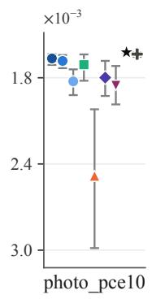

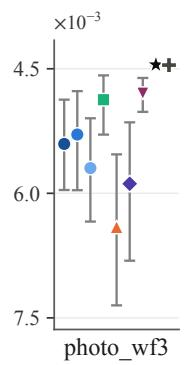

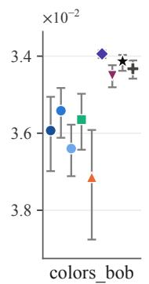

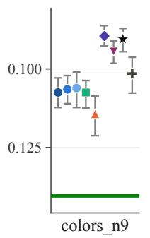

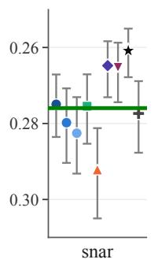

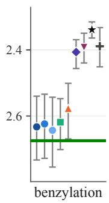  
Figure D.8: GP kernel choice per dataset on olympus. All arms under PI, the acquisition rule of the best-ranked GP arm on that benchmark, in the benchmark’s declared metric. Each mark is one arm’s best-value curve averaged over eight log-spaced budgets from 5-50% of the candidate pool; bars are a 2.5-97.5 percentile bootstrap over the protocol’s 100 seeds, taken on each seed’s own average. Every campaign has its own axis, since best value has no common scale here, and is shown in the source’s own units.

## D.3 GP kernel variation on olympus

Figure D.8 shows the per-dataset kernel comparison on olympus under PI, the acquisition rule of the best-ranked GP arm on that benchmark, analogous to Figure 3 for liang. Six of the ten campaigns are minimizations: benzylation (impurity), snar (E-factor), colors\_bob and colors\_n9 (difference to green), and photo\_pce10 and photo\_wf3 (degradation). Their axes are inverted, so better is upward in every panel. Star: TabPFN; cross: TabICL; green line: random search, omitted from hplc, colors\_bob, photo\_pce10 and photo\_wf3, where it lies far enough below the field to compress every arm into a band. Datasets are ordered by the median kernel.

## D.4 Seed-level tests and campaign-specific acquisition choice

We analyze the saved trajectories over the same linear 5–50% budget grid as Figure D.3. For each seed, performance AUC integrates the raw campaign metric and divides by the window width, giving Top-5% points on liang and objective units on olympus.

Table D.1 tests the arms of Figure 2 within each campaign: the TabPFN arm against each other family’s arm, which may use a different acquisition rule. As in Shields et al. [37], a Welch t-test compares the mean performance AUC over seeds. Both arms are selected on the evaluated results, so the counts do not correct for that selection.

Across campaigns, we rank the six families within each campaign by mean performance AUC and apply a Friedman test with the Nemenyi post-hoc test [8]. TabPFN has the best mean rank. At $\alpha = 0 . 0 5$ , it is separated from CatBoost, RF and Random, but not from TabICL or GP. The GP arm is the best of 35 configurations, chosen post hoc. Ranked by median performance AUC instead, TabPFN is separated only from Random: on four olympus campaigns, most families reach the best candidate in more than half of their runs, so their medians tie.

Table D.1: Seed-level tests of Figure 2. Number of campaigns on which a Welch t-test (α = 0.05) on performance AUC over seeds finds the TabPFN arm better or worse than the comparator, or does not separate them. Arms are those of Figure 2: TabPFN-UCB1 on liang and TabPFN-EI on olympus.
<table><tr><td>Benchmark</td><td>Comparator</td><td>better</td><td>worse</td><td>not separated</td></tr><tr><td>liang (5)</td><td>TabICL-PI</td><td>3</td><td>1</td><td>1</td></tr><tr><td></td><td>GP-ARD-Warp-UCB1</td><td>3</td><td>0</td><td>2</td></tr><tr><td></td><td>CatBoost-UCB1</td><td>3</td><td>0</td><td>2</td></tr><tr><td></td><td>RF-greedy</td><td>4</td><td>0</td><td>1</td></tr><tr><td>olympus (10)</td><td>TabICL-EI</td><td>6</td><td>0</td><td>4</td></tr><tr><td></td><td>GP-MLP-PI</td><td>7</td><td>1</td><td>2</td></tr><tr><td></td><td>CatBoost-PI</td><td>7</td><td>0</td><td>3</td></tr><tr><td></td><td>RF-PI</td><td>9</td><td>0</td><td>1</td></tr></table>

Aggregate ranking versus campaign-specific acquisition choice. Figure D.3 ranks surrogate– acquisition configurations by NI-AUC, which normalizes performance within each campaign before averaging across campaigns and integrating over budget. Figure 2 uses this ranking to select one configuration per surrogate family for each benchmark; it does not select a different configuration for each campaign.

The best-rule map in Figure D.9 answers a different question: which acquisition rule performs best for each surrogate on each individual campaign? It selects the rule with the highest mean raw-metric AUC, without cross-campaign normalization or averaging. Consequently, the best aggregate configuration need not win on every campaign. For example, TabPFN-UCB1 leads the liang NI-AUC ranking but is the best TabPFN acquisition on only two of its five campaigns.

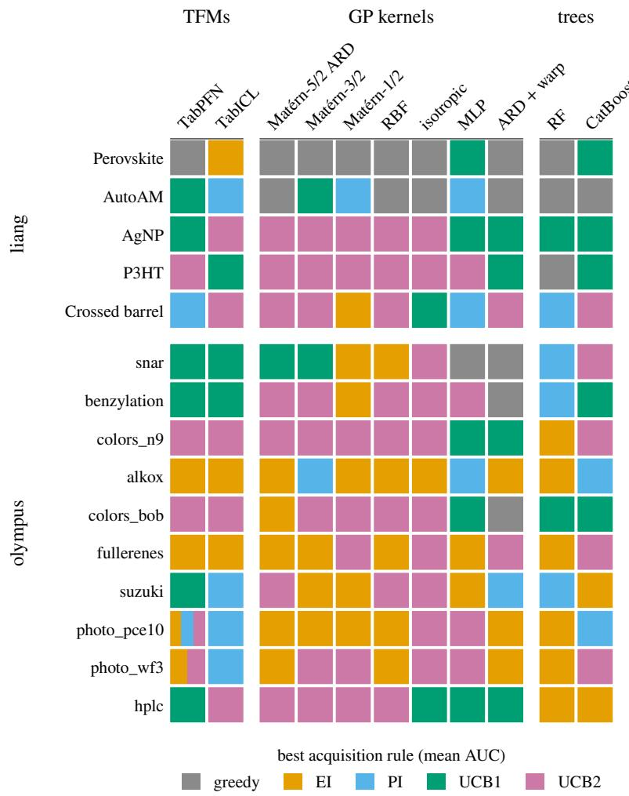  
Figure D.9: Best observed acquisition rule by surrogate and campaign. Each cell identifies the rule with the highest mean raw-metric AUC over the 5–50% budget window. Stripes indicate exact ties. Unlike Figure D.3, this figure makes no comparison aggregated across campaigns. Winners are selected on the evaluated runs; a winning rule need not be statistically distinguishable from the alternatives. Colors identify rules, not the size of their advantage.

## E Differences with Hu et al. [22]

Hu et al. [22] also study the performance of TFMs as surrogates for BO in materials science. Here we provide more details on our differences with this paper.

Different evaluation datasets. Hu et al. [22] assemble their own collection of ten datasets (copper alloys, bulk metallic glasses, lattice thermal conductivity; 495–3,148 candidates) and score methods on a custom metric, the number of extra evaluations to reach the global optimum, starting from an initial set chosen as the bottom-K% of samples by property value. We instead evaluate on two previously published benchmarks [26, 20] (15 campaigns, 66–1386 candidates), following each benchmark’s own protocol, seeds, and metric, with a random two-point initial design.

More baselines. Hu et al. [22] compare TabPFN against a single GP and a random forest. We report the full cross product of eleven surrogates and five acquisition rules (55 arms, plus random search), including seven GP kernels, CatBoost, and a second tabular foundation model (TabICL), which lets us separate the effect of the surrogate family from that of the kernel or acquisition choice. In addition, we always vary the random seed for all models compared, including TabPFN, whereas Hu et al. [22] do not vary it for TabPFN.

Taking advantage of TabPFN’s native uncertainty quantification. Hu et al. [22] use a Gaussian approximation for the uncertainty of TabPFN, and introduce normalized and hybrid acquisition functions, in particular pairing TabPFN’s mean with a GP’s variance, to compensate for perceived weaknesses of TabPFN’s uncertainty estimates. We use TabPFN and TabICL strictly out-of-the-box, integrating standard acquisition rules directly against their native predictive distributions.

Differences in conclusions. While we share the overall conclusion that TFMs are strong surrogates, Hu et al. [22] report a minimum-data threshold of roughly 10–20% of the pool before TabPFN overtakes a GP. We do not observe this: in our setting the best TabPFN arm is already ahead of the best GP arm at the smallest budget we report (5% of the pool), on both benchmarks (Figure 2).