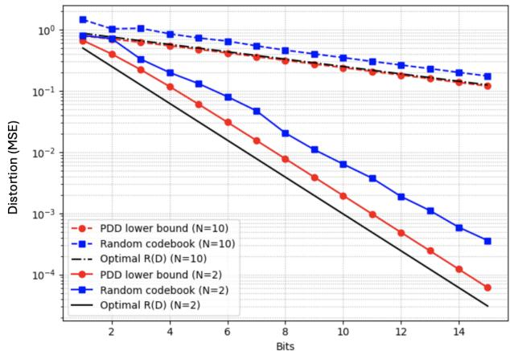
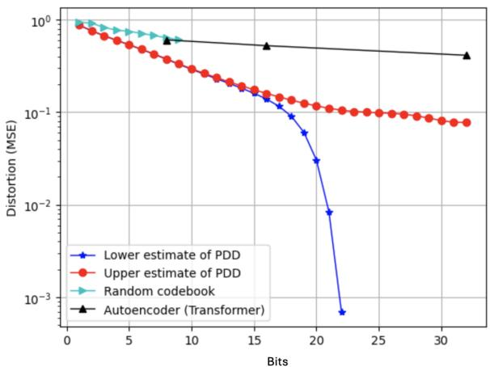

# PAIRWISE DISTORTION DISTRIBUTION FOR COMPRESSION AND QUANTIZATION

Carl Nuzman⋆, Jeongmin Chae†, Kursat Rasim Mestav⋆, and Urbashi Mitra†

⋆ Nokia Bell Labs

† Department of Electrical & Computer Engineering, University of Southern California

## ABSTRACT

Choosing the latent dimension is a critical challenge in data compression, where conventional hyperparameter optimization is costly and ad hoc. Intrinsic dimension provides a good alternative, which connects information-theoretic notions such as Renyi information dimension (RID) to rate-distortion dimension and random codebook compression. In this work, we introduce the pairwise distortion distribution (PDD) and its asymptotic limit, pairwise dimension (PD), which generalize the correlation integral to general distortion measures. We show that PD bounds RID, and PDD provides a lower bound for random codebook quantization performance, which can guide a practical use for compression, quantization, and dimensionality reduction applications.

Index Terms— Data compression, Information dimension, Latent dimension, Quantization, Rate-distortion

## 1. INTRODUCTION

Many applications such as representation learning, compression, and quantization rely on data having an intrinsic dimension much lower than the raw, or extrensic dimension. [1–4].Machine learning is a useful tool for finding such representations, in which the assumed intrinsic dimension is a key hyperparameter [5]. Conventional approaches address this by exhaustive search, which are computationally expensive and provides little insight on the geometry of the data [6, 7].

To address this, a large body of work focuses on estimating the intrinsic dimension (ID) of sets and of probability distributions, under various definitions [8]. Estimators for sets include maximum likelihood estimation (MLE) [9], TWO-NN [10], and PCA-based approaches [11], which leverage the local or global data statistics. Two well known definitions for ID are the Hausdorff dimension and the box counting dimension [11–13]. The information dimension, or the Hausdorff information dimension (HID), is the smallest Hausdorff dimension among sets having probability 1.

In information theory, an important quantity is the Renyi information dimension (RID) [14, 15]. The RID of a random vector $X \in \mathbb { R } ^ { n }$ , for $m > 0 .$ , is defined in terms of a series of quantized versions $\langle X \rangle _ { m } ~ = ~ { \frac { \lfloor m X \rfloor } { m } } ~ \mathrm { a s } ~ d _ { I } ( X ) ~ = ~$ $\begin{array} { r } { \operatorname* { l i m } _ { m  \infty } \frac { H (  X  _ { m } ) } { \log m } } \end{array}$ when the limit exists, where H is the Shannon entropy. The RID is connected in [8] to the asymptotic scaling of the rate distortion curve as distortion approaches zero, for a wide class of distortion measures. In [16], the authors introduce the correlation integral and corresponding correlation dimension as computationally simpler alternatives to HID for quantifying the dimension of a distribution.

In this paper, we make connections between the correlation integral, the RID, and compression by generalizing the correlation integral from Euclidean distances to a general distortion measure. To this end, we introduce a new function called the pairwise distortion distribution (PDD), whose asymptotic limit defines a distortion-dependent notion of dimension referred to pairwise dimension (PD). Both PDD and PD are relatively easy to estimate from data and to derive analytically for known distributions.

We show that when distortion is a power of a vector norm, the PD gives a lower bound on the RID, and thus on the asymptotic behavior of the rate-distortion curve for a wide class of distortion functions. A simple PDD-based computation also yields a lower bound on the quantization performance of random quantization codebooks. Taken together, these properties suggest that the PDD-derived rate-distortion curve can be a good guide to the quantization performance, which we confirm via empirical experiments.

## 2. BACKGROUND

We review the correlation integral and correlation dimension, which are the key concepts for our framework. The definition below is modified from, but equivalent to, the version given in [16].

Definition 1 (Correlation Integral and Correlation Dimension [16]). Let $X \sim \mathcal { D }$ be a random vector on $\mathbb { R } ^ { N }$ . For $r \geq 0 ,$ , the correlation integral is defined as

$$
C ( r ) \ = \ P _ { X _ { 1 } , X _ { 2 } \sim \mathcal { D } } [ \| X _ { 1 } - X _ { 2 } \| \le r ] ,\tag{1}
$$

where $X _ { 1 }$ and $X _ { 2 }$ are independent realizations of X. The correlation dimension ofD, ifthe limit exists, is given as

$$
d _ { C } ( X ) = \operatorname* { l i m } _ { r \to 0 } { \frac { \log C ( r ) } { \log r } } .\tag{2}
$$

$C ( r )$ is the cumulative distribution function of the random variable $Z \ = \ \| X _ { 1 } - X _ { 2 } \|$ , which represents the distance between two independent samples drawn from D. In particular, if X has an absolutely continuous distribution supported on a d-dimensional subset of $\mathbb { R } ^ { N }$ , then $d _ { C } ( X ) = d .$

While optimal codebooks achieve rate-distortion limits, its structure is difficult to characterize. Instead, we focus on the random codebook quantization scheme (RCQ), which provides a mathematically tractable baseline for PDD analysis. Let $\mathcal { C } = \{ c _ { 1 } , \ldots , c _ { L } \} \subset \mathbb { R } ^ { N }$ denote a quantization codebook with L codewords. For a distortion measure $\rho ( x , y )$ , a quantizer maps an input $X \sim \mathcal { D }$ to its nearest codeword, $j ( X ) = \arg \operatorname* { m i n } _ { n } \rho ( X , c _ { n } )$ . The mean distortion of the codebook is $\begin{array} { r } { \mu ( \mathcal { C } ) = \mathbb { E } _ { X \sim \mathcal { D } } \big | \operatorname* { m i n } _ { n } \rho ( X , c _ { n } ) \big | } \end{array}$ . When the codebook C is generated randomly, with each codeword drawn independently from D, the expected distortion over random codebooks is $\mu _ { L } = \mathbb { E } _ { \mathcal { C } } \left[ \mu ( \mathcal { C } ) \right]$

## 3. PDD-BASED FRAMEWORK

We introduce a new distribution and its corresponding notion of dimension, which generalize the correlation integral by replacing the Euclidean distance with an arbitrary distortion measure $\rho ( x , y )$

Definition 2 (Pairwise Distortion Distribution and Pairwise Dimension). Let $X \sim \mathcal { D }$ be a random vector on $\mathbb { R } ^ { N }$ , and let $\rho : \mathbb { R } ^ { N } \times \mathbb { R } ^ { N } \to \mathbb { R } _ { > 0 }$ be a distortion measure. For r $\cdot \geq 0 ,$ the pairwise distortion distribution (PDD) of D with respect to $\rho$ is defined as $\begin{array} { r c l } { \tilde { F } _ { \mathcal { D } , \rho } \left( r \right) } & { = } & { P _ { X _ { 1 } , X _ { 2 } \sim \mathcal { D } } [ \rho ( X _ { 1 } , X _ { 2 } ) \leq r ] } \end{array}$ . The corresponding notion of dimension, the pairwise dimension (PD), is defined as

$$
d _ { P } ( \mathcal { D } , \rho ) \ = \ \operatorname* { l i m } _ { r \to 0 } \frac { \log \tilde { F } _ { \mathcal { D } , \rho } \left( r \right) } { \log r } .\tag{3}
$$

We now develop a tool for compression analysis, built upon two key fundamental relationships: (i) between the pairwise distortion distribution (PDD) and the Renyi information dimension (RID), and (ii) between PDD and random codebook quantization (RCQ).

## 3.1. Connection between PDD and RID

Proposition 4 in [17] shows an alternative representation for the RID that is closely related to PDD. For p-norm on $\mathbb { R } ^ { n }$ with $1 \leq p \leq \infty$

$$
d _ { I } ( X ) = \operatorname* { l i m } _ { r \to 0 } { \frac { E _ { X _ { 1 } } \left[ \log P _ { X _ { 2 } } \left[ \left\| X _ { 1 } - X _ { 2 } \right\| _ { p } \leq r \right] \right] } { \log r } }
$$

This connects the RID to probabilities of balls of size r around random centers. We show that PDD provides a lower bound for RID.

Proposition 1. For distortionfunctions oftheform $\rho ( x , y ) =$ $\| x - y \| _ { p } ^ { \nu } , f o r { 1 \leq p \leq }$ ∞ and $\nu > 0 ,$ , if both limits exist,

$$
\nu d _ { P } ( { \cal D } , \rho ) \leq d _ { I } ( X ) .
$$

Proof: For each r,

$$
\begin{array} { r l } & { { E } _ { X _ { 1 } } \log { P } _ { X _ { 2 } } \Big [ \| X _ { 1 } - X _ { 2 } \| _ { p } \leq r \Big ] } \\ & { \quad = { E } _ { X _ { 1 } } \Big [ \log { E } _ { X _ { 2 } } \Big [ 1 \Big \{ \| X _ { 1 } - X _ { 2 } \| _ { p } \leq r \Big \} \Big ] \Big ] } \\ & { \quad \leq \log { E } _ { X _ { 1 } } \Big [ { E } _ { X _ { 2 } } \Big [ 1 \Big \{ \| X _ { 1 } - X _ { 2 } \| _ { p } \leq r \Big \} \Big ] \Big ] } \\ & { \quad = \log { P } _ { X _ { 1 } , X _ { 2 } } \big [ \rho ( X _ { 1 } , X _ { 2 } ) \leq r ^ { \nu } \big ] = \log \tilde { F } _ { \mathcal { D } , \rho } ( r ^ { \nu } ) } \end{array}
$$

Taking $r \ < \ 1$ so that log $r \ < \ 0 .$ , dividing through by $\nu \log r = \log r ^ { \nu }$ on both sides, and taking the limit as $r  0$ gives the result. ⊠

The rate-distortion dimension of a distribution is defined in [8] for distortions of the form $\rho ( x , y ) = \| x - y \| ^ { \nu }$ , as

$$
d _ { R } ( \mathcal { D } ) = \operatorname* { l i m } _ { \epsilon  0 } \frac { R _ { \mathcal { D } } ( \epsilon ^ { \nu } ) } { - \log ( \epsilon ) }
$$

where $R _ { \mathcal { D } } ( D )$ is the Shannon rate-distortion function for distribution D. The authors show that $d _ { R } ( \mathcal { D } ) = d _ { I } ( \mathcal { D } )$ for any $\nu > 0$ and any norm equivalent to $\| \| _ { \infty }$ (including $\| \bigstar _ { p }$ for any $1 \leq p \leq \infty )$ . Combining this result with Proposition 1, we see that the asymptotic increase of $R _ { \mathcal { D } , \rho } ( D )$ for small distortion D can be lower bounded based on $d _ { P } ( \mathcal { D } , \rho )$ . Thus, the PDD curve near $r = 0$ yields useful information about the effective dimension of a distribution from a rate-distortion point of view.

## 3.2. Connection between PDD and RCQ

We next show a connection between the PDD and the performance of random codebook quantization.

Proposition 2. Let $X ~ \sim ~ \mathcal { D } ~ o n ~ \mathbb { R } ^ { N }$ be a random vector. Generate a quantization codebook by drawing L codewords $\{ C _ { 1 } , \ldots , C _ { L } \}$ independently from D. For a given distortion function $\rho ( x , y )$ , the expected distortion over random codebooks, $\begin{array} { r } { \mu _ { L } = \mathbb { E } _ { C \sim \mathcal { D } ^ { L } } \Big [ \mathbb { E } _ { X \sim \mathcal { D } } \Big [ \operatorname* { m i n } _ { n } \rho ( X , C _ { n } ) \Big ] \Big ] } \end{array}$ , satisfies

$$
\mu _ { L } \geq \int _ { 0 } ^ { \infty } \left( 1 - \tilde { F } _ { \mathcal { D } , \rho } \left( r \right) \right) ^ { L } d r .\tag{4}
$$

Remark. $\tilde { \boldsymbol { F } } _ { \mathcal { D } , \rho } \left( \boldsymbol { r } \right)$ can be computed or bounded analytically for simple distributions (See e.g. Corollary 1 and 2) or estimated empirically from sufficiently many samples from a dataset.

Proof: For given $\boldsymbol { x } \in \mathbb { R } ^ { N }$ , define non-negative random variables $Y _ { n } ( x ) = \rho ( x , C _ { n } )$ with $C _ { n }$ drawn independently from $\mathcal { D }$ . Denoting the CDF of $Y _ { n } ( x )$ as $F _ { Y } ( r ; x )$ , the CDF of minn $Y _ { n } ( X )$ is $1 - \left( 1 - F _ { Y } ( r ; x ) \right) ^ { L }$ . We have

$$
\begin{array} { l } { { \displaystyle E _ { \mathcal { C } } \left[ \operatorname* { m i n } _ { n } Y _ { n } ( r ; x ) \right] = \int _ { 0 } ^ { \infty } \left( 1 - F _ { Y } ( r ; x ) \right) ^ { L } d r } \ ~ } \\ { { \displaystyle ~ = \int _ { 0 } ^ { \infty } \left( E _ { c \sim \mathcal { D } } \left[ 1 \left\{ \rho ( x , C _ { 1 } ) \ge r \right\} \right] \right) ^ { L } d r } , } \end{array}
$$

thus,

$$
\begin{array} { l l l } { \mu _ { L } } & { = } & { E _ { X \sim \mathcal { D } } \left[ \displaystyle \int _ { 0 } ^ { \infty } \left( E _ { C _ { 1 } \sim \mathcal { D } } \left[ 1 \left\{ \rho ( X , C _ { 1 } ) \ge r \right\} \right] \right) ^ { L } d r \right] } \\ & { \ge } & { \displaystyle \int _ { 0 } ^ { \infty } \left( 1 - P \left[ \rho ( X , C _ { 1 } ) \le r \right] \right) ^ { L } d r , } \end{array}
$$

where the second line uses Jensen’s inequality.

⊠

## 3.3. Additional analysis

The pairwise dimension of $d _ { P } ( \mathcal { D } , \rho )$ equals d when $\tilde { \boldsymbol { F } } _ { \mathcal { D } , \rho } \left( \boldsymbol { r } \right)$ ≈ $\beta r ^ { d }$ for small r. More generally, bounds on the behavior of the PDD near $r = 0$ bound the behavior of the distortion $\mu _ { L }$ of the random codebook as $L \to \infty$

Lemma 1. Let $X \sim \mathcal { D }$ on $\mathbb { R } ^ { N }$ and suppose that $\tilde { F } _ { \mathcal { D } , \rho } \left( r \right) \leq$ $\beta r ^ { \alpha }$ for some $\alpha > 0 , \beta > 0 .$ . Then

$$
\mu _ { L } \geq \alpha ^ { - 1 } \beta ^ { - 1 / \alpha } B ( L + 1 , \alpha ^ { - 1 } ) ,
$$

In particular, $\mu _ { L }$ scales as $( L + 1 ) ^ { - 1 / \alpha }$ for large $L .$ Proof.

$$
\mu _ { L } \geq \int _ { 0 } ^ { \infty } \left( 1 - \tilde { F } _ { \mathcal { D } , \rho } \left( r \right) \right) ^ { L } d r\tag{5}
$$

$$
\geq \int _ { 0 } ^ { \beta ^ { - 1 / \alpha } } \left( 1 - \beta r ^ { \alpha } \right) ^ { L } d r\tag{6}
$$

$$
= \alpha ^ { - 1 } \beta ^ { - 1 / \alpha } \int _ { 0 } ^ { 1 } ( 1 - \tau ) ^ { L } \tau ^ { 1 / \alpha - 1 } d \tau\tag{7}
$$

When the distortion function is a function of the difference between its arguments, $\rho ( x , y ) = f ( x - y )$ , and when X has an absolutely continuous and symmetric distribution on $\mathbb { R } ^ { N }$ with pdf $p _ { X } ( x ) = p _ { X } ( - x )$ , the bound on random codebook quantization can further be related to the volumes of balls in $\bar { \mathbb { R } } ^ { N }$ under the given distortion function.

Proposition 3. Let $X \in \mathbb { R } ^ { N }$ have absolutely continuous distribution D with density $p _ { X } ( x ) = p _ { X } ( - x )$ . Define distortion function $\rho ( x , y ) = f ( x - y )$ for non-negative integrable f. Then $i f E _ { \mathcal { D } } \left[ p _ { X } ( X ) \right] < \infty ,$ , the density $p _ { Y }$ $o f Y = X _ { 1 } - X _ { 2 }$ satisfies $p _ { Y } ( 0 ) = E _ { \mathcal { D } } \left[ p _ { X } ( X ) \right]$ , and we have

$$
\tilde { F } _ { \mathcal { D } , \rho } \left( r \right) \leq p _ { Y } ( 0 ) V _ { f } ( r )
$$

where $V _ { f } ( r )$ is the volume of the set $f ( x ) \leq r .$

Proof. Defining $Y = X _ { 1 } - X _ { 2 }$ for iid X, the distribution of Y is of the form $\begin{array} { r } { p _ { Y } ( y ) \ = \ \int _ { \mathbb { R } ^ { N } } p _ { X } ( x ) p _ { X } ( y - x ) d x \ = } \end{array}$ $\begin{array} { r } { \int _ { \mathbb { R } ^ { N } } p _ { X } ( x ) p _ { X } ( x - y ) d x } \end{array}$ . Considering the integral of nonnegative quantity $( p _ { X } ( x ) - p _ { X } ( x - y ) ) ^ { \bar { 2 } }$ over $\mathbb { R } ^ { N }$ , establishes that $p _ { Y } ( y ) \leq p _ { Y } ( 0 ) = E _ { X } \left[ p _ { X } ( X ) \right]$ if that expectation exists. Finally, $\tilde { F } _ { \mathcal { D } , \rho } \left( r \right) = P \left[ f \overbar { ( Y ) } \leq r \right] \leq p _ { Y } ( 0 ) V _ { f } ( r )$ ⊠

Combining Proposition 3 and Lemma 1, the pairwise dimension and asymptotic quantization behavior can be characterized in terms of the scaling of volumes in $\mathbb { R } ^ { N }$ under different distortion measures.

For example, for a distortion measure $\rho ( x , y ) = \| x - y \| _ { p } ^ { \nu } .$ we have $V _ { f } ( r ) = \mathrm { V o l } _ { p } ( r ^ { 1 / \nu } )$ where ${ \mathrm { V o l } } _ { p } ( r )$ is the volume of the p-norm ball in $\bar { \mathbb { R } ^ { N } }$ . For mean-squared error distortion $\rho ( x , y ) = \| x - y \| _ { 2 } ^ { 2 }$ , in particular, we have

$$
\tilde { F } _ { \mathcal { D } , \rho } \left( r \right) \le p _ { Y } ( 0 ) \mathrm { V o l } _ { 2 } ( r ^ { 1 / 2 } ) = p _ { Y } ( 0 ) \cdot \frac { \pi ^ { N / 2 } } { \Gamma ( N / 2 + 1 ) } r ^ { N / 2 } ,
$$

In the following, we analytically compute the corresponding lower bound for various types of distributions for D on $\mathbb { R } ^ { N }$

Corollary 1 (Multi-variate Gaussian distribution). Suppose $\mathcal { D } \sim \mathcal { N } ( 0 , \Sigma )$ . Then,

$$
\mu _ { L } \geq \frac { 8 } { N } \left( \Gamma ( N / 2 + 1 ) \right) ^ { 2 / N } d e t ( \Sigma ) ^ { 1 / N } B ( L + 1 , 2 / N ) .
$$

Proof: The difference of two independent variables from the distribution is distributed as $\mathcal { N } ( 0 , 2 \Sigma )$ . Then, $p _ { Y } ( 0 )$ is $( 4 \pi ) ^ { - N / 2 } ~ \mathrm { d e t } ( \Sigma ) ^ { - 1 / 2 }$ , and applying Lemma 1 gives the result. ⊠

This MSE lower bound scales with de $ { \mathbf { \ell } } : (  { \Sigma } ) ^ { 1 / N }$ , i.e., the geometric mean of the eigenvalues of Σ.

Corollary 2 (k-sparse vectors). Suppose $X ~ \in ~ \mathbb { R } ^ { N }$ is a k-sparse random vector with $N \ \geq \ 2 k$ , where the k nonzero elements are chosen uniformly at random from the set ${ \mathcal { S } } = \{ 1 , \ldots , N \}$ , and the non-zero coefficients are independent and identically distributed as ${ \mathcal { N } } ( 0 , \sigma ^ { 2 } )$ Then under MSE distortion, $\begin{array} { r } { \mu _ { L } \geq \frac { 8 \sigma ^ { 2 } } { k } \binom { N } { k } \Gamma \left( \frac { k } { 2 } + 1 \right) ^ { 2 / k } B ( L + 1 , 2 / k ) } \end{array}$

Sketch proof: The supports of two variables $X _ { 1 }$ can intersect on anywhere from 0 to 2k elements. Enumerating these possibilities, one can show that

$$
\tilde { F } _ { \mathcal { D } , \rho } \left( r \right) \ge \frac { 1 } { { \binom { N } { k } } } \cdot \frac { \gamma ( k / 2 , r / 4 \sigma ^ { 2 } ) } { \Gamma ( k / 2 ) } + O \left( r ^ { ( k + 1 ) / 2 } \right)
$$

Considering the behavior of $\gamma ( m , r )$ for small r and applying Lemma 1 yields the result. ⊠

## 3.4. Empirical estimation of the PDD

Part of the motivation for using the PDD is that it is relatively easy to estimate from data. When data is limited to a relatively small number K of samples $x _ { i }$ , it can make sense to use all $K ( K \textrm { - } 1 )$ pairs (as in [16]), $\begin{array} { r l } { \hat { F } ( r ) } & { { } = } \end{array}$ $\begin{array} { r } { \frac { 1 } { K ( K - 1 ) } \sum _ { i = 1 } ^ { K } \sum _ { j \neq i } 1 \left\{ \rho ( x _ { i } , x _ { j } ) \leq r \right\} } \end{array}$ . When many data samples are cheaply available, 2K samples can be used to form the estimate

$$
\hat { F } ( r ) = \frac { 1 } { K } \sum _ { i = 1 } ^ { K } 1 \left\{ \rho ( x _ { 2 i - 1 } , x _ { 2 i } ) \leq r \right\}\tag{8}
$$

which converges faster for a given number of distortion evaluations and is more easily analyzed, as the sum of K independent Bernoulli random variables. For this estimator, the coefficient of variation is $\sqrt { \frac { 1 - \tilde { F } _ { \rho } ( r ) } { \tilde { F } _ { \rho } ( r ) K } }$ , from which confidence intervals may easily be computed. To estimate the PDD accurately for small values of r, we need $K \ge 1 / \tilde { F } _ { \rho } \left( r \right)$ pairs of samples. Future work will consider using methods such as importance sampling to increase the efficiency of estimating small values of the PDD.

  
Fig. 1. Rate-distortion performance comparision for Gaussian normal vectors and MNIST data.

## 4. NUMERICAL RESULTS

We illustrate the proposed framework on both synthetic and empirical datasets to begin to address two key questions: (1) Does PDD provide a meaningful lower bound on quantization error? and (2) Can PDD be used to estimate an appropriate latent dimension for data compression? For the synthetic case, independent gaussian vectors drawn from $\mathcal { N } ( 0 , 1 )$ are generated with an ambient dimension of $N = 2 , 1 0 .$ For the empirical dataset, we employ the MNIST database of handwritten digits [18], representing each data sample with dimension $N = 7 8 4$

Synthetic Data: Gaussian Vectors. We compare against two baselines: the random codebook scheme described in Section 2 and the optimal rate–distortion curve [19, 20]. For the random codebook scheme, we generate a codebook C of size $L \times N$ , where $L \ = \ 2 ^ { b }$ and b denotes the bit rate. Each codeword is constructed as a gaussian vector drawn from $\mathcal { N } ( 0 , 1 )$ . For each bit rate $b \in [ 1 , 1 5 ]$ and $L = 2 ^ { b }$ , we analytically compute PDD in Corollary 1 with parameters $N = 2 , 1 0 .$ , and $\Sigma = I .$ The optimal rate–distortion curve for a Gaussian distribution is the classical result from Shannon’s rate–distortion theory [20], that is $D ( R ) = \sigma ^ { 2 } 2 ^ { - 2 b / N }$

Empirical Data: MNIST with ViT-Based Autoencoder. We implement a Vision Transformer–based autoencoder (ViT-AE) [21,22] tailored for MNIST images of size $2 8 \times 2 8$ Each image is divided into 28 patches of length 28, which are projected into a 128-dimensional embedding space. The encoder consists of 5 Transformer layers with 16 attention heads and MLP blocks of hidden size 256, producing a compact latent representation. For the latent dimension $d ,$ we experiment with multiple settings, specifically $d \in \{ 8 , 1 6 , 3 2 \}$

This latent vector is quantized using a 2-bit uniform quantizer, restricting activations to four discrete levels, and then decoded through a symmetric Transformer to reconstruct the input while achieving efficient compression. Next, we compute the lower and upper bounds of the PDD framework. We sampled $K = 1 0 ^ { 6 }$ pairs of points from the MNIST dataset and estimated the PDD for various values of r using (8). The 95% upper and lower confidence intervals of the PDD estimate were then integrated to obtain upper and lower estimates of the right side of (4).

Performance analysis. Fig. 1 illustrates rate-distortion (MSE) curves for gaussian vectors and MNIST dataset. In the case of gaussian vectors, on a log D(R) vs bits scale, the optimal R(D) curves decay linearly with slope $- 2 / N$ . The slope directly reflects the intrinsic dimension of the gaussian data, which is N. Thus, when $N = 2 ,$ , the curve shows steeper slope than $N = 1 0$ . The PDD curves are almost parallel to the optimal R(D) curves, consistent with Proposition 1. This confirms that PDD captures the correct asymptotic scaling behavior. In addition, PDD provides a lower bound for the random codebook scheme, in alignment with Proposition 2.

Next, we introduce our method for identifying an appropriate latent dimension using PDD by leveraging its MSE performance estimate. For the MNIST dataset, the upper bound (ub) of PDD curve provides an accurate approximation of the MSE observed with a latent dimension $d \in \{ 8 , 1 6 , 3 2 \}$ in the ViT-based autoencoder, demonstrating its effectiveness as a performance predictor. One practical use of MSE estimate is predicting achievable distortion at a given bit rate. For example, with 20 bits (corresponding to a latent dimension at least 10), we expect MSE at least 0.1 for compression models. The gap between ViT-AE performance and PDD estimates suggests that the predictive MSE is more accurate at lower bits (smaller latent dimension), while at higher bits, we see room for improvements in ViT-AE. This predictive capability is powerful, as it enables us to anticipate both the latent dimension and the corresponding MSE prior to training.

## 5. CONCLUSIONS

We introduced the pairwise distortion distribution (PDD) as a novel proxy to analyze data geometry, intrinsic dimension, and compression performance. We demonstrated that (1) PD provides a lower bound for Renyi information dimension (RID) and (2) PDD yields a tractable lower bound on the random codebook quantization error, providing the direct performance estimate without model training. Our numerical results on gaussian vectors and MNIST dataset show that PDD can capture the right intrinsic scaling behavior as RID and predicts achievable distortion, providing a practical framework to estimate a good latent dimension for autoencoders.

## 6. REFERENCES

[1] Razvan Andonie, “Hyperparameter optimization in˘ learning systems,” Journal of Membrane Computing, vol. 1, no. 4, pp. 279–291, 2019.

[2] Lizhi Liao, Heng Li, Weiyi Shang, and Lei Ma, “An empirical study of the impact of hyperparameter tuning and model optimization on the performance properties of deep neural networks,” ACM Transactions on Software Engineering and Methodology (TOSEM), vol. 31, no. 3, pp. 1–40, 2022.

[3] Paola Campadelli, Elena Casiraghi, Claudio Ceruti, and Alessandro Rozza, “Intrinsic dimension estimation: Relevant techniques and a benchmark framework,” Mathematical Problems in Engineering, vol. 2015, no. 1, pp. 759567, 2015.

[4] Stefan Berchtold, Christian Bohm, Hosagrahar V Jagadish, H-P Kriegel, and Jörg Sander, “Independent quantization: An index compression technique for highdimensional data spaces,” in Proceedings of 16th International Conference on Data Engineering (Cat. No. 00CB37073). IEEE, 2000, pp. 577–588.

[5] Sixue Gong, Vishnu Naresh Boddeti, and Anil K Jain, “On the intrinsic dimensionality of image representations,” in Proceedings of the IEEE/CVF Conference on Computer Vision and Pattern Recognition, 2019, pp. 3987–3996.

[6] James Bergstra and Yoshua Bengio, “Random search for hyper-parameter optimization,” The journal of machine learning research, vol. 13, no. 1, pp. 281–305, 2012.

[7] Frank Hutter, Lars Kotthoff, and Joaquin Vanschoren, Automated machine learning: methods, systems, challenges, Springer Nature, 2019.

[8] T. Kawabata and A. Dembo, “The rate-distortion dimension of sets and measures,” IEEE Transactions on Information Theory, vol. 40, no. 5, pp. 1564–1572, 1994.

[9] Elizaveta Levina and Peter Bickel, “Maximum likelihood estimation of intrinsic dimension,” Advances in neural information processing systems, vol. 17, 2004.

[10] Elena Facco, Maria d’Errico, Alex Rodriguez, and Alessandro Laio, “Estimating the intrinsic dimension of datasets by a minimal neighborhood information,” Scientific reports, vol. 7, no. 1, pp. 12140, 2017.

[11] Francesco Camastra and Antonino Staiano, “Intrinsic dimension estimation: Advances and open problems,” Information Sciences, vol. 328, pp. 26–41, 2016.

[12] Patrick Billingsley, “Hausdorff dimension in probability theory,” Illinois Journal of Mathematics, vol. 4, no. 2, pp. 187–209, 1960.

[13] Jian Li, Qian Du, and Caixin Sun, “An improved boxcounting method for image fractal dimension estimation,” Pattern recognition, vol. 42, no. 11, pp. 2460– 2469, 2009.

[14] Alfréd Rényi, “On measures of entropy and information,” in Proceedings of the fourth Berkeley symposium on mathematical statistics and probability, volume 1: contributions to the theory of statistics. University of California Press, 1961, vol. 4, pp. 547–562.

[15] Yihong Wu and Sergio Verdú, “Rényi information dimension: Fundamental limits of almost lossless analog compression,” IEEE Transactions on Information Theory, vol. 56, no. 8, pp. 3721–3748, 2010.

[16] Peter Grassberger and Itamar Procaccia, “Measuring the strangeness of strange attractors,” Physica 9D, pp. 189– 208, 1983.

[17] Yihong Wu and Sergio Verdú, “Rényi information dimension: Fundamental limits of almost lossless analog compression,” IEEE Transactions on Information Theory, vol. 56, no. 8, pp. 3721–3748, 2010.

[18] Yann LeCun, Corinna Cortes, and Christopher J.C. Burges, “The MNIST database of handwritten digits,” http://yann.lecun.com/exdb/mnist/, 2010.

[19] J. Max, “Quantizing for minimum distortion,” IRE Transactions on Information Theory, vol. 6, no. 1, pp. 7–12, 1960.

[20] Thomas M. Cover and Joy A. Thomas, Elements ofInformation Theory, Wiley-Interscience, 2 edition, 2006.

[21] Ashish Vaswani, Noam Shazeer, Niki Parmar, Jakob Uszkoreit, Llion Jones, Aidan N Gomez, Lukasz Kaiser, and Illia Polosukhin, “Attention is all you need,” Advances in neural information processing systems, vol. 30, 2017.

[22] Kai Han, An Xiao, Enhua Wu, Jianyuan Guo, Chunjing Xu, and Yunhe Wang, “Transformer in transformer,” Advances in neural information processing systems, vol. 34, pp. 15908–15919, 2021.