# Patching Up Circuit Learning via Parameter Sharing

Charles Bricout University of Edinburgh c.bricout@sms.ed.ac.uk

Gennaro Gala Independent Researcher

Viacheslav Borovitskiy University of Edinburgh

Antonio Vergari University of Edinburgh

## Abstract

Probabilistic circuits (PCs) have emerged as generative models guaranteeing tractable probabilistic inference. However, tractability comes at the price of larger model sizes than in other generative models. As such, to scale PCs to highdimensional data such as images, previous work has devised several parameter sharing techniques as well as fast evaluation protocols that consider learning PCs on independent image patches. In this work, we revisit this practice to highlight a surprising learnability issue: models that assume independence counterintuitively can yield better likelihoods than models that do not. To break this apparent bottleneck and to scale PCs further, we introduce a recursive parameter sharing construction (REPA) that fosters efficiency without assuming independence. We show empirically that REPA can greatly reduce time and memory consumption while yielding competitive likelihoods. Inspired by these results, we further generalize the approach to data modalities that do not inherently exhibit patch-structure (NOPA), such as tabular data, showing similar efficiency improvements, with marginal changes in likelihoods and sample quality on seven tabular datasets. Code available at https://github.com/april-tools/RePA.

## 1 Introduction

Probabilistic circuits (PCs) [16, 60, 9] have emerged as a staple framework for tractable probabilistic modeling, as they can guarantee the exact computation of probabilistic inference routines such as sampling, and computing marginals or conditionals in linear time. As such, they have been successfully used in a number of applications such as lossless compression [32], generative modeling of biomedical data [14], learning and generation under symbolic constraints [3, 38, 64], multi-token prediction in LLMs [24], time-series analysis [57, 63, 27], and recently they have been shown to be competitive for tabular data generation [53]. However, the structural constraints required for tractability imply PCs cannot easily incorporate the standard inductive biases (e.g., use convolutions or skip connections [29, 25]) employed by other generative models such as normalizing flows and diffusion models [46, 61]. As a consequence, to learn PCs of reasonable quality, one needs up to an order of magnitude more parameters than for their intractable counterparts such as flow and diffusion models [30, 61, 53, 40], which is possible by overparameterizing the circuit [51, 50, 45, 40].

Not surprisingly, this becomes critical for high-dimensional data like images: scaling PCs to billions of parameters remains an open challenge, demanding steep trade-offs between model accuracy and computational resources [50, 33, 36, 65]. To navigate these trade-offs, several recent papers construct smaller PCs over non-overlapping image patches [33, 36, 34, 65]. We call this the independent patch assumption (IPA). The joint distribution over a whole image is then recovered by multiplying the probabilities of the disjoint patches of the image, as they are assumed to be independent. This accelerates experimentation under the seemingly safe presumption that model quality, measured through likelihood or sampling quality, will strictly increase once the patch independence assumption is dropped. In this paper, we study this phenomenon and advance the research into scalable PCs by introducing forms of parameter sharing that can be applied to data modalities showing a patch-like structure as well as to those without it. Specifically we make the following contributions.

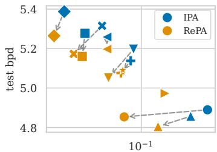  
avg. step time (s)

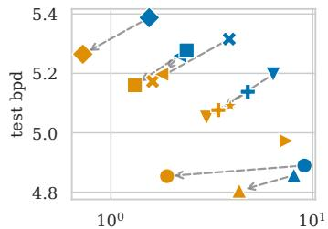  
max. GPU memory (GB)

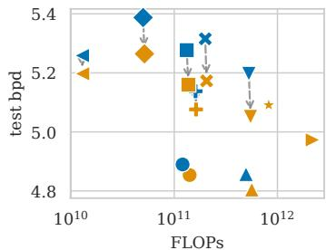  
Figure 1: REPA delivers faster, smaller and more accurate circuits compared to PCs that assume patch independence (IPA). This is shown here in terms of average step time (seconds), GPU memory, FLOPs and bpd (i.e. normalized negative log-likelihoods) on ImageNet32 for several tensorized PC architectures. REPA markers (yellow) that have no corresponding IPA markers (blue) are those for which IPA could not be trained on 40GB GPUs in under 2 days. See Fig. 14 for similar trends on CelebA and ImageNet64 and the precise PC configuration associated to each marker.

First, (C1) we show that the aforementioned presumption fails in practice: PCs trained on smaller independent patches can achieve equal or better likelihoods than those trained on larger patches, despite the latter being theoretically more expressive. We call this phenomenon the independent patch conundrum (Section 3). Similarly to previous works, this highlights how overparameterizing PCs can hinder learning [36, 13]. Differently from previous works, we identify an expressiveness-learnability trade-off that depends on the domain dimensionality rather than just the number of parameters in a circuit, and we investigate principled ways to circumvent this specific bottleneck.

To this end, we build a new PC architecture (C2) that systematically exploits parameter sharing throughout all layers. Specifically, we introduce recursive parameter sharing (REPA) as a way to share sub-circuits defined over a hierarchy of coarser patches (Section 4). It can naturally be trained end-to-end while drastically reducing parameter count. REPA generalizes the form of parameter sharing that arises when patches are assumed to be independent [36] and is orthogonal to other forms of parameter sharing that have been used in training more expressive circuits [21, 22, 65].

Furthermore, we (C3) execute a systematic evaluation (Section 6) of how IPA and REPA affect not only the quality of PCs as density estimators, but also their efficiency in terms of FLOPs, time and memory consumption, as illustrated in Fig. 1. Going beyond image data, we extend REPA to work on data modalities that do not exhibit any patch structure, such as tabular data, by exploiting the hierarchical structure of the PC (C4). This technique, called no patch sharing (NOPA), yields more efficient models in terms of memory and time at the cost of marginal changes in density estimation.

Finally, we (C5) evaluate the sample quality on tabular data and show that we get a minimal decrease in sample quality on tabular data when using NOPA. Overall, we provide a stepping stone towards more efficient PC architectures and highlight that there is still much to be done to realize expressive and tractable probabilistic models.

## 2 How to build and learn probabilistic circuits

Notation. We denote random variables with uppercase letters, e.g., X, and their realizations in lowercase, e.g., x. Vectorized sets of variables and their realizations are denoted in bold, e.g., $X = X _ { 1 } , \dots , X _ { n }$ and $\pmb { x } = x _ { 1 } , \ldots , x _ { N }$ , as well as matrices, e.g., A, B, W. For simplicity, we consider square images, each represented by $N = S \times S \times C$ variables, where S is their height and width and C the number of channels. Patches are non-overlapping sub-images of size $D \times \mathbf { \bar { D } } \times C$ and $L = N \big / ( D ^ { 2 } C )$ denotes the number of patches in an image.

Probabilistic circuits. A PC c over variables X is a parameterized computational graph encoding a probability mass function c(X) and comprising three fundamental unit types: input, sum and product [16, 60, 9]. An input unit represents a tractable distribution $f _ { u } ( \boldsymbol { X } _ { u } ; \boldsymbol { \theta } _ { u } )$ parameterized by $\theta _ { u } .$ . For an input unit (or any other type of unit u), the subset of variables $\textstyle X _ { u } \subset X$ it operates upon is called its scope and is denoted by $\mathsf { s c } ( u ) = X _ { u } .$ Sum and product units operate over the outputs of other units that we will call inputs of the unit, denoted by in(u). A sum unit s computes the convex combination of its inputs, i.e., $\dot { \sum } _ { v \in \mathfrak { i n } ( s ) } w _ { s , v } \cdot v ( X )$ where $\begin{array} { r } { \sum _ { v \in \mathsf { i n } ( s ) } w _ { s , v } = 1 } \end{array}$ and $w _ { s , v } >$ 0 are learnable weights; and a product unit p computes the product of its inputs, i.e., $\textstyle \prod _ { v \in \mathfrak { i n } ( p ) } v ( X )$ . For image data, we consider categorical distributions as input distributions. The learnable parameters of a circuit c, denoted as $\tilde { \Omega = \{ \{ \pmb { \theta } _ { u } \} _ { u } , \{ w _ { s , v } \} _ { s , v } \} }$ , are all the parameters for input units u and sum units s in c.

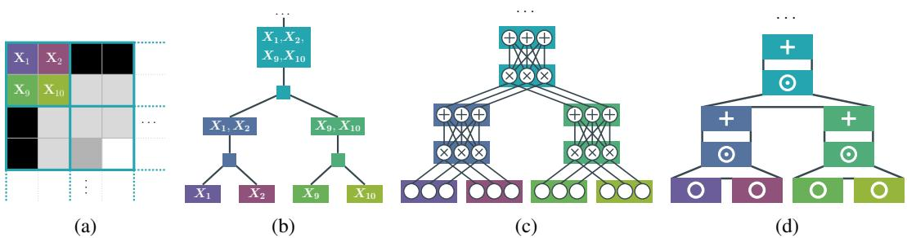  
Figure 2: Example of a RG and a PC for a $\textsuperscript { 1 2 \times 2 }$ patch of an 8  8 image (2a) where the RG is a binary quad tree (2b) resulting in the overparameterized $( K = 3 )$ PC with CP-T layers (2c). Abstracting away the units, we obtain a layer notation with input, Hadamard and sum layers (2d). RG regions and partitions are mapped to the corresponding sum and product layers in the PC by color.

The signature property of PCs is their ability to guarantee tractable probabilistic inference, i.e. computing probabilistic quantities of interest on the model exactly and in polynomial time [60]. This is done by ensuring their computational graphs abide by certain structural properties. For example, to enable tractable sampling and the computation of every marginal and conditional in a single feedforward pass of the graph, all sum units in the PC need to be smooth and all the products decomposable. A sum unit s is smooth if all its inputs have identical scopes: $\mathsf { s c } ( u ) =$ $\mathsf { s c } ( v ) \ \forall u , v \ \in \ \mathsf { i n } ( s )$ A product unit p is decomposable if all its inputs have disjoint scopes: $\mathsf { s c } ( u ) \cap \mathsf { s c } ( v ) \ = \ \emptyset \ \forall u , v \in \mathsf { i n } ( p ) , u \neq v$ Under these properties, product units encode local independence assumptions, while sum units introduce correlations between variables, as they define mixture models [48, 49, 39].

We follow previous works considering tensorized PCs [59, 51, 50, 45, 40, 65], i.e., circuits where units are grouped into layers to exploit GPU parallelism. As Loconte et al. [40] showed, it is possible to abstract many PC algorithms to build smooth and decomposable tensorized PCs into three stages: (i) creating a hierarchical partitioning of the input variables, also called a region graph (RG) [18], (ii) specifying a level ofoverparameterization, and (iii) choosing a sum-product layer type.

Region graphs (RGs) enforce smoothness and decomposability by design by providing a hierarchical partitioning of the input variables in the form of a directed acyclic graph of variable scopes, called regions, which are recursively partitioned into smaller ones— see Fig. 2. Each region and its corresponding partitions are then mapped to a tensorized sum-product layer comprising many computational units [45, 40]. Many RGs have been proposed in the literature, but here we will focus on modality-aware RGs for images [40] and learnable RGs.

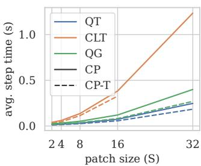

The first category comprises binary quad trees (QTs) [45] that recursively split an image into two axis-aligned sub-images; and quad graphs (QGs) that do the same but cache previously partitioned regions. For a fixed image size, QTs and QGs are uniquely defined. On the other hand, it is possible to learn a RG from a specific dataset,

Figure 3: Training time for different RGs with K = 512 on images of increasing size.

as it is the case for Chow-Liu tree (CLT) RGs [12] which use the Chow-Liu algorithm [10]. Thanks to their ability to capture data distribution, CLTs have been shown to yield PCs with better likelihoods [23] and have proven to be a good choice for tabular data [53]. However, at the same time they require a considerable computational effort to be learned [33]. For example, they cannot be learned directly on ImageNet, requiring approximations [54]. Importantly, in contrast to QTs and QGs, they come with an irregular structure that is not patch-aligned. Furthermore, CLTs are harder to scale. Indeed, as shown in Fig. 3, CLT RGs yield deeper and thus more costly circuits, compared to QTs and QGs. As we scale to images of size $6 4 \times 6 \bar { 4 } \times 3$ they become hard to fit in memory for a circuit defined over the whole image.

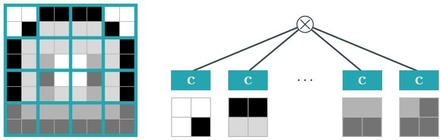  
Figure 4: IPA PC $c ^ { \prime }$ built on 2  2 independent patches $( L = 1 6 )$ , where the same circuit c (e.g., like in Fig. 2) is shared across all patches. The final likelihood is obtained by multiplying all values together (Eq. (1)).

Overparameterization. One could instantiate a single unit for every partition and region in the RG and build a valid PC this way. However, this would result in limited expressiveness [58]. To avoid this, it is customary to create layers of K parallel units [51]. This layer design allows using GPU acceleration to dramatically speed up training and inference [50, 34]. Generally, PCs on images of size $3 2 \times 3 2 \times 3$ and larger use K in the order of $1 0 ^ { 3 }$ [21, 41, 34]. Although larger values may be desirable, they tend to hit the memory bottleneck of common commercial GPUs [65].

Sum-product layers are compositions of tensorized layers $\ell ( { \pmb x } ) \in [ 0 , 1 ] ^ { K }$ , each comprising $K$ units that correspond to partitions and regions in a RG [40]. Each layer has H other layers $\ell _ { i }$ as inputs, with $i = 1 , \ldots { \bar { H } } ( \mathrm { F i g . } { \bar { 2 } } )$ . We focus on two layers that have been shown to yield the most competitive PCs in terms of likelihood: (i) CP [45], and (ii) CP-T [31] A CP layer encodes $\boldsymbol { \ell } ( \mathbf { x } ) = \bigodot _ { i = 1 } ^ { H } \mathbf { W } _ { i } \ell _ { i } ( \mathbf { x } _ { i } )$ where denotes the Hadamard (elementwise) vector product and $\mathbf { W } _ { i }$ are matrices obtained by concatenating all the weights w associated to the K sum units in the i-th input sum layer (Fig. 2). CP-T encodes $\boldsymbol { \ell } ( \mathbf { x } ) = \mathbf { W } \odot _ { i = 1 } ^ { H } \boldsymbol { \ell } _ { i } ( \mathbf { x } _ { i } )$

## 3 Assuming patch independence and the expressiveness conundrum

Training a PC on high dimensional patch-structured modalities, such as image data, can be challenging due to the high number of parameters, and a full model might not fit into memory. To alleviate this problem, several works [33, 36, 34, 65, 23] split images into L non overlapping patches of size $D \times \bar { D } \times C$ and trained a single PC c on these patches. To retrieve a probability distribution defined over all pixels (and channels) X, they make the independent patch assumption (IPA), i.e., compute:

$$
\mathsf { P r } _ { \mathrm { I P A } } ( \pmb { X } ) = \mathrm { I P A } _ { D } ( c , \pmb { X } ) = \prod _ { i = 1 } ^ { L ( D ) } c ( \pmb { X } _ { i } ; \pmb { \Omega } )\tag{1}
$$

where $\pmb { X } = \pmb { X } _ { 1 } \sqcup \ldots \sqcup \pmb { X } _ { L }$ denotes the partitioning of pixels into disjoint patches. This setting can be seen as a form of patch-level parameter sharing [36], as it implicitly represents a circuit $c ^ { \prime }$ defined over the whole scope X and formed by a decomposable product unit over L shallow copies of $c ,$ each taking input over a different patch $\mathbf { \bar { X } } _ { i } ( \mathrm { F i g . ~ } \dot { 4 } ) . \mathbf { \Phi } ^ { 1 }$ Note that these copies do not need to be kept in memory together: the same base circuit c with fixed parameters $\Omega \ \mathrm { i s } \ { \stackrel {  } { \sim } } \mathrm { w e p t } ^ { , }$ across the whole image, while its input units are rescoped, i.e., their distributions are assumed to operate on different pixel scopes for every patch. We refer to the implicit circuit $c ^ { \prime }$ as an IPA, and by contrast, we call FULLPC a classic PC defined and instantiated on the whole image.

With IPA, one can effectively train smaller circuits that are more computationally efficient, and at the same time retrieve a joint distribution for the whole image. For example, while a FULLPC using QT RGs with $K = 5 1 2$ units trained on ImageNet32 (having $3 2 \times 3 2 \times 3$ pixels) requires 670M parameters and 16.6 GB of memory in the cirkit library [55], an IPA PC trained over $8 \times 8 \times 3$ patches requires only 41M parameters and 1.5 GB of memory to process the same batch of 32 images.

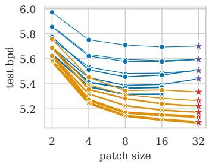

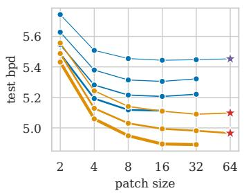

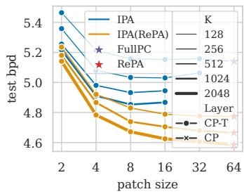  
Figure 5: REPA PCs improve over IPA and FULLPC while greatly alleviating the independent patch conundrum as measured in bits-per-dimension (bpd), for increasing patch sizes and QT RGs on ImageNet32 (left), ImageNet64 (center), and CelebA (right). More results in Fig. 15.

At the same time, Eq. (1) imposes a strong assumption that is very likely violated on real-world images and has clear limitations: sampling an image from an IPA PC would yield fragmented samples with no global coherence (see Fig. 24) as each instance of the base PC is sampled independently. As such, one could safely presume that the expressiveness of a PC not making the IPA or using larger patch sizes can only improve. However, this is not always the case in practice, as we discuss next.

The independent patch conundrum. Contrary to our intuition, a systematic evaluation of how IPA circuits scale w.r.t. patch size (D) reveals an opposite trend: performance significantly degrades or stagnates when D increases beyond 8. Fig. 5 shows this in terms of bits-per-dimension (bpd)—pixelnormalized negative log-likelihoods—for several PC architectures learned on ImageNet32, CelebA and ImageNet64. This puzzling behavior implies that there is an expressiveness-learnability trade-off in PCs: in high-dimensional spaces, models that are more expressive in theory can be harder to learn in practice. Similar conclusions have been advanced when talking about increasing K for overparameterized circuits [33]. Fig. 5 reveals that this consistently happens for every K, hinting at a different bottleneck in scalability that pertains to the circuit input dimensionality more than scaling the number of parameters through K. All in all, we are adding another “piece” to the puzzling evidence that training large PCs is hard.

We note that this trend consistently appears for QT and QG RGs and all layers, and only the performance of CLT RGs (cf. Fig. 11) seems to degrade slightly more gracefully (see Fig. 15). At the same time, we confirmed the presence of this phenomenon also for more advanced PC variants, i.e., probabilistic integral circuits [21, 22] and sum of squared circuits [39, 41, 42], as we discuss in Appendix E.3. We now introduce our way to introduce dependencies back in IPA PCs while retaining the efficiency gains that parameter sharing offers.

## 4 Recursive patch-aware (REPA) parameter sharing

How to reintroduce dependencies? A natural approach to consider is to replace the single product unit of Eq. (1) with a deeper circuit ${ \mathcal { C } } _ { \mathrm { t o p } }$ parameterized by $\Omega _ { \tt t o p }$ . Then, the sum units in $c _ { \mathrm { t o p } }$ could be used to recover the missing correlations across patches. To do so, one can collect all the output activations of the base circuit $\mathtt { c b a s e }$ operating on patches $\mathbf { } X _ { i } \in [ 0 , 2 5 5 ] ^ { D \times D \times C }$ , and feed them as inputs to ${ \it c } _ { \mathrm { t o p } } , \mathrm { i . e . }$ •

$$
\mathsf { P r } _ { \mathsf { t o p } } ( X ) = c _ { \mathsf { t o p } } ( \mathbf { O } ^ { ( 1 ) } ; \Omega _ { \mathsf { t o p } } ) \mathrm { w h e r e } \mathbf { O } ^ { ( 1 ) } = \mathbf { O } _ { 1 } ^ { ( 1 ) } , \hdots , \mathbf { O } _ { L } ^ { ( 1 ) } \mathrm { a n d } \mathbf { O } _ { i } ^ { ( 1 ) } = c _ { \mathsf { b a s e } } ( X _ { i } ; \Omega _ { \mathsf { b a s e } } ) ,\tag{2}
$$

where ${ \bf O } _ { i } ^ { ( 1 ) } \in [ 0 , 1 ] ^ { \cal K }$ for $i = 1 , \ldots , L$ is the output of the base circuit $\mathtt { C b a s e }$ on the i-th patch.<sup>2</sup> This idea has been explored by Liu et al. [36] in combination with their latent variable distillation (LVD) pipeline. LVD learns the parameters $\Omega _ { \mathrm { b a s e } }$ of a PC with CLT RG by mimicking the latent variables of a deep generative model [33]. They employed a two-stage approach: first the base circuit $\mathtt { C b a s e }$ is learned by maximum likelihood estimation (MLE) over image patches while conditioned on the latent variables of a deep generative model. Second, the outputs ${ \bf O } ^ { ( 1 ) }$ are collected, and the Chow-Liu algorithm (see Appendix A) is used to heuristically learn the RG for ${ \mathcal { C } } _ { \mathrm { t o p } } .$ . Its parameters $\Omega _ { \mathsf { t o p } }$ are subsequently fine-tuned by MLE.

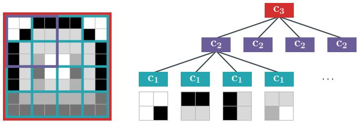  
Figure 6: REPA recursively splits the image into a hierarchy of patches. The patches at each layer i of the hierarchy (color-coded) share the same circuit $c _ { i } .$ , which is rescoped according to each patch it is being evaluated on.  
However, this two-stage approach is unnecessary for patch-aligned RGs such as QTs and QGs (Section 2). Because they already recursively split the data into patches, they naturally enable end-to-end training, as we discuss next. Furthermore, although a monolithic $c _ { \mathrm { t o p } }$ circuit can recover patch dependencies, it can still hinder scalability, especially when $\mathtt { C b a s e }$ is much smaller. For now, we focus on a systematic parameter sharing scheme that improves upon the $c _ { \mathrm { t o p } }$ idea and enables end-to-end training.

A hierarchy of patches. The main idea behind REPA is to apply parameter sharing at every level of a hierarchy in which coarser patches are then split into smaller ones in a regular way. For example, consider the $8 \times 8 \times 1$ image shown in Fig. 6. At the lowest level, we define a fine grid (in blue) comprising $L ^ { ( 1 ) } = 1 6$ patches of size $2 \times 2 \times 1$ , similarly to IPA PCs $\mathrm { ( F i g . 4 ) }$ . Unlike IPA, and unlike using a single circuit ${ \mathcal { C } } _ { \mathrm { t o p } }$ as above, we recursively merge patches, creating circuit layers that are shared at higher levels of the hierarchy. For example, by grouping $2 \times 2$ contiguous patches, we first form $L ^ { ( 2 ) } = 4$ purple patches at level 2, each covering $4 \times 4 \times 1$ pixels, and finally model a single patch at the third level (in red), comprising the whole image.

More generally, given a patch grouping size, a REPA PC is a collection of T shared circuits $c _ { 1 : T }$ each parameterized by $\Omega _ { t }$ , where $t = 1 , \dots , T$ and T is the height of the hierarchy induced by the grouping. For a $3 2 \times { \dot { 3 } } 2 \times 3$ image, the same $2 \times 2$ patch grouping used in the above example yields a hierarchy of $T = 5$ levels, comprising ${ \cal L } ^ { ( 1 ) } = \bar { 2 } 5 6 , \bar { L ^ { ( 2 ) } } = 6 \bar { 4 } , L ^ { ( 3 ) } = 1 6 , L ^ { ( 4 ) } = 4 , \bar { L } ^ { ( 5 ) } = 1$ patches each. For a patch hierarchy of T levels, and a base patch grouping $D \times D \times C$ , a REPA PC defines a distribution $\mathsf { P r } _ { \mathrm { R E P A } } ( X )$ over the whole image as follows:

$$
\mathrm { R E P A } _ { D } \big ( c _ { 1 : T } , \boldsymbol { X } \big ) = c _ { T } \big ( \mathbf { O } ^ { ( T - 1 ) } ; \Omega _ { T } \big ) \mathrm { w h e r e } \mathbf { O } ^ { ( t ) } = \mathbf { O } _ { 1 } ^ { ( t ) } , \dots , \mathbf { O } _ { L ^ { ( t ) } } ^ { ( t ) }\tag{3}
$$

$$
\mathrm { a n d } \mathbf { O } _ { i } ^ { ( t ) } = c _ { t } \big ( \mathrm { G E T P A T C H E S } _ { t } ( \mathbf { O } ^ { ( t - 1 ) } , i ) ; \pmb { \Omega } _ { t } \big ) \mathrm { a n d } \mathbf { O } _ { i } ^ { ( 1 ) } = c _ { 1 } \big ( \mathbf { X } _ { i } ; \pmb { \Omega } _ { 1 } \big ) .
$$

In words, the first level of the hierarchy behaves as Eq. (2): the base circuit $c _ { 1 }$ with $K ^ { ( 1 ) }$ units outputs a tensor $\mathbf { O } _ { i } ^ { ( 1 ) } \in [ 0 , 1 ] ^ { D ^ { ( 1 ) } \times D ^ { ( 1 ) } \times K ^ { ( 1 ) } }$ for each input patch $X _ { i } ,$ where $i = 1 , \ldots , L ^ { ( 1 ) }$ . Recursively, each level-t circuit $c _ { t }$ takes as input the $D ^ { ( t ) } \times D ^ { ( t ) } \times K ^ { ( t - 1 ) }$ tensor aggregating the outputs of the circuits at level $t - 1$ , where $K ^ { ( \hat { t } - 1 ) }$ denotes the number of units per layer in $c _ { t - 1 }$ . To aggregate the outputs, we define the function GETPATCHES<sub>t</sub>(O<sup>(t−1)</sup>, i) which, for a level $t ,$ collects the outputs of the previous level $t - 1$ to build the i-th patch of the current level. This process continues until the last level $T ,$ , which consists of a circuit with $K ^ { ( T ) }$ units except for the last layer which has a single output unit $( \mathrm { i . e . , } K = 1 )$ . Algorithm 2 details this procedure. The resulting construction is visualized in Fig. 6. For simplicity, in all our experiments, we keep the patch grouping size $D \times D$ and overparameterization level K constant across levels of the hierarchy. Note that, under this assumption, all higher-level circuits $c _ { 2 : T }$ have the same number of parameters and size.

Memory and time gains. Similarly to IPA PCs, REPA does not require explicitly materializing the circuit created by the recursive procedure and storing it in memory; instead, it is enough to simply store the sequence $c _ { 1 : T } .$ . Therefore, to evaluate Eq. (3) and implement the feedforward computation of probabilities in the PC, we can simply evaluate each circuit in the hierarchy for each intermediate patch. As a result, the overall number of FLOPs is on par with a FULLPC. Nevertheless, parameter sharing in REPA allows us to greatly scale to large images and numbers of units. As we show in Fig. 1 and Section 6, this yields circuits that are not only more efficient than a $\mathrm { F U L L P C }$ , but also than IPA PCs. Recall from Section 3 that a $\mathrm { F U L L P C }$ using QT RGs with $K = 5 1 2$ units on $3 2 \times 3 2 \times 3$ images requires 670M parameters and 16.6 GB of memory, while an IPA PC trained over $8 \times 8 \times 3$ patches reduces this to 41M parameters and 1.5 GB of memory. A REPA with $2 \times 2$ patch grouping, the same $K = 5 1 2$ units and QT RG, amounts to only 5M parameters and 0.73 GB. Furthermore, REPA is orthogonal to other scaling techniques like Monarch layers [65] allowing us to improve efficiency further. Appendix E.9 demonstrates the positive interaction between both techniques.

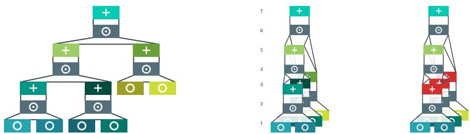  
Figure 7: NOPA shares parameters across the topological depth. The layers of an unfolded circuit (left) can be grouped by their topological ordering (center) tofold the circuit, making it more amenable to GPU accelerators. NOPA exploits this grouping by sharing parameters across sum layers at the same topological depth (right). Each color represents a different set of parameters, we highlight in red the three sum layers that share the same weight tensor, we use grey for layers without parameters.

While retaining and even improving upon the efficiency gains of IPA PCs, REPA circuits crucially break the independence assumption and model the dependencies across pixels appearing in the disjoint patches. It achieves this by introducing K sum units per layer in the circuit hierarchy above the first level. These additional sum units act as latent variables that increase the model’s expressiveness [48, 49, 21] effectively counterbalancing the capacity restrictions introduced by parameter sharing. Up to this point we have assumed that the hierarchical patch partitioning of REPA is compatible with the circuit’s RG. While this holds naturally for QT and QG RGs [40], it is not the case for CLTs. To this end, Appendix E.8 demonstrates how REPA can be adapted for non-patch-aligned RGs with similar benefits. However, we chose to focus on end-to-end compatible parameter sharing. As such, we are interested in extending parameter sharing beyond patches.

## 5 Can we exploit another source of structure than patches? (NOPA)

Image data is a practical candidate for parameter sharing as it displays an easily exploitable structure; however, PCs are not yet competitive on images. On the other hand, PCs have been shown to be very competitive for tabular data generation [53], a modality that does not display any obvious structure. Indeed, the organization of the columns is completely arbitrary and has no exploitable meaning.

Abstracting from the data, we notice that the PC itself is already a source of structure. Using the hierarchy described by the circuit, we can create a simple heuristic that applies parameter sharing for any modality. We use a simple recipe, starting from an arbitrary PC c, (1) mark the depth of each layer as the largest number of layers between itself and an input layer, (2) group every sum layer with the same depth, and (3) share a single weight tensor across the group of layers. We call this no patch sharing (NOPA).

We note here that we do not share any input parameters and that the number of parameters that are shared depends on the region graph. Intuitively, we rely on the idea that, even on unstructured data, the mixtures defined by the sum layer at the same depth will have a similar effect on their input probability. A similar idea has been explored previously while factorizing CP layers at the same topological depth [40] (see Appendix C.2 for an in-depth comparison). While NOPA poses indeed a stronger expressiveness bottleneck than REPA, we will show that it will still be effective on low-dimensional tabular data (Section 6).

## 6 Experiments

We are interested in answering the following research questions. (RQ1) What is the impact of the independence assumption (IPA) on distribution estimation quality? (RQ2) How does REPA improve on IPA regarding quality (bpd) versus efficiency (time, memory, FLOPs)? (RQ3) Is the impact of parameter sharing similar on tabular data (NOPA)? And finally, (RQ4) how does parameter sharing impacys PCs as generative models? We remark that our aim is not to set the new SotA bpds for image or tabular datasets, but to understand when and how parameter sharing can make PCs effective and efficient distribution estimators and generative models.

Datasets. Following prior work evaluating PCs on image data [22, 40, 45, 65], we train and evaluate on two resolutions of ImageNet [17]: $3 \bar { 2 } \times 3 2 \times 3$ and $6 4 \times 6 4 \times 3 .$ and on CelebA [37], which has been cropped and resized to $6 4 \times 6 4 \times 3$ (see Appendix D.2). We employ the YCoCg-R color transform as defined in Malvar [44] as it was introduced in Gala et al. [22] for PC learning.<sup>3</sup> For tabular data, we used the same seven UCI datasets as TabPC: Adult [4], Beijing [7], Default [62], Diabetes [11], Magic [5], News [20], and Shoppers [52]. Each dataset is split into train, validation, and test sets (see Table 2).

PC architectures. For our experiments on image data, we conduct an extensive hyperparameter search across different layers (CP, CP-T), RGs (QT, QG and CLT, see Section 2) and a number of units K per layer that goes from 128 up to 4096. We first evaluate a large grid of configurations on ImageNet32 to identify the best configurations to run on ImageNet64 and CelebA, which are larger and more computationally expensive. For example, we quickly observed that CP and CP-T layers yield similar dynamics; therefore, we primarily use CP-T in our experiments unless otherwise specified. For tabular data, we use the same setup as TABPC [53], which applies PCs to tabular data. Because these models use CLTs, the exact number of layers that benefit from parameter sharing can vary across datasets and random seeds. We detail all the configurations we explored in Appendix D.3.

Training. Models for image data are optimized with Adam [26]. We briefly experimented with EM, but found that i) it is still affected by the independent patch conundrum and ii) it does not provide substantially better bpds than Adam when we use the same large batch size by leveraging gradient accumulation; see Fig. 13 and Table 11. We use a fixed learning rate of 0.05, use 300 max epochs and do early stopping when the validation loss does not improve for 3 epochs. Table 10 shows that this fixed learning rate performed best for all tested architectures. The minimum delta for the early stopping is set per dataset (see Table 3). We use a single patch per image during training.

For tabular data, we followed the configuration of TabPC by using RAdam [35] and a learning rate scheduler that reduces the learning rate when the training does not progress. We report all the configurations in Table 7.

Hardware and time limit. We use one GPU with 40 GB of memory, and we reserve 128 GB of RAM and 16 CPU cores for each experiment. No experiments were allowed to run for more than 2 days. Any experiment lasting more than 2 days was killed and not included in our analysis. More details can be found in Appendix D.1.

## RQ1: The effect of the independent patch conundrum on distribution estimation.

We train IPA PCs for several patch sizes $D \times D \times C ,$ with D starting from 2 and reaching the full image size (either 32 or 64, depending on the dataset), at which point we obtain a FULLPC. We compare against a REPA PC defined over the full image using a 2 2 patch grouping (see Fig. 5). Fig. 15 shows the test bpd obtained by all configurations of IPA, REPA and FULLPC on QT and QG RGs. The independent patch conundrum is clearly visible: FULLPC obtains worse or marginally better bpd than IPA models that assume independence. We see a similar trend across different optimizers (Fig. 13), with only slight improvements when using more sophisticated PC variants (Fig. 12) or CLT RGs (Fig. 15). In contrast, REPA PCs consistently outperform both FULLPC and IPA across architectures and variants, illustrating that recursive parameter sharing does improve learnability. For completeness, we report the bpd of REPA architectures defined on intermediate patches rather than the whole image. In this case, we recover the joint distribution by assuming patch independence, denoted as IPA(REPA) as in Eq. (4). Although IPA(REPA) PCs outperform IPA PCs, assuming independence at the last layers still leads to saturating bpd in some configurations. Therefore, to RQ1, we conclude that parameter sharing does significantly help. However, it does not entirely resolve the learnability bottleneck in PCs. Table 13 provides the complete list of results for IPA and REPA.

## RQ2: Estimation quality vs efficiency in IPA and REPA.

Following [45, 40, 65], we argue that efficiency is as crucial as distribution estimation quality, especially when we have limited computational resources and need to scale to large images. We use torch CUDA APIs [2] to compute peak GPU memory and average step time. Additionally, we compute the FLOPs using torch’s FlopCounterMode [1]. All efficiency metrics are computed on an NVIDIA L40 GPU for a batch of 32 images over 200 steps, where a step consists of a forward and a backward pass. We focus on QG and QT RGs, as they allow for end-to-end learning with REPA. Fig. 1 shows that using REPA systematically pushes the models toward the Pareto front between model quality and step time or GPU memory. Full results for all datasets are provided in Fig. 14. As expected, FLOPs remain the same, since our parameter sharing approach primarily reduces memory consumption (Section 4).

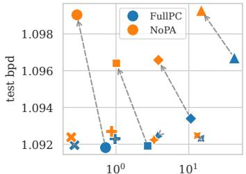  
max. GPU memory (GB)

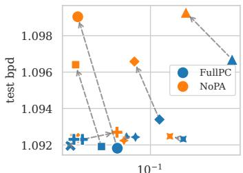  
avg. step time (s)

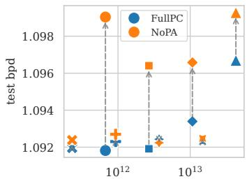  
FLOPs

Figure 8: Our NOPA (Section 5) setting on the Adult dataset reduces training time and memory consumption with minimal increase in bpd. Each shape is a pair (layer type, K).  
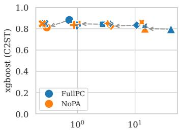  
max. GPU memory (GB)

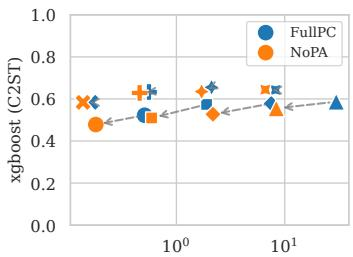  
max. GPU memory (GB)

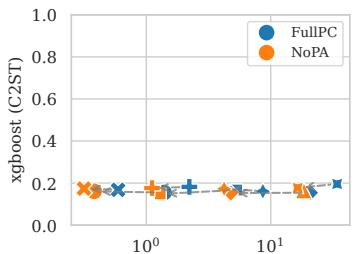  
max. GPU memory (GB)  
Figure 9: Our NOPA (Section 5) setting on the Adult (left), Beijing (center) and Default (right) datasets shows minimal decrease in sample quality. Each shape is a pair (layer type, K).

## RQ3: Adapting parameter sharing for tabular data (NOPA).

Fig. 8 shows that our NOPA setting provides substantial memory and time gains with minimal loss in density estimation. On Adult, the largest bpd loss between FULLPC and NOPA is 0.006. Fig. 22 shows the same tendency for the other datasets. While there are no definite trends showing an improvement in bpd, the significant efficiency boost gained with this simple approach paves the way for more complex parameter sharing on tabular data. These results are quite surprising: we get similar bpds while using a very naive heuristic, assuming that layers sharing the same topological depth have similar functions. This prompts for more extensive research into how PCs use their parameters.

RQ4: How does parameter sharing impacts PCs as generative models? Scassola et al. [53] provides us with a metric to quantify sampling quality called the classifier two-sample test (C2ST) [43] score, using an XGBoost [8] model. Fig. 9 shows that there is no substantial decrease in sample quality when using NOPA compared to FULLPC. Fig. 21 shows the same results for the seven datasets and all efficiency metrics. This further demonstrates that parameter sharing has little negative effect on the quality of the model.

Regarding images, the quality of image samples from PCs is notoriously behind that of other deep generative models for image data [28, 6]. Nevertheless, we qualitatively inspect samples generated by IPA, REPA and FULLPC circuits to understand if REPA can break the independence assumption bottleneck and recover some of the correlations across patches that FULLPC can capture, but IPA cannot by its very definition. Figs. 10, 23 and 24 show how REPA PCs successfully recover some correlations, such as colour continuity, similar to FULLPC. This yields much less “patchy” samples than those produced by IPA. We highlight that the bpd achieved by these models does not strictly correlate with sample quality [56]. In fact, while FULLPC scores a test bpd of 5.45, the IPA scores 5.00, and the REPA PC achieves an even better 4.99. Coupled with the independent patch conundrum, this issue further highlights the need to report not only bpds for learned PCs, but also to inspect the visual quality of their samples.

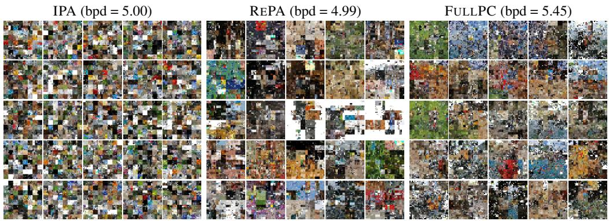  
Figure 10: REPA samples retrieve global patch dependencies and are closer to FULLPC on ImageNet64 where we show IPA $8 \times 8 \times 3$ and $K = 1 0 2 4$ (left), REPA (center) with K = 512 and FULLPC with K = 128 (right). All PCs use a QG RG. More samples in Figs. 23 and 24. We take modes of the input unit distributions rather than sampling from them, see details in Appendix B.3.

## 7 Conclusion and future work

In this work, we focused on the independent patch assumption (IPA) when learning PCs, which allows scaling PC experiments by improving efficiency [33, 36, 34, 65, 23]. Unexpectedly, IPA PCs yield similar or better bpds than PCs trained on whole images. This highlights a systemic learnability problem when scaling PCs to high resolution images. We introduced REPA, a recursive patch sharing technique that alleviates this issue, offering lower bpd, while significantly improving efficiency. We also devised NOPA, a technique that exploits the structure of the PC itself to enable parameter sharing on any modality. Surprisingly, our naive heuristic yields considerable efficiency gains at the cost of a marginal decrease in density estimation and sampling quality. While PCs are still far behind models like flows and diffusion on images, this is an important stepping stone towards scaling PCs as efficient distribution estimators and accurate generative models. Furthermore, on tabular data generation, a task where PCs are known to be competitive, we opened the way for significant efficiency improvements using more complex parameter sharing techniques. Future work should focus on understanding the learnability bottleneck and on developing more advanced parameter sharing techniques, while extending those to other modalities such as text, and time-series data.

## Author Contributions

CB and AV conceived the original idea. They later discussed it with VB, who joined them in developing the experimental design. CB implemented the training and validation code, as well as REPA, IPA, and NOPA and is responsible for all plots, algorithms and experiments in the paper, with the following exception. GG implemented the efficient backward-sampling algorithm and ran the image-sampling experiments. CB led the writing of the paper, with contributions from GG, VB, and AV. AV and VB supervised all phases of the project and provided feedback throughout.

## Acknowledgements

CB and AV are supported by the "UNREAL: Unified Reasoning Layer for Trustworthy ML" project (EP/Y023838/1) selected by the ERC and funded by UKRI EPSRC.

## References

[1] Flopcountermode github. https://github.com/pytorch/pytorch/blob/main/torch/ utils/flop\_counter.py#{L}780. [Accessed 07-05-2026].

[2] Torch cuda api. https://docs.pytorch.org/docs/2.11/cuda.html. [Accessed 07-05- 2026].

[3] Kareem Ahmed, Stefano Teso, Kai-Wei Chang, Guy Van den Broeck, and Antonio Vergari. Semantic probabilistic layers for neuro-symbolic learning. In Advances in Neural Information Processing Systems 35 (NeurIPS), volume 35, pages 29944–29959. Curran Associates, Inc., 2022.

[4] Barry Becker and Ronny Kohavi. Adult. UCI Machine Learning Repository, 1996. DOI: https://doi.org/10.24432/C5XW20.

[5] R. Bock. MAGIC Gamma Telescope. UCI Machine Learning Repository, 2004. DOI: https://doi.org/10.24432/C52C8B.

[6] Steven Braun, Sahil Sidheekh, Antonio Vergari, Martin Mundt, Sriraam Natarajan, and Kristian Kersting. Tractable representation learning with probabilistic circuits. Transactions on Machine Learning Research, 2025.

[7] Song Chen. Beijing PM2.5. UCI Machine Learning Repository, 2015. DOI: https://doi.org/10.24432/C5JS49.

[8] Tianqi Chen and Carlos Guestrin. XGBoost: A Scalable Tree Boosting System. In Proceedings of the 22nd ACM SIGKDD International Conference on Knowledge Discovery and Data Mining, pages 785–794, August 2016. doi: 10.1145/2939672.2939785. URL http://arxiv.org abs/1603.02754. arXiv:1603.02754 [cs.LG].

[9] YooJung Choi, Antonio Vergari, and Guy Van den Broeck. Probabilistic circuits: A unifying framework for tractable probabilistic modeling. Technical report, University of California, Los Angeles (UCLA), 2020.

[10] C. K. Chow and C. N. Liu. Approximating discrete probability distributions with dependence trees. IEEE Transactions on Information Theory, 14(3):462–467, 1968.

[11] John Clore, Krzysztof Cios, Jon DeShazo, and Beata Strack. Diabetes 130-US Hospitals for Years 1999-2008. UCI Machine Learning Repository, 2014. DOI: https://doi.org/10.24432/C5230J.

[12] Meihua Dang, Antonio Vergari, and Guy Van den Broeck. Strudel: A fast and accurate learner of structured-decomposable probabilistic circuits. The International Journal ofApproximate Reasoning (IJAR), 140:92–115, 2021.

[13] Meihua Dang, Anji Liu, and Guy Van den Broeck. Sparse probabilistic circuits via pruning and growing. Advances in Neural Information Processing Systems, 35:28374–28385, 2022.

[14] Meihua Dang, Anji Liu, Xinzhu Wei, Sriram Sankararaman, and Guy Van den Broeck. Tractable and Expressive Generative Models of Genetic Variation Data. bioRxiv, page 2023.05.16.541036, May 2023. ISSN 2692-8205. doi: 10.1101/2023.05.16.541036. URL https://pmc.ncbi. nlm.nih.gov/articles/PMC10245670/.

[15] Tri Dao, Beidi Chen, Nimit S Sohoni, Arjun Desai, Michael Poli, Jessica Grogan, Alexander Liu, Aniruddh Rao, Atri Rudra, and Christopher Re. Monarch: Expressive structured matrices for efficient and accurate training. In Kamalika Chaudhuri, Stefanie Jegelka, Le Song, Csaba Szepesvari, Gang Niu, and Sivan Sabato, editors, Proceedings ofthe 39th International Conference on Machine Learning, volume 162 of Proceedings of Machine Learning Research, pages 4690–4721. PMLR, 17–23 Jul 2022. URL https://proceedings.mlr.press/v162 dao22a.html.

[16] Adnan Darwiche. A differential approach to inference in bayesian networks. Journal of the ACM (JACM), 50:280–305, 2003.

[17] Jia Deng, Wei Dong, Richard Socher, Li-Jia Li, Kai Li, and Li Fei-Fei. Imagenet: A largescale hierarchical image database. In 2009 IEEE Conference on Computer Vision and Pattern Recognition, pages 248–255, 2009. doi: 10.1109/CVPR.2009.5206848.

[18] Aaron W. Dennis and Dan Ventura. Learning the architecture of sum-product networks using clustering on variables. In Advances in Neural Information Processing Systems 25 (NeurIPS), pages 2033–2041. Curran Associates, Inc., 2012.

[19] William Falcon, Jirka Borovec, Adrian Wälchli, Nic Eggert, Justus Schock, Jeremy Jordan, Nicki Skafte, Ir1dXD, Vadim Bereznyuk, Ethan Harris, Tullie Murrell, Peter Yu, Sebastian Præsius, Travis Addair, Jacob Zhong, Dmitry Lipin, So Uchida, Shreyas Bapat, Hendrik Schröter, Boris Dayma, Alexey Karnachev, Akshay Kulkarni, Shunta Komatsu, Martin.B, Jean-Baptiste SCHIRATTI, Hadrien Mary, Donal Byrne, Cristobal Eyzaguirre, cinjon, and Anton Bakhtin. PyTorchLightning/pytorch-lightning: 0.7.6 release, May 2020. URL https: //zenodo.org/records/3828935.

[20] Kelwin Fernandes, Pedro Vinagre, Paulo Cortez, and Pedro Sernadela. Online News Popularity. UCI Machine Learning Repository, 2015. DOI: https://doi.org/10.24432/C5NS3V.

[21] Gennaro Gala, Cassio de Campos, Robert Peharz, Antonio Vergari, and Erik Quaeghebeur. Probabilistic integral circuits. In AISTATS 2024, 2024.

[22] Gennaro Gala, Cassio de Campos, Antonio Vergari, and Erik Quaeghebeur. Scaling continuous latent variable models as probabilistic integral circuits. In A. Globerson, L. Mackey, D. Belgrave, A. Fan, U. Paquet, J. Tomczak, and C. Zhang, editors, Advances in Neural Information Processing Systems, volume 37, pages 10959–10987. Curran Associates, Inc., 2024. doi: 10.52202/079017-0350. URL https://proceedings.neurips.cc/paper\_files/paper/ 2024/file/14cdc9013d80338bf81483a7736ea05c-Paper-Conference.pdf.

[23] Poorva Garg, Benjie Wang, Oliver Broadrick, Guy Van den Broeck, and Todd Millstein. Bitblasting for tractable constrained decorrelation in image modeling. In Eighth Workshop on Tractable Probabilistic Modeling, 2025.

[24] Andreas Grivas, Lorenzo Loconte, Emile van Krieken, Piotr Nawrot, Yu Zhao, Euan Wielewski, Pasquale Minervini, Edoardo Ponti, and Antonio Vergari. Fast and Expressive Multi-Token Prediction with Probabilistic Circuits, November 2025. URL https://arxiv.org/abs/ 2511.11346v1.

[25] Kaiming He, Xiangyu Zhang, Shaoqing Ren, and Jian Sun. Deep residual learning for image recognition. In 2016 IEEE Conference on Computer Vision and Pattern Recognition (CVPR), pages 770–778, 2016. doi: 10.1109/CVPR.2016.90.

[26] Diederik P. Kingma and Jimmy Ba. Adam: A method for stochastic optimization. In 3rd International Conference on Learning Representations (ICLR), 2015.

[27] Christian Klötergens, Vijaya Krishna Yalavarthi, and Lars Schmidt-Thieme. Probabilistic circuits for irregular multivariate time series forecasting. arXiv preprint arXiv:2604.27814, 2026.

[28] Steven Lang, Martin Mundt, Fabrizio Ventola, Robert Peharz, and Kristian Kersting. Elevating perceptual sample quality in pcs through differentiable sampling. Proceedings of Machine Learning Research, 181, 2022.

[29] Yann LeCun, Yoshua Bengio, and Geoffrey Hinton. Deep learning. nature, 521(7553):436–444, 2015.

[30] Yaron Lipman, Ricky T. Q. Chen, Heli Ben-Hamu, Maximilian Nickel, and Matthew Le. Flow matching for generative modeling. In The Eleventh International Conference on Learning Representations, 2023. URL https://openreview.net/forum?id=PqvMRDCJT9t.

[31] Anji Liu and Guy Van den Broeck. Tractable regularization of probabilistic circuits. In Advances in Neural Information Processing Systems 34 (NeurIPS), pages 3558–3570. Curran Associates, Inc., 2021.

[32] Anji Liu, Stephan Mandt, and Guy Van den Broeck. Lossless compression with probabilistic circuits. In International Conference on Learning Representations, 2022.

[33] Anji Liu, Honghua Zhang, and Guy Van den Broeck. Scaling up probabilistic circuits by latent variable distillation. In 11th International Conference on Learning Representations (ICLR), 2023.

[34] Anji Liu, Kareem Ahmed, and Guy Van den Broeck. Scaling tractable probabilistic circuits: A systems perspective. In Forty-first International Conference on Machine Learning, 2024. URL https://openreview.net/forum?id=BIbjwcrg0V.

[35] Liyuan Liu, Haoming Jiang, Pengcheng He, Weizhu Chen, Xiaodong Liu, Jianfeng Gao, and Jiawei Han. On the Variance of the Adaptive Learning Rate and Beyond, October 2021. URL http://arxiv.org/abs/1908.03265. arXiv:1908.03265 [cs.LG].

[36] Xuejie Liu, Anji Liu, Guy Van den Broeck, and Yitao Liang. Understanding the distillation process from deep generative models to tractable probabilistic circuits. In International Conference on Machine Learning, pages 21825–21838. PMLR, 2023.

[37] Ziwei Liu, Ping Luo, Xiaogang Wang, and Xiaoou Tang. Deep learning face attributes in the wild. In IEEE International Conference on Computer Vision (ICCV), pages 3730–3738. IEEE Computer Society, 2015.

[38] Lorenzo Loconte, Nicola Di Mauro, Robert Peharz, and Antonio Vergari. How to turn your knowledge graph embeddings into generative models via probabilistic circuits. In Advances in Neural Information Processing Systems 37 (NeurIPS). Curran Associates, Inc., 2023.

[39] Lorenzo Loconte, M. Sladek Aleksanteri, Stefan Mengel, Martin Trapp, Arno Solin, Nicolas Gillis, and Antonio Vergari. Subtractive mixture models via squaring: Representation and learning. In The Twelfth International Conference on Learning Representations (ICLR), 2024.

[40] Lorenzo Loconte, Antonio Mari, Gennaro Gala, Robert Peharz, Cassio de Campos, Erik Quaeghebeur, Gennaro Vessio, and Antonio Vergari. What is the relationship between tensor factorizations and circuits (and how can we exploit it)? Transactions on Machine Learning Research, 2025. ISSN 2835-8856. URL https://openreview.net/forum?id=Y7dRmpGiHj. Featured Certification.

[41] Lorenzo Loconte, Stefan Mengel, and Antonio Vergari. Sum of squares circuits. Proceedings of the AAAI Conference on Artificial Intelligence, 39(18):19077–19085, Apr. 2025. doi: 10.1609/aaai.v39i18.34100. URL https://ojs.aaai.org/index.php/AAAI/article/ view/34100.

[42] Lorenzo Loconte, Adrián Javaloy, and Antonio Vergari. How to square tensor networks and circuits without squaring them. In ICLR, 2026.

[43] David Lopez-Paz and Maxime Oquab. Revisiting classifier two-sample tests. In International Conference on Learning Representations, 2017. URL https://openreview.net/forum? id=SJkXfE5xx.

[44] H. Malvar. A color space with RGB reversibility and low dynamic range. ISO/IEC MPEG & ITU-T VCEG, JVT-I014r3, 2003. URL https://cir.nii.ac.jp/crid/ 1571698601172818944.

[45] Antonio Mari, Gennaro Vessio, and Antonio Vergari. Unifying and understanding overparameterized circuit representations via low-rank tensor decompositions. In 6th Workshop on Tractable Probabilistic Modeling, 2023.

[46] George Papamakarios, Eric Nalisnick, Danilo Jimenez Rezende, Shakir Mohamed, and Balaji Lakshminarayanan. Normalizing flows for probabilistic modeling and inference. The Journal ofMachine Learning Research (JMLR), 22(1):2617–2680, 2021.

[47] Adam Paszke, Sam Gross, Francisco Massa, Adam Lerer, James Bradbury, Gregory Chanan, Trevor Killeen, Zeming Lin, Natalia Gimelshein, Luca Antiga, Alban Desmaison, Andreas Köpf, Edward Yang, Zach DeVito, Martin Raison, Alykhan Tejani, Sasank Chilamkurthy, Benoit Steiner, Lu Fang, Junjie Bai, and Soumith Chintala. PyTorch: an imperative style, high-performance deep learning library. In Proceedings ofthe 33rd International Conference on Neural Information Processing Systems, number 721, pages 8026–8037. Curran Associates Inc., Red Hook, NY, USA, December 2019.

[48] Robert Peharz, Sebastian Tschiatschek, Franz Pernkopf, and Pedro M. Domingos. On Theoretical Properties of Sum-Product Networks. In International Conference on Artificial Intelligence and Statistics, 2015.

[49] Robert Peharz, Robert Gens, Franz Pernkopf, and Pedro Domingos. On the Latent Variable Interpretation in Sum-Product Networks. IEEE Transactions on Pattern Analysis and Machine Intelligence, 39(10):2030–2044, October 2017. ISSN 1939-3539. doi: 10.1109/TPAMI.2016. 2618381. URL https://ieeexplore.ieee.org/abstract/document/7748514.

[50] Robert Peharz, Steven Lang, Antonio Vergari, Karl Stelzner, Alejandro Molina, Martin Trapp, Guy Van den Broeck, Kristian Kersting, and Zoubin Ghahramani. Einsum networks: Fast and scalable learning of tractable probabilistic circuits. In International Conference on Machine Learning, pages 7563–7574. PMLR, 2020.

[51] Robert Peharz, Antonio Vergari, Karl Stelzner, Alejandro Molina, Xiaoting Shao, Martin Trapp, Kristian Kersting, and Zoubin Ghahramani. Random sum-product networks: A simple and effective approach to probabilistic deep learning. In 35th Conference on Uncertainty in Artificial Intelligence (UAI), volume 115 of Proceedings of Machine Learning Research, pages 334–344. PMLR, 2020.

[52] C. Sakar and Yomi Kastro. Online Shoppers Purchasing Intention Dataset. UCI Machine Learning Repository, 2018. DOI: https://doi.org/10.24432/C5F88Q.

[53] Davide Scassola, Dylan Ponsford, Adrián Javaloy, Sebastiano Saccani, Luca Bortolussi, Henry Gouk, and Antonio Vergari. A Sobering Look at Tabular Data Generation via Probabilistic Circuits, March 2026. URL http://arxiv.org/abs/2603.23016. arXiv:2603.23016 [cs].

[54] Daniel Severo, Jingtong Su, Anji Liu, Jeff Johnson, Brian Karrer, Guy Van den Broeck, Matthew J Muckley, and Karen Ullrich. Enhancing and evaluating probabilistic circuits for high-resolution lossless image compression. In 2025 Data Compression Conference (DCC), pages 253–262. IEEE, 2025.

[55] The april Lab. cirkit: a python framework to build, learn and reason about probabilistic circuits and tensor networks, October 2024. URL https://github.com/april-tools/cirkit.

[56] Lucas Theis, Aäron van den Oord, and Matthias Bethge. A note on the evaluation of generative models, April 2016. URL http://arxiv.org/abs/1511.01844. arXiv:1511.01844 [stat].

[57] Nils Thoma, Zhongjie Yu, Fabrizio Ventola, and Kristian Kersting. Recowns: Probabilistic circuits for trustworthy time series forecasting. arXiv preprint arXiv:2106.04148, 2021.

[58] Antonio Vergari, Nicola Di Mauro, and Floriana Esposito. Simplifying, regularizing and strengthening sum-product network structure learning. In Joint European Conference on Machine Learning and Knowledge Discovery in Databases, pages 343–358. Springer, 2015.

[59] Antonio Vergari, Nicola Di Mauro, and Floriana Esposito. Visualizing and understanding sum-product networks. Machine Learning, 108(4):551–573, 2019.

[60] Antonio Vergari, Nicola Di Mauro, and Guy Van den Broeck. Tractable probabilistic models: Representations, algorithms, learning, and applications. Tutorial at the 35th Conference on Uncertainty in Artificial Intelligence (UAI), 2019.

[61] Ling Yang, Zhilong Zhang, Yang Song, Shenda Hong, Runsheng Xu, Yue Zhao, Wentao Zhang, Bin Cui, and Ming-Hsuan Yang. Diffusion models: A comprehensive survey of methods and applications. ACM computing surveys, 56(4):1–39, 2023.

[62] I-Cheng Yeh. Default of Credit Card Clients. UCI Machine Learning Repository, 2009. DOI: https://doi.org/10.24432/C55S3H.

[63] Zhongjie Yu, Fabrizio G Ventola, and Kristian Kersting. Whittle networks: A deep likelihood model for time series. In International Conference on Machine Learning, pages 12177–12186. PMLR, 2021.

[64] Honghua Zhang, Meihua Dang, Nanyun Peng, and Guy Van den Broeck. Tractable control for autoregressive language generation. In 40th International Conference on Machine Learning (ICML), volume 202 of Proceedings of Machine Learning Research, pages 40932–40945. PMLR, 2023.

[65] Honghua Zhang, Meihua Dang, Benjie Wang, Stefano Ermon, Nanyun Peng, and Guy Van Den Broeck. Scaling probabilistic circuits via monarch matrices. In Aarti Singh, Maryam Fazel, Daniel Hsu, Simon Lacoste-Julien, Felix Berkenkamp, Tegan Maharaj, Kiri Wagstaff, and Jerry Zhu, editors, Proceedings of the 42nd International Conference on Machine Learning, volume 267 of Proceedings ofMachine Learning Research, pages 74804–74818. PMLR, 13–19 Jul 2025. URL https://proceedings.mlr.press/v267/zhang25q.html.

## A Building tensorized PCs from CLT region graphs

We implement CLT PCs by building a RG out of the tree structure learned by the Chow-Liu algorithm [10]. Specifically, to convert such a tree into a RG, one traverses it bottom-up and systematically alternates between region and partition nodes. Each node in the tree induces a region whose scope is the union of variables in its subtree, while leaves become singleton regions. For every internal node, a partition node is introduced that connects the regions of its children as inputs to the parent region as output, encoding a decomposition of the parent scope into disjoint child scopes. The resulting region graph alternates regions and partitions and preserves the hierarchical structure of the original tree. In Fig. 11 we show a tree region graph and a tensorized circuit built based on it.

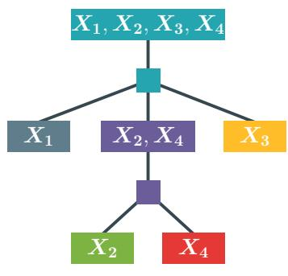  
(a) tree RG

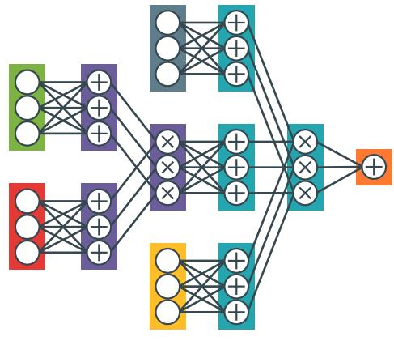  
(b) Tensorized PC  
Figure 11: Tree RG Tensorized PC. The Chow-Liu tree algorithm [10] can be used to build a tree region graph [12] (a) which can then be used to build a tensorized PC parameterized with CP layers (b) or with alternative CP-T [31, 40] or Monarch layers [65].

## B Algorithms

## B.1 Algorithms for patch sharing

Algorithm 1 provides a simple algorithm to compute the output of IPA. We simply multiply the outputs of each individual patch $\bar { X _ { i } }$

```julia
Algorithm 1: InferenceIPA(c, X)
Input: Tensorized PC c over $\pmb { X } = \{ X _ { i } \} _ { i = 1 } ^ { L ( D ) }$ ;
Output: Likelihood of X.
begin
out = 1;
for i L do
out = out  c(X<sub>i</sub>);
end
return out
end
```

Algorithm 2 explains how to compute the likelihood of a sample using REPA. For each level $t \in [ 1 , T ]$ we compute the output of the t-th circuit for each of the $L ^ { ( \bar { t } ) }$ patches, using the previous outputs as the new input and using GETPATCHES to collect the relevant elements.

## B.2 Multi stage training for REPA

As explained in Appendix E.8, Algorithm 3 recursively builds the T circuit by (i) learning a CLT on previous level’s outputs ${ \mathbf O } ^ { ( t - 1 ) }$ , (ii) training all $c _ { 1 : t }$ circuits on the train data X, (iii) retrieving the output for each patch to build ${ \mathbf O } ^ { ( t ) }$ , and finally (iv) we introduce K 1 new units to the last layers of $c _ { t }$ by simply copying the same unit, with the exact same weight. This last step is important to ensure that the next level receives inputs of shape $D \times D \times K$

Algorithm 2: InferenceReP $\mathsf { A } ( c _ { 1 } , \ldots , c _ { T } , X )$   
Input: T tensorized $\operatorname { P C s } c _ { 1 : T }$ over $\pmb { X } = \{ X _ { i } \} _ { i = 1 } ^ { L ( D ^ { ( 1 ) } ) }$   
Output: Likelihood of X.   
begin   
$\begin{array} { r } { \mathbf { O } ^ { ( 0 ) } = \pmb { X } ; } \end{array}$   
for $t \in [ 1 , T ]$ do   
for $\bar { i } \in \bar { L } ^ { ( t ) }$ do   
${ \bf O } _ { i } ^ { ( t ) } = c _ { t }$ (GETPATCHES<sub>t</sub> $( \mathbf { O } ^ { ( t - 1 ) } , i ) )$   
end   
end   
return ${ \mathbf O } ^ { ( T ) }$   
end

By copying the same weight for every output unit, we guarantee that, at initialization, the circuit of level $t + 1 , \ \mathrm { I P A } _ { D ^ { T - ( t + 1 ) } } \big ( \mathrm { R E P A } \big ( c _ { 1 : t + 1 } , X \big ) \big )$ , will have the exact same likelihood as $\mathrm { I P A } _ { D ^ { T - t } } \bigl ( \mathrm { R E P A } \bigl ( c _ { 1 : t } , X \bigr ) \bigr )$ ), the circuit of level t. Indeed, the convex sum of a constant vector returns the very same constant value. Hence, at initialization, $c _ { t + 1 }$ essentially computes the product of its input. We note that this should be taken into account if one wants to freeze the previous circuit while training $c _ { t + 1 }$

```prolog
Algorithm 3: TrainRePACLT(T, D, X)
Input: The number T of PCs in the REPA, the size of patches D and the data $X ;$
Output: list of T PCs that make the REPA PC.
begin
c_list = [];
$\begin{array} { r } { \mathbf { O } ^ { ( 0 ) } = \pmb { X } ; } \end{array}$
for $t \in [ 1 , T ]$ do
c_list.append(BUILDCLTPC(O<sup>(t−1)</sup>, D));
TRAINPC(c_list, X);
${ \bf O } ^ { ( t ) } =$ INFERENCEREPA(c_list, O<sup>(t−1)</sup>);
AUGMENTOUTPUTS(c_list[t]);
end
return c_list
end
```

## B.3 Sampling

To introduce sampling in tensorized PCs, we view their layers at a finer granularity, namely as a collection of sum layers (matrix multiplications) and Hadamard layers (element-wise products) instead of sum-product layers. Fig. 11(b) shows an example of tensorized PC with sum and Hadamard layers. In Algorithm 4 we detail how to sample from such structures. We interpret the entries of each non-negative matrix $\mathbf { W } ^ { S \times K }$ of the sum layers as the parameters of categorical distributions associated to S latent variables, each taking values in $\{ 1 , \ldots , \bar { K } \}$ . Note that we can always normalize a PC s.t. its normalization constant is equal to 1 thus yielding parameter matrices that sum up to 1 along every row, as detailed in [48].

Then, sampling a data point x translates to iteratively sampling from such latent variables according to the hierarchical structure of the circuit, i.e. following a topological order like a breadth-first search (BFS). Note that sampling the latent variables corresponding to a sum layer corresponds to choosing (i) a selection of the input layers on which to recursively continue sampling, and (ii) a particular computational unit within each selected layer. The information (i) and (ii) for each layer is stored in dictionaries.

Due to decomposability, sampling from a product layer ℓ translates to choosing a selection of the input computational units, as they will be defined on different variables. Unlike sum layers where we sample from Categoricals to select such units, in product layers they are unequivocally determined by which product unit of ℓ has been previously selected. We sample all sum and product layers as explained below. Finally, we sample from the input (categorical) layers and assign values to the variables the PC is defined on. We sample from an input layer ℓ when at least one input unit within ℓ has been selected by the sampling procedure above for sum and product layers. That is, given $X \in X$ the variable on which ℓ depends and $n _ { k }$ the k-th input unit to sample from, we sample an assignment to X from $n _ { k }$

Note that, to improve sample quality, we take the mode of the input distribution rather than sampling from it. Although in this way we are not allowed to use these samples for probabilistic inference, as they are not i.i.d. from the circuit distribution, they are valid for generative modeling purposes. In fact, this is very common practice in deep generative models like VAEs, and also common for PCs [28, 6], see Appendix D of Peharz et al. [50] for a discussion. At the same time, some of the black and white artifacts we see in our samples (Figs. 23 and 24) are due to selecting the mode of the inputs.

Sampling from REPA circuits still follows Algorithm 4 once we materialize the shared structure and parameters of such models.

Algorithm 4: samplingTensorized ${ } ^ { \circ } \mathrm { C } ( c , N )$   
Input: Tensorized PC c over $\pmb { X } = \{ X _ { i } \} _ { i = 1 } ^ { D }$ , number of desired samples $N$   
Output: Samples S $\in \mathbb { R } ^ { N \times D }$ drawn from c.   
Assumptions: (1) c is normalized: all sum layer parameters sum up to 1 over the columns; (2) each input   
layer is defined over a single RV; (3) the width of a layer is a multiple of K.   
Notes: (1) All assignments preceded by the symbol ∀ can be parallelized; (2) unravel-index is the   
corresponding numpy function but whose indexing starts from 1 instead of 0.   
begin   
$\begin{array} { r } { S [ c ]  [ N ] ; } \end{array}$   
$\mathcal { U } [ c ]  \mathbf { \bar { 1 } } _ { N } ;$   
for each inner layer $\ell \in B F S ( c )$ do   
L ← input layers of $\ell ;$   
if $S [ \ell ]$ is empty then   
continue   
end   
else if ℓ is a sum layer with $\mathbf { W } \in \mathbb { R } ^ { K \times K L }$ then   
v ← vector of size $| S [ \ell ] |$ in $[ K L ]$   
v ∼ Categorical $( \mathbf { W } _ { ( \mathcal { U } [ \ell ] ) _ { i } , : } )$   
(idx1, idx2) ← unravel-index $( v , ( L , K ) )$   
for $i \in [ L ]$ do   
$s [ \dot { \mathcal { L } } [ i ] ]$ .extend $( S [ \ell ] [ \mathsf { i d } \mathsf { x } 1 = = i ] )$   
$\begin{array} { r } { \boldsymbol { \mathcal { U } } [ \boldsymbol { \mathcal { L } } [ i ] ] . } \end{array}$ ].extend(idx2[idx1 == i])   
end   
end   
else if ℓ is Hadamard product layer then   
for $i \in [ L ]$ do   
$s [ \dot { \mathcal { L } } [ i ] ]$ .extend(S[ℓ])   
$\mathcal { U } [ \mathcal { L } [ i ] ]$ .extend(U[ℓ])   
end   
end   
end   
$\mathbf { S } \gets \mathbb { R } ^ { N \times D }$   
for each input layer ℓ ∈ c s.t. $S [ \ell ] \neq [ ]$ do   
$j  \mathsf { s c } ( \ell )$   
pairs ← vstack $( S [ \ell ] , \mathcal { U } [ \ell ] )$   
for (i, k) ∈ pairs do   
S<sub>ij</sub> ← sample from or take the mode of the k-th unit of ℓ   
end   
end   
return S;   
end

## C Parallels with other methods

## C.1 Monarch matrices

A Monarch matrix [15] factorizes a matrix $\mathbf { W } \in \mathbb { R } ^ { m _ { 1 } m _ { 2 } \times n _ { 1 } n _ { 2 } }$ as

$$
\mathbf { W } = \mathbf { P } _ { B } \mathsf { b l o c k d i a g } ( \mathbf { B } _ { 1 } , \ldots , \mathbf { B } _ { m _ { 1 } } ) \mathbf { P } _ { A } \mathsf { b l o c k d i a g } ( \mathbf { A } _ { 1 } , \ldots , \mathbf { A } _ { n _ { 2 } } ) ,
$$

where $\mathbf { A } _ { k } \in \mathbb { R } ^ { m _ { 1 } \times n _ { 1 } }$ <sup>1</sup> for $k = 1 , \ldots , n _ { 2 } , \mathbf { B } _ { k } \in \mathbb { R } ^ { m _ { 2 } \times n _ { 2 } }$ for $k = 1 , \ldots , m _ { 1 }$ , and $\mathbf { P } _ { A } , \mathbf { P } _ { B }$ are fixed permutation matrices. Specifically, $\mathbf { P } _ { A }$ treats a vector of length $n _ { 2 } m _ { 1 }$ as an $\left( n _ { 2 } \times m _ { 1 } \right)$ matrix stored in row-major order and transposes it in column-major order (i.e. transposes it to $m _ { 1 } \times n _ { 2 } )$ $\mathbf { P } _ { B }$ does the same for a vector of length $m _ { 1 } m _ { 2 } .$ it views it as an $( m _ { 1 } \times m _ { 2 } )$ matrix and transposes it to $( m _ { 2 } \times m _ { 1 } )$ . In both cases the permutation is parameter-free and amounts to a reshape followed by a transpose.

A monarch matrix reduces the parameter count from m m n n to $n _ { 2 } m _ { 1 } n _ { 1 } + m _ { 1 } m _ { 2 } n _ { 2 }$ . When W is monarch, the product $\mathbf { y } = \bar { \mathbf { W } } \mathbf { x }$ can be computed efficiently without forming W. Specifically, one needs to reshape $\mathbf { x } \in \mathbb { R } ^ { \bar { n } _ { 1 } n _ { 2 } }$ into a matrix $\mathbf { X } \in \mathbb { R } ^ { n _ { 2 } \times n _ { 1 } }$ and compute two batched multiplications:

$$
\mathbf { Z } _ { k } = \sum _ { j } \mathbf { A } _ { k , j } \mathbf { X } _ { k , j } , \qquad \mathbf { Y } _ { k } = \sum _ { j } \mathbf { B } _ { k , j } \mathbf { Z } _ { k , j } ,
$$

or, in Einstein notation, $\begin{array} { r } { { \bf Z } _ { i , n } = \sum _ { i } { \bf A } _ { n , i , j } \mathbf { X } _ { n , j } } \end{array}$ followed by $\begin{array} { r } { { \bf Y } _ { i , n } = \sum _ { j } { \bf B } _ { n , i , j } { \bf Z } _ { n , j } } \end{array}$ , after which we flatten Y, i.e. $\mathbf { y } = \operatorname { v e c } ( \mathbf { Y } )$ . Each step costs $O ( m _ { 1 } n _ { 1 } n _ { 2 } )$ and $O ( m _ { 1 } m _ { 2 } n _ { 2 } )$ respectively, giving an overall complexity of $O ( m _ { 1 } n _ { 2 } ( n _ { 1 } + m _ { 2 } ) )$ versus $O ( m _ { 1 } m _ { 2 } n _ { 1 } n _ { 2 } )$ for a dense matrix–vector product.

## C.2 Factorized CP layers

As briefly illustrated in Fig. 7, we can group layers based on their topological depth into groups called folds. For example, a folded CP layer would compute:

$$
\ell ^ { ( n ) } ( \pmb { x } ) = \bigcirc _ { i = 1 } ^ { H } { \mathbf { W } _ { i } ^ { ( n ) } \ell _ { i } ^ { ( n ) } ( \pmb { x } _ { i } ) }
$$

Where $F$ is the fold dimension, $n \in [ F ]$ and $\mathbf { W } _ { i } ^ { ( n ) } \in \mathbb { R } ^ { F \times K \times K }$ . While this grouping allows frameworks to parallelize PCs more efficiently on GPUs, prior work has already attempted parameter sharing by exploiting thefold dimension. Loconte et al. [40] proposed a new layer, $\mathrm { C P } ^ { X S }$ , to use the same weights matrix across the fold when using CP layers:

$$
\ell ^ { ( n ) } ( \pmb { x } ) = \bigcirc _ { i = 1 } ^ { H } \mathbf { W } _ { i } \ell _ { i } ^ { ( n ) } ( \pmb { x } _ { i } )
$$

Where $\mathbf { W } _ { i } \in \mathbb { R } ^ { K \times K }$ . While this setting is clearly reminiscent of NOPA, we note a significant difference. NOPA shares across the fold dimension of the sum layers directly, regardless of their original sum-product abstraction. For example, a CP layer with NOPA uses a single $\mathbf { W } \in \mathbb { R } ^ { K \times K }$ matrix because the CP layer is decomposed into H sums followed by a single product:

$$
\ell ^ { ( n ) } ( \pmb { x } ) = \bigcirc _ { i = 1 } ^ { H } \mathbf { W } \ell _ { i } ^ { ( n ) } ( \pmb { x } _ { i } )
$$

This also makes our formulation more general as it operates on the operations themselves and not the abstraction that creates them.

Table 1: Hardware used for training experiments detailed in Table 4, Table 5, Table 6. We report either reserved resources for SLURM jobs or available resources when not using a SLURM cluster.
<table><tr><td>Dataset</td><td>Class</td><td>RG</td><td>#CPUs</td><td>#GPU</td><td>GPU Types</td><td>RAM</td></tr><tr><td>ImageNet32</td><td>IPA</td><td>[CLT, QG, QT-2]</td><td>16</td><td>1</td><td>[L40s, H200]</td><td>128GB</td></tr><tr><td>ImageNet32</td><td>REPA</td><td>[QG, QT-2]</td><td>20</td><td>1</td><td>[A100]</td><td>120GB</td></tr><tr><td>ImageNet32</td><td>REPA</td><td>[CLT]</td><td>127</td><td>1</td><td>[RTX A6000]</td><td>504GB</td></tr><tr><td>ImageNet64</td><td>IPA</td><td>[CLT, QG, QT-2]</td><td>16</td><td>1</td><td>[L40s, H200]</td><td>128GB</td></tr><tr><td>ImageNet64</td><td>REPA</td><td>[QG, QT-2]</td><td>16</td><td>1</td><td>[L40s, H200]</td><td>128GB</td></tr><tr><td>ImageNet64</td><td>REPA</td><td>[CLT]</td><td>127</td><td>1</td><td>[RTX A6000]</td><td>504GB</td></tr><tr><td>CelebA</td><td>IPA</td><td>[CLT, QG, QT-2]</td><td>16</td><td>1</td><td>[L40s, H200]</td><td>128GB</td></tr><tr><td>CelebA</td><td>REPA</td><td>[QG, QT-2]</td><td>16</td><td>1</td><td>[L40s, H200]</td><td>128GB</td></tr><tr><td>CelebA</td><td>REPA</td><td>[CLT]</td><td>127</td><td>1</td><td>[RTX A6000]</td><td>504GB</td></tr></table>

## D Experimental details

## D.1 Hardware & software specification

Every experiment was run using the Cirkit library [55] with PyTorch [47] as the backend. We used Lightning [19] to handle our training pipelines.

Table 1 specifies the hardware used for every parameter grid, grouped by dataset, class and region graph. For the Fubini cluster, we did not put any restriction on the amount of RAM and the number of CPUs used as it does not use any scheduling or resource allocation. The raw result folder of each single run contains a summary.yaml file that specifies the exact GPU specification and the name of the nodes used.

## D.2 Dataset

Data Split. For each image dataset, we create a new train and validation set by splitting the original train set and we keep the original validation set for testing. For tabular data, we refer to Scassola et al. [53].

Table 2: Train, validation and test splits for each dataset.
<table><tr><td>Dataset</td><td>Train</td><td>Validation</td><td>Test</td></tr><tr><td>ImageNet32</td><td>960,875</td><td>320,292</td><td>50,000</td></tr><tr><td>ImageNet64</td><td>1,217,108</td><td>64,059</td><td>50,000</td></tr><tr><td>CelebA</td><td>162,770</td><td>19,867</td><td>19,962</td></tr></table>

CelebA. Following Gala et al. [22], we obtain the $6 4 \times 6 4 \times 3$ version of CelebA by first cropping the center of the image to a shape of $1 4 0 \times 1 4 0 \times 3$ and then resizing it to the final ${ \dot { 6 4 } } \times 6 4 \times { \dot { 3 } } .$

## D.3 Hyperparameters

Table 3: Dataset-dependent hyperparameters. We use different effective batch size and early stopping delta values to balance quality and training time.

<table><tr><td>Dataset</td><td>Effective Batch Size</td><td>Early Stopping Delta</td></tr><tr><td>ImageNet32</td><td>20,000</td><td>10</td></tr><tr><td>ImageNet64</td><td>20,000</td><td>30</td></tr><tr><td>CelebA</td><td>5,000</td><td>10</td></tr></table>

We first ran an experiment to test the independent patch conundrum. We detail each experiment for IPA in Table 4.

Table 4: Hyperparameter grid used for IPA, values in brackets indicate each value that this parameter can take. We train the full grid of all possible combinations.
<table><tr><td>Class</td><td>Dataset</td><td>Layer type</td><td>K</td><td>RG</td><td>D</td></tr><tr><td>IPA</td><td>ImageNet32</td><td>[CP, CP-T]</td><td>[128,256,512,1024]</td><td>[QT-2, QG, CLT]</td><td>[2,4,8,16,32]</td></tr><tr><td>IPA</td><td>ImageNet64</td><td>[CP-T]</td><td>[128,256,512,1024]</td><td>[QT-2, QG, CLT]</td><td>[2,4,8,16,32,64]</td></tr><tr><td>IPA</td><td>CelebA</td><td>[CP-T]</td><td>[128,256,512,1024]</td><td>[QT-2, QG, CLT]</td><td>[2,4,8,16,32,64]</td></tr><tr><td>IPA</td><td>ImageNet32</td><td>[Mona]</td><td>[1024, 4096]</td><td>[QT-2, QG]</td><td>[8,16,32]</td></tr></table>

We define a similar grid for REPA (or IPA (REPA)) in Table 5 using only QT and QG as they do not require multi-stage training. We separately give the configurations used for each stage when doing REPA for CLT RG in Table 6.

Table 5: Hyperparameter grid used for REPA. When $D ^ { t }$ is smaller than the image S, t being the recursion level, we use IPA (REPA).
<table><tr><td>Class</td><td>Dataset</td><td>Layer type</td><td>K</td><td>RG</td><td>D</td><td>Dt</td></tr><tr><td>REPA</td><td>ImageNet32</td><td>[CP, CP-T]</td><td>[512,1024,2048]</td><td>[QT, QG]</td><td>[2]</td><td>[2,4,8,16,32]</td></tr><tr><td>REPA</td><td>ImageNet64</td><td>[CP-T]</td><td>[512,1024,2048,4096]</td><td>[QT, QG]</td><td>[2]</td><td>[2,4,8,16,32,64]</td></tr><tr><td>REPA</td><td>CelebA</td><td>[CP-T]</td><td>[512,1024,2048,4096]</td><td>[QT, QG]</td><td>[2]</td><td>[2,4,8,16,32,64]</td></tr><tr><td>REPA</td><td>ImageNet32</td><td>[Mona]</td><td>[1024, 4096]</td><td>[QT, QG]</td><td>[2]</td><td>[8,16,32]</td></tr></table>

Table 6: Hyperparameter grid used for REPA on CLT. When $D ^ { t }$ is smaller than the image S, t being the recursion level, we use IPA (REPA). Each row represents the configuration for one of the three circuits that constitute the final REPA.
<table><tr><td> $c _ { i }$ </td><td>Class</td><td>Dataset</td><td>Layer type</td><td>K</td><td>RG</td><td>D</td><td> $D ^ { t }$ </td></tr><tr><td> $c _ { 1 }$ </td><td>REPA</td><td>ImageNet32</td><td>[CP-T]</td><td>[512,1024]</td><td>[CLT]</td><td>4</td><td>4</td></tr><tr><td> $c _ { 2 }$ </td><td>REPA</td><td>ImageNet32</td><td>[CP-T]</td><td>[512,1024]</td><td>[CLT]</td><td>4</td><td>16</td></tr><tr><td> $c _ { 3 }$ </td><td>REPA</td><td>ImageNet32</td><td>[CP-T]</td><td>[512,1024]</td><td>[CLT]</td><td>2</td><td>32</td></tr><tr><td> $c _ { 1 }$ </td><td>REPA</td><td>ImageNet64</td><td>[CP-T]</td><td>[512,1024]</td><td>[CLT]</td><td>4</td><td>4</td></tr><tr><td> $c _ { 2 }$ </td><td>REPA</td><td>ImageNet64</td><td>[CP-T]</td><td>[512,1024]</td><td>[CLT]</td><td>4</td><td>16</td></tr><tr><td> $c _ { 3 }$ </td><td>REPA</td><td>ImageNet64</td><td>[CP-T]</td><td>[512,1024]</td><td>[CLT]</td><td>4</td><td>64</td></tr><tr><td> $c _ { 1 }$ </td><td>REPA</td><td>CelebA</td><td>[CP-T]</td><td>[512,1024]</td><td>[CLT]</td><td>4</td><td>4</td></tr><tr><td> $c _ { 2 }$ </td><td>REPA</td><td>CelebA</td><td>[CP-T]</td><td>[512,1024]</td><td>[CLT]</td><td>4</td><td>16</td></tr><tr><td> $c _ { 3 }$ </td><td>REPA</td><td>CelebA</td><td>[CP-T]</td><td>[512,1024]</td><td>[CLT]</td><td>4</td><td>64</td></tr></table>

For our experiments on TABPC [53], we designed a hyperparameter grid (see Table 7) that includes the best configurations found in the paper. We used the same grid for FULLPC and NOPA. Following the original paper, we trained using RAdam [35] and early stopping with a patience of 10 epochs and no minimum delta. When in use, the ReduceLROnPlateau scheduler uses a patience of 0, a factor of 0.85 and a minimum learning rate of $2 \times 1 0 ^ { - 4 }$ . We used the same seven UCI datasets: Adult [4], Beijing [7], Default [62], Diabetes [11], Magic [5], News [20], and Shoppers [52].

## E Additional Results

## E.1 Significance of results

The results presented in this paper do not use multiple seeds and use a single learning rate / batch size configuration based on a preliminary hyperparameter optimization which was done across all patch sizes for IPA on ImageNet32 (including FullPC). To address potential concerns regarding the significance of these results and the variance when changing hyperparameters, we performed three experiments where we changed the seed, the learning rate, and the batch size, showing minimal change.

Seeds We ran 6 seeds of the best configuration for each class (IPA/REPA/FULLPC) on ImageNet32. Table 8 shows tiny standard deviations for all configurations. This strongly supports that the model rankings are robust to different random seeds. Furthermore, we did a similar analysis using the default TabPC configuration [53] with similar results. Table 9 shows small standard deviations across seeds.

Table 7: Hyperparameter grid used for tabular data
<table><tr><td>Parameter</td><td>Possible values</td></tr><tr><td>Layer type</td><td>CP, CP-T</td></tr><tr><td>K</td><td>1024, 2048, 4096, 8192</td></tr><tr><td>Learning rate</td><td>0.1, 0.25, 0.5</td></tr><tr><td>Scheduler</td><td>ReduceLROnPlateau, None</td></tr><tr><td>Batch size</td><td>256,512</td></tr></table>

Table 8: Variation of our best models using a quad-graph over different random seeds on ImageNet32.
<table><tr><td>class</td><td>test bpd (mean)</td><td>test bpd (std)</td><td>count</td></tr><tr><td>FULLPC</td><td>5.347784</td><td>0.001272</td><td>6</td></tr><tr><td>IPA</td><td>5.200556</td><td>0.000694</td><td>6</td></tr><tr><td>REPA (K=1024)</td><td>5.053292</td><td>0.005864</td><td>6</td></tr></table>

Table 9: Variation of our TabPC on different random seeds on the Adult dataset.
<table><tr><td>class</td><td>test bpd (mean)</td><td>test bpd (std)</td><td>count</td></tr><tr><td>FULLPC</td><td>1.097372</td><td>0.001769</td><td>6</td></tr><tr><td>NoPA</td><td>1.099097</td><td>0.003449</td><td>6</td></tr></table>

Learning rate We tried 6 different learning rates on the best QG configurations for our three model classes (IPA, RePA, FullPC) on ImageNet32. Table 10 shows a clear downward trend where the minimum is systematically obtained when the learning rate is 0.05, the value we used.

We further note that previous works highlighted how a single learning rate value was the best across other hyperparameters such as patch size and number of sum units, and even across datasets [40].

Batch size Regarding our EM vs Adam comparison, we found during our initial hyperparameter research that Adam with a large batch size got better results than EM. As an illustration, Table 11 shows how the bpd changes as we scale the batch size for our best FULLPC configuration on ImageNet32, we realized that, for our models, Adam with a very high batch size was the best configuration.

## E.2 Dropping parameter sharing in IPA

In the paper, we assume that IPA processes all independent patches using the same circuit; in essence, this is parameter sharing. In this section, we briefly try to disentangle the effects of the independent-patch assumption and parameter sharing. To do so, we define IPA (NOSHARE), a variant of IPA in which each patch uses its own PC. We ran an experiment comparing these two settings on ImageNet32 for different patch sizes, with the configuration K = 512, QG, CP-T. We did not use K = 1024 because IPA (NOSHARE) requires too much memory. Table 12 shows that IPA (NOSHARE) is marginally worse than IPA. Parameter sharing does not seem to have a significant impact on the independence assumption conundrum, although it still delivers much more efficient models.

## E.3 The independent patch conundrum on PICs and SOS PCs

We test the independent patch conundrum on sum of squares (SOS) [41] circuits and probabilistic integral circuits (PIC) [21] to see if this variant also presents the same phenomenon. We trained different variations of both circuits on QT using the cirkit library. We used K [128, 256, 512, 1024] and we compared CP and CP-T layers. For each model, we used the optimization hyperparameters reported in their respective article. For SOS, we used Adam with a learning rate of $\mathrm { 1 0 ^ { - 2 } }$ , a weight decay of $1 0 ^ { - 2 }$ and a batch size of 128. For PIC, we used a cosine annealing scheduler with warm restarts every 500 steps going from $5 \times 1 0 ^ { - 3 }$ to $1 0 ^ { - 4 }$ with a batch size of 256.

Table 10: Variation of our best models using a quad-graph over different learning rates on ImageNet32.
<table><tr><td>lr</td><td>0.0001</td><td>0.0005</td><td>0.001</td><td>0.0050</td><td>0.01</td><td>0.05</td></tr><tr><td>FULLPC</td><td>Timed out (T/O)</td><td>T/O</td><td>5.70</td><td>5.57</td><td>5.50</td><td>5.35</td></tr><tr><td>IPA</td><td>6.89</td><td>5.72</td><td>5.66</td><td>5.49</td><td>5.38</td><td>5.20</td></tr><tr><td>REPA (K=1024)</td><td>T/O</td><td>T/O</td><td>T/O</td><td>5.21</td><td>5.15</td><td>5.04</td></tr></table>

Table 11: Variation of batch size on our best FULLPC model while using Adam or EM. The model uses a quad-graph, CP-T layers and K = 512.
<table><tr><td>batch size</td><td>512</td><td>1024</td><td>8192</td><td>16384</td></tr><tr><td>FULLPC (Adam)</td><td>5.40</td><td>5.40</td><td>5.37</td><td>5.35</td></tr><tr><td>FULLPC (EM)</td><td>6.88</td><td>6.60</td><td>5.85</td><td>5.59</td></tr></table>

Table 12: Dropping parameter sharing for IPA does not improve test bpds, although it improves theoretical expressivity.
<table><tr><td>patch size</td><td>2</td><td>4</td><td>8</td><td>16</td><td>32</td></tr><tr><td>IPA</td><td>5.605210</td><td>5.328382</td><td>5.277076</td><td>5.293465</td><td>5.346852</td></tr><tr><td>IPA (NOSHARE)</td><td>5.611599</td><td>5.334445</td><td>5.278990</td><td>5.293443</td><td>5.346852</td></tr></table>

Fig. 12 shows that both models seem to be more resilient than normal PC although they do show diminishing returns.

## E.4 The independent patch conundrum across optimizers

We test the independent patch conundrum across two optimizers using Adam and expectation maximization (EM), implemented for cirkit. We trained the same configurations that were previously trained with Adam — see Appendix D.3. Following Zhang et al. [65] we use the same cosine annealing scheduler with warm restart, starting with a step size of 1 and decreasing to 0, restarting every 20 epochs. Fig. 13 shows that EM does not get worse as the patch size increases, although it displays diminishing returns, but for the same architecture it often reaches worse bpd than the same PC using Adam.

## E.5 Efficiency of REPA compared to IPA

Fig. 14 is the extended version of Fig. 1 with all datasets represented and the detailed legend.

## E.6 Full results: bpd vs patch size

Table 13 compiles the density estimation results for every configuration presented in the paper.

Table 13: Complete density estimation results for every model configuration presented in the paper. We exclude PICs and SOS as they are only presented in appendix.
<table><tr><td>Dataset</td><td>Class</td><td>K</td><td>Layer type</td><td>RG</td><td>D</td><td>Test bpd</td><td>Dataset</td><td>Class</td><td>K</td><td>Layer type</td><td>RG</td><td>D</td><td>Test bpd</td></tr><tr><td>CelebA</td><td>IPA</td><td>128</td><td>CP-T</td><td>CLT</td><td>2</td><td>4.70</td><td>Imagenet 32</td><td>IPA</td><td>512</td><td>CP-T</td><td>QT</td><td>16</td><td>5.39</td></tr><tr><td>CelebA</td><td>IPA</td><td>128</td><td>CP-T</td><td>CLT</td><td>4</td><td>4.19</td><td>Imagenet 32</td><td>IPA</td><td>512</td><td>CP-T</td><td>QT</td><td>32</td><td>5.44</td></tr><tr><td>CelebA</td><td>IPA</td><td>128</td><td>CP-T</td><td>CLT</td><td>8</td><td>4.06</td><td>Imagenet 32</td><td>IPA</td><td>1024</td><td>CP</td><td>CLT</td><td>2</td><td>5.33</td></tr><tr><td>CelebA</td><td>IPA</td><td>128</td><td>CP-T</td><td>CLT</td><td>16</td><td>4.02</td><td>Imagenet 32</td><td>IPA</td><td>1024</td><td>CP</td><td>CLT</td><td>4</td><td>4.95</td></tr><tr><td>CelebA</td><td>IPA</td><td>128</td><td>CP-T</td><td>CLT</td><td>32</td><td>3.99</td><td>Imagenet 32</td><td>IPA</td><td>1024</td><td>CP</td><td>CLT</td><td>8</td><td>4.92</td></tr><tr><td>CelebA</td><td>IPA</td><td>128</td><td>CP-T</td><td>QG</td><td>2</td><td>5.38</td><td>Imagenet 32</td><td>IPA</td><td>1024</td><td>CP</td><td>QG</td><td></td><td>5.64</td></tr><tr><td>CelebA</td><td>IPA</td><td>128</td><td>CP-T</td><td>QG</td><td>4</td><td>5.12</td><td>Imagenet 32</td><td>IPA</td><td>1024</td><td>CP</td><td>QG</td><td>24</td><td>5.35</td></tr><tr><td>CelebA</td><td>IPA</td><td>128</td><td>CP-T</td><td>QG</td><td>8</td><td>5.07</td><td>Imagenet 32</td><td>IPA</td><td>1024</td><td>CP</td><td>QG</td><td>8</td><td>5.30</td></tr><tr><td>CelebA</td><td>IPA</td><td>128</td><td>CP-T</td><td>QG</td><td>16</td><td>5.06</td><td>Imagenet 32</td><td>IPA</td><td>1024</td><td>CP</td><td>QG</td><td>16</td><td>5.32</td></tr><tr><td>CelebA</td><td>IPA</td><td>128</td><td>CP-T</td><td>QG</td><td>32</td><td>5.07</td><td>Imagenet 32</td><td>IPA</td><td>1024</td><td>CP</td><td>QT</td><td>2</td><td>5.68</td></tr><tr><td>CelebA</td><td>IPA</td><td>128</td><td>CP-T</td><td>QG</td><td>64</td><td>5.06</td><td>Imagenet 32</td><td>IPA</td><td>1024</td><td>CP</td><td>QT</td><td>4</td><td>5.41</td></tr></table>

Continued on next page

<table><tr><td rowspan=1 colspan=7></td><td rowspan=1 colspan=9></td></tr><tr><td rowspan=1 colspan=7></td><td rowspan=1 colspan=3>Imagenet 32 IPA</td><td rowspan=1 colspan=6>1024 CP QT 8 5.37</td></tr><tr><td rowspan=1 colspan=7></td><td rowspan=1 colspan=3>Imagenet 32IPA</td><td rowspan=1 colspan=6></td></tr><tr><td rowspan=1 colspan=7></td><td rowspan=1 colspan=2>Imagenet 32</td><td rowspan=1 colspan=1>IPA</td><td rowspan=1 colspan=6></td></tr><tr><td rowspan=1 colspan=7></td><td rowspan=1 colspan=2>Imagenet 32</td><td rowspan=1 colspan=1>IPA</td><td rowspan=1 colspan=6></td></tr><tr><td rowspan=1 colspan=7>CelebA     IPA    128    CP-T    QT  32   5.16</td><td rowspan=1 colspan=2>Imagenet 32</td><td rowspan=1 colspan=1>IPA</td><td rowspan=1 colspan=6>1024    CP-T    CLT        4.86</td></tr><tr><td rowspan=1 colspan=7>CelebA     IPA    128    CP-T    QT  64   5.14</td><td rowspan=1 colspan=2>Imagenet 32</td><td rowspan=1 colspan=1>IPA</td><td rowspan=1 colspan=6>1024   CP-T    QG        5.55</td></tr><tr><td rowspan=1 colspan=7>CelebA     IPA    256    CP-T    CLT         4.63</td><td rowspan=1 colspan=2>Imagenet 32</td><td rowspan=1 colspan=1>IPA</td><td rowspan=1 colspan=6>1024    CP-T    QG         5.26</td></tr><tr><td rowspan=1 colspan=7>CelebA     IPA    256    CP-T    CLT        4.06</td><td rowspan=1 colspan=2>Imagenet 32</td><td rowspan=1 colspan=1>IPA</td><td rowspan=1 colspan=6>1024    CP-T    QG         5.20</td></tr><tr><td rowspan=1 colspan=7>CelebA     IPA    256    CP-T    CLT  8   3.93</td><td rowspan=1 colspan=2>Imagenet 32</td><td rowspan=1 colspan=1>IPA</td><td rowspan=1 colspan=6>1024    CP-T    QG   16   5.22</td></tr><tr><td rowspan=1 colspan=7>CelebA     IPA    256    CP-T   CLT  16   3.88</td><td rowspan=1 colspan=2>Imagenet 32</td><td rowspan=1 colspan=1>IPA</td><td rowspan=1 colspan=3>1024    CP-T</td><td rowspan=1 colspan=3>QT   2    5.64</td></tr><tr><td rowspan=1 colspan=2>CelebA     IPA</td><td rowspan=1 colspan=2>256    CP-T</td><td rowspan=1 colspan=2>CLT  32</td><td rowspan=1 colspan=1>3.86</td><td rowspan=1 colspan=2>Imagenet 32</td><td rowspan=1 colspan=1>IPA</td><td rowspan=1 colspan=3>1024    CP-T</td><td rowspan=1 colspan=3>QT         5.38</td></tr><tr><td rowspan=1 colspan=2>CelebA     IPA</td><td rowspan=1 colspan=2>256    CP-T</td><td rowspan=1 colspan=1>QG</td><td rowspan=1 colspan=1>2</td><td rowspan=1 colspan=1>5.25</td><td rowspan=1 colspan=2>Imagenet 32</td><td rowspan=1 colspan=1>IPA</td><td rowspan=1 colspan=1>1024</td><td rowspan=1 colspan=2>CP-T</td><td rowspan=1 colspan=2>QT</td><td rowspan=1 colspan=1>5.32</td></tr><tr><td rowspan=1 colspan=2>CelebA     IPA</td><td rowspan=1 colspan=2>256    CP-T</td><td rowspan=1 colspan=1>QG</td><td rowspan=1 colspan=1>4</td><td rowspan=1 colspan=1>4.96</td><td rowspan=1 colspan=2>Imagenet 32</td><td rowspan=1 colspan=1>IPA</td><td rowspan=1 colspan=1>1024</td><td rowspan=1 colspan=2>CP-T</td><td rowspan=1 colspan=1>QT</td><td rowspan=1 colspan=1>16</td><td rowspan=1 colspan=1>5.32</td></tr><tr><td rowspan=1 colspan=1>CelebA</td><td rowspan=1 colspan=1>IPA</td><td rowspan=1 colspan=1>256</td><td rowspan=1 colspan=1>CP-T</td><td rowspan=1 colspan=1>QG</td><td rowspan=1 colspan=1>8</td><td rowspan=1 colspan=1>4.92</td><td rowspan=1 colspan=2>Imagenet 32</td><td rowspan=1 colspan=1>RePA</td><td rowspan=1 colspan=1>512</td><td rowspan=1 colspan=2>CP</td><td rowspan=1 colspan=1>QG</td><td rowspan=1 colspan=1></td><td rowspan=1 colspan=1>5.68</td></tr><tr><td rowspan=1 colspan=1>CelebA</td><td rowspan=1 colspan=1>IPA</td><td rowspan=1 colspan=1>256</td><td rowspan=1 colspan=1>CP-T</td><td rowspan=1 colspan=1>QG</td><td rowspan=1 colspan=1>6</td><td rowspan=1 colspan=1>4.93</td><td rowspan=1 colspan=2>Imagenet 32</td><td rowspan=1 colspan=1>RePA</td><td rowspan=1 colspan=1>512</td><td rowspan=1 colspan=2>CP</td><td rowspan=1 colspan=1>QG</td><td rowspan=1 colspan=1></td><td rowspan=1 colspan=1>5.38</td></tr><tr><td rowspan=1 colspan=1>CelebA</td><td rowspan=1 colspan=1>IPA</td><td rowspan=1 colspan=1>256</td><td rowspan=1 colspan=1>CP-T</td><td rowspan=1 colspan=1>QG</td><td rowspan=1 colspan=1>32</td><td rowspan=1 colspan=1>4.96</td><td rowspan=1 colspan=2>Imagenet 32</td><td rowspan=1 colspan=1>RePA</td><td rowspan=1 colspan=3>512     CP</td><td rowspan=1 colspan=1>QG</td><td rowspan=1 colspan=1></td><td rowspan=1 colspan=1>5.27</td></tr><tr><td rowspan=1 colspan=1>CelebA</td><td rowspan=1 colspan=1>IPA</td><td rowspan=1 colspan=1>256</td><td rowspan=1 colspan=1>CP-T</td><td rowspan=1 colspan=1>QT</td><td rowspan=1 colspan=1>2</td><td rowspan=1 colspan=1>5.36</td><td rowspan=1 colspan=2>Imagenet 32</td><td rowspan=1 colspan=1>RePA</td><td rowspan=1 colspan=3>512     CP</td><td rowspan=1 colspan=1>QG</td><td rowspan=1 colspan=1>16</td><td rowspan=1 colspan=1>5.25</td></tr><tr><td rowspan=1 colspan=1>CelebA</td><td rowspan=1 colspan=1>IPA</td><td rowspan=1 colspan=2>256    CP-T</td><td rowspan=1 colspan=1>QT</td><td rowspan=1 colspan=1>4</td><td rowspan=1 colspan=1>5.08</td><td rowspan=1 colspan=2>Imagenet 32</td><td rowspan=1 colspan=1>RePA</td><td rowspan=1 colspan=3>512     CP</td><td rowspan=1 colspan=1>QG</td><td rowspan=1 colspan=1>32</td><td rowspan=1 colspan=1>5.24</td></tr><tr><td rowspan=1 colspan=1>CelebA</td><td rowspan=1 colspan=1>IPA</td><td rowspan=1 colspan=2>256    CP-T</td><td rowspan=1 colspan=1>QT</td><td rowspan=1 colspan=1>8</td><td rowspan=1 colspan=1>5.03</td><td rowspan=1 colspan=2>Imagenet 32</td><td rowspan=1 colspan=1>RePA</td><td rowspan=1 colspan=3>512     CP</td><td rowspan=1 colspan=1>QT</td><td rowspan=1 colspan=1>2</td><td rowspan=1 colspan=1>5.76</td></tr><tr><td rowspan=1 colspan=2>CelebA     IPA</td><td rowspan=1 colspan=2>256    CP-T</td><td rowspan=1 colspan=1>QT</td><td rowspan=1 colspan=1>16</td><td rowspan=1 colspan=1>5.03</td><td rowspan=1 colspan=2>Imagenet 32</td><td rowspan=1 colspan=1>RePA</td><td rowspan=1 colspan=4>512     CP     QT</td><td rowspan=1 colspan=1>4</td><td rowspan=1 colspan=1>5.45</td></tr><tr><td rowspan=1 colspan=2>CelebA     IPA</td><td rowspan=1 colspan=2>256    CP-T</td><td rowspan=1 colspan=1>QT</td><td rowspan=1 colspan=1>2</td><td rowspan=1 colspan=1>5.06</td><td rowspan=1 colspan=2>Imagenet 32</td><td rowspan=1 colspan=1>RePA</td><td rowspan=1 colspan=4>512     CP     QT</td><td rowspan=1 colspan=1>8</td><td rowspan=1 colspan=1>5.35</td></tr><tr><td rowspan=1 colspan=2>CelebA     IPA</td><td rowspan=1 colspan=2>512    CP-T</td><td rowspan=1 colspan=1>CLT</td><td rowspan=1 colspan=1>2</td><td rowspan=1 colspan=1>4.59</td><td rowspan=1 colspan=1>Imagenet</td><td rowspan=1 colspan=1>32</td><td rowspan=1 colspan=1>RePA</td><td rowspan=1 colspan=4>512     CP     QT</td><td rowspan=1 colspan=1>16</td><td rowspan=1 colspan=1>5.35</td></tr><tr><td rowspan=1 colspan=2>CelebA     IPA</td><td rowspan=1 colspan=2>512    CP-T</td><td rowspan=1 colspan=1>CLT</td><td rowspan=1 colspan=1>4</td><td rowspan=1 colspan=1>3.95</td><td rowspan=1 colspan=1>Imagenet</td><td rowspan=1 colspan=1>32</td><td rowspan=1 colspan=1>RePA</td><td rowspan=1 colspan=3>512     CP</td><td rowspan=1 colspan=1>QT</td><td rowspan=1 colspan=1>32</td><td rowspan=1 colspan=1>5.34</td></tr><tr><td rowspan=1 colspan=2>CelebA     IPA</td><td rowspan=1 colspan=2>512    CP-T</td><td rowspan=1 colspan=1>CLT</td><td rowspan=1 colspan=1>8</td><td rowspan=1 colspan=1>3.82</td><td rowspan=1 colspan=1>Imagenet</td><td rowspan=1 colspan=1>32</td><td rowspan=1 colspan=1>RePA</td><td rowspan=1 colspan=3>512    CP-T</td><td rowspan=1 colspan=2>CLT  4</td><td rowspan=1 colspan=1>4.95</td></tr><tr><td rowspan=1 colspan=2>CelebA     IPA</td><td rowspan=1 colspan=2>512    CP-T</td><td rowspan=1 colspan=1>CLT</td><td rowspan=1 colspan=1>16</td><td rowspan=1 colspan=1>3.78</td><td rowspan=1 colspan=1>Imagenet</td><td rowspan=1 colspan=1>32</td><td rowspan=1 colspan=1>RePA</td><td rowspan=1 colspan=3>512    CP-T</td><td rowspan=1 colspan=2>CLT  16</td><td rowspan=1 colspan=1>4.87</td></tr><tr><td rowspan=1 colspan=2>CelebA     IPA</td><td rowspan=1 colspan=2>512    CP-T</td><td rowspan=1 colspan=1>QG</td><td rowspan=1 colspan=1>2</td><td rowspan=1 colspan=1>5.19</td><td rowspan=1 colspan=1>Imagenet</td><td rowspan=1 colspan=1>32</td><td rowspan=1 colspan=1>RePA</td><td rowspan=1 colspan=3>512    CP-T</td><td rowspan=1 colspan=2>CLT  32</td><td rowspan=1 colspan=1>4.85</td></tr><tr><td rowspan=1 colspan=2>CelebA     IPA</td><td rowspan=1 colspan=2>512    CP-T</td><td rowspan=1 colspan=1>QG</td><td rowspan=1 colspan=1>4</td><td rowspan=1 colspan=1>4.86</td><td rowspan=1 colspan=1>Imagenet</td><td rowspan=1 colspan=1>32</td><td rowspan=1 colspan=1>RePA</td><td rowspan=1 colspan=3>512    CP-T</td><td rowspan=1 colspan=2>QG  2</td><td rowspan=1 colspan=1>5.60</td></tr><tr><td rowspan=1 colspan=2>CelebA     IPA</td><td rowspan=1 colspan=2>512    CP-T</td><td rowspan=1 colspan=1>QG</td><td rowspan=1 colspan=1>8</td><td rowspan=1 colspan=1>4.81</td><td rowspan=1 colspan=1>Imagenet</td><td rowspan=1 colspan=1>32</td><td rowspan=1 colspan=1>RePA</td><td rowspan=1 colspan=3>512    CP-T</td><td rowspan=1 colspan=2>QG  4</td><td rowspan=1 colspan=1>5.27</td></tr><tr><td rowspan=1 colspan=2>CelebA     IPA</td><td rowspan=1 colspan=2>512    CP-T</td><td rowspan=1 colspan=1>QG</td><td rowspan=1 colspan=1>16</td><td rowspan=1 colspan=1>4.83</td><td rowspan=1 colspan=1>Imagenet</td><td rowspan=1 colspan=1>32</td><td rowspan=1 colspan=1>RePA</td><td rowspan=1 colspan=1>512</td><td rowspan=1 colspan=4>CP-T    QG  8</td><td rowspan=1 colspan=1>5.19</td></tr><tr><td rowspan=1 colspan=2>CelebA     IPA</td><td rowspan=1 colspan=3>512    CP-T    QT</td><td rowspan=1 colspan=1>2</td><td rowspan=1 colspan=1>5.26</td><td rowspan=1 colspan=1>Imagenet</td><td rowspan=1 colspan=1>32</td><td rowspan=1 colspan=1>RePA</td><td rowspan=1 colspan=1>512</td><td rowspan=1 colspan=1>CP-T</td><td rowspan=1 colspan=1></td><td rowspan=1 colspan=1>QG</td><td rowspan=1 colspan=1>16</td><td rowspan=1 colspan=1>5.17</td></tr><tr><td rowspan=1 colspan=2>CelebA     IPA</td><td rowspan=1 colspan=2>512    CP-T</td><td rowspan=1 colspan=1>QT</td><td rowspan=1 colspan=1>4</td><td rowspan=1 colspan=1>4.98</td><td rowspan=1 colspan=1>Imagenet</td><td rowspan=1 colspan=1>32</td><td rowspan=1 colspan=1>RePA</td><td rowspan=1 colspan=1>512</td><td rowspan=1 colspan=1>CP-T</td><td rowspan=1 colspan=1></td><td rowspan=1 colspan=1>QG</td><td rowspan=1 colspan=1>32</td><td rowspan=1 colspan=1>5.16</td></tr><tr><td rowspan=1 colspan=1>CelebA</td><td rowspan=1 colspan=1>IPA</td><td rowspan=1 colspan=2>512    CP-T</td><td rowspan=1 colspan=1>QT</td><td rowspan=1 colspan=1>8</td><td rowspan=1 colspan=1>4.93</td><td rowspan=1 colspan=1>Imagenet</td><td rowspan=1 colspan=1>32</td><td rowspan=1 colspan=1>RePA</td><td rowspan=1 colspan=1>512</td><td rowspan=1 colspan=1>CP-T</td><td rowspan=1 colspan=1></td><td rowspan=1 colspan=1>QT</td><td rowspan=1 colspan=1>2</td><td rowspan=1 colspan=1>5.70</td></tr><tr><td rowspan=1 colspan=1>CelebA</td><td rowspan=1 colspan=1>IPA</td><td rowspan=1 colspan=1>512</td><td rowspan=1 colspan=1>CP-T</td><td rowspan=1 colspan=1>QT</td><td rowspan=1 colspan=1>16</td><td rowspan=1 colspan=1>4.94</td><td rowspan=1 colspan=1>Imagenet</td><td rowspan=1 colspan=1>32</td><td rowspan=1 colspan=1>RePA</td><td rowspan=1 colspan=1>512</td><td rowspan=1 colspan=1>CP-T</td><td rowspan=1 colspan=1></td><td rowspan=1 colspan=1>QT</td><td rowspan=1 colspan=1>4</td><td rowspan=1 colspan=1>5.39</td></tr><tr><td rowspan=1 colspan=1>CelebA</td><td rowspan=1 colspan=1>IPA</td><td rowspan=1 colspan=1>1024</td><td rowspan=1 colspan=1>CP-T</td><td rowspan=1 colspan=1>CLT</td><td rowspan=1 colspan=1>2</td><td rowspan=1 colspan=1>4.55</td><td rowspan=1 colspan=1>Imagenet</td><td rowspan=1 colspan=1>32</td><td rowspan=1 colspan=1>RePA</td><td rowspan=1 colspan=1>512</td><td rowspan=1 colspan=1>CP-T</td><td rowspan=1 colspan=1></td><td rowspan=1 colspan=1>QT</td><td rowspan=1 colspan=1>8</td><td rowspan=1 colspan=1>5.31</td></tr><tr><td rowspan=1 colspan=1>CelebA</td><td rowspan=1 colspan=1>IPA</td><td rowspan=1 colspan=1>1024</td><td rowspan=1 colspan=1>CP-T</td><td rowspan=1 colspan=1>CLT</td><td rowspan=1 colspan=1>4</td><td rowspan=1 colspan=1>3.88</td><td rowspan=1 colspan=1>Imagenet</td><td rowspan=1 colspan=1>32</td><td rowspan=1 colspan=1>RePA</td><td rowspan=1 colspan=1>512</td><td rowspan=1 colspan=1>CP-T</td><td rowspan=1 colspan=1></td><td rowspan=1 colspan=1>QT</td><td rowspan=1 colspan=1>16</td><td rowspan=1 colspan=1>5.28</td></tr><tr><td rowspan=1 colspan=1>CelebA</td><td rowspan=1 colspan=1>IPA</td><td rowspan=1 colspan=1>1024</td><td rowspan=1 colspan=1>CP-T</td><td rowspan=1 colspan=1>CLT</td><td rowspan=1 colspan=1>8</td><td rowspan=1 colspan=1>3.74</td><td rowspan=1 colspan=1>Imagenet</td><td rowspan=1 colspan=1>32</td><td rowspan=1 colspan=1>RePA</td><td rowspan=1 colspan=1>512</td><td rowspan=1 colspan=1>CP-T</td><td rowspan=1 colspan=1></td><td rowspan=1 colspan=1>QT</td><td rowspan=1 colspan=1>32</td><td rowspan=1 colspan=1>5.26</td></tr><tr><td rowspan=1 colspan=1>CelebA</td><td rowspan=1 colspan=1>IPA</td><td rowspan=1 colspan=1>1024</td><td rowspan=1 colspan=1>CP-T</td><td rowspan=1 colspan=1>CLT</td><td rowspan=1 colspan=1>16</td><td rowspan=1 colspan=1>3.71</td><td rowspan=1 colspan=1>Imagenet</td><td rowspan=1 colspan=1>32</td><td rowspan=1 colspan=1>RePA</td><td rowspan=1 colspan=1>1024</td><td rowspan=1 colspan=1>CP</td><td rowspan=1 colspan=1></td><td rowspan=1 colspan=1>QG</td><td rowspan=1 colspan=1>2</td><td rowspan=1 colspan=1>5.63</td></tr><tr><td rowspan=1 colspan=1>CelebA</td><td rowspan=1 colspan=1>IPA</td><td rowspan=1 colspan=1>1024</td><td rowspan=1 colspan=1>CP-T</td><td rowspan=1 colspan=1>QG</td><td rowspan=1 colspan=1></td><td rowspan=1 colspan=1>5.12</td><td rowspan=1 colspan=1>Imagenet</td><td rowspan=1 colspan=1>32</td><td rowspan=1 colspan=1>RePA</td><td rowspan=1 colspan=1>1024</td><td rowspan=1 colspan=1>CP</td><td rowspan=1 colspan=1></td><td rowspan=1 colspan=1>QG</td><td rowspan=1 colspan=1>4</td><td rowspan=1 colspan=1>5.31</td></tr><tr><td rowspan=1 colspan=1>CelebA</td><td rowspan=1 colspan=1>IPA</td><td rowspan=1 colspan=1>1024</td><td rowspan=1 colspan=1>CP-T</td><td rowspan=1 colspan=1>QG</td><td rowspan=1 colspan=1>4</td><td rowspan=1 colspan=1>4.78</td><td></td><td rowspan=1 colspan=1>Imagenet 32</td><td rowspan=1 colspan=1>RePA</td><td rowspan=1 colspan=1>1024</td><td rowspan=1 colspan=1>CP</td><td rowspan=1 colspan=1></td><td rowspan=1 colspan=1>QG</td><td rowspan=1 colspan=1>8</td><td rowspan=1 colspan=1>5.21</td></tr><tr><td rowspan=1 colspan=1>CelebA</td><td rowspan=1 colspan=1>IPA</td><td rowspan=1 colspan=1>1024</td><td rowspan=1 colspan=1>CP-T</td><td rowspan=1 colspan=1>QG</td><td rowspan=1 colspan=1>8</td><td rowspan=1 colspan=1>4.73</td><td></td><td rowspan=1 colspan=1>Imagenet 32</td><td rowspan=1 colspan=1>RePA</td><td rowspan=1 colspan=1>1024</td><td rowspan=1 colspan=1>CP</td><td rowspan=1 colspan=1></td><td rowspan=1 colspan=1>QG</td><td rowspan=1 colspan=1>16</td><td rowspan=1 colspan=1>5.16</td></tr><tr><td rowspan=1 colspan=1>CelebA</td><td rowspan=1 colspan=1>IPA</td><td rowspan=1 colspan=1>1024</td><td rowspan=1 colspan=1>CP-T</td><td rowspan=1 colspan=1>QT</td><td rowspan=1 colspan=1>2</td><td rowspan=1 colspan=1>5.22</td><td></td><td rowspan=1 colspan=1>Imagenet 32</td><td rowspan=1 colspan=1>RePA</td><td rowspan=1 colspan=1>1024</td><td rowspan=1 colspan=1>CP</td><td rowspan=1 colspan=1></td><td rowspan=1 colspan=1>QG</td><td rowspan=1 colspan=1>32</td><td rowspan=1 colspan=1>5.15</td></tr><tr><td rowspan=1 colspan=1>CelebA</td><td rowspan=1 colspan=1>IPA</td><td rowspan=1 colspan=1>1024</td><td rowspan=1 colspan=1>CP-T</td><td rowspan=1 colspan=1>QT</td><td rowspan=1 colspan=1>4</td><td rowspan=1 colspan=1>4.91</td><td></td><td rowspan=1 colspan=1>Imagenet 32</td><td rowspan=1 colspan=1>RePA</td><td rowspan=1 colspan=1>1024</td><td rowspan=1 colspan=1>CP</td><td rowspan=1 colspan=1></td><td rowspan=1 colspan=1>QT</td><td rowspan=1 colspan=1></td><td rowspan=1 colspan=1>5.69</td></tr><tr><td rowspan=1 colspan=1>CelebA</td><td rowspan=1 colspan=1>IPA</td><td rowspan=1 colspan=1>1024</td><td rowspan=1 colspan=1>CP-T</td><td rowspan=1 colspan=1>QT</td><td rowspan=1 colspan=1>8</td><td rowspan=1 colspan=1>4.85</td><td></td><td rowspan=1 colspan=1>Imagenet 32</td><td rowspan=1 colspan=1>RePA</td><td rowspan=1 colspan=1>1024</td><td rowspan=1 colspan=1>CP</td><td rowspan=1 colspan=1></td><td rowspan=1 colspan=1>QT</td><td rowspan=1 colspan=1></td><td rowspan=1 colspan=1>5.36</td></tr><tr><td rowspan=1 colspan=1>CelebA</td><td rowspan=1 colspan=1>IPA</td><td rowspan=1 colspan=1>1024</td><td rowspan=1 colspan=1>CP-T</td><td rowspan=1 colspan=1>QT</td><td rowspan=1 colspan=1>6</td><td rowspan=1 colspan=1>4.87</td><td></td><td rowspan=1 colspan=1>Imagenet 32</td><td rowspan=1 colspan=1>RePA</td><td rowspan=1 colspan=1>1024</td><td rowspan=1 colspan=1>CP</td><td rowspan=1 colspan=1></td><td rowspan=1 colspan=1>QT</td><td rowspan=1 colspan=1></td><td rowspan=1 colspan=1></td></tr><tr><td rowspan=1 colspan=1>CelebA</td><td rowspan=1 colspan=1>RePA</td><td rowspan=1 colspan=1>512</td><td rowspan=1 colspan=1>CP-T</td><td rowspan=1 colspan=1>CLT</td><td rowspan=1 colspan=1>4</td><td rowspan=1 colspan=1>3.95</td><td></td><td rowspan=1 colspan=1>Imagenet 32</td><td rowspan=1 colspan=1>RePA</td><td rowspan=1 colspan=1>1024</td><td rowspan=1 colspan=1>CP</td><td rowspan=1 colspan=2>QT</td><td rowspan=1 colspan=1>16</td><td rowspan=1 colspan=1>5.24</td></tr><tr><td rowspan=1 colspan=1>CelebA</td><td rowspan=1 colspan=1>RePA</td><td rowspan=1 colspan=1>512</td><td rowspan=1 colspan=1>CP-T</td><td rowspan=1 colspan=1>CLT</td><td rowspan=1 colspan=1>16</td><td rowspan=1 colspan=1>3.85</td><td></td><td rowspan=1 colspan=1>Imagenet 32</td><td rowspan=1 colspan=1>RePA</td><td rowspan=1 colspan=1>1024</td><td rowspan=1 colspan=1>CP</td><td rowspan=1 colspan=1></td><td rowspan=1 colspan=1>QT</td><td rowspan=1 colspan=1>32</td><td rowspan=1 colspan=1>5.22</td></tr><tr><td rowspan=1 colspan=1>CelebA</td><td rowspan=1 colspan=1>RePA</td><td rowspan=1 colspan=1>512</td><td rowspan=1 colspan=1>CP-T</td><td rowspan=1 colspan=1>CLT</td><td rowspan=1 colspan=1>64</td><td rowspan=1 colspan=1>3.83</td><td></td><td rowspan=1 colspan=1>Imagenet 32</td><td rowspan=1 colspan=1>RePA</td><td rowspan=1 colspan=1>1024</td><td rowspan=1 colspan=1>CP-T</td><td rowspan=1 colspan=1></td><td rowspan=1 colspan=1>CLT</td><td rowspan=1 colspan=1>4</td><td rowspan=1 colspan=1>4.91</td></tr><tr><td rowspan=1 colspan=1>CelebA</td><td rowspan=1 colspan=1>RePA</td><td rowspan=1 colspan=1>512</td><td rowspan=1 colspan=1>CP-T</td><td rowspan=1 colspan=1>QG</td><td rowspan=1 colspan=1></td><td rowspan=1 colspan=1>5.16</td><td></td><td rowspan=1 colspan=1>Imagenet 32</td><td rowspan=1 colspan=1>RePA</td><td rowspan=1 colspan=1>1024</td><td rowspan=1 colspan=1>CP-T</td><td rowspan=1 colspan=1></td><td rowspan=1 colspan=1>CLT</td><td rowspan=1 colspan=1>16</td><td rowspan=1 colspan=1>4.82</td></tr><tr><td rowspan=1 colspan=1>CelebA</td><td rowspan=1 colspan=1>RePA</td><td rowspan=1 colspan=1>512</td><td rowspan=1 colspan=1>CP-T</td><td rowspan=1 colspan=1>QG</td><td rowspan=1 colspan=1>4</td><td rowspan=1 colspan=1>4.79</td><td></td><td rowspan=1 colspan=1>Imagenet 32</td><td rowspan=1 colspan=1>RePA</td><td rowspan=1 colspan=1>1024</td><td rowspan=1 colspan=1>CP-T</td><td rowspan=1 colspan=1></td><td rowspan=1 colspan=1>CLT</td><td rowspan=1 colspan=1>32</td><td rowspan=1 colspan=1>4.80</td></tr><tr><td rowspan=1 colspan=1>CelebA</td><td rowspan=1 colspan=1>RePA</td><td rowspan=1 colspan=1>512</td><td rowspan=1 colspan=1>CP-T</td><td rowspan=1 colspan=1>QG</td><td rowspan=1 colspan=1>8</td><td rowspan=1 colspan=1>4.69</td><td></td><td rowspan=1 colspan=1>Imagenet 32</td><td rowspan=1 colspan=1>RePA</td><td rowspan=1 colspan=1>1024</td><td rowspan=1 colspan=1>CP-T</td><td rowspan=1 colspan=1></td><td rowspan=1 colspan=1>QG</td><td rowspan=1 colspan=1></td><td rowspan=1 colspan=1>5.54</td></tr><tr><td rowspan=1 colspan=1>CelebA</td><td rowspan=1 colspan=1>RePA</td><td rowspan=1 colspan=1>512</td><td rowspan=1 colspan=1>CP-T</td><td rowspan=1 colspan=1>QG</td><td rowspan=1 colspan=1>6</td><td rowspan=1 colspan=1>4.66</td><td></td><td rowspan=1 colspan=1>Imagenet 32</td><td rowspan=1 colspan=1>RePA</td><td rowspan=1 colspan=1>1024</td><td rowspan=1 colspan=1>CP-T</td><td rowspan=1 colspan=1></td><td rowspan=1 colspan=1>QG</td><td rowspan=1 colspan=1></td><td rowspan=1 colspan=1>5.19</td></tr><tr><td rowspan=1 colspan=1>CelebA</td><td rowspan=1 colspan=1>RePA</td><td rowspan=1 colspan=1>512</td><td rowspan=1 colspan=1>CP-T</td><td rowspan=1 colspan=1>QG</td><td rowspan=1 colspan=1>32</td><td rowspan=1 colspan=1>4.66</td><td></td><td rowspan=1 colspan=1>Imagenet 32</td><td rowspan=1 colspan=1>RePA</td><td rowspan=1 colspan=1>1024</td><td rowspan=1 colspan=1>CP-T</td><td rowspan=1 colspan=1></td><td rowspan=1 colspan=1>QG</td><td rowspan=1 colspan=1>8</td><td rowspan=1 colspan=1>5.10</td></tr><tr><td rowspan=1 colspan=2>CelebA     RePA</td><td rowspan=1 colspan=2>512    CP-T</td><td rowspan=1 colspan=1>QG</td><td rowspan=1 colspan=1>4</td><td rowspan=1 colspan=1>4.65</td><td></td><td rowspan=1 colspan=1>Imagenet 32</td><td rowspan=1 colspan=1>RePA</td><td rowspan=1 colspan=1>1024</td><td rowspan=1 colspan=1>CP-T</td><td rowspan=1 colspan=1></td><td rowspan=1 colspan=1>QG</td><td rowspan=1 colspan=1>16</td><td rowspan=1 colspan=1>5.06</td></tr><tr><td rowspan=1 colspan=2>CelebA      RePA</td><td rowspan=1 colspan=1>512</td><td rowspan=1 colspan=1>CP-T</td><td rowspan=1 colspan=1>QT</td><td rowspan=1 colspan=1>2</td><td rowspan=1 colspan=1>5.24</td><td></td><td rowspan=1 colspan=1>Imagenet 32</td><td rowspan=1 colspan=1>RePA</td><td rowspan=1 colspan=1>1024</td><td rowspan=1 colspan=1>CP-T</td><td rowspan=1 colspan=1></td><td rowspan=1 colspan=1>QG</td><td rowspan=1 colspan=1>32</td><td rowspan=1 colspan=1>5.05</td></tr><tr><td rowspan=1 colspan=1>CelebA</td><td rowspan=1 colspan=1>RePA</td><td rowspan=1 colspan=1>512</td><td rowspan=1 colspan=1>CP-T</td><td rowspan=1 colspan=1>QT</td><td rowspan=1 colspan=1>4</td><td rowspan=1 colspan=1>4.92</td><td></td><td rowspan=1 colspan=1>Imagenet 32</td><td rowspan=1 colspan=1>RePA</td><td rowspan=1 colspan=1>1024</td><td rowspan=1 colspan=1>CP-T</td><td rowspan=1 colspan=1></td><td rowspan=1 colspan=1>QT</td><td rowspan=1 colspan=1></td><td rowspan=1 colspan=1>5.63</td></tr><tr><td rowspan=1 colspan=1>CelebA</td><td rowspan=1 colspan=1>RePA</td><td rowspan=1 colspan=1>512</td><td rowspan=1 colspan=1>CP-T</td><td rowspan=1 colspan=1>QT</td><td rowspan=1 colspan=1>8</td><td rowspan=1 colspan=1>4.83</td><td></td><td rowspan=1 colspan=1>Imagenet 32</td><td rowspan=1 colspan=1>RePA</td><td rowspan=1 colspan=1>1024</td><td rowspan=1 colspan=1>CP-T</td><td rowspan=1 colspan=1></td><td rowspan=1 colspan=1>QT</td><td rowspan=1 colspan=1></td><td rowspan=1 colspan=1>5.32</td></tr><tr><td rowspan=1 colspan=1>CelebA</td><td rowspan=1 colspan=1>RePA</td><td rowspan=1 colspan=1>512</td><td rowspan=1 colspan=1>CP-T</td><td rowspan=1 colspan=1>QT</td><td rowspan=1 colspan=1>16</td><td rowspan=1 colspan=1>4.79</td><td></td><td rowspan=1 colspan=1>Imagenet 32</td><td rowspan=1 colspan=1>RePA</td><td rowspan=1 colspan=1>1024</td><td rowspan=1 colspan=1>CP-T</td><td rowspan=1 colspan=2>QT</td><td rowspan=1 colspan=1></td><td rowspan=1 colspan=1>5.23</td></tr><tr><td rowspan=1 colspan=2>CelebA     RePA</td><td rowspan=1 colspan=2>512    CP-T</td><td rowspan=1 colspan=1>QT</td><td rowspan=1 colspan=1>2</td><td rowspan=1 colspan=1>4.78</td><td></td><td rowspan=1 colspan=1>Imagenet 32</td><td rowspan=1 colspan=1>RePA</td><td rowspan=1 colspan=1>1024</td><td rowspan=1 colspan=1>CP-T</td><td rowspan=1 colspan=2>QT</td><td rowspan=1 colspan=1>16</td><td rowspan=1 colspan=1>5.19</td></tr><tr><td rowspan=1 colspan=2>CelebA     RePA</td><td rowspan=1 colspan=2>512    CP-T</td><td rowspan=1 colspan=1>QT</td><td rowspan=1 colspan=1>4</td><td rowspan=1 colspan=1>4.77</td><td></td><td rowspan=1 colspan=1>Imagenet 32</td><td rowspan=1 colspan=1>RePA</td><td rowspan=1 colspan=1>1024</td><td rowspan=1 colspan=1>CP-T</td><td rowspan=1 colspan=2>QT</td><td rowspan=1 colspan=1>32</td><td rowspan=1 colspan=1>5.17</td></tr><tr><td rowspan=1 colspan=2>CelebA     RePA</td><td rowspan=1 colspan=2>1024    CP-T</td><td rowspan=1 colspan=1>CLT</td><td rowspan=1 colspan=1>4</td><td rowspan=1 colspan=1>3.87</td><td></td><td rowspan=1 colspan=1>Imagenet 32</td><td rowspan=1 colspan=1>RePA</td><td rowspan=1 colspan=1>2048</td><td rowspan=1 colspan=1>CP</td><td rowspan=1 colspan=2>QG</td><td rowspan=1 colspan=1></td><td rowspan=1 colspan=1>5.56</td></tr><tr><td rowspan=1 colspan=2>CelebA     RePA</td><td rowspan=1 colspan=2>1024    CP-T</td><td rowspan=1 colspan=1>CLT</td><td rowspan=1 colspan=1>6</td><td rowspan=1 colspan=1>3.76</td><td></td><td rowspan=1 colspan=1>Imagenet 32</td><td rowspan=1 colspan=1>RePA</td><td rowspan=1 colspan=1>2048</td><td rowspan=1 colspan=1>CP</td><td rowspan=1 colspan=2>QG</td><td rowspan=1 colspan=1></td><td rowspan=1 colspan=1>5.23</td></tr><tr><td rowspan=1 colspan=2>CelebA     RePA</td><td rowspan=1 colspan=2>1024    CP-T</td><td rowspan=1 colspan=1>CLT</td><td rowspan=1 colspan=1>64</td><td rowspan=1 colspan=1>3.74</td><td></td><td rowspan=1 colspan=1>Imagenet 32</td><td rowspan=1 colspan=1>RePA</td><td rowspan=1 colspan=1>2048</td><td rowspan=1 colspan=1>CP</td><td rowspan=1 colspan=2>QG</td><td rowspan=1 colspan=1>8</td><td rowspan=1 colspan=1>5.13</td></tr><tr><td rowspan=1 colspan=2>CelebA     RePA</td><td rowspan=1 colspan=2>1024    CP-T</td><td rowspan=1 colspan=1>QG</td><td rowspan=1 colspan=1></td><td rowspan=1 colspan=1>5.10</td><td></td><td rowspan=1 colspan=1>Imagenet 32</td><td rowspan=1 colspan=1>RePA</td><td rowspan=1 colspan=4>2048     CP     QG</td><td rowspan=1 colspan=1>16</td><td rowspan=1 colspan=1>5.09</td></tr><tr><td rowspan=1 colspan=2>CelebA     RePA</td><td rowspan=1 colspan=2>1024    CP-T</td><td rowspan=1 colspan=1>QG</td><td rowspan=1 colspan=1>4</td><td rowspan=1 colspan=1>4.70</td><td></td><td rowspan=1 colspan=1>Imagenet 32</td><td rowspan=1 colspan=1>RePA</td><td rowspan=1 colspan=1>2048</td><td rowspan=1 colspan=3>CP     QG</td><td rowspan=1 colspan=1>32</td><td rowspan=1 colspan=1>5.07</td></tr><tr><td rowspan=1 colspan=2>CelebA     RePA</td><td rowspan=1 colspan=2>1024    CP-T</td><td rowspan=1 colspan=1>QG</td><td rowspan=1 colspan=1>8</td><td rowspan=1 colspan=1>4.58</td><td></td><td rowspan=1 colspan=1>Imagenet 32</td><td rowspan=1 colspan=1>RePA</td><td rowspan=1 colspan=1>2048</td><td rowspan=1 colspan=3>CP     QT</td><td rowspan=1 colspan=1></td><td rowspan=1 colspan=1>5.62</td></tr><tr><td rowspan=1 colspan=2>CelebA     RePA</td><td rowspan=1 colspan=2>1024    CP-T</td><td rowspan=1 colspan=1>QG</td><td rowspan=1 colspan=1>16</td><td rowspan=1 colspan=1>4.55</td><td></td><td rowspan=1 colspan=1>Imagenet 32</td><td rowspan=1 colspan=1>RePA</td><td rowspan=1 colspan=1>2048</td><td rowspan=1 colspan=3>CP     QT</td><td rowspan=1 colspan=1></td><td rowspan=1 colspan=1>5.27</td></tr><tr><td rowspan=1 colspan=2>CelebA     RePA</td><td rowspan=1 colspan=2>1024    CP-T</td><td rowspan=1 colspan=2>QG  32</td><td rowspan=1 colspan=1>4.53</td><td></td><td rowspan=1 colspan=1>Imagenet 32</td><td rowspan=1 colspan=1>RePA</td><td rowspan=1 colspan=1>2048</td><td rowspan=1 colspan=3>CP     QT</td><td rowspan=1 colspan=1>8</td><td rowspan=1 colspan=1>5.17</td></tr><tr><td rowspan=1 colspan=2>CelebA     RePA</td><td rowspan=1 colspan=2>1024    CP-T</td><td rowspan=1 colspan=1>QG  6</td><td rowspan=1 colspan=1>4</td><td rowspan=1 colspan=1>4.52</td><td></td><td rowspan=1 colspan=1>Imagenet 32</td><td rowspan=1 colspan=1>RePA</td><td rowspan=1 colspan=4>2048     CP     QT</td><td rowspan=1 colspan=1>16</td><td rowspan=1 colspan=1>5.15</td></tr><tr><td rowspan=1 colspan=2>CelebA      RePA</td><td rowspan=1 colspan=2>1024    CP-T</td><td rowspan=1 colspan=1>QT</td><td rowspan=1 colspan=1></td><td rowspan=1 colspan=1>5.18</td><td></td><td rowspan=1 colspan=1>Imagenet 32</td><td rowspan=1 colspan=1>RePA</td><td rowspan=1 colspan=1>2048</td><td rowspan=1 colspan=3>CP     QT</td><td rowspan=1 colspan=1>32</td><td rowspan=1 colspan=1>5.14</td></tr><tr><td rowspan=1 colspan=2>CelebA      RePA</td><td rowspan=1 colspan=2>1024    CP-T</td><td rowspan=1 colspan=1>QT</td><td rowspan=1 colspan=1>4</td><td rowspan=1 colspan=1>4.87</td><td></td><td rowspan=1 colspan=1>Imagenet 32</td><td rowspan=1 colspan=1>RePA</td><td rowspan=1 colspan=1>2048</td><td rowspan=1 colspan=3>CP-T    QG</td><td rowspan=1 colspan=1>2</td><td rowspan=2 colspan=1>5.515.12</td></tr><tr><td rowspan=1 colspan=2>CelebA      RePA</td><td rowspan=1 colspan=2>1024    CP-T</td><td rowspan=1 colspan=1>QT</td><td rowspan=1 colspan=1></td><td rowspan=1 colspan=1>4.74</td><td></td><td rowspan=1 colspan=1>Imagenet 32</td><td rowspan=1 colspan=1>RePA</td><td rowspan=1 colspan=1>2048</td><td rowspan=1 colspan=4>CP-T    QG  4</td></tr><tr><td rowspan=1 colspan=2>CelebA     RePA</td><td rowspan=1 colspan=2>1024    CP-T</td><td rowspan=1 colspan=1>QT</td><td rowspan=1 colspan=1>6</td><td rowspan=1 colspan=1>4.71</td><td></td><td rowspan=1 colspan=1>Imagenet 32</td><td rowspan=1 colspan=1>RePA</td><td rowspan=1 colspan=1>2048</td><td rowspan=1 colspan=3>CP-T    QG</td><td rowspan=1 colspan=1>8</td><td rowspan=2 colspan=1>5.014.98</td></tr><tr><td rowspan=1 colspan=2>CelebA     RePA</td><td rowspan=1 colspan=2>1024    CP-T</td><td rowspan=1 colspan=1>QT  3</td><td rowspan=1 colspan=1>2</td><td rowspan=1 colspan=1>4.68</td><td rowspan=1 colspan=2>Imagenet 32</td><td rowspan=1 colspan=1>RePA</td><td rowspan=1 colspan=1>2048</td><td rowspan=1 colspan=3>CP-T    QG</td><td rowspan=1 colspan=1>16</td></tr><tr><td rowspan=1 colspan=2>CelebA     RePA</td><td rowspan=1 colspan=2>1024    CP-T</td><td rowspan=1 colspan=1>QT  6</td><td rowspan=1 colspan=1>4</td><td rowspan=1 colspan=1>4.67</td><td rowspan=1 colspan=2>Imagenet 32</td><td rowspan=1 colspan=1>RePA</td><td rowspan=1 colspan=1>2048</td><td rowspan=1 colspan=3>CP-T    QG</td><td rowspan=1 colspan=1>32</td><td rowspan=1 colspan=1>4.97</td></tr><tr><td rowspan=1 colspan=2>CelebA     RePA</td><td rowspan=1 colspan=2>2048    CP-T</td><td rowspan=1 colspan=2>QG   2</td><td rowspan=1 colspan=1>5.05</td><td rowspan=1 colspan=2>Imagenet 32</td><td rowspan=1 colspan=1>RePA</td><td rowspan=1 colspan=1>2048</td><td rowspan=2 colspan=5>CP-T    QT  2   5.58CP-T    QT  4    5.25</td></tr><tr><td rowspan=1 colspan=2>CelebA     RePA</td><td rowspan=1 colspan=4>2048    CP-T    QG   4</td><td rowspan=1 colspan=1>4.62</td><td rowspan=1 colspan=3>Imagenet 32  RePA</td><td rowspan=1 colspan=1>2048</td></tr><tr><td rowspan=1 colspan=7>CelebA     RePA  2048    CP-T    QG  8    4.50</td><td rowspan=1 colspan=3>Imagenet 32  RePA</td><td rowspan=1 colspan=6>2048    CP-T    QT  8    5.14</td></tr></table>

Continued on next page

<table><tr><td rowspan=1 colspan=10></td><td rowspan=1 colspan=10></td></tr><tr><td rowspan=1 colspan=2>CelebARePA</td><td rowspan=1 colspan=8>2048 CP-T QG 16 4.47</td><td rowspan=2 colspan=10></td></tr><tr><td rowspan=1 colspan=2>CelebARePA</td><td rowspan=1 colspan=8></td></tr><tr><td rowspan=1 colspan=2>CelebARePA</td><td rowspan=1 colspan=8></td><td rowspan=1 colspan=2>Imagenet 64</td><td rowspan=1 colspan=8></td></tr><tr><td rowspan=1 colspan=2>CelebARePA</td><td rowspan=1 colspan=8></td><td rowspan=1 colspan=2>Imagenet 64</td><td rowspan=1 colspan=8></td></tr><tr><td rowspan=1 colspan=2>CelebARePA</td><td rowspan=1 colspan=4>2048CP-T</td><td rowspan=1 colspan=4>QT84.67</td><td rowspan=1 colspan=2>Imagenet 64</td><td rowspan=1 colspan=8>CP-T    CLT         4.75</td></tr><tr><td rowspan=1 colspan=2>CelebA     RePA</td><td rowspan=1 colspan=4>2048    CP-T</td><td rowspan=1 colspan=4>QT  16   4.62</td><td rowspan=1 colspan=2>Imagenet 64</td><td rowspan=1 colspan=1>IPA</td><td rowspan=1 colspan=1>128</td><td rowspan=1 colspan=2>CP-T</td><td rowspan=1 colspan=4>CLT  16   4.73</td></tr><tr><td rowspan=1 colspan=2>CelebA     RePA</td><td rowspan=1 colspan=4>2048    CP-T</td><td rowspan=1 colspan=4>QT  32   4.61</td><td rowspan=1 colspan=2>Imagenet 64</td><td rowspan=1 colspan=1>IPA</td><td rowspan=1 colspan=1>128</td><td rowspan=1 colspan=2>CP-T</td><td rowspan=1 colspan=4>CLT  32   4.72</td></tr><tr><td rowspan=1 colspan=2>CelebA     RePA</td><td rowspan=1 colspan=4>2048    CP-T</td><td rowspan=1 colspan=4>QT  64   4.58</td><td rowspan=1 colspan=2>Imagenet 64</td><td rowspan=1 colspan=1>IPA</td><td rowspan=1 colspan=1>128</td><td rowspan=1 colspan=2>CP-T</td><td rowspan=1 colspan=4>QG  2    5.67</td></tr><tr><td rowspan=1 colspan=2>CelebA     RePA</td><td rowspan=1 colspan=4>4096    CP-T</td><td rowspan=1 colspan=4>QG   2    5.02</td><td rowspan=1 colspan=2>Imagenet 64</td><td rowspan=1 colspan=8>IPA    128    CP-T    QG   4    5.44</td></tr><tr><td rowspan=1 colspan=2>CelebA     RePA</td><td rowspan=1 colspan=4>4096    CP-T</td><td rowspan=1 colspan=3>QG   4</td><td rowspan=1 colspan=1>4.57</td><td rowspan=1 colspan=2>Imagenet 64</td><td rowspan=1 colspan=8>IPA    128    CP-T    QG   8   5.37</td></tr><tr><td rowspan=1 colspan=2>CelebA     RePA</td><td rowspan=1 colspan=4>4096    CP-T</td><td rowspan=1 colspan=3>QG   8</td><td rowspan=1 colspan=1>4.44</td><td rowspan=1 colspan=2>Imagenet 64</td><td rowspan=1 colspan=2>IPA    128</td><td rowspan=1 colspan=2>CP-T</td><td rowspan=1 colspan=1></td><td rowspan=1 colspan=1>QG</td><td rowspan=1 colspan=2>16</td></tr><tr><td rowspan=1 colspan=2>CelebA     RePA</td><td rowspan=1 colspan=2>4096</td><td rowspan=1 colspan=2>CP-T</td><td rowspan=1 colspan=1>QG</td><td rowspan=1 colspan=2>16</td><td rowspan=1 colspan=1>4.39</td><td rowspan=1 colspan=2>Imagenet 64</td><td rowspan=1 colspan=2>IPA    128</td><td rowspan=1 colspan=1></td><td rowspan=1 colspan=1>CP-T</td><td rowspan=1 colspan=1></td><td rowspan=1 colspan=1>QG</td><td rowspan=1 colspan=2>32</td></tr><tr><td rowspan=1 colspan=2>CelebA     RePA</td><td rowspan=1 colspan=2>4096</td><td rowspan=1 colspan=2>CP-T</td><td rowspan=1 colspan=1>QT</td><td rowspan=1 colspan=1></td><td rowspan=1 colspan=1></td><td rowspan=1 colspan=1>5.12</td><td rowspan=1 colspan=2>Imagenet 64</td><td rowspan=1 colspan=1>IPA</td><td rowspan=1 colspan=1>128</td><td rowspan=1 colspan=1></td><td rowspan=1 colspan=1>CP-T</td><td rowspan=1 colspan=1></td><td rowspan=1 colspan=1>QG</td><td rowspan=1 colspan=1>64</td><td rowspan=1 colspan=1>5.37</td></tr><tr><td rowspan=1 colspan=2>CelebA     RePA</td><td rowspan=1 colspan=2>4096</td><td rowspan=1 colspan=2>CP-T</td><td rowspan=1 colspan=1>QT</td><td rowspan=1 colspan=1></td><td rowspan=1 colspan=1></td><td rowspan=1 colspan=1>4.71</td><td rowspan=1 colspan=2>Imagenet 64</td><td rowspan=1 colspan=1>IPA</td><td rowspan=1 colspan=1>128</td><td rowspan=1 colspan=1></td><td rowspan=1 colspan=2>CP-T</td><td rowspan=1 colspan=1>QT</td><td rowspan=1 colspan=1>2</td><td rowspan=1 colspan=1>5.74</td></tr><tr><td rowspan=1 colspan=1>CelebA</td><td rowspan=1 colspan=1>RePA</td><td rowspan=1 colspan=2>4096</td><td rowspan=1 colspan=2>CP-T</td><td rowspan=1 colspan=1>QT</td><td rowspan=1 colspan=1></td><td rowspan=1 colspan=1></td><td rowspan=1 colspan=1>4.59</td><td rowspan=1 colspan=2>Imagenet 64</td><td rowspan=1 colspan=1>IPA</td><td rowspan=1 colspan=1>128</td><td rowspan=1 colspan=1></td><td rowspan=1 colspan=1>CP-T</td><td rowspan=1 colspan=1></td><td rowspan=1 colspan=1>QT</td><td rowspan=1 colspan=1>4</td><td rowspan=1 colspan=1>5.51</td></tr><tr><td rowspan=1 colspan=1>CelebA</td><td rowspan=1 colspan=1>RePA</td><td rowspan=1 colspan=1>4096</td><td rowspan=1 colspan=1></td><td rowspan=1 colspan=2>CP-T</td><td rowspan=1 colspan=1>QT</td><td rowspan=1 colspan=1>1</td><td rowspan=1 colspan=1>6</td><td rowspan=1 colspan=1>4.55</td><td rowspan=1 colspan=2>Imagenet 64</td><td rowspan=1 colspan=1>IPA</td><td rowspan=1 colspan=1>128</td><td rowspan=1 colspan=1></td><td rowspan=1 colspan=1>CP-T</td><td rowspan=1 colspan=1></td><td rowspan=1 colspan=1>QT</td><td rowspan=1 colspan=1>8</td><td rowspan=1 colspan=1>5.45</td></tr><tr><td rowspan=1 colspan=1>CelebA</td><td rowspan=1 colspan=1>RePA</td><td rowspan=1 colspan=1>4096</td><td rowspan=1 colspan=1></td><td rowspan=1 colspan=2>CP-T</td><td rowspan=1 colspan=1>QT</td><td rowspan=1 colspan=1>3</td><td rowspan=1 colspan=1>2</td><td rowspan=1 colspan=1>4.52</td><td rowspan=1 colspan=2>Imagenet 64</td><td rowspan=1 colspan=1>IPA</td><td rowspan=1 colspan=1>128</td><td rowspan=1 colspan=1></td><td rowspan=1 colspan=1>CP-T</td><td rowspan=1 colspan=1></td><td rowspan=1 colspan=1>QT</td><td rowspan=1 colspan=1>16</td><td rowspan=1 colspan=1>5.44</td></tr><tr><td rowspan=1 colspan=1>Imagenet 32</td><td rowspan=1 colspan=1>IPA</td><td rowspan=1 colspan=1>128</td><td rowspan=1 colspan=1></td><td rowspan=1 colspan=2>CP</td><td rowspan=1 colspan=1>CLT</td><td rowspan=1 colspan=1></td><td rowspan=1 colspan=1></td><td rowspan=1 colspan=1>5.49</td><td rowspan=1 colspan=2>Imagenet 64</td><td rowspan=1 colspan=1>IPA</td><td rowspan=1 colspan=1>128</td><td rowspan=1 colspan=1></td><td rowspan=1 colspan=1>CP-T</td><td rowspan=1 colspan=1></td><td rowspan=1 colspan=1>QT</td><td rowspan=1 colspan=1>32</td><td rowspan=1 colspan=1>5.45</td></tr><tr><td rowspan=1 colspan=1>Imagenet 32</td><td rowspan=1 colspan=1>IPA</td><td rowspan=1 colspan=1>128</td><td rowspan=1 colspan=1></td><td rowspan=1 colspan=2>CP</td><td rowspan=1 colspan=1>CLT</td><td rowspan=1 colspan=1></td><td rowspan=1 colspan=1></td><td rowspan=1 colspan=1>5.12</td><td rowspan=1 colspan=2>Imagenet 64</td><td rowspan=1 colspan=1>IPA</td><td rowspan=1 colspan=1>128</td><td rowspan=1 colspan=3>CP-T</td><td rowspan=1 colspan=1>QT</td><td rowspan=1 colspan=1>64</td><td rowspan=1 colspan=1>5.45</td></tr><tr><td rowspan=1 colspan=1>Imagenet 32</td><td rowspan=1 colspan=1>IPA</td><td rowspan=1 colspan=1>128</td><td rowspan=1 colspan=3>CP</td><td rowspan=1 colspan=1>CLT</td><td rowspan=1 colspan=1></td><td rowspan=1 colspan=1></td><td rowspan=1 colspan=1>5.09</td><td rowspan=1 colspan=2>Imagenet 64</td><td rowspan=1 colspan=1>IPA</td><td rowspan=1 colspan=1>256</td><td rowspan=1 colspan=4>CP-T    CLT</td><td rowspan=1 colspan=2>2    5.10</td></tr><tr><td rowspan=1 colspan=1>Imagenet 32</td><td rowspan=1 colspan=1>IPA</td><td rowspan=1 colspan=1>128</td><td rowspan=1 colspan=3>CP</td><td rowspan=1 colspan=1>CLT</td><td rowspan=1 colspan=2>16</td><td rowspan=1 colspan=1>5.07</td><td rowspan=1 colspan=2>Imagenet 64</td><td rowspan=1 colspan=1>IPA</td><td rowspan=1 colspan=1>256</td><td rowspan=1 colspan=2>CP-T</td><td rowspan=1 colspan=1></td><td rowspan=1 colspan=1>CLT</td><td rowspan=1 colspan=2>4    4.74</td></tr><tr><td rowspan=1 colspan=1>Imagenet 32</td><td rowspan=1 colspan=1>IPA</td><td rowspan=1 colspan=4>128     CP</td><td rowspan=1 colspan=1>CLT</td><td rowspan=1 colspan=2>32</td><td rowspan=1 colspan=1>5.06</td><td rowspan=1 colspan=2>Imagenet 64</td><td rowspan=1 colspan=1>IPA</td><td rowspan=1 colspan=1>256</td><td rowspan=1 colspan=2>CP-T</td><td rowspan=1 colspan=1></td><td rowspan=1 colspan=1>CLT</td><td rowspan=1 colspan=2>8    4.68</td></tr><tr><td rowspan=1 colspan=1>Imagenet 32</td><td rowspan=1 colspan=1>IPA</td><td rowspan=1 colspan=1>128</td><td rowspan=1 colspan=3>CP</td><td rowspan=1 colspan=1>QG</td><td rowspan=1 colspan=1></td><td rowspan=1 colspan=1></td><td rowspan=1 colspan=1>5.82</td><td rowspan=1 colspan=2>Imagenet 64</td><td rowspan=1 colspan=1>IPA</td><td rowspan=1 colspan=1>256</td><td rowspan=1 colspan=2>CP-T</td><td rowspan=1 colspan=1></td><td rowspan=1 colspan=1>CLT</td><td rowspan=1 colspan=2>16   4.65</td></tr><tr><td rowspan=1 colspan=1>Imagenet 32</td><td rowspan=1 colspan=1>IPA</td><td rowspan=1 colspan=1>128</td><td rowspan=1 colspan=3>CP</td><td rowspan=1 colspan=2>QG</td><td rowspan=1 colspan=1></td><td rowspan=1 colspan=1>5.67</td><td rowspan=1 colspan=2>Imagenet 64</td><td rowspan=1 colspan=1>IPA</td><td rowspan=1 colspan=1>256</td><td rowspan=1 colspan=2>CP-T</td><td rowspan=1 colspan=2>QG</td><td rowspan=1 colspan=2>2    5.56</td></tr><tr><td rowspan=1 colspan=1>Imagenet 32</td><td rowspan=1 colspan=1>IPA</td><td rowspan=1 colspan=1>128</td><td rowspan=1 colspan=3>CP</td><td rowspan=1 colspan=2>QG</td><td rowspan=1 colspan=1></td><td rowspan=1 colspan=1>5.65</td><td rowspan=1 colspan=2>Imagenet 64</td><td rowspan=1 colspan=1>IPA</td><td rowspan=1 colspan=1>256</td><td rowspan=1 colspan=2>CP-T</td><td rowspan=1 colspan=2>QG</td><td rowspan=1 colspan=2>4    5.28</td></tr><tr><td rowspan=1 colspan=1>Imagenet 32</td><td rowspan=1 colspan=1>IPA</td><td rowspan=1 colspan=1>128</td><td rowspan=1 colspan=3>CP</td><td rowspan=1 colspan=2>QG  1</td><td rowspan=1 colspan=1>6</td><td rowspan=1 colspan=1>5.64</td><td rowspan=1 colspan=2>Imagenet 64</td><td rowspan=1 colspan=1>IPA</td><td rowspan=1 colspan=1>256</td><td rowspan=1 colspan=2>CP-T</td><td rowspan=1 colspan=1></td><td rowspan=1 colspan=1>QG</td><td rowspan=1 colspan=2>8    5.22</td></tr><tr><td rowspan=1 colspan=1>Imagenet 32</td><td rowspan=1 colspan=1>IPA</td><td rowspan=1 colspan=1>128</td><td rowspan=1 colspan=3>CP</td><td rowspan=1 colspan=2>QG</td><td rowspan=1 colspan=1>2</td><td rowspan=1 colspan=1>5.65</td><td rowspan=1 colspan=2>Imagenet 64</td><td rowspan=1 colspan=2>IPA    256</td><td rowspan=1 colspan=2>CP-T</td><td rowspan=1 colspan=1></td><td rowspan=1 colspan=3>QG  16   5.20</td></tr><tr><td rowspan=1 colspan=1>Imagenet 32</td><td rowspan=1 colspan=1>IPA</td><td rowspan=1 colspan=1>128</td><td rowspan=1 colspan=3>CP</td><td rowspan=1 colspan=2>QT</td><td rowspan=1 colspan=1></td><td rowspan=1 colspan=1>5.97</td><td rowspan=1 colspan=2>Imagenet 64</td><td rowspan=1 colspan=2>IPA    256</td><td rowspan=1 colspan=2>CP-T</td><td rowspan=1 colspan=1></td><td rowspan=1 colspan=1>QG</td><td rowspan=1 colspan=1>32</td><td rowspan=1 colspan=1>5.21</td></tr><tr><td rowspan=1 colspan=1>Imagenet 32</td><td rowspan=1 colspan=1>IPA</td><td rowspan=1 colspan=1>128</td><td rowspan=1 colspan=3>CP</td><td rowspan=1 colspan=2>QT</td><td rowspan=1 colspan=1></td><td rowspan=1 colspan=1>5.75</td><td></td><td rowspan=1 colspan=1>Imagenet 64</td><td rowspan=1 colspan=2>IPA    256</td><td rowspan=1 colspan=2>CP-T</td><td rowspan=1 colspan=1></td><td rowspan=1 colspan=1>QT</td><td rowspan=1 colspan=1>2</td><td rowspan=1 colspan=1>5.63</td></tr><tr><td rowspan=1 colspan=1>Imagenet 32</td><td rowspan=1 colspan=1>IPA</td><td rowspan=1 colspan=1>128</td><td rowspan=1 colspan=3>CP</td><td rowspan=1 colspan=2>QT</td><td rowspan=1 colspan=1></td><td rowspan=1 colspan=1>5.71</td><td></td><td rowspan=1 colspan=1>Imagenet 64</td><td rowspan=1 colspan=2>IPA    256</td><td rowspan=1 colspan=2>CP-T</td><td rowspan=1 colspan=1></td><td rowspan=1 colspan=1>QT</td><td rowspan=1 colspan=1>4</td><td rowspan=1 colspan=1>5.38</td></tr><tr><td rowspan=1 colspan=1>Imagenet 32</td><td rowspan=1 colspan=1>IPA</td><td rowspan=1 colspan=1>128</td><td rowspan=1 colspan=2>CP</td><td rowspan=1 colspan=1></td><td rowspan=1 colspan=2>QT  1</td><td rowspan=1 colspan=1>6</td><td rowspan=1 colspan=1>5.69</td><td></td><td rowspan=1 colspan=1>Imagenet 64</td><td rowspan=1 colspan=2>IPA    256</td><td rowspan=1 colspan=1></td><td rowspan=1 colspan=1>CP-T</td><td rowspan=1 colspan=1></td><td rowspan=1 colspan=1>QT</td><td rowspan=1 colspan=1>8</td><td rowspan=1 colspan=1>5.31</td></tr><tr><td rowspan=1 colspan=1>Imagenet 32</td><td rowspan=1 colspan=1>IPA</td><td rowspan=1 colspan=1>128</td><td rowspan=1 colspan=2>CP</td><td rowspan=1 colspan=1></td><td rowspan=1 colspan=2>QT  3</td><td rowspan=1 colspan=1>2</td><td rowspan=1 colspan=1>5.70</td><td></td><td rowspan=1 colspan=1>Imagenet 64</td><td rowspan=1 colspan=2>IPA    256</td><td rowspan=1 colspan=1></td><td rowspan=1 colspan=1>CP-T</td><td rowspan=1 colspan=1></td><td rowspan=1 colspan=1>QT</td><td rowspan=1 colspan=1>16</td><td rowspan=1 colspan=1>5.31</td></tr><tr><td rowspan=1 colspan=1>Imagenet 32</td><td rowspan=1 colspan=1>IPA</td><td rowspan=1 colspan=1>128</td><td rowspan=1 colspan=1></td><td rowspan=1 colspan=1>CP-T</td><td rowspan=1 colspan=1></td><td rowspan=1 colspan=2>CLT</td><td rowspan=1 colspan=1></td><td rowspan=1 colspan=1>5.40</td><td></td><td rowspan=1 colspan=1>Imagenet 64</td><td rowspan=1 colspan=1>IPA</td><td rowspan=1 colspan=1>256</td><td rowspan=1 colspan=1></td><td rowspan=1 colspan=1>CP-T</td><td rowspan=1 colspan=1></td><td rowspan=1 colspan=1>QT</td><td rowspan=1 colspan=1>32</td><td rowspan=1 colspan=1>5.32</td></tr><tr><td rowspan=1 colspan=1>Imagenet 32</td><td rowspan=1 colspan=1>IPA</td><td rowspan=1 colspan=1>128</td><td rowspan=1 colspan=1></td><td rowspan=1 colspan=1>CP-T</td><td rowspan=1 colspan=1></td><td rowspan=1 colspan=1>CLT</td><td rowspan=1 colspan=1></td><td rowspan=1 colspan=1></td><td rowspan=1 colspan=1>5.07</td><td></td><td rowspan=1 colspan=1>Imagenet 64</td><td rowspan=1 colspan=1>IPA</td><td rowspan=1 colspan=1>512</td><td rowspan=1 colspan=1></td><td rowspan=1 colspan=1>CP-T</td><td rowspan=1 colspan=1></td><td rowspan=1 colspan=1>CLT</td><td rowspan=1 colspan=1>2</td><td rowspan=2 colspan=1>5.054.69</td></tr><tr><td rowspan=1 colspan=1>Imagenet 32</td><td rowspan=1 colspan=1>IPA</td><td rowspan=1 colspan=1>128</td><td rowspan=1 colspan=1></td><td rowspan=1 colspan=1>CP-T</td><td rowspan=1 colspan=1></td><td rowspan=1 colspan=1>CLT</td><td rowspan=1 colspan=1></td><td rowspan=1 colspan=1></td><td rowspan=1 colspan=1>5.02</td><td></td><td rowspan=1 colspan=1>Imagenet 64</td><td rowspan=1 colspan=1>IPA</td><td rowspan=1 colspan=1>512</td><td rowspan=1 colspan=1></td><td rowspan=1 colspan=1>CP-T</td><td rowspan=1 colspan=1></td><td rowspan=1 colspan=1>CLT</td><td rowspan=1 colspan=1>4</td></tr><tr><td rowspan=1 colspan=1>Imagenet 32</td><td rowspan=1 colspan=1>IPA</td><td rowspan=1 colspan=1>128</td><td rowspan=1 colspan=1></td><td rowspan=1 colspan=1>CP-T</td><td rowspan=1 colspan=1></td><td rowspan=1 colspan=1>CLT</td><td rowspan=1 colspan=1>1</td><td rowspan=1 colspan=1>6</td><td rowspan=1 colspan=1>5.01</td><td></td><td rowspan=1 colspan=1>Imagenet 64</td><td rowspan=1 colspan=1>IPA</td><td rowspan=1 colspan=1>512</td><td rowspan=1 colspan=1></td><td rowspan=1 colspan=1>CP-T</td><td rowspan=1 colspan=1></td><td rowspan=1 colspan=1>CLT</td><td rowspan=1 colspan=1>8</td><td rowspan=1 colspan=1>4.62</td></tr><tr><td rowspan=1 colspan=1>Imagenet 32</td><td rowspan=1 colspan=1>IPA</td><td rowspan=1 colspan=1>128</td><td rowspan=1 colspan=1></td><td rowspan=1 colspan=1>CP-T</td><td rowspan=1 colspan=1></td><td rowspan=1 colspan=1>CLT</td><td rowspan=1 colspan=1>3</td><td rowspan=1 colspan=1>2</td><td rowspan=1 colspan=1>4.98</td><td></td><td rowspan=1 colspan=1>Imagenet 64</td><td rowspan=1 colspan=1>IPA</td><td rowspan=1 colspan=1>512</td><td rowspan=1 colspan=1></td><td rowspan=1 colspan=1>CP-T</td><td rowspan=1 colspan=1></td><td rowspan=1 colspan=1>CLT</td><td rowspan=1 colspan=1>16</td><td rowspan=1 colspan=1>4.59</td></tr><tr><td rowspan=1 colspan=1>Imagenet 32</td><td rowspan=1 colspan=1>IPA</td><td rowspan=1 colspan=1>128</td><td rowspan=1 colspan=1></td><td rowspan=1 colspan=1>CP-T</td><td rowspan=1 colspan=1></td><td rowspan=1 colspan=1>QG</td><td rowspan=1 colspan=1></td><td rowspan=1 colspan=1></td><td rowspan=1 colspan=1>5.76</td><td></td><td rowspan=1 colspan=1>Imagenet 64</td><td rowspan=1 colspan=1>IPA</td><td rowspan=1 colspan=1>512</td><td rowspan=1 colspan=1></td><td rowspan=1 colspan=1>CP-T</td><td rowspan=1 colspan=1></td><td rowspan=1 colspan=1>CLT</td><td rowspan=1 colspan=1>32</td><td rowspan=1 colspan=1>4.59</td></tr><tr><td rowspan=1 colspan=1>Imagenet 32</td><td rowspan=1 colspan=1>IPA</td><td rowspan=1 colspan=1>128</td><td rowspan=1 colspan=1></td><td rowspan=1 colspan=1>CP-T</td><td rowspan=1 colspan=1></td><td rowspan=1 colspan=1>QG</td><td rowspan=1 colspan=1></td><td rowspan=1 colspan=1></td><td rowspan=1 colspan=1>5.55</td><td></td><td rowspan=1 colspan=1>Imagenet 64</td><td rowspan=1 colspan=1>IPA</td><td rowspan=1 colspan=1>512</td><td rowspan=1 colspan=1></td><td rowspan=1 colspan=1>CP-T</td><td rowspan=1 colspan=1></td><td rowspan=1 colspan=1>QG</td><td rowspan=1 colspan=1></td><td rowspan=1 colspan=1>5.47</td></tr><tr><td rowspan=1 colspan=1>Imagenet 32</td><td rowspan=1 colspan=1>IPA</td><td rowspan=1 colspan=1>128</td><td rowspan=1 colspan=1></td><td rowspan=1 colspan=1>CP-T</td><td rowspan=1 colspan=1></td><td rowspan=1 colspan=1>QG</td><td rowspan=1 colspan=1></td><td rowspan=1 colspan=1></td><td rowspan=1 colspan=1>5.51</td><td></td><td rowspan=1 colspan=1>Imagenet 64</td><td rowspan=1 colspan=1>IPA</td><td rowspan=1 colspan=1>512</td><td rowspan=1 colspan=1></td><td rowspan=1 colspan=1>CP-T</td><td rowspan=1 colspan=1></td><td rowspan=1 colspan=1>QG</td><td rowspan=1 colspan=1></td><td rowspan=1 colspan=1>5.16</td></tr><tr><td rowspan=1 colspan=1>Imagenet 32</td><td rowspan=1 colspan=1>IPA</td><td rowspan=1 colspan=1>128</td><td rowspan=1 colspan=1></td><td rowspan=1 colspan=1>CP-T</td><td rowspan=1 colspan=1></td><td rowspan=1 colspan=1>QG</td><td rowspan=1 colspan=1>1</td><td rowspan=1 colspan=1>6</td><td rowspan=1 colspan=1>5.49</td><td></td><td rowspan=1 colspan=1>Imagenet 64</td><td rowspan=1 colspan=1>IPA</td><td rowspan=1 colspan=1>512</td><td rowspan=1 colspan=1></td><td rowspan=1 colspan=1>CP-T</td><td rowspan=1 colspan=1></td><td rowspan=1 colspan=1>QG</td><td rowspan=1 colspan=1>8</td><td rowspan=1 colspan=1>5.09</td></tr><tr><td rowspan=1 colspan=1>Imagenet 32</td><td rowspan=1 colspan=1>IPA</td><td rowspan=1 colspan=1>128</td><td rowspan=1 colspan=1></td><td rowspan=1 colspan=1>CP-T</td><td rowspan=1 colspan=1></td><td rowspan=1 colspan=1>QG</td><td rowspan=1 colspan=1>3</td><td rowspan=1 colspan=1>2</td><td rowspan=1 colspan=1>5.51</td><td></td><td rowspan=1 colspan=1>Imagenet 64</td><td rowspan=1 colspan=1>IPA</td><td rowspan=1 colspan=1>512</td><td rowspan=1 colspan=1></td><td rowspan=1 colspan=1>CP-T</td><td rowspan=1 colspan=1></td><td rowspan=1 colspan=1>QG</td><td rowspan=1 colspan=1>16</td><td rowspan=1 colspan=1>5.08</td></tr><tr><td rowspan=1 colspan=1>Imagenet 32</td><td rowspan=1 colspan=1>IPA</td><td rowspan=1 colspan=1>128</td><td rowspan=1 colspan=1></td><td rowspan=1 colspan=1>CP-T</td><td rowspan=1 colspan=1></td><td rowspan=1 colspan=1>QT</td><td rowspan=1 colspan=1></td><td rowspan=1 colspan=1></td><td rowspan=1 colspan=1>5.86</td><td></td><td rowspan=1 colspan=1>Imagenet 64</td><td rowspan=1 colspan=1>IPA</td><td rowspan=1 colspan=1>512</td><td rowspan=1 colspan=1></td><td rowspan=1 colspan=1>CP-T</td><td rowspan=1 colspan=1></td><td rowspan=1 colspan=1>QT</td><td rowspan=1 colspan=1></td><td rowspan=1 colspan=1>5.55</td></tr><tr><td rowspan=1 colspan=1>Imagenet 32</td><td rowspan=1 colspan=1>IPA</td><td rowspan=1 colspan=1>128</td><td rowspan=1 colspan=1></td><td rowspan=1 colspan=1>CP-T</td><td rowspan=1 colspan=1></td><td rowspan=1 colspan=1>QT</td><td rowspan=1 colspan=1></td><td rowspan=1 colspan=1></td><td rowspan=1 colspan=1>5.63</td><td></td><td rowspan=1 colspan=1>Imagenet 64</td><td rowspan=1 colspan=1>IPA</td><td rowspan=1 colspan=1>512</td><td rowspan=1 colspan=1></td><td rowspan=1 colspan=1>CP-T</td><td rowspan=1 colspan=1></td><td rowspan=1 colspan=1>QT</td><td rowspan=1 colspan=1></td><td rowspan=1 colspan=1>5.28</td></tr><tr><td rowspan=1 colspan=1>Imagenet 32</td><td rowspan=1 colspan=1>IPA</td><td rowspan=1 colspan=1>128</td><td rowspan=1 colspan=1></td><td rowspan=1 colspan=1>CP-T</td><td rowspan=1 colspan=1></td><td rowspan=1 colspan=1>QT</td><td rowspan=1 colspan=1></td><td rowspan=1 colspan=1></td><td rowspan=1 colspan=1>5.59</td><td></td><td rowspan=1 colspan=1>Imagenet 64</td><td rowspan=1 colspan=1>IPA</td><td rowspan=1 colspan=1>512</td><td rowspan=1 colspan=1></td><td rowspan=1 colspan=1>CP-T</td><td rowspan=1 colspan=1></td><td rowspan=1 colspan=1>QT</td><td rowspan=1 colspan=1>8</td><td rowspan=1 colspan=1>5.22</td></tr><tr><td rowspan=1 colspan=1>Imagenet 32</td><td rowspan=1 colspan=1>IPA</td><td rowspan=1 colspan=1>128</td><td rowspan=1 colspan=1></td><td rowspan=1 colspan=1>CP-T</td><td rowspan=1 colspan=1></td><td rowspan=1 colspan=1>QT</td><td rowspan=1 colspan=1>1</td><td rowspan=1 colspan=1>6</td><td rowspan=1 colspan=1>5.59</td><td></td><td rowspan=1 colspan=1>Imagenet 64</td><td rowspan=1 colspan=1>IPA</td><td rowspan=1 colspan=1>512</td><td rowspan=1 colspan=1></td><td rowspan=1 colspan=1>CP-T</td><td rowspan=1 colspan=1></td><td rowspan=1 colspan=1>QT</td><td rowspan=1 colspan=1>16</td><td rowspan=1 colspan=1>5.21</td></tr><tr><td rowspan=1 colspan=1>Imagenet 32</td><td rowspan=1 colspan=1>IPA</td><td rowspan=1 colspan=1>128</td><td rowspan=1 colspan=1></td><td rowspan=1 colspan=1>CP-T</td><td rowspan=1 colspan=1></td><td rowspan=1 colspan=1>QT</td><td rowspan=1 colspan=1>3</td><td rowspan=1 colspan=1>2</td><td rowspan=1 colspan=1>5.60</td><td></td><td rowspan=1 colspan=1>Imagenet 64</td><td rowspan=1 colspan=1>IPA</td><td rowspan=1 colspan=1>512</td><td rowspan=1 colspan=1></td><td rowspan=1 colspan=1>CP-T</td><td rowspan=1 colspan=1></td><td rowspan=1 colspan=1>QT</td><td rowspan=1 colspan=1>32</td><td rowspan=1 colspan=1>5.22</td></tr><tr><td rowspan=1 colspan=1>Imagenet 32</td><td rowspan=1 colspan=2>IPA    256</td><td rowspan=1 colspan=1></td><td rowspan=1 colspan=1>CP</td><td rowspan=1 colspan=1></td><td rowspan=1 colspan=1>CLT</td><td rowspan=1 colspan=1></td><td rowspan=1 colspan=1></td><td rowspan=1 colspan=1>5.44</td><td></td><td rowspan=1 colspan=1>Imagenet 64</td><td rowspan=1 colspan=1>IPA</td><td rowspan=1 colspan=1>1024</td><td rowspan=1 colspan=1></td><td rowspan=1 colspan=1>CP-T</td><td rowspan=1 colspan=1></td><td rowspan=1 colspan=1>CLT</td><td rowspan=1 colspan=1></td><td rowspan=1 colspan=1>5.03</td></tr><tr><td rowspan=1 colspan=1>Imagenet 32</td><td rowspan=1 colspan=2>IPA    256</td><td rowspan=1 colspan=1></td><td rowspan=1 colspan=1>CP</td><td rowspan=1 colspan=1></td><td rowspan=1 colspan=1>CLT</td><td rowspan=1 colspan=1></td><td rowspan=1 colspan=1></td><td rowspan=1 colspan=1>5.05</td><td></td><td rowspan=1 colspan=1>Imagenet 64</td><td rowspan=1 colspan=1>IPA</td><td rowspan=1 colspan=1>1024</td><td rowspan=1 colspan=1></td><td rowspan=1 colspan=1>CP-T</td><td rowspan=1 colspan=1></td><td rowspan=1 colspan=1>CLT</td><td rowspan=1 colspan=1></td><td rowspan=1 colspan=1>4.64</td></tr><tr><td rowspan=1 colspan=1>Imagenet 32</td><td rowspan=1 colspan=1>IPA</td><td rowspan=1 colspan=1>256</td><td rowspan=1 colspan=1></td><td rowspan=1 colspan=1>CP</td><td rowspan=1 colspan=1></td><td rowspan=1 colspan=1>CLT</td><td rowspan=1 colspan=1></td><td rowspan=1 colspan=1></td><td rowspan=1 colspan=1>5.02</td><td></td><td rowspan=1 colspan=1>Imagenet 64</td><td rowspan=1 colspan=1>IPA</td><td rowspan=1 colspan=1>1024</td><td rowspan=1 colspan=1></td><td rowspan=1 colspan=1>CP-T</td><td rowspan=1 colspan=1></td><td rowspan=1 colspan=1>CLT</td><td rowspan=1 colspan=1>8</td><td rowspan=1 colspan=1>4.57</td></tr><tr><td rowspan=1 colspan=1>Imagenet 32</td><td rowspan=1 colspan=1>IPA</td><td rowspan=1 colspan=1>256</td><td rowspan=1 colspan=1></td><td rowspan=1 colspan=1>CP</td><td rowspan=1 colspan=1></td><td rowspan=1 colspan=1>CLT</td><td rowspan=1 colspan=1>1</td><td rowspan=1 colspan=1>6</td><td rowspan=1 colspan=1>5.00</td><td></td><td rowspan=1 colspan=1>Imagenet 64</td><td rowspan=1 colspan=1>IPA</td><td rowspan=1 colspan=2>1024</td><td rowspan=1 colspan=1>CP-T</td><td rowspan=1 colspan=1></td><td rowspan=1 colspan=1>QG</td><td rowspan=1 colspan=1></td><td rowspan=1 colspan=1>5.40</td></tr><tr><td rowspan=1 colspan=1>Imagenet 32</td><td rowspan=1 colspan=1>IPA</td><td rowspan=1 colspan=1>256</td><td rowspan=1 colspan=1></td><td rowspan=1 colspan=1>CP</td><td rowspan=1 colspan=1></td><td rowspan=1 colspan=1>QG</td><td rowspan=1 colspan=1></td><td rowspan=1 colspan=1></td><td rowspan=1 colspan=1>5.78</td><td></td><td rowspan=1 colspan=1>Imagenet 64</td><td rowspan=1 colspan=1>IPA</td><td rowspan=1 colspan=2>1024</td><td rowspan=1 colspan=1>CP-T</td><td rowspan=1 colspan=1></td><td rowspan=1 colspan=1>QG</td><td rowspan=1 colspan=1></td><td rowspan=1 colspan=1>5.07</td></tr><tr><td rowspan=1 colspan=1>Imagenet 32</td><td rowspan=1 colspan=1>IPA</td><td rowspan=1 colspan=1>256</td><td rowspan=1 colspan=2>CP</td><td rowspan=1 colspan=1></td><td rowspan=1 colspan=1>QG</td><td rowspan=1 colspan=1></td><td rowspan=1 colspan=1></td><td rowspan=1 colspan=1>5.58</td><td></td><td rowspan=1 colspan=1>Imagenet 64</td><td rowspan=1 colspan=1>IPA</td><td rowspan=1 colspan=1>1024</td><td rowspan=1 colspan=1></td><td rowspan=1 colspan=1>CP-T</td><td rowspan=1 colspan=1></td><td rowspan=1 colspan=1>QG</td><td rowspan=1 colspan=1></td><td rowspan=1 colspan=1>5.00</td></tr><tr><td rowspan=1 colspan=1>Imagenet 32</td><td rowspan=1 colspan=2>IPA    256</td><td rowspan=1 colspan=2>CP</td><td rowspan=1 colspan=1></td><td rowspan=1 colspan=1>QG</td><td rowspan=1 colspan=1></td><td rowspan=1 colspan=1></td><td rowspan=1 colspan=1>5.51</td><td></td><td rowspan=1 colspan=1>Imagenet 64</td><td rowspan=1 colspan=1>IPA</td><td rowspan=1 colspan=1>1024</td><td rowspan=1 colspan=1></td><td rowspan=1 colspan=1>CP-T</td><td rowspan=1 colspan=1></td><td rowspan=1 colspan=1>QT</td><td rowspan=1 colspan=1></td><td rowspan=1 colspan=1>5.49</td></tr><tr><td rowspan=1 colspan=1>Imagenet 32</td><td rowspan=1 colspan=2>IPA    256</td><td rowspan=1 colspan=2>CP</td><td rowspan=1 colspan=1></td><td rowspan=1 colspan=1>QG</td><td rowspan=1 colspan=1>1</td><td rowspan=1 colspan=1>6</td><td rowspan=1 colspan=1>5.52</td><td></td><td rowspan=1 colspan=1>Imagenet 64</td><td rowspan=1 colspan=1>IPA</td><td rowspan=1 colspan=1>1024</td><td rowspan=1 colspan=1></td><td rowspan=1 colspan=1>CP-T</td><td rowspan=1 colspan=1></td><td rowspan=1 colspan=1>QT</td><td rowspan=1 colspan=1></td><td rowspan=1 colspan=1>5.19</td></tr><tr><td rowspan=1 colspan=1>Imagenet 32</td><td rowspan=1 colspan=1>IPA</td><td rowspan=1 colspan=1>256</td><td rowspan=1 colspan=2>CP</td><td rowspan=1 colspan=1></td><td rowspan=1 colspan=1>QG</td><td rowspan=1 colspan=1>3</td><td rowspan=1 colspan=1>2</td><td rowspan=1 colspan=1>5.55</td><td></td><td rowspan=1 colspan=1>Imagenet 64</td><td rowspan=1 colspan=1>IPA</td><td rowspan=1 colspan=2>1024</td><td rowspan=1 colspan=1>CP-T</td><td rowspan=1 colspan=1></td><td rowspan=1 colspan=1>QT</td><td rowspan=1 colspan=1></td><td rowspan=1 colspan=1>5.12</td></tr><tr><td rowspan=1 colspan=1>Imagenet 32</td><td rowspan=1 colspan=1>IPA</td><td rowspan=1 colspan=1>256</td><td rowspan=1 colspan=2>CP</td><td rowspan=1 colspan=1></td><td rowspan=1 colspan=1>QT</td><td rowspan=1 colspan=1></td><td rowspan=1 colspan=1></td><td rowspan=1 colspan=1>5.86</td><td></td><td rowspan=1 colspan=1>Imagenet 64</td><td rowspan=1 colspan=1>IPA</td><td rowspan=1 colspan=1>1024</td><td rowspan=1 colspan=1></td><td rowspan=1 colspan=1>CP-T</td><td rowspan=1 colspan=1></td><td rowspan=1 colspan=1>QT</td><td rowspan=1 colspan=1>16</td><td rowspan=1 colspan=1>5.11</td></tr><tr><td rowspan=1 colspan=1>Imagenet 32</td><td rowspan=1 colspan=1>IPA</td><td rowspan=1 colspan=1>256</td><td rowspan=1 colspan=2>CP</td><td rowspan=1 colspan=1></td><td rowspan=1 colspan=1>QT</td><td rowspan=1 colspan=1></td><td rowspan=1 colspan=1></td><td rowspan=1 colspan=1>5.62</td><td></td><td rowspan=1 colspan=1>Imagenet 64</td><td rowspan=1 colspan=1>RePA</td><td rowspan=1 colspan=1>512</td><td rowspan=1 colspan=1></td><td rowspan=1 colspan=1>CP-T</td><td rowspan=1 colspan=2>CLT</td><td rowspan=1 colspan=1>4</td><td rowspan=1 colspan=1>4.67</td></tr><tr><td rowspan=1 colspan=1>Imagenet 32</td><td rowspan=1 colspan=1>IPA</td><td rowspan=1 colspan=1>256</td><td rowspan=1 colspan=1></td><td rowspan=1 colspan=1>CP</td><td rowspan=1 colspan=1></td><td rowspan=1 colspan=1>QT</td><td rowspan=1 colspan=1></td><td rowspan=1 colspan=1></td><td rowspan=1 colspan=1>5.58</td><td></td><td rowspan=1 colspan=1>Imagenet 64</td><td rowspan=1 colspan=1>RePA</td><td rowspan=1 colspan=1>512</td><td rowspan=1 colspan=1></td><td rowspan=1 colspan=1>CP-T</td><td rowspan=1 colspan=2>CLT</td><td rowspan=1 colspan=1>16</td><td rowspan=1 colspan=1>4.59</td></tr><tr><td rowspan=1 colspan=1>Imagenet 32</td><td rowspan=1 colspan=1>IPA</td><td rowspan=1 colspan=1>256</td><td rowspan=1 colspan=1></td><td rowspan=1 colspan=2>CP</td><td rowspan=1 colspan=1>QT</td><td rowspan=1 colspan=1>1</td><td rowspan=1 colspan=1>6</td><td rowspan=1 colspan=1>5.58</td><td></td><td rowspan=1 colspan=1>Imagenet 64</td><td rowspan=1 colspan=1>RePA</td><td rowspan=1 colspan=1>512</td><td rowspan=1 colspan=1></td><td rowspan=1 colspan=1>CP-T</td><td rowspan=1 colspan=2>CLT</td><td rowspan=1 colspan=1>64</td><td rowspan=1 colspan=1>4.58</td></tr><tr><td rowspan=1 colspan=1>Imagenet 32</td><td rowspan=1 colspan=1>IPA</td><td rowspan=1 colspan=1>256</td><td rowspan=1 colspan=1></td><td rowspan=1 colspan=2>CP</td><td rowspan=1 colspan=1>QT</td><td rowspan=1 colspan=1>3</td><td rowspan=1 colspan=1>2</td><td rowspan=1 colspan=1>5.59</td><td></td><td rowspan=1 colspan=1>Imagenet 64</td><td rowspan=1 colspan=1>RePA</td><td rowspan=1 colspan=1>512</td><td rowspan=1 colspan=1></td><td rowspan=1 colspan=1>CP-T</td><td rowspan=1 colspan=2>QG</td><td rowspan=1 colspan=1>2</td><td rowspan=1 colspan=1>5.46</td></tr><tr><td rowspan=1 colspan=1>Imagenet 32</td><td rowspan=1 colspan=2>IPA    256</td><td rowspan=1 colspan=1></td><td rowspan=1 colspan=2>CP-T</td><td rowspan=1 colspan=1>CLT</td><td rowspan=1 colspan=1></td><td rowspan=1 colspan=1></td><td rowspan=1 colspan=1>5.34</td><td></td><td rowspan=1 colspan=1>Imagenet 64</td><td rowspan=1 colspan=1>RePA</td><td rowspan=1 colspan=1>512</td><td rowspan=1 colspan=1></td><td rowspan=1 colspan=1>CP-T</td><td rowspan=1 colspan=2>QG</td><td rowspan=1 colspan=1>4</td><td rowspan=1 colspan=1>5.11</td></tr><tr><td rowspan=1 colspan=1>Imagenet 32</td><td rowspan=1 colspan=2>IPA    256</td><td rowspan=1 colspan=1></td><td rowspan=1 colspan=2>CP-T</td><td rowspan=1 colspan=1>CLT</td><td rowspan=1 colspan=1></td><td rowspan=1 colspan=1></td><td rowspan=1 colspan=1>4.99</td><td></td><td rowspan=1 colspan=1>Imagenet 64</td><td rowspan=1 colspan=1>RePA</td><td rowspan=1 colspan=1>512</td><td rowspan=1 colspan=1></td><td rowspan=1 colspan=1>CP-T</td><td rowspan=1 colspan=3>QG  8</td><td rowspan=2 colspan=1>5.024.99</td></tr><tr><td rowspan=1 colspan=1>Imagenet 32</td><td rowspan=1 colspan=3>IPA    256</td><td rowspan=1 colspan=2>CP-T</td><td rowspan=1 colspan=1>CLT</td><td rowspan=1 colspan=1></td><td rowspan=1 colspan=1></td><td rowspan=1 colspan=1>4.95</td><td></td><td rowspan=1 colspan=1>Imagenet 64</td><td rowspan=1 colspan=1>RePA</td><td rowspan=1 colspan=1>512</td><td rowspan=1 colspan=1></td><td rowspan=1 colspan=1>CP-T</td><td rowspan=1 colspan=3>QG  16</td></tr><tr><td rowspan=1 colspan=1>Imagenet 32</td><td rowspan=1 colspan=1>IPA</td><td rowspan=1 colspan=4>256    CP-T</td><td rowspan=1 colspan=1>CLT</td><td rowspan=1 colspan=1>1</td><td rowspan=1 colspan=1>6</td><td rowspan=1 colspan=1>4.94</td><td></td><td rowspan=1 colspan=1>Imagenet 64</td><td rowspan=1 colspan=1>RePA</td><td rowspan=1 colspan=1>512</td><td rowspan=1 colspan=1></td><td rowspan=1 colspan=1>CP-T</td><td rowspan=1 colspan=3>QG  32</td><td rowspan=1 colspan=1>4.98</td></tr><tr><td rowspan=1 colspan=1>Imagenet 32</td><td rowspan=1 colspan=1>IPA</td><td rowspan=1 colspan=4>256    CP-T</td><td rowspan=1 colspan=1>QG</td><td rowspan=1 colspan=1></td><td rowspan=1 colspan=1></td><td rowspan=1 colspan=1>5.68</td><td></td><td rowspan=1 colspan=1>Imagenet 64</td><td rowspan=1 colspan=1>RePA</td><td rowspan=1 colspan=1>512</td><td rowspan=1 colspan=1></td><td rowspan=1 colspan=1>CP-T</td><td rowspan=1 colspan=2>QG</td><td rowspan=1 colspan=1>64</td><td rowspan=1 colspan=1>4.99</td></tr><tr><td rowspan=1 colspan=1>Imagenet 32</td><td rowspan=1 colspan=1>IPA</td><td rowspan=1 colspan=4>256    CP-T</td><td rowspan=1 colspan=2>QG    4</td><td rowspan=1 colspan=1></td><td rowspan=1 colspan=1>5.42</td><td></td><td rowspan=1 colspan=1>Imagenet 64</td><td rowspan=1 colspan=1>RePA</td><td rowspan=1 colspan=1>512</td><td rowspan=1 colspan=1></td><td rowspan=1 colspan=1>CP-T</td><td rowspan=1 colspan=2>QT</td><td rowspan=1 colspan=1>2</td><td rowspan=1 colspan=1>5.56</td></tr><tr><td rowspan=1 colspan=1>Imagenet 32</td><td rowspan=1 colspan=3>IPA    256</td><td rowspan=1 colspan=2>CP-T</td><td rowspan=1 colspan=1>QG</td><td rowspan=1 colspan=1></td><td rowspan=1 colspan=1></td><td rowspan=1 colspan=1>5.37</td><td></td><td rowspan=1 colspan=1>Imagenet 64</td><td rowspan=1 colspan=1>RePA</td><td rowspan=1 colspan=1>512</td><td rowspan=1 colspan=1></td><td rowspan=1 colspan=1>CP-T</td><td rowspan=1 colspan=2>QT</td><td rowspan=2 colspan=2>4   5.248    5.14</td></tr><tr><td rowspan=1 colspan=1>Imagenet 32</td><td rowspan=1 colspan=1>IPA</td><td rowspan=1 colspan=2>256</td><td rowspan=1 colspan=2>CP-T</td><td rowspan=1 colspan=1>QG</td><td rowspan=1 colspan=1>1</td><td rowspan=1 colspan=1>6</td><td rowspan=1 colspan=1>5.38</td><td></td><td rowspan=1 colspan=1>Imagenet 64</td><td rowspan=1 colspan=1>RePA</td><td rowspan=1 colspan=1>512</td><td rowspan=1 colspan=1></td><td rowspan=1 colspan=1>CP-T</td><td rowspan=1 colspan=2>QT</td></tr><tr><td rowspan=1 colspan=1>Imagenet 32</td><td rowspan=1 colspan=1>IPA</td><td rowspan=1 colspan=2>256</td><td rowspan=1 colspan=2>CP-T</td><td rowspan=1 colspan=1>QG</td><td rowspan=1 colspan=1>3</td><td rowspan=1 colspan=1>2</td><td rowspan=1 colspan=1>5.41</td><td rowspan=1 colspan=2>Imagenet 64</td><td rowspan=1 colspan=1>RePA</td><td rowspan=1 colspan=1>512</td><td rowspan=1 colspan=1></td><td rowspan=1 colspan=1>CP-T</td><td rowspan=1 colspan=2>QT</td><td rowspan=5 colspan=2>16   5.1132   5.0964   5.104    4.6216   4.53</td></tr><tr><td rowspan=1 colspan=1>Imagenet 32</td><td rowspan=1 colspan=1>IPA</td><td rowspan=1 colspan=2>256</td><td rowspan=1 colspan=2>CP-T</td><td rowspan=1 colspan=1>QT</td><td rowspan=1 colspan=1></td><td rowspan=1 colspan=1></td><td rowspan=1 colspan=1>5.75</td><td rowspan=1 colspan=1>Imagenet</td><td rowspan=1 colspan=1>64</td><td rowspan=1 colspan=1>RePA</td><td rowspan=1 colspan=1>512</td><td rowspan=1 colspan=1></td><td rowspan=1 colspan=1>CP-T</td><td rowspan=1 colspan=2>QT</td></tr><tr><td rowspan=1 colspan=1>Imagenet 32</td><td rowspan=1 colspan=1>IPA</td><td rowspan=1 colspan=4>256    CP-T</td><td rowspan=1 colspan=1>QT</td><td rowspan=1 colspan=1></td><td rowspan=1 colspan=1></td><td rowspan=1 colspan=1>5.53</td><td rowspan=1 colspan=1>Imagenet</td><td rowspan=1 colspan=1>64</td><td rowspan=1 colspan=3>RePA  512</td><td rowspan=1 colspan=1>CP-T</td><td rowspan=1 colspan=2>QT</td></tr><tr><td rowspan=1 colspan=1>Imagenet 32</td><td rowspan=1 colspan=5>IPA    256    CP-T</td><td rowspan=1 colspan=1>QT</td><td rowspan=1 colspan=1></td><td rowspan=1 colspan=1></td><td rowspan=1 colspan=1>5.48</td><td rowspan=1 colspan=1>Imagenet</td><td rowspan=1 colspan=1>64</td><td rowspan=1 colspan=3>RePA  1024</td><td rowspan=1 colspan=1>CP-T</td><td rowspan=1 colspan=2>CLT</td></tr><tr><td rowspan=1 colspan=1>Imagenet 32</td><td rowspan=1 colspan=1>IPA</td><td rowspan=1 colspan=4>256    CP-T</td><td rowspan=1 colspan=1>QT</td><td rowspan=1 colspan=1>1</td><td rowspan=1 colspan=1>6</td><td rowspan=1 colspan=1>5.49</td><td rowspan=1 colspan=2>Imagenet 64</td><td rowspan=1 colspan=3>RePA  1024</td><td rowspan=1 colspan=1>CP-T</td><td rowspan=1 colspan=2>CLT</td></tr><tr><td rowspan=1 colspan=1>Imagenet 32</td><td rowspan=1 colspan=1>IPA</td><td rowspan=1 colspan=4>256    CP-T</td><td rowspan=1 colspan=1>QT</td><td rowspan=1 colspan=1>3</td><td rowspan=1 colspan=1>2</td><td rowspan=1 colspan=1>5.51</td><td rowspan=1 colspan=6></td><td rowspan=3 colspan=4>64   4.52Imagenet 64  RePA  1024    CP-T    QG  2    5.39Imagenet 64  RePA  1024    CP-T    QG  4    4.99</td></tr><tr><td rowspan=1 colspan=1>Imagenet 32</td><td rowspan=1 colspan=1>IPA</td><td rowspan=1 colspan=4>512     CP</td><td rowspan=1 colspan=2>CLT</td><td rowspan=1 colspan=1></td><td rowspan=1 colspan=1>5.38</td><td></td><td></td><td></td><td></td><td></td><td></td></tr><tr><td rowspan=1 colspan=8>Imagenet 32  IPA    512     CP     CLT</td><td rowspan=1 colspan=2>4.99</td><td></td><td></td><td></td><td></td><td></td><td></td></tr></table>

Continued on next page

<table><tr><td>Dataset</td><td>Class</td><td>K</td><td>Layer type</td><td>RG</td><td>D</td><td>Test bpd</td><td>Dataset</td><td>Class</td><td>K</td><td>Layer type</td><td>RG</td><td>D</td><td>Test bpd</td></tr><tr><td>Imagenet 32</td><td>IPA</td><td>512</td><td>CP</td><td>CLT</td><td>8</td><td>4.96</td><td>Imagenet 64</td><td>RePA</td><td>1024</td><td>CP-T</td><td>QG</td><td>8</td><td>4.90</td></tr><tr><td>Imagenet 32</td><td>IPA</td><td>512</td><td>CP</td><td>CLT</td><td>16</td><td>4.95</td><td>Imagenet 64</td><td>RePA</td><td>1024</td><td>CP-T</td><td>QG</td><td>16</td><td>4.86</td></tr><tr><td>Imagenet 32</td><td>IPA</td><td>512</td><td>CP</td><td>CLT</td><td>32</td><td>4.97</td><td>Imagenet 64</td><td>RePA</td><td>1024</td><td>CP-T</td><td>QG</td><td>32</td><td>4.86</td></tr><tr><td>Imagenet 32</td><td>IPA</td><td>512</td><td>CP</td><td>QG</td><td>2</td><td>5.71</td><td>Imagenet 64</td><td>RePA</td><td>1024</td><td>CP-T</td><td>QT</td><td>2</td><td>5.49</td></tr><tr><td>Imagenet 32</td><td>IPA</td><td>512</td><td>CP</td><td>QG</td><td>4</td><td>5.47</td><td>Imagenet 64</td><td>RePA</td><td>1024</td><td>CP-T</td><td>QT</td><td>4</td><td>5.13</td></tr><tr><td>Imagenet 32</td><td>IPA</td><td>512</td><td>CP</td><td>QG</td><td>8</td><td>5.39</td><td>Imagenet 64</td><td>RePA</td><td>1024</td><td>CP-T</td><td>QT</td><td>8</td><td>5.03</td></tr><tr><td>Imagenet 32</td><td>IPA</td><td>512</td><td>CP</td><td>QG</td><td>16</td><td>5.42</td><td>Imagenet 64</td><td>RePA</td><td>1024</td><td>CP-T</td><td>QT</td><td>16</td><td>4.99</td></tr><tr><td>Imagenet 32</td><td>IPA</td><td>512</td><td>CP</td><td>QG</td><td>32</td><td>5.47</td><td>Imagenet 64</td><td>RePA</td><td>1024</td><td>CP-T</td><td>QT</td><td>32</td><td>4.98</td></tr><tr><td>Imagenet 32</td><td>IPA</td><td>512</td><td>CP</td><td>QT</td><td>2</td><td>5.77</td><td>Imagenet 64</td><td>RePA</td><td>1024</td><td>CP-T</td><td>QT</td><td>64</td><td>4.97</td></tr><tr><td>Imagenet 32</td><td>IPA</td><td>512</td><td>CP</td><td>QT</td><td>4</td><td>5.51</td><td>Imagenet 64</td><td>RePA</td><td>2048</td><td>CP-T</td><td>QG</td><td>2</td><td>5.35</td></tr><tr><td>Imagenet 32</td><td>IPA</td><td>512</td><td>CP</td><td>QT</td><td>8</td><td>5.46</td><td>Imagenet 64</td><td>RePA</td><td>2048</td><td>CP-T</td><td>QG</td><td>4</td><td>4.92</td></tr><tr><td>Imagenet 32</td><td>IPA</td><td>512</td><td>CP</td><td>QT</td><td>16</td><td>5.47</td><td>Imagenet 64</td><td>RePA</td><td>2048</td><td>CP-T</td><td>QG</td><td>8</td><td>4.81</td></tr><tr><td>Imagenet 32</td><td>IPA</td><td>512</td><td>CP</td><td>QT</td><td>32</td><td>5.51</td><td>Imagenet 64</td><td>RePA</td><td>2048</td><td>CP-T</td><td>QG</td><td>16</td><td>4.77</td></tr><tr><td>Imagenet 32</td><td>IPA</td><td>512</td><td>CP-T</td><td>CLT</td><td>2</td><td>5.30</td><td>Imagenet 64</td><td>RePA</td><td>2048</td><td>CP-T</td><td>QT</td><td>2</td><td>5.43</td></tr><tr><td>Imagenet 32</td><td>IPA</td><td>512</td><td>CP-T</td><td>CLT</td><td>4</td><td>4.94</td><td>Imagenet 64</td><td>RePA</td><td>2048</td><td>CP-T</td><td>QT</td><td>4</td><td>5.06</td></tr><tr><td>Imagenet 32</td><td>IPA</td><td>512</td><td>CP-T</td><td>CLT</td><td>8</td><td>4.90</td><td>Imagenet 64</td><td>RePA</td><td>2048</td><td>CP-T</td><td>QT</td><td>8</td><td>4.95</td></tr><tr><td>Imagenet 32</td><td>IPA</td><td>512</td><td>CP-T</td><td>CLT</td><td>16</td><td>4.89</td><td>Imagenet 64</td><td>RePA</td><td>2048</td><td>CP-T</td><td>QT</td><td>16</td><td>4.89</td></tr><tr><td>Imagenet 32</td><td>IPA</td><td>512</td><td>CP-T</td><td>QG</td><td>2</td><td>5.61</td><td>Imagenet 64</td><td>RePA</td><td>2048</td><td>CP-T</td><td>QT</td><td>32</td><td>4.89</td></tr><tr><td>Imagenet 32</td><td>IPA</td><td>512</td><td>CP-T</td><td>QG</td><td>4</td><td>5.33</td><td>Imagenet 64</td><td>RePA</td><td>4096</td><td>CP-T</td><td>QG</td><td>2</td><td>5.31</td></tr><tr><td>Imagenet 32</td><td>IPA</td><td>512</td><td>CP-T</td><td>QG</td><td>8</td><td>5.28</td><td>Imagenet 64</td><td>RePA</td><td>4096</td><td>CP-T</td><td>QG</td><td>4</td><td>4.86</td></tr><tr><td>Imagenet 32</td><td>IPA</td><td>512</td><td>CP-T</td><td>QG</td><td>16</td><td>5.29</td><td>Imagenet 64</td><td>RePA</td><td>4096</td><td>CP-T</td><td>QG</td><td>8</td><td>4.72</td></tr><tr><td>Imagenet 32</td><td>IPA</td><td>512</td><td>CP-T</td><td>QG</td><td>32</td><td>5.35</td><td>Imagenet 64</td><td>RePA</td><td>4096</td><td>CP-T</td><td>QT</td><td>2</td><td>5.39</td></tr><tr><td>Imagenet 32</td><td>IPA</td><td>512</td><td>CP-T</td><td>QT</td><td>2</td><td>5.69</td><td>Imagenet 64</td><td>RePA</td><td>4096</td><td>CP-T</td><td>QT</td><td>4</td><td>4.98</td></tr><tr><td>Imagenet 32</td><td>IPA</td><td>512</td><td>CP-T</td><td>QT</td><td>4</td><td>5.45</td><td>Imagenet 64</td><td>RePA</td><td>4096</td><td>CP-T</td><td>QT</td><td>8</td><td>4.86</td></tr><tr><td>Imagenet 32</td><td>IPA</td><td>512</td><td>CP-T</td><td>QT</td><td>8</td><td>5.39</td><td>Imagenet 64</td><td>RePA</td><td>4096</td><td>CP-T</td><td>QT</td><td>16</td><td>4.82</td></tr></table>

## E.7 Full results: efficiency Pareto front

We report the raw results of our experiments, without filtering to keep the results with best bpd as we did in Fig. 1 and Fig. 14, for ImageNet32 in Fig. 16, ImageNet64 in Fig. 17 and CelebA in Fig. 18.

## E.8 REPA and Chow-Liu trees

CLT RGs are not patch-aligned (Appendix A), i.e., they cannot be partitioned into a hierarchy where variables exactly correspond to image patches. To use REPA with them, we use an iterative, bottomup training strategy inspired by Liu et al. [33]. Specifically, we alternate two stages: first, learning a shared CLT from the data (or the circuit activations ${ \mathbf O } ^ { ( t ) }$ at level t), and second, using this RG to overparameterize the PC and train it via MLE — see Algorithm 3. We then move to level $t + 1$ repeating this process until we reach level T. While training such a REPA PC by MLE, because each patch-level PC outputs a single probability, we must temporarily assume patch-level independence. That is, we compute:

$$
\mathrm { I P A } _ { D ^ { T - t } } ( \mathrm { R E P A } ( c _ { 1 : t } , { \pmb X } ) ) ,\tag{4}
$$

where $D ^ { T - t }$ is the size of the patches assumed to be independent. Note that this local independence assumption changes at each level of the hierarchy, and is discarded when building the subsequent level. In our experiments, we found it crucial to properly initialize the K sum units introduced in the REPA patch circuits when moving to the next level, ensuring they correctly encode the distribution learned by Eq. (4) (see Appendix B.2).

Following this method, we train two REPA models for each dataset, using either $K = 5 1 2$ or $K = 1 0 2 4$ . Each model comprises ${ T / = } 3 \ : \mathrm { P C s }$ operating on $4 \times 4$ patches, as we found $2 \times 2$ patches to be too small to learn a meaningful CLT. Because this setup results in a final REPA PC operating on a $6 4 \times 6 4 \times 3$ image—which does not match ImageNet32—we use $D = 2$ for the final circuit $c _ { 3 }$ Table 6 provides further details. Fig. 19 shows that our REPA CLT models are systematically lighter and faster than their IPA counterparts, while maintaining similar FLOPs. On the two ImageNet datasets, REPA also achieves better bpd than IPA, yielding the best density estimation across all our experiments. While these models are comparable in terms of FLOPs and quality, we emphasize that REPA CLTs are not strictly equivalent to the IPA CLTs, unlike REPA PCs using QT and QG RGs. Ultimately, this experiment shows that REPA is flexible enough to work with non-patch-aligned RGs.

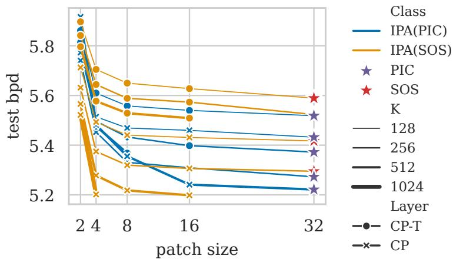  
Figure 12: Sum of squares (SOS) PC and probabilistic integral circuits (PIC) also show signs of plateau. All PCs are built using the QT region graph.

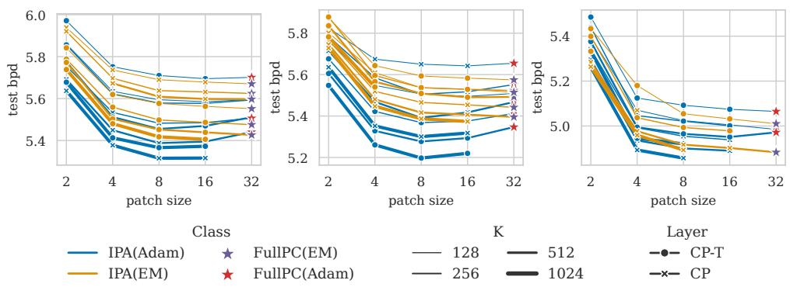  
Figure 13: Both Adam and EM can be affected by the independent patch conundrum when optimizing PCs over different patch sizes. We note that Adam provides as good a BPD as, or better than, EM when we use the same effective batch size and learning rate scheduler. Lines in the plot that do not have points for all patch sizes indicate that we could not fit the corresponding circuit in memory.

## E.9 REPA and Monarch matrices

Monarch layers [65] are CP-T layers using special low-rank Monarch matrices [15] as the weight matrices W. As such, Monarch layers constitute a parameter sharing approach that is orthogonal to our REPA. We refer the reader to Appendix C.1 for details about Monarch matrices.

We compare architectures with $K = 1 0 2 4$ using IPA, IPA(Monarch) and REPA(Monarch) to evaluate the benefits and contributions of the two parameter sharing techniques. We also train additional configurations for Monarch with $K = 4 0 9 6$ to confirm these observations for larger PCs and to exploit the additional efficiency gains provided by Monarch layers. Fig. 20 confirms prior findings that Monarch layers can improve estimation quality while reducing FLOPs. We highlight that REPA(Monarch) systematically improves performance, demonstrating that these two parameter sharing techniques act complementarily to alleviate the learnability issue. Finally, we note that our implementation of Monarch layers does not use custom CUDA kernels [34]; incorporating them could improve efficiency even further. It is important to mention that our implementation of Monarch is not highly optimized. Therefore, we cannot strictly compare REPA and IPA (Monarch).

## E.10 Full results: parameter sharing on TABPC

We report the full results for all 7 datasets on bpd (Fig. 22) and C2ST (Fig. 21).

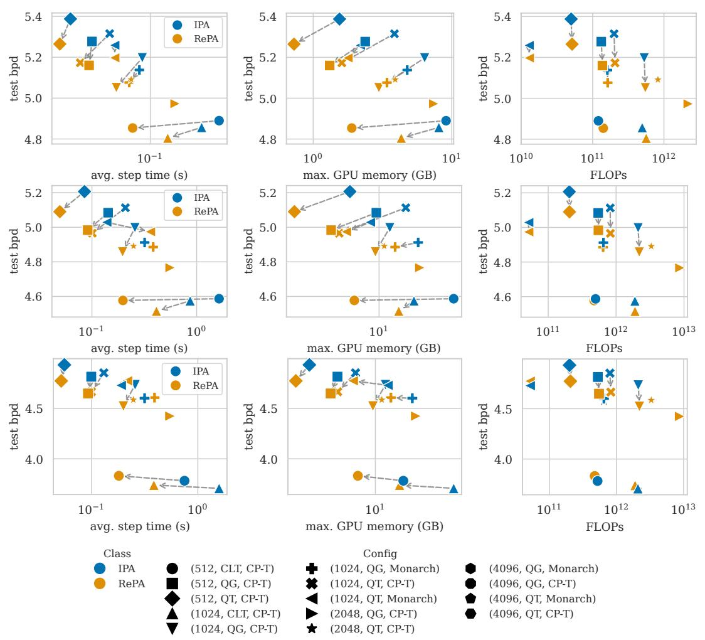  
Figure 14: REPA models are more Pareto efficient for all datasets tested. We compare bpd with regards to training step time (right), GPU memory (center) and FLOPs (left) on ImageNet 32 (top), ImageNet 64 (middle) and CelebA (bottom).

## E.11 Full results: samples

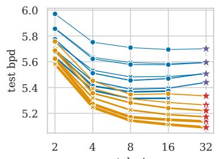

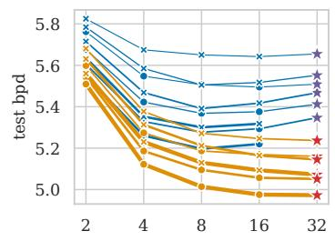

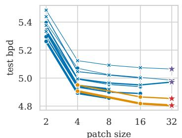

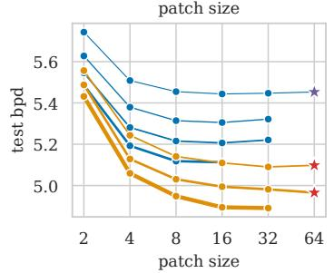

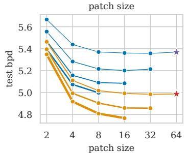

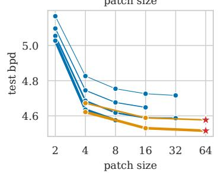

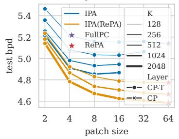

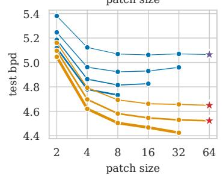

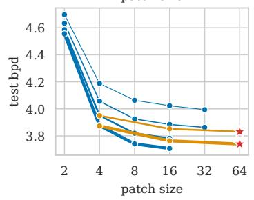  
Figure 15: REPA improves learnability for density estimation. We compare the bpd with respect to patch size for QT (left), QG (center), CLT (right) on ImageNet32 (top), ImageNet64 (middle) and CelebA (bottom)

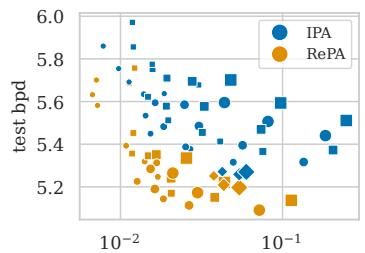  
avg. step time (s)

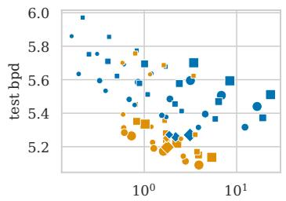  
max. GPU memory (GB)

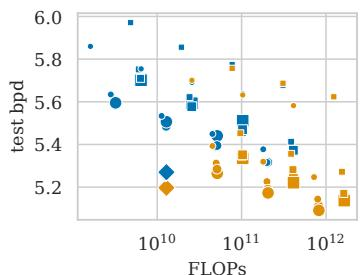

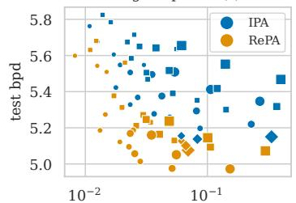  
avg. step time (s)

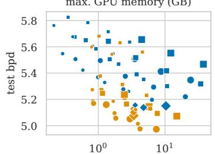  
max. GPU memory (GB)

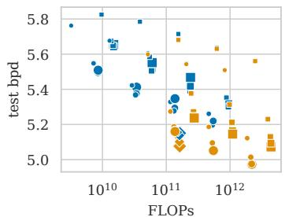

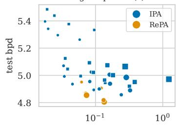  
avg. step time (s)

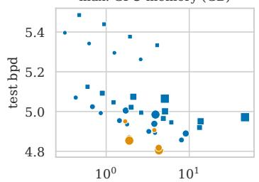  
max. GPU memory (GB)

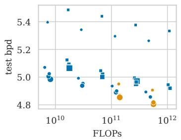  
Figure 16: REPA yields a better Pareto front on ImageNet32. We compare the bpd with respect to efficiency for QT (top), QG (middle), CLT (bottom) on ImageNet32. We do not distinguish different values of K

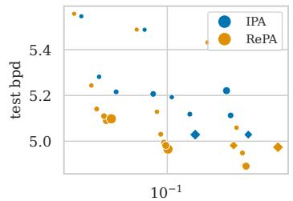  
avg. step time (s)

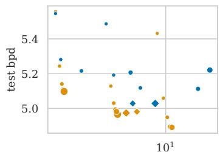  
max. GPU memory (GB)

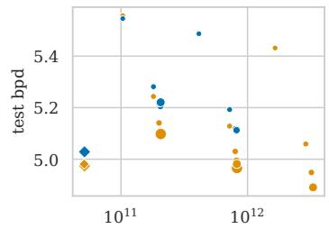  
FLOPs

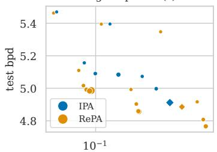  
avg. step time (s)

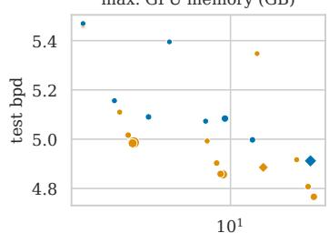  
max. GPU memory (GB)

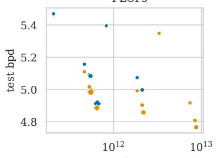  
FLOPs

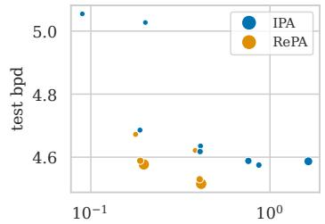  
avg. step time (s)

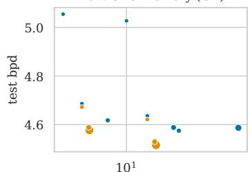  
max. GPU memory (GB)

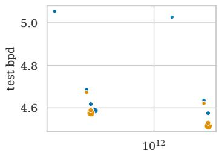  
FLOPs  
Figure 17: REPA yields a better Pareto front on ImageNet64. We compare the bpd with respect to efficiency for QT (top), QG (middle), CLT (bottom) on ImageNet64. We do not distinguish different values of K

10<sup>−1</sup>  
  
avg. step time (s)


  
FLOPs


avg. step time (s)  
  
avg. step time (s)

  
max. GPU memory (GB)

  
FLOPs  
Figure 18: REPA yields a better Pareto front on CelebA. We compare the bpd with respect to efficiency for QT (top), QG (middle), CLT (bottom) on CelebA. We do not distinguish different values of K

  
avg. step time (s)

  
max. GPU memory (GB)

  
FLOPs  
Figure 19: Our REPA construction with CLTs reduces training time and memory consumption for the ImageNet32 (gold border dots), ImageNet64 (silver) and CelebA (bronze) datasets.

  
avg. step time (s)

  
max. GPU memory (GB)

  
Figure 20: Combining REPA with Monarch layers lets PCs scale even further as shown for QT and QG RGs and K = 1024, 4096 on ImageNet32.

  
Figure 21: NOPA yields more efficient models with little decrease in C2ST with XGBoost. Each row is a dataset in this order: Adult, Beijing, Default, Diabetes, Magic, News, Shoppers.


  
Figure 22: NOPA yields more efficient models with little increase in bpd. Each row is a dataset in this order: Adult, Beijing, Default, Diabetes, Magic, News, Shoppers.

IPA  
REPA  
FULLPC  
  
Figure 23: Samples for CelebA (top row), ImageNet32 (middle row) and ImageNet64 (bottom row) using IPA $8 \times 8 \times 3$ and $K = 1 0 2 \bar { 4 }$ (left), REPA (center) with $K = 1 0 2 4$ for CelebA and $K = 5 1 2$ for ImageNet64 and FULLPC with $K = 1 2 8$ (right). All the PCs were built with a QG RG.

IPA  
REPA  
FULLPC  
  
Figure 24: Samples for CelebA (top row), ImageNet32 (middle row) and ImageNet64 (bottom row) using IPA $8 \times 8 \times 3$ and $K = 1 0 2 \bar { 4 }$ (left), REPA (center) with K = 1024 for CelebA and $K = 5 1 2$ for ImageNet64 and FULLPC with K = 128 (right). All the PCs were built with a QT RG.

## NeurIPS Paper Checklist

## 1. Claims

Question: Do the main claims made in the abstract and introduction accurately reflect the paper’s contributions and scope?

Answer: [Yes]

Justification: The abstract claims that we show a learnability issue which is explained in Section 3 and supported by the results in Fig. 5. It also claims that we introduce a new method with efficiency and quality improvement, detailed in Section 4 and supported by the results in Section 6.

Guidelines:

• The answer [N/A] means that the abstract and introduction do not include the claims made in the paper.

• The abstract and/or introduction should clearly state the claims made, including the contributions made in the paper and important assumptions and limitations. A [No] or [N/A] answer to this question will not be perceived well by the reviewers.

• The claims made should match theoretical and experimental results, and reflect how much the results can be expected to generalize to other settings.

• It is fine to include aspirational goals as motivation as long as it is clear that these goals are not attained by the paper.

## 2. Limitations

Question: Does the paper discuss the limitations of the work performed by the authors?

Answer: [Yes]

Justification: We mention all significant limitations in the conclusion of the paper.

Guidelines:

• The answer [N/A] means that the paper has no limitation while the answer [No] means that the paper has limitations, but those are not discussed in the paper.

• The authors are encouraged to create a separate “Limitations” section in their paper.

• The paper should point out any strong assumptions and how robust the results are to violations of these assumptions (e.g., independence assumptions, noiseless settings, model well-specification, asymptotic approximations only holding locally). The authors should reflect on how these assumptions might be violated in practice and what the implications would be.

• The authors should reflect on the scope of the claims made, e.g., if the approach was only tested on a few datasets or with a few runs. In general, empirical results often depend on implicit assumptions, which should be articulated.

• The authors should reflect on the factors that influence the performance of the approach. For example, a facial recognition algorithm may perform poorly when image resolution is low or images are taken in low lighting. Or a speech-to-text system might not be used reliably to provide closed captions for online lectures because it fails to handle technical jargon.

• The authors should discuss the computational efficiency of the proposed algorithms and how they scale with dataset size.

• If applicable, the authors should discuss possible limitations of their approach to address problems of privacy and fairness.

• While the authors might fear that complete honesty about limitations might be used by reviewers as grounds for rejection, a worse outcome might be that reviewers discover limitations that aren’t acknowledged in the paper. The authors should use their best judgment and recognize that individual actions in favor of transparency play an important role in developing norms that preserve the integrity of the community. Reviewers will be specifically instructed to not penalize honesty concerning limitations.

## 3. Theory assumptions and proofs

Question: For each theoretical result, does the paper provide the full set of assumptions and a complete (and correct) proof?

## Answer: [N/A]

Justification: No theoretical results are presented.

Guidelines:

• The answer [N/A] means that the paper does not include theoretical results.

• All the theorems, formulas, and proofs in the paper should be numbered and crossreferenced.

• All assumptions should be clearly stated or referenced in the statement of any theorems.

• The proofs can either appear in the main paper or the supplemental material, but if they appear in the supplemental material, the authors are encouraged to provide a short proof sketch to provide intuition.

• Inversely, any informal proof provided in the core of the paper should be complemented by formal proofs provided in appendix or supplemental material.

• Theorems and Lemmas that the proof relies upon should be properly referenced.

## 4. Experimental result reproducibility

Question: Does the paper fully disclose all the information needed to reproduce the main experimental results of the paper to the extent that it affects the main claims and/or conclusions of the paper (regardless of whether the code and data are provided or not)?

Answer: [Yes]

Justification: We provide full formulation of REPA in Section 4 as well as the training procedure to train REPA (CLT) in Appendix E.8. Furthermore, these are supported by algorithms in Appendix B.1.

Guidelines:

• The answer [N/A] means that the paper does not include experiments.

• If the paper includes experiments, a [No] answer to this question will not be perceived well by the reviewers: Making the paper reproducible is important, regardless of whether the code and data are provided or not.

• If the contribution is a dataset and/or model, the authors should describe the steps taken to make their results reproducible or verifiable.

• Depending on the contribution, reproducibility can be accomplished in various ways. For example, if the contribution is a novel architecture, describing the architecture fully might suffice, or if the contribution is a specific model and empirical evaluation, it may be necessary to either make it possible for others to replicate the model with the same dataset, or provide access to the model. In general. releasing code and data is often one good way to accomplish this, but reproducibility can also be provided via detailed instructions for how to replicate the results, access to a hosted model (e.g., in the case of a large language model), releasing of a model checkpoint, or other means that are appropriate to the research performed.

• While NeurIPS does not require releasing code, the conference does require all submissions to provide some reasonable avenue for reproducibility, which may depend on the nature of the contribution. For example

(a) If the contribution is primarily a new algorithm, the paper should make it clear how to reproduce that algorithm.

(b) If the contribution is primarily a new model architecture, the paper should describe the architecture clearly and fully.

(c) If the contribution is a new model (e.g., a large language model), then there should either be a way to access this model for reproducing the results or a way to reproduce the model (e.g., with an open-source dataset or instructions for how to construct the dataset).

(d) We recognize that reproducibility may be tricky in some cases, in which case authors are welcome to describe the particular way they provide for reproducibility. In the case of closed-source models, it may be that access to the model is limited in some way (e.g., to registered users), but it should be possible for other researchers to have some path to reproducing or verifying the results.

## 5. Open access to data and code

Question: Does the paper provide open access to the data and code, with sufficient instructions to faithfully reproduce the main experimental results, as described in supplemental material?

Answer: [Yes]

Justification: This paper only uses publicly available datasets and provides the necessary transforms in Appendix D. The code will be released on GitHub upon acceptance with instructions and scripts to create the environment, process the datasets and run the experiments.

## Guidelines:

• The answer [N/A] means that paper does not include experiments requiring code.

• Please see the NeurIPS code and data submission guidelines (https://neurips.cc/ public/guides/CodeSubmissionPolicy) for more details.

• While we encourage the release of code and data, we understand that this might not be possible, so [No] is an acceptable answer. Papers cannot be rejected simply for not including code, unless this is central to the contribution (e.g., for a new open-source benchmark).

• The instructions should contain the exact command and environment needed to run to reproduce the results. See the NeurIPS code and data submission guidelines (https: //neurips.cc/public/guides/CodeSubmissionPolicy) for more details.

• The authors should provide instructions on data access and preparation, including how to access the raw data, preprocessed data, intermediate data, and generated data, etc.

• The authors should provide scripts to reproduce all experimental results for the new proposed method and baselines. If only a subset of experiments are reproducible, they should state which ones are omitted from the script and why.

• At submission time, to preserve anonymity, the authors should release anonymized versions (if applicable).

• Providing as much information as possible in supplemental material (appended to the paper) is recommended, but including URLs to data and code is permitted.

## 6. Experimental setting/details

Question: Does the paper specify all the training and test details (e.g., data splits, hyperparameters, how they were chosen, type of optimizer) necessary to understand the results?

Answer: [Yes]

Justification: We also disclose the full set of hyperparameters for each model in Appendix D.3 as well as the general training setting in Section 6. We specify the data split in Appendix D.2.

Guidelines:

• The answer [N/A] means that the paper does not include experiments.

• The experimental setting should be presented in the core of the paper to a level of detail that is necessary to appreciate the results and make sense of them.

• The full details can be provided either with the code, in appendix, or as supplemental material.

## 7. Experiment statistical significance

Question: Does the paper report error bars suitably and correctly defined or other appropriate information about the statistical significance of the experiments?

Answer: [Yes]

Justification: We run 6 seeds of our best models to demonstrate the low variance in the results. Furthermore, rather than running several replicas of a single experiment configuration, here we are interested in mapping a very large (444 distinct configurations) experimental configuration space, and use this population to extract a statistical trend.

## Guidelines:

• The answer [N/A] means that the paper does not include experiments.

• The authors should answer [Yes] if the results are accompanied by error bars, confidence intervals, or statistical significance tests, at least for the experiments that support the main claims of the paper.

• The factors of variability that the error bars are capturing should be clearly stated (for example, train/test split, initialization, random drawing of some parameter, or overall run with given experimental conditions).

• The method for calculating the error bars should be explained (closed form formula, call to a library function, bootstrap, etc.)

• The assumptions made should be given (e.g., Normally distributed errors).

• It should be clear whether the error bar is the standard deviation or the standard error of the mean.

• It is OK to report 1-sigma error bars, but one should state it. The authors should preferably report a 2-sigma error bar than state that they have a 96% CI, if the hypothesis of Normality of errors is not verified.

• For asymmetric distributions, the authors should be careful not to show in tables or figures symmetric error bars that would yield results that are out of range (e.g., negative error rates).

• If error bars are reported in tables or plots, the authors should explain in the text how they were calculated and reference the corresponding figures or tables in the text.

## 8. Experiments compute resources

Question: For each experiment, does the paper provide sufficient information on the computer resources (type of compute workers, memory, time of execution) needed to reproduce the experiments?

Answer: [Yes]

Justification: The hardware used to run the model is disclosed in Appendix D.1.

Guidelines:

• The answer [N/A] means that the paper does not include experiments.

• The paper should indicate the type of compute workers CPU or GPU, internal cluster, or cloud provider, including relevant memory and storage.

• The paper should provide the amount of compute required for each of the individual experimental runs as well as estimate the total compute.

• The paper should disclose whether the full research project required more compute than the experiments reported in the paper (e.g., preliminary or failed experiments that didn’t make it into the paper).

## 9. Code of ethics

Question: Does the research conducted in the paper conform, in every respect, with the NeurIPS Code of Ethics https://neurips.cc/public/EthicsGuidelines?

Answer: [Yes]

Justification: Our paper does not include any research on live subjects or new data and we do not anticipate harmful consequences from this work.

Guidelines:

• The answer [N/A] means that the authors have not reviewed the NeurIPS Code of Ethics.

• If the authors answer [No], they should explain the special circumstances that require a deviation from the Code of Ethics.

• The authors should make sure to preserve anonymity (e.g., if there is a special consideration due to laws or regulations in their jurisdiction).

## 10. Broader impacts

Question: Does the paper discuss both potential positive societal impacts and negative societal impacts of the work performed?

Answer: [N/A].

Justification: No clear societal impact to discuss.

## Guidelines:

• The answer [N/A] means that there is no societal impact of the work performed.

• If the authors answer [N/A] or [No], they should explain why their work has no societal impact or why the paper does not address societal impact.

• Examples of negative societal impacts include potential malicious or unintended uses (e.g., disinformation, generating fake profiles, surveillance), fairness considerations (e.g., deployment of technologies that could make decisions that unfairly impact specific groups), privacy considerations, and security considerations.

• The conference expects that many papers will be foundational research and not tied to particular applications, let alone deployments. However, if there is a direct path to any negative applications, the authors should point it out. For example, it is legitimate to point out that an improvement in the quality of generative models could be used to generate Deepfakes for disinformation. On the other hand, it is not needed to point out that a generic algorithm for optimizing neural networks could enable people to train models that generate Deepfakes faster.

• The authors should consider possible harms that could arise when the technology is being used as intended and functioning correctly, harms that could arise when the technology is being used as intended but gives incorrect results, and harms following from (intentional or unintentional) misuse of the technology.

• If there are negative societal impacts, the authors could also discuss possible mitigation strategies (e.g., gated release of models, providing defenses in addition to attacks, mechanisms for monitoring misuse, mechanisms to monitor how a system learns from feedback over time, improving the efficiency and accessibility of ML).

## 11. Safeguards

Question: Does the paper describe safeguards that have been put in place for responsible release of data or models that have a high risk for misuse (e.g., pre-trained language models, image generators, or scraped datasets)?

Answer: [N/A].

Justification: Our paper does not pose such risks.

Guidelines:

• The answer [N/A] means that the paper poses no such risks.

• Released models that have a high risk for misuse or dual-use should be released with necessary safeguards to allow for controlled use of the model, for example by requiring that users adhere to usage guidelines or restrictions to access the model or implementing safety filters.

• Datasets that have been scraped from the Internet could pose safety risks. The authors should describe how they avoided releasing unsafe images.

• We recognize that providing effective safeguards is challenging, and many papers do not require this, but we encourage authors to take this into account and make a best faith effort.

## 12. Licenses for existing assets

Question: Are the creators or original owners of assets (e.g., code, data, models), used in the paper, properly credited and are the license and terms of use explicitly mentioned and properly respected?

Answer: [Yes]

Justification: CelebA and ImageNet are both available for non-commercial research purposes and are properly cited.

Guidelines:

• The answer [N/A] means that the paper does not use existing assets.

• The authors should cite the original paper that produced the code package or dataset.

• The authors should state which version of the asset is used and, if possible, include a URL.

• The name of the license (e.g., CC-BY 4.0) should be included for each asset.

• For scraped data from a particular source (e.g., website), the copyright and terms of service of that source should be provided.

• If assets are released, the license, copyright information, and terms of use in the package should be provided. For popular datasets, paperswithcode.com/datasets has curated licenses for some datasets. Their licensing guide can help determine the license of a dataset.

• For existing datasets that are re-packaged, both the original license and the license of the derived asset (if it has changed) should be provided.

• If this information is not available online, the authors are encouraged to reach out to the asset’s creators.

## 13. New assets

Question: Are new assets introduced in the paper well documented and is the documentation provided alongside the assets?

Answer: [Yes]

Justification: All the models will be released upon acceptance.

Guidelines:

• The answer [N/A] means that the paper does not release new assets.

• Researchers should communicate the details of the dataset/code/model as part of their submissions via structured templates. This includes details about training, license, limitations, etc.

• The paper should discuss whether and how consent was obtained from people whose asset is used.

• At submission time, remember to anonymize your assets (if applicable). You can either create an anonymized URL or include an anonymized zip file.

## 14. Crowdsourcing and research with human subjects

Question: For crowdsourcing experiments and research with human subjects, does the paper include the full text of instructions given to participants and screenshots, if applicable, as well as details about compensation (if any)?

Answer: [N/A]

Justification: this paper does not involve human subjects or crowdsourcing.

Guidelines:

• The answer [N/A] means that the paper does not involve crowdsourcing nor research with human subjects.

• Including this information in the supplemental material is fine, but if the main contribution of the paper involves human subjects, then as much detail as possible should be included in the main paper.

• According to the NeurIPS Code of Ethics, workers involved in data collection, curation, or other labor should be paid at least the minimum wage in the country of the data collector.

## 15. Institutional review board (IRB) approvals or equivalent for research with human subjects

Question: Does the paper describe potential risks incurred by study participants, whether such risks were disclosed to the subjects, and whether Institutional Review Board (IRB) approvals (or an equivalent approval/review based on the requirements of your country or institution) were obtained?

Answer: [N/A]

Justification: this paper does not involve human subjects or crowdsourcing.

Guidelines:

• The answer [N/A] means that the paper does not involve crowdsourcing nor research with human subjects.

• Depending on the country in which research is conducted, IRB approval (or equivalent) may be required for any human subjects research. If you obtained IRB approval, you should clearly state this in the paper.

• We recognize that the procedures for this may vary significantly between institutions and locations, and we expect authors to adhere to the NeurIPS Code of Ethics and the guidelines for their institution.

• For initial submissions, do not include any information that would break anonymity (if applicable), such as the institution conducting the review.

## 16. Declaration of LLM usage

Question: Does the paper describe the usage of LLMs if it is an important, original, or non-standard component of the core methods in this research? Note that if the LLM is used only for writing, editing, or formatting purposes and does not impact the core methodology, scientific rigor, or originality of the research, declaration is not required.

Answer: [N/A]

Justification: this paper does not involve any LLMs.

Guidelines:

• The answer [N/A] means that the core method development in this research does not involve LLMs as any important, original, or non-standard components.

• Please refer to our LLM policy in the NeurIPS handbook for what should or should not be described.