# Payoff-Aware Prediction of Population Game Dynamics

Kang Wang1 Xiao Wang1,2∗ Bo Li3 Renzhe Xu1,2∗

1School of Computing and Artificial Intelligence, Shanghai University of Finance and Economics 2MoE Key Laboratory of Interdisciplinary Research of Computation and Economics,

Shanghai University of Finance and Economics

3School of Economics and Management, Tsinghua University wangkang0330@gmail.com wangxiao@sufe.edu.cn libo@sem.tsinghua.edu.cn xurenzhe@sufe.edu.cn

## Abstract

Population game dynamics describe how aggregate behavior evolves in response to payoff signals. In many applications, the payoff function may change, and the goal is to predict the population trajectory induced by a new payoff design before trajectory data under that design are available. We study this problem as payoff-aware prediction of population game dynamics. Standard dynamics learning methods fit the motion observed under training payoffs, but do not separate the payoff-dependent incentive from the payoff-independent response structure needed for prediction under new payoffs. Building on the existing framework of Riemannian game dynamics, we propose PA-RmD, a payoff-aware learning method that keeps payoff information explicit and learns the payoff-independent response structure from data. Theoretically, we show that the learned model preserves fixed-payoff Nash equilibria and derive finite-time one-step prediction bounds under shared-response and payoff-coverage conditions. Empirically, we evaluate PA-RmD on synthetic zero-sum and potential games, as well as a YouTube Trending multi-country dataset, showing that our method performs well under changing payoff designs.

## 1 Introduction

Population games study systems with many agents who repeatedly choose among a finite set of strategies. In such games, a payoff function specifies the benefit agents receive from each strategy, and the associated population game dynamics describe how the aggregate behavior of the population changes under these payoffs. This viewpoint is standard in large-population models of congestion systems, markets, and other settings in which individual identities are less important than aggregate behavior [38, 15, 35]. The same aggregate perspective has also been adopted in models of online content platforms [49, 23], where content creators repeatedly adjust what content to produce in response to platform-provided payoff signals, such as exposure or monetary rewards [50, 9, 47, 10].

Predicting such population game dynamics can provide important guidance for decision-making and mechanism design. In many design settings, the payoff function is not fixed: a planner or platform may alter the incentives faced by the population, and these changes can substantially reshape the induced population dynamics. Prediction in this setting must therefore be payoff-aware: the model should take a candidate payoff function as input and forecast the population trajectory it would induce. We refer to this problem as payoff-aware prediction of population game dynamics. The challenge is that the prediction is counterfactual. For example, a content platform may want to know whether a new reward mechanism would shift creators toward different content categories and how this shift would affect aggregate platform outcomes. Before deployment, however, it has no trajectory data under that new mechanism. The operational question is therefore how to predict the trajectory that would arise under a new payoff function using only trajectories observed under previous payoff functions.

Existing work provides important context but does not directly address this prediction problem. The population game dynamics literature primarily studies specified dynamics under a given payoff function, with central questions including convergence and stability [38]. Data-driven work has studied learning, identifying, and steering game dynamics from observed play [37, 6], while general dynamical-system learning methods learn vector fields or governing equations from trajectory data [7, 4]. These approaches can learn dynamics from observed trajectories, but they typically fit the realized motion under the observed payoff conditions. As a result, the learned dynamics may mix the payoff dependent incentive with the population response structure, leaving no principled way to update the prediction when the payoff function changes.

To avoid this issue, we turn to structured population-game dynamics, where different dynamics encode different assumptions about how populations respond to payoffs [38]. Among these dynamics, Riemannian game dynamics (RmD) [32] provide a unified framework that includes commonly used models such as replicator dynamics [44] and projection dynamics [33]. RmD’s key idea is to model population motion as the outcome of balancing a payoff-dependent gain from motion against a payoff independent cost from motion. This gain-cost view is natural in platform settings [49, 10, 9]: creators may be attracted to content categories with higher exposure or rewards, but switching categories can be costly. These adjustment costs can often be viewed as stable across payoff designs because they reflect practical barriers such as learning new production skills [11]. Motivated by this relative stability and following the RmD framework, we model the cost term as payoff-independent and use it as the shared population response structure for payoff-aware prediction. Once this cost term is learned from historical trajectories, a new payoff function can be plugged into the gain term to predict the induced population motion. We therefore propose PA-RmD, a payoff-aware Riemannian dynamics learning model that implements this gain-cost decomposition from data.

We analyze the proposed PA-RmD method both theoretically and empirically. On the theory side, we show that the learned model preserves the Nash equilibrium set of a fixed payoff function when all strategies retain positive population mass, and we prove finite-time one-step prediction bounds under a shared population response assumption. These bounds identify a payoff-coverage condition: prediction under a held-out payoff is controlled when its payoff direction is represented by the payoff directions observed in training. Empirically, we evaluate the framework on synthetic zero-sum games and potential games, as well as on a YouTube Trending multi-country dataset. The results show that the payoff-aware formulation can support prediction across held-out payoff designs.

To conclude, our main contributions are as follows:

• We formulate payoff-aware prediction of population game dynamics: predicting population trajectories under held-out payoff designs from trajectories observed under previous payoff designs.

• We instantiate this formulation with PA-RmD, a RmD-based framework that keeps payoff functions explicit and learns the shared population response structure from data.

• We show that the learned model preserves fixed-payoff Nash equilibria and prove finite-time one-step prediction bounds under shared population response and payoff-coverage conditions.

• We demonstrate the effectiveness of the framework on synthetic zero-sum games and potential games and a YouTube Trending multi-country dataset.

## 2 Related Work

Population games and dynamics. Population games provide a standard framework for modeling strategic interaction in large populations of anonymous agents through aggregate strategy shares and state-dependent payoffs [38]. This population-level viewpoint has been used in congestion and routing systems [33, 39], distributed control [35, 2], and evolutionary and biological systems [44, 20]. We adopt the same aggregate perspective because our goal is to predict how population behavior changes when the payoff environment changes.

Game dynamics specify how a population or a set of players adapts over time in response to payoff information. In population games, these dynamics are often formalized as revision protocols that convert current payoff vectors into feasible motion. Canonical examples include replicator, projection, logit, and Riemannian game dynamics [44, 33, 31, 32, 15]. More broadly, dynamics in games are also used as algorithmic and conceptual tools for studying decentralized adaptation and equilibrium computation [34, 19, 42, 12]. Prior work typically starts from a specified update rule and studies its stationarity, stability, convergence, regret, or ability to accelerate equilibrium computation [39, 13, 18]. In contrast, we treat the dynamic itself as the object to be learned from trajectory data, with the goal of predicting population-level evolution under held-out payoff environments.

Learning dynamical systems from data. Data-driven system identification learns dynamics from trajectories, usually as equations, vector fields, or transition maps. Sparse Identification of Nonlinear Dynamics discovers interpretable equations from candidate libraries [4], while neural ODEs parameterize continuous-time vector fields with neural networks [7]. Other methods incorporate structure for particle systems [5], fluid dynamics [26], social networks [46], and linear dynamical systems [17, 8, 48, 41]; multi-environment dynamics-learning methods study generalization across changing systems or latent environments [51, 22, 27].

Recent work has also learned dynamics or payoff information from game data. Lam et al. [24] estimate learning dynamics in routing games, and the SIAR framework [37] identifies game dynamics from scarce trajectories using polynomial vector fields with side-information constraints. SIAR-MPC further combines learned controlled dynamics with model predictive control to steer game dynamics toward desirable outcomes [6]. Relatedly, Bonafini et al. [3] recover individual payoff functions from observed evolutionary trajectories. These works infer dynamics, learning rules, or payoffs within an observed game environment. Our task is different: given a new payoff function and no trajectory under it, the model must predict aggregate evolution from a learned population response.

## 3 Preliminaries

Notations For a positive integer K, let $[ K ] = \{ 1 , \ldots , K \}$ and let 1 denote the all-ones vector in $\mathbb { R } ^ { K }$ . We write $\Delta _ { K } = \{ x \in \mathbb { R } _ { > 0 } ^ { K } : \mathbf { 1 } ^ { \top } x = 1 \}$ for the simplex, $\Delta _ { K } ^ { \circ } = \{ x \in \mathbb { R } _ { > 0 } ^ { K } : \mathbf { 1 } ^ { \top } x = 1 \}$ for its interior, and $\mathcal { T } = \{ z \in \mathbb { R } ^ { K } : \bar { \mathbf { 1 } } ^ { \top } z = 0 \}$ for the tangent space of the simplex. For $d \geq 1 , \mathbb { S } _ { + } ^ { d }$ and $\mathbb { S } _ { + + } ^ { d }$ denote the sets of $d \times d$ symmetric positive semidefinite and positive definite matrices, respectively. We use $\| \cdot \| _ { 2 }$ for the Euclidean norm and $\| \cdot \| _ { \mathrm { o p } }$ for the operator norm.

## 3.1 Population Games and Dynamics

We consider finite-strategy population games with strategy set $[ K ]$ . A population state is a vector $x \in \Delta _ { K }$ , where $x _ { i }$ denotes the mass, or share, of the population using strategy i. A population game is specified by a payoff function $v : \Delta _ { K } \to \mathbb { R } ^ { K }$ , where $v _ { i } ( x )$ is the payoff received by an agent choosing strategy i when the aggregate population state is $x .$ Let U denote the set of payoff functions.

A population dynamic specifies how the population state changes in response to the current payoff vector. On a finite time interval $I = [ 0 , T ]$ , we write the induced trajectory as

$$
{ \dot { x } } _ { t } = F ( x _ { t } , v ( x _ { t } ) ) ,\tag{1}
$$

where $F ( x _ { t } , v ( x _ { t } ) ) \in \mathcal { T }$ and $\tau$ is the tangent space of the simplex. Thus, the dynamic converts the payoff vector at the current state into a feasible direction of motion for the population state.

We write $\mathcal { X } \subseteq \Delta _ { K }$ for the reachable population-state domain generated by the dynamics under payoff functions $v \in \mathcal { U }$ and admissible initial conditions. Throughout the paper, we restrict attention to interior trajectories and assume tha $\mathcal { X } \subseteq \Delta _ { K } ^ { \circ }$

For a payoff function $v : \mathcal { X } \to \mathbb { R } ^ { K }$ , define its Nash equilibrium set on the interior domain $\mathcal { X }$ as

$$
{ \mathcal { N } } ( v ) = \{ x \in \mathcal { X } : v _ { i } ( x ) = v _ { j } ( x ) , \forall i , j \in [ K ] \} .\tag{2}
$$

Indeed, the standard population-game Nash condition requires every strategy used with positive mass to attain maximal payoff. Since every strategy has positive mass on $\bar { x _ { \mathrm { ~ \subseteq ~ } } } \Delta _ { K } ^ { \circ }$ , this condition is equivalent to payoff indifference across all strategies.

## 3.2 Payoff-Aware Prediction of Population Game Dynamics

We observe population trajectories generated under multiple payoff functions. For each training instance $n \in [ N ]$ , a payoff function $v ^ { ( n ) } \in \mathcal { U }$ induces a trajectory $x _ { t } ^ { ( n ) } \in \mathcal { X }$ over a finite time interval $[ 0 , T ]$ . The trajectories are observed at sampling interval $\delta > 0 .$ , with observation grid $\hat { I } _ { \delta } \ = \ \{ 0 , \delta , 2 \delta , \ldots , \lfloor T / \delta \rfloor \delta \}$ The training data are a collection of observed trajectories, each containing the population states and the corresponding payoff vectors along the trajectory: $\mathcal { D } _ { \mathrm { o b s } } =$ $\{ \{ ( x _ { t } ^ { ( n ) } , v ^ { ( n ) } ( x _ { t } ^ { ( n ) } ) ) \} _ { t \in \hat { I } _ { \delta } } : n \in [ N ] \}$ . For simplicity, we write the setup with a common observation grid across trajectories; the same formulation extends directly to trajectory-specific observation times.

At prediction time, we are given a payoff function $w \in \mathcal { U }$ and an initial state $x _ { 0 } ^ { \mathrm { t e } } \in \mathcal { X }$ . The payoff function w may differ from those observed during training. The goal is to predict the population trajectory $\boldsymbol { x } _ { t } ^ { \mathrm { t e } }$ induced by w from the initial state $\boldsymbol { x } _ { 0 } ^ { \mathrm { t e } }$ . Thus the learning problem is payoff-aware: the payoff function is kept as an explicit input, and the model learns how population states respond to payoff vectors from the observed trajectories.

Example 3.1 (Online content platform). Consider an online content platform, such as TikTok or YouTube, on which creators choose among K content categories. The state $x _ { i }$ is the share of creators producing category i content, and $v _ { i } ( x )$ is the expected payoff to producing category i when the platform-wide content distribution is x. Each training payoff function $v ^ { ( n ) }$ corresponds to a historical ranking, exposure, or reward rule, and the observed trajectory $x _ { t } ^ { ( n ) }$ records how creators reallocate across categories under that rule. At prediction time, w represents the platform rule used for forecasting. A payoff-aware model learns the shared adjustment structure from historical trajectories and combines it with w to predict the creator population trajectory from the initial state $x _ { 0 } ^ { \mathrm { t e } }$

## 4 Learning Payoff-Aware Riemannian Dynamics

## 4.1 Learning Procedure

To address the payoff-aware prediction problem defined in Section 3.2, the model must explain how population motion changes when the payoff function changes. A model that only fits the realized motion in observed trajectories can mix the payoff-dependent incentive with the response rule of the population, leaving no clear way to update predictions under a new payoff function.

We therefore use the structure of population-game dynamics. Different dynamics encode different assumptions about how agents revise strategies in response to payoffs [38]; equivalently, the payoff function alone does not determine population motion, because the response rule is part of the model [34]. In our setting, the goal is to keep the payoff function explicit while learning the part of the population response that can be shared across payoff designs.

Payoff-aware Riemannian dynamics learning model. Riemannian game dynamics (RmD) [32] provide a natural formalism for this goal. We define a payoff-aware Riemannian dynamics learning model, denoted by PA-RmD. The model keeps the same structural form as RmD, but parameterizes the unknown shared cost-from-motion structure by $G _ { \theta } : \mathcal { X } \to \mathbb { S } _ { + + } ^ { K }$ and learns it from observed trajectories. Specifically, for any payoff function $u \in \mathcal { U }$ , the induced population dynamic is

$$
\dot { x } _ { t } = \underset { z \in \mathcal { T } } { \operatorname { a r g m a x } } \left\{ u ( x _ { t } ) ^ { \top } z - \frac { 1 } { 2 } z ^ { \top } G _ { \theta } ( x _ { t } ) z \right\} .\tag{3}
$$

The parameter θ is shared across payoff functions, while the payoff function u remains an explicit input. Thus, PA-RmD does not learn a separate dynamic for each payoff function; it learns the payoff-independent adjustment structure that converts payoff incentives into population motion.

Interpretation. The variational problem in Equation (3) makes the gain-cost decomposition explicit. The linear term ${ \boldsymbol { u } } ( { \boldsymbol { x } } _ { t } ) ^ { \top } .$ z is the gainfrom motion: a direction z is favored when it increases the mass of strategies with high current payoffs and decreases the mass of strategies with low current payoffs. The quadratic term $\begin{array} { r } { \frac { 1 } { 2 } \tilde { z } ^ { \top } G _ { \theta } ( x _ { t } ) \dot { z } } \end{array}$ is the cost from motion: the matrix $G _ { \theta } ( x _ { t } )$ assigns a state-dependent cost to each feasible direction in $\tau$ . In PA-RmD, this payoff-independent cost term is the shared population response structure to be learned from data. It can represent adjustment barriers, responsiveness to payoff differences, and constraints on reallocation. In the content-platform example, such costs capture how difficult it is for creators to shift toward a newly rewarded content category, for instance because doing so may require learning new production skills or rebuilding an audience.

Riemannian game dynamics also admit an individual-level interpretation through revision protocols, in which agents revise strategies according to payoff-dependent switching rates and the aggregate inflows and outflows induce the population dynamic. Under this interpretation, $G _ { \theta }$ encodes how agents adjust behavior at the individual level, rather than merely a formal geometric object. We give the details in Appendix A.

Equivalent parametrization. The optimization problem in Equation (3) admits an equivalent form that is easier to use for learning. Fix an orthonormal basis $q _ { 1 } , \ldots , q _ { K - 1 }$ of $\tau$ and let

$$
U = [ q _ { 1 } , \dots , q _ { K - 1 } ] \in \mathbb { R } ^ { K \times ( K - 1 ) } .
$$

Proposition 4.1. Fix U as above. The Riemannian model in Equation (3) is equivalent to

$$
\begin{array} { r } { \dot { x } _ { t } = U C _ { \theta } ( x _ { t } ) U ^ { \top } u ( x _ { t } ) , } \end{array}\tag{4}
$$

where $C _ { \theta } : \mathcal { X } \to \mathbb { S } _ { + + } ^ { K - 1 }$ . Specifically, any metric $G _ { \theta } : \mathcal { X } \to \mathbb { S } _ { + + } ^ { K }$ induces this form with $C _ { \theta } ( x ) =$ $( U ^ { \top } G _ { \theta } ( x ) U ) ^ { - 1 }$ . Conversely, any $C _ { \theta } : \mathcal { X } \to \mathbb { S } _ { + + } ^ { K - 1 }$ can be represented by the Riemannian model in Equation (3); one compatible choice is $G _ { \theta } ( x ) \stackrel { \cdot } { = } U C _ { \theta } ( x ) ^ { - 1 } U ^ { \top } + c \mathbf { 1 1 } ^ { \top } / K$ , for any scalar $c > 0 .$

Thus, instead of learning the full metric $G _ { \theta }$ , we learn $C _ { \theta }$ directly. The parametrization in Equation (4) is convenient because it replaces the constrained optimization over feasible simplex directions in Equation (3) with a matrix-vector product.

Loss function. Let $\hat { I } _ { \delta } ^ { - } = \hat { I } _ { \delta } \setminus \{ \lfloor T / \delta \rfloor \delta \}$ denote the observation times that admit a one-step successor. We learn θ by matching the finite-difference approximation of the time derivative with the motion predicted by PA-RmD:

$$
\ell ( \theta ) = \sum _ { n = 1 } ^ { N } \sum _ { t \in \hat { I } _ { \delta } ^ { - } } \left\| \frac { x _ { t + \delta } ^ { ( n ) } - x _ { t } ^ { ( n ) } } { \delta } - U C _ { \theta } ( x _ { t } ^ { ( n ) } ) U ^ { \top } v ^ { ( n ) } ( x _ { t } ^ { ( n ) } ) \right\| _ { 2 } ^ { 2 } ,\tag{5}
$$

with $C _ { \theta } ( x ) \in \mathbb { S } _ { + + } ^ { K - 1 }$ for all $x \in \mathcal { X }$

## 4.2 Theoretical Analysis

For the theoretical analysis, we impose a stronger interiority condition.

Assumption 4.1. Assume that $\mathcal { X } \subset \Delta _ { K } ^ { \circ }$ is a compact set.

This assumption focuses the analysis on regimes in which every strategy retains a non-zero population share. This interior-domain restriction is standard in population and evolutionary game dynamics, and is natural in large-population applications where each action or category can continue to attract some agents even when its population share is small [38, 30, 14].

Equilibrium preservation. We first provide a structural property of the model: for a fixed payoff function, the matrix C affects the transient motion but not the set of interior stationary states. Following the population-dynamic notation in Equation (1), for a population dynamic F and a payoff function $u ,$ define the stationary set induced by u as

$$
S ( F , u ) = \{ x \in \mathcal { X } : F ( x , u ( x ) ) = 0 \} .
$$

These are the states at which the population dynamic produces zero motion.

Proposition 4.2. Suppose Assumption 4.1 holds. Fix a payoff function $u \in \mathcal { U } .$ . For any continuous $\widetilde { C } : \mathcal { X } \to \mathbb { S } _ { + + } ^ { K - 1 }$ , define $F _ { \widetilde { C } } ( x , a ) = U \widetilde { C } ( x ) U ^ { \top } a$ . Then

$$
\begin{array} { r } { S ( F _ { \widetilde { C } } , u ) = \mathcal { N } ( u ) = \{ x \in \mathcal { X } : U ^ { \top } u ( x ) = 0 \} . } \end{array}
$$

Here $\mathcal { N } ( u )$ denotes the Nash equilibrium set defined in Equation (2).

Proposition 4.2 shows that changing $\widetilde { C }$ changes how the population moves, but the stationary states are still exactly the states at which all strategies receive the same payoff. Learning $\widetilde { C }$ therefore does not create or remove interior Nash equilibria for the same payoff function.

Prediction under changing payoff functions. We next study when the matrix learned from training payoff functions can be reused for a prediction-time payoff function. The key assumption is that payoff functions may change across tasks, but the same $\dot { C } _ { \star }$ converts payoff vectors into motion.

Assumption 4.2. There exists $C _ { \star } : \mathcal { X } \to \mathbb { S } _ { + } ^ { K - 1 }$ such that, for every payoff function $u \in \mathcal { U } .$ , the population state evolves according to $\dot { x } _ { t } = U C _ { \star } ( x _ { t } ) U ^ { \top } u ( x _ { t } )$ . For each $x \in \mathcal { X }$ , let $\mathcal { D } _ { \mathrm { t r } } ( \cdot \mid x )$ denote a conditional distribution over training payoff functions observed at x.

The first part of Assumption 4.2 says that payoff functions may change across tasks, but $C _ { \star }$ does not. The second part is a population-risk idealization of the training data, where sufficiently many one-step observations near the same state are represented by $\mathcal { D } _ { \mathrm { t r } } ( \cdot \mid \bar { x } )$

Let $\Psi _ { \delta } ^ { u } ( x )$ denote the time-δ flow map generated by the dynamics in Assumption 4.2. Because our training objective uses one-step finite differences, the population-risk target at sampling interval δ is the statewise minimizer

$$
C _ { \delta , \mathrm { t r } } ^ { \star } ( x ) \in \arg \operatorname* { m i n } _ { C \in \mathbb { S } _ { + } ^ { K - 1 } } \mathbb { E } _ { v \sim \mathcal { D } _ { \mathrm { t r } } ( \cdot | x ) } \left[ \left\| \frac { 1 } { \delta } \left( \Psi _ { \delta } ^ { v } ( x ) - x \right) - U C U ^ { \top } v ( x ) \right\| _ { 2 } ^ { 2 } \right] .
$$

Equivalently, $C _ { \delta , \mathrm { t r } } ^ { \star } ( x )$ is the matrix that minimizes the conditional squared loss one would obtain with infinitely many one-step training samples starting from the same state x. We optimize over positive semidefinite matrices, rather than positive definite matrices, to ensure that such a population-risk minimizer exists. We also impose standard boundedness and Lipschitz regularity conditions on the payoff functions and the shared matrix $C _ { \star }$

Assumption 4.3. Assume that there exist constants $\Lambda , L _ { u } , M , L _ { C } > 0$ such that for every payoff function u $\in \mathcal { U } \mathrm { ~ a n d ~ e v e r y ~ } x , y \in \mathcal { X } , \| u ( x ) \| _ { 2 } \leq \Lambda , \| u ( x ) - u ( y ) \| _ { 2 } \leq L _ { u } \| x - y \| _ { 2 } , \| C _ { \star } ( x ) \| _ { \mathrm { o p } } ^ { - } \overset { \cdot } { \leq } M$ and $\| C _ { \star } ( x ) - C _ { \star } ( y ) \| _ { \mathrm { o p } } \leq L _ { C } \| x - y \| _ { 2 }$

The next result says that this population-risk target transfers to a prediction-time payoff function w when the projected payoff direction $U ^ { \top } w ( x )$ is covered by the projected training payoff directions $U ^ { \top } v ( x )$ . The coefficient $\gamma _ { w }$ measures how hard it is to represent the prediction-time payoff direction from the training distribution.

Theorem 4.3. Suppose Assumptions 4.1 to 4.3 hold (with the constants $M , L _ { C } , L _ { u } , \Lambda )$ . Fix a prediction-time payofffunction w $\in { \mathcal { U } } .$ Suppose there exists $\gamma _ { w } < \infty$ such that, for every $x \in \mathcal { X }$ there exists a square-integrable coefficient $\rho _ { x } ( v )$ satisfying

$$
\begin{array} { r } { \begin{array} { r } { U ^ { \top } w ( x ) = \mathbb { E } _ { v \sim \mathcal { D } _ { \operatorname { t r } } ( \cdot \vert x ) } \left[ \rho _ { x } ( v ) U ^ { \top } v ( x ) \right] \quad a n d \quad \mathbb { E } _ { v \sim \mathcal { D } _ { \operatorname { t r } } ( \cdot \vert x ) } \left[ \rho _ { x } ( v ) ^ { 2 } \right] \le \gamma _ { w } ^ { 2 } . } \end{array} } \end{array}
$$

Then

$$
\operatorname* { s u p } _ { x \in \mathcal { X } } \left\| \Psi _ { \delta } ^ { w } ( x ) - x - \delta U C _ { \delta , \mathrm { t r } } ^ { \star } ( x ) U ^ { \top } w ( x ) \right\| _ { 2 } \leq B _ { \star } ( 1 + \gamma _ { w } ) \delta ^ { 2 } ,
$$

where

$$
B _ { \star } = \frac { 1 } { 2 } M \Lambda \left( L _ { C } \Lambda + M L _ { u } \right) .\tag{6}
$$

Theorem 4.3 compares the true one-step displacement $\Psi _ { \delta } ^ { w } ( x ) - x$ under w with the one-step displacement predicted by the training target $C _ { \delta , \mathrm { t r } } ^ { \star } ( x )$ . The error is order $\delta ^ { 2 }$ : for small sampling intervals, the learned matrix gives an accurate first-order prediction, and the constant worsens when the prediction-time payoff direction is poorly covered by training directions.

Corollary 4.4. Suppose Assumptions 4.1 to 4.3 hold (with the constants $M , L _ { C } , L _ { u } , \Lambda ) .$ Suppose the projected training payoffvectors uniformly cover the tangent space on $\mathcal { X } \mathrm { : }$ : there exists $\mu > 0$ such that, for every $x \in { \mathcal { X } } ,$

$$
\begin{array} { r } { \Sigma _ { \operatorname { t r } } ( x ) : = \mathbb { E } _ { v \sim \mathcal { D } _ { \operatorname { t r } } ( \cdot \vert x ) } \left[ U ^ { \top } v ( x ) v ( x ) ^ { \top } U \right] \succeq \mu I _ { K - 1 } . } \end{array}
$$

Then, for any prediction-time payoff function $w \in \mathcal { U } ,$

$$
\operatorname* { s u p } _ { x \in \mathcal { X } } \left\| \Psi _ { \delta } ^ { w } ( x ) - x - \delta U C _ { \delta , \mathrm { t r } } ^ { \star } ( x ) U ^ { \top } w ( x ) \right\| _ { 2 } \leq B _ { \star } \left( 1 + \frac { \Lambda } { \sqrt { \mu } } \right) \delta ^ { 2 } ,
$$

where $B _ { \star }$ is defined in Equation (6).

Corollary 4.4 gives a simpler sufficient condition for the coverage requirement in Theorem 4.3. If the training payoff functions span all tangent payoff directions uniformly, then every prediction-time payoff function in U satisfies the theorem with a controlled constant.

## 4.3 Practical Implementations

In implementation, we enforce the positive-definiteness constraint in Equation (5) on $C _ { \theta }$ by parameterizing

$$
C _ { \theta } ( x ) = L _ { \theta } ( x ) L _ { \theta } ( x ) ^ { \top } + \epsilon I
$$

where $L _ { \theta } ( x ) \in \mathbb { R } ^ { ( K - 1 ) \times ( K - 1 ) }$ is the output of a neural network, $\epsilon > 0$ is fixed, and I is the identity matrix. We then optimize the loss in the learning procedure by standard gradient-based methods. This parametrization keeps every predicted motion in the form $U C _ { \theta } ( x ) \mathbf { \breve { { U } } } ^ { \top } v ( x )$ while ensuring $C _ { \theta } ( x ) \in \mathbb { S } _ { + + } ^ { K - 1 }$ throughout training.

## 5 Experiments

We evaluate the payoff-aware framework in both synthetic and real-data experiments. The source code is publicly available at https://github.com/wangkng/PA-RmD.

Baselines. We compare PA-RmD against three groups of baselines: (i) standard dynamics prediction methods, including SINDy [4] and Neural ODE [7]; (ii) methods designed for dynamics prediction under distribution shift, including LEADS [51], CoDA-ℓ , and $\mathrm { C o D A } { \cdot } \ell _ { 2 } \ [ 2 2 ] ^ { \bar { 2 } }$ ; and (iii) a gamestructured dynamics identification method, SIAR [37]. To ensure a fair comparison under the payoffaware prediction setup in Section 3.2, all baselines are given the same payoff function information as input. Implementation details are provided in Appendix C.1.1.

## 5.1 Synthetic Experiments

Data-generating process. Each synthetic setting pairs a payoff function family with a population response dynamic; construction details are given in Appendix C.1.2. We use two payoff function classes, denoted by $\mathcal { U } ^ { \mathrm { c y c l i c } }$ and Ucongestion.

1. Zero-sum cyclic game class [43]. This class generalizes rock–paper–scissors interactions and cyclic dominance in evolutionary games. Each payoff function in $\mathcal { U } ^ { \mathrm { c y c l i c } }$ is a linear function $v ( x ) = A x$ on the simplex. Starting from a directed cyclic dominance rule over K strategies, we construct different payoff functions by permuting the strategy labels in A. Thus, all payoff functions share the same zero-sum cyclic structure, but differ in which strategy labels win or lose against one another. For $K = 3$ , this gives exactly two payoff functions: the usual rock–paper–scissors rule and the reversed rule, where every winning relation is flipped.

2. Potential congestion game class [36]. Each payoff function in $\mathcal { U } ^ { \mathrm { c o n g e s t i o n } }$ comes from a congestion game with a fixed route–resource incidence structure. The K population strategies are routes. A population state specifies the mass assigned to each route and thereby determines the load on each resource. Each route receives a payoff equal to the negative total cost of the resources it uses. We construct different payoff functions by changing the affine cost parameters of the resources while keeping the route–resource structure fixed. Thus, all payoff functions share the same routes and resources, but differ in how costly each resource becomes as congestion increases.

We combine each payoff family with one of three response dynamics: replicator dynamics [44], projection dynamics [33], and multiplicative weights update (MWU) [1]. These dynamics cover complementary regimes for evaluating payoff-aware prediction. Replicator and projection dynamics are canonical continuous-time population dynamics and correspond to different motion-cost structures within the RmD framework [32]. MWU is included as a widely used discrete-time learning rule in games; although it is outside the continuous-time RmD model used in our theory, it serves as a useful stress test for whether the learned gain-cost structure remains effective beyond the exact model class. For each payoff family $\mathcal { U } \in \{ \breve { \mathcal { U } } ^ { \mathrm { c y c l i c } } , \mathcal { U } ^ { \mathrm { c o n g e s t i o n } } \}$ and each response dynamic, we split U into training payoff functions $\bar { \mathcal { U } } ^ { \mathrm { t r } }$ and held-out payoff functions $\mathcal { U } ^ { \mathrm { t e } }$ . We then generate training trajectories from payoff functions in $\mathcal { U } ^ { \mathrm { t r } }$ and test trajectories from payoff functions in $\mathcal { U } ^ { \mathrm { t e } }$ , using the same response dynamic within the setting.

Table 1: Synthetic held-out results under replicator dynamics. Each entry is mean ± std over five runs on held-out payoff functions. In all tables, bold and underlined entries indicate the best and second-best results for each setting and metric, respectively.
<table><tr><td rowspan="2">Game</td><td rowspan="2">Method</td><td colspan="3"> $\overline { { K = 3 } }$ </td><td colspan="3"> $\overline { { K = 4 } }$ </td></tr><tr><td> $\overline { { \mathrm { { O n e - s t e p } \left( \downarrow \right) } } }$ </td><td>Rollout RMSE (↓)</td><td> $\overline { { \mathrm { \bf { R o l l o u t } } @ T \left( \downarrow \right) } }$ </td><td> $\overline { { \mathrm { { o n e - s t e p } \left( \downarrow \right) } } }$ </td><td> $\overline { { { \bf R o l l o u t R M S E \left( \downarrow \right) } } }$ </td><td> $\overline { { \mathbf { R o l l o u t } @ T \left( \downarrow \right) } }$ </td></tr><tr><td rowspan="7">Zero-sum cyclic</td><td>SINDy</td><td> $\overline { { ( 4 . 0 5 \pm 0 . 0 0 ) \mathrm { E } \cdot 2 } }$ </td><td> $\overline { { ( 4 . 0 4 \pm 0 . 0 0 ) \mathrm { E } \mathrm { - } 1 } }$ </td><td> $( 5 . 2 3 \pm 0 . 0 0 ) \mathrm { { E } \mathrm { { - } 1 } }$ </td><td> $\overline { { ( 1 . 0 9 \pm 0 . 0 0 ) \mathrm { E } \mathrm { - } 1 } }$ </td><td> $( 2 . 8 8 \pm 0 . 0 0 ) \mathrm { { E } \mathrm { { - } 1 } }$ </td><td> $\overline { { ( 3 . 0 7 \pm 0 . 0 0 ) \mathrm { E } \mathrm { - } 1 } }$ </td></tr><tr><td>SIAR</td><td> $( 5 . 0 3 \pm 0 . 0 0 ) \mathrm { E } \cdot 2$ </td><td> $( 3 . 0 5 \pm 0 . 0 0 ) \mathrm { E } \cdot 1$ </td><td> $( 3 . 9 9 \pm 0 . 0 0 ) \mathrm { E } \cdot 1$ </td><td> $( 5 . 8 4 \pm 0 . 0 0 ) \mathrm { E } \cdot 2$ </td><td> $( 2 . 1 1 \pm 0 . 0 0 ) \mathrm { E } \mathrm { - } 1$ </td><td> $( 2 . 0 7 \pm 0 . 0 0 ) \mathrm { E } \mathrm { - } 1$ </td></tr><tr><td>Neural ODE</td><td> $( 1 . 4 5 \pm 0 . 0 5 ) \mathrm { E } \cdot 2$ </td><td> $( 1 . 4 9 \pm 0 . 1 6 ) \mathrm { E } \cdot 1$ </td><td> $( 2 . 0 9 \pm 0 . 2 8 ) \mathrm { E } \cdot 1$ </td><td> $( 7 . 0 7 \pm 0 . 2 0 ) \mathrm { E } \cdot 3$ </td><td> $( 8 . 7 2 \pm 0 . 6 2 ) \mathrm { E } \cdot 2$ </td><td> $( 1 . 2 0 \pm 0 . 0 7 ) \mathrm { E } \cdot 1$ </td></tr><tr><td>LEADS</td><td> $( 1 . 6 7 \pm 0 . 1 8 ) \mathrm { E } \cdot 2$ </td><td> $( 1 . 7 5 \pm 0 . 3 0 ) \mathrm { E } \cdot 1$ </td><td> $( 2 . 6 2 \pm 0 . 5 6 ) \mathrm { E } \cdot 1$ </td><td> $( 7 . 8 0 \pm 1 . 2 4 ) \mathrm { E } \mathrm { - } 3$ </td><td> $( 9 . 7 1 \pm 1 . 5 6 ) \mathrm { E } \cdot 2$ </td><td> $( 1 . 3 1 \pm 0 . 1 6 ) \mathrm { E } \mathrm { - } 1$ </td></tr><tr><td>CoDA-l1</td><td> $( 1 . 4 3 \pm 0 . 0 2 ) \mathrm { E } \cdot 2$ </td><td> $( 1 . 4 2 \pm 0 . 1 3 ) \mathrm { E } \cdot 1$ </td><td> $( 2 . 0 5 \pm 0 . 2 9 ) \mathrm { E } \cdot 1$ </td><td> $( 7 . 3 6 \pm 0 . 9 8 ) \mathrm { E } \cdot 3$ </td><td> $( 9 . 3 8 \pm 0 . 9 4 ) \mathrm { E } \cdot 2$ </td><td> $( 1 . 2 6 \pm 0 . 1 5 ) \mathrm { E } \mathrm { - } 1$ </td></tr><tr><td> $\mathrm { C o D A ^ { - } \ell _ { 2 } }$ </td><td> $( 1 . 4 3 \pm 0 . 0 2 ) \mathrm { E } \cdot 2$ </td><td> $( 1 . 4 1 \pm 0 . 1 2 ) \mathrm { E } \mathrm { - } 1$ </td><td> $( 2 . 0 4 \pm 0 . 2 8 ) \mathrm { E } \mathrm { - } 1$ </td><td> $( 7 . 3 4 \pm 1 . 0 1 ) \mathrm { E } \cdot 3$ </td><td> $( 9 . 3 4 \pm 0 . 9 9 ) \mathrm { E } \cdot 2$ </td><td> $( 1 . 2 5 \pm 0 . 1 6 ) \mathrm { E } \mathrm { - } 1$ </td></tr><tr><td>PA-RmD</td><td> $\mathbf { ( 1 . 2 9 \pm 0 . 0 5 ) E { - 3 } }$  </td><td> $( 2 . 1 2 \pm 0 . 7 3 ) \mathrm { E } { - 2 }$ </td><td> $( 2 . 3 2 \pm 0 . 5 2 ) \mathrm { E } { - 2 }$ </td><td> $( 9 . 8 1 \pm 0 . 3 4 ) \mathrm { E } 4$  1</td><td> $( 1 . 7 3 \pm 0 . 0 9 ) \mathrm { E } { - 2 }$  </td><td> $( 1 . 8 8 \pm 0 . 0 9 ) \mathrm { E } { \cdot } 2$ </td></tr><tr><td rowspan="7">Potential congestion</td><td>SINDy</td><td> $\overline { { ( 3 . 3 2 \pm 0 . 0 0 ) \mathrm { E } \mathrm { - } 3 } }$ </td><td> $\overline { { ( 4 . 8 1 \pm 0 . 0 0 ) \mathrm { E } \cdot 2 } }$ </td><td> $\overline { { ( 7 . 1 9 \pm 0 . 0 0 ) \mathrm { E } \cdot 2 } }$ </td><td> $\overline { { ( 5 . 5 8 \pm 0 . 0 0 ) \mathrm { E } \mathrm { - } 3 } }$ </td><td> $\overline { { ( 7 . 0 7 \pm 0 . 0 0 ) \mathrm { E } \cdot 2 } }$ </td><td> $\overline { { ( 9 . 9 1 \pm 0 . 0 0 ) \mathrm { E } \cdot 2 } }$ </td></tr><tr><td>SIAR</td><td> $( 7 . 1 5 \pm 0 . 0 0 ) \mathrm { E } { - 3 }$ </td><td> $( 8 . 7 7 \pm 0 . 0 0 ) \mathrm { E } \cdot 2$ </td><td> $( 1 . 3 8 \pm 0 . 0 0 ) \mathrm { E } \cdot 1$ </td><td> $( 4 . 5 9 \pm 0 . 0 0 ) \mathrm { E } \cdot 3$ </td><td> $( 5 . 1 7 \pm 0 . 0 0 ) \mathrm { E } { - 2 }$ </td><td> $( 7 . 5 2 \pm 0 . 0 0 ) \mathrm { E } \cdot 2$ </td></tr><tr><td>Neural ODE</td><td> $( 1 . 6 2 \pm 0 . 1 3 ) \mathrm { E } \cdot 3$ </td><td> $( 2 . 0 7 \pm 0 . 1 8 ) \mathrm { E } \cdot 2$ </td><td> $( 2 . 9 0 \pm 0 . 1 9 ) \mathrm { E } \cdot 2$ </td><td> $( 1 . 8 4 \pm 0 . 0 6 ) \mathrm { E } \cdot 3$ </td><td> $( 2 . 2 1 \pm 0 . 0 7 ) \mathrm { E } \cdot 2$ </td><td> $( 3 . 4 1 \pm 0 . 1 2 ) \mathrm { E } \cdot 2$ </td></tr><tr><td>LEADS</td><td> $( 1 . 6 3 \pm 0 . 1 2 ) \mathrm { E } \mathrm { } \mathrm { } \mathrm { } 3$ </td><td> $( 2 . 0 7 \pm 0 . 1 4 ) \mathrm { E } \cdot 2$ </td><td> $( 2 . 9 2 \pm 0 . 2 0 ) \mathrm { E } \cdot 2$ </td><td> $( 2 . 0 5 \pm 0 . 1 5 ) \mathrm { E } { - 3 }$ </td><td> $( 2 . 4 2 \pm 0 . 1 7 ) \mathrm { E } { - 2 }$ </td><td> $( 3 . 7 9 \pm 0 . 3 2 ) \mathrm { E } \cdot 2$ </td></tr><tr><td> $\mathbf { C o D A - } \boldsymbol { \ell } _ { 1 }$ </td><td> $( 1 . 6 3 \pm 0 . 0 7 ) \mathrm { E } \cdot 3$ </td><td> $( 2 . 1 0 \pm 0 . 1 1 ) \mathrm { E } \cdot 2$ </td><td> $( 2 . 9 2 \pm 0 . 1 0 ) \mathrm { E } { - 2 }$ </td><td> $( 1 . 9 7 \pm 0 . 1 7 ) \mathrm { E } / - 3$ </td><td> $( 2 . 3 8 \pm 0 . 1 9 ) \mathrm { E } \cdot 2$ </td><td> $( 3 . 6 6 \pm 0 . 3 4 ) \mathrm { E } \cdot 2$ </td></tr><tr><td> $\mathrm { C o D A ^ { - } \ell _ { 2 } }$ </td><td> $( 1 . 6 3 \pm 0 . 0 7 ) \mathrm { E } \cdot 3$ </td><td> $( 2 . 1 0 \pm 0 . 1 1 ) \mathrm { E } \cdot 2$ </td><td> $( 2 . 9 2 \pm 0 . 1 0 ) \mathrm { E } { - 2 }$ </td><td> $( 1 . 9 7 \pm 0 . 1 8 ) \mathrm { E } { - 3 }$ </td><td> $( 2 . 3 8 \pm 0 . 2 0 ) \mathrm { E } \cdot 2$ </td><td> $( 3 . 6 6 \pm 0 . 3 5 ) \mathrm { E } \cdot 2$ </td></tr><tr><td>PA-RmD</td><td> $( 3 . 4 8 \pm 0 . 3 1 ) \mathrm { E } \cdot 4$ </td><td> $( 5 . 8 3 \pm 0 . 2 8 ) \mathrm { E } 3$ </td><td> $( 6 . 9 5 \pm 0 . 5 5 ) \mathrm { E } { \cdot } 3$ </td><td> $( 3 . 4 1 \pm 0 . 3 3 ) \mathrm { E } { \cdot } 4$ </td><td> $( \mathbf { 5 . 1 3 \pm 0 . 5 0 } ) \mathbf { E } \mathbf { - 3 }$ </td><td> $( 6 . 5 6 \pm 0 . 6 3 ) \mathrm { E } \cdot 3$ </td></tr></table>

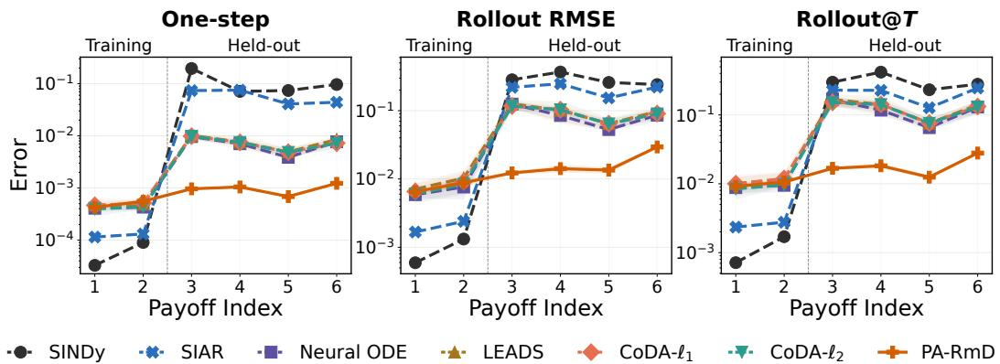  
Figure 1: Error by payoff function index for the K = 4 zero-sum cyclic game under replicator dynamics.

Evaluation. We evaluate out-of-distribution (OOD) prediction under payoff functions held out from training. Appendix C.2 provides additional in-distribution (ID) results under seen payoff functions and overall results across both seen and held-out payoff functions. All evaluations use test trajectories with independently sampled initial conditions. For one-step evaluation, we predict each next state from the corresponding ground-truth state and report the mean $\ell _ { 2 }$ error over all test transitions. For rollout evaluation, each model is initialized at the ground-truth initial state and rolled out recursively over the full test horizon. We report the full-trajectory rollout RMSE and final-state $\ell _ { 2 }$ error (rollout@T). Rollout metrics are averaged over test trajectories, and all metrics over five independent runs.

Results. We first evaluate the performance of different methods on both payoff families, all three response dynamics, and $K \in \{ 3 , 4 \}$ . Table 1 presents the results for replicator dynamics in held-out payoff environments, while Tables 2 and 3 provide the corresponding results for projection and MWU dynamics in Appendix C.2.1. Across these settings, PA-RmD consistently achieves the lowest onestep error, rollout RMSE, and rollout@T, showing that the learned payoff-aware response structure transfers across held-out payoff functions. Additional tables in Appendix C.2.2 report performance in seen training payoff environments and overall across both seen and held-out payoff environments.

We further evaluate every trained model on trajectories generated by each payoff function in the class, including both training and held-out payoff functions. Figures 1 and 4 to 8 report the error for each payoff function index. Some baselines fit trajectories from training payoff functions well, but their errors increase sharply on trajectories from held-out payoff functions. In contrast, PA-RmD maintains low error across the payoff function class, demonstrating stronger payoff-aware generalization.

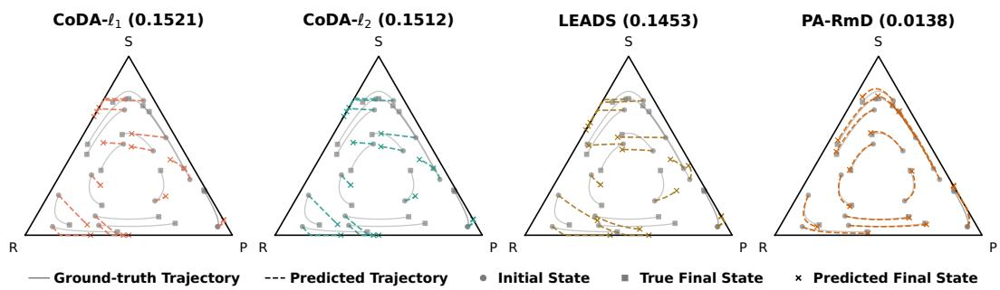  
Figure 2: Held-out rollout trajectories under replicator dynamics for the four best methods in the zero-sum cyclic game, ordered from fourth-best to best by rollout RMSE. Each panel shows the model name followed by the rollout RMSE for the illustrated run in parentheses. Gray curves represent ground-truth trajectories, and colored dashed curves represent model rollouts.

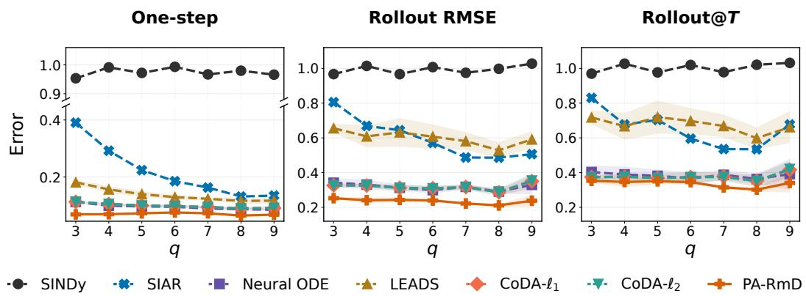  
Figure 3: YouTube held-out country prediction errors as the number q of training countries varies. One-step errors use observed engagement-derived payoff vectors, while rollout metrics use estimated country-specific payoff proxies.

Finally, Figure 2 visualizes held-out rollouts for a single run under replicator dynamics for the $K = 3$ zero-sum cyclic game. Their corresponding results over all five runs are summarized in Table 1. PA-RmD closely tracks the ground-truth trajectories over the full horizon, while the other methods drift away over time. Full rollout comparisons for all methods and synthetic settings are provided in Figures 9 to 14.

## 5.2 Real-world Experiments

Data and split. We use a multi-country YouTube Trending panel3 with 10 countries, 122 aligned dates, and $K = 1 5$ shared content categories. Each country provides one trajectory, where the population state is the distribution of trending videos across content categories. We train models on trajectories from one subset of countries and test them only on trajectories from countries not used for training: for each $q \in \{ 3 , \ldots , 9 \}$ , we train on q countries and evaluate on the remaining countries. For each value of q, we randomly sample 10 training-country sets from all $\textstyle { \binom { 1 0 } { q } }$ possible choices. In each run, we first average errors across the held-out countries within each training-country set and then across the 10 sampled sets. We report the mean and standard deviation across five independent runs.

Evaluation. The dataset provides neither explicit payoff values nor a payoff function that can be queried at arbitrary states. We therefore construct an observed payoff vector from user engagement for each country and date [50, 21, 29]. These vectors are used directly for one-step payoff-aware prediction: given the observed state and payoff on a test day, each model predicts the next-day state. Closed-loop rollout additionally requires payoffs at model-predicted states, so for each country we fit a payoff proxy using the first S observed state–payoff pairs and use it to provide payoffs during rollout. Details of the payoff construction and rollout protocol are provided in Appendix C.1.3.

Results. Figure 3 summarizes one-step and closed-loop rollout errors on held-out countries as the number q of training countries varies. The corresponding numerical results are reported in Table 11 in Appendix C.3. Across all values of q, PA-RmD consistently achieves the lowest one-step error, rollout RMSE, and rollout@T error. These consistent gains demonstrate the effectiveness of PA-RmD for predicting real-world population dynamics.

## 6 Conclusions

We studied payoff-aware prediction of population game dynamics by keeping payoff signals explicit and learning a reusable payoff-independent response structure from state–payoff–transition data. PA-RmD implements this idea through a Riemannian dynamics model that separates payoff-dependent gain from payoff-independent movement cost. We showed that the learned structure preserves fixed payoff Nash equilibria and derived finite-time one-step prediction guarantees under shared-response and payoff-coverage conditions. Empirically, PA-RmD performs consistently well on synthetic held-out payoff function tasks across multiple game classes and response dynamics, and improves held-out-country one-step prediction on YouTube Trending data with engagement payoff proxies.

## Acknowledgments

Renzhe Xu’s research was supported by the National Natural Science Foundation of China (No. 72442024), the Shanghai Sailing Program (No. 24YF2711600), and the CCF-Huawei Populus Grove Fund. Xiao Wang’s research was supported by the National Key R&D Program of China (No. 2023YFA1009500), the Fundamental Research Funds for the Central Universities, the Shanghai Sci-Tech Co-Research Program (No. 25HB2703800), and the National Natural Science Foundation of China (No. 62572291). Bo Li’s research was supported by the National Natural Science Foundation of China (No. 72171131).

## References

[1] Sanjeev Arora, Elad Hazan, and Satyen Kale. The multiplicative weights update method: a meta-algorithm and applications. Theory of computing, 8(1):121–164, 2012.

[2] Julian Barreiro-Gomez, Nicanor Quijano, and Carlos Ocampo-Martinez. Constrained distributed optimization: A population dynamics approach. Automatica, 69:101–116, 2016.

[3] Mauro Bonafini, Massimo Fornasier, and Bernhard Schmitzer. Data-driven entropic spatially inhomogeneous evolutionary games. European Journal of Applied Mathematics, 34(1):106–159, 2023.

[4] Steven L Brunton, Joshua L Proctor, and J Nathan Kutz. Discovering governing equations from data by sparse identification of nonlinear dynamical systems. Proceedings of the national academy ofsciences, 113(15):3932–3937, 2016.

[5] Charlotte Bunne, Laetitia Papaxanthos, Andreas Krause, and Marco Cuturi. Proximal optimal transport modeling of population dynamics. In International Conference on Artificial Intelligence and Statistics, pages 6511–6528. PMLR, 2022.

[6] Ilayda Canyakmaz, Iosif Sakos, Wayne Lin, Antonios Varvitsiotis, and Georgios Piliouras. Learning and steering game dynamics towards desirable outcomes. In 7th Annual Learning for Dynamics\& Control Conference, pages 1512–1524. PMLR, 2025.

[7] Ricky TQ Chen, Yulia Rubanova, Jesse Bettencourt, and David K Duvenaud. Neural ordinary differential equations. Advances in neural information processing systems, 31, 2018.

[8] Yanxi Chen and Vincent Poor. Learning mixture of linear dynamical systems. In International Conference on Machine Learning, 2022.

[9] Sarah Dean, Evan Dong, Meena Jagadeesan, and Liu Leqi. Accounting for AI and users shaping one another: The role of mathematical models. Trans. Mach. Learn. Res., 2025, 2025.

[10] Itay Eilat and Nir Rosenfeld. Performative recommendation: diversifying content via strategic incentives. In International Conference on Machine Learning, pages 9082–9103. PMLR, 2023.

[11] Joseph Farrell and Paul Klemperer. Coordination and lock-in: Competition with switching costs and network effects. Handbook ofindustrial organization, 3:1967–2072, 2007.

[12] Yoav Freund and Robert E Schapire. Adaptive game playing using multiplicative weights. Games and Economic Behavior, 29(1-2):79–103, 1999.

[13] Drew Fudenberg and David K Levine. The theory of learning in games, volume 2. MIT press, 1998.

[14] Jacob K Goeree, Charles A Holt, and Thomas R Palfrey. Regular quantal response equilibrium. Experimental economics, 8(4):347–367, 2005.

[15] Saeed Hadikhanloo, Rida Laraki, Panayotis Mertikopoulos, and Sylvain Sorin. Learning in nonatomic games, part i: Finite action spaces and population games. Journal of Dynamics and Games, 9(4):433–460, 2022.

[16] Ernst Hairer, Gerhard Wanner, and Syvert P Nørsett. Solving ordinary differential equations I: Nonstiffproblems. Springer, 1993.

[17] Moritz Hardt, Tengyu Ma, and Benjamin Recht. Gradient descent learns linear dynamical systems. Journal ofMachine Learning Research, 2018.

[18] Keegan Harris, Ioannis Anagnostides, Gabriele Farina, Mikhail Khodak, Steven Wu, and Tuomas Sandholm. Meta-learning in games. In The Eleventh International Conference on Learning Representations, 2023.

[19] Sergiu Hart and Andreu Mas-Colell. A simple adaptive procedure leading to correlated equilibrium. Econometrica, 68(5):1127–1150, 2000.

[20] Josef Hofbauer and Karl Sigmund. Evolutionary games and population dynamics. Cambridge university press, 1998.

[21] Pratik Kayal, Pascal Mettes, Nima Dehmamy, and Minsu Park. Large language models are natural video popularity predictors. In Findings of the association for computational linguistics: ACL 2025, pages 11432–11464, 2025.

[22] Matthieu Kirchmeyer, Yuan Yin, Jérémie Donà, Nicolas Baskiotis, Alain Rakotomamonjy, and Patrick Gallinari. Generalizing to new physical systems via context-informed dynamics model. In International conference on machine learning, pages 11283–11301. PMLR, 2022.

[23] Haruka Kiyohara, Fan Yao, and Sarah Dean. Policy design for two-sided platforms with participation dynamics. In Forty-second International Conference on Machine Learning, 2025. URL https://openreview.net/forum?id=qr4a4uS82y.

[24] Kiet Lam, Walid Krichene, and Alexandre Bayen. On learning how players learn: estimation of learning dynamics in the routing game. In 2016 ACM/IEEE 7th International Conference on Cyber-Physical Systems (ICCPS), pages 1–10. IEEE, 2016.

[25] Siyang Li, Yize Chen, Yan Guo, Ming Huang, and Hui Xiong. Towards generalizable pde dynamics forecasting via physics-guided invariant learning. In International Conference on Learning Representations, volume 2026, pages 72050–72079, 2026.

[26] Zongyi Li, Nikola Borislavov Kovachki, Kamyar Azizzadenesheli, Burigede liu, Kaushik Bhattacharya, Andrew Stuart, and Anima Anandkumar. Fourier neural operator for parametric partial differential equations. In International Conference on Learning Representations, 2021.

[27] Shixuan Liu, Yue He, Haotian Wang, Wenjing Yang, Yunfei Wang, Peng Cui, and Zhong Liu. Environment inference for learning generalizable dynamical system. In The Thirty-ninth Annual Conference on Neural Information Processing Systems, 2025.

[28] Wei Min Loh, Sajib Kumer Sinha, Ankur Agarwal, and Pascal Poupart. A practical algorithm for feature-rich, non-stationary bandit problems. arXiv preprint arXiv:2603.16755, 2026.

[29] Ryan McGrady, Kevin Zheng, and Ethan Zuckerman. One platform, four languages: Comparing english, spanish, hindi, and russian youtube. Social Media+ Society, 11(3):20563051251363216, 2025.

[30] Richard D McKelvey and Thomas R Palfrey. Quantal response equilibria for normal form games. Games and economic behavior, 10(1):6–38, 1995.

[31] Panayotis Mertikopoulos and William H Sandholm. Learning in games via reinforcement and regularization. Mathematics ofOperations Research, 41(4):1297–1324, 2016.

[32] Panayotis Mertikopoulos and William H Sandholm. Riemannian game dynamics. Journal of Economic Theory, 177:315–364, 2018.

[33] Anna Nagurney and Ding Zhang. Projected dynamical systems in the formulation, stability analysis, and computation of fixed-demand traffic network equilibria. Transportation Science, 31(2):147–158, 1997.

[34] Christos Papadimitriou and Georgios Piliouras. Game dynamics as the meaning of a game. ACM SIGecom Exchanges, 16(2):53–63, 2019.

[35] Nicanor Quijano, Carlos Ocampo-Martinez, Julian Barreiro-Gomez, German Obando, Andres Pantoja, and Eduardo Mojica-Nava. The role of population games and evolutionary dynamics in distributed control systems: The advantages of evolutionary game theory. IEEE Control Systems Magazine, 37(1):70–97, 2017.

[36] Robert W Rosenthal. A class of games possessing pure-strategy nash equilibria. International journal ofgame theory, 2(1):65–67, 1973.

[37] Iosif Sakos, Antonios Varvitsiotis, and Georgios Piliouras. Data-scarce identification of game dynamics via sum-of-squares optimization. In Web and Internet Economics LNCS 15534, page 651. Springer, 2024.

[38] William H Sandholm. Population games and evolutionary dynamics. MIT press, 2010.

[39] William H Sandholm. Population games and deterministic evolutionary dynamics. In Handbook of game theory with economic applications, volume 4, pages 703–778. Elsevier, 2015.

[40] Siavash Shahshahani. A new mathematicalframeworkfor the study oflinkage and selection. American Mathematical Soc., 1979.

[41] Max Simchowitz, Horia Mania, Stephen Tu, Michael I. Jordan, and Benjamin Recht. Learning without mixing: Towards a sharp analysis of linear system identification. In Conference on Learning Theory, 2018.

[42] Vasilis Syrgkanis, Alekh Agarwal, Haipeng Luo, and Robert E Schapire. Fast convergence of regularized learning in games. Advances in Neural Information Processing Systems, 28, 2015.

[43] Attila Szolnoki, Mauro Mobilia, Luo-Luo Jiang, Bartosz Szczesny, Alastair M Rucklidge, and Matjaž Perc. Cyclic dominance in evolutionary games: a review. Journal of the Royal Society Interface, 11(100), 2014.

[44] Peter D Taylor and Leo B Jonker. Evolutionary stable strategies and game dynamics. Mathematical biosciences, 40(1-2):145–156, 1978.

[45] Samuele Tosatto, Joao Carvalho, Hany Abdulsamad, and Jan Peters. A nonparametric off-policy policy gradient. In International Conference on Artificial Intelligence and Statistics, pages 167–177. PMLR, 2020.

[46] Rakshit Trivedi, Mehrdad Farajtabar, Prasenjeet Biswal, and Hongyuan Zha. Dyrep: Learning representations over dynamic graphs. In International conference on learning representations, 2019.

[47] Kang Wang, Renzhe Xu, and Bo Li. Lower bias, higher welfare: How creator competition reshapes bias-variance tradeoff in recommendation platforms? In Proceedings ofthe 32nd ACM SIGKDD Conference on Knowledge Discovery and Data Mining V. 1, pages 1435–1446, 2026.

[48] Yuanyuan Wang, Biwei Huang, Wei Huang, Xi Geng, and Mingming Gong. Identifiability analysis of linear ode systems with hidden confounders. In Advances in Neural Information Processing Systems, 2024.

[49] Renzhe Xu, Haotian Wang, Xingxuan Zhang, Bo Li, and Peng Cui. Competing for shareable arms in multi-player multi-armed bandits. In International Conference on Machine Learning, pages 38674–38706. PMLR, 2023.

[50] Fan Yao, Chuanhao Li, Denis Nekipelov, Hongning Wang, and Haifeng Xu. How bad is top-k recommendation under competing content creators? In International conference on machine learning, pages 39674–39701. PMLR, 2023.

[51] Yuan Yin, Ibrahim Ayed, Emmanuel de Bézenac, Nicolas Baskiotis, and Patrick Gallinari. Leads: Learning dynamical systems that generalize across environments. Advances in Neural Information Processing Systems, 34:7561–7573, 2021.

## A Microfoundations of Riemannian Game Dynamics

This section summarizes the revision-protocol interpretation of Riemannian game dynamics. The material is included to make the population-level model in the main text self-contained; the constructions below follow the standard microfoundation of evolutionary dynamics by revision protocols [38] and the revision-protocol results for Riemannian game dynamics in Mertikopoulos and Sandholm [32].

Revision protocols. A revision protocol specifies how individual agents switch strategies. To distinguish time from strategy components, write $x _ { t , i }$ for the i-th coordinate of the population state $x _ { t } .$ For $i \neq j ,$ , let $q _ { i j } ( x _ { t } , v ) \geq 0$ denote the instantaneous rate at which an agent currently choosing strategy i switches to strategy j, when the population state is $x _ { t }$ and the payoff vector is $v ( x _ { t } )$ . The induced population dynamic is the mass-balance equation

$$
\dot { x } _ { t , i } = \sum _ { j \neq i } x _ { t , j } q _ { j i } ( x _ { t } , v ) - x _ { t , i } \sum _ { j \neq i } q _ { i j } ( x _ { t } , v ) , \qquad i \in [ K ] .
$$

The first term is the inflow into strategy i from agents currently using other strategies, and the second term is the outflow from strategy i to other strategies. Thus, a population dynamic can be derived from individual revision rates.

Riemannian metrics as revision protocols. Proposition 5.1 of Mertikopoulos and Sandholm [32] shows that, on the interior of the simplex, Riemannian game dynamics admit such a revision-protocol interpretation. In our notation, let

$$
A _ { t } = G ( x _ { t } ) ^ { - 1 } .
$$

If $A _ { t }$ has nonnegative entries, then, up to a positive state-dependent change of speed, the Riemannian dynamic

$$
\dot { x } _ { t } = A _ { t } v ( x _ { t } ) - \frac { \mathbf { 1 } ^ { \top } A _ { t } v ( x _ { t } ) } { \mathbf { 1 } ^ { \top } A _ { t } \mathbf { 1 } } A _ { t } \mathbf { 1 }
$$

can be generated by revision rates determined by $A _ { t } .$ . For example, after a payoff shift if needed so that $A _ { t } v ( x _ { t } ) \geq 0$ , one such protocol is

$$
q _ { i j } ( x _ { t } , v ) = \frac { ( A _ { t } { \bf 1 } ) _ { i } } { x _ { t , i } } \big ( A _ { t } v ( x _ { t } ) \big ) _ { j } , \qquad i \ne j .
$$

Substituting these rates into the mass-balance equation gives

$$
\dot { x } _ { t } = \left( \mathbf { 1 } ^ { \top } A _ { t } \mathbf { 1 } \right) A _ { t } v ( x _ { t } ) - \left( \mathbf { 1 } ^ { \top } A _ { t } v ( x _ { t } ) \right) A _ { t } \mathbf { 1 } ,
$$

which is the Riemannian dynamic above after rescaling time by the positive factor $\mathbf { 1 } ^ { \top } A _ { t } \mathbf { 1 }$ . Hence the metric G, or equivalently its inverse $A _ { t } ,$ can be interpreted as encoding payoff-independent behavioral structure that shapes how agents revise their strategies.

When $A _ { t }$ is diagonal, the same result also yields a pairwise-comparison revision protocol:

$$
q _ { i j } ( x _ { t } , v ) = \frac { ( A _ { t } ) _ { i i } ( A _ { t } ) _ { j j } } { x _ { t , i } } [ v _ { j } ( x _ { t } ) - v _ { i } ( x _ { t } ) ] _ { + } , \qquad i \ne j ,
$$

where $[ a ] _ { + } = \operatorname* { m a x } \{ a , 0 \}$ . This form is especially useful for interpreting classical dynamics.

Example A.1 (Replicator dynamics [44]). The replicator dynamics correspond to the Shahshahani metric [40]

$$
G ( x _ { t } ) = \mathrm { d i a g } \left( \frac { 1 } { x _ { t , 1 } } , \ldots , \frac { 1 } { x _ { t , K } } \right) , \qquad A _ { t } = \mathrm { d i a g } ( x _ { t , 1 } , \ldots , x _ { t , K } ) .
$$

The diagonal pairwise-comparison protocol becomes

$$
q _ { i j } ( x _ { t } , v ) = x _ { t , j } [ v _ { j } ( x _ { t } ) - v _ { i } ( x _ { t } ) ] _ { + } , \qquad i \ne j .
$$

Substituting into the mass-balance equation gives

$$
\dot { x } _ { t , i } = x _ { t , i } \left( v _ { i } ( x _ { t } ) - \sum _ { j = 1 } ^ { K } x _ { t , j } v _ { j } ( x _ { t } ) \right) ,
$$

so agents tend to switch toward strategies with higher current payoffs, and the growth rate of each strategy is its payoff advantage over the population average.

Example A.2 (Projection dynamics [33]). The Euclidean projection dynamics correspond to the Euclidean metric

$$
G ( x _ { t } ) = I , \qquad A _ { t } = I .
$$

The diagonal pairwise-comparison protocol becomes, after a normalization by $K .$

$$
q _ { i j } ( x _ { t } , v ) = \frac { 1 } { K x _ { t , i } } [ v _ { j } ( x _ { t } ) - v _ { i } ( x _ { t } ) ] _ { + } , \qquad i \ne j .
$$

Substituting into the mass-balance equation gives

$$
\dot { x } _ { t , i } = v _ { i } ( x _ { t } ) - \frac { 1 } { K } \sum _ { j = 1 } ^ { K } v _ { j } ( x _ { t } ) ,
$$

which is the projection of the payoff vector onto the tangent space $\tau .$ . Thus projection dynamics provide the Euclidean counterpart to replicator dynamics within the same revision-protocol view.

## B Omitted Proofs

## B.1 Proof of Proposition 4.1

Proof. The equivalence is pointwise in $x ,$ so fix a state $x \in \mathcal { X }$ and write $G = G _ { \theta } ( x ) , a = u ( x )$ Every feasible direction $z \in \mathcal { T }$ can be written uniquely as $z = U y$ , where $y \in \mathbb { R } ^ { K - 1 }$ . Since $U$ has orthonormal columns, the objective in Equation (3) becomes

$$
a ^ { \top } U y - { \frac { 1 } { 2 } } y ^ { \top } U ^ { \top } G U y .
$$

The matrix $U ^ { \top } G U$ is positive definite, so this strictly concave quadratic has the unique maximizer

$$
y ^ { \star } = ( U ^ { \top } G U ) ^ { - 1 } U ^ { \top } a .
$$

Substituting $z ^ { \star } = U y ^ { \star }$ gives

$$
z ^ { \star } = U ( U ^ { \top } G U ) ^ { - 1 } U ^ { \top } a .
$$

Thus the Riemannian form gives $C _ { \theta } ( x ) = ( U ^ { \top } G _ { \theta } ( x ) U ) ^ { - 1 }$ . Conversely, fix any $C _ { \theta } ( x ) \in \mathbb { S } _ { + + } ^ { K - 1 }$ . Let $P = \mathbf { 1 1 } ^ { \top } / K$ , choose any scalar $c > 0$ , and define

$$
G _ { \theta } ( x ) : = U C _ { \theta } ( x ) ^ { - 1 } U ^ { \top } + c P .
$$

The matrix $G _ { \theta } ( x )$ is symmetric positive definite because it is positive definite on $\tau$ through $U C _ { \theta } ( x ) ^ { - 1 } U ^ { \top }$ and positive definite on span{1} through $c P$ . Moreover, $U ^ { \top } G _ { \theta } ( x ) U = C _ { \theta } ( x ) ^ { - 1 }$ , so

$$
U ( U ^ { \top } G _ { \theta } ( x ) U ) ^ { - 1 } U ^ { \top } a = U C _ { \theta } ( x ) U ^ { \top } a
$$

for every payoff vector $a \in \mathbb { R } ^ { K }$ . Since the argument holds at each $x ,$ the two parametrizations define the same class of vector fields. □

## B.2 Proof of Proposition 4.2

Proof. If $U ^ { \top } u ( x ) = 0$ , then $F _ { \widetilde { C } } ( x , u ( x ) ) = 0$ . Conversely, if $F _ { \widetilde { C } } ( x , u ( x ) ) = 0$ , then

$$
\begin{array} { r } { U \widetilde { C } ( x ) U ^ { \top } u ( x ) = 0 . } \end{array}
$$

Because U has full column rank, $\widetilde { C } ( x ) U ^ { \top } u ( x ) = 0$ . Since $\widetilde { C } ( \boldsymbol { x } )$ is positive definite, it is invertible, so $U ^ { \top } u ( x ) = 0$

It remains to identify this condition with Nash equilibrium on $\mathcal { X } .$ Because the columns of $U$ span $\mathcal { T } = \{ z : \mathbf { 1 } ^ { \top } z = 0 \}$ , the condition $U ^ { \top } u ( x ) = 0$ is equivalent to $u ( x ) \in \mathcal { T } ^ { \perp } = \operatorname { s p a n } \{ { \bf 1 } \}$ . Hence all pure strategies have the same payoff at $x .$ Since $\dot { \mathcal { X } _ { \mathrm { ~ \scriptsize ~ C ~ } } } \Delta _ { K } ^ { \circ }$ , this is exactly the Nash equilibrium condition on $\bar { \mathcal { X } } ,$ , so

$$
\begin{array} { r } { S ( F _ { \widetilde { C } } , u ) = \mathcal { N } ( u ) = \{ x \in \mathcal { X } : U ^ { \top } u ( x ) = 0 \} . } \end{array}
$$

## B.3 Proof of Theorem 4.3

Proof. Fix a utility u and a state $x \in { \mathcal { X } } .$ . Since U has orthonormal columns, we have

$$
\begin{array} { r } { U ^ { \top } U = I _ { K - 1 } , \qquad \| U \| _ { \mathrm { o p } } = \| U ^ { \top } \| _ { \mathrm { o p } } = 1 . } \end{array}
$$

Therefore,

$$
\begin{array} { r l } & { \| f _ { \star } ^ { u } ( x ) \| _ { 2 } = \| U C _ { \star } ( x ) U ^ { \top } u ( x ) \| _ { 2 } } \\ & { \qquad \leq \| U \| _ { \mathrm { o p } } \| C _ { \star } ( x ) \| _ { \mathrm { o p } } \| U ^ { \top } \| _ { \mathrm { o p } } \| u ( x ) \| _ { 2 } } \\ & { \qquad \leq M \Lambda . } \end{array}
$$

Similarly, for any $x , y \in { \mathcal { X } }$

$$
\begin{array} { r l } & { \| f _ { \star } ^ { u } ( x ) - f _ { \star } ^ { u } ( y ) \| _ { 2 } } \\ & { = \big \| U C _ { \star } ( x ) U ^ { \top } u ( x ) - U C _ { \star } ( y ) U ^ { \top } u ( y ) \big \| _ { 2 } } \\ & { = \big \| U \left[ C _ { \star } ( x ) U ^ { \top } u ( x ) - C _ { \star } ( y ) U ^ { \top } u ( y ) \right] \big \| _ { 2 } } \\ & { \leq \big \| C _ { \star } ( x ) U ^ { \top } u ( x ) - C _ { \star } ( y ) U ^ { \top } u ( y ) \big \| _ { 2 } } \\ & { \leq \big \| C _ { \star } ( x ) U ^ { \top } \big ( u ( x ) - u ( y ) \big ) \big \| _ { 2 } + \big \| \big ( C _ { \star } ( x ) - C _ { \star } ( y ) \big ) U ^ { \top } u ( y ) \big \| _ { 2 } } \\ & { \leq M L _ { u } \big \| x - y \big \| _ { 2 } + L _ { C } \Lambda \big \| x - y \big \| _ { 2 } } \\ & { = ( M L _ { u } + L _ { C } \Lambda ) \| x - y \| _ { 2 } . } \end{array}
$$

Thus the vector field $f _ { \star } ^ { u }$ is uniformly bounded by MΛ and uniformly Lipschitz with constant $M L _ { u } + L _ { C } \Lambda$

Define

$$
B _ { \star } : = \frac { 1 } { 2 } M \Lambda \left( M L _ { u } + L _ { C } \Lambda \right) .
$$

Let $z ( s )$ be the solution of

$$
\dot { z } ( s ) = f _ { \star } ^ { u } ( z ( s ) ) , \qquad z ( 0 ) = x .
$$

By definition of the flow map,

$$
\Psi _ { \delta } ^ { u } ( x ) = z ( \delta ) = x + \int _ { 0 } ^ { \delta } f _ { \star } ^ { u } ( z ( s ) ) d s .
$$

Therefore,

$$
\begin{array} { r l } & { \left\| \displaystyle \frac 1 \delta \left( \Psi _ { \star } ^ { u } ( x ) - x \right) - f _ { \star } ^ { u } ( x ) \right\| _ { 2 } } \\ & { = \left\| \displaystyle \frac 1 \delta \int _ { 0 } ^ { \delta } \left( f _ { \star } ^ { u } ( z ( s ) ) - f _ { \star } ^ { u } ( x ) \right) d s \right\| _ { 2 } } \\ & { \leq \displaystyle \frac 1 \delta \int _ { 0 } ^ { \delta } \| f _ { \star } ^ { u } ( z ( s ) ) - f _ { \star } ^ { u } ( x ) \| _ { 2 } d s } \\ & { \leq \displaystyle \frac { M L _ { u } + L _ { C } \Lambda } \int _ { 0 } ^ { \delta } \| z ( s ) - x \| _ { 2 } d s . } \end{array}
$$

Since all flow segments remain in $\mathcal { X }$

$$
\| f _ { \star } ^ { u } ( z ( r ) ) \| _ { 2 } \leq M \Lambda \qquad { \mathrm { f o r ~ a l l ~ } } r \in [ 0 , \delta ] .
$$

Hence

$$
\begin{array} { r l r } {  { \| z ( s ) - x \| _ { 2 } = \| \int _ { 0 } ^ { s } f _ { \star } ^ { u } ( z ( r ) ) d r \| _ { 2 } } } \\ & { } & { \leq \int _ { 0 } ^ { s } \| f _ { \star } ^ { u } ( z ( r ) ) \| _ { 2 } d r } \\ & { } & { \leq M \Lambda s . } \end{array}
$$

Substituting this into the previous display gives

$$
\begin{array} { r l } & { | \displaystyle \frac { 1 } { \delta } ( \Psi _ { \delta } ^ { u } ( x ) - x ) - f _ { \star } ^ { u } ( x ) | | _ { 2 } } \\ & { \leq \displaystyle \frac { M L _ { u } + L _ { C } \Lambda } { \delta } \int _ { 0 } ^ { \delta } M \Lambda s d s } \\ & { = \displaystyle \frac { 1 } { 2 } M \Lambda ( M L _ { u } + L _ { C } \Lambda ) \delta } \\ & { = B _ { \star } \delta . } \end{array}
$$

Now fix $x \in \mathcal { X }$ . Because the vector field is tangent to the simplex, every displacement

$$
\Psi _ { \delta } ^ { u } ( x ) - x
$$

lies in the tangent space

$$
T = \{ z \in \mathbb { R } ^ { K } : \mathbf { 1 } ^ { \top } z = 0 \} .
$$

Also, $U C U ^ { \top } u ( x ) \in T$ for every $C ,$ since the columns of $U$ span $T ,$ . For any $z \in T .$

$$
z = U U ^ { \top } z , \qquad \| z \| _ { 2 } = \| U ^ { \top } z \| _ { 2 } .
$$

Therefore the K-dimensional objective defining $C _ { \delta , \mathrm { t r } } ^ { \star } ( x )$ is equivalent to the tangent-coordinate objective

$$
C _ { \delta , \mathrm { t r } } ^ { \star } ( \boldsymbol { x } ) \in \arg \operatorname* { m i n } _ { C \in \mathbb { S } _ { + } ^ { K - 1 } } \mathbb { E } _ { \boldsymbol { v } \sim \mathcal { D } _ { \mathrm { t r } } ( \cdot | \boldsymbol { x } ) } \left[ \left\| \frac { 1 } { \delta } U ^ { \top } \left( \Psi _ { \delta } ^ { \boldsymbol { v } } ( \boldsymbol { x } ) - \boldsymbol { x } \right) - C U ^ { \top } \boldsymbol { v } ( \boldsymbol { x } ) \right\| _ { 2 } ^ { 2 } \right] .
$$

Define the finite-time bias

$$
b _ { \delta } ^ { u } ( x ) : = \frac { 1 } { \delta } U ^ { \top } \left( \Psi _ { \delta } ^ { u } ( x ) - x \right) - C _ { \star } ( x ) U ^ { \top } u ( x ) .
$$

Since

$$
U ^ { \top } f _ { \star } ^ { u } ( x ) = U ^ { \top } U C _ { \star } ( x ) U ^ { \top } u ( x ) = C _ { \star } ( x ) U ^ { \top } u ( x ) ,
$$

we can write

$$
b _ { \delta } ^ { u } ( x ) = U ^ { \top } \left[ \frac { 1 } { \delta } \left( \Psi _ { \delta } ^ { u } ( x ) - x \right) - f _ { \star } ^ { u } ( x ) \right] .
$$

Thus, using $\| U ^ { \top } \| _ { \mathrm { o p } } = 1$

$$
\lVert b _ { \delta } ^ { u } ( x ) \rVert _ { 2 } \leq B _ { \star } \delta .
$$

Let

$$
\widehat C ( x ) = C _ { \delta , \mathrm { t r } } ^ { \star } ( x ) , \qquad E ( x ) = \widehat C ( x ) - C _ { \star } ( x ) .
$$

Because

$$
\frac { 1 } { \delta } U ^ { \top } \left( \Psi _ { \delta } ^ { v } ( x ) - x \right) = C _ { \star } ( x ) U ^ { \top } v ( x ) + b _ { \delta } ^ { v } ( x ) ,
$$

the tangent-coordinate objective can be rewritten as

$$
\widehat { C } ( \boldsymbol { x } ) \in \arg \operatorname* { m i n } _ { C \in \mathbb { S } _ { + } ^ { K - 1 } } \mathbb { E } _ { v \sim \mathcal { D } _ { \mathrm { t r } } ( \cdot | \boldsymbol { x } ) } \left[ \left. b _ { \delta } ^ { v } ( \boldsymbol { x } ) - \left( C - C _ { \star } ( \boldsymbol { x } ) \right) U ^ { \top } v ( \boldsymbol { x } ) \right. _ { 2 } ^ { 2 } \right] .
$$

Since $C _ { \star } ( x ) \in \mathbb { S } _ { + } ^ { K - 1 }$ , it is feasible. The feasible set $\mathbb { S } _ { + } ^ { K - 1 }$ is convex, so the line segment

$$
C _ { s } ( x ) = ( 1 - s ) \widehat { C } ( x ) + s C _ { \star } ( x ) , \qquad s \in [ 0 , 1 ] ,
$$

is feasible. By optimality of $\widehat { C } ( \boldsymbol { x } )$ , the function

$$
\varphi ( s ) = \mathbb E _ { v \sim \mathcal D _ { \mathrm { t r } } ( \cdot \vert x ) } \left[ \left. b _ { \delta } ^ { v } ( x ) - \left( C _ { s } ( x ) - C _ { \star } ( x ) \right) U ^ { \top } v ( x ) \right. _ { 2 } ^ { 2 } \right]
$$

has a minimum at $s = 0$ . Hence

$$
\varphi ^ { \prime } ( 0 ^ { + } ) \geq 0 .
$$

But

$$
C _ { s } ( x ) - C _ { \star } ( x ) = ( 1 - s ) { \cal E } ( x ) .
$$

Therefore

$$
\varphi ( s ) = \mathbb { E } \left[ \left. b _ { \delta } ^ { v } ( x ) - ( 1 - s ) E ( x ) U ^ { \top } v ( x ) \right. _ { 2 } ^ { 2 } \right] ,
$$

where the expectation is over $v \sim { \mathcal { D } } _ { \mathrm { t r } } ( \cdot \mid x )$ . Differentiating at $s = 0$ gives

$$
\begin{array} { r } { \varphi ^ { \prime } ( 0 ^ { + } ) = 2 \mathbb E \left[ \left. b _ { \delta } ^ { v } ( x ) - E ( x ) U ^ { \top } v ( x ) , E ( x ) U ^ { \top } v ( x ) \right. \right] . } \end{array}
$$

Since $\varphi ^ { \prime } ( 0 ^ { + } ) \geq 0$ , we obtain

$$
\begin{array} { r } { \mathbb { E } \left[ \| E ( x ) U ^ { \top } v ( x ) \| _ { 2 } ^ { 2 } \right] \leq \mathbb { E } \left[ \left. b _ { \delta } ^ { v } ( x ) , E ( x ) U ^ { \top } v ( x ) \right. \right] . } \end{array}
$$

By Cauchy–Schwarz,

$$
\begin{array} { r l } & { \mathbb E \left[ \langle b _ { \delta } ^ { v } ( x ) , E ( x ) U ^ { \top } v ( x ) \rangle \right] } \\ & { \leq \left( \mathbb E \left[ \| b _ { \delta } ^ { v } ( x ) \| _ { 2 } ^ { 2 } \right] \right) ^ { 1 / 2 } \left( \mathbb E \left[ \| E ( x ) U ^ { \top } v ( x ) \| _ { 2 } ^ { 2 } \right] \right) ^ { 1 / 2 } . } \end{array}
$$

Since $\lVert b _ { \delta } ^ { v } ( x ) \rVert _ { 2 } \leq B _ { \star } \delta$ uniformly,

$$
\begin{array} { r } { \left( \mathbb { E } \left[ \| b _ { \delta } ^ { v } ( x ) \| _ { 2 } ^ { 2 } \right] \right) ^ { 1 / 2 } \leq B _ { \star } \delta . } \end{array}
$$

Therefore,

$$
\begin{array} { r } { \left( \mathbb E \left[ \| E ( x ) U ^ { \top } v ( x ) \| _ { 2 } ^ { 2 } \right] \right) ^ { 1 / 2 } \leq B _ { \star } \delta . } \end{array}
$$

Now use the directional coverage assumption. Since

$$
\begin{array} { r } { \boldsymbol { U } ^ { \top } \boldsymbol { w } ( \boldsymbol { x } ) = \mathbb { E } \left[ \rho _ { x } ( \boldsymbol { v } ) \boldsymbol { U } ^ { \top } \boldsymbol { v } ( \boldsymbol { x } ) \right] , } \end{array}
$$

we have

$$
\begin{array} { r l } & { \| E ( x ) U ^ { \top } w ( x ) \| _ { 2 } = \left\| \mathbb { E } \left[ \rho _ { x } ( v ) E ( x ) U ^ { \top } v ( x ) \right] \right\| _ { 2 } } \\ & { \qquad \leq \mathbb { E } \left[ | \rho _ { x } ( v ) | \| E ( x ) U ^ { \top } v ( x ) \| _ { 2 } \right] } \\ & { \qquad \leq \left( \mathbb { E } [ \rho _ { x } ( v ) ^ { 2 } ] \right) ^ { 1 / 2 } \left( \mathbb { E } \left[ \| E ( x ) U ^ { \top } v ( x ) \| _ { 2 } ^ { 2 } \right] \right) ^ { 1 / 2 } } \\ & { \qquad \leq \gamma _ { w } B _ { \star } \delta . } \end{array}
$$

Finally, for the test utility w,

$$
\begin{array} { r l } & { \Psi _ { \delta } ^ { w } ( x ) - x - \delta U \widehat { C } ( x ) { U } ^ { \top } w ( x ) } \\ & { \phantom { = } = \delta U \left[ b _ { \delta } ^ { w } ( x ) - E ( x ) { U } ^ { \top } w ( x ) \right] . } \end{array}
$$

Hence

$$
\begin{array} { r l } & { \left\| \Psi _ { \delta } ^ { w } ( x ) - x - \delta U \widehat { C } ( x ) U ^ { \top } w ( x ) \right\| _ { 2 } } \\ & { \leq \delta \left( \| b _ { \delta } ^ { w } ( x ) \| _ { 2 } + \| E ( x ) U ^ { \top } w ( x ) \| _ { 2 } \right) } \\ & { \leq \delta \left( B _ { \star } \delta + \gamma _ { w } B _ { \star } \delta \right) } \\ & { = B _ { \star } ( 1 + \gamma _ { w } ) \delta ^ { 2 } . } \end{array}
$$

Taking the supremum over $x \in \mathcal { X }$ proves the theorem.

## B.4 Proof of Corollary 4.4

Proof. It suffices to verify the directional coverage condition required by Theorem 4.3. Fix any $x \in { \dot { \mathcal { X } } }$ . Since

$$
\Sigma _ { \mathrm { t r } } ( x ) \succeq \mu I _ { K - 1 } ,
$$

the matrix $\Sigma _ { \mathrm { t r } } ( x )$ is invertible. Define

$$
\begin{array} { r } { \rho _ { x } ( v ) = v ( x ) ^ { \top } U \Sigma _ { \mathrm { t r } } ( x ) ^ { - 1 } U ^ { \top } w ( x ) . } \end{array}
$$

Then

$$
\begin{array} { r l } { \mathbb E _ { v \sim \mathcal D _ { \mathrm { t r } } ( \cdot \vert x ) } \left[ \rho _ { x } ( v ) U ^ { \top } v ( x ) \right] = \mathbb E _ { v \sim \mathcal D _ { \mathrm { t r } } ( \cdot \vert x ) } \left[ U ^ { \top } v ( x ) v ( x ) ^ { \top } U \right] \Sigma _ { \mathrm { t r } } ( x ) ^ { - 1 } U ^ { \top } w ( x ) } & { } \\ { = \Sigma _ { \mathrm { t r } } ( x ) \Sigma _ { \mathrm { t r } } ( x ) ^ { - 1 } U ^ { \top } w ( x ) } & { } \\ { = U ^ { \top } w ( x ) . } \end{array}
$$

Thus $U ^ { \top } w ( x )$ can be represented by the projected training utilities with coefficient $\rho _ { x }$

It remains to bound the size of this coefficient. We have

$$
\begin{array} { r l } & { \mathbb { E } _ { v \sim \mathcal { D } _ { \mathrm { t r } } ( \cdot \vert x ) } \left[ \rho _ { x } ( v ) ^ { 2 } \right] = w ( x ) ^ { \top } U \Sigma _ { \mathrm { t r } } ( x ) ^ { - 1 } \mathbb { E } _ { v \sim \mathcal { D } _ { \mathrm { t r } } ( \cdot \vert x ) } \left[ U ^ { \top } v ( x ) v ( x ) ^ { \top } U \right] \Sigma _ { \mathrm { t r } } ( x ) ^ { - 1 } U ^ { \top } w ( x ) } \\ & { \qquad = w ( x ) ^ { \top } U \Sigma _ { \mathrm { t r } } ( x ) ^ { - 1 } U ^ { \top } w ( x ) . } \end{array}
$$

Since

$$
\Sigma _ { \mathrm { t r } } ( x ) \succeq \mu I _ { K - 1 } ,
$$

we have

$$
\Sigma _ { \mathrm { t r } } ( x ) ^ { - 1 } \preceq \frac { 1 } { \mu } I _ { K - 1 } .
$$

Therefore,

$$
\begin{array} { r l } & { \mathbb { E } _ { v \sim \mathcal { D } _ { \mathrm { t r } } ( \cdot \vert x ) } \left[ \rho _ { x } ( v ) ^ { 2 } \right] \leq \displaystyle \frac { 1 } { \mu } \left. U ^ { \top } w ( x ) \right. _ { 2 } ^ { 2 } } \\ & { \qquad \leq \displaystyle \frac { 1 } { \mu } \left. w ( x ) \right. _ { 2 } ^ { 2 } } \\ & { \qquad \leq \displaystyle \frac { \Lambda ^ { 2 } } { \mu } , } \end{array}
$$

where the second inequality uses $\| U ^ { \top } \| _ { \mathrm { o p } } = 1$ , and the last inequality follows from Assumption 4.3. Hence the directional coverage condition holds with

$$
\gamma _ { w } = \frac { \Lambda } { \sqrt { \mu } } .
$$

Applying Theorem 4.3 gives

$$
\begin{array} { l } { \displaystyle \operatorname* { s u p } _ { x \in \mathcal { X } } \left\| \Psi _ { \delta } ^ { w } ( x ) - x - \delta U C _ { \delta , \mathrm { t r } } ^ { \star } ( x ) U ^ { \top } w ( x ) \right\| _ { 2 } \leq B _ { \star } ( 1 + \gamma _ { w } ) \delta ^ { 2 } } \\ { \displaystyle \qquad = B _ { \star } \left( 1 + \frac { \Lambda } { \sqrt { \mu } } \right) \delta ^ { 2 } . } \end{array}
$$

This proves the corollary.

## C Additional Experiments

## C.1 Experimental Details

## C.1.1 Baselines and Training Details

For fairness, all baselines use the same payoff-aware input tuple as PA-RmD, namely the current population state, the payoff observation, and the sampling interval. SINDy is a sparse-regression baseline that fits a parsimonious dynamics model from a predefined library of candidate features [4]. Neural ODE is a payoff-conditioned neural vector-field model that learns $f _ { \boldsymbol { \theta } } ( \boldsymbol { x } , \boldsymbol { v } )$ and integrates it forward in time [7]. LEADS is a dynamics-generalization baseline designed to transfer learned dynamics across environments [51]. $\mathbf { C o D A - } \ell _ { 1 }$ and $\mathrm { C o D A ^ { - } \ell _ { 2 } }$ are context-informed dynamics adaptation baselines with different regularization choices [22]. SIAR is a game-structured dynamics identification baseline that fits polynomial vector fields under side-information constraints [37]. The neural models are optimized using Adam, while SINDy and SIAR are fit by sparse regression and sum-of-squares optimization, respectively. Unless otherwise stated, results are averaged over five independent runs.

For compute resources, each method on each experimental setting can be run on a single NVIDIA RTX 4090 GPU with 24GB memory; no multi-GPU or distributed training is required.

## C.1.2 Synthetic Data Details

Zero-sum cyclic games. For each $K \in \{ 3 , 4 \}$ , let $A _ { \mathrm { b a s e } } ^ { ( K ) } \in \mathbb { R } ^ { K \times K }$ denote the antisymmetric payoff matrix associated with a directed cycle:

$$
( A _ { \mathrm { b a s e } } ^ { ( K ) } ) _ { i j } = \left\{ \begin{array} { l l } { - 1 , } & { j \equiv i + 1 { \pmod { K } } , } \\ { 1 , } & { i \equiv j + 1 { \pmod { K } } , } \\ { 0 , } & { \mathrm { o t h e r w i s e } . } \end{array} \right.
$$

Thus, strategy i loses to the next strategy on the cycle and defeats the previous strategy.

To generate distinct cyclic payoff environments without counting global rotations multiple times, we keep strategy 1 fixed and permute the remaining $K - 1$ strategy labels. Let $\pi _ { 1 } , \ldots , \pi _ { E _ { K } }$ denote these permutations, where

$$
E _ { K } = ( K - 1 ) ! .
$$

For each environment $e \in [ E _ { K } ]$ , define the permuted payoff matrix and its associated payoff mapping by

$$
( A _ { e } ^ { ( K ) } ) _ { i j } = ( A _ { \mathrm { b a s e } } ^ { ( K ) } ) _ { \pi _ { e } ( i ) , \pi _ { e } ( j ) } , \qquad v _ { e } ^ { ( K ) } ( x ) = A _ { e } ^ { ( K ) } x , \quad x \in \Delta _ { K } .
$$

The resulting cyclic payoff family is

$$
\mathcal { U } _ { K } ^ { \mathrm { c y c l i c } } = \{ v _ { e } ^ { ( K ) } : e \in [ E _ { K } ] \} .
$$

Since every $A _ { e } ^ { ( K ) }$ is antisymmetric, every environment corresponds to a zero-sum game.

Potential congestion games. For each $K \in \{ 3 , 4 \}$ , we fix K labeled routes and K resources. All environments share the ring incidence matrix $\bar { B ^ { ( K ) } } \bar { \in } \{ 0 , 1 \} ^ { K \times K }$ , defined by

$$
B _ { r i } ^ { ( K ) } = { \bf 1 } \{ i = r \} + { \bf 1 } \{ i \equiv r + 1 \pmod { K }  .
$$

Thus, route i uses resources $i - 1$ and i, with indices interpreted modulo K. At population state $x \in \Delta _ { K }$ , the resource-load vector is

$$
\ell ( x ) = B ^ { ( K ) } x , \qquad \ell _ { r } ( x ) = ( B ^ { ( K ) } x ) _ { r } = \sum _ { i = 1 } ^ { K } B _ { r i } ^ { ( K ) } x _ { i } .
$$

To match the size of the cyclic payoff family, we sample $E _ { K } = ( K - 1 ) !$ congestion environments. For each environment $e ~ \in ~ [ \bar { E } _ { K } ]$ ], we sample vectors $a _ { e } , b _ { e } \in \mathbb { R } ^ { K }$ , with all coordinates drawn independently according to

$$
a _ { e , r } \sim \operatorname { U n i f } ( 0 . 8 , 2 . 2 ) , \qquad b _ { e , r } \sim \operatorname { U n i f } ( 0 , 0 . 3 ) , \qquad r \in [ K ] .
$$

We define the scaling factor

$$
s _ { e } = \Big \| ( B ^ { ( K ) } ) ^ { \top } \mathrm { d i a g } ( a _ { e } ) B ^ { ( K ) } \Big \| _ { F } ^ { - 1 } .
$$

The resulting payoff mapping is

$$
v _ { e } ^ { ( K ) } ( x ) = - s _ { e } ( B ^ { ( K ) } ) ^ { \top } \left[ \mathrm { d i a g } ( a _ { e } ) B ^ { ( K ) } x + b _ { e } \right] , \qquad x \in \Delta _ { K } .
$$

Here, resource r has affine cost $s _ { e } ( a _ { e , r } \ell _ { r } ( x ) + b _ { e , r } )$ , and the payoff of a route is the negative total cost of the resources it uses.

The resulting payoff family is

$$
\mathcal { U } _ { K } ^ { \mathrm { c o n g e s t i o n } } = \{ v _ { e } ^ { ( K ) } : e \in [ E _ { K } ] \} .
$$

The factor $s _ { e }$ normalizes the Frobenius norm of the state-dependent linear component to one. Since its linear coefficient matrix $- s _ { e } ( B ^ { ( K ) } ) ^ { \top } \mathrm { d i a g } ( a _ { e } ) B ^ { ( K ) }$ is symmetric and negative semidefinite, $v _ { e } ^ { ( K ) }$ is the gradient of a concave quadratic potential; hence every environment is an exact potential game.

Training and held-out environments. As constructed, both payoff families contain $E _ { K } = ( K - 1 ) !$ payoff environments, indexed by $e \in [ E _ { K } ]$ . For $K = 3$ , we use environment $e = 1$ for training and hold out the other environment. For $K = 4$ , we use environments $e = 1 , 2$ for training and hold out the remaining four. We use the same environment split for all response dynamics.

For each training payoff environment, we generate 16 training trajectories. A separate evaluation pool also contains 16 trajectories per payoff environment, including both training and held-out environments. Each trajectory contains 20 transitions.

Response dynamics. For each payoff function v in either payoff class, trajectories are generated using one of three response dynamics. Replicator dynamics evolve as

$$
\dot { x } _ { i } = x _ { i } \left( v _ { i } ( \boldsymbol { x } ) - \boldsymbol { x } ^ { \top } \boldsymbol { v } ( \boldsymbol { x } ) \right) , \qquad i \in [ K ] .
$$

Projection dynamics use the Euclidean projection of the payoff vector onto the simplex tangent space:

$$
\dot { x } = \Pi _ { T } v ( x ) , \qquad \Pi _ { T } = I - \frac { 1 } { K } \mathbf { 1 } \mathbf { 1 } ^ { \top } .
$$

Multiplicative weights update (MWU) is the discrete-time update

$$
x _ { i } ^ { ( m + 1 ) } = \frac { x _ { i } ^ { ( m ) } \exp ( \eta v _ { i } ( x ^ { ( m ) } ) ) } { \sum _ { j = 1 } ^ { K } x _ { j } ^ { ( m ) } \exp ( \eta v _ { j } ( x ^ { ( m ) } ) ) } , \qquad i \in [ K ] ,
$$

with a fixed step size η across all MWU experiments.

Synthetic transition interval. All synthetic transitions used for training and testing use $\delta = 0 . 1$ For continuous-time dynamics, trajectories are numerically integrated using RK4 [16] and observed every $\delta = 0 .$ 1 time units. For MWU, each observed transition consists of two consecutive discrete iterates. To retain the common transition-tuple format, we encode one MWU update with $\delta = 0 . 1$

## C.1.3 Real-world Data Details

YouTube state and observed payoff. The YouTube experiment uses a multi-country panel of daily trending videos. For country $c ,$ day $t ,$ and category $i ,$ let $\mathcal { V } _ { c , t , i }$ denote the set of trending videos in that category. We define the population state as the empirical distribution of trending videos across the K categories:

$$
x _ { t , i } ^ { ( c ) } = \frac { | \mathcal { V } _ { c , t , i } | } { \sum _ { j = 1 } ^ { K } | \mathcal { V } _ { c , t , j } | } , \qquad x _ { t } ^ { ( c ) } \in \Delta _ { K } .
$$

Because the dataset provides no explicit payoffs, we construct an engagement-derived payoff vector from video view counts. For each video observation r, we define the log-transformed view score [29]:

$$
\phi ( r ) = \log \bigl ( 1 + \mathrm { v i e w s } ( r ) \bigr ) .
$$

For each nonempty country–day–category cell, we aggregate these scores using the median:

$$
m _ { t , i } ^ { ( c ) } = \operatorname* { m e d i a n } _ { r \in \mathscr { V } _ { c , t , i } } \phi ( r ) .
$$

Within each country and category, we forward-fill missing scores over time and backfill any leading missing values using the first available score, yielding $\bar { m } _ { t . i } ^ { ( c ) }$ . Finally, for each country and day, we define the observed payoff vector by centering the filled scores across categories:

$$
v _ { t , i } ^ { ( c ) } = \tilde { m } _ { t , i } ^ { ( c ) } - \frac { 1 } { K } \sum _ { j = 1 } ^ { K } \tilde { m } _ { t , j } ^ { ( c ) } .
$$

By construction, $\begin{array} { r } { \sum _ { i = 1 } ^ { K } v _ { t , i } ^ { ( c ) } = 0 } \end{array}$

Country-specific payoff proxy and rollout protocol. Closed-loop prediction requires payoffs at model-predicted states, but the engagement-derived payoffs above are observed only along realized trajectories. For each held-out country c, we use the first $S$ observed state–payoff pairs, $\{ ( x _ { s } ^ { ( c ) } , v _ { s } ^ { ( c ) } ) \} _ { s = 0 } ^ { S - 1 }$ , as a support prefix. From this prefix, we estimate a country-specific payoff proxy using Nadaraya–Watson kernel regression with a Gaussian kernel, a standard nonparametric method that predicts the payoff at a query state by averaging payoff observations at nearby states [45, 28]. For a query state $x ,$ the normalized kernel weights and the resulting payoff estimate are

$$
a _ { s } ^ { ( c ) } ( x ) = \frac { \exp \left( - \| x - x _ { s } ^ { ( c ) } \| _ { 2 } ^ { 2 } / ( 2 h _ { c } ^ { 2 } ) \right) } { \sum _ { r = 0 } ^ { S - 1 } \exp \left( - \| x - x _ { r } ^ { ( c ) } \| _ { 2 } ^ { 2 } / ( 2 h _ { c } ^ { 2 } ) \right) } , \qquad \bar { v } _ { c } ( x ) = \sum _ { s = 0 } ^ { S - 1 } a _ { s } ^ { ( c ) } ( x ) v _ { s } ^ { ( c ) } .
$$

We choose the bandwidth using the median-distance heuristic, i.e., $h _ { c } = \mathrm { m e d i a n } _ { 0 \leq r < s < S } \| x _ { r } ^ { ( c ) } -$ $x _ { s } ^ { ( c ) } \Vert _ { 2 } .$ . To match the centering convention of the observed payoffs, we define the final country-specific proxy as

$$
\hat { v } _ { c } ( x ) = \bar { v } _ { c } ( x ) - \frac { \mathbf { 1 } ^ { \top } \bar { v } _ { c } ( x ) } { K } \mathbf { 1 } ,
$$

which ensures $\mathbf { 1 } ^ { \top } \hat { v } _ { c } ( x ) = 0 .$

Starting from the first state after the support prefix, we initialize $\hat { x } _ { S } ^ { ( c ) } = x _ { S } ^ { ( c ) }$ and roll out each fitted model over the remaining steps. At each step $t = S , \ldots , T - 1$ , the model evaluates the country-specific proxy at its current predicted state $\hat { x } _ { t } ^ { ( c ) }$ and uses $\hat { v } _ { c } ( \hat { x } _ { t } ^ { ( c ) } )$ to predict the next-day state $\hat { x } _ { t + 1 } ^ { ( c ) }$ . The reported rollout results use $S = 4 0$ . With 122 aligned dates, this leaves 81 transitions for evaluation per country, and the support prefix is excluded from the rollout metrics.

The payoff proxy is used only for closed-loop rollout. One-step errors are evaluated separately over the full held-out trajectories using the observed states and payoff vectors and are therefore independent of $\hat { v } _ { c } .$

## C.2 Detailed Synthetic Results

## C.2.1 Additional Held-out Results

Table 2: Synthetic held-out results under projection dynamics. Each entry is mean ± std over five runs on held-out payoff functions.
<table><tr><td rowspan="2">Game</td><td rowspan="2">Method</td><td colspan="3"> $K = 3$ </td><td colspan="3"> $\overline { { K = 4 } }$ </td></tr><tr><td>One-step (↓)</td><td> $\overline { { { \bf { R o l l o u t } } { \bf R M S E } \left( \downarrow \right) } }$ </td><td>Rollout@T (↓)</td><td> $\overline { { \mathrm { { O n e - s t e p } \left( \downarrow \right) } } }$ </td><td>Rollout RMSE (↓)</td><td> $\overline { { \mathrm { \bf { R o l l o u t @ } } T \mathrm { \bf { \Psi } ( \downarrow ) } } }$ </td></tr><tr><td rowspan="7">Zero-sum cyclic</td><td>SINDy</td><td> $( 3 . 8 5 \pm 0 . 0 0 ) \mathrm { { E } \mathrm { { - } 1 } }$ </td><td> $\overline { { ( 6 . 8 3 \pm 0 . 0 0 ) \mathrm { { E } } \mathrm { { - } } 1 } }$ </td><td> $\overline { { ( 7 . 8 3 \pm 0 . 0 0 ) \mathrm { E } \mathrm { - } 1 } }$ </td><td> $\overline { { ( 8 . 3 8 \pm 0 . 0 0 ) \mathrm { { E } } \cdot 2 } }$ </td><td> $( 4 . 6 5 \pm 0 . 0 0 ) \mathrm { { E } \mathrm { { - } 1 } }$ </td><td> $\overline { { ( 6 . 0 4 \pm 0 . 0 0 ) \mathrm { E } \mathrm { - } 1 } }$ </td></tr><tr><td>SIAR</td><td> $( 7 . 6 8 \pm 0 . 0 0 ) \mathrm { E } \cdot 1$ </td><td> $( 6 . 1 1 \pm 0 . 0 0 ) \mathrm { E } \mathrm { - } 1$ </td><td> $( 7 . 1 6 \pm 0 . 0 0 ) \mathrm { E } \cdot 1$ </td><td> $( 1 . 5 0 \pm 0 . 0 0 ) \mathrm { E } \mathrm { - } 1$ </td><td> $( 2 . 7 7 \pm 0 . 0 0 ) \mathrm { E } \mathrm { - } 1$ </td><td> $( 2 . 7 9 \pm 0 . 0 0 ) \mathrm { E } \cdot 1$ </td></tr><tr><td>Neural ODE</td><td> $( 3 . 1 9 \pm 0 . 4 1 ) \mathrm { E } \cdot 2$ </td><td> $( 3 . 5 5 \pm 0 . 7 1 ) \mathrm { E } \cdot 1$ </td><td> $( 5 . 5 8 \pm 1 . 1 2 ) \mathrm { { E } \mathrm { { - } 1 } }$ </td><td> $( 1 . 3 6 \pm 0 . 2 0 ) \mathrm { E } \cdot 2$ </td><td> $( 1 . 8 3 \pm 0 . 2 9 ) \mathrm { E } \mathrm { - } 1$ </td><td> $( 2 . 5 5 \pm 0 . 4 3 ) \mathrm { E } \mathrm { - } 1$ </td></tr><tr><td>LEADS</td><td> $( 3 . 5 3 \pm 0 . 3 0 ) \mathrm { E } \cdot 2$ </td><td> $\overline { { ( 4 . 4 1 \pm 0 . 7 4 ) \mathrm { E } \mathrm { - } 1 } }$ </td><td> $( 6 . 8 8 \pm 1 . 0 8 ) \mathrm { E } \cdot 1$ </td><td> $( 1 . 2 4 \pm 0 . 1 2 ) \mathrm { E } \cdot 2$ </td><td> $( 1 . 6 0 \pm 0 . 2 1 ) \mathrm { E } \cdot 1$ </td><td> $( 2 . 2 4 \pm 0 . 3 1 ) \mathrm { E } \cdot 1$ </td></tr><tr><td>CoDA-l1</td><td> $( 3 . 1 2 \pm 0 . 3 8 ) \mathrm { E } \cdot 2$ </td><td> $( 3 . 6 6 \pm 0 . 4 1 ) \mathrm { E } \cdot 1$ </td><td> $( 5 . 8 8 \pm 0 . 5 6 ) \mathrm { E } \cdot 1$ </td><td> $( 1 . 3 0 \pm 0 . 0 9 ) \mathrm { E } \cdot 2$ </td><td> $\overline { { ( 1 . 7 0 \pm 0 . 1 4 ) \mathrm { E } \mathrm { - } 1 } }$ </td><td> $( 2 . 3 7 \pm 0 . 2 0 ) \mathrm { E } \mathrm { - } 1$ </td></tr><tr><td>CoDA-l2</td><td> $( 3 . 1 2 \pm 0 . 3 8 ) \mathrm { E } \cdot 2$ </td><td> $( 3 . 6 6 \pm 0 . 4 1 ) \mathrm { E } \cdot 1$ </td><td> $( 5 . 8 7 \pm 0 . 5 6 ) \mathrm { E } \cdot 1$ </td><td> $( 1 . 3 2 \pm 0 . 1 2 ) \mathrm { E } \cdot 2$ </td><td> $( 1 . 7 5 \pm 0 . 1 7 ) \mathrm { E } \mathrm { - } 1$ </td><td> $( 2 . 4 8 \pm 0 . 2 5 ) \mathrm { E } \cdot 1$ </td></tr><tr><td>PA-RmD</td><td> $( 9 . 6 1 \pm 0 . 2 1 ) \mathrm { E } 3$  </td><td> $( \mathbf { 1 . 3 7 \pm 0 . 0 6 } ) \mathbf { E - 1 }$  1</td><td> $( 2 . 0 8 \pm 0 . 0 9 ) \mathrm { E } \mathbf { - } \mathbf { 1 }$ </td><td> $( 7 . 0 1 \pm 0 . 0 4 ) \mathrm { E } { } { } \cdot 3$  1</td><td> $( \mathbf { 1 . 0 8 \pm 0 . 0 6 } ) \mathbf { E } \mathbf { - 1 }$  1</td><td> $( \mathbf { 1 . 4 7 \pm 0 . 0 6 } ) \mathbf { E - 1 }$ </td></tr><tr><td rowspan="7">Potential congestion</td><td>SINDy</td><td> $\overline { { ( 4 . 4 7 \pm 0 . 0 0 ) \mathrm { E } \cdot 3 } }$ </td><td> $( 5 . 3 8 \pm 0 . 0 0 ) \mathrm { { E } } \mathrm { { - } } 2$ </td><td> $\overline { { ( 7 . 9 3 \pm 0 . 0 0 ) \mathrm { E } \cdot 2 } }$ </td><td> $\overline { { ( 8 . 7 0 \pm 0 . 0 0 ) \mathrm { E } \mathrm { - } 3 } }$ </td><td> $\overline { { ( 8 . 0 2 \pm 0 . 0 0 ) \mathrm { E } \mathrm { - } 2 } }$ </td><td> $\overline { { ( 1 . 1 2 \pm 0 . 0 0 ) \mathrm { E } \mathrm { - } 1 } }$ </td></tr><tr><td>SIAR</td><td> $( 4 . 7 7 \pm 0 . 0 0 ) \mathrm { E } \cdot 3$ </td><td> $( 4 . 6 0 \pm 0 . 0 0 ) \mathrm { E } \cdot 2$ </td><td> $( 7 . 4 4 \pm 0 . 0 0 ) \mathrm { E } { - 2 }$ </td><td> $( 2 . 2 7 \pm 0 . 0 0 ) \mathrm { E } \cdot 2$ </td><td> $( 1 . 5 4 \pm 0 . 0 0 ) \mathrm { E } \mathrm { - } 1$ </td><td> $( 2 . 0 1 \pm 0 . 0 0 ) \mathrm { E } \mathrm { - } 1$ </td></tr><tr><td>Neural ODE</td><td> $( 3 . 4 4 \pm 0 . 3 1 ) \mathrm { E } \cdot 3$ </td><td> $( 3 . 4 7 \pm 0 . 3 2 ) \mathrm { E } \cdot 2$ </td><td> $( 5 . 4 2 \pm 0 . 5 0 ) \mathrm { E } { - 2 }$ </td><td> $\underline { { ( 4 . 3 7 \pm 0 . 9 0 ) \mathrm { E } \cdot 3 } }$ </td><td> $( 4 . 1 8 \pm 0 . 8 6 ) \mathrm { E } \cdot 2$ </td><td> $( 6 . 3 3 \pm 1 . 3 6 ) \mathrm { E } \cdot 2$ </td></tr><tr><td>LEADS</td><td> $( 3 . 4 0 \pm 0 . 1 7 ) \mathrm { E } \cdot 3$ </td><td> $( 3 . 4 3 \pm 0 . 1 7 ) \mathrm { E } \cdot 2$ </td><td> $( 5 . 3 6 \pm 0 . 2 7 ) \mathrm { E } \cdot 2$ </td><td> $( 5 . 2 3 \pm 0 . 4 0 ) \mathrm { E } \mathrm { - } 3$ </td><td> $( 4 . 8 6 \pm 0 . 3 6 ) \mathrm { E } \cdot 2$ </td><td> $( 7 . 4 8 \pm 0 . 5 8 ) \mathrm { E } \cdot 2$ </td></tr><tr><td>CoDA-l1</td><td> $( 3 . 2 2 \pm 0 . 3 8 ) \mathrm { E } \cdot 3$ </td><td> $( 3 . 2 4 \pm 0 . 4 0 ) \mathrm { E } \cdot 2$ </td><td> $( 5 . 0 6 \pm 0 . 6 2 ) \mathrm { E } \cdot 2$ </td><td> $( 4 . 4 4 \pm 0 . 7 4 ) \mathrm { E } \mathrm { - } 3$ </td><td> $( 4 . 2 0 \pm 0 . 7 4 ) \mathrm { E } \cdot 2$ </td><td> $( 6 . 4 1 \pm 1 . 1 6 ) \mathrm { E } \cdot 2$ </td></tr><tr><td> $\mathrm { C o D A ^ { - } \ell _ { 2 } }$ </td><td> $( 3 . 2 5 \pm 0 . 3 4 ) \mathrm { E } \cdot 3$ </td><td> $( 3 . 2 7 \pm 0 . 3 5 ) \mathrm { E } \cdot 2$ </td><td> $( 5 . 1 1 \pm 0 . 5 5 ) \mathrm { E } { - 2 }$ </td><td> $( 4 . 7 2 \pm 0 . 8 2 ) \mathrm { E } \mathrm { - } 3$ </td><td> $( 4 . 4 4 \pm 0 . 8 2 ) \mathrm { E } \cdot 2$ </td><td> $( 6 . 8 1 \pm 1 . 2 8 ) \mathrm { E } \cdot 2$ </td></tr><tr><td>PA-RmD</td><td> $( \mathbf { 1 . 3 3 \pm 0 . 1 1 } ) \mathbf { E } \mathbf { - } \mathbf { 5 }$ </td><td> $( 1 . 4 6 \pm 0 . 1 3 ) \mathrm { E } { \cdot } 4$  </td><td> $( 2 . 1 2 \pm 0 . 1 6 ) \mathrm { E } { \cdot } 4$ </td><td> $( { \bf 5 . 7 8 \pm 0 . 3 3 } ) { \bf E } { \bf - 5 }$ </td><td> $( 8 . 7 3 \pm 0 . 6 1 ) \mathrm { E } { \cdot } 4$  </td><td> $( 8 . 3 1 \pm 0 . 4 1 ) \mathrm { E } { \cdot } 4$ </td></tr></table>

SINDy SIAR Neural ODE LEADS CoDA-ℓ1 CoDA-ℓ2 PA-RmD  
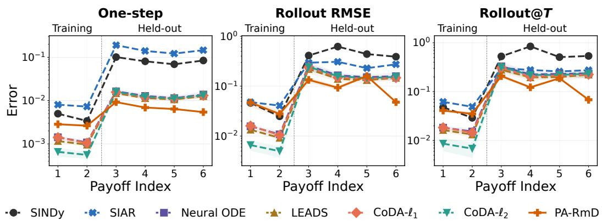

Table 3: Synthetic held-out results under MWU dynamics. Each entry is mean ± std over five runs on held-out payoff functions.
<table><tr><td rowspan="2">Game</td><td rowspan="2">Method</td><td colspan="3">K = 3</td><td colspan="3">K = 4</td></tr><tr><td> $\overline { { \mathrm { { O n e - s t e p } \left( \downarrow \right) } } }$ </td><td> $\overline { { { \bf { R o l l o u t R M S E } \left( \downarrow \right) } } }$ </td><td> $\overline { { \mathrm { \bf ~ R o l l o u t } @ T \left( \downarrow \right) } }$ </td><td> $\overline { { \mathrm { ~ \sc ~ O n e - s t e p ~ ( \downarrow ) ~ } } }$ </td><td> $\overline { { { \bf { R o l l o u t R M S E } \left( \downarrow \right) } } }$ </td><td> $\overline { { \mathrm { \bf { R o l l o u t @ } } T \left( \downarrow \right) } }$ </td></tr><tr><td rowspan="7">Zero-sum cyclic</td><td>SINDy</td><td> $\overline { { ( 1 . 4 5 \pm 0 . 0 0 ) \mathrm { { E } } \cdot 1 } }$ </td><td> $( 5 . 4 3 \pm 0 . 0 0 ) \mathrm { E } \mathrm { - } 1$ </td><td> $( 5 . 7 8 \pm 0 . 0 0 ) \mathrm { { E } \mathrm { { - } 1 } }$ </td><td> $\overline { { ( 2 . 0 0 \pm 0 . 0 0 ) \mathrm { E } \mathrm { - } 1 } }$ </td><td> $\overline { { ( 3 . 9 6 \pm 0 . 0 0 ) \mathrm { { E } \mathrm { { - } 1 } } } }$ </td><td> $\overline { { ( 4 . 8 3 \pm 0 . 0 0 ) \mathrm { E } \mathrm { - } 1 } }$ </td></tr><tr><td>SIAR</td><td> $( 1 . 2 4 \pm 0 . 0 0 ) \mathrm { E } \cdot 1$ </td><td> $( 3 . 7 7 \pm 0 . 0 0 ) \mathrm { E } \cdot 1$ </td><td> $( 4 . 2 8 \pm 0 . 0 0 ) \mathrm { E } \cdot 1$ </td><td> $( 1 . 3 0 \pm 0 . 0 0 ) \mathrm { E } \mathrm { - } 1$ </td><td> $( 2 . 6 6 \pm 0 . 0 0 ) \mathrm { E } \cdot 1$ </td><td> $( 2 . 8 3 \pm 0 . 0 0 ) \mathrm { E } \mathrm { - } 1$ </td></tr><tr><td>Neural ODE</td><td> $( 3 . 0 9 \pm 0 . 3 5 ) \mathrm { E } \cdot 2$ </td><td> $( 3 . 0 2 \pm 0 . 7 7 ) \mathrm { E } \cdot 1$ </td><td> $( 4 . 5 7 \pm 1 . 5 4 ) \mathrm { E } \cdot 1$ </td><td> $( 1 . 5 2 \pm 0 . 0 5 ) \mathrm { E } \cdot 2$ </td><td> $( 1 . 7 9 \pm 0 . 1 0 ) \mathrm { E } \cdot 1$ </td><td> $( 2 . 5 5 \pm 0 . 1 7 ) \mathrm { E } \mathrm { - } 1$ </td></tr><tr><td>LEADS</td><td> $( 3 . 2 8 \pm 0 . 3 2 ) \mathrm { E } \cdot 2$ </td><td> $( 3 . 2 9 \pm 0 . 6 9 ) \mathrm { E } \mathrm { - } 1$ </td><td> $( 5 . 0 0 \pm 1 . 2 1 ) \mathrm { E } \cdot 1$ </td><td> $( 1 . 5 8 \pm 0 . 1 7 ) \mathrm { E } \cdot 2$ </td><td> $( 1 . 7 3 \pm 0 . 1 2 ) \mathrm { E } \cdot 1$ </td><td> $( 2 . 4 2 \pm 0 . 1 5 ) \mathrm { E } \mathrm { - } 1$ </td></tr><tr><td>CoDA-l1</td><td> $( 2 . 9 4 \pm 0 . 1 2 ) \mathrm { E } \cdot 2$ </td><td> $( 2 . 6 6 \pm 0 . 5 8 ) \mathrm { E } \cdot 1$ </td><td> $( 4 . 0 1 \pm 1 . 1 5 ) \mathrm { E } \cdot 1$ </td><td> $( 1 . 4 9 \pm 0 . 1 8 ) \mathrm { E } \cdot 2$ </td><td> $( 1 . 6 6 \pm 0 . 2 3 ) \mathrm { E } \cdot 1$ </td><td> $( 2 . 3 5 \pm 0 . 3 6 ) \mathrm { E } \mathrm { - } 1$ </td></tr><tr><td> $\mathrm { C o D A ^ { - } \ell _ { 2 } }$ </td><td> $( 2 . 9 3 \pm 0 . 1 2 ) \mathrm { E } \cdot 2$ </td><td> $( 2 . 6 3 \pm 0 . 5 8 ) \mathrm { E } \mathrm { - } 1$ </td><td> $( 3 . 9 6 \pm 1 . 1 4 ) \mathrm { { E } \mathrm { { - } 1 } }$ </td><td> $( 1 . 4 8 \pm 0 . 1 7 ) \mathrm { E } \cdot 2$ </td><td> $( 1 . 6 4 \pm 0 . 2 2 ) \mathrm { E } \cdot 1$ </td><td> $( 2 . 3 0 \pm 0 . 3 6 ) \mathrm { E } \mathrm { - } 1$ </td></tr><tr><td>PA-RmD</td><td> $( 2 . 6 5 \pm 0 . 0 5 ) \mathrm { E } { } { } \cdot 3$  </td><td> $( 3 . 0 4 \pm 0 . 2 9 ) \mathrm { E } 2 \AA$ </td><td> $( 2 . 7 1 \pm 0 . 1 8 ) \mathrm { E } { - 2 }$ </td><td> $( \mathbf { 1 . 6 3 \pm 0 . 0 7 } ) \mathbf { E } \mathbf { - 3 }$  1</td><td> $( 2 . 5 8 \pm 0 . 1 1 ) \mathrm { E } { \cdot } 2$  </td><td> $( 2 . 5 1 \pm 0 . 1 6 ) \mathrm { E } { - 2 }$ </td></tr><tr><td rowspan="7">Potential congestion</td><td>SINDy</td><td> $\overline { { ( 9 . 5 6 \pm 0 . 0 0 ) \mathrm { E } \cdot 3 } }$ </td><td> $\overline { { ( 1 . 1 5 \pm 0 . 0 0 ) \mathrm { { E } \mathrm { { - } 1 } } } }$ </td><td> $\overline { { ( 1 . 4 5 \pm 0 . 0 0 ) \mathrm { E } \cdot 1 } }$ </td><td> $\overline { { ( 1 . 7 1 \pm 0 . 0 0 ) \mathrm { E } \cdot 2 } }$ </td><td> $\overline { { ( 1 . 8 4 \pm 0 . 0 0 ) \mathrm { { E } \mathrm { { - } 1 } } } }$ </td><td> $\overline { { ( 2 . 4 9 \pm 0 . 0 0 ) \mathrm { E } \mathrm { - } 1 } }$ </td></tr><tr><td>SIAR</td><td> $( 1 . 5 0 \pm 0 . 0 0 ) \mathrm { E } \cdot 2$ </td><td> $( 1 . 7 0 \pm 0 . 0 0 ) \mathrm { E } \cdot 1$ </td><td> $( 2 . 5 9 \pm 0 . 0 0 ) \mathrm { E } \cdot 1$ </td><td> $( 1 . 1 5 \pm 0 . 0 0 ) \mathrm { E } \cdot 2$ </td><td> $( 1 . 0 4 \pm 0 . 0 0 ) \mathrm { E } \mathrm { - } 1$ </td><td> $( 1 . 4 4 \pm 0 . 0 0 ) \mathrm { E } \mathrm { - } 1$ </td></tr><tr><td>Neural ODE</td><td> $( 2 . 4 4 \pm 0 . 2 1 ) \mathrm { E } \cdot 3$ </td><td> $( 2 . 9 9 \pm 0 . 2 3 ) \mathrm { E } \cdot 2$ </td><td>(4.10 ± 0.24)E-2</td><td> $( 3 . 6 8 \pm 0 . 0 5 ) \mathrm { E } \cdot 3$ </td><td> $( 4 . 1 0 \pm 0 . 0 7 ) \mathrm { E } \cdot 2$ </td><td> $( 6 . 2 3 \pm 0 . 1 2 ) \mathrm { E } \cdot 2$ </td></tr><tr><td>LEADS</td><td> $( 2 . 5 1 \pm 0 . 3 6 ) \mathrm { E } \cdot 3$ </td><td> $( 2 . 9 9 \pm 0 . 3 7 ) \mathrm { E } \cdot 2$ </td><td> $( 4 . 2 0 \pm 0 . 5 1 ) \mathrm { E } \cdot 2$ </td><td> $( 3 . 9 1 \pm 0 . 3 4 ) \mathrm { E } \mathrm { - } 3$ </td><td> $( 4 . 3 4 \pm 0 . 3 9 ) \mathrm { E } \cdot 2$ </td><td> $( 6 . 6 0 \pm 0 . 6 9 ) \mathrm { E } \cdot 2$ </td></tr><tr><td> $\mathbf { C o D A - } \boldsymbol { \ell } _ { 1 }$ </td><td> $( 2 . 2 7 \pm 0 . 1 0 ) \mathrm { E } { - 3 }$ </td><td> $( 2 . 7 9 \pm 0 . 0 9 ) \mathrm { E } \cdot 2$ </td><td> $( 3 . 8 5 \pm 0 . 1 5 ) \mathrm { { E } } \cdot 2$ </td><td> $( 3 . 8 3 \pm 0 . 2 0 ) \mathrm { E } 3$ </td><td> $( 4 . 2 8 \pm 0 . 2 6 ) \mathrm { E } \cdot 2$ </td><td> $( 6 . 5 4 \pm 0 . 4 1 ) \mathrm { E } \cdot 2$ </td></tr><tr><td>CoDA-l2</td><td> $( 2 . 2 9 \pm 0 . 0 9 ) \mathrm { E } \cdot 3$ </td><td> $( 2 . 8 1 \pm 0 . 0 9 ) \mathrm { E } \cdot 2$ </td><td> $( 3 . 8 7 \pm 0 . 1 5 ) \mathrm { E } \cdot 2$ </td><td> $( 3 . 8 4 \pm 0 . 2 2 ) \mathrm { E } \mathrm { - } 3$ </td><td> $( 4 . 2 9 \pm 0 . 2 7 ) \mathrm { E } \cdot 2$ </td><td> $( 6 . 5 6 \pm 0 . 4 5 ) \mathrm { E } \cdot 2$ </td></tr><tr><td>PA-RmD</td><td> $( \pm , \mathbf { 0 2 } \pm \mathbf { 0 . 5 2 } ) \mathbf { E } \mathbf { - } 4$ </td><td> $( 9 . 3 7 \pm 0 . 6 5 ) \mathrm { E } { } { } ^ { 3 }$  </td><td> $\mathbf { ( 1 . 0 3 \pm 0 . 1 0 ) E { - 2 } }$ </td><td> $( 4 . 1 4 \pm 0 . 4 1 ) \mathrm { E } { \cdot } 4$ </td><td> $( 6 . 5 7 \pm 0 . 6 5 ) \mathrm { E } { \cdot } 3$  </td><td> $( 7 . 7 1 \pm 0 . 7 9 ) \mathrm { E } { - 3 }$ </td></tr></table>

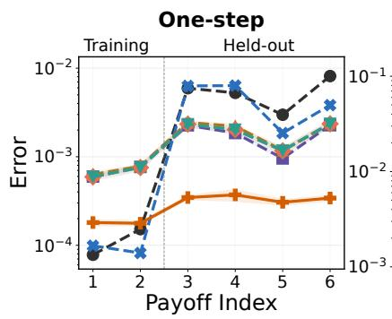

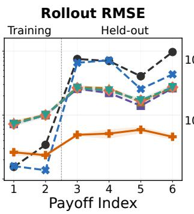

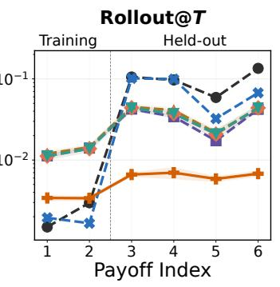  
Figure 4: Error by payoff function index for the K = 4 potential congestion game under replicator dynamics.  
Figure 5: Error by payoff function index for the K = 4 zero-sum cyclic game under projection dynamics.

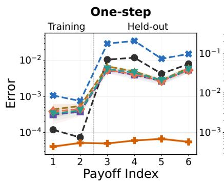

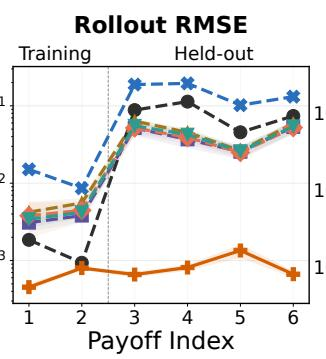

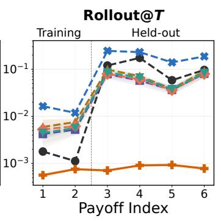  
SINDy SIAR Neural ODE LEADS CoDA-ℓ1 CoDA-ℓ2 PA-RmD  
Figure 6: Error by payoff function index for the K = 4 potential congestion game under projection dynamics.

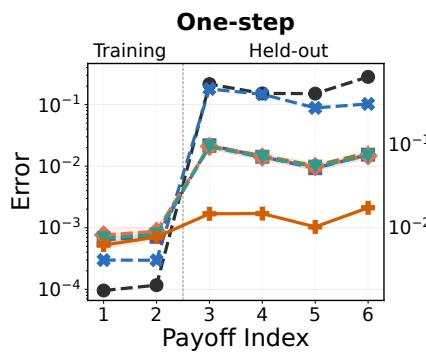

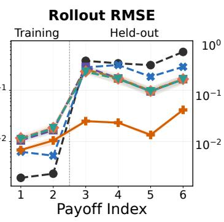

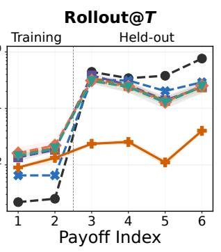  
Figure 7: Error by payoff function index for the K = 4 zero-sum cyclic game under MWU dynamics.

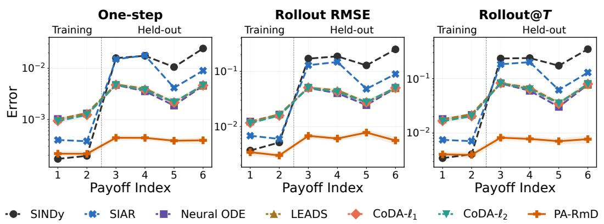  
Figure 8: Error by payoff function index for the K = 4 potential congestion game under MWU dynamics.

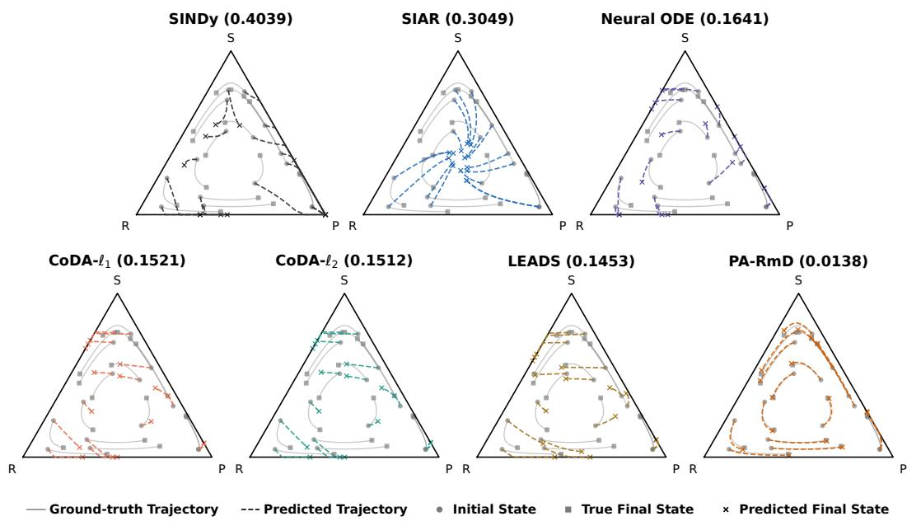  
Figure 9: Full held-out rollout trajectories for the K = 3 zero-sum cyclic game under replicator dynamics.

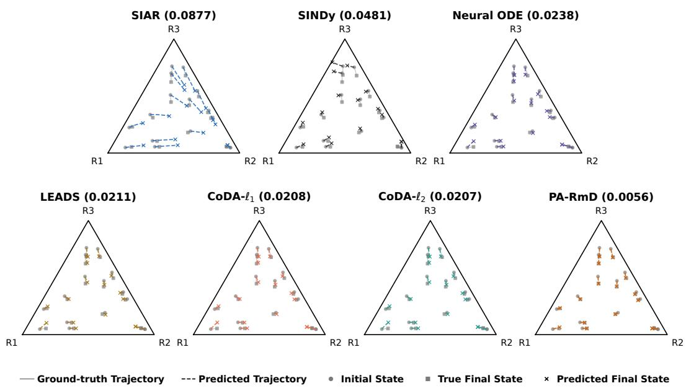  
Figure 10: Full held-out rollout trajectories for the K = 3 potential congestion game under replicator dynamics.

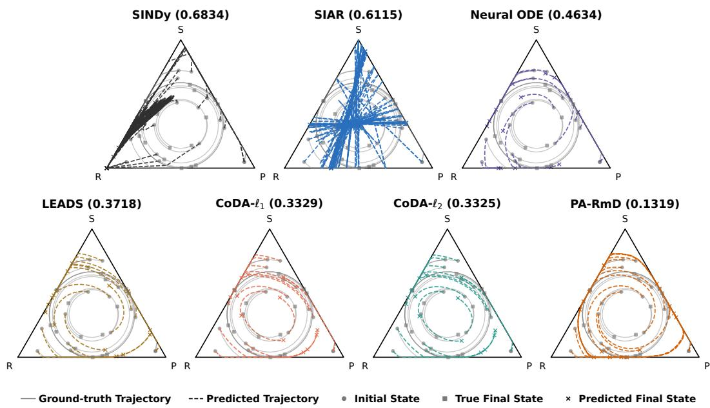  
Figure 11: Full held-out rollout trajectories for the K = 3 zero-sum cyclic game under projection dynamics.

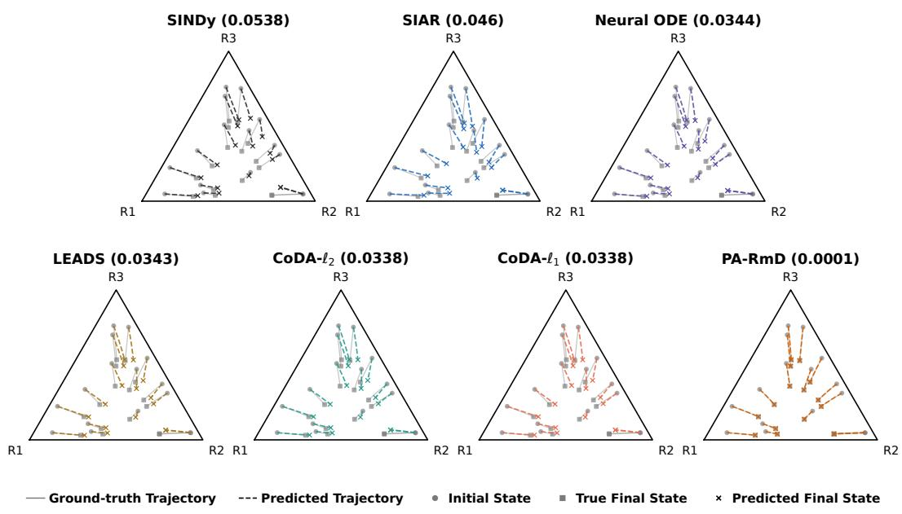  
Figure 12: Full held-out rollout trajectories for the K = 3 potential congestion game under projection dynamics.

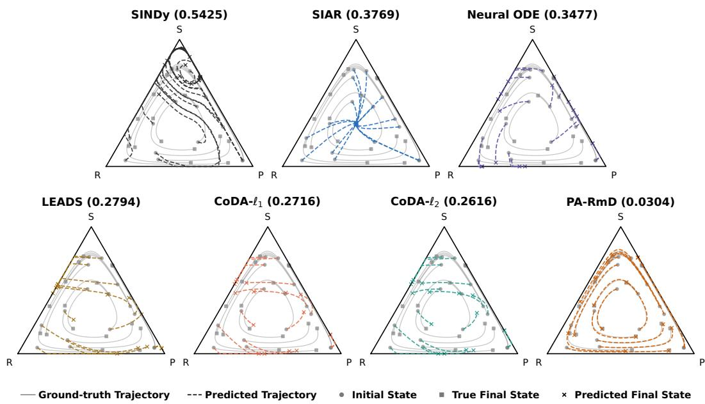  
Figure 13: Full held-out rollout trajectories for the K = 3 zero-sum cyclic game under MWU dynamics.

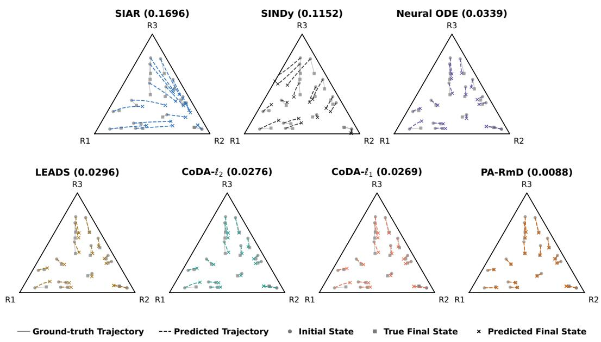  
Figure 14: Full held-out rollout trajectories for the K = 3 potential congestion game under MWU dynamics.

## C.2.2 Results on Overall and Seen Payoff Environments

Table 4: Overall results across both seen and held-out payoff environments under replicator dynamics. Each entry is mean ± std over five runs.
<table><tr><td rowspan="2">Game</td><td rowspan="2">Method</td><td colspan="3">K = 3</td><td colspan="3"> $\overline { { K = 4 } }$ </td></tr><tr><td> $\overline { { \mathrm { ~ O n e - s t e p \left( \downarrow \right) } } }$ </td><td>Rollout RMSE (↓)</td><td> $\overline { { \mathrm { \bf ~ R o l l o u t } @ T \left( \downarrow \right) } }$ </td><td> $\mathrm { O n e - s t e p \left( \downarrow \right) }$ </td><td>Rollout RMSE (↓)</td><td>Rollout@T (↓)</td></tr><tr><td rowspan="7">Zero-sum cyclic</td><td>SINDy</td><td> $\overline { { ( 2 . 0 2 \pm 0 . 0 0 ) \mathrm { E } \cdot 2 } }$ </td><td> $\overline { { ( 2 . 0 2 \pm 0 . 0 0 ) \mathrm { E } \mathrm { - } 1 } }$ </td><td> $\overline { { ( 2 . 6 2 \pm 0 . 0 0 ) \mathrm { E } \mathrm { - } 1 } }$ </td><td> $( 7 . 2 8 \pm 0 . 0 0 ) \mathrm { E } \cdot 2$ </td><td>(1.92 ± 0.00)E-1</td><td> $\overline { { ( 2 . 0 5 \pm 0 . 0 0 ) \mathrm { E } \mathrm { - } 1 } }$ </td></tr><tr><td>SIAR</td><td> $( 2 . 5 2 \pm 0 . 0 0 ) \mathrm { E } \cdot 2$ </td><td> $( 1 . 5 2 \pm 0 . 0 0 ) \mathrm { E } \cdot 1$ </td><td> $( 2 . 0 0 \pm 0 . 0 0 ) \mathrm { E } \cdot 1$ </td><td> $( 3 . 9 0 \pm 0 . 0 0 ) \mathrm { E } \cdot 2$ </td><td> $( 1 . 4 1 \pm 0 . 0 0 ) \mathrm { E } \mathrm { - } 1$ </td><td> $( 1 . 3 9 \pm 0 . 0 0 ) \mathrm { E } \mathrm { - } 1$ </td></tr><tr><td>Neural ODE</td><td> $( 7 . 4 4 \pm 0 . 1 9 ) \mathrm { E } \cdot 3$ </td><td> $( 7 . 7 0 \pm 0 . 7 9 ) \mathrm { E } \cdot 2$ </td><td> $( 1 . 0 9 \pm 0 . 1 4 ) \mathrm { E } \cdot 1$ </td><td> $( 4 . 8 5 \pm 0 . 1 2 ) \mathrm { E } \cdot 3$ </td><td> $( 6 . 0 4 \pm 0 . 4 4 ) \mathrm { E } \cdot 2$ </td><td> $( 8 . 2 7 \pm 0 . 4 8 ) \mathrm { E } \cdot 2$ </td></tr><tr><td>LEADS</td><td> $( 8 . 5 2 \pm 0 . 9 1 ) \mathrm { E } \cdot 3$ </td><td> $( 9 . 0 1 \pm 1 . 5 2 ) \mathrm { E } \cdot 2$ </td><td> $( 1 . 3 5 \pm 0 . 2 8 ) \mathrm { E } \cdot 1$ </td><td> $( 5 . 3 6 \pm 0 . 8 2 ) \mathrm { E } \mathrm { - } 3$ </td><td> $( 6 . 7 7 \pm 1 . 0 4 ) \mathrm { E } \cdot 2$ </td><td> $( 9 . 1 1 \pm 1 . 0 6 ) \mathrm { { E } } { - 2 }$ </td></tr><tr><td>CoDA-l1</td><td> $( 7 . 2 9 \pm 0 . 0 9 ) \mathrm { E } \cdot 3$ </td><td>(7.28 ± 0.67)E-2</td><td> $( 1 . 0 5 \pm 0 . 1 5 ) \mathrm { E } \cdot 1$ </td><td> $( 5 . 0 7 \pm 0 . 6 4 ) \mathrm { E } \mathrm { - } 3$ </td><td>(6.52 ± 0.60)E-2</td><td> $( 8 . 7 5 \pm 0 . 9 9 ) \mathrm { E } \cdot 2$ </td></tr><tr><td>CoDA-l2</td><td> $( 7 . 2 9 \pm 0 . 1 1 ) \mathrm { E } \cdot 3$ </td><td> $( 7 . 2 7 \pm 0 . 6 0 ) \mathrm { E } \cdot 2$ </td><td> $( 1 . 0 5 \pm 0 . 1 4 ) \mathrm { E } \cdot 1$ </td><td> $( 5 . 0 3 \pm 0 . 6 8 ) \mathrm { E } \mathrm { - } 3$ </td><td> $( 6 . 4 7 \pm 0 . 6 6 ) \mathrm { E } \cdot 2$ </td><td> $( 8 . 6 2 \pm 1 . 1 1 ) \mathrm { E } \cdot 2$ </td></tr><tr><td>PA-RmD</td><td> $( 7 . 6 9 \pm 0 . 2 4 ) \mathrm { E } { \cdot } 4$ </td><td>(1.24 ± 0.36)E-2</td><td> $( 1 . 4 3 \pm 0 . 2 5 ) \mathrm { E } { \cdot } 2$ </td><td> $( 8 . 1 7 \pm 0 . 2 7 ) \mathrm { E } { \cdot } 4$ </td><td>(1.41 ± 0.06)E-2</td><td> $( 1 . 5 9 \pm 0 . 0 6 ) \mathrm { E } { \cdot } 2$ </td></tr><tr><td rowspan="7">Potential congestion</td><td>SINDy</td><td> $( 1 . 6 6 \pm 0 . 0 0 ) \mathrm { E } \cdot 3$ </td><td> $\overline { { ( 2 . 4 1 \pm 0 . 0 0 ) \mathrm { E } \cdot 2 } }$ </td><td> $\overline { { ( 3 . 6 0 \pm 0 . 0 0 ) \mathrm { E } \cdot 2 } }$ </td><td> $( 3 . 7 6 \pm 0 . 0 0 ) \mathrm { { E } } \cdot 3$ </td><td> $\overline { { ( 4 . 8 0 \pm 0 . 0 0 ) \mathrm { E } \cdot 2 } }$ </td><td> $\overline { { ( 6 . 6 8 \pm 0 . 0 0 ) \mathrm { E } \cdot 2 } }$ </td></tr><tr><td>SIAR</td><td> $( 3 . 5 9 \pm 0 . 0 0 ) \mathrm { E } \cdot 3$ </td><td>(4.41 ± 0.00)E-2</td><td> $( 6 . 9 2 \pm 0 . 0 0 ) \mathrm { E } \cdot 2$ </td><td>(3.09 ± 0.00)E-3</td><td>(3.49 ± 0.00)E-2</td><td> $( 5 . 0 7 \pm 0 . 0 0 ) \mathrm { E } \cdot 2$ </td></tr><tr><td>Neural ODE</td><td> $( 1 . 2 3 \pm 0 . 0 9 ) \mathrm { E } \mathrm { - } 3$ </td><td> $( 1 . 6 0 \pm 0 . 1 4 ) \mathrm { E } \cdot 2$ </td><td> $( 2 . 2 5 \pm 0 . 1 6 ) \mathrm { E } \cdot 2$ </td><td> $( 1 . 4 5 \pm 0 . 0 4 ) \mathrm { E } \cdot 3$ </td><td> $( 1 . 7 6 \pm 0 . 0 5 ) \mathrm { E } \cdot 2$ </td><td> $( 2 . 6 9 \pm 0 . 0 9 ) \mathrm { E } \cdot 2$ </td></tr><tr><td>LEADS</td><td> $( 1 . 2 3 \pm 0 . 0 8 ) \mathrm { E } \cdot 3$ </td><td>(1.59 ± 0.09)E-2</td><td> $( 2 . 2 6 \pm 0 . 1 3 ) \mathrm { E } \cdot 2$ </td><td>(1.60 ± 0.11)E-3</td><td>(1.91 ± 0.12)E-2 (2.97 ± 0.23)E-2</td><td></td></tr><tr><td>CoDA-l1</td><td> $( 1 . 2 3 \pm 0 . 0 3 ) \mathrm { E } \mathrm { } \mathrm { } \mathrm { } \mathrm { } 3$ </td><td> $( 1 . 6 1 \pm 0 . 0 6 ) \mathrm { E } \cdot 2$ </td><td> $( 2 . 2 6 \pm 0 . 0 5 ) \mathrm { E } \cdot 2$ </td><td> $( 1 . 5 4 \pm 0 . 1 3 ) \mathrm { E } \mathrm { - } 3$ </td><td> $( 1 . 8 8 \pm 0 . 1 5 ) \mathrm { E } \cdot 2$ </td><td> $( 2 . 8 5 \pm 0 . 2 6 ) \mathrm { E } \cdot 2$ </td></tr><tr><td>CoDA-l2</td><td> $( 1 . 2 3 \pm 0 . 0 3 ) \mathrm { E } \mathrm { } \mathrm { } \mathrm { } \mathrm { } 3$ </td><td>(1.61 ± 0.06)E-2</td><td> $( 2 . 2 6 \pm 0 . 0 5 ) \mathrm { E } \cdot 2$ </td><td> $( 1 . 5 4 \pm 0 . 1 3 ) \mathrm { E } \mathrm { - } 3$ </td><td>(1.87 ± 0.15)E-2</td><td> $( 2 . 8 5 \pm 0 . 2 7 ) \mathrm { E } \cdot 2$ </td></tr><tr><td>PA-RmD</td><td> $( 2 . 4 0 \pm 0 . 2 6 ) \mathrm { E } { \cdot } 4$ </td><td> $( 4 . 0 2 \pm 0 . 3 1 ) \mathrm { E } { - 3 }$  </td><td> $( 4 . 7 6 \pm 0 . 4 8 ) \mathrm { E } { - 3 }$ </td><td> $( 2 . 8 7 \pm 0 . 2 5 ) \mathrm { E } 4$  </td><td> $( 4 . 2 5 \pm 0 . 3 9 ) \mathrm { E } 3$ </td><td> $( 5 . 5 1 \pm 0 . 4 7 ) \mathrm { E } { \cdot } 3$ </td></tr></table>

Table 5: Overall results across both seen and held-out payoff environments under projection dynamics. Each entry is mean ± std over five runs.
<table><tr><td rowspan="2">Game</td><td rowspan="2">Method</td><td colspan="3">K = 3</td><td colspan="3"> $\overline { { K = 4 } }$ </td></tr><tr><td>One-step (↓)</td><td>Rollout RMSE (↓)</td><td>Rollout@T (↓)</td><td>One-step (↓)</td><td>Rollout RMSE (↓)</td><td>Rollout@T (↓)</td></tr><tr><td rowspan="6">Zero-sum cyclic</td><td>SINDy</td><td> $\overline { { ( 1 . 9 4 \pm 0 . 0 0 ) \mathrm { { E } } \mathrm { { - } } 1 } }$ </td><td> $( 3 . 5 0 \pm 0 . 0 0 ) \mathrm { { E } \mathrm { { - } 1 } }$ </td><td> $\overline { { ( 4 . 0 4 \pm 0 . 0 0 ) \mathrm { E } \mathrm { - } 1 } }$ </td><td> $\overline { { ( 5 . 7 3 \pm 0 . 0 0 ) \mathrm { E } \mathrm { - } 2 } }$ </td><td> $\overline { { ( 3 . 2 2 \pm 0 . 0 0 ) \mathrm { E } \mathrm { - } 1 } }$ </td><td> $( 4 . 1 6 \pm 0 . 0 0 ) \mathrm { { E } \mathrm { { - } 1 } }$ </td></tr><tr><td>SIAR</td><td>(3.88 ± 0.00)E-1</td><td> $( 3 . 3 0 \pm 0 . 0 0 ) \mathrm { E } \cdot 1$ </td><td> $( 3 . 8 9 \pm 0 . 0 0 ) \mathrm { E } \cdot 1$ </td><td> $( 1 . 0 2 \pm 0 . 0 0 ) \mathrm { E } \mathrm { - } 1$ </td><td> $( 1 . 9 9 \pm 0 . 0 0 ) \mathrm { E } \mathrm { - } 1$ </td><td> $( 2 . 0 4 \pm 0 . 0 0 ) \mathrm { E } \mathrm { - } 1$ </td></tr><tr><td>Neural ODE</td><td> $( 1 . 6 1 \pm 0 . 2 1 ) \mathrm { E } \cdot 2$ </td><td> $( 1 . 7 9 \pm 0 . 3 6 ) \mathrm { E } \mathrm { - } 1$ </td><td> $( 2 . 8 1 \pm 0 . 5 6 ) \mathrm { E } \mathrm { - } 1$ </td><td> $( 9 . 5 1 \pm 1 . 3 1 ) \mathrm { E } \mathrm { - } 3$ </td><td> $( 1 . 2 6 \pm 0 . 1 9 ) \mathrm { E } \mathrm { - } 1$ </td><td> $( 1 . 7 6 \pm 0 . 2 8 ) \mathrm { E } \cdot 1$ </td></tr><tr><td>LEADS</td><td>(1.80 ± 0.15)E-2</td><td>(2.23 ± 0.37)E-1</td><td> $( 3 . 4 7 \pm 0 . 5 4 ) \mathrm { E } \cdot 1$ </td><td>(8.62 ± 0.80)E-3</td><td> $( 1 . 1 0 \pm 0 . 1 4 ) \mathrm { E } \mathrm { - } 1$ </td><td>(1.55 ± 0.21)E-1</td></tr><tr><td>CoDA-l1</td><td> $( 1 . 5 7 \pm 0 . 1 9 ) \mathrm { E } \cdot 2$ </td><td> $( 1 . 8 4 \pm 0 . 2 1 ) \mathrm { E } \cdot 1$ </td><td> $( 2 . 9 5 \pm 0 . 2 8 ) \mathrm { E } \cdot 1$ </td><td> $( 9 . 1 0 \pm 0 . 5 9 ) \mathrm { E } \mathrm { - } 3$ </td><td> $( 1 . 1 7 \pm 0 . 0 9 ) \mathrm { E } \mathrm { - } 1$ </td><td> $( 1 . 6 4 \pm 0 . 1 4 ) \mathrm { E } \mathrm { - } 1$ </td></tr><tr><td>CoDA-l2</td><td> $( 1 . 5 8 \pm 0 . 1 9 ) \mathrm { E } \cdot 2$ </td><td>(1.84 ± 0.20)E-1</td><td> $( 2 . 9 5 \pm 0 . 2 8 ) \mathrm { E } \cdot 1$ </td><td>(9.02 ± 0.83)E-3</td><td>(1.19 ± 0.12)E-1</td><td>(1.68 ± 0.17)E-1</td></tr><tr><td rowspan="7">Potential congestion</td><td>PA-RmD</td><td> $( 5 . 3 1 \pm 0 . 2 4 ) \mathrm { E } { \cdot } 3$ </td><td> $( 7 . 2 1 \pm 0 . 2 6 ) \mathrm { E } { - 2 }$  1</td><td> $( { \bf 1 . 0 9 \pm 0 . 0 4 } ) { \bf E - 1 }$ </td><td> $( 5 . 5 9 \pm 0 . 0 4 ) \mathrm { E } { } { } \cdot 3$ </td><td> $( 8 . 4 7 \pm 0 . 4 7 ) \mathrm { E } { - 2 }$ </td><td> $( \mathbf { 1 . 1 1 \pm 0 . 0 5 } ) \mathbf { E - 1 }$ </td></tr><tr><td>SINDy</td><td> $\overline { { ( 2 . 2 4 \pm 0 . 0 0 ) \mathrm { { E } } \cdot 3 } }$ </td><td> $\overline { { ( 2 . 6 9 \pm 0 . 0 0 ) \mathrm { E } \cdot 2 } }$ </td><td> $\overline { { ( 3 . 9 6 \pm 0 . 0 0 ) \mathrm { E } \cdot 2 } }$ </td><td> $\overline { { ( 5 . 8 3 \pm 0 . 0 0 ) \mathrm { { E } } \mathrm { { - } } 3 } }$ </td><td>(5.39 ± 0.00)E-2</td><td> $\overline { { ( 7 . 5 3 \pm 0 . 0 0 ) \mathrm { E } \cdot 2 } }$ </td></tr><tr><td>SIAR</td><td> $( 2 . 3 9 \pm 0 . 0 0 ) \mathrm { E } \cdot 3$ </td><td> $( 2 . 3 2 \pm 0 . 0 0 ) \mathrm { E } \cdot 2$ </td><td> $( 3 . 7 3 \pm 0 . 0 0 ) \mathrm { E } \cdot 2$ </td><td> $( 1 . 5 4 \pm 0 . 0 0 ) \mathrm { E } \cdot 2$ </td><td> $( 1 . 0 7 \pm 0 . 0 0 ) \mathrm { E } \mathrm { - } 1$ </td><td>(1.38 ± 0.00)E-1</td></tr><tr><td>Neural ODE</td><td> $( 1 . 7 6 \pm 0 . 1 5 ) \mathrm { E } \cdot 3$ </td><td> $( 1 . 7 8 \pm 0 . 1 5 ) \mathrm { { E } } \cdot 2$ </td><td> $( 2 . 7 7 \pm 0 . 2 4 ) \mathrm { E } \cdot 2$ </td><td> $( 3 . 0 3 \pm 0 . 5 9 ) \mathrm { E } \cdot 3$ </td><td>(2.90 ± 0.57)E-2</td><td> $( 4 . 3 8 \pm 0 . 8 9 ) \mathrm { E } \cdot 2$ </td></tr><tr><td>LEADS</td><td> $( 1 . 7 4 \pm 0 . 0 8 ) \mathrm { E } \cdot 3$ </td><td> $( 1 . 7 6 \pm 0 . 0 8 ) \mathrm { E } \cdot 2$ </td><td> $( 2 . 7 4 \pm 0 . 1 3 ) \mathrm { E } \cdot 2$ </td><td> $( 3 . 6 5 \pm 0 . 2 7 ) \mathrm { E } \cdot 3$ </td><td>(3.40 ± 0.24)E-2</td><td> $( 5 . 2 1 \pm 0 . 3 9 ) \mathrm { E } \mathrm { - } 2$ </td></tr><tr><td> $\mathbf { C o D A - } \boldsymbol { \ell } _ { 1 }$ </td><td> $( 1 . 6 4 \pm 0 . 1 7 ) \mathrm { E } \cdot 3$ </td><td> $( 1 . 6 6 \pm 0 . 1 8 ) \mathrm { E } \cdot 2$ </td><td> $( 2 . 5 9 \pm 0 . 2 7 ) \mathrm { E } \cdot 2$ </td><td> $( 3 . 1 0 \pm 0 . 4 9 ) \mathrm { E } \mathrm { - } 3$ </td><td> $( 2 . 9 4 \pm 0 . 4 9 ) \mathrm { E } \mathrm { - } 2$ </td><td> $( 4 . 4 6 \pm 0 . 7 6 ) \mathrm { E } \cdot 2$ </td></tr><tr><td> $\mathrm { C o D A ^ { - } \ell _ { 2 } }$ </td><td> $( 1 . 6 5 \pm 0 . 1 7 ) \mathrm { E } \cdot 3$ </td><td>(1.66 ± 0.18)E-2</td><td> $( 2 . 6 0 \pm 0 . 2 7 ) \mathrm { E } \cdot 2$ </td><td> $( 3 . 2 7 \pm 0 . 5 6 ) \mathrm { E } \mathrm { - } 3$ </td><td> $( 3 . 0 9 \pm 0 . 5 6 ) \mathrm { E } \cdot 2$ </td><td>(4.71 ± 0.87)E-2</td></tr><tr><td></td><td>PA-RmD</td><td> $( 7 . 4 1 \pm 1 . 3 9 ) \mathrm { E } { \cdot } 6$ </td><td> $( 8 . 2 7 \pm 1 . 6 1 ) \mathrm { E } { \cdot } 5$ </td><td> $( \mathbf { 1 . 1 7 \pm 0 . 2 1 } ) \mathbf { E } \mathbf { - } 4$ </td><td> $( 5 . 3 9 \pm 0 . 2 9 ) \mathrm { E } { \cdot } 5$ </td><td> $( 7 . 9 1 \pm 0 . 4 8 ) \mathrm { E } { \cdot } 4$ </td><td> $( 7 . 7 4 \pm 0 . 3 8 ) \mathrm { E } { \cdot } 4$ </td></tr></table>

Table 6: Overall results across both seen and held-out payoff environments under MWU dynamics. Each entry is mean ± std over five runs.
<table><tr><td rowspan="2">Game</td><td rowspan="2">Method</td><td colspan="3">K = 3</td><td colspan="3"> $\overline { { K = 4 } }$ </td></tr><tr><td>One-step (↓)</td><td>Rollout RMSE (↓)</td><td>Rollout@T (↓)</td><td> $\overline { { \mathrm { { O n e - s t e p } \left( \downarrow \right) } } }$ </td><td>Rollout RMSE (↓)</td><td> $\overline { { \mathrm { \bf { R o l l o u t @ } } T \mathrm { \bf { \Psi } ( \downarrow ) } } }$ </td></tr><tr><td rowspan="7">Zero-sum cyclic</td><td>SINDy</td><td> $\overline { { ( 7 . 2 4 \pm 0 . 0 0 ) \mathrm { E } \mathrm { - } 2 } }$ </td><td> $( 2 . 7 2 \pm 0 . 0 0 ) \mathrm { E } \cdot 1$ </td><td> $\overline { { ( 2 . 9 1 \pm 0 . 0 0 ) \mathrm { E } \mathrm { - } 1 } }$ </td><td> $( 1 . 3 4 \pm 0 . 0 0 ) \mathrm { E } \mathrm { - } 1$ </td><td>(2.65 ± 0.00)E-1</td><td> $( 3 . 2 3 \pm 0 . 0 0 ) \mathrm { E } \mathrm { - } 1$ </td></tr><tr><td>SIAR</td><td>(6.21 ± 0.00)E-2</td><td> $( 1 . 9 1 \pm 0 . 0 0 ) \mathrm { E } \mathrm { - } 1$ </td><td> $( 2 . 1 8 \pm 0 . 0 0 ) \mathrm { E } \cdot 1$ </td><td> $( 8 . 6 5 \pm 0 . 0 0 ) \mathrm { E } \cdot 2$ </td><td> $( 1 . 7 9 \pm 0 . 0 0 ) \mathrm { E } \cdot 1$ </td><td> $( 1 . 9 1 \pm 0 . 0 0 ) \mathrm { E } \mathrm { - } 1$ </td></tr><tr><td>Neural ODE</td><td> $( 1 . 5 7 \pm 0 . 1 7 ) \mathrm { E } \cdot 2$ </td><td> $( 1 . 5 5 \pm 0 . 3 7 ) \mathrm { E } \cdot 1$ </td><td> $( 2 . 3 5 \pm 0 . 7 6 ) \mathrm { E } \cdot 1$ </td><td> $( 1 . 0 4 \pm 0 . 0 4 ) \mathrm { E } \cdot 2$ </td><td> $( 1 . 2 4 \pm 0 . 0 7 ) \mathrm { E } \mathrm { - } 1$ </td><td> $( 1 . 7 6 \pm 0 . 1 2 ) \mathrm { E } \cdot 1$ </td></tr><tr><td>LEADS</td><td> $( 1 . 6 7 \pm 0 . 1 7 ) \mathrm { E } \cdot 2$ </td><td> $( 1 . 6 9 \pm 0 . 3 5 ) \mathrm { E } \cdot 1$ </td><td> $( 2 . 5 7 \pm 0 . 6 1 ) \mathrm { E } \cdot 1$ </td><td> $( 1 . 0 8 \pm 0 . 1 2 ) \mathrm { E } \cdot 2$ </td><td> $( 1 . 2 0 \pm 0 . 0 8 ) \mathrm { E } \mathrm { - } 1$ </td><td> $( 1 . 6 7 \pm 0 . 1 0 ) \mathrm { E } \mathrm { - } 1$ </td></tr><tr><td>CoDA-l1</td><td> $( 1 . 4 9 \pm 0 . 0 6 ) \mathrm { E } \cdot 2$ </td><td> $( 1 . 3 6 \pm 0 . 2 9 ) \mathrm { E } \cdot 1$ </td><td> $( 2 . 0 5 \pm 0 . 5 7 ) \mathrm { E } \cdot 1$ </td><td> $( 1 . 0 2 \pm 0 . 1 2 ) \mathrm { E } \cdot 2$ </td><td> $( 1 . 1 6 \pm 0 . 1 5 ) \mathrm { E } \mathrm { - } 1$ </td><td> $( 1 . 6 3 \pm 0 . 2 4 ) \mathrm { E } \mathrm { - } 1$ </td></tr><tr><td>CoDA-l2</td><td> $( 1 . 4 9 \pm 0 . 0 6 ) \mathrm { E } \cdot 2$ </td><td> $( 1 . 3 5 \pm 0 . 2 8 ) \mathrm { E } \cdot 1$ </td><td> $( 2 . 0 3 \pm 0 . 5 7 ) \mathrm { E } \cdot 1$ </td><td> $( 1 . 0 1 \pm 0 . 1 1 ) \mathrm { E } { - 2 }$ </td><td> $( 1 . 1 4 \pm 0 . 1 5 ) \mathrm { E } \mathrm { - } 1$ </td><td> $( 1 . 5 9 \pm 0 . 2 4 ) \mathrm { E } \cdot 1$ </td></tr><tr><td>PA-RmD</td><td> $( 1 . 4 2 \pm 0 . 0 2 ) \mathrm { E } { \cdot } 3$  </td><td> $( { \bf 1 . 6 8 \pm 0 . 1 1 } ) { \bf E } { \bf - } { \bf 2 }$  </td><td> $( 1 . 5 3 \pm 0 . 0 5 ) \mathrm { E } { \cdot } 2$ </td><td> $( 1 . 2 9 \pm 0 . 0 6 ) \mathrm { E } { } { } \cdot 3$  </td><td> $( 2 . 0 1 \pm 0 . 0 8 ) \mathrm { E } { - 2 }$  </td><td> $( 2 . 0 5 \pm 0 . 1 2 ) \mathrm { E } { \cdot } 2$ </td></tr><tr><td rowspan="7">Potential congestion</td><td>SINDy</td><td> $( 4 . 7 9 \pm 0 . 0 0 ) \mathrm { E } \cdot 3$ </td><td> $\overline { { ( 5 . 7 7 \pm 0 . 0 0 ) \mathrm { E } \cdot 2 } }$ </td><td> $\overline { { ( 7 . 2 8 \pm 0 . 0 0 ) \mathrm { E } \cdot 2 } }$ </td><td> $\overline { { ( 1 . 1 5 \pm 0 . 0 0 ) \mathrm { { E } } \mathrm { { - } } 2 } }$ </td><td> $\overline { { ( 1 . 2 4 \pm 0 . 0 0 ) \mathrm { { E } \mathrm { { - } 1 } } } }$ </td><td> $\overline { { ( 1 . 6 7 \pm 0 . 0 0 ) \mathrm { E } \mathrm { - } 1 } }$ </td></tr><tr><td>SIAR</td><td> $( 7 . 5 1 \pm 0 . 0 0 ) \mathrm { E } \cdot 3$ </td><td> $( 8 . 5 1 \pm 0 . 0 0 ) \mathrm { E } \cdot 2$ </td><td> $( 1 . 3 0 \pm 0 . 0 0 ) \mathrm { E } \cdot 1$ </td><td> $( 7 . 8 0 \pm 0 . 0 0 ) \mathrm { E } \cdot 3$ </td><td> $( 7 . 1 3 \pm 0 . 0 0 ) \mathrm { E } \cdot 2$ </td><td> $( 9 . 8 5 \pm 0 . 0 0 ) \mathrm { E } \cdot 2$ </td></tr><tr><td>Neural ODE</td><td> $( 1 . 6 7 \pm 0 . 2 2 ) \mathrm { E } \cdot 3$ </td><td> $( 2 . 0 7 \pm 0 . 2 7 ) \mathrm { E } \cdot 2$ </td><td> $( 2 . 8 4 \pm 0 . 3 1 ) \mathrm { E } \cdot 2$ </td><td> $( 2 . 8 4 \pm 0 . 0 3 ) \mathrm { E } \cdot 3$ </td><td> $( 3 . 2 2 \pm 0 . 0 5 ) \mathrm { E } \cdot 2$ </td><td>(4.82 ± 0.08)E-2</td></tr><tr><td>LEADS</td><td> $( 1 . 7 2 \pm 0 . 3 2 ) \mathrm { E } \mathrm { - } 3$ </td><td> $( 2 . 0 9 \pm 0 . 3 6 ) \mathrm { E } \cdot 2$ </td><td> $( 2 . 9 0 \pm 0 . 5 1 ) \mathrm { E } \cdot 2$ </td><td> $( 3 . 0 0 \pm 0 . 2 4 ) \mathrm { E } \mathrm { - } 3$ </td><td> $( 3 . 3 7 \pm 0 . 2 7 ) \mathrm { E } \cdot 2$ </td><td> $( 5 . 0 7 \pm 0 . 4 8 ) \mathrm { E } \cdot 2$ </td></tr><tr><td>CoDA-l1</td><td> $( 1 . 5 0 \pm 0 . 0 7 ) \mathrm { E } \cdot 3$ </td><td>(1.86 ± 0.09)E-2</td><td> $( 2 . 5 4 \pm 0 . 1 0 ) \mathrm { E } \cdot 2$ </td><td> $( 2 . 9 1 \pm 0 . 1 6 ) \mathrm { E } { - 3 }$ </td><td> $( 3 . 3 1 \pm 0 . 1 9 ) \mathrm { E } \mathrm { - } 2$ </td><td>(4.98 ± 0.32)E-2</td></tr><tr><td> $\mathrm { C o D A ^ { - } \ell _ { 2 } }$ </td><td> $( 1 . 5 2 \pm 0 . 0 8 ) \mathrm { E } \cdot 3$ </td><td> $( 1 . 8 9 \pm 0 . 1 0 ) \mathrm { E } \cdot 2$ </td><td> $\overline { { ( 2 . 5 7 \pm 0 . 1 1 ) \mathrm { E } \mathrm { - } 2 } }$ </td><td> $( 2 . 9 2 \pm 0 . 1 8 ) \mathrm { E } { - 3 }$ </td><td> $( 3 . 3 2 \pm 0 . 2 1 ) \mathrm { E } \cdot 2$ </td><td> $( 4 . 9 9 \pm 0 . 3 5 ) \mathrm { E } \cdot 2$ </td></tr><tr><td>PA-RmD</td><td> $( 3 . 1 6 \pm 0 . 3 9 ) \mathrm { E } 4$  </td><td> $( 5 . 9 8 \pm 0 . 6 6 ) \mathrm { E } { } { } \cdot 3$ </td><td>(6.43 ± 0.81)E-3</td><td> $( 3 . 4 7 \pm 0 . 3 3 ) \mathrm { E } { \cdot } 4$ </td><td> $( 5 . 4 6 \pm 0 . 5 2 ) \mathrm { E } { \cdot } 3$  </td><td> $( 6 . 4 8 \pm 0 . 6 5 ) \mathrm { E } { \cdot } 3$ </td></tr></table>

Table 7: Results on seen training payoff environments under replicator dynamics. Each entry is mean ± std over five runs.
<table><tr><td rowspan="2">Game</td><td rowspan="2">Method</td><td colspan="3">K = 3</td><td colspan="3"> $\overline { { K = 4 } }$ </td></tr><tr><td> $\overline { { \mathrm { { O n e - s t e p } \left( \downarrow \right) } } }$ </td><td>Rollout RMSE (↓)</td><td> $\overline { { \mathrm { \bf ~ R o l l o u t } @ T \left( \downarrow \right) } }$ </td><td> $\overline { { \mathrm { { O n e - s t e p } \left( \downarrow \right) } } }$ </td><td> $\overline { { { \bf { R o l l o u t R M S E } \left( \downarrow \right) } } }$ </td><td> $\overline { { \mathbf { R o l l o u t @ } T \left( \downarrow \right) } }$ </td></tr><tr><td rowspan="7">Zero-sum cyclic</td><td>SINDy</td><td> $\overline { { ( 2 . 8 1 \pm 0 . 0 0 ) \mathrm { { E } } \cdot 6 } }$ </td><td> $\overline { { ( 3 . 7 8 \pm 0 . 0 0 ) \mathrm { { E } } \cdot 5 } }$ </td><td> $\overline { { ( 4 . 6 7 \pm 0 . 0 0 ) \mathrm { { E } } \cdot 5 } }$ </td><td> $\overline { { ( 6 . 1 5 \pm 0 . 0 0 ) \mathrm { { E } } \cdot 5 } }$ </td><td> $\overline { { ( 9 . 5 8 \pm 0 . 0 0 ) \mathrm { { E } } \cdot 4 } }$ </td><td> $\mathbf { \overline { { ( 1 . 2 1 \pm 0 . 0 0 ) E { - 3 } } } }$ </td></tr><tr><td>SIAR</td><td> $( 4 . 0 6 \pm 0 . 0 0 ) \mathrm { E } \cdot 6$ </td><td> $( 5 . 5 5 \pm 0 . 0 0 ) \mathrm { E } \cdot 5$ </td><td> $( 7 . 4 6 \pm 0 . 0 0 ) \mathrm { E } \cdot 5$ </td><td> $( 1 . 2 3 \pm 0 . 0 0 ) \mathrm { E } \mathrm { - } 4$ </td><td> $( 2 . 0 4 \pm 0 . 0 0 ) \mathrm { E } \cdot 3$ </td><td> $( 2 . 5 6 \pm 0 . 0 0 ) \mathrm { E } \cdot 3$ </td></tr><tr><td>Neural ODE</td><td> $( 3 . 8 4 \pm 1 . 1 1 ) \mathrm { E } \cdot 4$ </td><td> $( 5 . 1 0 \pm 1 . 5 8 ) \mathrm { E } \cdot 3$ </td><td> $( 8 . 1 3 \pm 2 . 9 3 ) \mathrm { E } \cdot 3$ </td><td> $( 4 . 1 9 \pm 0 . 4 6 ) \mathrm { E } 4$ </td><td> $( 6 . 7 6 \pm 1 . 4 5 ) \mathrm { E } \cdot 3$ </td><td> $( 9 . 1 4 \pm 1 . 4 3 ) \mathrm { E } \mathrm { - } 3$ </td></tr><tr><td>LEADS</td><td> $( 3 . 3 5 \pm 0 . 9 3 ) \mathrm { E } \cdot 4$ </td><td> $( 5 . 2 8 \pm 1 . 2 2 ) \mathrm { E } \cdot 3$ </td><td> $( 7 . 5 5 \pm 2 . 5 7 ) \mathrm { E } \cdot 3$ </td><td> $( 4 . 7 8 \pm 0 . 7 8 ) \mathrm { E } 4$ </td><td> $( 8 . 7 1 \pm 1 . 6 1 ) \mathrm { E } \cdot 3$ </td><td> $( 1 . 0 8 \pm 0 . 1 9 ) \mathrm { E } \cdot 2$ </td></tr><tr><td>CoDA-l1</td><td> $( 2 . 8 0 \pm 0 . 6 8 ) \mathrm { E } \cdot 4$ </td><td> $( 3 . 9 9 \pm 1 . 0 3 ) \mathrm { E } \cdot 3$ </td><td> $( 5 . 9 4 \pm 1 . 4 9 ) \mathrm { E } \mathrm { } 3$ </td><td> $( 4 . 9 1 \pm 1 . 1 8 ) \mathrm { E } { - 4 }$ </td><td> $( 7 . 8 5 \pm 1 . 5 7 ) \mathrm { E } 3$ </td><td> $( 1 . 1 0 \pm 0 . 2 8 ) \mathrm { E } \cdot 2$ </td></tr><tr><td>CoDA-l2</td><td> $( 3 . 0 5 \pm 0 . 5 6 ) \mathrm { E } \cdot 4$ </td><td> $( 4 . 4 4 \pm 1 . 0 5 ) \mathrm { E } \cdot 3$ </td><td> $( 6 . 5 0 \pm 1 . 5 9 ) \mathrm { E } \cdot 3$ </td><td> $( 4 . 1 4 \pm 0 . 7 2 ) \mathrm { E } \mathrm { } \mathrm { } \mathrm { } \mathrm { } 4$ </td><td> $( 7 . 2 1 \pm 0 . 7 9 ) \mathrm { E } \mathrm { - } 3$ </td><td> $( 9 . 0 4 \pm 1 . 2 0 ) \mathrm { E } \mathrm { - } 3$ </td></tr><tr><td>PA-RmD</td><td> $( 2 . 5 3 \pm 0 . 4 1 ) \mathrm { E } \cdot 4$ </td><td>(3.62 ± 0.71)E-3</td><td> $( 5 . 4 1 \pm 0 . 9 5 ) \mathrm { E } \mathrm { - } 3$ </td><td> $( 4 . 9 1 \pm 0 . 3 5 ) \mathrm { E } \mathrm { - } 4$ </td><td> $( 7 . 6 6 \pm 0 . 5 7 ) \mathrm { E } \cdot 3$ </td><td>(9.89 ± 0.56)E-3</td></tr><tr><td rowspan="7">Potential congestion</td><td>SINDy</td><td> $\overline { { ( 7 . 2 5 \pm 0 . 0 0 ) \mathrm { { E } } \cdot 6 } }$ </td><td> $\overline { { ( \mathbf { 1 . 1 0 \pm 0 . 0 0 } ) \mathbf { E } \mathbf { - 4 } } }$ </td><td>(1.43 ± 0.00)E-4</td><td> $\overline { { ( 1 . 1 5 \pm 0 . 0 0 ) \mathrm { E } ^ { - 4 } } }$ </td><td> $\overline { { ( 2 . 4 9 \pm 0 . 0 0 ) \mathrm { E } \cdot 3 } }$ </td><td> $\overline { { ( 2 . 2 3 \pm 0 . 0 0 ) \mathrm { E } \cdot 3 } }$ </td></tr><tr><td>SIAR</td><td>(2.80 ± 0.00)E-5</td><td>(5.27 ± 0.00)E-4</td><td>(5.53 ± 0.00)E-4</td><td>(9.03 ± 0.00)E-5</td><td>(1.48 ± 0.00)E-3</td><td>(1.80 ± 0.00)E-3</td></tr><tr><td>Neural ODE</td><td>(8.41 ± 0.89)E-4</td><td> $( 1 . 1 3 \pm 0 . 1 2 ) \mathrm { E } \cdot 2$ </td><td> $( 1 . 6 1 \pm 0 . 1 7 ) \mathrm { E } \cdot 2$ </td><td> $( 6 . 8 2 \pm 0 . 3 3 ) \mathrm { E } \cdot 4$ </td><td> $( 8 . 6 1 \pm 0 . 3 8 ) \mathrm { E } \mathrm { - } 3$ </td><td> $( 1 . 2 7 \pm 0 . 0 6 ) \mathrm { E } \cdot 2$ </td></tr><tr><td>LEADS</td><td>(8.33 ± 0.48)E-4</td><td>(1.12 ± 0.07)E-2</td><td> $( 1 . 5 9 \pm 0 . 0 9 ) \mathrm { E } \cdot 2$ </td><td>(7.06 ± 0.47)E-4 (8.91 ± 0.52)E-3</td><td></td><td> $( 1 . 3 2 \pm 0 . 1 0 ) \mathrm { E } \cdot 2$ </td></tr><tr><td>CoDA-l1</td><td> $( 8 . 3 4 \pm 0 . 3 0 ) \mathrm { E } \mathrm { - } 4$ </td><td> $( 1 . 1 2 \pm 0 . 0 4 ) \mathrm { E } \cdot 2$ </td><td> $( 1 . 5 9 \pm 0 . 0 6 ) \mathrm { E } \cdot 2$ </td><td> $( 6 . 7 4 \pm 0 . 6 3 ) \mathrm { E } \mathrm { - } 4$ </td><td> $( 8 . 6 3 \pm 0 . 7 1 ) \mathrm { E } \cdot 3$ </td><td> $( 1 . 2 5 \pm 0 . 1 2 ) \mathrm { E } \cdot 2$ </td></tr><tr><td>CoDA-l2</td><td> $( 8 . 3 4 \pm 0 . 3 0 ) \mathrm { E } \mathrm { - } 4$ </td><td> $( 1 . 1 2 \pm 0 . 0 4 ) \mathrm { E } \cdot 2$ </td><td> $( 1 . 5 9 \pm 0 . 0 6 ) \mathrm { E } \cdot 2$ </td><td> $( 6 . 7 5 \pm 0 . 6 2 ) \mathrm { E } \cdot 4$ </td><td> $( 8 . 6 3 \pm 0 . 7 0 ) \mathrm { E } \mathrm { - } 3$ </td><td> $( 1 . 2 5 \pm 0 . 1 2 ) \mathrm { E } \cdot 2$ </td></tr><tr><td>PA-RmD</td><td>(1.31 ± 0.22)E-4</td><td> $( 2 . 2 1 \pm 0 . 3 7 ) \mathrm { E } \mathrm { - } 3$ </td><td> $( 2 . 5 6 \pm 0 . 4 3 ) \mathrm { E } \cdot 3$ </td><td> $( 1 . 7 9 \pm 0 . 1 4 ) \mathrm { E } \cdot 4$ </td><td> $( 2 . 4 9 \pm 0 . 2 2 ) \mathrm { E } \cdot 3$  </td><td> $( 3 . 3 9 \pm 0 . 2 7 ) \mathrm { E } \cdot 3$ </td></tr></table>

Table 8: Results on seen training payoff environments under projection dynamics. Each entry is mean ± std over five runs.
<table><tr><td rowspan="2">Game</td><td rowspan="2">Method</td><td colspan="3"> $\overline { { K = 3 } }$ </td><td colspan="3"> $\overline { { K = 4 } }$ </td></tr><tr><td> $\overline { { \mathrm { { O n e - s t e p } \left( \downarrow \right) } } }$ </td><td>Rollout RMSE (↓)</td><td> $\overline { { \mathrm { \bf ~ R o l l o u t @ } T \left( \downarrow \right) } }$ </td><td> $\overline { { \mathrm { ~ O n e - s t e p \left( \downarrow \right) } } }$ </td><td>Rollout RMSE (↓)</td><td> $\overline { { \mathbf { R o l l o u t } @ T \left( \downarrow \right) } }$ </td></tr><tr><td rowspan="7">Zero-sum cyclic</td><td>SINDy</td><td> $( 2 . 5 5 \pm 0 . 0 0 ) \mathrm { E } \cdot 3$ </td><td> $\overline { { ( 1 . 7 4 \pm 0 . 0 0 ) \mathrm { E } \cdot 2 } }$ </td><td> $\overline { { ( 2 . 4 7 \pm 0 . 0 0 ) \mathrm { E } \cdot 2 } }$ </td><td> $( 4 . 2 0 \pm 0 . 0 0 ) \mathrm { E } \cdot 3$ </td><td> $\overline { { ( 3 . 5 5 \pm 0 . 0 0 ) \mathrm { E } \cdot 2 } }$ </td><td> $\overline { { ( 3 . 8 6 \pm 0 . 0 0 ) \mathrm { E } \cdot 2 } }$ </td></tr><tr><td>SIAR</td><td> $( 8 . 6 9 \pm 0 . 0 0 ) \mathrm { E } \cdot 3$ </td><td> $( 4 . 8 8 \pm 0 . 0 0 ) \mathrm { E } \cdot 2$ </td><td> $( 6 . 0 9 \pm 0 . 0 0 ) \mathrm { E } \cdot 2$ </td><td> $( 7 . 6 8 \pm 0 . 0 0 ) \mathrm { E } \cdot 3$ </td><td> $( 4 . 4 3 \pm 0 . 0 0 ) \mathrm { E } \cdot 2$ </td><td> $( 5 . 5 4 \pm 0 . 0 0 ) \mathrm { E } \cdot 2$ </td></tr><tr><td>Neural ODE</td><td> $( 3 . 6 8 \pm 1 . 1 9 ) \mathrm { E } \mathrm { - } 4$ </td><td> $( 2 . 9 1 \pm 0 . 9 5 ) \mathrm { E } \mathrm { } \mathrm { } \mathrm { } 3$ </td><td> $( 3 . 8 4 \pm 1 . 3 0 ) \mathrm { E } \cdot 3$ </td><td> $( 1 . 2 6 \pm 0 . 1 3 ) \mathrm { E } \cdot 3$ </td><td> $( 1 . 3 2 \pm 0 . 1 4 ) \mathrm { E } \cdot 2$ </td><td> $( 1 . 6 8 \pm 0 . 1 8 ) \mathrm { E } \cdot 2$ </td></tr><tr><td>LEADS</td><td> $( 5 . 9 5 \pm 2 . 3 0 ) \mathrm { E } { - 4 }$ </td><td> $( 4 . 7 5 \pm 1 . 9 5 ) \mathrm { E } \cdot 3$ </td><td> $( 6 . 3 2 \pm 2 . 6 9 ) \mathrm { E } \mathrm { - } 3$ </td><td> $\underline { { ( 1 . 0 7 \pm 0 . 0 9 ) \mathrm { E } ^ { - 3 } } }$ </td><td> $( 1 . 1 3 \pm 0 . 0 9 ) \mathrm { E } \mathrm { - } 2$ </td><td>(1.48 ± 0.16)E-2</td></tr><tr><td> $\mathbf { C o D A - } \boldsymbol { \ell } _ { 1 }$ </td><td> $( 2 . 6 3 \pm 1 . 0 1 ) \mathrm { E } \cdot 4$ </td><td> $( 1 . 9 8 \pm 0 . 8 5 ) \mathrm { E } { } { } \cdot 3$ </td><td> $( 2 . 7 0 \pm 1 . 0 3 ) \mathrm { E } \cdot 3$ </td><td> $( 1 . 2 4 \pm 0 . 0 5 ) \mathrm { E } \mathrm { - } 3$ </td><td> $( 1 . 3 2 \pm 0 . 0 7 ) \mathrm { E } \cdot 2$ </td><td>(1.65 ± 0.11)E-2</td></tr><tr><td>CoDA-l2</td><td> $( 3 . 2 7 \pm 0 . 5 9 ) \mathrm { E } \cdot 4$ </td><td> $( 2 . 5 0 \pm 0 . 5 3 ) \mathrm { E } \cdot 3$ </td><td> $( 3 . 4 0 \pm 0 . 7 0 ) \mathrm { E } \cdot 3$ </td><td> $( 6 . 0 9 \pm 1 . 2 3 ) \mathrm { E } \cdot 4$ </td><td> $( \mathbf { 5 . 7 8 \pm 1 . 3 0 } ) \mathbf { E } \mathbf { - 3 }$ </td><td> $( 7 . 7 2 \pm 2 . 0 8 ) \mathrm { E } { \cdot } 3$ </td></tr><tr><td>PA-RmD</td><td>(1.02 ± 0.26)E-3</td><td> $( 7 . 2 6 \pm 2 . 4 6 ) \mathrm { E } 6 3$ </td><td> $( 1 . 0 8 \pm 0 . 3 9 ) \mathrm { E } \cdot 2$ </td><td> $( 2 . 7 5 \pm 0 . 1 2 ) \mathrm { E } \mathrm { - } 3$ </td><td> $( 3 . 7 3 \pm 0 . 5 2 ) \mathrm { E } \cdot 2$ </td><td>(3.81 ± 0.27)E-2</td></tr><tr><td rowspan="7">Potential congestion</td><td>SINDy</td><td> $\mathbf { \overline { { ( 5 . 3 2 \pm 0 . 0 0 ) E { - 7 } } } }$ </td><td> $\mathbf { \overline { { { ( 7 . 7 4 \pm 0 . 0 0 ) } 5 . 6 } } }$ </td><td> $\overline { { ( 7 . 5 0 \pm 0 . 0 0 ) \mathrm { E } \cdot 6 } }$ </td><td> $( 9 . 6 0 \pm 0 . 0 0 ) \mathrm { E } \cdot 5$ </td><td> $( 1 . 3 9 \pm 0 . 0 0 ) \mathrm { E } \cdot 3$ </td><td> $\overline { { ( 1 . 4 6 \pm 0 . 0 0 ) \mathrm { E } \cdot 3 } }$ </td></tr><tr><td>SIAR</td><td> $( 1 . 5 3 \pm 0 . 0 0 ) \mathrm { E } \mathrm { } \mathrm { } \mathrm { } \mathrm { } 5$ </td><td> $( 3 . 1 9 \pm 0 . 0 0 ) \mathrm { E } { - 4 }$ </td><td> $( 2 . 2 9 \pm 0 . 0 0 ) \mathrm { E } { - 4 }$ </td><td> $( 9 . 0 9 \pm 0 . 0 0 ) \mathrm { E } \mathrm { - } 4$ </td><td> $( 1 . 1 9 \pm 0 . 0 0 ) \mathrm { E } \cdot 2$ </td><td> $( 1 . 4 1 \pm 0 . 0 0 ) \mathrm { E } \cdot 2$ </td></tr><tr><td>Neural ODE</td><td> $( 0 . 8 2 \pm 1 . 1 3 ) \mathrm { E } \cdot 4$ </td><td> $( 0 . 8 5 \pm 1 . 1 2 ) \mathrm { E } \cdot 3$ </td><td> $( 1 . 3 2 \pm 1 . 8 4 ) \mathrm { E } \mathrm { - } 3$ </td><td> $( 3 . 4 4 \pm 0 . 3 4 ) \mathrm { E } \cdot 4$ </td><td> $( 3 . 4 5 \pm 0 . 2 4 ) \mathrm { E } \mathrm { - } 3$ </td><td> $( 4 . 7 1 \pm 0 . 5 2 ) \mathrm { E } \mathrm { - } 3$ </td></tr><tr><td>LEADS</td><td> $( 7 . 8 4 \pm 4 . 5 1 ) \mathrm { E } \cdot 5$ </td><td> $( 8 . 2 0 \pm 4 . 6 3 ) \mathrm { E } \cdot 4$ </td><td> $( 1 . 2 4 \pm 0 . 7 3 ) \mathrm { E } \cdot 3$ </td><td> $( 4 . 9 2 \pm 1 . 3 2 ) \mathrm { E } 4$ </td><td> $( 4 . 8 9 \pm 1 . 0 5 ) \mathrm { E } \cdot 3$ </td><td> $( 6 . 7 5 \pm 1 . 8 8 ) \mathrm { E } { - 3 }$ </td></tr><tr><td>CoDA-l1</td><td> $( 7 . 2 2 \pm 5 . 4 9 ) \mathrm { E } \mathrm { - } 5$ </td><td> $( 7 . 5 1 \pm 5 . 1 5 ) \mathrm { E } { - 4 }$ </td><td> $( 1 . 1 3 \pm 0 . 8 7 ) \mathrm { E } \mathrm { - } 3$ </td><td> $( 4 . 1 6 \pm 1 . 9 0 ) \mathrm { E } 4$ </td><td> $( 4 . 1 3 \pm 1 . 5 6 ) \mathrm { E } \mathrm { - } 3$ </td><td> $( 5 . 7 2 \pm 2 . 6 8 ) \mathrm { E } { - 3 }$ </td></tr><tr><td>CoDA-l2</td><td> $( 5 . 1 2 \pm 0 . 9 6 ) \mathrm { E } \mathrm { } \mathrm { } \mathrm { } \mathrm { } \mathrm { } 5$ </td><td> $( 5 . 4 8 \pm 0 . 7 4 ) \mathrm { E } \mathrm { - } 4$ </td><td> $( 8 . 1 9 \pm 1 . 5 0 ) \mathrm { E } \mathrm { - } 4$ </td><td> $( 3 . 7 2 \pm 1 . 1 3 ) \mathrm { E } { - 4 }$ </td><td> $( 3 . 8 1 \pm 1 . 0 0 ) \mathrm { E } \cdot 3$ </td><td> $( 5 . 0 4 \pm 1 . 6 3 ) \mathrm { E } \cdot 3$ </td></tr><tr><td>PA-RmD</td><td> $( 1 . 5 5 \pm 1 . 8 4 ) \mathrm { E } \cdot 6$  </td><td> $( 1 . 9 4 \pm 2 . 1 1 ) \mathrm { E } { - 5 }$ </td><td> $( 2 . 2 7 \pm 2 . 8 3 ) \mathrm { E } \mathrm { - } 5$ </td><td> $( 4 . 6 1 \pm 0 . 3 1 ) \mathrm { E } { \cdot } 5$ </td><td> $( 6 . 2 7 \pm 0 . 2 4 ) \mathrm { E } 4$  </td><td> $( 6 . 6 0 \pm 0 . 5 4 ) \mathrm { E } { \cdot } 4$ </td></tr></table>

Table 9: Results on seen training payoff environments under MWU dynamics. Each entry is mean ± std over five runs.
<table><tr><td rowspan="2">Game</td><td rowspan="2">Method</td><td colspan="3">K = 3</td><td colspan="3"> $\overline { { K = 4 } }$ </td></tr><tr><td> $\overline { { \mathrm { { O n e - s t e p } \left( \downarrow \right) } } }$ </td><td> $\overline { { { \bf { R o l l o u t } } { \bf R M S E } \left( \downarrow \right) } }$ </td><td> $\overline { { \mathrm { R o l l o u t } @ T \left( \downarrow \right) } }$ </td><td> $\overline { { \mathrm { { O n e - s t e p } \left( \downarrow \right) } } }$ </td><td>Rollout RMSE (↓)</td><td> $\overline { { \mathrm { \bf { R o l l o u t } } @ T \left( \downarrow \right) } }$ </td></tr><tr><td rowspan="7">Zero-sum cyclic</td><td>SINDy</td><td> $\overline { { ( 1 . 9 9 \pm 0 . 0 0 ) \mathrm { E } \cdot 4 } }$ </td><td> $\overline { { ( { \bf 1 . 7 8 \pm 0 . 0 0 } ) { \bf E } { \cdot 3 } } }$ </td><td> $\overline { { ( 2 . 8 3 \pm 0 . 0 0 ) \mathrm { { E } } \cdot 3 } }$ </td><td> $\overline { { ( 1 . 0 6 \pm 0 . 0 0 ) \mathrm { E } ^ { - 4 } } }$ </td><td> $\overline { { ( 2 . 1 6 \pm 0 . 0 0 ) \mathrm { E } \cdot 3 } }$ </td><td> $\overline { { ( 2 . 3 5 \pm 0 . 0 0 ) \mathrm { { E } } \cdot 3 } }$ </td></tr><tr><td>SIAR</td><td> $( 3 . 8 4 \pm 0 . 0 0 ) \mathrm { E } \mathrm { } \mathrm { } \mathrm { } 4$ </td><td> $( 5 . 2 8 \pm 0 . 0 0 ) \mathrm { E } \cdot 3$ </td><td> $( 7 . 5 4 \pm 0 . 0 0 ) \mathrm { E } \cdot 3$ </td><td> $( 2 . 9 8 \pm 0 . 0 0 ) \mathrm { E } \cdot 4$ </td><td> $( 5 . 8 1 \pm 0 . 0 0 ) \mathrm { E } \cdot 3$ </td><td> $( 6 . 5 1 \pm 0 . 0 0 ) \mathrm { E } \cdot 3$ </td></tr><tr><td>Neural ODE</td><td> $( 5 . 1 1 \pm 2 . 3 4 ) \mathrm { E } { - 4 }$ </td><td> $( 7 . 7 7 \pm 4 . 4 4 ) \mathrm { E } { - 3 }$ </td><td> $( 1 . 2 3 \pm 0 . 7 3 ) \mathrm { E } \cdot 2$ </td><td> $( 6 . 7 6 \pm 0 . 6 1 ) \mathrm { E } \cdot 4$ </td><td> $( 1 . 3 6 \pm 0 . 1 7 ) \mathrm { E } \cdot 2$ </td><td> $( 1 . 6 0 \pm 0 . 1 7 ) \mathrm { E } \cdot 2$ </td></tr><tr><td>LEADS</td><td> $( 5 . 3 1 \pm 1 . 7 2 ) \mathrm { E } { - 4 }$ </td><td> $( 8 . 3 8 \pm 3 . 6 1 ) \mathrm { E } \cdot 3$ </td><td> $( 1 . 3 4 \pm 0 . 6 4 ) \mathrm { E } \cdot 2$ </td><td> $( 7 . 8 9 \pm 0 . 5 3 ) \mathrm { E } \cdot 4$ </td><td> $( 1 . 4 7 \pm 0 . 1 2 ) \mathrm { E } \cdot 2$ </td><td>(1.78 ± 0.15)E-2</td></tr><tr><td>CoDA-l1</td><td> $( 4 . 4 2 \pm 1 . 2 5 ) \mathrm { E } { - 4 }$ </td><td>(6.54 ± 3.24)E-3</td><td> $( 9 . 5 9 \pm 4 . 9 0 ) \mathrm { E } \cdot 3$ </td><td> $( 8 . 2 0 \pm 1 . 9 4 ) \mathrm { E } \cdot 4$ </td><td> $( 1 . 5 2 \pm 0 . 2 6 ) \mathrm { E } \mathrm { - } 2$ </td><td>(1.92 ± 0.42)E-2</td></tr><tr><td>CoDA-l2</td><td> $( 4 . 4 0 \pm 1 . 6 3 ) \mathrm { E } \cdot 4$ </td><td> $( 6 . 5 3 \pm 3 . 5 6 ) \mathrm { E } \mathrm { - } 3$ </td><td> $( 9 . 7 2 \pm 5 . 3 8 ) \mathrm { E } \mathrm { - } 3$ </td><td> $( 7 . 2 5 \pm 0 . 3 0 ) \mathrm { E } 4$ </td><td> $( 1 . 4 7 \pm 0 . 2 0 ) \mathrm { E } \cdot 2$ </td><td>(1.69 ± 0.10)E-2</td></tr><tr><td>PA-RmD</td><td> $( 1 . 8 3 \pm 0 . 4 9 ) \mathrm { E } 4$ </td><td>(3.20 ± 1.10)E-3</td><td> $( 3 . 5 1 \pm 0 . 9 1 ) \mathrm { E } \cdot 3$ </td><td> $( 6 . 1 5 \pm 0 . 8 6 ) \mathrm { E } \mathrm { - } 4$ </td><td>(8.66 ± 0.87)E-3</td><td>(1.12 ± 0.11)E-2</td></tr><tr><td rowspan="7">Potential congestion</td><td>SINDy</td><td>(1.55 ± 0.00)E-5</td><td>(2.55 ± 0.00)E-4</td><td>(3.03 ± 0.00)E-4</td><td>(1.82 ± 0.00)E-4</td><td>(4.42 ± 0.00)E-3</td><td>(3.77 ± 0.00)E-3</td></tr><tr><td>SIAR</td><td>(2.74 ± 0.00)E-5</td><td>(5.75 ± 0.00)E-4</td><td> $( 5 . 4 0 \pm 0 . 0 0 ) \mathrm { E } \mathrm { - } 4$ </td><td>(3.87 ± 0.00)E-4</td><td>(6.41 ± 0.00)E-3</td><td>(7.30 ± 0.00)E-3</td></tr><tr><td>Neural ODE</td><td> $( 8 . 9 9 \pm 2 . 6 3 ) \mathrm { E } \cdot 4$ </td><td>(1.16 ± 0.36)E-2</td><td> $( 1 . 5 7 \pm 0 . 4 9 ) \mathrm { E } \cdot 2$ </td><td>(1.16 ± 0.07)E-3</td><td>(1.44 ± 0.07)E-2</td><td>(1.98 ± 0.12)E-2</td></tr><tr><td>LEADS</td><td> $( 9 . 2 3 \pm 2 . 7 7 ) \mathrm { E } { - 4 }$ </td><td> $( 1 . 1 9 \pm 0 . 3 7 ) \mathrm { E } \cdot 2$ </td><td> $( 1 . 6 0 \pm 0 . 5 3 ) \mathrm { E } \cdot 2$ </td><td> $( 1 . 1 7 \pm 0 . 0 7 ) \mathrm { E } \mathrm { - } 3$ </td><td>(1.45 ± 0.07)E-2</td><td>(2.00 ± 0.14)E-2</td></tr><tr><td>CoDA-l1</td><td> $( 7 . 2 4 \pm 0 . 8 4 ) \mathrm { E } \cdot 4$ </td><td> $( 9 . 3 5 \pm 1 . 1 0 ) \mathrm { { E } } \cdot 3$ </td><td> $( 1 . 2 4 \pm 0 . 1 4 ) \mathrm { E } \cdot 2$ </td><td> $( 1 . 0 8 \pm 0 . 0 9 ) \mathrm { E } \mathrm { } \mathrm { } \mathrm { } - 3$ </td><td> $( 1 . 3 8 \pm 0 . 0 8 ) \mathrm { E } \cdot 2$ </td><td>(1.86 ± 0.14)E-2</td></tr><tr><td>CoDA-l2</td><td> $( 7 . 4 5 \pm 0 . 9 5 ) \mathrm { E } { - 4 }$ </td><td> $( 9 . 6 0 \pm 1 . 2 7 ) \mathrm { E } \cdot 3$ </td><td> $( 1 . 2 8 \pm 0 . 1 7 ) \mathrm { E } \cdot 2$ </td><td> $( 1 . 0 8 \pm 0 . 1 1 ) \mathrm { E } \cdot 3$ </td><td> $( 1 . 3 7 \pm 0 . 1 0 ) \mathrm { E } \cdot 2$ </td><td>(1.85 ± 0.17)E-2</td></tr><tr><td>PA-RmD</td><td> $( 1 . 2 9 \pm 0 . 2 8 ) \mathrm { E } \cdot 4$ </td><td> $( 2 . 6 0 \pm 0 . 8 2 ) \mathrm { E } \cdot 3$ </td><td> $( 2 . 5 5 \pm 0 . 6 7 ) \mathrm { E } \mathrm { - } 3$ </td><td> $\underline { { ( 2 . 1 4 \pm 0 . 2 5 ) \mathrm { E } ^ { - 4 } } }$ </td><td> $( 3 . 2 2 \pm 0 . 3 8 ) \mathrm { E } { - 3 }$ </td><td>(4.02 ± 0.48)E-3</td></tr></table>

## C.2.3 Comparison with Few-Shot Adapted Baselines

To evaluate the baselines under test-time adaptation, we benchmark their few-shot variants against strictly zero-shot PA-RmD. Specifically, each few-shot baseline receives one independent support trajectory per held-out payoff function and undergoes 500 adaptation steps, while PA-RmD receives no target data and performs no adaptation. All methods are evaluated on identical test trajectories. Table 10 shows that even without test-time adaptation, zero-shot PA-RmD remains highly competitive, outperforming all few-shot baselines in nearly all settings and placing second in the remaining ones.

Table 10: Rollout RMSE on held-out payoffs across three dynamics. Each entry is mean ± std over five runs.
<table><tr><td rowspan="2">Game</td><td rowspan="2">Method</td><td colspan="2">Replicator</td><td colspan="2">Projection</td><td colspan="2">MWU</td></tr><tr><td> $\overline { { K = 3 } }$ </td><td> $\overline { { K = 4 } }$ </td><td> $\overline { { K = 3 } }$ </td><td> $\overline { { K = 4 } }$ </td><td> $\overline { { K = 3 } }$ </td><td> $\overline { { K = 4 } }$ </td></tr><tr><td rowspan="3">Zero-sum cyclic</td><td>LEADS (few-shot)</td><td> $\overline { { ( 2 . 9 1 \pm 0 . 3 7 ) \mathrm { E } \mathrm { - } 1 } }$ </td><td>(1.12 ± 0.12)E-1</td><td> $\overline { { ( 3 . 8 7 \pm 2 . 0 7 ) \mathrm { { E } } \cdot 2 } }$ </td><td> $( 4 . 5 3 \pm 0 . 4 5 ) \mathrm { { E } } 2$ </td><td> $\overline { { ( 5 . 8 4 \pm 0 . 3 1 ) \mathrm { E } \mathrm { - } 1 } }$ </td><td>(2.14 ± 0.15)E-1</td></tr><tr><td> $\mathbf { C o D A - } \ell _ { 1 }$  (few-shot)</td><td> $( 1 . 4 2 \pm 0 . 1 3 ) \mathrm { E } { \cdot } 1$ </td><td> $( 9 . 2 2 \pm 1 . 1 9 ) \mathrm { E } \cdot 2$ </td><td> $( 3 . 6 6 \pm 0 . 4 1 ) \mathrm { E } \cdot 1$ </td><td> $( 1 . 6 6 \pm 0 . 2 1 ) \mathrm { E } \cdot 1$ </td><td> $( 2 . 5 8 \pm 0 . 5 8 ) \mathrm { E } \cdot 1$ </td><td> $( 1 . 6 1 \pm 0 . 2 3 ) \mathrm { E } \mathrm { - } 1$ </td></tr><tr><td>CoDA-l2 (few-shot)</td><td> $( 1 . 4 1 \pm 0 . 1 2 ) \mathrm { E } \mathrm { - } 1$ </td><td> $( 9 . 3 4 \pm 0 . 9 9 ) \mathrm { E } \cdot 2$ </td><td> $( 3 . 4 7 \pm 1 . 0 9 ) \mathrm { E } { - 1 }$ </td><td> $( 1 . 6 8 \pm 0 . 2 1 ) \mathrm { E } \cdot 1$ </td><td> $( 2 . 5 8 \pm 0 . 5 8 ) \mathrm { E } \cdot 1$ </td><td> $( 1 . 5 9 \pm 0 . 2 2 ) \mathrm { E } \cdot 1$ </td></tr><tr><td rowspan="4">Potential congestion</td><td>PA-RmD (zero-shot)</td><td> $( 2 . 1 2 \pm 0 . 7 3 ) \mathrm { E } { - 2 }$  </td><td> $( 1 . 7 3 \pm 0 . 0 9 ) \mathrm { E } { - 2 }$ </td><td> $( 1 . 3 7 \pm 0 . 0 6 ) \mathrm { E } \mathrm { - } 1$  </td><td> $\underline { { ( 1 . 0 8 \pm 0 . 0 6 ) \mathrm { E } ^ { - 1 } } }$ </td><td> $( 3 . 0 4 \pm 0 . 2 9 ) \mathrm { E } { - 2 }$  </td><td> $( 2 . 5 8 \pm 0 . 1 1 ) \mathrm { E } { \cdot } 2$ </td></tr><tr><td>LEADS (few-shot)</td><td> $( 2 . 5 5 \pm 0 . 4 8 ) \mathrm { E } \mathrm { - } 2$ </td><td> $( 2 . 2 2 \pm 0 . 1 5 ) \mathrm { { E } } { - 2 }$ </td><td> $\overline { { ( 1 . 0 4 \pm 0 . 2 4 ) \mathrm { E } \cdot 2 } }$ </td><td> $( 1 . 5 6 \pm 0 . 1 0 ) \mathrm { E } \cdot 2$ </td><td> $\overline { { ( 3 . 1 7 \pm 0 . 6 0 ) \mathrm { E } \mathord { \cdot } 2 } }$ </td><td> $( 3 . 9 9 \pm 0 . 1 7 ) \mathrm { { E } } { - 2 }$ </td></tr><tr><td>CoDA-l1 (few-shot)</td><td> $( 2 . 1 0 \pm 0 . 1 1 ) \mathrm { E } { - 2 }$ </td><td> $( 2 . 3 8 \pm 0 . 1 9 ) \mathrm { E } \cdot 2$ </td><td> $( 3 . 2 4 \pm 0 . 4 0 ) \mathrm { E } \mathrm { - } 2$ </td><td> $( 4 . 2 0 \pm 0 . 7 4 ) \mathrm { E } \cdot 2$ </td><td> $( 2 . 7 9 \pm 0 . 0 9 ) \mathrm { E } \cdot 2$ </td><td> $\overline { { ( 4 . 2 5 \pm 0 . 3 3 ) \mathrm { E } \mathrm { - } 2 } }$ </td></tr><tr><td>CoDA-l2 (few-shot)</td><td> $( 2 . 1 0 \pm 0 . 1 1 ) \mathrm { E } \cdot 2$ </td><td> $( 2 . 2 0 \pm 0 . 1 6 ) \mathrm { E } \cdot 2$ </td><td> $( 3 . 2 4 \pm 0 . 3 3 ) \mathrm { E } \cdot 2$ </td><td> $( 4 . 4 4 \pm 0 . 8 2 ) \mathrm { E } \cdot 2$ </td><td> $\overline { { ( 2 . 8 1 \pm 0 . 0 9 ) \mathrm { E } \cdot 2 } }$ </td><td> $( 4 . 2 9 \pm 0 . 2 7 ) \mathrm { E } / \hbar \mathrm { ~  }$ </td></tr><tr><td></td><td>PA-RmD (zero-shot)</td><td> $( 5 . 8 3 \pm 0 . 2 8 ) \mathrm { E } 3$ </td><td> $( \mathbf { 5 . 1 3 \pm 0 . 5 0 } ) \mathbf { E } \mathbf { - 3 }$ </td><td> $( 1 . 4 6 \pm 0 . 1 3 ) \mathrm { E } { \cdot } 4$ </td><td> $( 8 . 7 3 \pm 0 . 6 1 ) \mathrm { E } 4$ </td><td> $( 9 . 3 7 \pm 0 . 6 5 ) \mathrm { { E } } { \cdot } 3$ </td><td> $( 6 . 5 7 \pm 0 . 6 5 ) \mathrm { E } 3$ </td></tr></table>

## C.3 Complete YouTube Results

Table 11: YouTube experiment results on held-out countries as $q$ varies. Each entry is mean ± std across five independent repetitions, with results in each repetition averaged over ten randomly sampled country splits. One-step errors use observed engagement-derived payoff vectors, while rollout metrics use estimated country-specific payoff proxies.
<table><tr><td rowspan="2">Method</td><td colspan="3">q = 3</td><td colspan="3"> $q = 4$ </td></tr><tr><td>One-step (↓)</td><td></td><td>Rollout RMSE (↓) Rollout@T (↓)</td><td>One-step (↓)</td><td>Rollout RMSE (↓)</td><td>Rollout@T (↓)</td></tr><tr><td>SINDy</td><td> $( 9 . 5 3 \pm 0 . 0 0 ) \mathrm { E } \mathrm { - } 1$ </td><td> $\overline { { ( 9 . 6 7 \pm 0 . 0 0 ) \mathrm { { E } } \mathrm { { - } } 1 } }$ </td><td> $\overline { { ( 9 . 7 0 \pm 0 . 0 0 ) \mathrm { { E } } \mathrm { { - } } 1 } }$ </td><td> $\overline { { ( 9 . 9 1 \pm 0 . 0 0 ) \mathrm { { E } } \mathrm { { - } } 1 } }$ </td><td> $\overline { { ( 1 . 0 1 \pm 0 . 0 0 ) \mathrm { { E } } + 0 } }$ </td><td> $\overline { { ( 1 . 0 3 \pm 0 . 0 0 ) \mathrm { { E } } + 0 } }$ </td></tr><tr><td>SIAR</td><td> $( 3 . 9 1 \pm 0 . 0 0 ) \mathrm { E } \mathrm { - } 1$ </td><td> $( 8 . 0 6 \pm 0 . 0 0 ) \mathrm { E } \mathrm { - } 1$ </td><td> $( 8 . 3 0 \pm 0 . 0 0 ) \mathrm { E } \mathrm { - } 1$ </td><td> $( 2 . 9 2 \pm 0 . 0 0 ) \mathrm { E } \mathrm { - } 1$ </td><td> $( 6 . 6 9 \pm 0 . 0 0 ) \mathrm { E } \mathrm { - } 1$ </td><td> $( 6 . 7 7 \pm 0 . 0 0 ) \mathrm { E } \mathrm { - } 1$ </td></tr><tr><td>Neural ODE</td><td> $( 1 . 1 3 \pm 0 . 0 5 ) \mathrm { E } \mathrm { - } 1$ </td><td> $( 3 . 4 1 \pm 0 . 2 6 ) \mathrm { E } 1$ </td><td> $( 4 . 0 3 \pm 0 . 3 8 ) \mathrm { E } \mathrm { - } 1$ </td><td> $( 9 . 9 4 \pm 0 . 2 9 ) \mathrm { E } / \mathrm { - } 2$ </td><td> $( 3 . 3 1 \pm 0 . 2 8 ) \mathrm { E } \mathrm { - } 1$ </td><td> $( 3 . 8 9 \pm 0 . 4 5 ) \mathrm { E } 1$ </td></tr><tr><td>LEADS</td><td> $( 1 . 8 1 \pm 0 . 0 9 ) \mathrm { E } \mathrm { - } 1$ </td><td> $( 6 . 5 5 \pm 0 . 2 6 ) \mathrm { E } \mathrm { - } 1$ </td><td> $( 7 . 1 8 \pm 0 . 4 0 ) \mathrm { E } \mathrm { - } 1$ </td><td> $\overline { { ( 1 . 5 7 \pm 0 . 1 2 ) \mathrm { { E } } \mathrm { { - } } 1 } }$ </td><td> $( 6 . 0 8 \pm 0 . 6 3 ) \mathrm { E } \mathrm { - } 1$ </td><td> $( 6 . 6 7 \pm 0 . 7 7 ) \mathrm { E } \mathrm { - } 1$ </td></tr><tr><td>CoDA-l1</td><td> $( 1 . 1 3 \pm 0 . 0 1 ) \mathrm { E } \mathrm { - } 1$ </td><td> $( 3 . 2 6 \pm 0 . 1 2 ) \mathrm { E } \mathrm { - } 1$ </td><td> $( 3 . 7 4 \pm 0 . 1 7 ) \mathrm { E } \mathrm { - } 1$ </td><td> $( 1 . 0 5 \pm 0 . 0 4 ) \mathrm { E } \mathrm { - } 1$ </td><td> $( 3 . 2 5 \pm 0 . 1 0 ) \mathrm { E } \mathrm { - } 1$ </td><td> $( 3 . 7 7 \pm 0 . 1 4 ) \mathrm { E } \mathrm { - } 1$ </td></tr><tr><td>CoDA-l2</td><td>(1.13 ± 0.01)E-1</td><td> $( 3 . 2 6 \pm 0 . 1 1 ) \mathrm { { E } \mathrm { { - } 1 } }$ </td><td> $( 3 . 7 4 \pm 0 . 1 5 ) \mathrm { E } \mathrm { - } 1$ </td><td> $( 1 . 0 6 \pm 0 . 0 4 ) \mathrm { E } \mathrm { - } 1$ </td><td> $\overline { { ( 3 . 2 6 \pm 0 . 1 0 ) \mathrm { { E } } \mathrm { { - } } 1 } }$ </td><td> $( 3 . 7 7 \pm 0 . 1 4 ) \mathrm { E } \mathrm { - } 1$ </td></tr><tr><td>PA-RmD</td><td> $( 6 . 9 0 \pm 0 . 0 2 ) \mathrm { E } { \cdot } 2$ </td><td> $( 2 . 5 3 \pm 0 . 0 7 ) \mathrm { { E } } \cdot 1$  </td><td> $( 3 . 5 3 \pm 0 . 1 2 ) \mathrm { { E } \cdot 1 }$ </td><td> $( 6 . 9 6 \pm 0 . 0 1 ) \mathrm { E } { \cdot } 2$ </td><td> $( 2 . 4 1 \pm 0 . 1 6 ) \mathrm { E } /$  </td><td> $( 3 . 4 6 \pm 0 . 2 9 ) \mathrm { E } \mathbf { - } \mathbf { 1 }$ </td></tr><tr><td></td><td colspan="4"></td><td colspan="2"></td></tr><tr><td rowspan="3">Method SINDy</td><td colspan="3">q = 5</td><td colspan="3"> $q = 6$ </td></tr><tr><td>One-step (↓)</td><td>Rollout RMSE (↓)  $\overline { { ( 9 . 6 7 \pm 0 . 0 0 ) \mathrm { { E } } \mathrm { { - } } 1 } }$ </td><td>Rollout@T (↓)</td><td>One-step (↓)</td><td>Rollout RMSE (↓)</td><td>Rollout@T (↓)</td></tr><tr><td> $\overline { { ( 9 . 7 2 \pm 0 . 0 0 ) \mathrm { { E } \mathrm { { - } 1 } } } }$   $( 2 . 2 4 \pm 0 . 0 0 ) \mathrm { E } \mathrm { - } 1$ </td><td></td><td> $\overline { { ( 9 . 7 7 \pm 0 . 0 0 ) \mathrm { { E } } \mathrm { { - } } 1 } }$ </td><td> $\overline { { ( 9 . 9 3 \pm 0 . 0 0 ) \mathrm { { E } } \mathrm { { - } } 1 } }$ </td><td> $\overline { { ( 1 . 0 1 \pm 0 . 0 0 ) \mathrm { E } + 0 } }$ </td><td> $\overline { { ( 1 . 0 2 \pm 0 . 0 0 ) \mathrm { { E } } + 0 } }$ </td></tr><tr><td>SIAR</td><td></td><td> $( 6 . 4 4 \pm 0 . 0 0 ) \mathrm { E } \mathrm { - } 1$ </td><td> $( 7 . 0 3 \pm 0 . 0 0 ) \mathrm { E } \mathrm { - } 1$ </td><td> $( 1 . 8 5 \pm 0 . 0 0 ) \mathrm { E } \mathrm { - } 1$ </td><td> $( 5 . 7 1 \pm 0 . 0 0 ) \mathrm { E } \mathrm { - } 1$ </td><td> $( 5 . 9 6 \pm 0 . 0 0 ) \mathrm { E } \mathrm { - } 1$ </td></tr><tr><td>Neural ODE</td><td> $( 9 . 7 0 \pm 0 . 5 4 ) \mathrm { E } \cdot 2$ </td><td> $( 3 . 1 3 \pm 0 . 2 0 ) \mathrm { E } \mathrm { - } 1$ </td><td> $( 3 . 8 1 \pm 0 . 3 7 ) \mathrm { E } \mathrm { - } 1$ </td><td> $( 9 . 5 6 \pm 0 . 4 0 ) \mathrm { E } \cdot 2$ </td><td> $( 2 . 9 9 \pm 0 . 1 9 ) \mathrm { E } 1$ </td><td> $( 3 . 6 7 \pm 0 . 3 6 ) \mathrm { E } \mathrm { - } 1$ </td></tr><tr><td>LEADS</td><td> $\overline { { ( 1 . 4 0 \pm 0 . 1 1 ) \mathrm { { E } } \mathrm { { - } } 1 } }$ </td><td> $( 6 . 3 2 \pm 0 . 8 3 ) \mathrm { E } \mathrm { - } 1$ </td><td> $( 7 . 1 9 \pm 0 . 9 5 ) \mathrm { E } \mathrm { - } 1$ </td><td> $\overline { { ( 1 . 3 0 \pm 0 . 0 9 ) \mathrm { E } \mathrm { - } 1 } }$ </td><td> $( 6 . 0 7 \pm 0 . 7 0 ) \mathrm { E } \mathrm { - } 1$ </td><td> $\overline { { ( 6 . 9 7 \pm 0 . 7 5 ) \mathrm { E } \mathrm { - } 1 } }$ </td></tr><tr><td> $\mathbf { C o D A - } \ell _ { 1 }$ </td><td> $( 1 . 0 0 \pm 0 . 0 4 ) \mathrm { E } \mathrm { - } 1$ </td><td> $( 3 . 1 3 \pm 0 . 1 8 ) \mathrm { E } \mathrm { - } 1$ </td><td> $( 3 . 6 9 \pm 0 . 2 5 ) \mathrm { E } \mathrm { - } 1$ </td><td> $( 9 . 8 4 \pm 0 . 4 5 ) \mathrm { E } \cdot 2$ </td><td> $( 3 . 1 0 \pm 0 . 1 4 ) \mathrm { E } \mathrm { - } 1$ </td><td> $( 3 . 7 4 \pm 0 . 2 9 ) \mathrm { E } 1$ </td></tr><tr><td> $\mathrm { C o D A ^ { - } \ell _ { 2 } }$ </td><td> $( 1 . 0 0 \pm 0 . 0 4 ) \mathrm { E } \mathrm { - } 1$ </td><td>(3.12 ± 0.18)E-1 (3.68 ± 0.25)E-1</td><td></td><td> $( 9 . 8 4 \pm 0 . 4 5 ) \mathrm { E } \cdot 2$   $( 7 . 5 7 \pm 0 . 0 0 ) \mathrm { E } { - 2 }$ </td><td>(3.09 ± 0.15)E-1</td><td> $( 3 . 7 4 \pm 0 . 3 1 ) \mathrm { E } \mathrm { - } 1$ </td></tr><tr><td>PA-RmD</td><td colspan="4"> $( 7 . 2 8 \pm 0 . 0 1 ) \mathrm { E } { - 2 }$   $( 2 . 4 3 \pm 0 . 1 3 ) \mathrm { { E } } \mathbf { - 1 }$   $\overline { { ( 3 . 5 0 \pm 0 . 1 9 ) \mathrm { { E } } \cdot 1 } }$ </td><td colspan="2"> $( 2 . 3 9 \pm 0 . 0 7 ) \mathrm { E } \mathbf { - } \mathbf { 1 }$   $( 3 . 4 5 \pm 0 . 1 1 ) \mathrm { { E } } \mathbf { - 1 }$ </td></tr><tr><td rowspan="3">Method</td><td colspan="4"> $\overline { { q = 7 } }$ </td><td colspan="3"> $\overline { { { q = 8 } } }$ </td></tr><tr><td colspan="3">One-step (↓)  $\overline { { \mathbf { R o l l o u t R M S E } \left( \downarrow \right) } }$ </td><td colspan="4"> $\overline { { \mathrm { ~ \sc ~ O n e - s t e p \left( \downarrow \right) ~ } } }$  Rollout RMSE (↓) Rollout@T (↓)</td></tr><tr><td colspan="3"> $\overline { { ( 9 . 6 7 \pm 0 . 0 0 ) \mathrm { { E } \mathrm { { - } 1 } } } }$   $( 9 . 7 5 \pm 0 . 0 0 ) \mathrm { { E } \mathrm { { - } 1 } }$ </td><td colspan="4">Rollout@T (↓)  $\overline { { ( 9 . 7 8 \pm 0 . 0 0 ) \mathrm { { E } } \mathrm { { - } } 1 } }$   $\overline { { ( 9 . 8 0 \pm 0 . 0 0 ) \mathrm { { E } } \mathrm { { - } } 1 } }$ </td></tr><tr><td>SINDy SIAR</td><td colspan="4">(1.63 ± 0.00)E-1 (4.87 ± 0.00)E-1</td><td colspan="2"> $\overline { { ( 9 . 9 8 \pm 0 . 0 0 ) \mathrm { { E } } \mathrm { { - } } 1 } }$   $\overline { { ( 1 . 0 2 \pm 0 . 0 0 ) \mathrm { { E } } + 0 } }$ </td></tr><tr><td> $\mathrm { \Delta N e u r a l { \mathrm { ~ O D E ~ } } }$ </td><td colspan="4"> $( 8 . 9 3 \pm 0 . 3 0 ) \mathrm { E } \cdot 2$   $( 3 . 1 8 \pm 0 . 1 7 ) \mathrm { E } \mathrm { - } 1$ </td><td colspan="2"> $( 1 . 3 2 \pm 0 . 0 0 ) \mathrm { E } \mathrm { - } 1$   $( 4 . 8 6 \pm 0 . 0 0 ) \mathrm { E } \cdot 1$   $( 5 . 3 4 \pm 0 . 0 0 ) \mathrm { E } \mathrm { - } 1$   $( 3 . 6 3 \pm 0 . 3 0 ) \mathrm { E } \mathrm { - } 1$ </td></tr><tr><td></td><td colspan="3"></td><td colspan="2"> $( 3 . 8 7 \pm 0 . 2 9 ) \mathrm { E } \mathrm { - } 1$   $( 8 . 7 3 \pm 0 . 5 5 ) \mathrm { E } { - 2 }$   $( 2 . 9 1 \pm 0 . 1 2 ) \mathrm { E } \mathrm { - } 1$ </td></tr><tr><td>LEADS</td><td colspan="3">(1.24 ± 0.06)E-1 (5.81 ± 0.52)E-1</td><td colspan="3"> $( 6 . 6 8 \pm 0 . 6 6 ) \mathrm { E } \mathrm { - } 1$   $( 1 . 1 6 \pm 0 . 1 0 ) \mathrm { E } \mathrm { - } 1$   $( 5 . 2 9 \pm 0 . 4 6 ) \mathrm { E } \mathrm { - } 1$ </td></tr><tr><td> $\mathbf { C o D A - } \ell _ { 1 }$ </td><td colspan="3"> $( 9 . 4 7 \pm 0 . 4 1 ) \mathrm { E } \cdot 2$   $( 3 . 1 7 \pm 0 . 1 5 ) \mathrm { E } 1$ </td><td colspan="3"> $( 3 . 7 8 \pm 0 . 2 4 ) \mathrm { E } \mathrm { - } 1$   $( 8 . 9 9 \pm 0 . 5 0 ) \mathrm { E } \cdot 2$   $( 2 . 8 7 \pm 0 . 2 1 ) \mathrm { E } \mathrm { - } 1$ </td></tr><tr><td> $\mathrm { C o D A ^ { - } \ell _ { 2 } }$  PA-RmD</td><td colspan="3"> $( 9 . 4 6 \pm 0 . 4 1 ) \mathrm { E } \cdot 2$   $( 3 . 1 6 \pm 0 . 1 4 ) \mathrm { E } \mathrm { - } 1$ </td><td colspan="3"> $( 3 . 7 4 \pm 0 . 2 2 ) \mathrm { E } \mathrm { - } 1$   $( 9 . 0 0 \pm 0 . 4 9 ) \mathrm { E } \cdot 2$   $( 2 . 8 8 \pm 0 . 2 1 ) \mathrm { E } \cdot 1$   $( 2 . 1 1 \pm 0 . 0 8 ) \mathrm { E } \mathbf { - } \mathbf { 1 }$ </td></tr><tr><td></td><td colspan="3"> $( 7 . 2 8 \pm 0 . 0 1 ) \mathrm { E } { - 2 }$  (2.22 ± 0.06)E-1</td><td colspan="3"> $( 3 . 1 5 \pm 0 . 1 0 ) \mathrm { { E } \cdot 1 }$   $( 6 . 4 8 \pm 0 . 0 1 ) \mathrm { E } { \cdot } 2$  </td></tr></table>

<table><tr><td rowspan="2">Method</td><td colspan="3">q = 9</td></tr><tr><td> $\overline { { \mathrm { ~ O n e - s t e p ~ ( \downarrow ) ~ } } }$ </td><td>Rollout RMSE (↓)</td><td> $\overline { { \mathbf { R o l l o u t } @ T \left( \downarrow \right) } }$ </td></tr><tr><td>SINDy</td><td> $\overline { { ( 9 . 6 6 \pm 0 . 0 0 ) \mathrm { { E } } \cdot 1 } }$ </td><td> $\overline { { ( 1 . 0 3 \pm 0 . 0 0 ) \mathrm { { E } } + 0 } }$ </td><td> $( 1 . 0 3 \pm 0 . 0 0 ) \mathrm { E } \mathrm { + } 0$ </td></tr><tr><td>SIAR</td><td> $( 1 . 3 5 \pm 0 . 0 0 ) \mathrm { E } \mathrm { - } 1$ </td><td> $( 5 . 0 6 \pm 0 . 0 0 ) \mathrm { E } \mathrm { - } 1$ </td><td> $( 6 . 7 7 \pm 0 . 0 0 ) \mathrm { E } \mathrm { - } 1$ </td></tr><tr><td>Neural ODE</td><td> $( 8 . 5 2 \pm 0 . 3 2 ) \mathrm { E } \cdot 2$ </td><td> $( 3 . 3 0 \pm 0 . 5 4 ) \mathrm { E } \mathrm { - } 1$ </td><td> $( 3 . 9 1 \pm 0 . 8 9 ) \mathrm { E } \mathrm { - } 1$ </td></tr><tr><td>LEADS</td><td> $( 1 . 1 7 \pm 0 . 1 2 ) \mathrm { E } \cdot 1$ </td><td> $( 5 . 9 1 \pm 0 . 4 8 ) \mathrm { E } \mathrm { - } 1$ </td><td> $( 6 . 6 2 \pm 0 . 9 3 ) \mathrm { E } \mathrm { - } 1$ </td></tr><tr><td>CoDA-l1</td><td> $( 9 . 1 1 \pm 0 . 6 3 ) \mathrm { E } \mathrm { - } 2$ </td><td> $( 3 . 5 0 \pm 0 . 4 2 ) \mathrm { E } \mathrm { - } 1$ </td><td> $( 4 . 1 6 \pm 0 . 4 7 ) \mathrm { E } \cdot 1$ </td></tr><tr><td>CoDA-l2</td><td> $( 9 . 1 6 \pm 0 . 6 1 ) \mathrm { E } \cdot 2$ </td><td> $( 3 . 5 4 \pm 0 . 4 3 ) \mathrm { E } \mathrm { - } 1$ </td><td> $( 4 . 2 1 \pm 0 . 4 7 ) \mathrm { E } \mathrm { - } 1$ </td></tr><tr><td>PA-RmD</td><td> $( 6 . 8 2 \pm 0 . 0 3 ) \mathrm { E } 2$ </td><td> $( 2 . 3 8 \pm 0 . 3 4 ) \mathrm { E } \mathbf { - } \mathbf { 1 }$ </td><td> $( 3 . 4 1 \pm 0 . 5 4 ) \mathrm { E } \mathbf { - 1 }$ </td></tr></table>

## C.4 Payoff-Dependent Response Perturbations

We test departures from a shared response under replicator dynamics with $K = 4$ . Write each payoff function as $v ( x ) = P x + q$ . We first factor the original payoff-independent response matrix as

$$
\begin{array} { r } { G _ { 0 } ( x ) = L _ { 0 } ( x ) L _ { 0 } ( x ) ^ { \top } . } \end{array}
$$

We then define the payoff-dependent perturbed response as

$$
G _ { \alpha } ( x ) = L _ { 0 } ( x ) \bigl ( I _ { K } + \alpha P P ^ { \top } \bigr ) L _ { 0 } ( x ) ^ { \top } , \qquad \alpha \geq 0 .
$$

This recovers $G _ { 0 } ( x )$ at $\alpha = 0$ and preserves positive definiteness at interior states. Table 12 highlights the robustness of PA-RmD to violations of the shared-response assumption: it maintains the lowest rollout RMSE under moderate perturbations $( \alpha \leq 0 . 8 )$ and remains among the top two methods under stronger perturbations $( \alpha = 1 . 6 , 3 . 2 )$

Table 12: Rollout RMSE under response perturbations. Each entry is mean ± std over five runs.
<table><tr><td>Game</td><td>Method</td><td> $\alpha = 0$ </td><td> $\alpha = 0 . 4$ </td><td> $\alpha = 0 . 8$ </td><td> $\alpha = 1 . 6$ </td><td> $\alpha = 3 . 2$ </td></tr><tr><td rowspan="6">Zero-sum cyclic</td><td>SINDy</td><td> $( 2 . 8 8 \pm 0 . 0 0 ) \mathrm { { E } \mathrm { { - } 1 } }$ </td><td> $( 5 . 7 6 \pm 0 . 0 0 ) \mathrm { E } \cdot 1$ </td><td> $( 6 . 4 9 \pm 0 . 0 0 ) \mathrm { E } \cdot 1$ </td><td> $\overline { { ( 7 . 4 7 \pm 0 . 0 0 ) \mathrm { E } \mathrm { - } 1 } }$ </td><td> $\overline { { ( 7 . 3 7 \pm 0 . 0 0 ) \mathrm { E } \mathrm { - } 1 } }$ </td></tr><tr><td>SIAR</td><td> $( 2 . 1 1 \pm 0 . 0 0 ) \mathrm { E } \mathrm { - } 1$ </td><td> $( 2 . 4 1 \pm 0 . 0 0 ) \mathrm { E } \mathrm { - } 1$ </td><td> $( 2 . 7 7 \pm 0 . 0 0 ) \mathrm { E } \mathrm { - } 1$ </td><td> $( 3 . 2 9 \pm 0 . 0 0 ) \mathrm { E } \mathbf { - } \mathbf { 1 }$ </td><td> $( 4 . 6 5 \pm 0 . 0 0 ) \mathrm { E } \mathbf { - } \mathbf { 1 }$ </td></tr><tr><td>Neural ODE</td><td> $( 8 . 7 2 \pm 0 . 6 2 ) \mathrm { E } \cdot 2$ </td><td> $( 2 . 1 5 \pm 0 . 1 8 ) \mathrm { E } \mathrm { - } 1$ </td><td> $( 3 . 6 7 \pm 0 . 4 0 ) \mathrm { E } \mathrm { - } 1$ </td><td> $( 5 . 8 2 \pm 0 . 2 3 ) \mathrm { E } \mathrm { - } 1$ </td><td> $( 7 . 2 7 \pm 0 . 1 4 ) \mathrm { E } \mathrm { - } 1$ </td></tr><tr><td>LEADS</td><td> $( 9 . 7 1 \pm 1 . 5 6 ) \mathrm { E } \cdot 2$ </td><td> $( 1 . 9 5 \pm 0 . 1 0 ) \mathrm { E } \mathrm { - } 1$ </td><td> $( 3 . 1 2 \pm 0 . 4 7 ) \mathrm { E } \mathrm { - } 1$ </td><td> $( 5 . 1 0 \pm 0 . 7 2 ) \mathrm { E } \mathrm { - } 1$ </td><td> $( 7 . 2 0 \pm 0 . 3 5 ) \mathrm { E } \cdot 1$ </td></tr><tr><td>CoDA  $\cdot \ell _ { 1 }$ </td><td> $( 9 . 3 8 \pm 0 . 9 4 ) \mathrm { E } \cdot 2$ </td><td> $( 1 . 8 9 \pm 0 . 1 5 ) \mathrm { E } \mathrm { - } 1$ </td><td> $( 3 . 2 1 \pm 0 . 2 1 ) \mathrm { E } \mathrm { - } 1$ </td><td> $( 5 . 4 5 \pm 0 . 3 5 ) \mathrm { E } \mathrm { - } 1$ </td><td> $( 7 . 3 5 \pm 0 . 2 7 ) \mathrm { E } \cdot 1$ </td></tr><tr><td>CoDA  $\boldsymbol { \cdot } \boldsymbol { \ell } _ { 2 }$ </td><td> $( 9 . 3 4 \pm 0 . 9 9 ) \mathrm { E } \cdot 2$ </td><td> $( 1 . 7 9 \pm 0 . 1 3 ) \mathrm { E } \cdot 1$ </td><td> $( 3 . 2 9 \pm 0 . 1 5 ) \mathrm { E } \mathrm { - } 1$ </td><td> $( 5 . 4 4 \pm 0 . 2 7 ) \mathrm { E } 1$ </td><td>(7.44 ± 0.24)E-1</td></tr><tr><td rowspan="6">Potential congestion</td><td>PA-RmD SINDy</td><td> $( 1 . 7 3 \pm 0 . 0 9 ) \mathrm { E } { - 2 }$ </td><td> $( 7 . 5 3 \pm 0 . 3 9 ) \mathrm { E } { - 2 }$ </td><td>1  $( \mathbf { 1 . 9 0 \pm 0 . 1 7 } ) \mathbf { E - 1 }$ </td><td>1  $( 4 . 2 6 \pm 0 . 1 1 ) \mathrm { E } \cdot 1$ </td><td>(6.47 ± 0.13)E-1</td></tr><tr><td>SIAR</td><td> $\overline { { ( 7 . 0 7 \pm 0 . 0 0 ) \mathrm { E } \mathrm { - } 2 } }$ </td><td> $\overline { { ( 7 . 0 0 \pm 0 . 0 0 ) \mathrm { E } \cdot 2 } }$ </td><td> $( 8 . 2 5 \pm 0 . 0 0 ) \mathrm { { E } } \cdot 2$ </td><td> $\overline { { ( 1 . 1 6 \pm 0 . 0 0 ) \mathrm { { E } \mathrm { { - } 1 } } } }$ </td><td>(5.95 ± 0.00)E-1</td></tr><tr><td></td><td> $( 5 . 1 7 \pm 0 . 0 0 ) \mathrm { E } { - 2 }$ </td><td> $( 7 . 3 8 \pm 0 . 0 0 ) \mathrm { E } \cdot 2$ </td><td> $( 1 . 2 7 \pm 0 . 0 0 ) \mathrm { E } \cdot 1$ </td><td> $( 8 . 4 7 \pm 0 . 0 0 ) \mathrm { E } \cdot 2$ </td><td>(1.13 ± 0.00)E-1</td></tr><tr><td>Neural ODE</td><td> $( 2 . 2 1 \pm 0 . 0 7 ) \mathrm { E } \cdot 2$ </td><td> $( 2 . 1 6 \pm 0 . 0 6 ) \mathrm { E } \cdot 2$ </td><td> $( 2 . 1 2 \pm 0 . 0 7 ) \mathrm { E } \cdot 2$ </td><td> $( 2 . 0 8 \pm 0 . 0 9 ) \mathrm { E } \cdot 2$ </td><td>(2.14 ± 0.10)E-2</td></tr><tr><td>LEADS</td><td> $( 2 . 4 2 \pm 0 . 1 7 ) \mathrm { E } \cdot 2$ </td><td> $( 2 . 3 8 \pm 0 . 1 7 ) \mathrm { E } \cdot 2$ </td><td> $( 2 . 3 5 \pm 0 . 1 6 ) \mathrm { E } \cdot 2$ </td><td> $( 2 . 3 0 \pm 0 . 1 3 ) \mathrm { E } \cdot 2$ </td><td>(2.31 ± 0.07)E-2</td></tr><tr><td>CoDA  $\scriptstyle - { \ell _ { 1 } }$  CoDA  $\boldsymbol { \cdot } \boldsymbol { \ell } _ { 2 }$ </td><td> $( 2 . 3 8 \pm 0 . 1 9 ) \mathrm { E } \cdot 2$ </td><td> $( 2 . 3 4 \pm 0 . 1 9 ) \mathrm { E } \cdot 2$ </td><td> $( 2 . 3 0 \pm 0 . 1 9 ) \mathrm { E } \cdot 2$ </td><td> $( 2 . 2 2 \pm 0 . 1 8 ) \mathrm { E } \cdot 2$ </td><td> $( 2 . 2 2 \pm 0 . 1 4 ) \mathrm { E } \cdot 2$ </td></tr><tr><td rowspan="4"></td><td>PA-RmD</td><td> $( 2 . 3 8 \pm 0 . 2 0 ) \mathrm { E } \cdot 2$ </td><td> $( 2 . 3 4 \pm 0 . 2 0 ) \mathrm { E } \cdot 2$ </td><td> $( 2 . 2 9 \pm 0 . 1 9 ) \mathrm { E } \cdot 2$ </td><td> $( 2 . 2 1 \pm 0 . 1 6 ) \mathrm { E } \cdot 2$ </td><td> $( 2 . 2 2 \pm 0 . 1 4 ) \mathrm { E } \cdot 2$ </td></tr><tr><td></td><td> $( \mathbf { 5 . 1 3 \pm 0 . 5 0 } ) \mathbf { E } \mathbf { - 3 }$ </td><td> $( 4 . 8 5 \pm 0 . 4 4 ) \mathrm { E } { \cdot } 3$ </td><td> $( \mathbf { 5 . 1 1 \pm 0 . 4 1 } ) \mathbf { E } \mathbf { - } \mathbf { 3 }$ </td><td> $( 6 . 8 4 \pm 0 . 3 2 ) \mathrm { E } { \cdot } 3$ </td><td> $( { \bf 1 . 0 9 \pm 0 . 0 4 } ) { \bf E } { \bf - 2 }$ </td></tr><tr><td></td><td></td><td></td><td></td><td></td><td></td></tr><tr><td></td><td></td><td></td><td></td><td></td><td></td></tr></table>

## D Limitations and Broader Impact

Limitations. PA-RmD is designed for payoff-aware prediction in settings where changing payoffs are the main source of variation, and our experiments show that this structure is effective across several synthetic game classes and a real-world population dynamics dataset. The current analysis focuses on the natural regime in which the population response structure is stable across payoff functions and the held-out payoff functions are reasonably covered by the training payoff functions. Future work could broaden this scope to settings where a new incentive design also changes information, constraints, or adjustment behavior. In the real-data experiment, population states represent category shares among trending-video records, and payoffs are approximated using engagement-derived proxies. The behavioral interpretation of these constructed quantities is limited because the available data do not directly track strategy revisions of content creators at either the individual or population level.

Broader impact. This work is a methodological contribution and is not tied to any particular deployment. Payoff-aware prediction may help evaluate incentive designs before deployment, which can reduce costly trial-and-error interventions and improve transparency in mechanism design. As with any tool for studying incentives, deployment in sensitive settings should be accompanied by careful validation of payoff proxies, privacy-preserving data practices, and attention to downstream welfare and fairness effects.

## NeurIPS Paper Checklist

## 1. Claims

Question: Do the main claims made in the abstract and introduction accurately reflect the paper’s contributions and scope?

Answer: [Yes]

Justification: The main claims in the abstract and introduction outline our main ideas, and accurately reflect the core contributions and scope of our work.

Guidelines:

• The answer [N/A] means that the abstract and introduction do not include the claims made in the paper.

• The abstract and/or introduction should clearly state the claims made, including the contributions made in the paper and important assumptions and limitations. A [No] or [N/A] answer to this question will not be perceived well by the reviewers.

• The claims made should match theoretical and experimental results, and reflect how much the results can be expected to generalize to other settings.

• It is fine to include aspirational goals as motivation as long as it is clear that these goals are not attained by the paper.

## 2. Limitations

Question: Does the paper discuss the limitations of the work performed by the authors?

Answer: [Yes]

Justification: We discuss the limitations in Appendix D.

Guidelines:

• The answer [N/A] means that the paper has no limitation while the answer [No] means that the paper has limitations, but those are not discussed in the paper.

• The authors are encouraged to create a separate “Limitations” section in their paper.

• The paper should point out any strong assumptions and how robust the results are to violations of these assumptions (e.g., independence assumptions, noiseless settings, model well-specification, asymptotic approximations only holding locally). The authors should reflect on how these assumptions might be violated in practice and what the implications would be.

• The authors should reflect on the scope of the claims made, e.g., if the approach was only tested on a few datasets or with a few runs. In general, empirical results often depend on implicit assumptions, which should be articulated.

• The authors should reflect on the factors that influence the performance of the approach. For example, a facial recognition algorithm may perform poorly when image resolution is low or images are taken in low lighting. Or a speech-to-text system might not be used reliably to provide closed captions for online lectures because it fails to handle technical jargon.

• The authors should discuss the computational efficiency of the proposed algorithms and how they scale with dataset size.

• If applicable, the authors should discuss possible limitations of their approach to address problems of privacy and fairness.

• While the authors might fear that complete honesty about limitations might be used by reviewers as grounds for rejection, a worse outcome might be that reviewers discover limitations that aren’t acknowledged in the paper. The authors should use their best judgment and recognize that individual actions in favor of transparency play an important role in developing norms that preserve the integrity of the community. Reviewers will be specifically instructed to not penalize honesty concerning limitations.

## 3. Theory assumptions and proofs

Question: For each theoretical result, does the paper provide the full set of assumptions and a complete (and correct) proof?

Answer: [Yes]

Justification: Assumptions and proofs for all theoretical results are provided in Section 4 and Appendix B.

Guidelines:

• The answer [N/A] means that the paper does not include theoretical results.

• All the theorems, formulas, and proofs in the paper should be numbered and crossreferenced.

• All assumptions should be clearly stated or referenced in the statement of any theorems.

• The proofs can either appear in the main paper or the supplemental material, but if they appear in the supplemental material, the authors are encouraged to provide a short proof sketch to provide intuition.

• Inversely, any informal proof provided in the core of the paper should be complemented by formal proofs provided in appendix or supplemental material.

• Theorems and Lemmas that the proof relies upon should be properly referenced.

## 4. Experimental result reproducibility

Question: Does the paper fully disclose all the information needed to reproduce the main experimental results of the paper to the extent that it affects the main claims and/or conclusions of the paper (regardless of whether the code and data are provided or not)?

Answer: [Yes]

Justification: Experimental settings and implementations are described in Section 5 and Appendix C. Codes are provided as the supplement material.

Guidelines:

• The answer [N/A] means that the paper does not include experiments.

• If the paper includes experiments, a [No] answer to this question will not be perceived well by the reviewers: Making the paper reproducible is important, regardless of whether the code and data are provided or not.

• If the contribution is a dataset and/or model, the authors should describe the steps taken to make their results reproducible or verifiable.

• Depending on the contribution, reproducibility can be accomplished in various ways. For example, if the contribution is a novel architecture, describing the architecture fully might suffice, or if the contribution is a specific model and empirical evaluation, it may be necessary to either make it possible for others to replicate the model with the same dataset, or provide access to the model. In general. releasing code and data is often one good way to accomplish this, but reproducibility can also be provided via detailed instructions for how to replicate the results, access to a hosted model (e.g., in the case of a large language model), releasing of a model checkpoint, or other means that are appropriate to the research performed.

• While NeurIPS does not require releasing code, the conference does require all submissions to provide some reasonable avenue for reproducibility, which may depend on the nature of the contribution. For example

(a) If the contribution is primarily a new algorithm, the paper should make it clear how to reproduce that algorithm.

(b) If the contribution is primarily a new model architecture, the paper should describe the architecture clearly and fully.

(c) If the contribution is a new model (e.g., a large language model), then there should either be a way to access this model for reproducing the results or a way to reproduce the model (e.g., with an open-source dataset or instructions for how to construct the dataset).

(d) We recognize that reproducibility may be tricky in some cases, in which case authors are welcome to describe the particular way they provide for reproducibility. In the case of closed-source models, it may be that access to the model is limited in some way (e.g., to registered users), but it should be possible for other researchers to have some path to reproducing or verifying the results.

## 5. Open access to data and code

Question: Does the paper provide open access to the data and code, with sufficient instructions to faithfully reproduce the main experimental results, as described in supplemental material?

## Answer: [Yes]

Justification: Synthetic datasets can be reproduced by following the instructions, while the real-world dataset is public with citations. See Section 5 and Appendix C for details. Codes are provided as the supplement material.

Guidelines:

• The answer [N/A] means that paper does not include experiments requiring code.

• Please see the NeurIPS code and data submission guidelines (https://neurips.cc/ public/guides/CodeSubmissionPolicy) for more details.

• While we encourage the release of code and data, we understand that this might not be possible, so [No] is an acceptable answer. Papers cannot be rejected simply for not including code, unless this is central to the contribution (e.g., for a new open-source benchmark).

• The instructions should contain the exact command and environment needed to run to reproduce the results. See the NeurIPS code and data submission guidelines (https: //neurips.cc/public/guides/CodeSubmissionPolicy) for more details.

• The authors should provide instructions on data access and preparation, including how to access the raw data, preprocessed data, intermediate data, and generated data, etc.

• The authors should provide scripts to reproduce all experimental results for the new proposed method and baselines. If only a subset of experiments are reproducible, they should state which ones are omitted from the script and why.

• At submission time, to preserve anonymity, the authors should release anonymized versions (if applicable).

• Providing as much information as possible in supplemental material (appended to the paper) is recommended, but including URLs to data and code is permitted.

## 6. Experimental setting/details

Question: Does the paper specify all the training and test details (e.g., data splits, hyperparameters, how they were chosen, type of optimizer) necessary to understand the results?

Answer: [Yes]

Justification: Experimental settings and implementations are described in Section 5 and Appendix C.

Guidelines:

• The answer [N/A] means that the paper does not include experiments.

• The experimental setting should be presented in the core of the paper to a level of detail that is necessary to appreciate the results and make sense of them.

• The full details can be provided either with the code, in appendix, or as supplemental material.

## 7. Experiment statistical significance

Question: Does the paper report error bars suitably and correctly defined or other appropriate information about the statistical significance of the experiments?

Answer: [Yes]

Justification: We report results using mean ± standard deviation across five independent runs.

## Guidelines:

• The answer [N/A] means that the paper does not include experiments.

• The authors should answer [Yes] if the results are accompanied by error bars, confidence intervals, or statistical significance tests, at least for the experiments that support the main claims of the paper.

• The factors of variability that the error bars are capturing should be clearly stated (for example, train/test split, initialization, random drawing of some parameter, or overall run with given experimental conditions).

• The method for calculating the error bars should be explained (closed form formula, call to a library function, bootstrap, etc.)

• The assumptions made should be given (e.g., Normally distributed errors).

• It should be clear whether the error bar is the standard deviation or the standard error of the mean.

• It is OK to report 1-sigma error bars, but one should state it. The authors should preferably report a 2-sigma error bar than state that they have a 96% CI, if the hypothesis of Normality of errors is not verified.

• For asymmetric distributions, the authors should be careful not to show in tables or figures symmetric error bars that would yield results that are out of range (e.g., negative error rates).

• If error bars are reported in tables or plots, the authors should explain in the text how they were calculated and reference the corresponding figures or tables in the text.

## 8. Experiments compute resources

Question: For each experiment, does the paper provide sufficient information on the computer resources (type of compute workers, memory, time of execution) needed to reproduce the experiments?

Answer: [Yes]

Justification: We report the compute resources needed to reproduce each method-setting run in Appendix C.1.1.

Guidelines:

• The answer [N/A] means that the paper does not include experiments.

• The paper should indicate the type of compute workers CPU or GPU, internal cluster, or cloud provider, including relevant memory and storage.

• The paper should provide the amount of compute required for each of the individual experimental runs as well as estimate the total compute.

• The paper should disclose whether the full research project required more compute than the experiments reported in the paper (e.g., preliminary or failed experiments that didn’t make it into the paper).

## 9. Code of ethics

Question: Does the research conducted in the paper conform, in every respect, with the NeurIPS Code of Ethics https://neurips.cc/public/EthicsGuidelines?

Answer: [Yes]

Justification: The research conducted in the paper conforms with the NeurIPS Code of Ethics.

Guidelines:

• The answer [N/A] means that the authors have not reviewed the NeurIPS Code of Ethics.

• If the authors answer [No], they should explain the special circumstances that require a deviation from the Code of Ethics.

• The authors should make sure to preserve anonymity (e.g., if there is a special consideration due to laws or regulations in their jurisdiction).

## 10. Broader impacts

Question: Does the paper discuss both potential positive societal impacts and negative societal impacts of the work performed?

Answer: [Yes]

Justification: We discuss potential positive and negative broader impacts in Appendix D.

Guidelines:

• The answer [N/A] means that there is no societal impact of the work performed.

• If the authors answer [N/A] or [No], they should explain why their work has no societal impact or why the paper does not address societal impact.

• Examples of negative societal impacts include potential malicious or unintended uses (e.g., disinformation, generating fake profiles, surveillance), fairness considerations (e.g., deployment of technologies that could make decisions that unfairly impact specific groups), privacy considerations, and security considerations.

• The conference expects that many papers will be foundational research and not tied to particular applications, let alone deployments. However, if there is a direct path to any negative applications, the authors should point it out. For example, it is legitimate to point out that an improvement in the quality of generative models could be used to generate Deepfakes for disinformation. On the other hand, it is not needed to point out that a generic algorithm for optimizing neural networks could enable people to train models that generate Deepfakes faster.

• The authors should consider possible harms that could arise when the technology is being used as intended and functioning correctly, harms that could arise when the technology is being used as intended but gives incorrect results, and harms following from (intentional or unintentional) misuse of the technology.

• If there are negative societal impacts, the authors could also discuss possible mitigation strategies (e.g., gated release of models, providing defenses in addition to attacks, mechanisms for monitoring misuse, mechanisms to monitor how a system learns from feedback over time, improving the efficiency and accessibility of ML).

## 11. Safeguards

Question: Does the paper describe safeguards that have been put in place for responsible release of data or models that have a high risk for misuse (e.g., pre-trained language models, image generators, or scraped datasets)?

Answer: [N/A]

Justification: This paper poses no safeguard risks.

Guidelines:

• The answer [N/A] means that the paper poses no such risks.

• Released models that have a high risk for misuse or dual-use should be released with necessary safeguards to allow for controlled use of the model, for example by requiring that users adhere to usage guidelines or restrictions to access the model or implementing safety filters.

• Datasets that have been scraped from the Internet could pose safety risks. The authors should describe how they avoided releasing unsafe images.

• We recognize that providing effective safeguards is challenging, and many papers do not require this, but we encourage authors to take this into account and make a best faith effort.

## 12. Licenses for existing assets

Question: Are the creators or original owners of assets (e.g., code, data, models), used in the paper, properly credited and are the license and terms of use explicitly mentioned and properly respected?

Answer: [Yes]

Justification: All existing assets used in the paper are properly credited. Codes are are credited with original licenses provided.

Guidelines:

• The answer [N/A] means that the paper does not use existing assets.

• The authors should cite the original paper that produced the code package or dataset.

• The authors should state which version of the asset is used and, if possible, include a URL.

• The name of the license (e.g., CC-BY 4.0) should be included for each asset.

• For scraped data from a particular source (e.g., website), the copyright and terms of service of that source should be provided.

• If assets are released, the license, copyright information, and terms of use in the package should be provided. For popular datasets, paperswithcode.com/datasets has curated licenses for some datasets. Their licensing guide can help determine the license of a dataset.

• For existing datasets that are re-packaged, both the original license and the license of the derived asset (if it has changed) should be provided.

• If this information is not available online, the authors are encouraged to reach out to the asset’s creators.

## 13. New assets

Question: Are new assets introduced in the paper well documented and is the documentation provided alongside the assets?

Answer: [N/A]

Justification: No new assets are introduced in the paper.

Guidelines:

• The answer [N/A] means that the paper does not release new assets.

• Researchers should communicate the details of the dataset/code/model as part of their submissions via structured templates. This includes details about training, license, limitations, etc.

• The paper should discuss whether and how consent was obtained from people whose asset is used.

• At submission time, remember to anonymize your assets (if applicable). You can either create an anonymized URL or include an anonymized zip file.

## 14. Crowdsourcing and research with human subjects

Question: For crowdsourcing experiments and research with human subjects, does the paper include the full text of instructions given to participants and screenshots, if applicable, as well as details about compensation (if any)?

Answer: [N/A]

Justification: This work does not involve crowdsourcing or research with human subjects.

Guidelines:

• The answer [N/A] means that the paper does not involve crowdsourcing nor research with human subjects.

• Including this information in the supplemental material is fine, but if the main contribution of the paper involves human subjects, then as much detail as possible should be included in the main paper.

• According to the NeurIPS Code of Ethics, workers involved in data collection, curation, or other labor should be paid at least the minimum wage in the country of the data collector.

## 15. Institutional review board (IRB) approvals or equivalent for research with human subjects

Question: Does the paper describe potential risks incurred by study participants, whether such risks were disclosed to the subjects, and whether Institutional Review Board (IRB) approvals (or an equivalent approval/review based on the requirements of your country or institution) were obtained?

Answer: [N/A]

Justification: This work does not involve crowdsourcing or research with human subjects.

Guidelines:

• The answer [N/A] means that the paper does not involve crowdsourcing nor research with human subjects.

• Depending on the country in which research is conducted, IRB approval (or equivalent) may be required for any human subjects research. If you obtained IRB approval, you should clearly state this in the paper.

• We recognize that the procedures for this may vary significantly between institutions and locations, and we expect authors to adhere to the NeurIPS Code of Ethics and the guidelines for their institution.

• For initial submissions, do not include any information that would break anonymity (if applicable), such as the institution conducting the review.

## 16. Declaration of LLM usage

Question: Does the paper describe the usage of LLMs if it is an important, original, or non-standard component of the core methods in this research? Note that if the LLM is used only for writing, editing, or formatting purposes and does not impact the core methodology, scientific rigor, or originality of the research, declaration is not required.

Answer: [N/A]

Justification: Core method development in this research does not involve LLMs.

Guidelines:

• The answer [N/A] means that the core method development in this research does not involve LLMs as any important, original, or non-standard components.

• Please refer to our LLM policy in the NeurIPS handbook for what should or should not be described.