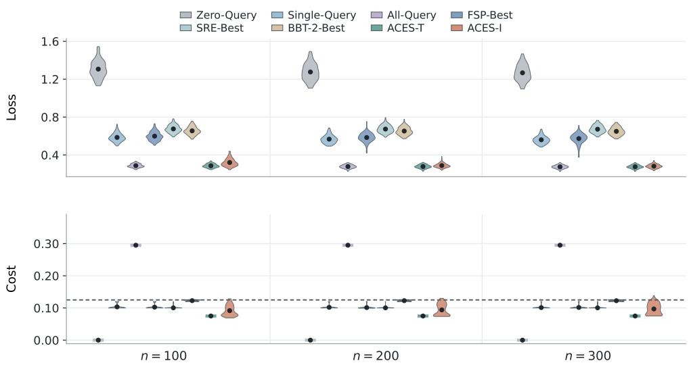
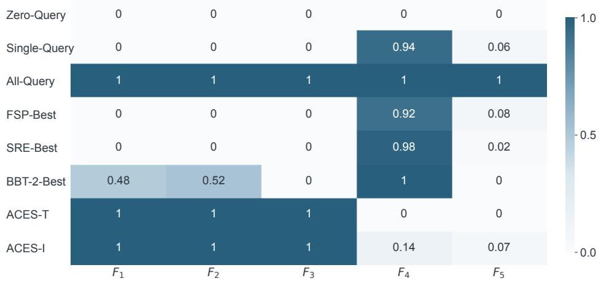
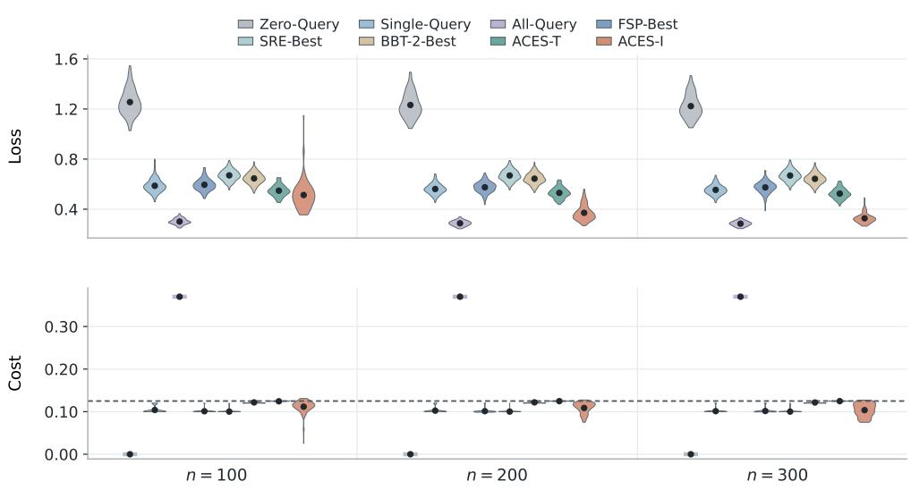
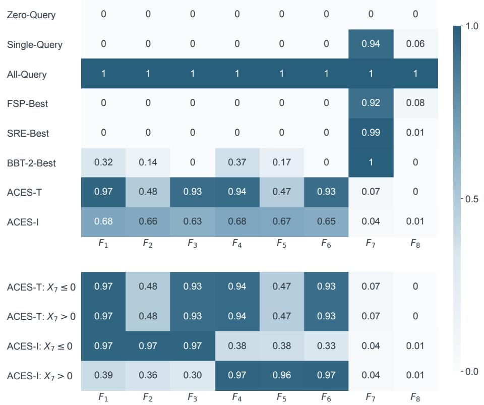
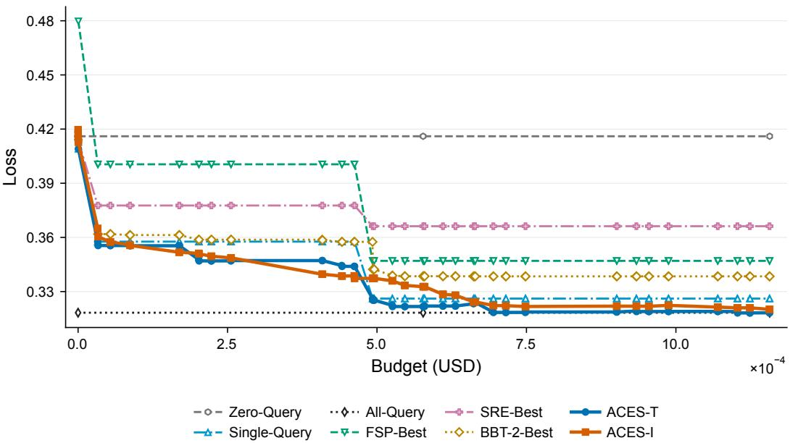
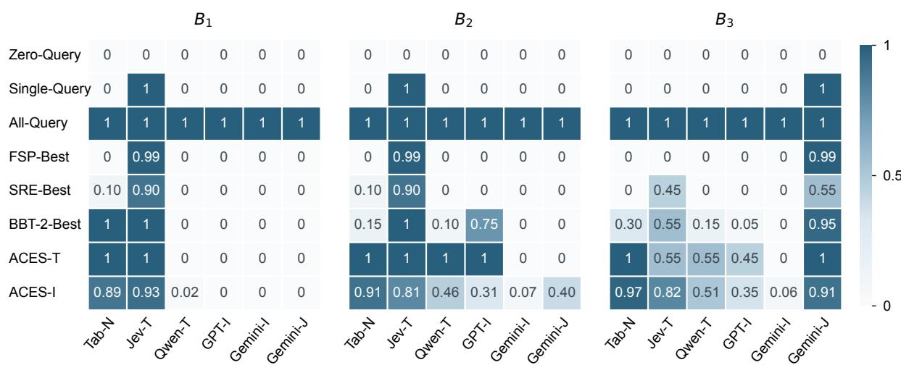

# Prediction with Foundation Models under Deployment Budgets

Zhaohui Xu1, Xiaofei Xu2, and Doudou Zhou1∗

1 Department of Statistics and Data Science, National University of Singapore 2 School of Mathematics and Statistics, Wuhan University

## Abstract

Foundation models can supply predictions for a downstream task that draw on knowledge from extensive pretraining, but they difer in task-specific accuracy and query cost. We develop a framework that improves prediction for the task under a budget on the average query cost per input, using training data to learn which models to query and how to combine their outputs with features available without querying. The first method queries the same models for every input; the second lets them vary across inputs and uses Q-learning to decide which model to query next and when to stop. For the first method, we show that several individually inaccurate outputs can jointly outperform the best single one. It attains the minimax rate when the regression function depends on the outputs only through models within the budget. Otherwise, any method within the budget can be forced to a slower rate, which the first method attains. For the second method, we show when varying the queried models across inputs strictly improves on querying the same models for every input, and bound its prediction risk and average cost in finite samples. In simulations and a multimodal laptop price application, both methods outperform existing methods.

Keywords: Black-box prediction; Cost-sensitive learning; Minimax rate; Model selection; Q-learning

## 1 Introduction

Foundation models have changed the way prediction models are built. Instead of fitting a model to the task’s own data from scratch, one can now query these models for predictions that reflect knowledge acquired during extensive pretraining (Guo et al., 2025; Hollmann et al., 2025). However, using these predictions alone is not enough, because the models were not trained for the task and the task’s data contain information that the models never see. It is more sensible to use these data to adjust the output of a foundation model and combine it with the features of the task. Moreover, several models usually carry more information than one, since the inputs often contain several modalities, diferent models read diferent parts of them, and models trained on diferent data make diferent errors. Their outputs can therefore complement one another, but they can also overlap with one another or with the features. Whether a model is worth using thus depends not on how accurate it is on its own but on how much information it adds beyond the other models and the features. How to combine the outputs of several foundation models with the features is a new statistical problem.

Each additional model, however, comes at a cost. Commercial models charge for every query and locally run models consume computing time, so the cost grows with the number of inputs to be predicted. The laptop listings analyzed in Section 6, for example, each come with numerical specifications, a text description and a product image. A tabular foundation model can use the specifications, language models the description and vision-language models the image, but their prices per query difer by nearly three orders of magnitude. With a budget, the problem of combining outputs gains another layer, because one must first decide which of these models to query. Whether a model is worth its price depends in turn on which other models are queried and how their outputs are combined, so the two decisions have to be learned together from listings with known prices while keeping the average cost within the budget. Problems of this kind have emerged with foundation models and arise wherever such models are used to build predictors, from pricing products (Vedula et al., 2025; Wang et al., 2026) to predicting clinical outcomes (Guo et al., 2024). We formulate them as a statistical learning problem and develop methods and theory for it.

Several recent works use the task’s own data to improve on the predictions of pretrained models. Li and Zhang (2026) and Zhou (2026) correct the predictions of a single model with these data, and Kwon and Ham (2026) correct several models separately and average them with a convex weight. These methods, however, address only a simplified version of our problem, and they difer from it in three respects. First, they treat the predictions as free and therefore never need to decide which models to query. Second, they either use a single model or treat several models separately before averaging, so they do not fit the outputs jointly with the features of the task and cannot fully exploit how the models complement one another. Finally, they query the same models for every input, although the most useful models may difer across inputs. A listing with complete specifications, for instance, may be priced accurately by a tabular model alone, whereas a listing with incomplete specifications may also need the language and vision-language models.

We propose a framework that takes all three into account. It treats a procedure as a pair consisting of a query rule, which decides which models to query and may choose diferent models for diferent inputs, and a prediction rule, which combines the acquired outputs with the features of the task. Among the procedures whose average query cost does not exceed a budget B, we seek the one with the smallest prediction risk, so that the choice of models and the way their outputs are combined are learned together.

We develop two methods, ACES-T and ACES-I, named for Afordable Combination of External Signals at the Task level and at the Input level. Both learn from the task’s own data how much weight to give each acquired output, jointly with the features, so that a scale bias in an output and the redundancy or complementarity among outputs are taken into account. They difer in the query rule. ACES-T queries the same collection of models for every input, which keeps the cost of every input within the budget. The number of afordable collections, that is, sets of models whose total cost is within the budget, grows rapidly with the number of models, so ACES-T minimizes the empirical risk over them by a branch-and-bound search that avoids fitting every collection. ACES-I instead lets the queried models vary across inputs, so that it can spend more on the inputs that need more models. The value of querying a model then depends on which models can still be queried afterwards, and ACES-I therefore learns when to stop and which model to query next by backward Q-learning.

Our theory explains why several outputs help, what the budget costs, and what is gained by letting the queried models vary across inputs. First, the risk of ACES-T depends on the approximation error of the afordable collection as a whole rather than on the accuracy of each output. Several outputs that are inaccurate on their own can therefore jointly outperform the best single model. Second, ACES-T attains the minimax rate when the regression function depends on the outputs only through an afordable collection. The budget then costs nothing in rate. Otherwise, the regret of any procedure relative to the best afordable collection can, in the worst case, decay no faster than at the square-root rate, and ACES-T attains this rate. A faster rate would require mixing the predictions of several collections, which the budget does not allow. Third, when diferent inputs prefer diferent collections, letting the queried models vary across inputs strictly improves on every afordable fixed collection, and the gain cannot be obtained by randomizing over fixed collections. ACES-I achieves this improvement once the sample is large enough.

In simulations and in a laptop price application with six foundation models, both methods outperform existing methods that combine the predictions of pretrained models with the task’s own data. When one collection suits all inputs, ACES-T nearly matches the accuracy of querying every model at a much lower cost and ACES-I adds little, whereas when the most useful models vary across inputs, ACES-I improves on ACES-T.

## 1.1 Related work

Routing and cascading. Routing and cascading for large language models also trade of response quality against query cost. A router selects one model for each input before any response is generated (Ding et al., 2024; Ong et al., 2025; Somerstep et al., 2025), whereas a cascade queries models of increasing size and stops once the current response is judged reliable (Chen et al., 2024; Jitkrittum et al., 2023; Aggarwal et al., 2024). In both cases the final prediction is the response of one of the models. In our setting, the outputs of the foundation models instead enter a predictor that is fitted to the task’s own data together with the features.

Aggregation and ensembles. Statistical aggregation combines given predictors so as to perform nearly as well as the best one or the best combination of them, with optimal rates (Tsybakov, 2003; Lecu´e and Rigollet, 2014). These results presume that every candidate is available at no cost, and the rate-optimal procedures use all of them. Ensembles of large language models make the same assumption (Jiang et al., 2023), as do statistical methods that use black-box predictions together with labeled data for estimation and inference (Angelopoulos et al., 2023; Shan et al., 2025). Among methods that account for cost, the closest to ours is FrugalFoE (Wang et al., 2024). It queries experts trained on diferent domains one at a time and fuses their outputs, aiming to match the accuracy of fusing all experts at a lower cost rather than to improve prediction for a task by combining the outputs with its own features. Other cost-aware ensembles select language models under a budget and combine the selected outputs by a fixed rule such as voting (Dai et al., 2024; Huang et al., 2025). How the prediction risk depends on the sample size and on the budget when the combination itself is learned from the task’s own data remains open.

Cost-sensitive feature acquisition. The sequential queries of ACES-I resemble costsensitive feature acquisition and prediction under test-time budgets, in which a policy decides for each subject which feature to measure next and when to stop (Trapeznikov and Saligrama, $2 0 1 3 ;$ Ma et al., 2019; Covert et al., 2023; Zhou et al., 2026). In this line of work, however, the acquired quantities are measurements of the subject. In our problem they are predictions of the outcome produced by models trained on other data, which may be biased for the task or redundant with one another, so one must decide which predictions to buy and how to correct and combine them with the features.

## 2 Problem formulation

Let $n \geq 1$ and $K \geq 1$ denote the numbers of observations from the task and of external foundation models, respectively, and write $[ k ] = \{ 1 , \dots , k \}$ for any positive integer k. We observe $O _ { i } = ( { \bf x } _ { i } , y _ { i } ) , i \in [ n ]$ , drawn independently from an unknown distribution $P \operatorname { o f } \left( \mathbf { X } , Y \right)$ where $\mathbf { x } _ { i } \in \mathcal { X }$ is the input, possibly with several modalities, and $y _ { i } \in \mathbb { R }$ is the outcome. Querying model $j \in [ K ]$ at x returns the prediction $F _ { j } ( \mathbf { x } ) \in \mathbb { R }$ , which may depend on only part of the input (Remark 1). We write $\mathbf { F } ( \mathbf { x } ) = ( F _ { 1 } ( \mathbf { x } ) , \ldots , F _ { K } ( \mathbf { x } ) ) ^ { \top } , F _ { i j } = F _ { j } ( \mathbf { x } _ { i } )$ and $\mathbf { F } _ { i } = ( F _ { i 1 } , \ldots , F _ { i K } ) ^ { \top }$ . A prespecified measurable feature map $ { \mathbf { b } } _ { q } : \mathcal { X } \to \mathbb { R } ^ { q }$ , whose components include an intercept, computes features from the input without querying any external model (Remark 2).

Querying model j costs a known amount $c _ { j } > 0$ . A collection is a set $A \subseteq [ K ]$ of models queried for the same input. We write $\mathbf { F } _ { A } ( \mathbf { x } )$ for the subvector of $\mathbf { F } ( \mathbf { x } )$ indexed by A, with $\mathbf { F } _ { i , A } = \mathbf { F } _ { A } ( \mathbf { x } _ { i } )$ , and define the query cost of A as $\begin{array} { r } { C ( A ) = \sum _ { j \in A } c _ { j } } \end{array}$ , so that $C ( [ K ] )$ is the cost of querying all K models. The budget $B \geq 0$ bounds the average query cost per input at deployment. Ties in every minimization below are broken by a prespecified deterministic rule that favors the lower query cost.

A deployable procedure is a pair $g = ( \pi , m )$ . The query rule $\pi = \{ d _ { A } : A \subseteq [ K ] \}$ acquires outputs one at a time. Starting from $A = \emptyset$ , it either stops or queries an unqueried model, using only the information acquired so far:

$$
d _ { A } \{ \mathbf { b } _ { q } ( \mathbf { x } ) , \mathbf { F } _ { A } ( \mathbf { x } ) \} \in \{ \mathrm { s t o p } \} \cup ( [ K ] \setminus A ) , \qquad d _ { [ K ] } = \mathrm { s t o p } .
$$

Querying $j$ enlarges the collection to $A \cup \{ j \}$ , and $Q _ { \pi } ( \mathbf { x } ) \subseteq [ K ]$ denotes the collection at which π stops. The prediction rule $m = \{ m _ { A } : A \subseteq [ K ] \}$ forms the final prediction from ${ \bf b } _ { q } ( { \bf x } )$ and $\mathbf { F } _ { A } ( \mathbf { x } )$ when π stops at A. The procedure returns

$$
g ( { \bf x } ) = m _ { Q _ { \pi } ( { \bf x } ) } \left\{ { \bf b } _ { q } ( { \bf x } ) , { \bf F } _ { Q _ { \pi } ( { \bf x } ) } ( { \bf x } ) \right\} \quad \mathrm { a t ~ t h e ~ c o s t } \quad C _ { g } ( { \bf x } ) = \sum _ { j \in Q _ { \pi } ( { \bf x } ) } c _ { j } .
$$

Let $\mathcal { G }$ be a class of deployable procedures. For a prespecified loss $\ell ,$ the population prediction risk and average query cost of $g \in { \mathcal { G } }$ are

$$
R _ { P } ^ { \ell } ( g ) = \mathbb { E } _ { P } \{ \ell ( Y , g ( \mathbf { X } ) ) \} , \qquad C _ { P } ( g ) = \mathbb { E } _ { P } \{ C _ { g } ( \mathbf { X } ) \} ,
$$

and the population target is

$$
\operatorname* { i n f } _ { g \in \mathcal { G } : C _ { P } ( g ) \leq B } R _ { P } ^ { \ell } ( g ) .\tag{1}
$$

We assume that $\mathcal { G }$ contains the Zero-Query procedure, which stops at $A = \emptyset$ and queries no model. Its cost is zero, so the constraint in (1) can always be met. Future observations follow the same distribution P as the training data, so $R _ { P } ^ { \ell }$ and $C _ { P }$ describe accuracy and spending at deployment. The budget constrains the average cost over inputs, so the cost for an individual input may exceed B, as with services that bill by total usage.

For the n observations, we query all K models, which yields the training sample $\mathcal { D } _ { n } =$ $\left\{ \left( \mathbf { x } _ { i } , y _ { i } , \mathbf { F } _ { i } \right) : i \in [ n ] \right\}$ . Because each row of $\mathcal { D } _ { n }$ contains all external outputs, any candidate procedure $g = ( \pi , m )$ can be replayed on the training sample by revealing to π only the outputs that it queries. Its empirical prediction loss and average query cost are

$$
\widehat { R } _ { n } ^ { \ell } ( g ) = \frac { 1 } { n } \sum _ { i = 1 } ^ { n } \ell \{ y _ { i } , g ( { \bf x } _ { i } ) \} , \qquad \widehat { C } _ { n } ( g ) = \frac { 1 } { n } \sum _ { i = 1 } ^ { n } C _ { g } ( { \bf x } _ { i } ) = \frac { 1 } { n } \sum _ { i = 1 } ^ { n } \sum _ { j \in Q _ { \pi } ( { \bf x } _ { i } ) } c _ { j } .\tag{2}
$$

Replacing the population risk and cost in (1) by their empirical counterparts in (2) gives the sample analogue

$$
\operatorname* { i n f } _ { g \in \mathcal { G } : \widehat { C } _ { n } ( g ) \leq B } \widehat { R } _ { n } ^ { \ell } ( g ) .
$$

Solving this problem over an unrestricted class $\mathcal { G }$ is impractical. The number of query rules grows rapidly with K, and a rule chosen to satisfy the empirical constraint on the sample used to fit it need not satisfy the budget at deployment. Section 3 therefore develops two methods. ACES-T queries the same collection for every input, which reduces the search to a choice among collections. ACES-I lets the collection vary across inputs and checks the cost of its learned rule on a separate validation sample rather than on the sample used to fit it.

Remark 1. Each index j refers to a model used with a fixed prompt, a fixed part of the input and a fixed rule for converting its response into a number, so two indices may refer to diferent models or to the same model with diferent prompts. A vision-language model, for example, may receive only the image contained in the input, in which case $F _ { j }$ depends on x only through that image. These choices are fixed before the outcomes in the training sample are examined, and each $F _ { j }$ is treated as a deterministic measurable function of x, so the relation between each output and the outcome is a property of P that can be learned from the training sample. Unlike in the single-model formulations of Li and Zhang (2026) and Zhou (2026), the input of each model need not coincide with ${ \bf b } _ { q } ( { \bf x } )$

Remark 2. The feature map can be chosen to suit the data, and any map computed without querying the models fits the framework. In the application of Section 6, for example, each laptop is described by its numerical specifications, a title and description, and a product image. Since text and images cannot enter a regression directly, ${ \mathbf { b } } _ { q }$ there consists of spline bases of the numerical attributes, leading TF-IDF components of the text and color moments of the image.

## 3 Method

## 3.1 ACES-T

We first present ACES-T, which queries the same collection of models for every input and chooses it among the afordable collections by the empirical risk of the fitted prediction rules. Because it learns no sequential query rule, it is simple to fit and to deploy, and it attains the minimax rate when the regression function depends on the outputs only through an afordable collection (Theorem 2). Its cost is moreover the same for every input, so no input exceeds the budget, although the formulation in Section 2 constrains only the average cost.

## 3.1.1 Prediction rules and the selection criterion

For $A \subseteq [ K ]$ , define the prediction class

$$
\begin{array} { r } { \mathcal { H } _ { A } = \left\{ \mathbf { x } \mapsto \mathbf { b } _ { q } ( \mathbf { x } ) ^ { \top } \boldsymbol { \gamma } + \mathbf { F } _ { A } ( \mathbf { x } ) ^ { \top } \pmb { \theta } _ { A } : ( { \boldsymbol { \gamma } } ^ { \top } , { \pmb { \theta } } _ { A } ^ { \top } ) ^ { \top } \in \Theta _ { A } \right\} , } \end{array}
$$

where $\gamma \in \mathbb { R } ^ { q }$ and $\pmb \theta _ { A } \in \mathbb { R } ^ { | A | }$ are the coeficient vectors of the features and the external outputs, respectively. The domains $\Theta _ { A } \subset \mathbb { R } ^ { q + | A | }$ are compact, convex and contain zero. They are nested in the sense that padding $\pmb { \theta } _ { A }$ with zeros maps $\Theta _ { A }$ into $\Theta _ { A ^ { \prime } }$ whenever $A \subseteq A ^ { \prime } .$ so that $\mathcal { H } _ { A } \subseteq \mathcal { H } _ { A ^ { \prime } }$

For a nonempty set $I \subseteq [ n ]$ of training indices, the prediction rule for A is fitted by minimizing the empirical risk over $\Theta _ { A }$

$$
( \widehat { \gamma } _ { A , I } , \widehat { \theta } _ { A , I } ) \in \operatorname * { a r g m i n } _ { ( \gamma ^ { \top } , \theta _ { A } ^ { \top } ) ^ { \top } \in \Theta _ { A } } \frac { 1 } { | I | } \sum _ { i \in I } \ell \big \{ y _ { i } , \mathbf { b } _ { q } ( \mathbf { x } _ { i } ) ^ { \top } \gamma + \mathbf { F } _ { i , A } ^ { \top } \pmb \theta _ { A } \big \} ,\tag{3}
$$

which gives the fitted rule $\widehat { m } _ { A , I } \{ { \bf b } _ { q } ( { \bf x } ) , { \bf F } _ { A } ( { \bf x } ) \} = { \bf b } _ { q } ( { \bf x } ) ^ { \top } \widehat { \boldsymbol { \gamma } } _ { A , I } + { \bf F } _ { A } ( { \bf x } ) ^ { \top } \widehat { \pmb { \theta } } _ { A , I }$ . We write $\widehat { m } _ { A } = \widehat { m } _ { A , [ n ] }$ for the fit on the full training sample and $\widehat { R } _ { n } ( A )$ for its attained minimum.

The afordable collections form $\mathcal A _ { B } = \{ A \subseteq [ K ] : C ( A ) \leq B \}$ . Let $K _ { B } = \operatorname* { m a x } _ { A \in \mathcal { A } _ { B } } \left| A \right|$ be the size of the largest afordable collection and $N _ { B } = | { \mathcal { A } } _ { B } |$ the number of afordable collections. ACES-T selects

$$
{ \widehat { A } } _ { B } \in \mathop { \mathrm { a r g } } \operatorname* { m i n } _ { A \in { \mathcal { A } } _ { B } } { \widehat { R } } _ { n } ( A ) .\tag{4}
$$

The resulting procedure $\widehat { g } _ { \mathrm { t a s k } }$ queries $\widehat { A } _ { B }$ for every input and predicts by $\widehat { m } _ { \widehat { A } _ { B } }$ , that is, $Q _ { \widehat { \pi } _ { \mathrm { t a s k } } } ( \mathbf { x } ) = \widehat { A } _ { B }$ and $\widehat { g } _ { \mathrm { t a s k } } ( \mathbf { x } ) = \widehat { m } _ { \widehat { A } _ { B } } \{ \mathbf { b } _ { q } ( \mathbf { x } ) , \mathbf { F } _ { \widehat { A } _ { B } } ( \mathbf { x } ) \}$ . Restricting the minimization in (4) to $A = \emptyset$ or to collections with $| A | \le 1$ gives the Zero-Query and Single-Query procedures $\widehat { g } _ { \mathrm { z e r o } }$ and $\widehat { g } _ { \mathrm { s i n g l e } }$ , which serve as benchmarks in Section 4.2.

The class is linear in the coeficients for three reasons. A coeficient on each output corrects its scale bias, while the features absorb any part of its bias that they can represent. Fitting the outputs of a collection jointly with the features also accounts for their redundancy and complementarity. Finally, each fit involves only $q + | A |$ coeficients, which keeps it stable with a moderate number of labeled observations, and the nesting of the classes allows the search in Section 3.1.2 to avoid fitting every collection.

Remark 3. Linearity in the coeficients does not make the prediction linear in the input or in the outputs. With a feature map whose dimension grows with n, the term ${ \mathbf b } _ { q } ( { \mathbf x } ) ^ { \top } \gamma$ can approximate a smooth function of the input (Theorem 2), and replacing $\mathbf { F } _ { A } ( \mathbf { x } )$ by a basis expansion of the outputs, such as splines of each output or products of outputs with features, keeps the class linear in its coeficients and nested in A. ACES-T and its risk bounds then extend directly, with $| A |$ replaced by the number of basis functions used for the collection.

## 3.1.2 Branch-and-bound search

Solving (4) directly requires fitting all $N _ { B }$ afordable collections, and $N _ { B }$ grows quickly with K, reaching $2 ^ { K }$ when the budget covers every model. We instead solve it exactly by a branch-and-bound search (Morrison et al., 2016). It follows the leaps-and-bounds idea of Furnival and Wilson (1974) for best-subset regression, which uses the fit of a larger model to bound the fits of all its submodels, and adds the budget as a constraint. The search keeps the best collection found so far, called the incumbent, and partitions the remaining candidates into nodes. A node is pruned only if it contains no afordable collection or if a lower bound shows that none of its collections can improve on the incumbent.

In ACES-T, a search node is a pair $( A , D )$ of disjoint subsets of $[ K ]$ . The models in A are included, those in D are undecided and the rest are excluded, so the node represents the afordable collections

$$
\begin{array} { r } { A ( A , D ) = \{ A ^ { \prime } : A \subseteq A ^ { \prime } \subseteq A \cup D , \ C ( A ^ { \prime } ) \leq B \} . } \end{array}
$$

The root $( \varnothing , [ K ] )$ represents all of $\mathcal { A } _ { B }$ . To branch, the search takes an undecided model $j \in D$ , for instance the one with the smallest index, and splits the node into the children $( A \cup \{ j \} , D \setminus \{ j \} )$ ), in which $j$ is included, and $( A , D \setminus \{ j \} )$ , in which $j$ is excluded. Since every collection in $A ( A , D )$ either contains $j$ or does not, each of them belongs to exactly one child.

To decide whether a node can be pruned, the search needs a lower bound on the empirical risks of its collections. Since $\mathcal { H } _ { A ^ { \prime } } \subseteq \mathcal { H } _ { A \cup D }$ for every $A ^ { \prime } \in \mathcal { A } ( A , D )$ , fitting the largest collection $A \cup D ,$ , which need not be afordable, gives ${ \widehat { R } } _ { n } ( A \cup D ) \leq { \widehat { R } } _ { n } ( A ^ { \prime } )$ for every $A ^ { \prime } \in \mathcal { A } ( A , D )$ Let $U _ { \mathrm { i n c } }$ denote the empirical risk of the incumbent. The incumbent is initially the empty collection, which costs nothing and is therefore afordable, so that $U _ { \mathrm { i n c } }$ starts at $\widehat { R } _ { n } ( \varnothing )$ . A node $( A , D )$ is pruned if $C ( A ) > B$ or $\widehat { R } _ { n } ( A \cup D ) > U _ { \mathrm { i n c } }$ . For every remaining node, A itself is afordable, and ACES-T evaluates $\widehat { R } _ { n } ( A )$ and makes A the incumbent if it is preferred to the incumbent in (4). If undecided models remain, it branches as above and applies the same pruning tests to the children. Nodes are processed in nondecreasing order of $\widehat { R } _ { n } ( A \cup D )$ . The choice of $j$ and the order in which nodes are processed afect only the computing time, not the selected collection. Whenever each fit is computed exactly, for instance when ℓ is convex in its prediction argument, the search returns the minimizer in (4), as shown in Supplementary D, which also illustrates it with an example of $K = 4$ models.

## 3.2 ACES-I

We next present ACES-I, which uses the same prediction classes but lets the queried models vary across inputs. Given the outputs acquired so far, it decides for each input whether to stop or to query another model, so that it can spend more on the inputs that benefit from additional outputs while keeping the average cost within the budget.

## 3.2.1 Cost-penalized Bellman recursion

ACES-I queries the models one after another until it decides to stop. After the models in $A \subseteq [ K ]$ have been queried, the available information is the state $\mathbf { Z } _ { A } ( \mathbf { x } ) = \{ \mathbf { b } _ { q } ( \mathbf { x } ) ^ { \top } , \mathbf { F } _ { A } ( \mathbf { x } ) ^ { \top } \} ^ { \top }$ 2 and we write $\mathbf { Z } _ { A } = \mathbf { Z } _ { A } ( \mathbf { X } )$ , so that a prediction rule for A is a function of the state. If the queries stop at $A ,$ ACES-I predicts by $\begin{array} { r } { m _ { A } \in \arg \operatorname* { m i n } _ { h \in \mathcal { H } _ { A } } \mathbb { E } _ { P } \{ \ell ( Y , h ( \mathbf { X } ) ) \} } \end{array}$ . The prediction rules are therefore independent of the query rule, and since every output is observed in the training sample, each of them can be estimated once from all observations. With $m = \{ m _ { A } : A \subseteq [ K ] \}$ fixed, ACES-I chooses the query rule to minimize the risk in (1) subject to the budget, and Section 4.3 compares it with the best query rule that uses these prediction rules.

ACES-I replaces the budget constraint by the Lagrangian $R _ { P } ^ { \ell } ( g ) + \eta C _ { P } ( g )$ with a multiplier $\eta \geq 0$ . If the minimizer has average cost $B$ at some $\eta _ { B }$ , it also solves the constrained problem, and Section 3.2.3 chooses the multiplier from data because $\eta _ { B }$ is unknown. For a given $\eta ,$ the optimal query rule is characterized by a backward recursion over the states. Let ${ \cal S } _ { \cal A } ^ { \eta } = \ell \{ Y , m _ { \cal A } ( { \bf Z } _ { \cal A } ) \} + \eta C ( { \cal A } )$ be the stopping loss at A, and let $q _ { \eta } ( A , \mathbf { Z } _ { A } ) = \mathbb { E } ( S _ { A } ^ { \eta } \mid \mathbf { Z } _ { A } )$ be the stopping value. The value function $v _ { A } ^ { \eta } ( \mathbf { Z } _ { A } )$ is the smallest conditional expected stopping loss that can be attained from state A. It equals the stopping value at $A = [ K ]$ , and for $A \subsetneq [ K ]$ it satisfies

$$
\begin{array} { r l } & { \quad v _ { A } ^ { \eta } ( \mathbf { Z } _ { A } ) = \operatorname* { m i n } \left\{ q _ { \eta } ( A , \mathbf { Z } _ { A } ) , \underset { j \notin A } { \operatorname* { m i n } } \mathbb { E } [ v _ { A \cup \{ j \} } ^ { \eta } ( \mathbf { Z } _ { A \cup \{ j \} } ) \mid \mathbf { Z } _ { A } ] \right\} , } \\ & { \quad \Delta _ { A , j } ^ { \eta , * } ( \mathbf { Z } _ { A } ) = \mathbb { E } [ v _ { A \cup \{ j \} } ^ { \eta } ( \mathbf { Z } _ { A \cup \{ j \} } ) \mid \mathbf { Z } _ { A } ] - q _ { \eta } ( A , \mathbf { Z } _ { A } ) , \quad j \notin A . } \end{array}\tag{5}
$$

The continuation contrast $\Delta _ { A , j } ^ { \eta , * }$ is the diference between the continuation value $\mathbb { E } [ v _ { A \cup \{ j \} } ^ { \eta } ( \mathbf { Z } _ { A \cup \{ j \} } ) ~ \vert ~ \mathbf { Z } _ { A } ]$ and the stopping value at A. The optimal query rule $\pi _ { \eta }$ stops at A if no contrast is negative and otherwise queries a model with the smallest contrast.

The contrasts involve the unknown value functions, but they can be written as regressions of pseudo-outcomes on the states. Set $U _ { [ K ] } ^ { \eta , * } = S _ { [ K ] } ^ { \eta }$ and, for $A \subsetneq [ K ]$ in decreasing order of $| A |$ , define the pseudo-outcome $T _ { A , j } ^ { \eta , * } = U _ { A \cup \{ j \} } ^ { \eta , * } - S _ { A } ^ { \eta }$ and the realized value $U _ { A } ^ { \eta , * }$ by

$$
\Delta _ { A , j } ^ { \eta , * } ( \mathbf { Z } _ { A } ) = \mathbb { E } ( T _ { A , j } ^ { \eta , * } \mid \mathbf { Z } _ { A } ) , \quad U _ { A } ^ { \eta , * } = S _ { A } ^ { \eta } + \operatorname* { m i n } \{ 0 , \operatorname* { m i n } _ { j \notin A } \Delta _ { A , j } ^ { \eta , * } ( \mathbf { Z } _ { A } ) \} .\tag{6}
$$

By the tower property and backward induction, $\mathbb { E } ( U _ { A } ^ { \eta , * } \mid \mathbf { Z } _ { A } ) = v _ { A } ^ { \eta } ( \mathbf { Z } _ { A } )$ , so the contrasts defined in (6) coincide with those in (5) as shown in Supplementary C.1.

## 3.2.2 Cross-fitted backward Q-learning

Following (6), ACES-I estimates the contrasts in decreasing order of $| A |$ by regressing the pseudo-outcomes on the states, as in backward Q-learning for dynamic treatment regimes (Murphy, 2005). However, the pseudo-outcomes are not observed. ACES-I computes them from the fitted prediction rules and from the contrasts fitted at larger states, and if these fits used the same observations, the pseudo-outcomes would inherit their overfitting. ACES-I therefore uses cross-fitting (Chernozhukov et al., 2018), with folds $I _ { 1 } , \ldots , I _ { V }$ that partition the training indices independently of the data and complements $I _ { - v } = [ n ] \setminus I _ { v }$ . Since $\eta _ { B }$ is unknown, the contrasts are fitted for every η in a prespecified grid $\mathcal { E } \subset [ 0 , \infty )$ of $M = | \mathcal { E } |$ values. The following four steps produce one candidate procedure $\widehat { g } _ { \eta }$ for each $\eta \in \mathcal E$

Step 1: Fit the prediction rules. For each collection $A ,$ we fit $\widehat { m } _ { A , I _ { - \imath } }$ by (3) for every fold $v ,$ together with the full-sample rule $\widehat { \ b { m } } _ { A }$ , which is shared across all $\eta \in \mathcal E$ . If $B = 0$ ACES-I returns the Zero-Query procedure based on $\widehat { \ b { m } } _ { \emptyset }$ and skips the remaining steps.

Step 2: Fit temporary contrasts. For each $\eta \in \mathcal E$ and fold v, we start from

$$
\widehat { S } _ { i , A } ^ { \eta , ( - v ) } = \ell \{ y _ { i } , \widehat { m } _ { A , I _ { - v } } ( \mathbf { Z } _ { A } ( \mathbf { x } _ { i } ) ) \} + \eta C ( A ) , \qquad \widehat { U } _ { i , [ K ] } ^ { \eta , ( - v ) } = \widehat { S } _ { i , [ K ] } ^ { \eta , ( - v ) } , \qquad i \in I _ { - v } .
$$

We then proceed through $| A | = K - 1 , \dotsc , 0$ . For each $j \not \in A$ , we form the pseudo-outcomes $\widehat { T } _ { i , A , j } ^ { \eta , ( - v ) } = \widehat { U } _ { i , A \cup \{ j \} } ^ { \eta , ( - v ) } - \widehat { S } _ { i , A } ^ { \eta , ( - v ) }$ and fit the temporary contrast over a prespecified class $\mathcal { Q } _ { A , j }$ by

$$
\widehat { \Delta } _ { A , j } ^ { \eta , ( - v ) } \in \underset { f \in \mathcal { Q } _ { A , j } } { \arg \operatorname* { m i n } } \frac { 1 } { | I _ { - v } | } \sum _ { i \in I _ { - v } } \ell _ { \mathrm { c } } \big [ \widehat { T } _ { i , A , j } ^ { \eta , ( - v ) } , f \{ \mathbf { Z } _ { A } ( \mathbf { x } _ { i } ) \} \big ] ,
$$

where $\ell _ { \mathrm { c } }$ is a loss whose population minimizer is the conditional mean, such as the squared error. After all contrasts at A are fitted, we set

$$
\widehat { U } _ { i , A } ^ { \eta , ( - v ) } = \widehat { S } _ { i , A } ^ { \eta , ( - v ) } + \operatorname* { m i n } \Bigl \{ 0 , \operatorname* { m i n } _ { j \notin A } \widehat { \Delta } _ { A , j } ^ { \eta , ( - v ) } ( \mathbf { Z } _ { A } ( \mathbf { x } _ { i } ) ) \Bigr \} .
$$

Step 3: Fit the final contrasts. For each held-out observation $i \in I _ { v }$ , we keep the fits

from Steps 1 and 2 fixed and evaluate the same recursion:

$$
\begin{array} { r l } & { \widehat { S } _ { i , A } ^ { \eta } = \ell \{ y _ { i } , \widehat m _ { A , I - v } ( \mathbf { Z } _ { A } ( \mathbf { x } _ { i } ) ) \} + \eta C ( A ) , \qquad \widehat { U } _ { i , [ K ] } ^ { \eta } = \widehat { S } _ { i , [ K ] } ^ { \eta } , } \\ & { \widehat { U } _ { i , A } ^ { \eta } = \widehat { S } _ { i , A } ^ { \eta } + \operatorname* { m i n } \Bigl \{ 0 , \underset { j \notin A } { \operatorname* { m i n } } \widehat { \Delta } _ { A , j } ^ { \eta , ( - v ) } ( \mathbf { Z } _ { A } ( \mathbf { x } _ { i } ) ) \Bigr \} , \quad \widehat { T } _ { i , A , j } ^ { \eta } = \widehat { U } _ { i , A \cup \{ j \} } ^ { \eta } - \widehat { S } _ { i , A } ^ { \eta } , \qquad j \notin A . } \end{array}
$$

Each pseudo-outcome of observation i thus uses only fits that exclude its fold. Pooling these pseudo-outcomes over the folds, we fit the final contrasts

$$
\widehat { \Delta } _ { A , j } ^ { \eta } \in \underset { f \in \mathcal { Q } _ { A , j } } { \arg \operatorname* { m i n } } \frac { 1 } { n } \sum _ { i = 1 } ^ { n } \ell _ { \mathrm { c } } \big [ \widehat { T } _ { i , A , j } ^ { \eta } , f \{ \mathbf { Z } _ { A } ( \mathbf { x } _ { i } ) \} \big ] , \qquad A \subseteq [ K ] , \ j \notin A .
$$

Step 4: Form the query rule. The fitted query rule $\widehat { \pi } _ { \eta }$ stops at $[ K ]$ , and at each $A \subsetneq [ K ]$ it takes the action

$$
\begin{array} { r } { \widehat { d } _ { A } ^ { \eta } \{ \mathbf { Z } _ { A } ( \mathbf { x } ) \} = \left\{ \begin{array} { l l } { \mathrm { s t o p } , } & { \operatorname* { m i n } _ { j \not \in A } \widehat { \Delta } _ { A , j } ^ { \eta } \{ \mathbf { Z } _ { A } ( \mathbf { x } ) \} \geq 0 , } \\ { \mathrm { a r g } \operatorname* { m i n } _ { j \not \in A } \widehat { \Delta } _ { A , j } ^ { \eta } \{ \mathbf { Z } _ { A } ( \mathbf { x } ) \} , } & { \mathrm { o t h e r w i s e } . } \end{array} \right. } \end{array}
$$

Pairing $\widehat { \pi } _ { \eta }$ with ${ \widehat { m } } = \{ { \widehat { m } } _ { A } : A \subseteq [ K ] \}$ gives the candidate procedure ${ \widehat { g } } _ { \eta } = ( { \widehat { \pi } } _ { \eta } , { \widehat { m } } )$

## 3.2.3 Selection by independent validation

Section 3.2.2 gives a candidate $\widehat { g } _ { \eta }$ for each $\eta \in \mathcal E$ , and repeating Steps 2–4 for several contrast learners gives one candidate for each learner and each η. These candidates and the Zero-Query procedure are indexed by a finite set $\mathcal { I }$ and written $\widehat { g } _ { \nu } , \nu \in \mathcal { I }$ . ACES-I estimates their risks and costs on an independent validation sample of $n _ { \mathrm { v a l } }$ observations from $P _ { \mathrm { : } }$ in which every output is observed:

$$
\widehat { R } _ { \nu } ^ { \mathrm { v a l } } = \frac { 1 } { n _ { \mathrm { v a l } } } \sum _ { i = 1 } ^ { n _ { \mathrm { v a l } } } \ell \{ y _ { i } ^ { \mathrm { v a l } } , \widehat { g } _ { \nu } ( \mathbf { x } _ { i } ^ { \mathrm { v a l } } ) \} , \qquad \widehat { C } _ { \nu } ^ { \mathrm { v a l } } = \frac { 1 } { n _ { \mathrm { v a l } } } \sum _ { i = 1 } ^ { n _ { \mathrm { v a l } } } C _ { \widehat { g } _ { \nu } } ( \mathbf { x } _ { i } ^ { \mathrm { v a l } } ) .
$$

It then selects

$$
\widehat { \nu } _ { B } \in \mathrm { ~ \underset { \nu \in \mathcal { I } : \widehat { C } _ { \nu } ^ { \mathrm { v a l } } \leq B } { \operatorname { a r g m i n } } ~ } \widehat { R } _ { \nu } ^ { \mathrm { v a l } } , \qquad \widehat { g } _ { \mathrm { i n p u t } } = \widehat { g } _ { \widehat { \nu } _ { B } } .
$$

The Zero-Query candidate always meets the budget constraint, so the selection is well defined.

## 4 Theoretical analysis

The results address the three questions raised in Section 1, namely when several outputs help (Section 4.2.1), what the budget costs (Sections 4.2.2–4.2.4), and what is gained by letting the queried models vary across inputs (Section 4.3).

We write $R ( h ) = \mathbb { E } _ { P } \{ \ell ( Y , h ( \mathbf { X } ) ) \}$ for the risk of a prediction function h of the input, so that a procedure that queries a fixed collection and predicts with h has risk $R ( h )$ . For $\mathbf { x } \in \mathcal { X }$ and a prediction value $t \in \mathbb { R } , R _ { \mathbf { x } } ( t ) = \mathbb { E } \{ \ell ( Y , t ) \mid \mathbf { X } = \mathbf { x } \}$ is the conditional risk of predicting t at x. For a function f of the input and $1 \leq r \leq \infty , \| f \|$ r denotes the $L _ { r } ( P _ { \mathbf { X } } )$ norm, and $L _ { 2 } ( P _ { \mathbf { X } } )$ is the space of such functions with $\| f \| _ { 2 } < \infty$

## 4.1 Reference class and loss conditions

Every procedure in Section 3 predicts with functions in the classes $\mathcal { H } _ { A }$ , which add a linear combination of the outputs in A to a linear combination of the q features. To compare procedures that use diferent collections, we measure their risks against the smallest risk over a reference class that contains every $\mathcal { H } _ { A }$

Definition 1 (Reference class). Let ${ \mathcal { R } } _ { \mathrm { l o c } } \subseteq L _ { 2 } ( P _ { \mathbf { X } } )$ be a closed linear space of functions of the input that contains each component of ${ \mathbf { b } } _ { q }$ , and let $F _ { j } \in L _ { 2 } ( P _ { \mathbf { X } } )$ for each $j \in [ K ]$ The reference class is $\mathcal { F } _ { \mathrm { l i n } } = \{ r + \beta ^ { \top } \mathbf { F } : r \in \mathcal { R } _ { \mathrm { l o c } } , \ \beta \in \mathbb { R } ^ { K } \}$ . Assume that R attains its minimum over $\mathcal { F } _ { \mathrm { l i n } }$ , fix a minimizer h together with a representation $h _ { 0 } = r _ { 0 } + \beta _ { 0 } ^ { \top } { \bf F }$ , and write $R _ { 0 } = R ( h _ { 0 } )$

The space $\mathcal { R } _ { \mathrm { l o c } }$ can be as small as the span of the features or as large as $L _ { 2 } ( P _ { \mathbf { X } } )$ . In the first case, $h _ { 0 }$ is the best function that combines the features and all K outputs linearly. In the second case, $h _ { 0 }$ minimizes R over all functions of the input, and under squared loss $h _ { 0 } ( \mathbf { X } ) = \mathbb { E } ( Y \mid \mathbf { X } )$ . Since $\mathcal { H } _ { A } \subseteq \mathcal { F } _ { \operatorname* { l i n } }$ for every A, a procedure that queries a fixed collection has risk at least $R _ { 0 }$ . We impose two conditions on the loss.

Assumption 1. There exist constants $0 < \bar { t } < \infty$ and $0 \leq L _ { \ell } , \sigma _ { \ell } <$ ∞ such that the following conditions hold.

(a) Every function in the prediction classes $\mathcal { H } _ { A }$ takes values in $[ - \bar { t } , \bar { t } ]$ . Moreover, $R ( 0 ) < \infty$ 2 and $\ell ( y , \cdot )$ is continuous on $[ - \bar { t } , \bar { t } ]$ for every outcome y.

(b) Almost surely, $| R _ { \mathbf { X } } ( t ) - R _ { \mathbf { X } } ( t ^ { \prime } ) | \leq L _ { \ell } | t - t ^ { \prime } |$ for all t, $t ^ { \prime } \in [ - \bar { t } , \bar { t } ]$

(c) For all $t , t ^ { \prime } \in [ - \bar { t } , \bar { t } ]$ , the loss diference $\ell ( Y , t ) - \ell ( Y , t ^ { \prime } )$ is conditionally sub-Gaussian given X, with variance proxy $\sigma _ { \ell } ^ { 2 } ( t - t ^ { \prime } ) ^ { 2 }$

Assumption 2. Assume that $| h _ { 0 } ( { \mathbf { X } } ) | \leq \bar { t }$ almost surely and that there exist constants $0 < c _ { \ell } \leq C _ { \ell } <$ ∞ such that $c _ { \ell } \| h - h _ { 0 } \| _ { 2 } ^ { 2 } \leq R ( h ) - R _ { 0 } \leq C _ { \ell } \| h - h _ { 0 } \| _ { 2 } ^ { 2 }$ for every $h \in \textstyle \bigcup _ { A \in { \mathcal { A } } _ { B } } { \mathcal { H } } _ { A }$

Assumption 1 bounds the predictions and the fluctuations of loss diferences, so that empirical risks can be compared uniformly over the prediction classes. Assumption 2 states that the excess risk of a function in a prediction class is comparable to its squared distance from $h _ { 0 } .$ so comparing collections reduces to comparing the distances from $h _ { 0 }$ to their prediction classes. The distance from $h _ { 0 }$ to $\mathcal { H } _ { A }$ is small when the features approximate $r _ { 0 }$ well and the outputs in A carry the signal in $\beta _ { 0 } ^ { \top } \mathbf { F }$ . Similar conditions appear in van de Geer (2008); Farrell et al. (2021), and Supplementary B.1 verifies both assumptions for squared and logistic losses.

## 4.2 Guarantees for ACES-T

## 4.2.1 Comparison with Zero-Query and Single-Query

Several outputs help when ACES-T improves on the procedures that use no output or at most one output. These are the Zero-Query and Single-Query procedures of Section 3.1.1, which minimize (4) over $A = \emptyset$ and over $| A | \le 1$ , respectively. Because they difer from ACES-T only in the collections they may query, the comparison isolates the value of querying a model and the value of combining several outputs. Their prediction classes and that of ACES-T are nested:

$$
\mathcal { H } _ { \mathrm { z e r o } } = \mathcal { H } _ { \mathcal { O } } , \qquad \mathcal { H } _ { \mathrm { s i n g l e } } = \bigcup _ { A \in A _ { B } \atop | A | \leq 1 } \mathcal { H } _ { A } , \qquad \mathcal { H } _ { \mathrm { t a s k } } = \bigcup _ { A \in A _ { B } } \mathcal { H } _ { A } .
$$

For $j \in$ {zero, single, task}, let

$$
e _ { j } = \operatorname* { i n f } _ { h \in \mathcal { H } _ { j } } \| h _ { 0 } - h \| _ { 2 } , \quad \quad V _ { j } = \operatorname* { i n f } _ { h \in \mathcal { H } _ { j } } R ( h )
$$

be the distance from $h _ { 0 }$ to ${ \mathcal { H } } _ { j }$ and the smallest risk over ${ \mathcal { H } } _ { j }$ . The nesting gives $e _ { \mathrm { t a s k } } \ \leq$ $e _ { \mathrm { s i n g l e } } \leq e _ { \mathrm { z e r o } }$ . The error of estimating the coeficients and selecting a collection is controlled by a radius $\epsilon _ { \mathrm { f i t } , n } .$ , given explicitly in Supplementary (B.1), which satisfies

$$
\epsilon _ { \mathrm { f i t } , n } \leq C \frac { ( q + K _ { B } ) \log n + \log ( N _ { B } / \delta ) } { n }
$$

for $n \geq 2$ , where C depends only on the constants in Assumptions 1–2.

Theorem 1 (Prediction risk of ACES-T). Under Assumptions 1–2, the following hold.

(i) For each j ∈ {zero, single, task}, $c _ { \ell } e _ { j } ^ { 2 } \leq V _ { j } - R _ { 0 } \leq C _ { \ell } e _ { j } ^ { 2 }$

(ii) With probability at least $1 - \delta$ , simultaneously for $j \in \{ \mathrm { z e r o } , \mathrm { s i n g l e } , \mathrm { t a s k } \}$ ，

$$
c _ { \ell } e _ { j } ^ { 2 } \leq R _ { P } ^ { \ell } ( \widehat { g } _ { j } ) - R _ { 0 } \leq 3 C _ { \ell } e _ { j } ^ { 2 } + \epsilon _ { \mathrm { f i t } , n } .\tag{7}
$$

On the same event, for $j \in \{$ {zero, single},

$$
R _ { P } ^ { \ell } ( \widehat { g } _ { j } ) - R _ { P } ^ { \ell } ( \widehat { g } _ { \mathrm { t a s k } } ) \geq c _ { \ell } e _ { j } ^ { 2 } - 3 C _ { \ell } e _ { \mathrm { t a s k } } ^ { 2 } - \epsilon _ { \mathrm { f i t } , n } .\tag{8}
$$

(iii) If $c _ { \ell } e _ { \mathrm { s i n g l e } } ^ { 2 } > 3 C _ { \ell } e _ { \mathrm { t a s k } } ^ { 2 } + \epsilon _ { \mathrm { f i t } , n }$ , ACES-T has strictly lower risk than Zero-Query and Single-Query on this event.

Theorem 1(i) shows that the excess risk of each class over $R _ { 0 }$ is of the order of its squared distance $e _ { j } ^ { 2 }$ from $h _ { 0 }$ . Part (ii) shows that fitting adds at most $\epsilon _ { \mathrm { { f i t } } , n }$ , whose order reflects that the fitted rule has at most $q + K _ { B }$ coeficients and is chosen among $N _ { B }$ collections. By part (iii), ACES-T improves on both benchmarks when the best afordable collection approximates $h _ { 0 }$ much better than the features combined with at most one output. This happens when the outputs complement each other, so that together they capture structure that no single output captures. The improvement concerns prediction risk and requires neither coeficient nor support recovery. Because the upper bound in (7) multiplies the approximation error by 3, Theorem 1 does not show that ACES-T nearly attains the risk $V _ { \mathrm { t a s k } }$ of the best afordable class. Section 4.2.4 gives such a bound.

## 4.2.2 Selection of an optimal afordable collection

Since ACES-T chooses its collection by empirical risk, we next ask whether it chooses an optimal afordable collection. For $A \in { \mathcal { A } } _ { B }$ , let $\begin{array} { r } { V ( A ) = \operatorname* { i n f } _ { h \in { \mathcal { H } } _ { A } } R ( h ) } \end{array}$ . The optimal collections form the set ${ \mathcal { A } } _ { B } ^ { \ast } = \{ A \in { \mathcal { A } } _ { B } : V ( A ) = V _ { \operatorname { t a s k } } \}$ , which may contain more than one element, and

$$
\Delta _ { B } = \operatorname* { m i n } _ { A \in \mathcal { A } _ { B } \setminus \mathcal { A } _ { B } ^ { * } } \left\{ V ( A ) - V _ { \mathrm { t a s k } } \right\}
$$

is the smallest excess risk of a suboptimal collection, with $\Delta _ { B } = + \infty$ if every afordable collection is optimal. The selection error is controlled by a radius $\epsilon _ { \mathrm { s e l } , n } ,$ given explicitly in Supplementary (B.2), which satisfies

$$
\epsilon _ { \mathrm { s e l } , n } \leq C \Big \{ \frac { q + K _ { B } + \log ( N _ { B } / \delta ) } { n } \Big \} ^ { 1 / 2 }
$$

whenever $q + K _ { B } + \log ( N _ { B } / \delta ) \leq n$ , where C depends only on the constants in Assumption 1. Proposition 1 (Selection consistency). Suppose Assumption 1 holds. Then, for any $0 < \delta < 1$ ， with probability at least $1 - \delta$

$$
0 \leq V ( \widehat { A } _ { B } ) - V _ { \mathrm { t a s k } } \leq 2 \epsilon _ { \mathrm { s e l } , n } .
$$

Consequently, if $\Delta _ { B } > 2 \epsilon _ { \mathrm { s e l } , n }$ , then $\mathbb { P } ( \widehat { A } _ { B } \in { \mathcal { A } } _ { B } ^ { * } ) \geq 1 - \delta$ . Moreover, for fixed prediction classes, $\mathbb { P } ( \widehat { A } _ { B } \in \mathcal { A } _ { B } ^ { \ast } )  1$ as $n \to \infty$

Since $\mathcal { A } _ { B }$ is finite, $\Delta _ { B } > 0$ , and the condition $\Delta _ { B } > 2 \epsilon _ { \mathrm { s e l } , n }$ holds for all large n when the prediction classes are fixed. The radius depends on the number of afordable collections only through log $N _ { B }$ , so a large number of afordable collections makes selection only mildly harder. The proof in Supplementary B.4 does not use Assumption 2.

## 4.2.3 H¨older rate and minimax optimality

We next suppose that $\mathbb { E } ( Y \mid \mathbf { X } )$ depends on the outputs only through an afordable collection, let the number of features q grow with $n ,$ and take $\mathcal { X } = [ 0 , 1 ] ^ { p }$ . More features reduce the error of approximating $r _ { 0 }$ but add coeficients to estimate, and the rate below balances the two while also accounting for estimating the output coeficients and selecting a collection.

Let $\Sigma ( s , L _ { r } )$ be the H¨older ball on $[ 0 , 1 ] ^ { p }$ with smoothness $s > 0$ and radius $L _ { r } > 0$ , defined in Supplementary (A.7), and write $A ^ { * } = \operatorname* { s u p p } ( \beta _ { 0 } )$ . Throughout this subsection, the loss is squared, $Y = h _ { 0 } ( \mathbf { X } ) + \varepsilon$ , where $\mathbb { E } ( \varepsilon \mid \mathbf { X } ) = 0$ and ε is conditionally sub-Gaussian with variance proxy $0 < \sigma ^ { 2 } < \infty , r _ { 0 } \in \Sigma ( s , L _ { r } )$ , and $A ^ { * } \in { \mathcal { A } } _ { B }$ . The rate uses standard conditions on the features, stated as Assumption B.1 in the Supplementary Material: the features approximate H¨older functions at the usual rate, as tensor-product B-splines on quasi-uniform meshes do (Schumaker, 2007; Huang, 2003), the supremum and $L _ { 2 } ( P _ { \mathbf { X } } )$ norms are comparable on their span (Newey, 1997; Belloni et al., 2015), and the coeficient sets contain the resulting approximation. We take $q \asymp ( n L _ { r } ^ { 2 } / \sigma ^ { 2 } ) ^ { p / ( 2 s + p ) }$ and assume that $n \geq 2$ and

$$
\left( q + K _ { B } \right) \log ( n N _ { B } ) \leq c _ { 0 } n ,\tag{9}
$$

where $c _ { 0 } > 0$ is a suficiently small constant that depends only on the constants $\kappa _ { Z }$ and $\nu _ { \mathrm { e n v } }$ in Assumption B.1.

To show that the rate cannot be improved, we also consider the Gaussian model in which $\mathbf { X } \sim \operatorname { U n i f } ( [ 0 , 1 ] ^ { p } ) , \varepsilon \mid \mathbf { X } \sim N ( 0 , \sigma ^ { 2 } )$ , and $h _ { 0 }$ ranges over the set

$$
{ \mathcal { M } } _ { B } = \left\{ r + \beta ^ { \mathsf { T } } \mathbf { F } : r \in \Sigma ( s , L _ { r } ) , \quad \operatorname { s u p p } ( \beta ) \in { \mathcal { A } } _ { B } , \quad \| \beta \| _ { \infty } \leq \rho \right\}
$$

for a fixed $\rho > 0$ , where $\Sigma ( s , L _ { r } ) \subseteq \mathcal { R } _ { \mathrm { l o c } }$ . In this model, we assume that the outputs do not depend on $h _ { 0 }$ and satisfy $\mathbb { E } \{ \mathbf { F } ( \mathbf { X } ) \mathbf { F } ( \mathbf { X } ) ^ { \top } \} = \mathbf { I } _ { K }$ , that each $\Theta _ { A }$ contains $\{ ( \mathbf { 0 } _ { q } ^ { \top } , \pmb { \theta } _ { A } ^ { \top } ) ^ { \top }$ $\| \pmb { \theta } _ { A } \| _ { \infty } \leq \rho \}$ , and that Assumption B.1 holds for every $h _ { 0 } \in \mathcal { M } _ { B }$ with the same constants. Let $L _ { \mathrm { c o s t } }$ be the number of distinct query costs, and let

$$
\psi _ { n } ^ { \star } = L _ { r } ^ { \frac { 2 p } { 2 s + p } } \sigma ^ { \frac { 4 s } { 2 s + p } } n ^ { - \frac { 2 s } { 2 s + p } } + \sigma ^ { 2 } \frac { K _ { B } + \log N _ { B } } { n } .
$$

Theorem 2 (Rate and minimax optimality). (i) Under Assumption B.1, with $C _ { \mathrm { e n v } }$ as defined there,

$$
\mathbb { E } \{ R _ { P } ^ { \ell } ( \widehat { g } _ { \mathrm { t a s k } } ) - R _ { 0 } \} \le C \big ( \psi _ { n } ^ { \star } + \sigma ^ { 2 } / n \big ) + C _ { \mathrm { e n v } } / n ^ { 2 }\tag{10}
$$

for a constant $C > 0$

(ii) In the Gaussian model above, there exist constants $c = c ( s , p ) > 0 , C > 0$ and $n _ { 0 }$ such

that, for all $n \geq n _ { 0 }$ 2

$$
\frac { C } { L _ { \mathrm { c o s t } } } \psi _ { n } ^ { \star } \le \operatorname* { i n f } _ { \widehat { \boldsymbol { g } } } \operatorname* { s u p } _ { h _ { 0 } \in \mathcal { M } _ { B } } \mathbb { E } _ { h _ { 0 } } \{ R _ { P } ^ { \ell } ( \widehat { \boldsymbol { g } } ) - R _ { 0 } \} \le \operatorname* { s u p } _ { h _ { 0 } \in \mathcal { M } _ { B } } \mathbb { E } _ { h _ { 0 } } \{ R _ { P } ^ { \ell } ( \widehat { g } _ { \mathrm { t a s k } } ) - R _ { 0 } \} \le C \psi _ { n } ^ { \star } ,
$$

where the infimum is over all procedures trained on the n labeled observations, including those that query all K models at deployment.

In part (i), balancing $L _ { r } ^ { 2 } q ^ { - 2 s / p }$ against $\sigma ^ { 2 } q / n$ gives the first term of $\psi _ { n } ^ { \star } .$ the classical rate for estimating a H¨older function of smoothness s in p dimensions (Stone, 1982). The second term of $\psi _ { n } ^ { \star }$ is the cost of estimating $K _ { B }$ output coeficients and selecting among $N _ { B }$ afordable collections. Part (ii) shows that ACES-T attains the minimax rate $\psi _ { n } ^ { \star }$ over $\mathcal { M } _ { B }$ when $L _ { \mathrm { { c o s t } } }$ and the constants in Assumption B.1 are bounded, even against procedures that query all K models. For a single pretrained predictor, Li and Zhang (2026) obtain a minimax rate whose first term has the same form, with the smoothness of the bias of the predictor in place of that of $r _ { 0 } .$ , and whose second term $\sigma ^ { 2 } / n$ is the cost of estimating an ofset. With one afordable output, $K _ { B } + \log N _ { B }$ is bounded, and our second term is also of order $\sigma ^ { 2 } / n$

## 4.2.4 Sharp regret and the price of a binding budget

We now drop the requirement that $\mathbb { E } ( Y \mid \mathbf { X } )$ depend on the outputs only through an afordable collection. No afordable prediction class then needs to contain $\mathbb { E } ( Y \mid \mathbf { X } )$ , and we compare ACES-T with $V _ { \mathrm { t a s k } }$ directly, which separates the error of fitting within a collection from the error of selecting a collection. Throughout this subsection, the loss is squared, $Y = h _ { 0 } ( \mathbf { X } ) + \varepsilon$ with ε conditionally centered and sub-Gaussian with variance proxy $\sigma ^ { 2 } \le \bar { t } ^ { 2 }$ , Assumption 1(a) holds, $\| h _ { 0 } \| _ { \infty } \leq \bar { t } .$ , and all collections range over $\mathcal { A } _ { B }$ . The population prediction rule $m _ { A }$ of Section 3.2.1 is then the $L _ { 2 } ( P _ { \mathbf { X } } )$ projection of $h _ { 0 }$ onto $\mathcal { H } _ { A }$ . We also assume that $\| f \| _ { 4 } \le \kappa _ { 4 } \| f \| _ { 2 }$ for every f in the linear span of $( \mathbf { b } _ { q } , \mathbf { F } )$ and for every residual $h _ { 0 } - m _ { A }$ . Fix $A ^ { \dag } \in { \mathcal { A } } _ { B } ^ { * }$ , write $v _ { A } = \| m _ { A } - m _ { A ^ { \dagger } } \| _ { 2 }$ , and set

$$
\rho _ { B } ^ { 2 } = \operatorname* { m a x } _ { A } { v _ { A } ^ { 2 } } , \qquad \kappa _ { B } = \operatorname* { m a x } _ { A \notin A _ { B } ^ { \ast } } { \frac { v _ { A } ^ { 2 } } { V ( A ) - V _ { \mathrm { t a s k } } } } , \qquad \sigma _ { \mathrm { s e l } } ^ { 2 } = \sigma ^ { 2 } + \kappa _ { 4 } ^ { 4 } \operatorname* { m a x } _ { A } { \| h _ { 0 } - m _ { A } \| _ { 2 } ^ { 2 } } ,
$$

with $\kappa _ { B } = 0$ if every collection is optimal.

The result below also shows that the error of selecting a collection cannot always be made small at the fast rate. It uses the following experiment, in which every output carries signal but an unknown group of $K _ { B }$ outputs has slightly larger coeficients. The input is $\mathbf { X } = ( X _ { \mathrm { l o c } } , U )$ , where $U _ { 1 } , \dots , U _ { K }$ are independent uniform signs, independent of $X _ { \mathrm { l o c } }$ , and $U _ { j }$ is available at deployment only by querying model j. The outputs are $F _ { j } ( \mathbf { X } ) = U _ { j } ,$ , every query costs one, and $B = K _ { B }$ for an integer $1 \le K _ { B } \le K / 3 2$ . The feature map is $b _ { 1 } \equiv 1$ , and $\Theta _ { A } = [ - 2 \tau _ { \mathrm { s i g } } , 2 \tau _ { \mathrm { s i g } } ] ^ { 1 + | A | }$ . For a packing $A _ { 1 } , \ldots , A _ { N _ { \mathrm { p a c k } } }$ as in Lemma A.10, under hypothesis A,

$$
\begin{array} { r l r l r l } { Y = \beta ^ { \top } U + \varepsilon , } & { } & { \beta = \tau _ { \mathrm { s i g } } \mathbf { 1 } + a _ { \mathrm { s i g } } \mathbf { 1 } _ { A } , } & { } & { \varepsilon \sim N ( 0 , \sigma ^ { 2 } ) \mathrm { i n d e p e n d e n t ~ o f ~ \mathbf { X } , } } \end{array}
$$

where $0 ~ < ~ \tau _ { \mathrm { s i g } } ~ \le ~ \sigma / \sqrt { K + 3 K _ { B } }$ and $a _ { \mathrm { s i g } } ~ = ~ \sigma \{ \log N _ { \mathrm { p a c k } } / ( 4 n K _ { B } ) \} ^ { 1 / 2 } ~ \leq ~ \tau _ { \mathrm { s i g } } .$ . An oracle spends its budget on the group A, whereas a learned procedure must identify A from the training sample, even though that sample contains every output. In this experiment, $V _ { \mathrm { t a s k } } = \sigma ^ { 2 } + ( K - K _ { B } ) \tau _ { \mathrm { s i g } } ^ { 2 }$ is also the smallest risk of any procedure whose expected number of queries is at most $K _ { B } , \rho _ { B } ^ { 2 } = K _ { B } \{ ( \tau _ { \mathrm { s i g } } + a _ { \mathrm { s i g } } ) ^ { 2 } + \tau _ { \mathrm { s i g } } ^ { 2 } \}$ , and $\sigma \le \sigma _ { \mathrm { s e l } } \le 2 \sigma$

Theorem 3 (Sharp regret and the price of a binding budget). (i) Under the conditions of this subsection, for $n \geq 2$ , with probability at least $1 - \delta$

$$
R _ { P } ^ { \ell } ( \widehat { g } _ { \mathrm { t a s k } } ) - V _ { \mathrm { t a s k } } \leq C \left[ \operatorname* { m i n } \left\{ \rho _ { B } \sigma _ { \mathrm { s e l } } \sqrt { \frac { \log ( 4 N _ { B } / \delta ) } { n } } , \kappa _ { B } \sigma _ { \mathrm { s e l } } ^ { 2 } \frac { \log \left( 4 N _ { B } / \delta \right) } { n } \right\} + \epsilon _ { \mathrm { f i t } , n } \right]\tag{11}
$$

where C is a positive constant.

(ii) In the experiment above, every procedure whose expected number of queries conditional on its training sample is at most $K _ { B }$ satisfies

$$
\operatorname* { m a x } _ { A \in \{ A _ { 1 } , \dots , A _ { N _ { \mathrm { p a c k } } } \} } \mathbb { E } _ { A } \{ R _ { P } ^ { \ell } ( \widehat { g } ) - V _ { \mathrm { t a s k } } \} \geq c \rho _ { B } \sigma \sqrt { \frac { \log N _ { B } } { n } }\tag{12}
$$

for a universal constant $c > 0$

Part (i) is a sharp oracle inequality: the comparator $V _ { \mathrm { t a s k } }$ has coeficient one. The last term in (11) is the error of fitting within collections, and the minimum is the error of selecting a collection. If an afordable prediction class contains $h _ { 0 }$ , then $v _ { A } ^ { 2 } = V ( A ) - V _ { \mathrm { t a s k } }$ , so $\kappa _ { B } = 1$ whenever a suboptimal collection exists, and the selection error is of order log $N _ { B } / n$ . The same order holds whenever $\kappa _ { B }$ is bounded, even if no afordable class contains $h _ { 0 }$ . The square root branch matters when collections with nearly equal risks give substantially diferent predictions.

Part (ii) shows that the square-root branch in (11) is not an artifact of the analysis: under a binding budget, a procedure must decide which outputs to buy, and this decision can itself be statistically hard. The bound concerns the error of learning how to spend the budget, since its comparator already includes the noise and the signal that the best afordable collection leaves out. The bound allows training samples that contain every output, input-dependent and randomized query rules, and arbitrary predictions from the queried outputs. Model-selection aggregation attains a log $N _ { B } / n$ remainder by combining candidate predictions (Tsybakov, 2003; Lecu´e and Rigollet, 2014), but evaluating such a combination may require the outputs of all candidates, whose total cost can exceed the budget. The lower bound matches the selection term in (11). Matching the full upper bound also requires $\epsilon _ { \mathrm { f i t } , n } \lesssim \rho _ { B } \sigma \sqrt { \log N _ { B } / n }$ . The bound is a worst case over nearly tied problems, and a fixed problem with bounded $\kappa _ { B }$ retains the fast selection rate of part (i).

## 4.3 Guarantees for ACES-I

## 4.3.1 Population gain from input-dependent queries

Recall that $Q _ { \pi } ( \mathbf { x } )$ is the collection at which the query rule $\pi$ stops, and that $C _ { P } ( g )$ is the average query cost. Holding the population prediction rules $m = \{ m _ { A } \}$ of Section 3.2.1 fixed, define

$$
V _ { \mathrm { i n p u t } } ( B ) = \operatorname* { i n f } _ { g = ( \pi , m ) : C _ { P } ( g ) \leq B } R _ { P } ^ { \ell } ( g ) , \qquad \Gamma _ { B } = V _ { \mathrm { t a s k } } - V _ { \mathrm { i n p u t } } ( B ) ,
$$

where the infimum is over measurable deterministic query rules $\pi$ whose decision at each state depends only on $\mathbf { Z } _ { A }$ . Querying an afordable fixed collection is such a rule, so $\Gamma _ { B } \geq 0$ 2 and $\Gamma _ { B }$ is the gain from input-dependent queries. For $\eta \geq 0$ , let $\pi _ { \eta }$ be the population query rule of Section 3.2.1 with multiplier $\eta ,$ and let $c ( \eta ) = \mathbb { E } C \{ Q _ { \pi _ { \eta } } ( \mathbf { X } ) \}$ be its average query cost. By Bellman optimality, $( \pi _ { \eta } , m )$ minimizes $R _ { P } ^ { \ell } ( g ) + \eta C _ { P } ( g )$ over such rules. The cost curve $c ( \eta )$ is nonincreasing in $\eta$ but need not be continuous. To compare the fitted procedure with a population rule that spends exactly the budget, we impose the following condition.

Assumption 3 (Regular average-cost response). There exist constants $0 < \varrho _ { \eta } < \eta _ { - } < \eta _ { + } <$ ∞ and $0 \leq L _ { C } < \infty$ such that

$$
| c ( \eta ) - c ( \eta ^ { \prime } ) | \le L _ { C } | \eta - \eta ^ { \prime } | , \qquad \eta , \eta ^ { \prime } \in [ \eta _ { - } - \varrho _ { \eta } , \eta _ { + } + \varrho _ { \eta } ] ,
$$

and $c ( \eta _ { - } ) \geq B > c ( \eta _ { + } )$

Assumption 3 requires the average cost of $\pi _ { \eta }$ to change gradually with η near $I _ { \eta } = \left[ \eta _ { - } , \eta _ { + } \right]$ and the budget to lie within the range of costs attained there. It is natural when diferent inputs stop querying at diferent multipliers, so that no positive fraction of them changes action at the same η. Under this assumption, there exists $\eta _ { B } \in I _ { \eta }$ with $c ( \eta _ { B } ) = B$ , and the rule $( \pi _ { \eta _ { B } } , m )$ attains $V _ { \mathrm { i n p u t } } ( B )$ , because it minimizes $R _ { P } ^ { \ell } ( g ) + \eta _ { B } C _ { P } ( g )$ and spends exactly the budget. The constant $L _ { C }$ also converts errors in the fitted contrasts and in the multiplier grid into errors in average cost. Supplementary C.3 gives suficient conditions in terms of the distribution of the multipliers at which collections tie.

The gain $\Gamma _ { B }$ is positive when diferent inputs prefer diferent collections. Let $\bar { q } _ { \eta } ( A , { \bf z } ) =$ $\mathbb { E } ( S _ { A } ^ { \eta } \mid \mathbf { Z } _ { \alpha } = \mathbf { z } )$ be the conditional mean of the stopping loss at A given the initial state. The next assumption requires diferent collections to be uniquely preferred at two points of the support.

Assumption 4 (Collection heterogeneity). There exist two points $\mathbf { z } _ { 1 } , \mathbf { z } _ { 2 }$ in the support of $P _ { \mathbf { Z } _ { \mathcal { O } } }$ such that, for each A, $\bar { q } _ { \eta _ { B } } ( A , \cdot )$ has a version that is continuous in neighborhoods of both points, and such that ${ { \bar { q } } _ { \eta _ { B } } } ( \cdot , { \bf { z } } _ { i } )$ admits a unique minimizer Ai for $i = 1 , 2$ , with $A _ { 1 } \neq A _ { 2 }$

Proposition 2 (Positive gain from heterogeneity). Suppose that Assumptions 1, 3 and $\it 4$ hold. Then each $\mathbf { z } _ { i }$ has a neighborhood $\mathcal { U } _ { i }$ with $p _ { i } = \mathbb { P } ( \mathbf { Z } _ { \emptyset } \in \mathcal { U } _ { i } ) > 0$ on which $\bar { q } _ { \eta _ { B } } ( A _ { i } , { \bf z } )$ is smaller than $\bar { q } _ { \eta _ { B } } ( A , { \bf z } )$ for every other collection A by at least some $\gamma _ { i } > 0$ . Consequently,

$$
\begin{array} { r } { \Gamma _ { B } \geq \operatorname* { m i n } ( p _ { 1 } \gamma _ { 1 } , p _ { 2 } \gamma _ { 2 } ) > 0 , \qquad R ( h ) - V _ { \mathrm { i n p u t } } ( B ) \geq \Gamma _ { B } \quad { f o r ~ e v e r y } \ h \in \mathcal { H } _ { \mathrm { t a s k } } . } \end{array}
$$

The gain also persists against input-independent randomization over fixed collections. If a procedure queries $A ^ { ( l ) } \subseteq [ K ]$ with probability λl independently of the input and predicts with $m _ { A } ( \boldsymbol { l } )$ , then its risk exceeds $V _ { \mathrm { i n p u t } } ( B )$ by at least min $\left( p _ { 1 } \gamma _ { 1 } , p _ { 2 } \gamma _ { 2 } \right)$ whenever its average cost $\textstyle \sum _ { l } \lambda _ { l } C ( A ^ { ( l ) } )$ is at most B. This holds even if some $A ^ { ( l ) }$ are unafordable.

Proposition 2 shows that input-dependent queries attain a smaller risk than every afordable fixed collection when the preferred collection varies with the initial state. The gain is at least min $\left( p _ { 1 } \gamma _ { 1 } , p _ { 2 } \gamma _ { 2 } \right)$ , which grows with the probability of each region and the strength of the preference within it. The last statement attributes the gain to adapting the collection to the input: randomizing over fixed collections, even unafordable ones, can spend the budget just as fully and still falls short by the same amount.

## 4.3.2 Prediction risk of the fitted procedure

The candidates may come from several contrast learners. We fix one prespecified learner as a reference, write $\widehat { \Delta } _ { A , j } ^ { \eta }$ for its fitted contrasts, and assume that, with probability at least $1 - \delta / 2$

$$
\operatorname* { m a x } _ { A \subseteq [ K ] } \| \widehat { m } _ { A } - m _ { A } \| _ { \infty } \leq \epsilon _ { m , n } , \qquad \operatorname* { m a x } _ { \eta \in \mathcal { E } \cap I _ { \eta } \atop A \subseteq [ K ] , \ j \not \in A } \| \widehat { \Delta } _ { A , j } ^ { \eta } - \Delta _ { A , j } ^ { \eta , * } \| _ { \infty } \leq \epsilon _ { \Delta , n } .\tag{13}
$$

The other learners only add candidates and need not satisfy (13). On this event, the fitted query rule, paired with the population prediction rules, has a value of $R _ { P } ^ { \ell } ( g ) + \eta C _ { P } ( g )$ that exceeds that of $( \pi _ { \eta } , m )$ by at most $r _ { n } = 2 K \epsilon _ { \Delta , n }$ , and under Assumption 3 its average cost difers from $c ( \eta )$ by at most $\tau _ { n } = \sqrt { 2 L _ { C } r _ { n } } + 2 r _ { n } / \varrho _ { \eta }$

The candidates cover only the multipliers in the grid $\mathcal { E } ,$ so the multiplier $\eta _ { B }$ is approximated up to the grid spacing. Assume that $\mathcal { E } \cap I _ { \eta } \ne \emptyset$ and define the mesh

$$
\omega _ { \eta } = \operatorname* { m a x } \{ \eta ^ { \prime } - \eta : \eta < \eta ^ { \prime } { \mathrm { ~ a r e ~ c o n s e c u t i v e ~ i n ~ } } ( { \mathcal { E } } \cap I _ { \eta } ) \cup \{ \eta _ { - } , \eta _ { + } \} \} .
$$

For example, an equally spaced grid of $\lceil { \sqrt { n } } \rceil + 1$ points on $I _ { \eta }$ gives $\omega _ { \eta } = O ( n ^ { - 1 / 2 } )$ . Finally, validation selects among all candidates $\nu \in \mathcal { I }$ , which are fixed before validation and include Zero-Query and the candidates from the other learners. Define $\epsilon _ { C , n _ { \mathrm { v a l } } } =$ $C ( [ K ] ) \sqrt { \log \{ 8 | \mathcal { I } | / \delta \} / ( 2 n _ { \mathrm { v a l } } ) }$ , where $| \mathcal { I } |$ is the number of candidates, and let ${ \mathcal E } _ { \mathrm { i n p u t } }$ , given explicitly in Supplementary (B.3), collect the errors of fitting, of the multiplier grid and of validation. It satisfies

$$
\mathcal { E } _ { \mathrm { i n p u t } } \leq C \Big [ \epsilon _ { m , n } + \epsilon _ { \Delta , n } ^ { 1 / 2 } + \omega _ { \eta } + \Big \{ \frac { \log ( | \mathcal { I } | / \delta ) } { n _ { \mathrm { v a l } } } \Big \} ^ { 1 / 2 } \Big ]
$$

whenever $\epsilon _ { \Delta , n } \leq 1$ and $\log ( | \mathcal { I } | / \delta ) \leq n _ { \mathrm { v a l } }$ , where C depends only on $K , C ( [ K ] ) , \eta _ { + } , L _ { C } , \varrho _ { \eta }$ and the constants in Assumption 1. We also require the budget to exceed the smallest average cost attainable on the grid by a margin that absorbs these errors, $B - \tau _ { n } - \epsilon _ { C , n _ { \mathrm { v a l } } } \geq c ( \eta _ { + } ) + L _ { C } \omega _ { \eta }$

Theorem 4 (Prediction risk of ACES-I). Suppose that Assumption 1 holds.

(i) With probability at least $1 - \delta / 2 , C _ { P } ( \widehat { g } _ { \mathrm { i n p u t } } ) \le B + \epsilon _ { C , n _ { \mathrm { v a l } } }$

(ii) If, in addition, Assumption 3 and the conditions above hold, then with probability at least $1 - \delta$ , the bound in part (i) holds and, for every data-dependent $h \in { \mathcal { H } } _ { \mathrm { t a s k } }$ 2

$$
R _ { P } ^ { \ell } ( \widehat { g } _ { \mathrm { i n p u t } } ) \leq V _ { \mathrm { i n p u t } } ( B ) + \mathcal { E } _ { \mathrm { i n p u t } } ,
$$

$$
R ( h ) - R _ { P } ^ { \ell } ( \widehat { g } _ { \mathrm { i n p u t } } ) \geq \Gamma _ { B } - { \mathcal E } _ { \mathrm { i n p u t } } .\tag{14}
$$

Theorem 4 bounds both the risk and the average query cost of ACES-I. Because (14) holds for every $h \in { \mathcal { H } } _ { \mathrm { t a s k } }$ , it applies to the fitted Zero-Query, Single-Query, and ACES-T procedures. Whenever $\Gamma _ { B } > \mathcal { E } _ { \mathrm { i n p u t } }$ , ACES-I therefore improves on all three by at least $\Gamma _ { B } - \mathcal { E } _ { \mathrm { i n p u t } }$ , while its average cost exceeds the budget by at most $\epsilon _ { C , n _ { \mathrm { v a l } } }$ . The bound on ${ \mathcal E } _ { \mathrm { i n p u t } }$ shows that errors in the fitted contrasts enter through their square root, because they shift the average cost of the fitted query rule. Supplementary C bounds $\epsilon _ { m , n }$ and $\epsilon _ { \Delta , n }$ explicitly when the contrasts are fitted by least squares.

## 5 Simulation study

We evaluate the finite-sample performance of ACES-T and ACES-I in two scenarios. In both, the features $X _ { 1 } , \ldots , X _ { p }$ are independent and uniformly distributed on (−1, 1), with $p = 6$ in Scenario 1 and $p = 7$ in Scenario 2, and $\mathbf { b } _ { q } ( \mathbf { X } ) = ( 1 , \mathbf { X } ^ { \top } ) ^ { \top }$ with $q = p + 1$ . Let $\varphi _ { d } = \sqrt { 2 d + 1 } L _ { d } .$ , where $L _ { d }$ is the degree-d Legendre polynomial. Both scenarios use the linear component ${ \mathbf b } _ { q } ( { \mathbf X } ) ^ { \top } \gamma _ { \cdot }$ , with $\gamma = ( 1 , 0 . 5 , - 0 . 5 , 0 . 3 , 0 , \ldots , 0 ) ^ { \top } \in \mathbb { R } ^ { q }$ , and the nonlinear components

$$
Z _ { r } = { \frac { 1 } { \sqrt 3 } } \sum _ { k = 1 } ^ { 3 } \varphi _ { r + 2 } ( X _ { 2 k - 1 } ) \varphi _ { r + 2 } ( X _ { 2 k } ) , \quad r = 0 , 1 .
$$

The noise $\varepsilon \sim N ( 0 , 0 . 2 5 )$ is independent of X, and we set $B = 0 . 1 2 5$

Scenario 1. The outcome is $Y =  { \mathbf { b } } _ { q } (  { \mathbf { X } } ) ^ { \top } \gamma + Z _ { 0 } + \varepsilon$ , and the five external outputs are

$$
F _ { j } ( { \mathbf X } ) = { \mathbb E } ( Y \mid { \mathbf X } ) + a _ { j 1 } \varphi _ { 4 } ( X _ { 1 } ) + a _ { j 2 } \varphi _ { 4 } ( X _ { 2 } ) + 0 . 2 5 \varphi _ { 5 } ( X _ { j } ) , \qquad j = 1 , 2 , 3 ,
$$

$$
F _ { 4 } ( \mathbf { X } ) = \mathbb { E } ( Y \mid \mathbf { X } ) + 0 . 6 5 \varphi _ { 6 } ( X _ { 1 } ) , \quad F _ { 5 } ( \mathbf { X } ) = \mathbb { E } ( Y \mid \mathbf { X } ) + 0 . 7 5 \varphi _ { 6 } ( X _ { 2 } ) ,
$$

where $( a _ { 1 1 } , a _ { 1 2 } ) = ( 2 . 8 , 0 . 6 ) , ( a _ { 2 1 } , a _ { 2 2 } ) = ( - 0 . 8 , 3 . 2 )$ and $( a _ { 3 1 } , a _ { 3 2 } ) = ( - 2 . 2 , - 2 . 6 )$ , and the query costs are $\mathbf { c } = ( 0 . 0 2 , 0 . 0 2 5 , 0 . 0 3 , 0 . 1 0 , 0 . 1 2 ) ^ { \top }$ . Each of $F _ { 1 } , F _ { 2 }$ and $F _ { 3 }$ has a large bias, but their biases in $\varphi _ { 4 } ( X _ { 1 } )$ and $\varphi _ { 4 } ( X _ { 2 } )$ cancel in a suitable linear combination.

Scenario 2. The feature $X _ { 7 }$ governs the relative strength of the nonlinear components through $w = \{ 1 + \exp ( - 1 6 X _ { 7 } ) \} ^ { - 1 }$ , and the outcome is $Y =  { \mathbf { b } } _ { q } (  { \mathbf { X } } ) ^ { \top }  { \boldsymbol { \gamma } } + ( 1 - w ) Z _ { 0 } + w Z _ { 1 } + \varepsilon$ For $j = 1 , 2 , 3$ , the inexpensive outputs are

$$
F _ { j } ( { \mathbf X } ) = { \mathbb E } ( Y \mid { \mathbf X } ) - 0 . 8 5 w Z _ { 1 } + a _ { j 1 } \varphi _ { 4 } ( X _ { 1 } ) + a _ { j 2 } \varphi _ { 4 } ( X _ { 2 } ) + 0 . 2 5 \varphi _ { 5 } ( X _ { j } ) ,
$$

$$
F _ { j + 3 } ( \mathbf { X } ) = \mathbb { E } ( Y \mid \mathbf { X } ) - 0 . 8 5 ( 1 - w ) Z _ { 0 } + a _ { j 1 } \varphi _ { 4 } ( X _ { 3 } ) + a _ { j 2 } \varphi _ { 4 } ( X _ { 4 } ) + 0 . 2 5 \varphi _ { 5 } ( X _ { j + 3 } ) ,
$$

and the remaining outputs are

$$
F _ { 7 } ( { \bf X } ) = { \mathbb { E } } ( Y \mid { \bf X } ) + 0 . 6 5 \varphi _ { 6 } ( X _ { 1 } ) , \quad F _ { 8 } ( { \bf X } ) = { \mathbb { E } } ( Y \mid { \bf X } ) + 0 . 7 5 \varphi _ { 6 } ( X _ { 2 } ) ,
$$

with query costs $\mathbf { c } = ( 0 . 0 2 , 0 . 0 2 5 , 0 . 0 3 , 0 . 0 2 , 0 . 0 2 5 , 0 . 0 3 , 0 . 1 0 , 0 . 1 2 ) ^ { \top }$ . Thus $F _ { 1 } , \ F _ { 2 }$ and $F _ { 3 }$ retain only 15% of $w Z _ { 1 }$ , and $F _ { 4 } , \ F _ { 5 }$ and $F _ { 6 }$ retain only 15% of $( 1 - w ) Z _ { 0 }$ . Because $Z _ { 0 }$ dominates E(Y | X) when $X _ { 7 } < 0$ and $Z _ { 1 }$ dominates when $X _ { 7 } > 0$ , inputs with $X _ { 7 } \leq 0$ prefer the collection {1, 2, 3} and inputs with $X _ { 7 } > 0$ prefer {4, 5, 6}. Each of these collections costs 0.075, but their union costs $0 . 1 5 > B$ , so no afordable fixed collection contains both.

For each scenario and $n \in \{ 1 0 0 , 2 0 0 , 3 0 0 \}$ , we generate 100 replications, each with training and validation samples of size n and a test sample of size 500, so that all methods use the same 2n labeled observations. We compare ACES-T and ACES-I with Zero-Query, Single-Query and All-Query, which, like ACES-T, are fitted on the pooled training and validation samples, where All-Query queries every model and serves as an over-budget reference. We also include three methods from the literature, which, like ACES-I, are fitted on the training sample and tuned on the validation sample: FSP applies the local correction of Li and Zhang (2026) with a fixed training sample and validation-tuned neighborhoods, SRE applies the residual estimation and safety construction of Zhou (2026), and BBT-2 adapts the combination of Kwon and Ham (2026) to outputs observed on the same labeled sample by combining two raw or residual-corrected outputs with a validation-tuned convex weight. FSP and SRE are fitted for each external model and BBT-2 for each afordable pair, and FSP-Best, SRE-Best and BBT-2-Best report the fit with the lowest test mean squared error (MSE), a choice that favors these benchmarks. Both ACES methods fit their prediction rules by unpenalized least squares on ${ \bf b } _ { q } ( { \bf x } )$ and the acquired outputs. ACES-I uses five-fold cross-fitting and fits each contrast by least squares over constants and single-split trees with two leaf means, where candidate splits use a feature at $\{ - 0 . 5 , 0 , 0 . 5 \}$ or an acquired output at $\{ - 4 , - 2 , 0 , 2 , 4 \}$ , and its multiplier grid consists of zero and 81 logarithmically spaced values from $1 0 ^ { - 3 }$ to $1 0 ^ { 3 }$ Supplementary Lemma C.3 bounds the estimation error of this contrast class.

  
Figure 1: Test MSE (upper panel) and query cost (lower panel) in Scenario 1. Violins show distributions over 100 replications, dots mark means, horizontal bars mark quantities that are constant across replications, and the dashed line marks B.

Figure 1 shows that both ACES methods have lower mean test MSE than Zero-Query and every budget-constrained benchmark at every sample size. At $n = 3 0 0$ , ACES-T and ACES-I attain mean test MSEs of 0.275 and 0.281 at mean query costs of 0.075 and 0.097, whereas Single-Query and the three methods from the literature incur losses between 0.560 and 0.672 at costs between 0.100 and 0.123. Figure 2 shows why: these benchmarks query model 4 on 92% to 100% of test inputs, whereas ACES-T queries models 1, 2 and 3 for every input. ACES-T thus nearly matches the 0.274 loss of All-Query at about one quarter of its

0.295 cost. ACES-I relies on the same three models but also queries models 4 and 5 on about 14% and 7% of test inputs. These extra queries raise its mean cost, and its loss stays above that of ACES-T at each sample size, although the gap narrows as n increases.

  
Figure 2: Fraction of test inputs on which each model is queried in Scenario 1 at $n = 3 0 0$ averaged over replications.

In Scenario 2, both ACES methods again have lower mean test MSE than Zero-Query and every budget-constrained benchmark at every sample size (Figure 3). Moreover, ACES-I improves on ACES-T, lowering the mean test MSE at $n = 3 0 0$ from 0.524 to 0.327 and the mean query cost from 0.125 to 0.104. The query frequencies in Figure 4 explain this gain. Because ACES-T queries a fixed collection within each replication, its query frequencies are the same for $X _ { 7 } \leq 0$ and $X _ { 7 } > 0$ . ACES-I instead queries each of models 1, 2 and 3 on about 97% of inputs with $X _ { 7 } \leq 0$ and each of models 4, 5 and 6 on 96% to 97% of inputs with $X _ { 7 } > 0$ , and it queries each model of the other collection on only 30% to 39% of inputs.

## 6 Laptop price prediction

We illustrate the methods with the Amazon Laptop Product Catalog, in which each observation is a laptop listing with structured attributes, a title and description, a product image, and a price in US dollars (https://huggingface.co/datasets/naga-jay/ amazon-laptop-product-catalog). Diferent external services can predict the price from diferent parts of a listing. Table 1 lists the six services we consider: a tabular foundation model that uses the numerical attributes, two text models that use the title and description, two vision-language models that use the image, and a configuration of Gemini that receives all three modalities. The response of each service is converted into a price prediction, which enters the prediction rules on the log scale. Each query is charged, and Table 1 also reports the estimated cost of each service. All fitting and budget selection use these costs, whereas the reported costs are those realized on the test listings and therefore vary around them. Supplementary E gives details of the cost calibration and of the conversion of the responses into price predictions.

  
Figure 3: Test MSE (upper panel) and query cost (lower panel) in Scenario 2. Violins show distributions over 100 replications, dots mark means, horizontal bars mark quantities that are constant across replications, and the dashed line marks B.

  
Figure 4: Fraction of test inputs on which each model is queried in Scenario 2 at $n = 3 0 0$ averaged over replications. The upper panel shows all methods, and the lower panel shows ACES-T and ACES-I separately for $X _ { 7 } \leq 0$ and $X _ { 7 } > 0$

Table 1: External services for laptop price prediction. Costs are estimated charges in USD per 10000 predictions. The Tab-N cost is a CPU-time proxy.
<table><tr><td>Label</td><td>Model</td><td>Input</td><td>Cost</td></tr><tr><td>Tab-N</td><td>TabPFN-v2</td><td>Four numerical attributes</td><td>0.0054</td></tr><tr><td>Jev-T</td><td>Jev 1.14</td><td>Title and description</td><td>0.329</td></tr><tr><td>Qwen-T</td><td>Qwen3-14B</td><td>Title and description</td><td>0.537</td></tr><tr><td>GPT-I</td><td>GPT-4.1-mini</td><td>Image</td><td>1.69</td></tr><tr><td>Gemini-I</td><td>Gemini 3.5 Flash-Lite</td><td>Image</td><td>4.08</td></tr><tr><td>Gemini-J</td><td>Gemini 3.5 Flash-Lite</td><td>Attributes, text, and image</td><td>4.93</td></tr></table>

After removing records with invalid prices, attributes, text, or images, 5614 of the 30443 listings remain. We reserve 1000 of them for configuring the services and calibrating their costs and use the remaining 4614 for evaluation. The outcome is the log listed price. Here ${ \bf b } _ { q } ( { \bf X } )$ contains an intercept and 46 features, namely 20 cubic B-spline features of screen size, memory, storage, and weight, 17 text features given by singular-value scores of TF-IDF weights and the log text length, and 9 image summaries such as dimensions and color moments. The prediction rules are fitted by least squares on these features and the acquired outputs.

The analysis is repeated over 20 random splits of the 4614 listings into training, validation, and test samples of sizes 2307, 1153, and 1154, with listings that share an image or description assigned to the same sample. Accuracy is measured by the test root mean squared error on the log scale (log-RMSE). The methods are those of Section 5, and, as there, Zero-Query, Single-Query, All-Query, and ACES-T are fitted on the pooled training and validation samples because they require no validation step. ACES-I uses four prespecified contrast classes and 44 cost multipliers, as detailed in Supplementary E. Since a fixed collection becomes afordable only when the budget reaches its total cost, all methods are evaluated at the 64 subset costs and at three fractions of the cheapest service’s cost. We focus on three budgets: $B _ { 1 } = 0 . 3 3 4$ covers Tab-N and Jev-T, $B _ { 2 } = 4 . 0 8$ equals the cost of Gemini-I and lies just below that of Gemini-J, and $B _ { 3 } = 6 . 6 4$ covers the five single-modality services, whereas all six cost 11.6.

  
Figure 5: Prediction loss (log-RMSE) against the budget at $n = 2 3 0 7$ for the eight methods.

Figure 5 plots the mean test log-RMSE against the budget for the eight methods at $n = 2 3 0 7$ . At every budget at which they are available, ACES-T and ACES-I have smaller error than FSP-Best, SRE-Best, and BBT-2-Best, and ACES-T is never worse than Single-Query. Single-Query remains at a log-RMSE of 0.358 until Gemini-J becomes afordable, whereas ACES-T continues to improve as the budget admits additional outputs. At a budget of 6.95, about 60% of the cost of All-Query, ACES-T attains a log-RMSE of 0.318, within 0.001 of All-Query, and larger budgets yield little further improvement. As in Scenario 1, the gain comes from combining complementary outputs, consistent with Theorem 1. Table 2 and Figure 6 show that ACES-T remains more accurate even when it queries the same models as a benchmark. For example, ACES-T and BBT-2-Best both query Tab-N and Jev-T for every listing at $B _ { 1 }$ . ACES-T attains a lower log-RMSE, 0.355 compared with 0.362, even though BBT-2-Best is selected using test data. The two methods incur the same realized cost, 0.345, which slightly exceeds $B _ { 1 }$ because the budget constraint is imposed on estimated costs.

Table 2: Accuracy and realized cost in laptop price prediction at n = 2307. Entries are means over 20 splits, with standard deviations in parentheses. Cost is the realized cost in USD per 10000 predictions. For reference, Zero-Query has log-RMSE 0.416 (0.028) at zero cost, and All-Query has log-RMSE 0.318 (0.017) at cost 11.600 (0.230).
<table><tr><td colspan="3"></td><td colspan="2"> $B _ { 2 }$ </td><td colspan="2"> $B _ { 3 }$ </td></tr><tr><td>Method</td><td>Log-RMSE</td><td>Cost</td><td>Log-RMSE</td><td>Cost</td><td>Log-RMSE</td><td>Cost</td></tr><tr><td></td><td>Single-Query 0.358 (0.026) 0.340 (0.018) 0.358 (0.026) 0.340 (0.018) 0.326 (0.016) 5.000 (0.130)</td><td></td><td></td><td></td><td></td><td></td></tr><tr><td>FSP-Best</td><td>0.400 (0.023) 0.335 (0.017) 0.400 (0.023) 0.335 (0.017) 0.347 (0.022) 4.960 (0.130)</td><td></td><td></td><td></td><td></td><td></td></tr><tr><td>SRE-Best</td><td>0.378 (0.032) 0.310 (0.105) 0.378 (0.032) 0.310 (0.105) 0.366 (0.020) 2.880 (2.350)</td><td></td><td></td><td></td><td></td><td></td></tr><tr><td>BBT-2-Best</td><td>0.362 (0.021) 0.345 (0.018) 0.359 (0.020) 1.640 (0.640) 0.338 (0.017) 5.100 (1.180)</td><td></td><td></td><td></td><td></td><td></td></tr><tr><td>ACES-T</td><td>0.355 (0.024) 0.345 (0.018) 0.347 (0.019) 2.570 (0.090) 0.324 (0.020) 6.240 (0.500)</td><td></td><td></td><td></td><td></td><td></td></tr><tr><td>ACES-I</td><td>0.360 (0.022) 0.333 (0.026) 0.340 (0.019) 3.300 (0.790) 0.324 (0.018) 5.970 (0.960)</td><td></td><td></td><td></td><td></td><td></td></tr></table>

  
Figure 6: Fraction of test inputs on which each external model is queried in laptop price prediction.

Compared with ACES-T, ACES-I can query an expensive service only for the listings on which it is worth its cost. This matters when the strongest service is too expensive to query for every listing. At intermediate budgets such as $B _ { 2 }$ , a single Gemini-J query costs more than the budget, so no afordable fixed collection can include it, and ACES-T queries the four least expensive services for every listing. ACES-I queries fewer services on average but uses the average budget to query Gemini-J for about 40% of listings, as Figure 6 shows. ACES-I therefore spends 81% of the budget and attains a log-RMSE of 0.340, whereas ACES-T spends 63% and attains 0.347. Querying a service for only part of the listings also lets ACES-I improve on Zero-Query at budgets below the cost of the cheapest service. Once Gemini-J becomes afordable, Single-Query and ACES-T query it for every listing, and their error drops to about 0.326, slightly below that of ACES-I. ACES-I instead spends less: at $B _ { 3 }$ both ACES methods attain a log-RMSE of 0.324 but ACES-I is 4.3% cheaper.

## 7 Discussion

We have treated the outputs of paid foundation models as inputs to a predictor, with the models to query and the way their outputs are combined with the features learned together from the task’s own data. This view reflects a broader change in the practice of data analysis in statistics. A predictor fitted only to the task’s own data ignores the knowledge that pretrained models have acquired from far larger data, whereas the outputs of these models alone ignore the information that only the task’s data contain. Because the two sources are complementary, analyzing either one alone wastes information. In the laptop application, Zero-Query attains a log-RMSE of 0.416, compared with 0.318 for ACES-T at about 60% of the cost of querying every model, and since ACES-T and ACES-I both retain Zero-Query as a candidate, using the models costs only a small estimation error when they add nothing. The task’s labeled data thus serve less to fit a predictor from scratch than to learn how much each model is worth and how to combine its output with the features. Accordingly, a model is worth querying for a task not because it is accurate on its own but because of the information it adds, at its price, beyond the features and the other models, and as foundation models multiply and their prices change, such task-specific assessments may prove more useful than rankings by standalone accuracy.

The framework complements fine-tuning (Houlsby et al., 2019; Hu et al., 2022) and in-context learning (Brown et al., 2020) rather than replacing them. Fine-tuning requires access to the model parameters, which most commercial models do not expose, and even its parameter-eficient versions need substantial labeled data and computation when the model is large. In-context learning, in turn, can use only as many labeled examples as fit in the prompt, and every additional example raises the cost of each query. Our methods need only the outputs of the models on the labeled sample and fit low-dimensional predictors, so they are particularly suited to tasks with a moderate number of labeled observations or limited computing resources. The approaches can also be combined, because an adapted model is simply one more paid output that the framework can query and combine with the others. In the laptop application, for instance, Tab-N uses 1000 labeled listings as its context. Nor do the paid outputs need to come from foundation models, since the framework applies whenever predictions of the outcome can be purchased input by input from sources of difering cost and accuracy, such as expert assessments or simulators of diferent fidelity.

Several extensions merit further study. First, our analysis requires every external output to be observed in the training and validation samples. When the data were collected under an earlier acquisition rule, only some outputs are recorded for each observation, and whether an output is recorded may depend on those already acquired. In that case, doubly robust policy learning under such informative missingness (Zhou et al., 2026) may ofer a starting point. Second, our prediction classes are linear in their coeficients. Basis expansions of the outputs preserve this structure, as noted in Section 3.1.1, but fully nonlinear learners, such as neural networks or nonlinear aggregation within each collection (Wang et al., 2024), can be fitted only approximately, so the branch-and-bound search may lose its exactness and the risk bounds would require complexity measures other than the dimension. Third, as the number of available models grows, deciding which outputs to buy and how to combine them becomes a new form of variable selection, in which the candidate variables are paid, possibly biased and strongly correlated predictions of the outcome. In the risk bound of Theorem 1, the price of selecting among the $N _ { B }$ afordable collections is of order $( \log N _ { B } ) / n$ and log $N _ { B } \leq K _ { B } \log ( e K / K _ { B } )$ , where $K _ { B } \ge 1$ is the size of the largest afordable collection. As in best-subset selection, this price therefore grows only logarithmically in K when $K _ { B }$ is fixed. Computation is the harder obstacle, because the backward recursion of ACES-I runs over all $2 ^ { K }$ collections, and the number of collections examined by the branch-and-bound search can grow exponentially when $K _ { B }$ grows with K. Computationally eficient procedures for many models, together with the choice of which models to make available in the first place (R. Cai et al. (2026)), are left for future work.

## References

Aggarwal, P., A. Madaan, A. Anand, S. P. Potharaju, S. Mishra, P. Zhou, A. Gupta, D. Rajagopal, K. Kappaganthu, Y. Yang, S. Upadhyay, M. Faruqui, and Mausam (2024). Automix: Automatically mixing language models. In Advances in Neural Information Processing Systems, Volume 37, pp. 131000–131034.

Angelopoulos, A. N., S. Bates, C. Fannjiang, M. I. Jordan, and T. Zrnic (2023). Prediction-powered inference. Science 382 (6671), 669–674.

Belloni, A., V. Chernozhukov, D. Chetverikov, and K. Kato (2015). Some new asymptotic theory for least squares series: Pointwise and uniform results. Journal of Econometrics 186 (2), 345–366.

Brown, T. B., B. Mann, N. Ryder, M. Subbiah, J. Kaplan, P. Dhariwal, A. Neelakantan, P. Shyam, G. Sastry, A. Askell, et al. (2020). Language models are few-shot learners. In Advances in Neural Information Processing Systems, Volume 33, pp. 1877–1901.

Cai, R., W. J. Mo, X. Wen, Q. Ma, W. Zhu, X. Chen, M. Chen, and Z. Zhao (2026). ModelLens: Finding the best for your task from myriads of models. arXiv preprint arXiv:2605.07075.

Chen, L., M. Zaharia, and J. Zou (2024). FrugalGPT: How to use large language models while reducing cost and improving performance. Transactions on Machine Learning Research.

Chernozhukov, V., D. Chetverikov, M. Demirer, E. Duflo, C. Hansen, W. Newey, and J. Robins (2018). Double/debiased machine learning for treatment and structural parameters. The Econometrics Journal 21 (1), C1–C68.

Covert, I. C., W. Qiu, M. Lu, N. Y. Kim, N. J. White, and S.-I. Lee (2023). Learning to maximize mutual information for dynamic feature selection. In Proceedings of the 40th International Conference on Machine Learning, Volume 202, pp. 6424–6447.

Dai, X., J. Li, X. Liu, A. Yu, and J. C. S. Lui (2024). Cost-efective online multi-LLM selection with versatile reward models. arXiv preprint arXiv:2405.16587 .

Ding, D., A. Mallick, C. Wang, R. Sim, S. Mukherjee, V. R¨uhle, L. V. S. Lakshmanan, and A. H. Awadallah (2024). Hybrid LLM: Cost-eficient and quality-aware query routing. In International Conference on Learning Representations, Volume 2024, pp. 41348–41366.

Farrell, M. H., T. Liang, and S. Misra (2021). Deep neural networks for estimation and inference. Econometrica 89 (1), 181–213.

Furnival, G. M. and R. W. Wilson (1974). Regressions by leaps and bounds. Technometrics 16 (4), 499–511.

Guo, D., D. Yang, H. Zhang, et al. (2025). DeepSeek-R1 incentivizes reasoning in LLMs through reinforcement learning. Nature 645 (8081), 633–638.

Guo, L. L., J. Fries, E. Steinberg, S. L. Fleming, K. Morse, C. Aftandilian, J. Posada, N. Shah, and L. Sung (2024). A multi-center study on the adaptability of a shared foundation model for electronic health records. NPJ Digital Medicine 7 (1), 171.

Hollmann, N., S. M¨uller, L. Purucker, et al. (2025). Accurate predictions on small data with a tabular foundation model. Nature 637 (8045), 319–326.

Houlsby, N., A. Giurgiu, S. Jastrzebski, B. Morrone, Q. de Laroussilhe, A. Gesmundo, M. Attariyan, and S. Gelly (2019). Parameter-eficient transfer learning for NLP. In Proceedings of the 36th International Conference on Machine Learning, Volume 97, pp. 2790–2799.

Hu, E. J., Y. Shen, P. Wallis, Z. Allen-Zhu, Y. Li, S. Wang, L. Wang, and W. Chen (2022). LoRA: Low-rank adaptation of large language models. In International Conference on Learning Representations.

Huang, J. Z. (2003). Local asymptotics for polynomial spline regression. The Annals of Statistics 31 (5), 1600–1635.

Huang, K., Y. Shi, D. Ding, Y. Li, Y. Fei, L. V. S. Lakshmanan, and X. Xiao (2025). ThriftLLM: On cost-efective selection of large language models for classification queries. Proceedings of the VLDB Endowment 18 (11), 4410–4423.

Jiang, D., X. Ren, and B. Y. Lin (2023). LLM-Blender: Ensembling large language models with pairwise ranking and generative fusion. In Proceedings of the 61st Annual Meeting of the Association for Computational Linguistics, Volume 1, pp. 14165–14178.

Jitkrittum, W., N. Gupta, A. K. Menon, H. Narasimhan, A. S. Rawat, and S. Kumar (2023). When does confidence-based cascade deferral sufice? In Advances in Neural Information Processing Systems, Volume 36, pp. 9891–9906.

Kwon, O.-R. and D. Ham (2026). Black-box knowledge transfer across distinct feature sets. arXiv preprint arXiv:2608.12403 .

Lecu´e, G. and P. Rigollet (2014). Optimal learning with Q-aggregation. The Annals of Statistics 42 (1), 211–224.

Li, S. and L. Zhang (2026). Personalizing black-box models for nonparametric regression with minimax optimality. arXiv preprint arXiv:2601.01432 .

Ma, C., S. Tschiatschek, K. Palla, J. M. Hern´andez-Lobato, S. Nowozin, and C. Zhang (2019). EDDI: Eficient dynamic discovery of high-value information with partial VAE. In Proceedings of the 36th International Conference on Machine Learning, Volume 97, pp. 4234–4243.

Morrison, D. R., S. H. Jacobson, J. J. Sauppe, and E. C. Sewell (2016). Branch-and-bound algorithms: A survey of recent advances in searching, branching, and pruning. Discrete Optimization 19, 79–102.

Murphy, S. A. (2005). A generalization error for Q-learning. Journal of Machine Learning Research 6, 1073–1097.

Newey, W. K. (1997). Convergence rates and asymptotic normality for series estimators. Journal of Econometrics 79 (1), 147–168.

Ong, I., A. Almahairi, V. Wu, W.-L. Chiang, T. Wu, J. E. Gonzalez, M. Kadous, and I. Stoica (2025). RouteLLM: Learning to route LLMs from preference data. In International Conference on Learning Representations, Volume 2025, pp. 34433–34448.

Schumaker, L. L. (2007). Spline Functions: Basic Theory (3 ed.). Cambridge: Cambridge University Press.

Shan, J., Z. Chen, Y. Dong, Y. Wang, and J. Zhao (2025). SADA: Safe and adaptive aggregation of multiple black-box predictions in semi-supervised learning. arXiv preprint arXiv:2509.21707 .

Somerstep, S., F. M. Polo, A. F. M. de Oliveira, P. Mangal, M. Silva, O. Bhardwaj, M. Yurochkin, and S. Maity (2025). CARROT: A cost aware rate optimal router. arXiv preprint arXiv:2502.03261 .

Stone, C. J. (1982). Optimal global rates of convergence for nonparametric regression. The Annals of Statistics 10 (4), 1040–1053.

Trapeznikov, K. and V. Saligrama (2013). Supervised sequential classification under budget constraints. In Proceedings of the Sixteenth International Conference on Artificial Intelligence and Statistics, Volume 31, pp. 581–589.

Tsybakov, A. B. (2003). Optimal rates of aggregation. In Learning Theory and Kernel Machines (COLT 2003), Volume 2777, pp. 303–313.

van de Geer, S. A. (2008). High-dimensional generalized linear models and the lasso. The Annals of Statistics 36 (2), 614–645.

Vedula, N., D. Dhyani, L. Jalali, B. N. Oreshkin, M. Bayati, and S. Malmasi (2025). Quantile regression with large language models for price prediction. In Findings of the Association for Computational Linguistics: ACL 2025, pp. 12396–12415.

Wang, H., F. Maia Polo, Y. Sun, S. Kundu, E. Xing, and M. Yurochkin (2024). Fusing models with complementary expertise. In International Conference on Learning Representations, Volume 2024, pp. 45284–45306.

Wang, H., S. You, Q. Zhang, X. Xie, S. Han, Y. Wu, F. Huang, and J. Chen (2026). Llp: Llm-based product pricing in e-commerce. In Proceedings of the 2026 Conference on Empirical Methods in Natural Language Processing: Industry Track, pp. 25–42.

Zhou, D., Y. Zhang, D. Jin, Y. Zheng, L. Tian, and T. Cai (2026). Cost-optimal sequential testing via doubly robust Q-learning. arXiv preprint arXiv:2604.11165 .

Zhou, Y. (2026). Black-box assisted regression: Phase transitions and minimax optimality. In Proceedings of the 43rd International Conference on Machine Learning, Volume 306, pp. 164716– 164738.