# Reward-Estimated Hypergradient for Bilevel Reinforcement Learning with Black-Box Follower

Shigeki Kusaka∗†‡

Mikoto Kudo∗†

Takumi Tanabe§

Akifumi Wachi§

Youhei Akimoto∗†‡

∗University of Tsukuba † RIKEN AIP ‡ Institute of Science Tokyo § LY Corporation {shigeki.kusaka, mikoto}@bbo.cs.tsukuba.ac.jp {takumi.tanabe, akifumi.wachi}@lycorp.co.jp akimoto@cs.tsukuba.ac.jp

## Abstract

Hypergradient (HG) methods for bilevel reinforcement learning (RL) typically assume a white-box follower whose reward is known. In practice, however, the leader rarely knows the follower’s reward function and can only observe its trajectories. We address this black-box setting and propose Reward-Estimated Hypergradients (RE-HG), which recovers the follower’s reward from these trajectories via inverse RL (IRL). Yet IRL identifies the reward only up to potential-based shaping, a transformation that leaves the follower’s behavior unchanged but biases the HG. We prove that, for linear rewards, this bias cancels when IRL estimates are aggregated across sufficiently diverse dynamics, which the leader’s own updates naturally supply. To handle finite samples, RE-HG truncates small eigenvalues of the aggregated feature covariance, restoring the identifiable subspace and stabilizing the estimation. Experiments show that RE-HG estimates gradients aligned with a white-box Oracle and achieves comparable performance; empirically, the truncation also suppresses HG explosions, letting RE-HG avoid local optima that trap the Oracle in sharp reward landscapes.

## 1 Introduction

Reinforcement Learning (RL) (Sutton and Barto, 2018) has achieved remarkable success in games (Silver et al., 2016; Samvelyan et al., 2019), robotics (Levine et al., 2016), and the fine-tuning of large language models (Ouyang et al., 2022; Guo et al., 2025). Many real-world deployments, however, involve multiple agents whose interaction is hierarchical: one agent, the leader, shapes the environment in which another agent, the follower, learns. Bilevel RL (Hong et al., 2023) models this structure as a nested optimization problem, in which the leader optimizes its objective while anticipating the follower’s best response:

$$
\begin{array} { r l } & { \underset { \theta \in \Theta } { \operatorname* { m a x } } ~ J _ { L } ( \theta , g ^ { \theta \dag } ) } \\ & { \mathrm { s . t . } ~ g ^ { \theta \dag } = \underset { g \in \mathcal { G } } { \operatorname { a r g m a x } } J _ { \theta } ( g ) . } \end{array}
$$

(Leader)

(Follower)

Here, θ parameterizes the leader, $J _ { L }$ is the leader’s objective, and $g ^ { \theta \dagger }$ is the follower’s best response, which maximizes the follower’s own objective $J _ { \theta }$ defined by its reward function. The standard approach to optimizing the leader is to compute the hypergradient (HG), the gradient of $J _ { L }$ with respect to θ that accounts for how the follower’s best response $g ^ { \theta \dagger }$ changes with θ.

Existing HG methods, however, assume a white-box follower: they require the follower’s reward function and, in some cases, its policy or value function (Table 1). In practice, this assumption rarely holds: the follower’s preferences are often implicit, as with human arm movements (Albrecht et al., 2012) or human drivers in mixed traffic (Shi et al., 2025), and manually engineering a reward function that reflects them is notoriously difficult. To the best of our knowledge, no established method computes the HG in this black-box follower setting, where the leader can observe only the follower’s trajectories.

A natural approach is to recover the follower’s reward from its trajectories by inverse RL (IRL) and to compute the HG with the recovered reward. However, IRL identifies the reward only up to potential-based shaping (Ng et al., 1999): shaped rewards induce the same optimal policy, so the follower’s trajectories cannot distinguish between them. In single-agent RL, this ambiguity is harmless, since shaping adds no bias to the policy gradient. The HG, in contrast, depends directly on the follower’s value function, which shaping shifts by an arbitrary potential, so the ambiguity left by IRL becomes an arbitrary bias in the HG.

Our key observation is that the bilevel structure itself supplies the information needed to resolve this ambiguity. Prior work has shown that a reward can be identified up to a constant when expert behavior is observed under multiple transition dynamics (Cao et al., 2021; Rolland et al., 2022). In bilevel ${ \mathrm { R L } } ,$ such observations arise naturally: each leader update changes the dynamics that the follower faces, and the follower responds with a new best response. We show that, under a linear reward assumption, aggregating the IRL estimates obtained across these iterations cancels the shaping bias and recovers the reward up to a constant offset, which leaves the HG unchanged. To make this aggregation reliable with finite samples, we truncate the small eigenvalues of the aggregated feature covariance, which restores the identifiable subspace and keeps the estimation numerically stable. Combining these components, we propose Reward-Estimated Hypergradient (RE-HG), which computes the HG from observed trajectories alone.

The main contributions of this work are as follows:

(i) We identify reward-shaping ambiguity as the fundamental obstacle to HG estimation with a black-box follower.

(ii) We prove that, under a linear reward assumption, aggregating IRL estimates across the dynamics induced by the leader’s updates cancels this bias (Theorem 1), and that the remaining reward error controls the HG error (Proposition 2).

(iii) We propose RE-HG, which combines this aggregation with eigenvalue truncation to compute the HG from trajectories alone with finite samples.

(iv) Experiments on discrete and continuous bilevel tasks show that RE-HG estimates gradients aligned with a white-box ORACLE and achieves comparable performance. Empirically, eigenvalue truncation also suppresses HG explosions, letting RE-HG avoid local optima that trap the ORACLE in sharp reward landscapes.

Our code is available at https://github.com/akimotolab/RE-HG.

## 2 Problem Formulation

Entropy Regularized MDPs In this work, we assume that a follower solves a Markov decision process (MDP) with entropy regularization. An MDP is defined by the tuple $\langle S , B , p , \rho _ { 0 } , r _ { F } , \gamma _ { F } \rangle$ where $s$ represents the state space, B denotes the follower’s action space, and $p : \mathcal { S } \times \bar { B } \times \mathcal { S }  [ 0 , 1 ]$ is the state transition probability. The initial state distribution is given by $\rho _ { 0 } : { \mathcal { S } }  [ 0 , 1 ]$ , the follower’s reward function is $r _ { F } : \mathcal { S } \times \mathcal { B } \to \mathbb { R }$ , and $\gamma _ { F } \in [ 0 , 1 )$ is the discount factor.

The follower aims to identify a stochastic policy $g \in \mathcal { G } : \mathcal { S } \times \mathcal { B }  [ 0 , 1 ]$ that maximizes the expected discounted return plus an entropy bonus:

$$
\operatorname* { m a x } _ { g \in \mathcal { G } } J ( g ) : = \mathbb { E } _ { \tau } \left[ \sum _ { t = 0 } ^ { \infty } \gamma _ { F } ^ { t } \left( r _ { F } ( s _ { t } , b _ { t } ) + \beta H ( g ; s _ { t } ) \right) \right] ,\tag{1}
$$

where $\mathcal { G }$ is the set of all valid policies on $S \times B ,$ and $\beta > 0$ determines the regularization strength. The term $H ( g ; s ) : = - \mathbb { E } _ { b \sim g ( \cdot | s ) } [ \log g ( b \mid s ) ]$ ] represents the entropy of policy $g$ at state $s \in S$ . The expectation is taken over trajectories $\tau : = ( s _ { 0 } , b _ { 0 } , s _ { 1 } , b _ { 1 } , \dots )$ distributed according to $p ( \tau \mid g ) =$ $\begin{array} { r } { \rho _ { 0 } \overline { { ( s _ { 0 } ) \prod _ { t = 0 } ^ { \infty } p ( s _ { t + 1 } \mid s _ { t } , b _ { t } ) \dot { g } ( b _ { t } \mid s _ { t } ) } } } \end{array}$

The primary motivation for employing entropy regularization is to ensure that the optimal policy is both unique and stochastic. This framework is essential in inverse reinforcement learning (IRL), where it serves as a natural mechanism for modeling the inherent stochasticity of expert behavior. Under this setting, we define the “soft” value function $V _ { F } ^ { g }$ and action-value function $\dot { Q _ { F } ^ { g } }$ as:

$$
V _ { F } ^ { g } ( s ) : = \mathbb { E } _ { \tau } \left[ \sum _ { t = 0 } ^ { \infty } \gamma _ { F } ^ { t } \left( r _ { F } ( s _ { t } , b _ { t } ) + \beta H ( g ; s _ { t } ) \right) \mid s _ { 0 } = s \right]
$$

and $Q _ { F } ^ { g } ( s , b ) : = r _ { F } ( s , b ) + \gamma _ { F } \mathbb { E } _ { s ^ { \prime } \sim p ( \cdot \vert s , b ) } [ V _ { F } ^ { g } ( s ^ { \prime } ) ]$ . Given a sufficiently expressive policy class, the unique optimal policy $g ^ { \star }$ is characterized by the Boltzmann distribution relative to the optimal value functions $V _ { F } ^ { \star } ( s ) = \bar { \operatorname* { m a x } } _ { g \in \mathcal { G } } V _ { F } ^ { g } ( s )$ and $Q _ { F } ^ { \star } ( s , b ) = \operatorname* { m a x } _ { g \in { \mathcal { G } } } Q _ { F } ^ { g } ( s , b )$ (Haarnoja et al., 2017):

$$
g ^ { \star } ( b \mid s ) = \exp \left( \beta ^ { - 1 } \left( Q _ { F } ^ { \star } ( s , b ) - V _ { F } ^ { \star } ( s ) \right) \right) .
$$

This uniqueness is a critical property for the stability and well-definedness of bi-level RL problems.

Configurable Markov Decision Process A Configurable Markov Decision Process (Conf-MDP) extends the standard MDP by allowing certain environmental dynamics to be tuned via a configuration parameter. We denote a Conf-MDP as $\mathcal { M } _ { \theta }$ , where $\theta \in \Theta$ parameterizes the transition probability $\mathbf { \partial } _ { p } ^ { \bullet }$ and the initial state distribution $\rho _ { 0 } ^ { \theta }$ . Thus, the environment is defined by the tuple $\langle \dot { S } , B , p ^ { \theta } , \rho _ { 0 } ^ { \theta }$ $r _ { F } , \gamma _ { F } \rangle$ . For any fixed configuration $\bar { \theta } \in \Theta$ , the follower solves the entropy-regularized objective ${ \dot { J _ { \theta } } }$ defined by (1) using the parameterized dynamics $p ^ { \theta }$ and $\rho _ { 0 } ^ { \theta }$

The leader’s goal is to optimize their own utility by selecting a configuration θ that accounts for the follower’s subsequent best response. This results in the following bi-level optimization problem:

$$
\operatorname* { m a x } _ { \theta \in \Theta } J _ { L } ( \theta , g ^ { \theta \dagger } ) , \quad \mathrm { w h e r e } \quad g ^ { \theta \dagger } : = \operatorname * { a r g m a x } _ { g \in \mathcal { G } } J _ { \theta } ( g ) .\tag{2}
$$

Here, $J _ { L }$ is the leader’s utility and $g ^ { \theta \dagger }$ is the follower’s best response to θ. Because of the entropy regularization, $g ^ { \theta \dagger }$ is unique for every θ and is given by the θ-dependent Boltzmann distribution:

$$
g ^ { \theta \dagger } ( b \mid s ) = \exp \left( \frac { Q _ { F } ^ { \theta \dagger } ( s , b ) - V _ { F } ^ { \theta \dagger } ( s ) } { \beta } \right) ,
$$

where $Q _ { F } ^ { \theta \dagger }$ and $V _ { F } ^ { \theta \dagger }$ are the optimal soft value functions. We assume the follower always reacts with its optimal policy. The leader’s utility is defined as the expected discounted cumulative reward:

$$
J _ { L } ( \theta , g ^ { \theta \dagger } ) : = \mathbb { E } _ { \tau } \left[ \sum _ { { t = 0 } } ^ { \infty } \gamma _ { L } ^ { t } r _ { L } ^ { \theta } ( s _ { t } , b _ { t } ) \right] ,\tag{3}
$$

where $\gamma _ { L }$ is the leader’s discount factor and $r _ { L } ^ { \theta }$ is the leader’s reward function. Because the leader has control over the environment, we assume that the leader knows $p ^ { \theta }$ and $\rho _ { 0 } ^ { \theta }$ . Moreover, we assume that the gradients $\nabla _ { \boldsymbol { \theta } } r _ { L } ^ { \boldsymbol { \theta } } , \nabla _ { \boldsymbol { \theta } }$ log $\rho _ { 0 } ^ { \theta }$ , and $\nabla _ { \theta }$ log $p ^ { \theta }$ exists and the leader can compute them explicitly.

2-Player Markov Game A 2-player Markov Game (MG) further generalizes the Conf-MDP by treating the leader as an active agent. In this setting, the leader follows a policy $f _ { \theta }$ parameterized by $\theta \in \Theta$ , indirectly influencing the environment through their actions. An MG is defined by the tuple $\langle S , ( \mathcal { A } , \mathcal { B } ) , p , \rho _ { 0 } , ( r _ { L } , r _ { F } ) , ( \gamma _ { L } , \gamma _ { F } ) \rangle$ , where $\mathcal { A }$ and $\boldsymbol { B }$ are the action spaces for the leader and follower, respectively. Transitions $p ( s ^ { \prime } \mid \mathbf { \theta } s , a , b )$ and rewards $r _ { L } , r _ { F }$ now depend on both agents actions. The policies are $f _ { \theta } : \mathcal { S } \times \mathcal { A } \stackrel { \cdot } {  } [ \stackrel { \cdot } { 0 } , 1 ]$ and $g : \mathcal { S } \times \mathcal { A } \times \mathcal { B }  [ 0 , 1 ]$

As in the Conf-MDP, the follower optimizes the entropy-regularized objective (1), but the dynamics are now induced by the leader’s policy: $p ^ { \theta } ( s ^ { \prime } , a ^ { \prime } \mid s , \tilde { a } , b ) \tilde { = } f _ { \theta } ( a ^ { \prime } \mid s ^ { \tilde { \prime } } ) p ( s ^ { \prime } \mid s , a , b )$ . The leader’s optimization remains consistent with (2), with the utility defined as:

$$
J _ { L } ( \theta , g ^ { \theta \dagger } ) : = \mathbb { E } _ { \tau } \left[ \sum _ { { t = 0 } } ^ { \infty } \gamma _ { L } ^ { t } r _ { L } ( s _ { t } , a _ { t } , b _ { t } ) \right] ,\tag{4}
$$

where $\tau = ( s _ { 0 } , a _ { 0 } , b _ { 0 } , s _ { 1 } , \dots )$ consists of state, leader action, and follower action. We define the follower’s soft value and action-value functions under a specific leader policy $f _ { \theta }$ as:

$$
V _ { F } ^ { \theta , g } ( s , a ) : = \mathbb { E } _ { \tau } \left[ \sum _ { t = 0 } ^ { \infty } \gamma _ { F } ^ { t } \left( r _ { F } ( s _ { t } , a _ { t } , b _ { t } ) + \beta H ( g ; s _ { t } , a _ { t } ) \right) \middle | \begin{array} { l } { s _ { 0 } = s } \\ { a _ { 0 } = a } \end{array} \right]
$$

and $Q _ { F } ^ { \theta , g } ( s , a , b ) : = r _ { F } ( s , a , b ) + \gamma _ { F } \mathbb { E } _ { s ^ { \prime } \sim p } \mathbb { E } _ { a ^ { \prime } \sim f _ { \theta } } [ V _ { F } ^ { \theta , g } ( s ^ { \prime } , a ^ { \prime } ) ]$ . Here, $V _ { F } ^ { \theta , g }$ takes the leader’s action a as an input to reflect the follower’s observation of the leader’s move. The leader’s action-value function is defined without entropy regularization:

$$
Q _ { L } ^ { \theta , g } ( s , a , b ) : = \mathbb { E } _ { \tau } \left[ \sum _ { t = 0 } ^ { \infty } \gamma _ { L } ^ { t } r _ { L } ( s _ { t } , a _ { t } , b _ { t } ) \left| \begin{array} { l } { s _ { 0 } = s } \\ { a _ { 0 } = a } \\ { b _ { 0 } = b } \end{array} \right. \right] .
$$

For brevity, we use the notation $Q _ { L } ^ { \theta \dagger } , V _ { F } ^ { \theta \dagger }$ , and $Q _ { F } ^ { \theta \dagger }$ to denote the respective value functions when the follower plays their unique best response $g ^ { \theta \dagger }$ to the leader’s policy $f _ { \theta }$ . Unlike Conf-MDP settings, the leader may not know the transition probability. We consider two scenarios: the leader (1) knows p and $\rho _ { 0 }$ explicitly; and (2) does not know them explicitly, but can simulate the interaction with $p$ and $\rho _ { 0 }$

Inverse Reinforcement Learning Inverse Reinforcement Learning (IRL) is the process of recovering an underlying reward function from an observed policy, assuming that the policy is optimal with respect to that reward. In our framework, we employ the Maximum Discounted Causal Entropy (MDCE) IRL framework (Zhou et al., 2018) to estimate the follower’s reward function based on their best response $g ^ { \theta \dagger }$ under a given leader policy $f _ { \theta }$ . To formalize this, let $J _ { \theta } ( g ; r )$ represent the follower’s objective as defined in (1), but with the true reward $r _ { F }$ replaced by a surrogate reward $r ,$ and the regularization constant set to $\beta = 1$ . This simplification is without loss of generality, as the scaling factor $\beta$ is effectively absorbed into the surrogate reward; specifically, maximizing $\bar { J _ { \theta } ( g ; r _ { F } / \beta ) }$ with $\beta = 1$ is mathematically equivalent to the original formulation in (1). We denote the solution to the forward reinforcement learning problem under a surrogate reward r as: ${ \mathrm { R L } } _ { \theta } ( r ) = \operatorname { a r g m a x } _ { g } J _ { \theta } ( g ; r )$ Given the follower’s best response $g ^ { \theta \dagger }$ as the “expert” policy, the IRL problem is formulated as finding a reward function r that minimizes the difference between the maximum achievable value and the value attained by the expert:

$$
\mathrm { I R L } _ { \theta } \big ( g ^ { \theta \dagger } \big ) = \underset { r } { \operatorname { a r g m i n } } \left( \underset { g } { \operatorname* { m a x } } J _ { \theta } \big ( g ; r \big ) - \mathbb { E } _ { \tau \sim ( f _ { \theta } , g ^ { \theta \dagger } ) } \left[ \sum _ { t = 0 } ^ { \infty } \gamma _ { F } ^ { t } r \big ( s _ { t } , a _ { t } , b _ { t } \big ) \right] \right) ,
$$

where the expectation is taken over trajectories τ generated by the leader $f _ { \theta }$ and the follower $g ^ { \theta \dagger }$ . As established in Ho and Ermon (2016, Corollary 3.2.1) and Syed et al. (2008, Theorem 2), if a policy gˆ is obtained such that $\hat { g } \in \mathrm { R L } _ { \theta } \circ \mathrm { I R L } _ { \theta } ( g ^ { \theta \dagger } )$ , then we successfully recover the follower’s behavior, $\mathrm { i . e . , } \hat { g } = g ^ { \theta \dagger }$ . This implies that the reward function rˆ resulting from the IRL process effectively characterizes the optimal behavior of the follower under the leader parameter θ.

## 3 Related Work

Hypergradient for Bilevel RL In Bilevel RL, computing the HG to optimize the leader’s policy has become a standard approach. While existing methods have evolved significantly in terms of convergence rates and the relaxation of theoretical assumptions, they ultimately rely on the “whitebox” nature of the follower to varying degrees. For instance, PARL (Chakraborty et al., 2024) and PBRL (Shen et al., 2024) assume deterministic updates that require full knowledge of the HG, while HPGD (Thoma et al., 2024) and SoBiRL (Yang et al., 2025) are bottlenecked by the requirement for a sampler capable of starting from arbitrary state-action pairs or allowing repeated visits to those pairs. Although BC-HG circumvents the need for repeated visits, it still necessitates direct access to the follower’s policy and value functions. As summarized in Table 1, all these approaches, regardless of their estimation technique, rely on explicit knowledge of the follower’s true reward function, which RE-HG does not require.

Table 1: Comparison of requirements for HG estimation methods in Bilevel RL.
<table><tr><td>Method</td><td>Requires Follower&#x27;s True Reward</td><td>Update Method (HG Info)</td><td>Requires Hessian (2nd Order Deriv.)</td><td>Requires Repeated State Visits</td></tr><tr><td>PARL (Chakraborty et al., 2024)</td><td></td><td>Deterministic</td><td>√</td><td>X</td></tr><tr><td>PBRL (Shen et al., 2024)</td><td>ノノVVV</td><td>Deterministic</td><td>X</td><td>×</td></tr><tr><td>SoBiRL (Yang et al., 2025)</td><td></td><td>Stochastic</td><td>X</td><td>J</td></tr><tr><td>HPGD (Thoma et al., 2024)</td><td></td><td>Stochastic</td><td>x</td><td>√</td></tr><tr><td>BC-HG (Kudo et al., 2026)</td><td></td><td>Stochastic</td><td>X</td><td>X</td></tr><tr><td>RE-HG (Ours)</td><td>X</td><td>Stochastic</td><td>X</td><td>X</td></tr></table>

Inverse Reinforcement Learning While the optimal policy for a given reward function is uniquely identified under entropy regularization, the reward function leading to the given policy is not uniquely determined. Ng et al. (1999) shows that for an arbitrary function $\Phi : \check { S }  \check { \mathbb { R } }$ , the shaped reward function $r ^ { \prime } ( s , \bar { b ) } = r ( s , b ) + \gamma _ { F } \mathbb { E } _ { s ^ { \prime } \sim p ( \cdot \vert s , b ) } [ \Phi ( s ^ { \prime } ) ] - \hat { \Phi ( s ) }$ admits the optimal policy equivalent to that for the original reward function r. It has been argued that a shaped reward function is insufficient to obtain the optimal policy when the transition probability used for the policy training is different from the one used for the expert trajectory generation. Several works propose approaches to recover the original reward function (up to a constant shift, which is unavoidable) under different assumptions. For example, Fu et al. (2018); Ni et al. (2020) assume a state-only reward, along with other conditions on the transition. Cao et al. (2021); Rolland et al. (2022) assume access to the expert trajectories on two different MDPs sharing the same reward function. We develop a method based on the latter idea. A direct comparison against the joint multi-environment formulation of Cao et al. (2021) is provided in Section C.7.

## 4 Approach

We derive a novel estimation of the HG of the leader’s objective. As a baseline, we employ BC-HG (Kudo et al., 2026) for the HG estimate that assumes the knowledge of the optimal value function of the follower. Our approach, RE-HG, incorporates an inverse reinforcement learning technique to mitigate the necessity of the optimal value function of the follower.

Baseline: Hypergradient estimation with Known Follower’s Value If the follower’s optimal value function is accessible, the HG of the leader’s objective can be computed both for Conf-MDP and 2-player MG settings. The HG for the Conf-MDP setting is derived as follows. Let $Q _ { L } ^ { \theta , g } ( s , b )$ represent the leader’s expected discounted return given that the follower chooses action b at state s:

$$
Q _ { L } ^ { \theta g } ( s , b ) : = \mathbb { E } _ { \tau } \left[ \sum _ { t = 0 } ^ { \infty } \gamma _ { L } ^ { t } r _ { L } ( s _ { t } , b _ { t } ) \Bigg | \begin{array} { l } { s _ { 0 } = s } \\ { b _ { 0 } = b } \end{array} \right] .
$$

Distinct from standard action-value functions, this definition treats the follower’s action b as the primary input alongside the state s, rather than the leader’s action. We denote the leader’s value function under the follower’s optimal response as $Q _ { L } ^ { \theta \dagger } : = Q _ { L } ^ { \theta , g ^ { \theta \dagger } }$ . Then, a concept of the benefit is introduced. For a given state $s ,$ the benefit $B _ { L } ^ { \theta \dagger } ( s , b )$ quantifies the relative advantage the leader gains when the follower selects action b compared to the follower’s average behavior under $g ^ { \theta \dagger }$ :

$$
B _ { L } ^ { \theta \dagger } ( s , b ) : = Q _ { L } ^ { \theta \dagger } ( s , b ) - \mathbb { E } _ { b ^ { \prime } \sim g ^ { \theta \dagger } ( \cdot \vert s ) } \left[ Q _ { L } ^ { \theta \dagger } ( s , b ^ { \prime } ) \right] .
$$

Kudo et al. (2026) show that the HG of $J _ { L }$ in (3) can be computed in the case of Conf-MDPs as

$$
\nabla _ { \theta } J _ { L } ( \theta , g ^ { \theta \dagger } ) = \frac { \partial J _ { L } ( \theta , g ^ { \theta \dagger } ) } { \partial \theta } + \mathbb { E } _ { \tau } \left[ \sum _ { t = 0 } ^ { \infty } \gamma _ { L } ^ { t } \frac { B _ { L } ^ { \theta \dagger } ( s _ { t } , b _ { t } ) } { \beta } \nabla _ { \theta } Q _ { F } ^ { \theta \dagger } ( s _ { t } , b _ { t } ) \right] ,\tag{5}
$$

where $\frac { \partial J _ { L } ( \theta , g ^ { \theta \dagger } ) } { \partial \theta }$ is the partial derivative of $J _ { L } ( \theta , g )$ with respect to $\theta$ evaluated at $( \theta , g ^ { \theta \dagger } )$ , whose explicit form is provided in Section B.1. The gradient of the follower’s soft action-value function is:

$$
\nabla _ { \theta } Q _ { F } ^ { \theta \dagger } ( s , b ) = \mathbb { E } _ { \tau } \left[ \sum _ { t = 0 } ^ { \infty } \gamma _ { F } ^ { t + 1 } V _ { F } ^ { \theta \dagger } ( s _ { t + 1 } ) \nabla _ { \theta } \log p ^ { \theta } ( s _ { t + 1 } \mid s _ { t } , b _ { t } ) \Bigg | \begin{array} { l } { s _ { 0 } = s } \\ { b _ { 0 } = b } \end{array} \right] .\tag{6}
$$

The HG can be computed similarly in 2-player MGs, described in Section B.1. Importantly, in both cases, the term $\frac { { \cal B } _ { L } } { \beta } \hat { \nabla _ { \theta } } Q _ { F }$ appears. We refer to it as the influence term, as it accounts for the change in the follower’s best response induced by the leader’s configuration.

Follower’s Value Estimation via Repeated Inverse Reinforcement Learning The challenge in estimating the HG without knowing the follower’s reward function is to estimate the value function of the follower, $V _ { F } ^ { \theta \dagger }$ . As mentioned earlier, an IRL returns a reward function $\hat { r } \in \operatorname { I R L } _ { \theta } ( g ^ { \theta \dagger } )$ that admits the same optimal policy $g ^ { \theta \dagger }$ . In Conf-MDP settings, it includes any function $r _ { \Phi } ( s , b ) =$ $r ( s , b ) + \gamma _ { F } \mathbb { E } [ \Phi ( \dot { s ^ { \prime } } ) \mid s , \dot { b } ] - \mathbf { \bar { \Phi } } ( s )$ with an arbitrary state-only potential function $\Phi : \dot { S }  \mathbb { R }$ (Ng et al., 1999). The soft value function under the shaped reward $r _ { \Phi }$ is then $V _ { \Phi } ^ { \theta \dagger } = V _ { F } ^ { \theta \dagger } - \Phi$ Therefore, if we use a shaped reward to estimate the follower’s value function, the term $\nabla _ { \theta } Q _ { F } ^ { \theta \dagger }$ will be arbitrarily affected by Φ, resulting in biased estimation of the HG $\nabla _ { \theta } J _ { L } ( \theta , g ^ { \theta \dagger } )$ . The same argument holds for 2-player MG settings. In this case, the leader’s action is regarded as a part of the state from the follower’s perspective. Hence, the estimated reward is shaped as $r _ { \Phi } ( s , a , b ) =$ $r ( s , a , b ) + \gamma _ { F } \mathbb { E } [ \Phi ( s ^ { \prime } , a ^ { \prime } ) \ | \ s , a , b ] - \Phi ( s , a )$ with an arbitrary potential function $\Phi : \mathcal { S } \times \mathcal { A } \stackrel { \cdot } {  } \mathbb { R }$ Consequently, the follower’s value function is misestimated as $\bar { V } _ { \Phi } ^ { \bar { \theta } \dagger } = V _ { F } ^ { \theta \dagger } - \Phi$ , yielding a biased HG due to the additional term $- \mathbb { E } _ { \tau } \left[ \sum \gamma _ { F } ^ { t + 1 } \Phi ( s _ { t + 1 } ) \nabla _ { \theta } \log p ^ { \theta } ( s _ { t + 1 } \mid s _ { t } , \bar { b _ { t } } ) \right]$ arising from substituting $V _ { \Phi } ^ { \theta \dagger }$ in (6). Different from the single-agent MDPs, where the reward shaping adds no bias in policy gradient, the shaping term is crucial for HG. The defect of the shaping term is demonstrated in Section 5 as well as in Section C.2.

To circumvent this hurdle, we pose the assumption on the follower’s reward function. In what follows, we consider Conf-MDP settings for conciseness. To treat 2-player MGs, we can simply regard a state $s \in S$ as a pair $( s , a ) \in \mathcal { S } \times \bar { \mathcal { A } }$ of the state and the leader’s action at state $s ,$ the transition probability as $p ( s ^ { \prime } \mid s , a , b ) \dot { f } _ { \theta } ( \dot { a ^ { \prime } } \mid s ^ { \prime } )$ , and the initial state distribution as $\rho _ { 0 } ( s ) f _ { \theta } ( a \mid s )$

Assumption 1 (Follower’s Reward Linearity). For a given feature extractor $\phi : \mathcal { S } \times \mathcal { B }  \mathbb { R } ^ { d }$ , the follower’s reward function is given by $r _ { F } ( s , \dot { b } ) = \langle \omega ^ { \star } , \bar { \phi } ( s , b ) \rangle$ ⟩ with $\omega ^ { \star } \in \mathbb { R } ^ { d }$ . Moreover, thefeatures havefull rank, $i . e . , \mathrm { S P A N } \big ( \{ \phi ( s , b ) : ( s , b ) \in \mathcal { S } \times \mathcal { B } \} \big ) = \mathbb { R } ^ { d } .$

Reward linearity is not sufficient to identify the true reward function up to a constant offset (Cao et al., 2021; Rolland et al., 2022). However, the reward parameter obtained by $\operatorname { I R L } _ { \theta } ( g ^ { \theta { \dagger } } )$ is in a subspace defined as follows.

Proposition 1. Given the best response follower $g ^ { \theta \dagger }$ , let $\psi ^ { \theta \dagger }$ be the expected discountedfeatures under the leader $f _ { \theta }$ and its best responsefollower $\stackrel { \smile } { g } ^ { \theta \dagger }$ defined as

$$
\psi ^ { \theta \dagger } ( s , b ) = \mathbb { E } _ { p ^ { \theta } , g ^ { \theta \dagger } } \left[ \sum _ { t = 0 } ^ { \infty } \gamma _ { F } ^ { t } \phi ( s _ { t } , b _ { t } ) \Bigg | \begin{array} { l } { s _ { 0 } = s } \\ { b _ { 0 } = b } \end{array} \right] .
$$

Let $\Sigma ^ { \theta \dagger } = \mathbb { E } _ { d _ { \gamma _ { E } } ^ { \theta , g ^ { \theta \dagger } } } \left[ \operatorname { C o v } _ { g ^ { \theta \dagger } } [ \psi ^ { \theta \dagger } ( s , b ) ] \right]$ . Then, the solution to the IRL lies in the kernel $o f \Sigma ^ { \theta \dagger }$ centered at the ground truth parameter $\omega ^ { \star }$ , i.e., $\mathrm { I R L } _ { \theta } ( g ^ { \theta \dagger } ) = \{ \omega \in \mathbb { R } ^ { d } : \Sigma ^ { \theta \dagger } ( \omega - \omega ^ { \star } ) = 0 \}$ . [The proofis provided in Section ${ \bar { A } } . I . J$

Since the follower’s transition probability depends on $\theta$ and changes at each outer iteration, we naturally obtain expert policies on different MDPs sharing the same reward, the setting in which Cao et al. (2021); Rolland et al. (2022) identify the reward up to a constant offset. Consequently, we obtain the convergence of the estimated reward parameter up to a constant offset of the reward.

Theorem 1. Let $\{ ( \theta _ { k } , g ^ { \theta _ { k } \dagger } ) \} _ { k = 1 } ^ { K }$ be a sequence of leader parameters and their corresponding best-response followers. For each $k \in [ K ]$ , let $\omega _ { k } \in \mathrm { I R L } _ { \theta _ { k } } \bigl ( g ^ { \theta _ { k } \dagger } \bigr )$ be an optimal reward parameter, and define the expected feature covariance matrix as $\begin{array} { r } { \dot { \Sigma } _ { k } = \mathbb { E } _ { d _ { \sim } ^ { \theta _ { k } , g ^ { \theta _ { k } \dagger } } } \left[ \operatorname { C o v } _ { g ^ { \theta _ { k } \dagger } } [ \psi ^ { \theta _ { k } \dagger } ( s , b ) ] \right] } \end{array}$ γ   
and let $\begin{array} { r } { \bar { \Sigma } _ { K } ~ = ~ \sum _ { k = 1 } ^ { K } \Sigma _ { k } } \end{array}$ Then, any solution ${ \bar { \omega } } _ { K }$ to $\begin{array} { r } { \sum _ { k = 1 } ^ { K } \Sigma _ { k } \overset { \cdot } { \omega } = \sum _ { k = 1 } ^ { K } \Sigma _ { k } \omega _ { k } } \end{array}$ satisfies $\begin{array} { r } { \bar { \omega } _ { K } \in \bigcap _ { k = 1 } ^ { K } \operatorname { I R L } _ { \theta _ { k } } \left( g ^ { \theta _ { k } \dagger } \right) } \end{array}$ . Furthermore, let $\Delta _ { \mathrm { c o n s t } } \in \mathbb { R } ^ { d }$ be a vector satisfying $\langle \phi ( s , b ) , \Delta _ { \mathrm { c o n s t } } \rangle = 1$ for all $\left( \boldsymbol { \ddot { s } } , \boldsymbol { b } \right) \in \boldsymbol { \cal S } \times \boldsymbol { \cal B } ( i f$ such a vector exists, and 0 otherwise). Ifthe aggregated covariance matrix satisfies the rank condition RANK $\left( \bar { \Sigma } _ { K } \right) = d - \mathbb { I } \{ \Delta _ { \mathrm { c o n s t } } \neq 0 \}$ , then we have $\bar { \omega } _ { K } = \omega ^ { \star } + c \Delta _ { \mathrm { c o n s t } }$ for some $c \in \mathbb { R }$ . Consequently, the recovered rewardfunction satisfies $r _ { \bar { \omega } _ { K } } ( s , b ) = r _ { \omega ^ { \star } } ( s , b ) + c$ [The proofis provided in Section A.2.]

To solve the system $\begin{array} { r } { \sum _ { k = 1 } ^ { K } \Sigma _ { k } \omega = \sum _ { k = 1 } ^ { K } \Sigma _ { k } \omega _ { k } } \end{array}$ reliably with finite samples, we standardize the covariance matrix so that the eigenvalues are either 1 or 0 by dropping eigenvalues smaller than a threshold ϵ, then solve $\begin{array} { r } { \sum _ { k = 1 } ^ { K } U _ { k } \omega = \sum _ { k = 1 } ^ { K } U _ { k } \omega _ { k } } \end{array}$ with the standardized covariance matrix U, whose solution space is the same as the original system. The algorithmic detail is provided in Algorithm 2. The resulting reward parameter $\bar { \omega } _ { K }$ is guaranteed to converge to the ground-truth reward parameter up to a shift in the direction of $\Delta _ { \mathrm { c o n s t } }$ under mild conditions, shown in Corollary 1.

The eigenvalue truncation plays three distinct roles, which we separate here to avoid conflating them. (i) Supportfor bias cancellation. With finitely many trajectories, the empirical covariance matrix is generically of full rank, and the directions that form the kernel of the exact $\Sigma _ { k }$ appear as small non-zero eigenvalues. Truncation discards these directions and restores the kernel characterized in Proposition 1. It does not alter the identifiability limit itself, which is dictated by Theorem 1. (ii) Numerical stabilization. In tasks whose feature distribution is heavily skewed, such as the regulator tasks considered here, truncation is what keeps the aggregated linear system solvable to an acceptable accuracy. (iii) Implicit regularization. By avoiding division by near-zero eigenvalues, truncation bounds the norm of the recovered reward, which in turn bounds the influence term and prevents the HG norm from exploding. Roles (i) and (ii) are what Algorithm 2 and Corollary 1 are designed for; role (iii) is an empirical effect that we observe consistently in Section 5, and we do not claim it as a theoretical guarantee.

Corollary 1. Let $\{ U _ { k } \} _ { k = 1 } ^ { K }$ be the sequence defined in Algorithm 2, let $\begin{array} { r } { \bar { U } _ { K } = \sum _ { k = 1 } ^ { K } U _ { k } , } \end{array}$ , and let $\widehat { \omega } _ { k }$ be the sequence of estimated reward vectors. Suppose that $\widehat { \omega } _ { k }$ are independently distributed, each $\widehat { \omega } _ { k }$ satisfies $\mathbb { E } [ \check { U } _ { k } \widehat { \omega } _ { k } ] = U _ { k } \omega _ { k }$ and Cov $\left[ U _ { k } { \widehat { \omega } } _ { k } \right] \ \preccurlyeq { C } \cdot I$ for some universal constant $C \geqslant 0 _ { i }$ and RANK $\left( \sum _ { k = 1 } ^ { K } U _ { k } \right) ~ = ~ d - \mathbb { I } \{ \Delta _ { \mathrm { c o n s t } } \neq 0 \}$ for all $K \geqslant \bar { K }$ for some $\bar { K } \geqslant 1$ . Let $W =$ $I - \| \Delta _ { \mathrm { c o n s t } } \| _ { 2 } ^ { - 2 } \Delta _ { \mathrm { c o n s t } } \Delta _ { \mathrm { c o n s t } } ^ { \top }$ (which must be regarded as $W = I \ i f \Delta _ { \mathrm { c o n s t } } = 0 ) ,$ , and let $\Delta _ { \omega } ^ { K } =$ $W ( \bar { \boldsymbol { \omega } } _ { K } - \boldsymbol { \omega } ^ { \star } )$ . Then, the output of Algorithm 2 satisfies $\mathbb { E } [ \Delta _ { \omega } ^ { K } ] = 0$ and Cov $[ \Delta _ { \omega } ^ { K } ] \preccurlyeq C \cdot K \cdot ( \overbar { U } _ { K } ^ { - } ) ^ { 2 }$ where $\bar { U } _ { K } ^ { - }$ is the Moore-Penrose pseudo-inverse of $\bar { U } _ { K }$ . In particular, ifthe greatest eigenvalue of $\bar { U } _ { K } ^ { - }$ scales in $o ( K ^ { - 1 / 2 } )$ , we have lim ${ \bf \partial } \cdot { \bf \partial } \kappa \mathrm { \to } \infty { \Delta _ { \omega } ^ { K } } = 0$ in probability, implying that the true reward is recovered up to a constant offset. [The proofis provided in Section A.3.]

Corollary 1 is a conditional statement about the aggregation step: it treats the sequence $\{ U _ { k } \}$ as fixed in advance and assumes the estimates $\widehat { \omega } _ { k }$ to be independent. Neither holds verbatim in Algorithm 1, where $\theta _ { k }$ is selected adaptively and $U _ { k }$ and $\widehat { \omega } _ { k }$ are computed from the same finite batch. Section A.4 states the assumptions under which the conclusion survives in the adaptive case, and makes explicit which variant of the algorithm the resulting guarantee covers.

The ground-truth reward vector recovery translates to the true HG recovery.

Proposition 2. Let $\omega ^ { \star }$ be the ground truth reward vector and ωb be the estimated reward vector. Let $c = \mathrm { { ' } } \langle \widehat { \omega } - \omega ^ { \star } , \Delta _ { \mathrm { { c o n s t } } } \rangle / \| \Delta _ { \mathrm { { c o n s t } } } \| _ { 2 } ^ { 2 }$ and $\Delta _ { \omega } = \widehat { \omega } - \omega ^ { \star } - c \Delta _ { \mathrm { c o n s t } }$ . Then, the optimal soft-valuefunctions $V ^ { \star }$ and $\widehat { V }$ corresponding to $\omega ^ { \star }$ and ωb satisfy $\begin{array} { r } { \| \widehat { V } - V ^ { \star } - c ( 1 - \gamma _ { F } ) ^ { - 1 } \| _ { \infty } \leqslant L ( 1 - \gamma _ { F } ) ^ { - 1 } \| \Delta _ { \omega } \| _ { 2 } , } \end{array}$ where $L \geqslant \| \phi ( s , \mathbf { \bar { \psi } } b ) \| _ { 2 }$ for all $( s , b ) \in S \times \hat { B } .$ Consequently, the error in the HG computation due to the error ofthe reward estimation is $O ( \| \Delta _ { \omega } \| _ { 2 } )$ . [The proof is provided in Section A.5.]

Implementation Algorithm 1 shows the overall framework of the proposed approach, Reward-Estimated Hypergradient RE-HG. At each upper-level iteration k, the follower first learns its best response under $\theta _ { k }$ . In our setting, the leader cannot intervene in this process. The trajectories, $\mathcal { D } _ { k }$ , are then collected for the following IRL steps (Lines $5 \mathrm { - } 6 )$ . The HG is computed by using the trajectories, $\mathcal { R } _ { k }$ , obtained in simulation with the surrogate follower $\widehat { g } _ { k }$ (Lines 9–16). For the implementation, we remark on two poihttps://www.overleaf.com/projectnts. First, we use the trajectories $\mathcal { R } _ { k }$ rather than $\mathcal { D } _ { k }$ for HG estimation. As we explicitly utilize $\widehat { g } _ { k }$ itself for the HG estimation, using $\mathcal { R } _ { k }$ will relax the bias due to the inconsistent use of $\widehat { g } _ { k }$ and $\mathcal { D } _ { k } .$ . Second, while the overall framework does not change, environment-specific implementation, for example, the use of dynamic programming when the transition dynamics are known, can simplify and stabilize the resulting algorithm. The details are discussed in Section C and summarized in Table 2.

Algorithm 1 The RE-HG Algorithm   
1: Initialize leader parameters $\theta ^ { 0 }$ and leader’s critic $Q _ { L } ^ { 0 }$   
2: for $k = 0$ to $N \bar { - } 1$ do   
3: (Follower) Learn the best response $g ^ { \theta _ { k } \dagger }$ for $\mathcal { M } _ { \theta _ { k } }$   
4: Collect the trajectories $\mathcal { D } _ { k } = \{ \tau _ { k } ^ { n } \} ,$ , compute feature covariance $\Sigma _ { k }$   
5: Perform IRL to obtain reward vector ωk, surrogate policy $\widehat { g } _ { k }$   
6: Update the aggregated reward vector $\bar { \omega } _ { k }$ by Algorithm $2 ^ { \circ }$   
7: Re-derive surrogate policy ${ \widehat { g } } _ { k } ,$ , action value function $Q _ { F } ^ { k } .$ , and state value function ${ V } _ { F } ^ { k }$ using ω¯k   
8: Collect the trajectories $\mathcal { R } _ { k } \overset { \cdot } { = } \left\{ \tau _ { k } ^ { n } \right\}$ by simulating $\widehat { g } _ { k }$ on $\mathcal { M } _ { \theta _ { k } }$   
9: $Q _ { L } ^ { k + 1 } $ CriticUpdate $( Q _ { L } ^ { k } , \mathcal { R } _ { k } )$ # by Algorithm 3 or Algorithm 4   
10: for $( \bar { s } , b ) \in \tau \in \mathcal { R } _ { k } ^ { - }$ (where $\overline { s } = s ^ { \prime } \in S$ for Conf-MDPs, $\bar { s } \overset { \smile } { = } ( s , a ) \in \mathcal { S } \times \mathcal { A }$ for MGs) do   
11: $V _ { L } ^ { k + 1 } ( \bar { s } )  \mathbb { E } _ { b \sim \widehat { g } _ { k } ( \cdot \vert \bar { s } ) } [ Q _ { L } ^ { k + 1 } ( \bar { s } , b ) ]$   
12: $B _ { \underline { { L } } } ^ { k + 1 } ( \bar { s } , b )  Q _ { L } ^ { k + 1 } ( \bar { s } , \bar { b } ) - V _ { L } ^ { k + 1 } ( \bar { s } )$   
13: $\bar { \nabla _ { \theta _ { k } } } \hat { Q _ { F } ^ { k } } ( \bar { s } , b ) \gets \mathtt { F o l l o w e r Q G r a d } ( \bar { s } , b , \mathcal { R } _ { k } , V _ { F } ^ { k } )$ # by Algorithm 7   
14: $\widehat { \partial _ { \theta _ { k } } J _ { L } ^ { k } } \gets :$ PartialDerivative $( \mathcal { R } _ { k } , \theta ^ { k } , V _ { L } ^ { k + 1 } , Q _ { L } ^ { k + 1 } )$ # by Algorithm 5 or Algorithm 6   
15: $\widehat { \nabla _ { \theta _ { k } } J _ { L } ^ { k } }  \widehat { \partial _ { \theta _ { k } } J _ { L } ^ { k } } \pm$ InfluenceTerm $( \widehat { B _ { L } ^ { k + 1 } } , \widehat { \nabla _ { \theta _ { k } } Q _ { F } ^ { k } } )$ # by Algorithm 8 or Algorithm 9   
16: $\theta ^ { k + 1 }  \theta ^ { k } + \alpha \widehat { \nabla _ { \theta _ { k } } J _ { L } ^ { k } }$   
Unknown Dynamics Known Dynamics   
A0|B1 S1   
Disc. Leader Return 20 20   
A0|B0, ∗|B1   
A1|∗ 0|-1 1|1 15 RE-HG (Single) Oracle 15   
∗|B0 S0 A0|B20|1 10 RE-HGNo-Influence 10   
∗|B2 0|1 ∗|B0 5 5   
∗|B1, ∗|B S2 0 100 200 300 0 100 200 300   
Leader Iteration Leader Iteration   
(a) Environment (b) Discounted leader return under unknown dynamics (left) and known dynamics (right) (a) Environment (b) Discounted leader return under unknown dynamics (left) and known dynamics (right)

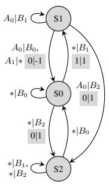  
Figure 1: Discrete toy task. (a) State transition diagram. $r _ { L } \mid r _ { F }$ represents the rewards. (b) Leader’s discounted return across 3 independent training runs. For each run, performance is evaluated as the mean of 10 test rollouts. Avg. (line) and std. (shaded area) across the 3 runs are displayed.

## 5 Experiments

We evaluate the robustness of RE-HG against an ORACLE baseline that computes HGs with full access to the ground-truth rewards and transition dynamics. This baseline relies on stronger assumptions than the standard white-box follower assumption utilized in Thoma et al. (2024); Kudo et al. (2026), as it requires access to the transition dynamics. As an idealized model, it represents the empirical upper bound and serves as our primary benchmark for gradient accuracy and overall performance.

2-Player Markov Games (Discrete Case) To assess the necessity of the influence term and the HG accuracy of RE-HG, we design an environment (Figure 1a) with an inherent leader-follower conflict. The leader earns $r _ { L } = + 1$ only on $S _ { 0 }  S _ { 1 }$ , favoring an $S _ { 0 }  S _ { 1 }$ loop. Conversely, the follower prefers $S _ { 0 }  S _ { 1 }  S _ { 2 }$ to maximize $r _ { F } = + 1 . \ \mathrm { A t } \ S _ { 1 }$ , the leader can choose $A _ { 1 }$ to force the loop, but this imposes a penalty $r _ { F } = - 1$ . If the leader greedily persists with $A _ { 1 }$ , the follower will adapt by transitioning $S _ { 0 }  S _ { 2 }$ to avoid the penalty, eventually depriving the leader of all rewards. Thus, the leader must strategically guide the follower to $S _ { 1 }$ while preventing deflection to $S _ { 2 }$ by choosing $A _ { 0 }$ at appropriate intervals.

As observed in Figure 1b, RE-HG and ORACLE significantly outperform NO-INFLUENCE, a variant ignoring the influence term. It clearly indicates the need to estimate the influence term. Specifically, the leader policies in RE-HG and ORACLE converge to $f ( A _ { 0 } | S _ { 1 } ) \approx 1 . 0$ . In contrast, NO-INFLUENCE leader policy converges to $f ( A _ { 0 } | S _ { 1 } ) \approx 0 . 0$ , resulting in the breakdown described above. The relatively low Pearson correlation stems from estimation errors in unvisited regions, which do not affect the gradient direction of the HG. In fact, RE-HG maintains a high cosine similarity. Essentially, RE-HG successfully recovers the global reward structure necessary for optimization. Further analysis of the Pearson and cosine similarities and experimental details are provided in Section C.3.

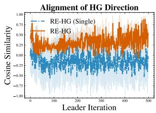  
(a) HG Similarity

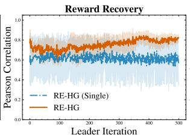  
(b) Reward Correlation

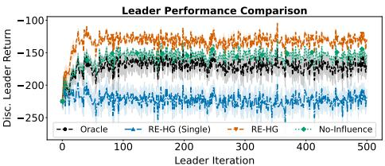  
(c) Leader’s Discounted Return  
Figure 2: Results on Building Thermal Control Task. (a) Cosine similarity of the HG between the estimated and Oracle models. (b) Pearson correlation between the recovered and true rewards, weighted by the undiscounted state-action occupancy measure of the surrogate follower policy. (c) Leader’s discounted return. For each run, performance is evaluated as the mean of 50 test rollouts. Avg. (line) and std. (shaded area) across the 5 independent training runs are displayed.

Configurable MDP (Continuous Case) We evaluate the effectiveness of the aggregation mechanism in RE-HG for mitigating estimation instability by comparing it against RE-HG(SINGLE), a variant performing IRL only once at the beginning. The task is under-actuated temperature regulation in a building with $n = 8$ zones. The state $s _ { t } \in \mathbb { R } ^ { n }$ is the temperature deviation, the follower’s action $b \in \mathbb { R } ^ { m } ( m = 4 )$ is the HVAC control, and the leader configures the insulation and airflow $\theta = ( \alpha , \nu ) \in [ 0 , 1 ] ^ { 2 n }$ . The system follows linear-Gaussian dynamics $s ^ { \prime } = A _ { \theta } s + B b + w$ where $\boldsymbol { w } \sim \mathcal { N } ( \mathbf { 0 } , \Sigma _ { w } )$ represents unobservable disturbances. The follower maximizes an entropyregularized quadratic reward $r _ { F } ( s , b ) = - s ^ { \top } W _ { F } s - b ^ { \top } U _ { F } b ,$ while the leader minimizes insulation costs and thermal instability. Crucially, because the most costly zone lacks direct HVAC control, the follower must regulate it indirectly via heat transfer influenced by the leader’s configuration. In this experiment, identical gradient norm clipping with a maximum norm of 1.0 is applied to every method.

Comparisons in Figure 2c confirm that the proposed method, RE-HG, overcomes the estimation instability of RE-HG(SINGLE) and clearly outperforms it. Lacking bias cancellation and eigenvalue truncation, RE-HG(SINGLE) recovers the excessively steep reward, causing the gradient norm to reach the order of $1 0 ^ { 7 }$ . Because estimation errors propagate directly into the gradient, the optimization is misled into an inappropriate local minimum, resulting in significant performance degradation. In contrast, RE-HG suppresses the reward norm through the aforementioned two implicit regularization effects of the aggregation process, keeping the gradient magnitude around $1 0 ^ { 1 }$ . Although the values are not perfectly identical due to the scale suppression effect, Figures 2a and 2b show that RE-HG achieves a higher cosine similarity with ORACLE and a higher Pearson correlation with the true reward weighted by the surrogate follower policy compared to RE-HG(SINGLE). This indicates that the global gradient direction and reward structure are appropriately recovered.

As a secondary effect, this smoothing leads RE-HG to attain a higher return than ORACLE. We stress that this is an optimization effect and not an indication that RE-HG estimates the HG more accurately. While ORACLE computes the exact true gradient, the follower’s skewed cost matrices $( W _ { F } , U _ { F } )$ create a steep reward landscape, causing the gradient scale to explode (around $1 0 ^ { 3 } )$ . Consequently, terms other than the influence term cannot be properly accounted for, severely distorting the overall gradient direction and trapping ORACLE in a suboptimal local minimum (behavior similar to NO-INFLUENCE converging to a local minimum). On the other hand, by recovering a smoothed reward bounded within a moderate scale (0.2 to 3.2) rather than the steep true reward, RE-HG obtains a gradient landscape on which all terms are appropriately balanced, avoiding the sharp local optima that trap ORACLE. This gap is not explained by the magnitude of the update alone: Section C.6 reports ORACLE variants with a learning rate, gradient clipping, and a scaled influence term, none of which reaches the performance of RE-HG.

Further details, including the improvement of cosine similarity and Pearson correlation when the steep reward setting is relaxed, and experimental setups, are provided in Section C.4.

2-Player Markov Games (Continuous Case) We evaluate the HG accuracy of RE-HG on a continuous MG formulated as a Linear Quadratic Regulator (LQR) task. The dynamics are $s _ { t + 1 } = A s _ { t } + B b _ { t } + C a _ { t }$ , where $s _ { t } ~ \in ~ \mathbb { R } ^ { 2 }$ is the state (starting at $( 1 , 0 ) ) , \ b _ { t } \ \in \ \mathbb { R } ^ { 1 }$ is the follower’s control, and $a _ { t } \in \mathbb { R } ^ { 1 }$ is the leader’s interference. Both agents employ Gaussian policies. The follower aims to stabilize at $s _ { F } ^ { \star } = ( 0 , 0 )$ by maximizing a quadratic reward $r _ { F } ( s , b ) =$ $- s ^ { \top } W _ { F } s - b ^ { \top } U _ { F } b ,$ where counteracting the leader’s interfer-

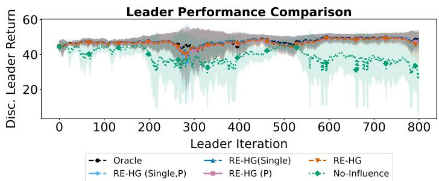  
Figure 3: Results on 2-player MG, averaged over 3 independent training runs (10 test rollouts per run). Avg. (line) and std. (shaded area) are displayed. $\mathbf { \ddot { P } } ^ { \prime }$ indicates the known transition probability scenario.

ence increases control costs. Conversely, the leader seeks to induce oscillation around $s _ { L } ^ { \star } = ( - 0 . 8 , 0 )$ by maximizing $\begin{array} { r } { r _ { L } ( s , a , b ) : = \exp ( - \frac { 1 } { 2 } ( s - s _ { L } ^ { \star } ) ^ { \top } M ( s - s _ { L } ^ { \star } ) ) } \end{array}$ ). This explicit conflict of interest tests whether the leader can strategically guide the follower by accounting for its cost structure via HG, rather than relying on inefficient brute-force interference.

Figure 3 shows that RE-HG achieves comparable performance to ORACLE, effectively navigating the true gradient direction despite the presence of estimation errors. Furthermore, it is more stable than NO-INFLUENCE. Both the HG cosine similarity relative to ORACLE and the weighted Pearson correlation consistently remained near 1.0 across the majority of the iterations for RE-HG. Figures illustrating these metrics, along with full experimental settings, are provided in Section C.5.

## 6 Conclusion

We introduced RE-HG, an algorithm for optimizing the leader’s parameters via HG in a bilevel RL setting with a black-box follower. Our theoretical analysis revealed that HG estimation is fundamentally vulnerable to reward shaping, an unavoidable issue in single-environment IRL. To resolve this, we established a bias cancellation theory showing that, under a linear reward assumption, the here-proposed aggregated IRL mathematically neutralizes errors caused by potential-based shifts. Based on this theory, we developed a reward recovery algorithm enhanced by a norm suppression smoothing effect. Empirically, despite operating without the restrictive white-box follower assumption, RE-HG achieved performance competitive with a white-box Oracle baseline by yielding accurate gradient direction estimates.

Limitations RE-HG has several limitations. First, our theoretical framework relies on the assumption of an optimal follower. Whether RE-HG operates stably when the follower follows sub-optimal learning trajectories remains open for discussion; Section C.9 reports an empirical study under two types of suboptimal followers, but our analysis does not cover this case. Second, formulating the IRL as an inner-loop min-max optimization inherently introduces estimation variance that directly propagates to the outer-loop HG. Stabilizing the influence term remains an open challenge. Third, our bias cancellation theory is built upon the linear reward assumption with a known feature extractor. Robustness to a misspecified feature basis is examined empirically in Section C.8, but extending the theory to non-linear reward structures requires further theoretical and empirical investigation; integrating multi-environment IRL techniques designed for non-linear representations is a natural direction. Finally, RE-HG removes the need for the follower’s reward function, but not the need for environment access: computing and rolling out the surrogate best response requires either the transition model or a simulator. Integrating offline IRL is a natural direction for removing this dependence.

# Acknowledgments and Disclosure of Funding

This work was partially supported by JSPS KAKENHI Grant Number 23H00483 and 26K02993.

## References

Albrecht, S., Leibold, M., and Ulbrich, M. (2012). A bilevel optimization approach to obtain optimal cost functions for human arm movements. Numerical Algebra, Control and Optimization, 2(1):105–127.

Barreto, A., Dabney, W., Munos, R., Hunt, J. J., Schaul, T., van Hasselt, H., and Silver, D. (2017). Successor features for transfer in reinforcement learning. In Proceedings ofthe 31st International Conference on Neural Information Processing Systems, NIPS’17, page 4058–4068, Red Hook, NY, USA. Curran Associates Inc.

Cao, H., Cohen, S. N., and Szpruch, L. (2021). Identifiability in inverse reinforcement learning. In Proceedings of the 35th International Conference on Neural Information Processing Systems, NIPS ’21, Red Hook, NY, USA. Curran Associates Inc.

Chakraborty, S., Bedi, A. S., Koppel, A., Wang, H., Manocha, D., Wang, M., and Huang, F. (2024). PARL: A unified framework for policy alignment in reinforcement learning from human feedback. In The Twelfth International Conference on Learning Representations, ICLR 2024, Vienna, Austria, May 7-11, 2024. OpenReview.net.

Fu, J., Luo, K., and Levine, S. (2018). Learning robust rewards with adverserial inverse reinforcement learning. In International Conference on Learning Representations.

Guo, D., Yang, D., Zhang, H., Song, J., Wang, P., Zhu, Q., Xu, R., Zhang, R., Ma, S., Bi, X., et al. (2025). Deepseek-r1 incentivizes reasoning in llms through reinforcement learning. Nature, 645(8081):633–638.

Haarnoja, T., Tang, H., Abbeel, P., and Levine, S. (2017). Reinforcement learning with deep energybased policies. In Proceedings of the 34th International Conference on Machine Learning - Volume 70, ICML’17, page 1352–1361. JMLR.org.

Ho, J. and Ermon, S. (2016). Generative adversarial imitation learning. In Proceedings ofthe 30th International Conference on Neural Information Processing Systems, NIPS’16, page 4572–4580, Red Hook, NY, USA. Curran Associates Inc.

Hong, M., Wai, H., Wang, Z., and Yang, Z. (2023). A two-timescale stochastic algorithm framework for bilevel optimization: Complexity analysis and application to actor-critic. SIAM J. Optim., 33(1):147–180.

Kudo, M., Tanabe, T., Wachi, A., and Akimoto, Y. (2026). Sample-efficient hypergradient estimation for decentralized bi-level reinforcement learning. In ICAPS ’26: Proceedings of the Thirty-Sixth International Conference on Automated Planning and Scheduling.

Levine, S., Finn, C., Darrell, T., and Abbeel, P. (2016). End-to-end training of deep visuomotor policies. J. Mach. Learn. Res., 17(1):1334–1373.

Ng, A. Y., Harada, D., and Russell, S. J. (1999). Policy invariance under reward transformations: Theory and application to reward shaping. In Proceedings of the Sixteenth International Conference on Machine Learning, ICML ’99, page 278–287, San Francisco, CA, USA. Morgan Kaufmann Publishers Inc.

Ni, T., Sikchi, H., Wang, Y., Gupta, T., Lee, L., and Eysenbach, B. (2020). f-irl: Inverse reinforcement learning via state marginal matching. In Conference on Robot Learning.

Ouyang, L., Wu, J., Jiang, X., Almeida, D., Wainwright, C., Mishkin, P., Zhang, C., Agarwal, S., Slama, K., Ray, A., et al. (2022). Training language models to follow instructions with human feedback. Advances in neural information processing systems, 35:27730–27744.

Rolland, P., Viano, L., Schürhoff, N., Nikolov, B., and Cevher, V. (2022). Identifiability and generalizability from multiple experts in inverse reinforcement learning. In Proceedings of the 36th International Conference on Neural Information Processing Systems, NIPS ’22, Red Hook, NY, USA. Curran Associates Inc.

Samvelyan, M., Rashid, T., Schroeder de Witt, C., Farquhar, G., Nardelli, N., Rudner, T. G. J., Hung, C.-M., Torr, P. H. S., Foerster, J., and Whiteson, S. (2019). The starcraft multi-agent challenge. In Proceedings ofthe 18th International Conference on Autonomous Agents and MultiAgent Systems, AAMAS ’19, page 2186–2188, Richland, SC. International Foundation for Autonomous Agents and Multiagent Systems.

Shen, H., Yang, Z., and Chen, T. (2024). Principled penalty-based methods for bilevel reinforcement learning and rlhf. In Proceedings of the 41st International Conference on Machine Learning, ICML’24. JMLR.org.

Shi, B., Zhai, L., and Liu, C. (2025). Stackelberg game based on trajectory prediction for lane change in mixed traffic. IEEE Access, 13:135196–135207.

Silver, D., Huang, A., Maddison, C. J., Guez, A., Sifre, L., van den Driessche, G., Schrittwieser, J., Antonoglou, I., Panneershelvam, V., Lanctot, M., Dieleman, S., Grewe, D., Nham, J., Kalchbrenner, N., Sutskever, I., Lillicrap, T. P., Leach, M., Kavukcuoglu, K., Graepel, T., and Hassabis, D. (2016). Mastering the game of go with deep neural networks and tree search. Nat., 529(7587):484–489.

Sutton, R. S. and Barto, A. G. (2018). Reinforcement Learning, Second Edition: An Introduction. MIT Press.

Syed, U., Bowling, M., and Schapire, R. E. (2008). Apprenticeship learning using linear programming. In Proceedings of the 25th International Conference on Machine Learning, ICML ’08, page 1032–1039, New York, NY, USA. Association for Computing Machinery.

Thoma, V., Pásztor, B., Krause, A., Ramponi, G., and Hu, Y. (2024). Contextual bilevel reinforcement learning for incentive alignment. In Globersons, A., Mackey, L., Belgrave, D., Fan, A., Paquet, U., Tomczak, J. M., and Zhang, C., editors, Advances in Neural Information Processing Systems 38: Annual Conference on Neural Information Processing Systems 2024, NeurIPS 2024, Vancouver, BC, Canada, December 10 - 15, 2024.

Yang, Y., Gao, B., and Yuan, Y. (2025). Bilevel reinforcement learning via the development of hyper-gradient without lower-level convexity. In Li, Y., Mandt, S., Agrawal, S., and Khan, M. E., editors, International Conference on Artificial Intelligence and Statistics, AISTATS 2025, Mai Khao, Thailand, 3-5 May 2025, Proceedings of Machine Learning Research, pages 4780–4788. PMLR.

Zeng, S., Li, C., Garcia, A., and Hong, M. (2022). Maximum-likelihood inverse reinforcement learning with finite-time guarantees. In Koyejo, S., Mohamed, S., Agarwal, A., Belgrave, D., Cho, K., and Oh, A., editors, Advances in Neural Information Processing Systems, volume 35, pages 10122–10135. Curran Associates, Inc.

Zhou, Z., Bloem, M., and Bambos, N. (2018). Infinite time horizon maximum causal entropy inverse reinforcement learning. IEEE Transactions on Automatic Control, 63(9):2787–2802.

## A Proofs

## A.1 Proposition 1

Proof. As is claimed in Zeng et al. (2022), the process of $\operatorname { I R L } _ { \theta }$ can be interpreted as a maximum likelihood estimation of $g ^ { \theta \dagger }$ by the policy $g _ { r } ^ { \star }$ optimal for the reward model $r ,$ where the reward parameter is considered as the parameter of the policy itself. Indeed, we observe

$$
\begin{array} { r l } & { \| { \bf M } _ { 1 } \| _ { \infty } \{ { \bf J } _ { n } ^ { \mathrm { s c } } \} \rangle = \frac { \mathrm { a n d } _ { \mathrm { T } } \mathrm { s i n a n } _ { \mathrm { B } } \mathcal { S } _ { \mathrm { B } } \{ { \bf J } _ { { \bf J } _ { n } ^ { \mathrm { s c } } \} } } { n } = \mathrm { B } _ { \mathrm { s } } \langle \bf { J } _ { n } ^ { \mathrm { s c } } \rangle } \\ &  \qquad - \mathrm { a n d } _ { \mathrm { s } } \mathrm { i n d } _ { \mathrm { B } } \frac { \mathrm { a n d } _ { \mathrm { T } } } { n } \mathrm { E } _ { \mathrm { B } } \left[ \sqrt { n _ { \mathrm { B } } ^ { \mathrm { s c } } \} \langle { \bf J } _ { n } ^ { \mathrm { s c } } \rangle \right] - \mathrm { E } _ { \mathrm { B } } \langle \bf { J } _ { n } ^ { \mathrm { s c } } \rangle } \\ & { \qquad - \mathrm { a n d } _ { \mathrm { s } } \mathrm { i n d } _ { \mathrm { B } } \frac { \mathrm { a n d } _ { \mathrm { T } } } { n } \mathrm { E } _ { \mathrm { B } } \bigg [ \sqrt { n _ { \mathrm { B } } ^ { \mathrm { s c } } \phi _ { \mathrm { { \bf ~ J } _ { \bf ~ J } } } } \bigg ] - \mathrm { E } _ { \mathrm { B } } \langle \bf { J } _ { n } ^ { \mathrm { s c } } \rangle } \\ &  \qquad - \mathrm { a n d } _ { \mathrm { s } } \mathrm { i n d } _ { \mathrm { C } } \bigg [ \sqrt { n _ { \mathrm { B } } ^ { \mathrm { s c } } \phi _ { \mathrm { { \bf ~ J } _ { \bf ~ J } } } } \bigg ] - \mathrm { E } _ { \mathrm { B } } \bigg [ \frac { \mathrm { a n d } _ { \mathrm { T } } } { n } \bigg ] _ { \mathrm { B } } \bigg [ \sum _ { \mathrm { c } \neq j \in \mathcal { B } _ { \mathrm { B } } } \bigg [ \sum _  \mathrm { c } \neq j \in \mathcal { B } _ { \mathrm { B } } ^ { \mathrm { s c } } \mathrm \end{array}
$$

Let $\ell ( s , b ; \omega ) = \log g _ { r , . , \cdot } ^ { \star } ( s , b )$ . Let $V _ { \omega } ^ { \mathrm { s o f t } }$ and $Q _ { \omega } ^ { \mathrm { s o f t } }$ be the optimal soft value functions under the reward model $r _ { \omega }$ . Then, we have

$$
\begin{array} { r l } & { \nabla _ { \omega } \ell ( s , b ; \omega ) = \nabla _ { \omega } Q _ { \omega } ^ { \mathrm { s o f t } } ( s , b ) - \nabla _ { \omega } V _ { \omega } ^ { \mathrm { s o f t } } ( s ) } \\ & { \qquad = \nabla _ { \omega } Q _ { \omega } ^ { \mathrm { s o f t } } ( s , b ) - \mathbb { E } _ { g _ { \omega } ^ { \star } } [ \nabla _ { \omega } Q _ { \omega } ^ { \mathrm { s o f t } } ( s , b ) ] , } \end{array}
$$

where we used the soft-Bellman equation for value function, $\begin{array} { r } { V _ { \omega } ^ { \mathrm { s o f t } } ( s ) = \log \int \exp ( Q _ { \omega } ^ { \mathrm { s o f t } } ( s , b ) ) \mathrm { d } b . } \end{array}$ On the other hand, using the soft-Bellman equation for action value function, we obtain

$$
\nabla _ { \omega } Q _ { \omega } ^ { \mathrm { s o f t } } ( s , b ) = \phi ( s , b ) + \gamma \mathbb { E } _ { s ^ { \prime } } \left[ \mathbb { E } _ { g _ { \omega } ^ { \star } } [ \nabla _ { \omega } Q _ { \omega } ^ { \mathrm { s o f t } } ( s ^ { \prime } , b ^ { \prime } ) ] \right] .
$$

The solution to this recursive formula is equivalent to the expected discounted features, i.e., $\nabla _ { \omega } Q _ { \omega } ^ { \mathrm { s o f t } } ( s , b ) = \psi _ { \omega } ( s , b )$ . Therefore, we have

$$
\nabla _ { \omega } \ell ( s , b ; \omega ) = \psi _ { \omega } ( s , b ) - \mathbb { E } _ { g _ { \omega } ^ { \star } } [ \psi _ { \omega } ( s , b ) ] .
$$

Moreover, the Hessian is

$$
\begin{array} { r l } & { \nabla _ { \omega } ^ { 2 } \ell ( s , b ; \omega ) = \nabla _ { \omega } \psi _ { \omega } ( s , b ) - \mathbb { E } _ { b ^ { \prime } \sim g _ { \omega } ^ { \star } } [ \psi _ { \omega } ( s , b ^ { \prime } ) \nabla \ell ( s , b ^ { \prime } ; \omega ) ^ { \top } ] - \mathbb { E } _ { b ^ { \prime } \sim g _ { \omega } ^ { \star } } [ \nabla _ { \omega } \psi _ { \omega } ( s , b ^ { \prime } ) ] } \\ & { \qquad = \nabla _ { \omega } \psi _ { \omega } ( s , b ) - \mathbb { E } _ { b ^ { \prime } \sim g _ { \omega } ^ { \star } } [ \nabla _ { \omega } \psi _ { \omega } ( s , b ^ { \prime } ) ] - \mathrm { C o v } _ { b ^ { \prime } \sim g _ { \omega } ^ { \star } } [ \psi _ { \omega } ( s , b ^ { \prime } ) ] . } \end{array}
$$

Let $L ( \omega ) = \mathbb { E } _ { d _ { \gamma _ { r } } ^ { \theta , g ^ { \theta } \dagger } } \left[ \mathbb { E } _ { g ^ { \theta \dagger } } \left[ - \ell ( s , a ; \omega ) \right] \right]$ . Noting that $g ^ { \theta \dagger } = g _ { \omega } ^ { \star }$ ⋆ , the Hessian of this loss function at F   
$\omega = \omega ^ { \star }$ is

$$
\begin{array} { r l } & { \nabla _ { \omega } ^ { 2 } L ( \omega ^ { \star } ) = - \mathbb { E } _ { d _ { \gamma _ { F } } ^ { \theta } } \left[ \mathbb { E } _ { g ^ { \theta \dagger } } \left[ \nabla _ { \omega } ^ { 2 } \ell ( s , b ; \omega ^ { \star } ) \right] \right] } \\ & { \quad \quad = - \mathbb { E } _ { d _ { \gamma _ { F } } ^ { \theta , g \star \dagger } } \left[ \mathbb { E } _ { g ^ { \theta \dagger } } \left[ \nabla _ { \omega } \psi _ { \omega ^ { \star } } ( s , b ) - \mathbb { E } _ { g _ { \omega ^ { \star } } ^ { \star } } \left[ \nabla _ { \omega } \psi _ { \omega ^ { \star } } ( s , b ) \right] - \mathrm { C o v } _ { g _ { \omega ^ { \star } } ^ { \star } } \left[ \psi _ { \omega ^ { \star } } ( s , b ) \right] \right] \right] } \\ & { \quad \quad = - \mathbb { E } _ { d _ { \gamma _ { F } } ^ { \theta , g _ { \omega ^ { \star } } } } \left[ \mathbb { E } _ { g _ { \omega ^ { \star } } } \left[ \nabla _ { \omega } \psi _ { \omega ^ { \star } } ( s , b ) \right] - \mathbb { E } _ { g _ { \omega ^ { \star } } ^ { \star } } \left[ \nabla _ { \omega } \psi _ { \omega ^ { \star } } ( s , b ) \right] - \mathrm { C o v } _ { g _ { \omega ^ { \star } } ^ { \star } } \left[ \psi _ { \omega ^ { \star } } ( s , b ) \right] \right] } \\ & { \quad \quad = \mathbb { E } _ { d _ { \gamma _ { F } } ^ { \theta , g _ { \omega ^ { \star } } ^ { \star } } } \left[ \mathrm { C o v } _ { g _ { \omega ^ { \star } } ^ { \star } } \left[ \psi _ { \omega ^ { \star } } ( s , b ) \right] \right] . } \end{array}
$$

Hence, it is non-negative definite. If two reward functions $r _ { 0 }$ and $r _ { 1 }$ admit the same optimal policy, then their convex combination $r _ { \lambda } = \lambda r _ { 0 } + ( 1 - \lambda ) r _ { 1 }$ for $\lambda \in [ 0 , 1 ]$ also admits the same optimal policy. This implies that all the optimal reward parameter must lie in the kernel of $\nabla _ { \omega } ^ { 2 } L ( \omega ^ { \star } )$ centered at $\omega ^ { \star }$ . This completes the proof.

## A.2 Theorem 1

Proof. From Proposition 1, we have $\Sigma _ { k } ( \omega _ { k } - \omega _ { \star } ) = 0$ for each $k \in [ K ]$ . Then, we have

$$
\bar { \Sigma } _ { K } \bar { \omega } _ { K } = \sum _ { k = 1 } ^ { K } \Sigma _ { k } \omega _ { k } = \sum _ { k = 1 } ^ { K } \Sigma _ { k } \omega ^ { \star } = \bar { \Sigma } _ { K } \omega ^ { \star } .
$$

Therefore, we have $\bar { \Sigma } _ { K } ( \bar { \omega } _ { K } - \omega ^ { \star } ) = 0 .$ , which indicates that $\bar { \omega } - \omega ^ { \star }$ lies in the kernel of $\bar { \Sigma } _ { K }$ . Because $\Sigma _ { k }$ are all non-negative definite, the kernel of $\bar { \Sigma } _ { K }$ is the intersection of the kernels of $\Sigma _ { k }$ . Hence, we have $\bar { \omega } _ { K } \in \mathrm { I R L } _ { \theta _ { k } } \overline { { ( g ^ { \theta _ { k } \dag } ) } }$ for all $k \in [ K ]$

The rest is straightforward. If $\Delta _ { \mathrm { c o n s t } } = 0$ and $\begin{array} { r } { { \bf R } \mathrm { A N K } ( \bar { \Sigma } _ { K } ) = d . } \end{array}$ , there exists a unique solution to $\begin{array} { r } { \bar { \Sigma } _ { K } \omega = \sum _ { k = 1 } ^ { K } \Sigma _ { k } \omega _ { k } } \end{array}$ and it must agree with $\omega ^ { \star }$ . If $\Delta _ { \mathrm { c o n s t } } \neq 0$ and $\mathsf { R a N K } ( \bar { \Sigma } _ { K } ) = d - 1$ , then $\Delta _ { \mathrm { c o n s t } }$ must lie in the kernel of $\bar { \Sigma } _ { K }$ because $\omega + c \Delta _ { \mathrm { c o n s t } }$ results in a constant offset of the reward function as

$$
r _ { \omega + c \Delta _ { \mathrm { c o n s t } } } ( s , b ) = \langle \omega + c \Delta _ { \mathrm { c o n s t } } , \phi ( s , b ) \rangle = \langle \omega , \phi ( s , b ) \rangle + c ,
$$

and hence the loss function L must be constant in the direction of $\Delta _ { \mathrm { c o n s t } }$ . That is, the kernel of $\bar { \Sigma } _ { K }$ is spanned by $\Delta _ { \mathrm { c o n s t } }$ . Therefore, we have $\bar { \omega } _ { K } = \omega ^ { \star } + c \Delta _ { \mathrm { c o n s t } }$ . This completes the proof.

## A.3 Corollary 1

Proof. In this proof, we consider $K \geqslant { \bar { K } }$ . Then, from the assumption RANK $( { \bar { U } } _ { K } ) = d - \mathbb { I } \{ \Delta _ { \mathrm { c o n s t } } \neq$ $0 \}$ , the kernel of $\bar { U } _ { K }$ must admit the kernel of W. Therefore, $W = \bar { U } _ { K } \bar { U } _ { K } ^ { - } = \bar { U } _ { K } ^ { - } \bar { U } _ { K }$ . Moreover, $\bar { W } \bar { U } _ { K } ^ { - } = \bar { U } _ { K } ^ { - }$ and $W \bar { U } _ { K } = \bar { U } _ { K }$ because of the property of pseudo-inverse.

Note first that $\bar { \omega } _ { K }$ is a solution to $\begin{array} { r } { \bar { U } _ { K } \omega = \sum _ { k = 1 } ^ { K } U _ { k } \widehat { \omega } _ { k } } \end{array}$ . The solution can be represented as

$$
{ \bar { \omega } } _ { K } = \sum _ { k = 1 } ^ { K } U _ { k } { \widehat { \omega } } _ { k } + ( I - W ) \delta
$$

for some $\delta \in \mathbb { R } ^ { d }$ . Because $W = I - \| \Delta _ { \mathrm { c o n s t } } \| _ { 2 } ^ { - 2 } \Delta _ { \mathrm { c o n s t } } \Delta _ { \mathrm { c o n s t } } ^ { \top }$ , we have

$$
\bar { \omega } _ { K } = \sum _ { k = 1 } ^ { K } U _ { k } \widehat { \omega } _ { k } + \| \Delta _ { \mathrm { c o n s t } } \| _ { 2 } ^ { - 2 } \langle \delta , \Delta _ { \mathrm { c o n s t } } \rangle \Delta _ { \mathrm { c o n s t } } .
$$

Letting $c = \| \Delta _ { \mathrm { c o n s t } } \| _ { 2 } ^ { - 2 } \langle \delta , \Delta _ { \mathrm { c o n s t } } \rangle$ , we have $\begin{array} { r } { \mathbf { R E } \bar { \omega } _ { K } = \sum _ { k = 1 } ^ { K } U _ { k } \widehat { \omega } _ { k } + c \Delta _ { \mathrm { c o n s t } } } \end{array}$ . It indicates that

$$
\begin{array} { r l } {  { \Delta _ { \omega } ^ { K } = W ( \bar { \omega } _ { K } - \omega ^ { \star } ) } } \\ & { = W \bar { U } _ { K } ^ { - } \sum _ { k = 1 } ^ { K } U _ { k } \widehat { \omega } _ { k } - W \omega ^ { \star } } \\ & { = \bar { U } _ { K } ^ { - } \sum _ { k = 1 } ^ { K } U _ { k } \widehat { \omega } _ { k } - \bar { U } _ { K } ^ { - } \bar { U } _ { K } \omega ^ { \star } } \\ & { = \bar { U } _ { K } ^ { - } \sum _ { k = 1 } ^ { K } U _ { k } ( \widehat { \omega } _ { k } - \omega ^ { \star } ) . } \end{array}
$$

From Proposition 1, we have $\Sigma _ { k } ( \omega _ { k } - \omega ^ { \star } ) = 0$ , which is equivalent to $U _ { k } ( \omega _ { k } - \omega ^ { \star } ) = 0$ because $\Sigma _ { k }$ and $U _ { k }$ admit the same kernel by construction. Therefore, $\mathbb { E } [ U _ { k } \widehat { \omega } _ { k } ] = U _ { k } \omega _ { k }$ implies $\mathbb { E } [ U _ { k } \widehat { \omega } _ { k } ] =$

$U _ { k } \omega ^ { \star }$ . Then, we have

$$
\begin{array} { l } { { \displaystyle { \mathbb { E } } [ \Delta _ { \omega } ^ { K } ] = \bar { U } _ { K } ^ { - } \sum _ { k = 1 } ^ { K } U _ { k } ( \widehat { \omega } _ { k } - \omega ^ { \star } ) } } \\ { ~ } \\ { { \displaystyle ~ = \bar { U } _ { K } ^ { - } \sum _ { k = 1 } ^ { K } { \mathbb { E } } [ U _ { k } \widehat { \omega } _ { k } ] - U _ { k } \omega ^ { \star } } } \\ { ~ } \\ { { \displaystyle ~ = 0 . } } \end{array}
$$

Because $\widehat { \omega } _ { k }$ are independently distributed, we have

$$
\begin{array} { r l } & { W \operatorname { C o v } [ \bar { \omega } _ { K } ] W = \mathbb { E } [ \Delta _ { \omega } ^ { K } ( \Delta _ { \omega } ^ { K } ) ^ { \top } ] } \\ & { \quad \quad \quad = \bar { U } _ { K } ^ { - } \displaystyle \sum _ { k = 1 } ^ { K } \mathbb { E } [ U _ { k } ( \widehat \omega _ { k } - \omega ^ { \star } ) ( \widehat \omega _ { k } - \omega ^ { \star } ) ^ { \top } U _ { k } ] \bar { U } _ { K } ^ { - } } \\ & { \quad \quad \quad \prec { C } \cdot K ( \bar { U } _ { K } ^ { - } ) ^ { 2 } . } \end{array}
$$

In light of the multivariate Chebyschev’s inequality, we have

$$
\mathrm { P r } [ \| \Delta _ { \omega } ^ { K } \| _ { \mathrm { C o v } [ \Delta _ { \omega } ^ { K } ] ^ { - } } > t ] \leqslant \frac { d } { t ^ { 2 } }
$$

for any $t > 0$ . Let $\sigma _ { \operatorname* { m a x } } ( \bar { U } _ { K } ^ { - } )$ be the greatest eigenvalue of $\bar { U } _ { K } ^ { - }$ . Then, we have $\sigma _ { \operatorname* { m i n } } ( \mathrm { C o v } [ \Delta _ { \omega } ^ { K } ] ^ { - } ) \geqslant$ $( C K \sigma _ { \operatorname* { m a x } } ( \bar { U } _ { K } ^ { - } ) ^ { 2 } ) ^ { - 1 }$ , where $\sigma _ { \mathrm { m i n } }$ represents the smallest non-zero eigenvalue. Then, we have $\| \Delta _ { \omega } ^ { K } \| _ { \mathrm { C o v } [ \Delta _ { \omega } ^ { K } ] ^ { - } } \geqslant \sqrt { \sigma _ { \operatorname* { m i n } } ( \mathrm { C o v } [ \Delta _ { \omega } ^ { K } ] ^ { - } ) } \| \Delta _ { \omega } ^ { K } \| _ { 2 }$ , and hence,

$$
\operatorname* { P r } [ \| \Delta _ { \omega } ^ { K } \| _ { 2 } > t ] \leqslant \frac { d } { t ^ { 2 } \sigma _ { \operatorname* { m i n } } ( \operatorname { C o v } [ \Delta _ { \omega } ^ { K } ] ^ { - } ) } \leqslant \frac { d C K \sigma _ { \operatorname* { m a x } } ( \bar { U } _ { K } ^ { - } ) ^ { 2 } } { t ^ { 2 } } \xrightarrow { K \to \infty } 0 .
$$

It implies lim $\ O _ { K \to \infty } \Delta _ { \omega } ^ { K } = 0$ in probability. This completes the proof.

## A.4 Adaptive Variant of Corollary 1

$\Sigma _ { k }$ is estimated from the batch $\mathcal { D } _ { k }$ collected under $\theta _ { k } .$ , so $U _ { k }$ is not $\mathcal { F } _ { k - 1 }$ -measurable, and $U _ { k }$ and $\widehat { \omega } _ { k }$ , being functions of the same $\mathcal { D } _ { k }$ , are dependent.

Corollary 1 treats $\{ U _ { k } \} _ { k = 1 } ^ { K }$ as a deterministic sequence and assumes the estimates $\widehat { \omega } _ { k }$ to be independent. Neither holds in Algorithm $1 \colon \Sigma _ { k }$ is estimated from the batch $\mathcal { D } _ { k }$ collected under $\theta _ { k } ,$ so $U _ { k }$ is not $\mathcal { F } _ { k - 1 } { \mathrm { - m e a s u r a b l e } } .$ , and $U _ { k }$ and $\widehat { \omega } _ { k }$ , being functions of the same $\mathcal { D } _ { k }$ , are dependent.

We state below the assumptions under which the conclusion of Corollary 1 survives, and note in Remark 2 that one of them holds for a lagged or sample-split version of Algorithm 1 rather than for the algorithm as implemented.

Corollary 2. Let $\{ U _ { k } \} _ { k = 1 } ^ { K }$ 1 and $\{ \widehat \omega _ { k } \} _ { k = } ^ { K }$ be the projection matrices and the estimated reward vectors generated by the closed loop of Algorithm $^ { l , }$ let $\begin{array} { r } { \bar { U } _ { K } = \sum _ { k = 1 } ^ { K } U _ { k } , } \end{array}$ , and let $\mathcal { F } _ { k }$ be the σ-algebra generated by the history $( \theta _ { 1 } , \mathcal { D } _ { 1 } , \widehat { \omega } _ { 1 } , \ldots , \theta _ { k } , \mathcal { D } _ { k } , \widehat { \omega } _ { k } )$ , where $\mathcal { D } _ { k }$ denotes the trajectories collected under $\theta _ { k } .$ . Let $b \geqslant 0$ and $\dot { C } \geqslant 0$ be constants and suppose that,for every $k ,$

(i) $U _ { k }$ is $\mathcal { F } _ { k - 1 }$ -measurable;

$$
( i i ) \ \mathbb { E } [ U _ { k } { \widehat { \omega } } _ { k } \mid { \mathcal { F } } _ { k - 1 } ] = U _ { k } \omega _ { k } + U _ { k } b _ { k } f o r s o m e \ b _ { k } \in \mathbb { R } ^ { d } w i t h \| b _ { k } \| _ { 2 } \leqslant b ;
$$

(iii) $\operatorname { C o v } [ U _ { k } \widehat { \omega } _ { k } \ | \ \mathcal { F } _ { k - 1 } ] \preccurlyeq C \cdot I ;$

and that

(iv) $\operatorname { R a N K } ( \bar { U } _ { K } ) = d - \mathbb { I } \{ \Delta _ { \mathrm { c o n s t } } \neq 0 \}$ for all $K \geqslant { \bar { K } }$ , for some $\bar { K } \geqslant 1$

Let $W$ and $\Delta _ { \omega } ^ { K }$ be as in Corollary 1, let $\eta _ { k } = U _ { k } \widehat { \omega } _ { k } - \mathbb { E } [ U _ { k } \widehat { \omega } _ { k } \ | \ \mathcal { F } _ { k - 1 } ] ,$ , and let $\sigma _ { \mathrm { m i n } }$ denote the smallest non-zero eigenvalue. Then, for every $K \geqslant \bar { K }$ , the output of Algorithm 2 decomposes as

$\Delta _ { \omega } ^ { K } = \Delta _ { \omega } ^ { K , \mathrm { b i a s } } + \Delta _ { \omega } ^ { K , \mathrm { n o i s e } }$ with $\begin{array} { r } { \Delta _ { \omega } ^ { K , \mathrm { b i a s } } = \bar { U } _ { K } ^ { - } \sum _ { k = 1 } ^ { K } U _ { k } b _ { k } } \end{array}$ and $\Delta _ { \omega } ^ { K , \mathrm { n o i s e } } = \bar { U } _ { K } ^ { - } \sum _ { k = 1 } ^ { K } \eta _ { k }$ , and these satisfy

$$
\begin{array} { r } { \mathbb { E } \left[ \| \sum _ { k = 1 } ^ { K } \eta _ { k } \| _ { 2 } ^ { 2 } \right] \leqslant C d K , } \end{array}\tag{7}
$$

$$
\| \Delta _ { \omega } ^ { K , \mathrm { b i a s } } \| _ { 2 } \leqslant \frac { K b } { \sigma _ { \mathrm { m i n } } ( \bar { U } _ { K } ) } .\tag{8}
$$

Consequently, $i f \ P \mathrm { r } [ \sigma _ { \mathrm { m i n } } ( \bar { U } _ { K } ) \ \geqslant \ \sqrt { K } a _ { K } ] \  \ 1 \ f o r $ some deterministic sequence $a _ { K } \ \to \ \infty ,$ then $\Delta _ { \iota , \iota } ^ { K }$ ,noise $ 0 ^ { \cdot }$ in probability; and $i f \operatorname { P r } [ \sigma _ { \operatorname * { m i n } } ( { \bar { U } } _ { K } ) \geqslant \alpha K ]  1 f o r$ some $\alpha > 0 ,$ , then $\mathrm { P r } [ \| \Delta _ { \omega } ^ { \breve { K } , \mathrm { b i a s } } \| _ { 2 } > b / \alpha ] \ \stackrel { \cdot } {  } \ 0 .$ . In particular, $i f b = 0$ and the first spectral condition holds, then $\Delta _ { \omega } ^ { K }  0$ in probability, which is the conclusion of Corollary 1 without the independence assumption.

Proof. Throughout we take $K \geqslant \bar { K }$ . Line 3 of Algorithm 2 sets $U _ { k } = E I _ { \Lambda \succ \epsilon } E ^ { \top }$ with E orthogonal and $I _ { \Lambda \succ \epsilon }$ diagonal with entries in {0, 1}, so each $U _ { k }$ is an orthogonal projection; we use this in Steps 2 and 4.

Step $I . { \bf B y } \left( \mathrm { i } \right) , U _ { k }$ is $\mathcal { F } _ { k - 1 }$ -measurable, so $\mathbb { E } [ U _ { k } \widehat { \omega } _ { k } \mid \mathcal { F } _ { k - 1 } ] = U _ { k } \mathbb { E } [ \widehat { \omega } _ { k } \mid \mathcal { F } _ { k - 1 } ]$ and hence

$$
\eta _ { k } = U _ { k } \left( \widehat { \omega } _ { k } - \mathbb { E } [ \widehat { \omega } _ { k } \mid \mathcal { F } _ { k - 1 } ] \right) \quad \mathrm { a n d } \quad \quad \mathbb { E } [ \eta _ { k } \mid \mathcal { F } _ { k - 1 } ] = 0 .\tag{9}
$$

Let $\xi _ { k } = U _ { k } \widehat { \omega } _ { k } - U _ { k } \omega _ { k }$ . By (ii), we have $\xi _ { k } = U _ { k } b _ { k } + \eta _ { k }$ . Proposition 1 gives $\Sigma _ { k } ( \omega _ { k } - \omega ^ { \star } ) = 0$ and $\Sigma _ { k }$ and $U _ { k }$ have the same kernel by construction. Therefore, we have $U _ { k } \omega _ { k } = U _ { k } \omega ^ { \star }$ , and hence $\xi _ { k } = U _ { k } ( \widehat \omega _ { k } - \omega ^ { \star } )$ . The derivation in Section $\mathrm { A . } 3 ,$ , which uses only (iv), applies verbatim and yields $\Delta _ { \omega } ^ { K } = \bar { U } _ { K } ^ { - } M _ { K }$ with $\begin{array} { r } { M _ { K } = \sum _ { k = 1 } ^ { K } \xi _ { k } } \end{array}$ . Because $\xi _ { k } = U _ { k } b _ { k } + \eta _ { k }$ , we have

$$
\Delta _ { \omega } ^ { K } = \bar { U } _ { K } ^ { - } M _ { K } = \bar { U } _ { K } ^ { - } \sum _ { k = 1 } ^ { K } \xi _ { k } = \sum _ { k = 1 } ^ { K } \bar { U } _ { K } ^ { - } U _ { k } b _ { k } + \bar { U } _ { K } ^ { - } \eta _ { k } .
$$

Step 2. Since $U _ { k }$ is an orthogonal projection, they are all symmetric and positive semi-definite. Therefore, so is $\begin{array} { r } { \bar { U } _ { K } = \sum _ { k = 1 } ^ { K } U _ { k } } \end{array}$ , and we have $\mathbf { R a N G E } ( U _ { k } ) \subseteq \mathbf { R a N G E } ( \bar { U } _ { K } )$ . It indicates that $U _ { k } x \in \mathbf { R A N G E } ( \hat { U } _ { K } )$ holds for any $x \in \mathbb { R } ^ { d }$ . Equivalently, for $x \in \mathbf { R a N G E } ( \bar { U } _ { K } )$ , we have

$$
\| \bar { U } _ { K } ^ { - } x \| _ { 2 } \leqslant \frac { \| x \| _ { 2 } } { \sigma _ { \operatorname* { m i n } } ( \bar { U } _ { K } ) } .\tag{10}
$$

Step 3. The sequence $( \eta _ { k } ) _ { k }$ defined in (9) is by definition a Martingale difference sequence under the filtration $( \mathcal { F } _ { k } ) _ { l }$ . That is, by the tower property, η and $\eta _ { j } \ ( j < k )$ are uncorrelated. Then,

$$
\begin{array} { r l } & { \mathbb { E } \left[ \left. \displaystyle \sum _ { k = 1 } ^ { K } \eta _ { k } \right. _ { 2 } ^ { 2 } \right] = \mathbb { E } \left[ \displaystyle \sum _ { k = 1 } ^ { K } \displaystyle \sum _ { j = 1 } ^ { K } \eta _ { j } ^ { \top } \eta _ { k } \right] = \displaystyle \sum _ { k = 1 } ^ { K } \displaystyle \sum _ { j = 1 } ^ { K } \mathbb { E } \left[ \eta _ { j } ^ { \top } \eta _ { k } \right] = \displaystyle \sum _ { k = 1 } ^ { K } \mathbb { E } \left[ \eta _ { k } ^ { \top } \eta _ { k } \right] } \\ & { \qquad = \displaystyle \sum _ { k = 1 } ^ { K } \mathbb { E } \left[ \mathrm { T r } \left( \mathrm { C o v } [ U _ { k } \widehat { \omega } _ { k } \mid \mathcal { F } _ { k - 1 } ] \right) \right] \leqslant C d K , } \end{array}
$$

which proves (7).

Step 4. Since $U _ { k }$ is an orthogonal projection, Condition (ii) gives $\| U _ { k } b _ { k } \| _ { 2 } \leqslant \| b _ { k } \| _ { 2 } \leqslant b$ . Applying the triangle inequality, we have $\begin{array} { r } { \| \sum _ { k = 1 } ^ { K } U _ { k } b _ { k } \| _ { 2 } \leqslant K b } \end{array}$ . Because $U _ { k } b _ { k } \in \mathbf { R a N G E } ( \bar { U } _ { K } )$ and so is their sum, i.e. $\textstyle \sum _ { k = 1 } ^ { K } U _ { k } b _ { k } \in$ RANGE $( { \bar { U } } _ { K } )$ , applying (10) yields (8).

Step 5. Let $A _ { K } = \{ \sigma _ { \operatorname* { m i n } } ( { \bar { U } } _ { K } ) \geqslant \sqrt { K } a _ { K } \}$ , so $\operatorname* { P r } [ A _ { K } ] \to 1$ by assumption. On $A _ { K } , ( 1 0 )$ bounds $\big \| \Delta _ { \omega } ^ { K , \mathrm { n o i s e } } \big \| _ { 2 }$ pointwise by $\| \sum _ { k } \eta _ { k } \| _ { 2 } / ( \sqrt { K } a _ { K } )$ , so for every $\varepsilon > 0 .$

$$
\operatorname* { P r } \big [ \| \Delta _ { \omega } ^ { K , \mathrm { n o i s e } } \| _ { 2 } > \varepsilon \big ] \leqslant \operatorname* { P r } [ A _ { K } ^ { \mathrm { c } } ] + \operatorname* { P r } \Big [ \| \sum _ { k } \eta _ { k } \| _ { 2 } > \varepsilon \sqrt { K } a _ { K } \Big ] \leqslant \operatorname* { P r } [ A _ { K } ^ { \mathrm { c } } ] + \frac { C d } { \varepsilon ^ { 2 } a _ { K } ^ { 2 } } \longrightarrow 0 ,
$$

by Markov’s inequality and (7), since $\operatorname* { P r } [ A _ { K } ] \to 1$ and $a _ { K }  \infty$ . Likewise, on $\{ \sigma _ { \mathrm { m i n } } ( { \bar { U } } _ { K } ) \geq \alpha K \}$ the bound (8) gives $\| \Delta _ { \omega } ^ { K , \mathrm { b i a s } } \| _ { 2 } \leqslant b / c$ pointwise, so $\mathrm { P r } [ \| \Delta _ { \omega } ^ { K , \mathrm { b i a s } } \| _ { 2 } > b / \alpha ] \stackrel { \cdot } { \leqslant } \mathrm { P r } [ \sigma _ { \mathrm { m i n } } ( \bar { U } _ { K } ) <$ $\alpha K ]  0$ . Finally, if $\overset { \cdot } { b } = 0$ then $\Delta _ { \omega } ^ { K } \stackrel { \cdot } { = } \bar { \Delta } _ { \omega } ^ { K , \mathrm { n o i s e } }$ , and the last claim follows from the first limit.

Remark 1. Independence enters Corollary 1 only through the cross terms of Step 3. What the argument needs is that the centered terms are pairwise uncorrelated, and the martingale difference property (9) supplies this without independence. The two proofs differ in one further respect. Corollary 1 treats $\{ \theta _ { k } \}$ as a given sequence, so $\bar { U } _ { K }$ is deterministic and the covariance bound $\mathrm { C o v } [ \Delta _ { \omega } ^ { K } ] \prec C K ( \bar { U } _ { K } ^ { - } ) ^ { 2 }$ can be stated directly. Here $\bar { U } _ { K }$ is random and statistically coupled with $M _ { K }$ , which is why Step 5 conditions on a spectral event instead.

Remark 2. Condition (i) is what restricts the scope ofCorollary 2. In Corollary $I , \left\{ \theta _ { k } \right\}$ is a given sequence and $U _ { k }$ is deterministic, so the question ofwhichfollower model $\Sigma _ { k }$ is evaluated at does not arise, and our implementation uses the most direct approximation $o f \Sigma ^ { \theta _ { k } \dagger }$ , namely the surrogate model built from $\widehat { \omega } _ { k }$ . Once the sequence is adaptively generated, (i) requires $\Sigma _ { k }$ to be computed from $\theta _ { k }$ together with the reward estimate available at the end of iteration $k - 1$ , for instance the surrogate model built from $\bar { \omega } _ { k - 1 }$ , or from a trajectory subset disjoint from the one used for $\widehat { \omega } _ { k }$ Corollary 2 therefore covers these variants rather than Algorithm 1 as implemented. Otherwise a term $\operatorname { C o v } ( U _ { k } , \widehat { \omega } _ { k } - \omega _ { k } \mid \mathcal { F } _ { k - 1 } )$ survives even when $b _ { k } = 0 .$ . This is a requirement introduced by the stronger analysis rather than a defect ofthe originalformulation, and since $U _ { k }$ depends only on the eigenspace partition of $\Sigma _ { k }$ at the threshold $\epsilon ,$ the substitution is expected to leave $U _ { k }$ unchanged whenever the spectral gap at ϵ exceeds the estimation perturbation.

Remark 3. The spectral hypotheses also differfrom that ofCorollary 1, which asksfor $\sigma _ { \operatorname* { m a x } } ( \bar { U } _ { K } ^ { - } ) =$ $o ( K ^ { - 1 / 2 } )$ . The condition $\sigma _ { \mathrm { m i n } } ( \bar { U } _ { K } )$ ⩾ αK neededfor the bias term is strictly stronger, and coincides with the persistent excitation conditionfamiliarfrom adaptive control and system identification, where it is either assumed ofthe input signal or enforced by injecting a dither signal. Empirically, cond $( { \bar { U } } _ { K } )$ remains bounded in $[ 7 . 3 , 1 0 3 . 1 ]$ across three seeds over 400 outer iterations, which together with $\sigma _ { \mathrm { m a x } } ( \bar { U } _ { K } ) = \Theta ( K )$ implies linear growth of $\cdot _ { \sigma _ { \mathrm { m i n } } \left( \bar { U } _ { K } \right) }$

## A.5 Proposition 2

Proof. First, we show that $\| r _ { \widehat { \omega } } - r _ { \omega ^ { \star } } - c \| _ { \infty } \leqslant L \| \Delta _ { \omega } \| _ { 2 }$ . It is straightforward from the linear reward structure: for any $( s , b ) \in S \times B$

$$
\begin{array} { r l } & { | r _ { \widehat { \omega } } ( s , b ) - r _ { \omega ^ { \star } } ( s , b ) - c | = | \langle \widehat { \omega } , \phi ( s , b ) \rangle - \langle \omega ^ { \star } , \phi ( s , b ) \rangle - c \langle \Delta _ { \mathrm { c o n s t } } , \phi ( s , b ) \rangle | } \\ & { \qquad = | \langle \widehat { \omega } - ( \omega ^ { \star } + c \Delta _ { \mathrm { c o n s t } } ) , \phi ( s , b ) \rangle | } \\ & { \qquad = | \langle \Delta _ { \omega } , \phi ( s , b ) \rangle | } \\ & { \qquad \leqslant \| \Delta _ { \omega } \| _ { 2 } \| \phi ( s , b ) \| _ { 2 } } \\ & { \qquad \leqslant L \| \Delta _ { \omega } \| _ { 2 } . } \end{array}
$$

Next, we show that $\| \widehat { V } - V _ { c } ^ { \star } \| _ { \infty } \leqslant ( 1 - \gamma _ { F } ) ^ { - 1 } \| r _ { \widehat { \omega } } - ( r _ { \omega ^ { \star } } + c ) \| _ { \infty }$ , where $V _ { c } ^ { \star }$ is the optimal value function corresponding to $r _ { \omega ^ { \star } } + c$ . Let Tr be the soft Bellman operator corresponding to reward function r, defined as

$$
\mathcal { T } _ { r } V = \log \left( \int \exp \left( r ( s , b ) + \gamma _ { F } \mathbb { E } _ { s ^ { \prime } } [ V ( s ^ { \prime } ) ] \right) \mathrm { d } b \right) ,
$$

where $\mathbb { E } _ { s ^ { \prime } }$ is the expectation taken for the next state $s ^ { \prime }$ given the current state s and the action b. It has been shown that the soft Bellman operator is $\gamma _ { F }$ contraction (Haarnoja et al., 2017).

Because $r _ { \widehat { \omega } } ( s , b ) \leqslant r _ { \omega ^ { \star } } ( s , b ) + c + \| r _ { \widehat { \omega } } - ( r _ { \omega ^ { \star } } + c ) \| _ { \infty }$ for all $( s , b ) \in  { \mathcal { S } } \times  { \mathcal { B } }$ , we have

$$
\begin{array} { r l r } {  { \mathcal { T } _ { r _ { \bar { \omega } } } V = \log ( \int \exp ( r _ { \bar { \omega } } ( s , b ) + \gamma _ { F } \mathbb { E } _ { s ^ { \prime } } [ V ( s ^ { \prime } ) ] ) \mathrm { d } b ) } } \\ & { } & { \leqslant \log ( \int \exp ( r ^ { \star } ( s , b ) + c + \| r _ { \bar { \omega } } - ( r _ { \omega ^ { \star } } + c ) \| _ { \infty } + \gamma _ { F } \mathbb { E } _ { s ^ { \prime } } [ V ( s ^ { \prime } ) ] ) \mathrm { d } b ) } \\ & { } & { = \| r _ { \bar { \omega } } - ( r _ { \omega ^ { \star } } + c ) \| _ { \infty } + \log ( \int \exp ( r ^ { \star } ( s , b ) + c + \gamma _ { F } \mathbb { E } _ { s ^ { \prime } } [ V ( s ^ { \prime } ) ] ) \mathrm { d } b ) } \\ & { } & { = \| r _ { \bar { \omega } } - ( r _ { \omega ^ { \star } } + c ) \| _ { \infty } + \mathcal { T } _ { r ^ { \star } + c } V . } \end{array}
$$

Analogously, by using the other side of the inequality, $r _ { \widehat { \omega } } ( s , b ) \geqslant r _ { \omega ^ { \star } } ( s , b ) + c - \| r _ { \widehat { \omega } } - ( r _ { \omega ^ { \star } } + c ) \| _ { \infty } .$ we have $T _ { r _ { \widehat { \omega } } } V \geq - \| r _ { \widehat { \omega } } - ( r _ { \omega ^ { \star } } + c ) \| _ { \infty } + T _ { r ^ { \star } + c } V$ . Therefore, for any V, we have

$$
\| T _ { r _ { \widehat { \omega } } } V - \mathcal { T } _ { r ^ { \star } + c } V \| _ { \infty } \leqslant \| r _ { \widehat { \omega } } - ( r _ { \omega ^ { \star } } + c ) \| _ { \infty } .
$$

Because soft Bellman operators are contraction maps, $V _ { c } ^ { \star }$ and $\widehat { V }$ are the unique fixed points of Tr ⋆+c and $\mathcal { T } _ { r _ { \widehat { \omega } } }$ , respectively. Therefore, we have

$$
\begin{array} { r l } & { \| \widehat { V } - V _ { c } ^ { \star } \| _ { \infty } = \| { \mathcal T } _ { r _ { \hat { \omega } } } \widehat { V } - { \mathcal T } _ { r _ { \omega ^ { \star } } + c } V _ { c } ^ { \star } \| _ { \infty } } \\ & { \qquad = \| ( { \mathcal T } _ { r _ { \hat { \omega } } } \widehat { V } - { \mathcal T } _ { r _ { \omega ^ { \star } + c } } \widehat { V } ) + ( { \mathcal T } _ { r _ { \omega ^ { \star } + c } } \widehat { V } - { \mathcal T } _ { r _ { \omega ^ { \star } } + c } V _ { c } ^ { \star } ) \| _ { \infty } } \\ & { \qquad \leqslant \| { \mathcal T } _ { r _ { \hat { \omega } } } \widehat { V } - { \mathcal T } _ { r _ { \omega ^ { \star } + c } } \widehat { V } \| _ { \infty } + \| { \mathcal T } _ { r _ { \omega ^ { \star } + c } } \widehat { V } - { \mathcal T } _ { r _ { \omega ^ { \star } } + c } V _ { c } ^ { \star } \| _ { \infty } } \\ & { \qquad \leqslant \| r _ { \widehat { \omega } } - ( r _ { \omega ^ { \star } } + c ) \| _ { \infty } + \gamma _ { F } \| \widehat { V } - V _ { c } ^ { \star } \| _ { \infty } . } \end{array}
$$

Rearranging the right-most side, we have

$$
\begin{array} { r } { \| \widehat { V } - V _ { c } ^ { \star } \| _ { \infty } \leqslant ( 1 - \gamma _ { F } ) ^ { - 1 } \| r _ { \widehat { \omega } } - ( r _ { \omega ^ { \star } } + c ) \| _ { \infty } . } \end{array}
$$

The right-hand side of the above inequality is derived by using $\| r _ { \widehat { \omega } } - r _ { \omega ^ { \star } } - c \| _ { \infty } \leqslant L \| \Delta _ { \omega } \| _ { 2 }$ . The left-hand side is derived by using the fact that if the optimal soft value function corresponding to r is $V _ { r }$ , then the optimal soft value function corresponding to $r + c$ is ${ \cal V } _ { r + c } = { \cal V } _ { r } + c ( 1 - \widehat { \gamma } _ { F } ) ^ { - 1 }$ . Hence, we have $\begin{array} { r } { \| \widehat { V } - V ^ { \star } - c ( 1 - \gamma _ { F } ) ^ { - 1 } \| _ { \infty } \leqslant L ( 1 - \gamma _ { F } ) ^ { - 1 } \| \Delta _ { \omega } \| _ { 2 } . } \end{array}$

Finally, we bound the HG. First, we derive the bound for the Conf-MDP setting. Let $\nabla _ { \theta } J _ { L } ( \theta , g ^ { \theta \dagger } )$ be the HG derived in (11), where the ground-truth value function of the follower is used. Let $\widehat { \nabla _ { \theta } J _ { L } } ( \widehat { \theta , g } ^ { \theta \dagger } )$ be the HG computed using the estimated value function of the follower, $\widehat { V }$ . Then, it is easy to see that only the term $\nabla _ { \theta } Q _ { F } ^ { \theta \dagger }$ depends on the follower’s value function. Therefore,

$$
\| \nabla _ { \theta } \widehat { J _ { L } ( \theta , g ^ { \theta \dagger } ) } - \nabla _ { \theta } J _ { L } ( \theta , g ^ { \theta \dagger } ) \| \leqslant \mathbb { E } _ { \tau } [ \sum _ { t = 0 } ^ { \infty } \gamma _ { L } ^ { t } \frac { | B _ { L } ^ { \theta \dagger } ( s _ { t } , b _ { t } ) | } { \beta } \| \nabla _ { \theta } Q _ { F } ^ { \theta \dagger } ( s _ { t } , b _ { t } ) - \nabla _ { \theta } \widehat { Q _ { F } ^ { \theta \dagger } ( s _ { t } , b _ { t } ) } \| ] ,
$$

where $\nabla _ { \theta } Q _ { F } ^ { \theta \dagger } ( s _ { t } , b _ { t } )$ and $\widehat { \nabla _ { \theta } Q _ { F } ^ { \theta \dagger } ( s _ { t } , b _ { t } ) }$ are as defined in (6) with the ground-truth value function $V ^ { \star }$ and its estimate $\widehat { V }$ . Noting that for any constant $C \in \mathbb R$

$$
\begin{array} { r l } & { \mathbb { E } _ { \boldsymbol { r } } \left[ \displaystyle \sum _ { t = 0 } ^ { \infty } \gamma _ { t } ^ { t + 1 } C \nabla _ { \theta } \log p ^ { \theta } ( s _ { t + 1 } \mid s _ { t } , b _ { t } ) \Bigg \rvert \displaystyle \begin{array} { l } { s _ { 0 } = s } \\ { b _ { 0 } = b } \end{array} \right] } \\ & { \quad = \displaystyle \sum _ { t = 0 } ^ { \infty } \gamma _ { t } ^ { t + 1 } \mathbb { E } _ { \boldsymbol { r } } \left[ C \nabla _ { \theta } \log p ^ { \theta } ( s _ { t + 1 } \mid s _ { t } , b _ { t } ) \Bigg \rvert \displaystyle \begin{array} { l } { s _ { 0 } = s } \\ { b _ { 0 } = b } \end{array} \right] } \\ & { \quad = \displaystyle \sum _ { t = 0 } ^ { \infty } \gamma _ { t } ^ { t + 1 } \mathbb { E } _ { \boldsymbol { r } } \left[ \mathbb { E } _ { t } [ C \nabla _ { \theta } \log p ^ { \theta } ( s _ { t + 1 } \mid s _ { t } , b _ { t } ) ] \Bigg \rvert \displaystyle \begin{array} { l } { s _ { 0 } = s } \\ { b _ { 0 } = b } \end{array} \right] } \\ & { \quad = \displaystyle \sum _ { t = 0 } ^ { \infty } \gamma _ { t } ^ { t + 1 } \mathbb { E } _ { \boldsymbol { r } } \left[ \nabla _ { \theta } \mathbb { E } _ { t } [ C ] \Bigg \rvert \displaystyle \begin{array} { l } { s _ { 0 } = s } \\ { b _ { 0 } = b } \end{array} \right] } \\ & { \quad = 0 , } \end{array}
$$

where $\mathbb { E } _ { t }$ denotes the conditional expectation under the natural filtration generated by $\{ ( s _ { i } , b _ { i } ) \} _ { i \leqslant t }$ we have

$$
\nabla _ { \theta } Q _ { F } ^ { \theta \dagger } ( s , b ) = \mathbb { E } _ { \tau } \left[ \sum _ { t = 0 } ^ { \infty } \gamma _ { F } ^ { t + 1 } ( V _ { F } ^ { \theta \dagger } ( s _ { t + 1 } ) + C ) \nabla _ { \theta } \log p ^ { \theta } ( s _ { t + 1 } \mid s _ { t } , b _ { t } ) \Bigg | \begin{array} { l } { s _ { 0 } = s } \\ { b _ { 0 } = b } \end{array} \right] .
$$

$$
\begin{array} { r l } & { \mathrm { W i t h } C = \displaystyle ( - ( 1 - \gamma \mathbf { r } ) ^ { - 1 } , \mathbf { w } \exp \mathbf { \Phi } } \\ & {  \mathbf { V } _ { \theta } \boldsymbol { Q } _ { p } ^ { \theta \dagger } ( s , b ) - \mathbf { V } _ { \theta } \boldsymbol { Q } _ { p } ^ { \widetilde { Q } \widetilde { \mathbf { F } } _ { \theta } } ( s , b )  } \\ & { \qquad = \displaystyle  \mathbf { E } _ { r } [ [ \sum _ { i = 0 } ^ { \infty } \mathbf { r } _ { i } ^ { k + 1 } ( V ^ { \prime } ( s _ { i + 1 } ) + c ( 1 - \gamma \mathbf { r } ) ^ { - 1 } - \widetilde { V } ( s _ { i + 1 } ) ) \nabla _ { \mathbf { S } } \log p ^ { \theta } ( s _ { i + 1 } \mid s _ { i } , b _ { i } ) ] \mathcal { S } _ { 0 } = s ]  } \\ & { \qquad \leqslant \mathbb { E } _ { r } [ [ \sum _ { i = 0 } ^ { \infty } \gamma _ { i } ^ { k + 1 } | V ^ { \prime } ( s _ { i + 1 } ) + c ( 1 - \gamma \mathbf { r } ) ^ { - 1 } - \widetilde { V } ( s _ { i + 1 } ) | | | \nabla _ { \mathbf { S } } \log p ^ { \theta } ( s _ { i + 1 } \mid s _ { i } , b _ { i } ) | | \mathcal { S } _ { 0 } = s ]  } \\ & { \qquad \leqslant  \widetilde { V } - V _ { e } ^ { * }  _ { \infty } \mathbb { E } _ { r } [ [ \sum _ { i = 0 } ^ { \infty } \gamma _ { i } ^ { k + 1 } | \nabla _ { \mathbf { S } } \log p ^ { \theta } ( s _ { i + 1 } \mid s _ { i } , b _ { i } ) | ] \Bigg | _ { b _ { 0 } = 0 } ^ { s _ { 0 } } \delta ] } \\ &  \qquad \leqslant L ( 1 - \gamma _ { F } ) ^ { - 1 }  \Delta _ { \sigma }  \mathbb { E } _ { r } [ [ \sum _ { i = 0 }  \end{array}
$$

Hence, we have

$$
\begin{array} { r l } & { \left. { \left\| \nabla _ { \theta } \widehat { J _ { L } ( \theta , g ^ { \theta \dagger } ) } - \nabla _ { \theta } J _ { L } ( \theta , g ^ { \theta \dagger } ) \right\| } } \\ & { \quad \leqslant \frac { L \left\| \Delta _ { \omega } \right\| _ { 2 } } { 1 - \gamma _ { F } } \mathbb { E } _ { \tau } \left[ \sum _ { t = 0 } ^ { \infty } \gamma _ { L } ^ { t } \frac { \left| B _ { L } ^ { \theta \dagger } ( s _ { t } , b _ { t } ) \right| } { \beta } \mathbb { E } _ { \tau } \left[ \sum _ { \tilde { t } = 0 } ^ { \infty } \gamma _ { F } ^ { \tilde { t } + 1 } \right\| \nabla _ { \theta } \log p ^ { \theta } ( \tilde { s } _ { \tilde { t } + 1 } \mid \tilde { s } _ { \tilde { t } } , \tilde { b } _ { \tilde { t } } ) \right\| \left| \begin{array} { l } { \tilde { s } _ { 0 } = s _ { t } } \\ { \tilde { b } _ { 0 } = b _ { t } } \end{array} \right] \right] . } \end{array}
$$

This completes the proof for the Conf-MDP case.

Next, we derive the bound for 2-player MGs. Similarly to the above argument, we have from (12)

$$
\begin{array} { r l } & { \left. \nabla _ { \theta } \widehat { J _ { L } ( \theta , g ^ { \theta \dagger } ) } - \nabla _ { \theta } J _ { L } ( \theta , g ^ { \theta \dagger } ) \right. } \\ & { \qquad \leqslant \frac { 1 } { 1 - \gamma _ { L } } \left. \mathbb { E } \left[ \frac { B _ { L } ^ { \theta \dagger } ( s , a , b ) } { \beta } \left( \nabla _ { \theta } Q _ { F } ^ { \theta \dagger } ( s , a , b ) - \nabla _ { \theta } \widehat { Q _ { F } ^ { \theta \dagger } ( s , a , b ) } \right) \right] \right. , } \end{array}
$$

where $\nabla _ { \theta } Q _ { F } ^ { \theta \dagger } ( s , a , b )$ and $\widehat { \nabla _ { \theta } Q _ { F } ^ { \theta \dagger } } ( s , a , b )$ are as defined in (13) with the ground-truth value function $V ^ { \star }$ and its estimate ${ \widehat { V } } _ { \ }$ , and the expectation is taken for $( s , a , b ) \sim g ^ { \theta \dagger } ( b \mid s , a ) f _ { \theta } ( a \mid s ) d _ { \gamma _ { L } } ^ { \theta \dagger } ( s )$ Noting that for any constant $C \in \mathbb { R }$

$$
\begin{array} { r l } & { \mathbb { E } _ { r } \left[ \displaystyle \sum _ { t = 0 } ^ { \infty } \gamma _ { t } ^ { t } C \nabla _ { \theta } \log f _ { \theta } ( a _ { t } \mid s _ { t } ) \bigg \rvert \begin{array} { l } { s _ { 0 } = s } \\ { a _ { 0 } = a } \end{array} \right] } \\ & { \quad = \displaystyle \sum _ { t = 0 } ^ { \infty } \gamma _ { t } ^ { t + 1 } \mathbb { E } _ { \tau } \Bigg [ C \nabla _ { \theta } \log f _ { \theta } ( a _ { t } \mid s _ { t } ) \bigg \rvert \begin{array} { l } { s _ { 0 } = s } \\ { a _ { 0 } = a } \end{array} \Bigg ] } \\ & { \quad = C \nabla _ { \theta } \log f _ { \theta } ( a \mid s ) + \displaystyle \sum _ { t = 1 } ^ { \infty } \gamma _ { t } ^ { t + 1 } \mathbb { E } _ { \tau } \Bigg [ \mathbb { E } _ { \tau } [ C \nabla _ { \theta } \nabla _ { \theta } \log f _ { \theta } ( a _ { t } \mid s _ { t } ) \bigg \rvert \begin{array} { l } { s _ { 0 } = s } \\ { a _ { 0 } = b } \end{array} \Bigg ] } \\ & { \quad = C \nabla _ { \theta } \log f _ { \theta } ( a \mid s ) + \displaystyle \sum _ { t = 1 } ^ { \infty } \gamma _ { t } ^ { t + 1 } \mathbb { E } _ { \tau } \Bigg [ \mathbb { E } _ { \tau } [ C \nabla _ { \theta } \nabla _ { \tau } \log \log f _ { \theta } ( a _ { t } \mid s _ { t } ) \bigg \rvert \begin{array} { l } { s _ { 0 } = s } \\ { a _ { 0 } = b } \end{array} \Bigg ] } \\ & { \quad = C \nabla _ { \theta } \log f _ { \theta } ( a \mid s ) + \displaystyle \sum _ { b = 1 } ^ { \infty } \gamma _ { t } ^ { t + 1 } \mathbb { E } _ { \tau } \Bigg [ \nabla _ { \theta } \mathbb { E } _ { \tau } [ C ] \Big \rvert \begin{array} { l } { s _ { 0 } = s } \\ { a _ { 0 } = a } \end{array} \Bigg ] } \\ &  \quad = C \nabla _ { \theta } \log f  \end{array}
$$

where $\mathbb { E } _ { t }$ denotes the conditional expectation under the natural filtration generated by $\{ ( s _ { i } , a _ { i } , b _ { i } ) \} _ { i \leqslant t }$ we have

$$
\nabla _ { \theta } Q _ { F } ^ { \theta \dagger } ( s , a , b ) = \mathbb { E } _ { \tau } [ \sum _ { t = 0 } ^ { \infty } \gamma _ { F } ^ { t + 1 } ( V _ { F } ^ { \theta \dagger } ( s _ { t + 1 } , a _ { t + 1 } ) + C ) \nabla _ { \theta } \log f _ { \theta } ( a _ { t } \mid s _ { t } ) | \begin{array} { l } { s _ { 0 } = s } \\ { a _ { 0 } = a } \\ { b _ { 0 } = b } \end{array} ] - C \nabla _ { \theta } \log f _ { \theta } ( a \mid s ) .
$$

Noting that

$$
\mathbb { E } \left[ \frac { B _ { L } ^ { \theta \dagger } ( s , a , b ) } { \beta } C \nabla _ { \theta } \log f _ { \theta } ( a \mid s ) \right] = \mathbb { E } \left[ \frac { \mathbb { E } _ { b \sim g ^ { \theta \dagger } } [ B _ { L } ^ { \theta \dagger } ( s , a , b ) ] } { \beta } C \nabla _ { \theta } \log f _ { \theta } ( a \mid s ) \right] = 0 ,
$$

we have with $C = c ( 1 - \gamma _ { F } ) ^ { - 1 }$

$$
= \left\| \mathbb { E } \left[ \frac { B _ { L } ^ { \theta _ { \Gamma } ^ { \dagger } } ( s , a , b ) } { \beta } \mathbb { E } _ { \tau } \left[ \sum _ { t = 0 } ^ { \infty } \gamma _ { F } ^ { t + 1 } ( V ^ { \star } ( s _ { t + 1 } ) + \frac { c } { 1 - \gamma _ { F } } - \widehat { V } ( s _ { t + 1 } ) ) \nabla _ { \theta } \log f _ { \theta } ( a _ { t } \mid s _ { t } ) \right] \frac { s _ { 0 } = s } { a _ { 0 } = a } \right] \right\| _ { b = 0 }
$$

$$
\leqslant \mathbb { E } \left[ \frac { | B _ { L } ^ { \theta _ { \dagger } ^ { \dagger } } ( s , a , b ) | } { \beta } \mathbb { E } _ { \tau } \left[ \sum _ { t = 0 } ^ { \infty } \gamma _ { F } ^ { t + 1 } | V ^ { \star } ( s _ { t + 1 } ) + \frac { c } { 1 - \gamma _ { F } } - \widehat V ( s _ { t + 1 } ) | \| \nabla _ { \theta } \log f _ { \theta } ( a _ { t } \mid s _ { t } ) \| \left| \begin{array} { l } { s _ { 0 } = s } \\ { a _ { 0 } = a } \\ { b _ { 0 } = b } \end{array} \right. \right] \right]
$$

$$
\leqslant \| \widehat { V } - V _ { c } ^ { \star } \| _ { \infty } \mathbb { E } \left[ \frac { | B _ { L } ^ { \theta \dagger } ( s , a , b ) | } { \beta } \mathbb { E } _ { \tau } \left[ \sum _ { t = 0 } ^ { \infty } \gamma _ { F } ^ { t + 1 } \| \nabla _ { \theta } \log f _ { \theta } ( a _ { t } \mid s _ { t } ) \| \left| \begin{array} { l } { s _ { 0 } = s } \\ { a _ { 0 } = a } \\ { b _ { 0 } = b } \end{array} \right. \right] \right] .
$$

The rest follows the same argument as the Conf-MDP case. This completes the proof.

## B Detail Implementation

## B.1 Hypergradient derived in Kudo et al. (2026)

The HG in Conf-MDP settings can be explicitly written as

$$
\begin{array} { r l } & { \nabla _ { \theta } J _ { L } ( \theta , g ^ { \theta \dagger } ) = \mathbb { E } _ { \tau } \Bigg [ \displaystyle \sum _ { t = 0 } ^ { \infty } \gamma _ { L } ^ { t } \bigg ( \nabla _ { \theta } r _ { L } ^ { \theta } ( s _ { t } , b _ { t } ) + V _ { L } ^ { \theta \dagger } ( s _ { t } ) \nabla _ { \theta } \log p ^ { \theta } ( s _ { t } \mid s _ { t - 1 } , b _ { t - 1 } ) } \\ & { ~ + \displaystyle \frac { B _ { L } ^ { \theta \dagger } ( s _ { t } , b _ { t } ) } { \beta } \nabla _ { \theta } Q _ { F } ^ { \theta \dagger } ( s _ { t } , b _ { t } ) \bigg ) \Bigg ] , } \end{array}\tag{11}
$$

where $p ^ { \theta } ( s _ { 0 } \mid s _ { - 1 } , b _ { - 1 } )$ is interpreted as the initial distribution $\rho _ { 0 } ^ { \theta } ( s _ { 0 } )$

In the context of 2-player MGs, the benefit of the leader $f _ { \theta } ,$ , given that the follower takes action b at state s under the leade ${ \bf \ddot { s } }$ action $^ { a , }$ is defined as:

$$
\begin{array} { r } { B _ { L } ^ { \theta \dagger } ( s , a , b ) : = Q _ { L } ^ { \theta \dagger } ( s , a , b ) - \mathbb { E } _ { b \sim g ^ { \theta \dagger } ( \cdot | s , a ) } \left[ Q _ { L } ^ { \theta \dagger } ( s , a , b ) \right] . } \end{array}
$$

The HG for 2-player MG with a stochastic leader policy is derived as follows. In the following, $d _ { \gamma _ { L } } ^ { \theta \dagger } ( s )$ denotes the discounted state visitation distribution under the leader’s policy $f _ { \theta }$ and its corresponding best response follower’s policy $g ^ { \theta \dagger }$

Kudo et al. (2026) show that the HG of (4) with respect to θ is given by

$$
\nabla _ { \theta } J _ { L } ( \theta , g ^ { \theta ^ { \dagger } } ) = \frac { 1 } { 1 - \gamma _ { L } } \mathbb { E } \bigg [ Q _ { L } ^ { \theta ^ { \dagger } } ( s , a , b ) \nabla _ { \theta } \log f _ { \theta } ( a \mid s ) + \frac { B _ { L } ^ { \theta ^ { \dagger } } ( s , a , b ) } { \beta } \nabla _ { \theta } Q _ { F } ^ { \theta ^ { \dagger } } ( s , a , b ) \bigg ] ,\tag{12}
$$

where the expectation E is taken for $( s , a , b ) \sim g ^ { \theta \dagger } ( b \mid s , a ) f _ { \theta } ( a \mid s ) d _ { \gamma _ { L } } ^ { \theta \dagger } ( s )$ , and

$$
\nabla _ { \theta } Q _ { F } ^ { \theta ^ { \dagger } } ( s , a , b ) = \mathbb { E } _ { \tau } \left[ \sum _ { t = 0 } ^ { \infty } \gamma _ { F } ^ { t } V _ { F } ^ { \theta ^ { \dagger } } ( s _ { t } , a _ { t } ) \nabla _ { \theta } \log f _ { \theta } ( a _ { t } \mid s _ { t } ) \left| \begin{array} { l } { s _ { 0 } = s } \\ { a _ { 0 } = a } \\ { b _ { 0 } = b } \end{array} \right. \right] .\tag{13}
$$

## B.2 Hypergradient Baseline

## B.2.1 Hypergradient Baselines for Conf-MDP

Based on the HG formulation derived in Appendix B.1, we introduce baseline functions to reduce the variance of the gradient estimators. For the Conf-MDP setting in Equation (11), we subtract

$\nabla _ { \theta } V _ { F } ^ { \theta \dagger } ( s _ { t } , b _ { t } )$ from $\nabla _ { \theta } Q _ { F } ^ { \theta \dagger } ( s _ { t } , b _ { t } )$ . Because $\nabla _ { \boldsymbol { \theta } } V _ { F }$ is independent of the action $b ,$ it effectively serves as an unbiased baseline when marginalized over the action distribution:

$$
\begin{array} { r l } & { \nabla _ { \theta } J _ { L } ( \theta , g ^ { \theta \dagger } ) = \mathbb { E } _ { \tau } \Bigg [ \displaystyle \sum _ { t = 0 } ^ { \infty } \gamma _ { L } ^ { t } \bigg ( \nabla _ { \theta } r _ { L } ^ { \theta } ( s _ { t } , b _ { t } ) + V _ { L } ^ { \theta \dagger } ( s _ { t } ) \nabla _ { \theta } \log p ^ { \theta } ( s _ { t } \mid s _ { t - 1 } , b _ { t - 1 } ) } \\ & { \qquad \quad + \displaystyle \frac { B _ { L } ^ { \theta \dagger } ( s _ { t } , b _ { t } ) } { \beta } ( \nabla _ { \theta } Q _ { F } ^ { \theta \dagger } ( s _ { t } , b _ { t } ) - \nabla _ { \theta } V _ { F } ^ { \theta \dagger } ( s _ { t } ) ) \bigg ) \Bigg ] , } \end{array}
$$

where we have $\nabla _ { \theta } V _ { F } ^ { \theta \dagger } ( s _ { t } ) = \mathbb { E } _ { g ^ { \theta \dagger } } \bigl [ \nabla _ { \theta } Q _ { F } ^ { \theta \dagger } ( s _ { t } , b _ { t } ) \ | \ s _ { t } \bigr ]$ . Note that this formulation is not used in Kudo et al. (2026) because estimating both $\nabla _ { \theta } Q _ { F } ^ { \theta \dagger } ( s _ { t } , b _ { t } )$ and its expectation $\nabla _ { \theta } V _ { F } ^ { \theta \dagger } ( s _ { t } )$ requires multiple trajectories starting from the same state $s _ { t }$ . In our setting, we can easily approximate $\nabla _ { \theta } V _ { F } ^ { \theta \dagger } ( s _ { t } )$ by using the surrogate follower ${ \widehat { g } } .$

To further reduce variance, an alternative formulation incorporating a temporal difference-like baseline can be employed by subtracting $V _ { L } ^ { \theta ^ { \dagger } } ( s _ { t + 1 } )$ from $V _ { L } ^ { \theta \dagger } ( s _ { t } )$

$$
\begin{array} { r l r } & { } & { \nabla _ { \theta } J _ { L } ( \theta , g ^ { \theta \dagger } ) \approx \mathbb { E } _ { \tau } \Bigg [ \displaystyle \sum _ { t = 0 } ^ { \infty } \gamma _ { L } ^ { t } \bigg ( \nabla _ { \theta } r _ { L } ^ { \theta } ( s _ { t } , b _ { t } ) + ( V _ { L } ^ { \theta \dagger } ( s _ { t } ) - \mathbb { E } [ V _ { L } ^ { \theta \dagger } ( s _ { t + 1 } ) ) ] \nabla _ { \theta } \log p ^ { \theta } ( s _ { t } \mid s _ { t - 1 } , b _ { t - 1 } ) } \\ & { } & { \quad \quad \quad \quad \quad \quad + \displaystyle \frac { B _ { L } ^ { \theta \dagger } ( s _ { t } , b _ { t } ) } { \beta } ( \nabla _ { \theta } Q _ { F } ^ { \theta \dagger } ( s _ { t } , b _ { t } ) - \nabla _ { \theta } V _ { F } ^ { \theta \dagger } ( s _ { t } ) ) \bigg ) \Bigg ] . \quad ( 1 4 ) } \end{array}
$$

However, it is important to note that this specific TD-like term does not act as a strict baseline, making the resulting gradient estimator biased rather than unbiased.

## B.2.2 Hypergradient Baselines for 2-player MG

Similarly, for the 2-player MG setting derived in (12), we apply a baseline to reduce variance by subtracting $\nabla _ { \theta } V _ { F } ^ { \theta \dagger } ( s , a )$ from $\nabla _ { \theta } Q _ { F } ^ { \theta \dagger } ( s , a , b )$

$$
\begin{array} { r l } & { \nabla _ { \theta } J _ { L } ( \theta , g ^ { \theta \dagger } ) } \\ & { = \cfrac { 1 } { 1 - \gamma _ { L } } \mathbb { E } \bigg [ Q _ { L } ^ { \theta \dagger } ( s , a , b ) \nabla _ { \theta } \log f _ { \theta } ( a \mid s ) + \frac { B _ { L } ^ { \theta \dagger } ( s , a , b ) } { \beta } ( \nabla _ { \theta } Q _ { F } ^ { \theta \dagger } ( s , a , b ) - \nabla _ { \theta } V _ { F } ^ { \theta \dagger } ( s , a ) ) \bigg ] . } \end{array}\tag{15}
$$

The baseline formulation utilized in this setting is strictly unbiased, meaning it yields an unbiased gradient estimator.

## B.3 Reward Identification Algorithm

Algorithm 2 Reward Identification   
Input: $\omega _ { k } , \Sigma _ { k } , v _ { k - 1 } , \bar { U } _ { k - 1 }$ , threshold parameter $\epsilon \geqslant 0 .$   
1: Perform eigen decomposition $E \Lambda \dot { E } ^ { \top } = \Sigma _ { k }$   
2: Compute a diagonal matrix $I _ { \Lambda \succ \epsilon } ,$ where $[ \breve { I _ { \Lambda \succ \epsilon } } ] _ { d d } = 1 \underline { { { \mathrm { i f } } } } [ \Lambda ] _ { d d } > \epsilon .$ , 0 otherwise   
3: Compute the scaled covariance matrix $U _ { k } = E I _ { \Lambda \succ \epsilon } E ^ { \top }$   
4: $\bar { U } _ { k } \gets \bar { \underline { { U } } } _ { k - 1 } + U _ { k } , v _ { k } \gets v _ { k - 1 } + U _ { k } \omega _ { k }$   
5: Solve $\bar { U } _ { k } \omega = \underline { { v _ { k } } }$ to obtain $\bar { \omega } _ { k }$   
Output: $\bar { \omega } _ { k } , v _ { k } , \bar { U } _ { k }$

## B.4 Modules within Proposed Algorithm 1

Note that s¯ denotes state s in Conf-MDP settings and denotes a pair of state s and leader action a in 2-player MGs.

Algorithm 3 CriticUpdate $( Q _ { L } ^ { i } , \mathcal { R } )$ (Expected SARSA variant)   
Input: Current critic $Q _ { L } ^ { i }$ , policies $f , { \widehat { g } } ,$ batch ${ \mathcal { R } } ,$ learning rate $\alpha ,$ discount factor $\gamma _ { L }$   
1: for $( \bar { s } , b , r _ { L } , \bar { s } ^ { \prime } ) \in \dot { \mathcal { R } }$ do   
2: Compute expected value: $\begin{array} { r } { V _ { L } ( \hat { s } ^ { \prime } )  \sum _ { a ^ { \prime } } f ( a ^ { \prime } | s ^ { \prime } ) \sum _ { b ^ { \prime } } \widehat g ( b ^ { \prime } | \hat { s } ^ { \prime } ) Q _ { L } ^ { i } ( \hat { s } ^ { \prime } , b ^ { \prime } ) } \end{array}$   
3: $y  r _ { L } + \gamma _ { L } V _ { L } ( \bar { s } ^ { \prime } )$   
4: $Q _ { L } ^ { i } ( \bar { s } , b )  Q _ { L } ^ { i } ( \bar { s } , b ) + \alpha ( y - Q _ { L } ^ { i } ( \bar { s } , b ) )$   
5: $Q _ { L } ^ { i + 1 }  Q _ { L } ^ { i }$   
Output: $Q _ { L } ^ { i + 1 }$

Algorithm 4 CriticUpdate (TD with target network)   
Input: Online critic $Q _ { \omega _ { L } }$ , target critic $Q _ { \bar { \omega } _ { L } }$ , batch ${ \mathcal { R } } ,$ discount $\gamma _ { L }$ , learning rate $\alpha ,$ Polyak factor $\tau$   
1: for $( \bar { s } , b , r _ { L } , \bar { s ^ { \prime } } , b ^ { \prime } , d ) \in \bar { \mathcal { R } }$ do   
2: $y  r _ { L } + \gamma _ { L } ( 1 - d ) Q _ { \bar { \omega } _ { L } } ( \bar { s ^ { \prime } } , b ^ { \prime } )$   
3: $\omega _ { L }  \omega _ { L } - \alpha \nabla _ { \omega _ { L } } \frac { 1 } { N } \sum _ { j = 1 } ^ { N } ( Q _ { \omega _ { L } } ( \bar { s _ { j } } , b _ { j } ) - y _ { j } ) ^ { 2 }$   
4: $\bar { \omega } _ { L }  ( 1 - \tau ) \bar { \omega } _ { L } + \tau \omega _ { L }$ (Polyak averaging)   
Output: Updated critics $Q _ { \omega _ { L } } , Q _ { { \bar { \omega } } _ { L } } .$

Algorithm 5 PartialDerivative $( \mathcal { R } , \theta ^ { i } , V _ { L } , \cdot )$ in Conf-MDP Settings   
Input: Trajectory batch ${ \mathcal { R } } ,$ current leader parameter $\theta ^ { i }$ , leader value function $V _ { L }$ , initial state   
distribution $\rho _ { 0 }$   
$\widehat { \partial _ { \theta } J _ { L } }  \frac { 1 } { | \mathcal { R } | } \sum _ { \tau \in \mathcal { R } } \bigg ( V _ { L } ( s _ { 0 } ) \nabla _ { \theta } \log \rho _ { 0 } ( s _ { 0 } ) +$   
1:   
$\sum _ { t = 0 } ^ { T - 1 } \Big ( \gamma _ { L } ^ { t } \nabla _ { \theta } r _ { L } ^ { \theta ^ { i } } \big ( s _ { t } , b _ { t } \big ) + \gamma _ { L } ^ { t + 1 } V _ { L } \big ( s _ { t + 1 } \big ) \nabla _ { \theta } \log p ^ { \theta ^ { i } } \big ( s _ { t + 1 } \mid s _ { t } , b _ { t } \big ) \Big ) \Bigg )$   
Output: $\widehat { \partial _ { \theta } J _ { L } }$

Algorithm 6 PartialDerivative $\left( \mathcal { R } , \theta ^ { i } , \cdot , Q _ { L } \right)$ in Markov Game Settings   
Input: Transition sample batch ${ \mathcal { R } } ,$ current leader parameter $\theta ^ { i } .$ , leader Q-function $Q _ { L } ,$ , leader policy   
$f _ { \theta ^ { i } } ,$ surrogate follower policy $\widehat g$   
1: $\begin{array} { r } { \check { V } _ { L } ( s ) \gets \Bigl \langle \boxed { 1 } _ { a ^ { \prime } } f _ { \theta ^ { i } } \bigl ( a ^ { \prime } | s \bigr ) ^ { \prime } \sum _ { b ^ { \prime } } \overset { \sim } { g } \bigl ( b ^ { \prime } | s , a ^ { \prime } \bigr ) Q _ { L } ( s , a ^ { \prime } , b ^ { \prime } ) } \end{array}$   
2: $\widehat { \partial _ { \theta } J _ { L } }  \frac { 1 } { | \mathcal { R } | } \sum _ { ( s , a , b ) \in \mathcal { R } } \big ( Q _ { L } ( s , a , b ) - V _ { L } ( s ) \big ) \nabla _ { \theta }$ log $f _ { \theta ^ { i } } ( \boldsymbol { a } \mid \boldsymbol { s } )$ # Empirical approximation of   
eq. (12) without discount factor   
Output: $\widehat { \partial _ { \theta } J _ { L } }$

Algorithm 7 FollowerQGra $\mathfrak { l } ( s , a , b , \mathcal { R } , \theta ^ { i } , V _ { F } )$ in Markov Game Settings   
Input: Target state $s ,$ leader action $^ { a , }$ follower action $b ,$ full trajectory batch ${ \mathcal { R } } ,$ current leader   
parameter $\theta ^ { i }$ , follower soft value $V _ { F }$   
1: Extract segments: $\mathcal { R } _ { s a b } \gets \left\{ \tau ^ { k : T } \ : \middle | \ : ( s _ { k } , a _ { k } , b _ { k } ) = ( s , a , b ) \ : \mathrm { f o r } \ : ( s _ { k } , a _ { k } , b _ { k } ) \in \tau \in \mathcal { R } \right\}$   
2: $\begin{array} { r } { \widehat { \nabla _ { \theta } Q _ { F } } ( s , a , b ) \longleftarrow \frac { 1 } { | \mathcal { R } _ { s a b } | } \sum _ { \tau ^ { k : T } \in \mathcal { R } _ { s a b } } \sum _ { t = k + 1 } ^ { T } \gamma _ { F } ^ { t - k } V _ { F } ( s _ { t } , a _ { t } ) } \end{array}$   
Output: $\widehat { \nabla _ { \theta } Q _ { F } } ( s , a , b )$

<table><tr><td>Algorithm 8 Influence Term</td></tr><tr><td> $\begin{array} { r } { { 1 } \colon \widehat { \nabla _ { \theta _ { k } } J _ { L } ^ { k } }  \widehat { \partial _ { \theta _ { k } } J _ { L } ^ { k } } + \frac { 1 } { | \mathcal { R } _ { k } | } \sum _ { ( s , a , b ) \in \mathcal { R } _ { k } } B _ { L } ^ { k + 1 } ( s , a , b ) \widehat { \nabla _ { \theta _ { k } } Q _ { F } ^ { k } } ( s , a , b ) } \end{array}$ </td></tr><tr><td></td></tr><tr><td>Algorithm 9 Influence Term with Baseline in Markov Game Settings (Discrete Case)</td></tr><tr><td> $\begin{array} { r } { \widehat { \nabla _ { \theta _ { k } } V _ { F } ^ { k } } ( s , a ) \gets \sum _ { b ^ { \prime } } \widehat { g } _ { k } ( b ^ { \prime } \mid s , a ) \widehat { \nabla _ { \theta _ { k } } Q _ { F } ^ { k } } ( s , a , b ^ { \prime } ) } \end{array}$  1: Compute baseline:</td></tr><tr><td> $\begin{array} { r } { \widehat { \nabla _ { \theta _ { k } } J _ { L } ^ { k } } \gets \widehat { \partial _ { \theta _ { k } } J _ { L } ^ { k } } + \frac { 1 } { | \mathcal { R } _ { k } | } \sum _ { ( s , a , b ) \in \mathcal { R } _ { k } } B _ { L } ^ { k + 1 } ( s , a , b ) \left( \widehat { \nabla _ { \theta _ { k } } Q _ { F } ^ { k } } ( s , a , b ) - \widehat { \nabla _ { \theta _ { k } } V _ { F } ^ { k } } ( s , a ) \right) } \end{array}$  2: # Based on eq. (15)</td></tr></table>

## C Experiment

## C.1 Implementation Details

Table 2 summarizes the implementation choices used in each environment. While the overall algorithmic framework is shared across settings, several components are instantiated differently depending on whether the transition dynamics are known or unknown. In the Conf-MDP experiments, quantities such as $Q _ { F } ^ { \theta \dagger } , Q _ { L } ^ { \theta \dagger } , V _ { L } ^ { \theta \dagger }$ , and $\nabla Q _ { F } ^ { \theta \dagger }$ are computed analytically from the known system dynamics using the Discrete Algebraic Riccati Equation (DARE) and discrete Lyapunov equations. In the 2-player Markov game experiments, surrogate policies and value-related terms are computed either by dynamic programming or by successor-feature-based estimation, depending on whether the transition model is available. For the continuous setting, the critic is first pre-trained with SARSA-TD updates from randomly initialized trajectories, and the transition dynamics are estimated by linear regression when unknown.

Table 2: Implementation Details by Environment
<table><tr><td>Setting</td><td>Component</td><td>Algorithm 1 Line</td><td>Implementation Details</td></tr><tr><td>Conf-MDP (Common)</td><td>Qθ†</td><td>7</td><td>Since the transition dynamics are linear-Gaussian and the reward functions are quadratic, it is derived directly from</td></tr><tr><td></td><td> $\underline { { Q _ { L } ^ { \theta \dagger } } } , \ : V _ { L } ^ { \theta \dagger }$ </td><td>9</td><td>the DARE solution. Analytically computed by solving the DARE.</td></tr><tr><td></td><td> $\nabla \bar { Q } _ { F } ^ { \theta \dagger }$ </td><td>13</td><td>Obtained via the discrete Lyapunov equation.</td></tr><tr><td>Conf-MDP (Easy)</td><td>HG Calculation</td><td>15</td><td>Computed analytically using the known transition dynam- ics and policies, which bypasses the need for empirical</td></tr><tr><td>Conf-MDP (Hard)</td><td>HG Calculation</td><td>15</td><td>trajectory sampling. A variance reduction baseline is adopted to stabilize stochastic gradient estimates, using the expectation  $\mathbb { E } [ V _ { L } ^ { \theta \dagger } ( s _ { t + 1 } ) ]$  obtained via DARE as a baseline for the</td></tr><tr><td>2-player MG (Discrete)</td><td>Surrogate Policy Îk</td><td>5,6</td><td> $\nabla _ { \theta } \log p ^ { \theta } { \mathrm { t e r m } } .$  Computed via Soft Value Iteration (SoftVI) if the transi- tion probability (P) is known, or by incorporating Succes-</td></tr><tr><td></td><td>Value functions &amp; gradients</td><td>9, 10, 12, 13</td><td>sor Features (SFs) to calculate expected feature values if unknown. If P is known, computed using dynamic programming to eliminate sampling noise and improve learning efficiency.</td></tr><tr><td>2-player MG (Continuous)</td><td>Critic  $( Q _ { L } )$  Initialization</td><td>1</td><td>Prior to the main loop, pre-trained for 50 optimization epochs via SARSA-TD updates using 40 episodes (approx.</td></tr><tr><td></td><td>Transition Dynamics</td><td>5</td><td>4,000 transitions) generated from a randomized initial distribution. Estimated via linear regression if unknown.</td></tr><tr><td></td><td>Benefit (BL)</td><td>12</td><td>Calculated as the difference between the online leader&#x27;s action-value function  $( Q _ { L } ^ { \mathrm { o n l i n e } } )$  and the target leader&#x27;s value</td></tr><tr><td></td><td>∇Qθ+</td><td>13</td><td>function  $( V _ { L } ^ { \mathrm { t a r g e t } } )$  Obtained via the discrete Lyapunov equation.</td></tr></table>

## C.2 Synthetic task to evaluate the effect of shaped reward.

We verify that a single IRL reward bias cannot achieve the true optimal objective in a simple environment due to dynamics mismatch.

We consider a Conf-MDP $\mathcal { M } _ { \theta }$ , where the state space is $\boldsymbol { S } = \{ s _ { 1 } , s _ { 2 } \}$ and the action space is $B = \{ b _ { 1 } , b _ { 2 } \}$ . The true follower’s reward is $r _ { F } ( s , b ) = 0$ for all $( s , b )$ . The transition probabilities are parameterized by $\theta \in ( 0 , 1 )$ such that $p ( s _ { 1 } \mid s _ { 1 } , \ r _ { b _ { 1 } } ) = p ( s _ { 1 } \mid \ r _ { s _ { 2 } } , \ r _ { b _ { 2 } } ) = \theta , p ( s _ { 1 } \mid \ r _ { s _ { 1 } , \ r _ { b _ { 2 } } } ) = 1$ , and $p ( s _ { 1 } \mid s _ { 2 } , b _ { 1 } ) = 0$

Instead of a standard environment reward, we define a diagnostic meta-reward to explicitly evaluate the behavior of the surrogate policy. Let the leader’s reward be $r _ { L } = - ( 0 . 5 - \hat { g } ( b _ { t } ^ { \bar { } } \mid s _ { t } ) \bar { ) } ^ { 2 }$ and the regularization term be $\Omega \bar { ( \theta ) } \stackrel { \cdot } { = } - ( \dot { \theta } - 0 . 5 ) ^ { 2 }$ , where $\hat { g }$ is the estimated follower policy. The leader’s diagnostic meta-objective is defined as:

$$
J _ { L } ( \theta , g ^ { \theta \dagger } ) : = \mathbb { E } _ { \tau } \left[ \sum _ { { t = 0 } } ^ { \infty } \gamma _ { L } ^ { t } r _ { L } ( s _ { t } , b _ { t } ) \right] + \Omega ( \theta ) .
$$

To simulate an estimated reward vector produced by IRL, we initialize the reward vector as $\mathcal { N } ( [ a , a , 0 , 0 ] , I )$ with $a = 1 . 5$ . By observing the gap between the estimated single reward and the aggregate rewards, we evaluate how this estimation error influences the optimization goal. The objective of this experiment is to drive the KL divergence to a uniform distribution to zero, and to converge θ to 0.5.

Since the leader knows the true dynamics, the surrogate follower’s policy is recovered using Soft Value Iteration. As shown in the Figures 4 to 6 below, the estimation errors prevent the method from achieving the true optimal objective, confirming our observation.

Results The reward identifiability is not only theoretically but also practically important. The experimental results are shown in Figures 4 to 6. RE-HG effectively eliminates the potential shaping term, which is evidenced by the convergence of Terms 2, 3 in (11) and the estimated reward function to 0. Furthermore, the leader’s parameter θ successfully converges to the target value of 0.5. In contrast, the single reward baseline (Single) fails to achieve the optimal objective due to the influence of potential shaping. Specifically, the KL divergence, individual evaluation terms, and the parameters θ converge to sub-optimal values. These results empirically demonstrate that the inability to vanish the potential shaping term inevitably leads to estimation errors when a dynamics mismatch exists.

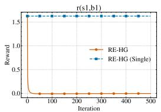

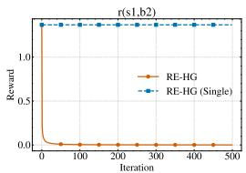

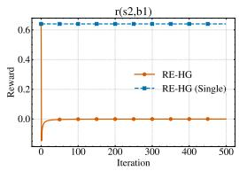

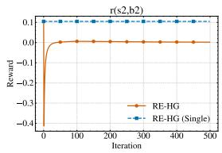

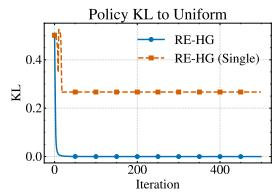

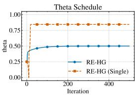  
Figure 5: Summary of Diagnostics

Figure 4: Estimated Rewards  
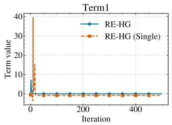

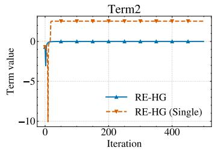  
Figure 6: Summary of Terms

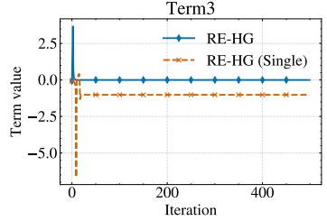

Hyperparameters Hyperparameters used in this experiment are summarized in Table 3.

Table 3: Hyperparameters
<table><tr><td>Parameter</td><td>Symbol</td><td>Value</td></tr><tr><td>Leader Discount Factor</td><td> $\gamma _ { L }$ </td><td>0.95</td></tr><tr><td>Follower Discount Factor</td><td> $\gamma _ { F }$ </td><td>0.95</td></tr><tr><td>Leader Parameter Learning Rate</td><td> $\alpha _ { L , \mathrm { a c t o r } }$ </td><td> $1 . 0 \times 1 0 ^ { - 2 }$ </td></tr><tr><td>Initial Leader Parameter</td><td> $\theta _ { 0 }$ </td><td>0.25</td></tr><tr><td>Leader Iterations</td><td></td><td>500</td></tr><tr><td>Temperature (β)</td><td></td><td> $2 . 5 \times 1 0 ^ { - 1 }$ </td></tr></table>

## C.3 2-player Markov Game (Discrete Case)

Implementation Details In Lines 5, 6 of Algorithm 1, when the transition dynamics P is known, the leader computes the surrogate follower’s policy via Soft Value Iteration (SoftVI). At Lines 5, 6 of Algorithm 1, when the transition dynamics P is not known, the leader computes the expected feature value under the initial distribution $\rho _ { 0 }$ by incorporating Successor Features (SFs) (Barreto et al., 2017). IRL is performed at iterations $0 , 1 0 , \ldots , 9 0$ . At Lines 9, 10, 12, 13 of Algorithm 1, when the transition dynamics P is known, the leader computes the value functions and gradients via dynamic programming. This approach eliminates sampling noise and significantly improves learning efficiency by avoiding Monte-Carlo simulations. However, it should be noted that this is an approximation based on learned SFs rather than unbiased sampling; therefore, the estimates may inherit biases from TD errors during the SF training process. At Line 16 of Algorithm 1, we utilize the Algorithm 9.

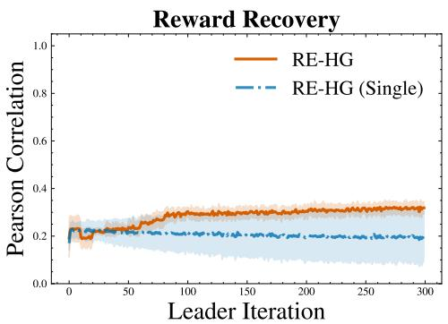  
(a) Reward Correlation

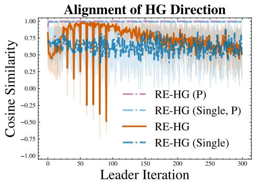  
(b) HG Similarity  
Figure 7: Discrete toy task support material. $\mathbf { \bar { \Psi } } ^ { 6 6 } \mathbf { P } ^ { \prime }$ indicates the known transition probability scenario. (a) Pearson correlation between the recovered and true rewards, weighted by the undiscounted stateaction occupancy measure of the surrogate follower policy. For each run, performance is evaluated as the mean of 10 test rollouts. Avg. (line) and std. (shaded area) across the 3 independent training runs are displayed. (b) Cosine similarity of the HG between the estimated and Oracle models. For each run, performance is evaluated as the mean of 10 test rollouts. Avg. (line) and std. (shaded area) across the 3 independent training runs are displayed.

Result As discussed in Section 5, Figure 7 provides the detailed trajectories of the reward correlation and the HG cosine similarity. Figure 7a shows that the Pearson correlation remains relatively low. This is primarily due to estimation errors in regions where insufficient trajectories were collected, which limits the accuracy of reward recovery. However, as illustrated in Figure 7b, the cosine similarity of the HG remains highly stable throughout the training process. This indicates that the estimation errors in those rarely visited regions do not negatively affect the overall gradient direction.

Hyperparameters Hyperparameters used in this experiment are summarized in Table 4.

Table 4: Hyperparameters
<table><tr><td>Parameter</td><td>Symbol</td><td>Value</td></tr><tr><td>Leader Discount Factor</td><td> $\gamma _ { L }$ </td><td>0.99</td></tr><tr><td>Leader Actor Learning Rate</td><td> $\alpha _ { L , \mathrm { a c t o r } }$ </td><td> $1 . 0 \times 1 0 ^ { - 2 }$ </td></tr><tr><td>Leader Critic Learning Rate</td><td> $\alpha _ { L , \mathrm { c r i t i c } }$ </td><td> $1 . 0 \times 1 0 ^ { - 3 }$ </td></tr><tr><td>Leader Iterations</td><td></td><td>300</td></tr><tr><td>Critic Updates per Iteration</td><td></td><td>10</td></tr><tr><td>Follower Discount Factor</td><td> $\gamma _ { F }$ </td><td>0.9</td></tr><tr><td>Follower Learning Rate (SoftQL)</td><td> $\alpha _ { F }$ </td><td>0.01</td></tr><tr><td>Temperature (β)</td><td></td><td> $2 . 5 \times 1 0 ^ { - 1 }$ </td></tr><tr><td>Max Inner Iterations</td><td></td><td>150</td></tr><tr><td>Inner Episodes</td><td></td><td>50</td></tr><tr><td>Successor feature Update Episodes</td><td></td><td>100</td></tr><tr><td>Expert Episodes per Iteration</td><td></td><td>200</td></tr><tr><td>IRL Rollout Episodes</td><td></td><td>100</td></tr><tr><td> $\omega$  Learning Rate</td><td></td><td> $5 \times 1 0 ^ { - 3 }$ </td></tr><tr><td>IRL Timing</td><td></td><td>Step 0,10, . . . ,90</td></tr><tr><td>Successor feature Learning Rate</td><td> $\alpha _ { \omega }$ </td><td>0.05</td></tr><tr><td>Adam First Moment Coefficient</td><td> $\beta _ { 1 }$ </td><td>0.9</td></tr><tr><td>Adam Second Moment Coefficient</td><td> $\beta _ { 2 }$ </td><td>0.999</td></tr><tr><td>threshold</td><td>€</td><td> $1 0 ^ { - 2 3 }$ </td></tr></table>

## C.4 Configurable MDP Continuous

Analytical Derivation of the Leader’s Value Functions First, we define the system dynamics, the leader’s immediate reward, and the follower’s best response policy. The state transition is given by:

$$
\begin{array} { r } { s ^ { \prime } = A _ { \theta } s + B b + w , \quad w \sim \mathcal { N } ( \mathbf { 0 } , \Sigma _ { w } ) . } \end{array}\tag{16}
$$

The leader’s immediate reward is defined using the weighting matrices $W _ { L }$ and $U _ { L }$ , and a configuration cost $c _ { L } ( \theta )$

$$
\begin{array} { r } { r _ { L } ( s , b ) = - s ^ { \top } W _ { L } s - b ^ { \top } U _ { L } b - c _ { L } ( \theta ) . } \end{array}\tag{17}
$$

The follower’s best response policy is $b \sim \mathcal { N } ( - K _ { s } ^ { \theta } s , \Sigma _ { F } ^ { \theta } )$ , which can be reparameterized using the noise term $\epsilon _ { b }$ as:

$$
b = - K ^ { \theta } s + \epsilon _ { b } , \epsilon _ { b } \sim { \mathcal { N } } ( \mathbf { 0 } , { \Sigma } _ { F } ^ { \theta } ) .\tag{18}
$$

We assume the leader’s optimal value function takes a quadratic form:

$$
V _ { L } ^ { \theta \dagger } ( s ) = - s ^ { \top } P _ { L } ^ { \theta } s - v _ { L } ^ { \theta } ,\tag{19}
$$

where $P _ { L } ^ { \theta } \ge 0$ is a symmetric matrix and $v _ { L } ^ { \theta }$ is a scalar. The leader’s action-value function $Q _ { L } ^ { \theta \dagger } ( s , b )$ and the state-value function $V _ { L } ^ { \theta \dagger } ( s )$ satisfy the following Bellman equations:

$$
Q _ { L } ^ { \theta \dagger } ( s , b ) = r _ { L } ( s , b ) + \gamma _ { L } t \mathbb { E } _ { w } \left[ V _ { L } ^ { \theta \dagger } ( s ^ { \prime } ) \right] ,\tag{20}
$$

$$
V _ { L } ^ { \theta \dagger } ( s ) = \mathbb { E } _ { \epsilon _ { b } } \left[ Q _ { L } ^ { \theta \dagger } ( s , b ) \right] .\tag{21}
$$

To identify $P _ { L } ^ { \theta }$ and $v _ { L } ^ { \theta } ,$ , we first evaluate the expectation over the unobservable disturbance w in Eq. (20). Substituting $\operatorname { E q . } \left( 1 6 \right)$ and Eq. (19) into Eq. (20), and utilizing the properties $\mathbb { E } _ { w } [ w ] = \mathbf { 0 }$ and $\mathbb { E } _ { w } [ w w ^ { \top } ] = \Sigma _ { w } .$ , we obtain:

$$
\begin{array} { r l } & { \mathbb { E } _ { w } \left[ V _ { L } ^ { \theta \dagger } ( A _ { \theta } s + B b + w ) \right] = - \mathbb { E } _ { w } \left[ ( A _ { \theta } s + B b + w ) ^ { \top } P _ { L } ^ { \theta } ( A _ { \theta } s + B b + w ) \right] - v _ { L } ^ { \theta } } \\ & { \qquad = - ( A _ { \theta } s + B b ) ^ { \top } P _ { L } ^ { \theta } ( A _ { \theta } s + B b ) - \mathbb { E } _ { w } [ \mathrm { T r } ( w ^ { \top } P _ { L } ^ { \theta } w ) ] - v _ { L } ^ { \theta } } \\ & { \qquad = - ( A _ { \theta } s + B b ) ^ { \top } P _ { L } ^ { \theta } ( A _ { \theta } s + B b ) - \mathrm { T r } ( P _ { L } ^ { \theta } \Sigma _ { w } ) - v _ { L } ^ { \theta } . } \end{array}\tag{22}
$$

Substituting Eq. (17) and Eq. (22) into Eq. (20) yields the closed quadratic form for $Q _ { L } ^ { \theta \dagger } ( s , b )$

$$
\begin{array} { r } { Q _ { L } ^ { \theta \dagger } ( s , b ) = - s ^ { \top } W _ { L } s - b ^ { \top } U _ { L } b - c _ { L } ( \theta ) - \gamma _ { L } \big ( \big ( A _ { \theta } s + B b \big ) ^ { \top } P _ { L } ^ { \theta } ( A _ { \theta } s + B b ) + \mathrm { T r } ( P _ { L } ^ { \theta } \Sigma _ { w } ) + v _ { L } ^ { \theta } \big ) . } \end{array}\tag{23}
$$

Next, we evaluate Eq. (21) by taking the expectation of Eq. (23) over the follower’s action noise $\epsilon _ { b } .$ Defining the closed-loop transition matrix as $\tilde { A } _ { \theta } : = A _ { \theta } - B K _ { s } ^ { \theta }$ and substituting Eq. (18), we expand the state-action terms:

$$
\begin{array} { r l } & { V _ { L } ^ { \theta \dagger } ( s ) = \mathbb { E } _ { \epsilon _ { b } } \bigg [ - s ^ { \top } W _ { L } s - ( - K _ { s } ^ { \theta } s + \epsilon _ { b } ) ^ { \top } U _ { L } ( - K _ { s } ^ { \theta } s + \epsilon _ { b } ) - c _ { L } ( \theta ) } \\ & { \qquad - \gamma _ { L } ( ( \tilde { A } _ { \theta } s + B \epsilon _ { b } ) ^ { \top } P _ { L } ^ { \theta } ( \tilde { A } _ { \theta } s + B \epsilon _ { b } ) +  { \operatorname { T r } } ( P _ { L } ^ { \theta } \Sigma _ { w } ) + v _ { L } ^ { \theta } ) \bigg ] . } \end{array}
$$

Since $\mathbb { E } _ { \epsilon _ { b } } [ \epsilon _ { b } ] = \mathbf { 0 }$ , the cross terms vanish. By applying $\mathbb { E } _ { \epsilon _ { b } } [ \epsilon _ { b } \epsilon _ { b } ^ { \top } ] = \Sigma _ { F } ^ { \theta }$ , the quadratic terms in $\epsilon _ { b }$ evaluate to traces:

$$
\begin{array} { r l } & { V _ { L } ^ { \theta \dagger } ( s ) = - s ^ { \top } \left( W _ { L } + ( K _ { s } ^ { \theta } ) ^ { \top } U _ { L } K _ { s } ^ { \theta } + \gamma _ { L } \tilde { A } _ { \theta } ^ { \top } P _ { L } ^ { \theta } \tilde { A } _ { \theta } \right) s } \\ & { \qquad - \operatorname { T r } ( U _ { L } \Sigma _ { F } ^ { \theta } ) - c _ { L } ( \theta ) - \gamma _ { L } ( \mathrm { T r } ( P _ { L } ^ { \theta } B \Sigma _ { F } ^ { \theta } B ^ { \top } ) + \mathrm { T r } ( P _ { L } ^ { \theta } \Sigma _ { w } ) + v _ { L } ^ { \theta } ) . } \end{array}\tag{24}
$$

Finally, by matching the quadratic and scalar coefficients of Eq. (24) with the ansatz in Eq. (19), we conclude that $P _ { L } ^ { \theta }$ is the unique positive semi-definite solution to the discrete-time Lyapunov equation:

$$
P _ { L } ^ { \theta } = W _ { L } + ( K _ { s } ^ { \theta } ) ^ { \top } U _ { L } K _ { s } ^ { \theta } + \gamma _ { L } \tilde { A } _ { \theta } ^ { \top } P _ { L } ^ { \theta } \tilde { A } _ { \theta } .
$$

The scalar constant $v _ { L } ^ { \theta }$ is subsequently obtained as:

$$
v _ { L } ^ { \theta } = \frac { 1 } { 1 - \gamma _ { L } } \left( \mathrm { T r } ( U _ { L } \Sigma _ { F } ^ { \theta } ) + c _ { L } ( \theta ) + \gamma _ { L } ( \mathrm { T r } ( P _ { L } ^ { \theta } B \Sigma _ { F } ^ { \theta } B ^ { \top } ) + \mathrm { T r } ( P _ { L } ^ { \theta } \Sigma _ { w } ) ) \right) .
$$

Thus, the leader’s value functions are fully determined analytically without requiring neural network approximations.

## C.4.1 Easy Setting

Task Description The task is defined as an n-zone building thermal control problem with $n = 4$ The state $s _ { t } \in \mathbb { R } ^ { 4 }$ represents temperature deviations, and the follower’s action $b _ { t } \in \mathbb { R } ^ { 2 }$ represents HVAC actuation. As defined previously, the system dynamics follow $s _ { t + 1 } = A _ { \theta } s _ { t } + B b _ { t } + w _ { t }$ with $w _ { t } \sim \mathcal { N } ( \mathbf { 0 } , \Sigma _ { w } )$ , and the leader’s immediate reward is $r _ { L } ( s _ { t } , b _ { t } ) = - ( s _ { t } ^ { \top } W _ { L } s _ { t } + b _ { t } ^ { \top } U _ { L } b _ { t } + c _ { L } ( \theta ) )$

For the leader’s immediate reward, the specific weighting matrices $W _ { L } , U _ { L }$ , and the configuration cost $c _ { L } ( \theta )$ are defined as:

$$
W _ { L } = \frac { 1 } { 4 } \left( I _ { 4 } - \frac { 1 } { 4 } { \bf 1 1 } ^ { \top } \right) , \quad U _ { L } = 0 . 5 \cdot I _ { 2 } , \quad c _ { L } ( \theta ) = 0 . 1 \cdot \left( \| \alpha \| _ { 2 } ^ { 2 } + \| \nu \| _ { 2 } ^ { 2 } \right) ,
$$

where $I _ { n }$ is the identity matrix, and $\mathbf { 1 } \in \mathbb { R } ^ { n }$ is a vector of ones.

The configurable state transition matrix $A _ { \theta } \in \mathbb { R } ^ { 4 \times 4 }$ is parameterized by the leader’s decision variables, insulation levels $\alpha \in [ 0 , 1 ] ^ { 4 }$ and airflow levels $\nu \in [ 0 , 1 ] ^ { 4 }$ , as follows:

$$
\begin{array} { r } { A _ { \theta } = \left[ \begin{array} { c c c c c } { 1 + \Delta ( \alpha _ { 1 } ) - h _ { 1 2 } \nu _ { 1 } - h _ { 4 1 } \nu _ { 4 } } & { h _ { 1 2 } \nu _ { 1 } } & { 0 } & { h _ { 4 1 } \nu _ { 4 } } & { 0 } \\ { h _ { 2 1 } \nu _ { 1 } } & { 1 + \Delta ( \alpha _ { 2 } ) - h _ { 2 3 } \nu _ { 2 } - h _ { 2 1 } \nu _ { 1 } } & { h _ { 2 3 } \nu _ { 2 } } & { 0 } & { 0 } \\ { 0 } & { h _ { 3 2 } \nu _ { 2 } } & { 1 + \Delta ( \alpha _ { 3 } ) - h _ { 3 4 } \nu _ { 3 } - h _ { 3 2 } \nu _ { 2 } } & { h _ { 3 4 } \nu _ { 3 } } & { - h _ { 4 3 } \nu _ { 4 } - h _ { 4 3 } \nu _ { 3 } } \\ { h _ { 4 1 } \nu _ { 4 } } & { 0 } & { 0 } & { h _ { 4 3 } \nu _ { 3 } } & { 1 + \Delta ( \alpha _ { 4 } ) - h _ { 4 1 } \nu _ { 4 } - h _ { 4 3 } \nu _ { 3 } } \end{array} \right] } \end{array}
$$

where $\Delta ( \alpha _ { i } ) : = k _ { i } ( 1 - \alpha _ { i } )$ . The positive coefficients $k _ { i }$ and $h _ { i j }$ representing specific physical constants are set as:

$$
k _ { 1 } = 0 . 0 4 , ~ h _ { 1 2 } = 0 . 0 5 , ~ h _ { 4 1 } = 0 . 0 5
$$

$$
k _ { 2 } = 0 . 0 3 , \quad h _ { 2 3 } = 0 . 0 4 , \quad h _ { 2 1 } = 0 . 0 3
$$

$$
k _ { 3 } = 0 . 0 6 , \quad h _ { 3 4 } = 0 . 0 6 , \quad h _ { 3 2 } = 0 . 0 4
$$

$$
k _ { 4 } = 0 . 0 5 , \quad h _ { 4 1 } = 0 . 0 5 , \quad h _ { 4 3 } = 0 . 0 3
$$

The follower’s immediate reward is defined as a quadratic cost:

$$
\begin{array} { r } { r _ { F } ( s , b ) = - s ^ { \top } W _ { F } s - b ^ { \top } U _ { F } b . } \end{array}
$$

The specific weighting matrices for the follower are given by:

$$
W _ { F } = \left[ \begin{array} { l l l l } { { 8 } } & { { 0 } } & { { 0 } } & { { 0 } } \\ { { 0 } } & { { 1 } } & { { 0 } } & { { 0 } } \\ { { 0 } } & { { 0 } } & { { 5 } } & { { 0 } } \\ { { 0 } } & { { 0 } } & { { 0 } } & { { 6 } } \end{array} \right] , \quad U _ { F } = 0 . 0 1 \cdot I _ { 2 } .
$$

The control input matrix B and the unobservable disturbance covariance $\Sigma _ { w }$ are defined as:

$$
B = \left[ \begin{array} { c c } { { 0 . 1 0 } } & { { 0 } } \\ { { 0 . 6 } } & { { 0 } } \\ { { 0 } } & { { 0 . 5 5 } } \\ { { 0 } } & { { 0 . 3 0 } } \end{array} \right] , \quad \Sigma _ { w } = 0 . 0 2 \cdot I _ { 4 } .
$$

Implementation Details In Line 7 of Algorithm 1, since the transition dynamics are linear-Gaussian and the reward functions are quadratic, we obtain $Q _ { F } ^ { \theta \dagger }$ directly from the Discrete Algebraic Riccati Equation (DARE) solution for the follower’s policy. For the same reason, in Line 9 of Algorithm 1, we analytically compute $Q _ { L } ^ { \theta \dagger }$ and $V _ { L } ^ { \theta \dagger }$ by solving the DARE. In Line 13 of Algorithm 1, we obtain $\nabla Q _ { F } ^ { \theta \dagger }$ via the discrete Lyapunov equation. Finally, in Line 15 of Algorithm 1, the HG components are computed analytically using the known transition dynamics and policies, which bypasses the need for empirical trajectory sampling in these steps.

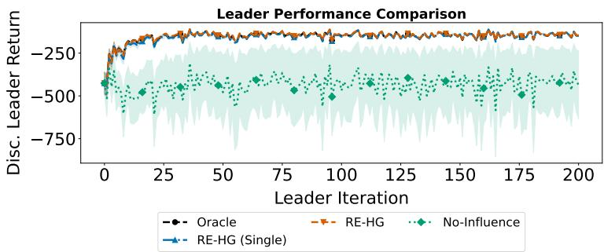  
Figure 8: Results on Building Thermal Control. For each run, performance is evaluated as the mean of 50 test rollouts. Avg. (line) and std. (shaded area) across the 3 independent training runs are displayed.

Result Figure 8 presents the performance comparison in the Building Thermal Control task. In our setup, the initial state is stochastic, and the leader’s initial parameters θ are sampled from a uniform distribution U(0, 0.3). To ensure the statistical reliability of the results despite this randomness, we evaluated the methods across three different environments, each with ten independent trials using distinct random seeds.

The results clearly demonstrate that RE-HG significantly outperforms NO-INFLUENCE. Notably, the performance of RE-HG is comparable to that of ORACLE. This indicates that our approach effectively recovers the necessary information to achieve near-optimal leader strategies.

Hyperparameters Hyperparameters used in this experiment are summarized in Table 5.

Table 5: Hyperparameters
<table><tr><td>Name</td><td>Symbol</td><td>Value</td></tr><tr><td>Leader iterations</td><td>K</td><td>200</td></tr><tr><td>Episodes per iteration</td><td>=</td><td>100</td></tr><tr><td>Evaluation episodes</td><td></td><td>50</td></tr><tr><td>Leader discount factor</td><td>YL</td><td>0.9</td></tr><tr><td>Follower discount factor</td><td> $\gamma _ { F }$ </td><td>0.9</td></tr><tr><td>Leader learning rate</td><td> $\alpha _ { L }$ </td><td>0.1</td></tr><tr><td>Temperature</td><td> $\beta$ </td><td>0.1</td></tr><tr><td>Gradient clip max norm</td><td></td><td>1.0</td></tr><tr><td>Local IRL iterations</td><td></td><td>200</td></tr><tr><td>Local IRL learning rate</td><td></td><td>0.01</td></tr><tr><td>threshold</td><td>€</td><td>10⁻4</td></tr></table>

## C.4.2 Hard Setting (8-Zone Central Corridor Topology)

Task Description The task is extended to an n-zone building thermal control problem where $n = 8$ . The state $s _ { t } \in \mathbb { R } ^ { 8 }$ represents temperature deviations, and the follower’s action $b _ { t } \in \mathbb { R } ^ { 4 }$ represents HVAC actuation for the directly controlled zones. As defined previously, the system dynamics follow $s _ { t + 1 } = A _ { \theta } s _ { t } + B b _ { t } + w _ { t }$ with $\boldsymbol { w } _ { t } \sim \mathcal { N } ( \mathbf { 0 } , \Sigma _ { w } )$ , and the leader’s immediate reward is $r _ { L } ( s _ { t } , b _ { t } ) = - ( s _ { t } ^ { \top } W _ { L } s _ { t } + b _ { t } ^ { \top } U _ { L } b _ { t } + c _ { L } ( \theta ) )$ .

For the leader’s immediate reward, the specific weighting matrices $W _ { L } , U _ { L }$ , and the configuration cost $c _ { L } ( \theta )$ are defined as:

$$
{ W _ { L } } = \frac { 1 } { 8 } \left( { { I _ { 8 } } - \frac { 1 } { 8 } { \bf { 1 1 } } ^ { \top } } \right) , \quad { U _ { L } } = 0 . 5 \cdot { I _ { 4 } } , \quad { c _ { L } } ( \theta ) = { \| \alpha \| _ { 2 } ^ { 2 } } + \| \nu \| _ { 2 } ^ { 2 } ,
$$

where $I _ { n }$ is the identity matrix, and $\mathbf { 1 } \in \mathbb { R } ^ { n }$ is a vector of ones.

The configurable state transition matrix $A _ { \theta } ~ \in ~ \mathbb { R } ^ { 8 \times 8 }$ is parameterized by the leader’s decision variables, insulation levels $\alpha \in [ 0 , 1 ] ^ { 8 }$ and airflow levels $\bar { \nu ( \in \lbrack 0 , 1 \vert ^ { 8 } }$ . The topology consists of two core corridors (Zones 1 and 2) and six perimeter offices (Zones 3–8). The off-diagonal entries $A _ { i , j }$ (representing heat transfer from zone $j$ to zone i) are:

$$
A _ { i , j } = \left\{ \begin{array} { l l } { h _ { c c } \nu _ { 1 } } & { \mathrm { i f ~ } ( i , j ) \in \{ ( 1 , 2 ) , ( 2 , 1 ) \} } \\ { h _ { c r } \nu _ { k } } & { \mathrm { i f ~ } i \in \{ 1 , 2 \} \mathrm { ~ a n d ~ } j \mathrm { ~ i s ~ a n ~ a d j a c e n t ~ o f f c e } } \\ { h _ { r c } \nu _ { k } } & { \mathrm { i f ~ } j \in \{ 1 , 2 \} \mathrm { ~ a n d ~ } i \mathrm { ~ i s ~ a n ~ a d j a c e n t ~ o f f c e } } \\ { 0 } & { \mathrm { o t h e r w i s e } } \end{array} \right.
$$

where $\nu _ { k }$ corresponds to the specific airflow parameter for the edge. Specifically, the edges connected to the West corridor (Zone 1) are controlled by $\nu _ { 3 }$ (Zone $3 ) , \nu _ { 4 } ( \bar { \mathrm { Z } } \mathrm { o n e } \bar { 4 } )$ , and $\nu _ { 6 }$ (Zone $^ { 6 ) }$ . The edges connected to the East corridor (Zone 2) are controlled by $\nu _ { 5 }$ (Zone 5), ν7 (Zone $7 )$ , and $\nu _ { 8 } ( Z \mathrm { o n e } 8 )$ The parameter $\nu _ { 2 }$ is kept redundant to maintain the unified dimensionality $\theta \in [ 0 , 1 ] ^ { 1 6 }$ . The diagonal entries are defined to preserve energy balance:

$$
A _ { i , i } = 1 + \Delta ( \alpha _ { i } ) - \sum _ { j \neq i } A _ { j , i }
$$

where $\Delta ( \alpha _ { i } ) : = k _ { i } ( 1 - \alpha _ { i } )$ . The physical heat transfer coefficients are set to $h _ { c c } = 0 . 0 8 , h _ { c r } = 0 . 0 5$ $h _ { r c } = 0 . 0 3$ , and the insulation effects $k _ { i }$ are:

$$
\begin{array} { l l l } { { k _ { 1 } = 0 . 0 1 , } } & { { k _ { 2 } = 0 . 0 1 , } } & { { k _ { 3 } = 0 . 0 6 , } } & { { k _ { 4 } = 0 . 0 8 } } \\ { { k _ { 5 } = 0 . 0 6 , } } & { { k _ { 6 } = 0 . 0 3 , } } & { { k _ { 7 } = 0 . 0 4 , } } & { { k _ { 8 } = 0 . 0 3 } } \end{array}
$$

The follower’s immediate reward is defined as a quadratic cost:

$$
\begin{array} { r } { r _ { F } ( s , b ) = - s ^ { \top } W _ { F } s - b ^ { \top } U _ { F } b . } \end{array}
$$

The specific weighting matrices for the follower are given by:

$$
W _ { F } = \mathrm { d i a g } ( 0 . 1 , 0 . 1 , 8 . 0 , 3 0 . 0 , 8 . 0 , 3 . 0 , 5 . 0 , 3 . 0 ) , \quad U _ { F } = 0 . 0 1 \cdot I _ { 4 } .
$$

Note that Zone 4 (VIP office) is assigned the highest priority weight $( W _ { F , 4 4 } = 3 0 . 0 )$ despite having no direct HVAC control, creating a challenging under-actuated control task for the follower.

The control input matrix $B \in \mathbb { R } ^ { 8 \times 4 }$ and the unobservable disturbance covariance $\Sigma _ { w }$ are defined as:

$$
B = \left[ \begin{array} { c c c c c } { 0 } & { 0 } & { 0 } & { 0 } \\ { 0 } & { 0 } & { 0 } & { 0 } \\ { 0 . 8 } & { 0 } & { 0 } & { 0 } \\ { 0 } & { 0 } & { 0 } & { 0 } \\ { 0 } & { 0 . 8 } & { 0 } & { 0 } \\ { 0 } & { 0 } & { 0 . 8 } & { 0 } \\ { 0 } & { 0 } & { 0 } & { 0 } \\ { 0 } & { 0 } & { 0 } & { 0 . 8 } \end{array} \right] , \quad \Sigma _ { w } = 0 . 0 2 \cdot I _ { 8 } .
$$

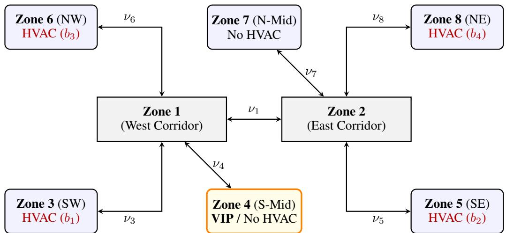  
Figure 9: Topology of the 8-Zone Building Thermal Control Environment. Nodes represent the zones, with their respective HVAC control inputs. Edges represent the heat transfer between adjacent zones, parameterized by the leader’s airflow configuration $\nu _ { k }$ . Note that the VIP office (Zone 4) has no direct HVAC, highlighting the under-actuated nature of the follower’s control task.

Implementation Details In Line 7 of Algorithm 1, since the transition dynamics are linear-Gaussian and the reward functions are quadratic, we obtain $Q _ { F } ^ { \theta \dagger }$ directly from the DARE solution for the follower’s policy. For the same reason, in Line 9 of Algorithm 1, we analytically compute $Q _ { L } ^ { \theta \dagger }$ and $V _ { L } ^ { \theta \dagger }$ by solving the DARE. At line 15 in Algorithm 1, we adopt the variance reduction baseline as formulated in (14). We utilize the relation $\nabla _ { \boldsymbol { \theta } } Q _ { F } ^ { \boldsymbol { \theta } \dagger } - \nabla _ { \boldsymbol { \theta } } V _ { F } ^ { \boldsymbol { \theta } \dagger } = \nabla _ { \boldsymbol { \theta } } \log g ^ { \boldsymbol { \theta } \dagger }$ , which is computed by the discrete Lyapunov equation. Furthermore, we use the expectation $\mathbb { E } [ V _ { L } ^ { \theta \dagger } ( s _ { t + 1 } ) ]$ obtained via DARE as a baseline for the $\nabla _ { \theta } \log { p ^ { \theta } }$ term to stabilize the stochastic gradient estimates. Finally, in Line 15 of Algorithm 1, the HG components are computed analytically using the known transition dynamics and policies, which bypasses the need for empirical trajectory sampling in these steps. To ensure stable gradient-based optimization, we apply gradient norm clipping with a maximum norm of 1.0. If the L2-norm of the gradient exceeds this threshold, we rescale it to maintain numerical stability during policy updates.

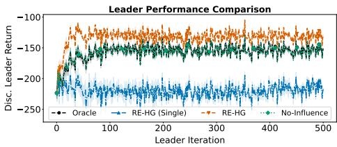  
(a) Leader’s discounted return

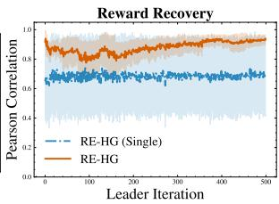  
(b) Reward Correlation

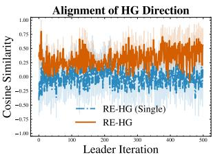  
(c) HG CosineSimilarity  
Figure 10: Results for the relaxed setting $( W _ { F , 4 4 } = 1 0 . 0 )$ . (a) Leader’s discounted return. For each run, performance is evaluated as the mean of 50 test rollouts. Avg. (line) and std. (shaded area) across the 5 independent training runs are displayed. Solid lines and shaded areas denote the avg. and std., respectively. (b) Pearson correlation between the recovered and true rewards, weighted by the undiscounted state-action occupancy measure of the surrogate follower policy. (c) Cosine similarity of the HG between the estimated and ORACLE

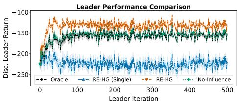  
(a) Leader’s discounted return

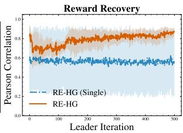  
(b) Reward Correlation

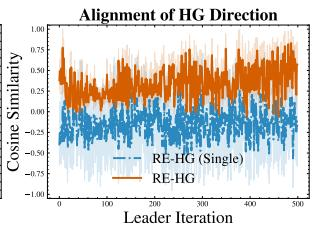  
(c) HG CosineSimilarity  
Figure 11: Results for the relaxed setting $( W _ { F , 4 4 } = 2 0 . 0 )$ . (a) Leader’s discounted return. For each run, performance is evaluated as the mean of 50 test rollouts. Avg. (line) and std. (shaded area) across the 5 independent training runs are displayed. Solid lines and shaded areas denote the avg. and std., respectively. (b) Pearson correlation between the recovered and true rewards, weighted by the undiscounted state-action occupancy measure of the surrogate follower policy. (c) Cosine similarity of the HG between the estimated and ORACLE.

Result As discussed in the ablation study in Section 5, we investigate the impact of the follower’s reward landscape steepness on the optimization process. In the original Hard Setting, the highly skewed penalty for the VIP zone $( W _ { F , 4 4 } = 3 0 . 0 )$ caused gradient explosions, trapping the ORACLE in a suboptimal local minimum.

Figure 10 and Figure 11 present the results when this steep penalty is relaxed to $W _ { F , 4 4 } = 1 0 . 0$ and $W _ { F , 4 4 } = 2 0 . 0$ , respectively. As shown in the Figures 10 and 11, relaxing the reward steepness mitigates the gradient explosion. Consequently, the performance of the ORACLE significantly improves compared to the original $W _ { F , 4 4 } \stackrel { - } { = } 3 0 . { \dot { 0 } }$ case, successfully finding superior leader policies. Meanwhile, RE-HG maintains robust and highly stable performance across all variations, consistently achieving high cosine similarity and optimal returns. This confirms that while the ORACLE is highly sensitive to sharp reward landscapes, the implicit smoothing mechanism of RE-HG inherently generates a manageable gradient landscape, reliably extracting effective HG regardless of the underlying reward steepness.

Hyperparameters Hyperparameters used in this experiment are summarized in Table 6.

## C.5 2-player MG (Continuous)

Task Description The environment is modeled as a discretized linear system with a time step $\Delta t = 0 . 1$ . The state $s _ { t } = [ p _ { t } , v _ { t } ] ^ { \top } \in \mathbb { R } ^ { 2 }$ represents the position and velocity, and its evolution is governed by $s _ { t + 1 } = A s _ { t } + B b _ { t } + C a _ { t } ,$ , where $a _ { t }$ and $b _ { t }$ are the control inputs of the leader and the follower, respectively. The system matrices and the initial state $s _ { 0 }$ are defined as:

$$
A = [ 0 \atop 0  \quad 1 ] , \quad B = [ 0 \atop \Delta t ] , \quad C = [ 0 \atop 0 ] , \quad s _ { 0 } = [ 1 \atop 0 ] .
$$

Table 6: Hyperparameters
<table><tr><td>Name</td><td>Symbol</td><td>Value</td></tr><tr><td>Leader iterations</td><td>K</td><td>500</td></tr><tr><td>Episodes per iteration</td><td></td><td>100</td></tr><tr><td>Evaluation episodes</td><td></td><td>50</td></tr><tr><td>Leader discount factor</td><td>YL</td><td>0.9</td></tr><tr><td>Follower discount factor</td><td> $\gamma _ { F }$ </td><td>0.9</td></tr><tr><td>Leader learning rate</td><td> $\alpha _ { L }$ </td><td>0.1</td></tr><tr><td>Temperature</td><td> $\beta$ </td><td>0.1</td></tr><tr><td>Gradient clip max norm</td><td></td><td>1.0</td></tr><tr><td>Local IRL iterations</td><td></td><td>200</td></tr><tr><td>Local IRL learning rate</td><td></td><td>0.01</td></tr><tr><td>threshold</td><td>€</td><td> $1 0 ^ { - 2 }$ </td></tr></table>

Reward Functions The follower maximizes the quadratic reward $r _ { F } ( s _ { t } , b _ { t } ) = - s _ { t } ^ { \top } W _ { F } s _ { t } -$ $b _ { t } ^ { \top } U _ { F } b _ { t }$ to stabilize at the origin, with $W _ { F } = I _ { 2 }$ and $U _ { F } = [ 1 ]$ . The leader aims to induce oscillation around the target $s _ { L } ^ { \star } = [ - 0 . \bar { 8 , } 0 ] ^ { \top }$ by maximizing a Gaussian kernel reward:

$$
r _ { L } \big ( \boldsymbol { s } _ { t } \big ) = \exp \left( - \frac { 1 } { 2 } \big ( \boldsymbol { s } _ { t } - \boldsymbol { s } _ { L } ^ { \star } \big ) ^ { \top } M \big ( \boldsymbol { s } _ { t } - \boldsymbol { s } _ { L } ^ { \star } \big ) \right) ,
$$

where $M = 0 . 2 5 I _ { 2 }$ . Note that while $r _ { L }$ depends only on the state $s _ { t } ,$ it is implicitly coupled with the actions $a _ { t }$ and $b _ { t }$ through the system dynamics.

Implementation Details Before the main training loop, the leader’s critic $Q _ { L }$ is pre-trained using 40 episodes generated from a randomized initial distribution where $s _ { 0 } [ 0 ] \ \sim \ \bar { \mathcal { U } } ( - 1 . 5 , 1 . 5 )$ and $s _ { 0 } [ 1 \bar { ] } \sim \mathcal { U } ( - \bar { 1 } . 0 , 1 . 0 )$ . This dataset comprises approximately 4,000 transitions based on a 100-step limit per episode, which are used to perform 50 optimization epochs via SARSA-TD updates to stabilize the critic initialization. In Line 5 of Algorithm 1, if the transition dynamics are unknown, we estimate them via linear regression. In Line 13 of Algorithm 1, we obtain $\nabla Q _ { F } ^ { \theta \dagger }$ via the discrete Lyapunov equation. In Line 12 of Algorithm 1, the benefit $B _ { L }$ is calculated as the difference between the online leader’s action-value function $( Q _ { L } ^ { \mathrm { o n l i n e } } )$ and the target leader’s value function $( V _ { L } ^ { \mathrm { t a r g e t } } )$ ). To ensure stable gradient-based optimization, we apply gradient norm clipping with a maximum norm of 1.0. If the L2-norm of the gradient exceeds this threshold, we rescale it to maintain numerical stability during policy updates.

Result As discussed in Section 5, we present the detailed evaluation metrics for the continuous 2- player Markov Game task. Figure 12a shows the highly stable weighted Pearson correlation between the recovered and true rewards. Figure 12b illustrates the cosine similarity of the hypergradient direction against ORACLE. As shown in Figure 13, calculating the benefit using the online network for both functions (i.e., $Q _ { L } ^ { \mathrm { o n l i n e } } - V _ { L } ^ { \mathrm { o n l i n e } } )$ fails to achieve stability. This instability arises because, near the optimal policy, the influence term practically vanishes. While $Q _ { L }$ learns and generalizes at this point, the leader’s policy continues to change due to other gradient terms. Consequently, the previously generalized $Q _ { L }$ values become inaccurate for the shifted policy, leading to performance degradation.

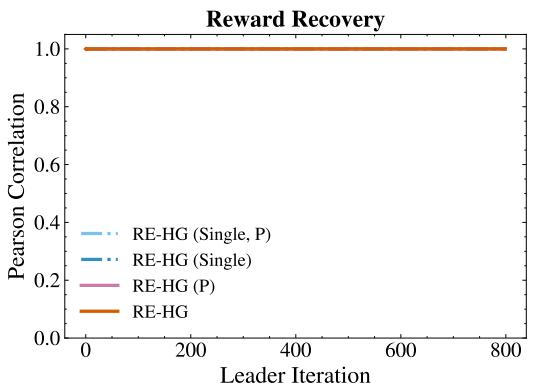  
(a) Reward Correlation

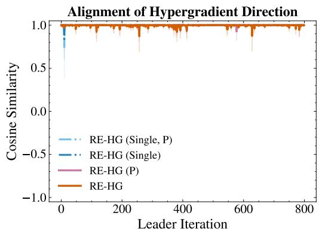  
(b) HG Cosine Similarity  
Figure 12: (a) Pearson correlation between the recovered and true rewards, weighted by the undiscounted state-action occupancy measure of the surrogate follower policy. (b) Cosine similarity of the HG between the estimated and ORACLE.

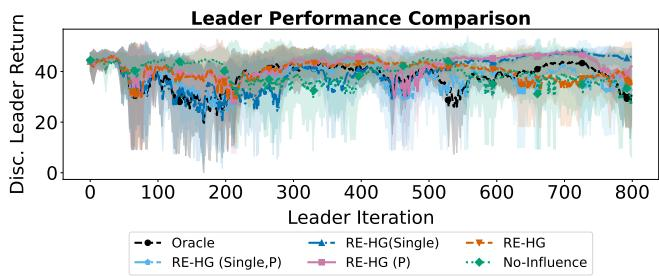  
Figure 13: This figure illustrates the instability caused by calculating the benefit using the online network for both functions. Specifically, the benefit is calculated as the difference between the online leader’s action-value function $( Q _ { L } ^ { \mathrm { o n l i n e } } )$ and the online leader’s value function $( V _ { L } ^ { \mathrm { o n l i n e } } )$ . For each run, performance is evaluated as the mean of 10 test rollouts. Avg. (line) and std. (shaded area) across the 3 independent training runs are displayed. “P” indicates the known transition probability scenario.

Hyperparameters Hyperparameters used in this experiment are summarized in Table 7.

Table 7: Hyperparameters
<table><tr><td>Name</td><td>Symbol</td><td>Value</td></tr><tr><td>Time step</td><td> $\Delta t$ </td><td>0.1</td></tr><tr><td>Max steps per episode</td><td> $T$ </td><td>100</td></tr><tr><td>Leader iterations</td><td> $K$ </td><td>800</td></tr><tr><td>Episodes per iteration</td><td></td><td>4</td></tr><tr><td>Leader discount factor</td><td> $\gamma _ { L }$ </td><td>0.99</td></tr><tr><td>Follower discount factor</td><td> $\gamma _ { F }$ </td><td>0.99</td></tr><tr><td>Leader learning rate Temperature</td><td> $\alpha _ { L }$ </td><td>0.05</td></tr><tr><td>Leader Critic Update times</td><td> $\beta$ </td><td>0.01 5</td></tr><tr><td>Leader sigma</td><td> $\Sigma _ { L }$ </td><td> $1 . 0 \times 1 0 ^ { - 3 }$ </td></tr><tr><td>threshold</td><td>€</td><td> $1 0 ^ { - 4 }$ </td></tr><tr><td>Pre-training episodes</td><td> $n _ { \mathrm { p r e } }$ </td><td>40</td></tr><tr><td></td><td></td><td></td></tr><tr><td>Pre-training epochs</td><td></td><td>50</td></tr></table>

## C.6 Comparing Oracle

In the Hard Setting of Section C.4.2, RE-HG attains a higher leader return than ORACLE. Since ORACLE computes the exact hypergradient, the gap may simply reflect the smaller effective update of RE-HG. We test this by retuning the ORACLE update in three ways: (a) a tuned learning rate, (b) gradient clipping, and (c) a scaled influence term. Modification (c) is the closest ORACLE-side analogue of the regularization in RE-HG, since the eigenvalue truncation in Algorithm 2 has no counterpart when the true reward is available.

All ablations use the continuous Conf-MDP environment with the same base configuration as the Hard Setting of Section C.4.2, and each ORACLE and RE-HG variant is evaluated over five random seeds. Figure 14 shows the learning curves.

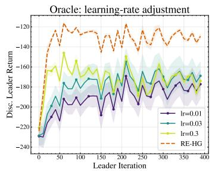

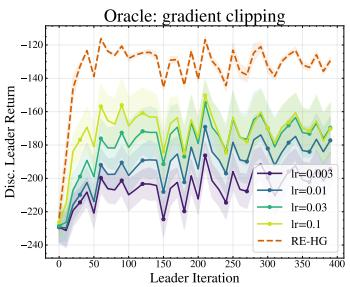

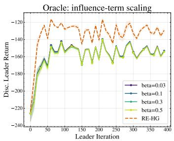  
Figure 14: Learning curves for three ORACLE-side modifications. Lines represent the mean discounted leader return across five random seeds, and shaded regions represent one standard deviation. (a) Tuned learning rate: the ORACLE learning rate is varied. (b) Gradient clipping: the hypergradient is clipped and the learning rate is varied. (c) Influence-term scaling: the influence term is multiplied by a global factor while the direct term is left unchanged. The dashed RE-HG curve is included as the baseline in each panel.

Tuning the learning rate does not help. The ORACLE uses $\alpha _ { L } = 0 . 1$ in the Hard Setting, and Figure 14(a) shows that none of the alternatives $0 . 0 1 , 0 . 0 3 .$ , and 0.3 improved on it, the best being $- \mathrm { \bar { 1 } 7 0 . 5 4 \pm 1 4 . 0 7 }$ . Clipping the hypergradient as $g  g / \vert \vert g \vert \vert$ fares no better across learning rates 0.003, 0.01, 0.03, and 0.1, the last of which is the original value, with a best of $- 1 7 1 . 1 2 \pm 1 \bar { 4 } . 7 3$ in Figure 14(b).

Scaling the influence term, the second term of the hypergradient, by factors between 0.03 and 0.5 while leaving the direct term unchanged does help. Figure 14(c) shows it raises the ORACLE return to between $- 1 5 5 . 2 8 \pm 0 . 7 2$ and $- 1 5 4 . 1 5 \pm 0 . 0 0$ , still far below the $- 1 2 9 . 5 9 \pm 0 . 8 8$ of RE-HG.

Rescaling the update therefore does not reproduce the effect of eigenvalue truncation. Modifications (a) and (b) change only the magnitude of the update, and (c) changes the ratio between the direct and influence terms by a single global factor. Eigenvalue truncation instead suppresses poorly excited directions of the influence term selectively, so it changes the direction of the update rather than its scale.

## C.7 Multi-environment IRL

A natural alternative to the sequential aggregation of Algorithm 2 is to estimate one shared reward jointly from the demonstrations accumulated across all environments visited so far. We ask whether sequential aggregation gives anything up.

We implemented a joint multi-environment IRL baseline from Section 7.2 of Cao et al. (2021). That formulation assumes access to the transition dynamics, so we evaluated both methods in a discrete environment with known dynamics. Figure 15 shows the learning curves.

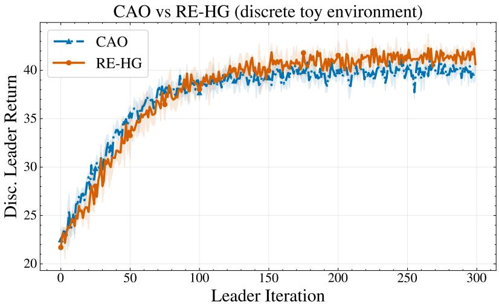  
Figure 15: Comparison between the joint multi-environment IRL baseline (CAO) and RE-HG in the discrete toy environment with known transition dynamics. Lines represent the mean discounted leader return across three random seeds, and shaded regions represent one standard deviation.

The two methods match throughout training and both converge close to the optimum, reaching discounted leader returns of 21.46 and 20.75 respectively, averaged over the last 30 leader iterations with the same three random seeds. Sequential aggregation is therefore no better in final performance, which is what our analysis predicts: both approaches resolve reward ambiguity under their respective idealized assumptions. Its advantages are algorithmic, and are threefold.

First, RE-HG integrates reward estimation into the standard bilevel optimization procedure. Each leader update presents the follower with a new environment, and RE-HG re-estimates the reward from trajectories collected in that environment and immediately computes the hypergradient. Joint multi-environment IRL instead estimates a shared reward from demonstrations accumulated across environments, which requires storing past trajectories and deciding how many of them to keep.

Second, the formulation of Cao et al. (2021) assumes known transition dynamics, whereas RE-HG also applies to the two-player Markov game setting of this paper, where they are unknown.

Third, Theorem 1 and Proposition 2 are developed for sequential reward aggregation and give identifiability together with an error bound relating the reward-estimation error to the hypergradient error. We are not aware of a joint multi-environment IRL method that applies directly to our setting and offers a comparable guarantee.

## C.8 Misspecified reward features

Assumption 1 assumes a known feature extractor. One-hot features make this harmless in discrete environments, but in continuous ones the recovered reward is only as good as the chosen basis, so we test three forms of misspecification: basis mismatch, limited update capacity, and redundant features. All experiments use the continuous Conf-MDP (LQR) environment with the same base configuration as the Hard Setting of Section C.4.2; each condition is evaluated over five random seeds. Figure 16 shows the learning curves.

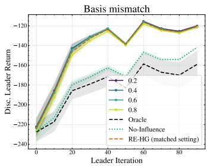

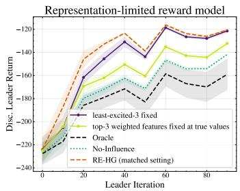

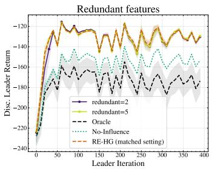  
Figure 16: Learning curves under reward-feature misspecification in the continuous Conf-MDP. Lines show mean discounted leader return and shaded regions show one standard deviation. The misspecified RE-HG runs use three random seeds, while the Oracle, No-Influence, and matchedsetting RE-HG reference curves use five seeds. (a) Basis mismatch: the true reward contains off-diagonal interaction terms such as $s _ { i } s _ { j }$ , whereas the IRL model is restricted to diagonal quadratic features. (b) Limited update capacity and representation misspecification: the three state-cost features with the largest true weights, accounting for approximately 80.4% of the total state-cost weight, are fixed at their true values to isolate an update-capacity restriction. A complementary curve fixes the three least-excited features at incorrect values, introducing genuine representation misspecification. (c) Redundant-feature over-specification: two or five cross-term features are added to the IRL model even though their true coefficients are zero. The RE-HG reference curve is included in every panel.

Under basis mismatch, Figure 16(a) shows that the exact analytic ORACLE becomes unstable because its HG is unregularized, yielding leader returns between $- 1 7 1 . 3 8 \pm 1 0 . 7 2$ and $- 1 5 5 . 8 1 \pm 0 . 0 0$ RE-HG stays between −128.40 ± 1.68 and $- 1 2 9 . 4 5 \pm 2 . 3 3 .$ , consistent with the smoothing effect of eigenvalue truncation.

Figure 16(b) separates a restriction on update capacity from genuine representation error. Freezing the three state-cost features with the largest true weights, which account for $4 6 / ( 0 . 1 + 0 . 1 + 8 +$ $3 0 + 8 + 3 + 5 + 3 ) \approx 8 0 . 4 \%$ of the total state-cost weight, at their true values introduces no representation error and isolates the effect of restricting which directions can be updated; RE-HG still reaches −141.43 ± 2.50, well above the NO-INFLUENCE baseline of −153.21. Freezing the three least-excited features at incorrect values instead, [1, 1, 1] against true values [8, 3, 8], costs almost nothing: RE-HG reaches $- 1 2 9 . 9 4 \pm 1 . 9 4$ , because eigenvalue truncation already suppresses these directions.

With redundant features, Figure 16(c) shows that RE-HG again beats the NO-INFLUENCE baseline, reaching $- 1 3 1 . 8 4 \pm 1 . 6 0$ with two redundant features and $- 1 3 0 . 9 2 \pm 0 . 9 9$ with five.

## C.9 Optimal follower assumption

Proposition 1 characterizes the IRL solution only when the follower plays its exact best response, and a real follower is at best approximately optimal. We therefore test two suboptimal followers: a myopic one that runs a limited number of Riccati iterations, $T \in \{ 1 2 , 1 6 , 2 0 , 3 0 \}$ , and an under-reactive one whose feedback gain is scaled as $( 1 - \alpha ) K ^ { * }$ with $\alpha \in \{ 0 . 0 5 , 0 . 1 , 0 . 2 , 0 . 3 5 \}$ . Smaller T and larger α mean larger deviations from the optimal follower.

Both experiments use the continuous Conf-MDP (LQR) environment with the same base configuration as the Hard Setting of Section C.4.2; each condition is evaluated over three random seeds and the RE-HG baseline over five. Figure 17 shows the learning curves and Figure 18 the total-variation (TV) distance between the suboptimal follower and the exact best response during training.

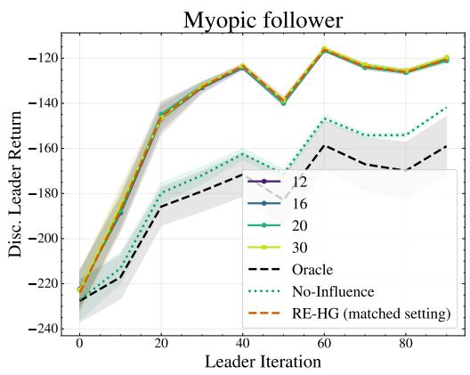

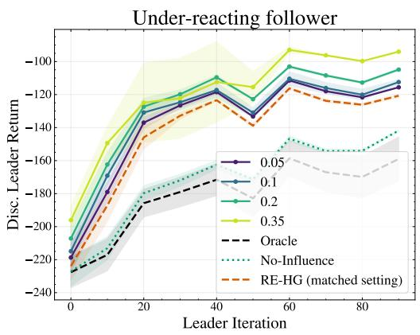  
Figure 17: Learning curves under suboptimal follower models in the continuous Conf-MDP. Lines represent mean discounted leader return across three random seeds (five for the RE-HG baseline), and shaded regions represent one standard deviation. (a) Myopic follower: varying Riccati iteration budget T. (b) Under-reactive follower: varying gain reduction parameter α. The RE-HG curve is included as the baseline in each panel.

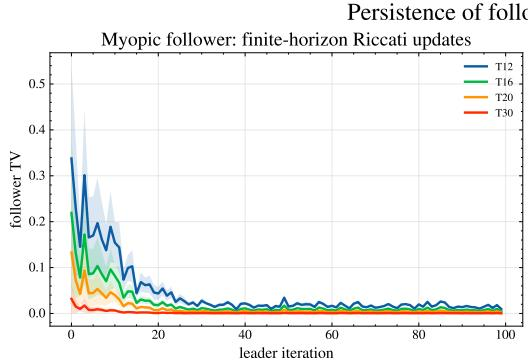

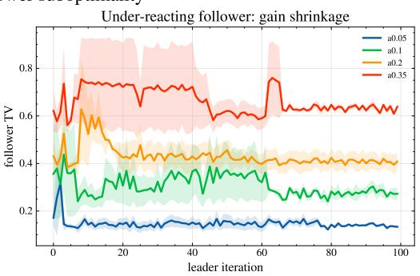  
Figure 18: Total-variation distance between the suboptimal follower and the exact best response over the course of training, for the same two follower models and in the same panel order as Figure 17. (a) Myopic follower. (b) Under-reactive follower. Lines represent the mean across three random seeds, and shaded regions represent one standard deviation.

The myopic follower deviates only transiently. In Figure 18(a) the initial TV distance is about 0.34 for $T = 1 2$ but the average over training is $0 . 0 4 4 3 \pm 0 . 0 1 5 3$ , and Figure 17(a) shows the leader return is essentially unaffected: RE-HG reaches $- 1 2 7 . 5 5 \pm 0 . 4 6$ for $\breve { T } = 3 0$ and $- 1 2 7 . 9 1 \pm 0 . 8 7$ for $T = 1 2$

The under-reactive follower deviates persistently, with TV distances between 0.15 and 0.66 throughout training in Figure 18(b). Here RE-HG adapts its reward estimate to the observed trajectories and, as Figure 17(b) shows, overtakes the ORACLE: −123.25 ± 0.42 for $\alpha = 0 . 0 5$ and $- 9 9 . 7 4 \pm 0 . 1 7$ for $\alpha = 0 . 3 5$ , against −154.28 ± 2.35 to −152.36 ± 0.79 for the ORACLE across the tested underreaction levels. The reward correlations stay between 0.70 and 0.82. The comparison is not symmetric, however: the ORACLE uses the true reward but still assumes an exact best response, which is violated here by construction.

Taken together, RE-HG tolerates both transient and persistent follower suboptimality by fitting its reward estimate to the behavior actually observed.

## D Broader Impacts

This research can positively impact the efficiency of real-world hierarchical systems, such as smart grids and traffic control, where the follower’s reward is unknown. However, if applied to human-

centric domains like recommendation systems, inferring unobserved rewards from user behavior could lead to unintended manipulation or privacy concerns. To mitigate these risks, such applications require transparency regarding data usage and strict safety constraints on the leader’s action space.

## E Compute Resources

All experiments were conducted on a workstation equipped with dual Intel(R) Xeon(R) Gold 6348 CPUs @ 2.60GHz (totaling 56 physical cores and 112 logical threads) and 512 GB of RAM. The entire suite of experimental evaluations, including all baseline comparisons and ablations, was completed within 12 hours of total wall-clock time.