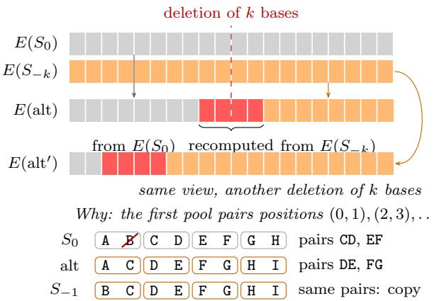
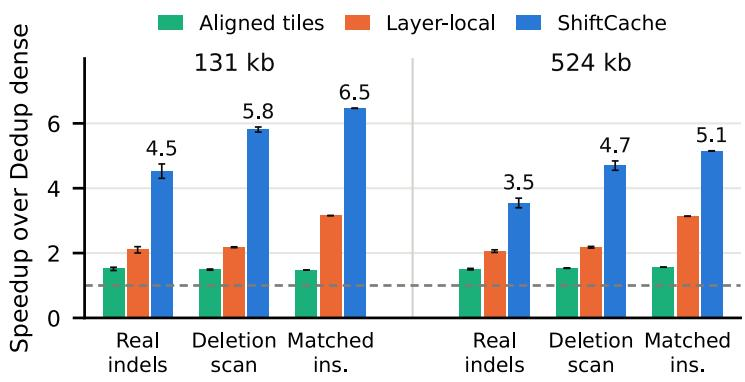
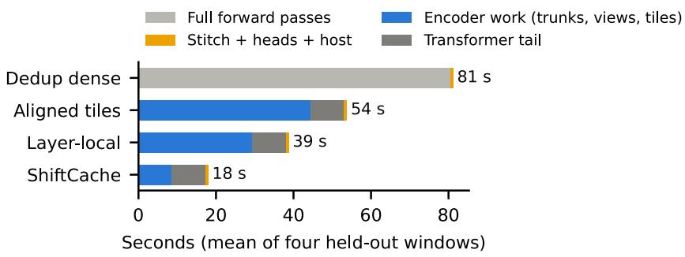
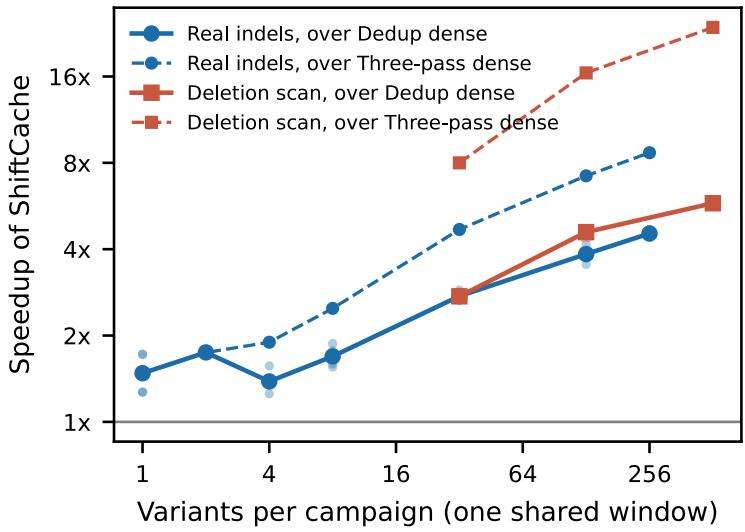
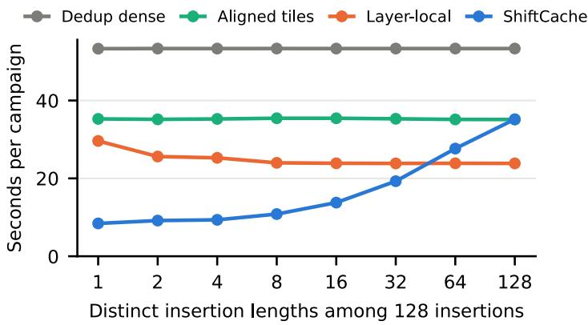
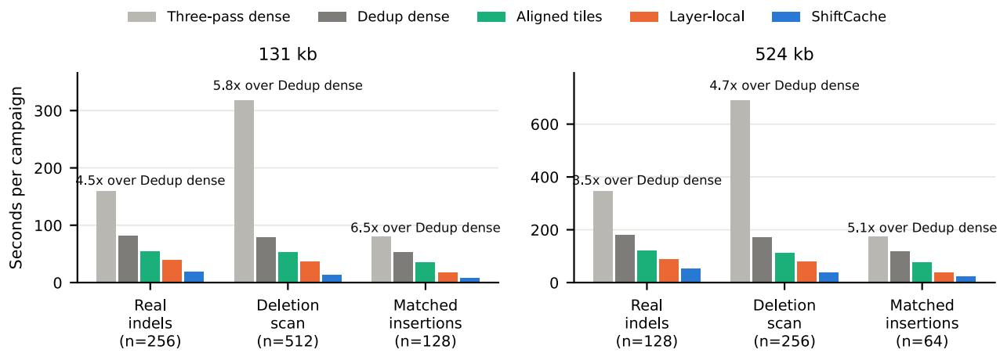
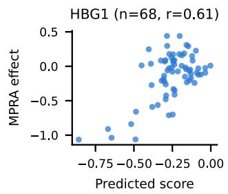
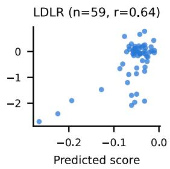

# ShiftCache: Fast and Exact Indel Efect Prediction by Reusing Shifted Reference Encodings

Sina Barazandeh1, Arth Banka1,2, and Jose Lugo-Martinez∗1

1Ray and Stephanie Lane Computational Biology Department, Kenneth C. Grifin School of Computer Science, Carnegie Mellon University, Pittsburgh, PA, USA

2Department of Immunology, University of Pittsburgh School of Medicine, Pittsburgh, PA, USA

## Abstract

Sequence-to-function models such as AlphaGenome and Borzoi read up to a megabase of DNA and predict thousands of genomic signals. A genetic variant is scored by comparing a model’s predictions for the reference and alternate sequences. Unlike single nucleotide variants, insertions and deletions (indels) are costly to score, because an indel usually shifts the unchanged DNA after it onto a diferent pooling grid, which prevents direct reuse of the reference’s encoder activations. The AlphaGenome Atlas, for example, scored more than 100 million indels with three full model passes each, and every pass encodes the entire window, although the DNA after an indel matches the reference shifted by the indel’s length. To avoid this repeated work, we present ShiftCache, an exact reuse system that encodes each shifted reference once and shares it among all variants scored in the same window with the same shift. A planner derives which encoder outputs each variant can copy, and ShiftCache recomputes only the rest in batched tiles. On held-out AlphaGenome windows shared by many indels, in strict fp32 on one A6000, ShiftCache is 3.5 to 6.5× faster than deduplicated dense execution and 1.6 to 2.7× faster than our adaptation of layer-by-layer reuse to indels. It is 3.5 to 4.1× faster than dense reimplementations of two published analyses with Borzoi and AlphaGenome, and it speeds up Enformer scoring by 2.6× over dense execution. Scoring each variant in its own centered 131 kb window makes ShiftCache only 1.36× faster than deduplicated dense execution, and highly diverse insertion lengths or many dispersed edits can make it slower than layer-by-layer reuse or dense execution. For encoders that meet our conditions, ShiftCache computes the same predictions as dense execution in exact arithmetic. On an A6000, every checked output of the default AlphaGenome and Borzoi runs matches dense execution within an absolute and relative tolerance of 10−5. With larger tile batches, with Enformer or on an H100, a small fraction of values exceeds this tolerance.

## 1 Introduction

Predicting the efect of a genetic variant is a common use of genomic sequence models. The model runs on the reference sequence and on the edited sequence (the alternate), and the two predictions are compared. Models such as AlphaGenome (Avsec et al., 2026) and Borzoi (Linder et al., 2025) read up to a megabase of DNA. Most of their computation occurs in a convolutional encoder that precedes a transformer, and at 131 kb AlphaGenome spends about 90% of a forward pass in that encoder (§6.2). An edit changes only a few bases, so most of the alternate’s encoding should be reusable from the reference. That holds for substitutions, but for insertions and deletions (indels) reuse is harder.

The AlphaGenome Atlas, a genome-wide catalog of predicted variant efects, scores more than 100 million indels (Cheng et al., 2026), and Borzoi-based fine-mapping, which ranks candidate causal variants, scores about 1.9 million (Srivastava et al., 2025). Besides the reference and the alternate, indel stitching (Korsakova et al., 2025; Google DeepMind, 2026) evaluates a third sequence so that predictions line up on both sides of the edit. For AlphaGenome, this third sequence is a shifted reference for a deletion and a second alternate for an insertion (§3), so the Atlas runs three full passes per indel. Each pass encodes the entire window, although the three sequences difer only near the indel and by a shift.

This repeated work is hard to avoid because the encoder pools its input. AlphaGenome’s encoder reduces the input to one output position (bin) per 128 bases with seven stride-2 pools. An indel shifts everything after it, and unless the shift is a multiple of 128, the shifted sequence falls on a diferent pooling grid. If the indel length is odd, for example, the first stride-2 pool pairs bases diferently than in the reference, so even the unchanged sequence after the indel can produce diferent encoder outputs. The reference’s outputs therefore cannot simply be moved by the shift and copied.

Existing reuse methods eliminate only part of this work for indels. Caching outputs per input sequence, which we call deduplicated dense execution, skips sequences that repeat across requests but still encodes every distinct alternate in full. Prefix caching in LLM serving (Zheng et al., 2024) reuses only the input before the edit, so it recomputes everything after the edit, which is half the window for a centered indel. Layer-by-layer reuse for in silico mutagenesis, which scores every possible substitution (Nair et al., 2022), can reuse the reference’s activations, moved by the shift, only in layers whose stride divides the shift. We call its adaptation to indels layer-local reuse. Among the 1,953 real 1000 Genomes indels in our held-out 131 kb windows, 57% have odd length. Counting only the pooling levels whose stride divides each indel’s length, layer-local reuse can avoid at most about 40% of the convolution work after the edit, averaged over these indels.

In this work, we present ShiftCache, a system that restores the pooling alignment by encoding a shifted reference, the reference moved by the indel’s length. After the indel, the alternate matches this shifted reference base for base and lies on the same pooling grid, so the alternate can copy from it every encoder output that depends only on that region. Indels scored in the same window often share a shift, and one shifted reference then serves all of them. A scan of 512 deletions of 1 to 4 bases in one window, for example, needs only four shifted references. The stitched AlphaGenome passes for deletions already include these references, so sharing them adds no encoder pass.

ShiftCache processes a campaign, a set of variant-scoring requests handled together, and encodes each shared shifted reference once as a view. A planner uses the encoder’s kernel sizes and pooling strides to compute which bins each request can copy from the reference or a view. ShiftCache recomputes the remaining bins in batched input tiles and runs the transformer and prediction heads unchanged. Its outputs equal those of dense execution in exact arithmetic. ShiftCache builds on local recomputation for edits that keep positions fixed, as in fastISM, and on evaluating one input at every alignment of the pooling grid (§2). It extends these ideas by sharing shifted references across requests.

Sharing helps most when many indels can share one window, as in analyses that group nearby variants (Calico, 2026), deletion scans of promoters (the regulatory DNA at the start of a gene) (Korsakova et al., 2025), and deletions of candidate regulatory sequences and length-matched controls (Liang et al., 2026). On shared-window AlphaGenome campaigns, ShiftCache is 3.5 to 6.5× faster than deduplicated dense execution and 1.6 to 2.7× faster than layer-local reuse adapted to indels. On two reimplemented published analyses with Borzoi and AlphaGenome, it is 3.5 to 4.1× faster than dense runs of these reimplementations. When each indel is scored in its own centered window, as in AlphaGenome’s tutorial, less work is shared, and ShiftCache is 1.36× faster than deduplicated dense execution at 131 kb (§6.4).

We make three contributions.

1. Shifted-reference reuse and ShiftCache. We introduce a mechanism and executor for exact computation reuse across requests whose inputs contain shifted segments of a shared reference, with a closed-form planner for one or several encoder outputs (§4).

2. Correctness guarantees and validation. We prove that every bin ShiftCache copies or recomputes equals the dense encoder output in exact arithmetic (§4.3), and we compare full fp32 outputs with dense execution on an RTX A6000 and an H100 (§6.3). The small diferences we find likely come from cuDNN’s shape-dependent choice of convolution algorithm. With a fixed-order convolution kernel, the checked AlphaGenome encoder outputs are bitwise identical to dense execution using the same kernel (§4.2, §6.3).

3. Performance and limitations analysis. We evaluate ShiftCache on AlphaGenome, Borzoi and Enformer, including two reimplemented published analyses, and show when it is slower than layer-local reuse or dense execution (§6).

## 2 Background

We introduce the three models we accelerate and the prior work that reuses computation within one input.

Genomic sequence models. These models map one-hot encoded DNA to genomic tracks, and each track is a predicted measurement along the sequence, such as gene expression in one cell type. A bin is one output position, and a head predicts one type of measurement. AlphaGenome (Avsec et al., 2026) reads up to $2 ^ { 2 0 }$ bases, and its encoder uses odd-width convolutions with length-preserving zero padding, normalization with stored statistics, residual additions and seven kernel-2, stride-2 max pools. The encoder output, which we call the trunk, has 1,536 channels per 128-base bin and feeds a transformer with pairwise attention (the tail) and then the heads. Borzoi (Linder et al., 2025) reads 524,288 bases, which a convolutional encoder pools to 128-base resolution before a transformer. A U-Net then upsamples using encoder activations at 32- and 64-base resolution, and Borzoi predicts 7,611 tracks at 32-base resolution over the central 196,608 bases. Enformer (Avsec et al., 2021) reads 196,608 bases and downsamples by attention pooling, a softmax-weighted sum over aligned pairs with learned weights.

Local computation reuse. Each output of a convolutional encoder depends only on a fixed interval of its input, its receptive field. fastISM (Nair et al., 2022) uses this locality to accelerate in silico mutagenesis by recomputing, at each layer, only the activations that depend on the substituted base. Krypton (Nakandala et al., 2019) explains CNN predictions by masking same-size image patches, treats each masked query as an incremental update to the CNN’s activations, and batches queries. Both handle edits that keep positions fixed, so neither reuses work across the shift an indel causes. Computing each aligned tile with a halo of extra input makes tile outputs identical to full-input outputs (Majurski and Bajcsy, 2021), and ShiftCache uses this to recompute the outputs it cannot copy.

Pooling phases. A pooling phase is an alignment of the pooling grid relative to the input. Giusti et al. (2013), Bailer et al. (2017) and Thom and Gritschneder (2017) compute the pooled outputs of one input at every pooling phase to obtain exact sliding-window outputs at all positions. These methods share work within one input, and ShiftCache’s optional phase views (§4.1) apply the same idea across requests that share a reference. Shift-and-stitch (Long et al., 2015; Lin et al., 2016), unrelated to indel stitching, interleaves the outputs of shifted copies of one input.

## 3 Problem Formulation

This section defines dependency intervals, stitched scoring, campaigns and dense baselines, and then states the problem.

Dependency intervals. Bin j of AlphaGenome’s trunk depends only on input positions in its receptive field, or dependency interval, [128j −513, 128j +640], clipped to the window. A convolution of radius r applied at cumulative stride s, the spacing in input bases between adjacent positions, widens the interval by rs on both sides, and a pool whose input has stride s widens it by s on the right. Gradient tests with random weights (§5) confirm this interval. Borzoi has three encoder output tensors, at 128-, 64- and 32-base resolution, each with its own dependency interval.

Stitched indel scoring. The alternate can be aligned with the reference at the window’s start (left-anchored, alt) or end (right-anchored, alt ), and each lines up with the reference on only one side of the edit. Let H be the encoder and transformer, which produce the 128-base embeddings. For an insertion or deletion of $k \geq 1$ bases (forward strand, 128-base resolution), the AlphaGenome protocol (Korsakova et al., 2025; Google DeepMind, 2026) computes:

• deletion: reference side = stitch(H(ref), H(S−k)), alternate side = H(alt);

• insertion: reference side = H(ref), alternate side = stitch(H(alt), H(alt→)),

where $S _ { - k }$ is the reference shifted left by k, which we call right-matched because it matches the alternate after the deletion. Stitching joins two sets of embeddings at a bin determined by the edit’s endpoints, taking earlier bins from the first and later bins, shifted by a whole number of bins, from the second, and the heads then run on the stitched embeddings. Borzoi’s scoring library, baskerville (Calico, 2026), instead stitches 32-base predictions, and only on the alternate side, where it combines both anchored alternates. Our baseline Three-pass dense runs three sequences per indel. For AlphaGenome, a deletion needs the reference, $S _ { - k }$ and the alternate, and an insertion needs the reference and both anchored alternates. The Atlas caches references for substitutions but not for indels (Cheng et al., 2026), and baskerville predicts the reference once per cluster of nearby variants (Calico, 2026).

Campaigns and dense baselines. In a shared-window campaign, all requests use the same reference window. Under AlphaGenome’s stitched protocol, such a campaign needs the reference, one right-matched reference $S _ { - k }$ per deletion length, one alternate per deletion and two anchored alternates per insertion, so many requests share sequences. The strongest dense baseline, deduplicated dense execution (Dedup dense), runs each distinct sequence once. It shares the reference and the right-matched references but still encodes every alternate in full. In AlphaGenome’s quick-start tutorial, each indel is scored in its own centered window. Requests can then share work only within one indel’s passes and across nearby indels’ windows, which are shifted copies of one another.

  
Figure 1: One shifted encoding serves many requests. To assemble a deletion’s left-anchored alternate encoding, bins whose dependency intervals lie before the deletion are copied from the reference, and bins whose intervals lie after it are copied from the reference shifted left by k. This shifted encoding is built once and shared by every request with the same ofset, such as a deletion of k bases elsewhere in the window (row $E \mathrm { ( a l t ^ { \prime } ) } )$ , and also serves as the stitching protocol’s right-matched reference. For AlphaGenome, about nine bins have dependency intervals that cross the edit and are recomputed in stride-aligned tiles with a five-bin halo. The inset shows that deleting an input base changes the pooling groups, while $S _ { - k }$ matches the alternate’s groups. Copying an output bin requires its entire dependency interval to match.

Problem statement. The inputs are a reference window, a campaign of edits, a pretrained model whose encoder meets the locality conditions of §4.3, and a scoring protocol. The window comes with its flanks, the neighboring genomic bases that its shifts bring into the window. The goal is to compute every request’s reference and alternate outputs with less encoder work than Dedup dense. The assembled encoder outputs, and therefore the scores, must equal those of dense execution in exact arithmetic. We evaluate floating-point agreement separately (§6.3).

## 4 ShiftCache Design

ShiftCache reuses encoder outputs across requests. Because each encoder output depends only on a fixed input interval (§3), an output bin of an alternate can be copied from any encoding whose input matches over that interval. Let L be the window length and E the encoder. Each sequence in a campaign consists of reference segments copied at some ofset, possibly with inserted bases. ShiftCache maps these segments to reference coordinates and computes the reusable bins in closed form. It then encodes the shifted references the campaign needs as shared views and assembles each request’s encoder output from copied bins and small recomputed tiles (Figure 1). The transformer (the tail) and heads run unchanged.

## 4.1 Reuse Planning from Shifted References

Segment representation. Applying edits to a reference window with real genomic flanks yields a sequence X and segments $[ a , e )$ with ofsets d such that $X [ i ] = \mathrm { r e f } [ i - d ]$ for $i \in [ a , e )$ . A left-anchored deletion of k bases at p has segments $[ 0 , p )$ with $d = 0$ and $[ p , L )$ with $d = - k$ , whose last k bases come from the right flank. Right-anchored deletion alternates keep the sequence after the edit in place and take their extra bases from the left flank. References, right-matched references, alternates and centered windows are all described this way.

Clean bins in closed form. Let an encoder output tensor have stride s and dependency interval $[ s j + \ell , s j + h ]$ for index $j .$ For AlphaGenome’s trunk, $s { = } 1 2 8$ and $( \ell , h ) { = } ( - 5 1 3 , 6 4 0 )$ , and the total encoder stride is P=128. Bin $j$ is clean with source d if its interval, clipped to [0, L), lies inside one segment $[ a , e )$ with ofset d. Among valid output indices, the clean bins satisfy

$$
\begin{array} { l } { j \geq \lceil ( a - \ell ) / s \rceil \quad \mathrm { i f } \ a > 0 , } \\ { j \leq \lfloor ( e - 1 - h ) / s \rfloor \quad \mathrm { i f } \ e < L . } \end{array}\tag{1}
$$

A clean bin equals bin $j$ of $E ( S _ { d } )$ , the encoding of the reference shifted by $d ,$ and both are padded with zeros in the same way at the window edges (§4.3). The remaining dirty bins have dependency intervals that cross an edit or include inserted bases. With the required views built, a short AlphaGenome edit leaves about nine dirty bins. Clean bins whose source view is not built are also recomputed. The planner represents each request as a run-length list of (bin range, source) pairs.

Shared views. A view is an encoding $E ( S _ { d } )$ shared by the requests that need ofset d. Under AlphaGenome’s stitched deletion protocol, the views encode right-matched references that dense execution already evaluates, so sharing them requires no extra encoder pass. Other views, such as those for insertions, cost extra encoder work and save time only if enough requests share them.

Phase views. An optional mode keeps one view per pooling phase and reindexes it for every ofset with that phase. An ofset $d = \phi + P q$ with phase $0 ~ \le ~ \phi ~ < ~ P$ gives, for the trunk, $E ( S _ { d } ) [ j ] = E ( S _ { \phi } ) [ j - q ]$ wherever both dependency intervals lie inside their windows, so at most $P$ views are needed and boundary bins are recomputed. The evaluated default keeps one view per ofset.

## 4.2 Tiled Execution and View Selection

Tiles and assembly. Bins that cannot be copied are recomputed from input tiles whose start and length are multiples of P. Each tile carries a halo on each side whose outputs are discarded, so that every retained bin sees the same input as in the full window. For AlphaGenome, each tile spans 32 or 128 trunk bins, including a five-bin halo on each side, so an interior tile keeps 22 or 118 bins. Tiles are batched across requests, up to 16 per batch (the tile batch). Batch sizes are rounded up to powers of two to limit the number of compiled shapes. A request whose tiles would cost more than a full encode falls back to a full pass. Assembly gathers bins from the reference, the views and the tile outputs. For Borzoi, the planner combines the dependency intervals of all three encoder outputs on the 128-base trunk grid, so one plan and tile layout cover them all.

View selection. A full-window view requires one encoder pass, while a partial view covers only the smallest interval containing the bins copied from it and is built from stride-aligned tiles. The static view-selection rule, used by default, builds a view for every ofset used by at least two distinct sequences. The greedy rule adds a view only when doing so lowers the predicted campaign time, using a cost model based on GPU measurements of per-batch costs for full encoder passes and tiles (the cost table). Choosing which encodings to keep is a form of materialized-view selection (Harinarayan et al., 1996). With many dispersed edits, the greedy rule avoids views that save little work (§6.4).

Campaign execution. The executor deduplicates the campaign’s sequences, creates a reuse plan, builds the views once and assembles encoder outputs, in chunks of requests for large campaigns. It then runs the unchanged downstream model and stitches at the stage the protocol prescribes (§3). Each distinct sequence’s embeddings are computed when first needed and kept until their last use.

Bitwise mode. cuDNN can choose diferent summation orders for diferent tensor shapes, so a bin computed in a tile may difer in its last bits from the same bin computed in a full window. An optional mode routes every AlphaGenome encoder convolution, in all execution methods including dense execution, through one fixed-order Triton kernel (Appendix E). The kernel performs the same operations at each output position regardless of tensor length, tile ofset or batch size. We evaluate this mode only for AlphaGenome under torch.compile (§6.3).

## 4.3 Correctness Guarantees

Assembly is valid only if every copied bin has matching input dependencies and every recomputed tile keeps the pooling alignment of the full window. Both requirements hold under the following conditions.

Encoder assumptions. Let E be a strided encoder built from stride-1, dilation-1 convolutions with odd kernels and symmetric, length-preserving zero padding, spatially shared deterministic pointwise operations, residual additions, normalization with frozen statistics, and pooling. Each pooling layer applies the same deterministic function, with shared parameters, to aligned non-overlapping pairs $( 2 j , 2 j + 1 )$ , as AlphaGenome’s and Borzoi’s max pools $\mathrm { d o } ,$ and no operation depends on absolute position, input length or batch contents. The input has length $L _ { ; }$ a multiple of the total stride $P = 2 ^ { p }$ , where $p$ is the number of pools, with zero padding outside $[ 0 , L )$ . For encoder output tensor b with stride $s _ { b }$ , the structural dependency interval of index $j$ is $I _ { b } ( j ) = [ s _ { b } j + \ell _ { b } , \ s _ { b } j + h _ { b } ]$ computed as in $\ S 3 .$ , and its clipped interval is $\bar { I } _ { b } ( j ) = I _ { b } ( j ) \cap [ 0 , L )$

Lemma 1 (Locality). $E ( X ) _ { b } [ j ]$ depends only on X restricted to $\bar { I } _ { b } ( j )$ and on which ends of $I _ { b } ( j )$ were clipped.

Theorem 1 (Copy validity). Let Y be a reference sequence defined on the window and the genomic flanks needed by the shifts, and let $Y _ { d } [ i ] = Y [ i - d ]$ for $0 \leq i < L$ $I f X [ i ] = Y _ { d } [ i ]$ for all $i \in \bar { I } _ { b } ( j )$ then $E ( X ) _ { b } [ j ] = E ( Y _ { d } ) _ { b } [ j ]$ (both are padded identically at the window edges).

For $Y = \mathrm { r e f } , Y _ { d }$ is the shifted reference $S _ { d }$ of $\ S 4$ .

Theorem 2 (Phase reindexing). If $d = \phi + P q$ with integer q and $0 \leq \phi < P$ , then $E ( Y _ { d } ) _ { b } [ j ] =$ $E ( Y _ { \phi } ) _ { b } [ j - ( P / s _ { b } ) q ]$ wherever both intervals are unclipped. For shifts not divisible by $2 ^ { l }$ , the assumptions do not in general guarantee any integer reindexing of the unshifted encoding at stride $2 ^ { l }$ , because the pooling groups difer, although particular inputs or weights can yield coincidentally equal outputs.

Theorem 3 (Tile exactness). Let $X _ { t } = X [ t P , t P + T )$ be a tile contained in the window, with integer $t \geq 0$ and T a positive multiple of P. Then $E ( X _ { t } ) _ { b } [ j - t P / s _ { b } ] = E ( X ) _ { b } [ j ]$ whenever $\bar { I } _ { b } ( j )$ lies inside the tile, with $t P = 0 \ i f \ s _ { b } j + \ell _ { b } < 0$ and $t P + T = L \ i f \ s _ { b } j + h _ { b } \geq L$ . Thus, a dependency interval may cross a tile boundary only where that boundary coincides with the corresponding window edge.

Corollary 1. In exact arithmetic, assembling every bin according to Theorems 1 to 3 yields $E ( X )$ Applying the same tail, stitching and heads then gives the dense outputs.

Appendix A gives full proofs of these results and derives the clean-bin conditions of §4.1.

## 5 Evaluation Methodology

We evaluate ShiftCache on held-out windows with real indels, deletion and insertion scans, and two reimplemented published analyses. We compare it with dense baselines and layer-local reuse.

Hardware and software. We use one 48 GB NVIDIA RTX A6000 and PyTorch 2.6 with CUDA 11.8 (Paszke et al., 2019). Every execution method compiles its encoder and transformer with torch.compile (Ansel et al., 2024) and cuDNN autotuning, and we run strict fp32 with TF32 disabled unless stated otherwise. We use the AlphaGenome PyTorch port (genomicsxai, 2026) with the released checkpoint trained on all data folds, the Borzoi PyTorch port (Hingerl, 2026), and the pretrained Enformer PyTorch port (Wang, 2026). We repeat key runs on an NVIDIA H100 with the same pinned packages, weights and inputs (Appendix N).

Genomic windows and workloads. Design and tuning windows lie on chromosomes 1, 17 and 19. After tuning ShiftCache, we froze its settings and drew four held-out windows on chromosomes 2, 6, 11 and 12. We first evaluated them with that code, and all later held-out runs use these windows. The layer-local baseline was added and improved after that evaluation (Appendix B). Each 524,288-base window contains a centered 131,072-base window, and both have real genomic flanks (Appendix B). We use four workloads. Real indels are sampled with a fixed seed from the indels of at most 50 bases observed in the 3,202 high-coverage genomes of the 1000 Genomes Project (Byrska-Bishop et al., 2022), with 256 variants per 131 kb window and 128 per 524 kb window. A deletion scan covers every deletion of 1 to 4 bases starting in a central region of 128 bases at 131 kb or 64 at 524 kb, giving 512 and 256 requests. Matched insertions are 128 (131 kb) or 64 (524 kb) distinct random 12-base insertions at one position, like the length-matched background insertions of AlphaGenome’s TAL1 analysis (Avsec et al., 2026). A separate exhaustive scan, on two held-out 131 kb windows, covers every deletion and every possible insertion of 1 to 4 bases at 32 sites, giving $3 2 \times ( 4 + 4 + 1 6 + 6 4 + 2 5 6 ) = 1 1 , 0 0 8$ requests. These campaigns use AlphaGenome’s gene-expression (RNA-seq) head at 128-base resolution on the forward strand and its stitching protocol (§3). We discuss its oficial gene-level scores in §8. Unstitched runs instead score one left-anchored alternate per variant.

Published-analysis protocols. We reimplement two published analyses. Korsakova et al. (2025) score a single-base deletion at every base of the HBG1 and LDLR promoters with Borzoi and reference stitching, at three passes per base. We evaluate the same coordinates with the first of Borzoi’s four replicates in one 524 kb window centered on each promoter, and compare stitched profiles of all 7,611 tracks over the central 4 kb, the region they score. Our adapter instead follows baskerville and stitches the alternate, which needs up to 2n+1 sequences for n single-base deletions in one window, against n+2. Because the published analysis also uses a four-replicate ensemble in per-variant centered windows, our reimplementation does not reproduce its exact figures. Liang et al. (2026) test 11 binding sites (motifs) of the transcription factor CEBPB near the TSC22D3 gene. For each motif, the analysis deletes the 12-base motif and K length-matched control segments drawn uniformly from a 1 Mb window centered on the motif. It then predicts ChIP-seq tracks of histone marks (chemical tags on the proteins that package DNA) in the MM.1S myeloma cell line, at 128-base resolution and without stitching. A motif is classified as significant when its local fold change, the ratio of alternate to reference signal near the motif, falls below the 2.5th or above the 97.5th percentile of the control fold changes. We follow the published window placement, seeded sampling and significance criteria, but do not time DeepMind’s hosted API. At K=3000, dense execution runs the first 64 deletions per motif to check agreement and compare times.

Baselines and configurations. Dedup dense and Three-pass dense are defined in §3. Tuning Dedup dense’s batch size, stitching chunk size and compilation settings speeds it up by at most 3% (Appendix C). Aligned tiles is ShiftCache without views. It copies bins only from the reference trunk, reindexing shifts divisible by 128, and recomputes the rest in the same batched tiles. Layer-local is our implementation of fastISM-style layer-by-layer reuse for indels. It caches the reference’s convolution outputs before every pool. For a shifted segment, it reuses them up to the deepest level whose stride divides the shift (only the first, full-resolution level for an odd shift) and recomputes from that level’s pool upward with the same batched tiles. ShiftCache is our executor with a separate view per ofset and the static view-selection rule. The greedy rule is no faster here (Appendix G). All methods share the tail, stitching and heads.

Timing and memory measurement. Each timed campaign starts with empty sequence and activation caches, in a warmed process that has compiled every shape and measured its cost table. Timing covers deduplication, planning, view construction, tiles, transformer passes, stitching, heads and delivery of each chunk of predictions to the host, and excludes the final concatenation of chunks, compilation and cost-table calibration unless stated otherwise. We report the median of three campaigns at 131 kb and two at 524 kb, and Appendix B lists the exceptions. Unless stated otherwise, times are geometric means over the four held-out windows, and speedups are geometric means of per-window ratios with 95% t-intervals on log ratios across the tested windows. Memory is peak allocated GPU tensor memory.

Output validation. We compare each method’s reference and alternate outputs with a dense baseline. An output value passes the tolerance if it difers from dense execution by at most 10−5 + 10−5|dense|. The campaigns of Table 1 compare every predicted value, and Borzoi’s held-out runs compare each track’s sum over positions. CPU tests with random weights check that the input gradient of an interior position is nonzero up to the ends of its dependency interval and zero beyond them, in every encoder output tensor of AlphaGenome and Borzoi. They also compare the execution methods with dense execution across edit types and both stitching conventions (Appendix B).

## 6 Results

We first report speedups, their breakdown and numerical agreement (§6.1 to §6.3). We then show the limits of sharing, the transfer to other models and the published analyses (§6.4 to §6.6).

## 6.1 Speedup over Dedup Dense and Layer-Local Reuse

On held-out windows ShiftCache is 4.5 to 6.5× faster than Dedup dense at 131 kb and 3.5 to 5.1× at 524 kb (Table 1 and Figure 2), and 6.8 to 23.5× faster than Atlas-style three-pass execution. An earlier run on the same windows with the frozen code gives the same speedups over Dedup dense within 1%. We attribute the smaller gains at 524 kb to the transformer, which reuse does not accelerate and which accounts for more of each pass at the longer context.

Comparison with layer-local reuse. Layer-local reuse, the closest alternative, is 2.1 to 3.2× faster than Dedup dense, and ShiftCache is a further 2.0 to 2.7× faster at 131 kb and 1.6 to 2.2× at 524 kb. Layer-local reuse helps most for the 12-base insertions, whose shift is divisible by four so that the first three levels are reused. It helps least for odd shifts, which reuse only the first, consistent with the 40% bound of §1. Once a matching view is built, ShiftCache copies every clean bin after the edit and shares the construction cost across requests. Aligned tiles, which reuse only shifts divisible by 128, reach about 1.5× over Dedup dense.

Table 1: ShiftCache is the fastest method on all six main held-out stitched AlphaGenome workloads (one RTX A6000, strict fp32; geometric mean seconds over four windows; speedups with 95% intervals). Three-pass dense was timed in an earlier run on the same windows with the frozen code, and all other methods together in a later run.
<table><tr><td rowspan="2" colspan="2">Context Workload</td><td colspan="3">Time (s)</td><td colspan="3">ShiftCache speedup over</td><td colspan="3">Other baselines</td></tr><tr><td>Dedup</td><td>dense Layer-local ShiftCache</td><td></td><td>Dedup dense</td><td></td><td>Layer-local</td><td>Three-pass Aligned Speedup vs. time (s)</td><td></td><td>tiles (s) three-pass</td></tr><tr><td rowspan="3">131 kb</td><td>256 real indels</td><td>81.2</td><td>38.7</td><td></td><td>18.0 4.52 [4.31, 4.75] 2.16 [2.05, 2.26]</td><td></td><td></td><td>159.0</td><td>53.7</td><td>8.9</td></tr><tr><td>512-deletion scan</td><td>78.5</td><td>36.0</td><td></td><td>13.5 5.81 [5.73, 5.89]</td><td>2.67</td><td>[2.64, 2.69]</td><td>318.0</td><td>52.7</td><td>23.5</td></tr><tr><td>128 matched insertions</td><td>52.5</td><td>16.6</td><td></td><td>8.1 6.47 [6.46, 6.47]</td><td>2.05</td><td>[2.05, 2.05]</td><td>79.5</td><td>35.5</td><td>9.8</td></tr><tr><td rowspan="3">524 kb</td><td>128 real indels</td><td>179.9</td><td>87.4</td><td></td><td>50.8 3.54 [3.40, 3.69]</td><td></td><td>] 1.72 [1.65, 1.79]</td><td>345.3</td><td>119.6</td><td>6.8</td></tr><tr><td>256-deletion scan</td><td>169.1</td><td>77.6</td><td></td><td>36.0 4.70 [4.55, 4.84]</td><td>2.15</td><td>[2.10, 2.21]</td><td>690.5</td><td>110.1</td><td>19.2</td></tr><tr><td>64 matched insertions</td><td>116.8</td><td>37.2</td><td></td><td>22.7 5.15 [5.14, 5.15] 1.64 [1.64, 1.64]</td><td></td><td></td><td>172.6</td><td>74.6</td><td>7.6</td></tr></table>

  
Figure 2: ShiftCache is 3.5 to 6.5× faster than Dedup dense (dashed line) and 1.6 to 2.7× faster than layer-local reuse. Speedup over Dedup dense on held-out stitched AlphaGenome campaigns (RTX A6000, strict fp32, geometric mean of four windows, 95% intervals). Table 1 lists the times, and Figure 6 plots them.

Tuning speeds up layer-local reuse by at most 6.4% among settings whose outputs pass the tolerance. At a tile batch of 64, where both methods’ outputs fail the tolerance, ShiftCache remains 1.60 to 1.98× faster than layer-local reuse (Appendix F). These results compare our implementations and do not bound layer-local reuse in general.

H100 speedups and memory use. On an NVIDIA H100, ShiftCache’s speedups over Dedup dense at 131 kb are within 3% of those on the A6000 (Appendix G). In the AlphaGenome campaigns, ShiftCache uses less peak allocated GPU memory than Dedup dense, as does layer-local reuse at 131 kb (Appendix D).

## 6.2 Encoder Reuse and Runtime Breakdown

In the 256-indel campaigns at 131 kb, the transformer alone takes 8.7 s over the 369 to 414 distinct sequences, against 80.5 s for Dedup dense’s full passes, so the encoder accounts for about 90% of a dense pass (Figure 3). Aligned tiles and layer-local reuse still spend 44 s and 29 s rebuilding encoder outputs, because most of each alternate lies on a shifted segment they cannot copy. ShiftCache spends 8.5 s on encoder work, so the transformer accounts for about half of its time. With transformer and output costs unchanged, removing all encoder work would limit the speedup over Dedup dense to about 8.6×. When all required views are available, fewer than $1 \%$ of alternate trunk bins are dirty (Appendix G). In deletion scans, every copied bin comes from the reference or from a right-matched reference that Dedup dense computes in full but cannot reuse. In matched insertions, half of the copied bins come from the encodings of $S _ { + 1 2 }$ and $S _ { - 1 2 }$ , two views that only ShiftCache builds, and in real-indel campaigns 13 to 19% of copied bins come from such views.

  
Figure 3: Shared views shrink encoder work, and transformer and head time stays the same. Time per campaign by component, AlphaGenome, 256 real indels, 131 kb, one A6000, mean of four held-out windows. Dedup dense’s encoder and tail run together inside its full passes.

## 6.3 Floating-Point Agreement with Dense Execution

Agreement on the A6000. All checked outputs of the held-out campaigns, applications and sensitivity runs pass the tolerance in the default AlphaGenome and Borzoi configurations. Checks with larger tile batches fail (§6.1), as do some Enformer outputs (§6.5). We also checked the full outputs of all 11,008 exhaustive-scan requests on each of its two windows by running each method alongside dense execution, chunk by chunk, and all $1 . 7 \times 1 0 ^ { 1 0 }$ values per method and window pass. Full Borzoi profiles for 41 held-out real indels, covering all 6,144 bins and 7,611 tracks, pass as well.

Agreement on the H100. On the H100, cuDNN likely sums a 32-bin tile and a full window in diferent orders. Across the 12 held-out 131 kb campaigns, $5 . 4 \times 1 0 ^ { - 6 }$ of ShiftCache’s output values, in 11% of requests, exceed the tolerance. Per-campaign median relative $L _ { 2 }$ errors in variant efects (alternate minus reference) range from $1 . 2 \times 1 0 ^ { - 5 } \ \mathrm { t o \ 8 . 9 \times 1 0 ^ { - 5 } }$ . In the HBG1 promoter scan with Borzoi, 2,487 of $5 . 3 \times 1 0 ^ { 8 }$ values exceed the tolerance, and the LDLR scan has none. Measured against compiled strict-fp32 dense outputs, the errors are of the same order as dense execution’s own variation between batch sizes and between compiled and eager execution (Appendix D).

Agreement in bitwise mode. With bitwise mode’s fixed-order kernel (§4.2), every AlphaGenome encoder output we checked on either GPU (34 assembled outputs and 17 views per GPU) is bitwise identical to the output of compiled dense execution with the same kernel. Every method passes the tolerance in all 12 held-out campaigns. Final outputs difer slightly because operations downstream of the encoder depend on batch size, which changes dense execution’s outputs as much. The fixed kernel slows dense execution more than ShiftCache, which remains 3.15 to 5.49× faster than default Dedup dense on both GPUs (Appendix E).

  
Figure 4: Larger campaigns spread view construction over more requests. ShiftCache speedup by campaign size on held-out 131 kb windows (AlphaGenome, one A6000; both axes logarithmic). Solid lines show the speedup over Dedup dense and dashed lines the speedup over Three-pass dense; faint points are per-window ratios over Dedup dense.

## 6.4 Benefits and Limits of Sharing

Campaign size and first use. After warm-up, ShiftCache is faster than Dedup dense at every tested campaign size, from 1 to 256 real indels and from 32 to 512 deletions (Figure 4). ShiftCache is 1.48× faster even for a single indel (1.27 to 1.72× across windows), because that indel’s passes already share work, as when a deletion’s right-matched reference supplies its alternate’s sufix. Larger campaigns generally spread the cost of views over more requests, reaching 3.85× at 128 and 4.5× at 256 real indels, although small campaigns vary with their composition. The exhaustive scan on two windows has 11,008 requests and about 16,600 distinct sequences per window but needs only eight views. It runs 7.06× faster than Dedup dense, taking 8 minutes per window against 57. In a fresh process with empty compilation caches, ShiftCache’s first campaign takes 194 s with a saved cost table and 347 s when it measures the table, against 222 s for Dedup dense. In that case, its cumulative time falls below Dedup dense’s by the fourth campaign (Appendix C).

Per-variant centered windows. For 128 real indels per held-out window, each scored in its own centered 131 kb window, ShiftCache is 1.36× faster than Dedup dense (95% interval 1.34 to 1.38). Requests then share only one indel’s passes and nearby indels’ shifted references (§3).

Ofset diversity. We score 128 random insertions in each of two held-out 131 kb windows, with lengths that cycle through 1 to D bases, so that each view serves about 128/D requests (Figure 5). ShiftCache’s time grows from 8.4 s at D=1 to 35.2 s at D=128, where no ofset recurs, so it builds no views and reduces to aligned tiles. Layer-local reuse needs no sharing and takes 23.8 to 29.6 s, and it is slowest at D=1, where the single odd length allows reuse only at the first level. ShiftCache stays faster than layer-local reuse up to D=32 (19.3 s against 23.8 s). With only one or two requests per ofset, layer-local reuse is 1.16 to 1.48× faster than ShiftCache, and both remain faster than Dedup dense (53 s). Stitched deletions avoid this regime, because their views are right-matched references that dense execution computes anyway (§4.1).

  
Figure 5: Seconds per stitched campaign of 128 random insertions whose lengths take D distinct values (geometric mean of two held-out windows, 131 kb). Building views stops saving time when too few requests share an ofset.

Table 2: Runtime in seconds of our implementations of the promoter deletion scans of Korsakova et al. (2025) and the TSC22D3 motif-ablation scan (Liang et al., 2026), with dense execution and with ShiftCache (RTX A6000, fp32). The Dense protocol column runs three passes per base for the promoter scans, with baskerville’s alternate stitching, and one pass per deletion plus one reference pass for the motif scan. Motif times are per motif, and ranges are across the 11 motifs, each with a 1 Mb window. Dedup dense matches the protocol for the motif scan, whose sequences are nearly all distinct.
<table><tr><td>Analysis</td><td>Model, context</td><td>Requests</td><td>Dense protocol</td><td>Dedup dense</td><td>ShiftCache protocol dedup dense</td><td>Over</td><td>Over</td></tr><tr><td>HBG1 promoter scan</td><td>Borzoi, 524 kb</td><td>274</td><td>266.0</td><td>125.1</td><td>64.6</td><td>4.1×</td><td>1.94×</td></tr><tr><td>LDLR promoter scan</td><td>Borzoi, 524 kb</td><td>318</td><td>308.7</td><td>148.6</td><td>76.7</td><td>4.0×</td><td>1.94×</td></tr><tr><td>TSC22D3 motifs, K=500</td><td>AlphaGenome, 1 Mb 11 × 501 994 to 1,001</td><td></td><td></td><td></td><td>n/a 265 to 267</td><td>3.75×</td><td>n/a</td></tr><tr><td>TSC22D3,  $K { = } 3 0 0 0 .$ </td><td>first 64 AlphaGenome, 1 Mb</td><td> $1 1 \times 6 4$ </td><td>129</td><td>n/a</td><td>37</td><td>3.49×</td><td>n/a</td></tr></table>

Edit density and personal haplotypes. We run unstitched campaigns of 32 sequences on two held-out windows, each sequence carrying m random indels of 1 to 4 bases. With the edits clustered within 4 kb, ShiftCache stays 1.3 to 2.7× faster than dense execution up to m=64. With the edits dispersed across the window, the static rule builds up to 55 views, each shared by few sequences, and ShiftCache becomes 2.0× slower than dense execution at $m { = } 3 2$ . Greedy view selection builds no views there and is at most 7% slower than dense execution across the dispersed sweep, while keeping the full gain at low density (2.4× at m=1, Appendix H). Personal haplotypes, one person’s variants on one chromosome copy, are denser still, with about 1.3 variants per kilobase in the 1000 Genomes panel. Their edits fall in the dependency intervals of most trunk bins, so in unstitched development-window tests ShiftCache gives no speedup.

Execution-method selection. Separately from view selection, an ofline linear model, the method selector, predicts campaign time from the planned counts of full encoder passes, tiles and transformer passes. On 16 campaigns from the ofset-diversity test, none used in fitting but all from the same windows, the selector picks the fastest measured method each time, including the crossover to layer-local reuse, where always choosing ShiftCache costs up to 48%. We have not tested it on independent windows, small campaigns or other GPUs (Appendix J).

## 6.5 Transfer to Borzoi and Enformer

The planner needs only the locality conditions of §4.3. We test it on Borzoi, whose U-Net reads three encoder outputs, and on Enformer, which pools by attention.

Borzoi with multiple encoder outputs. Borzoi’s encoder, with the skip-connection projections we cache, accounts for 54% of its FLOPs, so removing it would reduce total FLOPs by at most about 2.2×. This is not a measured latency bound. On the 37 to 59 real indels per held-out 524 kb window that Borzoi’s stitching supports (pure insertions or deletions inside the region Borzoi predicts), ShiftCache is 1.67× faster than Dedup dense (95% interval 1.62 to 1.71). It is 1.93× faster on a deletion scan, 1.92× on matched insertions, and 2.5 to 4.1× faster than three-pass execution (Appendix I).

Enformer with attention pooling. Enformer’s attention-pooling weights depend only on each aligned pair, so the assumptions of §4.3 hold. An adapter checks these assumptions, derives the trunk’s dependency interval and separates the encoder, which accounts for 77.6% of forward-pass FLOPs, while the executor and planner are unchanged. On 128 real indels per held-out window with unstitched scoring, ShiftCache takes 10.4 s against 27.1 s for dense execution, a 2.60× speedup. On 64 random indels of 1 to 31 bases, it is 2.24× faster, and aligned tiles reach 1.45× and 1.42×. For every reuse method, 308 of $3 . 7 \times 1 0 ^ { 9 }$ output values, in eight variants, exceed the tolerance, with a largest absolute diference of $2 . 1 \times 1 0 ^ { - 4 }$ . Aligned tiles, which build no views, show the same failures, so the failures likely come from cuDNN rounding that depends on tensor shape, as on the H100. The same comparisons on the CPU pass the tolerance (Appendix K).

## 6.6 Reimplemented Published Analyses

Borzoi promoter deletion scans. ShiftCache is 4.0 to 4.1× faster than our dense implementation of the three-pass protocol and 1.94× (95% interval 1.93 to 1.95) faster than Dedup dense (Table 2). On the A6000, all $5 . 3 \times 1 0 ^ { 8 }$ HBG1 and $6 . 2 \times 1 0 ^ { 8 }$ LDLR reference and alternate values pass the tolerance. ShiftCache’s peak memory is slightly higher than dense execution’s (7.0 GiB against 6.1 to 6.3 GiB). On an H100, ShiftCache is 2.07 to 2.08× faster than Dedup dense. Appendix M compares the per-base scores with measured deletion efects.

AlphaGenome motif ablation. All deletions in a motif’s window share one view, S−12. At K=500, both methods run every deletion, and ShiftCache is 3.75× faster (geometric mean, 3.73 to 3.76× per motif) with no tolerance failures, and fold changes difer from dense execution by at most $2 . 1 \times 1 0 ^ { - 6 }$ . On an H100, motifs 5 and 7 run 4.39× faster than dense execution. At K=3000, the 11 motifs need 33,011 deletions in total, and ShiftCache processes each motif in 26 minutes. At the study’s scoring width, significance calls for H3K27ac, a mark of active regulatory DNA, agree with the published analysis for all 11 motifs at both values of K, and Appendix L reports agreement for other marks and widths.

## 7 Related Work

Edited-input methods and model approximation. Yuzu (Schreiber et al., 2022) reconstructs perturbed activations through compressed sensing, and TISM (Sasse et al., 2024) approximates in silico mutagenesis with gradients. Both were designed for substitutions, which keep sequence length fixed. Incrementally computable transformers (Sharir and Anandkumar, 2023) handle token insertions and deletions exactly, using a retrained, vector-quantized model, while ShiftCache runs the unmodified pretrained model. AlphaGenome’s distilled student model approximates its ensemble (Avsec et al., 2026), and our reuse matches dense execution in exact arithmetic for any encoder that meets the conditions of §4.3.

Temporal and delta reuse. DeltaCNN (Parger et al., 2022) propagates sparse frame diferences through CNNs, DeepCache (Xu et al., 2018) reuses cached results for image blocks matched to a previous frame, and Eventful Transformers (Dutson et al., 2023) recompute only the tokens that have changed significantly. EVA2 (Buckler et al., 2018) warps cached activations by motion vectors and notes that shifts of the stride grid break reuse. ShiftCache restores reuse under such shifts by encoding the shifted reference.

Context reuse in LLM serving. Prefix sharing (Zheng et al., 2024; Juravsky et al., 2024) reuses attention states only for identical prefixes. Prompt Cache (Gim et al., 2024) declares reusable prompt segments and their positions in a schema, so reused attention states keep consistent positions. CacheBlend (Yao et al., 2025) and EPIC (Hu et al., 2025) reuse non-prefix chunks with approximate recovery of context-dependent states, and PatchKV (Yang et al., 2026) approximately recovers the key-value cache after context edits. ShiftCache copies matching outputs from encodings of shifted references, with equality in exact arithmetic.

## 8 Limitations

Workload and model scope. Scoring each variant in its own centered 131 kb window makes ShiftCache only 1.36× faster than Dedup dense, because the largest gains require shared windows and recurring ofsets. When only one or two insertion requests share a length, ShiftCache is up to 1.48× slower than layer-local reuse. Personal haplotypes showed no gain over dense execution in development-window tests. For AlphaGenome, we accelerate only the forward-strand 128-base outputs. Its oficial gene-level RNA scoring functions use 1-base outputs from a decoder that reads activations at every encoder level, so supporting them would require views at those levels.

Execution and numerical scope. We report strict fp32 because, in the tested ports, reduced precision changes variant efects far more than reuse does. Agreement within the tolerance holds for the default AlphaGenome and Borzoi runs on the A6000, while a small fraction of values exceeds it with larger tile batches, with Enformer or on the H100. Bitwise identity covers only the checked AlphaGenome encoder outputs with the fixed-order kernel under torch.compile. The layer-local and dense baselines are our implementations, and held-out tests cover four windows on one A6000, with key runs repeated on an H100.

## 9 Conclusion

ShiftCache shares shifted-reference encodings across indel requests and recomputes only the bins it cannot copy. For encoders that meet the conditions of §4.3, its outputs equal those of dense execution in exact arithmetic. In the encoders and workloads we tested, reuse across indels saves time when it matches the encoder’s pooling grid and when enough requests share each shifted reference. The unchanged transformer and heads then bound the end-to-end gain.

## Acknowledgments

This work was supported in part by the generosity of SoftBank Group Corp. This work was partially supported by National Institutes of Health (NIH) grant 1U54AG075931 and National Science Foundation (NSF) award 2134998 (to J.L.-M.).

## References

Jason Ansel, Edward Yang, Horace He, Natalia Gimelshein, Animesh Jain, Michael Voznesensky, Bin Bao, Peter Bell, David Berard, Evgeni Burovski, Geeta Chauhan, Anjali Chourdia, Will Constable, Alban Desmaison, Zachary DeVito, Elias Ellison, Will Feng, Jiong Gong, Michael Gschwind, Brian Hirsh, Sherlock Huang, Kshiteej Kalambarkar, Laurent Kirsch, Michael Lazos, Mario Lezcano, Yanbo Liang, Jason Liang, Yinghai Lu, C. K. Luk, Bert Maher, Yunjie Pan, Christian Puhrsch, Matthias Reso, Mark Saroufim, Marcos Yukio Siraichi, Helen Suk, Shunting Zhang, Michael Suo, Phil Tillet, Xu Zhao, Eikan Wang, Keren Zhou, Richard Zou, Xiaodong Wang, Ajit Mathews, William Wen, Gregory Chanan, Peng Wu, and Soumith Chintala. PyTorch 2: Faster machine learning through dynamic Python bytecode transformation and graph compilation. In Proceedings of the 29th ACM International Conference on Architectural Support for Programming Languages and Operating Systems, Volume 2 (ASPLOS), pages 929–947. ACM, 2024. doi: 10.1145/3620665.3640366.

Ziga Avsec, Vikram Agarwal, Daniel Visentin, Joseph R. Ledsam, Agnieszka Grabska-Barwinska,ˇ Kyle R. Taylor, Yannis Assael, John Jumper, Pushmeet Kohli, and David R. Kelley. Efective gene expression prediction from sequence by integrating long-range interactions. Nature Methods, 18(10):1196–1203, 2021. doi: 10.1038/s41592-021-01252-x.

Ziga Avsec, Natasha Latysheva, Jun Cheng, Guido Novati, Kyle R. Taylor, Tom Ward, Clare Bycroft,ˇ Lauren Nicolaisen, Eirini Arvaniti, Joshua Pan, Raina Thomas, Vincent Dutordoir, Matteo Perino, Soham De, Alexander Karollus, Adam Gayoso, Toby Sargeant, Anne Mottram, Lai Hong Wong, Pavol Drot´ar, Adam Kosiorek, Andrew Senior, Richard Tanburn, Taylor Applebaum, Souradeep Basu, Demis Hassabis, and Pushmeet Kohli. Advancing regulatory variant efect prediction with AlphaGenome. Nature, 649(8099):1206–1218, 2026. doi: 10.1038/s41586-025-10014-0.

Christian Bailer, Tewodros A. Habtegebrial, Kiran Varanasi, and Didier Stricker. Fast dense feature extraction with convolutional neural networks that have pooling or striding layers. In Proceedings of the British Machine Vision Conference (BMVC), pages 101.1–101.10, 2017. doi: 10.5244/C.31.101.

Mark Buckler, Philip Bedoukian, Suren Jayasuriya, and Adrian Sampson. EVA2: Exploiting temporal redundancy in live computer vision. In 2018 ACM/IEEE 45th Annual International Symposium on Computer Architecture (ISCA), pages 533–546. IEEE, 2018. doi: 10.1109/ISCA.2018.00051.

Marta Byrska-Bishop, Uday S. Evani, Xuefang Zhao, Anna O. Basile, Haley J. Abel, Allison A. Regier, Andr´e Corvelo, Wayne E. Clarke, Rajeeva Musunuri, Kshithija Nagulapalli, Susan Fairley, Alexi Runnels, Lara Winterkorn, Ernesto Lowy, Human Genome Structural Variation Consortium, Paul Flicek, Soren Germer, Harrison Brand, Ira M. Hall, Michael E. Talkowski, Giuseppe Narzisi, and Michael C. Zody. High-coverage whole-genome sequencing of the expanded 1000 Genomes Project cohort including 602 trios. Cell, 185(18):3426–3440.e19, 2022. doi: 10.1016/j.cell.2022.08.004.

Calico. baskerville: PyTorch models of DNA sequence to regulatory activity. GitHub repository, 2026. URL https://github.com/calico/baskerville. Commit 9e0f1b24c, accessed 2026-10-04.

Jun Cheng, Kyle R. Taylor, Lauren Nicolaisen, Joshua Pan, Clare Bycroft, Matteo Perino, Tom Ward, Gareth Hawkes, Laura E. Covill, Melanie Weilert, Raina W. Thomas, Natasha Latysheva, Maile J. Hirschmann, Xi Dawn Chen, Robin N Beaumont, V Kartik Chundru, Michael N Weedon, Simon Bourdareau, Hoyin Chu, Dhavanthi Hariharan, Thais Kagohara, Lucas Ten´orio, Yosuke Ushigome, Courtney A. Shearer, Barbara Ikica, Ada Fang, Mouad Naciri, Victoria Johnston, Richard Green, Lai Hong Wong, Vincent Dutordoir, Anne Mottram, Adam Gayoso, Eirini Arvaniti, Guido Novati, Heidi L. Rehm, Fei Chen, Caleb A. Lareau, Caroline F Wright, Anne O’Donnell-Luria, Julia Zeitlinger, Pushmeet Kohli, and Ziga Avsec. AlphaGenome Atlas: ˇ in silico mutagenesis of the entire human genome improves prioritization and interpretation of non-coding variants. medRxiv, 2026. URL https://doi.org/10.64898/2026.09.16.26363192.

Matthew Dutson, Yin Li, and Mohit Gupta. Eventful Transformers: Leveraging temporal redundancy in vision transformers. In 2023 IEEE/CVF International Conference on Computer Vision (ICCV), pages 16865–16877. IEEE, 2023. doi: 10.1109/ICCV51070.2023.01551.

genomicsxai. alphagenome-pytorch: AlphaGenome PyTorch port. GitHub repository, 2026. URL https://github.com/genomicsxai/alphagenome-pytorch. Commit 72268c011, accessed 2026- 10-04.

In Gim, Guojun Chen, Seung-seob Lee, Nikhil Sarda, Anurag Khandelwal, and Lin Zhong. Prompt Cache: Modular attention reuse for low-latency inference. In Proceedings of Machine Learning and Systems (MLSys), volume 6, pages 325–338, 2024. URL https://proceedings.mlsys.org/paper\_files/paper/2024/hash/a66caa1703fe3470 5a4368c3014c1966-Abstract-Conference.html.

Alessandro Giusti, Dan C. Cire¸san, Jonathan Masci, Luca M. Gambardella, and J¨urgen Schmidhuber. Fast image scanning with deep max-pooling convolutional neural networks. In 2013 IEEE International Conference on Image Processing (ICIP), pages 4034–4038. IEEE, 2013. doi: 10.1 109/ICIP.2013.6738831.

Google DeepMind. alphagenome research: Research code accompanying AlphaGenome. GitHub repository, 2026. URL https://github.com/google-deepmind/alphagenome\_research. Version 0.3.0.

Venky Harinarayan, Anand Rajaraman, and Jefrey D. Ullman. Implementing data cubes eficiently. In Proceedings of the 1996 ACM SIGMOD International Conference on Management of Data, pages 205–216. ACM, 1996. doi: 10.1145/233269.233333.

Johannes Hingerl. borzoi-pytorch: PyTorch implementation of the Borzoi model from Calico, and Flashzoi. GitHub repository, 2026. URL https://github.com/johahi/borzoi-pytorch. Version 0.5.1, commit 8a05eb15d, accessed 2026-10-04.

Junhao Hu, Wenrui Huang, Weidong Wang, Haoyi Wang, Tiancheng Hu, Qin Zhang, Hao Feng, Xusheng Chen, Yizhou Shan, and Tao Xie. EPIC: Eficient position-independent caching for serving large language models. In Proceedings of the 42nd International Conference on Machine Learning (ICML), volume 267 of Proceedings of Machine Learning Research, pages 24391–24402. PMLR, 2025. URL https://proceedings.mlr.press/v267/hu25j.html.

Jordan Juravsky, Bradley Brown, Ryan Ehrlich, Daniel Y. Fu, Christopher R´e, and Azalia Mirhoseini. Hydragen: High-throughput LLM inference with shared prefixes. arXiv preprint arXiv:2402.05099, 2024. URL https://arxiv.org/abs/2402.05099.

Martin Kircher, Chenling Xiong, Beth Martin, Max Schubach, Fumitaka Inoue, Robert J. A. Bell, Joseph F. Costello, Jay Shendure, and Nadav Ahituv. Saturation mutagenesis of twenty diseaseassociated regulatory elements at single base-pair resolution. Nature Communications, 10(1):3583, 2019. doi: 10.1038/s41467-019-11526-w.

Anya Korsakova, Divyanshi Srivastava, and David R. Kelley. Shift augmentation improves DNA convolutional neural network indel efect predictions. bioRxiv, 2025. URL https://doi.org/10 .1101/2025.04.07.647656.

Yuxuan Liang, Sebastian A. Dziadowicz, Lei Wang, Gangqing Hu, Pingkun Yan, and Ge Wang. Functional motif detection via in silico ablation using AlphaGenome. Briefings in Bioinformatics, 27(4):bbag422, 2026. doi: 10.1093/bib/bbag422.

Zeming Lin, Jack Lanchantin, and Yanjun Qi. MUST-CNN: A multilayer shift-and-stitch deep convolutional architecture for sequence-based protein structure prediction. In Proceedings of the AAAI Conference on Artificial Intelligence, volume 30, pages 27–34, 2016. doi: 10.1609/aaai.v 30i1.10007.

Johannes Linder, Divyanshi Srivastava, Han Yuan, Vikram Agarwal, and David R. Kelley. Predicting RNA-seq coverage from DNA sequence as a unifying model of gene regulation. Nature Genetics, 57(4):949–961, 2025. doi: 10.1038/s41588-024-02053-6.

Jonathan Long, Evan Shelhamer, and Trevor Darrell. Fully convolutional networks for semantic segmentation. In 2015 IEEE Conference on Computer Vision and Pattern Recognition (CVPR), pages 3431–3440. IEEE, 2015. doi: 10.1109/CVPR.2015.7298965.

Michael Majurski and Peter Bajcsy. Exact tile-based segmentation inference for images larger than GPU memory. Journal of Research of the National Institute of Standards and Technology, 126: 126009, 2021. doi: 10.6028/jres.126.009.

Surag Nair, Avanti Shrikumar, Jacob Schreiber, and Anshul Kundaje. fastISM: performant in silico saturation mutagenesis for convolutional neural networks. Bioinformatics, 38(9):2397–2403, 2022. doi: 10.1093/bioinformatics/btac135.

Supun Nakandala, Arun Kumar, and Yannis Papakonstantinou. Incremental and approximate inference for faster occlusion-based deep CNN explanations. In Proceedings of the 2019 International Conference on Management of Data (SIGMOD), pages 1589–1606. ACM, 2019. doi: 10.1145/3299869.3319874.

Mathias Parger, Chengcheng Tang, Christopher D. Twigg, Cem Keskin, Robert Wang, and Markus Steinberger. DeltaCNN: End-to-end CNN inference of sparse frame diferences in videos. In 2022 IEEE/CVF Conference on Computer Vision and Pattern Recognition (CVPR), pages 12487–12496. IEEE, 2022. doi: 10.1109/CVPR52688.2022.01217.

Adam Paszke, Sam Gross, Francisco Massa, Adam Lerer, James Bradbury, Gregory Chanan, Trevor Killeen, Zeming Lin, Natalia Gimelshein, Luca Antiga, Alban Desmaison, Andreas K¨opf, Edward Yang, Zachary DeVito, Martin Raison, Alykhan Tejani, Sasank Chilamkurthy, Benoit Steiner, Lu Fang, Junjie Bai, and Soumith Chintala. PyTorch: An imperative style, high-performance deep learning library. In Advances in Neural Information Processing Systems, volume 32. Curran Associates, Inc., 2019. URL https://proceedings.neurips.cc/paper\_files/paper/2019/ha sh/bdbca288fee7f92f2bfa9f7012727740-Abstract.html.

Alexander Sasse, Maria Chikina, and Sara Mostafavi. Quick and efective approximation of in silico saturation mutagenesis experiments with first-order Taylor expansion. iScience, 27(9):110807, 2024. doi: 10.1016/j.isci.2024.110807.

Jacob Schreiber, Surag Nair, Akshay Balsubramani, and Anshul Kundaje. Accelerating in silico saturation mutagenesis using compressed sensing. Bioinformatics, 38(14):3557–3564, 2022. doi: 10.1093/bioinformatics/btac385.

Or Sharir and Anima Anandkumar. Incrementally-computable neural networks: Eficient inference for dynamic inputs. Eficient Systems for Foundation Models Workshop at ICML. arXiv:2307.14988, 2023. URL https://arxiv.org/abs/2307.14988.

Divyanshi Srivastava, Anya Korsakova, Qingbo Wang, Luong Ruiz, Han Yuan, and David R. Kelley. Borzoi-informed fine mapping improves causal variant prioritization in complex trait GWAS. bioRxiv, 2025. URL https://doi.org/10.1101/2025.07.09.663936.

Markus Thom and Franz Gritschneder. Rapid exact signal scanning with deep convolutional neural networks. IEEE Transactions on Signal Processing, 65(5):1235–1250, 2017. doi: 10.1109/TSP.20 16.2631454.

Phil Wang. enformer-pytorch: Implementation of Enformer, DeepMind’s attention network for predicting gene expression, in PyTorch. GitHub repository, 2026. URL https://github.com /lucidrains/enformer-pytorch. Version 0.8.12, with the EleutherAI/enformer-oficial-rough weights.

Mengwei Xu, Mengze Zhu, Yunxin Liu, Felix Xiaozhu Lin, and Xuanzhe Liu. DeepCache: Principled cache for mobile deep vision. In Proceedings of the 24th Annual International Conference on Mobile Computing and Networking (MobiCom), pages 129–144. ACM, 2018. doi: 10.1145/3241 539.3241563.

Guotao Yang, Rui Guo, Siwei He, Sheng Chen, Yitao Hu, and Keqiu Li. PatchKV: Eficient KV cache recovery for dynamically edited LLM contexts. arXiv preprint arXiv:2609.26219, 2026. URL https://arxiv.org/abs/2609.26219.

Jiayi Yao, Hanchen Li, Yuhan Liu, Siddhant Ray, Yihua Cheng, Qizheng Zhang, Kuntai Du, Shan Lu, and Junchen Jiang. CacheBlend: Fast large language model serving for RAG with cached knowledge fusion. In Proceedings of the Twentieth European Conference on Computer Systems (EuroSys), pages 94–109. ACM, 2025. doi: 10.1145/3689031.3696098.

Lianmin Zheng, Liangsheng Yin, Zhiqiang Xie, Chuyue Sun, Jef Huang, Cody Hao Yu, Shiyi Cao, Christos Kozyrakis, Ion Stoica, Joseph E. Gonzalez, Clark Barrett, and Ying Sheng. SGLang: Eficient execution of structured language model programs. In Advances in Neural Information Processing Systems, volume 37, pages 62557–62583. Curran Associates, Inc., 2024.

doi: 10.52202/079017-2000. URL https://proceedings.neurips.cc/paper\_files/paper/2 024/hash/724be4472168f31ba1c9ac630f15dec8-Abstract-Conference.html.

## AI Usage Disclosure

LLMs (Claude Sonnet 5.5) were used solely for proofreading, checking grammar errors, result consistency across sections, and improving the readability of the manuscript. The LLMs were not involved in defining research scope and contributions, experiment design, data analysis, or interpreting the results. All results, content and scientific claims were created entirely by the authors. The authors reviewed all the text refined by LLM to ensure accuracy and originality, and take ful responsibility for the integrity and accuracy of the paper.

## A Proofs of the Correctness Results

We prove Lemma 1, Theorems 1 to 3 and Corollary 1 (Section 4.3) and derive the clean-bin conditions of Section 4.1. We use the setting stated in Section 4.3. Each convolution has stride 1, dilation 1 and odd kernel width $2 r { + 1 }$ , with r positions of zero padding on each side. Pointwise operations are deterministic and the same at every position. Residual additions join feature maps with the same spatial indexing, and normalization uses fixed inference-time statistics. Each pool applies one deterministic function to aligned pairs $( 2 j , 2 j + 1 )$ ). No operation depends on absolute position, input length or batch contents. Every input length is a multiple of the total stride $P = 2 ^ { p }$ , where p is the number of pools. All sequence coordinates, interval endpoints, shifts and indices are integers, and every output index is in range for its input. All statements are in exact arithmetic.

Encoder notation. We represent each encoder layer by a node, and each node reads only from earlier nodes. Node v produces a feature map with cumulative stride $s _ { v }$ , the spacing between neighboring positions in input bases. This stride is a power of two that divides P. For an input of length $L ,$ node v has $L / s _ { v }$ positions, and position i is in range if $0 \leq i < L / s _ { v }$ , which holds exactly when $0 \leq s _ { v } i < L$ . Each node has ofsets $( \ell _ { v } , h _ { v } )$ , which place the ends of its dependency interval relative to the coordinate $s _ { v } i .$ . They are defined recursively. The input node has $s = 1$ and $\ell = h = 0$ . A convolution of radius r applied to node u keeps the stride and sets $\ell _ { v } = \ell _ { u } - r s _ { u }$ and $h _ { v } = h _ { u } + r s _ { u }$ . A pointwise operation, a normalization with fixed statistics or a residual addition keeps the common stride of its inputs and takes the smallest ℓ and the largest h among them. A pool applied to u sets $s _ { v } = 2 s _ { u } , \ell _ { v } = \ell _ { u }$ and $h _ { v } = h _ { u } + s _ { u }$ . Hence $\ell _ { v } \leq 0 \leq h _ { v }$ for every node. The interval of position i of node v is $J _ { v } ( i ) = [ s _ { v } i + \ell _ { v } , s _ { v } i + h _ { v } ]$ . For an encoder output tensor $b ,$ this is the dependency interval $I _ { b } ( j )$ of Section 4.3, and $\bar { I } _ { b } ( j )$ is the part of it inside the window. Every map read by a pool has $L / s _ { u }$ positions, an even number because $s _ { u } < P$ , so pools read complete pairs and need no padding.

Lemma A1 (Shifted locality). Let U and $U ^ { \prime }$ be inputs of lengths L and $L ^ { \prime }$ , both multiples of $P ,$ and let o be a multiple of P. Let j be an in-range index of encoder output tensor b for $U _ { ☉ }$ , and let $j ^ { \prime } = j - o / s _ { b }$ . Suppose that every $i \in I _ { b } ( j )$ satisfies

(a) $i \in [ 0 , L )$ if and only if $i - o \in [ 0 , L ^ { \prime } )$ , and

(b) $U [ i ] = U ^ { \prime } [ i - o ]$ whenever $i \in [ 0 , L )$

Then $j ^ { \prime }$ is in range for $U ^ { \prime }$ , and $E ( U ) _ { b } [ j ] = E ( U ^ { \prime } ) _ { b } [ j ^ { \prime } ]$

Proof. We prove the following claim for every node v by induction, handling each node after the nodes it reads. If i is in range for U and (a) and (b) hold for every point of $J _ { v } ( i )$ , then $i ^ { \prime } = i - o / s _ { v }$ is in range for $U ^ { \prime }$ and $v ( U ) [ i ] = v ( U ^ { \prime } ) [ i ^ { \prime } ]$ . The ofset $o / s _ { v }$ is an integer because $s _ { v }$ divides $P$ and $P$ divides o. Taking v to be the node that produces tensor b gives the lemma.

Range. Because $\ell _ { v } \leq 0 \leq h _ { v }$ , the coordinate $s _ { v } i$ lies in $J _ { v } ( i )$ , and it lies in $[ 0 , L )$ because i is in range. By $( \mathrm { a } ) , s _ { v } i - o = s _ { v } i ^ { \prime }$ lies in $[ 0 , L ^ { \prime } )$ , so $i ^ { \prime }$ is in range for $U ^ { \prime }$

Input node. Here $J _ { v } ( i ) = \{ i \}$ , and the claim is condition (b).

Pointwise operations, normalization with fixed statistics and residual additions. Node v reads each of its inputs u at the same position $i ,$ and $J _ { u } ( i ) \subseteq J _ { v } ( i )$ because v takes the smallest ℓ and the largest h of its inputs. By the induction hypothesis $u ( U ) [ i ] = u ( U ^ { \prime } ) [ i ^ { \prime } ]$ for every input u. The operation is the same function for U and $U ^ { \prime }$ , because it does not depend on position, input length or batch contents, so $v ( U ) [ i ] = v ( U ^ { \prime } ) [ i ^ { \prime } ]$

Convolution of radius r. Node v reads u at the positions $m = i - r , \ldots , i + r$ and uses zero for positions out of range. For each such $m _ { \colon }$ , both the coordinate $s _ { u } m$ and the interval $J _ { u } ( \boldsymbol { m } )$ lie in $\left[ s _ { u } i + \ell _ { u } - r s _ { u } , s _ { u } i + h _ { u } + r s _ { u } \right] = J _ { v } ( i )$ . Applying $\mathrm { ( a ) }$ to the point $s _ { u } m$ shows that m is in range for $U$ exactly when $m ^ { \prime } = m - o / s _ { u }$ is in range for $U ^ { \prime }$ . If neither index is in range, both reads are zero. If both are in range, the induction hypothesis gives $u ( U ) [ m ] = u ( U ^ { \prime } ) [ m ^ { \prime } ]$ . The positions $m ^ { \prime }$ are $i ^ { \prime } - r , \ldots , i ^ { \prime } + r .$ which are the positions that v reads at $i ^ { \prime } .$ . The weights are shared, so $v ( U ) [ i ] = v ( U ^ { \prime } ) [ i ^ { \prime } ]$

Pool. Node v reads u at positions 2i and $2 i + 1$ , both in range because u has twice as many positions as v. Their intervals $J _ { u } ( 2 i )$ and $J _ { u } ( 2 i + 1 )$ lie in $[ s _ { v } i + \ell _ { u } , s _ { v } i + s _ { u } + h _ { u } ] = J _ { v } ( i )$ , so the induction hypothesis applies to both. Because o is a multiple of $s _ { v } = 2 s _ { u }$ , the corresponding positions for $U ^ { \prime }$ are $2 i - o / s _ { u } = 2 i ^ { \prime }$ and $2 i + 1 - o / s _ { u } = 2 i ^ { \prime } + 1$ . These form the aligned pair that v reads at $i ^ { \prime } { . }$ and the pooling function is shared, so $v ( U ) [ i ] = v ( U ^ { \prime } ) [ i ^ { \prime } ]$ . This is the only step that requires the ofset to be a multiple of the pooling stride. □

Lemma 1 (Locality). $E ( X ) _ { b } [ j ]$ depends only on the values and coordinates of X on $\bar { I } _ { b } ( j )$ and on the coordinates at which the window clips $I _ { b } ( j )$

Proof. Lemma A1 with $o = 0$ shows that two inputs that agree on $\bar { I } _ { b } ( j )$ and satisfy condition (a) give the same value at $j$ . For two inputs of the same length, (a) holds automatically. In general, (a) states that the two inputs clip $I _ { b } ( j )$ at the same ends and at the same coordinates. □

Theorem 1 (Copy validity). Let Y be a reference sequence defined on the window and the genomic flanks needed by the shifts, and let $Y _ { d } [ i ] = Y [ i - d ]$ for $0 \leq i < L$ $I f X [ i ] = Y _ { d } [ i ]$ for all $i \in \bar { I } _ { b } ( j )$ then $E ( X ) _ { b } [ j ] = E ( Y _ { d } ) _ { b } [ j ]$ (both are padded identically at the window edges).

Proof. Apply Lemma A1 with $U = X , U ^ { \prime } = Y _ { d } , L ^ { \prime } = L$ and $o = 0$ . Condition (a) holds because both inputs have length $L ,$ and condition (b) is the hypothesis. □

Theorem 2 (Phase reindexing). Let $d = \phi + P q$ with $q \in \mathbb { Z }$ and $0 \leq \phi < P$ . Then $E ( Y _ { d } ) _ { b } [ j ] =$ $E ( Y _ { \phi } ) _ { b } [ j - ( P / s _ { b } ) q ]$ wherever both intervals are unclipped. For shifts not divisible by $2 ^ { l }$ , the assumptions do not in general guarantee any integer reindexing of the unshifted encoding at stride $2 ^ { l }$ , because the pooling groups difer, although particular inputs or weights can yield coincidentally equal outputs.

Proof of the first statement. Apply Lemma A1 with $U = Y _ { d } , U ^ { \prime } = Y _ { \phi } , L ^ { \prime } = L$ and $o = P q .$ , so that $j ^ { \prime } = j - ( P / s _ { b } ) q$ . The two intervals are $I _ { b } ( j )$ and $I _ { b } ( j ^ { \prime } ) = I _ { b } ( j ) - P q$ . Both lie in $[ 0 , L )$ , so every $i \in I _ { b } ( j )$ has $i \in [ 0 , L )$ and $i - P q \in [ 0 , L )$ , which gives (a) and shows that $j$ is in range. For (b), $Y _ { d } [ i ] = Y [ i - \phi - P q ] = Y _ { \phi } [ i - P q ]$ □

The following counterexample proves the second statement.

Proposition A1. Let $l \geq 1$ and let d be an integer that is not a multiple of $2 ^ { l }$ . There exist an encoder that satisfies the assumptions and has a stride-2l output, and a reference $Y$ , with the following property. Fix any integer m and consecutive indices k, k+1 such that the intervals of $E ( Y _ { d } )$ at k, k+1 and of $E ( Y _ { 0 } )$ at $k { - } m , k { + } 1 { - } m$ are all unclipped. Then $E ( Y _ { d } ) [ k ] \neq E ( Y _ { 0 } ) [ k - m ]$ or $E ( Y _ { d } ) [ k + 1 ] \neq E ( Y _ { 0 } ) [ k + 1 - m ]$

Proof. Set $P = 2 ^ { l }$ and choose a window length $L = N P$ with an integer $N \geq 2$ . Represent each base by a one-hot vector, and let the encoder be a width-1 convolution that selects the A channel, followed by l stride-2 max pools. This encoder satisfies the assumptions. Its output at index k is 1 exactly when an $\mathrm { A }$ occurs in the input positions $[ 2 ^ { l } k , 2 ^ { l } k + 2 ^ { l } )$ , and its interval is $[ 2 ^ { l } k , 2 ^ { l } k + 2 ^ { l } - 1 ]$

Let Y be periodic with period $2 ^ { l + 1 }$ , so that position i holds A if i mod $2 ^ { l + 1 } < 2 ^ { l }$ and C otherwise, on the window and on its flanks. For each integer $^ { c , }$ the block $[ 2 ^ { l } c , 2 ^ { l } c + 2 ^ { l } )$ is then all A when c is even and all C when c is odd. So $E ( Y _ { 0 } )$ alternates between 1 and 0 at consecutive indices. For $Y _ { d }$ , index $k$ covers the reference positions $[ 2 ^ { l } k - d , 2 ^ { l } k - d + 2 ^ { l } )$ . This interval has length $2 ^ { l }$ and does not start at a multiple of $2 ^ { l }$ , so it meets two consecutive blocks, one of A and one of C. Hence $E ( Y _ { d } ) [ k ] = 1$ for every index k whose interval is unclipped. At two consecutive such indices, $E ( Y _ { d } )$ equals (1, 1). At any two consecutive indices, $E ( Y _ { 0 } )$ equals (1, 0) or $( 0 , 1 )$ . The reindexing by m therefore fails at k or at $k + 1$ □

The construction uses max pooling, as in AlphaGenome and Borzoi. Particular inputs, such as a constant sequence, can still give equal outputs by coincidence.

Theorem 3 (Tile exactness). Let $t \geq 0$ be an integer and $T$ a positive multiple of P with $t P { + } T \leq L$ and let $X _ { t } = X [ t P , t P + T )$ be the corresponding tile. Then $E ( X _ { t } ) _ { b } [ j - t P / s _ { b } ] = E ( X ) _ { b } [ j ]$ whenever $\bar { I } _ { b } ( j )$ lies inside the tile, with $t P = 0 \ i f \ s _ { b } j + \ell _ { b } < 0$ and $t P + T = L$ if $s _ { b } j + h _ { b } \ge L$ . Thus, a dependency interval may cross a tile boundary only where that boundary coincides with the corresponding window edge.

Proof. Apply Lemma A1 with $U = X , U ^ { \prime } = X _ { t } , L ^ { \prime } = T$ and $o = t { \cal P } .$ so that $j ^ { \prime } = j - t P / s _ { b }$ Condition (b) holds because $X [ i ] = X _ { t } [ i - t P ]$ for every i in the tile, and $\bar { I } _ { b } ( j )$ lies in the tile. For condition (a), take $i \in I _ { b } ( j )$ . If $i \in [ 0 , L )$ , then $\bar { i } \in \bar { I } _ { b } ( j )$ , which lies in $[ t P , t P + T )$ , so $i - t P \in [ 0 , T )$ If $i < 0$ , then $s _ { b } j + \ell _ { b } < 0$ , so $t P = 0$ and $i - t P < 0$ . If $i \geq L$ , then $s _ { b } j + h _ { b } \ge L$ , so $t P + T = L$ and $i - t P \ge T$ . In each case $i \in [ 0 , L )$ exactly when $i - t P \in [ 0 , T )$ □

The side conditions prevent a tile from using zero padding where the full window has sequence values. They require a dependency interval to leave the tile only at a window edge, where the tile and the window both pad with zeros.

Proposition A2 (Clean-bin conditions). Let $[ a , e )$ be a segment with $0 \leq a < e \leq L$ , and let $j$ be an in-range index of tensor $b ,$ with $\ell = \ell _ { b } , h = h _ { b }$ and $s = s _ { b }$ . Then $\bar { I } _ { b } ( j ) \subseteq [ a , e )$ if and only if $j \geq \lceil ( a - \ell ) / s \rceil$ when $a > 0$ and $j \le \lfloor ( e - 1 - h ) / s \rfloor$ when $e < L$

Proof. The clipped interval is $[ \operatorname* { m a x } ( 0 , s j + \ell )$ , min $\left( L - 1 , s j + h \right) ]$ , which is nonempty because it contains $s j$ . It lies in $[ a , e )$ exactly when ma $\mathfrak { c } ( 0 , s j + \ell ) \geq a$ and min $( L - 1 , s j + h ) \leq e - 1$ . If $a = 0$ , the first condition always holds. If $a > 0$ , it holds exactly when $s j + \ell \geq a ;$ , that is, when $j \geq \lceil ( a - \ell ) / s \rceil$ , since $j$ is an integer. If $e = L$ , the second condition always holds. If $e < L$ , it holds exactly when $s j + h \leq e - 1$ , that is, when $j \le \lfloor ( e - 1 - h ) / s \rfloor$ □

For a segment with ofset d, every input position i in the segment satisfies $X [ i ] = \mathrm { r e f } [ i - d ] = S _ { d } [ i ]$ By Theorem 1, a bin $j$ of $E ( X )$ that meets these conditions equals bin j of $E ( S _ { d } )$

Corollary 1. In exact arithmetic, assembling every bin according to Theorems 1 to 3 yields $E ( X )$ Applying the same tail, stitching and heads then gives the dense outputs.

Proof. The planner assigns each bin $j$ of each encoder output tensor one source. The reference is the view with $d = 0$ . A request that falls back to a full pass computes $E ( X )$ directly, which is the tile case $t = 0 , T = L$ of Theorem 3. A partial view built from tiles keeps only bins that satisfy Theorem 3 for its shifted reference, so those bins equal the corresponding bins of $E ( S _ { d } )$ . A copied bin satisfies the conditions of Proposition A2 for a segment with ofset d and is read from $E ( S _ { d } )$ so it equals $E ( X ) _ { b } [ j ]$ by Theorem 1. A bin read from a phase view $E ( S _ { \phi } )$ at index $j - ( P / s _ { b } ) q$ has both intervals unclipped, so it equals $E ( S _ { d } ) _ { b } [ j ]$ by Theorem 2. It therefore equals $E ( X ) _ { b } [ j ]$ by

Theorem 1. Boundary bins are recomputed. A recomputed bin is kept only from a tile that satisfies the conditions of Theorem $^ { 3 , }$ so it equals $E ( X ) _ { b } [ j ]$ . Every bin of every tensor therefore equals its dense value, and the assembled tensors equal $E ( X )$ . For the outputs we evaluate, the downstream model reads sequence values only through these encoder output tensors, including all three tensors for Borzoi. Given the same edit endpoints and scoring-protocol settings, the downstream model and stitching are deterministic, so applying them in the order the protocol prescribes produces the dense outputs. □

## B Workloads and Protocol Details

Genomic windows. We use the hg38 human reference genome throughout. Design and tuning used eight earlier windows on chromosomes 1, 17 and 19. Four of them were development windows, and four were initially held out. After ShiftCache’s settings were frozen, we used a fresh seed (20261003) to draw the four held-out windows reported here. Their 524 kb windows start at chr2:7,830,684, chr6:163,961,849, chr11:123,986,934 and chr12:932,447 (0-based). None of them overlaps an earlier window. We added the layer-local baseline after the first held-out evaluation and later redesigned it to reuse more work. Its tuning used development windows (Appendix F). Each window contains 524,288 bases plus 4,096 bases of genomic flank on each side, and the 131,072-base window is its central part. Application windows are centered on the published sites and follow the published code’s coordinate convention. The promoter windows have 524 kb and are centered on HBG1 (chr11:5,249,805 to 5,250,078) and LDLR (chr19:11,089,231 to 11,089,548). These coordinates are 1-based and inclusive. Each TSC22D3 CEBPB motif window has $2 ^ { 2 0 }$ bases.

Real indels. We use the high-coverage 1000 Genomes panel, which assigns variants to chromosome copies (Byrska-Bishop et al., 2022). We take every indel of at most 50 bases that has one alternate allele and whose reference span lies in the window. Structural variants are excluded. We check each reference allele against the reference genome and trim the bases that the reference and alternate alleles share. We then draw a seeded sample (seed 20261002) of 256 indels per 131 kb window or 128 per 524 kb window. Borzoi’s baskerville stitching needs an insertion with no deleted bases or a deletion with no inserted bases, inside the central region Borzoi predicts. This leaves 37 to 59 indels per held-out window.

Timing and validation protocol. For the warmed measurements, taken after compilation, a timed campaign starts with deduplication and ends when all reference and alternate predictions are in CPU memory. Before these measurements, each process compiles every tensor shape and calibrates the cost table. First-use measurements include these costs as specified in Appendix C. Timing excludes the final joining of output chunks in CPU memory, except in the motif runs. Repetitions rotate the order of the methods. The promoter applications repeat the Dedup dense and ShiftCache measurements. Three-pass dense, the motif runs and the timed exhaustive scans are measured once. The centered-window, ofset-diversity and TF32 runs use two campaigns at 131 kb, and the promoter scans use three at 524 kb. Agreement with the run’s dense baseline is checked on the first repetition. The timed exhaustive scans and the first-use runs make no such check, and separate runs check the exhaustive scans’ full outputs (Section 6.3). The motif runs compare the MM.1S tracks they score, and at K=3000 only the first 64 deletions per motif. An output value passes the tolerance if it difers from the dense value by at most $1 0 ^ { - 5 } + 1 0 ^ { - 5 }$ |dense| (Section 5). The CPU tests with random weights compare every execution method with dense execution for substitutions, insertions, deletions and haplotypes (variants on one chromosome copy). The cases include edits at window edges, shifts divisible by 128, and an insertion and a deletion whose lengths cancel. The tests also cover centered windows and the stitching conventions of AlphaGenome and baskerville. We implement layer-local reuse only for AlphaGenome, and it is tested with stitching only in shared windows.

## C Dense Baseline Tuning and First-Use Costs

We tuned Dedup dense’s sequence batch size (1 to 16), the number of requests per stitching chunk (16 to 128) and its compilation settings (maximum autotuning and no compilation). The best setting reduces campaign time by at most 3% compared with the default (Table 3).

Table 3: Seconds per campaign for Dedup dense and ShiftCache on the first development window at 131 kb, as the median of three campaigns (RTX A6000, strict fp32). The table shows selected settings of the sweep. Batch is the number of sequences per full pass, and chunk is the number of requests stitched together.
<table><tr><td colspan="3">256 real indels</td><td colspan="2">512 deletions</td></tr><tr><td>Setting</td><td>Dedup dense</td><td>ShiftCache</td><td>Dedup dense</td><td>ShiftCache</td></tr><tr><td>Default (batch 8, chunk 32)</td><td>82.8</td><td>17.2</td><td>84.4</td><td>14.3</td></tr><tr><td>Batch 1</td><td>83.3</td><td>16.9</td><td>82.9</td><td>13.7</td></tr><tr><td>Batch 2</td><td>83.9</td><td>17.4</td><td>83.4</td><td>14.1</td></tr><tr><td>Chunk 16</td><td>83.6</td><td>17.2</td><td>88.1</td><td>14.8</td></tr><tr><td>Chunk 128</td><td>81.4</td><td>17.0</td><td>82.0</td><td>14.1</td></tr><tr><td>Max-autotune compilation</td><td>82.4</td><td>16.8</td><td>83.9</td><td>14.0</td></tr><tr><td>Uncompiled</td><td>98.9</td><td>23.1</td><td>100.5</td><td>19.8</td></tr></table>

Table 4: Each first-use run starts in a fresh process with empty compilation caches. It scores 256 real indels in the first held-out window at 131 kb (RTX A6000, strict fp32). Times are seconds per campaign and exclude model loading, which takes about 7 s.
<table><tr><td>Method</td><td>First campaign</td><td>Later campaigns</td></tr><tr><td>Three-pass dense</td><td>238</td><td>n/a</td></tr><tr><td>Dedup dense</td><td>222</td><td>78</td></tr><tr><td>ShiftCache, saved cost table</td><td>194</td><td>17</td></tr><tr><td>ShiftCache, calibrating in process</td><td>347</td><td>17</td></tr></table>

## D Numerical Agreement and Memory Use

On two development windows, our baseline is compiled strict-fp32 dense execution. We compare it with dense execution at batch size 1, dense execution without compilation (eager mode), separate encoder and transformer runs, aligned tiles and ShiftCache. These unstitched runs use 16 substitutions, 16 indels and 16 haplotypes per window. A variant’s efect is its alternate prediction minus its reference prediction. Its relative error is the $L _ { 2 }$ norm of the diference from the baseline efect, divided by the $L _ { 2 }$ norm of the baseline efect. We report medians over variants. On the A6000, the reuse methods have median relative errors in substitution efects of $4 . 9 \times 1 0 ^ { - 4 }$ and $5 . 9 \times 1 0 ^ { - 4 }$ on the two windows. These errors are below the diferences between dense runs at diferent batch sizes $( 1 . 7 \times 1 0 ^ { - 3 }$ and $3 . 3 \times 1 0 ^ { - 3 } )$ and between compiled and eager dense execution $( 1 . 3 \times 1 0 ^ { - 3 }$ and $1 . 4 \times 1 0 ^ { - 3 } )$ . On the H100, ShiftCache’s median relative efect error ranges from $0 . 7 \times 1 0 ^ { - 3 }$ to $1 . 0 \times 1 0 ^ { - 3 }$ for substitutions and from $4 . 0 \times 1 0 ^ { - 5 }$ to $7 . 8 \times 1 0 ^ { - 5 }$ for indels. The diferences between dense runs on the H100 range from $1 . 2 \times 1 0 ^ { - 3 }$ to $3 . 4 \times 1 0 ^ { - 3 }$ for substitutions and from $2 . 5 \times 1 0 ^ { - 5 }$ to $1 . 1 \times 1 0 ^ { - 4 }$ for indels. In one diagnostic run, cuDNN’s deterministic mode does not remove the H100 tolerance failures. Reduced precision produces much larger errors for every method. With TF32 on the A6000, median relative efect errors are 40 to 71% for substitutions, 0.8 to 2.4% for indels and 2.5 to 3.8% for haplotypes. These errors are similar for dense execution and reuse. Automatic mixed precision with bf16 gives larger errors in this port, so we report strict fp32. With TF32 enabled, ShiftCache’s held-out speedups over Dedup dense at 131 kb are 4.01× on real indels, 4.74× on the deletion scan and 5.46× on matched insertions.

  
Figure 6: Seconds per stitched campaign on four held-out windows (geometric mean), with Al phaGenome in fp32 on one RTX A6000. Here n is the number of requests. Labels give ShiftCache’s speedup over Dedup dense, and Table 1 gives the 95% intervals of these speedups. Three-pass dense was measured separately on the same windows, and all other methods were measured together.

Measured against Three-pass dense on the held-out AlphaGenome campaigns of Table 1, no ShiftCache request has a value outside the tolerance on the A6000 (0 of 5,376 requests). At 131 kb on the H100, 402 of 3,584 ShiftCache requests have at least one such value, and 370 of these are matched insertions. Dedup dense has no such request on either GPU.

On the 11,008-request exhaustive scan, ShiftCache caches the outputs of at most 273 distinct sequences at once. In the warmed campaigns at 131 kb, layer-local reuse uses 7.1 to 9.9 GiB of peak allocated GPU tensor memory. ShiftCache uses less of this memory than Dedup dense in the AlphaGenome campaigns. It uses 7.8 to 11.8 GiB against 13.0 to 15.7 GiB at 131 kb and 13.0 to 17.6 GiB against 16.0 to 19.6 GiB at 524 kb. It uses 14.1 GiB against 22.1 GiB on the exhaustive scan and 10.8 GiB against 11.3 GiB at 1 Mb. In the Borzoi promoter scans ShiftCache uses slightly more than Dedup dense, 7.0 GiB against 6.1 GiB. The campaigns in these memory measurements used 1 to 30 views. These measurements exclude memory reserved by the allocator and do not establish the GPU capacity required to run each method in isolation.

## E Bitwise-Mode Kernel and Costs

Our GPU kernel, written in Triton, computes one-dimensional convolution by matrix multiplication on small blocks. It does not build the larger input array that would repeat values for each kernel position. Every tensor shape uses blocks of 128 positions and 64 output channels, with 16 input channels processed per step. The kernel runs on four warps (groups of 32 GPU threads) with three pipeline stages. Autotuning is disabled, and each output sum stays within one thread block. The kernel visits convolution kernel positions in an outer loop and input-channel blocks in an inner loop, both in a fixed order. It accumulates full fp32 (non-TF32) dot products into one fp32 output block and adds the bias once after both loops. Masked loads, which read only valid entries, handle zero padding and incomplete blocks. AlphaGenome’s standardized convolutions recompute their standardized weights on every call. Bitwise mode computes them once when it is enabled, so runs with and without compilation use identical weights. Other operations still round diferently between eager and compiled execution, so we check bitwise agreement against compiled dense execution with the same kernel.

On each GPU, the bitwise check covers 34 assembled encoder outputs and 17 views. The outputs are deletion alternates and their right-matched references at 131 kb and 1 Mb. In this mode, the largest remaining absolute diferences in the reuse methods’ final outputs are $5 . 3 \times 1 0 ^ { - 4 }$ in the held-out campaigns and $3 . 2 \times 1 0 ^ { - 3 }$ in the checked 1 Mb motif outputs. All of these pass the tolerance, whose relative term grows with the magnitude of each dense value. The diferences arise after the encoder. Changing the transformer batch size from 1 to 8 changes a sequence’s embeddings by up to $7 . 6 \times 1 0 ^ { - 6 }$ , for dense execution as much as for reuse.

On the A6000, the fixed kernel multiplies Dedup dense runtime by 1.73 to 1.75 and ShiftCache runtime by 1.29 to 1.44. On the H100, these factors are 1.58 to 1.59 and 1.18 to 1.32. With both methods using the fixed kernel, ShiftCache is 5.4 to 8.7× faster than Dedup dense. Compared with default Dedup dense, ShiftCache with the fixed kernel is 3.15 to 4.97× faster on the A6000 and 3.42 to 5.49× faster on the H100.

## F Layer-Local Reuse Tuning

Table 5: Campaign time relative to default layer-local reuse, on two development windows at 131 kb (geometric mean over windows). Each row gives the small and large tile sizes in trunk bins, then the tile batch. The default uses 32-bin and 128-bin tiles with a tile batch of 16. With tile batches above 16, outputs fail the tolerance against Dedup dense. The last column gives the fraction of reference and alternate output values that fail, pooled over both windows and all three workloads. ShiftCache keeps a tile batch of 16 for the same reason.
<table><tr><td>Tile sizes, tile batch</td><td>Real indels</td><td>Deletion scan</td><td>Matched insertions</td><td>Failing fraction</td></tr><tr><td>32/128, 16 (default)</td><td>1.00 (40.3 s)</td><td>1.00 (36.5 s)</td><td>1.00 (16.6 s)</td><td>0</td></tr><tr><td>32/128, 8</td><td>1.02</td><td>1.01</td><td>1.02</td><td>0</td></tr><tr><td>16/64, 16</td><td>1.01</td><td>0.99</td><td>0.95</td><td>0</td></tr><tr><td>16/128, 16</td><td>0.98</td><td>0.97</td><td>0.94</td><td>0</td></tr><tr><td>64/256, 8</td><td>1.09</td><td>1.19</td><td>1.23</td><td>0</td></tr><tr><td>64/256, 16</td><td>1.08</td><td>1.18</td><td>1.21</td><td>0</td></tr><tr><td>16/64, 32</td><td>0.95</td><td>0.94</td><td>0.94</td><td> $2 . 9 \times 1 0 ^ { - 4 }$ </td></tr><tr><td>32/128, 32</td><td>0.91</td><td>0.92</td><td>0.96</td><td> $3 . 6 \times 1 0 ^ { - 4 }$ </td></tr><tr><td>32/128,64</td><td>0.65</td><td>0.66</td><td>0.71</td><td> $3 . 6 \times 1 0 ^ { - 4 }$ </td></tr><tr><td>ShiftCache (default)</td><td>0.42</td><td>0.37</td><td>0.49</td><td>0</td></tr></table>

Among settings that pass the tolerance, development tuning reduces campaign time by at most 6.4% compared with default layer-local reuse. Larger tile batches speed up both methods, but their outputs fail the tolerance, likely because cuDNN selects diferent algorithms for those tensor shapes. With both methods at a tile batch of 64 on the held-out windows, layer-local reuse takes 25.7, 24.2 and 12.0 s on real indels, the deletion scan and matched insertions, and ShiftCache takes 14.4, 12.3 and 7.5 s, measured separately on the same windows. ShiftCache at its default tile batch of 16 takes 18.3, 13.8 and 8.2 s when measured together with layer-local reuse at a tile batch of 64. At a tile batch of 64, the fraction of values that exceed the tolerance is $2 . 6 \times 1 0 ^ { - 3 }$ for ShiftCache and $4 . 1 \times 1 0 ^ { - 4 }$ for layer-local reuse. With both methods at equal tile batches, ShiftCache is 1.60 to 1.98× faster than layer-local reuse. ShiftCache at its default tile batch of 16 is 1.41 to 1.76× faster than layer-local reuse at a tile batch of 64.

## G Sensitivity to Execution Settings

Table 6: ShiftCache speedup over Dedup dense on the first development window at 131 kb, with static view selection. The last row gives the time of greedy view selection divided by the time of static view selection, so a smaller value is better. Tile sizes are in trunk bins.
<table><tr><td>Configuration</td><td>Real indels</td><td>Deletion scan</td></tr><tr><td>Default (tiles 32/128, partial views)</td><td>4.83</td><td>5.88</td></tr><tr><td>Transformer batch 4</td><td>4.90</td><td>5.96</td></tr><tr><td>Transformer batch 16</td><td>4.89</td><td>5.90</td></tr><tr><td>Tiles 16/64</td><td>4.33</td><td>5.10</td></tr><tr><td>Tiles 64/256</td><td>4.30</td><td>5.09</td></tr><tr><td>Full-length views only</td><td>4.93</td><td>5.88</td></tr><tr><td>Greedy view selection (time ratio)</td><td>1.02</td><td>1.00</td></tr></table>

On the development windows, greedy view selection takes 1.00 to 1.03 times as long as the static rule, so we fixed the static rule as the default before the held-out evaluation. On the held-out shared-window campaigns, with one indel per alternate, greedy view selection takes 1.00 to 1.04 times as long, and on per-variant centered 131 kb windows it takes 1.42 times as long.

Tile coverage. In the held-out AlphaGenome campaigns at 131 kb, when all required views are available, fewer than 1% of alternate trunk bins are dirty, meaning that they must be recomputed. Tiles, including their halos of extra context, cover 3.2 to 3.9% of all alternate trunk bins in the real-indel campaigns. Full-pass fallbacks and view construction add encoder work. The runtime breakdown in Section 6.2 includes all of these costs.

Second GPU. On an NVIDIA H100 at 131 kb, ShiftCache is faster than Dedup dense by 4.51× on real indels (95% interval 4.31 to 4.73), 5.65× on the deletion scan (95% interval 5.55 to 5.75) and 6.50× on matched insertions. The same speedups on the A6000 are 4.52×, 5.81× and 6.47×. Dedup dense, aligned tiles and ShiftCache each run about 2.2× faster on the H100 than on the A6000. We did not run the reported layer-local baseline on the H100.

## H Edit Density and Placement

Table 7: Seconds per unstitched campaign of 32 sequences, each with m random indels of 1 to 4 bases (geometric mean of two held-out windows at 131 kb). Clustered edits lie within 4 kb, and dispersed edits are spread across the window. The table shows selected clustered densities and every tested dispersed density. All comparisons with dense execution pass the tolerance. The last column gives the number of views built per window by each rule.
<table><tr><td>Layout</td><td>m</td><td>Dense</td><td>Aligned tiles</td><td>ShiftCache, static</td><td>ShiftCache, greedy</td><td>Views (static / / greedy)</td></tr><tr><td rowspan="2">Clustered (4 kb)</td><td>1</td><td>6.63</td><td>4.57</td><td>2.44</td><td>2.45</td><td>7-8 / 7-8</td></tr><tr><td>4</td><td>6.63</td><td>4.67</td><td>4.05</td><td>4.11</td><td>12-13 / 2-9</td></tr><tr><td rowspan="8">Dispersed</td><td>16</td><td>6.63</td><td>4.83</td><td>4.13</td><td>4.15</td><td>4-6 / 2-4</td></tr><tr><td>64</td><td>6.64</td><td>5.11</td><td>4.94</td><td>5.13</td><td>2-6 / 0</td></tr><tr><td>1</td><td>6.62</td><td>4.56</td><td>2.77</td><td>2.77</td><td>7-8 / 7</td></tr><tr><td>2</td><td>6.63</td><td>5.18</td><td>3.54</td><td>3.98</td><td>10-11 / 6-7</td></tr><tr><td>4</td><td>6.63</td><td>6.21</td><td>4.41</td><td>4.59</td><td>14-15 / 6-9</td></tr><tr><td>8</td><td>6.63</td><td>6.72</td><td>6.08</td><td>6.46</td><td>21-22 / 2</td></tr><tr><td>16</td><td>6.63</td><td>7.21</td><td>9.41</td><td>7.05</td><td>31-40 / 1-2</td></tr><tr><td>32</td><td>6.64</td><td>6.84</td><td>13.14</td><td>6.93</td><td>46-55 / 0</td></tr><tr><td></td><td>64</td><td>6.64</td><td>6.85</td><td>6.85</td><td>7.00</td><td>0/0</td></tr></table>

## I Transfer to Borzoi

Table 8: ShiftCache speedups for Borzoi on held-out 524 kb windows with baskerville’s stitching convention. Output comparisons use each track’s sum over positions. The 95% interval is reported for real indels.
<table><tr><td>Workload</td><td>Over Dedup dense [95%]</td><td>Over Three-pass dense</td></tr><tr><td>Real indels (37 to 59 per window)</td><td>1.67 [1.62, 1.71]</td><td>2.5</td></tr><tr><td>Deletion scan (256)</td><td>1.93</td><td>4.1</td></tr><tr><td>Matched insertions (64)</td><td>1.92</td><td>2.9</td></tr></table>

Borzoi’s encoder alone accounts for 52% of its FLOPs. The projections on the U-Net’s skip connections, which we also cache, raise this share to 54%. With baskerville’s convention, Borzo stitches 32-base predictions. Our adapter follows this convention and fills the positions shifted in at the window edge with genomic bases. Baskerville fills them with N, the symbol for an unknown base. Dense execution and reuse receive identical sequences in our comparisons. The promoter scans of Korsakova et al. (2025) instead stitch the reference for deletions. For n single-base deletions in one window, reference stitching needs at most n+2 distinct sequences and alternate stitching needs at most 2n+1. Our promoter scans use alternate stitching, with 385 distinct sequences for HBG1 and 457 for LDLR, and we did not time Borzoi with reference stitching. The planner uses the dependency intervals of the three encoder outputs, at 128-base, 64-base and 32-base resolution, to construct one shared plan on the 128-base trunk grid.

## J Execution-Method Selection

The method selector, an ofline linear model, uses counts that the planner knows before GPU execution. These are the numbers of full encoder passes, small tiles, large tiles and transformer passes. Layer-local tiles are weighted by the approximate encoder FLOPs remaining after the last reused level. We fit the model on the held-out 131 kb campaigns of Table 1. Its median training error is 1.3% for dense execution, aligned tiles and ShiftCache together and 1.0% for layer-local reuse. We then test it on 16 ofset-diversity campaigns from the same windows, none of which was used in fitting. It selects the fastest measured method among dense execution, aligned tiles, layer-local reuse and ShiftCache on all 16 campaigns, including those where layer-local reuse becomes fastest. Always choosing ShiftCache on these campaigns takes 7.9% longer than the fastest method on average and 48% longer at worst. The selector’s median prediction errors on this sweep are 0.5 to 3.9% for dense execution, aligned tiles and ShiftCache, and 5.6% for layer-local reuse.

The edit-density study does not include layer-local reuse. There we fit one constant for transformer and head time on a single configuration, and we exclude that configuration from the evaluation. Selecting a method for each campaign is 1.4% slower than the best measured method on average and 14% at worst. Always using static view selection is 13% slower on average and 98% at worst, and always using greedy view selection is 3.8% and 17% slower. The selector’s median prediction error for ShiftCache with static view selection is 12.8% in this study. We have not tested these fitted coeficients on independent windows, small campaigns or other GPUs.

## K Transfer to Enformer

The Enformer port predicts 896 output bins for 5,313 human tracks. The adapter derives the dependency interval of trunk bin j as $[ 1 2 8 j - 2 5 9 , 1 2 8 j + 3 8 6 ]$ , which gives a three-bin halo on each side. Counting convolution, linear and attention FLOPs, the encoder accounts for 77.6% of a forward pass. Removing all encoder work would therefore reduce total FLOPs by at most 4.5×. We use the four held-out windows at 196,608 bases, each centered in its 524 kb window, with one alternate per indel and three repetitions. In the real-indel campaigns ShiftCache uses 7.7 GiB of peak allocated memory against 9.9 to 12.2 GiB for dense execution. For every reuse method, 308 of $3 . 7 \times 1 0 ^ { 9 }$ output values exceed the tolerance against dense execution. These values occur in eight variants, with matching aggregate statistics across methods. The largest absolute diference is $2 . 1 \times 1 0 ^ { - 4 }$ . The checked CPU comparisons pass the tolerance, and float64 tiles and full-window encodings agree up to rounding error.

## L Motif-Ablation Agreement with Published Results

Here K is the number of control segments per motif (Section 5). We follow each published table’s sign convention (Liang et al., 2026), which is $\log _ { 2 } ( \mathrm { r e f e r e n c e / a b l a t e d } )$ at K=500 and $\log _ { 2 } ( \mathrm { a b l a t e d } /$ reference) at $K { = } 3 0 0 0$ . The published tables were computed with DeepMind’s API model. Our fold changes difer from them by about 0.2% at the median, a median absolute diference of 0.0028 in log fold change. Section 6.6 reports agreement between ShiftCache and local dense execution. The study scores fold changes over windows of 5, 7, 9, 11 and 13 bins of 128 bases centered on the motif. At its primary width of 9 bins, motifs 5 and 7 are significant for H3K27ac at K=500 and motifs 3, 5 and 7 at K=3000, as in the published tables. Across nine histone marks and the five widths, 486 of 495 significance calls agree with the published tables at K=500 and 482 of 495 at $K { = } 3 0 0 0$ Every disagreement lies within 0.0073, in log fold change, of a 2.5th or 97.5th percentile bound.

## M Comparison with MPRA Measurements

The promoter scans give one score per deleted base, using the published track selection and scoring formula with alternate stitching (Figure 7). The published scan stitches the reference and difers in the other ways listed in Section 5. It also averages forward and reverse-complement predictions, and our exon annotations come from Ensembl (GRCh38), retrieved in October 2026. These scores therefore do not reproduce its values. To check that these scores follow measured efects, we compare them with deletion efects from a massively parallel reporter assay (MPRA) (Kircher et al., 2019). This assay measures how strongly each tested sequence drives a reporter gene. For the 68 HBG1 positions measured with at least 10 barcoded reporter copies, the Pearson correlation is 0.61 and the Spearman correlation is 0.32. For the 59 LDLR positions, these correlations are 0.64 and 0.29. Scores from dense execution and ShiftCache agree within the tolerance, so these correlations describe the model and our scoring protocol.

  
Figure 7: Per-base deletion scores from ShiftCache’s outputs against MPRA-measured deletion efects, for positions measured with at least 10 barcoded reporter copies. Each score is the mean of $\log _ { 2 } ( A _ { t } { + } 1 ) - \log _ { 2 } ( R _ { t } { + } 1 )$ over the tracks that the published protocol selects, which are K562 tracks for HBG1 and adrenal gland tracks for LDLR. For track $t , A _ { t }$ and $R _ { t }$ are the alternate and reference signals summed over the central 4 kb, using only bins that overlap the gene’s exons for RNA tracks. A negative score means that the deletion lowers predicted activity. Each point is one deleted base, r is the Pearson correlation, and the two panels use diferent axis ranges.

## N Reproducibility

We reran the held-out campaigns at both context lengths, the Borzoi promoter scans, two motifs of the motif scan and the Enformer campaigns with the same code. Each rerun reproduced its reported speedups within 0.3%, except Three-pass dense, timed once, which reproduced within 1.8%. The numerical agreement outcomes were the same. Table 1, the ofset-diversity sweep and the method selector use the layer-local implementation of Section 5, which caches activations before each pool. The second-GPU runs use the same package versions, model weights and input windows as the A6000 runs, verified by checksum.