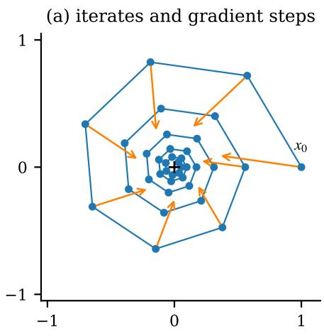
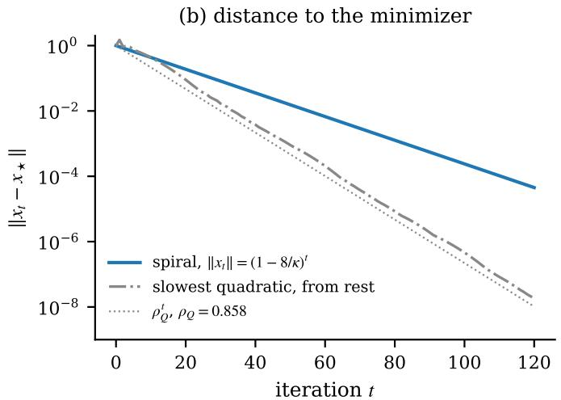

# The Optimal Rate Constant of Heavy-Ball Momentum on Smooth Strongly Convex Functions

Marcos Hernanz

marcos@hernanz.io

## Abstract

The heavy-ball method with a constant step size and a constant momentum parameter accelerates gradient descent on quadratics, but no choice of the two parameters does so on the class of smooth strongly convex functions. We determine how much faster than gradient descent it can be made on this class. Writing the best worst-case rate over all tunings as $1 - c ( \kappa ) / \kappa ,$ where � is the condition number, we prove that �(�) tends to 8 in every dimension of two or more. The lower bound on the rate holds for every tuning, because a tuning that is faster than $1 - 8 / \kappa$ on quadratics follows a slowly decaying spiral on some function of two variables. The matching upper bound comes from an explicit tuning, with nearly the momentum of Polyak’s tuning and a step size about $\sqrt { \kappa } / 8$ times smaller, and from a Lyapunov function whose positivity is verified in exact arithmetic. Optimally tuned heavy-ball is therefore asymptotically four times faster than gradient descent on this class.

## Contents

1 Introduction 4   
2 Related Work 6   
Setting and Main Results 8   
3.1 Worst-case rates 8   
3.2 Notation and interpolation conditions 8   
3.3 Main results 9   
4 Where the Constant 8 Comes From 11   
4.1 What quadratics allow . 11   
4.2 Spirals . . 11   
4.3 The upper bound . 12   
5 Proof of the Lower Bound 14   
5.1 Tunings that beat 1 − 8∕� on quadratics . 14   
5.2 Decaying spirals 14   
5.3 The window 16   
5.4 Roots of unity in the window 17   
5.5 Proof of Theorem A 17   
5.6 Rest start 18   
6 Proof of the Upper Bound 19   
6.1 The tuning on quadratics 19   
6.2 The Lyapunov function 19   
6.3 Structure of the certificate 20   
6.4 Exact verification . 20   
6.5 Exact range . 21   
6.6 How the certificate was found . 21   
7 Computer-Assisted Steps 22   
7.1 What was checked . 22   
7.2 Size of the computations and trust base 23   
7.3 Floating-point tests . 23   
8 Finite Condition Numbers 24   
8.1 Exact certificates at fixed condition numbers 24   
8.2 A numerical bracket . 24   
8.3 Earlier numerical values . 24   
8.4 Shape of the tuning and the second-order term 25   
9 Discussion and Limitations 26   
9.1 What the results settle 26   
9.2 Open questions . 26   
9.3 The constant 8 in the region of Ghadimi et al. 26   
9.4 Limitations . 27   
10 Conclusion 28   
References 29   
A The Certificate of Theorem B 32   
B Polynomials of the Window Lemma 34   
C Exact Certificates at Fixed Condition Numbers 35   
D Results in One Dimension 36   
E Reproducibility 41

## 1 Introduction

The heavy-ball method of Polyak [24] minimizes a diferentiable function � by the iteration

$$
x _ { t + 1 } = x _ { t } - \gamma \nabla f ( x _ { t } ) + \beta ( x _ { t } - x _ { t - 1 } ) ,\tag{1}
$$

with a step size $\gamma$ and a momentum parameter $\beta .$ . It is the prototype of the momentum methods used to train neural networks. On quadratics whose Hessian has its eigenvalues in $[ \mu , L ]$ , Polyak’s choice of $\gamma$ and $\beta$ converges at the rate $1 - 2 / \sqrt \kappa + O ( 1 / \kappa )$ , where $\kappa = L / \mu$ is the condition number. This is the accelerated rate. When the dimension is large compared with the number of iterations, no first-order method has a better one, already on quadratics [19, 21, Thm. 2.1.13]. Gradient descent, the case $\beta = 0$ , has the rate $1 - 2 / \kappa + O ( 1 / \kappa ^ { 2 } )$ with its best step size.

Beyond quadratics, heavy-ball loses this advantage. On the class $\mathcal { F } _ { \mu , L }$ of �-smooth �-strongly convex functions, Polyak’s tuning fails to converge on some functions as soon as $\kappa \geq 9 + 4 { \sqrt { 5 } } [ 2 2$ Thm. 2.2], and Goujaud et al. [11] proved that no tuning accelerates in dimension two or more. Every choice of $( \gamma , \beta )$ either fails to converge on some function of the class or converges no faster than $1 - O ( 1 / \kappa )$ , already on quadratics. Their counterexamples are cycles, found numerically by Goujaud et al. [10] and then constructed in closed form. Non-acceleration holds in one dimension as well [7, 16].

This leaves a quantitative question. Let $\rho ^ { \star } ( \kappa )$ be the best worst-case rate of (1) on $\mathcal { F } _ { \mu , L }$ over all constant tunings $( \gamma , \beta )$ , and write it as $\rho ^ { \star } ( \kappa ) = 1 - c ( \kappa ) / \kappa$ . Gradient descent shows that $c ( \kappa ) \geq 2 \kappa / ( \kappa + 1 )$ , and non-acceleration says that $c ( \kappa )$ is bounded. How large is it? Goujaud et al. [11, §7] note that the exact rate is open. The thesis of Goujaud [9, §10.3.3] records the proved bounds, which are asymptotically $2 \leq c \leq 1 0 0 / 3$ in our normalization, computes numerical optima at $\kappa = 2 0$ , 100 and 1000, and asks what the limit is. It poses the related problem of finding analytical expressions for the optimal tuning and rate. Concurrently with this work, Liu et al. [16, App. F] proved a lower bound in one dimension that implies $c \leq 2 4 \left( \ S 2 \right)$ .

This paper determines the limit. In every dimension $d \ge 2$ we prove that $c ( \kappa ) \to 8$ . The lower bound on the rate (Theorem $\mathrm { A } )$ holds for every tuning. If a tuning converges faster than $1 - 8 / \kappa$ on quadratics, we construct a function of two variables on which heavy-ball follows the spiral $x _ { t } = ( 1 - 8 / \kappa ) ^ { t } e ^ { 2 \pi i t / K }$ around the minimizer, for some integer $K$ . The upper bound (Theorem B) is an explicit tuning for $\kappa \geq 4 0 0$ , with momentum $1 - \beta \approx 4 / \sqrt { \kappa }$ and step size $\gamma \approx 3 2 / ( L \sqrt { \kappa } )$ , whose worst-case rate is $1 - ( 8 - 6 4 / \sqrt { \kappa } ) / \kappa$ in every dimension. Together they give $8 - 6 4 / \sqrt { \kappa } \leq c ( \kappa ) \leq 8$ (Corollary 1). Optimally tuned heavy-ball is therefore asymptotically four times faster than gradient descent on $\mathcal { F } _ { \mu , L }$ , and this factor cannot be improved. This answers the question of Goujaud [9] about the limit, and it solves the problem posed there of the optimal tuning and rate to first order in $1 /  \kappa$

The constant 8 has a short explanation, which $\ S 4$ gives in full. Along a spiral the gradient is the iterate scaled and rotated by a fixed nonzero angle, which no quadratic can produce. Convexity allows such a rotation only in exchange for curvature, and the exchange is most favorable at half the largest curvature $L$ . Balancing the two gives a condition � $( 2 w - 1 ) \geq 8 w ^ { 2 }$ on a free parameter $w ,$ , which some � satisfies if and only if $c \geq 8$ . The tuning of Theorem B has the momentum of Polyak’s tuning to first order and a step size about $\sqrt { \kappa } / 8$ times smaller. Its proof uses a Lyapunov function that perturbs the mechanical energy of the heavy ball. Three of its six coeficients are forced by the quadratic on which the rate is attained. The other three were fitted numerically and then rounded, and the positivity of the resulting quadratic form is proved for all $\kappa \geq 4 0 0$ at once by exact root counting.

Several ingredients come from earlier work. Non-acceleration is due to Goujaud et al. [11] in dimension two and higher, and to Fotopoulos et al. [7] and Liu et al. [16] in one dimension. Our spirals are the decaying version of the root-of-unity cycles of Goujaud et al. [11] and the singlefrequency case of the decaying waves of Pasechniuk-Vilensky [22], whose extra coordinate we use for the rest start. The tunings that beat a given rate on quadratics are described in Goujaud et al. [11, Lemma 2.4]. Our certificate belongs to the class with one step of memory and the lag-one multiplier, which is the weighted of-by-one constraint of Lessard et al. [15] (§2). At each fixed $\kappa > 6 4 . 8 2$ the rate of our tuning can be derived from a concurrent criterion of Pasechniuk-Vilensky [22, Thm. 7.2(b)] (Remark 2). What is new is the value 8 of the limit. The lower bound $1 - 8 / \kappa$ for every tuning improves on $1 - ( 1 0 0 / 3 + o ( 1 ) ) / \kappa [ 1 1 ]$ and on the concurrent $1 - ( 2 4 + o ( 1 ) ) / \kappa \left[ 1 6 \right]$ The family that attains it to first order is explicit, and its certificate is valid for all $\kappa \geq 4 0 0$ at once.

Parts of both proofs are computer-assisted, and only exact arithmetic is used. Polynomial identities are verified symbolically and the positivity of explicit univariate polynomials by exact Sturm sequences. Section 7 lists every such step with its range, its method and its script. Section 8 compares the asymptotic result with what is known at finite �, including exact certificates at four values of �. Appendix D collects results in one dimension. There we prove that the constant $c _ { 1 } ( \kappa )$ of ${ \mathcal { F } } _ { \mu , L } ( \mathbb { R } )$ is at most $5 0 / 3 + o ( 1 )$ , show that the cycle method used in earlier lower bounds cannot go below 16, and give an exact non-convergent orbit of Polyak’s tuning started at rest, for every $\kappa \geq 1 0 0$

## 2 Related Work

Global analyses of heavy-ball on $\mathcal { F } _ { \mu , L }$ give no explicit rate better than that of gradient descent. Ghadimi et al. [8] prove global linear convergence on an explicit region of tunings. Their rate is not explicit in general, and on a sub-family it is the gradient-descent factor $1 - \gamma \mu$ for function values. Goujaud et al. [11, Lemma 2.5] show that the best rate over that region, even on quadratics, is $1 - 8 / \kappa + o ( 1 / \kappa )$ . This constant 8 is related to ours but describes diferent tunings (§9.3). Other global analyses of heavy-ball on $\mathcal { F } _ { \mu , L }$ , or of momentum families that contain it, certify explicit rates for small steps $\gamma = O ( \mu / L ^ { 2 } )$ [3, 27]. Danilova et al. [4] study its non-monotone transient behavior on quadratics and prove global convergence under the Polyak–Łojasiewicz condition. Polyak’s own analysis is local [24]. Ugrinovskii et al. [31] prove global asymptotic convergence, without a global rate, on a class of functions with sector-bounded gradients and optimize the local rate. Sanz-Serna and Zygalakis [25, §6] show that heavy-ball has no Lyapunov function of the kind they construct for Nesterov’s method, which would certify an accelerated rate.

Polyak’s tuning can fail on $\mathcal { F } _ { \mu , L }$ . Lessard et al. [15] found a one-dimensional function at $\kappa = 2 5$ on which its iterates approach a cycle. Badithela and Seiler [2] solved the linear matrix inequality of the weighted of-by-one constraint analytically for Polyak’s tuning and constructed a function on which the method enters a limit cycle. As Pasechniuk-Vilensky [22, §1.1] describe it, the bound reaches 1 at $\kappa = 9 + 4 { \sqrt { 5 } }$ , where a function of one variable has a three-cycle. Pasechniuk-Vilensky [22, Thm. 2.2] prove that $9 + 4 { \sqrt { 5 } }$ is the exact threshold, with convergence on all of $\mathcal { F } _ { \mu , L }$ below it and a non-convergent trajectory at and above it. Wang et al. [36] claim acceleration for a class ofPolyak– Łojasiewicz functions. Their erratum (arXiv v3, App. J) adds a co-diagonalization condition, and Goujaud et al. [12] point to an incorrect inequality in the remaining one-dimensional argument. With time-varying parameters on smooth convex functions, Ma and Zhang [17] prove a lower bound for heavy-ball that holds for every schedule fixed in advance, and He and Zhang [13] use randomized schedules to obtain a faster rate than the best known one for gradient descent. We only consider constant parameters.

Other lower bounds for every tuning come from cycles. Goujaud et al. [11] constructed heavy-ball cycles on the �-th roots of unity in the plane (their Thm. 3.5) and proved that every tuning outside the cycling regions satisfies $\rho \ge ( 1 - C / \kappa ) / ( 1 + C / \kappa )$ for every $C > 5 0 / 3$ (Thm. 3.6), which is $c \leq 1 0 0 / 3$ in our normalization. Goujaud et al. [12] asked whether heavy-ball accelerates on functions of one variable. Fotopoulos et al. [7] answered this negatively by rotating the planar cycles and projecting them onto a line. Building on their construction, Liu et al. $\left[ 1 6 , \mathbf { A p p . F } \right]$ prove that in one dimension every tuning with $\gamma > 0$ and $0 \leq \beta < 1$ has rate at least $( \kappa - 1 2 ) / ( \kappa + 1 2 )$ when $\kappa \geq 2 4$ . Tunings outside this range have $\rho _ { Q } \ge 1 - 8 / \kappa$ by Lemma 1, which is larger. Since $\rho ^ { \star }$ does not decrease with the dimension, this gives $c \leq 2 4$ in every dimension.

The concurrent work of Pasechniuk-Vilensky [22] is the closest to ours. It answers the second riddle of Goujaud et al. [12] and develops a rate theory for general tunings, for the rest-start rate taken uniformly over the dimension. Interpolable mixtures of rotating geometric sequences, decaying ones included, give lower bounds (their Lemma 3.4 and Thm. $3 . 5 ( \mathrm { c } ) )$ , and a lag-one Zames–Falb multiplier gives upper bounds (Thm. 7.2(a)). On an explicit region � of tunings the rate equals the rate on quadratics (Thm. 7.2(b)). They do not optimize over tunings and do not state a limiting constant for the optimal rate. Among the questions they leave open are the rates on the part of their region $\Omega _ { 1 }$ outside � and the asymptotics of their gaps as $\kappa  \infty$ (their §10). The spiral of Theorem A is the single-frequency case of their waves, and the tuning of Theorem B lies in their region � (Remark 2). Our contribution relative to theirs is the quantitative bound for every tuning and a family, uniform in �, that matches it.

Worst-case rates for fixed parameters can be computed or certified by performance estimation [6, 30], by Lyapunov searches [29, 32] and by integral quadratic constraints [15, 18]. Lessard and Seiler [14] synthesize algorithms with bounds on the achievable rate. For heavy-ball with step $1 / L$ and numerically optimized momentum, Lessard et al. [15, Fig. 8] report rates between about $1 - 6 . 4 / \kappa$ and $1 - 7 . 1 / \kappa$ for � between about 850 and 4200 (our reading of their figure, whose resolution we discuss in §8.3). They describe this as comparable to gradient descent, which is true of the order in �. Van Scoy and Lessard [33, Fig. 4] find $c \approx 5 \mathrm { a t } \kappa = 1 0 0$ , and Upadhyaya et al. [32, Fig. 2c] find $c \approx 2 . 2 \mathrm { a t } \kappa = 1 0$ with step $1 / L$ , both read of their figures and converted from rates of the squared distance. Goujaud’s thesis [9, Table 10.1] reports optima at $\kappa = 2 0 .$ , 100 and 1000 (§8.3). The lag-one multiplier behind our certificate is a discrete-time analogue of the Zames–Falb multipliers [37], and Pasechniuk-Vilensky [22, §1.5] note that it coincides with the weighted of-by-one constraint of Lessard et al. [15]. They relate single-harmonic periodic orbits to the periodic counterexamples in absolute stability of Seiler and Carrasco [26], and multi-harmonic obstructions to the duality bounds for Zames–Falb multipliers of Zhang et al. [38].

Spirals have been used for Nesterov’s method as well. Pokutta and Stellato [23] determine the exact worst-case asymptotic rate of Nesterov’s method with its standard parameters, using planar spirals with a common contraction factor and a linear program over measures. That work is concurrent and concerns a diferent method, but its tools are close to ours.

Methods that evaluate the gradient elsewhere do accelerate on $\mathcal { F } _ { \mu , L }$ . Measured, as here, by the distance to the minimizer, Nesterov’s method [20] with constant momentum converges at rate at most $( 1 - 1 / \sqrt { \kappa } ) ^ { 1 / 2 } \approx 1 - 1 / ( 2 \sqrt { \kappa } ) \left[ 2 1 , \ S 2 . 2 . 1 \right]$ , and the triple momentum method at rate $1 - 1 / \sqrt { \kappa }$ [35]. No first-order method has a better rate for the distance to the minimizer when the dimension is large compared with the number of iterations. On $\mathcal { F } _ { \mu , L } ( \mathbb { R } ^ { 2 N + 1 } )$ the lower bound of Drori and Taylor [5] after � steps is of order $( 1 - 1 / \sqrt \kappa ) ^ { N }$ , and the method of Taylor and Drori [28] attains it. Nesterov’s method and the triple momentum method evaluate the gradient at a point other than the iterate, which heavy-ball does not. If � is in addition twice continuously diferentiable near the minimizer, the asymptotic rate of a globally convergent method is its local rate, which for heavy-ball can be the accelerated rate of quadratics [24]. Ugrinovskii et al. [31] exploit this, and so do Van Scoy and Lessard [34] with a new method. The functions in our lower bound are not twice diferentiable at the minimizer, and cannot be. If � were twice diferentiable at $x _ { \star }$ , the iterates of Theorem A would eventually converge at a rate at most $\rho _ { Q } < 1 - 8 / \kappa$

## 3 Setting and Main Results

## 3.1 Worst-case rates

For $0 ~ < ~ \mu ~ < ~ L _ { : }$ , let $\mathcal { F } _ { \mu , L } ( \mathbb { R } ^ { d } )$ be the set of diferentiable functions $f : \mathbb { R } ^ { d }  \mathbb { R }$ such that $f - ( \mu / 2 ) \parallel \cdot \parallel ^ { 2 }$ is convex and $\nabla f$ is �-Lipschitz, and let $\mathcal { Q } _ { \mu , L }$ be its subset of quadratics. Each $f \in \mathcal { F } _ { \mu , L }$ has a unique minimizer $x _ { \star }$ . Heavy-ball (1) starts from an arbitrary pair $( x _ { - 1 } , x _ { 0 } )$ , as in the cycle constructions of Goujaud et al. [11]. For a tuning $( \gamma , \beta ) \in \mathbb { R } ^ { 2 }$ and a set of functions $\mathcal { F }$ the rate $\rho _ { \gamma , \beta } ( \mathcal { F } )$ is the smallest $\rho \ge 0$ with the following property. For every $\varepsilon > 0$ there is a $T _ { 0 }$ such that

$$
\| x _ { T } - x _ { \star } \| \leq ( \rho + \varepsilon ) ^ { T } \operatorname* { m a x } \bigl \{ \| x _ { 0 } - x _ { \star } \| , \| x _ { - 1 } - x _ { \star } \| \bigr \}\tag{2}
$$

for all $f \in \mathcal F$ , all initial pairs and all $T \geq T _ { 0 }$ . The rest-start rate $\rho _ { \gamma , \beta } ^ { \mathrm { r e s t } }$ is defined in the same way with $x _ { - 1 } = x _ { 0 }$ . The optimal rate in dimension � and its constant are

$$
\rho _ { d } ^ { \star } ( \kappa ) = \operatorname* { i n f } _ { ( \gamma , \beta ) \in \mathbb { R } ^ { 2 } } \rho _ { \gamma , \beta } \bigl ( \mathcal { F } _ { \mu , L } ( \mathbb { R } ^ { d } ) \bigr ) , \qquad c _ { d } ( \kappa ) = \kappa \bigl ( 1 - \rho _ { d } ^ { \star } ( \kappa ) \bigr ) .
$$

By scaling, $\rho _ { d } ^ { \star }$ depends on $\mu$ and � only through $\kappa = L / \mu$ . It does not decrease with $d ,$ because adding coordinates on which � is $( \mu / 2 ) \parallel \cdot \parallel ^ { 2 }$ embeds $\mathcal { F } _ { \mu , L } ( \mathbb { R } ^ { d } )$ into $\mathcal { F } _ { \mu , L } ( \mathbb { R } ^ { d + 1 } )$ . Gradient descent with $\gamma = 2 / ( L + \mu )$ has rate $( \kappa - 1 ) / ( \kappa + 1 )$ on $\mathcal { F } _ { \mu , L } \left[ 2 1 \right.$ , Thm. 2.1.15], so $c _ { d } ( \kappa ) \geq 2 \kappa / ( \kappa + 1 )$ ).

Remark 1 (conventions). Goujaud et al. [11] and Goujaud [9] write � for $\mu / L$ and state rates as $( 1 - C \mu / L ) / ( 1 + C \mu / L )$ . In our notation this is $c = 2 C \kappa / ( \kappa + C ) \to 2 C$ . Asymptotically, our constant 8 is $C = 4$ there, and their bound for every $C > 5 0 / 3 \mathrm { i s } c \leq 1 0 0 / 3$ . They normalize by $\| x _ { 0 } - x _ { \star } \|$ and do not specify the second initial point [11, Defs. 1.3–1.5]. Pasechniuk-Vilensky [22] use the rest start (their eq. (1.1)) and take the supremum over all dimensions inside the rate (their eq. (1.2)). Our results hold under each of these conventions. The lower bound holds for arbitrary initial pairs in $d \geq 2$ and from rest in $d \geq 3 ,$ , normalized by either initial distance. The upper bound holds for every initial pair in every dimension, with a constant independent of �. Normalized by $\| x _ { 0 } - x _ { \star } \|$ alone, it needs $x _ { - 1 }$ to be determined by $x _ { 0 }$ , as in the rest start.

## 3.2 Notation and interpolation conditions

From now on we take � = 1 and write

$$
q = \mu = 1 / \kappa , \qquad s = \sqrt { q } = \kappa ^ { - 1 / 2 } , \qquad h = \gamma L ,
$$

with $x _ { \star } = 0$ and $f ( x _ { \star } ) = 0$ . On the quadratic $( \lambda / 2 ) \| x \| ^ { 2 }$ , heavy-ball is a linear recursion with characteristic polynomial $z ^ { 2 } - ( 1 + \beta - h \lambda ) z + \beta .$ . Let �(�) be the largest modulus of its roots and $\rho _ { Q } = \operatorname* { m a x } _ { \lambda \in [ q , 1 ] } r ( \lambda ) = \operatorname* { m a x } \{ r ( q ) , r ( 1 ) \}$ . Running heavy-ball from an eigenvector, or from the real part of a complex one, shows that $\rho _ { \gamma , \beta } ( \mathcal { F } _ { \mu , L } ) \geq \rho _ { Q }$ , and $\rho _ { Q }$ is the rate on $\mathcal { Q } _ { \mu , L } \left[ 1 \right]$ , Prop. 2.1].

Both proofs rest on the interpolation conditions for $\mathcal { F } _ { \mu , L } . \mathrm { A }$ finite set of triples $( x _ { i } , g _ { i } , f _ { i } )$ is $\mathcal { F } _ { \mu , L } -$ interpolable if some $f \in \mathcal { F } _ { \mu , L } ( \mathbb { R } ^ { d } )$ has $f ( x _ { i } ) = f _ { i }$ and $\nabla f ( x _ { i } ) = g _ { i }$ for all �. By Taylor et al. [30, Thm. 4], this holds if and only if, for all � and $j ,$

$$
I ( i , j ) : = f _ { i } - f _ { j } - \langle g _ { j } , x _ { i } - x _ { j } \rangle - \frac { \| g _ { i } - g _ { j } \| ^ { 2 } + q \| x _ { i } - x _ { j } \| ^ { 2 } - 2 q \langle g _ { i } - g _ { j } , x _ { i } - x _ { j } \rangle } { 2 ( 1 - q ) } \ \geq \ 0 .\tag{3}
$$

The lower bound constructs data that satisfy these inequalities, and the upper bound adds two of them with non-negative multipliers.

## 3.3 Main results

Theorem A (lower bound). Let $0 < \mu < L$ and $d \geq 2 .$ For every $( \gamma , \beta ) \in \mathbb { R } ^ { 2 } .$

$$
\rho _ { \gamma , \beta } \big ( \mathcal { F } _ { \mu , L } ( \mathbb { R } ^ { d } ) \big ) \geq 1 - \frac { 8 } { \kappa } .
$$

More precisely, let $\kappa > 8$ and $r = 1 - 8 / \kappa$ . Either $\rho _ { Q } \geq r ,$ , or there are an integer $K \geq 4 ,$ , afunction $f \in \mathcal { F } _ { \mu , L } ( \mathbb { R } ^ { 2 } )$ and an initial pair on which heavy-ball satisfies $x _ { t } - x _ { \star } = r ^ { t } R _ { 2 \pi t / K } ( x _ { 0 } - x _ { \star } ) f o r$ all $t \geq 0 ,$ , where $R _ { \theta }$ is the rotation ofthe plane by the angle �.

Theorem B (achievability). Let $\kappa \geq 4 0 0 , s = \kappa ^ { - 1 / 2 } , C = 8 - 6 4 s ,$ , and

$$
r = 1 - C s ^ { 2 } , \qquad \beta = r ( r - 4 s ) , \qquad \gamma = \frac { C s ( 4 + C s ) } { L } .\tag{4}
$$

There is a constant �, depending only on �, such that for every �, every $f \in \mathcal { F } _ { \mu , L } ( \mathbb { R } ^ { d } )$ and every initial pair $( x _ { - 1 } , x _ { 0 } )$ ,

$$
\| x _ { t } - x _ { \star } \| \leq M r ^ { t } \big ( \| x _ { 0 } - x _ { \star } \| + \| x _ { - 1 } - x _ { \star } \| \big ) \qquad f o r a l l t \geq 0 .
$$

The rate is attained on $f = ( \mu / 2 ) \| x \| ^ { 2 } .$ , already from rest. Hence

$$
\rho _ { \gamma , \beta } \big ( \mathcal { F } _ { \mu , L } ( \mathbb { R } ^ { d } ) \big ) = \rho _ { \gamma , \beta } ^ { \mathrm { r e s t } } \big ( \mathcal { F } _ { \mu , L } ( \mathbb { R } ^ { d } ) \big ) = 1 - \frac { 8 - 6 4 / \sqrt { \kappa } } { \kappa } .
$$

The constant � is given in the proof. For example, $M < 7 8$ at $\kappa = 4 0 0$ and $M < 5 5 9$ at $\kappa = 1 0 ^ { 4 }$ (Table 3). The same certificate works for every $\kappa \geq 3 5 7 . 2 9 0 1 \ldots$ and for no smaller � $( \ S 6 . 5 )$

Corollary 1 (the optimal constant). For � $\geq 2$ and $\kappa \geq 4 0 0$

$$
1 - \frac { 8 } { \kappa } \leq \rho _ { d } ^ { \star } ( \kappa ) \leq 1 - \frac { 8 } { \kappa } + \frac { 6 4 } { \kappa ^ { 3 / 2 } } , \qquad t h a t i s , \qquad 8 - \frac { 6 4 } { \sqrt { \kappa } } \leq c _ { d } ( \kappa ) \leq 8 .
$$

The upper bound $c _ { d } ( \kappa ) \leq 8 h o l d s f o r a l l \kappa > 1$ . In particular $c _ { d } ( \kappa )  8 ,$ , while the constant $2 \kappa / { ( \kappa + 1 ) }$ ofgradient descent tends to 2. In one dimension, $c _ { 1 } ( \kappa ) \geq 8 - 6 4 / \sqrt { \kappa } f o r \kappa \geq 4 0 0 .$

Corollary 2 (rest start). For $d \ge 3$ and every $( \gamma , \beta ) \in \mathbb { R } ^ { 2 } , \rho _ { \gamma , \beta } ^ { \mathrm { r e s t } } ( \mathcal { F } _ { \mu , L } ( \mathbb { R } ^ { d } ) ) \geq 1 - 8 / \kappa$ . Hence Corollary 1 holdsfor the rest-start rate as well, for � $\geq 3 .$

In terms of iterations, the spiral of Theorem A has $\| x _ { N } - x _ { \star } \| = r ^ { N + 1 } \operatorname* { m a x } \{ \| x _ { 0 } - x _ { \star } \| , \| x _ { - 1 } - x _ { \star } \| \}$ $\operatorname { I f } \rho _ { Q } \geq r .$ , the trajectory $x _ { t } = z ^ { t + 1 }$ on $( \lambda / 2 ) \| x \| ^ { 2 }$ , with ℝ2 identified with ℂ and � a root of modulus $\rho _ { Q }$ for $\lambda = q$ or $\lambda = 1$ , decays no faster. To reduce the distance to the minimizer by a factor $\varepsilon < 1$ on every function of $\mathcal { F } _ { \mu , L } ( \mathbb { R } ^ { 2 } )$ , every tuning therefore needs at least log( $1 / \varepsilon ) / \log ( 1 / r ) -$ $1 \ge ( \kappa / 8 - 1 ) \log ( 1 / \varepsilon ) - 1$ iterations. The tuning of Theorem B needs at most $\lceil \kappa ( \log ( 1 / \varepsilon ) +$ log $2 M ) / ( 8 - 6 4 / \sqrt { \kappa } ) ]$ . Gradient descent needs about $( \kappa / 2 ) \log ( 1 / \varepsilon )$ iterations, and the triple momentum method about $\sqrt { \kappa } \log ( 1 / \varepsilon )$

Remark 2 (relation to Pasechniuk-Vilensky). The tuning (4) lies in the region � of Pasechniuk-Vilensky [22, Thm. 7.2(b)] for every $\kappa > 6 4 . 8 2$ . For this family, their membership conditions (Cor. 7.3(a),(c)) reduce to the positivity of univariate polynomials in �, which we checked by exact root counting (§7). On � they prove that the rate equals the rate on quadratics, which here is �. At each fixed �, their theorem therefore gives the rate equality of Theorem B independently. Their statement is for the rest start and loses an arbitrary � in the rate, although their proof controls arbitrary initial states. Theorem B adds a short, self-contained certificate in the time domain with an explicit constant � for arbitrary initial pairs, and it identifies a family that is asymptotically optimal by Theorem A.

## 4 Where the Constant 8 Comes From

This section explains the two theorems without full proofs. We keep $L = 1$

## 4.1 What quadratics allow

On a quadratic of curvature �, heavy-ball is a linear recursion. In the flattest direction, $\lambda = q .$ , it converges at a real rate � if � is a root of $z ^ { 2 } - ( 1 + \beta - h q ) z + \beta$ . Evaluating this polynomial at $z = 1$ gives $h q = ( 1 - r ) ( 1 - \beta / r )$ . A real rate $r = 1 - c / \kappa$ therefore requires

$$
{ \frac { h } { 1 - \beta / r } } = c .
$$

We call the left side the efective step. For gradient descent it equals $h ,$ , and stability in the stifest direction, $\lambda = 1$ , requires $h < 2$ , hence $c < 2$ . Momentum separates the two requirements. The stif direction only needs $h \lesssim 2 ( 1 + \beta )$ , while the efective step grows without bound as $\beta / r  1$ The momentum cannot exceed $r ^ { 2 }$ , because the roots for $\lambda = q$ have product $\beta ,$ so one of them has modulus at least $\sqrt { \beta }$ . In the coordinates

$$
X = 1 - \beta / r \qquad \mathrm { a n d } \qquad h = \gamma L ,
$$

the tunings that beat $r = 1 - 8 / \kappa$ on quadratics form a triangle (Lemma 1; 11, Lemma $2 . 4 )$ . Its three sides are $X > \eta : = 1 - r .$ , which bounds the momentum, $h > 8 X$ , which says that the efective step exceeds $^ { 8 , }$ , and $h < ( 2 - \eta ) ( 2 - X )$ , which keeps the stif direction stable. On quadratics alone, � can be as large as about $2 \sqrt { \kappa }$ , which Polyak’s tuning attains. Everything that limits � to 8 comes from functions that are not quadratic.

## 4.2 Spirals

Identify $\mathbb { R } ^ { 2 }$ with ℂ and look for a heavy-ball trajectory that spirals into the minimizer, $x _ { t } = r ^ { t } e ^ { i \theta t }$ The iteration (1) determines the gradients along it, $g _ { t } = ( a + i b ) x _ { t }$ with real � and � that depend on the tuning, by (6). The part � $. x _ { t }$ is what the quadratic $( a / 2 ) \| x \| ^ { 2 }$ would produce. The part $i b x _ { t }$ is perpendicular to $x _ { t }$ (Figure 1). No quadratic produces it along the whole spiral, because a Hessian � with $\begin{array} { r } { H x _ { t } = ( a + i b ) x _ { t } } \end{array}$ for all � is the multiplication by $a + i b$ , which is symmetric only if $b = 0 . \mathbf { A }$ convex function that is not quadratic can produce some of this rotation, but only a limited amount. The interpolation conditions allow it as long as

$$
| b | \leq 2 m \tan { \frac { \theta } { 2 } } , \qquad \mathrm { w h e r e } \qquad m = { \frac { ( a - q ) ( 1 - a ) - b ^ { 2 } } { 2 ( 1 - q ) } } \approx { \frac { a ( 1 - a ) } { 2 } }
$$

(Lemma 2). The rotation � has to be paid for by a curvature � strictly between � and 1 and by a large enough turning angle �.

Now place the tuning on the edge $h = c X$ , where its rate on the quadratic of curvature $q$ is about $1 - c / \kappa ,$ , and write $1 - \cos \theta = 2 X$ � for some $w > 0$ . Suppose that � is small and that $\eta$ is much smaller than �, which is the case for the tunings that matter as $\kappa  \infty$ . Then (6) and (7), with $a = \mathrm { R e } A / h$ and $b = \operatorname { I m } A / h$ , give $a \approx 4 w / c , | b | \approx 2 \sqrt { X w } / c$ and tan $( \theta / 2 ) \approx \sqrt { X w }$ . After division by $\sqrt { X w } / c$ , the condition above becomes $2 \leq 4 w ( 1 - 4 w / c )$ , that is,

$$
c \left( 2 w - 1 \right) \geq 8 w ^ { 2 } .
$$

  
Figure 1: A spiral of Lemma 2 at $\kappa = 1 0 0$ , for the tuning $\gamma L = 2 . 5 , \beta = 0 . 7 3 6 .$ (a) The iterates turn by $2 \pi / 7$ per step and contract by $r = 1 - 8 / \kappa = 0 . 9 2$ . The gradients are the iterates scaled and rotated by a fixed nonzero angle, which no quadratic produces. The orange arrows are the gradient steps $- \gamma \nabla f ( x _ { t } )$ . (b) On this function heavy-ball converges at the rate 0.92, although on every quadratic of the class it converges at the rate $\rho _ { Q } = 0 . 8 5 8$ or faster.

Some � satisfies this if and only if

$$
c \ge \operatorname* { m i n } _ { w > 1 / 2 } \frac { 8 w ^ { 2 } } { 2 w - 1 } = 8 ,
$$

and the minimum is attained at $w = 1 . \mathrm { A t } c = 8$ the best spiral has $a = 1 / 2$ , the middle of the range of curvatures, $m = 1 / 8$ and $\vert b \vert = { \sqrt { X } } / 4$ , and it turns by $\theta \approx 2 { \sqrt { X } }$ per step. More precisely, with $\vartheta = \eta / X$ , the polynomial Φ of Lemma 2 satisfies

$$
\Phi ( c X , 2 X w ) = 2 X ^ { 2 } \big [ c ( 2 w - 1 + \vartheta ) - 8 w ^ { 2 } \big ] + O ( X ^ { 3 } ) .
$$

A tuning that beats $1 - 8 / \kappa$ on quadratics has $h > 8 X$ , so it lies beyond the edge $c = 8$ , and decaying spirals at the rate $1 - 8 / \kappa$ exist for it. The proof of Theorem A makes this precise. It finds a window of values of $( h , u )$ around $u = 2 X$ on which $\Phi > 0 \left( \mathrm { L e m m a } 4 \right)$ , and a root of unity inside it (Lemma 5).

## 4.3 The upper bound

For the converse we need a tuning that lies on the edge $h = C X$ for its own rate, with � just below 8, and a proof that no function in $\mathcal { F } _ { \mu , L }$ slows it down. The tuning (4) satisfies $X = s ( 4 + C s )$ and $h = C X$ , so its efective step is �. Its momentum agrees with Polyak’s to first order, $1 - \beta \approx 4 / \sqrt { \kappa } .$ while its step $\gamma L \approx 3 2 / \sqrt { \kappa }$ is about $\sqrt { \kappa } / 8$ times smaller than Polyak’s.

The proof uses a Lyapunov function. Let $\varphi = f - ( \mu / 2 ) \| \cdot \| ^ { 2 }$ , which is convex and (1 − �)-smooth. To leading order in �, the Lyapunov function is

$$
V _ { t } \approx f ( x _ { t - 1 } ) + \frac { \| x _ { t } - x _ { t - 1 } \| ^ { 2 } } { 2 \gamma } + \frac { 1 } { 2 } \langle x _ { t } - x _ { t - 1 } , \nabla \varphi ( x _ { t - 1 } ) \rangle + 2 s \| \nabla \varphi ( x _ { t - 1 } ) \| ^ { 2 } .
$$

The first two terms are the potential and the kinetic energy of the heavy ball. The third couples the velocity with the gradient, and the fourth is a small multiple of the squared gradient. We show that $V _ { t + 1 } \leq r ^ { 2 } V _ { t }$ on every $f \in \mathcal { F } _ { \mu , L }$ . The proof adds two inequalities satisfied by $\varphi ,$ one between consecutive iterates and one between the iterate and the minimizer, with multipliers $r ^ { 2 }$ and $1 - r ^ { 2 }$ These are the only multipliers that cancel the function values. What remains is a quadratic form in $x _ { t } , x _ { t - 1 } , \nabla \varphi ( x _ { t - 1 } )$ and $\nabla \varphi ( x _ { t } )$ that must be positive semidefinite. Because the quadratic $( \mu / 2 ) \| x \| ^ { 2 }$ attains the rate $r ,$ the form must vanish in the corresponding direction, and this fixes three of the six entries of the matrix that defines �. We found the other three numerically, as power series in $s ,$ rounded them, and proved positivity for all $\kappa \geq 4 0 0$ by exact root counting. Section 4.2 predicts this outcome. With efective step $C < 8$ no spiral can slow the tuning down, and the certificate shows that no other function can either.

## 5 Proof of the Lower Bound

This section proves Theorem A. Fix $q < 1 / 8$ , so that $r = 1 - 8 q \in ( 0 , 1 )$ . For $q \ge 1 / 8$ there is nothing to prove. Write $\eta = 1 - r = 8 q .$ . The proof has four steps. A tuning that beats � on quadratics lies in a triangle (Lemma 1). A decaying spiral at rate � is a heavy-ball trajectory on some function of $\mathcal { F } _ { \mu , L }$ as soon as a polynomial Φ is non-negative (Lemma 2). This polynomial is positive on an explicit window (Lemma 4), and some root of unity falls in that window (Lemma 5).

## 5.1 Tunings that beat $1 - 8 / \kappa$ on quadratics

For a tuning $( h , \beta )$ define

$$
W = \frac { r ^ { 2 } - \beta } { r } , \qquad X = W + \eta = 1 - \frac { \beta } { r } , \qquad \mathrm { s o t h a t } \qquad \beta = r ( 1 - X ) .\tag{5}
$$

Lemma 1 (quadratic necessary conditions). $I f \rho _ { Q } < r ,$ , then

$$
\eta < X < \frac { 2 ( 2 - \eta ) } { 1 0 - \eta } \leq \frac 2 5 \qquad a n d \qquad 8 X < h < ( 2 - \eta ) ( 2 - X ) .
$$

In particular $0 < \beta < 1$ $W > 0$ and $h > 0 .$

Proof. By the Schur–Cohn criterion, both roots of $z ^ { 2 } - a z + b$ , with � and � real, lie in the open disc of radius � if and only if $| b | < r ^ { 2 }$ and $| a | r < r ^ { 2 } + b$ . We apply it to $\lambda = q$ , where $a = 1 + \beta - q h$ and to $\lambda = 1$ , where $a = 1 + \beta - h$ . First, $\beta < r ^ { 2 }$ gives $W > 0$ , that is, $X > \eta$ . With $\beta = r ( 1 - X )$ one checks that

$$
( r ^ { 2 } + \beta ) - ( 1 + \beta - q h ) r = r ( q h - \eta X ) \qquad \mathrm { a n d } \qquad ( r ^ { 2 } + \beta ) + ( 1 + \beta - h ) r = r \bigl ( ( 2 - \eta ) ( 2 - X ) - h \bigr ) .
$$

So $\lambda = q$ gives $q h > \eta X$ , that is, $h > 8 X$ , and $\lambda = 1$ gives $h < ( 2 - \eta ) ( 2 - X )$ . The two are compatible only if 8 $\begin{array} { r } { X < ( 2 - \eta ) ( 2 - X ) } \end{array}$ , that is, $X < 2 ( 2 - \eta ) / ( 1 0 - \eta )$ , which is at most $2 / 5 .$ . Then $\beta = r ( 1 - X ) \in ( 0 , 1 )$ □

These conditions describe the interior of the sublevel set SLS(�) of Goujaud et al. [11, Lemma 2.4] in the coordinates $( X , h )$ . The edge $h = 8 X$ is their edge $\gamma = ( 1 - \rho ) ( 1 - \beta / \rho ) / \mu .$ , the edge $X = \eta$ is $\beta = \rho ^ { 2 }$ , and the third edge is the stability edge of the stif direction. The compatibility condition forces $\eta < 6 - 4 \sqrt { 2 } .$ , so for $q \ge 0 . 0 4 3$ every tuning has $\rho _ { Q } \geq r$

## 5.2 Decaying spirals

Identify $\mathbb { R } ^ { 2 }$ with ℂ, with the inner product $\langle v , v ^ { \prime } \rangle = \operatorname { R e } ( v \bar { v } ^ { \prime } )$ . For an integer $K \geq 3$ let $\theta = 2 \pi / K$ $z = r e ^ { i \theta }$ and $u = 1 - \cos \theta = 2 \sin ^ { 2 } ( \pi / K )$ . If heavy-ball is to follow $x _ { t } = z ^ { t }$ , then (1) forces the gradients

$$
h g _ { t } = ( 1 + \beta ) x _ { t } - \beta x _ { t - 1 } - x _ { t + 1 } = A x _ { t } , \qquad { \mathrm { w h e r e } } \qquad A = 1 + \beta - { \frac { \beta } { r } } e ^ { - i \theta } - r e ^ { i \theta } .\tag{6}
$$

With $\beta = r ^ { 2 } - r W$ a short computation gives

$$
\operatorname { R e } A = \alpha : = u ( 2 - \eta - X ) + \eta X \qquad { \mathrm { a n d } } \qquad \operatorname { I m } A = - W \sin \theta .\tag{7}
$$

Lemma 2 (decaying spirals). Let $r \in ( 0 , 1 ] , \eta = 1 - r$ and $K \geq 3 ,$ , with �, � and � as above. Let $( h , \beta )$ be a tuning with $h > 0$ and $W \geq 0$ , where � and � are defined by (5) with this �, let � be as in (7), and let

$$
\Phi ( h , u ) = - q h ^ { 2 } + h \big [ ( 1 + q ) \alpha - ( 1 - q ) ( 2 - u ) W \big ] - \alpha ^ { 2 } - W ^ { 2 } u ( 2 - u ) .\tag{8}
$$

$I f \Phi ( h , u ) \geq 0 ,$ there is an $f \in \mathcal { F } _ { \mu , L } ( \mathbb { R } ^ { 2 } )$ on which heavy-ball started at $( x _ { - 1 } , x _ { 0 } ) = ( z ^ { - 1 } , 1 )$ gives $x _ { t } = z ^ { t } f o r a l l t \ge 0 .$ In particular $\rho _ { \gamma , \beta } ( \mathcal { F } _ { \mu , L } ( \mathbb { R } ^ { 2 } ) ) \geq r .$

Proof. Take the data $x _ { t } = z ^ { t } , g _ { t } = ( a + i b ) x _ { t }$ and $f _ { t } = ( a / 2 ) | x _ { t } | ^ { 2 }$ for $t \geq 0$ , with $a = \mathrm { R e } A / h$ and $b = { \mathrm { I m } } A / h$ , together with the minimizer $( 0 , 0 , 0 )$ . By (6), heavy-ball maps $( x _ { t - 1 } , x _ { t } )$ to $x _ { t + 1 }$ on any function that interpolates these data. Substituting into (3) gives, for all $i \neq j$

$$
I ( i , j ) = m | x _ { i } - x _ { j } | ^ { 2 } + b \ \mathrm { I m } ( x _ { j } { \bar { x } } _ { i } ) , \qquad I ( i , \star ) = I ( \star , i ) = m | x _ { i } | ^ { 2 } ,\tag{9}
$$

where $m = { \bigl ( } ( a - q ) ( 1 - a ) - b ^ { 2 } { \bigr ) } / { \bigl ( } 2 ( 1 - q ) { \bigr ) }$ is the quantity of §4.2. For $\{ i , j \} = \{ n , n + k \}$ with $k \geq 1$ , this is $r ^ { 2 n } [ m | 1 - z ^ { k } | ^ { 2 } \pm b r ^ { k }$ sin ��], and both signs occur. So the data are interpolable if and only if $m \geq 0$ and

$$
m | 1 - z ^ { k } | ^ { 2 } \geq | b | r ^ { k } | \sin k \theta | \qquad { \mathrm { f o r ~ a l l ~ } } k \geq 1 .\tag{10}
$$

Since

$$
| 1 - z ^ { k } | ^ { 2 } = ( 1 - r ^ { k } ) ^ { 2 } + 2 r ^ { k } ( 1 - \cos k \theta ) \geq 4 r ^ { k } \sin ^ { 2 } \frac { \pi k } { K } \qquad \mathrm { a n d } \qquad | \sin k \theta | = 2 \left| \sin \frac { \pi k } { K } \cos \frac { \pi k } { K } \right| ,
$$

the right side of (10) vanishes when $\sin ( \pi k / K ) = 0$ . For the other �, inequality (10) follows from $2 m | \sin ( \pi k / K ) | \geq | b | | \cos ( \pi k / K ) |$ . Since $| \tan ( \pi k / K ) | \ge \tan ( \pi / K )$ for these �, this holds as soon as $| b | \leq 2 m \tan ( \pi / K ) .$ , a condition that implies $m \geq 0$ . Now $h | b | = W$ sin � by (7), and sin $\theta / \tan ( \pi / K ) = 1 + \cos \theta = 2 - u$ . Multiplying by $( 1 - q ) h ^ { 2 } / \tan ( \pi / K ) > 0$ turns the condition into

$$
2 ( 1 - q ) h ^ { 2 } m - ( 1 - q ) h W ( 2 - u ) \geq 0 .
$$

Expanding $2 ( 1 - q ) h ^ { 2 } m = ( \alpha - q h ) ( h - \alpha ) - ( \operatorname { I m } A ) ^ { 2 }$ with (Im $A ) ^ { 2 } = W ^ { 2 } u ( 2 - u )$ shows that this is the condition $\Phi ( h , u ) \ge 0$ , and this condition implies $m \geq 0$ . So every finite subset of the data is interpolable, and Lemma 3 below provides a single $f \in \mathcal { F } _ { \mu , L } ( \mathbb { R } ^ { 2 } )$ □

At � = 1 the bound $| 1 - z ^ { k } | ^ { 2 } \geq 4 r ^ { k } \sin ^ { 2 } ( \pi k / K )$ is an equality, the condition $| b | \leq 2 m \tan ( \pi / K )$ is necessary as well as suficient, and among the tunings that converge on quadratics, the set $\{ \Phi \ge 0 \}$ is the roots-of-unity cycling region of Goujaud et al. [11, Thm. 3.5] (checked symbolically). Lemma 2 is therefore the decaying version of their cycles, and the single-frequency case of the decaying waves ofPasechniuk-Vilensky [22, Lemma 3.4, Thm. 3.5(c)]. What it adds is a closed-form condition, $\Phi \ge 0$ , that can be checked for all tunings at once.

Lemma 3 (infinite interpolation). Let $( x _ { t } , g _ { t } , f _ { t } ) _ { t \geq 0 }$ in $\mathbb { R } ^ { d } \times \mathbb { R } ^ { d } \times \mathbb { R }$ be such that every finite subfamily, together with $( x _ { \star } , 0 , f _ { \star } ) , i s \mathcal { F } _ { \mu , L } { \cdot } i n t e r p o l a b l e$ . Then a single $f \in \mathcal { F } _ { \mu , L } ( \mathbb { R } ^ { d } )$ has $f ( x _ { t } ) = f _ { t }$ and $\nabla f ( x _ { t } ) = g _ { t }$ for all �, and $f ( x _ { \star } ) = f _ { \star }$ and $\nabla f ( x _ { \star } ) = 0$

Proof. Let $f _ { N } \in \mathcal { F } _ { \mu , L } ( \mathbb { R } ^ { d } )$ interpolate the first � points and $( x _ { \star } , 0 , f _ { \star } )$ . Then $f _ { \star } + ( \mu / 2 ) \| x -$ $x _ { \star } \| ^ { 2 } \leq f _ { N } ( x ) \leq f _ { \star } + ( L / 2 ) \| x - x _ { \star } \| ^ { 2 }$ , and the gradients $\nabla f _ { N }$ are �-Lipschitz with $\nabla f _ { N } ( x _ { \star } ) = 0$ By the Arzelà–Ascoli theorem and a diagonal argument, a subsequence has $f _ { N } \to f \mathrm { a n d } \nabla f _ { N } \to G$ locally uniformly. Then $f$ is $C ^ { 1 }$ with $\nabla f = G$ . Moreover, $f - ( \mu / 2 ) \parallel \cdot \parallel ^ { 2 }$ is convex as a pointwise limit of convex functions, and $\nabla f$ is �-Lipschitz as a limit of �-Lipschitz maps. So $f \in \mathcal { F } _ { \mu , L } ( \mathbb { R } ^ { d } )$ Since $f _ { N }$ interpolates the point � for every $N > t$ , and $( x _ { \star } , 0 , f _ { \star } )$ for every �, so does $f . \qquad \sqcup$

Pasechniuk-Vilensky [22, Thm. 3.2] prove the interpolation of infinite data sets directly, and it follows from the extension theorem of Azagra and Mudarra [1] as well.

## 5.3 The window

From now on we set $W = X - \eta$ and $q = \eta / 8$ in (8), so that Φ is a polynomial in $h , u , \eta$ and �.

Lemma 4 (window). Let $0 < \eta < X \leq 2 / 5$ . Then $\Phi ( h , u ) > 0$ for all

$$
h \in \big [ 8 X , ( 2 - \eta ) ( 2 - X ) \big ] \qquad a n d \qquad u \in \big [ 2 X ( 1 - \sqrt { X } / 2 ) , 2 X ( 1 + \sqrt { X } / 2 ) \big ] .
$$

Proof. The polynomial Φ is concave in ℎ, since the coeficient of $h ^ { 2 } \mathrm { i } \mathbf s - q$ , and concave in �, since the coeficient of $u ^ { 2 }$ is $W ^ { 2 } - ( 2 - \eta - X ) ^ { 2 } = - 4 ( 1 - \eta ) ( 1 - X ) < 0$ , independently of ℎ. A function on a rectangle that is concave in each variable separately attains its minimum at a corner, so it sufices to check the four corners. Write $u = 2 X ( 1 + \nu )$ with $\nu = \pm \sqrt { X } / 2 ,$ so that $4 \nu ^ { 2 } = X$ , and write $X = y ^ { 2 }$ and $\eta = \vartheta X$ with $( \vartheta , y ) \in ( 0 , 1 ) \times ( 0 , \sqrt { 2 / 5 } ]$ . The following polynomial identities are checked symbolically. At the lower corner $h = 8 X$

$$
\Phi ( 8 X , u ) = X ^ { 2 } \big [ 4 X ( X + 2 + 7 \nu ) + 2 \vartheta E _ { 1 } + 2 \vartheta ^ { 2 } X E _ { 2 } \big ] = y ^ { 4 } F _ { 1 } ( \vartheta , y ) ,\tag{11}
$$

where $E _ { 1 } = 8 - 5 X + 2 X \nu + 8 X \nu ^ { 2 } - 8 X ^ { 2 } ( 1 + \nu ) ^ { 2 }$ and $E _ { 2 } = 2 X ( 1 + \nu ) - 2 \nu - 3$ . At the upper corner $h = ( 2 - \eta ) ( 2 - X )$

$$
\Phi \big ( ( 2 - \eta ) ( 2 - X ) , u \big ) = \big ( 1 - X ( 1 + \nu ) \big ) y ^ { 2 } F _ { 2 } ( \vartheta , y ) ,\tag{12}
$$

where

$$
F _ { 2 } = 4 { \left( 2 + 4 \nu - X ( 3 + 4 \nu ) \right) } + 9 { \left( 6 - 9 X + 1 1 X ^ { 2 } - 1 6 X \nu ( 1 - X ) \right) } - \frac { \vartheta ^ { 2 } X } { 2 } { \left( 6 + 3 X - X ^ { 2 } \right) } .
$$

Here $1 - X ( 1 + \nu ) \geq 1 - 0 . 4 \cdot 1 . 3 2 > 0$ . Both $F _ { 1 }$ and $F _ { 2 }$ are quadratics in � with negative leading coeficients, namely $2 y ^ { 2 } E _ { 2 }$ , where $E _ { 2 } \leq 2 X ( 1 + | \nu | ) + 2 | \nu | - 3 < 0$ , and $- ( y ^ { 2 } / 2 ) ( 6 + 3 y ^ { 2 } - y ^ { 4 } )$ . So they are concave in �, and it sufices to check $\vartheta \in \{ 0 , 1 \}$ . With $\nu = \pm y / 2$ this leaves the univariate polynomials

$$
\begin{array} { r l r l } & { F _ { 1 } ( 0 , y ) = 4 y ^ { 2 } \big ( y ^ { 2 } \pm 7 y / 2 + 2 \big ) , } & & { F _ { 1 } ( 1 , y ) = 1 6 - 8 y ^ { 2 } \pm 1 4 y ^ { 3 } - 4 y ^ { 4 } \mp 1 4 y ^ { 5 } - 4 y ^ { 6 } , } \\ & { F _ { 2 } ( 0 , y ) = 8 \pm 8 y - 1 2 y ^ { 2 } \mp 8 y ^ { 3 } , } & & { F _ { 2 } ( 1 , y ) = 1 4 \pm 8 y - 2 4 y ^ { 2 } \mp 1 6 y ^ { 3 } + 1 9 y ^ { 4 } / 2 \pm 8 y ^ { 5 } + y ^ { 6 } / 2 . } \end{array}
$$

Each of $F _ { 1 } ( 0 , y ) / y ^ { 2 } , F _ { 1 } ( 1 , y ) , F _ { 2 } ( 0 , y )$ and $F _ { 2 } ( 1 , y )$ is positive at $y = 7 / 1 1$ and has no root in $[ 0 , 7 / 1 1 ] \supset [ 0 , \sqrt { 2 / 5 } ] .$ , by exact Sturm counts. For instance, $y ^ { 2 } - 7 y / 2 + 2 > 0$ for $y < 0 . 7 1$ . Hence $F _ { 1 } > 0$ and $F _ { 2 } > 0$ on the box. □

Appendix B gives an independent check of the same lemma by interval arithmetic.

## 5.4 Roots of unity in the window

Lemma 5 (roots of unity). For every $X \in ( 0 , 2 / 5 ]$ there is an integer $K \geq 4$ with $2 X ( 1 - { \sqrt { X } } / 2 ) \leq$ $u _ { K } \leq 2 X ( 1 + \sqrt { X } / 2 )$ , where $u _ { K } = 2 \sin ^ { 2 } ( \pi / K )$

Proof. Let $y = \sqrt { X } , u ^ { + } = 2 X ( 1 + y / 2 )$ and $u ^ { - } = 2 X ( 1 - y / 2 )$ , and let � be the least integer $K \geq 3$ with $u _ { K } \leq u ^ { + }$ . Since $u _ { 3 } = 3 / 2 > 1 . 0 6 > u ^ { + }$ , we have $K \geq 4$ and $u _ { K - 1 } > u ^ { + }$ . As sin $x / x$ decreases on $( 0 , \pi ] , \sin ( \pi / K ) /$ sin $( \pi / ( K - 1 ) ) \ge ( K - 1 ) / K _ { ☉ }$ , so $u _ { K } \geq ( 1 - 1 / K ) ^ { 2 } u _ { K - 1 } > ( 1 - 1 / K ) ^ { 2 } u ^ { + }$ . From $u _ { K } \leq u ^ { + }$ and $\pi / K \leq \pi / 4$ we get $1 / K \leq$ arcsin(�)∕� with $\zeta = \sqrt { u ^ { + } / 2 } = y \sqrt { 1 + y / 2 } .$ . So $u _ { K } \geq u ^ { - }$ follows from

$$
\Big ( 1 - \frac { \arcsin \zeta } { \pi } \Big ) ^ { 2 } \ \geq \ \frac { u ^ { - } } { u ^ { + } } = \frac { 1 - y / 2 } { 1 + y / 2 } ,\tag{13}
$$

which we now prove for all $y \in ( 0 , \sqrt { 2 / 5 } ]$

We first bound arcsin by a linear function. Since $y \leq \sqrt { 2 / 5 }$

$$
\zeta = y \sqrt { 1 + y / 2 } \leq \sqrt { 2 / 5 } \sqrt { 1 + \sqrt { 2 / 5 / 2 } } < 0 . 7 2 5 6 < 3 / 4 .
$$

Since arcsin is convex on [0, 1] and vanishes at 0, arcsin $\zeta \leq ( 4 \zeta / 3 )$ arcsin(3∕4) for $\zeta \in [ 0 , 3 / 4 ]$ The alternating Taylor series gives

$$
\sin 0 . 8 4 8 1 \ge 0 . 8 4 8 1 - { \frac { 0 . 8 4 8 1 ^ { 3 } } { 6 } } + { \frac { 0 . 8 4 8 1 ^ { 5 } } { 1 2 0 } } - { \frac { 0 . 8 4 8 1 ^ { 7 } } { 5 0 4 0 } } > 0 . 7 5 0 0 2 ,
$$

so arcsin $( 3 / 4 ) < 0 . 8 4 8 1$ . With $\pi > 3 . 1 4 1 5$ this gives $\arcsin ( \zeta ) / \pi \leq 0 . 3 6 \zeta$

Next we reduce (13) to a polynomial inequality. Put $w = \sqrt { 1 + y / 2 } = 1 + \delta$ , where

$$
0 < \delta \leq \sqrt { 1 + \sqrt { 2 / 5 } / 2 } - 1 < 0 . 1 4 7 3 .
$$

Then $y = 2 ( w ^ { 2 } - 1 )$ and $0 . 3 6 \zeta = 0 . 7 2 w ( w ^ { 2 } - 1 )$ . Since �− $\dot { } / u ^ { + } = ( 2 - w ^ { 2 } ) / w ^ { 2 }$ , (13) follows from

$$
w \big ( 1 - 0 . 7 2 w ( w ^ { 2 } - 1 ) \big ) \geq \sqrt { 2 - w ^ { 2 } } ,
$$

both sides being non-negative.

Finally, $w ( w ^ { 2 } - 1 ) = \delta ( 1 + \delta ) ( 2 + \delta ) \leq 2 . 4 6 3 7 \delta$ for $\delta \leq 0 . 1 4 7 3$ , and $0 . 7 2 \cdot 2 . 4 6 3 7 \leq 1 . 7 8$ . So the left side is at least $( 1 + \delta ) ( 1 - 1 . 7 8 \delta ) = 1 - 0 . 7 8 \delta - 1 . 7 8 \delta ^ { 2 } > 0$ . The right side is $\sqrt { 1 - 2 \delta - \delta ^ { 2 } } \leq$ $1 - \delta - \delta ^ { 2 } / 2$ . The diference of the two bounds is $\delta ( 0 . 2 2 - 1 . 2 8 \delta ) \geq 0$ for $\delta \leq 0 . 1 7 1 8$ □

Each constant in this proof is checked in exact arithmetic by code/verify\_rou\_analytic.py. Independently, code/verify\_lowerbound.py checks (13) on $[ 0 . 1 , \sqrt { 2 / 5 } ]$ by interval arithmetic on 4000 subintervals.

## 5.5 Proof of Theorem A

$\mathrm { I f } \rho _ { Q } \geq r$ there is nothing to prove, since $\rho _ { \gamma , \beta } ( \mathcal { F } _ { \mu , L } ) \geq \rho _ { Q }$ . Otherwise Lemma 1 gives $\eta < X \leq 2 / 5$ and $h \in ( 8 X , ( 2 - \eta ) ( 2 - X ) )$ , with $W > 0$ . Lemma 5 gives a $K \ge 4$ with $u _ { K }$ in the window of

Lemma 4, so $\Phi ( h , u _ { K } ) > 0$ . Lemma 2 then gives an $f \in \mathcal { F } _ { \mu , L } ( \mathbb { R } ^ { 2 } )$ with $\| x _ { t } \| = r ^ { t }$ . Extending � by $( \mu / 2 ) \parallel \cdot \parallel ^ { 2 }$ in the other coordinates gives the result in $\mathbb { R } ^ { d }$ . Since $\lVert x _ { T } \rVert = r ^ { T + 1 }$ ma $\mathrm { x } \{ \| x _ { 0 } \| , \| x _ { - 1 } \| \}$ the bound (2) fails for every $\rho < r$ □

## 5.6 Rest start

ProofofCorollary 2. We first treat quadratics. On $( \lambda / 2 ) x ^ { 2 }$ started at rest, $x _ { 1 } = ( 1 - h \lambda ) x _ { 0 }$ , and $x _ { t }$ is a linear combination of $z _ { 1 } ^ { t }$ and $\boldsymbol { z } _ { 2 } ^ { t }$ when the roots are distinct. If the coeficient of the dominant root $z _ { 1 }$ vanishes, then $1 - h \lambda = z _ { 2 } , \mathbf { s _ { 0 } } z _ { 1 } = \beta$ , and either $\beta = 0$ , which is gradient descent with $x _ { t } = ( 1 - h \lambda ) ^ { t } x _ { 0 } .$ , or $z _ { 2 } = 1$ , and the method does not converge. The case of a double root is similar. So heavy-ball started at rest still converges at the rate $r ( \lambda )$ or does not converge, and $\rho _ { \gamma , \beta } ^ { \mathrm { r e s t } } \geq \operatorname* { m i n } \{ \rho _ { Q } , 1 \}$

Now suppose $\rho _ { Q } < r ,$ , and take � and the planar spiral data of the proof of Theorem A, in the plane ℂ. Replace the first gradient by $g _ { 0 } = ( 1 - z ) / h .$ , so that heavy-ball started at rest at $x _ { 0 } = 1$ lands on $x _ { 1 } = z$ . Add a third coordinate, on which � is $( \lambda / 2 ) y ^ { 2 }$ for some $\lambda \in ( q , 1 )$ , started at $y _ { - 1 } = y _ { 0 } = Y$ so that the space is $\mathbb { C } \times \mathbb { R } \cong \mathbb { R } ^ { 3 }$ . Then $y _ { t } = Y a _ { t }$ with $a _ { - 1 } = a _ { 0 } = 1$ and $a _ { t + 1 } = ( 1 + \beta - h \lambda ) a _ { t } - \beta a _ { t - 1 }$ The inequalities (3) split over orthogonal blocks,

$$
I ( i , j ) = I ^ { \circ } ( i , j ) + c _ { \lambda } ( y _ { i } - y _ { j } ) ^ { 2 } , \qquad c _ { \lambda } = { \frac { ( \lambda - q ) ( 1 - \lambda ) } { 2 ( 1 - q ) } } > 0 ,
$$

with $y _ { \star } = 0$ , where $I ^ { \circ }$ is computed from the planar data. For $i , j \geq 1$ and the minimizer, $I ^ { \circ } \geq 0$ by Lemma 2. The pairs that involve the index 0 have $| I ^ { \circ } | \leq M _ { 0 }$ for a constant $M _ { 0 } ,$ , because all data are bounded $( r < 1 )$ . Each $a _ { j } ( \lambda ) - 1$ with $j \geq 1$ is a polynomial of degree � in � with leading coeficient $( - h ) ^ { j } \neq 0$ . So for all but countably many $\lambda , a _ { j } \neq 1$ for every $j \geq 1$ , and since $a _ { j } \to 0$ this gives $\begin{array} { r } { \delta _ { \lambda } = \operatorname* { i n f } _ { j \geq 1 } ( 1 - a _ { j } ) ^ { 2 } > 0 } \end{array}$ . Taking $Y ^ { 2 } \ge M _ { 0 } / ( c _ { \lambda }$ min{� , 1}) makes every inequality hold. Lemma 3 gives an $\mathsf { \Sigma } _ { f } \in \mathcal { F } _ { \mu , L } ( \mathbb { R } ^ { 3 } )$ , and $\| x _ { t } \| \geq | z ^ { t } | = r ^ { t }$ with ${ x _ { - 1 } } = { x _ { 0 } } = ( 1 , Y )$ □

This is the construction of Pasechniuk-Vilensky [22, §5.1 and Lemma A.5], specialized to one decaying wave.

## 6 Proof of the Upper Bound

This section proves Theorem B. Throughout, $L = 1 , \ell = 1 - q , x _ { \star } = 0 { \mathrm { ~ a n d ~ } } f ( x _ { \star } ) = 0$

## 6.1 The tuning on quadratics

With the tuning $( 4 ) , 1 + \beta - h q = r + \beta / r$ is an identity in �, so the polynomial $z ^ { 2 } - ( 1 + \beta - h q ) z + \beta$ of the direction of curvature � has the roots � and $\beta / r = r - 4 s$ . Equivalently, $X = 1 - \beta / r = s ( 4 + C s )$ and $h = C X$ , so the tuning lies on the edge $h = C X$ of §4.1 for its own rate. Running heavy-ball on $( \mu / 2 ) \| x \| ^ { 2 }$ from $x _ { - 1 } = x _ { 0 } / r$ gives $x _ { t } = r ^ { t } x _ { 0 }$ . Started at rest, both roots are excited, and by the argument in the proof of Corollary 2 the coeficient of $r ^ { t }$ is non-zero. In the direction of curvature 1 the roots are complex with modulus ${ \sqrt { \beta } } < r$ , because the discriminant $( 1 + \beta - h ) ^ { 2 } - 4 \beta$ is negative for $0 < s \leq 1 / 2 0$ . So $\rho _ { Q } = r ,$ , and it remains to show that no function in $\mathcal { F } _ { \mu , L }$ does worse than the quadratics.

## 6.2 The Lyapunov function

Let $\varphi = f - ( q / 2 ) \| \cdot \| ^ { 2 }$ . It is convex and �-smooth, with $\varphi ( 0 ) = 0$ and $\nabla \varphi ( 0 ) = 0$ . Let $p _ { t } = \nabla \varphi ( x _ { t } )$ , so that $\nabla f ( x _ { t } ) = p _ { t } + q x _ { t }$ and heavy-ball reads

$$
x _ { t + 1 } = ( 1 + \beta - h q ) x _ { t } - \beta x _ { t - 1 } - h p _ { t } .\tag{14}
$$

Convexity and smoothness of � give, for consecutive iterates and for the minimizer,

$$
\begin{array} { r c l } & { \displaystyle { I _ { t } ^ { 1 } = \varphi ( x _ { t - 1 } ) - \varphi ( x _ { t } ) - \langle p _ { t } , x _ { t - 1 } - x _ { t } \rangle - \frac { 1 } { 2 \ell } \| p _ { t - 1 } - p _ { t } \| ^ { 2 } \ge 0 , } }  \\ & { \displaystyle { I _ { t } ^ { 2 } = - \varphi ( x _ { t } ) + \langle p _ { t } , x _ { t } \rangle - \frac { 1 } { 2 \ell } \| p _ { t } \| ^ { 2 } \ge 0 . } } \end{array}
$$

With $\xi _ { t } = ( x _ { t } , x _ { t - 1 } , p _ { t - 1 } )$ and a symmetric $3 \times 3$ matrix $P = ( P _ { i j } )$ , define

$$
V _ { t } = \xi _ { t } ^ { \top } ( P \otimes I _ { d } ) \xi _ { t } + \varphi ( x _ { t - 1 } ) .\tag{15}
$$

Proposition 1 (dissipation identity). Let $P = P ( s )$ be the matrix of Appendix A. Along (14),

$$
r ^ { 2 } V _ { t } - V _ { t + 1 } - r ^ { 2 } I _ { t } ^ { 1 } - ( 1 - r ^ { 2 } ) I _ { t } ^ { 2 } = v _ { t } ^ { \top } ( F \otimes I _ { d } ) v _ { t } , \qquad w h e r e \qquad v _ { t } = ( x _ { t } , x _ { t - 1 } , p _ { t - 1 } , p _ { t } ) ,\tag{16}
$$

for a symmetric $4 \times 4$ matrix $F = F ( s )$ of rational functions of�. For $0 < s \leq 1 / 2 0 , F \geq 0$ and $G = P + e _ { 3 } e _ { 3 } ^ { \top } / ( 2 \ell ) \succ 0 .$

The values of � cancel in (16). The multiplier $r ^ { 2 } \operatorname { o f } I _ { t } ^ { 1 }$ removes the term $r ^ { 2 } \varphi ( x _ { t - 1 } ) \mathrm { o f } r ^ { 2 } V _ { t } .$ , and since the two multipliers add up to 1 they remove the term $- \varphi ( x _ { t } ) \mathbf { o f } - V _ { t + 1 } .$ The identity is between quadratic forms with scalar coeficients, so it holds in every dimension once it holds for $d = 1$

ProofofTheorem Bfrom Proposition 1. By (16), $V _ { t + 1 } \leq r ^ { 2 } V _ { t } - r ^ { 2 } I _ { t } ^ { 1 } - ( 1 - r ^ { 2 } ) I _ { t } ^ { 2 } \leq r ^ { 2 } V _ { t } $ , so $V _ { t } \leq$ $r ^ { 2 t } V _ { 0 }$ . Since $\varphi ( x ) \geq \| \nabla \varphi ( x ) \| ^ { 2 } / ( 2 \ell )$ , we have $V _ { t } \geq \xi _ { t } ^ { \top } ( G \otimes I _ { d } ) \dot { \xi } _ { t } \geq \lambda _ { \operatorname* { m i n } } ( G ) \lvert | x _ { t } \rvert | ^ { 2 }$ . Moreover $\| p _ { - 1 } \| \leq \ell \| x _ { - 1 } \|$ and $\varphi ( x _ { - 1 } ) \leq ( \ell / 2 ) \| x _ { - 1 } \| ^ { 2 }$ , so

$$
V _ { 0 } \leq \| P \| \big ( \| x _ { 0 } \| ^ { 2 } + ( 1 + \ell ^ { 2 } ) \| x _ { - 1 } \| ^ { 2 } \big ) + \frac \ell 2 \| x _ { - 1 } \| ^ { 2 } ,
$$

where $\| P \|$ is the spectral norm. Hence $\left\| x _ { t } \right\| \leq M r ^ { t } ( \left\| x _ { 0 } \right\| + \left\| x _ { - 1 } \right\| )$ with

$$
M ^ { 2 } = \frac { \| P \| ( 1 + \ell ^ { 2 } ) + \ell / 2 } { \lambda _ { \operatorname* { m i n } } ( G ) } .
$$

Together with the quadratic lower bound above, $\rho _ { \gamma , \beta } = \rho _ { \gamma , \beta } ^ { \mathrm { r e s t } } = r .$

## 6.3 Structure of the certificate

On $( \mu / 2 ) \| x \| ^ { 2 }$ we have $p \equiv 0$ , and the slow solution has $x _ { t - 1 } = x _ { t } / r$ . All the �’s vanish there, and � decays at the rate $r ^ { 2 }$ . So the right side of (16) vanishes at $v _ { 0 } = ( 1 , 1 / r , 0 , 0 )$ , and $F \succeq 0$ forces $F v _ { 0 } = 0$ . This determines $P _ { 1 1 } , P _ { 1 2 }$ and $P _ { 1 3 }$ from the other entries (Appendix A). It makes $F \succeq 0$ equivalent to $F _ { 3 } \succeq 0$ , where $F _ { 3 }$ is the lower-right $3 \times 3$ block of �. Indeed, writing $v = v ^ { ( 1 ) } v _ { 0 } + w$ with $w ^ { ( 1 ) } = 0$ gives $\boldsymbol { v } ^ { \top } \boldsymbol { F } \boldsymbol { v } = \boldsymbol { w } ^ { \top } \boldsymbol { F } \boldsymbol { w }$ . The three free entries are

$$
\begin{array} { l } { { P _ { 2 2 } = \displaystyle \frac { 1 } { s } \Big ( \frac { 1 } { 6 4 } + \frac { 5 } { 3 2 } s + \frac { 5 } { 4 } s ^ { 2 } + 2 6 s ^ { 3 } \Big ) , } } \\ { { P _ { 2 3 } = - \Big ( \frac { 1 } { 4 } + \frac { 9 } { 8 } s + 1 1 s ^ { 2 } + 2 4 8 s ^ { 3 } \Big ) , } } \\ { { P _ { 3 3 } = s \left( 2 + 1 4 s + 4 4 1 s ^ { 2 } + 3 2 1 0 s ^ { 3 } \right) . } } \end{array}
$$

To leading order in �, using $\gamma \approx 3 2 s$ and $\varphi + ( q / 2 ) \| \cdot \| ^ { 2 } = f$

$$
V _ { t } = f ( x _ { t - 1 } ) + { \frac { \| x _ { t } - x _ { t - 1 } \| ^ { 2 } } { 2 \gamma } } + { \frac { 1 } { 2 } } \langle x _ { t } - x _ { t - 1 } , \nabla \varphi ( x _ { t - 1 } ) \rangle + 2 s \| \nabla \varphi ( x _ { t - 1 } ) \| ^ { 2 } + \cdots ,\tag{17}
$$

where the dots stand for the cross terms $( s / 2 ) \langle x _ { t } - x _ { t - 1 } , x _ { t - 1 } \rangle$ and $4 s ^ { 2 } \langle x _ { t - 1 } , \nabla \varphi ( x _ { t - 1 } ) \rangle$ to leading order, and for corrections of higher order in � to the coeficients shown. The certificate is therefore a small perturbation of the mechanical energy of the heavy ball, potential plus kinetic.

## 6.4 Exact verification

In the basis

$$
U = \left( \begin{array} { c c c } { { 1 } } & { { 4 } } & { { 0 } } \\ { { 0 } } & { { 1 } } & { { 1 } } \\ { { 0 } } & { { - 1 } } & { { 1 } } \end{array} \right) , \qquad \operatorname* { d e t } U = 2 ,
$$

the leading principal minors of $U ^ { \top } F _ { 3 } U$ and of � are rational functions of � with the expansions

$$
\begin{array} { l l l } { { U ^ { \top } F _ { 3 } U : \quad } } & { { \displaystyle { \frac { 1 } { 8 } } + \frac { 3 } { 4 } s + O ( s ^ { 2 } ) , \qquad \frac { s } { 4 } + O ( s ^ { 2 } ) , \qquad } } & { { 2 s ^ { 3 } + O ( s ^ { 4 } ) , } } \\ { { G : \quad } } & { { \displaystyle { \frac { 1 } { 6 4 s } } + O ( 1 ) , \qquad } } & { { \displaystyle { \frac { s } { 1 2 8 } } + O ( s ^ { 2 } ) , \qquad \frac { s } { 2 5 6 } + O ( s ^ { 2 } ) . } } \end{array}
$$

Write each minor as $n ( s ) / d ( s )$ in lowest terms. We verify by an exact Sturm count that the polynomial �� has no root in $( 0 , 1 / 2 0 ]$ , and that it is positive at $s = 1 / 2 0$ . So all six minors are positive on $( 0 , 1 / 2 0 ]$ , and Sylvester’s criterion gives $U ^ { \top } F _ { 3 } U \succ 0$ and $G \succ 0$ . The identity (16), the null vector, the root � and the sign of the discriminant in the direction of curvature 1 are all checked symbolically or by exact root counting. This proves Proposition 1, and with it Theorem B.

## 6.5 Exact range

The minors of � and the first minor of $U ^ { \top } F _ { 3 } U$ have no sign change on $( 0 , 1 / 5 )$ . The second minor of $U ^ { \top } F _ { 3 } U$ first changes sign at $s \approx 0 . 0 6 0 8 ^ { \prime }$ 96 $( \kappa \approx 2 6 9 . 6 7 )$ and the third at $s _ { 1 } \approx 0 . 0 5 2 9 0 4 1$ , that is, $\kappa = 1 / s _ { 1 } ^ { 2 } \approx 3 5 7 . 2 9 0 1$ . The discriminant for curvature 1 stays negative up to $s \approx 0 . 1 2 2 . \mathrm { A t } s _ { 1 }$ the third minor vanishes and the other five are positive, so $F _ { 3 } \succeq 0$ by continuity and the conclusions of Proposition 1 still hold. For every $s \in ( s _ { 1 } , 1 )$ , either � is undefined or some minor is negative, so that $F \not \equiv 0 \mathrm { o r } G \not \gg 0$ . So this certificate proves Theorem B for every $\kappa \geq 1 / s _ { 1 } ^ { 2 }$ and for no smaller �. We state $\kappa \geq 4 0 0$ for simplicity. For $6 4 . 8 2 < \kappa < 1 / s _ { 1 } ^ { 2 }$ the rate of the same tuning still follows from Pasechniuk-Vilensky [22] (Remark 2), but there $8 - 6 4 / \sqrt { \kappa }$ is below 4.62, while the certified tuning at $\kappa = 1 0 ^ { 2 }$ in Table 2 already gives 5.032.

## 6.6 How the certificate was found

For fixed �, the matrices � with $F \succeq 0$ and $G \succ 0$ form a spectrahedron, which we explored numerically with a semidefinite programming solver. Imposing the null vector leaves three unknowns. $\mathrm { A t } s = 1 / 5 0 , 1 / 1 0 0$ and $1 / 4 0 0$ its extent in $P _ { 2 2 }$ and in $P _ { 2 3 }$ is at most about 12� times the size of these entries, so the set is thin, while $P _ { 3 3 }$ can vary by about three times its size and change sign. We computed its analytic center along the family $C = 8 - \tau s$ , whose rate is $1 - 8 / \kappa + \tau \kappa ^ { - 3 / 2 }$ , fitted the expansions of the three entries in powers of ${ \mathit { \Sigma } } _ { s , { \mathit { \Sigma } } }$ rounded the coeficients to simple rationals, and verified the result exactly. None of this search is part of the proof. A formal expansion of the minors suggests that, within this certificate class and the family $\beta = r ( r - \sigma s )$ , feasibility ${ \bf a s } s \to 0$ requires $\tau > 6 \sigma + 9 6 / \sigma$ , which is smallest at $\sigma = 4$ , where it reads $\tau > 4 8$ . So the value $\tau = 6 4$ is not far from what lag-one certificates of this form can give. We did not try to prove this threshold.

## 7 Computer-Assisted Steps

This section states what was checked by computer, how, and on what range. No step of either proof relies on floating-point arithmetic.

## 7.1 What was checked

Table 1 lists every computer-assisted step of the proofs, together with the auxiliary exact computations quoted in the text. “Symbolic” means an identity between polynomials or rational functions with rational coeficients, verified by expanding the diference to zero. “Sturm” means an exact count of the real roots of a univariate polynomial with rational coeficients on a closed interval, together with an exact evaluation of its sign at one point. “Interval” means outward-rounded interval arithmetic.

Table 1: Computer-assisted steps. “Range” is the exact parameter range on which the check holds. The scripts are in code/.
<table><tr><td>Claim</td><td>What is checked</td><td>Range</td><td>Method</td><td>Script</td></tr><tr><td>Lemma 1 Lemma 2</td><td>the two Schur-Cohn identities all parameters</td><td></td><td>symbolic</td><td>verify_lowerbound</td></tr><tr><td></td><td>reduction (9), formulas (7), identity for Φ</td><td>all parameters</td><td>symbolic</td><td>verify_lowerbound</td></tr><tr><td></td><td>at r = 1, Φ gives the region of Goujaud et al. [11, Thm. 3.5]</td><td>all parameters</td><td>symbolic</td><td>verify_lowerbound, verify_symbolic</td></tr><tr><td>Lemma 4</td><td>corner identities (11) and (12), all parameters u²-coefficient</td><td></td><td>symbolic</td><td>verify_lowerbound</td></tr><tr><td></td><td>8 end polynomials and 4 concavity coefficients have no root</td><td>y∈ [0,7/11]</td><td>Sturm</td><td>verify_lowerbound</td></tr><tr><td></td><td>(independent)  $F _ { 1 } , F _ { 2 } > 0$  on the box</td><td> $[ 0 , 1 ] \times [ 0 , \sqrt { 2 / 5 } ]$ </td><td>boxes</td><td>interval, 76 verify_lowerbound</td></tr><tr><td>Lemma 5</td><td>the constants of the proof</td><td>as stated</td><td>exact rationals</td><td>verify_rou_analytic</td></tr><tr><td></td><td>(independent) inequality (13)</td><td> $y \in [ 0 . 1 , \sqrt { 2 / 5 } ]$ </td><td>interval, 4000 pieces</td><td>verify_lowerbound</td></tr><tr><td></td><td>Proposition 1 identity (16), null vector v0, r is all s a root for curvature q</td><td></td><td>symbolic</td><td>verify_achievability</td></tr><tr><td></td><td>6 leading minors positive</td><td>s∈ (0,1/20]</td><td>Sturm</td><td>verify_achievability</td></tr><tr><td></td><td>discriminant for curvature 1 negative</td><td>s∈ (0,1/20]</td><td>Sturm</td><td>verify_achievability</td></tr><tr><td></td><td>first sign change of each minor, s ∈ (0, 1) validity at  $s _ { 1 }$  and failure for every larger s</td><td></td><td>real-root isolation</td><td>verify_achievability --range</td></tr><tr><td>Remark 2</td><td>membership in the region Q of s ∈ (0, 0.12420979] Pasechniuk-Vilensky [22]</td><td></td><td>Sturm</td><td>verify_pv_membership</td></tr><tr><td>Table 2</td><td>(sufficient conditions) fixed-κ certificates</td><td> $\kappa \in \{ 1 0 ^ { 2 } , 4 0 0 , 1 0 ^ { 3 } , 1 0 ^ { 4 } \}$ </td><td>exact</td><td>fixed_kappa_certificates</td></tr><tr><td>§9.3</td><td>(Appendix C) spiral bound for the corner tuning</td><td> $\kappa = 1 0 ^ { 2 } , \ldots , 1 0 ^ { 5 }$ </td><td>rationals interval</td><td>ghadimi_corner</td></tr></table>

## 7.2 Size of the computations and trust base

In Lemma 4 the polynomials have degree at most 6 and small rational coeficients. They are printed in the proof and in Appendix B, and can be checked by hand. In Proposition 1 the six products �� have degrees 12, 26 and 34 (minors of $U ^ { \top } F _ { 3 } U )$ and 14, 18 and 26 (minors of �), with integer coeficients of up to 21 digits. The discriminant for curvature 1 has degree 12. The entries of � are printed in Appendix A. The tuning, the matrices �, �, � and �, the six minors with their products ��, and the discriminant are written in exact form to results/optimal/achievability.json, so the check can be repeated in any computer algebra system.

All exact computations use SymPy 1.14 under Python 3.12, namely rational arithmetic, polynomial expansion, Poly.count\_roots (Sturm sequences) and Poly.real\_roots (real-root isolation). Interval arithmetic uses mpmath 1.3 (mpmath.iv, 30 to 40 digits, outward rounding). Each check runs in under a minute on a laptop.

The proofs are not formalized in a proof assistant, so the trust base includes the correctness of the polynomial routines of SymPy and of mpmath.iv. We reduce this dependence in three ways. The lower bound does not need interval arithmetic, because Lemma 5 has a proof by hand and the univariate polynomials of Lemma 4 are short, and both lemmas are checked a second time by an independent route. The upper bound depends on exact root counts for seven polynomials of degree at most 34, which any computer algebra system can repeat from the published data. Finally, the certificate of Theorem B was found numerically, but only its exact form is used. Floating point appears only in the numerical columns of Table 2 and in the tests below, and none of these is used in a proof.

## 7.3 Floating-point tests

As a sanity check, separate from the proofs, we built the objects of the proofs in floating point. For 400 random tunings with $q \in [ 1 0 ^ { - 7 } , 0 . 0 4 2 ]$ that satisfy the conditions of Lemma 1, we built the spiral with the � of Lemma 5 and checked (10) directly for all $k \leq 3 0 0 0$ . The smallest relative slack was 0.15. For 20 random tunings with $\rho _ { Q } < r$ and $q \in [ 1 0 ^ { - 4 } , 0 . 0 4 ]$ , we built the rest-start construction of Corollary 2 in ℝ3, verified that heavy-ball started at rest reproduces it, and checked all pairwise inequalities (3) among up to 600 points and the minimizer. The smallest slack was $4 . 9 \cdot 1 0 ^ { - 3 }$

## 8 Finite Condition Numbers

Corollary 1 is asymptotic. This section compares it with what is known at finite �.

## 8.1 Exact certificates at fixed condition numbers

The certificate class of §6 applies to a single rational tuning at a fixed �, where every entry is a rational number. For $\kappa = 1 0 ^ { 2 } , 4 0 0 , 1 0 ^ { 3 }$ and $1 0 ^ { 4 }$ we searched numerically for the fastest tuning in the region � of Pasechniuk-Vilensky [22], rounded it to a rational tuning whose rate � is a root of the polynomial for curvature �, solved a small semidefinite program for the free entries of $P ,$ rounded them, and verified the certificate exactly (Appendix C). This proves $c ( \kappa ) \geq 5 . 0 3 2 , 6 . 1 7 3$ 6.734 and 7.548 at these values of $\kappa ,$ in every dimension. These constants exceed $8 - 6 4 / \sqrt { \kappa }$ at the same �, so the tuning of Theorem B is not optimal at finite �.

## 8.2 A numerical bracket

We computed two further quantities in floating point, which are not certified. On the side of tunings, we minimized the exact rate $\rho _ { Q }$ over a grid of tunings in the region � of Pasechniuk-Vilensky [22, Thm. 7.2(b)], where their theorem gives ${ \boldsymbol { \rho } } = \rho _ { Q }$ (code/pv\_region\_search.py). On the side of functions, for each tuning we took the larger of $\rho _ { Q }$ and the rate of the slowest decaying spiral, and minimized over a grid of tunings refined near the optimum. The spirals are either root-of-unity spirals as in Lemma 2 or general log-spirals $x _ { t } = r ^ { t } e ^ { \bar { i } t \theta }$ with any $\theta ,$ , and for the latter the function values $f _ { t } = F r ^ { 2 t }$ may have any scale �. Table 2 collects these numbers with the proved bounds.

Table 2: Bounds on $c ( \kappa ) = \kappa ( 1 - \rho ^ { \star } ( \kappa ) )$ for $d \geq 2 .$ Lower bounds on � come from tunings, and upper bounds from functions that slow every tuning down. Lower bounds are rounded down and upper bounds up. The columns marked “num.” are floating point.
<table><tr><td rowspan="2">K</td><td colspan="3">lower bounds on c (tunings)</td><td colspan="3">upper bounds on c (functions)</td></tr><tr><td>Theorem B</td><td>exact (Appendix C)</td><td>best on Q (num.)</td><td>log-spirals (num.)</td><td>root-of-unity spirals (num.)</td><td>Theorem A</td></tr><tr><td> $1 0 ^ { 2 }$ </td><td>一</td><td>5.032</td><td>5.034</td><td>5.37</td><td>5.44</td><td>8</td></tr><tr><td>400</td><td>4.800</td><td>6.173</td><td>6.175</td><td>一</td><td>6.50</td><td>8</td></tr><tr><td> $1 0 ^ { 3 }$ </td><td>5.976</td><td>6.734</td><td>6.736</td><td>6.98</td><td>6.99</td><td>8</td></tr><tr><td> $1 0 ^ { 4 }$ </td><td>7.360</td><td>7.548</td><td>7.549</td><td>一</td><td>7.66</td><td>8</td></tr><tr><td> $1 0 ^ { 5 }$ </td><td>7.797</td><td>一</td><td>7.851</td><td>一</td><td>一</td><td>8</td></tr><tr><td> $1 0 ^ { 6 }$ </td><td>7.936</td><td></td><td>一</td><td></td><td></td><td>8</td></tr><tr><td>8</td><td>8</td><td></td><td></td><td></td><td></td><td>8</td></tr></table>

## 8.3 Earlier numerical values

The thesis of Goujaud [9, Table 10.1] reports numerical optima at $\kappa = 2 0$ , 100 and 1000. With Remark 1 they convert to � ≈ 3.42, 5.03 and 7.49, if they refer to the rate of the distance. The value at $\kappa = 1 0 0$ agrees with Table 2, and the tuning listed with it, $\beta = 0 . 6 5$ and $\gamma L = 1 . 5 7$ , is close to our certified tuning $\beta = 0 . 6 5 0$ and $\gamma L = 1 . 5 8 7$ in Table 4. We could not reconcile the value at $\kappa = 1 0 0 0$ The tuning listed with it, $\beta = 0 . 8 3 9$ and $\gamma = 1 . 0 1$ read as $\gamma L$ , already has a rate on quadratics that corresponds to $c \approx 6 . 5 .$ and 7.49 exceeds our numerical spiral bound 6.98. The thesis may use a diferent notion of rate. Van Scoy and Lessard [33] find $c \approx 5 \mathrm { a t } \kappa = 1 0 0$ , in agreement with Table 2. The values of Lessard et al. [15, Fig. 8], for the restricted family with step $1 / L$ , lie below our numerical spiral bounds for � $\lesssim 4 0 0 0$ , as valid bounds must. Their values of $1 - \rho$ appear to lie on a grid of spacing about $2 ^ { - 1 2 }$ , which limits the resolution in � to about $\kappa / 4 0 9 6$

## 8.4 Shape of the tuning and the second-order term

Expanding (4) gives

$$
\gamma L = 3 2 s - 1 9 2 s ^ { 2 } + O ( s ^ { 3 } ) , \qquad 1 - \beta = 4 s + 1 6 s ^ { 2 } + O ( s ^ { 3 } ) , \qquad \frac { \gamma } { 1 - \beta } \to \frac { 8 } { L } .
$$

Polyak’s tuning has $\gamma L = 4 / ( 1 + s ) ^ { 2 }$ and $1 - \beta = 4 s / ( 1 + s ) ^ { 2 }$ . The momenta agree to first order, and the step of Theorem B is smaller by a factor of about $\sqrt { \kappa } / 8 . \operatorname { A t } \kappa = 1 0 ^ { 4 }$ the tuning is $\gamma L = 0 . 2 9 9 8$ and $\beta = 0 . 9 5 8 6$ , with rate $r = 1 - 7 . 3 6 / \kappa$ . The certified tunings of Table 4 have the same shape, $\beta \approx r ( r - \sigma s )$ , with $\sigma = 2 . 6 5 , 3 . 2 0 , 3 . 4 5$ and 3.85 at $\kappa = 1 0 ^ { 2 } , 4 0 0 , 1 0 ^ { 3 }$ and $1 0 ^ { 4 }$ against $\sigma = 4$ in Theorem B, so they use slightly more momentum.

Corollary 1 gives $\rho ^ { \star } = 1 - 8 / \kappa + c _ { 2 } \kappa ^ { - 3 / 2 } + \cdots$ with $c _ { 2 } \in [ 0 , 6 4 ] .$ , if such an expansion exists. At $\kappa = 1 0 ^ { 3 }$ and $1 0 ^ { 4 }$ the numerical bracket gives values of $\sqrt { \kappa } \left( 8 - c ( \kappa ) \right)$ between about 32 and 45. This suggests that $c _ { 2 } > 0$ , so that $\rho ^ { \star } ( \kappa )$ is strictly above $1 - 8 / \kappa$ at large finite �. Only the leading constant is proved.

## 9 Discussion and Limitations

## 9.1 What the results settle

For � $\geq 2 .$ , the optimal worst-case rate of heavy-ball with constant parameters on $\mathcal { F } _ { \mu , L }$ is $1 - 8 / \kappa$ to first order, and an explicit family of tunings attains it. On this class, momentum divides the number of iterations of gradient descent by four asymptotically, whereas on quadratics it divides it by a factor of order $\sqrt { \kappa }$ . In our family the momentum is Polyak’s to first order and the step is about $\sqrt { \kappa } / 8$ times smaller, and the best tunings we found numerically at fixed � have the same shape (§8). We have not proved that every asymptotically optimal family must look like this.

## 9.2 Open questions

Theorem B is optimal only as $\kappa  \infty$ . At fixed � better tunings exist (§8), and we have no closed form for them, so the problem posed by Goujaud [9, §10.3.3] is solved to first order only. The secondorder term is open as well. We prove $c _ { 2 } \in [ 0 , 6 4 ]$ , while the numerics point to values between about 32 and 45. A second-order analysis of decaying spirals, possibly with several frequencies as in Pasechniuk-Vilensky [22], could raise the lower end. Lag-one certificates of our form seem unable to lower the upper end below 48 $( \ S 6 . 6 )$ , so this may need certificates with longer memory. For � below 357.2901 … we have exact certificates at isolated values only.

The spirals need two dimensions. In one dimension Theorem B still applies, so $8 - 6 4 / \sqrt { \kappa } \leq$ $c _ { 1 } ( \kappa ) \leq 5 0 / 3 + o ( 1 )$ (Appendix D), and whether $c _ { 1 } ( \kappa ) \to 8$ is open. A proof of $c _ { 1 } \leq 8 + o ( 1 )$ would require functions of one variable that slow every tuning down as much as the decaying spirals do, and by Proposition 2 single-jump cycles do not sufice. Similarly, Corollary 2 uses a third coordinate, and we do not know whether the rest-start rate on $\mathcal { F } _ { \mu , L } ( \mathbb { R } ^ { 2 } )$ obeys the same lower bound. Our functions are not twice diferentiable at the minimizer $( \ S 2 )$ , whereas the onedimensional lower bound of Liu et al. [16] holds for $C ^ { \infty }$ functions. Whether $1 - 8 / \kappa$ persists on smoother subclasses of $\mathcal { F } _ { \mu , L }$ is open.

The results concern constant $( \gamma , \beta )$ . Variable parameters and restarts are not covered, and neither are methods that evaluate the gradient elsewhere, such as Nesterov’s method and the triple momentum method, which accelerate. The results are worst-case statements for exact gradients on smooth strongly convex functions, and they do not directly describe the stochastic training of neural networks.

## 9.3 The constant 8 in the region of Ghadimi et al.

Goujaud et al. [11, Lemma 2.5] show that the best rate on quadratics over the region where Ghadimi et al. [8, Thm. 4] prove global convergence on $\mathcal { F } _ { \mu , L }$ is $1 - 8 / \kappa + o ( 1 / \kappa )$ . The two constants are related but describe diferent tunings. For small steps, the region of Ghadimi et al. is $\gamma L \lesssim 4 ( 1 - \beta )$ In the triangle of $\ S 4 . 1$ for the rate $1 - c / \kappa .$ , the corner where the momentum edge $X = \eta$ meets the edge $h = c X$ of the efective step is $\beta = r ^ { 2 } , \gamma L = c ^ { 2 } / \kappa .$ , with $1 - \beta \approx 2 c / \kappa .$ . It lies in the region of Ghadimi et al. if and only if $c \lesssim 8$ . In floating point the minimum of their Lemma 2.5 is attained at this corner, with $\gamma L = 5 2 . 3 / \kappa , 6 2 . 6 / \kappa$ and $6 3 . 9 / \kappa$ at $\kappa = 1 0 ^ { 2 }$ , 103 and $1 0 ^ { 4 }$ . The step printed in the lemma, $2 ( 1 + \beta ^ { \star } ) / ( L + \mu )$ , exceeds $2 / L$ and lies outside the region. Our tuning has $\gamma L \approx 3 2 / \sqrt { \kappa }$ instead. On $\mathcal { F } _ { \mu , L }$ the corner $\beta = ( 1 - 8 / \kappa ) ^ { 2 } , \gamma L = 6 4 / \kappa$ is much slower than on quadratics. Decaying spirals (Lemma 2, which holds for every �) prove $c \leq 3 . 6 8 1 , 3 . 9 7 2$ , 3.998 and 4.000 for it at $\kappa = \bar { 1 0 ^ { 2 } } , 1 0 ^ { 3 } , 1 0 ^ { 4 }$ and $1 0 ^ { 5 }$ (interval arithmetic, code/ghadimi\_corner.py). The lag-one criterion of Pasechniuk-Vilensky [22] gives � ≥ 2.92, 3.14, 3.16 and 3.16 there in floating point. Their Lemma 2.5 therefore does not give 8 on $\mathcal { F } _ { \mu , L }$ , and we know of no deeper connection between the two constants.

## 9.4 Limitations

The proofs of Lemma 4 and Proposition 1 use exact computer algebra (§7). The numerical results at finite � are in floating point and partly rely on a recent result that has not yet been refereed [22], but none of them is used in a proof. Our literature search, up to October 15, 2026, found no earlier statement of the limit 8. Given the concurrent activity on this problem, independent work on the same question is possible.

## 10 Conclusion

With constant parameters and the best tuning, heavy-ball converges on �-smooth �-strongly convex functions at the rate $1 - 8 / \kappa + O ( \kappa ^ { - 3 / 2 } )$ in every dimension $d \ge 2$ , four times faster than gradient descent. The lower bound is a decaying root-of-unity spiral, which exists for every tuning that is faster than $1 - 8 / \kappa$ on quadratics. The upper bound is an explicit tuning, with the momentum of Polyak’s tuning to first order and a step about $\sqrt { \kappa } / 8$ times smaller, certified by a Lyapunov function close to the mechanical energy and verified exactly for all $\kappa \geq 4 0 0$ . The constant 8 comes from a trade-of between rotation and curvature. Along a spiral the gradient must rotate, and convexity allows rotation only in exchange for curvature. This exchange is cheapest at half the largest curvature. The optimal tuning at finite �, the second-order term and the constant in one dimension remain open. The same pair of tools, decaying spirals and lag-one certificates, may give the optimal constants of other methods with a fixed structure.

## References

[1] D. Azagra and C. Mudarra. An extension theorem for convex functions of class $C ^ { 1 , 1 }$ on Hilbert spaces. Journal of Mathematical Analysis and Applications, 446(2):1167–1182, 2017. doi:10.1016/j.jmaa.2016.09.015; arXiv:1603.00241.

[2] A. Badithela and P. Seiler. Analysis of the heavy-ball algorithm using integral quadratic constraints. In American Control Conference (ACC), pages 4081–4085, 2019. doi:10.23919/ACC.2019.8814459.

[3] B. Can and M. Gürbüzbalaban. Entropic risk-averse generalized momentum methods. Optimization Methods and Software, 40(6):1535–1583, 2025. doi:10.1080/10556788.2025.2549356; arXiv:2204.11292.

[4] M. Danilova, A. Kulakova, and B. Polyak. Non-monotone behavior of the heavy ball method. In Diference Equations and Discrete Dynamical Systems with Applications, volume 312 of Springer Proceedings in Mathematics & Statistics, pages 213–230. Springer, 2020. doi:10.1007/978-3-030-35502-9\_9; arXiv:1811.00658.

[5] Y. Drori and A. Taylor. On the oracle complexity of smooth strongly convex minimization. Journal of Complexity, 68:101590, 2022. doi:10.1016/j.jco.2021.101590; arXiv:2101.09740.

[6] Y. Drori and M. Teboulle. Performance of first-order methods for smooth convex minimization: A novel approach. Mathematical Programming, 145(1–2):451–482, 2014. doi:10.1007/s10107-013-0653-0; arXiv:1206.3209.

[7] K. Fotopoulos, M. Helcig, K. Deck, and J. Alsbach. Cycling and non-acceleration of the heavy-ball method in one dimension. ODI Blog, ETH Zürich, AI for Math and Optimization Seminar, No. 01, July 7, 2026. https://odi.inf.ethz.ch/blog/heavy-ball-one-dimension/, accessed October 14, 2026.

[8] E. Ghadimi, H. R. Feyzmahdavian, and M. Johansson. Global convergence of the heavy-ball method for convex optimization. In European Control Conference (ECC), pages 310–315, 2015. doi:10.1109/ECC.2015.7330562. We cite theorem numbers from arXiv:1412.7457v1.

[9] B. Goujaud. Constructive Approaches to Worst-Case Complexity Analyses of Gradient Methods for Convex Optimization: Contributions, New Insights, and Novel Results. PhD thesis, Institut Polytechnique de Paris, 2024. NNT 2024IPPAX039, HAL tel-04746799.

[10] B. Goujaud, A. Dieuleveut, and A. Taylor. Counter-examples in first-order optimization: A constructive approach. IEEE Control Systems Letters, 7:2485–2490, 2023. doi:10.1109/LCSYS.2023.3286277; arXiv:2303.10503.

[11] B. Goujaud, A. Taylor, and A. Dieuleveut. Provable non-accelerations of the heavy-ball method. Mathematical Programming, 2025. Online first, October 27, 2025, doi:10.1007/s10107-025-02269-2. We cite theorem numbers from arXiv:2307.11291v2.

[12] B. Goujaud, A. Taylor, and A. Dieuleveut. Open problem: Two riddles in heavy-ball dynamics, 2025. arXiv:2502.19916.

[13] C. He and S. Zhang. Heavy-ball method under randomized schedules, 2026. arXiv:2609.09743.

[14] L. Lessard and P. Seiler. Direct synthesis of iterative algorithms with bounds on achievable worst-case convergence rate. In American Control Conference (ACC), pages 119–125, 2020. doi:10.23919/ACC45564.2020.9147401; arXiv:1904.09046.

[15] L. Lessard, B. Recht, and A. Packard. Analysis and design of optimization algorithms via integral quadratic constraints. SIAM Journal on Optimization, 26(1):57–95, 2016. doi:10.1137/15M1009597; arXiv:1408.3595.

[16] K. Liu, Q. Wu, Z. Sun, M. Chen, S. Li, and B. Qu. Sharp initialization guarantees for the heavy-ball method, 2026. arXiv:2610.10369.

[17] J. Ma and J. Zhang. A lower bound for the heavy-ball method on smooth convex functions, 2026. arXiv:2609.08656.

[18] A. Megretski and A. Rantzer. System analysis via integral quadratic constraints. IEEE Transactions on Automatic Control, 42(6):819–830, 1997. doi:10.1109/9.587335.

[19] A. S. Nemirovsky and D. B. Yudin. Problem Complexity and Method Eficiency in Optimization. Wiley, 1983.

[20] Y. Nesterov. A method of solving a convex programming problem with convergence rate �(1∕�2). Soviet Mathematics Doklady, 27:372–376, 1983.

[21] Y. Nesterov. Lectures on Convex Optimization, volume 137 ofSpringer Optimization and ItsApplications. Springer, second edition, 2018. doi:10.1007/978-3-319-91578-4.

[22] D. Pasechniuk-Vilensky. Two answers on heavy-ball dynamics, 2026. arXiv:2610.09912; listed on arXiv as Dmitry Pasechnyuk-Vilensky.

[23] S. Pokutta and B. Stellato. The exact worst-case asymptotic rate of Nesterov acceleration for strongly convex optimization, 2026. arXiv:2610.15125.

[24] B. T. Polyak. Some methods ofspeeding up the convergence ofiteration methods. USSR Computational Mathematics and Mathematical Physics, 4(5):1–17, 1964. doi:10.1016/0041-5553(64)90137-5.

[25] J. M. Sanz-Serna and K. C. Zygalakis. The connections between Lyapunov functions for some optimization algorithms and diferential equations. SIAM Journal on Numerical Analysis, 59(3):1542–1565, 2021. doi:10.1137/20M1364138; arXiv:2009.00673.

[26] P. Seiler and J. Carrasco. Construction of periodic counterexamples to the discrete-time Kalman conjecture. IEEE Control Systems Letters, 5(4):1291–1296, 2021. doi:10.1109/LCSYS.2020.3033443; arXiv:2009.02468.

[27] B. Shi, S. S. Du, M. I. Jordan, and W. J. Su. Understanding the acceleration phenomenon via high-resolution diferential equations. Mathematical Programming, 195(1–2):79–148, 2022. doi:10.1007/s10107-021-01681-8; arXiv:1810.08907.

[28] A. Taylor and Y. Drori. An optimal gradient method for smooth strongly convex minimization. Mathematical Programming, 199(1–2):557–594, 2023. doi:10.1007/s10107-022-01839-y; arXiv:2101.09741.

[29] A. Taylor, B. Van Scoy, and L. Lessard. Lyapunov functions for first-order methods: Tight automated convergence guarantees. In Proceedings of the 35th International Conference on Machine Learning, volume 80 of Proceedings ofMachine Learning Research, pages 4897–4906, 2018. arXiv:1803.06073.

[30] A. B. Taylor, J. M. Hendrickx, and F. Glineur. Smooth strongly convex interpolation and exact worst-case performance of first-order methods. Mathematical Programming, 161(1–2):307–345, 2017. doi:10.1007/s10107-016-1009-3; arXiv:1502.05666.

[31] V. Ugrinovskii, I. R. Petersen, and I. Shames. Global convergence and asymptotic optimality of the heavy ball method for a class of nonconvex optimization problems. IEEE Control Systems Letters, 6: 2449–2454, 2022. doi:10.1109/LCSYS.2022.3163408; arXiv:2202.02914.

[32] M. Upadhyaya, S. Banert, A. B. Taylor, and P. Giselsson. Automated tight Lyapunov analysis for firstorder methods. Mathematical Programming, 209(1–2):133–170, 2025. doi:10.1007/s10107-024-02061-8; arXiv:2302.06713.

[33] B. Van Scoy and L. Lessard. The speed–robustness trade-of for first-order methods with additive gradient noise, 2021. arXiv:2109.05059 (v3, November 2025).

[34] B. Van Scoy and L. Lessard. The fastest known first-order method for minimizing twice continuously diferentiable smooth strongly convex functions. IEEE Control Systems Letters, 9:655–660, 2025. doi:10.1109/LCSYS.2025.3576681; arXiv:2506.01168

[35] B. Van Scoy, R. A. Freeman, and K. M. Lynch. The fastest known globally convergent first-order method for minimizing strongly convex functions. IEEE Control Systems Letters, 2(1):49–54, 2018. doi:10.1109/LCSYS.2017.2722406.

[36] J.-K. Wang, C.-H. Lin, A. Wibisono, and B. Hu. Provable acceleration of heavy ball beyond quadratics for a class of Polyak–Łojasiewicz functions when the non-convexity is averaged-out. In Proceedings of the 39th International Conference on Machine Learning, volume 162 of Proceedings ofMachine Learning Research, pages 22839–22864, 2022. arXiv:2206.11872; v3 adds an erratum (App. J).

[37] G. Zames and P. L. Falb. Stability conditions for systems with monotone and slope-restricted nonlinearities. SIAM Journal on Control, 6(1):89–108, 1968. doi:10.1137/0306007.

[38] J. Zhang, J. Carrasco, and W. P. Heath. Duality bounds for discrete-time Zames–Falb multipliers. IEEE Transactions on Automatic Control, 67(7):3521–3528, 2022. doi:10.1109/TAC.2021.3095418; arXiv:2008.11975.

## Appendix

## A The Certificate of Theorem B

As polynomials in $s = \kappa ^ { - 1 / 2 }$ , the tuning of Theorem B is

$$
\begin{array} { r l } & { r = 1 - 8 s ^ { 2 } + 6 4 s ^ { 3 } , } \\ & { \gamma L = 3 2 s - 1 9 2 s ^ { 2 } - 1 0 2 4 s ^ { 3 } + 4 0 9 6 s ^ { 4 } , } \\ & { \beta = 1 - 4 s - 1 6 s ^ { 2 } + 1 6 0 s ^ { 3 } - 1 9 2 s ^ { 4 } - 1 0 2 4 s ^ { 5 } + 4 0 9 6 s ^ { 6 } . } \end{array}
$$

Table 3 gives the tuning and the constant � of Theorem B at a few values of �.

Table 3: The tuning and the constant of Theorem B at sample values of �, rounded, with � rounded up.
<table><tr><td>K</td><td>r</td><td> $\beta$ </td><td> $\gamma L$ </td><td> $\left| \left| P \right| \right|$ </td><td> $\lambda _ { \mathrm { m i n } } ( G )$ </td><td>M</td></tr><tr><td>400</td><td>0.988</td><td>0.778544</td><td>1.0176</td><td>1.44</td><td> $5 . 6 \cdot 1 0 ^ { - 4 }$ </td><td>78</td></tr><tr><td> $1 0 ^ { 3 }$ </td><td>0.994024</td><td>0.862348</td><td>0.791643</td><td>1.57</td><td> $2 . 3 \cdot 1 0 ^ { - 4 }$ </td><td>127</td></tr><tr><td> $1 0 ^ { 4 }$ </td><td>0.999264</td><td>0.958558</td><td>0.299817</td><td>3.51</td><td> $2 . 4 \cdot 1 0 ^ { - 5 }$ </td><td>559</td></tr><tr><td> $1 0 ^ { 6 }$ </td><td>0.999992</td><td>0.995984</td><td>0.031807</td><td>31.6</td><td> $2 . 5 \cdot 1 0 ^ { - 7 }$ </td><td> $1 . 6 \cdot 1 0 ^ { 4 }$ </td></tr></table>

The Lyapunov matrix � in (15) has the entries

$$
\begin{array} { r l } & { P _ { 1 1 } = \frac { 2 5 6 0 0 0 s ^ { 5 } - 1 9 2 0 s ^ { 4 } - 1 6 3 2 8 ^ { 3 } - 1 0 0 s ^ { 2 } - 1 2 s - 1 } { 6 4 s ^ { 3 } - 2 s - 1 \rangle r ^ { 2 } } , } \\ & { P _ { 1 2 } = - \frac { 2 6 1 2 3 ^ { 5 } - 1 9 8 4 s ^ { 4 } - 1 6 3 2 s ^ { 3 } - 9 2 s ^ { 2 } - 1 2 s - 1 } { 6 4 s ( 1 6 s ^ { 2 } - 2 s - 1 ) r } , } \\ & { P _ { 1 3 } = \frac { 1 9 8 4 s ^ { 3 } + 8 8 s ^ { 2 } + 9 s + 2 } { 8 r } , } \\ & { P _ { 2 2 } = \frac { 1 6 6 4 s ^ { 3 } + 8 0 s ^ { 2 } + 1 0 s + 1 } { 6 4 s } , } \\ & { P _ { 2 3 } = - \frac { 1 9 8 4 s ^ { 3 } + 8 8 s ^ { 2 } + 9 s + 2 } { 8 } , } \\ & { P _ { 3 3 } = s ( 3 2 1 0 s ^ { 3 } + 4 4 1 s ^ { 2 } + 1 4 s + 2 ) . } \end{array}
$$

The first three entries solve $F v _ { 0 } = 0$ with $v _ { 0 } = ( 1 , 1 / r , 0 , 0 )$ . In terms of the free entries, with $C = 8 - 6 4 s$ and $\sigma = 4$ the coeficient of � in $\beta = r ( r - \sigma s )$ , they are

$$
\begin{array} { r l } & { P _ { 1 1 } = \cfrac { 2 C P _ { 2 2 } s - 2 C s ^ { 3 } + 2 \sigma P _ { 2 2 } - \sigma s ^ { 2 } + 2 s } { 2 ( C s + \sigma ) ( C s ^ { 2 } - 1 ) ^ { 2 } } , } \\ & { P _ { 1 2 } = \cfrac { 2 C P _ { 2 2 } s - C s ^ { 3 } + 2 \sigma P _ { 2 2 } - \sigma s ^ { 2 } + s } { 2 ( C s + \sigma ) ( C s ^ { 2 } - 1 ) } , } \\ & { P _ { 1 3 } = \cfrac { P _ { 2 3 } } { C s ^ { 2 } - 1 } . } \end{array}
$$

To leading order, $F = w _ { 0 } w _ { 0 } ^ { \top } / 8 + O ( s )$ with $w _ { 0 } = \left( 1 , - 1 , 2 , - 2 \right)$ . The leading part of � has rank one, and the positivity of $F$ is decided at orders � and $s ^ { 3 }$ . The basis $U$ of $\ S 6 . 4$ makes this visible

in the minors. In the variables $e = x _ { t } - x _ { t - 1 } , x _ { t - 1 }$ and $p = p _ { t - 1 }$ , the quadratic part of $V _ { t }$ has the coeficients

$$
\| e \| ^ { 2 } : \displaystyle \frac { 1 } { 6 4 s } + \displaystyle \frac { 5 } { 3 2 } + O ( s ) , \qquad 2 \langle e , x _ { t - 1 } \rangle : \displaystyle \frac { s } { 4 } + O ( s ^ { 3 } ) , \qquad \| x _ { t - 1 } \| ^ { 2 } : \displaystyle \frac { s ^ { 2 } } { 2 } + O ( s ^ { 3 } ) ,
$$

$$
2 \langle e , p \rangle : \ \frac { 1 } { 4 } + O ( s ) , \qquad 2 \langle x _ { t - 1 } , p \rangle : \ 2 s ^ { 2 } + O ( s ^ { 3 } ) , \qquad \| p \| ^ { 2 } : \ 2 s + O ( s ^ { 2 } ) .
$$

Together with $\varphi ( x _ { t - 1 } )$ this gives (17).

## B Polynomials of the Window Lemma

With $\nu = \pm y / 2 , X = y ^ { 2 }$ and $\eta = \vartheta y ^ { 2 }$ , the corner polynomials of Lemma 4 are, sorted by powers of �,

$$
\begin{array} { r l } & { F _ { 1 } ^ { \pm } = 4 y ^ { 2 } \big ( y ^ { 2 } \pm 7 y / 2 + 2 \big ) + 2 \vartheta \big ( 8 - 5 y ^ { 2 } \pm y ^ { 3 } - 6 y ^ { 4 } \mp 8 y ^ { 5 } - 2 y ^ { 6 } \big ) + 2 \vartheta ^ { 2 } y ^ { 2 } \big ( - 3 \mp y + 2 y ^ { 2 } \pm y ^ { 3 } \big ) , } \\ & { F _ { 2 } ^ { \pm } = \big ( 8 \pm 8 y - 1 2 y ^ { 2 } \mp 8 y ^ { 3 } \big ) + \vartheta \big ( 6 - 9 y ^ { 2 } \mp 8 y ^ { 3 } + 1 1 y ^ { 4 } \pm 8 y ^ { 5 } \big ) - \displaystyle \frac { \vartheta ^ { 2 } y ^ { 2 } } { 2 } \big ( 6 + 3 y ^ { 2 } - y ^ { 4 } \big ) . } \end{array}
$$

The second route proves $F _ { 1 } ^ { \pm } > 0$ and $F _ { 2 } ^ { \pm } > 0$ on $[ 0 , 1 ] \times [ 0 , \sqrt { 2 / 5 } ]$ by interval evaluation of the monomial expansion and bisection. Since $F _ { 1 }$ vanishes at $\vartheta = y = 0$ , the script writes $F _ { 1 } = F _ { 1 } ( 0 , y ) + \vartheta F _ { 1 a }$ and shows that $F _ { 1 } ( 0 , y ) / y ^ { 2 }$ and $F _ { 1 a }$ are positive. This takes 9 boxes for $\nu > 0$ and 67 for $\nu < 0$

## C Exact Certificates at Fixed Condition Numbers

Each row of Table 4 is a rational tuning with $r = 1 - c / \kappa$ a root of its polynomial for curvature $q ,$ together with the free entries $( P _ { 2 2 } , P _ { 2 3 } , P _ { 3 3 } )$ of a certificate of the form of $\ S 6 .$ . The entries $P _ { 1 1 } { : }$ $P _ { 1 2 }$ and $P _ { 1 3 }$ follow from $F v _ { 0 } = 0 .$ . The script code $\langle \boldsymbol { f } \boldsymbol { \mathsf { f } } \boldsymbol { \mathsf { i } }$ xed\_kappa\_certificates.py checks in exact rational arithmetic that � is the dominant root on quadratics and that the leading principal minors of $F _ { 3 }$ and � are positive, and hence that the rate of the tuning on $\mathcal { F } _ { \mu , L } ( \mathbb { R } ^ { d } )$ is � in every dimension.

Table 4: Exact certificates at fixed � (results/optimal/fixed\_kappa.json).
<table><tr><td>K</td><td>c</td><td> $\beta$ </td><td> $\gamma L$ </td><td> $P _ { 2 2 }$ </td><td> $P _ { 2 3 }$ </td><td> $P _ { 3 3 }$ </td></tr><tr><td rowspan="2">100</td><td>629</td><td>203195907</td><td>4958407</td><td>368289</td><td>82409</td><td>40071</td></tr><tr><td>125</td><td>312500000</td><td>3125000</td><td>106</td><td>250000</td><td>250000</td></tr><tr><td rowspan="2">400</td><td>6173</td><td>101480295257</td><td>133279034566039</td><td>521519</td><td>146987</td><td>4403</td></tr><tr><td>1000</td><td>125·109</td><td>123070937500000</td><td>10⁶</td><td>500000</td><td>50000</td></tr><tr><td rowspan="2">1000</td><td>3367</td><td>878213437313</td><td>387381978567129</td><td>351169</td><td>139493</td><td>14499</td></tr><tr><td>500</td><td>1012</td><td>496633000000000</td><td>500000</td><td>500000</td><td>250000</td></tr><tr><td rowspan="2"> $1 0 ^ { 4 }$ </td><td>1887</td><td>960020029523</td><td>74017896690099</td><td>349997</td><td>51973</td><td>393</td></tr><tr><td>250</td><td>1012</td><td>249811300000000</td><td>200000</td><td>200000</td><td>20000</td></tr></table>

## D Results in One Dimension

This appendix collects results on ${ \mathcal { F } } _ { \mu , L } ( \mathbb { R } )$ . Whether heavy-ball accelerates on functions of one variable, the first of the two riddles of Goujaud et al. [12] (their Open Problem 1), was settled negatively before this work. It was first answered by Fotopoulos et al. [7], in a blog post of July $^ { 7 , }$ 2026, with a Lean 4 formalization of the core construction that rests on two stated external inputs. They rotate the roots-of-unity cycles ofGoujaud et al. [11] by a suitable phase and project them onto a line. The blog reports, by personal communication, that Dieuleveut and collaborators had also solved the problem. We found no such preprint as of October 15, 2026. Combined with Goujaud et al. [11, Thm. 3.6], this gives $\rho \ge 1 - ( 1 0 0 / 3 + o ( 1 ) ) / \kappa$ on ${ \mathcal { F } } _ { \mu , L } ( \mathbb { R } )$ for every tuning. Building on that construction, Liu et al. [16, App. F, Thm. 8] gave a complete proof with a fixed phase. It shows that every tuning with $\gamma > 0$ and $0 \leq \beta < 1$ has rate at least $( \kappa - 1 2 ) / ( \kappa + 1 2 )$ for $\kappa \geq 2 4 .$ , on $C ^ { \infty }$ functions with any Hessian-Hölder bound and with locally attracting cycles. Pasechniuk-Vilensky [22] credit the blog with settling the riddle. We include only what we believe adds to these works, namely a better constant (Theorem C), the limit of the cycle method (Proposition 2), and an exact rest-start orbit of Polyak’s tuning for all $\kappa \geq 1 0 0$ (Theorem D).

## D.1 Projected rotations

In one dimension, interpolation is a condition on consecutive secants. For $x _ { 1 } < \cdots < x _ { n }$ , some $f \in { \mathscr F } _ { \mu , L } ( \mathbb { R } )$ has $f ^ { \prime } ( x _ { i } ) = g _ { i }$ for all � if and only if

$$
\mu \leq { \frac { g _ { i + 1 } - g _ { i } } { x _ { i + 1 } - x _ { i } } } \leq L \qquad { \mathrm { f o r ~ } } i < n .
$$

Necessity is clear, and for suficiency $f ^ { \prime }$ can be taken piecewise linear through the points $( x _ { i } , g _ { i } )$ with slope $\mu$ outside $[ x _ { 1 } , x _ { n } ]$ . No function values need to be prescribed, since heavy-ball uses only gradients, and coinciding points need equal gradients. We use the following statement, due in this form to Fotopoulos et al. [7] for the interval of phases and to Liu et al. $\left[ 1 6 , \mathbf { A p p . F } \right]$ for the fixed phase. We include a short proof for completeness.

Fix $K \ge 3 , \beta < 1$ and $\gamma > 0$ , take $L = 1$ so that $h = \gamma$ and $\gamma \mu = q h$ , and let $\omega = 2 \pi / K$ and $u = 1 - \cos \omega$ . Define

$$
\alpha = ( 1 + \beta ) u , \qquad E = ( 1 - \beta ) \sin \omega > 0 , \qquad \Phi _ { K } = ( \alpha - q h ) ( h - \alpha ) - E ^ { 2 } - E ( 1 - q ) h \cot \frac { \pi } { K } .\tag{18}
$$

Substituting � cot $\scriptstyle \left( { \pi / K } \right) = ( 1 - \beta ) ( 2 - u )$ and $E ^ { 2 } = ( 1 - \beta ) ^ { 2 } u ( 2 - u )$ shows that $\Phi _ { K }$ is the polynomial $\Phi ( h , u )$ of (8) at $r = 1$ , and � is the � of (7) at $r = 1$ . For a phase �, let $x _ { t } = \cos ( \omega t + \psi )$ , with indices mod �, and $\gamma g _ { t } = ( 1 + \beta ) x _ { t } - \beta x _ { t - 1 } - x _ { t + 1 }$ . These are the only gradients for which heavy-ball runs through the points $x _ { t }$ periodically.

Lemma 6 (projected rotations). For $\psi \in ( 0 , \pi / K )$ the points $x _ { t }$ are distinct, and their sorted consecutive secant slopes, multiplied by $\gamma ,$ take the two values $\sigma _ { - } = \alpha - E$ cot � and $\sigma _ { + } = \alpha +$ � $\cot ( \pi / K - \psi )$ . Hence the $x _ { t }$ form a heavy-ball �-cycle on some $f \in { \mathscr { F } } _ { \mu , L } ( \mathbb { R } )$ if and only $i f q h \le \sigma _ { - }$ and $\sigma _ { + } \leq h ,$ , and such a phase exists ifand only $i f \Phi _ { K } \geq 0 .$

Proof. By the addition formulas, $\gamma g _ { t } = \alpha x _ { t } + E y _ { t }$ with $y _ { t } = \sin ( \omega t + \psi )$ . Sorting by $x = \cos \theta$ means sorting by the folded angle $| \theta | \in ( 0 , \pi )$ . The folded angles of the points alternate between the two sets $\psi + \omega \mathbb { Z }$ and $- \psi + \omega \mathbb { Z }$ , with gaps alternating between $2 \psi$ and $\omega - 2 \psi$ . For an upper point (cos �, sin �) and a lower point (cos $B , - \sin B )$ the scaled secant is $\alpha - E \cot ( ( A - B ) / 2 )$ which gives $\sigma _ { - }$ for $A - B = 2 \psi$ and $\sigma _ { + }$ for $A - B = - ( \omega - 2 \psi )$ . With $a _ { 1 } = ( \alpha - q h ) / E$ and $a _ { 2 } = ( h - \alpha ) / E$ , the two conditions read $\psi \geq$ arccot $a _ { 1 }$ and $\pi / K - \psi \geq \operatorname { a r c c o t } a _ { 2 }$ . They are compatible if and only if arccot � + arccot $a _ { 2 } \leq \pi / K$ , with arccot taking values in $( 0 , \pi )$ . Since $a _ { 1 } + a _ { 2 } = ( 1 - q ) h / E > 0$ , if $a _ { 1 } \leq 0$ or $a _ { 2 } ~ \leq ~ 0$ then $a _ { 1 } a _ { 2 } \leq 0$ , so both this condition and $\Phi _ { K } \ge 0$ fail. For $a _ { 1 } , a _ { 2 } \ > \ 0$ the addition formula for the cotangent turns the condition into $E ^ { 2 } ( a _ { 1 } a _ { 2 } - 1 ) - E ^ { 2 } ( a _ { 1 } + a _ { 2 } ) \cot ( \pi / K ) = \Phi _ { K } \succeq 0 .$ □

The proof applies to every phase. Shifting the time shifts the phase by $\omega ,$ and the two slopes depend on the phase only through twice the phase modulo �. So a phase $\psi ^ { \prime } \in ( - \pi / K , 0 )$ gives the same slopes as the phase $\psi ^ { \prime } + \pi / K \in ( 0 , \pi / K )$ , and a multiple of $\pi / K$ makes two points with diferent gradients coincide. Replacing � by $\psi - \pi / K$ and reflecting $x \mapsto - x$ , which adds � to the phase, therefore keeps both slopes. The cycle then visits its points in the order

$$
( x _ { 0 } , x _ { 1 } , x _ { 2 } , \ldots , x _ { K - 2 } , x _ { K - 1 } ) = \big ( x ^ { ( 0 ) } , x ^ { ( 1 ) } , x ^ { ( 3 ) } , x ^ { ( 5 ) } , \ldots , x ^ { ( 4 ) } , x ^ { ( 2 ) } \big ) ,
$$

where $x ^ { ( 0 ) } < x ^ { ( 1 ) } < \cdots < x ^ { ( K - 1 ) }$ are the sorted points. This is the ordering conjectured by Goujaud et al. [12], and we checked it for $K = 3 , \ldots , 3 9$ . If $\Phi _ { K } > 0$ and $r ( \mu ) < 1$ , flattening $f ^ { \prime }$ to slope $\mu$ near each point of the cycle makes the cycle attracting, and mollifying makes $f$ smooth. This is the one-dimensional version of Goujaud et al. $[ 1 1 , \ S \ S 4 - 5 ]$ and Liu et al. [16, Thm. 8].

## D.2 The constant 50∕3

Lemma 7 (explicit cycle region). Let $0 < q < 6 / 2 5 , 0 \leq \beta < 1 , \delta = 1 - \beta , 0 < h \leq 4$ 4 and $h ( 6 - 2 5 q ) \geq 5 0 \delta .$ . Then $\Phi _ { K } \ge 0 f o r$ some $K \geq 4 .$

Proof. Write $u _ { K } = 1 - \cos ( 2 \pi / K )$ . With $\beta = 1 - \delta , ( 1 8 )$ becomes

$$
\Phi _ { K } = - \chi ( u _ { K } ) + 2 q h \bigl ( \delta + u _ { K } ( 1 - \delta ) \bigr ) + 2 u _ { K } \delta ( 2 u _ { K } - \delta ) ,\tag{19}
$$

where $\chi ( u ) = 4 u ^ { 2 } - 2 h u + 2 h \delta + q h ^ { 2 }$ . The middle term is non-negative, and so is the last one when $u _ { K } \ge \delta / 2$ . It therefore sufices to find a $K \geq 4$ with $\chi ( u _ { K } ) \leq 0$ and $u _ { K } \ge \delta / 2$

The quadratic � is non-positive on $[ u _ { - } , u _ { + } ]$ , where $u _ { - } + u _ { + } = h / 2$ and $\iota _ { - } u _ { + } = ( 2 h \delta + q h ^ { 2 } ) / 4$ Since $( u _ { - } + u _ { + } ) ^ { 2 } / ( u _ { - } u _ { + } ) = h / ( 2 \delta + q h )$ and $R + 2 + 1 / R = 2 5 / 6$ at $R = 3 / 2$ , we get $u _ { + } / u _ { - } \geq 3 / 2$ if and only if $h ( 6 - 2 5 q ) \geq 5 0 \delta$ . The window lies at the right place, because $u _ { - } \leq h / 4 \leq 1 = u _ { 4 }$ and $u _ { - } = u _ { - } u _ { + } / u _ { + } > ( 2 h \delta + q h ^ { 2 } ) / ( 2 h ) > \delta$ . The values $u _ { K }$ decrease to 0 with $u _ { K } / u _ { K + 1 } \leq 3 / 2$ for $K \ge 4$ . Indeed, $u _ { 4 } / u _ { 5 } = 1 . 4 4 7 \dots$ , and for $K \ge 5 , u _ { K } / u _ { K + 1 } \le ( ( K + 1 ) / K ) ^ { 2 } \le 1$ .44 because sin $x / x$ decreases. Let $K ^ { * } = \operatorname* { m a x } \{ K \geq 4 : u _ { K } \geq u _ { - } \}$ . Then $u _ { - } \le u _ { K ^ { * } } \le 1 . 5 u _ { K ^ { * } + 1 } < 1 . 5 u _ { - } \le u _ { + }$ and $u _ { K ^ { * } } > \delta / 2$ □

Lemma 8 (quadratic rate). For $\beta \in [ 0 , 1 )$ and $\gamma > 0 ,$ with $\bar { s } = 1 - \sqrt { \beta } ,$ we have $1 - r ( \mu ) \leq$ $\operatorname* { m i n } \{ \bar { s } , \gamma \mu / \bar { s } \}$

Proof. Let $p ( z ) = z ^ { 2 } - ( 1 + \beta - \gamma \mu ) z + \beta$ , so that $p ( 1 ) = \gamma \mu$ . If the roots are complex, then $r = { \sqrt { \beta } } ,$ so $1 - r = { \bar { s } } .$ and $| 1 + \beta - \gamma \mu | < 2 \sqrt { \beta }$ gives $\gamma \mu > \bar { s } ^ { 2 }$ . If they are real, $r _ { 1 } \geq r _ { 2 }$ , then $r _ { 1 } r _ { 2 } = \beta \ge 0$ . If $r ( \mu ) \geq 1$ there is nothing to prove. Otherwise $r \geq \sqrt { \beta } , \operatorname { s o } 1 - r \leq \bar { s } . \operatorname { I f } 0 \leq r _ { 2 } \leq r _ { 1 }$ , then $r _ { 2 } \leq \sqrt { \beta }$ and $1 - r _ { 1 } = \gamma \mu / ( 1 - r _ { 2 } ) \leq \gamma \mu / \bar { s } . \mathrm { I f } r _ { 2 } \leq r _ { 1 } \leq 0 \quad$ , then $\gamma \mu = ( 1 - r _ { 1 } ) ( 1 - r _ { 2 } ) \geq 1 \geq 1 - r .$ □

Theorem C (non-acceleration on ${ \mathcal { F } } _ { \mu , L } ( \mathbb { R } )$ with constant $5 0 / 3 )$ . For every $0 < \mu < L$ and every $( \gamma , \beta ) \in \mathbb { R } ^ { 2 } .$

$$
\rho _ { \gamma , \beta } ( \mathcal { F } _ { \mu , L } ( \mathbb { R } ) ) \geq \frac { 1 - 1 0 q } { 1 + 1 0 q } , \qquad a n d , i f q \leq 1 / 2 5 , \qquad \rho _ { \gamma , \beta } ( \mathcal { F } _ { \mu , L } ( \mathbb { R } ) ) \geq 1 - \frac { 1 0 0 q } { 6 + 2 5 q } .
$$

So $c _ { 1 } ( \kappa ) \leq 1 0 0 / ( 6 + 2 5 / \kappa )  5 0 / 3 .$ . Moreover $\rho _ { \gamma , \beta } \geq 1 i f \beta \in [ 0 , 1 ) , q < 6 / 2 5$ and $h ( 6 - 2 5 q ) \geq$ $5 0 ( 1 - \beta )$

Proof. We show that $1 - \rho \leq 2 0 q / ( 1 + 1 0 q )$ , and $1 - \rho \leq 1 0 0 q / ( 6 + 2 5 q )$ when $q \leq 1 / 2 5$ . The two bounds agree at $q = 1 / 2 5$ , and the first is trivial for $q \ge 1 / 1 0 . \mathrm { A }$ non-constant periodic orbit forces $\rho \ge 1$ , and $\rho \ge \rho _ { Q }$ always. We go through the tunings case by case.

If the tuning is unstable on quadratics, that is, $| \beta | \geq 1 , h \leq 0$ or $h \geq 2 ( 1 + \beta )$ , then $\rho \ge \rho _ { Q } \ge 1$ $\mathrm { I f } - 1 < \beta < 0$ and $0 < h < 2 ( 1 + \beta )$ , the roots of � satisfy $r _ { 1 } > 0 > r _ { 2 }$ , so $1 - r _ { 1 } = \gamma \mu / ( 1 - r _ { 2 } ) <$ $q h < 2 q$ , and both target bounds exceed 2�.

Now let $0 \leq \beta < 1 , \delta = 1 - \beta$ and $0 < h < 2 ( 1 + \beta )$ , so that in particular $h < 4 .$ and first assume $q \leq 1 / 2 5 . \mathrm { I f } h ( 6 - 2 5 q ) \geq 5 0 \delta$ , then Lemmas 6 and 7 give a cycle, so $\rho \ge 1$ . Otherwise �ℎ $< 5 0 q \delta / ( 6 - 2 5 q )$ with $\delta = \bar { s } ( 2 - \bar { s } )$ and $\bar { s } = 1 - \sqrt { \beta }$ , and Lemma 8 gives $1 - \rho \leq \operatorname* { m i n } \{ \bar { s } .$ $5 0 q ( 2 -$ $\bar { s } ) / ( 6 - 2 5 q ) \}$ . This is at most the crossing value $\bar { s } ^ { * } = 1 0 0 q / ( 6 + 2 5 q )$ , which is at most $2 0 q / ( 1 { + } 1 0 q )$ if and only if $q \leq 1 / 2 5$ . If instead $1 / 2 5 < q < 1 / 1 0$ , Lemma 8 with $h \ < \ 4$ gives $1 - \rho \ \leq$ min $\{ \bar { s } , 4 q / \bar { s } \} \leq 2 \sqrt { q } .$ , and $2 \sqrt { q } \leq 2 0 q / ( 1 + 1 0 q )$ if and only if $1 0 q - 1 0 \sqrt { q } + 1 \leq 0$ , which holds for $( 4 - \sqrt { 1 5 } ) / 1 0 \leq q \leq ( 4 + \sqrt { 1 5 } ) / 1 0$ , an interval that contains $( 1 / 2 5 , 1 / 1 0 )$

The last claim of the theorem follows from Lemmas 6 and 7 when $h \leq 4 .$ . When $h > 4 ,$ we have $h > 2 ( 1 + \beta )$ , and the tuning is unstable on quadratics. □

The bound $c _ { 1 } \leq 5 0 / 3 + o ( 1 )$ improves on $2 4 \left[ 1 6 \right]$ and $1 0 0 / 3 [ 7 , 1 1 ]$ . Together with Theorem $\mathrm { B } ,$ $8 - 6 4 / \sqrt { \kappa } \leq c _ { 1 } ( \kappa ) \leq 5 0 / 3 + o ( 1 )$ . In the notation of Remark $1 , 5 0 / 3$ corresponds to $C = 2 5 / 3$ and should not be confused with the threshold $C > 5 0 / 3$ of Goujaud et al. [11].

## D.3 The limit of the cycle method

We call a cycle on the �-th roots of unity single-jump if it advances by one root per step, as the planar cycles of Goujaud et al. [11] and their projections in Lemma 6 do. Fotopoulos et al. [7] describe cycles that jump by several roots per step. Single-jump cycles combined with the quadratic bound cannot prove anything below 16.

Proposition 2 (the cycle method stops at 16).

(a) $I f 0 < \delta < 1 , h > 0 a n d h ( 1 + q ) ^ { 2 } < 8 \delta ( 1 - \delta ) ( 1 - q ) .$ , then $\Phi _ { K } < 0$ for every $K \geq 3$

(b) $A t \delta = 3 2 q$ and $h = 8 \delta ( 1 - \delta ) ( 1 - q ) ^ { 2 } / ( 1 + q ) ^ { 2 }$ , which satisfies (a), we have $( 1 - \rho _ { Q } ) / q \to 1 6$ as $q  0 .$

So no combination of single-jump roots-of-unity cycles, with any � and any phase, with the quadratic bound proves $\rho \ge 1 - c / \kappa$ with � < 16for all small �. This applies to the bounds ofGoujaud et al. [11], Fotopoulos et al. [7], Liu et al. [16] and Theorem C.

Proof. (a) Dropping the terms $- q h ^ { 2 } , - 2 q h \delta u _ { K }$ and $- 2 u _ { K } \delta ^ { 2 }$ from (19) leaves $\Phi _ { K } \le - 4 ( 1 - \delta ) u _ { K } ^ { 2 } +$ $2 h ( 1 + q ) u _ { K } - 2 h \delta ( 1 - q )$ , whose maximum over $u _ { K }$ is

$$
\frac { h } { 4 ( 1 - \delta ) } \bigl [ h ( 1 + q ) ^ { 2 } - 8 \delta ( 1 - \delta ) ( 1 - q ) \bigr ] < 0 .
$$

(b) Write $h = 8 \delta c _ { q }$ with $c _ { q } = ( 1 - \delta ) ( 1 - q ) ^ { 2 } / ( 1 + q ) ^ { 2 }  1$ . At curvature $\mu ,$ the substitution $z = 1 - v$ turns the characteristic polynomial into $v ^ { 2 } - ( \delta + q h ) v + q h$ , so

$$
1 - r ( \mu ) = \frac { 1 6 q c _ { q } } { 1 + 8 q c _ { q } + \sqrt { ( 1 + 8 q c _ { q } ) ^ { 2 } - c _ { q } } }  1 6 q .
$$

At curvature $L ,$ for $q < 0 . 0 2 8$ the roots are complex, so $1 - r ( L ) = 1 - { \sqrt { 1 - 3 2 q } } \to 1 6 q .$

Part (a) is consistent with the description of the union of the cycle regions over real � in Goujaud [9, eqs. (10.22)–(10.23)], and Pasechniuk-Vilensky [22, §7.4] show that the union of these regions is the complement of their region $\Omega _ { 1 }$ , on which they prove convergence (their Thm. 7.1(i)). The proof of (a) bounds $\Phi _ { K }$ for every real $u _ { K } \geq 0$ , and hence for every real $K > 2$ . In the description of Pasechniuk-Vilensky $[ 2 2 , \ S 7 . 4$ and Thm. 7.1(ii)], every tuning with a cycle that jumps by several roots of unity has $\Phi _ { K } \ge 0$ for some real $K > 2 ,$ , so these cycles do not reach the tunings of (a) either. As far as we know the value 16 is new, though simple. In dimension two and higher, Theorem A shows that the true constant, 8, is below this limit, which is why its proof uses decaying spirals instead of cycles.

## D.4 Polyak’s tuning from rest

Several works start heavy-ball at rest, $x _ { - 1 } = x _ { 0 } \colon$ Pasechniuk-Vilensky [22] throughout, and Lessard et al. $\left[ 1 5 , \mathbf { A p p . B } \right]$ and Liu et al. [16, App. H] in their non-convergence examples. Heavy-ball is invertible for $\beta \neq 0$ , so an orbit started at rest can land exactly on a cycle only if the cycle contains a rest state, that is, $x _ { K - 1 } = x _ { 0 }$

Theorem D (Polyak’s tuning fails from rest in one dimension). Let $\kappa \geq 1 0 0 , L = 1 , s = \kappa ^ { - 1 / 2 }$ $\gamma = 4 / ( 1 + s ) ^ { 2 } , \beta = ( ( 1 - s ) / ( 1 + s ) ) ^ { 2 }$ and $\delta = 1 - \beta$ . Let $f ^ { \prime }$ be the piecewise-linearfunction through the points

$$
\Big ( - 1 , \frac { - ( 1 + \beta ) + \delta / \beta } { \gamma } \Big ) , \quad \Big ( - \frac { \delta } { \beta } , \frac { - \delta ( 1 + 2 \beta ) } { \beta \gamma } \Big ) , \quad \Big ( 0 , \frac { \delta } { \gamma } \Big ) , \quad \Big ( 1 , \frac { 1 } { \gamma } \Big ) ,
$$

extended with slope �. Then $f \in { \mathscr F } _ { \mu , L } ( \mathbb { R } )$ , and heavy-ball started at $x _ { - 1 } = x _ { 0 } = 1$ produces the sequence $1 , 0 , - 1 , - \delta / \beta , 1 , 1 , 0 , - 1 , \dot { \dots } \ o f$ periodfive. In particular it never converges.

Proof. The points $( 1 , 0 , - 1 , - \delta / \beta , 1 )$ form a five-cycle with a repeated point, and the two gradients at the repeated point agree because $\beta ( 1 + \delta / \beta ) = 1 = x _ { 0 } - x _ { 1 }$ . The order $- 1 < - \delta / \beta < 0 < 1$ holds because $1 - 6 s + s ^ { 2 } > 0 .$ . The six slope conditions $\gamma \mu \leq \gamma$ ⋅ secant $\leq \gamma L$ reduce to the positivity on $( 0 , 1 / 1 0 ]$ of the rational functions of � in Table 5. The binding one is $1 - 1 0 s + 2 s ^ { 3 } - s ^ { 4 }$ which is decreasing and equals 0.0019 at $s = 1 / 1 0$ . One-dimensional interpolation completes the proof. □

Earlier results of this kind hold at a single � or in higher dimension. Lessard et al. [15, §4.6 and App. B] show at $\kappa = 2 5$ , by a finite verification, that the rest start $x _ { 0 } = 3 . 3$ enters the basin of an attracting three-cycle. Liu et al. [16, App. H, Prop. 10] show at $\kappa = 1 0 0$ that every rest start in $[ 3 7 / 5 0 , 1 9 / 2 5 ]$ converges to an attracting three-cycle. Pasechniuk-Vilensky [22] prove failure from rest for every $\kappa \geq 9 + 4 { \sqrt { 5 } } ,$ , in $\mathbb { R } ^ { 3 }$ (their Thm. 2.2). Theorem D holds for all $\kappa \geq 1 0 0$ in one dimension, with exact landing on the orbit. Whether Polyak’s tuning fails from rest in one dimension for every $\kappa \geq 9 + 4 { \sqrt { 5 } }$ remains open. With a free middle point in place of −1, the same shape appears to be feasible for � above about 45.76. This threshold is numerical, and exact rational instances at $\kappa = 4 9$ and 64 are verified.

Table 5: The slope conditions of Theorem D, with � the scaled secant �⋅secant and $s = \kappa ^ { - 1 / 2 }$ . All entries are positive on (0, 1∕10].
<table><tr><td>interval and σ</td><td> $\sigma - \gamma \mu$ </td><td> $\gamma L - \sigma$ </td></tr><tr><td> $[ 0 , 1 ] , \sigma = \beta$ </td><td></td><td> $3 - s$ </td></tr><tr><td rowspan="3"> $[ - \delta / \beta , 0 ] , \ \sigma = 1 + 3 \beta$ </td><td> $\frac { 1 - 3 s } { 1 + s }$ </td><td> $\overline { { 1 + s } }$ </td></tr><tr><td></td><td> $4 s ( 1 - s )$ </td></tr><tr><td> $\frac { 4 ( 1 - s ) } { ( 1 + s ) ^ { 2 } }$ </td><td> $\overline { { ( 1 + s ) ^ { 2 } } }$ </td></tr><tr><td> $[ - 1 , - \delta / \beta ] , \sigma = \frac { ( 1 + \beta ) ( \beta - 2 \delta ) } { \beta - \delta }$ </td><td> $2 ( 1 - 1 0 s + 2 s ^ { 3 } - s ^ { 4 } )$ </td><td> $2 ( 1 - 2 s + 1 0 s ^ { 3 } - s ^ { 4 } )$ </td></tr><tr><td></td><td> $\overline { { ( 1 + s ) ^ { 2 } ( 1 - 6 s + s ^ { 2 } ) } }$ </td><td> $\overline { { ( 1 + s ) ^ { 2 } ( 1 - 6 s + s ^ { 2 } ) } }$ </td></tr><tr><td colspan="3"> $1 - \delta / \beta = \frac { 1 - 6 s + s ^ { 2 } } { ( 1 - s ) ^ { 2 } }$   $\delta / \beta = \frac { 4 s } { ( 1 - s ) ^ { 2 } }$  order of the points</td></tr></table>

## E Reproducibility

All scripts are at https://github.com/marcoshernanz/heavy-ball-optimal-rate. They run with SymPy 1.14, mpmath 1.3, NumPy and Matplotlib, and CVXPY 1.9.3 with Clarabel is needed only for the optional numerical searches. Table 6 lists what each script checks or produces.

Table 6: Scripts in code/ and what they check or produce.
<table><tr><td>Script</td><td>Checks or produces</td></tr><tr><td>verify_lowerbound.py</td><td>all checks for Theorem A and Corollary 2 in Table 1 and the floating-point tests, writes results/optimal/lowerbound.json and ends with ALL OK</td></tr><tr><td>verify_rou_analytic.py</td><td>the constants of the proof of Lemma 5</td></tr><tr><td>verify_achievability.py 1/20</td><td>Proposition 1 for κ ≥ 400, writes results/optimal/achievability.json; with--range it checks</td></tr><tr><td>verify_pv_membership.py</td><td>the range of §6.5, and with --table it computes Table 3 the tuning (4) lies in the region Q of Pasechniuk-Vilensky [22] (Remark 2)</td></tr><tr><td>fixed_kappa_certificates.py ghadimi_corner.py</td><td>Appendix C, writes results/optimal/fixed_kappa.json §9.3</td></tr><tr><td>verify_symbolic.py, stallcycles.py</td><td>the identities of Appendix D, and the rest-start orbit of Theorem D in exact rationals</td></tr><tr><td>pv_region_search.py, decaying_spirals.py,</td><td>the numerical columns of Table 2 (best on Q, root-of-unity</td></tr><tr><td>scan_spiral_constant.py</td><td>spirals, log-spirals)</td></tr><tr><td>make_figures_optimal.py paper</td><td>Figure 1</td></tr></table>