# The Relative Value of Demonstration Data: Execution Time Limits and Operator Mixtures in Behavior Cloning

Jiaxuan Guo1,∗ Xingyu Ren2 Youran Sun3 Jingxin Yang1 Kejia Zhang3 Haizhao Yang3 1Stanford University 2The Chinese University of Hong Kong 3University of Maryland, College Park ∗Corresponding author: guojx@stanford.edu

Abstract: Robot demonstration datasets combine demonstrations from teleoperators of uneven experience, so collection teams need to know how many demonstrations from one group match those from another. We measure this with a data multiple: the ratio of the numbers of demonstrations two groups need for their policies to reach the same success rate. On robomimic’s simulated Square and Can tasks, we train behavior-cloning policies on demonstrations from the two teleoperators robomimic labels Better and the two it labels Worse, varying dataset size and the share of Worse demonstrations. On Square, within robomimic’s 25-second time limit, an all-Worse training set needs 1.55 times as many demonstrations as an all-Better set. Most of this difference is late completion: policies trained on Worse demonstrations finish later, as the Worse teleoperators do, and with a 100-second limit the multiple falls to 1.11. On Can, most of the difference remains at 100 seconds. If each Worse demonstration were worth 1/1.55 of a Better one, as in an all-Worse set, a half-Better, half-Worse set on Square would need 1.22 times as many demonstrations as an all-Better set. In fact, it needs 13% more than that, and this excess persists at every time limit from 20 to 200 seconds. The excess remains when training draws demonstrations uniformly instead of in proportion to their length. On Square, within the 25-second limit, switching to these Worse teleoperators is cheaper at equal success only if they earn less than a third of the Better teleoperators’ hourly pay, because Worse demonstrations also take longer to record.

Keywords: imitation learning, data scaling, demonstration quality, teleoperation

## 1 Introduction

Robot demonstration datasets are recorded by many teleoperators of uneven experience, so a team that plans a collection has to know how much each teleoperator’s demonstrations are worth. DROID, for example, pools demonstrations from many teleoperators [1]. Robomimic released demonstrations from six teleoperators that it labels Better, Okay, and Worse, two of each, and policies trained on the Better teleoperators’ demonstrations succeed more often [2]. Planning a collection requires an exchange rate between such groups: how many demonstrations from one group do the work of one demonstration from another.

Robomimic compares its groups by training policies on equal numbers of demonstrations from each group and scoring them within one time limit [2]. Two conditions of such a comparison can change the exchange rate, so both have to be measured. The first is the time limit, because a single limit counts a success that arrives after it as a failure, and robomimic’s Worse demonstrations are long. On its Square task, a Worse demonstration lasts 1.93 times as long as a Better one on average. Of the 100 Worse demonstrations, 13 run past robomimic’s time limit of 25 s (500 steps at 20 Hz). The second is pooling: a set that combines the two groups can be worth more or less than their separate values predict.

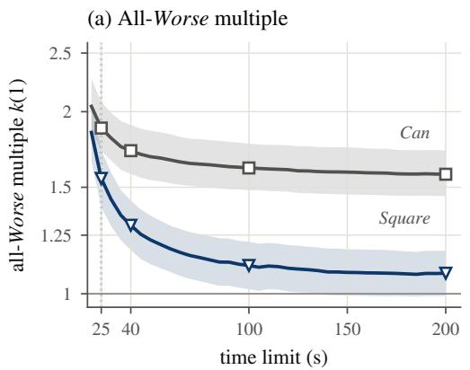

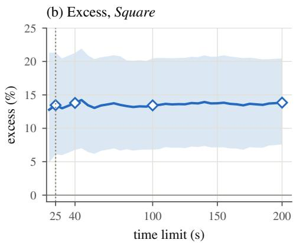  
Figure 1: A longer time limit shrinks the all-Worse multiple on Square, and the excess persists. (a) All-Worse multiple k(1) on Square and Can (log scale): how many times as many demonstrations an all-Worse set needs as an all-Better set for the same success rate. (b) Excess of the half-Better, half-Worse set on Square, in percent beyond its additive prediction. Each policy’s final checkpoint is scored every 5 s from 20 s to 200 s; open markers: 25, 40, 100, and 200 s; dotted line: robomimic’s limit; bands: seed intervals (Section 2).

We measure the exchange rate as a data multiple, following the effective-data idea of Hernandez et al. [3]. The data multiple is the ratio of the numbers of demonstrations two training sets need for their policies to reach the same success rate. On robomimic’s Square and Can tasks, we train behavior-cloning policies on demonstrations from the two Better and the two Worse teleoperators, varying the dataset size and the share of Worse demonstrations. Every evaluation episode records the time of its first success. We can therefore score the same policies at time limits of 25, 40, 100, and 200 s without retraining them. To test pooling, we compare mixed sets, which contain demonstrations from both groups, with an additive prediction at a fixed size. The additive prediction credits each demonstration with the value it has in a training set from its own group.

Robomimic released the teleoperator data we use and compared its groups by success rate within its 25 s limit [2]. We express the gap in demonstrations and follow it across time limits on the same trained policies. Hernandez et al. [3] introduced effective data to measure what pre-training is worth to a language model. We apply this accounting to groups of teleoperators and to closed-loop success, and we test whether the separately measured values add up when the groups are pooled. Curation and weighting methods decide which demonstrations a policy trains on [4, 5, 6]. We keep the data fixed and measure what each group’s demonstrations are worth, in demonstrations and in recording pay. We also test whether pooling still costs demonstrations when training draws every demonstration equally often.

## Our contributions are the following.

(i) On Square, most of the gap between the two groups is late completion: successes that arrive after robomimic’s 25 s limit but within a longer one (Section 3, Fig. 1a). Policies trained on Worse demonstrations finish later, as the Worse teleoperators do. On Can, a longer limit removes much less of the gap.

(ii) Pooling all four teleoperators costs extra demonstrations, and this cost persists at longer time limits (Section 4). A half-Better, half-Worse set on Square holds equal numbers of demonstrations from the two groups. At every time limit from 20 s to 200 s, it needs more demonstrations than its additive prediction (Fig. 1b); we call the extra percentage the excess. The excess remains when training draws demonstrations uniformly instead of in proportion to their length.

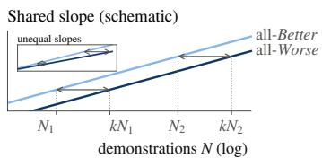  
Figure 2: Reading the data multiple as a horizontal distance. Schematic success log-odds against log dataset size. With parallel lines, as in the shared-slope fits, the all-Worse set needs kN demonstrations to match the all-Better success at any size N (arrows). Inset: with unequal slopes, k grows with N.

(iii) We convert the multiples into break-even pay ratios for two collection decisions: replacing Better demonstrations with Worse ones, and adding Worse demonstrations to a Better set (Section 5).

## 2 Measuring What a Demonstration Is Worth

Data. We use robomimic’s multi-human datasets for two simulated tasks [2]. In Square, the robot places a square nut on a rod; in Can, it moves a can from a large bin into a smaller one. Each dataset was recorded through RoboTurk by six teleoperators, 50 demonstrations each [7, 2]. Robomimic labels two of them Better (experienced), two Okay (adequate), and two Worse (inexperienced). We use the Better teleoperators B1 and B2 and the Worse teleoperators W1 and W2, so each group contributes 100 demonstrations per task. Policies observe the end-effector and gripper states and the object poses.

Design. A training set has a size N, its number of demonstrations, and a Worse share $p ,$ the fraction of its demonstrations recorded by the Worse teleoperators. The all-Better and all-Worse sets have p = 0 and $p = 1$ , and the half-Better, half-Worse set has $p = 0 . 5 . \mathrm { ~ A ~ }$ training seed fixes both a random order of the demonstrations and the training randomness, and a seed’s larger training sets contain its smaller ones. Within a group, the two teleoperators contribute equal numbers of demonstrations, up to rounding.

Main experiment. On Square, we cross eight sizes from $\begin{array} { r l r } { N } & { { } = } & { 1 2 } \end{array}$ to 100 with $p \in$ $\{ 0 , 0 . 2 5 , 0 . 5 , 0 . 7 5 , 1 \}$ , using 24 training seeds for $p \in \{ 0 , 0 . 5 , 1 \}$ and 12 of them for the other two shares. On Can, we cross six sizes from $N = 1 0$ to 100 with $p \in \{ 0 , 0 . 5 , 1 \}$ and 12 seeds. We call these two designs the main experiment (Table B1).

Training and evaluation. We train robomimic’s low-dimensional recurrent behavior-cloning policy with a Gaussian-mixture action head (BC-RNN-GMM) with robomimic’s settings [2]. Robomimic’s default sampler draws short training sequences uniformly over all start positions, so each demonstration is drawn in proportion to its length. In the final-checkpoint evaluation, we run the final checkpoint of each policy from 100 initial states that all policies share. Each episode stops at its first success or after 200 s, and we record the time of that success. Scoring an episode at a longer time limit thus adds the successes that arrive later in the same episode. Under robomimic’s protocol, our success rates differ from its published values by at most 0.06 and 0.07 on Square and Can (Section B.1).

The data multiple. On Square at 25 s, the all-Worse multiple k(1) = 1.55 means that about 62 Worse demonstrations do the work of 40 Better ones. We read data multiples as horizontal distances between scaling curves (Fig. 2). For each training seed s, we fit success log-odds against ln N, with one line per Worse share, a shared slope, and separate intercepts. A horizontal distance ln $k _ { s } ( p )$ between a set’s line and the all-Better line means that, in seed s, the set needs $k _ { s } ( p )$ times as many demonstrations for the same success rate. One of its demonstrations is then worth $1 / k _ { s } ( p )$ all-Better demonstrations. Across seeds, we report the data multiple $k ( p )$ as the geometric mean of $k _ { s } ( p ) ; k ( 1 )$ is the all-Worse multiple. Figure 3a draws a separate least-squares line through each set’s seed-mean log-odds to show the curve shape; the multiples come from the shared-slope fits. Brackets give 95% intervals across training seeds, which we call seed intervals. Unless marked, they are pointwise Student t intervals, paired by seed for changes.

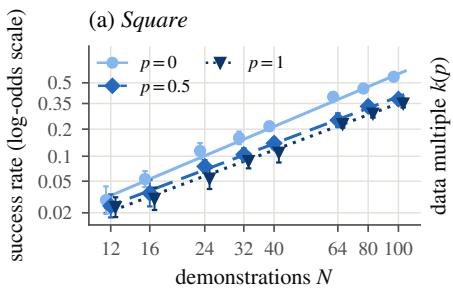

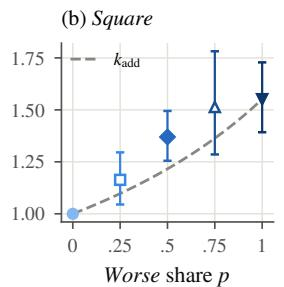

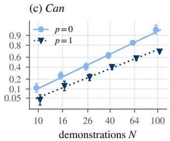  
Figure 3: Scaling curves and data multiples at 25 s. (a) Square: seed mean of the continuitycorrected success log-odds against dataset size for $p = 0 , 0 . 5 ,$ and 1, with seed intervals on that scale; the vertical axis is labeled with the corresponding success rates, points are offset along N for legibility, and lines are separate least-squares fits to these means. (b) Data multiple $k ( p )$ for the five Square sets, with seed intervals; open markers: the two sets trained on 12 seeds; dashed: additive prediction $k _ { \mathrm { a d d } } ( p )$ computed from the plotted k(1). (c) Can, as in (a), for $p = 0$ and 1.

Additive prediction and excess. Suppose that every demonstration in a mixed set kept the value it has in a set from its own group. In seed s, the mixed set’s multiple would then be the additive prediction $k _ { \mathrm { a d d } , s } ( \boldsymbol { p } )$ , with $1 / k _ { \mathrm { a d d } , s } ( p ) = ( 1 - p ) + p / k _ { s } ( 1 )$ The excess is the percentage of extra demonstrations a mixed set needs beyond its additive prediction. Each seed contributes the log ratio ln $[ k _ { s } ( p ) / k _ { \mathrm { a d d } , s } ( p ) ]$ ]. Across seeds, the log excess E is the mean of these log ratios, and the excess is $1 0 0 [ \exp ( E ) - 1 ] \%$ . The same formula applied to the summary multiples gives $k _ { \mathrm { a d d } } ( p )$ , with $1 / k _ { \mathrm { a d d } } ( p ) = ( 1 - p ) + p / k ( 1 )$ . For example, $k ( 1 ) = 1 . 5 5$ on Square at 25 s gives $1 / k _ { \mathrm { a d d } } ( 0 . 5 ) = 0 . 5 + 0 . 5 / 1 . 5 5 = 0 . 8 2 ,$ , so $k _ { \mathrm { a d d } } ( 0 . 5 ) = 1 . 2 2$ . The all-Better and all-Worse sets each pool two teleoperators, so the excess measures what pooling all four costs beyond the two groups separate values.

Worked example. Take one Square seed at 25 s. Its all-Worse line lies 0.73 to the right of its all-Better line on the ln N axis, so $k _ { s } ( 1 ) = \exp ( 0 . 7 3 ) \simeq 2 . 0 7$ and a Worse demonstration is worth $1 / k _ { s } ( 1 ) \simeq 0 .$ 48 all-Better demonstrations. The additive prediction for the half-Better, half-Worse set is then $k _ { \mathrm { a d d } , s } ( 0 . 5 ) = 1 / [ 0 . 5 + 0 . 5 / k _ { s } ( 1 ) ] \simeq 1 . 3 5$ . Its fitted line gives $k _ { s } ( 0 . 5 ) \simeq 1 . 6 8$ , so its log excess is $E _ { s } ( 0 . 5 ) = \ln [ k _ { s } ( 0 . 5 ) / k _ { \mathrm { a d d } , s } ( 0 . 5 ) ] \simeq 0 . 2 2$ , computed from unrounded values. The excess of this example seed is thus about 24%. The 13% of Section 4 instead averages the log excess over all seeds first and then converts that mean to a percentage.

Why a shared slope. A shared slope summarizes each set by one multiple over the tested sizes, while separate slopes let the multiple change with N. We test this summary in a second evaluation that pools the last five checkpoints of each policy (the five-checkpoint evaluation, Section D.2). In that evaluation, shared slopes fitted on the smaller sizes predict the success log-odds at the larger sizes more accurately than separate slopes do (Section C.2).

Slope differences. In the final-checkpoint evaluation on Square at 25 s, the four sets that contain Worse demonstrations have shallower lines than the all-Better set on average. A multiple that followed this mean slope difference, instead of the shared slope, would grow by 31% [5%, 68%] from N = 12 to 100 (Section C.2). The reported $k ( p )$ is therefore a summary over the tested sizes. Section C also reads multiples from each set’s own success curve and from count models of the success counts.

## 3 On Square, Most of the Gap Is Late Completion

Time limits on Square. More time removes most of the gap between the two groups on Square, which we measure by ln k(1) (Fig. 1a). The all-Worse multiple falls from 1.55 [1.39, 1.73] at 25 s to 1.11 [1.02, 1.22] at 100 s, removing 75% [62%, 94%] of ln k(1) (Table D1). The decline then flattens, and at 200 s the multiple is 1.08 [0.99, 1.18]. This fall and the excess of Section 4 both exclude zero after a Bonferroni correction across three quantities (Section C.5).

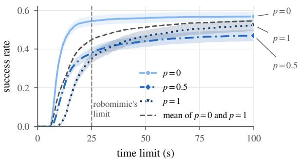  
Figure 4: Success rate of Square policies at N = 100 against the time limit. Means over 24 seeds with seed intervals for $p \ = \ 0 , \ 0 . 5 ,$ and 1. Dashed grey: mean of the $p = 0$ and $p = 1$ successrate curves, not the additive prediction. Dashed vertical line: robomimic’s 25 s limit.

Late completion. The gap shrinks because policies trained on Worse demonstrations finish later (Fig. 4). At $N = 1 0 0$ , the all-Worse success rate rises from 35% within 25 s to 52% within 100 s, while the all-Better rate rises only from 55% to 57%. Most of the all-Worse deficit thus disappears with the longer limit. In Fig. 4, the all-Better curve is nearly flat after robomimic’s limit, while the all-Worse curve keeps rising.

Slower execution. All-Worse policies are slower even within a single grasp, as the Worse teleoperators are. One-grasp successes reach the goal in a single sustained grasp. Counting only one-grasp successes, the time from grasp to success at N = 100 is 1.95 [1.84, 2.06] times as long for all-Worse as for all-Better policies. In the demonstrations themselves, the same ratio is 1.74 [1.57, 1.91]. Late completions also include interrupted successes, which reach the goal after a regrasp or a grasp loss (Section D.3).

Diffusion policy. A second policy class, a diffusion policy [8], also shows the decline. In a separate Square experiment with N ∈ {24, 100} and 8 paired seeds, the log of its all-Worse multiple falls by 0.40 [0.31, 0.49] from 25 s to 100 s (Section F.2).

Can. On Can, the same extension removes much less of the gap. The all-Worse multiple falls from 1.88 [1.72, 2.07] at 25 s to 1.61 [1.48, 1.77] at 100 s, removing 24% [19%, 30%] of ln k(1) (Table D1). All-Worse Can policies also finish later. Summed over all sizes and seeds, late completions make up 14% and 2% of the all-Worse and all-Better successes within 100 s (Table D4).

## 4 The Half-Better, Half-Worse Set Needs More Demonstrations Than Its Additive Prediction

The excess. Pooling all four teleoperators costs demonstrations beyond the two groups’ separate values (Fig. 3b, Table 1). At 25 s on Square, the half-Better, half-Worse set needs 13% [6%, 21%] more demonstrations than its additive prediction. At 25 s, the 75%-Worse set also lies above its prediction (Fig. 3b, Section D.1). Reading each set’s size at a target success rate from its own monotone success curve gives excesses of similar size (Table 1).

Longer time limits. The excess persists while the gap between the groups shrinks (Fig. 1). In the final-checkpoint evaluation, at every time limit from 20 s to 200 s, it lies between 13% and 14%. Paired by seed, the log excess E changes by 0.00 [−0.03, 0.03] from 25 s to 100 s.

Can and the diffusion policy. On Can, the half-Better, half-Worse set needs 9% [1%, 17%] more demonstrations than its additive prediction at both 25 s and 100 s (Table D1). In the diffusion-policy experiment of Section 3, the excess of both the diffusion policy and a matched BC-RNN-GMM has positive point estimates at 25 s and 100 s, with seed intervals that include zero (Table F2).

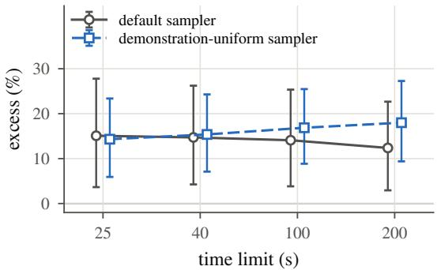  
Figure 5: Excess of the half-Better, half-Worse set in the sampler experiment on Square. Each sampler’s own shared-slope fits on the same 12 seeds, with seed intervals; points are offset along the time axis for legibility (Table E2).

Below the all-Worse set. At $N = 1 0 0$ and 100 s, half-Better, half-Worse policies succeed less often than all-Worse policies (Fig. 4). They solve 47% and 52% of episodes, a seed-paired difference of $- 5 [ - 9 , - 1 ]$ percentage points. For $k ( 1 ) \geq 1$ , the additive prediction values a demonstration in the half-Better, half-Worse set at $0 . 5 + 0 . 5 / k ( 1 ) \geq 1 / k ( 1 )$ all-Better demonstrations, at least the value of a demonstration in the all-Worse set. Under this prediction, the half-Better, half-Worse set would succeed at least as often as the all-Worse set of the same size.

Training samples. Under the default sampler, the longer Worse demonstrations supply 66% of the training sequences of a half-Better, half-Worse set. Could the excess only reflect that this sampler draws the Worse demonstrations more often? First, we keep the policies of the main experiment and change the reference prediction. The training-sample share prediction credits each group by its share of training sequences instead of its share of demonstrations. Against it, the excess is 6% at 25 s and 11% at 100 s, against 13% and 13% with the additive prediction (Tables 1 and E1).

Sampler experiment. Second, we retrain with a demonstration-uniform sampler, which draws a demonstration uniformly and then a start position within it. Each group’s share of training sequences then equals its share of demonstrations, so the two reference predictions coincide. In this separate Square experiment, we train the all-Better and all-Worse sets and the half-Better, half-Worse set at all eight sizes with each sampler, 576 policies on 12 seeds. The two policies of each seed, set, and size differ only in the sampler, and each sampler has its own shared-slope fits (Section E.2). The answer is no: the excess is present under both samplers (Fig. 5).

The excess at 25 s is 14% [6%, 23%] with the demonstration-uniform sampler and 15% [4%, 28%] with the default sampler in this experiment (Table E2). Under both samplers, its interval excludes zero at all four time limits. Paired by seed, the ratio of required to predicted demonstrations, which is one plus the excess, changes by −1% [−12%, 12%] at 25 s between the samplers. This is a relative change in that ratio, not a difference in percentage points.

Pooling within a group. At N = 40, pooling also lowers success within the Better group. On 12 paired seeds, single-teleoperator Better policies have success log-odds 0.60 [0.20, 0.99] higher at 25 s than the policy trained on B1 and B2 together (Section E.3). The excess also differs between the four teleoperator pairs that combine one Better and one Worse teleoperator (Section E.3).

## 5 What the Multiples Mean for Evaluation and Collection

Evaluation. Comparisons of data sources should report success across time limits, or throughput. Throughput counts successes per unit of execution time, with each failed episode counted at the full limit. Late completion still costs execution time: at N = 100 and a 100 s limit, all-Worse Square policies achieve 26% [15%, 35%] fewer successes per unit of execution time than all-Better policies (Section G.1). Scoring only at robomimic’s 25 s limit counts late completions as failures, yet on Square late completion accounts for most of the gap in ln k(1) between the groups (Section 3).

<table><tr><td>Estimate</td><td>25 s</td><td>100 s</td><td>200 s</td></tr><tr><td>Shared slope, additive prediction</td><td>13 [6, 21]</td><td>13 [7, 20]</td><td>14 [8, 20]</td></tr><tr><td>Shared slope, training-sample share prediction</td><td>6[−1,13]</td><td>11 [5, 18]</td><td></td></tr><tr><td>Can: shared slope, additive prediction</td><td>9 [1, 17]</td><td>9 [1, 17]</td><td>10 [2, 18]</td></tr><tr><td>Monotone-curve inversion,  $u = 0 . 1 0$ </td><td>15 [2, 28]</td><td>一</td><td>一</td></tr><tr><td>Monotone-curve inversion,  $u = 0 . 2 0$ </td><td>13 [5, 25]</td><td></td><td></td></tr><tr><td>Monotone-curve inversion,  $u = 0 . 3 0$ </td><td>16 [8, 27]</td><td></td><td>18 [8, 30] 16 [8, 29]</td></tr></table>

Table 1: Excess (%) of the half-Better, half-Worse set under the default sampler. Columns: time limits. Rows are Square unless marked. The first two rows apply two reference predictions to the same per-seed shared-slope fits; the inversion rows read each set’s size at target success rate u from its own monotone success curve. Brackets: seed intervals; percentiles of resampled seeds for the Can and inversion rows. Dashes: the training-sample share prediction is computed through 100 s; inversions at other targets and limits are in Table C5.

<table><tr><td>Box 1: When is recording Worse demonstrations cheaper on Square? The break-even pay ratio is the Worse/Better hourly pay ratio below which recording Worse demonstrations costs less for the same policy success. A gain of x Better-equivalent demonstrations means that, under the shared slope, adding x all-Better demonstrations would reach the same success rate. Replace: build a new dataset from Worse instead of Better demonstrations, paying for every demonstration. Add: keep an existing Better set and pay only for an equal number of new Worse demonstrations. With recording time as the only cost, the break-even pay ratio is  $1 / ( r m )$  , where  $r = 1$  .93 is the Worse/Better</td></tr><tr><td>Add at 25 s: the existing 40 Better demonstrations are already paid for. The 40 new Worse demonstrations add 18.4 [13.5, 23.7] Better-equivalent demonstrations to them,  $\mathrm { s o } \ m = 4 0 / 1 8 . 4$  ≈ 2.2 and the ratio is about 0.24; at 100 s, m ≈ 1.5 (Section G). Adding is stricter because the excess makes each added Worse demonstration worth less than a demonstration in an all-Worse set.</td></tr><tr><td>Decision 25 s limit 100 s limit Replace 0.33 [0.29, 0.38] 0.47 [0.41, 0.53]</td></tr><tr><td>Add 0.24 [0.18, 0.32] 0.35 [0.28, 0.44]</td></tr><tr><td>Both ratios are below one because Worse demonstrations take longer to record and are worth less. The ratios use the default sampler and sizes  $N = 1 2 – 1 0 0$  , and their intervals include variation in demonstration duration. Section G adds collection overheads and throughput.</td></tr></table>

Collection. Worse demonstrations that a team has already recorded raised success when added to a Better training set. Each half-Better, half-Worse training set of size 2n contains the all-Better set of size n, so its policy shows the effect of adding n Worse demonstrations to that set. For the four such additions $( 1 2  2 4 , 1 6  3 2 , 3 2  6 4 , 4 0  8 0 )$ , the seed-mean gain in success log-odds is positive at 25, 40, and 100 s, and every interval excludes zero (Section E.4). Box 1 converts the multiples into break-even pay ratios, which depend on the decision and the time limit.

## 6 Related Work

Data value in units of data. Hernandez et al. [3] define the effective data transferred by pre-training as the extra fine-tuning data that a model of the same size, trained from scratch, would need to reach the same loss. They find that pre-training effectively multiplies the fine-tuning set in the low-data regime. Lin et al. [9] study data scaling laws of imitation learning for robotic manipulation and leave the effect of data quality on these laws to future work. We apply the effective-data accounting to closed-loop success for data from teleoperators of different experience, where the multiple depends on the time limit and on how the groups are pooled.

Teleoperator quality. Robomimic reports that its lower-quality datasets contain demonstrations that take more time [2]. Its low-dimensional BC-RNN succeeds more often on Better than on Worse data and improves when Worse demonstrations are added to Better ones. Gandhi et al. [6] show that adding demonstrations to a base set can raise or lower success depending on which teleoperator recorded them, and use a compatibility measure with the base policy to filter demonstrations and guide collection. Belkhale et al. [10] relate data quality to action consistency and, on robomimic’s labeled datasets, find that demonstration duration increases from Better to Worse. We compare sets of fixed total size with the additive prediction and report additions to Better sets separately (Section 5).

Curation and weighting. DemInf scores each demonstration by its contribution to the mutual information between states and actions, and checks the scores against robomimic’s teleoperator labels [4]. CUPID scores demonstrations by their estimated influence on closed-loop performance [11], and other methods filter demonstrations by smoothness [12], estimate each teleoperator’s expertise jointly with the policy [13], or learn confidence weights over state–action pairs [14]. ReMix learns domain weights for a pre-training mixture and notes that sampling state–action pairs uniformly weights robomimic’s teleoperators unevenly, because some take longer to complete the task [5]. With the data fixed, our sampler experiment gives every demonstration the same weight, and the excess of the half-Better, half-Worse set remains (Section 4).

Execution speed. SAIL and DemoSpeedup train policies to run faster than their demonstrations [15, 16], and Shi et al. [17] resample demonstration chunks in time during training, using an action rate predicted from the observation. Our time limits instead vary how long a fixed policy may run.

Diversity among demonstrations. Luo et al. [18] vary the shape diversity of trajectories at fixed dataset sizes, using motion-planner demonstrations in simulation and demonstrations from three people on a real arm. Success rates often rise and then fall as the geometric entropy of the trajectories grows, a fall they attribute to demonstrations that hold several strategies for one conditioning signal. This entropy is computed on trajectories resampled by arc length, so it leaves out the speed difference in our mixed sets, whose Worse demonstrations are slower than their Better ones (Section 3). Shi et al. [17] introduce the resampling described above to counter differences in action rate among teleoperators, which give identical inputs different action chunks and destabilize training. Pooling all four of our teleoperators costs demonstrations beyond the additive prediction (Section 4), consistent with the explanation of Shi et al. [17] based on differences in action rate.

## 7 Limitations and Conclusion

Limitations. The measurements cover two of robomimic’s simulated multi-human tasks, lowdimensional observations, and the four teleoperators B1, B2, W1, and W2. The policies are BC-RNN-GMM trained with robomimic’s recipe under two samplers, and a diffusion policy repeats the Square time-limit result. The seed intervals describe variation across training seeds for these fixed demonstrations and teleoperators. The break-even pay ratios are computed from the measured multiples and the recorded demonstration durations

Conclusion. On Square, most of the gap between Better and Worse demonstrations at robomimic’s 25 s limit is late completion, which a longer limit counts as success; on Can, most of the gap remains. Pooling all four teleoperators in a half-Better, half-Worse set costs an excess that persists from 20 s to 200 s under the default sampler and remains under the demonstration-uniform sampler. Teams that collect demonstrations can report success at several time limits or as throughput (Sections 3 and 5) and check a mixed set against its additive prediction (Section 4). They can price Worse teleoperators with the break-even pay ratio of the decision at hand (Box 1).

## References

[1] A. Khazatsky, K. Pertsch, S. Nair, A. Balakrishna, S. Dasari, S. Karamcheti, S. Nasiriany, M. K. Srirama, L. Y. Chen, K. Ellis, et al. DROID: A large-scale in-the-wild robot manipulation dataset. In Robotics: Science and Systems (RSS), 2024. arXiv:2403.12945.

[2] A. Mandlekar, D. Xu, J. Wong, S. Nasiriany, C. Wang, R. Kulkarni, L. Fei-Fei, S. Savarese, Y. Zhu, and R. Martín-Martín. What matters in learning from offline human demonstrations for robot manipulation. In Proceedings ofthe 5th Conference on Robot Learning, volume 164 of Proceedings ofMachine Learning Research, pages 1678–1690. PMLR, 2022. arXiv:2108.03298.

[3] D. Hernandez, J. Kaplan, T. Henighan, and S. McCandlish. Scaling laws for transfer. arXiv preprint arXiv:2102.01293, 2021.

[4] J. Hejna, S. Mirchandani, A. Balakrishna, A. Xie, A. Wahid, J. Tompson, P. Sanketi, D. Shah, C. Devin, and D. Sadigh. Robot data curation with mutual information estimators. In Robotics: Science and Systems (RSS), 2025. arXiv:2502.08623.

[5] J. Hejna, C. A. Bhateja, Y. Jiang, K. Pertsch, and D. Sadigh. ReMix: Optimizing data mixtures for large scale imitation learning. In Proceedings ofThe 8th Conference on Robot Learning, volume 270 of Proceedings of Machine Learning Research, pages 145–164. PMLR, 2025. arXiv:2408.14037.

[6] K. Gandhi, S. Karamcheti, M. Liao, and D. Sadigh. Eliciting compatible demonstrations for multi-human imitation learning. In Conference on Robot Learning (CoRL 2022), 2023. arXiv:2210.08073.

[7] A. Mandlekar, Y. Zhu, A. Garg, J. Booher, M. Spero, A. Tung, J. Gao, J. Emmons, A. Gupta, E. Orbay, S. Savarese, and L. Fei-Fei. RoboTurk: A crowdsourcing platform for robotic skill learning through imitation. In Proceedings of The 2nd Conference on Robot Learning, volume 87 of Proceedings of Machine Learning Research, pages 879–893. PMLR, 2018. arXiv:1811.02790.

[8] C. Chi, Z. Xu, S. Feng, E. Cousineau, Y. Du, B. Burchfiel, R. Tedrake, and S. Song. Diffusion Policy: Visuomotor policy learning via action diffusion. The International Journal ofRobotics Research, 44(10–11):1684–1704, 2025. doi:10.1177/02783649241273668. arXiv:2303.04137.

[9] F. Lin, Y. Hu, P. Sheng, C. Wen, J. You, and Y. Gao. Data scaling laws in imitation learning for robotic manipulation. In International Conference on Learning Representations (ICLR), 2025. arXiv:2410.18647.

[10] S. Belkhale, Y. Cui, and D. Sadigh. Data quality in imitation learning. In Advances in Neural Information Processing Systems (NeurIPS), 2023. arXiv:2306.02437.

[11] C. Agia, R. Sinha, J. Yang, R. Antonova, M. Pavone, H. Nishimura, M. Itkina, and J. Bohg. CUPID: Curating data your robot loves with influence functions. In 9th Annual Conference on Robot Learning, 2025. arXiv:2506.19121.

[12] S. Kulkarni, R. Dhar, and Y. Cui. Learning from the best: Smoothness-driven metrics for data quality in imitation learning. arXiv preprint arXiv:2604.23000, 2026.

[13] M. Beliaev, A. Shih, S. Ermon, D. Sadigh, and R. Pedarsani. Imitation learning by estimating expertise of demonstrators. In International Conference on Machine Learning (ICML), 2022. arXiv:2202.01288.

[14] S. Zhang, Z. Cao, D. Sadigh, and Y. Sui. Confidence-aware imitation learning from demonstrations with varying optimality. In Advances in Neural Information Processing Systems (NeurIPS), 2021. arXiv:2110.14754.

[15] N. R. Arachchige, Z. Chen, W. Jung, W. C. Shin, R. Bansal, P. Barroso, Y. H. He, Y. C. Lin, B. Joffe, S. Kousik, and D. Xu. SAIL: Faster-than-demonstration execution of imitation learning policies. In 9th Annual Conference on Robot Learning, 2025. arXiv:2506.11948.

[16] L. Guo, Z. Xue, Z. Xu, and H. Xu. DemoSpeedup: Accelerating visuomotor policies via entropy-guided demonstration acceleration. In 9th Annual Conference on Robot Learning, 2025. arXiv:2506.05064.

[17] M. Shi, L. Chen, J. Chen, Y. Lu, C. Liu, G. Ren, P. Luo, D. Huang, M. Yao, and H. Li. Is diversity all you need for scalable robotic manipulation? IEEE Transactions on Robotics, 42: 1872–1883, 2026. doi:10.1109/TRO.2026.3686184. arXiv:2507.06219.

[18] Q. Luo, R. Liu, P. Zhou, X. Zhou, and Y. Yang. Geometric entropy: When trajectory diversity helps and hurts in imitation learning. In IEEE/RSJ International Conference on Intelligent Robots and Systems (IROS), 2026. arXiv:2606.20871.

[19] Y. Zhu, J. Wong, A. Mandlekar, R. Martín-Martín, A. Joshi, K. Lin, A. Maddukuri, S. Nasiriany, and Y. Zhu. robosuite: A modular simulation framework and benchmark for robot learning. arXiv preprint arXiv:2009.12293, 2020.

[20] E. Todorov, T. Erez, and Y. Tassa. MuJoCo: A physics engine for model-based control. In 2012 IEEE/RSJ International Conference on Intelligent Robots and Systems, pages 5026–5033, 2012. doi:10.1109/IROS.2012.6386109.

[21] J. Ho, A. Jain, and P. Abbeel. Denoising diffusion probabilistic models. In Advances in Neural Information Processing Systems, volume 33, pages 6840–6851. Curran Associates, Inc., 2020. arXiv:2006.11239.

## A Terms and Notation

Table A1 collects the terms and symbols of the main text.
<table><tr><td>Term</td><td>Definition</td></tr><tr><td>Dataset size N</td><td>Number of demonstrations in a training set.</td></tr><tr><td>Worse share p</td><td>Fraction of a training set&#x27;s demonstrations recorded by the Worse teleoperators:  $p = 0$  for the all-Better set,  $p = 0 . 5$  for the half-Better, half-Worse set, and  $p = 1$  for the all-Worse</td></tr><tr><td>Time limit</td><td>set. Longest execution time within which a success counts: 15, 20, 25, 40, 100, and 200 s are 300, 400, 500, 800, 2000, and 4000 control steps at 20 Hz.</td></tr><tr><td>Late completion Data multiple  $k ( p )$ </td><td>A success after 25 s and within a longer time limit. Factor by which a set with Worse share p must be larger than the all-Better set for its</td></tr><tr><td></td><td>policies to reach the same success rate, read from the shared-slope fit of each seed as  $k _ { s } ( p ) ; k ( p )$  is the geometric mean over seeds.</td></tr><tr><td>All-Worse multiple  $k ( 1 )$  Additive prediction  $k _ { \mathrm { a d d } } ( p )$ </td><td>The data multiple of the all-Worse set. The data multiple of a mixed set if each demonstration kept the worth, in all-Better</td></tr><tr><td></td><td>demonstrations, that it has in a set of its own group:  $1 / k _ { \mathrm { a d d } } ( p ) = ( 1 - p ) + p / k ( 1 )$  Mean over seeds of ln  $[ k _ { s } ( p ) / k _ { \mathrm { a d d } , s } ( p ) ]$ </td></tr><tr><td>Log excess  $E ( p )$  Excess</td><td>Extra demonstrations à mixed set needs beyond its additive prediction, in percent:</td></tr><tr><td>Training-sample share</td><td>100[exp(E) − 1]%. A reference prediction like  $k _ { \mathrm { a d d } } ( p )$  that weights each group by its share q of training</td></tr><tr><td>prediction Monotone-curve inversion</td><td>sequences instead of its share p of demonstrations. Ratio of dataset sizes at target success rate u, read from each set&#x27;s own monotone success</td></tr><tr><td>Default sampler</td><td>curve. Robomimic&#x27;s sampler: training sequences drawn uniformly over all start positions, so a</td></tr><tr><td>Demonstration-uniform</td><td>demonstration is drawn in proportion to its length</td></tr><tr><td>sampler</td><td>A demonstration drawn uniformly, then a start position within it.</td></tr><tr><td>Break-even pay ratio</td><td>The Worse/Better hourly pay ratio below which recording Worse demonstrations costs</td></tr><tr><td>Seed interval</td><td>less at equal success. 95% interval across training seeds; Student t, paired by seed for changes, unless a table</td></tr></table>

Table A1: Terms and symbols.

Per-seed and summary values. The reported excess at 25 s, 13%, converts the seed mean of the log excess $E _ { s } ( 0 . 5 )$ to a percentage; Section 2 works through one seed. The ratio of the summary values, $k ( 0 . 5 ) / k _ { \mathrm { a d d } } ( 0 . 5 )$ with $k _ { \mathrm { a d d } } ( 0 . 5 )$ computed from the summary k(1), exceeds one by 13% at 25 s. The two agree to the nearest percent here, but they can differ because $k _ { \mathrm { a d d } }$ is nonlinear in k(1) and each seed’s prediction uses its own $k _ { s } ( 1 )$ . For the same reason, the vertical distance between a marker and the dashed curve in Fig. 3b differs slightly from the excess.

## B Experimental Details

Data and software. We train on the low-dimensional observations of robomimic’s v0.2 multihuman datasets. Because we simulate with robosuite 1.5.1, we recompute the object observations at each evaluation step and arrange them in the v0.2 layout. On Square, robomimic’s v1.5 datasets, whose observations are extracted again for robosuite 1.5, have the same demonstrations, actions, and initial states as v0.2. Software: robomimic 0.5.0, robosuite 1.5.1 [19], MuJoCo 3.2.3 [20], and PyTorch 2.4.1. On Square, the Worse/Better ratio of mean demonstration lengths is 1.93. 13/100 Square Worse demonstrations exceed 25 s, against 0/100 Square Better and 10/100 Can Worse demonstrations. Pauses explain little of the length difference. Removing the steps with stored end-effector speed below 0.02 m/s from both groups lowers the Square mean-length ratio only to 1.810 [1.665, 1.971], and the Can Worse/Better ratio after removal is 1.977 [1.808, 2.169]. These lengths count complete recordings, including the steps after success. Brackets are percentile intervals from 20,000 draws that resample demonstrations within each teleoperator.

Training sets. Training sets draw from every released demonstration, including the validation split. At N = 100, the all-Better and all-Worse sets use all demonstrations of their group, and mixed sets draw subsets, so their seeds vary both the demonstrations and the training randomness. Each seed randomly orders the demonstrations within each teleoperator and alternates the two teleoperators of a group to fill its quota. When a group’s quota is odd, the parity of the seed decides which teleoperator contributes the extra demonstration. Sets are nested in N (Table B1).

Training and evaluation. The BC-RNN-GMM recipe [2] uses a 2-layer, 400-unit LSTM, a 5-mode Gaussian-mixture head, 10-step sequences, and Adam at $1 0 ^ { - 4 }$ . Training runs for 2000 epochs of 100 gradient steps [2], and we use batches of 100. The unidirectional LSTM feeds the GMM head directly. The GMM uses softplus standard deviations with floor $1 0 ^ { - 4 }$ . Adam uses a constant learning rate, zero weight decay, and no gradient clipping. Observation and action normalization are disabled; sequences repeat boundary frames when padding. As in robomimic, evaluation uses low-noise actions, and the policy outputs actions at 20 Hz [2]. We reset the recurrent state every 10 steps and record the step of first success. Compared policies are evaluated from the same initial states.

Training devices. The main experiment is trained on two GPU machines and one CPU machine. Within each task, all sets and sizes of a seed are trained on one machine, except for one Square seed. For this seed, the all-Better and all-Worse sets are trained on a GPU machine and the half-Better, half-Worse set on the CPU machine, so the Worse share and the training machine change together. In the single-teleoperator and teleoperator-pair experiments, all compared policies are trained on the same machine and GPU model (Section E.3). The sampler experiment trains and evaluates all policies of a seed on one CPU model (Section E.2).

<table><tr><td>Design</td><td>Values</td></tr><tr><td>Square</td><td> $p \ \in \ \{ 0 , 0 . 2 5 , 0 . 5 , 0 . 7 5 , 1 \} , \ N \ \in \ \{ 1 2 , 1 6 , 2 4 , 3 2 , 4 0 , 6 4 , 8 0 , 1 0 0 \} ;$  24 seeds for  $p \in$   $\{ 0 , 0 . { \dot { 5 } } , 1 \}$  and the first 12 for the other two shares; 768 policies.</td></tr><tr><td>Can Evaluation</td><td>p ∈ {0, 0.5, 1}, N ∈ {10, 16, 26, 40, 64, 100}; 12 seeds; 216 policies. Checkpoints, episodes per policy, time limits</td></tr><tr><td></td><td>Final checkpoint Epoch 2000; 100 initial states, a subset of the five-checkpoint states; up to 200 s.</td></tr><tr><td></td><td>Five checkpoints 5 checkpoints at epochs 1600–2000; 500 episodes; 15–40 s.</td></tr></table>

Table B1: Design and evaluations of the main experiment. The final-checkpoint evaluation gives the main-text results unless marked; the five-checkpoint evaluation repeats the analysis in Section D.2.

<table><tr><td></td><td></td><td></td><td></td><td>Five-ckpt. Final-ckpt.</td></tr><tr><td>Experiment</td><td>Seeds</td><td>Policies</td><td>episodes</td><td>episodes</td></tr><tr><td>Six teleoperators,  $N = 4 0$ </td><td>3</td><td>18</td><td>500</td><td>100</td></tr><tr><td>Teleoperator pairs,  $N = 6 4 , 1 0 0$ </td><td>6</td><td>48</td><td>500</td><td>100</td></tr><tr><td>Sampler experiment, both samplers, eight sizes</td><td>12</td><td>576</td><td></td><td>100</td></tr><tr><td>Single teleoperators and groups,  $N = \mathrm { \tilde { 4 } 0 }$ </td><td>12</td><td>72</td><td>500</td><td>100</td></tr><tr><td>Teleoperator pairs and groups, N = 100</td><td>12</td><td>72</td><td>500</td><td>100</td></tr><tr><td>Single teleoperators and groups, three sizes</td><td>6</td><td>108</td><td>500</td><td>一</td></tr><tr><td>Teleoperator pairs, four sizes</td><td>4</td><td>64</td><td>500</td><td></td></tr><tr><td>Diffusion and paired BC-RNN-GMM, two sizes</td><td>8</td><td>48 / 48</td><td></td><td>100</td></tr><tr><td>4000-epoch training</td><td>24 / 12</td><td>768</td><td>250</td><td></td></tr><tr><td>Exposure-matched all-Worse, two sizes</td><td>8</td><td>16</td><td>500</td><td>100</td></tr></table>

Table B2: Experiments beyond the main experiment. Seeds, trained policies, and evaluation episodes per policy; all on Square. Sampler experiment: Section E.2; longer training and exposure matching: Section F.1.

## B.1 Comparison with robomimic’s published results

Under robomimic’s training split and best-checkpoint protocol, our success rates are within 0.06 of its published values on Square and within 0.07 on Can (Table B3). The protocol evaluates 50 episodes every 50 epochs, with a 25 s limit for the multi-human (MH) data and 20 s for the proficient-human (PH) data [2]. On Can, both intervals over 3 seeds include the published values.

<table><tr><td>Dataset</td><td>Demonstrations</td><td>Seeds</td><td>Ours</td><td>Published</td></tr><tr><td>Square MH Better</td><td>90</td><td>3</td><td>0.613 [0.537, 0.689]</td><td>0.660</td></tr><tr><td>Square MH Worse</td><td>90</td><td>3</td><td>0.420 [0.289, 0.551</td><td>0.393</td></tr><tr><td>Square PH 20%</td><td>36</td><td>3</td><td>0.333 [0.230, 0.437]</td><td>0.387</td></tr><tr><td>Square PH 50%</td><td>90</td><td>1</td><td>0.700</td><td>0.673</td></tr><tr><td>Square PH 100%</td><td>180</td><td>1</td><td>0.880</td><td>0.840</td></tr><tr><td>Can MH Better</td><td>90</td><td>3</td><td>0.987 [0.958, 1.015]</td><td> $0 . 9 9 3 \pm 0 . 0 0 9$ </td></tr><tr><td>Can MH Worse</td><td>90</td><td>3</td><td>0.853 [0.653, 1.054]</td><td> $0 . 9 2 0 \pm 0 . 0 1 6$ </td></tr></table>

Table B3: Our training against robomimic’s published success rates on Square and Can. Maximum success rate over training under robomimic’s protocol, mean over seeds, against the published BC-RNN values [2]. Success rates are fractions. PH 20%, 50%, and 100%: robomimic’s subsets of the proficient-human data. Brackets: t intervals across the seeds’ selected maxima, not clipped to [0, 1]. ± as reported in [2].

## C Estimation and Robustness

## C.1 Per-seed fits

For each seed s and Worse share $p ,$ we fit the line $c _ { s p } + \beta _ { s p }$ ln N across sizes N to the corrected log-odds $z _ { s p N } = \ln [ ( y + 0 . 5 ) / ( R - y + 0 . 5 ) ]$ . Here y is the success count out of R episodes; adding 0.5 to both the success and the failure count keeps the log-odds finite. The shared slope $\bar { \beta } _ { s } ^ { ( \mathrm { a l l } ) }$ fits all sets of the seed with separate intercepts, and $\bar { \beta } _ { s } ^ { ( 3 ) }$ uses only $p \in \{ 0 , 0 . 5 , 1 \}$ . For mean log-odds $\bar { z } _ { s p }$ over sizes, ln $k _ { s } ( p ) = ( \bar { z } _ { s 0 } - \bar { z } _ { s p } ) / \bar { \beta } _ { s } ^ { ( \mathrm { a l l } ) }$ , and we exponentiate the seed mean of ln $k _ { s } ( p )$ to obtain $k ( p )$ . The log excess is $E ( p ) = \mathrm { m e a n } _ { s } E _ { s } ( p )$ with $E _ { s } ( p ) = \ln k _ { s } ( p ) - \ln k _ { \mathrm { a d d } , s } ( p )$ . Unless marked, multiples, log excesses, and break-even pay ratios use all sets.

With separate lines, the multiple of seed s at all-Better size $N _ { g }$ is

$$
\ln k _ { s } ^ { \mathrm { l i n e } } ( p ) = \frac { c _ { s 0 } - c _ { s p } + ( \beta _ { s 0 } - \beta _ { s p } ) \ln N _ { g } } { \beta _ { s p } } .
$$

At the geometric-mean size, separate lines give nearly the same multiples as the shared slope. In the five-checkpoint evaluation at 25 s, the all-Worse values at this size $( N _ { g } = 3 6$ on Square, 32 on Can) are 1.58 [1.49, 1.68] and 2.04 [1.87, 2.23]. Their ratios to the shared-slope multiples are 0.99 [0.96, 1.02] and 1.05 [0.98, 1.12], and the other Square sets differ by at most 3%.

## C.2 Shared slope and growth of the multiple

The shared slope is an approximation: the sets that contain Worse demonstrations have shallower lines on average (Table C1). For all-Better slope $\beta _ { 0 }$ and mean slope difference $\Delta \beta$ of the four sets with Worse demonstrations, a c-fold increase in all-Better size raises the multiple implied by $\Delta \beta$ by $1 0 0 \lbrack c ^ { \beta _ { 0 } / ( \beta _ { 0 } + \Delta \beta ) - 1 } - 1 \rbrack \% \left( \mathrm { F i g . } 2 \right)$ . We refit both quantities jointly in the seed-and-set fixed-effect model on 20,000 whole-seed draws (Table C2). The draws are stratified by set coverage, that is, by whether a seed has all five sets or only $p \in \{ 0 , 0 . 5 , 1 \}$ . At 200 s the interval of the growth includes zero. For held-out prediction, each of the first 12 seeds, which have all five sets, fits $N \leq 4 0$ and predicts the log-odds at $N \geq 6 4$ . Shared slopes give the lower held-out root mean squared error (RMSE), and separate slopes the lower in-sample Akaike information criterion (AIC).

The five-checkpoint mean slope difference comes from fitting seed and set fixed effects to 96 per-seed slopes. The likelihood comparison fits correlated Gaussian random seed intercepts and slopes by maximum likelihood. Its null removes the mean slope differences between sets, and we refit both models on 2,000 whole-seed draws stratified by set coverage. A block is one checkpoint together with its evaluation initial states. Slope sensitivity resamples seeds, blocks, or both in 20,000 percentile draws, and each block draw is shared across seeds, sets, and sizes. The binomial mixed model fits integer counts with block effects and correlated random seed intercepts and slopes by Laplace approximation. Its Wald interval conditions on the blocks without a dispersion adjustment. The Pearson dispersion is 1.655 with a shared slope and 1.631 with separate slopes.

<table><tr><td>Limit (s)</td><td>Model</td><td>k(1)</td><td>E(0.5)</td></tr><tr><td>25</td><td>OLS Bin.</td><td>1.55 [1.39, 1.73] 1.63 [1.52, 1.74]</td><td>0.13 [0.06, 0.19] 0.16 [0.10, 0.21]</td></tr><tr><td>40</td><td>BB OLS Bin.</td><td>1.62 [1.51, 1.74] 1.30 [1.18, 1.43] 1.35 [1.27, 1.44]</td><td>0.16 [0.10, 0.21] 0.13 [0.07, 0.19] 0.16 [0.10, 0.21]</td></tr><tr><td>100 200</td><td>OLS Bin. BB OLS Bin.</td><td>1.35 [1.26, 1.44] 1.11 [1.02, 1.22] 1.15 [1.08, 1.23] 1.15 [1.07, 1.23] 1.08 [0.99, 1.18] 1.10 [1.03, 1.18]</td><td>0.13 [0.07, 0.19] 0.16 [0.10, 0.21] 0.15 [0.10, 0.21] 0.13 [0.07, 0.19]</td></tr><tr><td>Limit (s)</td><td>Model</td><td>1.10 [1.03, 1.18] ∆ ln k(1), model − OLS</td><td>0.15 [0.10, 0.20] ∆E(0.5), model – OLS</td></tr><tr><td>25</td><td>Bin.</td><td>0.05 [-0.01, 0.11]</td><td>0.03 [−0.01, 0.06]</td></tr><tr><td>40</td><td>BB Bin.</td><td>0.05 [–0.01, 0.11]</td><td>0.03 [−0.01, 0.06]</td></tr><tr><td></td><td>BB</td><td>0.04 [−0.02, 0.10]</td><td>0.03 [-0.01, 0.06]</td></tr><tr><td>100</td><td>Bin.</td><td></td><td></td></tr><tr><td></td><td>BB</td><td></td><td></td></tr><tr><td></td><td></td><td>0.03 [−0.02, 0.09]</td><td></td></tr><tr><td></td><td></td><td></td><td></td></tr><tr><td></td><td></td><td></td><td></td></tr><tr><td></td><td></td><td>0.04 [–0.02, 0.10]</td><td>0.03 [-0.01, 0.06]</td></tr><tr><td></td><td></td><td></td><td></td></tr><tr><td></td><td></td><td></td><td>0.03 [-0.003, 0.06]</td></tr><tr><td></td><td></td><td>0.03 [−0.02, 0.09]</td><td>0.03 [-0.01, 0.06]</td></tr><tr><td>200</td><td></td><td></td><td></td></tr><tr><td></td><td></td><td>0.02 [−0.03, 0.07]</td><td>0.02 [−0.01, 0.06]</td></tr><tr><td>Bin. BB</td><td></td><td>0.02 [−0.03, 0.07]</td><td>0.02 [−0.01, 0.05]</td></tr></table>

Table C3: Observation models on Square. Bin.: binomial; BB: beta-binomial. All sizes and sets, 24 seeds. Top: all-Worse multiples and log excesses E(0.5); bottom: within-seed changes from OLS on the log scale. Brackets: seed intervals; multiples exponentiate the intervals for mean ln k.

<table><tr><td colspan="3">Five-checkpoint evaluation, 25 s</td><td colspan="3">Estimate</td></tr><tr><td colspan="3">Prediction RMSE, shared / separate Paired RMSE difference; seeds favoring shared AIC decrease, shared→separate, 20/25/40 s Likelihood-ratio statistic; bootstrap P</td><td colspan="3">-0.24[-0.37, -0.11]; 10/12  $7 . 0 / 4 . { \dot { 5 } } / 5 . 7$  12.5; 0.12</td></tr><tr><td rowspan="3"></td><td>Slope difference</td><td>2000 epochs</td><td>4000 epochs</td><td rowspan="3">Paired change</td></tr><tr><td rowspan="2">Mean of four sets  $p = 0 . 2 5$ </td><td></td><td>-0.13 [-0.21, -0.03]</td></tr><tr><td>-0.14 [−0.25, -0.03]</td><td>0.01 [-0.05, 0.08]</td></tr><tr><td rowspan="3"> $p = 0 . 5$   $\bar { p } = 0 . 7 5$ </td><td rowspan="3"></td><td> $- 0 . 1 \bar { 3 } \left[ - 0 . 3 1 , 0 . 0 5 \right]$  -0.11 [-0.23, 0.01]</td><td>-0.14[-0.26, -0.03]</td><td>−0.01 [−0.08, 0.06]</td></tr><tr><td></td><td>-0.12[-0.23, -0.01]</td><td>−0.01 [−0.11, 0.07]</td></tr><tr><td>-0.16 [-0.36, 0.03]</td><td> $- 0 . 1 8 \ \mathrm { [ - } 0 . 3 2 , - 0 . 0 3 \mathrm { ] }$  -0.06 [-0.17, 0.07] 0.03 [−0.07, 0.15]</td><td>-0.02 [−0.10, 0.08]</td></tr><tr><td colspan="2">Slope sensitivity</td><td></td><td></td><td></td><td></td></tr><tr><td colspan="2">Mean difference</td><td>Seeds -0.14[-0.23, -0.05] -0.14[-0.22, -0.04]</td><td>Blocks</td><td>Seeds and blocks -0.14 [-0.27, 0.01]</td><td>Binomial mixed model −0.14[−0.18, −0.11]</td></tr></table>

Table C1: Square slope differences and held-out prediction. 25 s unless marked. RMSE differences use seed intervals; 4000-epoch training (Section F.1) and slope sensitivity use percentile intervals; the binomial mixed model uses a Wald interval.

<table><tr><td>Evaluation</td><td></td><td>Limit (s) Growth, % [joint interval] Fixed</td><td> $\beta _ { 0 }$  interval</td></tr><tr><td>Final checkpoint</td><td>25</td><td> $^ { 3 1 } \ [ 5 , 6 8 ]$ </td><td> $[ 4 , 7 6 ]$ </td></tr><tr><td>Final checkpoint</td><td>200</td><td> $2 2 [ - \mathrm { \dot { 1 } } , 5 \mathrm { \dot { 1 } } ]$ </td><td> $[ - \dot { 1 } , 5 \dot { 6 } ]$ </td></tr><tr><td>Five checkpoints</td><td>25</td><td>24 [7, 45]</td><td> $\left[ 7 , 4 6 \right] ^ { . }$ </td></tr></table>

Table C2: Growth of the Square multiple implied by the mean slope difference of the four sets with Worse demonstrations. Final-checkpoint rows give the growth from N = 12 to 100; the five-checkpoint row gives the growth over a tenfold increase in size. Joint and fixed-β intervals use the same stratified whole-seed draws.

## C.3 Observation models

We compare continuity-corrected least squares (OLS) with binomial and beta-binomial maximum likelihood on the same integer success counts (Table C3). The count models fit the integer successes without continuity correction. Each model fits separate intercepts and a shared slope within each seed, over every set and size, and multiples and log excesses are computed within seeds before averaging. On Square, the log excess of the half-Better, half-Worse set has positive seed intervals under all three models at the four time limits of Table C3.

## C.4 Inverting each set’s own success curve

Within the sets’ common observed range of seed-mean success, we invert each curve for $k ( p , u ) =$ $N _ { p } ( u ) / { N _ { 0 } ( u ) }$ at target success rate u, requiring both sizes to lie within the tested sizes of the task. The monotone-curve inversion uses equal-weight isotonic regression and linear interpolation in ln N; a target equal to a plateau takes its smallest size, and a target above a plateau interpolates from its last point. The separate-line inversion fits each set’s mean corrected log-odds against ln N. For the all-Worse set, the two inversions give close point estimates on Square and at the outer Can targets, and they differ at the middle Can target (Table C4).

For the half-Better, half-Worse set on Square, $k ( p , u )$ is the monotone-curve multiple of each seedmean success curve. The log excess at a common target is $E ^ { \mathrm { m o n o } } ( u ) = \ln k ( 0 . 5 , u ) + \ln [ 0 . 5 +$ $0 . 5 / k ( 1 , u ) \overset { \cdot } { _ { \ r { k } } }$ ], and Table C5 reports the excess $1 0 0 [ \mathrm { e x p } ( E ^ { \mathrm { m o n o } } ( u ) ) - 1 ] \% \ E ^ { \mathrm { m o n o } } ( u )$ inverts seedmean curves, whereas $E ( p )$ averages per-seed log excesses.
<table><tr><td>Task, evaluation</td><td>u</td><td>Monotone-curve k(1, u)</td><td>No solution</td><td>Separate-line  $k ( 1 , u )$ </td><td>No solution</td></tr><tr><td>Square, five checkpoints, 25 s</td><td>0.05</td><td>1.516 [1.332, 1.708]</td><td>0%</td><td>1.523 [1.369, 1.706]</td><td>0%</td></tr><tr><td>Square, five checkpoints, 25 s</td><td>0.18</td><td>1.565 [1.457, 1.691]</td><td>0%</td><td>1.600 [1.515, 1.693]</td><td>0%</td></tr><tr><td>Square, five checkpoints, 25 s</td><td>0.32</td><td>1.713 [1.621, 1.804]</td><td>5%</td><td>1.640 [1.566, 1.712]</td><td>5%</td></tr><tr><td>Square, final checkpoint, 100 s</td><td>0.07</td><td>1.098 [0.971, 1.294]</td><td>0%</td><td>1.040 [0.894, 1.226]</td><td>0%</td></tr><tr><td>Square, final checkpoint, 100 s</td><td>0.28</td><td>1.129 [1.049, 1.213]</td><td>0%</td><td>1.138 [1.070, 1.209]</td><td>0%</td></tr><tr><td>Square, final checkpoint, 100 s</td><td>0.50</td><td>1.152 [1.054, 1.264]</td><td>4%</td><td>1.195 [1.096, 1.269]</td><td>13%</td></tr><tr><td>Can, five checkpoints, 25 s</td><td>0.15</td><td>1.624 [1.423, 1.839]</td><td>4%</td><td>1.638 [1.453, 1.828]</td><td>4%</td></tr><tr><td>Can, five checkpoints, 25 s</td><td>0.41</td><td>1.653 [1.413, 1.986]</td><td>0%</td><td>1.908 [1.782, 2.061]</td><td>0%</td></tr><tr><td>Can, five checkpoints, 25 s</td><td>0.67</td><td>2.176 [1.990, 2.414]</td><td>0%</td><td>2.151 [2.020, 2.311]</td><td>0%</td></tr><tr><td>Can, final checkpoint, 100 s</td><td>0.15</td><td>1.341 [1.161, 1.546]</td><td>6%</td><td>1.347 [1.146, 1.553]</td><td>6%</td></tr><tr><td>Can, final checkpoint, 100 s</td><td>0.45</td><td>1.383 [1.236, 1.639]</td><td>0%</td><td>1.573 [1.462, 1.705]</td><td>0%</td></tr><tr><td>Can, final checkpoint, 100 s</td><td>0.74</td><td>1.769 [1.623, 1.946]</td><td>0%</td><td>1.793 [1.627, 1.944]</td><td>0%</td></tr></table>

Table C4: All-Worse multiples from inverting each set’s own success curve. Three target success rates u near the bottom, middle, and top of the range that all sets reach. Brackets: percentile intervals from 20000 paired whole-seed draws that have solutions within the tested sizes. No-solution percentages include draws without a common range.

<table><tr><td>u  $k ( 1 , u )$ </td><td> $k ( 0 . 5 , u )$ </td><td>Excess, %</td></tr><tr><td>Five-checkpoint evaluation, 25 s 0.10 1.509[1.317, 1.692] 1.425 [1.288, 1.556] 18 [10, 26] 0.20 1.598 [1.488, 1.723] 1.387 [1.277, 1.527] 13 [5, 23] 0.30 1.704 [1.618, 1.802] 1.492 [1.406, 1.593] 18[12, 26]</td></tr><tr><td>Final-checkpoint evaluation, 25 s 0.10 1.628 [1.376, 1.869] 1.423 [1.230, 1.591] 0.201.534[1.420, 1.674]</td><td>15 [2, 28] 1.368 [1.250, 1.540] 13 [5, 25] 1.464 [1.346, 1.591]</td></tr><tr><td>0.30 1.692[1.551, 1.808] Final-checkpoint evaluation, 100 s 0.10 1.201 [1.043, 1.340] 1.196 [1.051, 1.354]</td><td>16[8, 27] 10[−0.4, 22]</td></tr><tr><td>0.20 1.116[0.990, 1.269] 1.186[1.077, 1.347] 0.30 1.142 [1.062, 1.229]</td><td>12[1, 25] 1.254 [1.153, 1.394] 18 [8, 30]</td></tr><tr><td>Final-checkpoint evaluation, 200 s</td><td>12[2, 24]</td></tr><tr><td>0.10 1.126 [0.986, 1.299] 1.182 [1.053, 1.336] 0.20 1.062 [0.929, 1.220] 0.30 1.084[1.003, 1.167] 1.210 [1.129, 1.342]</td><td>1.175 [1.056, 1.352] 14[3, 27]</td></tr></table>

Table C5: Excess of the half-Better, half-Worse set on Square from monotone-curve inversion. Targets lie within the common attainable range of the three sets. Brackets: percentile intervals from resampled seeds; seed draws are shared across sets, sizes, and limits. A multiple uses the draws in which its two curves have solutions, and an excess uses the draws in which all three do. Every draw has all three solutions except 0.005% of the draws at $u = 0 . 3 0$ in the five-checkpoint evaluation.

## C.5 Multiple comparisons and initial-state resampling

Table C6 uses the final-checkpoint fits of Table D1 for three Square quantities. They are the change in ln k(1) from 25 s to 100 s, the log excess $E ( 0 . 5 )$ at 25 s, and the change in $E ( 0 . 5 )$ between the same limits. The alternative fits keep only $p \in \{ 0 , 0 . 5 , 1 \}$ , or the first 12 seeds, which have all five sets.

The Bonferroni correction covers these three quantities. The change in ln k(1) and the log excess at 25 s exclude zero under every construction shown. For the change in E(0.5), the main seed interval lies within ±0.04. Table C7 resamples seeds and shared initial states jointly for the extension from 100 s to 200 s.
<table><tr><td>Fit / seeds</td><td>∆ ln k(1), 25→100 s</td><td>E(0.5), 25 s</td><td> $\Delta E ( 0 . 5 ) , 2 5 \substack {  1 0 0 \mathrm { s } }$ </td></tr><tr><td>All sets / 24</td><td>-0.33 [−0.40, -0.27]</td><td>0.13 [0.04, 0.21]</td><td>0.00 [−0.03, 0.03]</td></tr><tr><td> $p \in \left\{ 0 , 0 . 5 , 1 \right\} / 2 4$ </td><td>-0.33 [-0.39, -0.27]</td><td>0.12 [0.04, 0.21]</td><td>0.00 [−0.03, 0.03]</td></tr><tr><td> $\mathrm { \ A l l { s e t s } } / \mathrm { f i r s t { \ : } i } 2$ </td><td>-0.30 [-0.41, -0.19]</td><td>0.10 [0.01, 0.19]</td><td>0.00 [−0.05, 0.05]</td></tr><tr><td> $p \in \left\{ 0 , 0 . 5 , 1 \right\} / \operatorname { f i r s t } 1 2$ </td><td>-0.29 [−0.38, -0.20]</td><td>0.10 [0.01, 0.18]</td><td>0.00 [-0.05, 0.05]</td></tr><tr><td colspan="4">Main fit: percentile intervals by resampled unit</td></tr><tr><td>Seeds</td><td>[-0.39, -0.28]</td><td>[0.06, 0.20]</td><td>[-0.03, 0.03]</td></tr><tr><td>Shared initial states</td><td>[-0.38, -0.29]</td><td>[0.07, 0.18]</td><td>[-0.02, 0.03]</td></tr><tr><td>Seeds + shared initial states</td><td>[−0.42, -0.26]</td><td>[0.03, 0.23]</td><td>[-0.05, 0.05]</td></tr></table>

Table C6: Uncertainty for three Square quantities. Log scale; changes pair seeds from 25 s to 100 s. Top: estimates and seed intervals. Bottom: percentile intervals of the main fit by resampled unit, 20,000 draws, with seed resampling stratified by set coverage. An initial-state draw resamples the 100 shared initial states once and applies the same draw to every seed, set, size, and limit; each policy keeps its final checkpoint. All intervals use Bonferroni coverage $1 - 0 . 0 5 / 3$ across the three quantities.

<table><tr><td>Quantity</td><td>Task</td><td>100 s</td><td>200s</td><td>Paired change</td></tr><tr><td>k(1)</td><td>Square</td><td>[0.97, 1.27]</td><td>[0.95, 1.23]</td><td>[-0.06, -0.004]</td></tr><tr><td>k(1)</td><td>Can</td><td>[1.42, 1.86]</td><td>[1.39, 1.81]</td><td>[-0.04, -0.01]</td></tr><tr><td>E(0.5)</td><td>Square</td><td>[0.05, 0.21]</td><td>[0.06, 0.21]</td><td>[−0.02, 0.02]</td></tr></table>

Table C7: Intervals at 100 s and 200 s with seeds and shared initial states resampled jointly. Point estimates are in Table D1; brackets are percentile intervals. Changes are 200 s minus 100 s, in ln k(1) for the first two rows and in E(0.5) for the last.

## D Time-Limit Results

## D.1 Results across time limits

Table D1 reports the fits at the four time limits of the main text, and Fig. 1 shows the full curves. The Can fits include its half-Better, half-Worse set, which shares the slope with the other two sets. The fractions of ln k(1) removed divide the paired mean reduction by the mean ln k(1) at 25 s within the same seeds. Their Fieller limits can exceed one because the denominator is itself uncertain. Across the limits of Fig. 1, every 5 s from 20 s to 200 s, the excess of the half-Better, half-Worse set ranges from 13% at 20 s to 14% at 45 s. The all-Worse multiple changes little after about 150 s. From 150 s to 200 s, k(1) stays at 1.08 on Square and moves from 1.59 to 1.58 on Can; E(0.5) stays at 0.13 on Square. At N = 24, the half-Better, half-Worse and all-Worse sets reach nearly equal totals within 100 s, 246 against 245 successes. The half-Better, half-Worse set thus falls below the all-Worse set at N = 100 (Section 4) but not at N = 24.

## D.2 Five-checkpoint evaluation

The five-checkpoint evaluation combines the last five checkpoints of every policy (Table B1) and gives multiples and log excesses of similar size at 25 s (Table D2). Across its time limits from 15 s to 40 s, every 2.5 s, the log excess E of the half-Better, half-Worse set lies between 0.12 and 0.15 and that of the 75%-Worse set between 0.10 and 0.13, with intervals that exclude zero.

## D.3 Completion events and behavior

Step traces record the gripper–object contact and the object position at every step of an evaluation episode. On Square, they cover $p \in \{ 0 , 0 . 5 , 1 \}$ at N = 24, 100. Contact breaks shorter than 5 steps are merged, and a sustained grasp is a contact that then lasts at least 5 steps. A counted grasp loss lasts at least 5 steps and starts with the object away from the goal and more than 1 cm above its reset height. We exclude terminal releases within 5 steps before success when contact never resumes. A one-grasp success has one sustained grasp and no counted loss; an interrupted success has another grasp or a counted loss. Time ratios pool the one-grasp successes and count the first grasp step.

<table><tr><td></td><td></td><td>Square</td><td colspan="6"></td></tr><tr><td>Limit (s)</td><td>k(0.5)</td><td>k(1)</td><td>E(0.5)</td><td></td><td>k(1)</td><td></td><td></td><td>E(0.5)</td></tr><tr><td>25</td><td>1.37 [1.26, 1.49] 1.55 [1.39, 1.73] 0.13 [0.06, 0.19] 1.88 [1.72, 2.07] 0.09 [0.01, 0.16]</td><td></td><td></td><td></td><td></td><td></td><td></td><td></td></tr><tr><td>40</td><td>1.28 [1.18, 1.39] 1.30 [1.18, 1.43] 0.13 [0.07, 0.19] 1.72 [1.58, 1.90] 0.09 [0.02, 0.16]</td><td></td><td></td><td></td><td></td><td></td><td></td><td></td></tr><tr><td>100</td><td>1.19 [1.10, 1.29] 1.11 [1.02, 1.22] 0.13 [0.07, 0.19] 1.61 [1.48, 1.77] 0.09 [0.01, 0.16]</td><td></td><td></td><td></td><td></td><td></td><td></td><td></td></tr><tr><td>200</td><td>1.18 [1.10, 1.26] 1.08 [0.99, 1.18] 0.13 [0.07, 0.19] 1.58 [1.45, 1.73] 0.09 [0.02, 0.17]</td><td></td><td></td><td></td><td></td><td></td><td></td><td></td></tr></table>

<table><tr><td>Square limit (s)</td><td>Mean slope difference</td><td>ln k(1) − ln k(0.5)</td><td>E(0.75)</td></tr><tr><td>25</td><td>-0.20 [−0.36, −0.03]</td><td>0.12 [0.04, 0.21]</td><td>0.10 [0.03, 0.17]</td></tr><tr><td>40</td><td>-0.21 [-0.38, −0.04]</td><td>0.02 [−0.06, 0.09]</td><td>0.07 [−0.03, 0.17]</td></tr><tr><td>100</td><td>-0.18 [-0.36, -0.004]</td><td>-0.07 [-0.13, 0.002] 0.06 [-0.04, 0.16]</td><td></td></tr></table>

<table><tr><td>Paired change</td><td>∆ ln k(0.5)</td><td>∆ ln k(1)</td><td>∆E(0.5)</td><td>∆ slope</td></tr><tr><td>Square, 100—25 s</td><td></td><td></td><td>s -0.14 [−0.16, −0.12] −0.33 [−0.38, −0.28] 0.00 [−0.03, 0.03] 0.01 [−0.05, 0.07]</td><td></td></tr><tr><td>Square, 200-100 s -0.01 [−0.03, 0.01] -0.03 [-0.05, -0.01] 0.00 [−0.01, 0.02]</td><td></td><td></td><td></td><td></td></tr><tr><td>Can, 100–25 s</td><td></td><td>-0.15 [−0.18, −0.13]</td><td></td><td></td></tr><tr><td>Can, 200—100 s</td><td></td><td>-0.02 [−0.03, -0.02]</td><td></td><td></td></tr></table>

<table><tr><td>Fit with p ∈ {0, 0.5, 1}, 25→100 s Fraction of ln k(1) removed</td><td></td></tr><tr><td>Square, all sizes</td><td>75% [62%, 94%]</td></tr><tr><td>Square, N = 24, 100, first 12 seeds</td><td>80% [62%, 121%]</td></tr><tr><td>Can, all sizes</td><td>24% [19%, 30%]</td></tr></table>

Table D1: Results across time limits. All sizes and sets, 100 episodes per policy; E: log excess. Brackets: seed intervals for the Square multiples, log excesses, and ln k(1) − ln k(0.5); stratified percentile intervals for the mean slope difference; whole-seed percentile intervals on Can. Changes pair seeds, and removed fractions use paired Fieller intervals.

<table><tr><td>Task</td><td>Worse share p</td><td>Seeds</td><td> $k ( p )$ </td><td> $E ( p )$ </td></tr><tr><td>Square</td><td>0.25</td><td>12</td><td>1.17 [1.07, 1.27]</td><td>0.05 [−0.02, 0.13]</td></tr><tr><td></td><td>0.5</td><td>24</td><td>1.41 [1.33, 1.50]</td><td>0.14 [0.10, 0.19]</td></tr><tr><td></td><td>0.75</td><td>12</td><td>1.58 [1.41, 1.77]</td><td>0.12 [0.07, 0.17]</td></tr><tr><td></td><td>1</td><td>24</td><td>1.60 [1.47, 1.73]</td><td></td></tr><tr><td>Can</td><td>1</td><td>12</td><td>1.95 [1.76, 2.16]</td><td>一</td></tr></table>

Table D2: Five-checkpoint multiples and log excesses at 25 s. All sets; seed intervals. The 25%- and 75%-Worse fits use the first 12 seeds and the all-Better baseline of those seeds.

Late completions are of both kinds (Table D3). Table D4 gives their percentage of the successes within 100 s and the Worse/Better time ratios. Over N = 24 and 100, the two-size ln k(1) falls from 0.53 [0.40, 0.67] at 25 s to 0.16 [0.05, 0.26] at 100 s (24 seeds). To split this fall, we add the late successes of one kind to the successes within 25 s and then add those of the other kind. After each step, we refit the shared slope of the sets with $p \in \{ 0 , 0 . 5 , 1 \}$ . Each kind’s contribution is its mean over the two orders of addition. One-grasp successes account for 51% [45%, 57%] of the fall, and interrupted successes for the rest. The split depends on how contact events are defined: across the four rules of Table D5, one-grasp successes account for 8% to 53% of the fall. Table D6 compares the half-Better, half-Worse set with the mean of the all-Better and all-Worse sets. The comparison uses the unconditional cumulative success rate $S _ { p } ( t )$ , the fraction of all episodes that succeed by time t. Failures within 100 s thus stay in the denominator of $S _ { 0 . 5 } ( t ) - [ S _ { 0 } ( t ) + S _ { 1 } ( t ) ] / 2 .$ . A simultaneous band over time at each size uses the 95th percentile of the centered supremum deviations across paired bootstrap draws.

On Square, Worse demonstrations regrasp more often than Better ones (Table D7), and on both tasks all-Worse policies pause and regrasp more often than all-Better policies (Table D8). Both tables use the same contact rules. Motion features use the end-effector displacement per step multiplied by the control frequency. A pause requires at least 10 consecutive steps below 0.02 m/s, and pause percentages average trajectory-level fractions. The observation window ends at first success, or at 100 s for an unsuccessful policy episode. A regrasp means at least two sustained grasps, including episodes that end in failure; a loss then regrasp requires a counted grasp loss followed by another sustained grasp within the window.

<table><tr><td>N</td><td>p</td><td>Late, interrupted/total</td><td>Late, interrupted %</td><td>Early, interrupted/total</td><td>Early, interrupted %</td></tr><tr><td>24</td><td>0</td><td>28/33</td><td>85 [73, 95]</td><td>57/294</td><td>19 [16, 23]</td></tr><tr><td>24</td><td>0.5</td><td>43/61</td><td>70 [59, 82]</td><td>36/185</td><td>19 [15, 24]</td></tr><tr><td>24</td><td>1</td><td>63/103</td><td>61 [54, 69]</td><td>27/142</td><td>19 [13, 26]</td></tr><tr><td>100</td><td>0</td><td>38/55</td><td>69 [57, 81]</td><td>219/1308</td><td>17 [14, 19]</td></tr><tr><td>100</td><td>0.5</td><td>133/211</td><td>63 [55, 71]</td><td>157/915</td><td>17 [15, 20]</td></tr><tr><td>100</td><td>1</td><td>210/412</td><td>51 [45, 57]</td><td>129/841</td><td>15 [13, 18]</td></tr></table>

Table D3: Interrupted successes of Square policies. Early and late: successes before and after 25 s, within 100 s. Counts sum over seeds. Brackets: paired whole-seed percentile intervals.

<table><tr><td>Quantity</td><td>Better</td><td>Worse</td></tr><tr><td>Square median success time (s), five-checkpoint evaluation</td><td>9.3</td><td>17.0</td></tr><tr><td>Square late completions at N = 100, % of successes within 100 s</td><td>4</td><td>33</td></tr><tr><td>Can late completions, % of successes within 100 s</td><td>2</td><td>14</td></tr><tr><td>Square Worse/Better time ratios</td><td colspan="2">Estimate</td></tr><tr><td>Policies, grasp to success</td><td colspan="2">1.95 [1.84, 2.06]</td></tr><tr><td>Demonstrations, grasp to success</td><td colspan="2">1.74 [1.57, 1.91]</td></tr><tr><td>Policies, whole episode</td><td colspan="2">2.19 [2.04, 2.32]</td></tr></table>

Table D4: Completion timing on Square and Can. Late: successes after 25 s and within 100 s. The Square median uses the five-checkpoint evaluation and conditions on success within 25 s at N = 100; Can sums over all sizes and seeds; time ratios use one-grasp successes at $N = 1 0 0$ . Brackets: paired whole-seed percentile intervals.

<table><tr><td>Event rule</td><td>One-grasp fraction, %</td></tr><tr><td>Raw contact losses; no release exclusion</td><td>8 [4, 12]</td></tr><tr><td>Raw contacts; releases within 5 steps excluded</td><td>40 [34, 47]</td></tr><tr><td>Contact breaks under 5 steps merged; releases within 5 steps excluded</td><td>51 [45, 57]</td></tr><tr><td>Contact breaks under 5 steps merged; releases within 20 steps excluded</td><td>53 [47, 59]</td></tr></table>

Table D5: One-grasp fraction of the fall in the two-size ln k(1) under four contact-event rules. Square, N = 24, 100, from 25 s to 100 s. The third rule is the one used in the text and in Table D3; the interrupted fraction is the complement. Endpoint success counts and the total fall do not depend on the rule. Brackets: paired whole-seed percentile intervals.

<table><tr><td colspan="4">Half-Better, half-Worse minus all-Worse,  $N = 1 0 0$ </td><td>100s</td></tr><tr><td colspan="4">Success difference, percentage points</td><td>3[−1,7] -5[-9,-1]</td></tr><tr><td rowspan="3">Additional late completions</td><td colspan="2">Late contribution to that difference Percentage points</td><td rowspan="2">-8[-11,-6]</td></tr><tr><td colspan="2">Late, one grasp Late, interrupted</td></tr><tr><td colspan="2">Difference within Maximum absolute</td><td>Simultaneous</td></tr><tr><td>N</td><td>100 s, pp</td><td>difference, pp</td><td>half-width, pp</td></tr><tr><td>24  $- 2 \left[ - 3 , 0 . 0 6 \right]$ </td><td></td><td>2</td><td>1.40 [0.04, 2.76]</td></tr><tr><td>100  $- 8 [ - 1 1 , - 4 ]$ </td><td></td><td>4</td><td>6.33 [3.60, 9.26]</td></tr></table>

Table D6: Half-Better, half-Worse set against the all-Worse set and against the mean curve on Square. Top: success differences from the all-Worse set over all episodes at $N = 1 0 0$ , and the late successes that make up the change in this difference from 25 s to 100 s. Bottom: the half-Better, half-Worse curve minus the mean of the $p = 0$ and $p = 1$ curves, with durations censored at 100 s; the band is simultaneous over time. Brackets: paired whole-seed percentile intervals; Fig. 4 uses seed intervals instead.

## D.4 Can

Can traces use the same event rules at N = 26, 100 and 12 seeds, with entry into the target bin in place of nut placement (Table D9). All-Worse Can policies take longer from grasp to success than all-Better ones, and late one-grasp and interrupted successes both contribute to the fall of the two-size

<table><tr><td>Task/teleoperator</td><td>Pause %</td><td>total</td><td>Interrupted/ Interrupted %</td><td>Regrasp count (%)</td><td>Grasp loss</td><td>Loss then regrasp, %</td></tr><tr><td>Square/B1</td><td>5</td><td>6/50</td><td>12 [4, 22]</td><td>1 (2)</td><td>5</td><td>0</td></tr><tr><td>Square/B2</td><td>2</td><td>3/50</td><td>6 [0, 14]</td><td>1 (2)</td><td>3</td><td>2</td></tr><tr><td>Square/W1</td><td>5</td><td>24/50</td><td>48 [34, 62]</td><td>10 (20)</td><td>20</td><td>8</td></tr><tr><td>Square/W2</td><td>11</td><td>14/50</td><td>28 [16, 40]</td><td>9 (18)</td><td>10</td><td>6</td></tr><tr><td>Can/B1</td><td>0</td><td></td><td></td><td>一</td><td>一</td><td></td></tr><tr><td>Can/B2</td><td>0</td><td></td><td></td><td></td><td></td><td></td></tr><tr><td>Can/W1</td><td>1</td><td></td><td></td><td>一</td><td>一</td><td></td></tr><tr><td>Can/W2</td><td>9</td><td>一</td><td></td><td>一</td><td>一</td><td></td></tr></table>

Table D7: Demonstration events and pauses. 50 demonstrations per teleoperator, through first success. A regrasp can overlap with a counted grasp loss. Interrupted-rate brackets resample demonstrations within each teleoperator; other features are point estimates. The Can data lack contact fields (dashes).

<table><tr><td rowspan=1 colspan=7>Task   Np Pause, % Regrasp, % Loss then regrasp, %</td></tr><tr><td rowspan=1 colspan=2>Square24 0 7 [6, 8]12 [1</td><td rowspan=1 colspan=1>1, 14]</td><td rowspan=1 colspan=1>4 [3</td><td rowspan=1 colspan=1>, 5]</td><td></td><td rowspan=1 colspan=1></td></tr><tr><td rowspan=1 colspan=2>Square24 0.5 11 [9, 13] 19 [17</td><td rowspan=1 colspan=1>, 21]</td><td rowspan=1 colspan=1>4[3</td><td rowspan=1 colspan=1>,4]</td><td></td><td rowspan=1 colspan=1></td></tr><tr><td rowspan=1 colspan=2>Square24 1 16 [14, 17] 25 [23</td><td rowspan=1 colspan=1>, 27]</td><td rowspan=1 colspan=1>6 [4</td><td rowspan=1 colspan=1>, 7]</td><td></td><td rowspan=2 colspan=1></td></tr><tr><td rowspan=1 colspan=2>Square100 0 8[7,9]9 [8</td><td rowspan=1 colspan=1>, 10]</td><td rowspan=1 colspan=1>4 [4</td><td rowspan=1 colspan=1>, 5]</td><td rowspan=1 colspan=2></td></tr><tr><td rowspan=2 colspan=2>Square100 0.5 16 [15, 17]] 22 [2Square100 1 22 [21,24]]27 [2</td><td rowspan=1 colspan=1>1, 24]</td><td rowspan=1 colspan=1>7 [6</td><td rowspan=1 colspan=1>, 8]</td><td></td><td rowspan=1 colspan=1></td></tr><tr><td rowspan=1 colspan=1>5, 29]</td><td rowspan=1 colspan=1></td><td rowspan=1 colspan=1>6.8</td><td></td><td rowspan=2 colspan=1></td></tr><tr><td rowspan=1 colspan=2>Can   26 0 9 [7, 12]  2[1</td><td rowspan=1 colspan=1>, 3]</td><td rowspan=1 colspan=1>1 [0</td><td rowspan=1 colspan=1>, 2]</td><td></td></tr><tr><td rowspan=1 colspan=2>Can   261 18 [13,23]  8 [6</td><td rowspan=1 colspan=1>, 11]</td><td rowspan=1 colspan=1>4 [3</td><td rowspan=1 colspan=1>, 6]</td><td></td><td rowspan=1 colspan=1></td></tr><tr><td rowspan=1 colspan=1>Can   100 00 1[1, 1]</td><td rowspan=1 colspan=1>1 [</td><td rowspan=1 colspan=1>0, 1]</td><td rowspan=1 colspan=1>0 [0</td><td rowspan=2 colspan=1>, 1], 5]</td><td rowspan=2 colspan=2></td></tr><tr><td rowspan=1 colspan=1>Can   1001  8 [7, 9]</td><td rowspan=1 colspan=1>7 [</td><td rowspan=1 colspan=1>6, 8]</td><td rowspan=1 colspan=1>4 [3</td></tr></table>

Table D8: Policy pauses and regrasping. Within 100 s, all episodes including failures; Square: 24 seeds, Can: 12, 100 initial states per condition. Brackets: percentile intervals from 20,000 whole-seed draws, paired across sizes and sets within each task.

ln k(1) from 25 s to 100 s. The Can all-Worse line is shallower than the all-Better line, so its multiple also grows with N.
<table><tr><td rowspan="5"></td><td></td><td>Can p Success at</td><td> $N = 1 0 0$   $\beta _ { p }$ </td><td> $\beta _ { p } - \beta _ { 0 }$ </td></tr><tr><td>0 1</td><td>0.93 0.69</td><td>2.02 1.64</td><td> $- 0 . 3 8 \left[ - 0 . 5 9 , - 0 . 1 6 \right]$ </td></tr><tr><td></td><td></td><td></td><td></td></tr><tr><td>N 26 1</td><td>p Late, interrupted/total</td><td>Late, %</td><td>Early, interrupted/total Early, % 63/275</td></tr><tr><td>1001</td><td>43/83 40/83</td><td>52 [44, 60] 48 [38, 58]</td><td>23 [17, 31] 154/847 18 [16, 20]</td></tr><tr><td colspan="3">Can summary</td><td colspan="2">Estimate</td></tr><tr><td colspan="3"></td><td></td><td></td></tr><tr><td colspan="3">Grasp-to-success time ratio,  $N = 2 6 / 1 0 0$  Two-size ln k(1), 25 s / 100 s</td><td></td><td>2.24 [1.99, 2.60] / 1.88 [1.77, 2.05] 0.74 [0.60, 0.88] / 0.57 [0.44, 0.71]</td></tr><tr><td colspan="3">Paired reduction; one-grasp contribution Interrupted contribution; one-grasp fraction</td><td colspan="2">0.17 [0.12, 0.21]; 0.08 [0.05, 0.11] 0.09 [0.06, 0.12]; 48% [36%, 58%]</td></tr></table>

Table D9: Can slopes and completion events. Top: five-checkpoint evaluation at 25 s, 12 seeds. Middle: traces of the all-Worse set, early and late as in Table D3. Bottom: comparisons of the all-Worse with the all-Better set. Brackets: whole-seed percentile intervals for interrupted fractions, the one-grasp fraction, and time ratios; seed intervals for the slope difference, two-size changes, and contributions.

## E The Excess: Training Samples, Sampler, and Teleoperators

## E.1 Training-sample accounting

The default sampler draws each demonstration in proportion to its length. Crediting the groups by sequence starts then gives two predictions. The first values sequence starts and converts the value back to demonstrations. A Worse sequence start is worth $1 / [ r k ( 1 ) ]$ Better sequence starts, where r is the Worse/Better length ratio. A Worse demonstration holds r times as many sequence starts as a Better one on average, so it is worth $r / [ r k ( 1 ) ] = 1 / k ( 1 )$ Better demonstrations. The ratio r cancels, and the result is again the additive prediction by demonstration counts. Counting each set’s own sequence starts in place of the mean ratio r changes the five-checkpoint log excess at 25 s only from $E = 0 . 1 4 \mathrm { t o } 0 . 1 5$

The second changes the reference prediction. The training-sample share prediction credits each group by its share q of training sequences instead of its share p of demonstrations, $1 / k _ { \mathrm { a d d } } ( q ) =$ $( 1 - q ) + q / k ( 1 )$ . The expected Worse shares of sequence starts are 0.39, 0.66, and 0.85 for $p = 0 . 2 5 , 0 . 5 , 0 . 7 5$ . The log excess over this prediction averages ln $k _ { s } ( p ) - \ln k _ { \mathrm { a d d } } ( q _ { s N } ; k _ { s } ( 1 ) )$ over sizes, where $q _ { s N }$ is the Worse share of sequence starts at size N. Under the demonstration-uniform sampler of Section $\begin{array} { r } { \operatorname { E } . 2 , q = p , } \end{array}$ so this prediction equals the additive prediction. For the half-Better, half-Worse set in the five-checkpoint evaluation at 25 s, the log excess over the training-sample share prediction is $E = 0 . 0 7 [ 0 . 0 2 , 0 . 1 2 ]$ , against $E = 0 . 1 4$ over the additive prediction (Table E1). Table E1 gives the ratio of these two log excesses in each evaluation, and the same ratio when every sequence is credited to Worse demonstrations. The five-checkpoint fits use all five sets; the final-checkpoint fits use $p \in \{ 0 , 0 . 5 , 1 \}$ . Any prediction that reweights the two groups lies between 1 and k(1), so reweighting alone cannot produce the ordering $k ( 0 . 5 ) > k ( 1 )$ of the point estimates at 100 s.

<table><tr><td>Evaluation</td><td>p</td><td>Log excess over the training- sample share prediction, E</td><td>Ratio to the log excess over the additive prediction</td></tr><tr><td>Five checkpoints, 25 s</td><td>0.25</td><td>-0.01 [-0.08, 0.07]</td><td></td></tr><tr><td>Five checkpoints, 25 s</td><td>0.5</td><td>0.07 [0.02, 0.12]</td><td>48% [22%, 62%]</td></tr><tr><td>Five checkpoints, 25 s</td><td>0.75</td><td>0.06 [0.01, 0.11]</td><td>51% [11%, 72%]</td></tr><tr><td>Final checkpoint, 25 s</td><td>0.5</td><td></td><td>43% [-16%, 64%]</td></tr><tr><td>Final checkpoint, 40 s</td><td>0.5</td><td></td><td>67% [36%, 80%]</td></tr><tr><td>Final checkpoint, 100 s</td><td>0.5</td><td></td><td>86% [70%, 97%]</td></tr><tr><td>Final checkpoint, every sequence Worse, 100 s</td><td>0.5</td><td></td><td>51% [-4%, 88%]</td></tr></table>

Table E1: Log excess on Square over the training-sample share prediction. Ratios divide the seed-mean log excess over this prediction by the seed-mean log excess over the additive prediction from the same fits; the last row credits every sequence to Worse demonstrations. Brackets: seed intervals for E and paired Fieller intervals for the ratios.

## E.2 Sampler experiment

The sampler experiment trains the all-Better and all-Worse sets and the half-Better, half-Worse set on Square at the eight sizes of the main experiment. It uses 12 of the main experiment’s seeds and the same nested training sets. Each set and size is trained once with the default sampler and once with the demonstration-uniform sampler, 576 policies in all. The demonstration-uniform sampler draws a demonstration with probability $1 / N$ , with replacement, and then a start position uniformly within it. The default sampler is robomimic’s, unchanged. The training data, recipe, and update budget are those of the main experiment. All policies of a seed are trained and evaluated on one CPU model. The final checkpoint of each policy is evaluated from the 100 shared initial states of the main experiment; each episode stops at its first success or after 200 s.

For each sampler and seed, the three sets share one slope: the mean of their three least-squares slopes. Each sampler’s slope is thus fitted on that sampler’s own policies. The multiples, the additive prediction, and the excess then follow Section 2 (Table E2). Under both samplers, the excess interval lies above zero at every limit, and the all-Worse multiple falls from 25 s to 100 s. Figure E1 shows the success rates of all sets and sizes. Relative to the all-Better set, the slope differences of the two sets that contain Worse demonstrations have negative point estimates under both samplers at every limit, and all their intervals include zero (Table E3).

<table><tr><td>Sampler</td><td>Limit (s)</td><td> $k ( 1 )$ </td><td> $k ( 0 . 5 )$ </td><td> $k _ { \mathrm { a d d } } ( 0 . 5 )$ </td><td>E(0.5)</td><td>Excess (%)</td></tr><tr><td>Default</td><td>25</td><td>1.64 [1.46, 1.85]</td><td>1.43 [1.25, 1.63]</td><td>1.24 [1.19, 1.30]</td><td>0.14 [0.04, 0.25]</td><td>15 [4, 28]</td></tr><tr><td>Default</td><td>40</td><td>1.37 [1.23, 1.53]</td><td>1.32 [1.16, 1.51]</td><td>1.16 [1.10, 1.21]</td><td>0.14 [0.04, 0.23]</td><td>15 [4, 26]</td></tr><tr><td>Default</td><td>100</td><td>1.18 [1.06, 1.32]</td><td>1.23 [1.08, 1.41]</td><td>1.08 [1.03, 1.14]</td><td>0.13 [0.04, 0.23]</td><td>14 [4, 25]</td></tr><tr><td>Default</td><td>200</td><td>1.15 [1.03, 1.28]</td><td>1.20 [1.05, 1.36]</td><td>1.07 [1.01, 1.12]</td><td>0.12 [0.03, 0.20]</td><td>12 [3, 23]</td></tr><tr><td>Uniform</td><td>25</td><td>1.56 [1.41, 1.72]</td><td>1.39 [1.28, 1.50]</td><td>1.22 [1.17, 1.26]</td><td>0.13 [0.06, 0.21]</td><td>14 [6, 23]</td></tr><tr><td>Uniform</td><td>40</td><td>1.34[1.23, 1.47]</td><td>1.32 [1.22, 1.43]</td><td>1.15 [1.10, 1.19]</td><td>0.14 [0.07, 0.22]</td><td>15 [7, 24]</td></tr><tr><td>Uniform</td><td>100</td><td>1.19 [1.09, 1.28]</td><td>1.27 [1.18, 1.36]</td><td>1.09 [1.05, 1.12]</td><td>0.16 [0.08, 0.23]</td><td>17 [9, 25]</td></tr><tr><td>Uniform</td><td>200</td><td>1.14 [1.05, 1.23]</td><td>1.25 [1.16, 1.36]</td><td>1.07 [1.03, 1.10]</td><td>0.17 [0.09, 0.24]</td><td>18 [9, 27]</td></tr><tr><td>Uniform — default</td><td>25</td><td></td><td></td><td></td><td>-0.01 [-0.12, 0.11]</td><td>-1[−12,12]</td></tr><tr><td>Uniform — default</td><td>40</td><td></td><td></td><td></td><td>0.01 [-0.11, 0.12]</td><td>1[−10, 12]</td></tr><tr><td>Uniform — default</td><td>100</td><td></td><td></td><td></td><td>0.02[−0.08, 0.13]</td><td>2[-8,14]</td></tr><tr><td>Uniform — default</td><td>200</td><td></td><td></td><td></td><td>0.05[–0.05, 0.14]</td><td>5[-5, 16]</td></tr></table>

Table E2: Multiples, additive prediction, and excess in the sampler experiment on Square. 12 seeds, 100 episodes per policy; E: log excess, the mean of the per-seed log ratios. Brackets: Student t intervals over seeds; for $k ( 1 )$ and $k ( 0 . 5 )$ they are computed for ln k and exponentiated, and excess percentages apply $1 0 0 [ \exp ( \dot { E } ) - 1 ]$ to the estimate and to both endpoints. As in Section $\mathrm { A } , k _ { \mathrm { a d d } } ( 0 . 5 )$ is computed from the summary $k ( 1 )$ , with its interval from the endpoints of the k(1) interval. The uniform − default rows pair seeds; their last column is $1 0 0 [ \mathrm { e x p } ( \bar { E } _ { \mathrm { u n i f o r m } } - E _ { \mathrm { d e f a u l t } } ) - 1 ] \%$ , the change in the ratio of required to predicted demonstrations rather than a difference of the two excess percentages.

<table><tr><td></td><td colspan="2">Default sampler</td><td colspan="4">Demonstration-uniform sampler</td></tr><tr><td>Limit (s)</td><td> $\beta _ { 0 . 5 }$   $\beta _ { 0 }$ </td><td> $\beta _ { 1 }$ </td><td></td><td> $\beta _ { 0 . 5 }$   $\beta _ { 0 }$ </td><td> $\beta _ { 1 }$ </td></tr><tr><td>25</td><td>-0.09[-0.26, 0.08]</td><td>-0.13[-0.37, 0.12]</td><td></td><td>-0.13[-0.36, 0.09]</td><td>-0.14[-0.35, 0.06]</td></tr><tr><td>40</td><td>-0.08[−0.26, 0.10]</td><td>] -0.09[-0.36, 0.18]</td><td></td><td>-0.15[−0.34, 0.05] -0.10[-0.26, 0.07]</td><td></td></tr><tr><td>100</td><td>-0.06[-0.27, 0.15]-0.12[-0.35, 0.12]</td><td></td><td></td><td>-0.15[-0.34, 0.04] -0.06[−0.24, 0.11]</td><td></td></tr><tr><td>200</td><td>-0.08[-0.27, 0.10]</td><td>-0.11[-0.32,0.11]</td><td></td><td>-0.14[−0.33, 0.06] -0.07[-0.24, 0.10]</td><td></td></tr></table>

Table E3: Slope differences in the sampler experiment. Slope of the half-Better, half-Worse set $( \beta _ { 0 . 5 } )$ or the all-Worse set $( \beta _ { 1 } )$ minus that of the all-Better set $( \beta _ { 0 } )$ , in log-odds per ln N. Brackets: Student t intervals over 12 seeds.

default sampler, 40 s

demonstration-uniform sampler, 40 s

default sampler, 25 s  
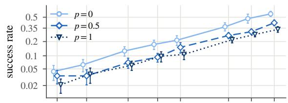

demonstration-uniform sampler, 25 s  
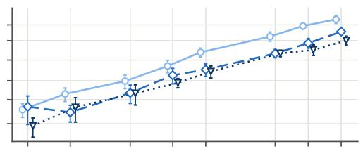

default sampler, 200 s  
demonstration-uniform sampler, 200 s  
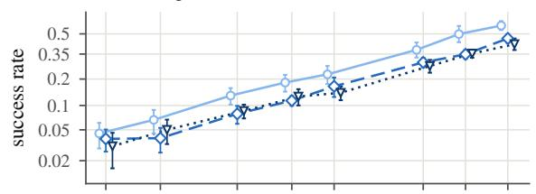  
default sampler, 100 s

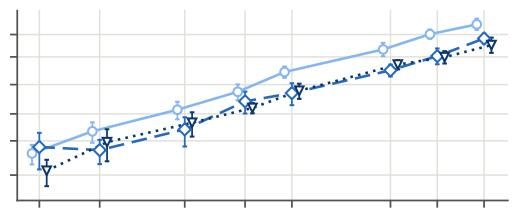

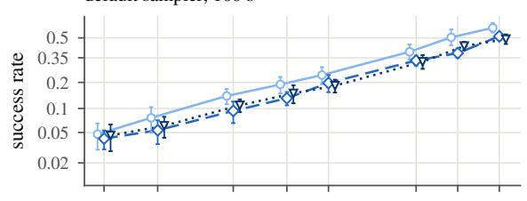

demonstration-uniform sampler, 100 s  
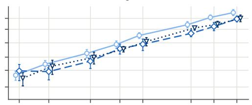

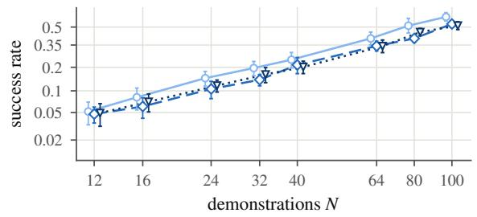

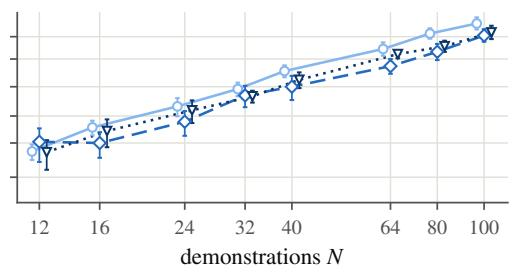  
Figure E1: Success rates in the sampler experiment on Square. Rows: time limits; columns: samplers. Points: means over 12 seeds with seed intervals, offset along N for legibility; lines connect the means. The vertical axis uses the log-odds scale.

## E.3 Single teleoperators and teleoperator pairs

In the single-teleoperator and teleoperator-pair experiments, compared policies are trained on the same machine and GPU model, and the teleoperators change. At a fixed size, pooling changes the number of teleoperators, which teleoperators appear, and the demonstrations per teleoperator.

Pooling within a group. At N = 40, 12 seeds each train the four single teleoperators and the two pooled groups. The single-teleoperator minus pooled log-odds contrast is $\Delta _ { s } = ( z _ { 1 s } + z _ { 2 s } ) / 2 - z _ { \mathrm { p o o l } , }$ s (Table E4). The comparison across sizes pairs 6 seeds trained on one machine.

<table><tr><td>Evaluation</td><td>Limit (s)</td><td>Better</td><td>Worse</td></tr><tr><td>Five checkpoints</td><td>25</td><td>0.64 [0.39, 0.88]</td><td>0.27 [0.07, 0.47]</td></tr><tr><td>Five checkpoints</td><td>40</td><td>0.65 [0.41, 0.90]</td><td>0.25 [0.08, 0.43]</td></tr><tr><td>Final checkpoint</td><td>25</td><td>0.60 [0.20, 0.99]</td><td>0.34 [−0.02, 0.70]</td></tr><tr><td>Final checkpoint</td><td>40</td><td>0.62 [0.23, 1.02]</td><td>0.23 [-0.03, 0.48]</td></tr><tr><td>Final checkpoint</td><td>100</td><td>0.60 [0.19, 1.01]</td><td>0.22 [-0.03, 0.46]</td></tr><tr><td>N or trend</td><td colspan="3">Better</td></tr><tr><td>12</td><td colspan="2">0.30 [-0.11, 0.71]</td><td>Worse</td></tr><tr><td>24</td><td colspan="2">0.30 [—0.23, 0.83]</td><td>0.52 [–0.33, 1.36] 0.24 [–0.05, 0.52]</td></tr><tr><td>40</td><td colspan="2"></td><td>0.15 [—0.03, 0.33]</td></tr><tr><td>Slope in ln N</td><td colspan="2">0.53 [0.16, 0.89] 0.18 [—0.36, 0.72]</td><td>−0.31 [−1.10, 0.48]</td></tr></table>

Table E4: Single-teleoperator minus pooled log-odds within each group. Top: $N = 4 0 .$ , 12 paired seeds. Bottom: five-checkpoint evaluation at 25 s across sizes, 6 paired seeds trained on one machine; the last row is the least-squares slope of $\Delta _ { s } ( N )$ against ln N. Brackets: paired seed intervals.

Single-teleoperator baseline. For teleoperator a trained alone, let $z _ { a }$ be the mean success log-odds of 3 policies at $N = 4 0$ (Table E7). Let $\bar { z } _ { \mathrm { B } }$ be the mean of $z _ { \mathrm { B 1 } }$ and zB2, and let $\beta = 1 . 5 8$ be the mean slope of the main experiment’s fits with $p \in \{ 0 , 0 . 5 , 1 \}$ . Define

$$
k _ { a } = \exp [ \left( \bar { z } _ { \mathrm { B } } - z _ { a } \right) / \beta ] , \qquad V _ { p } = \frac { 1 } { N } \sum _ { a } \frac { n _ { a } } { k _ { a } } , \qquad V _ { \mathrm { B B } } = \frac { k _ { \mathrm { B } 1 } ^ { - 1 } + k _ { \mathrm { B } 2 } ^ { - 1 } } { 2 } ,
$$

where $n _ { a }$ counts the demonstrations from a in the set with Worse share $p .$ The teleoperator multiple $k _ { a }$ makes a demonstration from a worth $1 / k _ { a }$ demonstrations of the average single Better teleoperator. The calibration size $N = 4 0$ is the size at which the multiples $k _ { a }$ are estimated. At this size, the predicted log-odds are $\bar { z } _ { \mathrm { B } } + \beta$ ln $V _ { p } .$ . Predicted minus observed log-odds, divided by $\beta ,$ is the singleteleoperator log excess. At $N = 6 4 , 1 0 0$ , the single-teleoperator baseline reads the seed’s pooled B1+B2 line at size $N V _ { p } / V _ { \mathrm { B B } }$ . It applies the multiples calibrated at $N = 4 0$ to both sizes, and so charges each pair the log-odds difference between B1+B2 and its two single teleoperators. The additive prediction instead reads the same line at size $N [ ( 1 - p ) + p / k _ { s } ( 1 ) ]$ ; both log-odds differences are divided by the seed’s slope. Intervals add the independent seed-mean and calibration variances $\sigma _ { i } ^ { 2 }$ by the delta method. Their Welch–Satterthwaite degrees of freedom are $( \sum _ { i } \sigma _ { i } ^ { 2 } ) ^ { 2 } / \sum _ { i } ( \sigma _ { i } ^ { 4 } / \nu _ { i } )$ where $\nu _ { i }$ is the degrees of freedom of term i.

Teleoperator pairs on one machine. Across sizes, the four pairs are trained on one machine for 4 seeds at $N = 2 4$ to 100. This same-machine comparison measures the combined variation in $k _ { a }$ and in the effect of pooling. For seed s, the unnormalized single-teleoperator values are $\widetilde { V } _ { a s } = \exp [ z _ { a s , 4 0 } / \bar { \beta } _ { s } ^ { ( 3 ) } ]$ . The single-teleoperator baseline then predicts $c _ { s 0 } + \beta _ { s 0 } \ln [ N ( \widetilde { V } _ { \mathrm { B i } , s } +$ $\widetilde { V } _ { \mathrm { W j } , s } ) / ( \widetilde { V } _ { \mathrm { B 1 } , s } + \widetilde { V } _ { \mathrm { B 2 } , s } ) ]$ ]. Averaged over the four pairs, the single-teleoperator log excess has slope 0.05 [−0.22, 0.31] against ln $N _ { \cdot }$ . For each pair and size, the interval of the single-teleoperator log excess includes zero, except for B2+W2 at $N = 6 4$ , where the estimate is −0.16 [−0.30, −0.03]. Apart from this case, the intervals include zero, so these comparisons detect no departure from the single-teleoperator baseline.

At $N = 1 0 0$ , Table E6 compares the pairs of 12 seeds with the eight-size curves of the main experiment, with matched evaluation and time limit. Refitting the same-machine all-Better and all-Worse policies at $N = 4 0 , 1 0 0$ gives a second set of curves. Against them, the mean pair log excess is 0.09 [0.03, 0.15] in the five-checkpoint evaluation at 25 s and 0.12 [0.03, 0.20] in the final-checkpoint evaluation at 100 s. In the final-checkpoint evaluation, its change from 25 s to 100 s is 0.01 [−0.04, 0.05] against the main experiment’s curves and 0.03 [−0.03, 0.10] against the refitted curves. With either the main experiment’s curves or the refitted curves, the mean pair log excess lies above zero in the five-checkpoint evaluation at 25 s and in the final-checkpoint evaluation at 100 s. The two evaluations differ, so these levels are not a change across time limits; the paired change is the one reported above.

<table><tr><td>Set</td><td>E</td><td>Single-teleoperator log excess</td></tr><tr><td colspan="3"> $N = 4 0 ,$  baseline: average single Better teleoperator</td></tr><tr><td> $\mathbf { B } 1 + \mathbf { B } 2$ </td><td></td><td>0.34 [0.16, 0.52]</td></tr><tr><td> $\mathrm { { W 1 + W 2 } }$ </td><td></td><td>0.19 [0.03, 0.35]</td></tr><tr><td>Four teleoperators,  $p = 0 . 2 5$ </td><td></td><td>0.42 [0.21, 0.64]</td></tr><tr><td>Four teleoperators,  $p = 0 . 5$ </td><td></td><td>0.41 [0.29, 0.54]</td></tr><tr><td>Four teleoperators,  $\bar { p } = 0 . 7 5$ </td><td></td><td>0.37 [0.20, 0.55]</td></tr><tr><td colspan="3"> $N = 6 4 , 1 0 0 , p = 0 . 5 ;$  baseline: pooled B1+B2</td></tr><tr><td> $\mathrm { \mathbf { B } } 1 { + } \mathrm { \mathbf { W } } 1$ </td><td>0.28 [0.18, 0.39]</td><td> $0 . 0 9 \left[ - 0 . 0 8 , 0 . 2 6 \right]$ </td></tr><tr><td> $\mathrm { { B } } 2 { + } \mathrm { { W } } 1$ </td><td>0.17 [0.10, 0.24]</td><td> $0 . 1 0 \bar { [ - 0 . 0 7 , 0 . 2 7 ] }$ </td></tr><tr><td> $\mathbf { B } 1 + \mathbf { W } 2$ </td><td> $- 0 . 0 1 \ \mathrm { { [ - 0 . 1 1 , 0 . { \dot { 0 } } 9 } ] }$ </td><td> $0 . 0 2 \dot { [ - 0 . 1 4 , 0 . 1 9 ] }$ </td></tr><tr><td> $\mathbf { B } 2 + \mathbf { W } 2$ </td><td> $- 0 . 2 3 [ - 0 . 3 2 , - 0 . 1 \bar { 5 } ]$ </td><td> $- 0 . 1 \bar { 0 } \left[ - 0 . 2 7 , 0 . 0 \bar { 6 } \right]$ </td></tr><tr><td>Mean of pairs</td><td> $0 . 0 5 \ [ - 0 . 0 2 , 0 . 1 2 ]$ </td><td> $0 . 0 3 \ [ - 0 . 0 6 , 0 . 1 2 ]$ </td></tr><tr><td>Four teleoperators</td><td> $0 . 1 8 \ \bar { [ - 0 . 0 1 , 0 . 3 7 ] }$ </td><td> $0 . 1 6 \ \bar { [ - 0 . 0 4 , 0 . 3 7 ] }$ </td></tr><tr><td>Pairs — four (paired)</td><td> $- 0 . 1 3 \left[ - 0 . 2 9 , 0 . 0 3 \right]$ </td><td> $- 0 . 1 3 \left[ - 0 . 3 0 , 0 . 0 3 \right]$ </td></tr><tr><td>Four, all 24 seeds</td><td></td><td> $0 . 1 4 \ [ 0 . 0 5 , 0 . 2 4 ]$ </td></tr></table>

Table E5: Pooling relative to single teleoperators and to the two groups. Five-checkpoint evaluation at 25 s. E: log excess over the additive prediction. Intervals for the single-teleoperator log excess include calibration uncertainty. Top: seed counts of the main experiment. Bottom: 6 paired seeds unless marked.

<table><tr><td>Pair</td><td>Five checkpoints, 25 s</td><td>Final checkpoint, 100 s</td></tr><tr><td>B1+W1</td><td>0.26 [0.17, 0.36]</td><td>0.29 [0.17, 0.41]</td></tr><tr><td> $\mathbf { B } 1 + \mathbf { W } 2$ </td><td>0.05 [–0.05, 0.15]</td><td>0.10 [−0.02, 0.23]</td></tr><tr><td>B2+W1</td><td>0.26 [0.19, 0.33]</td><td>0.33 [0.18, 0.48]</td></tr><tr><td>B2+W2</td><td>−0.16 [−0.26, −0.06]</td><td>-0.15 [−0.34, 0.04]</td></tr><tr><td>Mean</td><td>0.10 [0.02, 0.18]</td><td>0.14 [0.01, 0.27]</td></tr></table>

Table E6: Teleoperator pairs against the main experiment’s curves. Log excess over the additive prediction at $N = 1 0 0$ , 12 seeds; paired seed intervals. The final-checkpoint mean at 25 s is 0.14 [0.02, 0.25].

## E.4 Teleoperators and additions

Table E7 compares the six teleoperators at $N = 4 0$ . It also reports the log-odds gain from each all-Better set of size n to the half-Better, half-Worse set of size 2n that contains it, that is, from adding n Worse demonstrations.

<table><tr><td></td><td>B1</td><td>B2</td><td>01</td><td>02</td><td>W1</td><td>W2</td></tr><tr><td>Success log-odds</td><td>-0.96</td><td>-0.70</td><td>-1.11</td><td>-1.56</td><td>-2.30</td><td>-1.37</td></tr><tr><td>Median success time (s) Multiple  $k _ { a }$ </td><td>7.6 1.09</td><td>11.2 0.92</td><td>16.8 1.20</td><td>14.1 1.58</td><td>18.5 2.53</td><td>18.8 1.41</td></tr><tr><td></td><td></td><td></td><td></td><td></td><td></td><td></td></tr><tr><td colspan="5">Log-odds gain,  $n  2 n$ </td><td>Estimate</td><td></td></tr><tr><td colspan="5">Final checkpoint, 100 s, range over n</td><td>0.77 to 1.21</td><td></td></tr><tr><td colspan="5">Smallest lower interval bound over sizes and limits</td><td>0.29</td><td></td></tr></table>

Table E7: Square teleoperators and additions. Top: $\overline { { N = 4 0 , 3 } }$ seeds, five-checkpoint evaluation; O1 and O2 are the Okay teleoperators. Log-odds and multiples use success within 25 s; median times are within-seed medians over the successes within 40 s, averaged over seeds. Bottom: observed gains for the four additions $( 1 2  2 4 , 1 6  3 2 , 3 2  6 4$ , and $4 0  8 0$ demonstrations); the last row is the smallest lower bound of the paired seed intervals over these additions and over 25, 40, and 100 s.

## E.5 Training devices

To test whether the training machine matters, we retrain on a GPU machine the $p = 0$ and $p = 0 . 5$ Square policies of 9 seeds first trained on a CPU machine, at $N \in \{ 1 6 , 3 2 , 6 4 , 1 0 0 \}$ . Seeds, training data, training budget, checkpoints, and evaluation initial states are unchanged. The two runs use different versions of the training code, so the comparison measures machine and code version together. The estimated change in success at 25 s is −2 percentage points over all 9 seeds and −3 over the 6 seeds whose two runs are evaluated on the same machine (Table E8). Across rows and limits, the change in the slope contrast $\beta _ { 0 . 5 } - \beta _ { 0 }$ lies between −0.21 and −0.11, and every interval includes zero.
<table><tr><td rowspan="2">Policies compared</td><td rowspan="2">Seeds/ policies</td><td colspan="2">Success-rate change, pp</td><td colspan="2">Slope-contrast change</td></tr><tr><td>25 s</td><td>40s</td><td>25 s</td><td>40s</td></tr><tr><td>All seeds, both sets</td><td>9/72</td><td>-2[−3, 0.2] −2[−4, 0.4]</td><td></td><td> $- 0 . 1 6 \left[ - 0 . 4 6 , 0 . 1 3 \right]$ </td><td>-0.11 [−0.46, 0.23]</td></tr><tr><td>Same evaluation machine, both sets</td><td>6/48</td><td>-3[−4, −1] −3[−4, −1]</td><td></td><td> $- 0 . 2 1 \ \bar { [ - 0 . 7 1 , 0 . 2 9 ] }$ </td><td>−0.12 [−0.72, 0.47]</td></tr><tr><td>Same evaluation machine,  $p = 0$ </td><td>6/24</td><td>-2[−3,-1] -2[−3,-1]</td><td></td><td></td><td></td></tr><tr><td>Same evaluation machine,  $p = 0 . 5$ </td><td>9/36</td><td></td><td>-2[−4,1] −2[−5, 1]</td><td></td><td></td></tr></table>

Table E8: Retraining on a second machine. Differences are retrained minus original. Same evaluation machine: seeds whose original and retrained policies of the row’s sets are evaluated on the same machine. Policies: paired policies over seeds, sizes, and sets. Success-rate changes average the row’s sets and sizes within each seed. The slope contrast is $( \beta _ { 0 . 5 } - \beta _ { 0 } ) _ { \mathrm { r e t r a i n e d } } - ( \beta _ { 0 . 5 } - \beta _ { 0 } )$ original, in log-odds per ln N, and needs both sets (dashes). Brackets: paired seed intervals.

## F Other Training Conditions

## F.1 Longer training and matched exposure

Table F1 pairs seeds across two training budgets (Table B2). The 2000-epoch policies of the main experiment are evaluated at the 5 checkpoints of epochs 1600–2000 with 500 episodes per policy. The 4000-epoch policies are evaluated at the 5 checkpoints of epochs 3600–4000 with 250 episodes per policy, 50 per checkpoint, from new initial states. Under a fixed update budget, each transition of the longer Worse demonstrations is sampled less often. Exposure matching sets the number of Worse updates to $U = \left\lfloor U _ { 0 } M _ { \mathrm { W } } / M _ { \mathrm { B } } \right\rfloor$ , where $U _ { 0 }$ is the original update count and $M _ { \mathrm { W } }$ and $M _ { \mathrm { B } }$ count Worse and Better transitions. The nominal exposure is $U b L / M _ { \mathrm { W } }$ , with batch size $b = 1 0 0 .$ , sequence length $L = 1 0$ , and $U _ { 0 } = e 1 0 0$ at epoch e. Checkpoint labels and final-checkpoint initial states stay fixed. Exposure matching also adds optimizer updates.

Doubling the training budget multiplies $k ( 1 )$ by 1.02 [0.98, 1.06] and raises the log excess $E ( 0 . 5 )$ at 25 s by 0.04 [0.004, 0.07]. Exposure matching lowers ln k(1) by 0.07 [−0.05, 0.19] at 25 s and by 0.05 [−0.10, 0.20] at 100 s; both intervals include zero.
<table><tr><td>Paired change</td><td colspan="3">k(0.5) ratio</td><td colspan="2">k(1) ratio E(0.5), 25 s</td><td colspan="2">E(0.5), 20 s</td><td colspan="2">E(0.5), 40 s</td></tr><tr><td>2000→4000 epochs</td><td></td><td>1.05 [1.01, 1.08]</td><td colspan="2">1.02 [0.98, 1.06]</td><td colspan="2">0.04 [0.004, 0.07]</td><td colspan="2">0.04 [0.01, 0.08]</td><td>0.03 [-0.0004, 0.07]</td></tr><tr><td></td><td></td><td></td><td></td><td></td><td></td><td></td><td></td><td></td><td></td></tr><tr><td></td><td>Evaluation</td><td></td><td>Default k(1)</td><td>Matched k(1)</td><td></td><td>Reduction, ln k</td><td></td><td>Fraction removed</td><td></td></tr><tr><td></td><td>Five checkpoints, 25 s</td><td></td><td>1.67 [1.49, 1.87]</td><td>1.55 [1.36, 1.77]</td><td></td><td>0.07 [–0.05, 0.19]</td><td></td><td> $1 4 \% [ - 1 1 \% , 3 6 \% ]$ </td><td></td></tr><tr><td></td><td>Final checkpoint, 100 s</td><td></td><td>1.20 [1.08, 1.33]</td><td>1.14 [0.93, 1.39]</td><td></td><td>0.05 [–0.10, 0.20]</td><td></td><td>27% [–51%, 167%]</td><td></td></tr></table>

Table F1: Square training budget and transition exposure. Top: five-checkpoint evaluation, fits over all sets and sizes; multiple ratios at 25 s and changes in the log excess $E ( 0 . { \bar { 5 } } ) ;$ ; paired whole-seed percentile intervals. Bottom: all-Better and all-Worse fits at $N = 4 0 , 1 0 0 ,$ 8 seeds trained on one machine and GPU model; reductions are default minus matched; seed intervals, and Fieller intervals for the fractions.

## F.2 Diffusion policy on two Square sizes

Both policy classes use 8 paired seeds, $p \in \{ 0 , 0 . 5 , 1 \}$ , and $N \in \{ 2 4 , 1 0 0 \}$ , separate from the main experiment. Fits use these two sizes at epoch 2000 with the same 100 initial states. The diffusion policy is a denoising diffusion probabilistic model (DDPM) [21] with exponential-moving-average evaluation weights. It observes 2 steps, predicts 16 actions, and executes 8 environment steps before replanning. The conditional one-dimensional U-Net uses channel widths 256/512/1024, a 256-dimensional diffusion embedding, kernel width 5, and 8 normalization groups. AdamW uses learning rate $1 0 ^ { - 4 }$ , weight decay $1 0 ^ { - 6 }$ , and a half-cycle cosine schedule after 500 warm-up updates; the EMA power is 0.75. Training and inference both use 100 denoising steps, with a squared-cosine noise schedule, noise prediction, and denoised-sample clipping. Epochs, updates per epoch, batch size, disabled normalization and gradient clipping, and boundary padding match Section B.

Table F2 gives the change in ln $k ( 1 )$ from 25 s to 100 s and the log excess of the half-Better, half-Worse set at both limits. Table F3 gives the success rates of the all-Better and all-Worse sets. The diffusion policy succeeds more often than BC-RNN-GMM in every condition of Table F3. Its ln k(1) changes by −0.40 from 25 s to 100 s, against −0.31 for BC-RNN-GMM on the same seeds and sizes, so the all-Worse multiple falls with the longer limit under both policy classes.

<table><tr><td rowspan="2">Metric</td><td colspan="2">8 seeds</td></tr><tr><td>Diffusion</td><td>BC-RNN-GMM</td></tr><tr><td>∆ln k(1)</td><td>-0.40[-0.49,-0.31]</td><td>-0.31[-0.37,-0.25]</td></tr><tr><td>E(0.5), 25 s</td><td>0.10[-0.09,0.30]</td><td>0.12[-0.06,0.30]</td></tr><tr><td>E(0.5), 100 s</td><td>0.07[-0.11,0.24]</td><td>0.08[-0.06,0.23]</td></tr></table>

Table F2: Change in the log all-Worse multiple from 25 s to 100 s, and log excess of the half-Better, half-Worse set, for both policy classes. E: log excess. Seed intervals, paired for the change.

<table><tr><td> $N$ </td><td>p</td><td>Limit (s)</td><td>Diffusion, %</td><td>BC-RNN-GMM, %</td><td></td><td>Diffusion – BC-RNN-GMM, pp</td></tr><tr><td>24</td><td>0</td><td>25</td><td>36.00 [30.02, 41.98]</td><td>10.50 [6.79, 14.21]</td><td>25.50 [</td><td>[16.89, 34.11]</td></tr><tr><td>24</td><td>0</td><td>100</td><td>38.50 [32.28, 44.72]</td><td>11.75 [7.76, 15.74]</td><td>26.75</td><td>18.35,35.15</td></tr><tr><td>24</td><td>1</td><td>25</td><td>29.50 [22.13, 36.87</td><td>6.12 [4.06, 8.19]</td><td>23.38</td><td>17.02,29.73</td></tr><tr><td>24</td><td>1</td><td>100</td><td>39.25 [32.33, 46.17]</td><td>8.88 [6.71, 11.04]</td><td>30.38</td><td>[24.85, 35.90]</td></tr><tr><td>100</td><td>0</td><td>25</td><td>75.12 [71.74, 78.51]</td><td>54.00 [47.27, 60.73]</td><td>21.12</td><td>[14.20, 28.05]</td></tr><tr><td>100</td><td>0</td><td>100</td><td>76.38 [73.15, 79.60]</td><td>55.88 [50.08, 61.67]</td><td>20.50</td><td>[14.88, 26.12</td></tr><tr><td>100</td><td>1</td><td>25</td><td>62.12 [59.70, 64.55</td><td>37.12 [31.96, 42.29]</td><td>25.00</td><td>[18.43, 31.57</td></tr><tr><td>100</td><td>1</td><td>100</td><td>75.25 [72.36, 78.14]</td><td>54.62</td><td>[49.81, 59.44]</td><td>20.62 [15.01, 26.24]</td></tr></table>

Table F3: Success of diffusion and BC-RNN-GMM policies on Square. 8 paired seeds, 100 common initial states per policy. Success rates in percent, differences in percentage points (pp). Brackets: seed intervals, not clipped to [0, 100]. The BC-RNN-GMM policies use the same seeds and sizes; training recipes and machines differ between the two policy classes.

## G Collection Costs and Throughput

Break-even pay ratios. For Worse share $p ,$ the Worse demonstrations per Better-equivalent demonstration are $m = k ( 1 )$ for replacing and $m = \mu ( p ) = p / [ 1 / k ( p ) - ( 1 - p ) ]$ ] for adding. For $0 < p \leq 1$ adding gains Better-equivalent demonstrations when $1 / k ( p ) > 1 - p .$ . Replacing pays for every demonstration in the new set, and adding treats the existing Better demonstrations as a sunk cost. Let r be the Worse/Better ratio of mean recording durations and $t _ { B }$ the mean Better duration. With recording time as the only cost, the break-even pay ratio is $1 / ( r m )$ , so ln $\theta = - \ln { r } - \ln { m }$ . Its 95% intervals add, on this log scale, the variance across policy seeds and the analytic variance of each teleoperator’s mean demonstration length, propagated by the delta method, with Welch–Satterthwaite degrees of freedom; the interval of $\mu$ maps that of $k ( p )$

At 25 s, matching 40 Better demonstrations takes about 62 Worse demonstrations and 3 times the recording time. Adding 40 Worse demonstrations to an equally large Better set gains 18.4 [13.5, 23.7] Better-equivalent demonstrations, so each Better-equivalent demonstration gained costs $\mu ( 0 . 5 ) = 4 0 / 1 8 . 4$ Worse demonstrations. This ratio includes the excess as well as the gap between the groups.

Overheads. Extra collection times $o _ { B } t _ { B }$ and $o _ { W } t _ { B }$ per accepted demonstration include resets, discarded attempts, and amortized teleoperator training. For hourly rates $c _ { B }$ and $c _ { W }$ , write $\rho =$ $c _ { W } / c _ { B }$ , and let $f = ( F _ { C } - F _ { B } ) / ( c _ { B } t _ { B } )$ be the fixed cost of the candidate set minus that of the Better set, which includes policy training and deployment but not the costs already charged as collection time. At time limit $h ,$ define

$$
v _ { h } ( p ) = \frac { 1 / k _ { h } ( p ) - ( 1 - p ) } { p } , \qquad \theta _ { h } ( p ) = \frac { ( 1 + o _ { B } ) v _ { h } ( p ) - f / ( N p ) } { r + o _ { W } } .\tag{1}
$$

For a positive Better-equivalent gain, recording Worse demonstrations costs less when $\rho < \theta _ { h } ( p )$ with the fixed-cost difference held constant as $\rho$ varies. Setting $\ o _ { B } = o _ { W } = o $ and $f = 0$ gives $( 1 + o ) / [ m ( r + o ) ]$ . Table G2 reports ratios without overheads and one asymmetric example.

## G.1 Throughput

Table G1 divides total successes by execution time, counting each failure at the full limit, and reports successes per 50 s of execution (1000 steps). For $y _ { s }$ successes among $R _ { s }$ attempts and $T _ { s }$ executed steps, let α multiply the step duration. $\mathbf { A }$ per-attempt overhead $d ,$ success resets $e _ { + }$ , and failure recovery $e _ { - }$ are measured in policy steps:

$$
T _ { \mathrm { e f f } , s } = \alpha T _ { s } + R _ { s } d + y _ { s } e _ { + } + ( R _ { s } - y _ { s } ) e _ { - } , \qquad Q _ { h } ( p ) = \frac { 1 0 0 0 \sum _ { s } y _ { s } } { \sum _ { s } T _ { \mathrm { e f f } , s } } .\tag{2}
$$

The parameters can differ between a candidate policy and the all-Better baseline. Table G1 reports $Q _ { h } ( 0 ) , Q _ { h } ( 1 )$ , and their ratio.
<table><tr><td>Limit (s)</td><td>All-Better</td><td>All-Worse</td><td>Worse/Better</td></tr><tr><td>25</td><td>1.618 [1.514, 1.728]</td><td>0.796 [0.735, 0.861]</td><td>0.492 [0.441, 0.551]</td></tr><tr><td>100</td><td>0.571 [0.526, 0.621]</td><td>0.425 [0.389, 0.463]</td><td>0.744 [0.652, 0.852]</td></tr></table>

Table G1: Successes per 50 s of execution on Square. $Q _ { h } ( p )$ with $\alpha = 1$ and $d = e _ { + } = e _ { - } = 0 ;$ $N = 1 0 0 ;$ successful and failed episodes both count. Brackets: percentile intervals from equal-sized whole-seed blocks resampled jointly across sets and sizes; both groups use the same seeds.

<table><tr><td rowspan="2">Limit (s)</td><td rowspan="2"> $\left( o _ { B } , o _ { W } \right)$ </td><td colspan="2">Break-even pay ratio</td></tr><tr><td>Replace</td><td>Add</td></tr><tr><td>25</td><td>(0,0)</td><td>0.33 [0.29, 0.38]</td><td>0.24 [0.18, 0.32]</td></tr><tr><td>40</td><td>(0, 0)</td><td>0.40 [0.35, 0.45]</td><td>0.29 [0.23, 0.37]</td></tr><tr><td>100</td><td>(0,0)</td><td>0.47 [0.41, 0.53]</td><td>0.35 [0.28, 0.44]</td></tr><tr><td>100</td><td>(0,1)</td><td>0.31 [0.28, 0.34]</td><td>0.23 [0.19, 0.29]</td></tr></table>

Table G2: Square break-even pay ratios with and without collection overheads. All sets, 24 seeds; hypothetical $f = 0$ . The inputs $O _ { B }$ and $O W$ use units of the Better recording duration. Brackets: delta method with Welch–Satterthwaite degrees of freedom.