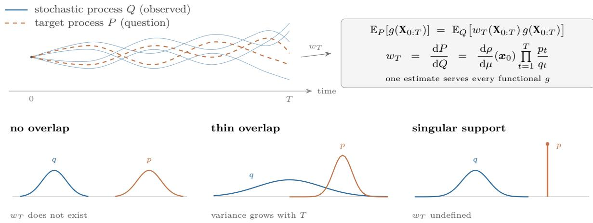
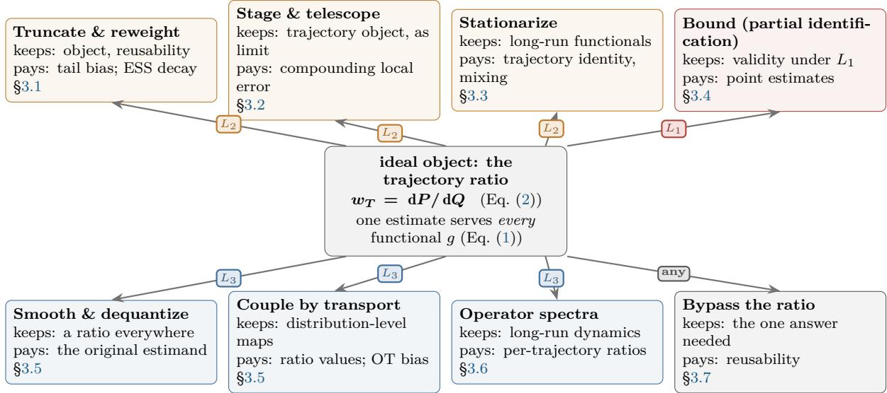
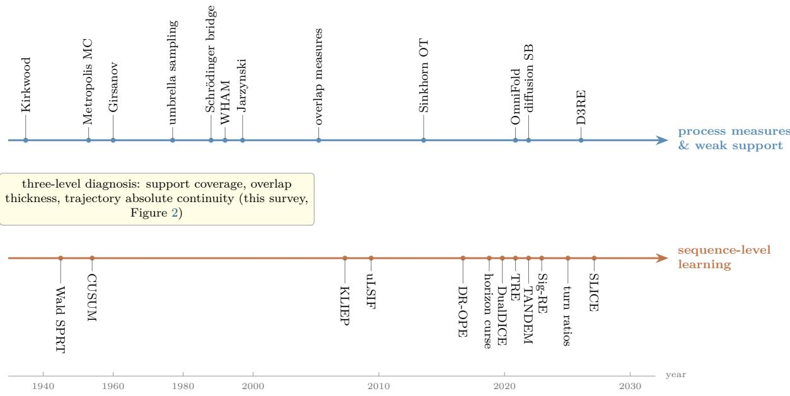
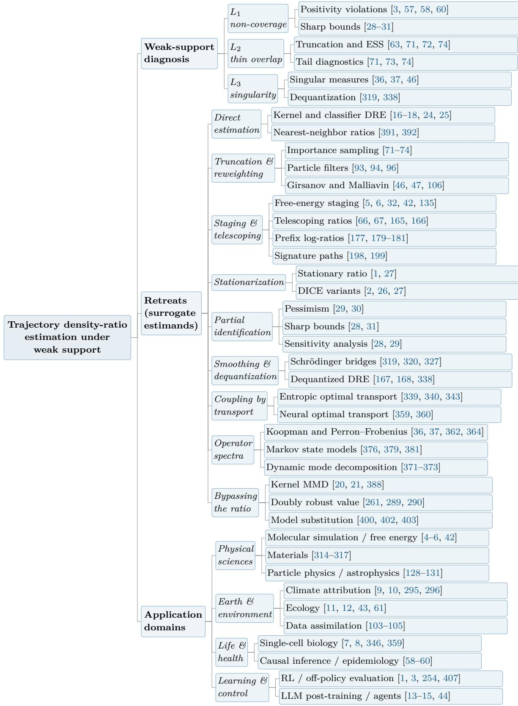

# Trajectory Density Ratios under Weak Support: A Survey across the Sciences

Wei Chen, Lihao Zhuang, Yubing Wu, and Delu Zeng

South China University of Technology, Guangzhou, China

## Abstract

Many problems across the sciences compare two stochastic processes through the sequences they generate. Reinforcement learning asks what a new policy would return from the trajectories of an old one; molecular simulation asks how much more a ligand binds from samples of the unbound state; climate attribution asks how a heat wave shifted under warming; and languagemodel post-training asks what a deployed agent will do from logged interactions. In every case, one quantity would answer all these questions at once: the ratio of the two probability laws over their generated sequences, the trajectory density ratio. This ratio exists only under strong conditions. When one process reaches states the other cannot, the ratio does not exist; when their overlap is thin, its variance grows without control with the sequence length; and when they concentrate on diferent lower-dimensional sets, the ratio is undefined altogether. Weak support of this kind is the norm for sequence data, not a sampling accident, and its price is paid in identifiability rather than in noise alone. This survey organizes the field around a threelevel diagnosis of weak support and a map of the nine retreats that methods take when the full ratio is out of reach, from direct estimation and reweighting through staged decomposition, stationarization, and partial-identification bounds to smoothing, transport couplings, operator spectra, and direct estimation of a single functional. Each retreat keeps part of what the ratio ofers and pays for the rest, and each application domain has standardized the retreat its data force. The survey closes with open problems: testable diagnostics at every level, partial identification at the trajectory level, a rate theory of time-amplified error, and benchmarks with ground truth.

Keywords: trajectory density ratio; weak support; partial identification; of-policy evaluation; rare events

## Contents

1 Introduction 3   
2 Trajectory density ratios and weak support 5   
2.1 Processes, trajectories, and target functionals 5   
2.2 The trajectory ratio and its product structure 5   
2.3 Three levels of weak support 6   
2.4 Identifiability and rates 8   
2.5 One object, many estimands . 8   
3 Retreats from the trajectory ratio 8   
3.1 Estimating the ratio directly 9   
3.2 Splitting the product . 11   
3.3 Stationarization . 16   
3.4 Partial identification 18   
3.5 Changing the estimand . 19   
3.6 From densities to spectra 20   
3.7 Bypassing the ratio . 20   
4 Cross-domain synthesis 21   
4.1 The estimator families, juxtaposed 21   
4.2 The cross-domain comparison, keyed by retreat 23   
4.3 Language-model post-training and multi-turn agents 24   
5 Open problems 25   
6 Conclusion 26   
7 References 28   
A Technical appendix 51   
A.1 Variance amplification 51   
A.2 The prefix correction identity 51   
A.3 Overlap coeficients and divergence relations 51   
A.4 Weighted conformal prediction under shift 52   
A.5 E-processes and anytime validity 52   
A.6 Estimation from truncated support 52   
A.7 Notation . 52   
B The map of retreats on one page 52

## 1 Introduction

Many scientific questions take the same form: we hold trajectories generated by one process, but the question of interest concerns the trajectory distribution of another process. Of-policy evaluation in reinforcement learning asks what return a target policy would achieve while the logs come from a behavior policy [1–3]. Computational chemistry compares free energies at two temperatures or two ligand parameters while samples come from molecular dynamics or umbrella sampling [4–6]. Single-cell biology reconstructs diferentiation from destructive sampling [7, 8]. Climate attribution estimates the probability ratio of the same extreme event under factual and counterfactual forcing [9, 10]. Ecology compares locations that animals use with locations that are available [11, 12], and the post-training of large language models reuses responses logged under earlier policies to evaluate and improve a new one [13–15]. The objects, data, and vocabularies difer. The mathematical structure does not. A data process Q supplies the samples, a target process P defines the question, and the bridge is the Radon–Nikodym derivative dP/ dQ between trajectory measures: the trajectory density ratio, or its logarithm, the trajectory log-ratio.

Trajectory density ratios difer from their independent and identically distributed counterparts in two structural ways. First, they factorize along time. For a Markov process the trajectory ratio is the product of an initial ratio and the one-step transition-density ratios, so the log-ratio is a sum of local increments (Section 2). Second, support conditions multiply along time. If at a single time step the target process enters, with positive probability, a region the data process cannot reach, the ratio of the whole trajectory ceases to exist: a local support gap escalates, under the product structure, to singularity of the trajectory measures. The same product structure amplifies thinness of overlap: the second moment of the ratio grows exponentially with the horizon whenever one-step ratios have non-degenerate tails. Weak support is therefore the operative regime of process data, not a finite-sample nuisance that more data can remove. Figure 1 draws the object and the three ways it fails.

  
Figure 1: The trajectory-density-ratio problem. Top: we observe trajectories of a stochastic process Q but need expectations under a target process $P ;$ the ratio $w _ { T } = \left. \mathrm { d } P / \mathrm { d } Q \right. { . }$ a product of one-step ratios, converts one into the other. Bottom: weak support breaks this bridge in three ways—no overlap leaves wT undefined, thin overlap makes its variance grow with the horizon, and singular support leaves no density.

Core claim. The claim that organizes this survey is best stated directly. The trajectory ratio $w _ { T } = \mathrm { d } P / \mathrm { d } Q$ is the unique estimand that a single estimate reuses across every trajectory functional, and the literature on trajectory density ratios is a map of retreats from this object: each method family computes, instead of w , a surrogate estimand adopted because weak support makes wT nonexistent, uncontrollable, or singular. The families difer not in ambition but in what their surrogate keeps and what it pays. Truncation keeps the object and pays in tail bias. Stationarization keeps long-run functionals and gives up the trajectory. Partial identification keeps validity and gives up point estimates. Couplings and operator spectra give up ratio values altogether. The application domains difer in which retreat their data force them to standardize. Weak support is the pressure. The map of retreats (Figure 2, Table 6) is the organization, and everything else in this survey is a branch of it.

Two research traditions have each solved half of the problem. Statistics and machine learning developed density-ratio estimation as a learning problem: convex and least-squares variational ob jectives [16–19], kernel two-sample machinery [20, 21], convergence rates for regularized regression [22, 23], and a unifying link between classification losses and ratio estimation [24, 25]. Of-policy evaluation refined this into a family of estimators organized around stationary distribution corrections [1, 2, 26, 27], together with a theory of what remains identifiable when coverage fails [28–31]. Computational chemistry, dynamical systems, and climate science have lived with rare trajectories for far longer and accumulated a diferent toolbox: phase-space overlap measures [32, 33], largedeviation theory [34, 35], transfer operators [36, 37], and rare-event algorithms [38, 39]. Neither tradition states the connection the other way around: the OPE estimators are retreats to marginals and functionals, and the physics toolbox is a catalog of the same retreats under diferent names. Making the retreat explicit is what lets the two traditions be compared at all.

The survey carries this claim through in four steps. First, it formalizes the object and the pressure: the product structure of w , the three levels of weak support, the two escalation mechanisms (Observations 1 and 2), and the identifiability–rate consequences of each level. It then defines a retreat precisely and draws the map (Section 2). Second, the body of the survey is organized by the retreat itself, one subsection per row of the map (Section 3): direct estimation and reweighting stay on the object (§3.1), staged and sequential decomposition splits the product (§3.2), stationarization trades the trajectory for the horizon (§3.3), partial identification bounds what coverage admits (§3.4), bridges and transport change the estimand (§3.5), operator spectra replace densities (§3.6), and direct functionals and model substitution bypass the ratio altogether (§3.7). Each subsection closes with the domains that standardized the retreat, so the application literature is read through the map rather than listed beside it. Third, Section 4 juxtaposes the estimator families, states the cross-domain comparison keyed by retreat, and reads the newest domain, language-model post-training with multi-turn agents, as a composite in which nearly every retreat operates at once. Fourth, it recasts the open problems as prescriptions for retreating later and returning sooner (Section 5).

The comparison across domains rests on the retreat grid rather than on shared theorems. What one field calls phase-space overlap another calls the efective sample size, a third calls positivity, and a fourth calls concentrability: all of them measure how close the problem sits to the level that forces a retreat. The value of the grid is practical. A domain that has standardized a diagnostic can adopt the matching estimator family without re-deriving its failure modes, and a method’s known pathologies follow from its retreat rather than from implementation quality.

Reader’s guide. Four artifacts support navigation. Figure 2 (Section 2.5) draws the map of retreats that carries the core claim, and Table 6 (Appendix B) states it on one page, with every retreat’s level, what its surrogate keeps and what it pays, and its standardizing domains. Figure 3 (Section 3.2) places the two research lineages on a common time axis. Table 3 and Table 4 (Section 4) contrast the estimator families and the retreat-keyed cross-domain comparison, and Table 2 (Section 3.2) distills the three tensions of the sequential literature. A reader looking for where a specific tool sits should start from the map and follow the section pointers back into the text.

This is a thematic review, not a systematic one. The corpus consists of two curated bibliographies, namely a sequence-level density-ratio corpus maintained alongside this survey and a weak-support corpus assembled for Section 2, supplemented by the canonical literature of each application domain. Selection follows three threads: density ratio, weak overlap, and process trajectories. The scope limits completeness within domains but makes the concepts of the diferent traditions alignable entry by entry.

## 2 Trajectory density ratios and weak support

## 2.1 Processes, trajectories, and target functionals

Let be the state space and $\mathbf { X } _ { 0 : T } = ( \mathbf { X } _ { 0 } , \ldots , \mathbf { X } _ { T } )$ a length-T sequence, that is, a trajectory (an observed time series when t indexes time), taking values in the trajectory space $\Omega _ { T } = \mathcal { X } ^ { T + 1 }$ , the space of all length-T sequences, equipped with the natural filtration $\mathcal { F } _ { T } = \sigma ( \mathbf { X } _ { 0 } , \ldots , \mathbf { X } _ { T } )$ . The data process is generated by an initial distribution $\mu$ and transition kernels $q _ { t } ( \cdot \ | \ x _ { t - 1 } )$ . Its trajectory measure is $Q .$ . The target process is generated by $\rho$ and kernels $p _ { t } ( \cdot \mid x _ { t - 1 } )$ . Its trajectory measure is $P .$ . In of-policy evaluation the two difer only in the policy [40, 41]. In free-energy calculation they difer in the Hamiltonian or the biasing potential [4, 42]. In climate attribution they correspond to factual and counterfactual forcing [9, 10]. In ecology they correspond to the availability and use sampling mechanisms [11, 43]. In language-model post-training they correspond to the reference and the trained policy, or to two successive versions of it [14, 44]. The common structure is: we observe samples of Q and must answer questions about $P .$

The target quantity is usually an expectation of a trajectory functional, such as a discounted return $\mathbb { E } _ { P } [ \sum _ { t = 0 } ^ { T } \gamma ^ { t } r ( \mathbf { X } _ { t } , \mathbf { A } _ { t } ) ]$ , a finite-horizon hitting probabili $\operatorname { t y } ,$ or the free-energy diference between the two processes. We restrict attention to quantities writable as $\mathbb { E } _ { P } [ g ( \mathbf { X } _ { 0 : T } ) ]$ . More complex functionals (quantiles, conditional value-at-risk, causal counterfactual efects beyond the change-ofmeasure form) can be handled pointwise in the same framework but require additional continuity arguments [45].

## 2.2 The trajectory ratio and its product structure

If P is absolutely continuous with respect to $Q$ on $\mathcal { F } _ { T }$ , the trajectory density ratio $w _ { T } = \mathrm { d } P / \mathrm { d } Q$ exists and, for every P-integrable $g ,$

$$
\mathbb { E } _ { P } \big [ g ( \mathbf { X } _ { 0 : T } ) \big ] \ = \ \mathbb { E } _ { Q } \big [ w _ { T } ( \mathbf { X } _ { 0 : T } ) g ( \mathbf { X } _ { 0 : T } ) \big ] .\tag{1}
$$

For Markov processes the Radon–Nikodym derivative factorizes,

$$
w _ { T } ( \pmb { x } _ { 0 : T } ) = \frac { \mathrm { d } \rho } { \mathrm { d } \mu } ( \pmb { x } _ { 0 } ) \prod _ { t = 1 } ^ { T } \frac { p _ { t } ( \pmb { x } _ { t } \mid \pmb { x } _ { t - 1 } ) } { q _ { t } ( \pmb { x } _ { t } \mid \pmb { x } _ { t - 1 } ) } ,\tag{2}
$$

and in logarithmic form the trajectory log-ratio $L _ { T } = \log w _ { T }$ is a sum of one-step log-ratios [46– 48]. Equation (2) is the starting point reused throughout this survey. It says that the trajectory ratio is not a new estimation target but a product of one-step ratios. It also says that any defect of a one-step ratio is compounded multiplicatively. In particular, if a single transition has zero density under the data process and positive density under the target process, then equation (2) is undefined on that trajectory and equation (1) fails with it.

When the process is stationary and only long-run averages matter, the product in equation (2) can be replaced by a stationary marginal ratio. Let dπ and dD be the stationary state–action distributions of the target and data processes. The stationary ratio $\zeta = \mathrm { d } \pi / \mathrm { d } D$ satisfies $\mathbb { E } _ { \pi } [ h ] =$ $\mathbb { E } _ { D } [ \zeta h ]$ independently of the horizon. The DICE family is built on this substitution [1, 2, 27]. Section 3.3 discusses how it trades the product-level dificulty for a coverage and mixing problem at the stationary level [49, 50].

Two related but distinct objects should not be conflated with $w _ { T }$ . Fixed-window ratios compare finite segments and retain only short-range order [51, 52]. Relative and mixture-denominator ratios trade unboundedness for stability and change the estimand [19, 53]. Conditional prefix ratios $\begin{array} { r } { L _ { t } = \log \frac { p ( \pmb { x } _ { t } | \pmb { x } _ { < t } ) } { q ( \pmb { x } _ { t } | \pmb { x } _ { < t } ) } } \end{array}$ preserve trajectory information incrementally but accumulate estimation error additively in the log scale (Section 3.2), and trajectory-level information functionals such as the relative entropy rate target divergences rather than pointwise ratios [54–56].

## 2.3 Three levels of weak support

We read weak support as a failure of the support relation between $P$ and $Q$ rather than as a topological property of either distribution alone. Strictly, “weak support set $; ^ { \dag }$ describes a ternary relation: whether the support is contained, whether the overlap is thick enough, and whether the trajectory measures are absolutely continuous. We distinguish three diagnostic levels.

$\boldsymbol { L } _ { 1 } \boldsymbol { : }$ support non-coverage. There exists an $\mathcal { F } _ { T ^ { - } } \mathrm { m e a s u r a b l e }$ set $\mathcal { A }$ with $\mathbb { P } _ { P } ( \mathcal { A } ) ~ > ~ 0$ and $\mathbb { P } _ { Q } ( \mathcal { A } ) = 0$ . Equivalently, $P$ is not absolutely continuous with respect to $Q ,$ and the trajectory density ratio does not exist. At the one-step level this appears when a target-reachable transition has zero probability under the data process: $p _ { t } ( \mathcal { A } \mid x ) > 0$ while $q _ { t } ( \boldsymbol { \mathcal { A } } \mid \boldsymbol { \mathscr { x } } ) = 0$ . In of-policy evaluation this occurs when the behavior policy assigns zero probability to certain actions, a condition known as deficient support [3, 57]. In causal inference it is a positivity violation [58–60]. In ecology it occurs when the availability definition does not cover the habitats actually used [43, 61]. In free-energy calculation it is the non-overlap of adjacent umbrella windows [32, 42]. Truncated and censored data models study precisely this regime from the estimation side [62].

$L _ { \mathrm { 2 } } { \mathrm { : } }$ thin overlap. $P$ is absolutely continuous with respect to $Q$ but the ratio is unbounded: ess sup $w _ { T } = \infty$ . If moreover $\mathbb { E } _ { Q } [ w _ { T } ^ { 2 } ] < \infty$ , we call the overlap square-integrably weak. The ratio exists with finite second moment, but the trade-of between truncation and variance becomes the central object [63]. If $\mathbb { E } _ { Q } [ w _ { T } ^ { 2 } ] = \infty$ , the ratio remains integrable but the variance of any estimator escapes uniform control. Strong overlap, ess sup wT $\leq M$ , is one endpoint of this spectrum and corresponds to the concentrability conditions of batch reinforcement learning [64, 65]. The thickness of the overlap can be measured by the overlap coeficient

$$
\varrho ( P , Q ) = \int \mathrm { m i n } ( w _ { T } , 1 ) \mathrm { d } Q = 1 - \mathrm { T V } ( P , Q ) ,\tag{3}
$$

or by the Rényi-2 divergence

$$
R _ { 2 } ( P \| Q ) \ = \ \log \mathbb { E } _ { Q } \big [ w _ { T } ^ { 2 } \big ] ,\tag{4}
$$

which turns square-integrability into an estimable quantity and links “is the overlap thick enough” directly to the second moment of the estimator [20, 56]. The density-chasm regime, in which the endpoints are so far apart that the informative region carries exponentially small mass under both laws, is the $L _ { 2 }$ condition observed by classification-based estimators [66–68].

$L _ { \mathrm { 3 } } \mathbf { : }$ trajectory singularity. $P$ and $Q$ are mutually singular on the trajectory space, or supported on low-dimensional sets, so that no Radon–Nikodym derivative exists. This can occur while the marginals overlap completely: two difusions with diferent difusion coeficients have mutually singular trajectory measures under non-degeneracy [46, 47, 69]; orbits of deterministic chaotic systems are supported on attractors singular with respect to Lebesgue measure [36, 37], and destructively sampled single-cell trajectories do not correspond to the time evolution of a single cell [7, 8]. $L _ { 3 }$ can also arise as an upgrade of $L _ { 1 }$ . This is the content of the next observation.

Table 1: The three levels of weak support.
<table><tr><td>ratio exists</td><td></td><td colspan="5">supports overlap low-dim. support</td><td colspan="2">worsens with horizon</td></tr><tr><td>Level</td><td>Condition</td><td></td><td></td><td></td><td>identifiable</td><td>consistent</td><td></td><td>Standard remedies restrict the</td></tr><tr><td> $L _ { 1 }$  support non-coverage</td><td></td><td></td><td></td><td></td><td></td><td></td><td></td><td>space, report bounds</td></tr><tr><td> $L _ { 2 }$  thin overlap</td><td> $P \ll Q ,$  ess sup  $w _ { T } =$  ∞</td><td>√</td><td>X</td><td></td><td></td><td></td><td>√</td><td>truncation, stationarization</td></tr><tr><td> $L _ { 3 }$  trajectory singularity</td><td> $P \perp Q$  or low- dimensional support</td><td>×</td><td>√</td><td>×</td><td>×</td><td>×</td><td>×</td><td>smoothing, bridges, spectra</td></tr></table>

Observation 1 (Local gaps escalate to trajectory singularity). Suppose the initial distributions are absolutely continuous and there exist a time t and a set such that $p _ { t } ( \boldsymbol { \mathcal { A } } \mid \boldsymbol { \mathcal { x } } ) > 0$ while $q _ { t } ( \boldsymbol { \mathcal { A } } \mid \boldsymbol { \mathscr { x } } ) = 0$ for x in a set of positive $\mathbb { P } _ { t } .$ 1-measure under P. Then $P$ and $Q$ are mutually singular on ${ \mathcal { F } } _ { T }$

The proof is immediate from the cylinder-set representation: the probability of a cylinder set is a product of transition-kernel probabilities, so a cylinder containing the forbidden transition has positive $P -$ -mass and zero Q-mass. Along equation (2) the Q-density of that cylinder contains a zero factor while the P-density is positive. Observation 1 explains why support problems in of-policy evaluation, free-energy calculation, and rare-event simulation worsen with the time scale: not because errors accumulate, but because identifiability itself disappears at the trajectory level. It also shows that $L _ { 1 }$ and $L _ { 3 }$ are not exclusive classes but the same failure observed at diferent scales.

Observation 2 (Horizon amplification of variance). If the one-step increment ratios $r _ { t } = p _ { t } / q _ { t }$ are independent and identically distributed under $Q _ { i }$ , then

$$
1 + \chi ^ { 2 } ( P _ { T } \| Q _ { T } ) = \mathbb { E } _ { Q } \big [ w _ { T } ^ { 2 } \big ] = \mathbb { E } _ { Q } \big [ r _ { 1 } ^ { 2 } \big ] ^ { T } = \big ( 1 + \chi ^ { 2 } ( P _ { 1 } \| Q _ { 1 } ) \big ) ^ { T } .\tag{5}
$$

Even when single-step overlap is only mildly thin, the second moment of the trajectory ratio grows exponentially with the horizon. For mixing Markov chains the exponential rate is governed by the spectral radius of the associated transfer operator [36, 37, 70]; for difusions the variance of the Girsanov density grows with $\begin{array} { r } { \int _ { 0 } ^ { T } \| \Delta b \| ^ { 2 } \mathrm { d } t \left[ 4 6 , 4 7 \right] } \end{array}$ . This is the measure-theoretic statement of the horizon curse and the motivation for stationarization (Section 3.3). The corresponding sample-size statement for importance sampling is exponential in the Kullback–Leibler discrepancy [71–74]. The product form of equation (5) also implies that controlling the tail of the one-step ratio matters more than controlling its mean.

The three levels form a diagnostic progression rather than an exclusive classification: $L _ { 1 }$ asks whether the support is contained, $L _ { 2 }$ whether the overlap is thick enough, $L _ { 3 }$ whether the trajectory measures are absolutely continuous. A concrete problem can exhibit several levels at once, and the choice of method depends on which level dominates the current error. Table 1 summarizes the correspondence. The two mechanisms behind the table are the escalation of a local $\mathrm { g a p }$ to trajectory singularity and the exponential amplification of thin overlap.

## 2.4 Identifiability and rates

The three levels have distinct statistical consequences. Under $L _ { 1 }$ the density ratio is not identifiable and the target functional is only partially identified: what is identifiable is a pair of bounds whose width is determined by structural assumptions. Khan et al. [31] characterize, under Lipschitz continuity of conditional means, the contribution of the non-overlap region to of-policy values by a pair of linear programs, obtain sharp bounds, and prove that the convergence rate is minimax optimal up to logarithmic factors. Under $L _ { 2 }$ the ratio is identifiable but rates degrade: Mehrabi and Wager [63] prove that when the stationary ratio is square-integrable, a truncated doubly robust estimator recovers the $\textstyle { \frac { 1 } { T } }$ rate, that estimation remains consistent without square-integrability at a slower rate, and that the slower rate is minimax on MDP classes defined only by mixing conditions. Under $L _ { 3 }$ no consistent estimator of the density ratio exists. Every estimator must either introduce structural assumptions or change the estimand by smoothing. Minimax lower bounds for of-policy evaluation formalize this trichotomy from the sampling side [28, 29, 64, 75, 76].

Together these results show that the price of weak support is not a single variance constant but a joint change of identifiability, rates, and estimation object. A common misdiagnosis treats $L _ { 1 }$ as an $L _ { 2 }$ problem with large variance: truncation can stabilize the numerics but cannot make an unidentified point estimate identifiable. Conversely, treating $L _ { 2 }$ as $L _ { 1 }$ discards identifiable information and produces bounds wider than necessary. The task of diagnosis is to determine, before estimation, at which level the problem sits.

## 2.5 One object, many estimands

What makes $w _ { T }$ worth estimating is reusability: a single estimate of the change-of-measure device (1) answers every question of the form $\mathbb { E } _ { P } [ g ( \mathbf { X } _ { 0 : T } ) ]$ , including returns, hitting probabilities, free-energy diferences, and likelihood ratios between mechanisms. and composes across horizons through the product structure (2). This reusability is also what makes its failure expensive. We call a retreat any surrogate estimand that a method computes instead of $w _ { T }$ . A retreat is characterized by three choices: the trigger, namely the level at which $w _ { T }$ becomes nonexistent, uncontrollable, or singular; what it keeps, namely which questions the surrogate still answers; and what it pays, namely which questions it gives up.

Read through this definition, the estimator families of Sections 3.1 through 3.7 are not parallel tribes but nine retreats from one object, ordered by how much they give up. Direct estimation stays with $w _ { T }$ and pays only while the overlap holds; truncation and self-normalization keep the object at the price of tail bias. Staging and telescoping split one ratio into easy ones at the price of compounding local error; stationarization trades the trajectory for the horizon. Partial identification keeps validity under $L _ { 1 }$ at the price of point estimates. Smoothing and dequantization keep a ratio-like object everywhere at the price of the original estimand. Couplings replace ratios by transport plans; operator spectra replace densities by spectra, and bypassing the ratio abandons reusability and estimates one functional directly. Figure 2 draws the map, and Table 6 (Appendix B) states it on one page together with the domains that standardized each retreat. The remainder of the survey is organized by this map: Section 3 develops the retreats in the order of the map, one subsection each, with the domains that standardized them folded in as closing passages. Section 4 closes the loop from the domain side, and Section 5 asks how to retreat later and return sooner.

## 3 Retreats from the trajectory ratio

This section walks the map one retreat at a time, in the order of Figure 2 and Table 6. Each subsection states the surrogate estimand, develops the machinery, quantifies the price, and closes

  
Figure 2: The map of retreats, the organizing claim of this survey. The trajectory ratio $w _ { T }$ (center) is the only estimand that one estimate reuses across all trajectory functionals (Eqs. (1)–(2)). Each arrow is a retreat to a surrogate estimand, labeled by the weak-support level that forces it. Each box states what the surrogate keeps, what it pays, and where it is developed. Table 6 states the same map on one page with the standardizing domains.

with the domains that standardized the retreat. No subsection claims superiority over the others.   
The choice among them is the diagnosis problem of Section 2.

## 3.1 Estimating the ratio directly

The first two rows of the map barely retreat at all. Direct estimation learns the ratio function itself and reuses it across functionals. Reweighting keeps the same object and buys control of its tails with truncation, self-normalization, and resampling. This section develops the direct-estimation machinery, the importance-sampling and change-of-measure machinery, and the domains where they are standardized. Table 6 lists the price.

## Direct density-ratio estimation under strong overlap

In the i.i.d. setting, density-ratio estimation has mature loss functions. KLIEP directly minimizes the Kullback–Leibler divergence. LSIF and uLSIF turn ratio estimation into regression by least squares [16, 17, 77]. Convex risk minimization links divergence functionals to likelihood-ratio estimation [18, 19], and class-probability estimation unifies the losses of logistic, probit, and leastsquares estimators [24]. Noise-contrastive estimation fits into the same grid by learning the ratio against a synthetic reference [25, 78]. The convergence rates of regularized least squares are governed by the complexity of the function class and the choice of regularization [22, 23, 79, 80]. When the ratio is unbounded, variance-penalized and robust estimators restore sub-Gaussian confidence [81, 82], and the nonasymptotic analyses now reaching deep ratio classes and dependent data extend this line [83, 84].

These methods address $L _ { 2 }$ by regularization and model selection rather than by restoring identifiability. They behave well inside the support, but the ratio model is unconstrained outside the data support. When target mass falls in an $L _ { 1 }$ region, the least-squares objective remains well defined while returning extrapolation rather than estimation, the regression analogue of quasicomplete separation in logistic regression [68]. Covariate shift is the canonical application where this failure mode is understood and where the weighting recipe originated [16, 85–87]. distribution generalization bounds quantify when domain adaptation is possible at all [88], and representationlearning approaches sidestep explicit reweighting [89]. The density-chasm regime, in which the endpoints are so far apart that the informative region carries exponentially small mass under both laws, is the same condition observed by classification-based estimators [66, 67]. For trajectory data, time dependence adds a further caveat: the i.i.d. sample-complexity results do not transfer verbatim to mixing trajectories, and stability bounds for mixing processes set the price of dependence [90]. Finally, an exponentiated critic score can be trusted as a ratio value, not merely as a discriminator, only under separate calibration checks [91, 92].

## Importance sampling and particle filters

The most direct approach to the trajectory ratio estimates the product in equation (2). Importance sampling reweights with $w _ { T }$ . Sequential Monte Carlo and particle filters propagate the recursion $w _ { t } = w _ { t - 1 } r _ { t }$ and resample when weights degenerate [93–95]. The dificulty is weight degeneracy: the efective sample size decays rapidly with the horizon and the state dimension, and in highdimensional systems particle filters collapse [74, 96]. The classical remedies are variance-reduction devices known since the beginnings of Monte Carlo, from control of the one-step tails to safe and bounded proposals and self-normalization [72, 73, 97–99], together with modern intrinsic-dimension analyses showing that the practical cost of importance sampling is governed by the $\chi ^ { 2 } \cdot$ -divergence between target and proposal [71, 74, 100]. Equivalent-weights particle filters push the weights toward the observations to slow degeneracy [101, 102], and ensemble Kalman filters replace full trajectory weights with a Gaussian approximation of the forecast update [103–105], already a half-step toward the model-substitution retreat of Section 3.7.

## The Girsanov change of measure

Continuous time gives a tighter description. When two difusions share the difusion coeficient $\sigma$ and difer only in the drifts $b _ { P }$ and $b _ { Q }$ , the Girsanov theorem writes the trajectory ratio as the exponential martingale

$$
w _ { T } = \exp \Biggl ( \int _ { 0 } ^ { T } \sigma ^ { - 1 } ( b _ { P } - b _ { Q } ) \mathrm { d } W _ { Q } - \frac { 1 } { 2 } \int _ { 0 } ^ { T } \bigl \| \sigma ^ { - 1 } ( b _ { P } - b _ { Q } ) \bigr \| ^ { 2 } \mathrm { d } t \Biggr ) ,\tag{6}
$$

where $W _ { Q }$ is a Brownian motion under Q [46, 47, 69, 106]. Equation (6) exhibits the trajectory ratio as an exponential martingale: its expectation is one, but its variance grows with the drift gap and the horizon, the continuous-time face of the horizon curse, familiar in stochastic thermodynamics as the fluctuation-theorem martingales of driven processes [107–109]. Malliavin calculus allows trajectory functionals to be diferentiated, connecting sensitivities to reweighting [110–112], and continuous-time reinforcement learning exploits the same martingale structure to write value functions and policy gradients as martingale representations of trajectory functionals [113–115]. When the difusion coeficients difer, equation (6) no longer applies, the trajectory measures are typically mutually singular, and the problem falls into $L _ { 3 }$ . Noise injection, dequantization, or bridge relaxations are then unavoidable (Section 3.5).

## Instances in the applied sciences

Three domains run these estimators at production scale, and each has named the trigger in its own language.

Free-energy calculation. Zwanzig’s perturbation expansion and Kirkwood’s couplingparameter method write the free-energy diference between two states as an exponential average along a coupling path [4, 116], with Bennett’s acceptance ratio as the variance-optimal combination of samples from both ends [6]. Metropolis–Hastings sampling supplies the machinery for visiting the joint measure [117, 118], and enhanced-sampling methods reshape it [119, 120]. Nonequilibrium switching extends reweighting to driven trajectories [121]. Good-practice guides quantify how far the reweighting can be pushed before the exponential tails dominate [122]. The staging response to the same pressure is the subject of Section 3.2.

Monitoring with windows. Windowing keeps the direct estimand but localizes it: Kawahara and Sugiyama [51] organize continuous observations into subsequences for online direct densityratio change-point detection, and Liu et al. [52] compare adjacent windows through relative density ratios and relative Pearson divergences [53]. The window $\mathbf { Z } _ { t } = ( \mathbf { X } _ { t } , \ldots , \mathbf { X } _ { t + m - 1 } )$ retains finite-range order so that the static risks serve dynamic detection. Fixed windows, however, identify only the windowed ratio, and sliding construction adds between-window dependence on top of within window dependence. Recursive kernel statistics trade state for compute in the same monitoring role [123], and learning-based change detection plugs learned ratios into cumulative schemes [124] while online re-estimation handles drifting margins [125, 126]. The same streams are what timeseries forecasters model: continuous-time sequence models forecast power-load and sensor series from their observed histories [127].

Sim-to-data reweighting and policy lag. Particle-physics sim-to-data correction pulls a simulated distribution onto data in a high-dimensional feature space: boosted decision trees serve as density-ratio models [128], neural networks perform full phase-space reweighting and parameter tuning [129], and OmniFold iterates reweighting to unfold all observables simultaneously [130]. Discriminative decorrelation schemes modify the same correction through classifier outputs [131]. In production reinforcement learning the same retreat appears as truncated importance weights under policy lag [132] and as the discrepancy between logged and deployed distributions [133, 134]. In all three cases the failure mode is the reweighting one: when a region has no source samples, no reweighting can create them, which is the trigger for the bounds of Section 3.4.

## 3.2 Splitting the product

The families of Section 3.1 estimate the trajectory ratio as a single object over the whole trajectory. The second retreat keeps the object but gives up on estimating it in one step: it splits the product into easy ratios, along a coupling path in configuration space, along a chain of intermediate distributions, or along the time axis itself. Its levels are characteristically $L _ { 2 }$ (the product structure amplifies local error) and $L _ { 3 }$ (the history-conditional view must be rebuilt when states are hidden), and its key cost is that local estimation error compounds along the split. This section follows the retreat from its oldest instance, thermodynamic staging, through distribution-space telescoping to the sequential decompositions that are the working machinery of simulation-based inference and language-model post-training. Figure 3 places the milestones of this family and of the weak-support line of Sections 3.1–3.6 on a common time axis. The two lanes converge on the trajectory density ratio that this survey is about.

## Staging in free energy and rare events

The oldest instance of this retreat stages a hopeless ratio into a chain of adjacent ones. Umbrella sampling partitions configuration space into biased windows [42], and WHAM merges the histograms through its self-consistency equations [5]. In classical statistics the same idea appears as bridge sampling and path sampling for normalizing constants [135]. The merge is valid only when adjacent windows overlap suficiently in phase space, which is $L _ { 2 }$ in concrete terms. Wu and

  
Figure 3: Two research lineages converge on trajectory density-ratio estimation. Top lane: process measures and weak support, from coupling free energies and sequential analysis to overlap diag nostics, entropic transport, and dequantified bridges. Bottom lane: sequence-level learning, from sequential analysis and direct risk minimization to prefix objectives, marginal corrections, and simulation-calibrated testing. Labels name representative milestones. The map that organizes both lanes is stated in Table 6.

Kofke [32, 33] made the premise computable: phase-space overlap measures detect the bias of freeenergy estimates and inform the staged thermodynamic paths. This practice of running overlap diagnostics before estimation is the most empirically grounded source of the three-level framework, and bridge and path sampling place the staged pipeline in a general statistical framework [135].

Nucleation and phase transitions push the staging to its extreme. Classical nucleation theory describes cluster growth and decay and yields analytic rates [136–139]. The appearance of a critical nucleus is a rare event whose trajectories almost never cross the barrier in direct simulation. Forward flux sampling converts rare trajectories into samplable segments by piecewise biasing [140]. Two-step nucleation, prenucleation clusters, and non-classical pathways show that the target process’s reaction coordinates may not be covered by the data process at all, which is the $L _ { 1 }$ trigger inside a staged pipeline [141–144]. Homogeneous and heterogeneous ice nucleation simulations supply concrete thin-overlap cases: stacking disorder, metastable ice phases, and surface efects thin the overlap on the order parameters [145–148], while heterogeneous nucleation on atmospheric aerosols carries the dificulty into cross-scale model comparison [149–151]. Numerical nucleation rates for NaCl and for Lennard-Jones crystals show how critical sizes and ion-attachment kinetics determine which regions can be sampled at all [152–155]. Nonequilibrium work identities give the staged ratio a dynamical form: the Jarzynski equality relates free-energy diferences to exponential averages of work along driven trajectories [107], the Crooks theorem relates forward and reverse trajectory measures through microscopic reversibility [108, 109], and single-molecule experiments verified these identities and recovered folding free energies from work distributions [156–158].

Alchemical free-energy calculations turn the staging trade-of into engineering practice. Methodological guidelines and blind-test benchmarks require reporting the overlap of adjacent windows or λ states and decomposing estimation error into sampling and model error [159–161]. Net-charge changes introduce finite-size electrostatic artifacts that make endpoint diferences depend on the charge-correction scheme [162, 163], and small force-field or binding-site diferences reshape the free-energy surface and thereby the overlap region [164]. Two lessons transfer to statistical methodology: overlap diagnostics can precede estimation, and staging is not a numerical trick but a decomposition of long $L _ { 1 }$ transitions into sequences of short $L _ { 2 }$ transitions, homologous to stationarization in reinforcement learning (Section 3.3) and to the bridge constructions of Section 3.5.

## Telescoping in distribution space

A second instance stages the ratio along a chain of intermediate distributions rather than physical coupling parameters. Telescoping density-ratio estimation splits one hard ratio into a product of adjacent easy ones [66]. Density-ratio estimation via infinitesimal classification takes the continuum limit [165]. Multinomial logistic regression estimates the chasm case directly [67]. Conditional probability paths provide tractable conditional targets with estimation guarantees [166]. Path variance principles choose the interpolation to stabilize the resulting estimators [167, 168], and action matching learns the drift directly from samples [169]. The price is the same as in thermodynamic staging: the estimand is recovered only through the composed product, and every intermediate ratio contributes its own estimation error.

## Prefix log-ratio learning

The sequential-analysis inheritance supplies the decision-theoretic motivation: Wald’s sequential probability ratio test admits accept, reject, and continue decisions at every step and is optimal among all tests with the same error probabilities [170, 171]. CUSUM schemes react to a change in distribution with minimal delay [172–174], and the sequential-analysis program analyzed stopping rules, boundary crossing, and repeated significance [175, 176]. What this inheritance specifies is how to use evidence arriving step by step. How to learn the evidence function itself, namely the prefix log-ratio, from finite samples of unknown processes is the contribution of the methods below.

SPRT-TANDEM turns the prefix log-ratio itself into the estimation target, jointly optimizing classification speed and accuracy as evidence accumulates [177]. The chain rule gives

$$
L _ { T } = \sum _ { t = 1 } ^ { T } \log \frac { p ( \pmb { x } _ { t } \mid \pmb { x } _ { < t } ) } { q ( \pmb { x } _ { t } \mid \pmb { x } _ { < t } ) } ,\tag{7}
$$

and TANDEM forms local increments from source posteriors on adjacent-length segments under a finite-order Markov approximation. The construction must correct for the history distribution: the odds of a source classifier on the pair $( h , x )$ contains the joint ratio $p ( h , x ) / q ( h , x )$ , not the conditional ratio $p ( { \pmb x } \mid { \pmb h } ) / q ( { \pmb x } \mid { \pmb h } )$ , and the identity

$$
{ \frac { p ( x \mid h ) } { q ( x \mid h ) } } = { \frac { p ( h , x ) / q ( h , x ) } { p ( h ) / q ( h ) } }\tag{8}
$$

is what makes local diferences accumulate into prefix evidence. The same one-step conditional factorization is what probabilistic forecasters parameterize: autoregressive models of time series estimate $p ( \pmb { x } _ { t } \mid \pmb { x } _ { < t } )$ under a single process, without forming a ratio to a second one [178]. LSEL extends the object to multi-class density-ratio matrices and proves consistency under finite hori zon, common support, realizability, uniform convergence of the empirical risk, and identifiability [179]. TANDEMformer analyses then show that internal over-normalization saturates the log-ratio, sharpening the question from “can a prefix ratio be built” to “how is a usable ratio magnitude preserved” [180]. Because local estimates add, $\begin{array} { r } { \widehat { L } _ { T } - L _ { T } = \sum _ { t } ( \widehat { \ell } _ { t } - \ell _ { t } ) } \end{array}$ , the logarithmic form alone b bdoes not guarantee square-root error growth: lengthwise accumulation and model misspecification require separate analysis. FIRMBOUND continues the early-classification line with learned stopping boundaries that are statistically consistent over a finite horizon [181]. None of these guarantees converts into an arbitrary-stopping error control for a fixed trained network without the additional arguments of Section 3.2.

## Ratios without a likelihood

When one mechanism can be simulated but not evaluated, the ratio is learned against simulated reference data. LFIRE performs likelihood-free inference by estimating $p ( { \pmb x } \mid \theta ) / p ( { \pmb x } )$ with logistic regression on simulated samples [182]. DIRE applies convolutional summaries to dynamic observations [183], and amortized neural ratio estimation parameterizes the ratio by the simulator parameters [184]. For a fixed observation and a common marginal denominator, the quotient of two parameter-conditional ratios connects to the trajectory likelihood ratio of two mechanisms, the interface through which entire time series enter simulation-based inference. The field has since built its own evaluation culture: multi-metric benchmarks [185], documented overconfidence of approximate posteriors [186], balanced constraints that restore reliability at finite simulation budgets while preserving the Bayes-optimal solution [187], bias diagnostics for contrastive ratio estimators [188], and simulation-based calibration of posterior distributions [189]. Surveys consolidate the landscape [190], and the older conditional-density and sequential variants [191–194] share the same primitive: a learned ratio standing in for an unavailable likelihood. Mining the simulator for ratios and scores beyond reweighting sharpens the same primitive into grad informa tion [195]. The representational caveat remains: summary statistics can compress away dynamical information, and whole-trajectory classification needs proportionally more data.

Composition replaces whole-trajectory discrimination when transitions can be simulated locally. Compositional simulation-based inference links local transition simulation at a given state to global inference through factorized neural ratio estimation, with history-augmentation and time-conditioning discussed in its appendix [196]. Relative to whole-trajectory representations, the computational organization becomes local learning with length reuse. Relative to TANDEM, the decisive axis is not whether local composition exists but whether local data can be generated at a specified state. That diference bounds direct transfer: two mechanisms with diferent natural access to histories confound history ratios with conditional ratios in logged transition classifiers, the original FNRE experiments report local-error sensitivity and long-sequence degradation, and hidden-state models fall outside its direct scope [196]. For long-memory and non-Markov processes, trawl-process inference shows parameter telescoping that does not reduce to decomposition along observation time [197].

## Path representations

Signatured ratio estimation departs from local multiplication altogether: the whole sequence is embedded by its path signature, and the ratio is learned globally on that representation [198]. Its universality statement covers bounded-variation trajectory classes with fixed starting points and monotone coordinates under parametrized kernels, a function-approximation guarantee rather than a finite-sample error rate at arbitrary lengths or sampling frequencies. The broader foundation, namely signature moments as characteristics of the law of a stochastic process, supports comparing process distributions through signature features [199]. Signature kernels avoid multiplying explicit local errors but do not remove distribution separation, representation compression, or importanceweight degeneracy. They put sequence-level density-ratio estimation on the same footing as kernel two-sample testing [20]. In the sequence-modeling idiom of control, trajectory-centric transformers and difusion planners treat the return-conditioned sequence itself as the object, sidestepping the ratio but inheriting the same coverage constraints [200–202].

## Sequence weighting in autoregressive post-training

Language-model post-training is currently the largest consumer of sequence-level ratios with known probabilities, and its design choices quantify how much of the trajectory ratio a task actually needs. Reinforcement learning from human preferences introduced the learned-reward loop [203–205], instruction tuning scaled it [13], and PPO stabilized it with clipped surrogates and a referencepolicy KL penalty [44]. The KL anchor is itself a per-token log-ratio against the reference process, and the deep-reinforcement-learning precedent for balancing improvement against trust-region drift is the same trade-of in a diferent state space [65, 206–211]. Direct preference optimization removes the reward model and optimizes the response-level log-ratio between policy and reference under the Bradley–Terry reparametrization [14]. The group-relative variant [212] and reasoning-scale followups [213] made response-level ratios the workhorse of verifiable-reward training, with REINFORCEstyle baselines revisited as a lighter alternative [214]. Hindsight-privileged RLVR removes the group sampling altogether and credits tokens on a single rollout from a turn-level confidence estimate, which is itself a sequence-level distribution [215].

Preference optimization is thus an application of the sequence-level ratio in its own right: the DPO objective optimizes the log-ratio between the trained and the reference process on the same sequence, and its surrounding machinery is being rebuilt in that vocabulary. The computation graph can be pruned stochastically for faster training and lower peak memory [216]. The behavioral criteria guiding preference optimization can be revised by the policy itself [217]. The coupling between the chosen and rejected branches can be disentangled, so that suppressing the loser no longer suppresses the winner [218]. Deployment-oriented variants for mobile and edge acceleration are consolidated in a dedicated survey [219].

The scale of the estimated object then becomes the design axis. Response-level ratios (DPO) and length-normalized response ratios (GSPO) [220] difer from token-level importance weights in TIS-DPO [221]. Prefix visitation corrections difer from single-token weights in CTPO, whose unbiased change-of-measure analysis covers prefix-measurable token advantages but not terminal rewards containing behavioral sufixes [222], and MPO couples cross-turn advantages with the full turn ratio conditional on history, using a stop-gradient to separate the forward weight of a complete turn from the backward derivation of token credit [223]. tlm-DRE sets multi-scale weights by per-turn reliability of the reference policy inside a Bregman training framework [224]. Length normalization can change optimization dynamics, but it also changes the change-of-measure weights. Imitation- versus-RLHF formulations [225], deployment-shift-corrected preferences [226], and relative density-ratio alignment stabilizing objectives with mixture denominators [227] make the estimand drift explicit. Hierarchy and occupancy-measure constraints extend the same ob ject to multi-turn episodes: ArCHer decomposes return optimization across turn and token levels [228], and DMPO shapes multi-turn preference objectives with occupancy-measure constraints and explicit length treatment [229]. The same diferentiation appears in asynchronous training, where stale-policy samples require explicit lag control [230], and in the anatomy of of-policy policy gradient, which compares trajectory importance weights with KL/baseline alternatives within a restricted family of autoregressive updates, where consistency means preservation of optimal-policy stationary points, weaker than unbiased gradients [231]. Trajectory-level weighted behavioral cloning uses whole-trajectory classification odds with truncated weights for contaminated demonstrations [232], twisted sequential Monte Carlo learns prefix-conditional potentials for sequencelevel probabilistic inference [233–235], and relative density-ratio alignment stabilizes alignment objectives with mixture denominators, continuing the relative-ratio line [227].

Two lessons carry over from the older literature. First, reward-model overoptimization is the $L _ { 2 }$ phenomenon in policy space: the optimized proxy drifts from the true objective exactly as truncated importance weights drift from the ratio [236–238]. Second, when probabilities are unknown, weighting degrades into classification odds, and the distinction between known-probability reweighting and learned sequence ratios becomes an access-condition question rather than a methodological preference [196, 232].

Table 2: The three tensions of the sequential literature.
<table><tr><td>direct risk</td><td>prefix objectives</td><td>signatures</td><td>conditional computation</td><td>reuse &amp; DR occupancy</td><td>coverage reweighting</td><td>diagnostics &amp; testing</td></tr><tr><td>Representation vs. accumulated error</td><td>√</td><td>√</td><td>√</td><td>X</td><td>×</td><td>×</td></tr><tr><td>Whole trajectory vs. statistical cost</td><td>×</td><td>X</td><td>×</td><td>√</td><td></td><td>×</td></tr><tr><td>Estimation vs. valid inference</td><td>×</td><td>X</td><td>×</td><td>×</td><td></td><td>√</td></tr></table>

## From estimation to valid inference

For the exact prefix ratio of a pair of processes, absolutely continuous on every finite horizon,

$$
\mathbb { E } _ { Q } \big [ R _ { t } \ | \ \mathcal { F } _ { t - 1 } \big ] = R _ { t - 1 } , \qquad R _ { 0 } = 1 ,\tag{9}
$$

so the ratio process is a non-negative martingale, connectable through Ville’s inequality to optionalstopping control [239–241]. Neural estimates do not automatically satisfy equation (9). Neither does that justify the conclusion that all learned ratios are uncalibratable. The analysis must specify which construction, with which additional data and assumptions, makes the inference procedure valid. Anytime-valid inference supplies the interface: test martingales and e-processes keep type-I control at all stopping times [241–245], and betting-based confidence sequences estimate means under the same discipline [244, 245].

Simulation-based calibration closes the loop for learned scores. SLICE selects a positive score before observing the current round and calibrates against fresh simulations under the null: under conditional exchangeability, local normalized e-values have conditional expectation one and their products form a test martingale [246]. Anytime-valid simulation-based hypothesis testing develops the corresponding theory [247]. Score quality afects power, while validity depends on the calibration construction and the conditional-simulation access. The appendix discusses extensions to dependent data conditioned on common histories, and the open questions concern unknown conditional distributions, approximate filtering, and simulator mismatch [246]. Conformal prediction supplies the parallel uncertainty interface, comprising weighted splits under covariate shift [126], adaptive intervals [248, 249], non-exchangeable coverage [250], and the underlying exchangeability framework [251–253], and distribution-level checks catch miscalibrated ratios before deployment [91, 186]. The pattern matches the classical one: estimation accuracy and inference validity are separate properties, and the second is not delivered free with the first [170, 175].

Table 2 summarizes the three tensions that recur across this family. They are not staged chronologically. Every recent method can be located by which side of each tension it occupies. The demands behind them are independent and persistent: scientific simulators that cannot be evaluated, expensive interaction data that must be reused, multi-turn tasks that require process evaluation, and calibration under deployment shift [15, 226, 246, 254].

## 3.3 Stationarization

The third retreat trades the trajectory for the horizon: stationarization bypasses equation (2). If the process mixes geometrically, the long-run behavior of the target process is determined by its stationary distribution, and the stationary ratio $\zeta = \mathrm { d } \pi / \mathrm { d } D$ does not grow with the horizon. Liu et al. [1] used this observation to break the horizon curse in of-policy evaluation. DualDICE removes the dependence on the behavior distribution through a change of variables and estimates the discounted stationary ratio directly [2]. GenDICE handles average-reward settings via distribution matching with a normalization constraint [26]. GradientDICE uses the Perron–Frobenius argument to eliminate the divergence term and renders the saddle problem provably convergent under linear parametrization [255], and BestDICE shows that these estimators are regularized Lagrangian forms of a single linear program [27].

The linear program is policy evaluation in occupancy-measure form. In the finite-state case,

$$
\operatorname* { m a x } _ { d \geq 0 } \sum _ { s , a } d ( s , a ) r ( s , a ) \quad \mathrm { s . t . } \quad \sum _ { a } d ( s , a ) = ( 1 - \gamma ) \rho _ { 0 } ( s ) + \gamma \sum _ { s ^ { \prime } , a ^ { \prime } } d ( s ^ { \prime } , a ^ { \prime } ) P ( s \mid s ^ { \prime } , a ^ { \prime } ) ,\tag{10}
$$

whose dual variables are the Q-functions. Writing $\zeta = d / d D$ and introducing Lagrange multipliers yields the prototype saddle objective

$$
\operatorname* { m i n } _ { \zeta \geq 0 } \operatorname* { m a x } _ { Q } \big ( 1 - \gamma \big ) \mathbb { E } _ { \rho _ { 0 } } \big [ Q ( s , \pi ( s ) ) \big ] + \mathbb { E } _ { D } \big [ \zeta ( s , a ) \big ( r ( s , a ) + \gamma Q ( s ^ { \prime } , \pi ( s ^ { \prime } ) ) - Q ( s , a ) \big ) \big ] ,\tag{11}
$$

with normalization $\mathbb { E } _ { D } [ \zeta ] = 1 \ [ 2 7 , 4 0 ]$ . DualDICE, GenDICE, and GradientDICE difer mainly in how $\zeta$ and $Q$ are regularized, whether redundant constraints are kept, and whether the final estimate is built from primal or dual variables. OptiDICE applies the same construction to policy optimization [256], CoinDICE to confidence intervals [257], and AlgaeDICE to policy gradients from arbitrary experience [258]. The lineage descends from the earliest of-policy estimators, which already recognized that reweighting a trajectory can be replaced by reweighting its visitations [259–261]. OptiDICE, CoinDICE, AlgaeDICE, and the treatment of density ratios as first-class assumption classes in online reinforcement learning [262] extend the same saddle structure across tasks.

Marginal importance weights ofer a second entry point. Minimax weight and Q-function learning estimates the importance ratio on the state–action distribution without knowing the behavior policy, while minimax Q-learning swaps the roles of weights and value functions. The two combine into a doubly robust estimator [263, 264]. Jiang and Huang [134] give value intervals under partial coverage. Subsequent work characterizes the finite-sample behavior of minimax estimation, the role of completeness assumptions, and fast rates [75, 76], and recasts Q-function estimation as nonparametric instrumental-variable regression with ill-posedness-determined rates [265]. Under time-homogeneous Markov dynamics with a single dependent trajectory, the horizon dependence can be removed under explicit structural assumptions [266]. The policy-optimization counterparts connect these saddle problems to trust-region and policy-gradient methods [41, 206, 267–270].

Stationarization is not a free cure for weak support. It converts trajectory-level $L _ { 2 }$ into stationary-level $L _ { \mathrm { { 2 } } } \colon { \zeta }$ still must be finite, the normalization constraint must still hold, and the mixing time determines when the stationary approximation is credible [49, 50, 271]. When the stationary distributions of the two processes overlap thinly, the solution of equation (11) still has large variance, and the bias of truncation and regularization becomes the dominant error. More fundamentally, stationarization addresses long-run averages only. For finite-horizon hitting probabilities, first-passage times, or non-stationary processes, the product structure of equation (2) cannot be circumvented entirely.

## Resource selection in ecology

Resource selection functions are the most literal static instance of the marginal-ratio retreat. The use–availability design compares locations animals use with locations available in the environment. The ratio is the selection strength as a density ratio between a use measure and an availability measure [11, 12, 272, 273]. Availability, however, is not a statistical support but an ecological modeling choice: which habitats count as available determines the denominator measure and hence the boundary of $L _ { 1 }$ [43, 61]. Fieberg et al. [274] show that the same coeficient can carry diferent meanings under diferent availability definitions. The methodological consequence is direct. If availability is defined as all habitats in the study region, $L _ { 1 }$ is small but $L _ { 2 }$ can be severe. If it is defined as habitats actually reachable, $L _ { 1 }$ shrinks while the denominator measure becomes harder to estimate. Evaluating selection functions is therefore a modeling problem co-determined by the estimand and the support definition [275, 276]. The same lesson appears in the DICE family in decision-theoretic form: the retreat to marginals is only as good as the measure being marginals of.

## 3.4 Partial identification

The fourth retreat keeps validity and gives up point estimates: when $L _ { 1 }$ dominates, the only honest estimands are bounds, or values restricted to a policy class. Sachdeva et al. [57] analyze contextual bandits with deficient support and compare three responses: restricting the action space, extrapolating rewards, and restricting the policy class. Khan et al. [31] give sharp partial-identification bounds under Lipschitz smoothness. Mehrabi and Wager [63] handle square-integrable but unbounded ratios with truncated doubly robust estimators. The causal-inference literature supplies the operational norms: positivity diagnostics [58–60], propensity-score adjustment [277], sensitivity analysis, and structural causal models [278, 279]. Estimation from truncated samples, in which observations outside a set are simply absent, is the statistical core of the $L _ { 1 }$ regime and is possible with eficient rates only when the truncation geometry is favorable [62].

The partial-coverage literature of reinforcement learning reaches the same conclusions from the sampling side. Wang et al. [28] and Foster et al. [29] prove that under insuficient coverage the sam ple complexity of any algorithm can grow exponentially with the horizon. Information-theoretic lower bounds and concentrability conditions locate the source of the impossibility [64, 65]. Pessimistic algorithms penalize actions outside the data support in exchange for provable guarantees [30, 280–282], and the ofline reinforcement learning program built on this principle [283–288] can be read as a catalog of tractable surrogate objectives for the $L _ { 1 }$ regime. Doubly robust estimation recovers eficiency when the nuisance models are correct [261, 289, 290], high-confidence variants attach finite-sample certificates [3], and counterfactual risk minimization regularizes logged-data learning by the importance-weight variance itself [291]. In production-scale systems the same tension appears as truncation of importance weights under policy lag [132]. For the batch valueiteration ancestor of these guarantees, the interplay of function approximation and sampling error was quantified early [292–294].

The relation of this route to density-ratio estimation deserves emphasis: partial identification is not the failure of density-ratio estimation but its correct form under $L _ { 1 }$ . Reporting a bound as a point estimate is the failure. Misreading partial identification as “the method is not strong enough” obstructs the correct judgment of identifiability boundaries.

## Attribution and selection efects

Climate attribution. Climate extremes and event attribution write the density ratio into the problem definition. The ratio of extreme-event probabilities under factual and counterfactual climates is a measure ratio on the event set between two climate processes, and attribution must estimate it with a single realization of the observational record [9, 10, 295–297]. This is $L _ { 1 }$ by construction: the counterfactual climate is never observed, and support non-coverage is structural rather than a sampling deficiency. The remedies are models, physical constraints, and reported bounds. Extreme-value statistics supplies the tail language: extremal indices and return levels rest on regular-variation assumptions [298–300], and large-deviation theory justifies the bounds [35, 100, 301, 302]. Rare-event algorithms, including importance splitting, cloning, and genealogical selection, sit between retreats: they reweight the sampling measure in trajectory space with a staged, splitting structure to estimate the large-deviation rate functions [34, 38, 39, 303, 304]. The chaotic, high-dimensional character of climate dynamics makes trajectory measures acutely sensi tive to initial conditions, so $L _ { 3 }$ singularity and low-dimensional structure cannot be avoided either. The domain thereby combines bounds and model substitution (counterfactuals are simulated by models, not reweighted (Section 3.7).

Causal inference and process likelihoods. Causal inference treats positivity as the identifiability premise and has developed the corresponding diagnostics and sensitivity analyses [58–60, 277–279]. Process models in epidemiology and phylogenetics appear as likelihoods and model comparisons [305–309]. They have no explicit density ratio, but the marginal-likelihood ratios between models and the truncation of the true transmission process by the observation process are governed by the same support conditions. The common feature is that the process model is explicit, so support conditions can be partially verified: causal inference can check propensity-score lower bounds, phylogenetics can compare marginal likelihoods across models. These diagnostics do not remove $L _ { 1 }$ , but they turn “not identifiable” from an abstract warning into an operational reporting item.

Selection functions in astrophysics and materials. Astrophysical weak support comes from selection efects. Hierarchical Bayesian inference with explicit detection-eficiency models handles incomplete, noisy catalogs for exoplanet population studies [310, 311]. Approximate Bayesian computation refines Kepler occurrence rates [312], and selection-biased multi-observation estimation extracts distribution parameters [313]. The observation process is a truncated or weighted version of the target process, and ignoring selection mistakes $L _ { 1 }$ for $L _ { 2 }$ . Writing the selection function explicitly is more reliable than post-hoc reweighting. Materials design supplies the implicit version: failed experiments and adaptive sampling make the observed data systematically unrepresentative of the target material space [314–318]. These fields rarely write down dP/ dQ, but the datagenerating mechanisms create $L _ { 1 }$ in exactly the above sense. Bringing them into the framework turns “selection bias” from domain folklore into a testable hypothesis.

## 3.5 Changing the estimand

The third strategy accepts that exact reweighting is infeasible and changes the estimand. The smoothing retreat keeps a ratio-like object but computes it after smoothing or dequantization. The coupling retreat abandons ratio values and moves mass between the two distributions with a coupling.

Smoothing and dequantization. The Schrödinger bridge problem seeks the trajectory measure with given endpoint marginals that minimizes relative entropy [319, 320]. It is isomorphic to stochastic optimal transport and control [321–326]. Difusion Schrödinger bridges turned the construction into a generative tool [327], resting on the reverse-time representation of difusions and the score-learning machinery [328–336]. Difusion-based generators built on the same reversetime representation are also used for long-sequence time-series forecasting [337]. For density-ratio estimation, D3RE applies the bridge construction and uses dequantization to handle disjoint or singular supports [338], the direct smoothing response to $L _ { 3 } { \mathrm { : } }$ a ratio-like object exists everywhere, but it is the estimand of the smoothed problem, not the original dP/ dQ.

Couplings. Entropy-regularized optimal transport provides the lightweight version: the Sinkhorn algorithm turns the transport problem into diferentiable matrix scaling [339], with sample complexity and convergence analyzed in detail [340–343]. In the trajectory setting, entropyregularized transport is not reweighting: it delivers a coupling, not the trajectory density ratio. Replacing the ratio by a transport cost converts an identifiability problem into a regularizationbias problem, the central $L _ { 3 }$ trade-of. The advantage of bridge and coupling methods is that absolute continuity of the two measures is not required. The price is that the estimand changes, and the solution is sensitive to the entropy level and to endpoint estimation error.

## A single-cell instance

Single-cell trajectory inference faces destructive sampling: each cell is measured once, and time order must be inferred from expression geometry or splicing kinetics [7, 8, 344–348]. Pseudotime delivers an ordering, not the time evolution of one cell. The density ratio between two time points is therefore not directly identifiable. RNA velocity adds directional information from splicing dynamics [349, 350], and lineage tracing records clonal relationships through CRISPR scars or barcodes [351–358]. These technologies provide partially observed processes, not complete trajectory samples.

From the retreat-map viewpoint, single-cell data exhibit $L _ { 1 }$ and $L _ { 3 }$ simultaneously: cell states lie on low-dimensional manifolds, expression matrices are sparse with dropout, and target fates or perturbation responses may fall outside the observed support. The field’s standardized response is the coupling: neural optimal transport learns perturbation responses distribution-todistribution [359, 360], with the transport plan standing in for an unavailable density ratio, at the price the coupling always pays: no ratio values, and regularization bias at the marginals. Method-comparison studies repeatedly report sensitivity to preprocessing, root choice, and topology assumptions [8, 361]. These sensitivities are weak support manifesting on low-dimensional manifolds. In this domain the “trajectory” is often a geometric reconstruction rather than a sample of a process. Applying density-ratio machinery requires first making explicit which measure is being estimated.

## 3.6 From densities to spectra

If the process is stationary, a fourth road avoids trajectory densities altogether. The Perron– Frobenius operator acts on densities, the Koopman operator on observables, and the two are adjoint. Their spectral decompositions yield stationary densities, decay rates, and almost-invariant sets [36, 37, 362–365]. Finite-time coherent sets extend this spectral view to non-autonomous and timedependent flows [366–370]. Data-driven approximations, including dynamic mode decomposition and its extended and kernelized variants, estimate the operator and its spectrum from trajectory ensembles [365, 371–373], and sparse identification recovers governing equations directly [374]. Neural ordinary diferential equations learn the governing vector field from trajectories in the same spirit and are used to forecast continuous-time series [375]. In molecular dynamics, Markov state models and their variational formulations built the same operator view into a practical tool for conformational kinetics [376–382]. Boltzmann generators couple such descriptions with learned coordinate changes to sample equilibrium states of many-body systems [383]. For finite Markov chains, the spectral gap of the transition matrix governs mixing and hence the price of dependence in estimation [49, 50, 384, 385].

These methods address $L _ { 3 }$ by changing the estimand: rather than the trajectory density ratio, they estimate an operator or its spectrum. Stationary densities can be read from left eigenvectors, and ratios between processes approximated through operator perturbation or importance reweighting. The price is assumptions: spectral gaps, finite-rank approximations, Markovianity, and stationarity. Perturbation theory and the Fokker–Planck calculus supply the classical instruments for these approximations [386, 387]. When the process is non-stationary, or when the weakly supported region corresponds to slow modes with small spectral gaps, operator estimation error concentrates on those modes and the spectral route fails with it.

## 3.7 Bypassing the ratio

The last retreat abandons reusability altogether. When only one comparison or one functional is needed, the ratio never has to exist as an object: kernel mean embeddings provide another language in which distributions are embedded in a reproducing kernel Hilbert space and the maximum mean discrepancy tests whether two distributions difer without estimating densities [20, 21, 388], conditional embeddings characterize transition kernels [389, 390], and nearest-neighbor divergence estimators bypass the ratio entirely [391, 392]. In the same spirit, generative-adversarial and mutual-information estimators train a critic whose scalar readout is the answer: the variational bounds are valid objectives, but the impossibility results for distribution-free mutual-information bounds show they cannot be uniform over all functionals [393–399]. Doubly robust value estimation is the decision-theoretic face of the same retreat: the estimand is the value, and the ratio appears only as a nuisance inside the estimator [134, 261, 289, 290]. The price is uniform across these variants: the answer does not transfer, because a new functional, threshold, or policy requires a new estimate and nothing accumulates.

## Instances of model substitution

The strongest form of this retreat replaces the ratio by a model of the target process itself. In climate science the counterfactual climate is never observed, so attribution is computed from model ensembles rather than by reweighting observations, the model-substitution partner of the bounds of Section 3.4. In data assimilation the ensemble Kalman filter replaces the full trajectory weight with a Gaussian approximation of the forecast update [103–105]. In structural biology, single-particle reconstruction and structure-prediction systems model the conformational ensemble statically. Cryo-EM methods infer continuous conformational motions from projections of an ensemble rather than from trajectories [400, 401], and structure-prediction systems such as AlphaFold supply the ensemble statistics directly [402, 403]. Endpoint free-energy methods such as MM/PBSA and MM/GBSA replace path sampling with cheaper approximations and thus provide no path-overlap diagnostics at all [404, 405]. And in language-model post-training, the learned reward model of RLHF is precisely a bypass: a scalar proxy stands in for the return functional, with the familiar bypass price that the proxy must be re-validated for every new task and drifts under optimization (Section 3.2). Time-series forecasters are the same kind of substitute: a learned model of the series stands in for the process itself, as in wavelet-based difusion forecasting [406].

Model substitution converts the sampling problem into a model-correctness problem: the error is no longer variance under Q-sampling but discrepancy between the substituted model and the target process. That error is not governed by the overlap diagnostics of direct estimation and reweighting at all, which is why model-substitution pipelines require their own validation culture of simulation-based calibration, held-out physics, and benchmark coverage rather than overlap reporting [185, 189].

## 4 Cross-domain synthesis

Section 3 developed the retreats one at a time and, at each step, named the domains that standardized them. This section closes the loop from the other side: first the estimator families are juxtaposed (Table 3). Then the cross-domain comparison is keyed by retreat rather than by discipline (Table 4), and finally the newest domain, language-model post-training and multi-turn agents, is read as a composite in which nearly every retreat operates at once. Figure 4 classifies the corpus along the same three axes: the weak-support diagnosis, the retreat, and the application domain.

## 4.1 The estimator families, juxtaposed

Table 3 juxtaposes the families as a tick matrix: the three level columns record which weaksupport level each family addresses, and the last columns give the key cost and representative work. One observation follows immediately: each family covers only one or two levels. Path reweighting has uncontrollable variance under $L _ { 2 }$ and fails under $L _ { 3 }$ . Stationarization converts the horizon amplification of $L _ { 2 }$ into a mixing-time and stationary-ratio problem. Direct densityratio estimation relies on regularization inside the support. Partial identification changes the estimand. Bridge methods substitute a coupling for the ratio. Operator methods substitute a spectrum for a density, and sequential decompositions buy tractability with compounding local error. Deployed systems are typically composites: an operator or physical model supplies structure, partial identification bounds the $L _ { 1 }$ regions, and truncation or regularization controls $L _ { 2 }$ variance. The open problems of Section 5 are exactly the seams where these composites meet. Table 6 in Appendix B states the same map with the standardizing domains and key work.

  
Figure 4: Taxonomy of the surveyed literature by weak-support diagnosis, retreat, and application domain. Each leaf lists representative works; a work appears under every category it serves.

Table 3: Estimator families by weak-support level $( \surd = \mathrm { y e s , \circ = p a r t l y , \times = n o ) }$
<table><tr><td>Family</td><td>Estimand</td><td>L1 L2</td><td> $L _ { 3 }$ </td><td>Horizon-free Key cost</td><td></td><td>Representative work</td></tr><tr><td>Path reweighting and ratio wT particle filters</td><td>trajectory</td><td></td><td>X</td><td>X</td><td>weight degeneracy</td><td>Gordon et al. [93], Bengtsson et al. [96]</td></tr><tr><td>Girsanov and Malliavin calculus</td><td>continuous- time ratio</td><td></td><td></td><td>×</td><td>common diffusion coefficient</td><td>Girsanov [46], Nualart [106]</td></tr><tr><td>Direct density-ratio estimation</td><td>ratio function</td><td></td><td>√ ×</td><td>×</td><td>no guarantees outside the support</td><td>Sugiyama et al. [16], Kanamori et al. [17]</td></tr><tr><td>Stationarization stationary (DICE family)</td><td>ratio ζ</td><td></td><td>√ ×</td><td></td><td>mixing and normalization</td><td>Liu et al. [1], Nachum et al. [2]</td></tr><tr><td>Partial identification and pessimism</td><td>bounds</td><td>√ 。 ×</td><td></td><td></td><td>bounds widen with the gap</td><td>Khan et al. [31], Jin et al. [30]</td></tr><tr><td>Bridges and entropic optimal bridge transport</td><td>coupling or</td><td>°×√</td><td></td><td>√</td><td>the estimand changes</td><td>Föllmer [319], De Bortoli et al. [327]</td></tr><tr><td>Transfer operators and spectral methods</td><td>operator and - × √ spectrum</td><td></td><td></td><td>√</td><td>spectral gap and stationarity</td><td>Lasota and Mackey [36], Mardt et al. [379]</td></tr><tr><td>Sequential decomposition</td><td>prefix log-ratios</td><td></td><td>√。</td><td>X</td><td>compounding local error</td><td>Ebihara et al.  $[ 1 7 7 ] ;$  Dyer et al. [198]</td></tr></table>

## 4.2 The cross-domain comparison, keyed by retreat

Table 4 keys the cross-domain comparison by retreat: a check mark marks the domains that standardize each retreat in everyday practice, and the last column names the trigger as each field calls it locally.

Three regularities emerge. First, the support is defined by the data-collection design, not by the target distribution: availability, detection probability, behavior policy, biasing potential, and logged-policy support all rewrite the denominator. Second, the diagnostics of diferent fields are mathematically homologous: phase-space overlap, efective sample size, positivity, and the overlap coeficient all measure how close the problem sits to the level that forces a retreat. Third, the remedies trade among three costs: bias from truncation, regularization, and entropy; identifiability from partial identification and restricted policy classes; and computation from bridge constructions and operator approximations. These three regularities are the starting points of the open problems in Section 5.

Table 4: Cross-domain comparison keyed by retreat.
<table><tr><td>Retreat</td><td>free energy</td><td>single cell</td><td>climate</td><td>ecology</td><td>particle &amp; astro</td><td>data assimilation</td><td>causal inference</td><td>materials</td><td>agents</td><td>Trigger, as named locally</td></tr><tr><td>Direct estimation and reweighting</td><td>√</td><td>×</td><td>X</td><td>X</td><td>√</td><td>√</td><td>√</td><td>×</td><td>√</td><td>phase-space overlap, weight degeneracy, policy lag</td></tr><tr><td>(§3.1) Staging and telescoping (§3.2)</td><td>√</td><td>×</td><td>X</td><td>×</td><td>X</td><td>X</td><td>X</td><td>×</td><td>√</td><td>window overlap, barrier rarity</td></tr><tr><td>Stationarization (§3.3)</td><td>×</td><td>×</td><td>X</td><td>√</td><td>X</td><td>×</td><td>X</td><td>×</td><td>√</td><td>availability, concentrability</td></tr><tr><td>Bounds (partial identification) (§3.4)</td><td>×</td><td>×</td><td>√</td><td>X</td><td>√</td><td>×</td><td>√</td><td>√</td><td></td><td>positivity, detection probability</td></tr><tr><td>Smoothing and dequantization (§3.5)</td><td>×</td><td>×</td><td>×</td><td>X</td><td>×</td><td>X</td><td>X</td><td>×</td><td>X</td><td>disjoint or singular supports</td></tr><tr><td>Coupling by transport (§3.5)</td><td>X</td><td>√</td><td>X</td><td>×</td><td>X</td><td>X</td><td>X</td><td>×</td><td>X</td><td>destructive sampling</td></tr><tr><td>From densities to spectra (§3.6)</td><td>√</td><td>×</td><td>√</td><td>X</td><td>×</td><td>×</td><td>X</td><td>×</td><td>×</td><td>stationarity, slow modes</td></tr><tr><td>Bypassing the ratio (§3.7)</td><td>X</td><td>×</td><td>√</td><td>X</td><td>X</td><td>√</td><td>X</td><td>√</td><td>√</td><td>unobservable target process</td></tr></table>

## 4.3 Language-model post-training and multi-turn agents

The newest domain is also the densest: language-model post-training and its agent deployments operate on process-generated trajectories by construction, since an episode is a trajectory of tokens, tool calls, and observations. The data process is the logged policy, and the target process is the trained or deployed policy. The deep-reinforcement-learning precedent demonstrated that self-generated trajectories can be converted into superhuman process control when the objective is verifiable [207–211, 408, 409]. Language models inherit the machinery with a stochastic, partially observed environment in the loop [410–412]. The demand side is dominated by data reuse: of-policy evaluation for logged interactions asks exactly the trajectory-ratio question, with the corresponding benchmark and certificate culture [3, 132, 254, 407]. Multi-turn agent benchmarks make the process character explicit: user–tool–agent interaction with repeated reliability requirements [15, 413], open-ended web and computer tasks [414–417], real software repositories [418], and progress-style metrics beyond terminal success [419]. The interacting policies reason and act over long horizons [420–422], and intermediate-process supervision targets the sparse-reward structure of such episodes [423, 424].

Weak support appears at all three levels, with level-specific names, and the domain therefore composes nearly every retreat. At the first level, the logged policy assigns zero probability to actions the deployed system takes, a condition known as deficient support in the logs. User and environment mechanisms change between training and deployment, so the denominator measure itself moves, and prompts or tool states arise that the logs never contain [15, 57, 226]. At the second level, sequence-level importance weights degenerate over long responses and multi-turn episodes, which is why the field re-levels the ratio, whether per-response, per-token, per-turn, or per-prefix, as quantified by the sequence-weighting designs of Section 3.2 [44, 212, 220–224]. At the third level, the user’s intent state is never observed, and the joint user–agent process is only partially measurable from transcripts. Prefix-conditional potentials and surrogate processes stand in for the unobservable one [233, 234]. Reward-model overoptimization is the $L _ { 2 }$ drift of the optimized proxy away from the true objective [236, 237], and the reference-policy KL anchor is a deliberately induced Q whose overlap with the target policy is kept thick, an explicit overlap management in the sense of Section 3.3.

For this domain the map gives a design rule and a research agenda. The rule: when probabilities are known, choose the weighting level from the estimand (response, turn, or prefix) and control the tails. When they are unknown, the problem is sequence-level density-ratio estimation under restricted access, and the methods of Section 3.2 apply with their compounding-error caveats [177, 196, 232]. The agenda: multi-turn partial identification, namely what remains identifiable about a turn-level ratio when the user process is unknown, and horizon-aware rates for trajectory ratios in autoregressive processes, both of which Section 5 states precisely.

## 5 Open problems

In the vocabulary of the retreat map, the open problems are not a scatter of isolated technical gaps: they ask either to retreat later, by diagnosing the trigger before paying for it, to retreat less $f a r ,$ with surrogates that keep more of the trajectory object, or to return, with rates that say when the surrogate can be trusted as a stand-in for wT. We state seven, each with the evidence that makes it well posed.

1. Diagnostics matched to the three levels. $L _ { 1 }$ can be probed by propensity-score lower bounds and support-coverage tests [57, 58]; L by efective sample sizes, overlap coeficients, and $\chi ^ { 2 }$ estimation [20, 32, 74]; $L _ { 3 }$ requires trajectory-level singularity probes, for instance the stability of an estimated ratio under increasing noise scales. Each quantity is practiced somewhere, but there is no common reporting standard and no theory connecting them to an error decomposition of the estimator. A useful target is a decomposition of estimation error into an identifiability gap, an overlap-induced variance, and a function-approximation error, each with an estimable diagnostic. the impossibility results for distribution-free mutual-information bounds show that such decompositions cannot be uniform over all functionals and must be stated per object [397, 399]. Such a decomposition would ground method selection and make cross-domain comparisons commensurable.

2. Path-level partial identification. Khan et al. [31] give sharp bounds and minimax rates in static or single-step settings. Mehrabi and Wager [63] handle square-integrable weak overlap in MDPs. But when a transition kernel is missing on a region and the target functional depends on the joint distribution over many trajectories, sharp bounds for trajectory functionals under mixing, Lipschitz, and Markov structure remain open. Observation 1 shows that local gaps escalate to trajectory singularity, so trajectory-level partial identification cannot be obtained by multiplying one-step bounds. New tools are needed to characterize which trajectories remain identifiable [28– 30].

3. A rate theory of time-amplified error. Equation (2) and Observation 2 give the exponential mechanism, and stationarization avoids it under mixing, but general conditions determining when stationarization removes the exponential horizon dependence are missing. A joint characterization of mixing time, overlap thickness, and function-class complexity is the key to understanding when long trajectories are a blessing and when they are a curse [49, 64, 70, 90]. Existing lower bounds are given on specific MDP classes [28, 29]. Extensions to difusions and continuous-time processes are incomplete, although the martingale structure of Section 3.1 suggests the Girsanov variance $\begin{array} { r } { \int _ { 0 } ^ { T } \| \Delta b \| ^ { 2 } \dot { \mathrm { d } t } } \end{array}$ is the right continuous-time proxy for the exponential constant [46, 113].

4. The estimation object under smoothing. Noise injection, dequantization, entropy regularization, and Schrödinger bridges convert singular problems into solvable ones, but they change the estimand: what is recovered is a smoothed ratio or a coupling, not the original dP/ dQ [327, 338, 339, 359]. How large the induced bias is, under which conditions it is negligible, and how the smoothing scale should be selected from data are currently empirical questions. Bridges and dequantified variants are the most promising starting points [166, 338], but the theory lags the algorithms.

5. Structured extrapolation. Existing $L _ { 1 }$ remedies mostly rely on black-box smoothness (Lipschitz, Hölder) or monotonicity. process data carry stronger structure: transfer operators, causal graphs, conservation laws, and physical constraints. Encoding this structure as the assumption class of the ratio function could yield tighter bounds than generic smoothness. Transfer operators and spectral methods already estimate stationary densities [368, 374, 379], and causal structure constrains which ratios are identifiable at all [278]. how to use them for non-stationary, weakly supported trajectory functionals is open. Physics-based ratio estimation points in the same direction: entropy-production estimators exploit time-reversal structure [425, 426], difusion forward–backward trajectory ratios connect densities, control, and energy training [167, 427], and nonasymptotic analyses for deep ratio classes and dependent data are beginning to appear [83, 84]. The modeling of density ratios as first-class assumption classes in online reinforcement learning [262] and the use of outcome-augmented likelihood changes for retrospective action credit [428] suggest that the assumption class itself can be an algorithm-design object.

6. Optimization and benchmarks. DICE-type saddle problems can lose convex–concave structure under nonlinear parametrization [255], regularization and truncation introduce bias, and there is no standard practice for selecting the regularization strength from data or for reporting truncation bias. On the benchmark side, ground-truth trajectory density ratios are almost never available. analytically tractable difusions, finite-state Markov chains, and semi-synthetic data can cover all three levels, but the design must prevent “the model is correct” from masquerading as “the method works” [185, 189, 254, 407]. Relative-error guarantees for rare-event estimation, well studied in the Monte Carlo literature [72, 100], have no counterpart for learned trajectory ratios.

7. From estimates to valid inference. The martingale property of equation (9) is exact for the true prefix ratio but not inherited by learned estimates. Which constructions, from simulationbased calibration and conservative variance estimates to betting-based confidence sequences, restore anytime validity, and at what cost in power, and under which conditional-simulation access, is open [241, 242, 245–247]. The distinction matters operationally: an estimate whose numerical accuracy has been optimized is not thereby licensed for sequential decision rules [170, 175].

## 6 Conclusion

This survey organized density-ratio estimation for process-generated trajectories around a single claim: the trajectory ratio wT is the unique estimand that one estimate reuses across every trajectory functional, weak support makes it nonexistent, uncontrollable, or singular at the three levels $L _ { 1 } { - } L _ { 3 }$ , and every method family in the literature is a retreat from this object to a surrogate estimand with a characteristic profile of what it keeps and what it pays. The two escalation mechanisms explain why the retreat is forced. Local gaps become trajectory singularity, and thin overlap amplifies variance exponentially with the horizon. No composite of retreats removes the pressure, because each retreat pays at a diferent point: in tails from truncation and reweighting, in compounding local error from staging and telescoping, in trajectory identity from stationarization, in point estimates from bounds, in the estimand itself from smoothing, dequantization, and coupling, and in reusability from bypassing the ratio.

Read column-wise, the map is predictive: a method’s known pathologies follow from its retreat, not from implementation quality, which is why weight clipping biases free energies, why stationarized estimators miss hitting probabilities, and why transport plans say nothing about ratio values. Read row-wise, the map is sociological: each application domain standardized the retreat its data force, and the diagnostics it calls by its own name are the same trigger measured at a diferent level. For the newest domain, language-model post-training and multi-turn agents, the map separates what is known, namely re-leveled sequence ratios with controlled tails and KL anchors that maintain overlap, from what is open, namely turn-level ratios under unknown user processes and horizon-aware rates for autoregressive trajectory ratios. The most valuable next step, in our reading, is to make the retreat itself an object of design: diagnostics that trigger the retreat later, surrogates that pay less, and rates that say when the surrogate can be trusted as a stand-in for the trajectory ratio.

## 7 References

[1] Qiang Liu, Lihong Li, Ziyang Tang, and Dengyong Zhou. Breaking the Curse of Horizon: Infinite-Horizon Of-Policy Estimation. In NeurIPS 2018, 2018. URL https://arxiv.org/abs/1810.12429.

[2] Ofir Nachum, Yinlam Chow, Bo Dai, and Lihong Li. DualDICE: Behavior-Agnostic Estimation of Discounted Stationary Distribution Corrections. In NeurIPS 2019, 2019. URL https://papers.nips. cc/paper\_files/paper/2019/hash/cf9a242b70f45317ffd281241fa66502-Abstract.html.

[3] Philip S. Thomas, Georgios Theocharous, and Mohammad Ghavamzadeh. High confidence of-policy evaluation. In AAAI Conference on Artificial Intelligence, 2015.

[4] J. G. Kirkwood. Statistical mechanics of fluid mixtures. The Journal of Chemical Physics, 3(5): 300–313, 1935. doi: 10.1063/1.1749657.

[5] S. Kumar, J. M. Rosenberg, D. Bouzida, R. H. Swendsen, and P. A. Kollman. The weighted histogram analysis method for free-energy calculations on biomolecules. i. the method. Journal of Computational Chemistry, 13(8):1011–1021, 1992. doi: 10.1002/jcc.540130812.

[6] Charles H. Bennett. Eficient estimation of free energy diferences from Monte Carlo data. Journal of Computational Physics, 22(2):245–268, 1976. doi: 10.1016/0021-9991(76)90078-4.

[7] C. Trapnell, D. Cacchiarelli, J. Grimsby, P. Pokharel, S. Li, M. Morse, N. J. Lennon, K. J. Livak, T. S. Mikkelsen, and J. L. Rinn. The dynamics and regulators of cell fate decisions are revealed by pseudotemporal ordering of single cells. Nature Biotechnology, 32(4):381–386, 2014. doi: 10.1038/nb t.2859.

[8] W. Saelens, R. Cannoodt, H. Todorov, and Y. Saeys. A comparison of single-cell trajectory inference methods. Nature Biotechnology, 37(5):547–554, 2019. doi: 10.1038/s41587-019-0071-9.

[9] P. A. Stott, D. A. Stone, and M. R. Allen. Human contribution to the european heatwave of 2003. Nature, 432(7017):610–614, 2004. doi: 10.1038/nature03089.

[10] F. E. Otto. Attribution of weather and climate events. Annual Review of Environment and Resources, 42(1):627–646, 2017. doi: 10.1146/annurev-environ-102016-060847.

[11] D. H. Johnson. The comparison of usage and availability measurements for evaluating resource preference. Ecology, 61(1):65–71, 1980. doi: 10.2307/1937156.

[12] S. R. Lele and J. L. Keim. Weighted distributions and estimation of resource selection probability functions. Ecology, 87(12):3021–3028, 2006. doi: 10.1890/0012-9658(2006)87[3021:wdaeor]2.0.co;2.

[13] Long Ouyang, Jefrey Wu, Xu Jiang, Diogo Almeida, Carroll Wainwright, Pamela Mishkin, Chong Zhang, Sandhini Agarwal, Katarina Slama, Alex Ray, et al. Training language models to follow instructions with human feedback. In Advances in Neural Information Processing Systems, volume 35, 2022.

[14] Rafael Rafailov, Archit Sharma, Eric Mitchell, Christopher D. Manning, Stefano Ermon, and Chelsea Finn. Direct Preference Optimization: Your Language Model is Secretly a Reward Model. In NeurIPS 2023, 2023. URL https://proceedings.nips.cc/paper\_files/paper/2023/hash/a85b405ed65c6477a4fe 8302b5e06ce7-Abstract-Conference.html.

[15] Shunyu Yao, Noah Shinn, Pedram Razavi, and Karthik Narasimhan. τ -bench: A Benchmark for Tool-Agent-User Interaction in Real-World Domains. arXiv:2406.12045, 2024. URL https://arxiv.or g/abs/2406.12045. Preprint; version recorded in the source URL or publication field.

[16] M. Sugiyama, S. Nakajima, H. Kashima, P. von Bünau, and M. Kawanabe. Direct importance estimation with model selection and its application to covariate shift adaptation. In Advances in Neural Information Processing Systems, volume 20, 2007.

[17] Takafumi Kanamori, Shohei Hido, and Masashi Sugiyama. A Least-squares Approach to Direct Importance Estimation. Journal of Machine Learning Research, 2009. URL https://www.jmlr.org/p apers/v10/kanamori09a.html

[18] XuanLong Nguyen, Martin J. Wainwright, and Michael I. Jordan. Estimating Divergence Functionals and the Likelihood Ratio by Convex Risk Minimization. IEEE Transactions on Information Theory, 2010. URL https://arxiv.org/abs/0809.0853.

[19] Masashi Sugiyama, Taiji Suzuki, and Takafumi Kanamori. Density-ratio matching under the Bregman

divergence: a unified framework of density-ratio estimation. Annals of the Institute of Statistical Mathematics, 2012. URL https://www.ism.ac.jp/editsec/aism/pdf/10463\_2011\_Article\_343.pdf.

[20] Arthur Gretton, Karsten M. Borgwardt, Malte J. Rasch, Bernhard Schölkopf, and Alexander Smola. A Kernel Two-Sample Test. Journal of Machine Learning Research, 13:723–773, 2012. URL https: //www.jmlr.org/papers/v13/gretton12a.html.

[21] K. Muandet, K. Fukumizu, B. Sriperumbudur, and B. Schölkopf. Kernel mean embedding of distributions: A review and beyond. Foundations and Trends in Machine Learning, 10(1–2):1–141, 2017.

[22] A. Caponnetto and E. De Vito. Optimal rates for the regularized least-squares algorithm. Foundations of Computational Mathematics, 7(3):331–368, 2007.

[23] A. B. Tsybakov. Introduction to Nonparametric Estimation. Springer Series in Statistics. Springer, New York, NY, USA, 2009.

[24] Aditya Menon and Cheng Soon Ong. Linking losses for density ratio and class-probability estimation. In Proceedings of The 33rd International Conference on Machine Learning, volume 48 of Proceedings of Machine Learning Research, pages 304–313. PMLR, 2016.

[25] Michael U. Gutmann and Aapo Hyvärinen. Noise-contrastive estimation of unnormalized statistical models, with applications to natural image statistics. Journal of Machine Learning Research, 13: 307–361, 2012.

[26] R. Zhang, B. Dai, L. Li, and D. Schuurmans. Gendice: Generalized ofline estimation of stationary values. In International Conference on Learning Representations, 2020a.

[27] M. Yang, O. Nachum, B. Dai, L. Li, and D. Schuurmans. Of-policy evaluation via the regularized lagrangian. In Advances in Neural Information Processing Systems, volume 33, 2020.

[28] R. Wang, D. P. Foster, and S. M. Kakade. What are the statistical limits of ofline rl with linear function approximation? In International Conference on Learning Representations, 2021.

[29] D. J. Foster, A. Krishnamurthy, D. Simchi-Levi, and Y. Xu. Ofline reinforcement learning: Fundamental barriers for value function approximation. In Proceedings of the 35th Conference on Learning Theory, volume 178 of Proceedings of Machine Learning Research, 2022.

[30] Y. Jin, Z. Yang, and Z. Wang. Is pessimism provably eficient for ofline rl? In Proceedings of the 38th International Conference on Machine Learning, volume 139 of Proceedings of Machine Learning Research, page 5084–5096, 2021.

[31] S. Khan, M. Saveski, and J. Ugander. Of-policy evaluation beyond overlap: Partial identification through smoothness, 2023. arXiv preprint arXiv:2305.11812.

[32] D. Wu and D. A. Kofke. Phase-space overlap measures. i. fail-safe bias detection in free energies calculated by molecular simulation. The Journal of Chemical Physics, 123(5), 2005a. doi: 10.1063/1. 1992483.

[33] D. Wu and D. A. Kofke. Phase-space overlap measures. ii. design and implementation of staging methods for free-energy calculations. The Journal of Chemical Physics, 123(8), 2005b. doi: 10.1063/ 1.2011391.

[34] H. Touchette. The large deviation approach to statistical mechanics. Physics Reports, 478(1-3):1–69, 2009. doi: 10.1016/j.physrep.2009.05.002.

[35] Amir Dembo and Ofer Zeitouni. Large Deviations Techniques and Applications. Springer, 2 edition, 1998.

[36] A. Lasota and M. C. Mackey. Chaos, Fractals, and Noise: Stochastic Aspects of Dynamics, volume 97 of Applied Mathematical Sciences. Springer, New York, NY, USA, 2 edition, 1994.

[37] V. Baladi. Positive Transfer Operators and Decay of Correlations, volume 16 of Advanced Series in Nonlinear Dynamics. World Scientific, Singapore, 2000.

[38] F. Ragone, J. Wouters, and F. Bouchet. Computation of extreme heat waves in climate models using a large deviation algorithm. Proceedings of the National Academy of Sciences, 115(1):24–29, 2017. doi: 10.1073/pnas.1712645115.

[39] F. Bouchet, J. Rolland, and E. Simonnet. Rare event algorithm links transitions in turbulent flows with activated nucleations. Physical Review Letters, 122(7), 2019. doi: 10.1103/physrevlett.122.074502.

[40] Martin L. Puterman. Markov Decision Processes: Discrete Stochastic Dynamic Programming. Wiley, 1994.

[41] Richard S. Sutton and Andrew G. Barto. Reinforcement Learning: An Introduction. MIT Press, 2 edition, 2018.

[42] Glenn M. Torrie and John P. Valleau. Nonphysical sampling distributions in Monte Carlo free-energy estimation: Umbrella sampling. Journal of Computational Physics, 23(2):187–199, 1977. doi: 10.101 6/0021-9991(77)90121-8.

[43] G. Aarts, J. Fieberg, S. Brasseur, and J. Matthiopoulos. Quantifying the efect of habitat availability on species distributions. Journal of Animal Ecology, 82(6):1135–1145, 2013. doi: 10.1111/1365-2656. 12061.

[44] John Schulman, Filip Wolski, Prafulla Dhariwal, Alec Radford, and Oleg Klimov. Proximal policy optimization algorithms, 2017.

[45] Aad W. van der Vaart. Asymptotic Statistics. Cambridge Series in Statistical and Probabilistic Mathematics. Cambridge University Press, 1998. doi: 10.1017/CBO9780511802256.

[46] I. V. Girsanov. On Transforming a Certain Class of Stochastic Processes by Absolutely Continuous Substitution of Measures. Theory of Probability & Its Applications, 5(3):285–301, 1960. doi: 10.1137/ 1105027. URL https://www.mathnet.ru/eng/tvp4837.

[47] Ioannis Karatzas and Steven E. Shreve. Brownian Motion and Stochastic Calculus. Springer, 2 edition, 1991.

[48] Daniel Revuz and Marc Yor. Continuous Martingales and Brownian Motion. Springer, 3 edition, 1999.

[49] Sean P. Meyn and Richard L. Tweedie. Markov Chains and Stochastic Stability. Cambridge University Press, 2 edition, 2009.

[50] James R. Norris. Markov Chains. Cambridge University Press, 1997.

[51] Yoshinobu Kawahara and Masashi Sugiyama. Sequential change-point detection based on direct density-ratio estimation. Statistical Analysis and Data Mining, 2012. URL https://www.ms.k.u-tok yo.ac.jp/sugi/2012/CDKLIEP.pdf.

[52] Song Liu, Makoto Yamada, Nigel Collier, and Masashi Sugiyama. Change-point detection in timeseries data by relative density-ratio estimation. Neural Networks, 2013. URL https://www.sciencedir ect.com/science/article/pii/S0893608013000270.

[53] Makoto Yamada, Taiji Suzuki, Takafumi Kanamori, Hirotaka Hachiya, and Masashi Sugiyama. Relative Density-Ratio Estimation for Robust Distribution Comparison. Neural Computation, 2013. URL https://arxiv.org/abs/1106.4729.

[54] Yannis Pantazis and Markos A. Katsoulakis. A Relative Entropy Rate Method for Path Space Sensitivity Analysis of Stationary Complex Stochastic Dynamics. The Journal of Chemical Physics, 2013. URL https://arxiv.org/abs/1210.7264.

[55] Paul Dupuis, Markos A. Katsoulakis, Yannis Pantazis, and Petr Plecháč. Path-Space Information Bounds for Uncertainty Quantification and Sensitivity Analysis of Stochastic Dynamics. SIAM/ASA Journal on Uncertainty Quantification, 2016. URL https://epubs.siam.org/doi/10.1137/15M1025645.

[56] Thomas M. Cover and Joy A. Thomas. Elements of Information Theory. Wiley, 2 edition, 2006. doi: 10.1002/047174882X.

[57] N. Sachdeva, Y. Su, and T. Joachims. Of-policy bandits with deficient support. In Proceedings of the 26th ACM SIGKDD International Conference on Knowledge Discovery & Data Mining, page 965–975. ACM, 2020. doi: 10.1145/3394486.3403139.

[58] D. Westreich and S. R. Cole. Invited commentary: Positivity in practice. American Journal of Epidemiology, 171(6):674–677, 2010. doi: 10.1093/aje/kwp436.

[59] M. L. Petersen, K. E. Porter, S. Gruber, Y. Wang, and M. J. van der Laan. Diagnosing and responding to violations in the positivity assumption. Statistical Methods in Medical Research, 21(1):31–54, 2010 doi: 10.1177/0962280210386207.

[60] Stephen R. Cole and Miguel A. Hernán. Constructing inverse probability weights for marginal struc-

tural models. American Journal of Epidemiology, 168(6):656–664, 2008. doi: 10.1093/aje/kwn164.

[61] J. M. Northrup, M. B. Hooten, C. R. Anderson, and G. Wittemyer. Practical guidance on characterizing availability in resource selection functions under a use–availability design. Ecology, 94(7): 1456–1463, 2013. doi: 10.1890/12-1688.1.

[62] Constantinos Daskalakis, Ilias Gouleakis, Christos Tzamos, and Manolis Zampetakis. Eficient statistics, in high dimensions, from truncated samples. In Annual Symposium on Foundations of Computer Science, 2018.

[63] M. Mehrabi and S. Wager. Of-policy evaluation in markov decision processes under weak distributional overlap, 2024. arXiv preprint arXiv:2402.08201.

[64] J. Chen and N. Jiang. Information-theoretic considerations in batch reinforcement learning. In Proceedings of the 36th International Conference on Machine Learning, 2019.

[65] Rémi Munos, Tom Stepleton, Anna Harutyunyan, and Marc Bellemare. Safe and eficient of-policy reinforcement learning. In Advances in Neural Information Processing Systems, volume 29, 2016.

[66] Benjamin Rhodes, Kai Xu, and Michael U. Gutmann. Telescoping Density-Ratio Estimation. In NeurIPS 2020, 2020. URL https://papers.neurips.cc/paper\_files/paper/2020/hash/33d3b157ddc089 6addfb22fa2a519097-Abstract.html.

[67] Akash Srivastava, Seungwook Han, Kai Xu, Benjamin Rhodes, and Michael U. Gutmann. Estimating the density ratio between distributions with high discrepancy using multinomial logistic regression. Transactions on Machine Learning Research, 2023.

[68] A. Albert and J. A. Anderson. On the existence of maximum likelihood estimates in logistic regression models. Biometrika, 71(1):1–10, 1984. doi: 10.1093/biomet/71.1.1.

[69] G. A. Pavliotis. Stochastic Processes and Applications: Difusion Processes, the Fokker–Planck and Langevin Equations, volume 60 of Texts in Applied Mathematics. Springer, New York, NY, USA, 2014.

[70] Pascal Lezaud. Chernof-type bound for finite Markov chains. The Annals of Applied Probability, 8 (3):849–867, 1998. doi: 10.1214/aoap/1028903149.

[71] Sourav Chatterjee and Persi Diaconis. The sample size required in importance sampling. The Annals of Applied Probability, 2018. URL https://arxiv.org/abs/1511.01437.

[72] Herman Kahn and Andy W. Marshall. Methods of reducing sample size in Monte Carlo computations. Journal of the Operations Research Society of America, 1(5):263–278, 1953. doi: 10.1287/opre.1.5.263.

[73] Peter W. Glynn and Donald L. Iglehart. Importance sampling for stochastic simulations. Management Science, 35(11):1367–1392, 1989. doi: 10.1287/mnsc.35.11.1367.

[74] Sotirios Agapiou, Omiros Papaspiliopoulos, Daniel Sanz-Alonso, and Andrew M. Stuart. Importance sampling: Intrinsic dimension and practical cost. Statistical Science, 32(3):405–431, 2017. doi: 10.1 214/17-STS611.

[75] Y. Duan and M. Wang. Minimax-optimal of-policy evaluation with linear function approximation. In Proceedings of the 37th International Conference on Machine Learning, volume 119 of Proceedings of Machine Learning Research, page 2701–2709, 2020.

[76] M. Uehara, M. Imaizumi, N. Jiang, N. Kallus, W. Sun, and T. Xie. Finite sample analysis of minimax ofline reinforcement learning: Completeness, fast rates and first-order eficiency, 2021. arXiv preprint arXiv:2102.02981.

[77] Masashi Sugiyama, Taiji Suzuki, and Takafumi Kanamori. Density Ratio Estimation in Machine Learning. Cambridge University Press, 2012. doi: 10.1017/CBO9781139035613.

[78] Michael Gutmann and Aapo Hyvärinen. Noise-contrastive estimation: A new estimation principle for unnormalized statistical models. In Proceedings of the Thirteenth International Conference on Artificial Intelligence and Statistics, volume 9 of Proceedings of Machine Learning Research, pages 297–304. PMLR, 2010.

[79] Noah Golowich, Alexander Rakhlin, and Ohad Shamir. Size-independent sample complexity of neural networks. In Conference on Learning Theory, 2018.

[80] Peter Grünwald and Nishant Mehta. Fast rates for general loss functions. Electronic Journal of Statistics, 15(1):979–1061, 2021. doi: 10.1214/20-EJS1791.

[81] Andreas Maurer and Massimiliano Pontil. Empirical Bernstein bounds and sample variance penalization. In Conference on Learning Theory, 2009.

[82] Olivier Catoni. Challenging the empirical mean and empirical variance: A deviation study. Annales de l’Institut Henri Poincaré, Probabilités et Statistiques, 48(4):1148–1185, 2012. doi: 10.1214/11-AIH P453.

[83] Siming Zheng, Guohao Shen, Yuanyuan Lin, and Jian Huang. Error Analysis for Deep ReLU Feedforward Density-Ratio Estimation with Bregman Divergence. Journal of Machine Learning Research, 2026. URL https://www.jmlr.org/papers/v27/23-0425.html.

[84] William Kengne and Ehud Mossa Ockegna. Adaptive deep nonparametric regression from dependent data under covariate shift. arXiv:2607.20309, 2026. URL https://arxiv.org/abs/2607.20309.

[85] Hidetoshi Shimodaira. Improving predictive inference under covariate shift by weighting the loglikelihood function. Journal of Statistical Planning and Inference, 90(2):227–244, 2000. doi: 10.1016/ S0378-3758(00)00115-4.

[86] Jiayuan Huang, Arthur Gretton, Karsten M. Borgwardt, Bernhard Schölkopf, and Alex J. Smola. Correcting sample selection bias by unlabeled data. In Advances in Neural Information Processing Systems, volume 19, 2006.

[87] Stefen Bickel, Michael Brückner, and Tobias Schefer. Discriminative learning under covariate shift. In Advances in Neural Information Processing Systems, volume 22, 2009.

[88] Shai Ben-David, John Blitzer, Koby Crammer, Alex Kulesza, Fernando Pereira, and Jennifer Wortman Vaughan. A theory of learning from diferent domains. Machine Learning, 79(1–2):151–175, 2010. doi: 10.1007/s10994-009-5152-4.

[89] Yaroslav Ganin, Evgeniya Ustinova, Hana Ajakan, Pascal Germain, Hugo Larochelle, François Laviolette, Mario Marchand, and Victor Lempitsky. Domain-adversarial training of neural networks. Journal of Machine Learning Research, 17(59):1–35, 2016.

[90] Mehryar Mohri and Afshin Rostamizadeh. Stability bounds for stationary φ-mixing and β-mixing processes. Journal of Machine Learning Research, 11:789–814, 2010.

[91] Chuan Guo, Geof Pleiss, Yu Sun, and Kilian Q. Weinberger. On calibration of modern neural networks. In International Conference on Machine Learning, volume 70 of Proceedings of Machine Learning Research. PMLR, 2017.

[92] Kyle Cranmer, Juan Pavez, and Gilles Louppe. Approximating Likelihood Ratios with Calibrated Discriminative Classifiers. arXiv:1506.02169, 2015. URL https://arxiv.org/abs/1506.02169.

[93] N. Gordon, D. Salmond, and A. Smith. Novel approach to nonlinear/non-gaussian bayesian state estimation. IEE Proceedings F Radar and Signal Processing, 140(2):107, 1993. doi: 10.1049/ip-f-2.1 993.0015.

[94] Arnaud Doucet, Nando de Freitas, and Neil Gordon, editors. Sequential Monte Carlo Methods in Practice. Springer, 2001.

[95] Surya T. Tokdar and Robert E. Kass. Importance sampling: A review. WIREs Computational Statistics, 2(1):54–60, 2010. doi: 10.1002/wics.56.

[96] T. Bengtsson, P. Bickel, and B. Li. Curse-of-dimensionality revisited: Collapse of the particle filter in very large scale systems. In Pushing the Limits of Contemporary Statistics: Contributions in Honor of Jayanta K. Ghosh, page 316–334. Institute of Mathematical Statistics, 2008. ISBN 0940600749. doi: 10.1214/193940307000000518.

[97] Art B. Owen and Yi Zhou. Safe and efective importance sampling. Journal of the American Statistical Association, 95(449):135–143, 2000. doi: 10.1080/01621459.2000.10473904.

[98] Reuven Y. Rubinstein and Dirk P. Kroese. Simulation and the Monte Carlo Method. Wiley, 3 edition, 2016.

[99] Art B. Owen. Monte Carlo Theory, Methods and Examples. Owen (self-published draft), 2013.

[100] James A. Bucklew. Introduction to Rare Event Simulation. Springer, 2004.

[101] M. Ades and P. J. van Leeuwen. The equivalent-weights particle filter in a high-dimensional system. Quarterly Journal of the Royal Meteorological Society, 141(687):484–503, 2014. doi: 10.1002/qj.2370.

[102] Peter Jan van Leeuwen. Particle filtering in geophysical sciences. Monthly Weather Review, 137(12): 4089–4114, 2009. doi: 10.1175/2009MWR2835.1.

[103] P. L. Houtekamer and F. Zhang. Review of the ensemble kalman filter for atmospheric data assimilation. Monthly Weather Review, 144(12):4489–4532, 2016. doi: 10.1175/mwr-d-15-0440.1.

[104] Geir Evensen. Sequential data assimilation with a nonlinear quasi-geostrophic model using Monte Carlo methods to forecast error statistics. Journal of Geophysical Research: Oceans, 99(C5):10143– 10162, 1994. doi: 10.1029/94JC00572.

[105] Rudolf E. Kalman. A new approach to linear filtering and prediction problems. Journal of Basic Engineering, 82(1):35–45, 1960. doi: 10.1115/1.3662552.

[106] D. Nualart. The Malliavin Calculus and Related Topics. Probability and Its Applications. Springer, Berlin, Germany, 2 edition, 2006.

[107] C. Jarzynski. Nonequilibrium Equality for Free Energy Diferences. Physical Review Letters, 78:2690, 1997. doi: 10.1103/PhysRevLett.78.2690. URL https://journals.aps.org/prl/abstract/10.1103/Phys RevLett.78.2690.

[108] Gavin E. Crooks. Entropy production fluctuation theorem and the nonequilibrium work relation for free energy diferences. Physical Review E, 60:2721–2726, 1999. doi: 10.1103/PhysRevE.60.2721. URL https://arxiv.org/abs/cond-mat/9901352.

[109] Udo Seifert. Stochastic thermodynamics, fluctuation theorems and molecular machines. Reports on Progress in Physics, 75(12):126001, 2012. doi: 10.1088/0034-4885/75/12/126001.

[110] E. Fournié, J.-M. Lasry, J. Lebuchoux, P.-L. Lions, and N. Touzi. Applications of malliavin calculus to monte carlo methods in finance. Finance and Stochastics, 3(4):391–412, 1999.

[111] E. Gobet and R. Munos. Sensitivity analysis using itô–malliavin calculus and martingales, and appli cation to stochastic optimal control. SIAM Journal on Control and Optimization, 43(5):1676–1713, 2005.

[112] N. Chen and P. Glasserman. Malliavin greeks without malliavin calculus. Stochastic Processes and Their Applications, 117(11):1689–1723, 2007.

[113] Y. Jia and X. Y. Zhou. Policy evaluation and temporal-diference learning in continuous time and space: A martingale approach. Journal of Machine Learning Research, 23(154):1–55, 2022a.

[114] Y. Jia and X. Y. Zhou. Policy gradient and actor-critic learning in continuous time and space: Theory and algorithms. Journal of Machine Learning Research, 23(275), 2022b.

[115] H. Wang, T. Zariphopoulou, and X. Y. Zhou. Reinforcement learning in continuous time and space: A stochastic control approach. Journal of Machine Learning Research, 21(198):1–34, 2020.

[116] Robert W. Zwanzig. High-temperature equation of state by a perturbation method. I. nonpolar gases. The Journal of Chemical Physics, 22(8):1420–1426, 1954. doi: 10.1063/1.1740409.

[117] Nicholas Metropolis, Arianna W. Rosenbluth, Marshall N. Rosenbluth, Augusta H. Teller, and Edward Teller. Equation of state calculations by fast computing machines. The Journal of Chemical Physics, 21(6):1087–1092, 1953. doi: 10.1063/1.1699114.

[118] W. Keith Hastings. Monte carlo sampling methods using Markov chains and their applications. Biometrika, 57(1):97–109, 1970. doi: 10.1093/biomet/57.1.97.

[119] Alessandro Laio and Michele Parrinello. Escaping free-energy minima. Proceedings of the National Academy of Sciences, 99(20):12562–12566, 2002. doi: 10.1073/pnas.202427399.

[120] Alessandro Barducci, Giovanni Bussi, and Michele Parrinello. Well-tempered metadynamics: A smoothly converging and tunable free-energy method. Physical Review Letters, 100(2):020603, 2008. doi: 10.1103/PhysRevLett.100.020603.

[121] V. Gapsys, L. Pérez-Benito, M. Aldeghi, D. Seeliger, H. van Vlijmen, G. Tresadern, and B. L. de Groot. Large scale relative protein ligand binding afinities using non-equilibrium alchemy. Chemical Science, 11(4):1140–1152, 2020. doi: 10.1039/c9sc03754c.

[122] Andrew Pohorille, Christopher Jarzynski, and Christophe Chipot. Good practices in free-energy calculations. The Journal of Physical Chemistry B, 114(32):10235–10253, 2010. doi: 10.1021/jp1029 71x.

[123] Nicolas Keriven, Damien Garreau, and Iacopo Poli. NEWMA: a new method for scalable model-free online change-point detection. arXiv:1805.08061v4 (revised 2020), 2018. URL https://arxiv.org/abs 1805.08061v4. Preprint; version recorded in the source URL or publication field.

[124] Sudarshan Adiga and Ravi Tandon. Unsupervised Change Detection using DRE-CUSUM. In Asilomar Conference on Signals, Systems, and Computers, pages 1103–1110, 2022. doi: 10.1109/IEEECONF56 349.2022.10052079. URL https://arxiv.org/abs/2201.11678.

[125] Yu-Jie Zhang, Zhen-Yu Zhang, Peng Zhao, and Masashi Sugiyama. Adapting to Continuous Covariate Shift via Online Density Ratio Estimation. In NeurIPS 2023, 2023. URL https://papers.neurips.cc/ paper\_files/paper/2023/hash/5cad96c4433955a2e76749ee74a424f5-Abstract-Conference.html.

[126] Ryan J. Tibshirani, Rina Foygel Barber, Emmanuel Candès, and Aaditya Ramdas. Conformal Prediction Under Covariate Shift. In Advances in Neural Information Processing Systems, 2019. URL https://papers.neurips.cc/paper\_files/paper/2019/hash/8fb21ee7a2207526da55a679f0332de2-Abstr act.html.

[127] Jiacheng Li, Wei Chen, Yican Liu, Junmei Yang, Zhiheng Zhou, and Delu Zeng. Integrating ordinary diferential equations with sparse attention for power load forecasting. IEEE Transactions on Instrumentation and Measurement, 74:1–12, 2025. doi: 10.1109/TIM.2025.3581667.

[128] A. Rogozhnikov. Reweighting with boosted decision trees. Journal of Physics: Conference Series, 762:012036, 2016. doi: 10.1088/1742-6596/762/1/012036.

[129] A. Andreassen and B. Nachman. Neural networks for full phase-space reweighting and parameter tuning. Physical Review D, 101(9), 2020. doi: 10.1103/physrevd.101.091901.

[130] A. Andreassen, P. T. Komiske, E. M. Metodiev, B. Nachman, and J. Thaler. Omnifold: A method to simultaneously unfold all observables. Physical Review Letters, 124(18), 2020. doi: 10.1103/physrevl ett.124.182001.

[131] J. Dolen, P. Harris, S. Marzani, S. Rappoccio, and N. Tran. Thinking outside the rocs: Designing decorrelated taggers (ddt) for jet substructure. Journal of High Energy Physics, 2016(5), 2016. doi: 10.1007/jhep05(2016)156.

[132] Lasse Espeholt, Hubert Soyer, Remi Munos, Karen Simonyan, Vlad Mnih, Tom Ward, Yotam Doron, Vlad Firoiu, Tim Harley, Iain Dunning, Shane Legg, and Koray Kavukcuoglu. IMPALA: Scalable Distributed Deep-RL with Importance Weighted Actor-Learner Architectures. In International Conference on Machine Learning, volume 80, pages 1407–1416, 2018. URL https://proceedings.mlr.pres s/v80/espeholt18a.html.

[133] Tengyang Xie, Yifei Ma, and Yu-Xiang Wang. Towards Optimal Of-Policy Evaluation for Reinforce ment Learning with Marginalized Importance Sampling. In NeurIPS 2019, 2019. URL https://pape rs.neurips.cc/paper\_files/paper/2019/hash/4ffb0d2ba92f664c2281970110a2e071-Abstract.html.

[134] N. Jiang and J. Huang. Minimax value interval for of-policy evaluation and policy optimization. In Advances in Neural Information Processing Systems, volume 33, 2020.

[135] Andrew Gelman and Xiao-Li Meng. Simulating normalizing constants: From importance sampling to bridge sampling to path sampling. Statistical Science, 13(2):163–185, 1998. doi: 10.1214/ss/1028905 934.

[136] R. Becker and W. Döring. Kinetische behandlung der keimbildung in übersättigten dämpfen. Annalen der Physik, 416(8):719–752, 1935. doi: 10.1002/andp.19354160806.

[137] D. Turnbull and J. C. Fisher. Rate of nucleation in condensed systems. The Journal of Chemical Physics, 17(1):71–73, 1949. doi: 10.1063/1.1747055.

[138] D. W. Oxtoby. Nucleation of first-order phase transitions. Accounts of Chemical Research, 31(2): 91–97, 1998. doi: 10.1021/ar9702278.

[139] R. P. Sear. Nucleation: theory and applications to protein solutions and colloidal suspensions. Journal of Physics: Condensed Matter, 19(3):033101, 2007. doi: 10.1088/0953-8984/19/3/033101.

[140] R. J. Allen, C. Valeriani, and P. Rein ten Wolde. Forward flux sampling for rare event simulations. Journal of Physics: Condensed Matter, 21(46):463102, 2009. doi: 10.1088/0953-8984/21/46/463102.

[141] P. G. Vekilov. Two-step mechanism for the nucleation of crystals from solution. Journal of Crystal Growth, 275(1-2):65–76, 2005. doi: 10.1016/j.jcrysgro.2004.10.068.

[142] D. Gebauer and H. Cölfen. Prenucleation clusters and non-classical nucleation. Nano Today, 6(6): 564–584, 2011. doi: 10.1016/j.nantod.2011.10.005.

[143] D. Erdemir, A. Y. Lee, and A. S. Myerson. Nucleation of crystals from solution: Classical and two-step models. Accounts of Chemical Research, 42(5):621–629, 2009. doi: 10.1021/ar800217x.

[144] J. J. De Yoreo, P. U. P. A. Gilbert, N. A. J. M. Sommerdijk, R. L. Penn, S. Whitelam, D. Joester, H. Zhang, J. D. Rimer, A. Navrotsky, J. F. Banfield, A. F. Wallace, F. M. Michel, F. C. Meldrum, H. Cölfen, and P. M. Dove. Crystallization by particle attachment in synthetic, biogenic, and geologic environments. Science, 349(6247), 2015. doi: 10.1126/science.aaa6760.

[145] L. Lupi, A. Hudait, and V. Molinero. Heterogeneous nucleation of ice on carbon surfaces. Journal of the American Chemical Society, 136(8):3156–3164, 2014. doi: 10.1021/ja411507a.

[146] L. Lupi, A. Hudait, B. Peters, M. Grünwald, R. Gotchy Mullen, A. H. Nguyen, and V. Molinero. Role of stacking disorder in ice nucleation. Nature, 551(7679):218–222, 2017. doi: 10.1038/nature24279.

[147] J. Russo, F. Romano, and H. Tanaka. New metastable form of ice and its role in the homogeneous crystallization of water. Nature Materials, 13(7):733–739, 2014. doi: 10.1038/nmat3977.

[148] E. Sanz, C. Vega, J. R. Espinosa, R. Caballero-Bernal, J. L. F. Abascal, and C. Valeriani. Homogeneous ice nucleation at moderate supercooling from molecular simulation. Journal of the American Chemical Society, 135(40):15008–15017, 2013. doi: 10.1021/ja4028814.

[149] B. J. Murray, D. O’Sullivan, J. D. Atkinson, and M. E. Webb. Ice nucleation by particles immersed in supercooled cloud droplets. Chemical Society Reviews, 41(19):6519, 2012. doi: 10.1039/c2cs35200a.

[150] C. Hoose and O. Möhler. Heterogeneous ice nucleation on atmospheric aerosols: a review of results from laboratory experiments. Atmospheric Chemistry and Physics, 12(20):9817–9854, 2012. doi: 10.5194/acp-12-9817-2012.

[151] A. J. Page and R. P. Sear. Heterogeneous nucleation in and out of pores. Physical Review Letters, 97 (6), 2006. doi: 10.1103/physrevlett.97.065701.

[152] N. E. R. Zimmermann, B. Vorselaars, D. Quigley, and B. Peters. Nucleation of nacl from aqueous solution: Critical sizes, ion-attachment kinetics, and rates. Journal of the American Chemical Society, 137(41):13352–13361, 2015. doi: 10.1021/jacs.5b08098.

[153] P. Rein ten Wolde, M. J. Ruiz-Montero, and D. Frenkel. Numerical calculation of the rate of crystal nucleation in a lennard-jones system at moderate undercooling. The Journal of Chemical Physics, 104 (24):9932–9947, 1996. doi: 10.1063/1.471721.

[154] P. R. t. Wolde and D. Frenkel. Enhancement of protein crystal nucleation by critical density fluctuations. Science, 277(5334):1975–1978, 1997. doi: 10.1126/science.277.5334.1975.

[155] S. Auer and D. Frenkel. Prediction of absolute crystal-nucleation rate in hard-sphere colloids. Nature, 409(6823):1020–1023, 2001. doi: 10.1038/35059035.

[156] Jan Liphardt, Sophie Dumont, Steven B. Smith, Ignacio Tinoco, and Carlos Bustamante. Equilibrium information from nonequilibrium measurements in an experimental molecular motor. Science, 296 (5574):1832–1835, 2002. doi: 10.1126/science.1071152.

[157] Delphine Collin, Felix Ritort, Christopher Jarzynski, Steven B. Smith, Ignacio Tinoco, and Carlos Bustamante. Verification of the Crooks fluctuation theorem and recovery of RNA folding free energies. Nature, 437(7056):231–234, 2005. doi: 10.1038/nature04061.

[158] Gerhard Hummer and Attila Szabo. Free energy reconstruction from nonequilibrium single-molecule pulling experiments. Proceedings of the National Academy of Sciences, 98(7):3658–3661, 2001. doi: 10.1073/pnas.071034098.

[159] P. V. Klimovich, M. R. Shirts, and D. L. Mobley. Guidelines for the analysis of free energy calculations. Journal of Computer-Aided Molecular Design, 29(5):397–411, 2015. doi: 10.1007/s10822-015-9840-9.

[160] H. Paliwal and M. R. Shirts. A benchmark test set for alchemical free energy transformations and its use to quantify error in common free energy methods. Journal of Chemical Theory and Computation, 7(12):4115–4134, 2011. doi: 10.1021/ct2003995.

[161] Z. Cournia, B. Allen, and W. Sherman. Relative binding free energy calculations in drug discovery: Recent advances and practical considerations. Journal of Chemical Information and Modeling, 57(12):

2911–2937, 2017. doi: 10.1021/acs.jcim.7b00564.

[162] M. M. Reif and C. Oostenbrink. Net charge changes in the calculation of relative ligand-binding free energies via classical atomistic molecular dynamics simulation. Journal of Computational Chemistry, 35(3):227–243, 2013. doi: 10.1002/jcc.23490.

[163] C. Öhlknecht, B. Lier, D. Petrov, J. Fuchs, and C. Oostenbrink. Correcting electrostatic artifacts due to net-charge changes in the calculation of ligand binding free energies. Journal of Computational Chemistry, 41(10):986–999, 2020. doi: 10.1002/jcc.26143.

[164] G. J. Rocklin, D. L. Mobley, and K. A. Dill. Calculating the sensitivity and robustness of binding free energy calculations to force field parameters. Journal of Chemical Theory and Computation, 9 (7):3072–3083, 2013. doi: 10.1021/ct400315q.

[165] Kristy Choi, Chenlin Meng, Yang Song, and Stefano Ermon. Density ratio estimation via infinitesimal classification. In Proceedings of The 25th International Conference on Artificial Intelligence and Statistics, volume 151 of Proceedings of Machine Learning Research, pages 2552–2573. PMLR, 2022.

[166] Hanlin Yu, Arto Klami, Aapo Hyvärinen, Anna Korba, and Omar Chehab. Density ratio estimation with conditional probability paths. In Proceedings of the 42nd International Conference on Machine Learning, volume 267 of Proceedings of Machine Learning Research, pages 73146–73174. PMLR, 2025.

[167] Wei Chen, Jiacheng Li, Shigui Li, Zhiqi Lin, Junmei Yang, John Paisley, and Delu Zeng. A minimum variance path principle for accurate and stable score-based density ratio estimation. In The Fourteenth International Conference on Learning Representations, 2026.

[168] Wei Chen, Qibin Zhao, John Paisley, Junmei Yang, and Delu Zeng. One-step score-based density ratio estimation, 2026.

[169] Kirill Neklyudov, Rob Brekelmans, Daniel Severo, and Alireza Makhzani. Action matching: Learning stochastic dynamics from samples. In Proceedings of the 40th International Conference on Machine Learning, volume 202 of Proceedings of Machine Learning Research, pages 25858–25889. PMLR, 2023.

[170] A. Wald. Sequential Tests of Statistical Hypotheses. The Annals of Mathematical Statistics, 16(2): 117–186, 1945. doi: 10.1214/aoms/1177731118. URL https://doi.org/10.1214/aoms/1177731118.

[171] Abraham Wald and Jacob Wolfowitz. Optimum character of the sequential probability ratio test. The Annals of Mathematical Statistics, 19(3):326–339, 1948. doi: 10.1214/aoms/1177730197.

[172] E. S. Page. Continuous inspection schemes. Biometrika, 41(1–2):100–115, 1954. doi: 10.1093/biomet /41.1-2.100.

[173] Gary Lorden. Procedures for reacting to a change in distribution. The Annals of Mathematical Statistics, 42(6):1897–1908, 1971. doi: 10.1214/aoms/1177693055.

[174] Michèle Basseville and Igor V. Nikiforov. Detection of Abrupt Changes: Theory and Application. Prentice Hall, 1993.

[175] David Siegmund. Sequential Analysis: Tests and Confidence Intervals. Springer, 1985.

[176] Tze Leung Lai. Sequential analysis: Some classical problems and new challenges. Statistica Sinica, 11 (2):303–351, 2001.

[177] Akinori F. Ebihara, Taiki Miyagawa, Kazuyuki Sakurai, and Hitoshi Imaoka. Sequential Density Ratio Estimation for Simultaneous Optimization of Speed and Accuracy. In ICLR 2021, 2021. URL https://arxiv.org/abs/2006.05587.

[178] Jiacheng Li, Wei Chen, Zhiheng Zhou, Junmei Yang, and Delu Zeng. DeepAR-Attention probabilistic prediction for stock price series. Neural Computing and Applications, 2024. doi: 10.1007/s00521-024 -09916-3.

[179] Taiki Miyagawa and Akinori F. Ebihara. The Power of Log-Sum-Exp: Sequential Density Ratio Matrix Estimation for Speed-Accuracy Optimization. In ICML 2021, 2021. URL https://proceeding s.mlr.press/v139/miyagawa21a.html.

[180] Akinori F. Ebihara, Taiki Miyagawa, Kazuyuki Sakurai, and Hitoshi Imaoka. Toward Asymptotic Optimality: Sequential Unsupervised Regression of Density Ratio for Early Classification. In ICASSP 2023, 2023. URL https://arxiv.org/abs/2302.09810.

[181] Akinori F. Ebihara, Taiki Miyagawa, Kazuyuki Sakurai, and Hitoshi Imaoka. Learning the Optimal

Stopping for Early Classification within Finite Horizons via Sequential Probability Ratio Test. In ICLR 2025, 2025. URL https://proceedings.iclr.cc/paper\_files/paper/2025/hash/54a1495b06c4ee2f 07184afb9a37abda-Abstract-Conference.html.

[182] Owen Thomas, Ritabrata Dutta, Jukka Corander, Samuel Kaski, and Michael U. Gutmann. Likelihood-free inference by ratio estimation. Bayesian Analysis, 2022. URL https://arxiv.org abs/1611.10242.

[183] Traiko Dinev and Michael U. Gutmann. Dynamic Likelihood-free Inference via Ratio Estimation (DIRE). arXiv:1810.09899, 2018. URL https://arxiv.org/abs/1810.09899.

[184] Joeri Hermans, Volodimir Begy, and Gilles Louppe. Likelihood-free MCMC with Amortized Approximate Ratio Estimators. In ICML 2020, 2020. URL https://proceedings.mlr.press/v119/hermans20a. html.

[185] Jan-Matthis Lueckmann, Jan Boelts, David S. Greenberg, Pedro J. Gonçalves, and Jakob H. Macke. Benchmarking Simulation-Based Inference. In International Conference on Artificial Intelligence and Statistics, volume 130, pages 343–351, 2021. URL https://proceedings.mlr.press/v130/lueckmann21 a.html.

[186] Joeri Hermans, Arnaud Delaunoy, François Rozet, Antoine Wehenkel, Volodimir Begy, and Gilles Louppe. A Trust Crisis In Simulation-Based Inference? Your Posterior Approximations Can Be Unfaithful. arXiv:2110.06581, 2021. URL https://arxiv.org/abs/2110.06581. Preprint; version recorded in the source URL or publication field.

[187] Arnaud Delaunoy, Joeri Hermans, François Rozet, Antoine Wehenkel, and Gilles Louppe. Towards Reliable Simulation-Based Inference with Balanced Neural Ratio Estimation. In Advances in Neural Information Processing Systems, 2022. URL https://papers.neurips.cc/paper\_files/paper/2022/has h/7e6288bfb68182db7d6e328b0aefa89a-Abstract-Conference.html.

[188] Benjamin Kurt Miller, Christoph Weniger, and Patrick Forré. Contrastive Neural Ratio Estimation. In NeurIPS 2022, 2022. URL https://proceedings.neurips.cc/paper\_files/paper/2022/hash/159f7fe 5b51ecd663b85337e8e28ce65-Abstract-Conference.html.

[189] Sean Talts, Michael Betancourt, Daniel Simpson, Aki Vehtari, and Andrew Gelman. Validating Bayesian inference algorithms with simulation-based calibration, 2018.

[190] Kyle Cranmer, Johann Brehmer, and Gilles Louppe. The frontier of simulation-based inference. Proceedings of the National Academy of Sciences, 117(48):30055–30062, 2020. doi: 10.1073/pnas.1912789 117.

[191] George Papamakarios and Iain Murray. Fast ε-free inference of simulation models with Bayesian conditional density estimation. In Advances in Neural Information Processing Systems, volume 29, 2016.

[192] David S. Greenberg, Marcel Nonnenmacher, and Jakob H. Macke. Automatic posterior transformation for likelihood-free inference. In International Conference on Machine Learning, volume 97 of Proceedings of Machine Learning Research. PMLR, 2019.

[193] George Papamakarios, David C. Sterratt, and Iain Murray. Sequential neural likelihood: Fast likelihood-free inference with autoregressive flows. In International Conference on Artificial Intelligence and Statistics, volume 89 of Proceedings of Machine Learning Research. PMLR, 2019.

[194] Pedro J. Gonçalves, Jan-M. Lueckmann, Michael Deistler, Marcel Nonnenmacher, Kaan Öcal, Giacomo Bassetto, et al. Training-free conditional density estimation and variability assessment in simulator-based inference. Proceedings of the National Academy of Sciences, 117(43):26721–26728, 2020. doi: 10.1073/pnas.1915880117.

[195] Johann Brehmer, Gilles Louppe, Ignacio Pavez, and Kyle Cranmer. Mining gold from implicit models to improve likelihood-free inference. Proceedings of the National Academy of Sciences, 117(10):5242– 5249, 2020. doi: 10.1073/pnas.1915980117.

[196] Manuel Gloeckler, Shoji Toyota, Kenji Fukumizu, and Jakob H. Macke. Compositional simulationbased inference for time series. In ICLR 2025, 2025. URL https://proceedings.iclr.cc/paper\_files/pa per/2025/hash/aa539a128dc8653408dab242f6042c84-Abstract-Conference.html.

[197] Dan Leonte, Raphaël Huser, and Almut E. D. Veraart. Simulation-based inference via telescoping ratio estimation for trawl processes. arXiv:2510.04042v2, 2025. URL https://arxiv.org/abs/2510.04042.

[198] Joel Dyer, Patrick W. Cannon, and Sebastian M. Schmon. Amortised Likelihood-free Inference for Expensive Time-series Simulators with Signatured Ratio Estimation. In AISTATS 2022, 2022. URL https://proceedings.mlr.press/v151/dyer22a.html.

[199] Ilya Chevyrev and Harald Oberhauser. Signature Moments to Characterize Laws of Stochastic Processes. Journal of Machine Learning Research, 23(176):1–42, 2022. URL https://www.jmlr.org/pap ers/v23/20-1466.html.

[200] Lili Chen, Kevin Lu, Aravind Rajeswaran, Kimin Lee, Aditya Grover, Misha Laskin, Pieter Abbeel, Aravind Srinivas, and Igor Mordatch. Decision transformer: Reinforcement learning via sequence modeling. In Advances in Neural Information Processing Systems, volume 34, 2021.

[201] Michael Janner, Qiyang Li, and Sergey Levine. Ofline reinforcement learning as one-step sequence modeling. In Advances in Neural Information Processing Systems, volume 34, 2021.

[202] Michael Janner, Yilun Du, Joshua B. Tenenbaum, and Sergey Levine. Planning with difusion for flexible behavior synthesis. In International Conference on Machine Learning, volume 162 of Proceedings of Machine Learning Research. PMLR, 2022.

[203] Paul F. Christiano, Jan Leike, Tom B. Brown, Miljan Martic, Shane Legg, and Dario Amodei. Deep reinforcement learning from human preferences. In Advances in Neural Information Processing Systems, volume 30, 2017.

[204] Daniel M. Ziegler, Nisan Stiennon, Jefrey Wu, Tom B. Brown, Alec Radford, Dario Amodei, Paul Christiano, and Geofrey Irving. Fine-tuning language models from human preferences, 2019.

[205] Nisan Stiennon, Long Ouyang, Jefrey Wu, Daniel M. Ziegler, Ryan Lowe, Chelsea Voss, Alec Radford, Dario Amodei, and Paul F. Christiano. Learning to summarize from human feedback. In Advances in Neural Information Processing Systems, volume 33, 2020.

[206] John Schulman, Sergey Levine, Pieter Abbeel, Michael Jordan, and Philipp Moritz. Trust region policy optimization. In International Conference on Machine Learning, volume 37 of Proceedings of Machine Learning Research. PMLR, 2015.

[207] David Silver, Aja Huang, Chris J. Maddison, Arthur Guez, Laurent Sifre, George van den Driessche, Julian Schrittwieser, Ioannis Antonoglou, Veda Panneershelvam, Marc Lanctot, et al. Mastering the game of Go with deep neural networks and tree search. Nature, 529(7587):484–489, 2016. doi: 10.1038/nature16961.

[208] David Silver, Julian Schrittwieser, Karen Simonyan, Ioannis Antonoglou, Aja Huang, Arthur Guez, Thomas Hubert, Lucas Baker, Matthew Lai, Adrian Bolton, et al. Mastering the game of Go without human knowledge. Nature, 550(7676):354–359, 2017. doi: 10.1038/nature24270.

[209] David Silver, Thomas Hubert, Julian Schrittwieser, Ioannis Antonoglou, Matthew Lai, Arthur Guez, Marc Lanctot, Laurent Sifre, Dharshan Kumaran, Thore Graepel, et al. A general reinforcement learning algorithm that masters chess, shogi, and Go through self-play. Science, 362(6419):1140–1144, 2018. doi: 10.1126/science.aar6404.

[210] Volodymyr Mnih, Koray Kavukcuoglu, David Silver, Andrei A. Rusu, Joel Veness, Marc G. Bellemare, Alex Graves, Martin Riedmiller, Andreas K. Fidjeland, Georg Ostrovski, et al. Human-level control through deep reinforcement learning. Nature, 518(7540):529–533, 2015. doi: 10.1038/nature14236.

[211] Oriol Vinyals, Igor Babuschkin, Wojciech M. Czarnecki, Michaël Mathieu, Andrew Dudzik, Junyoung Chung, David H. Choi, Richard Powell, Timo Ewalds, Petko Georgiev, et al. Grandmaster level in StarCraft II using multi-agent reinforcement learning. Nature, 575(7782):350–354, 2019. doi: 10.103 8/s41586-019-1724-z.

[212] Zhihong Shao, Peiyi Wang, Qihao Zhu, Runxin Xu, Junxiao Song, Xiao Bi, Haowei Zhang, Mingchuan Zhang, Y. K. Li, Y. Wu, and Daya Guo. DeepSeekMath: Pushing the limits of mathematical reasoning in open language models, 2024.

[213] DeepSeek-AI. DeepSeek-R1: Incentivizing reasoning capability in LLMs via reinforcement learning, 2025.

[214] Arash Ahmadian, Chris Cremer, Matthias Gallé, Marzieh Fadaee, Julia Kreutzer, Ahmet Üstün, and Sara Hooker. Back to basics: Revisiting REINFORCE-style optimization for learning from human feedback in LLMs, 2024.

[215] Wei Chen, Yubing Wu, Zhou Xu, Haoyue Zhang, Delu Zeng, Jiahao Wang, Junmei Yang, Tiewen Pan, Jingfeng Liu, Zhiheng Zhou, Bo Li, and Min Chen. Hindsight-privileged RLVR: Single-rollout token credit without group sampling, 2026.

[216] Yubing Wu, Wei Chen, Junmei Yang, Delu Zeng, and Tiewen Pan. Stochastic pruning of the DPO computation graph: 1.4x faster training and lower peak memory, 2026.

[217] Wei Chen, Yubing Wu, Shigui Li, Delu Zeng, Jingfeng Liu, Junmei Yang, Zhiheng Zhou, Bo Li, Min Chen, and Zhou Wang. RubricOpt: Self-revision of semantic rubrics for preference optimization, 2026.

[218] Wei Chen, Yubing Wu, Junmei Yang, Delu Zeng, Qibin Zhao, John Paisley, Min Chen, and Zhou Wang. Towards disentangled preference optimization dynamics: Suppress the loser, preserve the winner. In International Conference on Machine Learning, 2026. arXiv:2604.18239.

[219] Yubing Wu and Delu Zeng. Direct preference optimization toward mobile and edge acceleration: A survey. In International Conference on Embedded Systems, Mobile Communication and Computing (EMC2), 2026. doi: 10.1109/EMC68537.2026.11441940.

[220] Chujie Zheng, Shixuan Liu, Mingze Li, Xiong-Hui Chen, Bowen Yu, Chang Gao, Kai Dang, Yuqiong Liu, Rui Men, An Yang, Jingren Zhou, and Junyang Lin. Group Sequence Policy Optimization. arXiv:2507.18071, 2025. URL https://arxiv.org/abs/2507.18071.

[221] Aiwei Liu, Haoping Bai, Zhiyun Lu, Yanchao Sun, Xiang Kong, Simon Wang, Jiulong Shan, Albin Madappally Jose, Xiaojiang Liu, Lijie Wen, Philip S. Yu, and Meng Cao. TIS-DPO: Token-level Importance Sampling for Direct Preference Optimization With Estimated Weights. In ICLR 2025, 2025. URL https://arxiv.org/abs/2410.04350.

[222] Yuheng Zhang, Chenlu Ye, Shuowei Jin, Changlong Yu, Wei Xiong, Saurabh Sahu, and Nan Jiang. Rethinking Importance Sampling in LLM Policy Optimization: A Cumulative Token Perspective. arXiv:2605.07331v1, 2026. URL https://arxiv.org/abs/2605.07331v1. Preprint; version recorded in the source URL or publication field.

[223] Tao Ren, Hui Yang, Jia Deng, Tingyang Chen, Qiyao Wang, Shuo Tang, Ziyang Zeng, Yuhua Jiang, Guanghao Li, Huatong Song, Yining Li, Yifan Luo, Kunbao Ding, Feng Chang, Chuan Hao, Ran Tao, Bryan Dai, Jiafeng Liang, and Jinyang Jiang. Multiscale Policy Optimization for Long-Horizon LLM Agents. arXiv:2610.35013v1, 2026. URL https://arxiv.org/abs/2610.35013v1. Preprint; version recorded in the source URL or publication field.

[224] Zishuo Zhao, Kai Chen, Ao Li, and Yuan Liu. Turn-level Multiscale Density Ratio Estimation for LLM Agents. arXiv:2609.16760v1, 2026. URL https://arxiv.org/abs/2609.16760.

[225] Teng Xiao, Yige Yuan, Mingxiao Li, Zhengyu Chen, and Vasant G. Honavar. On a Connection Between Imitation Learning and RLHF. In ICLR 2025, 2025. URL https://proceedings.iclr.cc/pape r\_files/paper/2025/hash/acf4a08f67724e9d2de34099f57a9c25-Abstract-Conference.html.

[226] Thanawat Lodkaew, Tongtong Fang, Takashi Ishida, and Masashi Sugiyama. Importance Weight ing for Aligning Language Models under Deployment Distribution Shift. Transactions on Machine Learning Research, 2025. URL https://openreview.net/pdf?id=C7QWN4AXvp.

[227] Hiroshi Takahashi, Tomoharu Iwata, Atsutoshi Kumagai, Sekitoshi Kanai, Masanori Yamada, Kosuke Nishida, and Kazutoshi Shinoda. Relative Density Ratio Optimization for Stable and Statistically Consistent Model Alignment. arXiv:2604.04410v2, 2026. URL https://arxiv.org/abs/2604.04410.

[228] Yifei Zhou, Andrea Zanette, Jiayi Pan, Sergey Levine, and Aviral Kumar. ArCHer: Training Language Model Agents via Hierarchical Multi-Turn RL. In International Conference on Machine Learning, volume 235, pages 62178–62209, 2024. URL https://proceedings.mlr.press/v235/zhou24t.html.

[229] Wentao Shi, Mengqi Yuan, Junkang Wu, Qifan Wang, and Fuli Feng. Direct Multi-Turn Preference Optimization for Language Agents. In Conference on Empirical Methods in Natural Language Processing, pages 2312–2324, 2024. doi: 10.18653/v1/2024.emnlp- main.138. URL https://aclanthology.org/2024.emnlp-main.138/.

[230] Wei Fu, Jiaxuan Gao, Xujie Shen, Chen Zhu, Zhiyu Mei, Chuyi He, Shusheng Xu, Guo Wei, Jun Mei, Jiashu Wang, Tongkai Yang, Binhang Yuan, and Yi Wu. AReaL: A Large-Scale Asynchronous Reinforcement Learning System for Language Reasoning. In Advances in Neural Information Processing Systems, 2025. URL https://proceedings.neurips.cc/paper\_files/paper/2025/file/33c00862bfa29ac72 ecf630a41e19352-Paper-Conference.pdf.

[231] Haoqun Cao, Yurun Yuan, and Tengyang Xie. Anatomy of Of-Policy Policy Gradient: Importance Sampling, KL Regularization, and Baselines. arXiv:2610.25725v1, 2026. URL https://arxiv.org/abs/ 2610.25725v1. Preprint; version recorded in the source URL or publication field.

[232] Shriram Karpoora Sundara Pandian and Ali Baheri. Density-Ratio Weighted Behavioral Cloning: Learning Control Policies from Corrupted Datasets. arXiv:2510.01479v2 (2026 revision), 2025. URL https://arxiv.org/abs/2510.01479. First submitted 2025; version 2 revised May 2026.

[233] Stephen Zhao, Rob Brekelmans, Alireza Makhzani, and Roger Baker Grosse. Probabilistic Inference in Language Models via Twisted Sequential Monte Carlo. In ICML 2024, 2024. URL https://procee dings.mlr.press/v235/zhao24c.html.

[234] Shengyu Feng, Xiang Kong, Shuang Ma, Aonan Zhang, Dong Yin, Chong Wang, Ruoming Pang, and Yiming Yang. Step-by-Step Reasoning for Math Problems via Twisted Sequential Monte Carlo. In ICLR 2025, 2025. URL https://arxiv.org/abs/2410.01920.

[235] Zixuan Liu, Fangzheng Wu, Brian Summa, and Zizhan Zheng. Adaptive Multilevel Twisted Sequential Monte Carlo for Rare Events Estimation in Language Models. arXiv:2608.21736, 2026. URL https: //arxiv.org/abs/2608.21736.

[236] Leo Gao, John Schulman, and Jacob Hilton. Scaling laws for reward model overoptimization. In International Conference on Machine Learning, volume 202 of Proceedings of Machine Learning Research. PMLR, 2023.

[237] Ted Moskovitz, Aaditya K. Singh, Daniel Strouse, Theodore Sanderson, Emily M. Salik, Vladimir Mikulik, and David Lopez-Paz. Confronting reward model overoptimization with constrained RLHF. In International Conference on Learning Representations, 2024.

[238] Yuntao Bai, Saurav Kadavath, Sandipan Kundu, Amanda Askell, Jared Kernion, Andy Jones, Anna Chen, Anna Goldie, Azalia Mirhoseini, Cameron McKinnon, et al. Constitutional AI: Harmlessness from AI feedback, 2022.

[239] Jean Ville. Étude Critique de la Notion de Collectif. Gauthier-Villars, Paris, 1939.

[240] Glenn Shafer and Vladimir Vovk. Game-Theoretic Foundations for Probability and Finance. Wiley, 2019.

[241] Aaditya Ramdas, Peter Grünwald, Vladimir Vovk, and Glenn Shafer. Game-Theoretic Statistics and Safe Anytime-Valid Inference. Statistical Science, 2023. URL https://arxiv.org/abs/2210.01948.

[242] Peter Grünwald, Rianne de Heide, and Wouter Koolen. Safe testing. Journal of the Royal Statistical Society Series B, 2024. URL https://academic.oup.com/jrsssb/article/86/5/1091/7623686.

[243] Glenn Shafer. Testing by betting: A strategy for statistical and scientific communication. Journal of the Royal Statistical Society Series A: Statistics in Society, 184(2):407–431, 2021. doi: 10.1111/rssa.1 2683.

[244] Steven R. Howard, Aaditya Ramdas, Jon McAulife, and Jasjeet Sekhon. Time-uniform, nonparametric, nonasymptotic confidence sequences. The Annals of Statistics, 49(2):1055–1080, 2021. doi: 10.1214/20-AOS1991.

[245] Ian Waudby-Smith and Aaditya Ramdas. Estimating means of bounded random variables by betting. Journal of the Royal Statistical Society Series B: Statistical Methodology, 86(1):1–27, 2024. doi: 10.1093/jrsssb/qkad009.

[246] Stefano Cortinovis, Laura Battaglia, and François Caron. SLICE: Sequential Likelihood-Free Inference via Conformal E-Values. arXiv:2610.13855v2, 2026. URL https://arxiv.org/abs/2610.13855.

[247] Patrick Forré and Lydia Brenner. Anytime-valid simulation-based hypothesis testing. arXiv:2610.08210v1, 2026. URL https://arxiv.org/abs/2610.08210.

[248] Isaac Gibbs and Emmanuel Candès. Adaptive Conformal Inference Under Distribution Shift. In Advances in Neural Information Processing Systems, 2021. URL https://proceedings.neurips.cc/pap er\_files/paper/2021/hash/0d441de75945e5acbc865406fc9a2559-Abstract.html.

[249] Chen Xu and Yao Xie. Conformal prediction interval for dynamic time-series. In International Conference on Machine Learning, volume 139, pages 11559–11569, 2021. URL https://proceedings. mlr.press/v139/xu21h.html.

[250] Rina Foygel Barber, Emmanuel J. Candès, Aaditya Ramdas, and Ryan J. Tibshirani. Conformal prediction beyond exchangeability. The Annals of Statistics, 51(2):816–845, 2023. doi: 10.1214/23-A OS2276. URL https://projecteuclid.org/journals/annals-of-statistics/volume-51/issue-2/Conformal -prediction-beyond-exchangeability/10.1214/23-AOS2276.full.

[251] Vladimir Vovk, Alexander Gammerman, and Glenn Shafer. Algorithmic Learning in a Random World. Springer, 2005.

[252] Jing Lei and Larry Wasserman. Distribution-free prediction bands for non-parametric regression. Journal of the Royal Statistical Society Series B: Statistical Methodology, 76(1):71–96, 2014. doi: 10.1111/rssb.12021.

[253] Anastasios N. Angelopoulos and Stephen Bates. Conformal prediction: A gentle introduction. Foundations and Trends in Machine Learning, 16(4):494–591, 2023. doi: 10.1561/2200000101.

[254] Justin Fu, Mohammad Norouzi, Ofir Nachum, George Tucker, Ziyu Wang, Alexander Novikov, Mengjiao Yang, Michael R. Zhang, Yutian Chen, Aviral Kumar, Cosmin Paduraru, Sergey Levine, and Tom Le Paine. Benchmarks for Deep Of-Policy Evaluation. In International Conference on Learning Representations, 2021. URL https://arxiv.org/abs/2103.16596.

[255] S. Zhang, B. Liu, and S. Whiteson. Gradientdice: Rethinking generalized ofline estimation of station ary values. In Proceedings of the 37th International Conference on Machine Learning, volume 119 of Proceedings of Machine Learning Research, page 11194–11203, 2020b.

[256] J. Lee, W. Jeon, B. Lee, J. Pineau, and K.-E. Kim. Optidice: Ofline policy optimization via stationary distribution correction estimation. In Proceedings of the 38th International Conference on Machine Learning, volume 139 of Proceedings of Machine Learning Research, page 6120–6130, 2021.

[257] B. Dai, O. Nachum, Y. Chow, L. Li, C. Szepesvári, and D. Schuurmans. Coindice: Of-policy confidence interval estimation. In Advances in Neural Information Processing Systems, volume 33, 2020.

[258] O. Nachum, B. Dai, I. Kostrikov, Y. Chow, L. Li, and D. Schuurmans. Algaedice: Policy gradient from arbitrary experience, 2019b. arXiv preprint arXiv:1912.02074.

[259] Doina Precup, Richard S. Sutton, and Satinder Singh. Eligibility traces for of-policy policy evaluation. In International Conference on Machine Learning, 2000.

[260] Philip Thomas and Emma Brunskill. Data-eficient of-policy policy evaluation for reinforcement learning. In International Conference on Machine Learning, volume 48 of Proceedings of Machine Learning Research. PMLR, 2016.

[261] Miroslav Dudík, John Langford, and Lihong Li. Doubly robust policy evaluation and learning. In International Conference on Machine Learning, 2011.

[262] P. Amortila, D. J. Foster, N. Jiang, A. Sekhari, and T. Xie. Harnessing density ratios for online reinforcement learning. In International Conference on Learning Representations, 2024.

[263] Masatoshi Uehara, Jiawei Huang, and Nan Jiang. Minimax Weight and Q-Function Learning for Of-Policy Evaluation. In ICML 2020, 2020. URL https://proceedings.mlr.press/v119/uehara20a.html.

[264] Nathan Kallus and Masatoshi Uehara. Double Reinforcement Learning for Eficient Of-Policy Evaluation in Markov Decision Processes. Journal of Machine Learning Research, 2020. URL https://www.jmlr.org/papers/v21/19-827.html.

[265] X. Chen and Z. Qi. On well-posedness and minimax optimal rates of nonparametric q-function estimation in of-policy evaluation, 2022. arXiv preprint arXiv:2201.06169.

[266] Nathan Kallus and Masatoshi Uehara. Eficiently Breaking the Curse of Horizon in Of-Policy Evaluation with Double Reinforcement Learning. Operations Research, 2022. URL https://pubsonline.inf orms.org/doi/10.1287/opre.2021.2249.

[267] Sham M. Kakade and John Langford. Approximately optimal approximate reinforcement learning. In International Conference on Machine Learning, 2002.

[268] Richard S. Sutton, David McAllester, Satinder Singh, and Yishay Mansour. Policy gradient methods for reinforcement learning with function approximation. In Advances in Neural Information Processing Systems, volume 12, 1999.

[269] Alekh Agarwal, Sham M. Kakade, Jason D. Lee, and Gaurav Mahajan. On the theory of policy

gradient methods: Optimality, convergence, and input scale dependence. Journal of Machine Learning Research, 22(98):1–76, 2021.

[270] Csaba Szepesvári. Algorithms for Reinforcement Learning. Morgan & Claypool, 2010.

[271] Claude Kipnis and S. R. Srinivasa Varadhan. Convergence of Markov processes to equilibrium for the normal model. Communications on Pure and Applied Mathematics, 39(6):861–903, 1986. doi: 10.1002/cpa.3160390609.

[272] M. S. Boyce and L. L. McDonald. Relating populations to habitats using resource selection functions. Trends in Ecology & Evolution, 14(7):268–272, 1999. doi: 10.1016/s0169-5347(99)01593-1.

[273] Bryan F. J. Manly, Lyman L. McDonald, Dana L. Thomas, Trent L. McDonald, and Wallace P. Erickson. Resource Selection by Animals: Statistical Design and Analysis for Field Studies. Kluwer Academic Publishers, 2 edition, 2002.

[274] J. Fieberg, J. Signer, B. Smith, and T. Avgar. A ‘how to’guide for interpreting parameters in habitatselection analyses. Journal of Animal Ecology, 90(5):1027–1043, 2021. doi: 10.1111/1365-2656.13441.

[275] Mark S. Boyce, Pierre R. Vernier, Scott E. Nielsen, and Fiona K. A. Schmiegelow. Evaluating resource selection functions. Ecological Modelling, 157(2–3):281–300, 2002. doi: 10.1016/S0304-3800(02)00200 -4.

[276] Jason Matthiopoulos, John Fieberg, Geert Aarts, Hawthorne L. Beyer, Juan M. Morales, and Daniel T. Haydon. Generalized functional responses for species distributions. Ecology, 92(3):583–589, 2011. doi: 10.1890/10-0851.1.

[277] Paul R. Rosenbaum and Donald B. Rubin. The central role of the propensity score in observational studies for causal efects. Biometrika, 70(1):41–55, 1983. doi: 10.1093/biomet/70.1.41.

[278] Judea Pearl. Causality: Models, Reasoning, and Inference. Cambridge University Press, 2 edition, 2009.

[279] M. A. Hernán and J. M. Robins. Using big data to emulate a target trial when a randomized trial is not available: Table 1. American Journal of Epidemiology, 183(8):758–764, 2016. doi: 10.1093/aje/ kwv254.

[280] P. Rashidinejad, B. Zhu, C. Ma, J. Jiao, and S. Russell. Bridging ofline reinforcement learning and imitation learning: A tale of pessimism. In Advances in Neural Information Processing Systems, volume 34, 2021.

[281] T. Xie, C.-A. Cheng, N. Jiang, P. Mineiro, and A. Agarwal. Bellman-consistent pessimism for ofline reinforcement learning. In Advances in Neural Information Processing Systems, volume 34, 2021.

[282] M. Uehara and W. Sun. Pessimistic model-based ofline reinforcement learning under partial coverage. In International Conference on Learning Representations, 2022.

[283] Sergey Levine, Aviral Kumar, George Tucker, and Justin Fu. Ofline reinforcement learning: Tutorial, review, and perspectives on open problems, 2020.

[284] Scott Fujimoto, David Meger, and Doina Precup. Of-policy deep reinforcement learning without exploration. In AAAI Conference on Artificial Intelligence, 2019.

[285] Aviral Kumar, Aurick Zhou, George Tucker, and Sergey Levine. Conservative Q-learning for ofline reinforcement learning. In Advances in Neural Information Processing Systems, volume 33, 2020.

[286] Ilya Kostrikov, Ashvin Nair, and Sergey Levine. Ofline reinforcement learning with implicit Q-learning. In International Conference on Learning Representations, 2022.

[287] Aviral Kumar, Justin Fu, George Tucker, and Sergey Levine. Stabilizing of-policy Q-learning via bootstrapping error reduction. In Advances in Neural Information Processing Systems, volume 32, 2019.

[288] Xue Bin Peng, Abhishek Kumar, Grace Zhang, and Sergey Levine. Advantage-weighted regression: Simple and scalable of-policy reinforcement learning, 2019.

[289] Nan Jiang and Lihong Li. Doubly Robust Of-policy Value Evaluation for Reinforcement Learning. In International Conference on Machine Learning, volume 48, pages 652–661, 2016. URL https: //proceedings.mlr.press/v48/jiang16.html.

[290] Z. Tang, Y. Feng, L. Li, D. Zhou, and Q. Liu. Doubly robust bias reduction in infinite horizon

of-policy estimation. In International Conference on Learning Representations, 2020.

[291] Adith Swaminathan and Thorsten Joachims. Counterfactual risk minimization: Learning from logged bandit feedback. In International Conference on Machine Learning, volume 37 of Proceedings of Machine Learning Research. PMLR, 2015.

[292] Damien Ernst, Pierre Geurts, and Louis Wehenkel. Tree-based batch mode reinforcement learning. Journal of Machine Learning Research, 6:503–556, 2005.

[293] Martin Riedmiller. Neural fitted Q iteration — first experiences with a data eficient neural reinforcement learning method. In European Conference on Machine Learning, volume 3720 of Lecture Notes in Computer Science, pages 317–328, 2005.

[294] András Antos, Csaba Szepesvári, and Rémi Munos. Learning near-optimal policies with Bellman residual minimization based fitted policy iteration and a single sample path. Machine Learning, 71 (1):89–129, 2008. doi: 10.1007/s10994-007-5038-2.

[295] K. E. Trenberth, J. T. Fasullo, and T. G. Shepherd. Attribution of climate extreme events. Nature Climate Change, 5(8):725–730, 2015. doi: 10.1038/nclimate2657.

[296] T. G. Shepherd. A common framework for approaches to extreme event attribution. Current Climate Change Reports, 2(1):28–38, 2016. doi: 10.1007/s40641-016-0033-y.

[297] Geert Jan van Oldenborgh, Friederike E. L. Otto, et al. Pathways and pitfalls in extreme event attribution. Climatic Change, 166(1–2):13, 2021. doi: 10.1007/s10584-021-03071-7.

[298] R. W. Katz, M. B. Parlange, and P. Naveau. Statistics of extremes in hydrology. Advances in Water Resources, 25(8-12):1287–1304, 2002. doi: 10.1016/s0309-1708(02)00056-8.

[299] V. V. Kharin and F. W. Zwiers. Estimating extremes in transient climate change simulations. Journal of Climate, 18(8):1156–1173, 2005. doi: 10.1175/jcli3320.1.

[300] J. Sillmann, V. V. Kharin, X. Zhang, F. W. Zwiers, and D. Bronaugh. Climate extremes indices in the cmip5 multimodel ensemble: Part 1. model evaluation in the present climate. Journal of Geophysical Research: Atmospheres, 118(4):1716–1733, 2013. doi: 10.1002/jgrd.50203.

[301] S. R. Srinivasa Varadhan. Large Deviations and Applications. SIAM, 1984.

[302] V. Lucarini, D. Faranda, A. C. G. M. M. d. Freitas, J. M. M. d. Freitas, M. Holland, T. Kuna, M. Nicol, M. Todd, and S. Vaienti. Extremes and Recurrence in Dynamical Systems. Wiley, 2016. ISBN 9781118632321. doi: 10.1002/9781118632321.

[303] F. Ragone and F. Bouchet. Computation of extreme values of time averaged observables in climate models with large deviation techniques. Journal of Statistical Physics, 179(5-6):1637–1665, 2019. doi: 10.1007/s10955-019-02429-7.

[304] V. M. Gálfi, V. Lucarini, and J. Wouters. A large deviation theory-based analysis of heat waves and cold spells in a simplified model of the general circulation of the atmosphere. Journal of Statistical Mechanics: Theory and Experiment, 2019(3):033404, 2019. doi: 10.1088/1742-5468/ab02e8.

[305] C. Fraser, C. A. Donnelly, S. Cauchemez, W. P. Hanage, M. D. Van Kerkhove, T. D. Hollingsworth, J. Grifin, R. F. Baggaley, H. E. Jenkins, E. J. Lyons, T. Jombart, W. R. Hinsley, N. C. Grassly, F. Balloux, A. C. Ghani, N. M. Ferguson, A. Rambaut, O. G. Pybus, H. Lopez-Gatell, C. M. Alpuche-Aranda, I. B. Chapela, E. P. Zavala, D. M. E. Guevara, F. Checchi, E. Garcia, S. Hugonnet, and C. a. Roth. Pandemic potential of a strain of influenza a (h1n1): Early findings. Science, 324(5934): 1557–1561, 2009. doi: 10.1126/science.1176062.

[306] P. Nouvellet, A. Cori, T. Garske, I. M. Blake, I. Dorigatti, W. Hinsley, T. Jombart, H. L. Mills, G. Nedjati-Gilani, M. D. Van Kerkhove, C. Fraser, C. A. Donnelly, N. M. Ferguson, and S. Riley. A simple approach to measure transmissibility and forecast incidence. Epidemics, 22:29–35, 2018. doi: 10.1016/j.epidem.2017.02.012.

[307] G. Baele, W. L. S. Li, A. J. Drummond, M. A. Suchard, and P. Lemey. Accurate model selection of relaxed molecular clocks in bayesian phylogenetics. Molecular Biology and Evolution, 30(2):239–243, 2012. doi: 10.1093/molbev/mss243.

[308] M. A. Suchard, P. Lemey, G. Baele, D. L. Ayres, A. J. Drummond, and A. Rambaut. Bayesian phylogenetic and phylodynamic data integration using beast 1.10. Virus Evolution, 4(1), 2018. doi: 10.1093/ve/vey016.

[309] Y. Fan, R. Wu, M.-H. Chen, L. Kuo, and P. O. Lewis. Choosing among partition models in bayesian phylogenetics. Molecular Biology and Evolution, 28(1):523–532, 2010. doi: 10.1093/molbev/msq224.

[310] D. Foreman-Mackey, D. W. Hogg, and T. D. Morton. Exoplanet population inference and the abun dance of earth analogs from noisy, incomplete catalogs. The Astrophysical Journal, 795(1):64, 2014. doi: 10.1088/0004-637x/795/1/64.

[311] Daniel Foreman-Mackey, David W. Hogg, David Lang, and Jonathan Goodman. emcee: The MCMC hammer. Publications of the Astronomical Society of the Pacific, 125(925):306–312, 2013. doi: 10.108 6/670067.

[312] D. C. Hsu, E. B. Ford, D. Ragozzine, and R. C. Morehead. Improving the accuracy of planet occurrence rates from kepler using approximate bayesian computation. The Astronomical Journal, 155(5):205, 2018. doi: 10.3847/1538-3881/aab9a8.

[313] I. Mandel, W. M. Farr, and J. R. Gair. Extracting distribution parameters from multiple uncertain observations with selection biases. Monthly Notices of the Royal Astronomical Society, 486(1):1086– 1093, 2019. doi: 10.1093/mnras/stz896.

[314] P. Raccuglia, K. C. Elbert, P. D. F. Adler, C. Falk, M. B. Wenny, A. Mollo, M. Zeller, S. A. Friedler, J. Schrier, and A. J. Norquist. Machine-learning-assisted materials discovery using failed experiments. Nature, 533(7601):73–76, 2016. doi: 10.1038/nature17439.

[315] D. Xue, P. V. Balachandran, J. Hogden, J. Theiler, D. Xue, and T. Lookman. Accelerated search for materials with targeted properties by adaptive design. Nature Communications, 7(1), 2016. doi: 10.1038/ncomms11241.

[316] T. Lookman, P. V. Balachandran, D. Xue, and R. Yuan. Active learning in materials science with emphasis on adaptive sampling using uncertainties for targeted design. npj Computational Materials, 5(1), 2019. doi: 10.1038/s41524-019-0153-8.

[317] A. Dunn, Q. Wang, A. Ganose, D. Dopp, and A. Jain. Benchmarking materials property prediction methods: the matbench test set and automatminer reference algorithm. npj Computational Materials, 6(1), 2020. doi: 10.1038/s41524-020-00406-3.

[318] T. Xie and J. C. Grossman. Crystal graph convolutional neural networks for an accurate and interpretable prediction of material properties. Physical Review Letters, 120(14), 2018. doi: 10.1103/physrevlett.120.145301.

[319] H. Föllmer. Random fields and difusion processes. In École d’Été de Probabilités de Saint-Flour XV–XVII, volume 1362 of Lecture Notes in Mathematics, page 101–203. Springer, 1988.

[320] C. Léonard. A survey of the schrödinger problem and some of its connections with optimal transport. Discrete and Continuous Dynamical Systems, 34(4):1533–1574, 2014.

[321] Y. Chen, T. T. Georgiou, and M. Pavon. On the relation between optimal transport and schrödinger bridges: A stochastic control viewpoint. Journal of Optimization Theory and Applications, 169(2): 671–691, 2016.

[322] J.-D. Benamou and Y. Brenier. A computational fluid mechanics solution to the monge–kantorovich mass transfer problem. Numerische Mathematik, 84(3):375–393, 2000.

[323] R. Jordan, D. Kinderlehrer, and F. Otto. The variational formulation of the fokker–planck equation. SIAM Journal on Mathematical Analysis, 29(1):1–17, 1998.

[324] F. Otto. The geometry of dissipative evolution equations: The porous medium equation. Communications in Partial Diferential Equations, 26(1–2):101–174, 2001.

[325] Cédric Villani. Optimal Transport: Old and New. Springer, 2008.

[326] Filippo Santambrogio. Optimal Transport for Applied Mathematicians: Calculus of Variations, PDEs, and Modeling. Birkhäuser, 2015.

[327] V. De Bortoli, J. Thornton, J. Heng, and A. Doucet. Difusion schrödinger bridge with applications to score-based generative modeling. In Advances in Neural Information Processing Systems, volume 34, 2021.

[328] Brian D. O. Anderson. Reverse-time difusion equation models. Stochastic Processes and their Applications, 12(3):313–326, 1982. doi: 10.1016/0304-4149(82)90051-1.

[329] Aapo Hyvärinen. Estimation of non-normalized statistical models by score matching. Journal of Machine Learning Research, 6:695–709, 2005.

[330] Pascal Vincent. A connection between score matching and denoising autoencoders. Neural Computation, 23(7):1661–1674, 2011. doi: 10.1162/NECO\_a\_00142.

[331] Yang Song and Stefano Ermon. Generative modeling by estimating gradients of the data distribution. In Advances in Neural Information Processing Systems, volume 32, 2019.

[332] Yang Song, Jascha Sohl-Dickstein, Diederik P. Kingma, Abhishek Kumar, Stefano Ermon, and Ben Poole. Score-based generative modeling through stochastic diferential equations. In International Conference on Learning Representations, 2021.

[333] Jonathan Ho, Ajay Jain, and Pieter Abbeel. Denoising difusion probabilistic models. In Advances in Neural Information Processing Systems, volume 33, 2020.

[334] Jascha Sohl-Dickstein, Eric A. Weiss, Niru Maheswaranathan, and Surya Ganguli. Deep unsupervised learning using nonequilibrium thermodynamics. In International Conference on Machine Learning, volume 37 of Proceedings of Machine Learning Research. PMLR, 2015.

[335] Tero Karras, Miika Aittala, Timo Aila, and Samuli Laine. Elucidating the design space of difusion based generative models. In Advances in Neural Information Processing Systems, volume 35, 2022.

[336] Yaron Lipman, Ricky T. Q. Chen, Heli Ben-Hamu, Maximilian Nickel, and Matt Le. Flow matching for generative modeling. In International Conference on Learning Representations, 2023.

[337] Jiacheng Li, Wei Chen, Yican Liu, Junmei Yang, Zhiheng Zhou, and Delu Zeng. Difinformer: Difusion informer model for long sequence time-series forecasting. Expert Systems with Applications, 299: 129944, 2026. doi: 10.1016/j.eswa.2025.129944.

[338] Wei Chen, Shigui Li, Jiacheng Li, Junmei Yang, John Paisley, and Delu Zeng. Dequantified difusion Schrödinger bridge for density ratio estimation. In Proceedings of the 42nd International Conference on Machine Learning, volume 267 of Proceedings of Machine Learning Research, pages 8427–8452. PMLR, 2025.

[339] M. Cuturi. Sinkhorn distances: Lightspeed computation of optimal transport. In Advances in Neural Information Processing Systems, volume 26, 2013.

[340] A. Genevay, L. Chizat, F. Bach, M. Cuturi, and G. Peyré. Sample complexity of sinkhorn divergences. In Proceedings of the 22nd International Conference on Artificial Intelligence and Statistics, volume 89 of Proceedings of Machine Learning Research, page 1574–1583, 2019.

[341] G. Mena and J. Niles-Weed. Statistical bounds for entropic optimal transport: Sample complexity and the central limit theorem. In Advances in Neural Information Processing Systems, volume 32, 2019.

[342] J. Weed and F. Bach. Sharp asymptotic and finite-sample rates of convergence of empirical measures in wasserstein distance. Bernoulli, 25(4A):2620–2648, 2019.

[343] G. Peyré and M. Cuturi. Computational optimal transport. Foundations and Trends in Machine Learning, 11(5–6):355–607, 2019.

[344] L. Haghverdi, M. Büttner, F. A. Wolf, F. Buettner, and F. J. Theis. Difusion pseudotime robustly reconstructs lineage branching. Nature Methods, 13(10):845–848, 2016. doi: 10.1038/nmeth.3971.

[345] K. Street, D. Risso, R. B. Fletcher, D. Das, J. Ngai, N. Yosef, E. Purdom, and S. Dudoit. Slingshot: cell lineage and pseudotime inference for single-cell transcriptomics. BMC Genomics, 19(1), 2018. doi: 10.1186/s12864-018-4772-0.

[346] M. Setty, V. Kiseliovas, J. Levine, A. Gayoso, L. Mazutis, and D. Pe’er. Characterization of cell fate probabilities in single-cell data with palantir. Nature Biotechnology, 37(4):451–460, 2019. doi: 10.1038/s41587-019-0068-4.

[347] X. Qiu, Q. Mao, Y. Tang, L. Wang, R. Chawla, H. A. Pliner, and C. Trapnell. Reversed graph embedding resolves complex single-cell trajectories. Nature Methods, 14(10):979–982, 2017. doi: 10.1 038/nmeth.4402.

[348] J. Cao, M. Spielmann, X. Qiu, X. Huang, D. M. Ibrahim, A. J. Hill, F. Zhang, S. Mundlos, L. Christiansen, F. J. Steemers, C. Trapnell, and J. Shendure. The single-cell transcriptional landscape of

mammalian organogenesis. Nature, 566(7745):496–502, 2019. doi: 10.1038/s41586-019-0969-x.

[349] Gioele La Manno, Ruslan Soldatov, Amit Zeisel, Emelie Braun, Hannah Hochgerner, Viktor Petukhov, Katja Lidschreiber, Maria E. Kastriti, Peter Lönnerberg, Alessandro Furlan, et al. RNA velocity of single cells. Nature, 560(7719):494–498, 2018. doi: 10.1038/s41586-018-0414-6.

[350] V. Bergen, M. Lange, S. Peidli, F. A. Wolf, and F. J. Theis. Generalizing rna velocity to transient cell states through dynamical modeling. Nature Biotechnology, 38(12):1408–1414, 2020. doi: 10.103 8/s41587-020-0591-3.

[351] R. Kalhor, K. Kalhor, L. Mejia, K. Leeper, A. Graveline, P. Mali, and G. M. Church. Developmental barcoding of whole mouse via homing crispr. Science, 361(6405), 2018. doi: 10.1126/science.aat9804.

[352] M. M. Chan, Z. D. Smith, S. Grosswendt, H. Kretzmer, T. M. Norman, B. Adamson, M. Jost, J. J. Quinn, D. Yang, M. G. Jones, A. Khodaverdian, N. Yosef, A. Meissner, and J. S. Weissman. Molecular recording of mammalian embryogenesis. Nature, 570(7759):77–82, 2019. doi: 10.1038/s41586-019-1 184-5.

[353] A. McKenna, G. M. Findlay, J. A. Gagnon, M. S. Horwitz, A. F. Schier, and J. Shendure. Wholeorganism lineage tracing by combinatorial and cumulative genome editing. Science, 353(6298), 2016. doi: 10.1126/science.aaf7907.

[354] B. Spanjaard, B. Hu, N. Mitic, P. Olivares-Chauvet, S. Janjuha, N. Ninov, and J. P. Junker. Simultaneous lineage tracing and cell-type identification using crispr–cas9-induced genetic scars. Nature Biotechnology, 36(5):469–473, 2018. doi: 10.1038/nbt.4124.

[355] B. Raj, D. E. Wagner, A. McKenna, S. Pandey, A. M. Klein, J. Shendure, J. A. Gagnon, and A. F. Schier. Simultaneous single-cell profiling of lineages and cell types in the vertebrate brain. Nature Biotechnology, 36(5):442–450, 2018. doi: 10.1038/nbt.4103.

[356] K. L. Frieda, J. M. Linton, S. Hormoz, J. Choi, K.-H. K. Chow, Z. S. Singer, M. W. Budde, M. B. Elowitz, and L. Cai. Synthetic recording and in situ readout of lineage information in single cells. Nature, 541(7635):107–111, 2016. doi: 10.1038/nature20777.

[357] J. Livet, T. A. Weissman, H. Kang, R. W. Draft, J. Lu, R. A. Bennis, J. R. Sanes, and J. W. Lichtman. Transgenic strategies for combinatorial expression of fluorescent proteins in the nervous system. Nature, 450(7166):56–62, 2007. doi: 10.1038/nature06293.

[358] L. Kester and A. van Oudenaarden. Single-cell transcriptomics meets lineage tracing. Cell Stem Cell, 23(2):166–179, 2018. doi: 10.1016/j.stem.2018.04.014.

[359] C. Bunne, S. G. Stark, G. Gut, J. S. del Castillo, M. Levesque, K.-V. Lehmann, L. Pelkmans, A. Krause, and G. Rätsch. Learning single-cell perturbation responses using neural optimal transport. Nature Methods, 20(11):1759–1768, 2023. doi: 10.1038/s41592-023-01969-x.

[360] Alexander Tong, Jiaxin Huang, Guy Wolf, David van Dijk, and Smita Krishnaswamy. TrajectoryNet: A dynamic optimal transport network for modeling cellular dynamics. In International Conference on Machine Learning, volume 119 of Proceedings of Machine Learning Research. PMLR, 2020.

[361] S. Tritschler, M. Büttner, D. S. Fischer, M. Lange, V. Bergen, H. Lickert, and F. J. Theis. Concepts and limitations for learning developmental trajectories from single cell genomics. Development, 146 (12), 2019. doi: 10.1242/dev.170506.

[362] I. Mezić. Spectral properties of dynamical systems, model reduction and decompositions. Nonlinear Dynamics, 41(1-3):309–325, 2005. doi: 10.1007/s11071-005-2824-x.

[363] M. Budišić, R. Mohr, and I. Mezić. Applied koopmanism. Chaos: An Interdisciplinary Journal of Nonlinear Science, 22(4), 2012. doi: 10.1063/1.4772195.

[364] Bernard O. Koopman. Hamiltonian systems and transformation in Hilbert space. Proceedings of the National Academy of Sciences, 17(5):315–318, 1931. doi: 10.1073/pnas.17.5.315.

[365] S. Klus, P. Koltai, and C. Schütte. On the numerical approximation of the perron-frobenius and koopman operator. Journal of Computational Dynamics, 3(1):51–79, 2016. doi: 10.3934/jcd.2016003.

[366] G. Froyland. Statistically optimal almost-invariant sets. Physica D: Nonlinear Phenomena, 200(3-4): 205–219, 2005. doi: 10.1016/j.physd.2004.11.008.

[367] G. Froyland. An analytic framework for identifying finite-time coherent sets in time-dependent dynam-

ical systems. Physica D: Nonlinear Phenomena, 250:1–19, 2013. doi: 10.1016/j.physd.2013.01.013.

[368] G. Froyland and K. Padberg-Gehle. A rough-and-ready cluster-based approach for extracting finitetime coherent sets from sparse and incomplete trajectory data. Chaos: An Interdisciplinary Journal of Nonlinear Science, 25(8), 2015. doi: 10.1063/1.4926372.

[369] S. C. Shadden, F. Lekien, and J. E. Marsden. Definition and properties of lagrangian coherent structures from finite-time lyapunov exponents in two-dimensional aperiodic flows. Physica D: Nonlinear Phenomena, 212(3-4):271–304, 2005. doi: 10.1016/j.physd.2005.10.007.

[370] H. Aref. Stirring by chaotic advection. Journal of Fluid Mechanics, 143:1–21, 1984. doi: 10.1017/s0 022112084001233.

[371] Peter J. Schmid. Dynamic mode decomposition of numerical and experimental data. Journal of Fluid Mechanics, 656:5–28, 2010. doi: 10.1017/S0022112010001217.

[372] Matthew O. Williams, Ioannis G. Kevrekidis, and Clarence W. Rowley. A data-driven approximation of the Koopman operator: Extending dynamic mode decomposition. Journal of Nonlinear Science, 25(6):1307–1346, 2015. doi: 10.1007/s00332-015-9251-5.

[373] Milan Korda and Igor Mezić. On convergence of extended dynamic mode decomposition to the Koopman operator. Journal of Nonlinear Science, 28(2):687–710, 2018. doi: 10.1007/s00332-017-942 3-0.

[374] Steven L. Brunton, Joshua L. Proctor, and J. Nathan Kutz. Discovering governing equations from data by sparse identification of nonlinear dynamical systems. Proceedings of the National Academy of Sciences, 113(15):3932–3937, 2016. doi: 10.1073/pnas.1517384113.

[375] Jiacheng Li, Wei Chen, Yican Liu, Junmei Yang, Delu Zeng, and Zhiheng Zhou. Neural ordinary diferential equation networks for fintech applications using Internet of Things. IEEE Internet of Things Journal, 11(12):21763–21772, 2024. doi: 10.1109/JIOT.2024.3376748.

[376] J.-H. Prinz, H. Wu, M. Sarich, B. Keller, M. Senne, M. Held, J. D. Chodera, C. Schütte, and F. Noé. Markov models of molecular kinetics: Generation and validation. The Journal of Chemical Physics, 134(17), 2011. doi: 10.1063/1.3565032.

[377] F. Nüske, B. G. Keller, G. Pérez-Hernández, A. S. J. S. Mey, and F. Noé. Variational approach to molecular kinetics. Journal of Chemical Theory and Computation, 10(4):1739–1752, 2014. doi: 10.1021/ct4009156.

[378] G. Pérez-Hernández, F. Paul, T. Giorgino, G. De Fabritiis, and F. Noé. Identification of slow molecular order parameters for markov model construction. The Journal of Chemical Physics, 139(1), 2013. doi: 10.1063/1.4811489.

[379] A. Mardt, L. Pasquali, H. Wu, and F. Noé. Vampnets for deep learning of molecular kinetics. Nature Communications, 9(1), 2018. doi: 10.1038/s41467-017-02388-1.

[380] John D. Chodera and Frank Noé. Markov state models of biomolecular conformational dynamics. Current Opinion in Structural Biology, 25:135–144, 2014. doi: 10.1016/j.sbi.2014.04.002.

[381] Brooke E. Husic and Vijay S. Pande. Markov state models: From an art to a science. Journal of the American Chemical Society, 140(8):2386–2396, 2018. doi: 10.1021/jacs.7b12191.

[382] Vijay S. Pande, Kyle Beauchamp, and Gregory R. Bowman. Everything you wanted to know about Markov state models but were afraid to ask. Methods, 52(1):99–105, 2010. doi: 10.1016/j.ymeth.2010 .06.002.

[383] Frank Noé, Simon Olsson, Jonas Köhler, and Hao Wu. Boltzmann generators: Sampling equilibrium states of many-body systems with deep learning. Science, 365(6457):eaaw1147, 2019. doi: 10.1126/sc ience.aaw1147.

[384] Stewart N. Ethier and Thomas G. Kurtz. Markov Processes: Characterization and Convergence. Wiley, 1986.

[385] Mark R. Jerrum and Alistair J. Sinclair. Approximate counting, uniform generation and rapidly mixing Markov chains. Information and Computation, 82(1):93–133, 1989. doi: 10.1016/0890-540 1(89)90067-9.

[386] T. Kato. Perturbation Theory for Linear Operators. Classics in Mathematics. Springer, Berlin,

Germany, 1995.

[387] H. Risken. The Fokker–Planck Equation: Methods of Solution and Applications, volume 18 of Springer Series in Synergetics. Springer, Berlin, Germany, 2 edition, 1996.

[388] B. K. Sriperumbudur, A. Gretton, K. Fukumizu, B. Schölkopf, and G. R. G. Lanckriet. Hilbert space embeddings and metrics on probability measures. Journal of Machine Learning Research, 11: 1517–1561, 2010.

[389] K. Fukumizu, A. Gretton, X. Sun, and B. Schölkopf. Kernel measures of conditional dependence. In Advances in Neural Information Processing Systems, volume 20, 2007.

[390] L. Song, J. Huang, A. Smola, and K. Fukumizu. Hilbert space embeddings of conditional distributions with applications to dynamical systems. In Proceedings of the 26th International Conference on Machine Learning, page 961–968, 2009.

[391] Qing Wang, Sanjeev R. Kulkarni, and Sergio Verdú. Divergence estimation for multidimensional densities via k-nearest-neighbor distances. IEEE Transactions on Information Theory, 55(5):2392– 2405, 2009. doi: 10.1109/TIT.2009.2016060.

[392] Barnabás Póczos, Liang Xiong, and Jef Schneider. Nonparametric divergence estimation with applications to machine learning on distributions. In Uncertainty in Artificial Intelligence, 2011.

[393] Ian Goodfellow, Jean Pouget-Abadie, Mehdi Mirza, Bing Xu, David Warde-Farley, Sherjil Ozair, Aaron Courville, and Yoshua Bengio. Generative adversarial nets. In Advances in Neural Information Processing Systems, volume 27, 2014.

[394] Sebastian Nowozin, Botond Cseke, and Ryota Tomioka. f-GAN: Training generative neural samplers using variational divergence minimization. In Advances in Neural Information Processing Systems, volume 29, 2016.

[395] Martin Arjovsky, Soumith Chintala, and Léon Bottou. Wasserstein generative adversarial networks. In International Conference on Machine Learning, volume 70 of Proceedings of Machine Learning Research. PMLR, 2017.

[396] Mohamed Ishmael Belghazi, Aristide Baratin, Sai Rajeswar, Sherjil Ozair, Yoshua Bengio, Aaron Courville, and R. Devon Hjelm. MINE: Mutual information neural estimation. In International Conference on Machine Learning, volume 80 of Proceedings of Machine Learning Research. PMLR, 2018.

[397] Ben Poole, Sherjil Ozair, Aäron van den Oord, Alexander A. Alemi, and George Tucker. On variational bounds of mutual information. In Advances in Neural Information Processing Systems, volume 32, 2019.

[398] Aäron van den Oord, Yazhe Li, and Oriol Vinyals. Representation learning with contrastive predictive coding, 2018.

[399] David McAllester and Karl Stratos. Formal Limitations on the Measurement of Mutual Information. In AISTATS 2020, 2020. URL https://proceedings.mlr.press/v108/mcallester20a.html.

[400] D. Lyumkis. Challenges and opportunities in cryo-em single-particle analysis. Journal of Biological Chemistry, 294(13):5181–5197, 2019. doi: 10.1074/jbc.rev118.005602.

[401] A. Punjani and D. J. Fleet. 3dflex: determining structure and motion of flexible proteins from cryo-em. Nature Methods, 20(6):860–870, 2023. doi: 10.1038/s41592-023-01853-8.

[402] John Jumper, Richard Evans, Alexander Pritzel, Tim Green, Michael Figurnov, Olaf Ronneberger, Kathryn Tunyasuvunakool, Russ Bates, Augustin Žídek, Anna Potapenko, et al. Highly accurate protein structure prediction with AlphaFold. Nature, 596(7873):583–589, 2021. doi: 10.1038/s41586 -021-03819-2.

[403] Andrew W. Senior, Richard Evans, John Jumper, James Kirkpatrick, Laurent Sifre, Tim Green, Chongli Qin, Augustin Žídek, Alexander W. R. Nelson, Alex Bridgland, et al. Improved protein structure prediction using potentials from deep learning. Nature, 577(7792):706–710, 2020. doi: 10.1 038/s41586-019-1923-7.

[404] N. Homeyer and H. Gohlke. Free energy calculations by the molecular mechanics poisson−boltzmann surface area method. Molecular Informatics, 31(2):114–122, 2012. doi: 10.1002/minf.201100135.

[405] S. Genheden and U. Ryde. The mm/pbsa and mm/gbsa methods to estimate ligand-binding afinities. Expert Opinion on Drug Discovery, 10(5):449–461, 2015. doi: 10.1517/17460441.2015.1032936.

[406] Jiacheng Li, Wei Chen, Yican Liu, Junmei Yang, Zhiheng Zhou, and Delu Zeng. Generative selfsupervised time-series forecasting leveraging wavelet difusion. IEEE Transactions on Instrumentation and Measurement, 74:1–15, 2025. doi: 10.1109/TIM.2025.3619658.

[407] Cameron Voloshin, Hoang M. Le, Nan Jiang, and Yisong Yue. Empirical design in reinforcement learning of-policy evaluation. In Advances in Neural Information Processing Systems, volume 34, 2021.

[408] Alhussein Fawzi, Matej Balog, Aja Huang, Thomas Hubert, Bernardino Romera-Paredes, Mohammadamin Barekatain, Alexander Novikov, Francisco J. R. Ruiz, Julian Schrittwieser, Grzegorz Swirszcz, et al. Discovering faster matrix multiplication algorithms with reinforcement learning. Nature, 610(7930):47–53, 2022. doi: 10.1038/s41586-022-05180-4.

[409] Jonas Degrave, Federico Felici, Jonas Buchli, Michael Neunert, Brendan Tracey, Francesco Carpanese, Timo Ewalds, Ralf Hafner, Abbas Abdolmaleki, Diego de Las Casas, et al. Magnetic control of tokamak plasmas through deep reinforcement learning. Nature, 602(7897):414–419, 2022. doi: 10.103 8/s41586-021-04301-9.

[410] Rishi Bommasani, Drew A. Hudson, Ehsan Adeli, Russ Altman, Simran Arora, Sydney von Arx, Michael S. Bernstein, Jeannette Bohg, Antoine Bosselut, Emma Brunskill, et al. On the opportunities and risks of foundation models, 2021.

[411] Hugo Touvron, Thibaut Lavril, Gautier Izacard, Xavier Martinet, Marie-Anne Lachaux, Timothée Lacroix, Baptiste Rozière, Naman Goyal, Eric Hambro, Faisal Azhar, et al. LLaMA: Open and eficient foundation language models, 2023.

[412] OpenAI. GPT-4 technical report, 2023.

[413] Victor Barres, Honghua Dong, Soham Ray, Xujie Si, and Karthik Narasimhan. τ2-Bench: Evaluating Conversational Agents in a Dual-Control Environment. arXiv:2506.07982, 2025. URL https://arxiv. org/abs/2506.07982. Preprint; version recorded in the source URL or publication field.

[414] Shuyan Zhou, Frank F. Xu, Hao Zhu, Xuhui Zhou, Robert Lo, Abishek Sridhar, Xianyi Cheng, Tianyue Ou, Yonatan Bisk, Daniel Fried, Uri Alon, and Graham Neubig. WebArena: A Realistic Web Environment for Building Autonomous Agents. In International Conference on Learning Representations, 2024. URL https://proceedings.iclr.cc/paper\_files/paper/2024/hash/4410c0711e9154a7 a2d26f9b3816d1ef-Abstract-Conference.html.

[415] Shunyu Yao, Howard Chen, John Yang, and Karthik Narasimhan. WebShop: Towards scalable realworld web interaction with grounded language agents. In Advances in Neural Information Processing Systems, volume 35, 2022.

[416] Xiang Deng, Yasheng Gu, Bo Zheng, Shijie Chen, Sam Stevens, Boshi Wang, Huan Sun, and Yu Su. Mind2Web: Towards a generalist agent for the web. In Advances in Neural Information Processing Systems, volume 36, 2023.

[417] Jing Yu Koh, Stephen McAleer, Daniel Fried, and Graham Neubig. OSWorld: Benchmarking multimodal agents for open-ended tasks in real computer environments. In Advances in Neural Information Processing Systems, volume 37, 2024.

[418] Carlos E. Jimenez, John Yang, Alexander Wettig, Shunyu Yao, Kexin Pei, Ofir Press, and Karthik R. Narasimhan. SWE-bench: Can language models resolve real-world GitHub issues? In International Conference on Learning Representations, 2024.

[419] Chang Ma, Junlei Zhang, Zhihao Zhu, Cheng Yang, Yujiu Yang, Yaohui Jin, Zhenzhong Lan, Lingpeng Kong, and Junxian He. AgentBoard: An Analytical Evaluation Board of Multi-turn LLM Agents. In Advances in Neural Information Processing Systems, Datasets and Benchmarks Track, 2024. URL https://proceedings.nips.cc/paper\_files/paper/2024/hash/877b40688e330a0e2a3fc24084208dfa-Abs tract-Datasets\_and\_Benchmarks\_Track.html.

[420] Shunyu Yao, Jefrey Zhao, Dian Yu, Nan Du, Izhak Shafran, Karthik Narasimhan, and Yuan Cao. ReAct: Synergizing reasoning and acting in language models. In International Conference on Learning Representations, 2023.

[421] Reiichiro Nakano, Jacob Hilton, Suchir Balaji, Jef Wu, Long Ouyang, Christina Kim, Christo-

pher Hesse, Shantanu Jain, Vineet Cosgrove, John Lee, et al. WebGPT: Browser-assisted questionanswering with human feedback, 2021.

[422] Timo Schick, Jane Dwivedi-Yu, Roberto Dessì, Roberta Raileanu, Maria Lomeli, Luke Zettlemoyer, Nicola Cancedda, and Thomas Scialom. Toolformer: Language models can teach themselves to use tools. In Advances in Neural Information Processing Systems, volume 36, 2023.

[423] Hunter Lightman, Vineet Kosaraju, Yura Burda, Harri Edwards, Bowen Baker, Teddy Lee, Jan Leike, John Schulman, Ilya Sutskever, and Karl Cobbe. Let’s Verify Step by Step. In International Conference on Learning Representations, 2024. URL https://proceedings.iclr.cc/paper\_files/paper/2024/file/ac a97732e30bcf1303bc22ac3924fd16-Paper-Conference.pdf.

[424] Lang Feng, Zhenghai Xue, Tingcong Liu, and Bo An. Group-in-Group Policy Optimization for LLM Agent Training. In Advances in Neural Information Processing Systems, 2025. URL https://proceedi ngs.neurips.cc/paper\_files/paper/2025/hash/420c9f777c0b4f78d515e53cf74d58b2-Abstract-Confere nce.html.

[425] Dong-Kyum Kim, Youngkyoung Bae, Sangyun Lee, and Hawoong Jeong. Learning entropy production via neural networks. Physical Review Letters, 2020. URL https://arxiv.org/abs/2003.04166.

[426] Miguel Aguilera, Sosuke Ito, and Artemy Kolchinsky. Inferring Entropy Production in Many-Body Systems Using Nonequilibrium Maximum Entropy. Physical Review Letters, 2026. URL https://arxi v.org/abs/2505.10444.

[427] Jiajun He, José Miguel Hernández-Lobato, Yuanqi Du, and Francisco Vargas. RNE: plug-and-play difusion inference-time control and energy-based training. In ICLR 2026, 2026. URL https://arxiv. org/abs/2506.05668. Current title in arXiv v6, May 2026; accepted at ICLR 2026.

[428] Sayak Chakrabarti and Sathish Reddy Indurthi. RELACE: retrospective likelihood-based action credit estimation for long-horizon language agents. arXiv:2610.07349v1, 2026. URL https://arxiv.org/abs 2610.07349v1. Preprint; version recorded in the source URL or publication field.

[429] Richard M. Karp and Michael Luby. Monte-Carlo algorithms for enumeration and reliability problems. In Annual Symposium on Foundations of Computer Science, 1983.

## A Technical appendix

This appendix collects the identities used in the main text, with precise conditions and pointers to the literature. It is a reference tool for the survey’s claims, not a source of new results.

## A.1 Variance amplification

Proposition 1 (Product form of the second moment. Proof of Observation 2). Let PT and $Q _ { T }$ be the laws of ${ \bf X } _ { 0 : T }$ under the target and data processes, and suppose the one-step increment ratios $r _ { t } = p _ { t } ( \mathbf { X } _ { t } \mid \mathbf { X } _ { t - 1 } ) / q _ { t } ( \mathbf { X } _ { t } \mid \mathbf { X } _ { t - 1 } )$ are independent and identically distributed under $Q .$ . Then

$$
\mathbb { E } _ { Q } \big [ w _ { T } ^ { 2 } \big ] \ = \ \prod _ { t = 1 } ^ { T } \mathbb { E } _ { Q } \big [ r _ { t } ^ { 2 } \big ] \ = \ \mathbb { E } _ { Q } \big [ r _ { 1 } ^ { 2 } \big ] ^ { T } ,
$$

and $\mathbb { E } _ { Q } [ r _ { 1 } ^ { 2 } ] = 1 + \chi ^ { 2 } ( P _ { 1 } \| Q _ { 1 } )$ , with both sides infinite when the $\chi ^ { 2 } .$ -divergence of the one-step laws is infinite.

Proof sketch. Along the product structure of equation (2), $\begin{array} { r } { w _ { T } = \prod _ { t } r _ { t } } \end{array}$ . Independence of the $r _ { t }$ under Q factors the expectation into a product of second moments. Writing $\begin{array} { r } { \mathbb { E } _ { Q } [ r ^ { 2 } ] = \int ( p / q ) ^ { 2 } \mathrm { d } q = } \end{array}$ $\begin{array} { r } { \int p ^ { 2 } / q ~ \mathrm { d } q = 1 + \chi ^ { 2 } ( P _ { 1 } | | Q _ { 1 } ) } \end{array}$ gives the identity. Integrability fails exactly when $\int \boldsymbol { p } ^ { 2 } / q$ diverges [23, 56]. □

Under dependence the product form fails, but the exponential rate survives under mixing: for geometrically ergodic chains the moment generating function of additive functionals is governed by the spectral radius of a tilted transfer operator [36, 37, 49, 70], and for difusions the Girsanov exponential martingale of equation (6) has second moment exp $\begin{array} { r } { \int _ { 0 } ^ { T } \| \sigma ^ { - 1 } \Delta b \| ^ { 2 } \mathrm { d } t ) } \end{array}$ [46–48]. The martingale central limit regime for additive functionals of Markov chains is captured by the Kipnis– Varadhan theory [271, 384]. The practical moral is scale-free: truncating the one-step ratio at level M bounds the trajectory second moment by $M ^ { 2 T }$ , so per-step tail control buys exponential amortization [72, 97, 100].

## A.2 The prefix correction identity

Let h denote a history, generated under one of the two mechanisms with probabilities $p ( h )$ and $q ( h )$ . By Bayes’ rule,

$$
{ \frac { p ( { \pmb x } \mid h ) } { q ( { \pmb x } \mid h ) } } = { \frac { p ( h , { \pmb x } ) / p ( h ) } { q ( h , { \pmb x } ) / q ( h ) } } = { \frac { p ( h , { \pmb x } ) / q ( h , { \pmb x } ) } { p ( h ) / q ( h ) } } ,\tag{12}
$$

so the conditional one-step ratio is the joint ratio of the extended prefix divided by the joint ratio of the history. A classifier trained to discriminate $p ( \pmb { h } , \pmb { x } )$ from $q ( h , x )$ therefore estimates the numerator of equation (12), and its odds must be normalized by the history odds before being accumulated into prefix evidence. SPRT-TANDEM’s local diferencing implements exactly this normalization [177], and LSEL’s consistency analysis requires the identifiability of the conditional targets [179]. Additive log-scale error propagation, $\begin{array} { r } { \widehat { L } _ { T } - L _ { T } = \sum _ { t } ( \widehat { \ell } _ { t } - \ell _ { t } ) } \end{array}$ , follows from equation (7). b bNo variance reduction is implied by the logarithm, and the accumulated error inherits any heavy tails of the local errors [180].

## A.3 Overlap coeficients and divergence relations

For absolutely continuous $P \ll Q$ with ratio $w = \mathrm { d } P / \mathrm { d } Q$

$$
\varrho ( P , Q ) = \int \operatorname* { m i n } ( w , 1 ) ~ \mathrm { d } Q = 1 - \mathrm { T V } ( P , Q ) , \qquad \chi ^ { 2 } ( P \| Q ) = \mathbb { E } _ { Q } [ w ^ { 2 } ] - 1 , \qquad R _ { 2 } ( P \| Q ) = \log \mathbb { E } _ { Q } [ w ^ { 2 } ] .
$$

so square-integrability of the ratio is exactly finiteness of the Rényi-2 divergence, and the efective sample size of a self-normalized importance sampler is controlled by $\varrho$ and $\chi ^ { 2 }$ [56, 72, 74]. The phase-space overlap measures of free-energy calculation estimate the same quantities for adjacent windows, with bias conditions stated in terms of the window ratio’s tails [32, 33, 122]. Kernel mean embeddings replace these divergences by distances that remain well defined without absolute continuity, useful precisely when $L _ { 1 }$ is suspected [20, 21, 388].

## A.4 Weighted conformal prediction under shift

Split conformal prediction attains distribution-free coverage under exchangeability [251–253]. Under covariate shift, coverage is restored by weighting the conformity scores with the covariate density ratio [126]. For time series, adaptive conformity intervals track drift by online feedback [248], EnbPI constructs approximately marginal bands under strong mixing of the errors [249], and non-exchangeable coverage quantifies the robustness of conformal validity to distribution drift and asymmetric fitting [250]. These are the trajectory-data interfaces of Section 3.2: the ratio enters as a weight, and the guarantee is coverage, not point accuracy. If a classifier score whose exponential is read as a ratio is miscalibrated, it breaks the weighting step silently, which is why calibration checks precede conformal deployment [91, 92].

## A.5 E-processes and anytime validity

A non-negative martingale with initial value one is an e-process: by Ville’s inequality, the probability that it ever exceeds $1 / \alpha$ is at most $\alpha ,$ uniformly over stopping times [239, 240]. The exact prefix ratio of two absolutely continuous processes is such a martingale by equation (9), which is the sequential-analysis root of early classification [170, 171, 175, 176]. Anytime-valid confidence sequences and betting-based means extend the same discipline to estimation [241, 243–245]. For learned scores, SLICE restores validity by construction: a positive score is selected before the round, calibrated against fresh simulations under the null, and the normalized e-values multiply into a test martingale under conditional exchangeability [246, 247]. The e-value methodology trades power for this universal stopping-time guarantee [242]. The appendix of Cortinovis et al. [246] discusses the extension from i.i.d. to conditionally exchangeable, Markov, and state-space simulators, which is the access condition connecting the construction to Section 3.2.

## A.6 Estimation from truncated support

When observations outside a set are absent, the statistical form of $L _ { 1 }$ , parameter estimation remains possible with eficient rates when the truncation set is known and geometrically favorable [62]. Rare-event reliability estimation requires relative rather than absolute error, and the corresponding sample complexity is governed by the rarity of the event [100, 429]. Importance-sampling cost is governed by the $\chi ^ { 2 } .$ -divergence between target and proposal [71, 74]. These results calibrate the expectations of Section 3.4: inside $L _ { 1 }$ , the achievable guarantee is a bound with a rate, not a point estimate.

## A.7 Notation

## B The map of retreats on one page

Table 6 states the organizing claim of this survey on one page: every method in the corpus retreats from the trajectory ratio $w _ { T }$ to one of nine surrogate estimands. The four tick columns record what each surrogate keeps, and an unchecked column is exactly what it pays. The level column names the weak-support level that forces the retreat, and the last columns name the standardizing domains and a key work. The classification is by primary retreat. Deployed systems compose several.

Table 5: Notation used throughout the survey.
<table><tr><td>Symbol</td><td>Meaning</td></tr><tr><td> $\mathcal { X } , \Omega _ { T } , \mathcal { F } _ { T }$ </td><td>state space; trajectory space  $\chi ^ { T + 1 }$  ; trajectory σ-algebra</td></tr><tr><td> ${ \bf X } _ { t } , { \bf x } _ { t }$ </td><td>state at time t: random vector and its value</td></tr><tr><td> $\mathbf { A } _ { t } , \mathbf { \alpha } \mathbf { \alpha } _ { t }$ </td><td>action at time t: random vector and its value</td></tr><tr><td> $Q , P$ </td><td>trajectory measures of the data and target processes</td></tr><tr><td> $q _ { t } , p _ { t }$ </td><td>one-step transition densities of the data and target processes</td></tr><tr><td> $\mu , \rho$ </td><td>initial distributions of the data and target processes</td></tr><tr><td> $w _ { T } , L _ { T }$ </td><td>trajectory density ratio  $\mathrm { d } P / \mathrm { d } Q$  and its logarithm</td></tr><tr><td> $r _ { t }$ </td><td>one-step increment ratio  $p _ { t } / q _ { t }$ </td></tr><tr><td> $\zeta$ </td><td>stationary (state-action) density ratio  $\mathrm { d } \pi / \mathrm { d } D$ </td></tr><tr><td> $\mathrm { T V } , \chi ^ { 2 } , R _ { \alpha }$ </td><td>total variation,  $\chi ^ { 2 } .$  -divergence, Rényi-α divergence</td></tr><tr><td> $\varrho ( P , Q )$ </td><td>overlap coefficient  $1 - \operatorname { T V } ( P , Q )$ </td></tr><tr><td>ess sup</td><td>essential supremum with respect to the ambient measure</td></tr><tr><td> $d , D$ </td><td>occupancy measure of the target policy; stationary distribution of the data policy</td></tr><tr><td> $e _ { t }$ </td><td>e-value at round t (non-negative, unit mean under the null)</td></tr></table>

Table 6: The nine retreats and what each preserves $( { \checkmark } = \mathrm { k e p t } , \circ = \mathrm { p a r t l y } , - = \mathrm { g i v e n \ u p } ) .$
<table><tr><td>Retreat</td><td>Traj. detail</td><td>Reuse</td><td>Point est.</td><td>free</td><td></td><td>Horizon- Level Standardized by</td><td>Key work</td></tr><tr><td>Direct estimation (§3.1)</td><td></td><td></td><td>√</td><td>X</td><td></td><td>known-probability reweighting, classification</td><td>Kanamori et al. [17]</td></tr><tr><td>Truncation and reweighting (§3.1)</td><td></td><td></td><td>√</td><td>X</td><td> $L _ { 2 }$ </td><td>particle filters, alchemical windows, policy lag</td><td>Kahn and Marshall [72]</td></tr><tr><td>Staging and telescoping (§3.2)</td><td>O</td><td>O</td><td>√</td><td>X</td><td> $L _ { 2 }$ </td><td>WHAM staging, prefixes, compositional SBI</td><td>Kumar et al. [5]</td></tr><tr><td>Stationarization (§3.3)</td><td></td><td>X</td><td>√</td><td>√</td><td> $L _ { 2 }$ </td><td>DICE family, ecology RSFs</td><td>Liu et al. [1]</td></tr><tr><td>Bounds (partial identification) (§3.4)</td><td></td><td>×</td><td>X</td><td>√</td><td> $L _ { 1 }$ </td><td>pessimism, attribution, selection</td><td>Khan et al. [31]</td></tr><tr><td>Smoothing and dequantization (§3.5)</td><td></td><td>V</td><td>V</td><td>√</td><td> $L _ { 3 }$ </td><td>dequantized diffusion-Schrödinger bridges</td><td>Chen et al. [338]</td></tr><tr><td>Coupling by transport (§3.5)</td><td></td><td>×</td><td>X</td><td></td><td> $L _ { 3 }$ </td><td>entropic OT, single-cell responses</td><td>Cuturi [339]</td></tr><tr><td>Operator spectra (§3.6)</td><td></td><td>×</td><td>X</td><td>√</td><td> $L _ { 3 }$ </td><td>MSMs, coherent sets</td><td>Koopman [364]</td></tr><tr><td>Bypassing the ratio (§3.7)</td><td></td><td>×</td><td>√</td><td>V</td><td>any</td><td>DR-OPE, model substitution</td><td>Jiang and Li [289]</td></tr></table>

Two readings of the table are worth making explicit. Read column-wise, the unchecked boxes are the survey’s predictive claim: a method’s known failure modes are exactly the properties its retreat gives up, which is why weight clipping biases free energies, why stationarized estimators miss hitting probabilities, and why transport plans say nothing about ratio values. Read row-wise, the “standardized by” column is the survey’s sociological claim: each discipline converged on the retreat its data force, and the diagnostics it calls by its own name (phase-space overlap, efective sample size, positivity, concentrability) are all the same trigger measured at a diferent level.