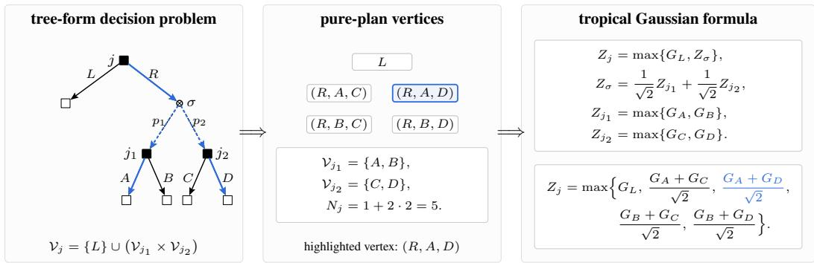

# Tropical Gaussian Anticoncentration: Optimal Instance-Dependent Bounds for Online Learning in Extensive-Form Games

Ashkan Soleymani∗ MIT ashkanso@mit.edu

Zhiyuan Fan∗ MIT fanzy@mit.edu

Lillian J. Ratliff University of Washington ratliffl@uw.edu

Patrick Jaillet   
MIT   
jaillet@mit.edu

Gabriele Farina MIT gfarina@mit.edu

## Abstract

We study the minimax regret of full-information online decision making in extensive-form games. For prediction with expert advice, the optimal regret is $\Theta ( \sqrt { T \log K } )$ , where K is the number of experts, or equivalently, the number of normal-form actions. For treeplex strategy spaces, existing efficient algorithms, including KOMWU and online mirror descent with the weight-one dilated entropy regularizer, achieve regret $\mathcal { O } ( \sqrt { T \log { \left| \mathcal { V } \right| } } )$ , where V is the set of reduced normalform strategies. We prove that this logarithmic dependence is minimax optimal in the worst-case full-information reward model. The main difficulty is that pure plans in a treeplex are not independent experts: their rewards are correlated through the recursive structure of decisions and observations. To capture this correlation, we introduce tropical Gaussian formulae, recursive Gaussian expressions built from maxima and normalized sums which preserve the variance. The index count of such a formula matches the number of reduced normal-form continuation plans in the corresponding subtree. Our main analytic result shows that every log-balanced tropical Gaussian formula with index count N has Gaussian width $\bar { \Omega } ( \sqrt { \mathrm { 1 o g } N } )$ While a direct approach struggles to recover this lower bound, our proof uses a spherical entropy profile to measure scale-dependent separation among the Gaussian directions, and then applies Turán’s theorem and Sudakov minoration to obtain the width lower bound. Applying this result to treeplexes gives an oblivious hard distribution with valid transition outcome and Rademacher terminal rewards, establishing a regret lower bound of $\Omega ( { \sqrt { T \log | \mathcal { V } | } } )$ ). This matches known upper bounds up to universal constants and shows that the DilEnt/KOMWU dependence on the reduced normal-form complexity is unavoidable.

## 1 Introduction

Determining the minimax regret bound is a central problem in online learning. One of the most fundamental instances is prediction with expert advice, where a player selects a probability distribution over a set of experts {1, 2, . . . , K} in each round. After making the choice, the learner observes the rewards of all experts, which may be assigned adversarially within [−1, 1]. The goal is to minimize the cumulative regret, defined as the reward of the best expert in hindsight minus the learner’s expected total reward after T rounds.

  
Figure 1: A concrete treeplex example and its tropical Gaussian formula. The root decision gives the disjoint union $\{ L \} \cup ( \mathcal { V } _ { j _ { 1 } } \times \mathcal { V } _ { j _ { 2 } } )$ , and the observation after R makes each pure plan specify one continuation in both successor subtrees. Thus the five pure-plan vertices index the five Gaussian directions in the expanded maximum; for example, (R, A, D) indexes $( G _ { A } + G _ { D } ) / \sqrt { 2 }$

The lower bound is almost immediate in this normal-form problem: each expert is assigned an independent Rademacher reward of −1 or 1 in every round. The player suffers a regret of $\bar { \Theta ( \sqrt { T \log K } ) }$ since it gains no advantage from historical data, while the best fixed expert is given by the maximum of K random walks, with expected value $\Theta ( \sqrt { T \log K } )$ [5]. This regret bound is tight, as it matches the regret upper bound given by Hedge [17], also known as multiplicative weights update.

A natural generalization of this normal-form problem is that of extensive-form games (EFGs), in which, at each round, the player needs to act sequentially in a multi-stage setting. The player’s behavioral strategy space can be characterized by a sequential decision problem [31]; geometrically, it is a recursively assembled treeplex. The reduced normal-form set V encodes the set of pure plans, which can be exponentially large compared to the sequence-form description. Farina et al. [15] show that KOMWU achieves $\mathcal { O } ( \sqrt { T \log { \left| \mathcal { V } \right| } } )$ regret while remaining computationally efficient. It is shown to be iterate-equivalent to online mirror descent with weight-one dilated entropy (DilEnt) [2], and Fan et al. [10] recover the same bound through treeplex norms. However, none of these works shows that this regret bound is minimax optimal.

As a result, it is not clear a priori whether the log |V| scale is an intrinsic minimax dependence, analogous to the log K term in prediction with experts, or merely an artifact of existing analyses. The obstacle to reusing the classical experts lower bound is correlation. A reduced-normal-form pure plan chooses one action at each decision point in its continuation support, and after an observation it specifies continuations at all successor information sets. Thus pure-plan rewards cannot be modeled as independent experts, but their correlations are not arbitrary either: they are constrained by the recursive decision-and-observation structure of the treeplex.

Our hard instance keeps the randomness as elementary as possible. The adversary is oblivious, reward randomness is independent across disjoint action subtrees, terminal rewards are Rademacher, and observation outcomes are routed independently across rounds using log-balanced probabilities. Under this construction, the covariance-matched comparator process has a tropical-Gaussian recursion: decision nodes produce maxima over action subtrees, while observation nodes produce variancenormalized sums of the successor processes. We visualize the connection between these two concepts in Figure 1. The main analytic difficulty is to prove that these correlated max-linear Gaussian expressions still have Gaussian width of order $\sqrt { \log | \mathcal { V } | }$ . A finite-time high-dimensional Gaussian comparison then transfers this Gaussian width lower bound back to the T-round Rademacher hard instance, showing that every online learner suffers expected regret

$$
\Omega ( { \sqrt { T \log | { \mathcal { V } } | } } ) .
$$

in EFGs when $T \geq \Omega ( \log ^ { 1 4 } | \mathcal { V } | )$ . This shows that the log |V| dependence appearing in KOMWU and DilEnt characterizes the intrinsic worst-case minimax quantity of the problem.

The main technical challenge is correlation: the terms in the normal form of the Gaussian process can be highly correlated, so the count $N _ { Z }$ alone does not imply the desired width. Instead, we introduce a spherical entropy profile to characterize this correlation. This metric measures how many pairs of directions are effectively close and can be computed inductively in a bottom-up manner. An upper bound on this correlation quantity allows us to apply Turán’s theorem to extract a family of well-separated vectors, which fits into Sudakov minoration to lower bound the Gaussian width.

Our contributions are as follows.

• We reduce full-information online decision making on a treeplex to tropical Gaussian formulae. The hard instance is an oblivious construction with transition outcomes and Rademacher terminal rewards, and it preserves the treeplex recursion exactly.

• We introduce a spherical-entropy method for the correlated pure-plan reward processes generated by the reduction. The resulting formula lower bound gives a regret lower bound of $\Omega ( { \sqrt { T \log | \mathcal { V } | } } )$ for the worst-case EFG full-information reward model, matching the upper bounds achieved by KOMWU and online mirror descent with the DilEnt regularizer.

• We show that weight-one DilEnt and KOMWU are minimax optimal on every treeplex. Under norms whose dual controls all feasible reward vectors, no such OMD guarantee can improve the log |V| dependence, while weight-one DilEnt attains it up to universal constants.

## 2 Related Work

Equilibrium computation in general-sum EFGs. Polynomial-time equilibrium computation in compact game representations was first approached through linear programming formulations [19, 24]. These formulations are important structurally, but their solver dependence is not the preferred route for large sequential games. Modern scalable methods are instead built around regret minimization and first-order dynamics. Syrgkanis et al. [29] introduced the RVU condition for optimistic no-regret algorithms and used it to obtain $T ^ { 1 / 4 }$ individual regret, hence a $T ^ { - 3 / 4 }$ rate to coarse correlated equilibrium (CCE). Daskalakis et al. [9] later proved polylogarithmic regret in general games, implying a $\widetilde { \mathcal { O } } ( 1 / T )$ CCE rate, and Farina et al. [15] extended this fast-rate picture to 0/1-polyhedral games, including EFGs. A parallel line studies clairvoyant dynamics: Piliouras et al. [25] introduced Clairvoyant MWU, and Farina et al. [14] related clairvoyant regret minimization to conceptual prox methods from first-order optimization [6, 23]. Other near-1 $/ \breve { T }$ rates for general convex games were obtained by Farina et al. [13]. More recently, Soleymani et al. [27, 28] introduced cautious optimism, a meta-algorithm that accelerates no-regret learning dynamics in general convex games to a $\widetilde { \mathcal { O } } ( 1 / T )$ ) rate. Counterfactual regret minimization remains a central EFG-specific framework [32]; its classical regret scales as $\sqrt { T }$ , while optimistic variants such as stable-predictive CFR improve the rate under predictability assumptions [11]. Excessive-gap methods give another first-order route for large sequential games [21].

Regret lower bounds in EFGs. Lower bounds for EFG learning depend strongly on the feedback model, the benchmark, and whether the statement concerns an algorithmic dynamic or an arbitrary learner. Koolen et al. [20] proved lower bounds for structured prediction problems in terms of large orthogonal families of strategies, a principle that also applies to tree-structured decision sets. For specific game dynamics, Syrgkanis et al. [29] showed that multiplicative weights can suffer $\Omega ( { \sqrt { T } } )$ regret against best responses in two-player zero-sum games, and Chen and Peng [7] obtained related lower bounds when both players use multiplicative weights. Complexity-theoretic barriers also arise for sparse equilibria: Anagnostides et al. [1] gave oracle lower bounds for learning sparse CCEs in succinct games, including EFGs. Under bandit feedback, Bai et al. [3] and Fiegel et al. [16] established matching upper and lower bounds for learning in EFGs. Our setting is different: we study full-information reward-vector lower bounds for arbitrary online learners on treeplex strategy spaces, and the target scale is the reduced normal-form quantity log |V|.

Dilated regularization and optimality. Dilated regularizers were introduced by Hoda et al. [18] so that proximal steps over EFG treeplexes remain computationally tractable. Subsequent work improved the tree-parameter dependence in strong-convexity analyses of dilated entropy and dilated global entropy [12, 22]. Kernelized multiplicative weights (KOMWU) achieved the sharper $\sqrt { T }$ log |V| regret dependence on reduced normal-form size [15], and Bai et al. [2] showed that KOMWU is iterate-equivalent to OMD with weight-one DilEnt. The closest predecessor to this paper is Fan et al. [10], which introduced the treeplex norm pair used here, recovered the DilEnt certificate that predicts the KOMWU rate, and proved DilEnt/treeplex-norm near-optimality up to logarithmic or structural gaps. Specifically, Fan et al. [10] establish a lower bound of $\Omega ( \sqrt { T \lVert { \boldsymbol { \mathcal { Q } } } \rVert _ { \perp } \log | { \boldsymbol { \mathcal { A } } } _ { 0 } | } )$ , where $\| \mathcal { Q } \| _ { \perp }$ is the maximum number of terminal sequences reachable by a pure plan and $\left| \mathcal { A } _ { 0 } \right|$ is the minimum action-set size. This quantity matches $\sqrt { T \log | \mathcal { V } | }$ for some restricted treeplex families, but it can leave a logarithmic gap for a general fixed treeplex. We close the remaining gap for every treeplex by reducing the comparator process to a tropical Gaussian formula and proving the exact log |V| lower-bound scale using spherical entropy, Sudakov minoration [30], and Chernozhukov et al. [8]’s Gaussian approximation theorem for maxima.

## 3 Preliminaries

General notation. For $k \in \mathbb { N } ,$ , write $[ [ k ] ] = \{ 1 , \dots , k \}$ . For a finite set ${ \mathcal { A } } ,$ let $\Delta ^ { \mathcal { A } }$ be the probability simplex over ${ \mathcal { A } } .$ . Vectors are bold, for example ${ \mathbf { } } x , y , w$ . If x is a vector and $\mathcal { C }$ is an index set, then $\pmb { x } [ \bar { \mathcal { C } } ]$ denotes the corresponding subvector. Unless stated otherwise, log is natural, and asymptotic notation hides only universal constants.

Tree-form sequential decision processes. We use the single-player decision space induced by an extensive-form game. Let $\mathcal { I }$ be the set of decision points. At each $j \in \mathcal I$ , the learner chooses an action $a \in { \mathcal { A } } _ { j }$ , and the pair ja is a sequence. Define

$$
\Sigma ^ { + } = \{ j a : j \in \mathcal { I } , a \in \mathcal { A } _ { j } \} , \qquad \Sigma = \Sigma ^ { + } \cup \{ \emptyset \} .
$$

For each decision point $j ,$ , let $p _ { j } \in \Sigma$ be its parent sequence. For each nonterminal sequence $\sigma ,$ , let $\mathcal { C } _ { \sigma } \subseteq \mathcal { I }$ be the set of next decision points reached after σ. The point set is $\mathcal { H } = \mathcal { I } \cup \Sigma$ , and ${ \mathcal { E } } \subseteq \Sigma$ is the set of terminal sequences.

The extended sequence-form strategy space is

$$
\begin{array}{c} \widehat { \mathcal { Q } } = \left\{ x \in [ 0 , 1 ] ^ { \mathcal { H } } : \displaystyle \sum _ { x [ j ] } x [ j ] = \displaystyle \sum _ { a \in A _ { j } } x [ j a ] \quad \forall j \in \Sigma \setminus \mathcal { E } , j \in \mathcal { C } _ { \sigma } ,  \end{array} \right\} .
$$

We write $\mathcal { Q }$ for the projection of $\widehat { \mathcal { Q } }$ to terminal sequences. Its vertices

$$
\mathcal { V } = \mathcal { Q } \cap \{ 0 , 1 \} ^ { \varepsilon }
$$

are the reduced normal-form pure plans. For $h \in \mathcal H$ , let $\nu _ { h }$ be the set of reduced normal-form pure plans restricted to the subtree rooted at $h ,$ and set $N _ { h } \triangleq | \nu _ { h } |$ .

For a subtree $h ,$ let $\mathcal { Q } _ { h }$ be the same terminal-sequence projection restricted to terminals below $h ,$ normalized so that the root of the subtree is reached with probability one. The next lemma says that every mixed sequence-form strategy on a subtree can be written as a convex combination of pure continuation plans. We use this later to argue that, when every pure plan has the same expected reward under the hard instance, every learner strategy has that same expected reward. A formal induction over the treeplex recursion is given in Appendix $\mathbf { A } .$

Lemma 3.1 (Treeplex convex hull). For every subtree $h , \mathcal { Q } _ { h } = \cos ( \mathcal { V } _ { h } )$ . In particular, $\mathcal { Q } = \mathrm { c o } ( \mathcal { V } )$

Transition kernels and reward vectors. We next describe the reward vectors used in the onlinelearning problem. A transition kernel is represented by $\pmb { y } \in [ 0 , 1 ] ^ { \mathcal { H } }$ satisfying

$$
y [ \mathcal { O } ] = 1 , \qquad y [ \sigma ] = \sum _ { j \in \mathcal { C } _ { \sigma } } y [ j ] \quad \forall \sigma \in \Sigma \setminus \mathcal { E } , \qquad y [ j ] = y [ j a ] \quad \forall j \in \mathcal { I } , \ a \in \mathcal { A } _ { j } .
$$

Let $\mathcal { V }$ be the set of such kernels. The coordinate $\pmb { y } [ \sigma ]$ is the reach multiplier contributed by chance and the non-learner players at terminal sequence σ. Given signed terminal rewards $r \in [ - 1 , 1 ] ^ { \varepsilon }$ define the full-information reward vector by

$$
{ \pmb w } ( { \pmb y } , { \pmb r } ) [ { \sigma } ] \triangleq { \pmb y } [ { \sigma } ] { \pmb r } [ { \sigma } ] , \qquad { \sigma } \in { \mathcal E } .
$$

Thus a strategy $\pmb { x } \in \mathcal { Q }$ receives reward $\langle \pmb { x } , \pmb { w } ( \pmb { y } , \pmb { r } ) \rangle$ . This convention folds transition reach into the linear reward vector, while r remains the terminal reward conditional on reaching the terminal.

Online learning and regret. At each round $t ,$ the learner selects $\pmb { x } _ { t } \in \mathcal { Q }$ and then observes a reward vector $\mathbf { \Psi } _ { \mathbf { \pmb { w } } _ { t } } \in \mathbb { R } ^ { \mathcal { E } }$ . The cumulative external regret is

$$
\operatorname { R e g r e t } ( T ) \triangleq \operatorname* { m a x } _ { \pmb { x } _ { * } \in \mathcal { Q } } \sum _ { t = 1 } ^ { T } \langle \pmb { x } _ { * } - \pmb { x } _ { t } , \pmb { w } _ { t } \rangle .
$$

We focus on full-information rewards induced by bounded terminal rewards and valid transition kernels. The hard instances below use Rademacher terminal rewards in $\{ - 1 , 1 \}$

Treeplex norms and DilEnt. Following Fan et al. [10], define the treeplex norm pair

$$
\| \pmb { u } \| _ { \mathcal { H } , 1 } \triangleq \operatorname* { s u p } _ { \pmb { y } \in \mathscr { V } } \langle | \pmb { u } | , \pmb { y } \rangle , \qquad \| \pmb { u } \| _ { \mathcal { H } , \infty } \triangleq \operatorname* { s u p } _ { \pmb { x } \in \mathcal { Q } } \langle | \pmb { u } | , \pmb { x } \rangle ,
$$

where $\mathcal { V }$ is the transition-kernel space. When the treeplex is a simplex, these reduce to the usual $\ell _ { 1 } / \ell _ { \infty }$ pair. The weight-one dilated entropy regularizer is

$$
\varphi _ { \mathrm { D E } } ( \pmb { x } ) \triangleq \sum _ { j \in \mathcal { J } } \sum _ { a \in \mathcal { A } _ { j } } \pmb { x } [ j a ] \log \frac { \pmb { x } [ j a ] } { \pmb { x } [ p _ { j } ] } ,
$$

with the convention that 0 log $0 = 0$ . The facts we need are the following: DilEnt is 1-strongly convex with respect to $\| \cdot \| _ { \mathcal { H } , 1 } ,$ every feasible reward vector satisfies $\| \pmb { w } _ { t } \| _ { \mathcal { H } , \infty } \leq 1$ , and the DilEnt Bregman diameter from its minimizer is at most log |V|. Therefore, OMD with DilEnt gives

$$
\operatorname { R e g r e t } ( T ) \leq \mathcal { O } ( { \sqrt { T \log | \mathcal { V } | } } ) .
$$

The lower bound below shows that no online learner can improve this logarithmic dependence.

Our hard instance uses signed rewards in $\{ - 1 , 1 \}$ , which match the Rademacher notation and are equivalent to the usual [0, 1] normalization up to constants.

## 4 Tropical Gaussian Formulae

For K independent experts, the classical lower bound follows from the maximum of K independent Gaussian or Rademacher sums. Reduced normal-form plans are not independent experts, because different plans reuse decisions and share terminal outcomes. To preserve these dependencies, we introduce tropical Gaussian formulae, the recursive analogue of this construction. We now define the Gaussian formula used in the lower bound. The definition follows the same recursion as pure plans in a treeplex. At decision points, a pure plan chooses one continuation, so the formula uses a maximum. At observation points, a pure plan must carry continuations for all successor decision points, so the formula combines independent subformulae by a normalized sum. The number $N _ { Z }$ counts the indices, or equivalently the pure continuations, of the formula.

Definition 4.1 (Tropical Gaussian formula). A tropical Gaussian formula is generated recursively by

• A leaf is a standard Gaussian $G \sim \mathcal { N } ( 0 , 1 )$ and has index count $N _ { G } = 1$

• If $X , Y$ are formulae, then $Z = \operatorname* { m a x } \{ X , Y \}$ is a formula with $N _ { Z } = N _ { X } + N _ { Y }$

• If $X , Y$ are formulae and $a \in [ 0 , 1 ]$ , then $Z = { \sqrt { a } } X + { \sqrt { 1 - a } } Y$ is a formula with $N z = N _ { X } N _ { Y }$

Formulae are rooted trees. Each occurrence of a subformula uses fresh independent Gaussian leaves, so disjoint subtrees are independent before they are combined. We call the third operation a mix node. The formula is log-balanced if every mix node uses

$$
a = \frac { \log N _ { X } } { \log N _ { X } + \log N _ { Y } } ,
$$

with the convention that when $N _ { X } = N _ { Y } = 1$ , any $a \in [ 0 , 1 ]$ may be used.

The word “tropical” refers to the max operation, following the convention from tropical algebra where ordinary addition is replaced by max or min [26]. The word “Gaussian” refers to the independent Gaussian leaves and to the normalized sums, whose squared coefficients add to one. Max nodes represent choices among alternatives. Mix nodes combine independent subproblems. This matches the treeplex structure: a pure plan chooses one action at a decision point, but specifies continuations at every successor information set after an observation point.

The next lemma rewrites every formula as the maximum of finitely many Gaussian linear forms. After this step, lower bounding $\mathbb { E } [ Z ]$ becomes a question about the geometry of $N _ { Z }$ unit vectors: if many of these vectors are well separated, then the expected maximum is large. The recursive construction of the vectors is given in Appendix C.

Lemma 4.2 (Gaussian-process representation). Every tropical Gaussian formula $Z$ admits an index set $\mathcal { T } _ { Z } .$ , a dimension $d _ { Z }$ , and a map $\Phi _ { Z } : \mathcal { T } _ { Z } \to \mathbb { S } ^ { d _ { Z } - \mathbf { \check { 1 } } }$ such that, for $g _ { Z } \sim \mathcal { N } ( 0 , I _ { d _ { Z } } )$ ,

$$
Z \stackrel { d } { = } \operatorname* { m a x } _ { \iota \in { \mathcal { I } _ { Z } } } \langle { \pmb g } _ { Z } , \Phi _ { Z } ( \iota ) \rangle , \qquad | { \mathcal { T } _ { Z } } | = N _ { Z } .
$$

The index count $N _ { Z }$ tells us how many Gaussian linear forms appear in the representation, but it does not tell us how different these linear forms are. The vectors $\Phi _ { Z } ( \iota )$ need not be orthogonal or even well separated. Thus, to lower bound $\mathbb { E } [ Z ]$ , we need to measure how many of these vectors remain distinguishable at each geometric scale.

Definition 4.3 (Spherical entropy profile). Fix the representation from Lemma 4.2. For independent $U , V \sim \operatorname { U n i f } ( \mathbb { Z } _ { Z } )$ , define the overlap distance

$$
D _ { Z } ( U , V ) \triangleq \frac { 1 } { 2 } \| \Phi _ { Z } ( U ) - \Phi _ { Z } ( V ) \| _ { 2 } ^ { 2 } = 1 - \langle \Phi _ { Z } ( U ) , \Phi _ { Z } ( V ) \rangle .
$$

We measure separation through the average close-pair weight

$$
A _ { Z } ( \lambda ) \triangleq \operatorname* { \mathbb { E } } _ { U , V } \exp \bigl ( - \lambda D _ { Z } ( U , V ) \bigr ) ,
$$

and define the spherical entropy profile by

$$
B _ { Z } ( \lambda ) \triangleq - \log A _ { Z } ( \lambda ) .
$$

The profile $B _ { Z }$ should be read as an effective version of log $N _ { Z }$ at a given scale. The raw count $N _ { Z }$ only counts how many indices appear in the Gaussian-process representation; it does not say whether the corresponding vectors are actually separated. In contrast, $A _ { Z } ( \lambda )$ is large when two random indices often produce nearby vectors, and $\mathbf { \dot { \boldsymbol { B } } } _ { Z } ( \lambda ) = - \log \mathbf { \boldsymbol { A } } _ { Z } ( \lambda )$ is large when such close pairs are rare. Thus $B _ { Z } ( \lambda )$ measures how many directions remain distinguishable at resolution $\lambda ^ { - 1 / 2 }$

The next lemma gives the exact recursion for this close-pair quantity under the two formula operations.   
Its derivation from the Gaussian-process representation is given in Appendix C.

Lemma 4.4 (Close-pair recursion). The profile in Definition 4.3 obeys the following exact recursions. For a leaf, $A _ { G } ( \lambda ) \overset { \cdot } { = } 1 . \mathrm { I f } Z = \operatorname* { m a x } \{ X , Y \} , n = N _ { X } , m = N _ { Y } , \overset { \cdot } { \mathrm { a n d } } N = n + m$ , then

$$
A _ { Z } ( \lambda ) = \left( \frac { n } { N } \right) ^ { 2 } A _ { X } ( \lambda ) + \left( \frac { m } { N } \right) ^ { 2 } A _ { Y } ( \lambda ) + \frac { 2 n m } { N ^ { 2 } } e ^ { - \lambda } .
$$

For a mix node $Z = { \sqrt { a } } X + { \sqrt { 1 - a } } Y$ , the recursion is

$$
A _ { Z } ( \lambda ) = A _ { X } ( a \lambda ) A _ { Y } ( ( 1 - a ) \lambda ) .
$$

We use this profile in two steps. First, a large value of $B _ { Z } ( \lambda )$ at any scale λ implies that many Gaussian directions are separated, which gives a lower bound on $\mathbb { E } [ \bar { Z } ]$ . Second, for log-balanced formulae, the recursion above shows that $\bar { B _ { Z } } ( \lambda )$ is large at the scale $\dot { \lambda _ { \ L } } \stackrel { - } { = } 2 \log N _ { Z }$ . We state the first, scale-free step separately because it is also useful for non-log-balanced routed laws.

Theorem 4.5 (Entropy-to-width lower bound). For every tropical Gaussian formula $Z ,$ , there exists a universal constant $c > 0$ such that

$$
\mathbb { E } [ Z ] \ge c \operatorname* { s u p } _ { \lambda > 0 : B _ { Z } ( \lambda ) \ge 2 } \frac { B _ { Z } ( \lambda ) } { \sqrt { \lambda } } .
$$

Define the effective entropy by

$$
H _ { \mathrm { e f f } } ( Z ) \triangleq \operatorname* { s u p } _ { \lambda > 0 : B _ { Z } ( \lambda ) \geq 2 } \frac { B _ { Z } ( \lambda ) ^ { 2 } } { \lambda } ,
$$

so $\mathbb { E } [ Z ] \ge c \sqrt { H _ { \mathrm { e f f } } ( Z ) }$ . If no λ satisfies $B z ( \lambda ) \geq 2 .$ the supremum is defined to be zero.

Proof sketch. Fix a scale λ with $B = B _ { Z } ( \lambda ) \ge 2$ . Since $A _ { Z } ( \lambda ) = e ^ { - B }$ , Markov’s inequality implies that only an $e ^ { - B / 2 }$ fraction of index pairs $( \iota , \kappa )$ can satisfy

$$
\| \Phi _ { Z } ( \iota ) - \Phi _ { Z } ( \kappa ) \| _ { 2 } \leq \sqrt { \frac { B } { \lambda } } .
$$

Build a graph on $\mathcal { T } _ { Z }$ by connecting such close pairs. Turán’s theorem gives an independent set $\mathcal { I } _ { Z }$ of size at least

$$
| \mathcal { I } _ { Z } | \ge \frac { N _ { Z } ^ { 2 } } { 2 | E ( G _ { \mathrm { c l o s e } } ) | + N _ { Z } } \ge c _ { 1 } e ^ { B / 2 } , \qquad s . t . \quad \| \Phi _ { Z } ( \iota ) - \Phi _ { Z } ( \kappa ) \| _ { 2 } \ge \sqrt { \frac { B } { \lambda } } \qquad \forall \iota \neq \kappa \in \mathcal { I } _ { Z } .
$$

Sudakov minoration then yields

$$
\mathbb { E } [ Z ] \ge c _ { 2 } \sqrt { \frac { B } { \lambda } } \sqrt { \log | \mathcal { I } _ { Z } | } \ge c \frac { B } { \sqrt { \lambda } } .
$$

Taking the supremum over all scales with $B _ { Z } ( \lambda ) \geq 2$ proves the theorem. The full graph-counting argument is given in Appendix D. 口

We now specialize to log-balanced formulae. In this case, the mix weights are chosen according to logarithmic subtree sizes, and the recursion gives a simple estimate at the scale $\lambda = 2 \log N _ { Z }$

Lemma 4.6 (Log-balanced entropy scale). Suppose every mix node is log-balanced. Then every tropical Gaussian formula Z satisfies

$$
A _ { Z } ( 2 \log N _ { Z } ) \leq N _ { Z } ^ { - 1 / 2 } .
$$

Since $B _ { Z } ( \lambda ) = - \log A _ { Z } ( \lambda )$ , the lemma gives $B _ { Z } ( 2 \log N _ { Z } ) \geq ( 1 / 2 ) \cdot \log N _ { Z }$ . Thus one scale in Theorem 4.5 already contributes order $\sqrt { \log N _ { Z } }$

Theorem 4.7 (Formula lower bound). There exists a universal constant $c > 0$ such that every log-balanced tropical Gaussian formula $Z$ satisfies

$$
\mathbb { E } [ Z ] \geq c \sqrt { \log N _ { Z } } .
$$

Proofsketch. Set $\lambda = 2$ log $N _ { Z }$ . By Lemma 4.6, $B _ { Z } ( \lambda ) \geq { \frac { 1 } { 2 } } \log N _ { Z }$ . For all sufficiently large $N _ { Z }$ , Theorem 4.5 applies and gives

$$
\mathbb { E } [ Z ] \ge c _ { 0 } \frac { B _ { Z } ( \lambda ) } { \sqrt { \lambda } } \ge \frac { c _ { 0 } } { 2 \sqrt { 2 } } \sqrt { \log N _ { Z } } .
$$

After adjusting the universal constant and handling the bounded small- $. N _ { Z }$ cases, this proves the theorem. The full induction and constants are given in Appendix C. □

The main reduction below uses only the log-balanced consequence in Theorem 4.7. The general entropy-to-width theorem is used again in Appendix I, where non-log-balanced routing can leave fewer directions separated at the relevant scales.

## 5 The Treeplex Hard Instance

We now turn the formula lower bound into an online-learning lower bound. The first step is to match the recursion of pure plans with the recursion of tropical Gaussian formulae. At a decision point, a pure plan chooses one action, so continuation counts add over actions. At an observation point, a pure plan specifies continuations for all successor information sets, so continuation counts multiply across those successor decision points.

Lemma 5.1 (Subtree plan-count recursion). For every point $h \in \mathcal H$ , let $\nu _ { h }$ be the set of reduced normal-form plans restricted to the subtree rooted at $h ,$ , let $\mathcal { E } _ { h }$ be the terminals below $h ,$ , and let $N _ { h } = | \nu _ { h } |$ . The count satisfies $N _ { \sigma } = 1$ for every $\sigma \in { \mathcal { E } }$ , and the recursion is

$$
N _ { j } = \sum _ { a \in A _ { j } } N _ { j a } , \qquad N _ { \sigma } = \prod _ { j \in \mathcal { C } _ { \sigma } } N _ { j } \quad \mathrm { f o r } \sigma \in \Sigma \setminus \mathcal { E } .
$$

This add-multiply recursion is exactly the recursion of the Gaussian formula: decision points become max nodes, and observation points become mix nodes. The hard instance realizes this structure using signed Rademacher terminal rewards. At a decision point, the child one-round processes in all action subtrees are sampled independently, and a pure plan selects the subtree corresponding to its chosen action. At an observation point, the adversary samples one successor $j _ { r }$ with probability proportional to log $N _ { j _ { r } }$ , routes all transition mass to that successor, and uses the child one-round process there. The detailed recursive construction is given in Appendix E; the next proposition states the invariant needed for the lower bound.

Proposition 5.2 (Treeplex-to-formula reduction). For every treeplex, there exists a log-balanced tropical Gaussian formula $Z _ { \mathcal { O } }$ and an oblivious one-round distribution over feasible reward vectors ${ \pmb w } = { \pmb w } ( { \pmb y } , { \pmb r } )$ , with valid $\mathbf { \boldsymbol { y } } \in \mathcal { V }$ and $r \in [ - 1 , 1 ] ^ { \varepsilon }$ , such that

$$
N _ { Z _ { \delta } } = | \nu | .
$$

Moreover, for every pure plan $\pi \in \mathcal { V } ,$ , the reward $W ( \pi ) = \langle b _ { \pi } , { \pmb w } \rangle$ has mean $0 ,$ and the process $( W ( \pi ) ) _ { \pi \in \mathcal { V } }$ has the same covariance kernel as the Gaussian-process representation of $Z _ { \varnothing }$ . Consequently, if $G _ { \emptyset }$ is the centered Gaussian process with this covariance, then

$$
Z _ { \varnothing } \stackrel { d } { = } \operatorname* { m a x } _ { \pi \in \mathcal { V } } G _ { \varnothing } ( \pi ) .
$$

Proofsketch. The plan-count identity is Lemma 5.1. Feasibility follows because routing all transition mass to one successor defines a valid transition kernel; terminal rewards outside the routed branch have zero reach and therefore do not affect any realized payoff. The covariance induction matches the formula operations: independent action subtrees give orthogonal covariance blocks, while random routing gives the weighted covariance average of a mix node. □

We now sample this one-round law independently for $T$ rounds. Since each pure plan has zero one-round mean, any learner also has conditional expected reward 0 at each round. Thus the regret is driven by the best fixed pure plan, whose cumulative signed gain is

$$
M _ { T } \triangleq \operatorname* { m a x } _ { \pi \in \mathcal { V } } \sum _ { t = 1 } ^ { T } W _ { t } ( \pi ) .
$$

The finite-time comparison in Appendix F relates $M _ { T } / \sqrt { T }$ to the Gaussian maximum $Z _ { \mathcal { O } }$ . Combining this comparison with the formula lower bound gives the regret lower bound.

Theorem 5.3 (Finite-time EFG regret lower bound). There exist universal constants $c , C > 0$ such that, for every treeplex with reduced normal-form strategy set V and every $T \geq C \log ^ { 1 4 } ( | \mathcal { V } | + 1 )$ , there exists an oblivious distribution over terminal reward vectors $\boldsymbol { r } _ { t } \in [ - 1 , 1 ] ^ { \xi }$ and valid transition kernels $\mathbf { \Psi } _ { \mathbf { \ b { y } } _ { t } } \in \mathcal { V }$ , obtained by independently sampling routed successors with log-balanced probabilities at observation points, such that the feasible reward vectors $\pmb { w } _ { t } = \pmb { w } ( \pmb { y } _ { t } , \pmb { r } _ { t } )$ make every online learning algorithm satisfy

$$
\mathbb { E } [ \mathrm { R e g r e t } ( T ) ] \geq c \sqrt { T \log | \mathcal { V } | } .
$$

Proofsketch. Run the reduction at the root for $T$ independent rounds. By Proposition 5.2, every pure plan has mean-zero reward in each round. By linearity, every learner’s expected cumulative reward is therefore 0. The best fixed pure plan obtains $M _ { T }$ . By the finite-time comparison, $\mathbb { E } [ M _ { T } / \sqrt { T } ]$ is at least $\mathbb { E } [ Z _ { \mathcal { O } } ]$ up to a lower-order error. By Theorem $4 . 7 , \mathbb { E } [ Z _ { \otimes } ] \geq c \sqrt { \log | \mathcal { V } | }$ . Since $T \geq$ $C \log ^ { 1 4 } ( | \mathcal { V } | + 1 )$ , the comparison error is lower order, so $\mathbb { E } [ \mathrm { R e g r e t } ( T ) ] \geq c \sqrt { T \log | \mathcal { V } | }$ . The full argument is in Appendix G. □

The log-balanced routing is what makes the Gaussian width at the root scale as $\sqrt { \log | \mathcal { V } | }$ . If the routed successors are sampled with other fixed probabilities, the same reduction gives the effective-entropy variant in Appendix I.

## 6 Minimax Optimality of DilEnt

The lower bound also shows that the logarithmic scale achieved by weight-one DilEnt is unavoidable for the standard OMD analysis. Consider any distance-generating function $\varphi$ used with OMD on the treeplex strategy space $\mathcal { Q } .$ Suppose $\varphi$ is µ-strongly convex with respect to a norm $\| \cdot \|$ , and suppose every feasible reward vector satisfies $\| \pmb { w } \| _ { * } \le 1$ . Let

$$
D _ { \varphi } \triangleq \operatorname* { s u p } _ { \pmb { x } _ { * } \in \mathcal { Q } } \mathcal { D } _ { \varphi } ( \pmb { x } _ { * } \| \pmb { x } _ { 1 } ) , \qquad \pmb { x } _ { 1 } \in \operatorname * { a r g m i n } _ { \pmb { x } \in \mathcal { Q } } \varphi ( \pmb { x } ) .
$$

The standard OMD guarantee gives

$$
\mathrm { R e g r e t } ( T ) \leq \frac { D _ { \varphi } } { \eta } + \frac { \eta T } { 2 \mu } .
$$

Optimizing η yields

$$
{ \mathrm { R e g r e t } } ( T ) \leq \mathcal { O } \Bigl ( \sqrt { D _ { \varphi } T / \mu } \Bigr ) .
$$

Thus the ratio $D _ { \varphi } / \mu$ is the quantity that determines the regret scale in this proof template. If this ratio were smaller than order log |V|, while the dual norm still controlled all feasible reward vectors, the resulting OMD guarantee would contradict the lower bound from Theorem 5.3.

Corollary 6.1 (Optimal OMD scale). Any regularizer-and-norm pair that gives the above OMD guarantee uniformly over feasible EFG reward vectors must satisfy

$$
\frac { D _ { \varphi } } { \mu } \geq \Omega ( \log | \mathcal { V } | ) .
$$

Weight-one DilEnt satisfies $D _ { \varphi _ { \mathrm { D E } } } / \mu \leq \log | \mathcal V |$ under the treeplex norm pair $\| \cdot \| _ { \mathcal { H } , 1 } , \| \cdot \| _ { \mathcal { H } , \infty }$ . Hence DilEnt has the optimal diameter-to-strong-convexity scale among such OMD guarantees.

Proofsketch. The OMD guarantee applies to the hard instance from Theorem 5.3 whenever all feasible reward vectors satisfy $\lVert \mathbf { \boldsymbol { w } } _ { t } \rVert _ { * } ~ \leq ~ 1$ If $D _ { \varphi } / \mu \ : = \ : o ( \log | \mathcal { V } | )$ , then the optimized OMD bound would be $o ( \sqrt { T \log | \mathcal { V } | } )$ , contradicting Theorem 5.3 for sufficiently large $T .$ Therefore $D _ { \varphi } / \mu = \Omega ( \log | \mathcal { V } | )$ . Weight-one DilEnt matches this scale by the treeplex-norm diameter and strong-convexity facts stated in Section 3. The formal proof is given in Appendix H. □

The ratio $D _ { \varphi } / \mu$ is invariant under rescaling $\varphi ,$ since both $D _ { \varphi }$ and $\mu$ scale by the same factor. A different norm can improve the OMD bound only if its dual norm still controls every feasible reward vector; otherwise the guarantee does not apply to the hard instance. DilEnt is therefore optimal within the standard OMD proof template: improving the log |V| scale would require giving up uniform control of feasible reward vectors.

Combined with the upper bounds of Farina et al. [15] and Bai et al. [2], Theorem 5.3 resolves the question left open by Fan et al. [10]: weight-one DilEnt and KOMWU have the minimax-optimal log |V| dependence on every treeplex, and the logarithm of the reduced normal-form strategy count is the intrinsic complexity of the problem.

## 7 Conclusion

We proved a minimax lower bound for full-information online learning on treeplexes by reducing the problem to a tropical Gaussian formula lower bound. The hard instance uses Rademacher terminal rewards; the Gaussian process is only an analytic tool that captures the covariance among reduced normal-form pure plans. The lower bound shows that the log |V| dependence is not an artifact of KOMWU or of a loose upper bound, but is forced by the recursive decision-and-observation structure of the treeplex. Thus any standard OMD analysis whose dual norm controls all feasible reward vectors must have diameter-to-strong-convexity ratio Ω(log |V|), and weight-one DilEnt matches that scale through the treeplex-norm certificate.

## Acknowledgments and Disclosure of Funding

This work was supported in part by National Science Foundation awards CCF-2443068 and IIS-2552046, Office of Naval Research grants N000142512296 and N00014-24-1-2470, and an AI2050 Early Career Fellowship. Part of this research was performed while A.S. was visiting the Institute for Mathematical and Statistical Innovation (IMSI), which is supported by the National Science Foundation (Grant No. DMS-2425650).

## References

[1] Ioannis Anagnostides, Alkis Kalavasis, Tuomas Sandholm, and Manolis Zampetakis. On the complexity of computing sparse equilibria and lower bounds for no-regret learning in games. arXiv preprint arXiv:2311.14869, 2023.

[2] Yu Bai, Chi Jin, Song Mei, Ziang Song, and Tiancheng Yu. Efficient Φ-regret minimization in extensive-form games via online mirror descent. Advances in Neural Information Processing Systems, 35:22313–22325, 2022.

[3] Yu Bai, Chi Jin, Song Mei, and Tiancheng Yu. Near-optimal learning of extensive-form games with imperfect information. In International Conference on Machine Learning, pages 1337–1382. PMLR, 2022.

[4] Béla Bollobás. Modern graph theory, volume 184. Springer Science & Business Media, 1998.

[5] Nicolo Cesa-Bianchi and Gábor Lugosi. Prediction, learning, and games. Cambridge University Press, 2006.

[6] Gong Chen and Marc Teboulle. Convergence analysis of a proximal-like minimization algorithm using bregman functions. SIAM Journal on Optimization, 3(3):538–543, 1993.

[7] Xi Chen and Binghui Peng. Hedging in games: Faster convergence of external and swap regrets. Advances in Neural Information Processing Systems, 33:18990–18999, 2020.

[8] Victor Chernozhukov, Denis Chetverikov, and Kengo Kato. Gaussian approximations and multiplier bootstrap for maxima of sums of high-dimensional random vectors. The Annals of Statistics, 41(6):2786–2819, 2013. doi: 10.1214/13-AOS1161.

[9] Constantinos Daskalakis, Maxwell Fishelson, and Noah Golowich. Near-optimal no-regret learning in general games. Advances in Neural Information Processing Systems, 34:27604– 27616, 2021.

[10] Zhiyuan Fan, Christian Kroer, and Gabriele Farina. On the optimality of dilated entropy and lower bounds for online learning in extensive-form games. In Advances in Neural Information Processing Systems, volume 37, 2024.

[11] Gabriele Farina, Christian Kroer, Noam Brown, and Tuomas Sandholm. Stable-predictive optimistic counterfactual regret minimization. In International conference on machine learning, pages 1853–1862. PMLR, 2019.

[12] Gabriele Farina, Christian Kroer, and Tuomas Sandholm. Better regularization for sequential decision spaces: Fast convergence rates for nash, correlated, and team equilibria. In Proceedings ofthe 2021 ACM Conference on Economics and Computation, 2021.

[13] Gabriele Farina, Ioannis Anagnostides, Haipeng Luo, Chung-Wei Lee, Christian Kroer, and Tuomas Sandholm. Near-optimal no-regret learning dynamics for general convex games. Advances in Neural Information Processing Systems, 35:39076–39089, 2022.

[14] Gabriele Farina, Christian Kroer, Chung-Wei Lee, and Haipeng Luo. Clairvoyant regret minimization: Equivalence with Nemirovski’s conceptual prox method and extension to general convex games. arXiv preprint arXiv:2208.14891, 2022.

[15] Gabriele Farina, Chung-Wei Lee, Haipeng Luo, and Christian Kroer. Kernelized multiplicative weights for 0/1-polyhedral games: Bridging the gap between learning in extensive-form and normal-form games. In International Conference on Machine Learning, pages 6337–6357. PMLR, 2022.

[16] Côme Fiegel, Pierre Ménard, Tadashi Kozuno, Rémi Munos, Vianney Perchet, and Michal Valko. Adapting to game trees in zero-sum imperfect information games. In International Conference on Machine Learning, pages 10093–10135. PMLR, 2023.

[17] Yoav Freund and Robert E Schapire. A decision-theoretic generalization of on-line learning and an application to boosting. Journal ofcomputer and system sciences, 55(1):119–139, 1997.

[18] Samid Hoda, Andrew Gilpin, Javier Peña, and Tuomas Sandholm. Smoothing techniques for computing nash equilibria of sequential games. Mathematics of Operations Research, 35(2): 494–512, 2010.

[19] Albert Xin Jiang and Kevin Leyton-Brown. Polynomial-time computation of exact correlated equilibrium in compact games. In Proceedings of the 12th ACM conference on Electronic commerce, pages 119–126, 2011.

[20] Wouter M Koolen, Manfred K Warmuth, and Jyrki Kivinen. Hedging structured concepts. In COLT 2010: Proceedings ofthe 23rd Annual Conference on Learning Theory, pages 93–105, 2010.

[21] Christian Kroer, Gabriele Farina, and Tuomas Sandholm. Solving large sequential games with the excessive gap technique. Advances in neural information processing systems, 31, 2018.

[22] Christian Kroer, Kevin Waugh, Fatma Kılınç-Karzan, and Tuomas Sandholm. Faster algorithms for extensive-form game solving via improved smoothing functions. Mathematical Programming, pages 1–33, 2020.

[23] Arkadi Nemirovski. Prox-method with rate of convergence O(1/t) for variational inequalities with lipschitz continuous monotone operators and smooth convex-concave saddle point problems. SIAM Journal on Optimization, 15(1):229–251, 2004.

[24] Christos H Papadimitriou and Tim Roughgarden. Computing correlated equilibria in multiplayer games. Journal ofthe ACM (JACM), 55(3):1–29, 2008.

[25] Georgios Piliouras, Ryann Sim, and Stratis Skoulakis. Beyond time-average convergence: Nearoptimal uncoupled online learning via clairvoyant multiplicative weights update. Advances in Neural Information Processing Systems, 35:22258–22269, 2022.

[26] Jürgen Richter-Gebert, Bernd Sturmfels, and Thorsten Theobald. First steps in tropical geometry. In Idempotent Mathematics and Mathematical Physics, volume 377 of Contemporary Mathematics, pages 289–317. American Mathematical Society, Providence, RI, 2005. doi: 10.1090/conm/377/06998. arXiv:math/0306366.

[27] Ashkan Soleymani, Georgios Piliouras, and Gabriele Farina. Cautious optimism: A metaalgorithm for near-constant regret in general games. In Proceedings of the 26th ACM Conference on Economics and Computation, pages 870–870, 2025.

[28] Ashkan Soleymani, Georgios Piliouras, and Gabriele Farina. Faster rates for no-regret learning in general games via cautious optimism. In Proceedings of the 57th Annual ACM Symposium on Theory of Computing, pages 518–529, 2025.

[29] Vasilis Syrgkanis, Alekh Agarwal, Haipeng Luo, and Robert E. Schapire. Fast convergence of regularized learning in games. Advances in Neural Information Processing Systems, 28, 2015.

[30] Roman Vershynin. High-dimensional probability: An introduction with applications in data science, volume 47. Cambridge University Press, 2018.

[31] Bernhard Von Stengel. Efficient computation of behavior strategies. Games and Economic Behavior, 14(2):220–246, 1996.

[32] Martin Zinkevich, Michael Johanson, Michael Bowling, and Carmelo Piccione. Regret minimization in games with incomplete information. Advances in Neural Information Processing Systems, 20, 2007.

## Appendix

## A Treeplex Convex Hull

ProofofLemma 3.1. We prove the stronger subtree statement by induction from the leaves upward. Write $\mathcal { Q } _ { h }$ for terminal vectors below $h ,$ normalized to have reach one at $h$

If $h = \sigma \in \mathcal { E }$ , then $\mathcal { Q } _ { \sigma } = \mathcal { V } _ { \sigma } = \{ 1 \}$ . Suppose $h = j$ is a decision point. Any $\pmb { x } \in \mathcal { Q } _ { j }$ is determined by action masses $\alpha _ { a } = \pmb { x } [ j a ] .$ , with $\textstyle \sum _ { a } \alpha _ { a } = 1$ , and by normalized child vectors ${ \pmb x } _ { j a } / \alpha _ { a } \in \mathcal { Q } _ { j a }$ whenever $\alpha _ { a } > 0$ . By induction, each child vector is a convex combination of $\nu _ { j a }$ . Therefore x is a convex combination of pure plans that choose one action a at j and then use one pure child continuation in $\nu _ { j a }$ . These are exactly $\nu _ { j }$

Now suppose $h = \sigma$ is a nonterminal observation point with successors $\mathcal { C } _ { \sigma } = \{ j _ { 1 } , \ldots , j _ { m } \}$ . A feasible subtree strategy is a tuple $( \pmb { x } _ { j _ { 1 } } , \dots , \pmb { x } _ { j _ { m } } )$ with $\pmb { x } _ { j _ { r } } \in \mathcal { Q } _ { j _ { r } }$ . By induction, write

$$
\pmb { x } _ { j _ { r } } = \sum _ { \nu _ { r } \in \mathcal { V } _ { j _ { r } } } \alpha _ { r , \nu _ { r } } \pmb { b } _ { \nu _ { r } } .
$$

Sampling the child pure plans independently with probabilities $\alpha _ { r , \nu _ { r } }$ gives

$$
( \pmb { x } _ { j _ { 1 } } , \dots , \pmb { x } _ { j _ { m } } ) = \sum _ { \nu _ { 1 } , \dots , \nu _ { m } } \bigg ( \prod _ { r = 1 } ^ { m } \alpha _ { r , \nu _ { r } } \bigg ) ( \pmb { b } _ { \nu _ { 1 } } , \dots , \pmb { b } _ { \nu _ { m } } ) .
$$

The tuple pure plans on the right are precisely the reduced pure plans in $\nu _ { \sigma }$ . Hence $\mathcal { Q } _ { \sigma } \subseteq \mathrm { c o } ( \mathcal { V } _ { \sigma } )$ The reverse inclusion is immediate because every pure plan is feasible and $\mathcal { Q } _ { h }$ is convex. Taking $h = \emptyset$ gives $\mathcal { Q } = \cos ( \mathcal { V } )$ . □

## B Auxiliary Packing and Gaussian-Width Inequalities

We present two standard tools on formula lower bound. The first turns a sparse close-pair graph into a large separated subset. The second turns that separation into a lower bound on Gaussian width.

Following the idea of Turán’s theorem (see, e.g., Bollobás [4]), we prove the following close-pair extraction lemma, which gives a lower bound on the size of an independent set.

Lemma B.1 (Close-pair extraction). Let S be a finite set with $| S | = N \geq 1$ . Let $R \subseteq S \times S$ be a symmetric relation and suppose that

$$
| R | \le \eta N ^ { 2 }
$$

for some $\eta \geq 0$ . Build a simple graph $G _ { \mathrm { c l o s e } }$ on vertex set S by connecting distinct $x , y \in S$ whenever $( x , y ) \in R$ . Then there exists an independent set $J \subseteq S$ such that

$$
| J | \geq \frac { N ^ { 2 } } { \eta N ^ { 2 } + N } = \frac { N } { 1 + \eta N } .
$$

In particular, no two distinct points of J are adjacent in $G _ { \mathrm { c l o s e } }$

Proof. Let $E _ { \mathrm { c l o s e } }$ be the edge set of $G _ { \mathrm { c l o s e } }$ , and write $M = | E _ { \mathrm { c l o s e } } |$ . Since R is symmetric, each edge $\{ x , y \} \in E _ { \mathrm { c l o s e } }$ contributes the two ordered pairs $( x , y )$ and $( y , x )$ to R. Hence

$$
2 M \leq | R | \leq \eta N ^ { 2 } .
$$

We now prove directly that $G _ { \mathrm { c l o s e } }$ has an independent set of size at least $N ^ { 2 } / ( N + 2 M )$ . Choose a uniformly random ordering of the vertices of S. Let J be the set of vertices that appear before all of their neighbors in this ordering.

The set J is independent: if two adjacent vertices x and y both belonged to $^ { J , }$ then x would have to appear before $y ,$ since $y$ is a neighbor of $x ,$ and y would have to appear before x, since x is a neighbor of y, a contradiction.

For each $x \in S ,$ , let $d ( x )$ be its degree in $G _ { \mathrm { c l o s e } } .$ . Among the $d ( x ) + 1$ vertices consisting of x and its neighbors, each is equally likely to appear first in the random ordering. Therefore

$$
\mathbb { P } ( x \in J ) = \frac { 1 } { d ( x ) + 1 } .
$$

By linearity of expectation,

$$
\mathbb { E } | J | = \sum _ { x \in S } { \frac { 1 } { d ( x ) + 1 } } .
$$

Using Cauchy’s inequality,

$$
\sum _ { x \in S } \frac { 1 } { d ( x ) + 1 } \geq \frac { N ^ { 2 } } { \sum _ { x \in S } ( d ( x ) + 1 ) } = \frac { N ^ { 2 } } { N + 2 M } .
$$

Hence there exists at least one ordering for which the corresponding independent set J satisfies

$$
| J | \geq { \frac { N ^ { 2 } } { N + 2 M } } .
$$

Finally, since $2 M \leq \eta N ^ { 2 }$ , we obtain

$$
| J | \geq \frac { N ^ { 2 } } { N + \eta N ^ { 2 } } = \frac { N } { 1 + \eta N } .
$$

This proves the claim.

The second tool is Sudakov minoration for Gaussian processes. We use the following finite separated form, which follows from the standard entropy form of Sudakov minoration; see [30].

Theorem B.2 (Sudakov minoration, finite separated form). Let $X _ { 1 } , \ldots , X _ { M }$ be a centered jointly Gaussian family, with $M \geq 2$ . Suppose that there exists $\Delta > 0$ such that

$$
\left( \mathbb { E } [ ( X _ { i } - X _ { j } ) ^ { 2 } ] \right) ^ { 1 / 2 } \geq \Delta \qquad { \mathrm { f o r ~ a l l ~ } } i \neq j .
$$

Then there exists a universal constant $c > 0$ such that

$$
\mathbb { E } \operatorname* { m a x } _ { 1 \leq i \leq M } X _ { i } \geq c \Delta \sqrt { \log M } .
$$

Derivationfrom the entropyform. Let

$$
d ( i , j ) = \left( \mathbb { E } [ ( X _ { i } - X _ { j } ) ^ { 2 } ] \right) ^ { 1 / 2 }
$$

be the canonical metric. Since the points $1 , \ldots , M$ are ∆-separated in d, every d-ball of radius $\Delta / 4$ contains at most one point. Therefore the covering number satisfies

$$
\mathcal { N } ( [ [ M ] , d , \Delta / 4 ) \geq M .
$$

The standard entropy form of Sudakov minoration gives

$$
\mathbb { E } \operatorname* { m a x } _ { 1 \leq i \leq M } X _ { i } = \mathbb { E } \operatorname* { s u p } _ { i \in \mathbb { H } M \mathbb { I } } X _ { i } \geq c _ { 0 } \frac { \Delta } { 4 } \sqrt { \log \mathcal { N } ( [ M ] , d , \Delta / 4 ) } \geq c \Delta \sqrt { \log M } ,
$$

after absorbing the factor $1 / 4$ into the universal constant.

For the Gaussian-process representation of tropical Gaussian formulae, we use the following Euclidean consequence.

Lemma B.3 (Sudakov minoration for separated Gaussian linear forms). Let $T = \left\{ v _ { 1 } , \dots , v _ { M } \right\} \subseteq$ $\mathbb { R } ^ { d }$ , let $\pmb { g } \sim \mathcal { N } ( 0 , I _ { d } )$ , and suppose that $M \geq 2$ and

$$
\| v _ { i } - v _ { j } \| _ { 2 } \geq \Delta \qquad { \mathrm { f o r ~ a l l ~ } } i \neq j .
$$

Then there exists a universal constant $c > 0$ such that

$$
\mathbb { E } \operatorname* { m a x } _ { 1 \leq i \leq M } \langle \pmb { g } , v _ { i } \rangle \geq c \Delta \sqrt { \log M } .
$$

Proof. Set $X _ { i } = \langle \pmb { \mathscr { g } } , \pmb { v } _ { i } \rangle$ . Then $X _ { 1 } , \ldots , X _ { M }$ are centered jointly Gaussian and

$$
\left( \mathbb { E } [ ( X _ { i } - X _ { j } ) ^ { 2 } ] \right) ^ { 1 / 2 } = \| v _ { i } - v _ { j } \| _ { 2 } .
$$

The result follows from Theorem B.2.

## C Proof of the Formula Lower Bound

Proof of Lemma 4.2. We construct the representation by induction over the formula tree. For a leaf $G ,$ set $\bar { \mathcal { T } } _ { G } = \{ \star \} , d _ { G } = 1$ , and $\Phi _ { G } ( \star ) = \bar { 1 }$ . Then, for $\dot { g _ { G } } \sim \mathcal { N } ( 0 , 1 )$

$$
\operatorname* { m a x } _ { \iota \in \mathcal { T } _ { G } } \langle g _ { G } , \Phi _ { G } ( \iota ) \rangle = g _ { G } \overset { d } { = } G ,
$$

and $| \mathcal { T } _ { G } | = 1 = N _ { G }$

Suppose next that $Z = \operatorname* { m a x } \{ X , Y \}$ , and assume the claim for X and Y . Let $d _ { Z } = d _ { X } + d _ { Y }$ and set

$$
\mathcal { T } _ { Z } = ( \mathcal { T } _ { X } \times \{ 0 \} ) \cup ( \mathcal { T } _ { Y } \times \{ 1 \} ) ,
$$

Define the embedded maps by

$$
\Phi _ { Z } ( \iota , 0 ) = ( \Phi _ { X } ( \iota ) , 0 ) , \qquad \Phi _ { Z } ( \kappa , 1 ) = ( 0 , \Phi _ { Y } ( \kappa ) ) .
$$

Each image vector has unit norm. For $\pmb { g } _ { Z } = ( \pmb { g } _ { X } , \pmb { g } _ { Y } )$ with independent standard Gaussian blocks,

$$
\operatorname* { m a x } _ { \zeta \in \mathcal { X } _ { Z } } \langle g _ { Z } , \Phi _ { Z } ( \zeta ) \rangle = \operatorname* { m a x } \left\{ \operatorname* { m a x } _ { \iota \in \mathcal { X } _ { X } } \langle g _ { X } , \Phi _ { X } ( \iota ) \rangle , \operatorname* { m a x } _ { \kappa \in \mathcal { X } _ { Y } } \langle g _ { Y } , \Phi _ { Y } ( \kappa ) \rangle \right\} \overset { d } { = } \operatorname* { m a x } \{ X , Y \} .
$$

Moreover, $| \mathcal { T } _ { Z } | = | \mathcal { T } _ { X } | + | \mathcal { T } _ { Y } | = N _ { X } + N _ { Y } = N _ { Z } .$

Finally suppose $Z = { \sqrt { a } } X + { \sqrt { 1 - a } } Y$ , with $a \in [ 0 , 1 ]$ , and again assume the claim for X and $Y ,$ Let $d _ { Z } = d _ { X } + d _ { Y }$ and set $\mathcal { I } _ { Z } = \mathcal { I } _ { X } \times \mathcal { I } _ { Y }$ . Define

$$
\Phi _ { Z } ( \iota , \kappa ) = \left( \sqrt { a } \Phi _ { X } ( \iota ) , \sqrt { 1 - a } \Phi _ { Y } ( \kappa ) \right) .
$$

These vectors are again unit vectors. For independent Gaussian blocks ${ \bf { \mathit { g } } } _ { X } , { \bf { \mathit { g } } } _ { Y }$

$$
\operatorname* { m a x } _ { ( \boldsymbol { x } , \boldsymbol { \kappa } ) \in \mathcal { T } _ { Z } } \langle \boldsymbol { g } _ { Z } , \Phi _ { Z } ( \iota , \boldsymbol { \kappa } ) \rangle = \sqrt { a } \operatorname* { m a x } _ { \iota \in \mathcal { T } _ { X } } \langle \boldsymbol { g } _ { X } , \Phi _ { X } ( \iota ) \rangle + \sqrt { 1 - a } \operatorname* { m a x } _ { \boldsymbol { \kappa } \in \mathcal { T } _ { Y } } \langle \boldsymbol { g } _ { Y } , \Phi _ { Y } ( \boldsymbol { \kappa } ) \rangle .
$$

Because $\mathcal { I } _ { Z } = \mathcal { I } _ { X } \times \mathcal { I } _ { Y }$ , the maximum separates over the two coordinates. The right-hand side has the same distribution as ${ \sqrt { a } } X + { \sqrt { 1 - a } } Y$ , and $| \mathcal { T } _ { Z } | = | \mathcal { T } _ { X } | | \mathcal { T } _ { Y } | = N _ { X } N _ { Y } = N _ { Z }$ □

For two independent uniformly sampled indices $U , V \sim \operatorname { U n i f } ( \mathbb { Z } _ { Z } )$ , recall that

$$
D _ { Z } ( U , V ) \triangleq \frac { 1 } { 2 } \| \Phi _ { Z } ( U ) - \Phi _ { Z } ( V ) \| _ { 2 } ^ { 2 } = 1 - \langle \Phi _ { Z } ( U ) , \Phi _ { Z } ( V ) \rangle .
$$

Proof of Lemma 4.4. For a leaf, $\mathbb { Z } _ { G }$ has one element and $D _ { G } ( U , V ) = 0 .$ , hence $A _ { G } ( \lambda ) = 1$

Suppose $Z = \operatorname* { m a x } \{ X , Y \}$ . Write $n = N _ { X } , m = N _ { Y }$ , and $N = n + m . \mathrm { ~ A ~ }$ uniformly sampled index of $\mathcal { T } _ { Z }$ lies in the X-block with probability $n / N$ and in the Y -block with probability $m / N$ . If both sampled indices lie in the X-block, the distance is $D _ { X } ;$ if both lie in the Y -block, the distance is $D _ { Y }$ In the cross case, the two representation vectors lie in orthogonal coordinate subspaces, so their inner product is zero and $D _ { Z } = \dot { 1 }$ . Therefore

$$
A _ { Z } ( \lambda ) = \left( \frac { n } { N } \right) ^ { 2 } A _ { X } ( \lambda ) + \left( \frac { m } { N } \right) ^ { 2 } A _ { Y } ( \lambda ) + \frac { 2 n m } { N ^ { 2 } } e ^ { - \lambda } .
$$

Finally suppose $Z = { \sqrt { a } } X + { \sqrt { 1 - a } } Y$ . Let $U = ( U _ { X } , U _ { Y } )$ and $V = \left( V _ { X } , V _ { Y } \right)$ . Coordinatewise additivity gives the distance formula

$$
D _ { Z } ( U , V ) = a D _ { X } ( U _ { X } , V _ { X } ) + ( 1 - a ) D _ { Y } ( U _ { Y } , V _ { Y } ) .
$$

The pairs $( U _ { X } , V _ { X } )$ and $( U _ { Y } , V _ { Y } )$ are independent, so

$$
\begin{array} { c } { { A _ { Z } ( \lambda ) = \mathbb { E } \exp \bigl ( - a \lambda D _ { X } - ( 1 - a ) \lambda D _ { Y } \bigr ) } } \\ { { = A _ { X } ( a \lambda ) A _ { Y } ( ( 1 - a ) \lambda ) . } } \end{array}
$$

This proves the exact recursions.

ProofofLemma $4 . 6 .$ We prove the statement by induction over the formula tree. The transform $A _ { Z } ( \bar { \lambda } )$ is nonincreasing in λ, because $D _ { Z } \ \geq \ 0$ . For a leaf, $N _ { Z } ~ = ~ 1 , ~ D _ { Z } ( U , V ) ~ = ~ 0$ , and $A _ { Z } ( 2 \log N _ { Z } ) = A _ { Z } ( 0 ) = 1 = N _ { Z } ^ { - 1 / 2 }$

Suppose first that $Z = { \sqrt { a } } X + { \sqrt { 1 - a } } Y$ , with

$$
a = \frac { \log N _ { X } } { \log N _ { X } + \log N _ { Y } } .
$$

Let $L _ { X } = \log N _ { X } , L _ { Y } = \log N _ { Y }$ , and $L = L _ { X } + L _ { Y } = \log N _ { Z } . \mathrm { { I f } } L = 0$ , then $N _ { Z } = 1$ and the claim is trivial. Otherwise, Lemma 4.4 and the log-balanced choice give

$$
\begin{array} { r l } & { A _ { Z } ( 2 L ) = A _ { X } ( 2 L _ { X } ) A _ { Y } ( 2 L _ { Y } ) } \\ & { \qquad \leq N _ { X } ^ { - 1 / 2 } N _ { Y } ^ { - 1 / 2 } = N _ { Z } ^ { - 1 / 2 } . } \end{array}
$$

Now suppose $Z = \operatorname* { m a x } \{ X , Y \}$ . Let $n = N _ { X } , m = N _ { Y } , N = N _ { Z } = n + m .$ , and $L = \log N .$ . Since $L \geq \log n$ and $L \geq \log m$ , monotonicity and the induction hypothesis give

$$
A _ { X } ( 2 L ) \leq n ^ { - 1 / 2 } , \qquad A _ { Y } ( 2 L ) \leq m ^ { - 1 / 2 } .
$$

Applying Lemma 4.4 with the induction hypothesis gives

$$
\begin{array} { l } { { A _ { Z } ( 2 L ) \le \bigg ( \displaystyle \frac { n } { N } \bigg ) ^ { 2 } n ^ { - 1 / 2 } + \bigg ( \displaystyle \frac { m } { N } \bigg ) ^ { 2 } m ^ { - 1 / 2 } + \displaystyle \frac { 2 n m } { N ^ { 2 } } e ^ { - 2 L } } } \\ { { \quad \quad = \displaystyle \frac { n ^ { 3 / 2 } + m ^ { 3 / 2 } } { N ^ { 2 } } + \displaystyle \frac { 2 n m } { N ^ { 4 } } . } } \end{array}
$$

Writing $x = n / N$ and $y = m / N _ { ! }$ , we have $x + y = 1$ , and using $N \geq 2 ,$

$$
\sqrt { N } A _ { Z } ( 2 L ) \le x ^ { 3 / 2 } + y ^ { 3 / 2 } + x y .
$$

Since $x ^ { 3 / 2 } \leq ( x + x ^ { 2 } ) / 2$ and $y ^ { 3 / 2 } \leq ( y + y ^ { 2 } ) / 2 ,$

$$
x ^ { 3 / 2 } + y ^ { 3 / 2 } + x y \leq { \frac { x + y + x ^ { 2 } + y ^ { 2 } } { 2 } } + x y = { \frac { 1 + ( x + y ) ^ { 2 } } { 2 } } = 1 .
$$

Thus $A _ { Z } ( 2 \log N _ { Z } ) \le N _ { Z } ^ { - 1 / 2 }$ , completing the induction.

ProofofTheorem 4.7. Let $N = N _ { Z }$ and $L = \log N$ . The argument below proves the claim for all N larger than a universal constant. The case $N = 1$ is trivial, and the finitely many remaining values of N are absorbed by decreasing the universal constant. Assume therefore that $\dot { N }$ is in the large-index regime. By Lemma 4.6 and Markov’s inequality,

$$
\begin{array} { r l } & { \mathbb { P } \Big ( D _ { Z } ( U , V ) \le \frac { 1 } { 8 } \Big ) = \mathbb { P } \Big ( \mathrm { e x p } ( - 2 L D _ { Z } ( U , V ) ) \ge \mathrm { e x p } ( - L / 4 ) \Big ) } \\ & { \qquad \le e ^ { L / 4 } \mathbb { E } \mathrm { e x p } ( - 2 L D _ { Z } ( U , V ) ) } \\ & { \qquad \le N ^ { 1 / 4 } N ^ { - 1 / 2 } = N ^ { - 1 / 4 } . } \end{array}
$$

The event $D _ { Z } ( U , V ) \leq 1 / 8$ is the same as $\| \Phi _ { Z } ( U ) - \Phi _ { Z } ( V ) \| _ { 2 } \le 1 / 2$ . Build a simple graph $G _ { \mathrm { c l o s e } }$ on $\mathcal { T } _ { Z }$ by connecting two distinct indices when they are $1 / 2$ -close. The number of ordered close pairs is at most $N ^ { - 1 / 4 } N ^ { 2 } ;$ ; after removing diagonal pairs and identifying the two orientations, $\begin{array} { r } { | E ( \dot { G _ { \mathrm { c l o s e } } } ) | \leq \frac { 1 } { 2 } N ^ { - 1 / 4 } N ^ { 2 } } \end{array}$ . Lemma B.1 gives an independent set $\mathcal { I } _ { Z } \subseteq \mathcal { I } _ { Z }$ with

$$
| \mathcal { I } _ { Z } | \ge \frac { N ^ { 2 } } { 2 | E ( G _ { \mathrm { c l o s e } } ) | + N } \ge \frac { N ^ { 2 } } { N ^ { 7 / 4 } + N } \ge c _ { 1 } N ^ { 1 / 4 }
$$

in the large-index regime. Since $\mathcal { I } _ { Z }$ is independent in $G _ { \mathrm { c l o s e } } ,$ distinct $\iota , \kappa \in \mathcal { I } _ { Z }$ satisfy

$$
\| \Phi _ { Z } ( \iota ) - \Phi _ { Z } ( \kappa ) \| _ { 2 } > \frac { 1 } { 2 } .
$$

Sudakov minoration (Lemma B.3) gives

$$
\begin{array} { r l } & { \mathbb { E } [ Z ] = \mathbb { E } \underset { \iota \in \mathcal { T } _ { Z } } { \operatorname* { m a x } } \langle \pmb { g } _ { Z } , \Phi _ { Z } ( \iota ) \rangle } \\ & { \qquad \geq \mathbb { E } \underset { \iota \in \mathcal { T } _ { Z } } { \operatorname* { m a x } } \langle \pmb { g } _ { Z } , \Phi _ { Z } ( \iota ) \rangle } \\ & { \qquad \geq c _ { 2 } \sqrt { \log | \mathcal { T } _ { Z } | } . } \end{array}
$$

Since $| \mathcal { I } _ { Z } | \ge c _ { 1 } N ^ { 1 / 4 }$ , this is at least $c { \sqrt { \log N } }$ after adjusting constants.

## D Proof of the Entropy-to-width Bound

This section proves the scale-free statement in Theorem 4.5. It applies to every tropical Gaussian formula, including formulae whose mix weights are not log-balanced. The only formula-specific input is the Gaussian-process representation from Appendix C; after that, the proof uses only the spherical entropy profile.

For reference, the exact close-pair recursions are as follows. A leaf satisfies $A _ { G } ( \lambda ) = 1$ . If $Z = \operatorname* { m a x } \{ X , Y \}$ , then with $n = N _ { X } , m = N _ { Y } , N = n + m$

$$
A _ { Z } ( \lambda ) = \left( \frac { n } { N } \right) ^ { 2 } A _ { X } ( \lambda ) + \left( \frac { m } { N } \right) ^ { 2 } A _ { Y } ( \lambda ) + \frac { 2 n m } { N ^ { 2 } } e ^ { - \lambda } .
$$

For a mix node $Z = { \sqrt { a } } X + { \sqrt { 1 - a } } Y$

$$
A _ { Z } ( \lambda ) = A _ { X } ( a \lambda ) A _ { Y } ( ( 1 - a ) \lambda ) , \qquad B _ { Z } ( \lambda ) = B _ { X } ( a \lambda ) + B _ { Y } ( ( 1 - a ) \lambda ) .
$$

These identities are immediate from the recursive construction of $\Phi _ { Z }$ and from the independence of the two coordinates at a mix node.

ProofofTheorem 4.5. Fix $\lambda > 0$ with $B _ { Z } ( \lambda ) \geq 2$ and write $B = B _ { Z } ( \lambda )$ . Let $U , V$ be independent uniformly sampled indices from $\mathcal { T } _ { Z }$ . By Markov’s inequality,

$$
\begin{array} { r l } & { \mathbb { P } \Big ( D _ { Z } ( U , V ) \le \frac { B } { 2 \lambda } \Big ) = \mathbb { P } \Big ( \exp ( - \lambda D _ { Z } ( U , V ) ) \ge \exp ( - B / 2 ) \Big ) } \\ & { \quad \quad \quad \le e ^ { B / 2 } \mathbb { E } \exp ( - \lambda D _ { Z } ( U , V ) ) = e ^ { - B / 2 } . } \end{array}
$$

Since diagonal pairs have $D _ { Z } ( U , V ) = 0$ , we also have $A _ { Z } ( \lambda ) \ge 1 / N _ { Z }$ , so $B _ { Z } ( \lambda ) \leq$ log $N _ { Z }$ and $N _ { Z } \geq e ^ { B }$

Build a simple graph $G _ { \mathrm { c l o s e } }$ on $\mathcal { T } _ { Z }$ by connecting two distinct indices whenever $D _ { Z } ( \iota , \kappa ) \leq B / ( 2 \lambda )$ The number of ordered close pairs is at most $e ^ { - B / 2 } N _ { Z } ^ { 2 }$ , so

$$
| E ( G _ { \mathrm { c l o s e } } ) | \leq \frac { 1 } { 2 } e ^ { - B / 2 } N _ { Z } ^ { 2 } .
$$

Lemma B.1 gives an independent set $\mathcal { I } _ { Z } \subseteq \mathcal { I } _ { Z }$ with

$$
| \mathcal { I } _ { Z } | \ge \frac { N _ { Z } ^ { 2 } } { 2 | E ( G _ { \mathrm { c l o s e } } ) | + N _ { Z } } \ge \frac { N _ { Z } ^ { 2 } } { e ^ { - B / 2 } N _ { Z } ^ { 2 } + N _ { Z } } \ge c _ { 1 } e ^ { B / 2 } .
$$

Here the last inequality uses $N _ { Z } \geq e ^ { B }$ . For distinct $\iota , \kappa \in \mathcal { I } _ { Z }$

$$
\| \Phi _ { Z } ( \iota ) - \Phi _ { Z } ( \kappa ) \| _ { 2 } > \sqrt { \frac { B } { \lambda } } .
$$

Sudakov minoration (Lemma B.3) therefore yields

$$
\mathbb { E } [ Z ] \geq c _ { 2 } \sqrt { \frac { B } { \lambda } } \sqrt { \log | \mathcal { T } _ { Z } | } .
$$

Because $| \mathcal { I } _ { Z } | \ge c _ { 1 } e ^ { B / 2 }$ and $B \geq 2 ,$ log $| \mathcal { I } _ { Z } | \ge c _ { 3 } B$ , and hence

$$
\mathbb { E } [ Z ] \geq c \frac { B _ { Z } ( \lambda ) } { \sqrt { \lambda } } .
$$

Taking the supremum over admissible λ proves the result.

## E Proofs for the Treeplex Reduction

ProofofLemma 5.1. We argue directly from the definition of reduced normal-form continuation plans. If $h = \sigma \in \mathcal { E }$ , there is only the empty continuation below σ, hence $N _ { \sigma } = 1$

If $h = j$ is a decision point, a pure continuation plan chooses exactly one action $a \in { \mathcal { A } } _ { j }$ and then chooses a pure continuation below $j a$ . These choices form a disjoint union over actions, so

$$
N _ { j } = \sum _ { a \in \mathcal { A } _ { j } } N _ { j a } .
$$

At a nonterminal observation point $h = \sigma ,$ , a pure continuation plan is a tuple of child continuations, one for each successor $j ~ \in ~ \mathcal { C } _ { \sigma }$ . Thus $\nu _ { \sigma }$ is the Cartesian product of the child plan sets, and $\begin{array} { r } { N _ { \sigma } = \prod _ { j \in \mathcal { C } _ { \sigma } } N _ { j } } \end{array}$ . These cases cover all points in $\mathcal { H } .$ □

Definition E.1 (Log-balanced recursive hard instance). For every subtree h, define a formula $Z _ { h }$ and a one-round reward process $W _ { h } : { \mathcal { V } } _ { h } \to [ - 1 , 1 ]$ bottom-up as follows.

• If $h = \sigma$ is terminal, $Z _ { h }$ is a single standard Gaussian and $W _ { \sigma } ( \pi ) = \epsilon ,$ , where ϵ is Rademacher.

• If $h = j$ is a decision point, set

$$
Z _ { j } = \operatorname* { m a x } _ { a \in \mathcal { A } _ { j } } Z _ { j a } ,
$$

where a multiway max may be implemented by any binary bracketing. Independently sample the child one-round processes for all actions, and set $\dot { W } _ { j } ( \pi ) \stackrel { \cdot } { = } W _ { j a } ( \pi _ { j a } )$ when π chooses action a.

• If $h = \sigma$ is a nonterminal observation point and $\mathcal { C } _ { \sigma } = \{ j _ { 1 } , \dots , j _ { m } \}$ , combine the child formulae by repeated log-balanced mix operations. The bracketing-independent form, proved in Lemma $\operatorname { E . 4 } ,$ is

$$
Z _ { \sigma } = \sum _ { r = 1 } ^ { m } \sqrt { p _ { r } } Z _ { j _ { r } } , \qquad p _ { r } = \frac { \log N _ { j _ { r } } } { \sum _ { s = 1 } ^ { m } \log N _ { j _ { s } } } ,
$$

with zero-log subtrees ignored. If all logs vanish, the probabilities are irrelevant. At the same observation point, sample a route $R \in \{ 1 , \ldots , m \}$ with $\mathbb { P } ( R = r ) = p _ { r }$ , route all transition mass to $j _ { R } ,$ sample the child one-round process in that subtree, and set $W _ { \sigma } ( \pi ) = W _ { j _ { R } } ( \pi _ { j _ { R } } )$ . Terminal rewards outside the routed subtree are arbitrary in $[ - 1 , 1 ]$ , since their transition reach is zero.

Across rounds, the hard instance samples independent copies of this recursive construction.

Lemma E.2 (Index-count preservation). The formulae in Definition E.1 satisfy

$$
N _ { Z _ { h } } = N _ { h } \quad \mathrm { f o r e v e r y } h \in \mathcal { H } .
$$

Proof of Lemma E.2. We prove $N _ { Z _ { h } } = N _ { h }$ by induction from the leaves upward. If $h = \sigma \in \mathcal { E }$ , then $Z _ { \sigma }$ is a single Gaussian leaf, so $N _ { Z _ { \sigma } } ^ { ' \cdot } = 1 = \dot { N } _ { \sigma }$

If $h = j$ is a decision point, the formula $Z _ { j }$ is the max over the action-child formulae, implemented by any binary bracketing. Max nodes add index counts, and the induction hypothesis gives

$$
N _ { Z _ { j } } = \sum _ { a \in \mathcal { A } _ { j } } N _ { Z _ { j a } } = \sum _ { a \in \mathcal { A } _ { j } } N _ { j a } = N _ { j } .
$$

If $h = \sigma$ is a nonterminal observation point, the formula is obtained by repeated mix operations over the child formulae with $N _ { j _ { r } } > 1$ ; child formulae with $N _ { j _ { r } } = 1$ may be ignored because they multiply the index count by one. Mix nodes multiply index counts, so the induction hypothesis and Lemma 5.1 imply $\begin{array} { r } { N _ { Z _ { \sigma } } = \dot { \prod } _ { j \in \mathcal { C } _ { \sigma } } N _ { Z _ { j } } = \prod _ { j \in \mathcal { C } _ { \sigma } } \dot { N _ { j } } = N _ { \sigma } } \end{array}$ . The all-zero-log case is included in the same identity, since then every factor is one. □

Definition E.3 (Centered one-round process). For a subtree h and $\pi \in \mathcal { V } _ { h }$ , define

$$
\begin{array} { c } { { \xi _ { h } ( \pi ) \triangleq W _ { h } ( \pi ) , } } \\ { { K _ { h } ( \pi , \pi ^ { \prime } ) \triangleq \mathbb { E } [ \xi _ { h } ( \pi ) \xi _ { h } ( \pi ^ { \prime } ) ] . } } \end{array}
$$

We next prove the subtree invariant used in Section 5. Fix a subtree h. For one round, write

$$
\xi _ { h } ( \pi ) = W _ { h } ( \pi ) , \qquad \pi \in \mathcal { V } _ { h } .
$$

Then $\xi _ { h } ( \pi ) \in [ - 1 , 1 ]$ . The distribution of the full vector $\xi _ { h } = ( \xi _ { h } ( { \boldsymbol \pi } ) ) _ { { \boldsymbol \pi } \in \mathcal { V } _ { h } }$ is determined by the recursive hard instance.

Lemma E.4 (Multiway log-balanced mix). Assume at least one $N _ { j _ { r } }$ is larger than one. Let $L _ { r } =$ log $N _ { j _ { r } }$ , ignore indices with $L _ { r } = 0$ , and let $L = \textstyle \sum _ { r } L _ { r }$ . Any binary bracketing that repeatedly combines two partial formulae using the log-balanced rule produces

$$
{ \cal Z } _ { \sigma } = \sum _ { r = 1 } ^ { m } \sqrt { L _ { r } / L } { \cal Z } _ { j _ { r } } .
$$

Thus the weights $p _ { r } = L _ { r } / L$ are independent of the bracketing.

Proof. The claim follows by induction over the binary bracketing tree. Suppose a partial block S has total log-index $\begin{array} { r } { L _ { S } = \sum _ { r \in S } L _ { r } } \end{array}$ and contributes coefficient $\sqrt { L _ { r } / L _ { S } }$ to $Z _ { j _ { \tau } }$ for $r \in S$ . When blocks S and $S ^ { \prime }$ are combined, every coefficient from $S$ is multiplied by $\sqrt { L _ { S } / ( L _ { S } + L _ { S ^ { \prime } } ) }$ . Hence the coefficient of $Z _ { j _ { i } }$ becomes

$$
\sqrt { \frac { L _ { r } } { L _ { S } } } \sqrt { \frac { L _ { S } } { L _ { S } + L _ { S ^ { \prime } } } } = \sqrt { \frac { L _ { r } } { L _ { S } + L _ { S ^ { \prime } } } } .
$$

The same calculation applies to $S ^ { \prime }$

## E.1 Subtree Invariant

Lemma E.5 (Subtree reduction invariant). For every subtree $h ,$ , the construction above satisfies $N _ { Z _ { h } } ~ = ~ N _ { h }$ . For every realization of the recursive one-round process, there exist a valid local transition kernel ${ \mathbf { } } _ { \mathbf { } } ^ { \mathbf { \Gamma } } \mathbf { ^ { \mathbf { 3 } } } h$ and terminal reward vector $r _ { h } \in [ - 1 , 1 ] ^ { \mathcal { E } _ { h } }$ with the payoff identity

$$
W _ { h } ( \pi ) = \sum _ { \sigma \in { \mathcal { E } } _ { h } } b _ { \pi } [ \sigma ] \ : y _ { h } [ \sigma ] \ : r _ { h } [ \sigma ]
$$

for every pure continuation plan $\pi \in \mathcal { V } _ { h } . ~ \mathrm { A t } ~$ the root, this gives a feasible full-information reward vector $\dot { \pmb w } = \pmb w ( \pmb y _ { \emptyset } , \pmb r _ { \emptyset } ) \in \bar { \mathbb { R } } ^ { \mathcal { E } }$ with $\langle { \pmb { b } } _ { \pi } , { \pmb w } \rangle = W _ { \pmb { \emptyset } } ( \pi )$ for every $\pi \in \mathcal { V } .$ . Moreover, for every $\pi \in \mathcal { V } _ { h } , \mathbb { E } [ W _ { h } ( \pi ) ] = 0 .$ . The kernel $K _ { h }$ is the covariance kernel generated by the Gaussian-process representation of $Z _ { h } \mathrm { : }$ : terminal nodes have $K _ { \sigma } = 1$ , decision nodes use orthogonal blocks across different actions, and observation nodes use

$$
K _ { \sigma } ( \pi , \pi ^ { \prime } ) = \sum _ { r = 1 } ^ { m } p _ { r } K _ { j _ { r } } ( \pi _ { j _ { r } } , \pi _ { j _ { r } } ^ { \prime } ) .
$$

Consequently $K _ { h } ( \pi , \pi ) = 1$ for every $\pi \in \mathcal { V } _ { h } . \ \mathrm { I f } \ \mathcal { G } _ { h } = ( G _ { h } ( \pi ) ) _ { \pi \in \mathcal { V } _ { h } }$ is the centered Gaussian process with covariance $K _ { h }$ , then

$$
Z _ { h } \overset { d } { = } \operatorname* { m a x } _ { \pi \in \mathcal { V } _ { h } } G _ { h } ( \pi ) .
$$

ProofofLemma E.5: feasibility. We prove the local statement by induction. The local transition kernel is normalized so that the root of the subtree has transition reach one.

If $h = \sigma \in { \mathcal { E } } ,$ , set $\begin{array} { r } { y _ { \sigma } [ \sigma ] = 1 } \end{array}$ and $r _ { \sigma } [ \sigma ] = W _ { \sigma } ( \pi )$ . This realizes the unique pure continuation reward. Suppose $h = j$ is a decision point. For each $a \in A _ { i }$ , the recursive construction samples a child realization, and the induction hypothesis gives $( { \pmb y } _ { j a } , { \pmb r } _ { j a } )$ on terminals below $j a$ . Define the local kernel by setting $\pmb { y } _ { j } [ j ] = 1 , \pmb { y } _ { j } \bar { [ j a ] } = 1$ for every action a, and by copying ${ \pmb y } _ { j a }$ inside each child subtree. Define $\boldsymbol { r } _ { j }$ by concatenating the child reward vectors. ${ \mathrm { I f } } \pi \in \mathcal { V } _ { j }$ chooses action $^ { a , }$ its terminal indicator has support only below $j a ,$ , so the inner product against ${ \bf \it { y } } _ { j } \odot { \bf \it { r } } _ { j }$ equals the child reward $W _ { j a } ( \pi _ { j a } ) = W _ { j } \bar { ( } \pi )$

Finally suppose $h = \sigma$ is a nonterminal observation point. The construction samples a routed successor $j _ { R }$ . Set ${ \pmb y } _ { \sigma } [ \sigma ] = 1 , { \pmb y } _ { \sigma } [ j _ { R } ] = 1$ , and $\begin{array} { r } { { \bf { \mathscr { y } } } _ { \sigma } [ j ] \stackrel { - } { = } 0 } \end{array}$ for $j \neq j _ { R }$ . Inside the routed subtree, copy the child kernel and reward vector given by induction. Outside it, set all transition coordinates below the unrouted successors to zero and choose arbitrary terminal rewards in $\lceil - 1 , 1 \rceil$ . Terminals outside $j _ { R }$ have transition reach zero, while terminals inside $j _ { R }$ realize $W _ { j _ { R } } ( \bar { \pi _ { j _ { R } } } )$ . Hence every pure continuation plan $\pi \in \mathcal { V } _ { \sigma }$ receives $W _ { \sigma } ( \pi )$ . Taking $h = \emptyset$ gives the global reward vector ${ \pmb w } ( { \pmb y } _ { \emptyset } , { \pmb r } _ { \emptyset } )$ □

ProofofLemma $E . 5 \colon$ means and covariance. The identity $N _ { Z _ { h } } = N _ { h }$ is Lemma E.2. It remains to prove the zero-mean and covariance claims, which we do by induction from the leaves to the root. If $h = \sigma$ is terminal, then $W _ { \sigma } ( \pi ) = \epsilon , \mathrm { s o } \mathbb { E } [ W _ { \sigma } ( \pi ) ] = 0$ and $\mathrm { \bar { \mathbb { E } } } [ \xi _ { \sigma } ( \pi ) \xi _ { \sigma } ( \pi ^ { \prime } ) ] = 1$

Now let $h = j$ be a decision point. A pure plan $\pi \in \mathcal { V } _ { j }$ chooses one action a and a continuation plan $\pi _ { j a } \in \mathcal { V } _ { j a }$ . The construction samples independent child instances for all actions, and

$$
W _ { j } ( \pi ) = W _ { j a } ( \pi _ { j a } ) .
$$

The induction hypothesis gives $\mathbb { E } [ W _ { i } ( \pi ) ] = 0 . \operatorname { I f } \pi , \pi ^ { \prime }$ choose the same action $^ { a , }$ their covariance is the child covariance $K _ { j a } ( \pi _ { j a } , \pi _ { j a } ^ { \prime } )$ . If they choose different actions, the child variables are independent and have mean zero, so the covariance is 0. This is exactly the orthogonal-block recursion of the formula representation.

Finally let $h = \sigma$ be a nonterminal observation point with successors $\mathcal { C } _ { \sigma } = \{ j _ { 1 } , \dots , j _ { m } \}$ . The hard instance first samples a route $R$ with $\mathbb { P } ( R = r ) = p _ { r }$ , then samples the child instance in $j _ { R }$ . For a pure continuation plan $\pi = ( \pi _ { j _ { 1 } } , \dots , \pi _ { j _ { m } } )$

$$
W _ { \sigma } ( \pi ) = W _ { j _ { R } } ( \pi _ { j _ { R } } ) , \qquad \xi _ { \sigma } ( \pi ) = \xi _ { j _ { R } } ( \pi _ { j _ { R } } ) .
$$

Conditioning on R and using the induction hypothesis gives $\mathbb { E } [ W _ { \sigma } ( \pi ) ] = 0$ . For the covariance,

$$
\mathbb { E } [ \xi _ { \sigma } ( \pi ) \xi _ { \sigma } ( \pi ^ { \prime } ) ] = \sum _ { r = 1 } ^ { m } p _ { r } K _ { j _ { r } } ( \pi _ { j _ { r } } , \pi _ { j _ { r } } ^ { \prime } ) .
$$

This is the same weighted inner-product recursion as the mix node $\textstyle \sum _ { r } { \sqrt { p _ { r } } } Z _ { j _ { r } }$ . Thus $K _ { h } ( \pi , \pi ^ { \prime } )$ agrees with $\langle \Phi _ { h } ( \pi ) , \check { \Phi } _ { h } ( \pi ^ { \prime } ) \rangle$ ⟩ for every subtree $h .$ . In particular $K _ { h } ( \pi , \pi ) \stackrel { \cdot } { = } \dot { 1 }$ . The centered Gaussian process with covariance $K _ { h }$ has the same finite-dimensional law as the Gaussian process in Lemma 4.2 indexed by $\nu _ { h }$ , and therefore $Z _ { h } \overset { d } { = } \operatorname* { m a x } _ { \pi \in \mathcal { V } _ { h } } G _ { h } ( \pi )$ □

Proof of Proposition 5.2. Apply Definition E.1 at the root $h = \emptyset$ . Index-count preservation is Lemma E.2; feasibility, centering, covariance matching, and the Gaussian-maximum identity are the root case of Lemma E.5. □

## F Rademacher-to-Gaussian Comparison

Corollary F.1 (CCK Gaussian approximation for bounded coordinates). Let $x _ { 1 } , \ldots , x _ { n } \in \mathbb { R } ^ { p }$ be independent centered random vectors, and set

$$
X = \frac { 1 } { \sqrt { n } } \sum _ { i = 1 } ^ { n } x _ { i } , \qquad Y \sim \mathcal { N } \bigg ( 0 , \frac { 1 } { n } \sum _ { i = 1 } ^ { n } \mathbb { E } [ x _ { i } x _ { i } ^ { \top } ] \bigg ) .
$$

Let $\begin{array} { r } { T _ { 0 } = \operatorname* { m a x } _ { j \in [ [ p ] ] } X [ j ] , Z _ { 0 } = \operatorname* { m a x } _ { j \in [ [ p ] ] } Y [ j ] } \end{array}$ , and

$$
\rho = \operatorname* { s u p } _ { s \in \mathbb { R } } \bigl | \mathbb { P } ( T _ { 0 } \leq s ) - \mathbb { P } ( Z _ { 0 } \leq s ) \bigr | .
$$

Assume constants $0 < c _ { 1 } < C _ { 1 } , c _ { 2 } , C _ { 2 } > 0$ , and $B _ { n } \geq 1$ satisfy, for every $j \in \mathbb { \left[ p \right] }$

$$
c _ { 1 } \leq \frac { 1 } { n } \sum _ { i = 1 } ^ { n } \mathbb { E } [ x _ { i } [ j ] ^ { 2 } ] \leq C _ { 1 } ,
$$

and assume the bounded-envelope condition

$$
\operatorname* { m a x } _ { j \in [ p ] } \operatorname* { m a x } _ { r = 1 , 2 } \frac { 1 } { n } \sum _ { i = 1 } ^ { n } \mathbb { E } \big [ | x _ { i } [ j ] | ^ { 2 + r } / B _ { n } ^ { r } \big ] + \operatorname* { m a x } _ { i \in [ n ] } \operatorname* { m a x } _ { j \in [ p ] } \mathbb { E } \exp \big ( | x _ { i } [ j ] | / B _ { n } \big ) \le 4
$$

and the size condition

$$
\frac { B _ { n } ^ { 2 } \log ^ { 7 } ( p n ) } { n } \leq C _ { 2 } n ^ { - c _ { 2 } } ,
$$

hold. Then constants $C , c > 0 _ { }$ , depending only on $c _ { 1 } , c _ { 1 } , c _ { 2 } , c _ { 2 }$ , satisfy

$$
\rho \leq C n ^ { - c } .
$$

Proof. This is the bounded-coordinate specialization of the Gaussian approximation theorem of Chernozhukov et al. [8, Corollary 2.1, derived from Theorem 2.2 and anti-concentration Lemma 2.1], written with the notation used below. □

For T rounds, let $W _ { t , h }$ be independent copies of $W _ { h }$ , and define

$$
M _ { T , h } \triangleq \operatorname* { m a x } _ { \pi \in \mathcal { V } _ { h } } \sum _ { t = 1 } ^ { T } W _ { t , h } ( \pi ) .
$$

Lemma F.2 (Finite-time Rademacher-to-Gaussian comparison). For some universal constants $C _ { 0 } , c _ { 0 } , k > 0$ , the following holds for every subtree h with $N _ { h } \ge 2$ and every $T \geq 1$

$$
\left| \mathbb { E } \bigg [ \frac { M _ { T , h } } { \sqrt { T } } \bigg ] - \mathbb { E } [ Z _ { h } ] \right| \leq C _ { 0 } \sqrt { \log ( N _ { h } + 1 ) } \bigg ( \frac { \log ^ { k } ( N _ { h } + 1 ) } { T } \bigg ) ^ { c _ { 0 } } .
$$

Lemma F.3 (CCK Kolmogorov bound, bounded specialization). Let $X _ { 1 } , \dots , X _ { T } \in \mathbb { R } ^ { N }$ be independent centered random vectors. Assume

$$
\operatorname* { m a x } _ { t \in [ [ T ] } \operatorname* { m a x } _ { i \in [ N ] } | X _ { t } [ i ] | \leq 1 , \qquad \frac { 1 } { T } \sum _ { t = 1 } ^ { T } \mathbb { E } [ X _ { t } [ i ] ^ { 2 } ] = 1 \quad \forall i \in [ [ N ] ] .
$$

Let $\begin{array} { r } { \pmb { \Sigma } = T ^ { - 1 } \sum _ { t = 1 } ^ { T } } \end{array}$ Cov(Xt) and $G \sim { \mathcal { N } } ( 0 , \Sigma )$ . For some universal constants $C , c , k > 0$

$$
\operatorname* { s u p } _ { s \in \mathbb { R } } \bigg | \mathbb { P } \bigg ( \operatorname* { m a x } _ { i \in [ N ] } \frac { 1 } { \sqrt { T } } \sum _ { t = 1 } ^ { T } X _ { t } [ i ] \leq s \bigg ) - \mathbb { P } \bigg ( \operatorname* { m a x } _ { i \in [ N ] } G [ i ] \leq s \bigg ) \bigg | \leq C \bigg ( \frac { \log ^ { k } ( N + 1 ) } { T } \bigg ) ^ { c } .
$$

Proof. We spell out the substitution into Corollary F.1. The CCK sample size and dimension are

$$
n = T , \qquad p = N + 1 .
$$

The extra coordinate is a duplicate of the first coordinate, which leaves both maxima unchanged. In CCK notation $\boldsymbol { x } _ { t , i } = \boldsymbol { X } _ { t } [ i ]$ for $i \leq N$ and $x _ { t , N + 1 } = X _ { t } [ 1 ]$ . Their statistic $T _ { 0 }$ is the maximum of $T ^ { - 1 / 2 } \sum _ { t = 1 } ^ { T } X _ { t }$ , and their $Z _ { 0 }$ is the covariance-matched Gaussian maximum.

Condition (E.1) of CCK holds with $B _ { n } = 1$ . Indeed,

$$
\frac { 1 } { T } \sum _ { t = 1 } ^ { T } \mathbb { E } [ x _ { t , i } ^ { 2 } ] = 1 ,
$$

so one may take their variance constants to be $c _ { 1 } = 1 / 2$ and $C _ { 1 } = 2$ . Moreover $| x _ { t , i } | \leq 1$ , so the moment term is at most 1 for $r = 1 , 2$ , and $\mathbb { E } [ \exp ( | x _ { t , i } | / B _ { n } ) ] \leq e .$ . Together these bounds verify the CCK bounded-envelope condition:

$$
\operatorname* { m a x } _ { r = 1 , 2 } \frac { 1 } { T } \sum _ { t = 1 } ^ { T } \mathbb { E } [ | x _ { t , i } | ^ { 2 + r } / B _ { n } ^ { r } ] + \mathbb { E } [ \exp ( | x _ { t , i } | / B _ { n } ) ] \leq 4 .
$$

Fix the CCK polynomial-rate parameters $c _ { 2 } = 1 / 2$ and $C _ { 2 } = 1$ . If

$$
\frac { \log ^ { 7 } ( ( N + 1 ) T ) } { T } \leq T ^ { - 1 / 2 } ,
$$

then CCK Corollary 2.1 gives

$$
\Delta _ { \mathrm { K } } \triangleq \operatorname* { s u p } _ { s \in \mathbb { R } } \bigl | \mathbb { P } ( T _ { 0 } \leq s ) - \mathbb { P } ( Z _ { 0 } \leq s ) \bigr | \leq C _ { \mathrm { C C K } } T ^ { - c _ { \mathrm { C C K } } } ,
$$

where $C _ { \mathrm { C C K } } , c _ { \mathrm { C C K } } > 0$ depend only on the fixed constants $1 / 2 , 2 , 1 / 2 , 1$ , hence are universal. Since $L \triangleq \log ( N + 1 ) \geq \log 2$ , this implies

$$
\Delta _ { \mathrm { K } } \leq C _ { \mathrm { C C K } } ( \log 2 ) ^ { - 1 4 c _ { \mathrm { C C K } } } \left( \frac { L ^ { 1 4 } } { T } \right) ^ { c _ { \mathrm { C C K } } } .
$$

It remains only to remove log $T$ from the displayed condition. If the condition fails, then $T <$ $\log ^ { 1 4 } ( ( N + 1 ) \dot { T } )$ . Since

$$
\log ( ( N + 1 ) T ) = L + \log T ,
$$

either log $T \leq L$ , in which case $T < ( 2 L ) ^ { 1 4 }$ , or log $T > L ,$ in which case $T < ( 2 \log T ) ^ { 1 4 }$ . Set

$$
C _ { \dagger } \triangleq \operatorname* { s u p } \{ u \geq 1 : u \leq ( 2 \log u ) ^ { 1 4 } \} < \infty .
$$

In the second case $T \leq C _ { \uparrow } \leq C _ { \uparrow } ( \log 2 ) ^ { - 1 4 } L ^ { 1 4 }$ . Hence, in both cases $T \leq C _ { * } L ^ { 1 4 }$ for a universal $C _ { * }$ Thus, when the CCK condition fails,

$$
1 \leq C _ { * } ^ { c } \left( \frac { \log ^ { 1 4 } ( N + 1 ) } { T } \right) ^ { c }
$$

for every fixed $c > 0 .$ . Combining this trivial estimate with the CCK estimate in the complementary case gives the claim with $k = 1 4$ and $c = c _ { \mathrm { C C K } }$ after increasing C. 口

Lemma F.4 (Bounded high-dimensional CLT in expectation). Let $X _ { 1 } , \dots , X _ { T } \in \mathbb { R } ^ { N }$ be independent centered random vectors. Assume

$$
\operatorname* { m a x } _ { t \in [ [ T ] } \operatorname* { m a x } _ { i \in [ N ] } | X _ { t } [ i ] | \leq 1 , \qquad \frac { 1 } { T } \sum _ { t = 1 } ^ { T } \mathbb { E } [ X _ { t } [ i ] ^ { 2 } ] = 1 \quad \forall i \in [ [ N ] ] .
$$

Let ${ \boldsymbol { \Sigma } } = { \boldsymbol { T } } ^ { - 1 } { \boldsymbol { \sum } } _ { t = 1 } ^ { T }$ 1 Cov(Xt) and $G \sim { \mathcal { N } } ( 0 , \Sigma )$ . For some universal constants $C , c , k > 0$

$$
\left| \mathbb { E } \operatorname* { m a x } _ { i \in [ N ] } \frac { 1 } { \sqrt { T } } \sum _ { t = 1 } ^ { T } X _ { t } [ i ] - \mathbb { E } \operatorname* { m a x } _ { i \in [ N ] } G [ i ] \right| \leq C \sqrt { \log ( N + 1 ) } \bigg ( \frac { \log ^ { k } ( N + 1 ) } { T } \bigg ) ^ { c } .
$$

Proof. Define the two maxima

$$
S = \operatorname* { m a x } _ { i \in [ [ N ] } \frac { 1 } { \sqrt { T } } \sum _ { t = 1 } ^ { T } X _ { t } [ i ] , \qquad Z = \operatorname* { m a x } _ { i \in [ [ N ] ] } G [ i ] .
$$

By Lemma F.3, the Kolmogorov distance

$$
\Delta \triangleq \operatorname* { s u p } _ { s \in \mathbb { R } } \bigl | \mathbb { P } ( S \leq s ) - \mathbb { P } ( Z \leq s ) \bigr | \leq C _ { 1 } \biggl ( \frac { \log ^ { k } ( N + 1 ) } { T } \biggr ) ^ { c _ { 1 } }
$$

for universal $C _ { 1 } , c _ { 1 } > 0$ . If the right-hand side is larger than $1 / 2$ , the final expectation bound follows from the elementary estimate $\mathbb { E } \left| S \right| + \mathbb { E } \left| Z \right| \le C \sqrt { \log ( N + 1 ) }$ after increasing $C . \mathrm { { I f } } \Delta = 0$ , there is nothing to prove, so assume below that $0 < \Delta \le \mathrm { { 1 / 2 } }$

The smoothing and Gaussian anti-concentration steps are contained entirely in the CCK Kolmogorov bound. The remaining step here is the expectation conversion.

For $R > 0$ , the tail-integral identity gives

$$
\begin{array} { r } { \big | \mathbb { E } S - \mathbb { E } Z \big | \le 2 R \Delta + \mathbb { E } \big [ ( | S | - R ) _ { + } \big ] + \mathbb { E } \big [ ( | Z | - R ) _ { + } \big ] . } \end{array}
$$

Hoeffding’s inequality and a union bound give

$$
\begin{array} { r } { \mathbb { P } ( | S | > u ) \le 2 ( N + 1 ) e ^ { - u ^ { 2 } / 2 } , } \end{array}
$$

and the same bound holds for $Z$ by the Gaussian tail bound and $\Sigma _ { i i } = 1$ . Choose

$$
R = 2 \sqrt { \log ( N + 1 ) } + \sqrt { 2 \log ( 1 / \Delta ) } .
$$

The two tail integrals are then at most $C _ { 2 } \Delta$ . Therefore

$$
| \mathbb { E } S - \mathbb { E } Z | \le C _ { 3 } \Delta \Big ( \sqrt { \log ( N + 1 ) } + \sqrt { \log ( 1 / \Delta ) } + 1 \Big ) .
$$

Let $A = \log ^ { k } ( N + 1 ) / T$ . Since $\sqrt { \log ( N + 1 ) } \ \geq \ \sqrt { \log 2 }$ and $\Delta \sqrt { \log ( 1 / \Delta ) } ~ \le ~ C _ { 4 } \Delta ^ { 1 / 2 }$ for $\Delta \in ( 0 , 1 / 2 ]$ , the last display is at most

$$
C _ { 5 } \sqrt { \log ( N + 1 ) } \Delta ^ { 1 / 2 } \leq C _ { 6 } \sqrt { \log ( N + 1 ) } A ^ { c _ { 1 } / 2 } .
$$

Thus the expectation comparison holds with exponent $c = c _ { 1 } / 2$

ProofofLemma F.2. For fixed h, the set $\nu _ { h }$ is finite. Let $N = N _ { h }$ , and write

$$
X _ { t } \triangleq \left( \xi _ { t , h } ( \pi ) \right) _ { \pi \in \mathcal { V } _ { h } } , \qquad \xi _ { t , h } ( \pi ) = W _ { t , h } ( \pi ) ,
$$

where $X _ { 1 } , \ldots , X _ { T }$ are independent copies of the one-round vector. By Lemma E.5, these vectors have mean zero, covariance matrix $K _ { h }$ , and unit coordinate variances. Also $| X _ { t } [ \pi ] | \le 1$ . The random route at an observation point is already part of the one-round law, so no separate conditioning on route counts is needed.

Applying Lemma F.4 with coordinates indexed by $\pi \in \mathcal { V } _ { h }$ gives

$$
\mathbb { E } \operatorname* { m a x } _ { \pi \in \mathcal { V } _ { h } } \frac { 1 } { \sqrt { T } } \sum _ { t = 1 } ^ { T } \xi _ { t , h } ( \pi ) = \mathbb { E } \bigg [ \frac { M _ { T , h } } { \sqrt { T } } \bigg ]
$$

up to the displayed error. The covariance-matched Gaussian maximum is

$$
\mathbb { E } \operatorname* { m a x } _ { \pi \in \mathcal { V } _ { h } } G _ { h } ( \pi ) = \mathbb { E } [ Z _ { h } ] ,
$$

by Lemma E.5. The result is the displayed comparison bound after renaming constants. □

## G Proof of the EFG Lower Bound

ProofofTheorem 5.3. Apply the recursive construction at the root $h = \emptyset$ , and let $N = | \nu |$ . If $N = 1$ , the lower bound is vacuous. Assume $N \geq 2$ . By Lemma E.5, each one-round draw is realized by a valid transition kernel and terminal reward vector. The same lemma gives $N _ { Z _ { \mathcal { O } } } = | \mathcal { V } |$ and zero one-round mean for every pure plan.

Fix an arbitrary online learner and condition on the history before round t. By Lemma 3.1, the learner’s chosen strategy $\boldsymbol { x } _ { t } \in \mathcal { Q }$ is a convex combination of pure plans. Since every pure plan has conditional expected reward 0, the learner’s conditional expected reward is also 0. Hence the learner’s expected cumulative reward is 0.

The best fixed linear comparator over $\mathcal { Q } = \cos ( \mathcal { V } )$ is attained at a pure plan. Its reward is

$$
\operatorname* { m a x } _ { \pi \in \mathcal { V } } \sum _ { t = 1 } ^ { T } W _ { t , \varpi } ( \pi ) = M _ { T , \infty } ,
$$

so the expected regret is at least $\mathbb { E } [ M _ { T , \mathcal { O } } ]$ . Lemma F.2 gives

$$
\mathbb { E } [ M _ { T , \mathcal { Q } } ] \geq \sqrt { T } \bigg ( \mathbb { E } [ Z _ { \mathcal { Q } } ] - C _ { 0 } \sqrt { \log ( N + 1 ) } \bigg ( \frac { \log ^ { k } ( N + 1 ) } { T } \bigg ) ^ { c _ { 0 } } \bigg ) .
$$

The formula lower bound gives

$$
\mathbb { E } [ Z _ { \otimes } ] \geq c _ { 1 } \sqrt { \log N } .
$$

For $N \geq 2 , \sqrt { \log ( N + 1 ) } \leq c _ { 2 } \sqrt { \log N }$ . Here $k = 1 4$ , as in the proof of Lemma F.3. Choosing the universal horizon constant $C$ sufficiently large makes the comparison error at most $c _ { 1 } \sqrt { \log N } / 2$ Therefore

$$
\mathbb { E } [ \mathrm { R e g r e t } ( T ) ] \geq c \sqrt { T \log | \mathcal { V } | }
$$

for a possibly smaller universal constant $c > 0 .$

Remarks. We remark that the treeplex is fixed first: the hard environment, a fixed routing distribution held across all T rounds together with independent Rademacher terminal rewards, is then chosen compatibly with it. This environment is a valid full-information EFG reward process that realizes the tropical Gaussian formula.

On the simplex, independent Rademacher rewards already give the $\sqrt { T \log K }$ lower bound: the learner has zero expected reward in every round, while the best vertex accumulates a positive reward in hindsight. Theorem 5.3 shows that this mechanism survives the much stronger correlations induced by a treeplex. The environment is oblivious and draws independent rewards across rounds, so no adaptivity, temporal dependence, or pathological payoff is needed.

## H Proof of DilEnt Certificate Optimality

Proof of Corollary 6.1. Suppose, toward contradiction, that a regularizer-and-norm pair with uniform feasible-reward control had $D _ { \varphi } / \mu = o ( \log | \mathcal { V } | )$ along a sequence of treeplexes. Optimizing the standard OMD guarantee over η would give regret

$$
\mathrm { R e g r e t } ( T ) \le \mathcal { O } \bigl ( \sqrt { D _ { \varphi } T / \mu } \bigr ) = o \bigl ( \sqrt { T \log | \mathcal { V } | } \bigr )
$$

uniformly over the feasible reward sequences used in Theorem 5.3. Taking T above the polylogarithmic threshold in that theorem contradicts the hard-instance lower bound. Hence every such certificate must satisfy $D _ { \varphi } / \mu \geq \Omega ( \log | \mathcal { V } | )$ . The matching DilEnt upper bound is exactly the treeplex-norm fact stated in Section $3 { \mathrm { : } }$ weight-one DilEnt is 1-strongly convex under $\| \cdot \| _ { \mathcal { H } , 1 }$ , its relevant Bregman diameter is at most log |V|, and $\| \cdot \| _ { \mathcal { H } , \infty }$ controls all feasible reward vectors. □

## I Fixed Observation Distributions

Corollary I.1 (Fixed observation outcome distribution lower bound). Fix, at each observation point, a distribution over routed successors, and let $Z _ { \mathcal { O } }$ be the tropical Gaussian formula obtained by using the corresponding mix weights. Along an oblivious feasible reward process induced by bounded terminal rewards and transition outcome sampled from those distributions,

$$
\mathbb { E } [ \mathrm { R e g r e t } ( T ) ] \ge \sqrt { T } \bigg ( c \sqrt { H _ { \mathrm { e f f } } ( Z _ { \emptyset } ) } - C _ { 0 } \sqrt { \log ( | \mathcal { V } | + 1 ) } \bigg ( \frac { \log ^ { k } ( | \mathcal { V } | + 1 ) } { T } \bigg ) ^ { c _ { 0 } } \bigg ) .
$$

This bound holds for every online learning algorithm.

Proof. Run the same hard instance with the prescribed observation outcome distributions. The subtree invariant and the finite-time Gaussian comparison remain valid with those probabilities. As in the proof of Theorem 5.3, expected regret is at least the expected Rademacher comparator maximum. By Lemma F.2 and Theorem 4.5,

$$
\mathbb { E } [ Z _ { \infty } ] \geq c \sqrt { H _ { \mathrm { e f f } } ( Z _ { \infty } ) } .
$$

The displayed bound follows from the same comparison argument.

If some observation outcome probabilities are fixed in advance, the corresponding mix nodes keep those weights, and the same bound applies. This corollary keeps two quantities separate. The treeplex fixes the index count, so $N _ { Z _ { \mathcal { B } } } = | \mathcal { V } |$ . The observation outcome distribution determines the spherical entropy profile $B _ { Z }$ . If a large subtree receives very small routing probability, its pure plans still contribute to $N _ { Z }$ , but they contribute little to $B _ { Z } ( \lambda )$ at the relevant resolution. The log-balanced hard instance in Theorem 5.3 chooses the observation outcome distribution so that this profile has order log |V| at the root.

Corollary I.1 concerns a distribution over observation outcomes, not a single fractional transition kernel fixed across the round. With a fixed fractional kernel, a pure plan reward after an observation node is typically a weighted sum over all successor branches, and the covariance recursion generally changes, for example to a squared-weight form, unless the model also observes realized routes or rescales terminal rewards. That fixed-fractional setting is therefore outside the corollary.

## J Worked Example

We instantiate the main objects on the treeplex of Figure 1. The decision point $j$ has actions $L$ and $R .$ The sequence $\sigma = j R$ is an observation point with successors $\mathcal { C } _ { \sigma } = \{ j _ { 1 } , j _ { 2 } \}$ , where $j _ { 1 }$ has actions A, B and $j _ { 2 }$ has actions $C , D$ . The terminal sequences, in this order, are $j L , j _ { 1 } A , j _ { 1 } \bar { B } , j _ { 2 } C , j _ { 2 } D$

Pure plans. Lemma 5.1 gives $N _ { j _ { 1 } } = N _ { j _ { 2 } } = 2 , N _ { \sigma } = 4 ,$ and $N _ { i } = 5$ . The pure plans are $L$ and $( R , x , y )$ for $x \in \{ A , \bar { B } \}$ and $y \in \{ C , \tilde { D } \}$ . Take $\pi = ( R , A , D ) { \bar { \quad } }$ . Its extended sequence-form vector equals one on $\emptyset , j , j R , j _ { 1 } , j _ { 1 } A , j _ { 2 } , j _ { 2 } D$ and zero elsewhere, so its terminal projection is $\pmb { b } _ { \pi } = ( 0 , \overset { \cdot } { 1 } , 0 , 0 , 1 )$

Transition kernel and reward. Since log $N _ { j _ { 1 } } = \log N _ { j _ { 2 } }$ , log-balanced routing samples $r \in$ $\{ 1 , 2 \}$ uniformly at σ. The kernel y routes all mass to $j _ { r } \colon$ it equals one on $\mathcal { O } , j , j L , j R , j _ { r }$ and on both actions at $j _ { r } ,$ , and zero below the other successor. With independent Rademacher variables $\epsilon _ { L } , \epsilon _ { A } , \epsilon _ { B } , \epsilon _ { C } , \epsilon _ { D }$ as terminal rewards, the reward vector is $\pmb { w } = ( \epsilon _ { L } , \epsilon _ { A } , \epsilon _ { B } , 0 , 0 )$ when $r = 1$ and $\pmb { w } = ( \epsilon _ { L } , 0 , 0 , \epsilon _ { C } , \epsilon _ { D } )$ when $r = 2$ . Hence $W ( \pi ) = \langle b _ { \pi } , { \pmb w } \rangle$ equals $\epsilon _ { A } \mathrm { o r } \epsilon _ { D }$ with equal probability.

Covariance and formula. Every plan has mean zero and variance one. Two plans sharing exactly one of $x , y$ agree on exactly one route, so their covariance is $1 / 2$ . The remaining pairs of distinct plans are uncorrelated. This is the covariance of

$$
\begin{array} { r } { Z _ { j } = \operatorname* { m a x } \Bigl \{ G _ { L } , \ \frac { 1 } { \sqrt { 2 } } \operatorname* { m a x } \{ G _ { A } , G _ { B } \} + \frac { 1 } { \sqrt { 2 } } \operatorname* { m a x } \{ G _ { C } , G _ { D } \} \Bigr \} . } \end{array}
$$

In Lemma $4 . 2 ,$ , with coordinates $( L , A , B , C , D )$ , we have $\Phi ( L ) = e _ { L }$ and $\Phi ( R , x , y ) = ( e _ { x } +$ $e _ { y } ) / { \sqrt { 2 } }$

Spherical entropy. Among the 25 ordered pairs of indices, 5 have $D _ { Z } = 0 ,$ 8 have $D _ { Z } = 1 / 2$ , and 12 have $D _ { Z } = \mathrm { { 1 } }$ . Therefore

$$
A _ { Z } ( \lambda ) = \frac { 5 + 8 e ^ { - \lambda / 2 } + 1 2 e ^ { - \lambda } } { 2 5 } ,
$$

which agrees with the recursion of Lemma $4 . 4 . \mathrm { \ A t \ } \lambda = 2 \log 5 .$ , this gives $A _ { Z } ( \lambda ) = 0 . 2 8 3 2 \leq 5 ^ { - 1 / 2 }$ as Lemma 4.6 predicts. For larger formulae, the same scale feeds Theorem 4.5 and yields Theorem $4 . 7$

## NeurIPS Paper Checklist

## 1. Claims

Question: Do the main claims made in the abstract and introduction accurately reflect the paper’s contributions and scope?

Answer: [Yes]

Justification: The claims made in the abstract and introduction accurately reflect the paper’s contributions and scope.

Guidelines:

• The answer [N/A] means that the abstract and introduction do not include the claims made in the paper.

• The abstract and/or introduction should clearly state the claims made, including the contributions made in the paper and important assumptions and limitations. A [No] or [N/A] answer to this question will not be perceived well by the reviewers.

• The claims made should match theoretical and experimental results, and reflect how much the results can be expected to generalize to other settings.

• It is fine to include aspirational goals as motivation as long as it is clear that these goals are not attained by the paper.

## 2. Limitations

Question: Does the paper discuss the limitations of the work performed by the authors?

Answer: [Yes]

Justification: The horizon requirement of the lower bound is stated in the Introduction and in Theorem 5.3.

Guidelines:

• The answer [N/A] means that the paper has no limitation while the answer [No] means that the paper has limitations, but those are not discussed in the paper.

• The authors are encouraged to create a separate “Limitations” section in their paper.

• The paper should point out any strong assumptions and how robust the results are to violations of these assumptions (e.g., independence assumptions, noiseless settings, model well-specification, asymptotic approximations only holding locally). The authors should reflect on how these assumptions might be violated in practice and what the implications would be.

• The authors should reflect on the scope of the claims made, e.g., if the approach was only tested on a few datasets or with a few runs. In general, empirical results often depend on implicit assumptions, which should be articulated.

• The authors should reflect on the factors that influence the performance of the approach. For example, a facial recognition algorithm may perform poorly when image resolution is low or images are taken in low lighting. Or a speech-to-text system might not be used reliably to provide closed captions for online lectures because it fails to handle technical jargon.

• The authors should discuss the computational efficiency of the proposed algorithms and how they scale with dataset size.

• If applicable, the authors should discuss possible limitations of their approach to address problems of privacy and fairness.

• While the authors might fear that complete honesty about limitations might be used by reviewers as grounds for rejection, a worse outcome might be that reviewers discover limitations that aren’t acknowledged in the paper. The authors should use their best judgment and recognize that individual actions in favor of transparency play an important role in developing norms that preserve the integrity of the community. Reviewers will be specifically instructed to not penalize honesty concerning limitations.

## 3. Theory assumptions and proofs

Question: For each theoretical result, does the paper provide the full set of assumptions and a complete (and correct) proof?

Answer: [Yes]

Justification: The theoretical results are all proved.

## Guidelines:

• The answer [N/A] means that the paper does not include theoretical results.

• All the theorems, formulas, and proofs in the paper should be numbered and crossreferenced.

• All assumptions should be clearly stated or referenced in the statement of any theorems.

• The proofs can either appear in the main paper or the supplemental material, but if they appear in the supplemental material, the authors are encouraged to provide a short proof sketch to provide intuition.

• Inversely, any informal proof provided in the core of the paper should be complemented by formal proofs provided in appendix or supplemental material.

• Theorems and Lemmas that the proof relies upon should be properly referenced.

## 4. Experimental result reproducibility

Question: Does the paper fully disclose all the information needed to reproduce the main experimental results of the paper to the extent that it affects the main claims and/or conclusions of the paper (regardless of whether the code and data are provided or not)?

Answer: [N/A]

Justification: The paper does not include experiments.

Guidelines:

• The answer [N/A] means that the paper does not include experiments.

• If the paper includes experiments, a [No] answer to this question will not be perceived well by the reviewers: Making the paper reproducible is important, regardless of whether the code and data are provided or not.

• If the contribution is a dataset and/or model, the authors should describe the steps taken to make their results reproducible or verifiable.

• Depending on the contribution, reproducibility can be accomplished in various ways. For example, if the contribution is a novel architecture, describing the architecture fully might suffice, or if the contribution is a specific model and empirical evaluation, it may be necessary to either make it possible for others to replicate the model with the same dataset, or provide access to the model. In general. releasing code and data is often one good way to accomplish this, but reproducibility can also be provided via detailed instructions for how to replicate the results, access to a hosted model (e.g., in the case of a large language model), releasing of a model checkpoint, or other means that are appropriate to the research performed.

• While NeurIPS does not require releasing code, the conference does require all submissions to provide some reasonable avenue for reproducibility, which may depend on the nature of the contribution. For example

(a) If the contribution is primarily a new algorithm, the paper should make it clear how to reproduce that algorithm.

(b) If the contribution is primarily a new model architecture, the paper should describe the architecture clearly and fully.

(c) If the contribution is a new model (e.g., a large language model), then there should either be a way to access this model for reproducing the results or a way to reproduce the model (e.g., with an open-source dataset or instructions for how to construct the dataset).

(d) We recognize that reproducibility may be tricky in some cases, in which case authors are welcome to describe the particular way they provide for reproducibility. In the case of closed-source models, it may be that access to the model is limited in some way (e.g., to registered users), but it should be possible for other researchers to have some path to reproducing or verifying the results.

## 5. Open access to data and code

Question: Does the paper provide open access to the data and code, with sufficient instructions to faithfully reproduce the main experimental results, as described in supplemental material?

Answer: [N/A]

Justification: The paper does not include experiments requiring code.

Guidelines:

• The answer [N/A] means that paper does not include experiments requiring code.

• Please see the NeurIPS code and data submission guidelines (https://neurips.cc/ public/guides/CodeSubmissionPolicy) for more details.

• While we encourage the release of code and data, we understand that this might not be possible, so [No] is an acceptable answer. Papers cannot be rejected simply for not including code, unless this is central to the contribution (e.g., for a new open-source benchmark).

• The instructions should contain the exact command and environment needed to run to reproduce the results. See the NeurIPS code and data submission guidelines (https: //neurips.cc/public/guides/CodeSubmissionPolicy) for more details.

• The authors should provide instructions on data access and preparation, including how to access the raw data, preprocessed data, intermediate data, and generated data, etc.

• The authors should provide scripts to reproduce all experimental results for the new proposed method and baselines. If only a subset of experiments are reproducible, they should state which ones are omitted from the script and why.

• At submission time, to preserve anonymity, the authors should release anonymized versions (if applicable).

• Providing as much information as possible in supplemental material (appended to the paper) is recommended, but including URLs to data and code is permitted.

## 6. Experimental setting/details

Question: Does the paper specify all the training and test details (e.g., data splits, hyperparameters, how they were chosen, type of optimizer) necessary to understand the results?

Answer: [N/A]

Justification: The paper does not include experiments.

Guidelines:

• The answer [N/A] means that the paper does not include experiments.

• The experimental setting should be presented in the core of the paper to a level of detail that is necessary to appreciate the results and make sense of them.

• The full details can be provided either with the code, in appendix, or as supplemental material.

## 7. Experiment statistical significance

Question: Does the paper report error bars suitably and correctly defined or other appropriate information about the statistical significance of the experiments?

Answer: [N/A]

Justification: The paper does not include experiments.

Guidelines:

• The answer [N/A] means that the paper does not include experiments.

• The authors should answer [Yes] if the results are accompanied by error bars, confidence intervals, or statistical significance tests, at least for the experiments that support the main claims of the paper.

• The factors of variability that the error bars are capturing should be clearly stated (for example, train/test split, initialization, random drawing of some parameter, or overall run with given experimental conditions).

• The method for calculating the error bars should be explained (closed form formula, call to a library function, bootstrap, etc.)

• The assumptions made should be given (e.g., Normally distributed errors).

• It should be clear whether the error bar is the standard deviation or the standard error of the mean.

• It is OK to report 1-sigma error bars, but one should state it. The authors should preferably report a 2-sigma error bar than state that they have a 96% CI, if the hypothesis of Normality of errors is not verified.

• For asymmetric distributions, the authors should be careful not to show in tables or figures symmetric error bars that would yield results that are out of range (e.g., negative error rates).

• If error bars are reported in tables or plots, the authors should explain in the text how they were calculated and reference the corresponding figures or tables in the text.

## 8. Experiments compute resources

Question: For each experiment, does the paper provide sufficient information on the computer resources (type of compute workers, memory, time of execution) needed to reproduce the experiments?

Answer: [N/A]

Justification: The paper does not include experiments.

Guidelines:

• The answer [N/A] means that the paper does not include experiments.

• The paper should indicate the type of compute workers CPU or GPU, internal cluster, or cloud provider, including relevant memory and storage.

• The paper should provide the amount of compute required for each of the individual experimental runs as well as estimate the total compute.

• The paper should disclose whether the full research project required more compute than the experiments reported in the paper (e.g., preliminary or failed experiments that didn’t make it into the paper).

## 9. Code of ethics

Question: Does the research conducted in the paper conform, in every respect, with the NeurIPS Code of Ethics https://neurips.cc/public/EthicsGuidelines?

Answer: [Yes]

Justification: Yes

Guidelines:

• The answer [N/A] means that the authors have not reviewed the NeurIPS Code of Ethics.

• If the authors answer [No], they should explain the special circumstances that require a deviation from the Code of Ethics.

• The authors should make sure to preserve anonymity (e.g., if there is a special consideration due to laws or regulations in their jurisdiction).

## 10. Broader impacts

Question: Does the paper discuss both potential positive societal impacts and negative societal impacts of the work performed?

Answer: [N/A]

Justification: There is no societal impact of the work performed.

Guidelines:

• The answer [N/A] means that there is no societal impact of the work performed.

• If the authors answer [N/A] or [No], they should explain why their work has no societal impact or why the paper does not address societal impact.

• Examples of negative societal impacts include potential malicious or unintended uses (e.g., disinformation, generating fake profiles, surveillance), fairness considerations (e.g., deployment of technologies that could make decisions that unfairly impact specific groups), privacy considerations, and security considerations.

• The conference expects that many papers will be foundational research and not tied to particular applications, let alone deployments. However, if there is a direct path to any negative applications, the authors should point it out. For example, it is legitimate to point out that an improvement in the quality of generative models could be used to generate Deepfakes for disinformation. On the other hand, it is not needed to point out that a generic algorithm for optimizing neural networks could enable people to train models that generate Deepfakes faster.

• The authors should consider possible harms that could arise when the technology is being used as intended and functioning correctly, harms that could arise when the technology is being used as intended but gives incorrect results, and harms following from (intentional or unintentional) misuse of the technology.

• If there are negative societal impacts, the authors could also discuss possible mitigation strategies (e.g., gated release of models, providing defenses in addition to attacks, mechanisms for monitoring misuse, mechanisms to monitor how a system learns from feedback over time, improving the efficiency and accessibility of ML).

## 11. Safeguards

Question: Does the paper describe safeguards that have been put in place for responsible release of data or models that have a high risk for misuse (e.g., pre-trained language models, image generators, or scraped datasets)?

Answer: [N/A]

Justification: The paper poses no such risks.

Guidelines:

• The answer [N/A] means that the paper poses no such risks.

• Released models that have a high risk for misuse or dual-use should be released with necessary safeguards to allow for controlled use of the model, for example by requiring that users adhere to usage guidelines or restrictions to access the model or implementing safety filters.

• Datasets that have been scraped from the Internet could pose safety risks. The authors should describe how they avoided releasing unsafe images.

• We recognize that providing effective safeguards is challenging, and many papers do not require this, but we encourage authors to take this into account and make a best faith effort.

## 12. Licenses for existing assets

Question: Are the creators or original owners of assets (e.g., code, data, models), used in the paper, properly credited and are the license and terms of use explicitly mentioned and properly respected?

Answer: [N/A]

Justification: The paper does not use existing assets.

Guidelines:

• The answer [N/A] means that the paper does not use existing assets.

• The authors should cite the original paper that produced the code package or dataset.

• The authors should state which version of the asset is used and, if possible, include a URL.

• The name of the license (e.g., CC-BY 4.0) should be included for each asset.

• For scraped data from a particular source (e.g., website), the copyright and terms of service of that source should be provided.

• If assets are released, the license, copyright information, and terms of use in the package should be provided. For popular datasets, paperswithcode.com/datasets has curated licenses for some datasets. Their licensing guide can help determine the license of a dataset.

• For existing datasets that are re-packaged, both the original license and the license of the derived asset (if it has changed) should be provided.

• If this information is not available online, the authors are encouraged to reach out to the asset’s creators.

## 13. New assets

Question: Are new assets introduced in the paper well documented and is the documentation provided alongside the assets?

Answer: [N/A]

Justification: The paper does not release new assets.

Guidelines:

• The answer [N/A] means that the paper does not release new assets.

• Researchers should communicate the details of the dataset/code/model as part of their submissions via structured templates. This includes details about training, license, limitations, etc.

• The paper should discuss whether and how consent was obtained from people whose asset is used.

• At submission time, remember to anonymize your assets (if applicable). You can either create an anonymized URL or include an anonymized zip file.

## 14. Crowdsourcing and research with human subjects

Question: For crowdsourcing experiments and research with human subjects, does the paper include the full text of instructions given to participants and screenshots, if applicable, as well as details about compensation (if any)?

Answer: [N/A]

Justification: The paper does not involve crowdsourcing nor research with human subjects. Guidelines:

• The answer [N/A] means that the paper does not involve crowdsourcing nor research with human subjects.

• Including this information in the supplemental material is fine, but if the main contribution of the paper involves human subjects, then as much detail as possible should be included in the main paper.

• According to the NeurIPS Code of Ethics, workers involved in data collection, curation, or other labor should be paid at least the minimum wage in the country of the data collector.

## 15. Institutional review board (IRB) approvals or equivalent for research with human subjects

Question: Does the paper describe potential risks incurred by study participants, whether such risks were disclosed to the subjects, and whether Institutional Review Board (IRB) approvals (or an equivalent approval/review based on the requirements of your country or institution) were obtained?

Answer: [N/A]

Justification: The paper does not involve crowdsourcing nor research with human subjects. Guidelines:

• The answer [N/A] means that the paper does not involve crowdsourcing nor research with human subjects.

• Depending on the country in which research is conducted, IRB approval (or equivalent) may be required for any human subjects research. If you obtained IRB approval, you should clearly state this in the paper.

• We recognize that the procedures for this may vary significantly between institutions and locations, and we expect authors to adhere to the NeurIPS Code of Ethics and the guidelines for their institution.

• For initial submissions, do not include any information that would break anonymity (if applicable), such as the institution conducting the review.

## 16. Declaration of LLM usage

Question: Does the paper describe the usage of LLMs if it is an important, original, or non-standard component of the core methods in this research? Note that if the LLM is used only for writing, editing, or formatting purposes and does not impact the core methodology, scientific rigor, or originality of the research, declaration is not required.

## Answer: [Yes]

Justification: The authors proved the main theorem in October 2025. The final proof uses optimizations suggested by an LLM, and several computations in the technical lemma were first derived by an LLM.

## Guidelines:

• The answer [N/A] means that the core method development in this research does not involve LLMs as any important, original, or non-standard components.

• Please refer to our LLM policy in the NeurIPS handbook for what should or should not be described.