# Two-Phase Rapid Simulation-Based Inference with Differentiable Simulators

Uros Zivanovic1, 2, 3, Rahul Srinivasan³, 4, Roberto Trotta3, 5, 6, 7, and Andre Scaffidi³

1Max Planck Institute for Intelligent Systems, Tübingen, Germany   
2Max Planck Institute for Gravitational Physics (Albert Einstein Institute), Potsdam, Germany 3Scuola Internazionale Superiore di Studi Avanzati (SISSA), Trieste, Italy 4IFPU - Institute for Fundamental Physics of the Universe, Trieste, Italy 5INFN – National Institute for Nuclear Physics, Italy   
6Italian Research Center on High-Performance Computing, Big Data and Quantum Computing, Casalecchio di Reno, Italy 7Imperial College London, United Kingdom

## Abstract

We introduce Rapid Simulation Based Inference (RSBI), a diffusion-based variational approach to likelihood-free Bayesian inference that achieves high sampling efficiency under large prior-to-posterior volumes. RSBI builds on advances in Schrödinger Bridge (SB) diffusion sampling to handle multi-modal posteriors, with an initial likelihood supplied by a distance measure via a differentiable simulator. The key innovation of this initial surrogate likelihood is that it gives a highly efficient proposal distribution, replacing sequential rounds of other methods with an efficient one-shot proposal. Subsequent refinement then transports the proposal to the true posterior as specified by the simulator and the original prior. The SB sampler is warm-started from the proposal, and its energy is corrected by a neural likelihood ratio that is learned only where the proposal places mass. As a variational method, RSBI does not suffer from prior leakage commonly observed in standard sequential posterior estimation methods. To improve mode coverage we optionally utilize the well-tempered meta-dynamics framework, which also encourages exploration of the prior volume. We observe strong performance on standard SBI benchmarks, particularly when the prior volume is increased relative to the ground truth posterior, achieving a performance degradation of only ～ 5% on Two Moons under a highly constrained simulation budget. Additionally, we evaluate RSBI's performance for gravitational wave ring-down posterior estimation in a real-world physics benchmark inspired by black hole spectroscopy.

## 1 Introduction

Many domains in science and engineering rely on stochastic simulators whose sampling distribution $p ( x \mid \theta )$ is intractable but from which data samples x can be drawn given parameters θ. Bayesian parameter inference in such settings is the subject of Simulation-Based Inference (SBI) [1]. Neural SBI methods have matured rapidly over the past five years. Sequential Neural Posterior Estimation [SNPE; 2, 3] targets the posterior, Sequential Neural Likelihood Estimation [SNLE; 4] the likelihood, and Sequential Neural Ratio Estimation [SNRE; 5, 6] the likelihood-to-evidence ratio. Sequential Neural Variational Inference [SNVI; 7] combines these with variational inference (VI).

A common difficulty arises when the prior-to-posterior volume ratio $\left( \mathcal { R } _ { p } \right)$ is large: when p(θ) is broad compared to the posterior, most simulator calls fall in regions of negligible posterior density, and efficiency vanishes. Sequential variants can reduce this cost by retraining the proposal across rounds, but this comes at a price. SNPE with atomic proposals suffers from posterior leakage outside prior support [3], and naive implementations of variational approaches collapse onto a single mode of the posterior [7]. Truncation schemes [8–10] instead restrict the effective prior, so their result is exact only if the truncated region contains the posterior, or else must be corrected at inference time, for example by importance sampling [11].

A growing class of scientific simulators are differentiable: GPU-native models written within the JAX [12]/PyTorch [13] frameworks, learnable physical simulators, and neural emulators trained to mimic expensive codes all expose the gradient $\nabla _ { \theta } { s } ( \theta )$ of the parameters θ under the simulator output, s(θ). This represents an opportunity for SBI: algorithms can exploit gradients directly rather than treating the simulator as a black box.

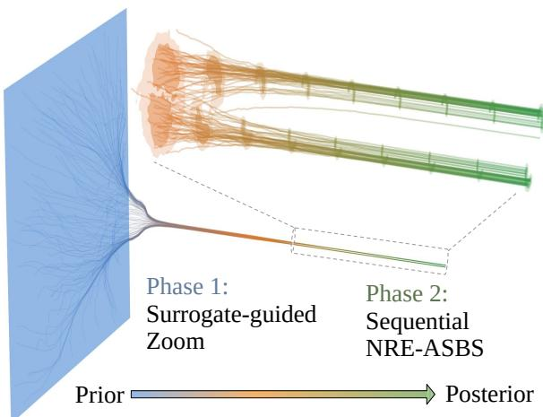  
Figure 1: Actual diffusion trajectories from the RSBI pipeline on the Two Moons task detailed in Sec.5. RSBI is able to produce a high quality posterior despite the large prior size.

Recent advances in neural samplers, in particular the Adjoint Schrödinger Bridge Sampler (ASBS; 14), provide an opportunity to exploit such gradients. ASBS recasts sampling from an unnormalised target distribution as a Schrödinger bridge problem solved via stochastic optimal control: a controlled SDE transports a tractable source distribution to the target, with the control trained by adjoint matching and a learned corrector [15]. The recent Well-Tempered variant (WT-ASBS; 16) augments ASBS with a metadynamics-style bias [17], overcoming free-energy barriers between modes during training and enabling broad mode coverage at fixed simulation cost. Two properties make this family particularly well-suited to SBI. First, ASBS queries the target only through gradients of its energy (the negative log of the unnormalised target density), $\nabla _ { \boldsymbol { \theta } } E _ { \cdot }$ which a differentiable simulator supplies. Second,

the well-tempered bias addresses the mode-seeking pathology that limits standard variational SBI [7] on multi-modal posteriors. To our knowledge, neither ASBS nor its well-tempered extension have previously been deployed for likelihood-free Bayesian inference.

We introduce RSBI, a two-phase SBI framework that leverages differentiable simulators while keeping the target posterior fixed as $p ( \theta \mid x _ { o } )$ , where $x _ { o }$ denotes the observed data. Phase 1 places posterior mass rapidly using a cheap surrogate likelihood, parameterized by bandwidth € and built from distance metric $\mathcal { D } _ { \epsilon } ( s , x _ { o } )$ between observed and simulated data, plugged into a Well-Tempered Adjoint Schrödinger Bridge Sampler [14, 16] (WT-ASBS). Phase 2 refines the resulting Phase-1 proposal using WT-ASBS, augmented by an NRE trained on simulator samples drawn from the zoomed in’ proposal. Figure. 1 outlines the process.

Our contributions are threefold:

• A two-phase SBI method for differentiable simulators. We introduce RSBI (Sec. 4), a diffusion-based variational approach to likelihood-free Bayesian inference that achieves high sampling efficiency under large prior-to-posterior volume ratios.

• First application of WT-ASBS to SBI. We adapt the well-tempered metadynamics extension of ASBS [16] to likelihood-free Bayesian inference, countering the mode-seeking pathology of reverse-KL variational SBI [7] on multimodal posteriors.

• Benchmarking robustness at large prior-to-posterior volume ratio ${ \mathcal { R } } _ { p } .$ We benchmark RSBI and other methods on Two Moons [18], SLCP [18, 19], Lotka-Volterra [18], Bernoulli GLM [18], and a new differentiable gravitational-wave ringdown task (dim $\theta = 6 ,$ , dim x = 820), sweeping prior-to-posterior volume ratios up to $\log _ { 1 0 } \mathcal { R } _ { p } \approx 1 2$

## 2 Related Work

RSBI sits at the intersection of three research threads. The first is neural simulation-based inference, in which a density or ratio estimator is trained on simulated $( \theta , x )$ pairs to target the posterior, likelihood, or likelihood-to-evidence ratio [2–6, 20]. Sequential variants iteratively refine their proposal to concentrate simulations in informative regions of parameter space. SNVI+fKL [7] pairs likelihood(-ratio) estimation with VI and is our closest methodological sibling. Like RSBI, SNVI combines a learned neural likelihood ratio estimated via Neural Ratio Estimation (NRE) with a variational sampler, and, like RSBI, it explicitly addresses the mode-seeking pathology of standard reverse-KL VI, in its case by training under the mass-covering forward KL with sampling-importanceresampling for proposal updates. RSBI instead handles mode coverage through the well-tempered metadynamics bias of WT-ASBS [16], which flattens free-energy barriers between modes. The two methods also differ in how the initial proposal is obtained: SNVI draws its first round of simulations from the original prior, whereas RSBI is initialised by a one-shot surrogate-guided Schrödinger bridge.

The second thread is the surrogate-likelihood lineage that connects classical ABC [21] to modern VI. Any differentiable distance metric $\mathcal { D } _ { \epsilon } ( s , x _ { o } )$ induces a pseudo-likelihood whose gradients propagate through a simulator, an idea explored by ABC-VI [22], as well as score-based approaches [23, 24]. RSBI borrows from this for Phase 1, but rather than amortising over x or running an MCMC against the surrogate, we use it to construct the energy on which WT-ASBS is trained. This gives a non-mode-seeking proposal that Phase 2 then transports to the true posterior, with a likelihood specified by an NRE learned only where the proposal places mass. This use of a surrogate kernel as a warm-start for a downstream refinement, rather than as the inference target itself, can alleviate the bandwidth-versus-bias trade-off that limits standalone ABC-VI.

The third thread is the rapidly maturing ecosystem of GPU-native, auto-differentiable simulators across many scientific fields and neural emulators [25-28]. Direct access to simulation gradients $\nabla _ { { \boldsymbol { \theta } } } s ( { \boldsymbol { \theta } } )$ enables gradient-based inference for models that previously admitted only analyticallikelihood treatments: ASBS [14] queries its target exclusively through energy gradients, which the differentiable simulator supplies via a distance metric $\mathcal { D } _ { \epsilon } ( s , x _ { 0 } )$ , sidestepping the density-estimation step of standard SNPE/SNLE/SNRE. A growing number of works that exploit gradients have been used to improve neural SBI. Brehmer et al. [29] augment the training losses of ratio and likelihood estimators with the joint score and likelihood ratio, and relaxations such as the Gumbel-Softmax [30] extend such gradients to simulators with discrete randomness. To our knowledge, the only gradientinformed NPE method adds a score-matching term to the NPE loss [31], leaving the proposal, the simulation allocation and the sampler unchanged. In all of these, gradients regularise an estimator fit to prior-wide simulations. In RSBI they instead drive the Phase 1 sampler directly, through an auto-encoder-like comparison of simulations with the observation.

## 3 Background

## 3.1 Simulation Based Inference

We consider a stochastic simulator $s : \Theta \times \Omega \to \mathcal { X }$ with parameters $\theta \in \Theta \subseteq \mathbb { R } ^ { d }$ and outputs $x = s ( \theta , \omega ) \in \mathcal { X }$ , where $\omega \in \Omega$ collects all internal randomness of the simulator (noise draws, random seeds) and is drawn from a distribution $p ( \omega )$ that does not depend on $\theta .$ The simulator implicitly defines the conditional density $p ( x \mid \theta )$ and the distribution of $s ( \theta , \omega )$ under $\omega \sim p ( \omega )$ The likelihood $\theta \mapsto p ( x _ { o } \mid \theta )$ is this density evaluated at the observed data $x _ { o }$ . It can be sampled by running the simulator but not evaluated. We call the simulator differentiable if $\theta \mapsto s ( \theta , \omega )$ is differentiable for every $\omega ,$ so that pathwise gradients $\nabla _ { \boldsymbol { \theta } } s ( \boldsymbol { \theta } , \boldsymbol { \omega } )$ are available. We write $s ( \theta )$ for $s ( \theta , \omega )$ with $\omega \sim p ( \omega )$ , and $s ( \theta , \omega _ { 1 : K } ) = \{ s ( \theta , \omega _ { k } ) \} _ { k = 1 } ^ { K }$ with $\omega _ { k } \stackrel { \mathrm { i i d } } { \sim } p ( \omega )$ for K independent replicates at the same θ. Given a prior $p ( \theta )$ and observation $x _ { o } .$ ,simulation-based inference (SBI) targets the posterior $p ( \theta \mid x _ { o } ) \propto p ( x _ { o } \mid \theta ) p ( \theta )$ using only forward simulations [1].

Classical approximate Bayesian computation (ABC) accepts prior draws $\theta \sim p ( \theta )$ whose simulations fall within a tolerance € of the observation, $\mathcal { D } _ { \epsilon } ( s ( \theta ) , x _ { o } ) < \epsilon .$ , usually after reducing the data to summary statistics [32]. It scales poorly with dim $. ( x )$ and is sensitive to the choice of summaries and of $\epsilon .$ Neural SBI instead trains a density estimator $q _ { \phi }$ on a corpus of simulations $( \theta _ { i } , x _ { i } )$ with $\theta _ { i } \sim p ( \theta )$ and $x _ { i } \sim p ( x \mid \theta _ { i } )$ , targeting the posterior (NPE) [2, 3], the likelihood (NLE) [4] or the likelihood-to-evidence ratio (NRE) [5, 6, 20]. Amortised variants train once to learn $p ( \theta ) p ( x \mid \theta )$ and apply to any x, whereas sequential variants concentrate simulations around $x _ { o } ,$ giving up amortisation for simulation efficiency.

## 3.2 Diffusion Sampling

Neural diffusion samplers learn a Stochastic Differential Equation (SDE) which transports samples $X _ { 0 } \sim \mu ( x )$ from source distribution $\mu ( x )$ ; at time $t = 0$ to the Boltzmann distribution $v ( x )$ at time t = 1 given by:

$$
v ( x ) = \frac { e ^ { - E ( x ) / T } } { Z } , \qquad Z = \int _ { \mathcal { X } } e ^ { - E ( x ) / T } d x < \infty\tag{1}
$$

The distribution is characterized by an unnormalized energy $E : \mathcal { X } \subseteq \mathbb { R } ^ { d } \to \mathbb { R }$ and temperature $T ,$ with the normalizing constant $Z$ being intractable. Diffusion samplers aim to provide faster convergence using fewer evaluations of the energy function than Markov Chain Monte Carlo (MCMC) [33] methods by learning better proposal distributions. Especially when $v ( x )$ is defined through an energy function, diffusion samplers provide a scalable alternative to sampling methods such as score matching [34, 35] or normalizing flows [2, 4] whose naive implementations rely on samples from $v ( x )$

Adjoint Schrödinger Bridge Sampling: ASBS[14] is a state-of-the-art diffusion sampler building on Adjoint Sampling $( \mathrm { A S } ) [ 1 5 ]$ that solves the Schrödinger Bridge (SB) problem between source distribution $\mu ( x )$ and target v(x) through stochastic optimal control. Within the context of RSBI, we consider the following drift-less SDE:

$$
d X _ { t } = \sigma _ { t } u _ { t } ( X _ { t } ) d t + \sigma _ { t } d W _ { t } , \qquad X _ { 0 } \sim \mu ( X _ { 0 } ) ,\tag{2}
$$

where $\sigma _ { t }$ is the diffusion coefficient, $u _ { t }$ is a learned control network, and $( W _ { t } )$ t is a d-dimensional Brownian motion. The optimal control $\boldsymbol { u } _ { t } ^ { * }$ is then given by:

$$
u ^ { * } = \underset { u } { \arg \operatorname* { m i n } } D _ { \mathrm { K L } } ( p ^ { u } | | p ^ { \mathrm { b a s e } } ) = \underset { u } { \arg \operatorname* { m i n } } \mathbb { E } _ { \mathbb { X } \sim p ^ { u } } \left[ \int _ { 0 } ^ { 1 } \frac { 1 } { 2 } | | u _ { t } ( X _ { t } ) | | ^ { 2 } d t \right] ,\tag{3a}
$$

$$
\begin{array} { r } { \mathrm { s . t . } d X _ { t } = \sigma _ { t } u _ { t } ( X _ { t } ) d t + \sigma _ { t } d W _ { t } , \quad X _ { 0 } \sim \mu ( X _ { 0 } ) , \quad X _ { 1 } \sim v ( X _ { 1 } ) . } \end{array}\tag{3b}
$$

Therefore, $u ^ { * }$ minimizes the relative entropy between the path probability $p ^ { u }$ characterized by (2) and the base path probability $p ^ { \mathrm { b a s e } }$ given when $u = 0$ . To solve (3), ASBS defines an additional corrector network h and iterates over two objectives; Adjoint Matching (AM):

$$
\begin{array} { r } { u ^ { ( k ) } = \underset { u } { \arg \operatorname* { m i n } } \mathbb { E } _ { p _ { t [ 0 , 1 } ^ { \mathrm { s a c } } , p _ { 0 , 1 } ^ { \tilde { \mathbb { n } } } } \left[ \| u _ { t } ( X _ { t } ) + \sigma _ { t } ( \nabla _ { X _ { 1 } } E ( X _ { 1 } ) + h ^ { ( k - 1 ) } ( X _ { 1 } ) ) \| ^ { 2 } \right] , \quad \bar { u } = \mathrm { s t o p g r a d } ( u ) , } \end{array}\tag{4}
$$

and Corrector Matching (CM):

$$
h ^ { ( k ) } = \arg \operatorname* { m i n } _ { h } \mathbb { E } _ { p _ { 0 , 1 } ^ { u } } \left[ \| h ( X _ { 1 } ) - \nabla _ { X _ { 1 } } \log p ^ { \mathrm { b a s e } } ( X _ { 1 } | X _ { 0 } ) \| ^ { 2 } \right] .\tag{5}
$$

Iterating through AM and CM stages constitutes the well-known iterative proportional fitting[36] algorithm.

Theorem 3.1 (Convergence of ASBS). As $k \to \infty$ and both AM(4) and CM(5) stages reach their critical points, $\boldsymbol { u } ^ { ( k ) } = \boldsymbol { u } ^ { * }$ , the SB solution of (3).

For a proof of Theorem 3.1 we refer to Liu et. al.[14]. Note that ASBS relies only on the energy gradient $\nabla _ { X _ { 1 } } E ( X _ { 1 } )$ during the AM stage, and does not require any energy evaluations during the CM stage. This makes the algorithm efficient in terms of energy evaluations, and is what makes it highly suitable for use in RSBI, where we only have access to the likelihood and prior's gradient. A consequence is that ASBS distinguishes between two kinds of low-density region. Because the energy is queried only at the terminal point $X _ { 1 }$ , trajectories can pass through regions of low or zero target density in transit without obstruction, unlike MCMC, whose chains must traverse every intermediate state. Regions that separate components of the terminal distribution are different. Adjoint Matching trains on trajectories drawn from the current controller, so a component that no trajectory reaches provides no training signal and can remain uncovered. The well-tempered bias of Appendix. A.1 addresses this by pushing samples towards regions not yet visited.

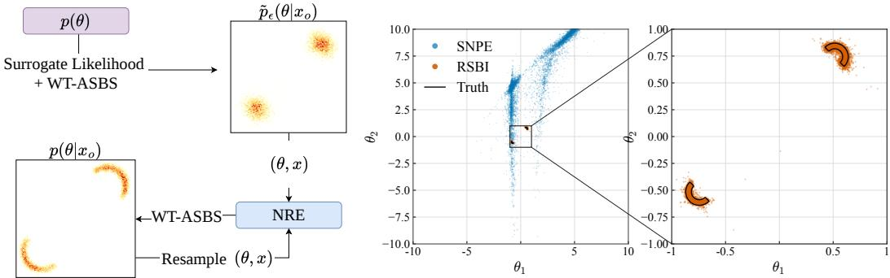  
Figure 2: Left: Schematic representation of the two-phase procedure of RSBI. Right: Comparison of posteriors from RSBI (our method) and SNPE on a Two Moons task with $1 0 ^ { 4 }$ simulations and $\mathcal { R } _ { p } ^ { \bar { } } \sim 1 0 ^ { 4 . 3 }$ , with two sequential steps for both SNPE and Phase 2 of RSBI.

## 4 Method

We adopt the SBI setting of Section 3.1: a simulator $s ( \theta , \omega )$ , prior $p ( \theta )$ , and observation $x _ { o } ,$ with the unnormalized posterior $p ( \theta \mid x _ { o } )$ as the inference target. We additionally assume that s is differentiable in $\theta ,$ so that $\nabla _ { \boldsymbol { \theta } } \boldsymbol { s } ( \boldsymbol { \theta } , \omega )$ is available for any $\omega \sim p ( \omega )$ . A detailed illustration of RSBI can be found in Figure 2. We also provide simplified pseudocode for ASBS in Algorithm 1 and for RSBI in Algorithm 2.

## 4.1 Phase 1: Surrogate-Guided Zoom

When the prior-to-posterior volume ratio $\mathcal { R } _ { p }$ is large, learning a neural likelihood or posterior over the full prior support is impractical: most simulator calls fall in regions of negligible posterior density. Phase 1 sidesteps this bottleneck with an analytic surrogate likelihood, in the spirit of ABC. Given a differentiable distance $\mathcal { D } _ { \epsilon } ( s ( \theta ) , x _ { o } )$ between simulated and observed data, we define the surrogate likelihood

$$
\begin{array} { r } { \tilde { p } _ { \epsilon } ( x _ { o } \mid \theta ) \propto \exp \Big ( - \mathbb { E } \mathcal { D } _ { \epsilon } ( s ( \theta ) , x _ { o } ) \Big ) , } \end{array}\tag{6}
$$

where $s ( \theta )$ inside D€ denotes K replicates $s ( \theta , \omega _ { 1 : K } )$ and the expectation is over $\omega _ { 1 : K }$ The bandwidth $\epsilon > 0$ is the scale on which $\mathcal { D } _ { \epsilon }$ compares simulated and observed data, and so controls how sharply $\tilde { p } _ { \epsilon }$ concentrates around $x _ { o } .$ I.e, the noise variance of a Gaussian negative log-likelihood, or the length scale of an energy distance or MMD kernel. ε is either fixed or set adaptively from the replicates. We detail how the adaptive bandwidth is set for different surrogate likelihoods $\mathcal { D } _ { \epsilon }$ and conduct ablations on it's choice in Appendix C. We also discuss a heuristic method that exploits a cheap survey of the gradient landscape in order to select € in Appendix C.5.

The surrogate posterior $\smash { \tilde { p } _ { \epsilon } ( \theta \mid x _ { o } ) \propto \tilde { p } _ { \epsilon } ( x _ { o } \mid \theta ) p ( \theta ) }$ has the Boltzmann form of (1). ASBS only queries the gradient of its energy, so $\mathcal { D } _ { \epsilon }$ need only be known up to an additive constant:

Algorithm 1: Well-Tempered ASBS - One Round   
1 def wt\_asbs(source µ, energy gradient $\nabla E ,$ control u, corrector $h ,$ bias $V ( \xi ( \theta ) )$ , stages S):   
2 for stage k in $1 , 2 , \ldots , S$ and each epoch :   
3 Obtain $X _ { 1 }$ by drawing $X _ { 0 } \sim \mu$ and integrating (2)   
4 if k is odd (ÅM stage) :   
5 Add $\left( X _ { 0 } , X _ { 1 } , \overbar { \nabla } E ( X _ { 1 } ) + h ( X _ { 1 } ) + \nabla ( V \circ \xi ) ( X _ { 1 } ) \right)$ to the replay buffer   
6 if $k < S : V  V + \mathbf { W } \mathbf { T }$ update (9) at $\xi ( X _ { 1 } )$   
7 Update u on the buffer through WT-AM (10)   
8 else: add $( X _ { 0 } , X _ { 1 } )$ to the replay buffer and update h by solving CM (5)   
9 return $u , h , V ,$ saved simulations B

Algorithm 2: Rapid Simulation-Based Inference   
1 def rsbi (prior p(θ), simulator $s ( \theta , \omega )$ , observation $x _ { o } ,$ surrogate distance $\mathcal { D } _ { \epsilon } ( s , x _ { o } ) ,$   
temperature T, ratio network $r _ { \psi } ( \theta , x )$ , rounds R) :   
# Phase 1: Surrogate-guided zoom   
2 $E _ { s } ( \boldsymbol { \theta } ) \gets [ \mathbb { E } \mathcal { D } _ { \boldsymbol { \epsilon } } ( s ( \boldsymbol { \theta } ) , \mathbf { \check { x } } _ { o } ) - \mathbf { \check { l } } \mathbf { o g } p ( \boldsymbol { \theta } ) ] / T$   
3 ū, V, $B  \mathsf { w t } .$ asbs $\begin{array} { r } { ( \mu = p ( \boldsymbol { \theta } ) , \nabla E = \nabla E _ { s } , } \end{array}$ new u, new $h , V = 0 )$   
4 Draw $\theta _ { \underline { { i } } } \sim \tt r e s a m p l e _ { \bar { V } } ( p _ { 1 } ^ { \bar { u } } )$ , top up B with new $( \theta _ { i } , s ( \theta _ { i } ) )$   
5 $\mu  p _ { 1 } ^ { \bar { u } }$ , optionally resample $\bar { \nu } ( p _ { 1 } ^ { \bar { u } } ) ; \quad u _ { 0 } , h _ { 0 } \gets$ fresh networks   
# Phase 2: Sequential NRE-ASBS   
6 for r in $1 , 2 , \ldots , R :$   
7 Optimise $r _ { \psi } ( \theta , x )$ on B via the NRE-C loss (11)   
8 $\dot { E _ { r } } ( \theta ) \gets \dot { - } \log r _ { \psi } ( \theta , x _ { o } ) - \log p ( \theta ) \ ( 8 )$   
9 $\begin{array} { r } { u _ { r } , \dot { h _ { r } } , V _ { r } , \dot {  } \mathrel {  } \mathrel { \mathrm {  } } \mathrel { \mathrm {  } } \mathrel { \mathrm {  } } \mathrel { \mathrm {  } } \mathrel { \mathrm {  } } \mathrel { \mathrm {  } } \mathrel { \mathrm {  } } \mathrel { \mathrm {  } } \mathrel { \mathrm {  } } \mathrel { \mathrm {  } } \mathrel { h _ { r - 1 } } , V { \mathrm {  } } \mathrel { \mathrm {  } } 0 } \end{array}$   
10 $\mathbf { i f } r < R :$ draw $\theta _ { i } \sim p _ { 1 } ^ { u _ { r } }$ , top up B   
11 return $\mu , u _ { R } , V _ { R }$

Theorem 4.1 (Equivalence under differentiation). Let $\tilde { \mathcal { D } } _ { \epsilon } : \mathcal { X } ^ { K } \times \mathcal { X } $ R be differentiable and equal to a positive-semi-definite (PSD) distance $\mathcal { D } _ { \epsilon }$ up to a constant, $\mathcal { D } _ { \epsilon } ( x , x ^ { \prime } ) = \tilde { \mathcal { D } } _ { \epsilon } ( x , x ^ { \prime } ) + C$ for some $C \in \mathbb { R }$ and all $x , x ^ { \prime }$ . Then $\nabla \tilde { \mathcal { D } } _ { \epsilon } = \nabla \mathcal { D } _ { \epsilon }$ •

The energy gradient can therefore be computed from any such $\tilde { \mathcal { D } } _ { \epsilon }$

$$
\nabla _ { \boldsymbol { \theta } } E _ { s } ( { \boldsymbol { \theta } } ) \ = \ \mathbb { E } \nabla _ { \boldsymbol { \theta } } \tilde { \mathcal { D } } _ { \epsilon } ( s ( { \boldsymbol { \theta } } ) , \boldsymbol { x } _ { o } ) \ - \ \nabla _ { \boldsymbol { \theta } } \log p ( { \boldsymbol { \theta } } ) ,\tag{7}
$$

where the gradient passes inside the expectation because $p ( \omega )$ does not depend on θ. We hand (7) to ASBS with the prior $p ( \theta )$ as source (full derivation in Appendix A.3). By Theorem 3.1, this converges to the Schrödinger-bridge solution that transports $p ( \theta )$ to the surrogate posterior. Although it may seem trivial, Theorem 4.1 lets standard losses be used without their constants, such as the Gaussian NLL without its normalising constant and MSE, alongside PSD discrepancies such as the energy distance [37] and MMD [38]. A Gaussian NLL with adaptive variance is not of this form but still gives a proper surrogate posterior (Appendix C.1)

Because $\tilde { p } _ { \epsilon } ( \theta \mid x _ { o } )$ is defined directly through the simulator rather than learned, Phase 1 needs no density estimator. Each simulator call moves the proposal towards $x _ { o }$ instead of providing a training example for an estimator fitted from prior draws, which is what limits sequential neural methods at large $\mathcal { R } _ { p }$ . The distance gradient points toward $x _ { o }$ in data space, which the differentiable simulator pulls back into parameter space via $\nabla _ { { \boldsymbol { \theta } } { \boldsymbol { s } } } ( { \boldsymbol { \theta } } )$ . Phase 1 therefore efficiently allocates posterior mass to high-density regions under a constrained simulator budget, producing the focused proposal $\tilde { p } _ { \epsilon } ( \theta \mid x _ { o } )$ that Phase 2 refines. Appendix A.3 gives the admissibility class for $\mathcal { D } _ { \epsilon } ,$ whilst Appendix. C.4 discusses the bandwidth-metric trade-offs inherited from ABC, and the surrogates used in Section 5.

## 4.2 Phase 2: Sequential NRE-ASBS Refinement

In Phase 2 we start from the surrogate posterior $\tilde { p } _ { \epsilon } ( \theta \mid x _ { o } )$ produced by Phase 1 and refine it to recover the simulator posterior $p ( \theta \mid x _ { o } )$ (Section 3.1). Refinement proceeds over R rounds. Each round trains a neural ratio estimator $[ 5 , \dot { 6 } ] r _ { \psi } ( \theta , x )$ on (θ, x) pairs simulated so far, which are drawn from the round's proposal $q _ { r } ( \theta )$ as well as optionally earlier ones used during phase 1 training. It then solves the ASBS objective (3) against the resulting target energy, with $\tilde { p } _ { \epsilon } ( \theta \mid x _ { o } )$ as the source distribution in every round. The SB therefore always transports samples from the Phase-1 posterior, and the sampler of round $r$ provides the proposal $q _ { r + 1 }$ for the next round's simulations. We use the contrastive (NRE-C) loss [20] throughout. To improve mode-discovery over both phases we also optionally use a simplified version of the recent Well-Tempered metadynamics (WT-ASBS) [16] extension that augments the energy landscape, for more details on WT-ASBS we refer to Appendix A.1.

At optimum the classifier learns $r _ { \psi } ^ { * } ( \theta , x ) = p ( x \mid \theta ) / q _ { r } ( x )$ , where $q _ { r } ( x )$ is the local marginal. Because Phase 2 conducts multiple rounds of refinement, the proposal $q _ { r } ( \theta )$ changes between rounds as simulations concentrate in regions of high posterior probability. Following the same construction

as the Phase 1 energy (7), the round-r energy is:

$$
- \nabla _ { \theta } \log p ( \theta \mid x _ { o } ) = - \nabla _ { \theta } \log \frac { p ( x _ { o } \mid \theta ) } { q _ { r } ( x _ { o } ) } - \nabla _ { \theta } \log p ( \theta ) = \nabla _ { \theta } E _ { r } ( \theta ) ,\tag{8}
$$

where the proposal-induced marginal $q _ { r } ( x _ { o } )$ has zero gradient in $\theta$ and so drops out - this is a core appeal of using a diffusion sampler against an NRE-derived energy. Solving (3) via ASBS with energy $E _ { r } ( \theta )$ and source $\tilde { p } _ { \epsilon } ( \theta \mid \bar { x } _ { o } )$ therefore recovers the Schrödinger-bridge solution connecting the surrogate posterior and the simulator posterior. To avoid retraining from scratch each round we warm-start the controller u and corrector h from the previous round's parameters. Because $r _ { \psi }$ is only identified where the classifier has seen training parameters, a user who trusts the Phase 1 posterior to cover the simulator posterior can optionally truncate the ratio outside the region spanned by the Phase 1 samples (Appendix A.4). Because $E _ { r }$ in (8) explicitly retains log $p ( \theta )$ as an additive term, the round output requires no post-hoc correction for leakage outside prior support. Natural posterior leakage mitigation is an additional benefit of RSBI which we demonstrate with an additional experiment in Appendix B.2.

Because Phase 2 transports the Phase 1 sampler rather than refitting a global density over the prior, it remains accurate where SNPE and SNVI, warm-started from the same Phase 1 samples and given the same simulation budget, still degrade or collapse onto spurious regions of a wide prior. We demonstrate this in an ablation in Appendix B.3.

The full Phase 2 procedure including NRE-C training, the well-tempered bias update (9), and the augmented Adjoint Matching objective (10) is described in Appendices A.1 and A.2, alongside the convergence guarantee (Proposition A.1) for RSBI.

Preconditioning the Phase-2 sampler for unimodal posteriors

The Phase 2 sampling process is isotropic, so on ill-conditioned posteriors (e.g strongly correlated parameters, narrow ridges) no single noise scale $\sigma _ { t }$ suits every direction. We therefore provide an option to run Phase 2 in coordinates whitened by the mean θ and covariance $\Sigma = L L ^ { \top }$ of the Phase 1 samples, $z = L ^ { - 1 } ( \theta - \bar { \theta } )$ , mapping only the energy gradient, $\nabla _ { z } E _ { r } = L ^ { \top } \nabla _ { \theta } E _ { r }$ . The affine map leaves the target unchanged and costs no simulations. It is the analogue of mass-matrix adaptation in HMC [39, 40], with the metric supplied by Phase 1. As one covariance cannot describe several modes, Phase-2 preconditioning is useful for unimodal targets. For more discussion see Appendix. A.5.

## 5 Experiments

We benchmark RSBI against two established neural-SBI methods: SNPE-C [3] and SNVI+fKL [7] (see Appendix E for further details), on Two Moons [3], SLCP [4], Bernoulli GLM [18] and Lotka– Volterra [18], as implemented in the sbibm [18] benchmarking suite, as well as a new differentiable gravitational-wave ringdown task (gw\_ringdown). To make them differentiable, we re-implement the benchmarks from sbibm in PyTorch. For full details on the re-implementation we refer to Appendix D. We make public our full code and checkpoints¹.

Posterior quality is measured by the classifier two-sample test (C2ST, 41) against task-appropriate reference posteriors, obtained via rejection sampling for Two Moons, sbibm's reference samplers for SLCP, Bernoulli GLM, resampling the sbibm default for Lotka-Volterra, and MCMC with emcee [42] for gw\_ringdown (see Appendix D.7 for details). For each task we sweep several prior sizes (uniform boxes, or Gaussian prior scales for Bernoulli GLM and Lotka-Volterra) and three simulation budgets $N _ { \mathrm { s i m } } \in \{ 1 0 ^ { 3 } , 1 \dot { 0 ^ { 4 } } , 1 0 ^ { 5 } \}$ , using the log prior-to-posterior volume ratio $\log _ { 1 0 } \mathcal { R } _ { p } .$ averaged over the observations, to quantify the volume reduction (see App. F for the definition and App. D.8 for the values adopted here). The smallest priors are the ones implemented in the sbibm package. All baselines use their released sbibm or SNVI defaults at matched total simulator-call budget, with the number of SNVI rounds set to 5 and SNPE rounds set to 2-3 (instead of 10) to match RSBI closer and reduce computational cost. Lastly, the surrogate bandwidths were taken to be adaptive where possible. The Bernoulli-GLM experiment instead implemented the heuristic criteria of Appendix C.5 to chose €. gw\_ringdown takes $\epsilon = 1$ . Full task definitions, prior scenarios, hyperparameters, reference-sampler configurations and the RSBI training schedule are in Appendix D.

Compute-Matched Experiment: Because doing the full forward + backward pass through a simulator is more expensive than only a forward pass, we also investigate RSBI's performance under a compute-matched budget. These results are shown in Appendix B.1.

## 5.1 Main results: gravitational-wave ringdown

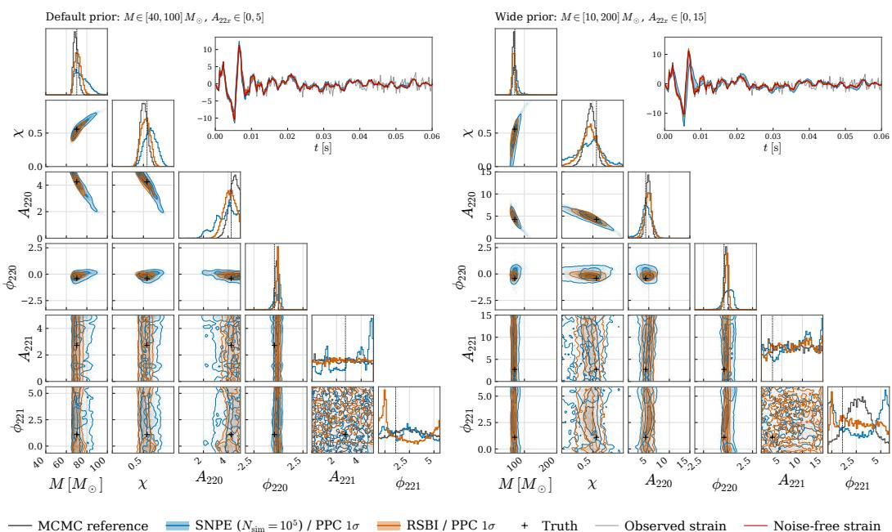  
Figure 3: 6D gw\_ringdown posteriors of RSBI, SNPE and the MCMC reference for observation 10 at $N _ { \mathrm { s i m } } = 1 0 ^ { 5 }$ , under the default prior (left, $\log _ { 1 0 } \mathcal { R } _ { p } \approx 2 . 6 2 )$ and the wide prior (right, ≈ 2.84; Table 21). Insets: whitened observation (grey), noise-free injection (red) and the 1σ posteriorpredictive bands of SNPE and RSBI from 200 re-simulated posterior samples each.

We first evaluate RSBI on a real-world inference task: estimating six ringdown parameters $( M , \chi , A _ { 2 2 0 } , \varphi _ { 2 2 0 } , A _ { 2 2 1 } , \varphi _ { 2 2 1 } )$ from a black hole post-merger gravitational wave signal, with extrinsic dimensions fixed to truth (the natural single-detector setup with known sky position and distance). Simulator construction and reference posterior generation are described in Appendix D.2. Figure 3 shows the $d _ { \theta } ~ = ~ 6 ~ 2 – \mathrm { d }$ and 1-d marginal posteriors on observation 10 at the default and wide priors from $N _ { \mathrm { s i m } } = 1 0 ^ { 5 }$ : RSBI tracks the emcee reference closely across all six parameters, with a more constrained posterior in comparison to that of SNPE, as also evident in their respective C2ST scores (see

Table 1: Mean C2ST on gw\_ringdown against the emcee reference at $\breve { N } _ { \mathrm { s i m } } = \breve { 1 } 0 ^ { 5 }$ , averaged over 10 simulated observations. For every method the phases φ220, φ221 are wrapped to [0, 2π) before scoring.
<table><tr><td></td><td colspan="2">Prior (see Table 21)</td></tr><tr><td>Method  $\log _ { 1 0 } \mathcal { R } _ { p }$ </td><td>default ≈2.6</td><td>wide ≈ 2.8</td></tr><tr><td>SNVI+fKL</td><td>0.958 (0.032)</td><td>0.986 (0.022)</td></tr><tr><td>SNPE</td><td>0.935 (0.071)</td><td>0.985 (0.015)</td></tr><tr><td>RSBI (ours)</td><td>0.891 (0.070)</td><td>0.903 (0.069)</td></tr></table>

Table 1) for the default prior (0.891 and 0.935, respectively) and wide prior (0.903 and 0.985, respectively). The strain inset shows the 2σ posterior-predictive band of RSBI tightly envelopes the injected ringdown signal, in comparison to the larger uncertainties of SNPE. We highlight the difference in the MCMC and RSBI posteriors, especially visible in the 1-dimensional marginal plot of $A _ { 2 2 0 }$ (see top row of the $A _ { 2 2 0 }$ corner column).

## 5.2 Main results: robustness under $\mathcal { R } _ { p }$ increase

Figure 4 reports C2ST against the simulation budget $( N _ { \mathrm { s i m } } )$ on the Two Moons, Lotka-Volterra, Bernoulli GLM, and SLCP benchmarks [18]. On Two Moons and Bernoulli GLM, all three methods start to converge towards 0.5 C2ST at $\bar { N _ { \mathrm { s i m } } } \bar { = } 1 0 ^ { 5 }$ . On the Lotka-Volterra and SLCP benchmarks this is not the case, with only RSBI converging on Lotka-Volterra. We also find that the C2ST gap widens as $\mathcal { R } _ { p }$ increases. On Two Moons at $\log _ { 1 0 } \mathcal { R } _ { p } \approx 4 . 3$ , the sequential sbi baselines saturate at $\mathrm { C } 2 \mathrm { S T } \approx 1$ for every budget, while RSBI maintains $\mathrm { C } 2 \mathrm { \ ' { S } T } \lesssim 0 . 7$ throughout. On SLCP, all baselines degrade by $0 . 1 \mathrm { - } 0 . 2 \dot { \mathrm { C } } 2 \mathrm { S T }$ between the sbibm default and $\log _ { 1 0 } \mathcal { R } _ { p } \approx \bar { 2 } . 6 9 \mathrm { a t } 1 0 ^ { 5 }$ simulations. With the smallest $\mathcal { R } _ { p }$ difference between priors, this experiment details a regime for which the gains of RSBI are not extpected to be as pronounced. On Bernoulli GLM, all methods agree at the default prior, but at $\log _ { 1 0 } \mathcal { R } _ { p } \approx 9 . 9$ RSBI reaches a C2ST of 0.66 at $1 0 ^ { 5 }$ simulations, against 0.74 for SNVI+fKL and 0.80 for SNPE, and at $\log _ { 1 0 } \mathcal { R } _ { p } \approx 1 2 . 2 0 . 8 9$ against 0.91 and 0.95. With Lotka-Volterra we find only RSBI is able to achieve strong results within the simulation budget, reaching a C2ST of 0.55 at $1 0 ^ { 5 }$ simulations against 0.88 for SNVI+fKL and 0.94 for SNPE. On Lotka-Volterra we also implement the Phase 2 preconditioning of Sec.4.2 which considerably enhanced performance.

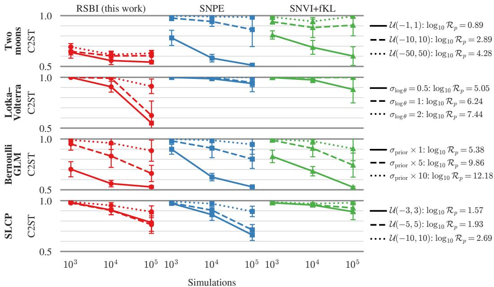  
Figure 4: Robustness to prior-to-posterior volume ratio on Two Moons, Lotka-Volterra, Bernoulli GLM and SLCP benchmarks. Mean C2ST (±1σ) calculated against the reference posterior vs. simulation budget $N _ { \mathrm { s i m } }$ over 10 observations. Legends report $\log _ { 1 0 } \mathcal { R } _ { p } ,$ full line is the sbibm default. $\mathrm { C } 2 \mathrm { S } \mathrm { T } = 0 . 5$ matches the reference, 1.0 is fully distinguishable.

To investigate the convergence of RSBI under large simulation budgets, we also conduct an additional run on Two Moons, extending the number of sims to $1 0 ^ { 6 }$ on the default prior. For this run we achieve a mean C2ST (±1σ) of 0.536 (±0.014), a slight improvement over the $1 0 ^ { 5 }$ run, which achieves 0.543 (±0.018).

## 6 Discussion

The RSBI methodology introduces two novel components that can each be adopted independently of ASBS. The first is a surrogate proposal from a differentiable simulator. (6) is an unnormalised log density that can be differentiated with respect to θ by backpropagating through the simulator, so any gradient-based method can target it. For example, VI can be run as in SNVI [7] with the learned likelihood replaced by the surrogate distance. Alternatively, ASBS can be swapped for annealed Langevin dynamics or another diffusion sampler designed for multimodal targets, which avoids the sampler-specific hyperparameters that ASBS requires.

The second component is diffusion-based NRE refinement via transport. A ratio estimator remains valid under any proposal, so every simulation is can be reused, and log $p ( \theta ) + \log r _ { \psi } ( \theta , x _ { o } )$ is sampled starting from the Phase 1 proposal rather than from the prior or a truncated version of it. The proposal is not sufficient on its own. Our ablation (Appendix B.3) shows that seeding SNPE and SNVI with the Phase 1 proposal improves them, but a substantial further gain comes only when Phase 2 refines the Phase 1 proposal via NRE-ASBS transport. Additionally, preconditioning Phase 2 by whitening the Phase 1 proposal (Sec.4.2) can alleviate issues arising from ill-conditioned unimodal posteriors, potentially improving the performance of the ASBS. On gw\_ringdown (Sec. 5.1) RSBI is the only method substantially below a C2ST of 1, but the remaining discrepancy with the reference is concentrated in the periodic phases φ220, φ221, which no method resolves well. The cost of backpropagating through the simulator is incurred only in Phase 1 (Appendix B.1).

A further consequence of driving the proposal with a surrogate is that it can be engineered in ways a learned estimator cannot. Since the surrogate only has to point towards the posterior, it can be relaxed for discrete simulators, as with the straight-through Bernoulli relaxation (Appendix D.5). The prior also enters both Phase 1 and Phase 2 energies exactly, mitigating posterior mass leakage outside the support (Appendix B.2), whereas truncation-based methods must correct for this after the fact.

Limitations. RSBI requires a differentiable simulator. For black-box simulators, classical sequential SBI remains the appropriate choice. A backward pass through the simulator costs 1.7 to 4.0 times a forward pass (Appendix B.1), although this applies only to the Phase 1 share of the budget. Phase 2 costs more per iteration than amortised NPE, so RSBI pays off when simulation rather than network training is the bottleneck. It is also not amortised across $x _ { o }$ , a new $x _ { o }$ requires re-running both phases. Phase 1 adds three inference-level hyperparameters, the surrogate bandwidth $\epsilon ,$ the distance $\mathcal { D } _ { \epsilon }$ and the temperature T (Appendices C.6 and C.7). Finally, MCMC is exact in the limit of infinite samples whereas RSBI, like other neural SBI methods, is bounded by network capacity and optimization. On two moons, for example, accuracy saturates even at $1 0 ^ { 6 }$ simulations (Sec. 5.2).

A further set of limitations stems from our choice of ASBS as the sampler rather than from RSBI itself. ASBS is sensitive to its own hyperparameters, notably the reference noise $\sigma _ { \mathrm { m a x } } .$ the temperature and the training schedule. We set these per benchmark, keeping them as agnostic as possible to the surrogate bandwidth by using an adaptive variant or, for the ablations in Appendix C, by inspecting the gradient landscape. The guarantees of the RSBI target against prior leakage and mode collapse only carry over to the samples if the ASBS sampler converges (Appendix B.2). When the reference noise $\sigma _ { \mathrm { m a x } }$ is comparable to the separation between modes, the mode-seeking objective and the self-refilled buffer can amplify small imbalances until modes empty. An unconverged controller can also scatter samples outside the support. These are failures of the sampler's optimisation rather than of the target, but in practice they require $\sigma _ { \mathrm { m a x } }$ to be set relative to the posterior geometry. We stress that the novelty of RSBI, a surrogate-driven proposal refined against a target that retains the prior and the simulator, holds for any choice of sampler, and ASBS can be replaced by any method that requires only $\nabla _ { \boldsymbol { \theta } } E$

## 7 Conclusion

We introduced RSBI, a sequential SBI method that uses gradients of a differentiable simulator to zoom from a broad prior to the posterior before any estimator is trained, subsequently refining the prediction by transporting the proposal via diffusion under an NRE target. Each RSBI component is compatible with existing sequential pipelines and with any gradient-based sampler or VI. We showed RSBI is competitive across simulation budgets on broad priors where prior-initialized methods spend most of their simulations far from $x _ { o }$

Future work. A systematic study of the gradient landscape induced by differentiable simulators would show when this signal is reliable, and could yield curricula that adapt automatically instead of being set per task. Furthermore, the Phase 2 preconditioning we utilize is a single global affine whitening estimated from Phase 1 samples (Appendix A.5). We will quantify how much preconditioning ASBS needs as the posterior becomes more anisotropic or curved, and replace the global map with adaptive or nonlinear alternatives, such as running estimates of the posterior covariance or learned transport maps.

Two high-impact scientific applications stand out. One is extreme-mass-ratio inspirals (EMRIs), where the broad-prior regime is even more pronounced than for ringdown. The other is inference with neural emulators: any trained emulator is a differentiable simulator usable within our framework and it reduces the per-call simulator cost to a network forward pass. The RSBI target is independent of the sampler, so in future work we will pair it with other samplers such as Langevin dynamics flow-based proposals, or ASBS with geometry-adapted reference processes.

## 8 Acknowledgments

The authors thank the International Max Planck Research School for Intelligent Systems (IMPRS-IS) for supporting Uros Zivanovic. This work was supported by the Max Planck Artificial Intelligence Network (MP-AIX). RT and AS acknowledge funding from Next Generation EU, in the context of the National Recovery and Resilience Plan, Investment PE1 Project FAIR “Future Artificial Intelligence Research". This resource was co-financed by the Next Generation EU [DM 1555 del 11.10.22]. RT is partially supported by the Fondazione ICSC, Spoke 3 “Astrophysics and Cosmos Observations", Piano Nazionale di Ripresa e Resilienza Project ID CN00000013 "Italian Research Center on High-Performance Computing, Big Data and Quantum Computing" funded by MUR Missione 4 Componente 2 Investimento 1.4: Potenziamento strutture di ricerca e creazione di "campioni nazionali di R&S (M4C2-19)" - Next Generation EU (NGEU).

## References

[1] Kyle Cranmer, Johann Brehmer, and Gilles Louppe. The frontier of simulation-based inference. Proceedings of the National Academy of Sciences, 117(48):30055–30062, 2020. doi: 10.1073/ pnas.1912789117. URL https://www.pnas.org/doi/abs/10.1073/pnas.1912789117.

[2] George Papamakarios and Iain Murray. Fast €-free inference of simulation models with bayesian conditional density estimation. In Daniel D. Lee, Masashi Sugiyama, Ulrike von Luxburg, Isabelle Guyon, and Roman Garnett, editors, Advances in Neural Information Processing Systems 29: Annual Conference on Neural Information Processing Systems 2016, December 5-10, 2016, Barcelona, Spain, pages 1028–1036, 2016. URL https://proceedings.neur ips.cc/paper/2016/hash/6aca97005c68f1206823815f66102863-Abstract.html.

[3] David S. Greenberg, Marcel Nonnenmacher, and Jakob H. Macke. Automatic posterior transformation for likelihood-free inference. In Kamalika Chaudhuri and Ruslan Salakhutdinov, editors, Proceedings of the 36th International Conference on Machine Learning, ICML 2019, 9-15 June 2019, Long Beach, California, USA, Proceedings of Machine Learning Research, pages 2404– 2414. PMLR, 2019. URL http://proceedings.mlr.press/v97/greenberg19a.html.

[4] George Papamakarios, David C. Sterratt, and Iain Murray. Sequential neural likelihood: Fast likelihood-free inference with autoregressive flows. In Kamalika Chaudhuri and Masashi Sugiyama, editors, The 22nd International Conference on Artificial Intelligence and Statistics, AISTATS 2019, 16-18 April 2019, Naha, Okinawa, Japan, Proceedings of Machine Learning Research, pages 837–848. PMLR, 2019. URL http://proceedings.mlr.press/v89/pa pamakarios19a.html.

[5] Joeri Hermans, Volodimir Begy, and Gilles Louppe. Likelihood-free MCMC with amortized approximate ratio estimators. In Proceedings of the 37th International Conference on Machine Learning, ICML 2020, 13-18 July 2020, Virtual Event, Proceedings of Machine Learning Research, pages 4239–4248. PMLR, 2020. URL http://proceedings.mlr.press/v119 /hermans20a.html.

[6] Conor Durkan, Iain Murray, and George Papamakarios. On contrastive learning for likelihoodfree inference. In Proceedings of the 37th International Conference on Machine Learning, ICML 2020, 13-18 July 2020, Virtual Event, Proceedings of Machine Learning Research, pages 2771– 2781. PMLR, 2020. URL http://proceedings.mlr.press/v119/durkan20a.html.

[7] Manuel Glöckler, Michael Deistler, and Jakob H. Macke. Variational methods for simulationbased inference. In The Tenth International Conference on Learning Representations, ICLR 2022, Virtual Event, April 25-29, 2022. OpenReview.net, 2022. URL https: //openreview .net/forum?id=kZOUYdhqkNY.

[8] Benjamin Kurt Miller, Alex Cole, Patrick Forré, Gilles Louppe, and Christoph Weniger. Truncated marginal neural ratio estimation. In Advances in Neural Information Processing Systems, volume 34, 2021. URL https://papers.neurips.cc/paper\_files/paper/2021/file/ 01632f7b7a127233fa1188bd6c2e42e1-Paper.pdf.

[9] Michael Deistler, Pedro J. Gonçalves, and Jakob H. Macke. Truncated proposals for scalable and hassle-free simulation-based inference. In Advances in Neural Information Processing Systems 35 (NeurIPS 2022), pages 23135–23149. Curran Associates, Inc., 2022. URL https : //proceedings.neurips.cc/paper\_files/paper/2022/hash/9278abf072b58caf2 1d48dd670b4c721-Abstract-Conference.html.

[10] Maximilian Dax, Stephen R. Green, Jonathan Gair, Nihar Gupte, Michael Pürrer, Vivien Raymond, Jonas Wildberger, Jakob H. Macke, Alessandra Buonanno, and Bernhard Schölkopf Real-time inference for binary neutron star mergers using machine learning. Nature, 639:49–53, 2025. doi: 10.1038/s41586-025-08593-z. URL https://www.nature.com/articles/s4 1586-025-08593-z.

[11] Maximilian Dax, Stephen R. Green, Jonathan Gair, Michael Pürrer, Jonas Wildberger, Jakob H. Macke, Alessandra Buonanno, and Bernhard Schölkopf. Neural importance sampling for rapid and reliable gravitational-wave inference. Physical Review Letters, 130(17):171403, 2023. doi: 10.1103/PhysRevLett.130.171403. URL https://doi.org/10.1103/PhysRevLett.130. 171403.

[12] James Bradbury, Roy Frostig, Peter Hawkins, Matthew James Johnson, Yash Katariya, Chris Leary, Dougal Maclaurin, George Necula, Adam Paszke, Jake VanderPlas, Skye Wanderman-Milne, and Qiao Zhang. JAX: composable transformations of Python+NumPy programs, 2018. URLhttp://github.com/jax-ml/jax.

[13] Jason Ansel, Edward Yang, Horace He, Natalia Gimelshein, Animesh Jain, Michael Voznesensky, Bin Bao, Peter Bell, David Berard, Evgeni Burovski, Geeta Chauhan, Anjali Chourdia, Will Constable, Alban Desmaison, Zachary DeVito, Elias Ellison, Will Feng, Jiong Gong, Michael Gschwind, Brian Hirsh, Sherlock Huang, Kshiteej Kalambarkar, Laurent Kirsch, Michael Lazos, Mario Lezcano, Yanbo Liang, Jason Liang, Yinghai Lu, CK Luk, Bert Maher, Yunjie Pan, Christian Puhrsch, Matthias Reso, Mark Saroufim, Marcos Yukio Siraichi, Helen Suk, Michael Suo, Phil Tillet, Eikan Wang, Xiaodong Wang, William Wen, Shunting Zhang, Xu Zhao, Keren Zhou, Richard Zou, Ajit Mathews, Gregory Chanan, Peng Wu, and Soumith Chintala. PyTorch 2: Faster Machine Learning Through Dynamic Python Bytecode Transformation and Graph Compilation. In 29th ACM International Conference on Architectural Support for Programming Languages and Operating Systems, Volume 2 (ASPLOS '24). ACM, April 2024. doi: 10.1145/3620665.3640366. URL https://docs.pytorch.org/assets/pytorch2-2.pdf.

[14] Guan-Horng Liu, Jaemoo Choi, Yongxin Chen, Benjamin Kurt Miller, and Ricky T. Q. Chen. Adjoint schrödinger bridge sampler. In Danielle Belgrave, Cheng Zhang, Laura N. Montoya, Hsuan-Tien Lin, Razvan Pascanu, Piotr Koniusz, Marzyeh Ghassemi, Nancy Chen, Iván Vladimir Meza Ruíz, and Arturo Loaiza-Bonilla, editors, Advances in Neural Information Processing Systems 38: Annual Conference on Neural Information Processing Systems 2025, NeurIPS 2025, San Diego, CA, USA, December 2-7, 2025 / Mexico City, Mexico, November 30 - December 5, 2025, 2025. URL http://papers.nips.cc/paper\_files/paper/2025/ha sh/174692c52dc84fad2b2e99dd8637ce6a-Abstract-Conference.html.

[15] Aaron J. Havens, Benjamin Kurt Miller, Bing Yan, Carles Domingo-Enrich, Anuroop Sriram, Daniel S. Levine, Brandon M. Wood, Bin Hu, Brandon Amos, Brian Karrer, Xiang Fu, Guan-Horng Liu, and Ricky T. Q. Chen. Adjoint sampling: Highly scalable diffusion samplers via adjoint matching. In Aarti Singh, Maryam Fazel, Daniel Hsu, Simon Lacoste-Julien, Felix Berkenkamp, Tegan Maharaj, Kiri Wagstaff, and Jerry Zhu, editors, Forty-second International Conference on Machine Learning, ICML 2025, Vancouver, BC, Canada, July 13-19, 2025, Proceedings of Machine Learning Research. PMLR, 2025. URL https: //proceedings .ml r.press/v267/havens25a.html.

[16] Juno Nam, Bálint Máté, Artur P. Toshev, Manasa Kaniselvan, Rafael Gomez-Bombarelli, Ricky T. Q. Chen, Brandon M. Wood, Guan-Horng Liu, and Benjamin Kurt Miller. Enhancing diffusion-based sampling with molecular collective variables. In The Fourteenth International Conference on Learning Representations, 2026. URL https://openreview.net/forum?i d=1bJN1EQByS.

[17] Alessandro Barducci, Giovanni Bussi, and Michele Parrinello. Well-tempered metadynamics: A smoothly converging and tunable free-energy method. Phys. Rev. Lett., 100:020603, Jan 2008.

doi: 10.1103/PhysRevLett.100.020603. URL https://1ink.aps.org/doi/10.1103/Phy sRevLett.100.020603.

[18] Jan-Matthis Lueckmann, Jan Boelts, David Greenberg, Pedro Goncalves, and Jakob Macke. Benchmarking simulation-based inference. In Arindam Banerjee and Kenji Fukumizu, editors, Proceedings of The 24th International Conference on Artificial Intelligence and Statistics, volume 130 of Proceedings of Machine Learning Research, pages 343–351. PMLR, 13–15 Apr 2021. URL https://proceedings.mlr.press/v130/1ueckmann21a.html.

[19] George Papamakarios, Eric T. Nalisnick, Danilo Jimenez Rezende, Shakir Mohamed, and Balaji Lakshminarayanan. Normalizing flows for probabilistic modeling and inference. J. Mach. Learn. Res., 22(57):1–64, 2021. URL https://jmlr.org/papers/v22/19-1028.html.

[20] Benjamin Kurt Miller, Christoph Weniger, and Patrick Forré. Contrastive neural ratio estimation. In Sanmi Koyejo, S. Mohamed, A. Agarwal, Danielle Belgrave, K. Cho, and A. Oh editors, Advances in Neural Information Processing Systems 35: Annual Conference on Neural Information Processing Systems 2022, NeurIPS 2022, New Orleans, LA, USA, November 28 - December 9, 2022, 2022. URL http://papers.nips.cc/paper\_files/paper/2022/ha sh/159f7fe5b51ecd663b85337e8e28ce65-Abstract-Conference.html.

[21] Mark A Beaumont, Wenyang Zhang, and David J Balding. Approximate bayesian computation in population genetics. Genetics, 162(4):2025–2035, 12 2002. ISSN 1943-2631. doi: 10.1093/ genetics/162.4.2025. URL https://doi.org/10.1093/genetics/162.4.2025.

[22] Alexander Moreno, Tameem Adel, Edward Meeds, James M. Rehg, and Max Welling. Automatic variational abc, 2016. URL https://arxiv.org/abs/1606.08549.

[23] Max Welling and Yee Whye Teh. Bayesian learning via stochastic gradient langevin dynamics. In Lise Getoor and Tobias Scheffer, editors, Proceedings of the 28th International Conference on Machine Learning, ICML 2011, Bellevue, Washington, USA, June 28 - July 2, 2011, pages 681–688.Omnipress, 2011. URL https://icml.cc/2011/papers/398\_icmlpaper.pdf.

[24] Lorenzo Pacchiardi, Sherman Khoo, and Ritabrata Dutta. Generalized Bayesian likelihood-free inference. Electronic Journal of Statistics, 18(2):3628 – 3686, 2024. doi: 10.1214/24-EJS2283. URL https://doi.org/10.1214/24-EJS2283.

[25] Yin Li, Chirag Modi, Drew Jamieson, Yucheng Zhang, Libin Lu, Yu Feng, François Lanusse, and Leslie Greengard. Differentiable cosmological simulation with the adjoint method. The Astrophysical Journal Supplement Series, 270(2):36, feb 2024. doi: 10.3847/1538-4365/ad0ce7. URL https://doi.org/10.3847/1538-4365/ad0ce7.

[26] Thomas D. P. Edwards, Kaze W. K. Wong, Kelvin K. H. Lam, Adam Coogan, Daniel Foreman-Mackey, Maximiliano Isi, and Aaron Zimmerman. Differentiable and hardware-accelerated waveforms for gravitational wave data analysis. Phys. Rev. D, 110:064028, Sep 2024. doi: 10.1103/PhysRevD.110.064028. URL https://1ink.aps.org/doi/10.1103/PhysRevD. 110.064028.

[27] Henrik Christiansen, Takashi Maruyama, Federico Errica, Viktor Zaverkin, Makoto Takamoto, and Francesco Alesiani. Fast, modular, and differentiable framework for machine learningenhanced molecular simulations. The Journal of Chemical Physics, 163(18):182501, 11 2025. ISSN 0021-9606. doi: 10.1063/5.0277356. URL https://doi.org/10.1063/5.0277356.

[28] Satvik Mishra, Roberto Trotta, and Matteo Viel. Large, fast, and accurate HI intensity maps with latent overlap diffusion. Monthly Notices of the Royal Astronomical Society, 545(3): staf2071, January 2026. doi: 10.1093/mnras/staf2071. URL https://doi.org/10.1093/mn ras/staf2071.

[29] Johann Brehmer, Gilles Louppe, Juan Pavez, and Kyle Cranmer. Mining gold from implicit models to improve likelihood-free inference. Proceedings of the National Academy of Sciences, 117(10):5242–5249, 2020. doi: 10.1073/pnas.1915980117. URL https://www.pnas.org/d oi/abs/10.1073/pnas.1915980117.

[30] Eric Jang, Shixiang Gu, and Ben Poole. Categorical reparameterization with gumbel-softmax. In 5th International Conference on Learning Representations, ICLR 2017, Toulon, France, April 24-26, 2017, Conference Track Proceedings. OpenReview.net, 2017. URL https: //openreview.net/forum?id=rkE3y85ee.

[31] Justine Zeghal, François Lanusse, Alexandre Boucaud, Benjamin Remy, and Eric Aubourg. Neural posterior estimation with differentiable simulators. In ICML 2022 Workshop on Machine Learning for Astrophysics, 2022.

[32] Jean-Michel Marin, Pierre Pudlo, Christian P. Robert, and Robin J. Ryder. Approximate bayesian computational methods. Statistics and Computing, 22(6):1167–1180, Nov 2012. ISSN 1573-1375. doi: 10.1007/s11222-011-9288-2. URL https://doi.org/10.1007/s11222-0 11-9288-2.

[33] Nicholas Metropolis, Arianna W. Rosenbluth, Marshall N. Rosenbluth, Augusta H. Teller, and Edward Teller. Equation of state calculations by fast computing machines. The Journal of Chemical Physics, 21(6):1087–1092, 06 1953. ISSN 0021-9606. doi: 10.1063/1.1699114. URL https://doi.org/10.1063/1.1699114.

[34] Valentin De Bortoli, Michael J. Hutchinson, Peter Wirnsberger, and Arnaud Doucet. Target score matching. CoRR, abs/2402.08667, 2024. doi: 10.48550/ARXIV.2402.08667. URL https://doi.org/10.48550/arXiv.2402.08667.

[35] Angus Phillips, Hai-Dang Dau, Michael John Hutchinson, Valentin De Bortoli, George Deligiannidis, and Arnaud Doucet. Particle denoising diffusion sampler. In Ruslan Salakhutdinov, Zico Kolter, Katherine A. Heller, Adrian Weller, Nuria Oliver, Jonathan Scarlett, and Felix Berkenkamp, editors, Forty-first International Conference on Machine Learning, ICML 2024, Vienna, Austria, July 21-27, 2024, Proceedings of Machine Learning Research, pages 40688– 40724. PMLR /OpenReview.net, 2024. URL https://proceedings.mlr.press/v235/p hillips24a.html.

[36] S. Kullback. Probability densities with given marginals. The Annals of Mathematical Statistics, 39(4):1236–1243, 1968. ISSN 00034851, 21688990. URL http://www. jstor.org/stable /2239692.

[37] Maria L. Rizzo and Gábor J. Székely. Energy distance. WIREs Computational Statistics, 8(1) 27–38, 2016. doi: https://doi.org/10.1002/wics.1375. URL https://wires.onlinelibrar y.wiley.com/doi/abs/10.1002/wics.1375.

[38] Arthur Gretton, Karsten M. Borgwardt, Malte J. Rasch, Bernhard Schölkopf, and Alexander J. Smola. A kernel two-sample test. J. Mach. Learn. Res., 13:723–773, 2012. URL https: //dl.acm.org/doi/10.5555/2503308.2188410.

[39] Radford M. Neal. MCMC using Hamiltonian dynamics. In Steve Brooks, Andrew Gelman, Galin L. Jones, and Xiao-Li Meng, editors, Handbook of Markov Chain Monte Carlo, chapter 5, pages 113–162. Chapman & Hall/CRC, 2011.

[40] Matthew D. Hoffman and Andrew Gelman. The no-u-turn sampler: adaptively setting path lengths in hamiltonian monte carlo. J. Mach. Learn. Res., 15(1):1593–1623, 2014. URL https://dl.acm.org/doi/10.5555/2627435.2638586.

[41] David Lopez-Paz and Maxime Oquab. Revisiting classifier two-sample tests. In 5th International Conference on Learning Representations, ICLR 2017, Toulon, France, April 24-26, 2017, Conference Track Proceedings. OpenReview.net, 2017. URL https://openreview.net/f orum?id=SJkXfE5xx.

[42] Daniel Foreman-Mackey, David W. Hogg, Dustin Lang, and Jonathan Goodman. emcee: The mcmc hammer. Publications of the Astronomical Society of the Pacific, 125(925):306–312, feb 2013. doi: 10.1086/670067. URL https://doi.org/10.1086/670067.

[43] P. G. Bissiri, C. C. Holmes, and S. G. Walker. A general framework for updating belief distributions. Journal of the Royal Statistical Society Series B: Statistical Methodology, 78(5): 1103–1130, 11 2016. ISSN 1369-7412. doi: 10.1111/rssb.12158. URL https://doi.org/10 .1111/rssb.12158.

[44] Gareth O. Roberts and Jeffrey S. Rosenthal. Optimal scaling for various metropolis-hastings algorithms. Statistical Science, 16(4):351–367, 2001. ISSN 08834237. URL http://www. js tor.org/stable/3182776.

[45] Arnak S. Dalalyan. Theoretical guarantees for approximate sampling from smooth and logconcave densities. Journal of the Royal Statistical Society Series B: Statistical Methodology, 79 (3):651–676, 06 2017. ISSN 1369-7412. doi: 10.1111/rssb.12183. URL https://doi.org/ 10.1111/rssb.12183.

[46] Heikki Haario, Eero Saksman, and Johanna Tamminen. An adaptive metropolis algorithm Bernoulli, 7(2):223–242, 2001. ISSN 1350-7265.

[47] Bob Carpenter, Andrew Gelman, Matthew D. Hoffman, Daniel Lee, Ben Goodrich, Michael Betancourt, Marcus Brubaker, Jiqiang Guo, Peter Li, and Allen Riddell. Stan: A probabilistic programming language. Journal of Statistical Software, 76(1):1–32, 2017. doi: 10.18637/jss.v 076.i01. URL https://www.jstatsoft.org/index.php/jss/article/view/v076i01.

[48] Mark Girolami and Ben Calderhead. Riemann manifold langevin and hamiltonian monte carlo methods. Journal of the Royal Statistical Society: Series B (Statistical Methodology), 73(2): 123–214, 2011. doi: 10.1111/j.1467-9868.2010.00765.x. URL https://rss.onlinelibrar y.wiley.com/doi/abs/10.1111/j.1467-9868.2010.00765.x.

[49] Matthew Hoffman, Pavel Sountsov, Joshua V. Dillon, Ian Langmore, Dustin Tran, and Srinivas Vasudevan. Neutra-lizing bad geometry in hamiltonian monte carlo using neural transport, 2019. URL https://arxiv.org/abs/1903.03704.

[50] Adam Perbost, Francis Bach, and Pierre Marion. Diffusion removes Langevin's conditioning dependence: A sharp Gaussian analysis. arXiv preprint arXiv:2610.12052, 2026.

[51] Shadab Ahamed, Eshed Gal, Md Shahriar Rahim Siddiqui, Simon Ghyselincks, Moshe Eliasof, and Eldad Haber. Preconditioned flow matching. In Advances in Neural Information Processing Systems, volume 39, 2026. URL https: //arxiv. org/abs/2603.02337. To appear. Preprint version: arXiv:2603.02337.

[52] Jonathan Goodman and Jonathan Weare. Ensemble samplers with affine invariance. Communications in Applied Mathematics and Computational Science, 5(1):65–80, 2010. doi: 10.2140/camcos.2010.5.65.

[53] Alvaro Tejero-Cantero, Jan Boelts, Michael Deistler, Jan-Matthis Lueckmann, Conor Durkan, Pedro J. Gonçalves, David S. Greenberg, and Jakob H. Macke. sbi: A toolkit for simulationbased inference. Journal of Open Source Software, 5(52):2505, 2020. doi: 10.21105/joss.02505. URL https://doi.org/10.21105/joss.02505.

[54] George Papamakarios, Iain Murray, and Theo Pavlakou. Masked autoregressive flow for density estimation. In Isabelle Guyon, Ulrike von Luxburg, Samy Bengio, Hanna M. Wallach, Rob Fergus, S. V. N. Vishwanathan, and Roman Garnett, editors, Advances in Neural Information Processing Systems 30: Annual Conference on Neural Information Processing Systems 2017, December 4-9, 2017, Long Beach, CA, USA, pages 2338–2347, 2017. URL https://procee dings.neurips.cc/paper/2017/hash/6c1da886822c67822bcf3679d04369fa-Abstr act.html.

[55] Conor Durkan, Artur Bekasov, Iain Murray, and George Papamakarios. Neural spline flows. In Hanna M. Wallach, Hugo Larochelle, Alina Beygelzimer, Florence d’Alché-Buc, Emily B. Fox, and Roman Garnett, editors, Advances in Neural Information Processing Systems 32: Annual Conference on Neural Information Processing Systems 2019, NeurIPS 2019, December 8-14, 2019, Vancouver, BC, Canada, pages 7509–7520, 2019. URL https://proceedings. neur ips.cc/paper/2019/hash/7ac71d433f282034e088473244df8c02-Abstract.html.

[56] Paul Fearnhead and Dennis Prangle. Constructing summary statistics for approximate Bayesian computation: semi-automatic approximate Bayesian computation. Journal of the Royal Statistical Society: Series B (Statistical Methodology), 74(3):419–474, 2012. doi: 10.1111/j.1467-986 8.2011.01010.x. URL https://doi.org/10.1111/j.1467-9868.2011.01010.x.

[57] Simon N. Wood. Statistical inference for noisy nonlinear ecological dynamic systems. Nature, 466(7310):1102–1104, 2010. doi: 10.1038/nature09319. URL https://doi.org/10.1038/ nature09319.

[58] Leah F. Price, Christopher C. Drovandi, Anthony Lee, and David J. Nott. Bayesian synthetic likelihood. Journal of Computational and Graphical Statistics, 27(1):1–11, 2018. doi: 10.1080/ 10618600.2017.1302882. URL https://doi.org/10.1080/10618600.2017.1302882.

[59] Espen Bernton, Pierre E. Jacob, Mathieu Gerber, and Christian P. Robert. Approximate Bayesian computation with the Wasserstein distance. Journal of the Royal Statistical Society: Series B (Statistical Methodology), 81(2):235–269, 2019. doi: 10.1111/rssb.12312. URL https://doi.org/10.1111/rssb.12312.

[60] Mijung Park, Wittawat Jitkrittum, and Dino Sejdinovic. K2-abc: Approximate bayesian computation with kernel embeddings. In Arthur Gretton and Christian C. Robert, editors, Proceedings of the 19th International Conference on Artificial Intelligence and Statistics, volume 51 of Proceedings of Machine Learning Research, pages 398–407, Cadiz, Spain, 09–11 May 2016. PMLR. URL https://proceedings.mlr.press/v51/park16.html.

[61] Bai Jiang. Approximate Bayesian computation with Kullback-Leibler divergence as data discrepancy. In Proceedings of the Twenty-First International Conference on Artificial Intelligence and Statistics, volume 84 of Proceedings of Machine Learning Research, pages 1711–1721, 2018. URL https://proceedings.mlr.press/v84/jiang18a.html.

[62] Hien Duy Nguyen, Julyan Arbel, Hongliang Lü, and Florence Forbes. Approximate Bayesian computation via the energy statistic. IEEE Access, 8:131683–131698, 2020. doi: 10.1109/AC CESS.2020.3009878. URL https://doi.org/10.1109/ACCESS.2020.3009878.

[63] Christopher Drovandi and David T. Frazier. A comparison of likelihood-free methods with and without summary statistics. Statistics and Computing, 32(3):42, 2022. doi: 10.1007/s11222-0 22-10092-4.URL https://doi.org/10.1007/s11222-022-10092-4.

[64] Richard David Wilkinson. Approximate Bayesian computation (ABC) gives exact results under the assumption of model error. Statistical Applications in Genetics and Molecular Biology, 12 (2):129–141,2013. doi: 10.1515/sagmb-2013-0010. URL https://doi.org/10.1515/sa gmb-2013-0010.

[65] David A. Nix and Andreas S. Weigend. Estimating the mean and variance of the target probability distribution. In Proceedings of 1994 IEEE International Conference on Neural Networks (ICNN'94), volume 1, pages 55–60. IEEE, 1994. doi: 10.1109/ICNN.1994.374138. URLhttps://ieeexplore.ieee.org/document/374138/.

[66] Balaji Lakshminarayanan, Alexander Pritzel, and Charles Blundell. Simple and scalable predictive uncertainty estimation using deep ensembles. In Advances in Neural Information Processing Systems 30 (NIPS 2017), 2017. URL https://proceedings.neurips. cc/pap er/2017/hash/9ef2ed4b7fd2c810847ffa5fa85bce38-Abstract.html.

[67] Gábor J. Székely and Maria L. Rizzo. Energy statistics: A class of statistics based on distances. Journal of Statistical Planning and Inference, 143(8):1249–1272, 2013. ISSN 0378-3758. doi: 10.1016/j.jspi.2013.03.018. URL https://www.sciencedirect.com/science/article/ pii/S0378375813000633.

[68] Dino Sejdinovic, Bharath Sriperumbudur, Arthur Gretton, and Kenji Fukumizu. Equivalence of distance-based and RKHS-based statistics in hypothesis testing. The Annals of Statistics, 41(5): 2263–2291, 2013. doi: 10.1214/13-AOS1140. URL https://projecteuclid.org/journa ls/annals-of-statistics/volume-41/issue-5/Equivalence-of-distance-bas ed-and-RKHS-based-statistics-in-hypothesis/10.1214/13-A0S1140.ful1.

[69] Michael G. B. Blum. Approximate bayesian computation: A nonparametric perspective. Journal of the American Statistical Association, 105(491):1178–1187, 2010. ISSN 01621459. URL http://www.jstor.org/stable/27920142.

[70] Marco Crisostomi, Kallol Dey, Enrico Barausse, and Roberto Trotta. Neural posterior estimation with guaranteed exact coverage: The ringdown of gw150914. Phys. Rev. D, 108:044029, Aug 2023. doi: 10.1103/PhysRevD.108.044029. URL https://1ink.aps.org/doi/10.1103/P hysRevD.108.044029.

[71] Abhirup Ghosh, Nathan K. Johnson-McDaniel, Archisman Ghosh, Chandra Kant Mishra, Parameswaran Ajith, Walter Del Pozzo, Christopher P. L. Berry, Alex B. Nielsen, and Lionel London. Testing general relativity using gravitational wave signals from the inspiral, merger and ringdown of binary black holes. Classical and Quantum Gravity, 35(1):014002, January 2018. doi: 10.1088/1361-6382/aa972e.

[72] Swetha Bhagwat, Xisco Jiménez Forteza, Paolo Pani, and Valeria Ferrari. Ringdown overtones, black hole spectroscopy, and no-hair theorem tests. Phys. Rev. D, 101:044033, Feb 2020. doi: 10.1103/PhysRevD.101.044033. URL https://1ink.aps.org/doi/10.1103/PhysRevD. 101.044033.

[73] Tero Karras, Miika Aittala, Timo Aila, and Samuli Laine. Elucidating the design space of diffusion-based generative models. In Sanmi Koyejo, S. Mohamed, A. Agarwal, Danielle Belgrave, K. Cho, and A. Oh, editors, Advances in Neural Information Processing Systems 35: Annual Conference on Neural Information Processing Systems 2022, NeurIPS 2022, New Orleans, LA, USA, November 28 - December 9, 2022, 2022. URL http://papers .nips. cc/paper\_files/paper/2022/hash/a98846e9d9cc01cfb87eb694d946ce6b-Abstrac t-Conference.html.

[74] Luke Metz, C. Daniel Freeman, Samuel S. Schoenholz, and Tal Kachman. Gradients are not all you need. CoRR, abs/2111.05803, 2021. doi: 10.48550/ARXIV.2111.05803. URL https://doi.org/10.48550/arXiv.2111.05803.

[75] Yoshua Bengio, Jérôme Louradour, Ronan Collobert, and Jason Weston. Curriculum learning. In Andrea Pohoreckyj Danyluk, Léon Bottou, and Michael L. Littman, editors, Proceedings of the 26th Annual International Conference on Machine Learning, ICML 2009, Montreal, Quebec, Canada, June 14-18, 2009, volume 382 of ACM International Conference Proceeding Series, pages 41–48. ACM, 2009. doi: 10.1145/1553374.1553380. URL https://doi.org/10.114 5/1553374.1553380.

[76] H.G. Bock and K.J. Plitt. A multiple shooting algorithm for direct solution of optimal control problems. IFAC Proceedings Volumes, 17(2):1603–1608, 1984. ISSN 1474-6670. doi: 10.101 6/S1474-6670(17)61205-9. URL https://www.sciencedirect.com/science/article/ pii/S1474667017612059. 9th IFAC World Congress: A Bridge Between Control Science and Technology, Budapest, Hungary, 2-6 July 1984.

[77] Henning U. Voss, Jens Timmer, and Jürgen Kurths. Nonlinear dynamical system identification from uncertain and indirect measurements. Int. J. Bifurc. Chaos, 14(6):1905–1933, 2004. doi: 10.1142/S0218127404010345. URL https://doi.org/10.1142/S0218127404010345.

[78] Evren Mert Turan and Johannes Jäschke. Multiple shooting for training neural differential equations on time series. IEEE Control. Syst. Lett., 6:1897–1902, 2022. doi: 10.1109/LCSYS. 2021.3135835. URL https://doi.org/10.1109/LCSYS.2021.3135835.

[79] J. O. Ramsay, G. Hooker, D. Campbell, and J. Cao. Parameter estimation for differential equations: a generalized smoothing approach. Journal of the Royal Statistical Society: Series B (Statistical Methodology), 69(5):741–796, 2007. doi: 10.1111/j.1467-9868.2007.00610.x. URLhttps://rss.onlinelibrary.wiley.com/doi/abs/10.1111/j.1467-9868.20 07.00610.x.

[80] Nicholas G. Polson, James G. Scott, and Jesse Windle. Bayesian inference for logistic models using pólya-gamma latent variables. Journal of the American Statistical Association, 108(504): 1339–1349, 2013. doi: 10.1080/01621459.2013.829001. URL https://doi.org/10.1080/ 01621459.2013.829001.

A Additional methodological details 19   
A.1 Countering Mode-Seeking 19   
A.2 Training the ratio estimator 19   
A.3 Derivation of the Surrogate Energy . 20   
A.4 Optional truncation of the ratio estimator 20   
A.5 Preconditioning the Phase 2 sampler 21   
B Additional Experiments 22   
B.1 Compute-Matched Performance 22   
B.2 Posterior mass leakage mitigation 23   
B.3 Ablation: replacing Phase 2 by standard sequential methods . 25   
C Surrogate Likelihoods: Details and ablations 27   
C.1 Gaussian negative log-likelihood with adaptive variance . 27   
C.2 Energy distance . 29   
C.3 Maximum mean discrepancy (MMD) 29   
C.4 Bandwidth and Metric Trade-offs . 30   
C.5 Bandwidth and temperature hyperparameter guesses via energy and gradient landscape 30   
C.6 Surrogate likelihood ablations 32   
C.7 Surrogate bandwidth ablations 36   
D Task details 40   
D.1 Compute Usage 41   
D.2 GW ringdown 41   
D.3 SLCP 42   
D.4 Two Moons 42   
D.5 Bernoulli GLM 43   
D.6 Lotka-Volterra 44   
D.7 Reference posteriors 45   
D.8 Prior scenarios and volume ratios . 46   
E Baselines 47   
F Volume estimator for $\mathcal { R } _ { p }$ 48   
G RSBI Hyperparameters 48   
G.1 Main Benchmarks . 48   
G.2 gw\_ringdown . 53

## A Additional methodological details

## A.1 Countering Mode-Seeking

RSBI is variational, so training the controlled SDE against $E _ { r }$ amounts to minimising a reverse KL between the controlled-SDE marginal and the round-r target. Standard reverse-KL VI is modeseeking [7]: when the target has multiple disconnected modes, the optimal proposal concentrates on whichever mode is cheapest to cover and abandons the rest. ASBS partially counters this at no extra cost: its replay buffer maintains trajectories from earlier in training, preventing the controller from collapsing onto a single mode within an ASBS round, and its small base diffusion coefficient σ preserves separation between modes that have already been discovered. Neither mechanism, however, drives the controller toward modes it has not yet visited; on multimodal posteriors with high inter-mode barriers, the ASBS optimum can still be a strict subset of the true target's support.

We address this directly with the well-tempered ASBS extension of Nam et al. [16]: a low-dimensional collective variable $\xi : \mathsf { \bar { \Theta } } \to \mathcal { S } \subseteq \mathbb { R } ^ { m } \mathrm { ~ ( } m \leq d _ { \theta }$ , chosen per-task) is introduced, and a bias $V _ { k } ( \xi ( \theta ) )$ is deposited online during training. The bias accumulates in regions of CV space the sampler has already visited and pushes future samples toward novel ones. With kernel height $h _ { \mathrm { w t } } .$ , kernel width $\sigma _ { \mathrm { c v } }$ , and bias factor $\gamma > 1$ , the update rule is

$$
V _ { k + 1 } ( s ) ~ = ~ V _ { k } ( s ) ~ + ~ h _ { \mathrm { w t } } \sum _ { i = 1 } ^ { N } \exp \biggl ( - \frac { \beta } { \gamma - 1 } V _ { k } \bigl ( \xi ( \theta ^ { ( i ) } ) \bigr ) \biggr ) K _ { \sigma _ { \mathrm { c v } } } \biggl ( s , \xi ( \theta ^ { ( i ) } ) \biggr ) ,\tag{9}
$$

where $K _ { \sigma _ { \mathrm { c v } } }$ is a Gaussian kernel and the $\theta ^ { ( i ) }$ are the i.i.d. samples produced by the current controlled SDE. The well-tempering factor $\exp ( - \beta V _ { k } / ( \gamma - 1 ) )$ shrinks the deposition rate as bias accumulates, SO $V _ { k }$ converges to a finite limit rather than diverging. The Adjoint Matching objective (4) is augmented with the bias gradient through the chain rule:

$$
u ^ { ( k ) } = \underset { u } { \arg \operatorname* { m i n } } \ \mathbb { E } _ { p _ { t [ 0 , 1 } ^ { \mathrm { s a s } } } p _ { 0 , 1 } ^ { \bar { u } } \left[ \left\| u _ { t } ( X _ { t } ) + \sigma _ { t } \big ( \nabla E ( X _ { 1 } ) + \nabla ( V _ { k } \circ \xi ) ( X _ { 1 } ) + h ^ { ( k - 1 ) } ( X _ { 1 } ) \big ) \right\| ^ { 2 } \right] .\tag{10}
$$

After training, the bias is removed via importance reweighting by $w ( \theta ) \propto \exp ( \beta V ^ { * } ( \xi ( \theta ) ) )$ , recovering weighted samples from the original Phase-2 target.

Proposition A.1 (Convergence of RSBI). Within each Phase-2 round, under the regularity conditions of Proposition 3.1 of Nam et al. [16], compact CV domain, positive-definite Gaussian kernel, and Robbins-Monro step schedule, the bias $V _ { k }$ in (9) converges almost surely to $V ^ { * } ( s ) ~ = ~ - ( 1 -$ $1 / \gamma ) F _ { r } ( s )$ + const, where $F _ { r } ( s )$ is the round-r PMF along ξ. Combined with Theorem 3.1 and the consistency of the NRE-C estimator $r _ { \psi _ { r } }  p ( x \mid \theta ) / q _ { r } ( \bar { x } )$ (Appendix $\mathbf { A } . 2 )$ , when Algorithm 2 is run to convergence the round-r marginal of the controlled SDE, reweighted by w, converges to the target posterior $p ( \theta \mid x _ { o } )$

Algorithm 2 details the full RSBI procedure. The structure mirrors that of Glöckler et al. [7]: a proposal is refined across rounds, but the target $p ( \theta \mid x _ { o } )$ is held fixed throughout and reweighting is analytic rather than learned.

## A.2 Training the ratio estimator

Phase 2's energy $E _ { r }$ requires a ratio estimator $r _ { \psi _ { r } } ( \theta , x _ { o } )$ that tracks the log-ratio log p $\ d ( x _ { o } \mid \theta ) / q _ { r } ( x _ { o } )$ whose dependence on $\bar { \theta }$ is proposal-invariant. We train $r _ { \psi }$ with the contrastive NRE-C loss of Miller et al. [20], which generalises NRE-A [5] and NRE-B [6]. Given a minibatch of B paired samples $( \theta _ { b } , x _ { b } ) _ { b = 1 } ^ { B }$ with $\theta _ { b } \sim q _ { r } ( \theta )$ and $x _ { b } = s ( \theta _ { b } , \omega _ { b } )$ from the round-r training set $\boldsymbol { B }$ of Algorithm $^ { 2 , }$ where $q _ { r }$ is the mixture of all proposals so far, plus in-batch contrastive parameters $\theta _ { k } \sim q _ { \tau }$ . drawn for each anchor from the other pairs, the NRE-C objective with $K _ { \mathrm { c l a s s } }$ classes is

$$
\begin{array} { l } { { \displaystyle { \mathcal { L } } _ { \mathrm { N R E } , \mathrm { C } } ( \psi ) = - \frac { 1 } { 1 + \eta } { \mathbb { E } } _ { q _ { r } ( x ) q _ { r } ^ { \otimes K _ { \mathrm { e l a s } } } ( \theta _ { 1 : K _ { \mathrm { c l a s s } } } ) } \Bigg [ \mathrm { l o g } \frac { K _ { \mathrm { c l a s s } } } { K _ { \mathrm { c l a s s } } + \eta \sum _ { k = 1 } ^ { K _ { \mathrm { c l a s s } } } r _ { \psi } ( \theta _ { k } , x ) } \Bigg ] } } \\ { { \displaystyle \qquad - \frac { \eta } { 1 + \eta } { \mathbb { E } } _ { q _ { r } ( \theta _ { 0 } ) p ( x | \theta _ { 0 } ) q _ { r } ^ { \otimes ( K _ { \mathrm { e l a s s } } - 1 ) } ( \theta _ { 1 : K _ { \mathrm { c l a s s } } - 1 } ) } \Bigg [ \mathrm { l o g } \frac { \eta r _ { \psi } ( \theta _ { 0 } , x ) } { K _ { \mathrm { c l a s s } } + \eta \sum _ { k = 0 } ^ { K _ { \mathrm { c l a s s } } - 1 } r _ { \psi } ( \theta _ { k } , x ) } \Bigg ] , } } \end{array}\tag{11}
$$

where η weights the joint against the marginal term. We use $\eta = 1$ throughout (NRE-B is recovered as $\eta  \infty$ , and NRE-A at $\bar { K } _ { \mathrm { c l a s s } } = 1 , \eta \bar { = 1 } )$ . The minimiser is the ratio $\mathsf { \bar { r } } _ { \psi } ^ { * } ( \theta , x ) = p ( x \mid \theta ) / q _ { r } ( x )$ whose gradient in θ does not depend on the proposal $q _ { r }$ used to generate training data, the property our Phase-2 derivation in Section 4.2 explicitly relies on, and the property that distinguishes the NRE-C target from the proposal-conditioned target of SNPE-C/APT [3].

## A.3 Derivation of the Surrogate Energy

Starting from the surrogate posterior $\tilde { p } _ { \epsilon } ( \theta \mid x _ { o } )$ specified through the surrogate likelihood (6):

$$
\log \tilde { p } _ { \epsilon } ( \theta \mid x _ { o } ) = - \operatorname { \mathbb { E } } \mathcal { D } _ { \epsilon } ( s ( \theta ) , x _ { o } ) + \log p ( \theta ) .\tag{12}
$$

This has the same exponential structure as the Boltzmann distribution (1), with the energy occupying the entire exponent. Sign-reversing and differentiating gives the surrogate energy gradient under a sufficient distance measure $\mathcal { D } _ { \epsilon } \mathbf { \mathrm { ~ . ~ } }$

$$
\nabla _ { \boldsymbol { \theta } } E _ { s } ( { \boldsymbol { \theta } } ) \ = \ \mathbb { E } \nabla _ { \boldsymbol { \theta } } \mathcal { D } _ { { \boldsymbol { \epsilon } } } ( s ( { \boldsymbol { \theta } } ) , { \boldsymbol { x } } _ { o } ) \ - \ \nabla _ { \boldsymbol { \theta } } \log p ( { \boldsymbol { \theta } } ) .
$$

For $\mathcal { D } _ { \epsilon }$ to define a proper probability density $\tilde { p } _ { \epsilon } ( \theta \mid x _ { o } )$ , the requirement is that of a loss in a general Bayesian update [43]:

Definition A.1 (Sufficient distance measure). A function $\mathcal { D } _ { \epsilon } : \mathcal { X } ^ { K } \times \mathcal { X } $ R is a sufficient distance measure for a prior $p ( \theta )$ and observation $x _ { o }$ if it is differentiable in its first argument and the surrogate posterior has a finite, non-zero normalising constant:

$$
0 ~ < ~ \int _ { \Theta } \exp \Big ( - ~ \mathbb { E } \mathcal { D } _ { \epsilon } \big ( s ( \theta ) , x _ { o } \big ) \Big ) p ( \theta ) d \theta ~ < ~ \infty .
$$

Since by Theorem 4.1, any differentiable $\tilde { \mathcal { D } } _ { \epsilon }$ that equals $\mathcal { D } _ { \epsilon }$ up to an additive constant satisfies $\nabla \tilde { \mathcal { D } } _ { \epsilon } = \nabla \mathcal { D } _ { \epsilon } ,$ as far as ASBS is concerned (7) we can replace $\mathcal { D } _ { \epsilon }$ with $\tilde { \mathcal { D } } _ { \epsilon }$ , equivalent under differentiation. In practice this relaxation matters because it admits standard losses whose constants are conventionally dropped, such as the $\frac { d _ { x } } { 2 }$ log 2π of the Gaussian NLL.

## A.4 Optional truncation of the ratio estimator

A ratio estimator is only identified where its training data have support. Trained on $( \theta _ { i } , x _ { i } )$ with $\theta _ { i } \sim q _ { r } ( \theta )$ , the classifier $r _ { \psi } ( \theta , x _ { o } )$ is constrained near the bulk of $q _ { r }$ , but in regions the proposal never visited its value is an extrapolation of the network. Because the Phase 2 sampler minimises $E _ { r } = - \log r _ { \psi } - \log p ( \theta )$ over the whole prior, a spuriously large extrapolated ratio can pull samples into regions with no posterior mass. We optionally allow RSBI to guard against this by restricting where the ratio is trusted. This may be the case, for example, when the Phase 1 zoom is assumed to be locally concentrated around the true posterior mass. The choice firmly remains with the user.

Let $\{ \theta _ { j } \}$ be the parameters the region is fitted on (the Phase 1 sampler draws, or all NRE training parameters of the round). We compute their mean $\bar { \theta }$ and covariance $\Sigma ,$ discard the points whose Mahalanobis distance exceeds the q-quantile of the distances, and recompute  and Σ on the remaining core, so that outlying draws do not inflate the region. The distance of a parameter to the core is $d ( \theta ) = \sqrt { ( \theta - \bar { \theta } ) ^ { \top } \Sigma ^ { - 1 } ( \theta - \bar { \theta } ) }$ . For multimodal posteriors a single ellipsoid around separated modes would cover most of the prior, so we first split $\{ \theta _ { j } \}$ into J clusters with k-means, fit $( \bar { \theta } _ { c } , \Sigma _ { c } )$ per cluster as above and set $\bar { d ( \theta ) } = \operatorname* { m i n } _ { c } d _ { c } ( \theta )$ . The truncated ratio is

$$
\log { \bar { r } _ { \psi } ( \theta , x _ { o } ) } = \log { r _ { \psi } ( \theta , x _ { o } ) } - \lambda \mathrm { r e l u } \big ( d ( \theta ) - k \big ) ^ { 2 } ,\tag{13}
$$

which leaves the ratio unchanged where $d ( \theta ) \leq k$ and adds a soft quadratic wall of strength λ beyond. Phase 2 then uses $E _ { r } = - \log { \bar { r } _ { \psi } } - \log { p ( \theta ) }$ . The wall is refitted after every NRE update, acts only on the ratio, leaves the prior term untouched and needs no simulations beyond those already in the budget.

Restricting inference to a region that provably contains the posterior is a common device in sequential SBI. Truncated sequential NPE (TSNPE) [9] draws each round's simulations from the prior restricted to the highest-probability region of the current posterior estimate. Truncated marginal NRE (TMNRE)

[8] shrinks the prior to a box around the region where the ratio estimate is non-negligible and retrains within it. All of these methods, and ours, rest on the same observation: a learned density or ratio is only reliable where it has data, so inference is confined to that region rather than trusted everywhere. Our variant differs in three respects. (i) The region is fitted on samples that are already available (the Phase 1 output and the round's training parameters), so it costs no additional simulations. (ii) The truncation is soft and acts on the energy rather than on the prior or the proposal, so the sampler is steered back into the region rather than forbidden from leaving it, and the prior in $E _ { r }$ stays the original one. (iii) The region is an ellipsoid (or a union of ellipsoids), not an axis-aligned box, and so follows correlated posteriors.

Inside $\{ d ( \theta ) \leq k \}$ the truncated energy equals the untruncated one, so the Phase 2 target is unchanged wherever the region covers the posterior. As for TSNPE and TMNRE, the truncation biases the result only if non-negligible posterior mass lies outside the region, which k and the trim quantile q control. A larger k is safer but restricts less, and a smaller q fits a tighter core. The wall is a safeguard against extrapolation and is not needed when the ratio is well behaved, so it is optional and off unless stated otherwise.

Among the benchmark tasks the truncation is used only for Lotka-Volterra (App. D.6), where it is enabled for all prior widths and simulation budgets. Its Phase 1 posterior reliably covers the reference posterior there, while the oscillatory likelihood makes the ratio extrapolate poorly away from the training parameters. We use a single cluster $( J = 1 )$ fitted on the NRE training parameters of the current round and refitted every round, with λ = 50, k = 3 and $q = 0 . 9 9$ . The only exception is the large prior at $N _ { \mathrm { s i m } } = 1 0 ^ { 5 }$ , where $k = 2$ and $q = 0 . 9$ give a tighter core. For Lotka-Volterra, log $r _ { \psi }$ is in addition softly capped at the 0.999-quantile of its values over the training parameters plus a margin of $2 ,$ which guards against the same far-field blow-up of the classifier logits. Two Moons, SLCP, Bernoulli GLM and gw\_ringdown use the untruncated ratio.

## A.5 Preconditioning the Phase 2 sampler

The Phase 2 sampler is an adjoint Schrödinger bridge sampler (ASBS; 14) whose reference process is isotropic with the same noise scale $\sigma _ { t }$ is applied in every direction of θ-space. This choice is natural when the target has a comparable width in all directions, but it is poorly suited to ill-conditioned targets, whose posterior is very narrow along some directions and broad along others. Such geometry arises whenever parameters are strongly correlated, when the posterior concentrates on a curved ridge, or when the posterior widths of different parameters differ by orders of magnitude. A noise scale small enough to resolve the stiff directions moves far too slowly along the shallow ones, while a noise scale matched to the shallow directions overshoots the stiff ones; in either case the sampler concentrates poorly within a fixed training budget. The same difficulty is well known for gradientbased MCMC: the efficiency of the Metropolis-adjusted and unadjusted Langevin algorithms degrades with the condition number of the target [44, 45], and Hamiltonian Monte Carlo with an identity mass matrix must choose a step size limited by the narrowest direction [39]. The standard remedy is to precondition the dynamics with a metric that approximates the posterior covariance, either fixed [39], adapted from earlier samples [40, 46, 47], position-dependent [48], or given by a learned transport map [49]. For diffusion samplers the difficulty lies in learning rather than in sampling: on Gaussian targets the sampling error of a diffusion sampler with optimised hyperparameters does not depend on the condition number [50], but regression-trained drifts fit high-variance directions quickly and low-variance ones slowly when the target is ill-conditioned, which preconditioning into an isotropic space removes [51]

In our method, Phase 1 already provides the information needed for such a metric, at no extra simulation cost. Its samples are concentrated around the posterior: we use the round-0 NRE training parameters $\{ \theta _ { j } \}$ for Lotka-Volterra, and $1 0 ^ { 4 }$ fresh draws from the trained Phase-1 sampler for gw\_ringdown. Their mean $\bar { \theta }$ and covariance $\Sigma = L L ^ { \top }$ , with L the Cholesky factor, are estimated from the samples whose Mahalanobis distance to the sample mean lies below its q-quantile, where $q$ is the whitening quantile. We use $q = 0 . 9 9$ , so that a few stray Phase-1 samples do not inflate the covariance (at $1 0 ^ { 5 }$ simulation budget, $q = 0 . 9$ for the large Lotka-Volterra prior, whose Phase-1 proposal has heavier tails). Together, $\bar { \theta }$ and ∑ describe the location, scale and orientation of the posterior. We then run Phase 2 in the whitened coordinates

$$
z = L ^ { - 1 } ( \theta - \bar { \theta } ) , \qquad \theta = \bar { \theta } + L z ,\tag{14}
$$

in which the Phase-1 sample cloud has approximately zero mean and unit covariance. The energy is still evaluated in the original coordinates, and only its gradient is transformed:

$$
E _ { r } ( z ) = E _ { r } ( \bar { \theta } + L z ) , \qquad \nabla _ { z } E _ { r } = L ^ { \top } \nabla _ { \theta } E _ { r } ,\tag{15}
$$

where $E _ { r } ( \theta ) = - \log p ( \theta ) - \log r _ { \psi _ { r } } ( \theta , x _ { o } )$ is the round-r energy of (8).

Because the map is an affine change of variables with constant Jacobian, it leaves the target posterior unchanged: samples drawn in z are mapped back by $\theta = \bar { \theta } + L z$ , and all simulations, NRE training and C2ST evaluation take place in θ. The transform requires no additional simulator calls, since it is computed only from Phase-1 samples. It is fixed after round 0, so the Phase 2 networks, which are warm-started from one round to the next, remain valid across rounds. The construction is the analogue of mass-matrix adaptation in HMC [39, 40, 47], and of the affine invariance of ensemble samplers [52], with the metric supplied by Phase 1 rather than by a separate warm-up or tuning run. One consequence is that the reference noise scale $\sigma _ { t }$ is specified in z-units, that is, relative to the spread of the Phase 1 proposal rather than in the units of θ.

Preconditioning is most useful for unimodal posteriors with an ill-conditioned energy landscape, such as strongly correlated parameters, long narrow ridges, or widths that differ by orders of magnitude between directions. For Lotka-Volterra, for instance, the posterior is about 40× narrower across its ridge than along it. There, a single affine map removes most of the anisotropy, after which the isotropic reference process is appropriate. For multimodal posteriors a global affine map is of little use, the mean and covariance of a multimodal Phase 1 proposal span all modes and match the local geometry of none of them. Handling such targets would require a position-dependent metric [48] or a nonlinear transport map [49]; here we leave the sampler unpreconditioned. Developing such geometry-adapted reference processes for diffusion samplers, including learned transport maps and position-dependent metrics built from the Jacobian of the differentiable simulator, is the subject of our future work. For posteriors that are already well conditioned, preconditioning reduces to a near-identity rescaling and has little effect. In our experiments we therefore precondition Phase 2 for Lotka-Volterra and gw\_ringdown, and not for the multimodal Two Moons and SLCP posteriors.

Important to note is that preconditioning does not give RSBI an advantage over the baselines, since SNPE and SNVI represent the posterior with normalising flows, whose learned bijections adapt to the posterior's scale and orientation by construction. Preconditioning simply gives the Phase 2 sampler the same affine information, estimated from RSBI's Phase 1 samples without additional simulator calls.

## B Additional Experiments

## B.1 Compute-Matched Performance

For all three simulators we time 20 forward passes and 20 forward + backward passes using a batch size of 32 and 5 warmup batches. Gradients are calculated with regards to the sum of the outputs of the simulator (e.g., x. sum()). The timings are done on an NVIDIA GTX 1660 Ti laptop GPU. The per-batch timings are reported in Table 2, C2ST under a compute-matched budget is reported in Figure 5, and the number of simulator calls used is reported in Table 3. Across all simulators we see an increased cost when doing the additional backward pass, ranging from $\sim 1 . 7 \times { \mathrm { t o } } \sim 4 . 0 \times$ We note that although the computational costs of doing the backward pass are significant, RSBI only requires this extra compute during Phase 1, which can take up only a small portion of the total simulation budget. We find across all benchmarks that RSBI maintains a strong performance across all simulation budgets even when compute-constrained. Especially in Two Moons and Bernoulli GLM, RSBI maintains it's strong C2ST scores. We stress that the measured timings in Table 2 are hardware-dependent.

Table 2: Effect of backwards pass on per-batch mean compute time across 3 sbibm benchmarks.
<table><tr><td>Simulator</td><td>Forward (ms)</td><td>Forward+Backward (ms)</td><td>Ratio</td></tr><tr><td>Two Moons</td><td>0.1401</td><td>0.3528</td><td>2.52×</td></tr><tr><td>SLCP</td><td>0.2113</td><td>0.8524</td><td>4.03×</td></tr><tr><td>Bernoulli GLM</td><td>0.8057</td><td>1.3854</td><td>1.72×</td></tr></table>

$$
\begin{array} { r l } { \overline { { \mathcal { U } ( - 1 , 1 ) \mathrm { ~ ( s i b i n m ~ d e f a u t i t ) : l o g _ { 1 0 } } \mathcal { R } _ { p } } } = 0 . 8 9 } & { = - \mathcal { U } ( - 1 0 , 1 0 ) ; \mathrm { l o g _ { 1 0 } } \mathcal { R } _ { p } = 2 . 8 9 \quad \cdots \times \mathcal { U } ( - 5 0 , 5 0 ) ; \mathrm { l o g _ { 1 0 } } \mathcal { R } _ { p } = 4 . 2 8 } \end{array}
$$

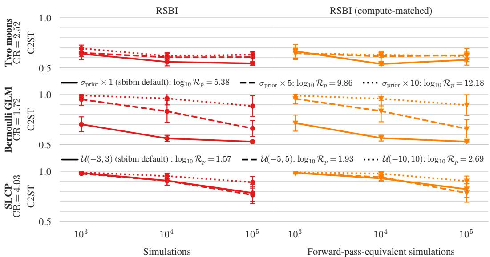  
Figure 5: Left: C2ST of RSBI against number of simulations. Right: C2ST of RSBI against the equivalent compute-matched simulation budget (reported in Table 3). Calculated for Two Moons, Bernoulli GLM and SLCP benchmarks. Y-axis labels include the compute ratio CR charged per Phase-1 simulation (Table 2). Lines are the prior scenarios of Figure 4 with error bars being the standard deviation over 10 observations.

Table 3: Total simulator calls made by the compute-matched runs of Figure 5.
<table><tr><td>Task</td><td>Prior</td><td> $N _ { \mathrm { s i m } } = 1 0 ^ { 3 }$ </td><td> $N _ { \mathrm { s i m } } = 1 0 ^ { 4 }$ </td><td> $N _ { \mathrm { s i m } } = 1 0 ^ { 5 }$ </td></tr><tr><td rowspan="3">Two Moons</td><td>default</td><td>724</td><td>5064</td><td>70 037</td></tr><tr><td>wide10x</td><td>800</td><td>9203</td><td>99 203</td></tr><tr><td>wide50x</td><td>800</td><td>9203</td><td>99 203</td></tr><tr><td rowspan="3">Bernoulli GLM</td><td>default</td><td>820</td><td>8200</td><td>83 455</td></tr><tr><td>medium</td><td>820</td><td>8200</td><td>82 015</td></tr><tr><td>large</td><td>820</td><td>8200</td><td>82 015</td></tr><tr><td rowspan="3">SLCP</td><td>default</td><td>624</td><td>6364</td><td>59 859</td></tr><tr><td>wide5x</td><td>624</td><td>6364</td><td>59 859</td></tr><tr><td>wide10x</td><td>624</td><td>6364</td><td>59 859</td></tr></table>

## B.2 Posterior mass leakage mitigation

Leakage arises when an algorithm learns a density over θ that is not tied to the prior support. Atomic SNPE-C fits a conditional density estimator $q _ { \psi } ( \theta \mid x )$ , an unbounded flow or Gaussian mixture on $\mathbb { R } ^ { d }$ , to simulated pairs, and its proposal correction normalises the estimator only over the finite set of contrasting atoms. Nothing in the loss evaluates the estimator outside the support so when the posterior modes sit at the boundary, the smooth estimator spills mass across it and the leaked mass must be removed afterwards by rejection. Truncated SNPE (TSNPE; 9) avoids the atomic correction by drawing simulations from the prior truncated to a high-probability region and training with the standard NPE loss, which removes the optimisation pathology behind leakage; its estimator is nevertheless still a free density on $\mathbb { R } ^ { d }$ , so any residual out-of-support mass is again removed by rejection. RSBI never learns such a density. Its Phase 2 sampler is trained against the energy $E _ { r } \dot { ( \theta ) } = - \log p ( \theta ) - \log r _ { \psi _ { r } } ( \theta , x _ { o } )$ , which contains the prior exactly. Outside the support log $p ( \theta ) = - \infty$ , so the target assigns zero mass there whatever the ratio estimator outputs: an unconstrained classifier can be wrong about $r _ { \psi _ { r } }$ off the support, but the product $p ( \boldsymbol { \theta } ) r _ { \psi _ { r } } ( \boldsymbol { \theta } , \boldsymbol { x } _ { o } )$ cannot be. Because the sampler is fitted to this target, mass placed outside the support is penalised by the energy, and its gradient pushes trajectories back inside. In practice we implement the box prior as a stiff quadratic wall rather than an infinite one, to keep gradients finite, so a small residual fraction of the raw samples falls just outside the boundary (Figure 6). This fraction is set by the wall stiffness and the sampler's training error rather than by the estimator, and it vanishes from the final posterior, which is restricted to the support. The same argument applies to SNVI [7], whose variational posterior is likewise fitted to the prior-weighted ratio $\mathbf { \bar { \rho } } _ { p } ( \theta ) r _ { \psi } ( \bar { \theta } , \mathbf { \bar { \phi } } x _ { o } )$ rather than learned as a free density, and whose final importance-resampling step assigns zero weight to samples outside the support. This guarantee holds only to the extent that the ASBS sampler fits its target. When the controller fails to converge, for instance by collapsing onto a subset of modes or scattering trajectories across the box, its samples need not respect the energy, and out-of-support mass can reappear. This may not be in general true for other samplers/models used in Phase 1 of RSBI, which we discuss as a limitation of choosing WT-ASBS in Section 6.

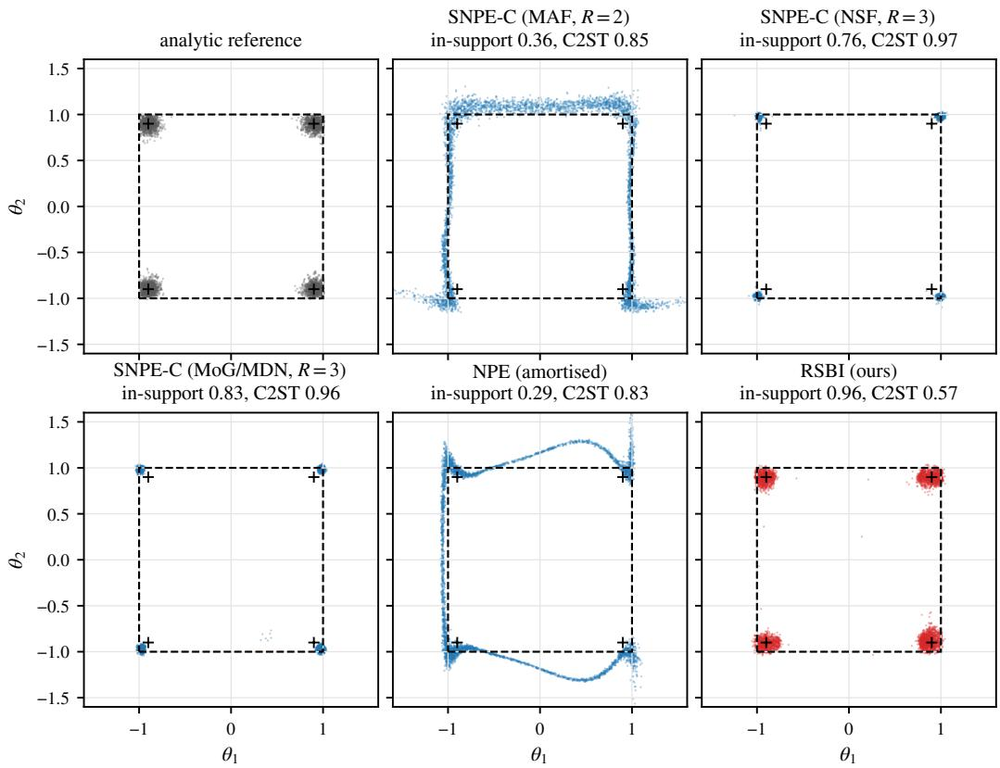  
Figure 6: Demonstration of posterior leakage and it's mitigation with RSBI: Posterior samples on the tractable squared-location task $( d = 2 , N _ { \mathrm { s i m } } = 1 0 ^ { 4 }$ , one observation). Dashed square: the support of the uniform prior, $[ - b , b ] ^ { 2 } ;$ crosses: the four true modes at $( \pm c , \pm c )$ , which lie close to the corners of the support. Each panel shows the raw sampler output of one method (before rejection for the flows, before removing the metadynamics bias for RSBI), with the fraction of its mass inside the support. The C2ST against the analytic reference (0.5 = indistinguishable) is computed on each method's final posterior restricted to the support: the in-support samples of the flows and NPE, and the in-support reweighted samples of RSBI. The atomic SNPE-C flows and amortised NPE place much of their mass outside the support; RSBI keeps it inside while covering all four modes, like the analytic reference (top left).

To isolate how bounded prior support affects inference (leakage), we use a tractable benchmark with a closed-form posterior. The parameters are drawn from a uniform box, $\theta \sim \mathcal { U } ( [ - b , b ] ^ { d } )$ , and the data are $x = \theta ^ { 2 } + \sigma \epsilon , \epsilon \sim \mathcal { N } ( 0 , I )$ , so the posterior for $x _ { o } = ( c ^ { 2 } , \ldots , c ^ { 2 } )$ has $2 ^ { d }$ symmetric modes at $( \pm c , \ldots , \pm c )$ . Taking c close to b places every mode near a corner of the prior support (in $d = 2 ,$ a square), the regime in which density-based posteriors are known to “leak" probability mass outside the support. Because the reference posterior is available analytically, we can measure leakage exactly. We use d = 2, b = 1, c = 0.9 and $\sigma = 0 . 1$

At a fixed simulation budget $( N _ { \mathrm { s i m } } = 1 0 ^ { 4 } )$ we compare atomic SNPE-C [3], using the standard sbi implementation [53], with masked autoregressive flow [54] and neural spline flow [55] density estimators, the non-atomic mixture-of-Gaussians variant (whose posterior estimator is a Gaussian mixture), and amortised NPE (a single round with a masked autoregressive flow), against RSBI. We report, on the raw sampler output, the fraction of mass inside the prior support and the fraction of the $2 ^ { d }$ modes recovered (mode recall), and the classifier two-sample test (C2ST) against the analytic reference on each method's final posterior restricted to the support.

For RSBI, Phase 1 uses the Gaussian negative log-likelihood surrogate with the exact noise variance $\sigma ^ { 2 }$ and reference noise scale $\sigma _ { \mathrm { m a x } } = 0 . 3 .$ and is stopped after $5 \times \mathrm { 1 0 ^ { 3 } }$ simulations. Phase 2 spends the remaining $5 \times 1 0 ^ { 3 }$ simulations in a single round: a contrastive NRE is trained on fresh draws from the Phase 1 sampler, its ratio is evaluated only within the truncation region of Appendix $\mathbf { A . 4 } ,$ and the Phase 2 sampler, again with $\sigma _ { \mathrm { m a x } } = 0 . 3 .$ , targets the posterior under the uniform box prior.

The flow-based amortised and sequential methods place a substantial fraction of their mass outside the prior support, and the mixture-of-Gaussians variant mitigates but does not eliminate this (Figure 6). In contrast, RSBI samples under a constrained energy and keeps almost all of its mass inside the support while recovering all four modes. This controlled experiment shows that the leakage pathology is structural to unconstrained density estimation on boundary-mode targets, and that the constrained Phase 1 and 2 samplers remove it by construction.

## B.3 Ablation: replacing Phase 2 by standard sequential methods

RSBI has two components that could each explain its advantage on wide priors. Phase 1 localises the posterior by training ASBS on a surrogate, so it zooms from the prior onto the region that carries posterior mass. Phase 2 then refines this estimate with an NRE and an ASBS sampler that transports the Phase 1 sampler locally. To separate the two, we keep Phase 1 fixed and replace Phase 2 with established sequential methods that use Phase 1 as their first proposal, at the same simulation budget. The obvious candidate, atomic SNPE-C [3], is poorly suited to this setting. Its contrastive loss normalises the posterior only over a few atoms drawn from the proposal, so posterior mass leaks into the large region of the prior that the localised proposal never visits. With the Phase 1 sampler as its first proposal it reaches a C2ST of only 0.96 and 0.93 at $1 0 ^ { 3 }$ and $1 0 ^ { 4 }$ simulations, far from RSBI. We therefore use truncated SNPE (TSNPE) [9], which restricts the prior to a highest-density region (HPR) of the current posterior estimate and trains with the maximum-likelihood loss. It avoids leakage by construction and is the natural way to hand a localised proposal to a neural posterior estimator. As a second, variational baseline we use SNVI [7], which, like Phase 2 of RSBI, fits a sampler to the prior times a learned ratio and draws the next round of simulations from it. Unlike RSBI, it fits a normalising flow over the whole prior by forward KL, so the flow is free to move mass anywhere in the prior box, including regions where the ratio estimator has never seen data. On a wide prior the classifier extrapolates there without control. In SNVI's self-normalised importance weights a single proposal in such a region can dominate all others, so the flow is pulled onto spurious high-ratio regions even when initialised at the Phase 1 sampler, and the next round of simulations is spent there. RSBI's Phase-2 instead, transports particles locally from the Phase-1 proposal due to ASBS using Phase $\operatorname { l } ^ { \prime } \mathrm { s } \tilde { p } _ { \epsilon } \left( \theta \mid x _ { o } \right)$ as the source distribution.

We use Two Moons with the widest prior, $[ - 5 0 , 5 0 ] ^ { 2 } ( \log _ { 1 0 } \mathcal { R } _ { p } \approx 4 . 3 )$ , at $N _ { \mathrm { s i m } } \in \{ 1 0 ^ { 3 } , 1 0 ^ { 4 } , 1 0 ^ { 5 } \}$ and observations 1–10. For each cell we reload the trained Phase 1 sampler of the corresponding RSBI run, without retraining. TSNPE then runs two rounds with the same per-round allocation as RSBI's ratio estimator, 600/1 000/5 000 simulations in round 1 and 400/9 000/95 000 in round 2. Round 1 draws from the prior truncated to the 1 — € HPR of a 10-component Gaussian mixture fitted to the Phase 1 samples, and round 2 from the prior truncated to the HPR of the round-1 posterior at $x _ { o } ,$ with $\epsilon = 1 0 ^ { - 4 }$ TSNPE cannot be trained on the simulations RSBI's ratio estimator uses. Maximum-likelihood NPE trained on draws from a proposal $\tilde { p } ( \boldsymbol { \theta } )$ targets $\tilde { p } ( \theta \mid x ) \propto \tilde { p } ( \theta ) p ( x \mid \theta )$ which equals the posterior inside the truncation region only when $\tilde { p }$ is the truncated prior. The ratio estimator instead learns $p ( x \mid \theta ) / q ( x )$ (Eqn. 8) for any proposal whose support covers the posterior, so RSBI can train on the Phase 1 pairs and on draws from its Phase 2 sampler directly. Using the same pairs for TSNPE would require atomic SNPE-C, which suffers from leakage on wide priors, or importance weights $p ( \theta ) / \tilde { p } ( \theta )$ , which need a sampler density that ASBS does not provide. We therefore use the Phase 1 samples only to define the first truncation region and simulate afresh in both rounds, so TSNPE uses $n _ { 1 }$ more simulations than RSBI, which favours TSNPE. This flexibility in the choice of proposal is a structural advantage of the ratio-based Phase 2. The density estimator (NSF, 50 hidden units, independent z-scoring) and the C2ST protocol are those of the main SNPE baseline. In every cell both truncation regions contain all reference samples, so the truncation never removes posterior mass.

Table 4: Phase-2 ablation on Two Moons with the widest prior $( [ - 5 0 , 5 0 ] ^ { 2 } ) \colon$ mean (sd) C2ST over ten observations at matched simulation budget. Phase 1 + TSNPE uses the trained Phase 1 sampler of each RSBI run as the first truncation of TSNPE [9], with the same per-round simulation allocation as RSBI's ratio estimator $( n _ { 1 }$ more simulations, since the Phase 1 pairs are not truncated-prior draws). Phase 1 + SNVI replaces RSBI's NRE and ASBS sampler by SNVI [7] (SNRE-B and a normalising flow trained by forward KL), trained on exactly the same simulations in round 1 and the same number in round 2. SNPE and SNVI+fKL from the prior are the main-benchmark configurations. Phase 1 alone (524 simulations) reaches 0.995 (0.001).
<table><tr><td>Method</td><td> $N _ { \mathrm { s i m } } = 1 0 ^ { 3 }$ </td><td> $1 0 ^ { 4 }$ </td><td> $1 0 ^ { 5 }$ </td></tr><tr><td>SNPE (prior, R=2)</td><td>0.997 (0.002)</td><td>0.991 (0.015)</td><td>0.985 (0.009)</td></tr><tr><td> $\mathrm { S N V I + f K L } ( \mathrm { p r i o r } , R { = } 5 )$ </td><td>0.987 (0.004)</td><td>0.943 (0.023)</td><td>0.993 (0.020)</td></tr><tr><td>Phase  $1 + \mathrm { T S N P E } \left( R { = } 2 \right)$ </td><td>0.925 (0.032)</td><td>0.873 (0.083)</td><td>0.738 (0.107)</td></tr><tr><td> $\mathrm { P h a s e } \ 1 + \mathrm { S N V I } \left( R { = } 2 \right)$ </td><td>0.938 (0.061)</td><td>0.770 (0.101)</td><td>0.848 (0.023)</td></tr><tr><td> $\mathrm { R S B I } \left( \mathrm { P h a s e } \ 1 + \mathrm { N R E } / \mathrm { A S B S } \right)$ </td><td>0.693 (0.033)</td><td>0.617 (0.034)</td><td>0.629 (0.026)</td></tr></table>

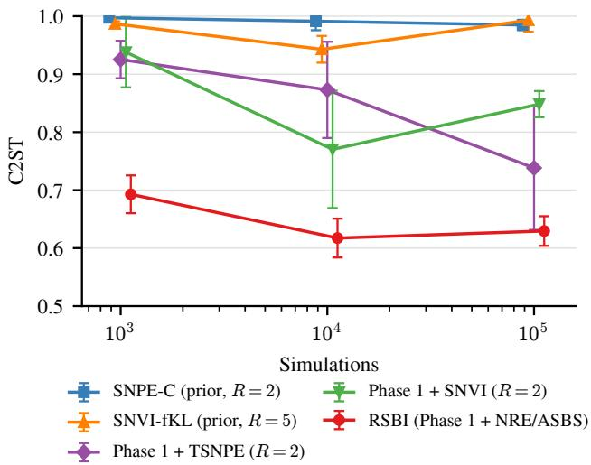  
Figure 7: C2ST against the reference posterior on Two Moons with the widest prior (mean ± sd over ten observations, lower is better). Values as in Table 4.

Phase 1 + SNVI uses the configuration of our SNVI+fKL baseline (SNRE-B with a ResNet classifier, a neural spline flow fitted by forward KL, and sampling-importance resampling) and is matched to RSBI in both simulations and rounds. Its ratio estimator is trained in round 1 on the same 600/1 000/5 000 Phase 1 pairs as RSBI's, and round 2 simulates the remaining budget from the round-1 variational posterior. Like the ASBS sampler of RSBI, the flow starts at the Phase 1 sampler, fitted to its samples by maximum likelihood. We compute the importance weights of the forward KL in log space, which avoids a numerical overflow of the released implementation that is detailed in Appendix E.

Table 4 and Figure 7 show that both phases are needed. On its own, Phase 1 is a poor posterior estimate (C2ST 0.995) because the surrogate is coarse, but it localises the posterior reliably. Using it as the first proposal improves TSNPE by 0.07, 0.12 and 0.25 in C2ST at $\mathrm { 1 0 ^ { 3 } }$ $1 0 ^ { 4 }$ and $1 0 ^ { 5 }$ simulations. SNPE from the prior barely improves at any budget, so without this zoom a standard sequential method spends almost its whole budget in regions of negligible posterior mass.

The zoom alone is not sufficient, however. Given the same Phase 1 and the same per-round budget, replacing TSNPE by RSBI's variational Phase 2 lowers the C2ST by a further 0.23, 0.26 and 0.11, and RSBI is better than Phase 1 + TSNPE on 10, 10 and 7 of the ten observations. Phase 2 accounts for most of the gain at $1 0 ^ { 3 }$ and $1 0 ^ { 4 }$ simulations, and RSBI reaches at $1 0 ^ { 3 }$ simulations (0.693) an accuracy that Phase 1 + TSNPE does not reach at $1 0 ^ { 5 }$ (0.738). Two properties of the variational Phase 2 explain this. First, the ratio estimator is valid under any proposal, so every simulation is used, including the Phase 1 pairs, whereas TSNPE must discard them and draw prior-shaped samples from the truncation region. Second, ASBS samples directly from the current posterior estimate, the prior times the learned ratio, so the round-2 simulations concentrate where the posterior has mass. TSNPE can only spread them over the prior restricted to an HPR of its round-1 estimate, and after a coarse zoom on the wide prior this region is still large compared with the posterior. At $1 0 ^ { 5 }$ simulations TSNPE closes part of the gap, as expected from a consistent estimator trained on a well-localised proposal, but it remains less accurate and much less stable across observations (sd 0.107 against 0.026). Phase $1 + \mathrm { S N V I }$ confirms that substantial gain comes from how Phase 2 refines the posterior and not from the ratio estimator alone. With the same Phase 1 pairs and the same rounds as RSBI, it improves on SNVI+fKL from the prior at every budget, but RSBI is better on all ten observations at every budget. At $1 0 ^ { 3 }$ simulations the variational posterior moved onto a spurious high-ratio region at the boundary of the prior in 4 of the 10 observations (C2ST 1.000), the failure described above. Both SNVI variants also share a non-monotonic dependence on the budget, with C2ST rising from 0.943 to 0.993 (prior, $R { = } 5 )$ and from 0.770 to 0.848 (Phase 1, $R { = } 2 )$ between $1 0 ^ { 4 }$ and $1 0 ^ { 5 }$ simulations. The two use different implementations, numbers of rounds and initialisations, so this degradation reflects SNVI's variational refinement on a wide prior. RSBI improves monotonically with the budget up to $1 0 ^ { 4 }$ simulations and remains stable at $1 0 ^ { \bar { 5 } }$ . The advantage of RSBI on wide priors in this ablation study is therefore derivative of both the Phase 1 zoom and the variational ASBS refinement that follows it.

## C Surrogate Likelihoods: Details and ablations

This appendix expands on the surrogate likelihood used in Phase 1 (Section 4.1). We stress at the outset that the choice of distance, and hence of surrogate likelihood, is task dependent and deserves care from the analyst. The ABC literature offers a wide range of choices, each motivated by a particular class of problems. These include hand-crafted or learned summary statistics [56], Gaussian synthetic likelihoods [57, 58], and full-data discrepancies such as the Wasserstein distance [59], the maximum mean discrepancy [60], the Kullback-Leibler divergence [61] and the energy statistic [62]. Comparative studies find that no single choice is best across problems [63], and the ABC kernel itself can be read as a model of the error between simulator and data [64], so the bandwidth € is a modelling choice as much as a tuning parameter.

We first describe the surrogate likelihoods used in this work and then discuss the bandwidth and metric trade-offs known from the ABC literature. Next, we show how inspecting the energy and gradient landscape of a surrogate can inform the choice of the bandwidth €. We close with ablations over the three surrogate likelihoods and over €. Figure 8 shows the Phase-1 posteriors obtained with the surrogates used for the main results. Phase 1 already concentrates on the posterior support and recovers its modes before any NRE is trained.

## C.1 Gaussian negative log-likelihood with adaptive variance

For a simulator with output $x = s ( \theta , \omega ) \in \mathbb { R } ^ { d _ { x } }$ , we model per-dimension residuals as zero-mean Gaussian with diagonal covariance diag $\big ( \epsilon _ { 1 } ( \theta ) , \dots , \epsilon _ { d _ { x } } ( \theta ) \big )$ , which plays the role of the bandwidth €. The surrogate distance is

$$
\mathcal { D } _ { \epsilon } ^ { \mathrm { N L L } } \big ( s ( \theta ) , x _ { o } \big ) \ = \ \frac { 1 } { 2 } \sum _ { d = 1 } ^ { d _ { x } } \frac { \big ( x _ { o } ^ { ( d ) } - \bar { x } ^ { ( d ) } ( \theta ) \big ) ^ { 2 } } { \epsilon _ { d } ( \theta ) } \ + \ \frac { 1 } { 2 } \sum _ { d = 1 } ^ { d _ { x } } \log \epsilon _ { d } ( \theta ) ,\tag{16}
$$

where, as in Sec. $4 . 1 , s ( \theta )$ denotes the $K$ replicates $x _ { k } = s ( \theta , \omega _ { k } ) , \omega _ { k } \overset { \mathrm { i i d } } { \sim } p ( \omega )$ , sharing the parameter θ but differing in the simulator's internal randomness, and $\bar { x } ^ { ( d ) } ( \theta )$ and $\epsilon _ { d } ( \theta )$ are their per-dimension mean and unbiased variance. Heteroscedastic Gaussian losses of this form have a long history in neural regression [65] and are now standard for deep predictive uncertainty quantification [66] We use PyTorch's gaussian\_nll\_loss with full=False, which omits the constant $\frac { d _ { x } } { 2 }$ log 2π (irrelevant for gradients by Theorem 4.1). The variance term in (16) acts as an entropy-like penalty that prevents the bridge from concentrating in regions where the simulator is highly stochastic.

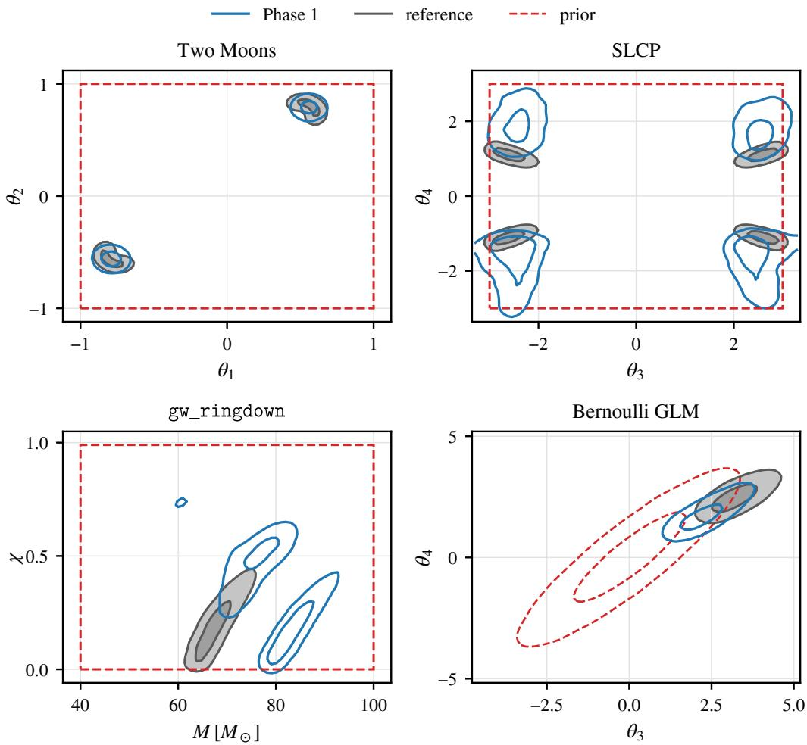  
Figure 8: Phase-1 posteriors used for the main results in Fig. 4 for Two Moons, SLCP, gw\_ringdown and the Bernoulli GLM (top left to bottom right), each at its default prior with $\bar { N _ { \mathrm { s i m } } } = \bar { 1 } 0 ^ { 5 }$ at observation 1 (see Sec. G for the Phase-1 configuration). We show the 1- and 2-σ contours of the Phase-1 (blue) and reference (grey) posteriors over the prior (dashed red: the prior box for the uniform priors, and the 1- and $2 { - } \sigma$ contours of the Gaussian prior for the Bernoulli GLM). For SLCP and gw\_ringdown we show the 2-D marginals of the full 5-D and 6-D posteriors for the two parameters with the most pronounced structure. These are $( \theta _ { 3 } , \theta _ { 4 } )$ , which separate the four SLCP modes, and the mass and spin pair $( M , \chi )$ , whose posterior is a single curved ridge (Phase 1 also places small islands of mass off the ridge). For the unimodal Bernoulli GLM we show the most strongly correlated pair of its 10 parameters.

We support two options for the variance $\epsilon _ { d } ( \theta )$ . (i) Fixed: $\epsilon _ { d } ( \theta ) = \epsilon _ { d } ^ { \star }$ for a user-supplied constant. A single simulator call per θ suffices $( K = 1 )$ , appropriate when the noise model is exact. (ii) Adaptive: $\epsilon _ { d } ( \theta )$ is recomputed at every θ from the K replicates. It varies smoothly with θ but is noisy at small K.

With fixed variance, (16) is a weighted squared distance plus the constant $\begin{array} { r } { \frac 1 2 \sum _ { d } \log \epsilon _ { d } ^ { \star } , } \end{array}$ hence a sufficient distance measure (Definition A.1) up to a constant, covered by Theorem 4.1. In the adaptive case, $\epsilon _ { d } = \epsilon _ { d } ( \theta , \omega _ { 1 : K } )$ is the sample variance of the replicates drawn at $\theta ,$ recomputed at every evaluation and differentiated through. The term ${ \frac { 1 } { 2 } } \sum _ { d } \log { \epsilon _ { d } }$ is then not a constant, since its expectation varies with θ wherever the simulator noise is heteroscedastic, so (16) is not a PSD distance up to a constant. It nonetheless defines a proper surrogate: the variance is floored, so $\mathcal { D } _ { \epsilon } ^ { \mathrm { N L L } }$ is bounded below, $\exp ( - \mathbb { E } \mathcal { D } _ { \epsilon } ^ { \mathrm { N L L } } ) p ( \theta )$ is integrable for any proper prior as per Def.A.1, and (7)

remains the gradient of a well-defined energy that ASBS targets as before. Any mismatch with the true likelihood is removed in Phase 2.

## C.2 Energy distance

We also consider the energy statistic of Székely and Rizzo [67], a characteristic-kernel discrepancy known to be equivalent to MMD with a distance-induced kernel [38, 68], whose sample estimator differentiates only through the (smooth) simulator output and never through a non-differentiable comparison. We instantiate it as $\mathcal { D } _ { \epsilon }$ by identifying $P$ with the simulator distribution $p ( x \mid \theta )$ and $Q$ with the (point-mass) data distribution at $x _ { o }$ . For two distributions $P , Q$ on $\mathbb { R } ^ { d _ { x } }$ and the Euclidean kernel $k ( u , v ) = - \| u - v \| _ { 2 }$ , the squared energy distance is

$$
{ \mathcal E } ^ { 2 } ( P , Q ) = 2 \mathbb { E } _ { X \sim P , Y \sim Q } \| X - Y \| - \mathbb { E } _ { X , X ^ { \prime } \sim P } \| X - X ^ { \prime } \| - \mathbb { E } _ { Y , Y ^ { \prime } \sim Q } \| Y - Y ^ { \prime } \| ,\tag{17}
$$

with $\mathcal { E } ^ { 2 } ( P , Q ) = 0$ iff $P = Q [ 6 7 ]$ . The bracket in Eq. (18) is its minimum-variance unbiased U-statistic. For each θ in the training minibatch we draw K i.i.d. simulator replicates $\{ x _ { k } \} _ { k = 1 } ^ { K } =$ $\{ s ( \theta ; \omega _ { k } ) \} _ { k = 1 } ^ { K }$ as samples from $P ,$ and treat the N available observations $\{ y _ { n } \} _ { n = 1 } ^ { N }$ as samples from Q (in our setting $N = 1$ and $y _ { 1 } = x _ { o } )$ . The unbiased U-statistic estimator, divided by a length scale $\epsilon > 0 .$ , is then

$$
\begin{array} { l } { \displaystyle \mathcal { D } _ { \epsilon } ^ { \mathrm { E D } } \big ( s ( \theta ) , x _ { o } \big ) = \frac { 1 } { \epsilon } \Bigg [ \frac { 2 } { K N } \sum _ { k = 1 } ^ { K } \sum _ { n = 1 } ^ { N } \lVert x _ { k } - y _ { n } \rVert ~ - ~ \frac { 1 } { K ( K - 1 ) } \sum _ { k \neq k ^ { \prime } } \lVert x _ { k } - x _ { k ^ { \prime } } \rVert } \\ { \displaystyle ~ - ~ \frac { 1 } { N ( N - 1 ) } \sum _ { n \neq n ^ { \prime } } \lVert y _ { n } - y _ { n ^ { \prime } } \rVert \Bigg ] , } \end{array}\tag{18}
$$

with the diagonals $k = k ^ { \prime }$ and $n = n ^ { \prime }$ excluded; the third term vanishes when $N = 1$ . For a fixed € the estimator is unbiased, and its expectation over the replicates is exactly the population quantity, E $\mathcal { D } _ { \epsilon } ^ { \mathrm { E D } } ( s ( \theta ) , x _ { o } ) = \mathcal { E } ^ { 2 } \big ( p ( x \mid \theta ) , \delta _ { x _ { o } } \big ) / \epsilon ,$ so the surrogate of Sec. 4.1 is the energy distance itself. For $N = 1$ the estimator is also non-negative, since $\| x _ { k } - x _ { k ^ { \prime } } \| \leq \| x _ { k } - x _ { o } \| + \| x _ { k ^ { \prime } } - \underline { { x _ { o } } } \|$ , so it is a sufficient distance measure (Definition A.1). Since $\mathcal { E }$ carries the units of $x , \textstyle { \frac { 1 } { \epsilon } }$ makes $\mathcal { D } _ { \epsilon } ^ { \mathrm { E D } }$ unit-less. It does not change the minimiser and only weights the discrepancy against the prior. By default ε is adaptive. It is the median pairwise distance among simulations at 256 prior draws (counted toward the simulation budget) and updated at every energy evaluation by an exponential moving average (decay 0.95) of the minibatch-averaged median pairwise distance among $\{ x _ { k } \} _ { k = 1 } ^ { K } \cup \{ x _ { o } \}$ , with no gradient flowing through €. Because € is a single detached scale, updated with weight 0.05 from a minibatch average, it depends only weakly on the replicates of any one $\theta .$ Within each evaluation we treat it as fixed, so unbiasedness holds conditionally on $\epsilon ,$ while across training € drifts and the Phase-1 target with it. With a single replicate $( K = 1$ , used on Two Moons) the second term in (18) is absent and $\mathcal { D } _ { \epsilon } ^ { \mathrm { E D } }$ reduces to $2 \lVert x _ { 1 } - x _ { o } \rVert / \epsilon .$ ,whose expectation exceeds $\mathcal { E } ^ { 2 } / \epsilon \thinspace \mathbf { b y } \mathbb { E } \| X - X ^ { \prime } \| / \epsilon$ . For Two Moons the simulator noise is additive, so this offset does not depend on $\theta$ and, by Theorem 4.1, the gradient is that of the energy distance itself. The median over $\{ x _ { 1 } , x _ { o } \}$ is then simply $\| x _ { 1 } - x _ { o } \|$ so € tracks a moving average of the minibatch-mean distance between the simulations and $x _ { o } .$ It starts at the scale of the prior predictive and shrinks as Phase 1 concentrates on the posterior, which anneals the surrogate from smooth to sharp during training (Appendix C.7 compares this with fixed length scales).

## C.3 Maximum mean discrepancy (MMD)

We also consider the squared maximum mean discrepancy (MMD) [38] with the Gaussian (RBF) kernel $k _ { \epsilon } ( u , v ) = \mathrm { e x p } \bar { ( } - \| u - v \| _ { 2 } ^ { 2 } / ( 2 \epsilon ^ { 2 } ) )$ of bandwidth $\epsilon > 0$ , which is characteristic, so that $\mathrm { M M D } _ { \epsilon } ^ { 2 } ( P , Q ) = 0$ iff $P = Q$ . As for the energy distance, we identify P with the simulator distribution $p ( x \mid \theta )$ and $Q$ with the (point-mass) data distribution at $x _ { o } ,$ and

$$
\mathrm { M M D } _ { \epsilon } ^ { 2 } ( P , Q ) = \mathbb { E } _ { X , X ^ { \prime } \sim P } k _ { \epsilon } ( X , X ^ { \prime } ) + \mathbb { E } _ { Y , Y ^ { \prime } \sim Q } k _ { \epsilon } ( Y , Y ^ { \prime } ) - 2 \mathbb { E } _ { X \sim P , Y \sim Q } k _ { \epsilon } ( X , Y ) .\tag{19}
$$

For each θ in the training minibatch we draw K i.i.d. simulator replicates $\{ x _ { k } \} _ { k = 1 } ^ { K } = \{ s ( \theta ; \omega _ { k } ) \} _ { k = 1 } ^ { K }$ and treat the N observations $\{ y _ { n } \} _ { n = 1 } ^ { N }$ as samples from $Q$ (here $N = 1 , y _ { 1 } = x _ { o } )$ . Since the unbiased

U-statistic of the $Q { - } Q$ term is undefined for $N = 1$ , we use the plug-in (V-statistic) estimator

$$
\begin{array} { l } { \mathcal { D } _ { \epsilon } ^ { \mathrm { M M D } } \bigl ( s ( \theta ) , x _ { o } \bigr ) = \displaystyle \frac { 1 } { K ^ { 2 } } \sum _ { k = 1 } ^ { K } \sum _ { k ^ { \prime } = 1 } ^ { K } k _ { \epsilon } ( x _ { k } , x _ { k ^ { \prime } } ) ~ + ~ \frac { 1 } { N ^ { 2 } } \sum _ { n = 1 } ^ { N } \sum _ { n ^ { \prime } = 1 } ^ { N } k _ { \epsilon } ( y _ { n } , y _ { n ^ { \prime } } ) } \\ { ~ - ~ \frac { 2 } { K N } \sum _ { k = 1 } ^ { K } \sum _ { n = 1 } ^ { N } k _ { \epsilon } ( x _ { k } , y _ { n } ) , } \end{array}\tag{20}
$$

diagonals included, so that for $N = 1$ the second term equals 1. $\Delta \mathrm { s } ~ { \mathcal { D } } _ { \epsilon } ^ { \mathrm { M M D } } \in [ 0 , 2 ]$ is unitless, no length-scale normalisation is applied. The bandwidth ε is either fixed or, by default, set by the median heuristic separately for each $\theta \colon \epsilon ( \theta )$ is the median pairwise Euclidean distance among $\{ x _ { k } \} _ { k = 1 } ^ { K } \cup \{ x _ { o } \}$ , recomputed at every energy evaluation from the current replicates (no pilot simulations, no smoothing), and gradients are propagated through $\epsilon ( \theta )$ . The V-statistic lies in [0, 2], so it is a sufficient distance measure (Definition A.1), but unlike the energy distance its expectation is biased, $\begin{array} { r } { \mathbb { E } \mathcal { D } _ { \epsilon } ^ { \mathrm { M M D } } = \mathrm { M M D } _ { \epsilon } ^ { 2 } + \frac { 1 } { K } \big ( 1 - \mathbb { E } k _ { \epsilon } ( X , X ^ { \prime } ) \big ) } \end{array}$ for fixed $\epsilon ,$ an additional penalty on simulator spread that vanishes as $K  \infty$ With the median heuristic, $\epsilon ( \theta )$ depends on the replicates and is differentiated through, as for the adaptive variance of Appendix C.1. MMD is used only in the surrogate ablations (Appendices C.6 and C.7).

## C.4 Bandwidth and Metric Trade-offs

The impact of $\tilde { \mathcal { D } } _ { \epsilon }$ and € on $\tilde { p } _ { \epsilon } ( x _ { o } \mid \theta )$ has been studied extensively in the ABC literature [21, 32, 56, 60]. Under mild regularity, $\tilde { p } _ { \epsilon }  p$ as $\epsilon  0$ , but small € degrades acceptance and inflates Monte Carlo variance, while large € over-smooths the likelihood and biases the posterior [69]. The choice of $\tilde { \mathcal { D } } _ { \epsilon }$ involves similar considerations, and kernel-based discrepancies such as MMD and the energy distance can improve the bias-variance trade-off relative to a fixed summary statistic.

In RSBI the trade-off takes a different form, because Phase 1 samples the surrogate with gradients rather than by acceptance. A small € gives a sharp energy whose gradient is dominated by Monte Carlo noise near $x _ { o }$ and vanishes far from it. A large € flattens the data term until the drift is set by the prior alone. Since Phase 2 NRE-ASBS refinement targets the true posterior, the surrogate need not approximate $p ( \theta \mid x _ { o } )$ precisely. It only needs to place mass in the region that Phase 2 then refines, so larger € values can be tolerated than in standalone ABC. The surrogates we use are not guaranteed to reproduce the mode, shape or variance of the true likelihood, and Phase 2 corrects the resulting bias.

Our ablations show that both choices depend on the simulator and the data, and that no single surrogate or bandwidth rule is best across tasks. Among surrogates (Appendix C.6), the energy distance gives the best Phase-1 proposal on Two Moons and the Bernoulli GLM, where MMD fails to concentrate at all. On SLCP all three surrogates are within one standard deviation of each other in C2ST, and MMD places much of its mass on the edges of the prior box. Whether the bandwidth should be adaptive or fixed is equally task dependent (Appendix C.7). On SLCP an adaptive per-θ variance is needed for the Gaussian NLL, because $\theta _ { 3 } , \theta _ { 4 }$ and $\theta _ { 5 }$ enter the simulator only through the noise covariance, and no fixed variance discovers the modes better than prior samples do. On the Bernoulli GLM the opposite holds. Per-θ variances estimated from a few binary replicates are too noisy, adaptive bandwidths fail $( \mathrm { C } 2 \mathrm { S } \mathrm { T } \geq 0 . 9 9 5 )$ and a fixed bandwidth is required. Sensitivity to € also varies. Misspecifying the best bandwidth by an order of magnitude costs 0.13 to 0.18 in Phase-1 C2ST on Two Moons and raises it to 0.98 or more on the Bernoulli GLM, whereas on SLCP the C2ST changes by less than 0.03 over four orders of magnitude. The pilot landscape heuristic of Sec. C.5 chooses bandwidths without the reference posterior that lie within half a decade of the best value on Two Moons and coincide with it on the Bernoulli GLM. It remains a heuristic, however, and it does not decide between surrogates or between adaptive and fixed bandwidths. Making these choices in a principled way requires a better understanding of the gradient landscape that a differentiable simulator and a distance induce over the prior, which we leave to future work.

## C.5 Bandwidth and temperature hyperparameter guesses via energy and gradient landscape

We suggest a cheap heuristic to aid in choosing the surrogate bandwidth € and the Phase-1 temperature T. This method leverages a cheap pilot run of $\mathcal { O } ( 1 0 ^ { 2 } )$ draws from the prior in order to observe the landscape of gradients and energy throughout the prior volume. The assumption is that bandwidth € and temperature T configurations that provide informative gradients for the Phase-1 zoom should produce a structured landscape with gradients that cohesively point to one or more energy wells, no matter where they are within the prior. We detail this process below, noting that exploring a fully fledged hyperparameter optimization regime for WT-ASBS is generally interesting and could constitute future work.

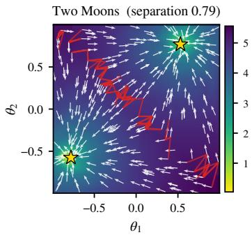

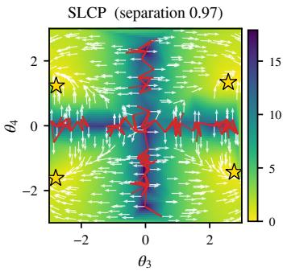

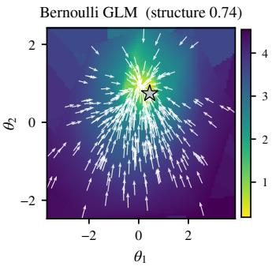  
Figure 9: Pilot energy landscapes for Two Moons (left), SLCP (centre) and the Bernoulli GLM (right), computed with the Phase-1 surrogate, bandwidth and temperature used for the benchmark main results at the default prior on observation 1 (see Sec. G for Phase-1 hyperparamters and surrogates used). Colour is $\log ( 1 + E / T - \operatorname* { m i n } E / T )$ ; white arrows show the direction of $- \nabla _ { \boldsymbol { \theta } } E ;$ stars are basin sinks (gold: significant); red edges are ridges. SLCP and the Bernoulli GLM are shown on 2-D slices through $( \bar { \theta } _ { 3 } , \theta _ { 4 } )$ and $( \bar { \theta _ { 1 } } , \bar { \theta _ { 2 } } )$ . The number in each panel title is the score used to rank bandwidths for that posterior: separation for the multimodal Two Moons and SLCP, structure for the unimodal Bernoulli GLM. Scores for these settings: Two Moons: separation 0.79, structure 0.79; SLCP: separation 0.97, structure 0.21; Bernoulli GLM: separation 0.00, structure 0.74.

Before any training, we evaluate the surrogate energy $E ( \theta ) = \mathcal { D } _ { \epsilon } \big ( s ( \theta ) , x _ { o } \big ) - \log p ( \theta )$ on a small pilot batch of prior draws with a few simulator replicates $\omega _ { 1 : K }$ each, look at its landscape, and score candidate bandwidths on the same simulations. The heuristic needs no training and no reference posterior, and its only cost is the pilot simulations.

At each pilot draw we record the energy and the drift $- \nabla _ { \theta } E .$ , obtained by back-propagating through the differentiable simulator. Splitting the replicates into two halves gives two independent estimates $E _ { 1 } , E _ { 2 } ,$ and the Monte Carlo noise of the energy is $\begin{array} { r } { \sigma _ { E } = \frac { 1 } { 2 } } \end{array}$ median $\left| E _ { 1 } - E _ { 2 } \right|$ . All quantities below are computed on the k-nearest-neighbour graph of the pilot draws, so every candidate $\epsilon , T$ is evaluated on the same simulations without new simulator calls. In more than two dimensions a projection of the draws mixes points that differ in the hidden parameters, so the maps are drawn on 2-D slices of two nominal parameters only.

Each draw steps to the neighbour that is lower in energy and best aligned with its drift. Following these steps downhill ends in a sink, and the draws that end in the same sink form one basin, or well; its share of the draws is the share of prior mass it attracts. Two neighbouring draws in different basins whose drifts point away from each other, each drift having a negative projection onto the direction to the other draw, lie on a ridge. The barrier $\Delta E$ of a basin is the lowest energy on its boundary (the higher endpoint of a cross-basin edge) minus the basin's minimum. Adjacent basins are merged unless the barrier between them is at least $3 \sigma _ { E }$ deep and at least 30% of their boundary pairs diverge, so that only boundaries where the drift genuinely splits between two wells remain.

We introduce three metrics that can be used to score a given surrogate bandwidth €. First, the cohesion: the median cosine between a draw's drift and the direction to its basin's sink, which measures whether the drift points into its own well. Second, the ridge fraction: the share of cross-basin neighbour pairs whose drifts diverge, which measures whether the boundaries between wells are genuine ridges. Third, the depth: the mean over basins of min(1, $\Delta E / 1 0 \sigma _ { E } )$ , which measures whether the barriers stand above the Monte Carlo noise. For a single well the ridge term is 1 and the depth uses the energy contrast $( E _ { 9 5 } - E _ { \mathrm { m i n } } ) / \sigma _ { E }$ in place of a barrier. They combine into

$$
{ \mathrm { s t r u c t u r e } } = { \mathrm { c o h e s i o n } } \times { \mathrm { r i d g e } } \times { \mathrm { d e p t h } } ,
$$

$$
\mathrm { s e p a r a t i o n } = \left\{ \begin{array} { l l } { \mathrm { r i d g e } \times \mathrm { d e p t h } , } & { \mathrm { \geq 2 ~ w e l l s } , } \\ { 0 , } & { \mathrm { o n e ~ w e l l } . } \end{array} \right.\tag{21}
$$

<table><tr><td>Task</td><td>wells</td><td>cohesion</td><td>ridge</td><td>depth</td><td>structure</td><td>separation</td></tr><tr><td>Two Moons</td><td>2</td><td>1.00</td><td>0.79</td><td>1.00</td><td>0.79</td><td>0.79</td></tr><tr><td>SLCP</td><td>4</td><td>0.22</td><td>0.97</td><td>1.00</td><td>0.21</td><td>0.97</td></tr><tr><td>Bernoulli GLM</td><td>1</td><td>0.74</td><td>一</td><td>1.00</td><td>0.74</td><td>0.00</td></tr></table>

Table 5: Landscape scores of the pilot batches in Fig. 9. Wells: significant basins. Cohesion: median cosine between a draw's drift and the direction to its basin's sink. $R i d g e \mathrm { : }$ share of cross-basin neighbour pairs whose drifts point apart (– for a single well, where the ridge term is 1). Depth: mean over basins of min $( 1 , \Delta E / \bar { 1 0 } \sigma _ { E } )$ , or min(1, $( E _ { 9 5 } - E _ { \mathrm { m i n } } ) / 1 0 \sigma _ { E } )$ for a single well. Structure = cohesion × ridge × depth. Separation = ridge × depth for two or more wells and 0 otherwise.

Structure rewards a drift that points coherently into wells that are deep and cleanly separated, whereas separation rewards only the separation of several wells, regardless of the drift inside each. For a multimodal energy landscape we take the €, or the adaptive variant, with the highest separation. For a unimodal energy landscape, we take the highest structure.For certain priors, a large € leaves only the prior's own well, which every score rates as perfect, so only settings whose median data gradient is at least three times the prior gradient are considered.

The landscape can inform the temperature $T ,$ but only when WT is on. The target exp $( - E / T )$ crosses a barrier of height $\Delta E$ with a probability that scales as $\exp ( - \Delta E / T )$ (Sec. A.1), so what matters is the barrier in units of the temperature, $\dot { \Delta E / T }$ . Well-tempered metadynamics (WT) with bias factor γ fills the wells and lowers the effective barrier to roughly $\mathrm { { \bar { \Delta } B / \gamma } } ,$ leaving $\Delta E / ( \gamma T )$ . Let κ denote the barrier height, in units of $T ,$ that we want to remain after the bias. Setting $\Delta E / ( \gamma T ) = \kappa .$ with $\Delta E$ the median barrier of the significant wells, gives

$$
T = \left\{ \begin{array} { l l } { 1 , } & { \mathrm { o n e ~ w e l l ~ ( n o ~ W T ) } , } \\ { \displaystyle { \frac { \Delta E } { \gamma \kappa } } , } & { \mathrm { s e v e r a l ~ w e l l s } . } \end{array} \right.\tag{22}
$$

The value of κ trades mode separation against mixing. A remaining barrier of $\kappa \approx 3$ gives a crossing factor $e ^ { - 3 } \approx 5 \%$ . Much smaller values flatten the wells and blur the modes, and much larger ones let the sampler stay trapped in the first well it finds. We use $\kappa = 3$ as a heuristic default rather than a tuned value. A single well needs neither tempering nor a bias, so $T = 1$

Figure 9 shows such landscapes for the Two moons, SLCP and Bernoulli GLM tasks. The colour shows the energy, with the white arrows depicting the drift/gradients from the average pilot. The stars depict the location of the basin sinks and the red edges show ridges such that the wells and barriers between energy basins can be inspected directly. Two Moons shows two wells separated by a ridge along $\theta _ { 1 } = - \theta _ { 2 }$ whilst SLCP shows four wells, one for each sign combination of $\left( \theta _ { 3 } , \theta _ { 4 } \right)$ , separated by ridges along $\theta _ { 3 } = 0$ . We note that this energy landscape was only seen for the Gaussian surrogate on SLCP. The Bernoulli GLM shows a single well with the drift pointing into it from everywhere. Table 5 lists the scores of these landscapes.

## C.6 Surrogate likelihood ablations

We compare three surrogate distances $\mathcal { D } _ { \epsilon } ( s ( \theta , \omega ) , x _ { o } )$ as the Phase-1 energy: the Gaussian negative log-likelihood (Gaussian-NLL), the energy distance and the maximum mean discrepancy (MMD). We run the comparison on Two Moons, SLCP and the Bernoulli GLM, each at its baseline prior. Within a task all surrogates share the same Phase-1 backbone, and training is capped at the simulation budget $N _ { \mathrm { s i m } } \in \{ 1 0 ^ { 3 } , \mathsf { \bar { 1 } 0 ^ { 4 } } , 1 0 ^ { 5 } \}$ . All entries are the mean ± standard deviation over 10 observations. Tables $_ { 6 - 1 3 }$ report the results; for the multimodal tasks, Figs. 10 and 11 show the Phase-1 samples of each surrogate on one observation.

These ablations are experiments in their own right, separate from the benchmark runs: rather than reusing the benchmark settings, each surrogate is given its own bandwidth € and temperature $T .$ sO that we compare reasonably tuned surrogates rather than one surrogate's defaults. These settings are chosen using the heuristic method of Sec. C.5 from a pilot batch of prior-predictive simulations, which uses no reference posterior. On Two Moons, € is fixed at the scale of the pilot simulations (a Gaussian-NLL variance of $1 . 0 \times 1 0 ^ { - 3 } ;$ an energy-distance length scale and MMD bandwidth of 0.78, the median pairwise distance), which is also the value that best separates the two energy wells of the pilot landscape. $T$ is then set from the same landscape so that, after well-tempered metadynamics with bias factor 10, about $3 k T$ of the median barrier between the wells remains: $T = 1 \mathrm { \dot { 2 } } . 8 , 0 . 0 6 8$ and 0.032, with one simulator replicate per θ. On SLCP the bandwidths are adaptive (as in the benchmark), and T is set from the energy landscape in the same way: $T = 1 1 .$ 1 for the Gaussian-NLL and $T = 0 . 0 1 1$ for MMD, while the energy distance keeps $T = 1 0 ^ { - 3 }$ from short pilot runs on observation 1, with three replicates per θ. On the Bernoulli GLM we keep $T = 1$ for all surrogates, because the prior is Gaussian and $\bar { T }$ would temper it as well; sharpness is instead set through a fixed € from the pilot: a Gaussian-NLL variance of 0.05, an energy-distance length scale of 0.914 (as in the benchmark runs) and an MMD bandwidth of 54.2 (about the median pairwise distance of the pilot simulations), with one, two and two replicates per θ.

Phase 1 only has to seed Phase 2 with a proposal that places mass on every posterior mode; it does not have to match the posterior. We therefore report two metrics, and a third, mode discovery, for the multimodal Two Moons and SLCP. The first is the C2ST of the Phase-1 samples against the reference posterior (lower is better, 0.5 means indistinguishable). The second is a mode fidelity, which measures how mass is distribued across modes, something C2ST does not explicitly test. Let τ be the 95th percentile of the nearest-neighbour distances within the reference sample. The precision $P$ is the fraction of Phase-1 samples that lie within τ of a reference sample. The recall $R _ { m }$ of mode m is the fraction of reference samples in mode m that have a Phase-1 sample within τ. The mode fidelity is

$$
F = P \cdot \operatorname* { m i n } _ { m } R _ { m } \in [ 0 , 1 ] ,\tag{23}
$$

with 1 ideal. $F  0$ if Phase 1 misses a mode $( \mathrm { m i n } _ { m } R _ { m }  0 )$ or spreads its mass too thinly over the prior $( P  0 ) ; F > 0$ means every mode is covered. For the unimodal Bernoulli GLM, $F$ reduces to precision times recall. On SLCP we compute $F$ on $( \theta _ { 3 } , \theta _ { 4 } )$ only: these coordinates separate the four modes, whereas the posterior is so narrow in the full five dimensions that almost no Phase-1 sample falls within τ of a reference sample, even when Phase 1 has found all four modes. Because $F$ rewards samples that land on the reference support rather than near a mode, on Two Moons and SLCP we also report a coarser mode discovery: each Phase-1 sample is assigned to the nearest reference-mode centre (in θ for Two Moons, in $( \dot { \theta _ { 3 } } , \theta _ { 4 } )$ for SLCP) if it lies within 1.5 times that mode's 95th-percentile reference radius (at most half the distance between mode centres), and discovery is K times the smallest per-mode share (K modes; 1 means all mass split equally over the modes, 0 a missed mode). As a reference point, samples drawn from the prior score 0.04 on Two Moons and 0.23 on SLCP. Because the Phase-1 proposal is much broader than the posterior, $F$ is small, and we report it in units of $1 0 ^ { - 3 }$

Two Moons. Table 6) shows that with larger budgets the C2ST improves monotonically, to 0.875 for the energy distance, 0.922 for MMD and 0.941 for the Gaussian-NLL at $1 0 ^ { 5 }$ . It never reaches $0 . 5 ,$ as expected, because Phase 1 learns the posterior under the surrogate likelihood rather than the simulator likelihood. Mode fidelity (Table 7) is positive for every surrogate and budget, so both moons are always seeded. The energy distance gives by far the best coverage at 104 and $1 0 ^ { 5 }$ simulations, albeit with large variation across observations. Mode discovery (Table 8, Fig. 10) ranks the surrogates as C2ST does: at $1 0 ^ { 3 }$ simulations all three are barely above the prior (0.09–0.11 against 0.04), while at $1 0 ^ { 5 }$ the energy distance reaches 0.64, MMD 0.53 and the Gaussian-NLL 0.32.

Table 6: Phase-1 C2ST on Two Moons (baseline prior) vs. the simulation budget (capped), mean ± std over 10 observations. Lower is better (0.5 = indistinguishable from the reference).
<table><tr><td>Surrogate</td><td> $1 0 ^ { 3 }$ </td><td> $1 0 ^ { 4 }$ </td><td> $1 0 ^ { 5 }$ </td></tr><tr><td>Gaussian-NLL</td><td> $0 . 9 8 1 { \pm } 0 . 0 0 5$ </td><td> $0 . 9 5 5 { \pm } 0 . 0 1 7$ </td><td> $0 . 9 4 1 { \pm } 0 . 0 1 1$ </td></tr><tr><td>Energy distance</td><td> $0 . 9 8 2 { \pm } 0 . 0 0 8$ </td><td> $0 . 8 9 1 { \scriptstyle \pm 0 . 0 4 7 }$ </td><td> $0 . 8 7 5 { \scriptstyle \pm 0 . 0 2 6 }$ </td></tr><tr><td>MMD</td><td> $0 . 9 8 1 { \scriptstyle \pm 0 . 0 0 7 }$ </td><td> $0 . 9 3 4 { \pm } 0 . 0 2 6$ </td><td> $0 . 9 2 2 { \scriptstyle \pm 0 . 0 1 2 }$ </td></tr></table>

Table 7: Phase-1 mode fidelity on Two Moons (baseline prior) vs. the simulation budget (capped) mean ± std over 10 observations. Values × 1000.
<table><tr><td>Surrogate</td><td> $1 0 ^ { 3 }$ </td><td> $1 0 ^ { 4 }$ </td><td> $1 0 ^ { 5 }$ </td></tr><tr><td>Gaussian-NLL</td><td> $1 . 5 6 0 { \pm } 1 . 0 9 2 \ $ </td><td> $1 0 . 5 6 0 { \scriptstyle \pm 6 . 9 8 1 }$ </td><td> $1 9 . 0 3 0 { \pm } 1 1 . 2 3 0 \ $ </td></tr><tr><td>Energy distance</td><td> $1 . 2 7 0 { \pm } 1 . 3 2 8$ </td><td> $5 7 . 6 3 0 { \pm } 2 4 . 1 4 7 $ </td><td> $1 0 1 . 4 3 0 { \pm } 3 7 . 4 1 0$ </td></tr><tr><td>MMD</td><td> $1 . 4 8 0 { \pm } 1 . 2 8 2 \ $ </td><td> $2 1 . 5 0 0 { \pm } 1 0 . 5 0 0$ </td><td> $3 8 . 9 9 0 { \pm } 1 2 . 1 1 9$ </td></tr></table>

Table 8: Phase-1 mode discovery on Two Moons (baseline prior) vs. the simulation budget (capped), mean ± std over 10 observations. Higher is better. Samples drawn from the prior score 0.04.
<table><tr><td>Surrogate</td><td> $1 0 ^ { 3 }$ </td><td> $1 0 ^ { 4 }$ </td><td> $1 0 ^ { 5 }$ </td></tr><tr><td>Gaussian-NLL</td><td> $0 . 1 1 4 { \pm } 0 . 0 4 8$ </td><td> $0 . 2 6 0 { \pm } 0 . 1 0 5$ </td><td> $0 . 3 2 3 { \pm } 0 . 1 8 1$ </td></tr><tr><td>Energy distance</td><td> $0 . 0 9 3 { \pm } 0 . 0 6 3$ </td><td> $0 . 5 2 7 { \pm } 0 . 1 1 4$ </td><td> $0 . 6 3 9 { \pm } 0 . 2 3 4$ </td></tr><tr><td>MMD</td><td> $0 . 1 0 7 { \scriptstyle \pm 0 . 0 5 5 }$ </td><td> $0 . 3 5 0 { \pm } 0 . 1 1 5$ </td><td> $0 . 5 3 0 { \pm } 0 . 1 3 2$ </td></tr></table>

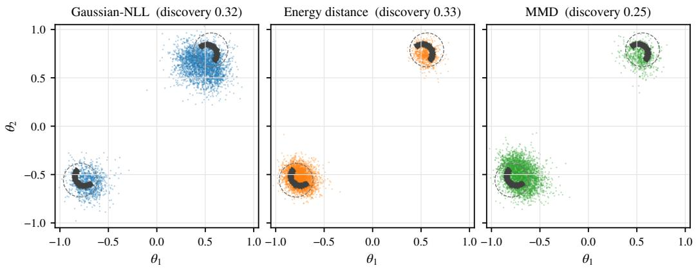  
Figure 10: Phase-1 samples on Two Moons for each surrogate's profile (observation $1 , 1 0 ^ { 4 }$ simulations; colour) over the reference posterior (grey). Dashed circles: the regions used for mode discovery (1.5× each moon's 95th-percentile reference radius). All three surrogates place a cluster on each moon; discovery is limited by how unevenly the mass is split between the moons and by clusters wider than the moons themselves.

SLCP. All three surrogates give a similar Phase-1 C2ST on SLCP, between 0.97 and 0.98 at every budget (Table 9); the differences are within one standard deviation. Mode fidelity on $( \theta _ { 3 } , \theta _ { 4 } )$ (Table 10) is positive for every surrogate and budget, so all three seed all four modes. It is highest for the Gaussian-NLL (at $1 0 ^ { 3 }$ and $1 0 ^ { \tilde { 5 } }$ simulations) and the energy distance (at $1 0 ^ { 4 } ) ;$ at $1 0 ^ { 4 }$ and $1 0 ^ { 5 }$ it is three to four times lower for MMD, which places much of its mass on the edges of the prior box. Mode discovery (Table 11, Fig. 11) shows how weakly Phase 1 concentrates on SLCP at these budgets: the Gaussian-NLL and the energy distance are only moderately above the prior (0.34–0.39 $1 { \stackrel { \smile } { 0 } } ^ { 4 }$ and $1 0 ^ { 5 }$ simulations, against 0.23), with the Gaussian-NLL ahead at $1 0 ^ { 3 }$ (0.29), and MMD stays at the level of the prior (0.16–0.24); the variation across observations is large. The posterior itself is resolved in Phase 2.  
Table 9: Phase-1 C2ST on SLCP (baseline prior) vs. the simulation budget (capped), mean ± std over 10 observations. Lower is better (0.5 = indistinguishable from the reference)
<table><tr><td>Surrogate</td><td> $1 0 ^ { 3 }$ </td><td> $1 0 ^ { 4 }$ </td><td> $1 0 ^ { 5 }$ </td></tr><tr><td>Gaussian-NLL</td><td> $0 . 9 7 9 { \scriptstyle \pm 0 . 0 1 1 }$ </td><td> $0 . 9 7 6 { \pm } 0 . 0 1 3$ </td><td> $0 . 9 7 1 { \scriptstyle \pm 0 . 0 1 6 }$ </td></tr><tr><td>Energy distance</td><td> $0 . 9 8 3 { \pm } 0 . 0 0 7$ </td><td> $0 . 9 7 3 { \pm } 0 . 0 1 5$ </td><td> $0 . 9 7 0 { \scriptstyle \pm 0 . 0 1 5 }$ </td></tr><tr><td>MMD</td><td> $0 . 9 8 1 { \pm } 0 . 0 1 1$ </td><td> $0 . 9 8 1 { \pm } 0 . 0 0 8$ </td><td> $0 . 9 7 9 { \pm } 0 . 0 1 4$ </td></tr></table>

Table 10: Phase-1 mode fidelity on SLCP (baseline prior) vs. the simulation budget (capped) mean ± std over 10 observations. Values × 1000. Mode fidelity is computed on $( \theta _ { 3 } , \bar { \theta } _ { 4 } )$ only, the coordinates that separate the four SLCP modes (and carry the metadynamics bias).
<table><tr><td>Surrogate</td><td> $1 0 ^ { 3 }$ </td><td> $1 0 ^ { 4 }$ </td><td> $1 0 ^ { 5 }$ </td></tr><tr><td>Gaussian-NLL</td><td> $6 8 . 6 4 2 { \scriptstyle \pm 7 5 . 6 8 2 }$ </td><td> $1 1 1 . 6 7 6 { \scriptstyle \pm 1 3 3 . 6 7 6 }$ </td><td> $1 3 8 . 8 9 3 { \pm } 1 5 8 . 3 3 8$ </td></tr><tr><td>Energy distance</td><td> $4 1 . 3 1 7 { \scriptstyle \pm 4 6 . 9 1 5 }$ </td><td> $1 3 0 . 3 0 2 { \pm } 1 3 1 . 6 4 9$ </td><td> $1 1 2 . 4 1 8 { \pm } 1 0 9 . 1 3 2$ </td></tr><tr><td>MMD</td><td> $4 1 . 9 5 9 { \pm } 4 0 . 8 0 2$ </td><td> $2 8 . 2 0 2 { \scriptstyle \pm 2 8 . 3 0 0 }$ </td><td> $3 6 . 7 6 0 { \scriptstyle \pm 5 2 . 3 4 9 }$ </td></tr></table>

Table 11: Phase-1 mode discovery on SLCP (baseline prior) vs. the simulation budget (capped) mean ± std over 10 observations. Higher is better. Samples drawn from the prior score 0.23.
<table><tr><td>Surrogate</td><td> $1 0 ^ { 3 }$ </td><td> $1 0 ^ { 4 }$ </td><td> $1 0 ^ { 5 }$ </td></tr><tr><td>Gaussian-NLL</td><td> $0 . 2 8 7 { \scriptstyle \pm 0 . 2 4 1 }$ </td><td> $0 . 3 3 8 { \pm } 0 . 2 9 8$ </td><td> $0 . 3 7 7 { \scriptstyle \pm 0 . 3 3 2 }$ </td></tr><tr><td>Energy distance</td><td> $0 . 1 7 3 { \pm } 0 . 1 7 2$ </td><td> $0 . 3 5 8 { \pm } 0 . 2 6 6$ </td><td> $0 . 3 8 9 { \pm } 0 . 2 7 3$ </td></tr><tr><td>MMD</td><td> $0 . 1 6 4 { \pm } 0 . 1 6 3$ </td><td> $0 . 2 2 4 { \pm } 0 . 1 8 4$ </td><td> $0 . 2 4 1 { \pm } 0 . 1 8 3$ </td></tr></table>

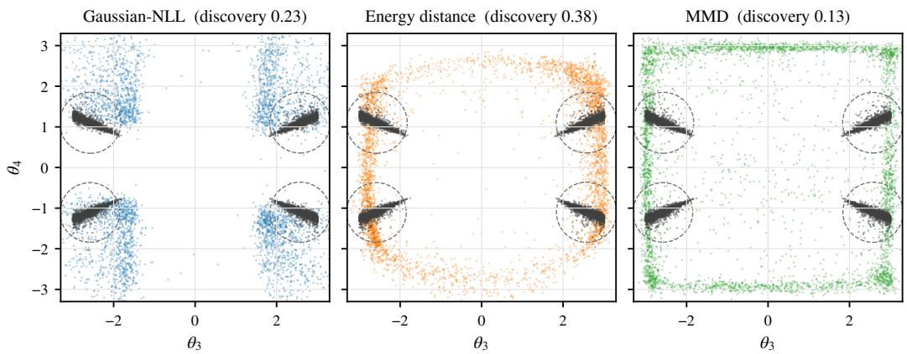  
Figure 11: Phase-1 samples on SLCP in the mode-separating coordinates $( \theta _ { 3 } , \theta _ { 4 } )$ for each surrogate's profile (observation 1, $\mathrm { \dot { 1 } 0 ^ { 4 } }$ simulations; colour) over the reference posterior (grey). Dashed circles: the regions used for mode discovery (1.5× each mode's 95th-percentile reference radius). The Gaussian-NLL puts its mass beside all four modes $( | \theta _ { 3 } | \approx 2 )$ , spread along $\theta _ { 4 } ;$ the energy distance spreads its mass in a ring around the prior box that passes through them; MMD concentrates on the box edges.

Bernoulli GLM. The surrogates differ most on the Bernoulli GLM (Table 12). The energy distance is the only surrogate whose C2ST improves steadily with the budget, reaching 0.687 at $1 \mathrm { \overline { { 0 } } ^ { 5 } }$ simulations, and it also attains the highest mode fidelity, $\dot { F _ { \mathrm { } } } \approx 0 . 7 7$ (Table 13). The Gaussian-NLL stays at a C2ST of 0.97–0.99 with lower fidelity. MMD fails to concentrate on the posterior at all $( \mathrm { C 2 S T } = 1 . 0 0 0 , F = 0 )$

Table 12: Phase-1 C2ST on Bernoulli GLM (baseline prior) vs. the simulation budget (capped), mean ± std over 10 observations. Lower is better (0.5 = indistinguishable from the reference).
<table><tr><td>Surrogate</td><td> $1 0 ^ { 3 }$ </td><td> $1 0 ^ { 4 }$ </td><td> $1 0 ^ { 5 }$ </td></tr><tr><td>Gaussian-NLL</td><td> $0 . 9 6 9 { \pm } 0 . 0 2 2$ </td><td> $0 . 9 8 3 { \pm } 0 . 0 1 1$ </td><td> $0 . 9 8 8 { \pm } 0 . 0 1 0$ </td></tr><tr><td>Energy distance</td><td> $0 . 8 1 0 { \pm } 0 . 0 6 6$ </td><td> $0 . 7 2 5 { \pm } 0 . 0 6 9$ </td><td> $0 . 6 8 7 { \pm } 0 . 0 5 9$ </td></tr><tr><td>MMD</td><td> $1 . 0 0 0 { \scriptstyle \pm 0 . 0 0 0 }$ </td><td> $1 . 0 0 0 { \scriptstyle \pm 0 . 0 0 0 }$ </td><td> $1 . 0 0 0 { \scriptstyle \pm 0 . 0 0 0 }$ </td></tr></table>

Table 13: Phase-1 mode fidelity on Bernoulli GLM (baseline prior) vs. the simulation budget (capped), mean ± std over 10 observations. Values × 1000.
<table><tr><td>Surrogate</td><td> $1 0 ^ { 3 }$ </td><td> $1 0 ^ { 4 }$ </td><td> $1 0 ^ { 5 }$ </td></tr><tr><td>Gaussian-NLL</td><td> $8 6 . 0 7 0 { \scriptstyle \pm 8 4 . 6 8 9 }$ </td><td> $2 3 1 . 9 4 0 { \pm } 1 2 9 . 1 4 5$ </td><td> $1 8 4 . 9 2 0 { \pm } 1 7 5 . 7 7 4$ </td></tr><tr><td>Energy distance</td><td> $4 3 0 . 2 7 0 { \scriptstyle \pm 2 0 0 . 0 1 3 }$ </td><td> $7 3 7 . 6 1 0 { \pm } 7 1 . 6 4 5$ </td><td> $7 6 7 . 6 1 0 { \pm } 5 4 . 8 2 4$ </td></tr><tr><td>MMD</td><td> $0 . 0 0 0 { \scriptstyle \pm 0 . 0 0 0 }$ </td><td> $0 . 0 0 0 { \scriptstyle \pm 0 . 0 0 0 }$ </td><td> $0 . 0 0 0 { \scriptstyle \pm 0 . 0 0 0 }$ </td></tr></table>

## C.7 Surrogate bandwidth ablations

Each surrogate has a bandwidth $\epsilon ,$ namely the per-dimension variance of the Gaussian-NLL $( \mathsf { A p - } $ pendix C.1), the length scale of the energy distance (Appendix C.2) and the kernel bandwidth of the MMD (Appendix C.3). Each can be fixed or set adaptively from the simulations, as defined in those appendices. The benchmark runs use the adaptive variance for the Gaussian-NLL on SLCP and Lotka-Volterra and the adaptive length scale for the energy distance on Two Moons. They use a fixed energy-distance length scale of 0.914 on the Bernoulli-GLM, selected from the heuristic procedure of Appendix C.5, and € = 1 for the energy distance on gw\_ringdown. MMD is not used in the benchmark, and its adaptive variant is the median heuristic.

To measure how sensitive Phase 1 is to €, we rerun Phase 1 on observation 1 with each surrogate's ablation settings of Appendix C.6 (temperature, replicates and metadynamics) and change only €, which we sweep over a log-spaced grid of fixed values. The temperature stays at the value chosen for the ablation bandwidth, so the sweep isolates €. The budget is $N _ { \mathrm { s i m } } = \mathrm { \bar { 1 0 ^ { 4 } } }$ on SLCP and the Bernoulli GLM, while on Two Moons Phase 1 runs its total benchmark schedule $^ { ( 4 , 5 1 2 }$ simulations). The grid contains the fixed ablation bandwidth of Appendix C.6 and, where the benchmark fixes one, the benchmark value (0.914 for the Bernoulli energy distance). On Two Moons it also contains 0.095, the value at which the benchmark's adaptive length scale settles once Phase 1 is near the posterior. For the energy distance and a fixed-variance Gaussian $\mathrm { \cdot N L L , }$ € only rescales the surrogate, so changing it is equivalent to changing the temperature of the likelihood term. For MMD it also changes the shape of the energy.

For each task we plot C2ST and mode fidelity F (Appendix C.6) against € and summarise the sweep in two tables. The C2ST table compares the profile with the best fixed bandwidth $\epsilon ^ { \star }$ , and shows how much C2ST degrades when $\epsilon ^ { \star }$ is off by a factor of ten in either direction. The fidelity table gives the band of ∈ over which $F > 0 . 0 1$ , the bandwidth $\epsilon ^ { \mathrm { p e a k } }$ that maximises $F ,$ with the precision $P$ and worst-mode recall $\mathrm { m i n } _ { m } R _ { m }$ there, and $F$ for the profile. Outside this band fidelity collapses in one of two ways. A bandwidth that is too small loses modes (minm $R _ { m } \to 0 )$ , and one that is too large spreads mass over the prior $( P \to 0 )$ . On SLCP a third table (Table 18) reports mode discovery. We do not consider mode discovery for two moons since all surrogates recover the modes significantly.

Two Moons. Misspecifying $\epsilon ^ { \star }$ by an order of magnitude degrades the Phase-1 C2ST by 0.13–0.18, depending on the surrogate (Fig. 12, Table 14). The profile bandwidths, chosen without the reference, lie within half a decade of $\epsilon ^ { \star }$ and are within 0.09 of its C2ST (0.894 vs. 0.809 for the Gaussian-NLL, 0.812 vs. 0.788 for the energy distance and 0.843 vs. 0.810 for MMD). Mode fidelity is non-trivial only in a narrow band of € (Table 15), yet every profile lies inside it $( F = 0 . 0 5 0 , 0 . 1 6 7$ and 0.079, against peaks of 0.19–0.25).

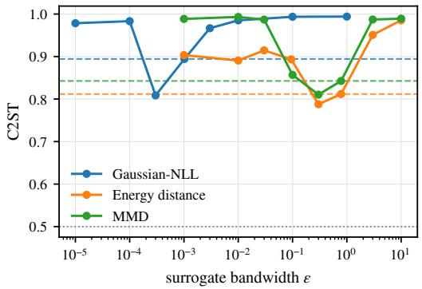

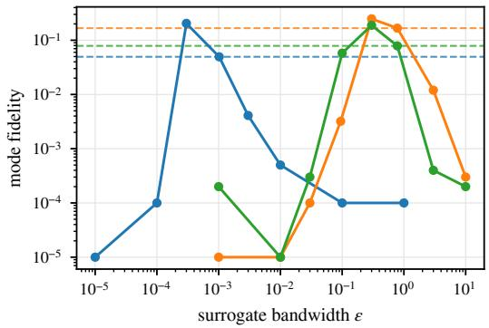  
Figure 12: Phase-1 sensitivity to the surrogate bandwidth € on Two Moons (4,512 simulations, one observation). Left: C2ST against the reference (lower is better; dotted: 0.5). Right: mode fidelity (= precision × worst-mode recall, log scale; zero drawn at $1 0 ^ { - 5 } )$ . Solid: each surrogate swept over its own bandwidth parameter (Gaussian-NLL variance, energy-distance length scale, MMD kernel bandwidth); dashed: the surrogate's profile setting.

Table 14: Phase-1 sensitivity to the surrogate bandwidth € on Two Moons (4,512 simulations, one observation). profile: C2ST at each surrogate's bandwidth and temperature as chosen, without the reference, from the energy-landscape diagnostics. $\epsilon ^ { \star }$ : the best fixed bandwidth on the sweep (identified using the reference), with its C2ST, and the C2ST when $\epsilon ^ { \star }$ is mis-set by one order of magnitude in either direction (change relative to $\epsilon ^ { \star }$ in brackets). Lower is better (0.5 = indistinguishable from the reference).
<table><tr><td>Surrogate</td><td>profile</td><td> $\epsilon ^ { \star }$ </td><td> $\mathrm { C } 2 \mathrm { S T } ( \epsilon ^ { \star } )$ </td><td> $\mathrm { C } 2 \mathrm { S T } ( 0 . 1 \epsilon ^ { \star } )$ </td><td> $\mathrm { C } 2 \mathrm { S T } ( 1 0 \epsilon ^ { \star } )$ </td></tr><tr><td>Gaussian-NLL</td><td>0.894</td><td>0.0003</td><td>0.809</td><td> $0 . 9 7 8 \left( + 0 . 1 7 0 \right)$ </td><td> $0 . 9 6 7 ( + 0 . 1 5 8 )$ </td></tr><tr><td>Energy distance</td><td>0.812</td><td>0.3</td><td>0.788</td><td> $0 . 9 1 4 ( + 0 . 1 2 7 )$ </td><td> $0 . 9 5 1 \left( + 0 . 1 6 3 \right)$ </td></tr><tr><td>MMD</td><td>0.843</td><td>0.3</td><td>0.810</td><td> $0 . 9 8 7 ( + 0 . 1 7 6 )$ </td><td> $0 . 9 8 7 ( + 0 . 1 7 7 )$ </td></tr></table>

Table 15: Phase-1 mode fidelity (= precision × worst-mode recall; higher is better) versus the surrogate bandwidth € on Two Moons (4,512 simulations, one observation). Non-trivial band: the range of ∈ with mode fidelity above 0.01 (– if none); $\epsilon ^ { \mathrm { p e a k } }$ : the bandwidth with the highest mode fidelity, with its precision and worst-mode recall; profile: mode fidelity at the surrogate's profile setting.
<table><tr><td>Surrogate</td><td>non-trvial band</td><td> $\epsilon ^ { \mathrm { p e a k } }$ </td><td>fidelity</td><td>precision</td><td>min-recall</td><td>profile</td></tr><tr><td>Gaussian-NLL</td><td>[0.0003, 0.00102]</td><td>0.0003</td><td>0.204</td><td>0.308</td><td>0.664</td><td>0.050</td></tr><tr><td>Energy distance</td><td>[0.3, 3]</td><td>0.3</td><td>0.248</td><td>0.411</td><td>0.604</td><td>0.167</td></tr><tr><td>MMD</td><td>[0.1, 0.783]</td><td>0.3</td><td>0.189</td><td>0.371</td><td>0.509</td><td>0.079</td></tr></table>

SLCP. Phase-1 C2ST on SLCP is almost insensitive to $\epsilon { : }$ all values lie between 0.978 and 1.000 over four orders of magnitude, and $\epsilon ^ { \star }$ falls at the edge of the grid for the Gaussian-NLL and the energy distance (Fig. 13, Table 16). The profiles, which use adaptive bandwidths on SLCP, are within 0.005 of the best fixed value, and better than it for the Gaussian-NLL. For the Gaussian-NLL a fixed variance discards information: $\theta _ { 3 } – \theta _ { 5 }$ enter SLCP only through the noise covariance, which the adaptive per-θ variance captures and a fixed one does not. Accordingly, its mode fidelity on $( \theta _ { 3 } , \theta _ { 4 } )$ stays at or below 0.003 for every fixed variance, against 0.007 for the adaptive profile (Table 17). The energy distance keeps $F > 0 . 0 1$ over the whole grid (peak 0.038) and MMD for $\epsilon \geq 3$ (peak 0.032). Mode discovery is shown in Table 18 and shows the cost of fixing the Gaussian-NLL variance: the adaptive profile reaches 0.23, whereas no fixed variance exceeds the prior $( \leq 0 . 1 4 )$ , and variances up to 0.1 miss modes entirely. For the energy distance the adaptive profile (0.38) matches the best fixed length scale (0.37); for MMD the adaptive bandwidth (0.13) is below every fixed one (0.14–0.26). We note from the results of Fig. 11 that the mode discovery and fidelity metrics do not consider distinct isolation of the Phase 1 modes present with the GNLL.

Table 16: Phase-1 sensitivity to the surrogate bandwidth € on SLCP (10,000 simulations, one observation). profile: C2ST at each surrogate's bandwidth and temperature as chosen, without the reference, from the energy-landscape diagnostics. $\epsilon ^ { \star } )$ the best fixed bandwidth on the sweep (identified using the reference), with its C2ST, and the C2ST when $\epsilon ^ { \star }$ is mis-set by one order of magnitude in either direction (change relative to $\epsilon ^ { \star }$ in brackets). Lower is better (0.5 = indistinguishable from the reference).
<table><tr><td>Surrogate</td><td>profile</td><td> $\epsilon ^ { \star }$ </td><td> $\mathrm { C } 2 \mathrm { S T } ( \epsilon ^ { \star } )$ </td><td>C2ST(0.1 ∈*)</td><td> $\mathrm { C } 2 \mathrm { S T } ( 1 0 \epsilon ^ { \star } )$ </td></tr><tr><td>Gaussian-NLL</td><td>0.984</td><td>20</td><td>0.988</td><td>0.991 (+0.003)</td><td> $0 . 9 8 8 \left( + 0 . 0 0 0 \right)$ </td></tr><tr><td>Energy distance</td><td>0.983</td><td>0.001</td><td>0.978</td><td> $0 . 9 7 8 \left( + 0 . 0 0 0 \right)$ </td><td> $0 . 9 8 4 ( + 0 . 0 0 6 )$ </td></tr><tr><td>MMD</td><td>0.986</td><td>10</td><td>0.983</td><td>0.988(+0.005)</td><td> $0 . 9 8 6 \left( + 0 . 0 0 3 \right)$ </td></tr></table>

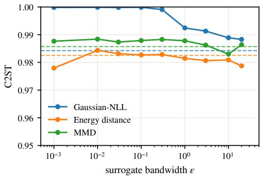

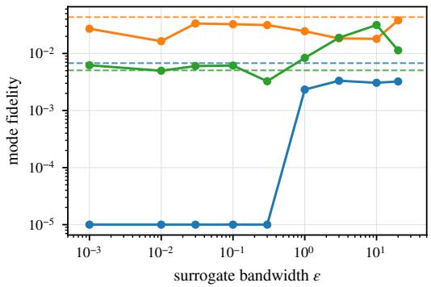  
Figure 13: Phase-1 sensitivity to the surrogate bandwidth € on SLCP (10,000 simulations, one observation). Left: C2ST against the reference (lower is better; dotted: 0.5). Right: mode fidelity (= precision × worst-mode recall, log scale; zero drawn at $1 0 ^ { - 5 } )$ . Solid: each surrogate swept over its own bandwidth parameter (Gaussian-NLL variance, energy-distance length scale, MMD kernel bandwidth); dashed: the surrogate's profile setting. Mode fidelity is computed on $( \theta _ { 3 } , \theta _ { 4 } )$ only, the coordinates that separate the four SLCP modes (and carry the metadynamics bias).

Table 17: Phase-1 mode fidelity (= precision × worst-mode recall; higher is better) versus the surrogate bandwidth € on SLCP (10,000 simulations, one observation). Non-trivial band: the range of € with mode fidelity above 0.01 (– if none); $\epsilon ^ { \mathrm { p e a k } }$ : the bandwidth with the highest mode fidelity, with its precision and worst-mode recall; profile: mode fidelity at the surrogate's profile setting. Mode fidelity is computed on $( \theta _ { 3 } , \theta _ { 4 } )$ only, the coordinates that separate the four SLCP modes (and carry the metadynamics bias).
<table><tr><td>Surrogate</td><td>non-trivial</td><td> $\epsilon ^ { \mathrm { p e a k } }$ </td><td>fidelity</td><td>precision</td><td>min-recall</td><td>profile</td></tr><tr><td>Gaussian-NLL</td><td></td><td>3</td><td>0.003</td><td>0.027</td><td>0.124</td><td>0.007</td></tr><tr><td>Energy distance</td><td>[0.001, 20]</td><td>20</td><td>0.038</td><td>0.132</td><td>0.288</td><td>0.043</td></tr><tr><td>MMD</td><td>[3, 20]</td><td>10</td><td>0.032</td><td>0.083</td><td>0.378</td><td>0.005</td></tr></table>

Table 18: Phase-1 mode discovery versus the surrogate bandwidth € on SLCP (10,000 simulations, one observation). profile: discovery at the surrogate's profile setting (adaptive or fixed bandwidth); best fixed €: the swept bandwidth with the highest discovery; range: lowest and highest discovery ov er the fixed bandwidths. Mode discovery: each Phase-1 sample is assigned to the nearest referencemode centre in $( \theta _ { 3 } , \theta _ { 4 } )$ if it lies within 1.5× that mode's 95th-percentile reference radius (at most half the distance between mode centres); discovery = 4× the smallest per-mode share (1 = all mass split equally over the 4 modes, $\mathbf { 0 } = \mathbf { a }$ mode missed). Samples drawn from the prior score 0.16.
<table><tr><td>Surrogate</td><td>profile</td><td>best fixed €</td><td>discovery(€)</td><td>range over fixed €</td></tr><tr><td>Gaussian-NLL</td><td>0.23 (adaptive)</td><td>10</td><td>0.14</td><td>[0.00, 0.14]</td></tr><tr><td>Energy distance</td><td>0.38 (adaptive)</td><td>0.03</td><td>0.37</td><td>[0.11, 0.37]</td></tr><tr><td>MMD</td><td>0.13 (adaptive)</td><td>10</td><td>0.26</td><td>[0.14, 0.26]</td></tr></table>

Bernoulli GLM. On the Bernoulli GLM adaptive bandwidths fail $( \mathrm { C 2 S T } \geq 0 . 9 9 5 , F = 0$ on observation 1): for the Gaussian-NLL the per-θ variance estimated from few replicates of the Bernoulli observations is too noisy. A fixed bandwidth is therefore required, and it matters (Fig. 14, Table 19): the profile bandwidths coincide with $\epsilon ^ { \star }$ for both the energy distance (C2ST 0.770) and the Gaussian-NLL (0.957), but the C2ST rises to $0 . 9 8 – 1 . 0 0$ when they are off by a factor of 10. Both have a broad band of bandwidths with non-trivial fidelity, peaking at $F = 0 . { \dot { 8 } } 1$ for the energy distance (Table 20). MMD fails at every bandwidth in the grid. The fixed bandwidth that was used for the benchmarking in the main results was derived from the profile value and corresponds to the best performing bandwidth in this ablation.  
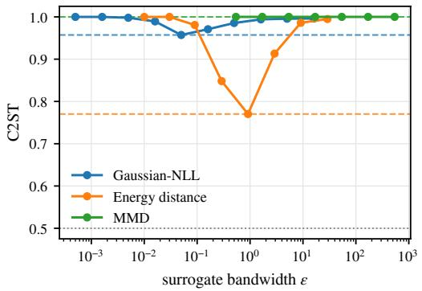

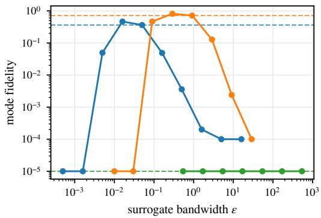  
Figure 14: Phase-1 sensitivity to the surrogate bandwidth € on Bernoulli GLM (10,000 simulations, one observation). Left: C2ST against the reference (lower is better; dotted: 0.5). Right: mode fidelity $( = { \mathrm { p r e c i s i o n } } \times$ worst-mode recall, log scale; zero drawn at $1 0 ^ { - 5 } )$ . Solid: each surrogate swept over its own bandwidth parameter (Gaussian-NLL variance, energy-distance length scale, MMD kernel bandwidth); dashed: the surrogate's profile setting.

Table 19: Phase-1 sensitivity to the surrogate bandwidth € on Bernoulli GLM (10,000 simulations, one observation). profile: C2ST at each surrogate's bandwidth and temperature as chosen, without the reference, from the energy-landscape diagnostics. $\epsilon ^ { \star } \colon$ the best fixed bandwidth on the sweep (identified using the reference), with its C2ST, and the C2ST when $\epsilon ^ { \star }$ is mis-set by one order of magnitude in either direction (change relative to $\epsilon ^ { \star }$ in brackets). Lower is better (0.5 = indistinguishable from the reference).
<table><tr><td>Surrogate</td><td>profile</td><td> $\epsilon ^ { \star }$ </td><td> $\mathrm { C } 2 \mathrm { S T } ( \epsilon ^ { \star } )$ </td><td> $\mathrm { C } 2 \mathrm { S T } ( 0 . 1 \epsilon ^ { \star } )$ </td><td> $\mathrm { C } 2 \mathrm { S T } ( 1 0 \epsilon ^ { \star } )$ </td></tr><tr><td>Gaussian-NLL</td><td>0.957</td><td>0.05</td><td>0.957</td><td> $0 . 9 9 8 ( + 0 . 0 4 1 )$ </td><td> $0 . 9 8 5 ( + 0 . 0 2 8 )$ </td></tr><tr><td>Energy distance</td><td>0.770</td><td>0.914</td><td>0.770</td><td> $0 . 9 8 1 ( + 0 . 2 1 1 )$ </td><td> $0 . 9 8 6 \left( + 0 . 2 1 6 \right)$ </td></tr><tr><td>MMD</td><td>1.000</td><td>0.54</td><td>1.000</td><td> $1 . 0 0 0 ( + 0 . 0 0 0 )$ </td><td> $1 . 0 0 0 ( + 0 . 0 0 0 )$ </td></tr></table>

Table 20: Phase-1 mode fidelity (= precision × worst-mode recall; higher is better) versus the surrogate bandwidth € on Bernoulli GLM (10,000 simulations, one observation). Non-trivial band: the range of € with mode fidelity above 0.01 (– if none); $\epsilon ^ { \mathrm { p e a k } }$ : the bandwidth with the highest mode fidelity, with its precision and worst-mode recall; profile: mode fidelity at the surrogate's profile setting.
<table><tr><td>Surrogate</td><td>non-trivial band</td><td> $\epsilon ^ { \mathrm { p e a k } }$ </td><td>fidelity</td><td>precision</td><td>min-recall</td><td>profile</td></tr><tr><td>Gaussian-NLL</td><td>[0.005, 0.16]</td><td>0.016</td><td>0.466</td><td>0.984</td><td>0.473</td><td>0.363</td></tr><tr><td>Energy distance</td><td>[0.09, 2.9]</td><td>0.29</td><td>0.813</td><td>0.972</td><td>0.837</td><td>0.716</td></tr><tr><td>MMD</td><td></td><td>0.54</td><td>0.000</td><td>0.000</td><td>0.000</td><td>0.000</td></tr></table>

## D Task details

This appendix comprises details on computational expense as well as descriptive summaries of each experiemnt conducted in this paper. For the experiments, RSBI required differentiable versions of each simulator taken from the sbibm package. At the true parameters of observations 1 and 5, two-sample Kolmogorov-Smirnov tests on every output dimension, at the 5% level with Bonferroni correction, find no difference between the original sbibm simulators and our re-implementations for any task. Means agree to within 2.3 standard errors and standard deviations to within 6%, consistent with sampling noise at the sample sizes used $( 1 . 5 \times 1 0 ^ { 3 } \mathrm { t o } 4 \times 1 0 ^ { 4 }$ draws).

## D.1 Compute Usage

Nearly all experiments in Section 5 are run on a single NVIDIA A100 40G GPU, with some run instead on an NVIDIA GTX 1660 Ti laptop GPU. The time taken for each RSBI run varies depending on the number of simulations and specific hyperparameters. In general, each RSBI run on the Two Moons simulator using the NVIDIA A100 40G GPU in the 10⁵ simulation budget regime takes \~ 25 minutes to run. Total compute time on this specific experiment therefore approaches \~ 4 hours.

## D.2 GW ringdown

Gravitational-wave ringdown is the final stage of a binary black-hole merger [70], occurring after the two black holes merge and the newly formed remnant settles into a single spinning black hole. During this phase the signal is dominated by a superposition of damped sinusoids, the quasi-normal modes, whose frequencies and decay times are determined entirely by the remnant's mass and spin according to general relativity. This makes ringdown a uniquely clean probe of strong-field gravity: measuring these modes constrains the remnant properties and tests general relativity in the high-curvature regime [71, 72].

Our differentiable ringdown simulator combines two quasi-normal modes $( \ell = m = 2 , n \in \{ 0 , 1 \} )$ with the H1 antenna pattern at the LIGO Hanford detector and additive Gaussian noise drawn from the H1 power spectral density estimated from LIGO first-observing-run data around GW150914. The strain is whitened via the Cholesky factor of the Toeplitz noise covariance built from the autocorrelation implied by this PSD, giving a unit-variance representation that sets the natural surrogate length scale $\epsilon = 1$ The analysis window is $T = 0 . 2 \ : \mathrm { s }$ at a sampling rate of 4096 Hz, giving $d _ { x } = 8 2 0$ samples per detector. The full forward map, from waveform generation through antenna projection, noise injection and whitening, is implemented in PyTorch so that $\nabla _ { \boldsymbol { \theta } } s ( \boldsymbol { \theta } , \bar { \boldsymbol { \omega } } )$ is available end-to-end, which is what makes Phase 1's surrogate gradient and Phase $2 \mathrm { { } s }$ adjoint matching applicable. The noise enters as Lz with $z \sim \mathcal { N } ( 0 , \bar { I } )$ and L the Cholesky factor, so the simulator is reparameterised exactly. Unlike the other tasks, this simulator is not a re-implementation. The same class generates the observations, the reference posteriors, the simulations of the baselines and those of RSBI, with the same detector, window and sampling settings.

We infer $\theta = ( M , \chi , A _ { 2 2 0 } , \varphi _ { 2 2 0 } , A _ { 2 2 1 } , \varphi _ { 2 2 1 } , \cos \iota , \alpha , \cos \delta , \psi )$ with $d _ { \theta } = 1 0$ in total. For the experiments reported in the main text the four extrinsic dimensions $( \cos \iota , \alpha , \cos \delta , \psi )$ are pinned to truth, the natural conditional setup for a single-detector analysis with known sky position and distance, reducing the inferred dimension to $d _ { \theta } = 6$ . Two prior scenarios are considered. The default scenario with $M \in \left[ 4 0 , 1 0 0 \right] M _ { \odot } , \chi \in \left[ 0 , 0 . 9 9 \right] , A _ { 2 2 0 } , A _ { 2 2 1 } \in \left[ 0 , 5 \right] , \varphi _ { 2 2 0 } , \varphi _ { 2 2 1 } \in \left[ 0 , 2 \pi \right] .$ COS l, COS $\delta \in [ - 1 , 1 ] , \alpha \in [ \bar { 0 , } 2 \pi ] , \psi \in [ \bar { 0 , } \pi ]$ covers astrophysically plausible stellar-mass remnants. The wide scenario with $\bar { M } \in [ \bar { 1 } 0 , 2 0 0 ] \bar { M } _ { \odot }$ and $A _ { 2 2 0 } , \hat { A } _ { 2 2 1 } \in [ \hat { 0 } , \hat { 1 } 5 ]$ , with the remaining ranges unchanged, relaxes the astrophysical priors to those a fundamental-physics analysis might use when remaining agnostic about the source population. The two scenarios give $\log _ { 1 0 } \mathcal { R } _ { p } \approx 2 . 6$ and 2.8 respectively (Table 21).

Because the noise model is exact in whitened coordinates, the likelihood is analytic given θ and we can sample a reference posterior directly. Ten injections are drawn uniformly from a sub-box of the default prior, with $M \in [ 6 0 , 8 0 ] M _ { \odot } , \hat { A _ { 2 2 0 } } \in [ \hat { 3 , 5 } ]$ and $A _ { 2 2 1 } \in [ 2 , 4 ]$ and the remaining parameters over their full default ranges, and one noise realisation is added per injection to produce $x _ { o } .$ The same ten observations are used across both prior scenarios, since widening the prior does not regenerate the data, only the reference posterior. Figure 3 shows observation 10, whose injected source is M = 70.18 $M _ { \odot } , \chi = 0 . 5 5 8 , A _ { 2 2 0 } = 4 . 2 4 9 , \varphi _ { 2 2 0 } = 5 . 8 7 3$ rad, $A _ { 2 2 1 } = 2 . 7 2 4$ and $\varphi _ { 2 2 1 } = 1 . 0 9 9$ rad. We draw $N _ { \mathrm { r e f } } = 1 0 ^ { 4 }$ reference samples per observation. The emcee runs are computed once per (prior, observation) pair and reused across method runs.

We run RSBI at a single simulation budget of $N _ { \mathrm { s i m } } = 1 0 ^ { 5 }$ with $R = 2$ Phase-2 rounds. Phase 1 uses $5 . 9 9 \times 1 0 ^ { 4 }$ simulations, which seed the first NRE (topped up to $6 \times 1 0 ^ { 4 } )$ , and the second round adds $4 \times 1 0 ^ { 4 }$ simulations drawn from the round-0 Phase 2 sampler. Phase 1's energy is the unbiased energy distance of Appendix C.2 with a fixed length scale $\epsilon = 1$ and $K = 4$ replicates. The source is the prior box with a soft boundary penalty $( \lambda _ { \mathrm { s o f t } } ^ { - } = 1 0 )$ , which keeps the bridge from spending capacity on the prior corners. Well-tempered metadynamics acts in Phase 1 along $\xi ( \theta ) = ( M , \chi )$ to cover the mass and spin basins, and Phase 2 starts from the Phase 1 samples reweighted by the final bias. Phase 2 runs without a bias, in coordinates whitened by the Phase 1 samples (Appendix $\mathbf { A . } 5 )$ Both prior scenarios share every setting, and the sampler operates on the prior box rescaled to $[ 0 , 1 0 ] ^ { 6 }$ Inference is on the 6D free subspace, with all MLP input dimensions remapped from the on-disk $d _ { \theta } = 1 0 \mathrm { t o } 6 .$ The full configuration is given in Sec. G.

## D.3 SLCP

We evaluate RSBI on the SLCP task of Lueckmann et al. [18] $( \theta \ \in \ \mathbb { R } ^ { 5 } , \ x \ \in \ \mathbb { R } ^ { 8 } )$ across the three prior boxes $\mathrm { \Delta D E F A U L T } = [ - 3 , 3 ] ^ { 5 }$ $\mathrm { w } _ { Ḋ } \mathrm { I D E } { 5 } \mathrm { X } = [ - 5 , 5 ] ^ { 5 }$ , and WIDE $1 0 \mathrm { { X } = [ - 1 0 , 1 0 ] ^ { 5 } }$ (see Tab. 21 for the corresponding prior-to-posterior volume ratios), each at simulator-call budgets $N _ { \mathrm { s i m } } \in \{ 1 0 ^ { 3 } , 1 0 ^ { 4 } , 1 0 ^ { 5 } \}$ , on observations 1—10 from the sbibm reference set. Posterior quality is reported via the C2ST against the reference posterior of each prior, evaluated on $1 0 ^ { 4 }$ posterior samples.

The simulator draws four i.i.d. points $x _ { j } \sim \mathcal { N } ( m _ { \theta } , S _ { \theta } )$ , with $m _ { \theta } = \left( \theta _ { 1 } , \theta _ { 2 } \right)$ and $S _ { \theta }$ built from $s _ { 1 } = \theta _ { 3 } ^ { 2 } , s _ { 2 } = \theta _ { 4 } ^ { 2 }$ and $\rho =$ tanh $\theta _ { 5 }$ as in sbibm. We re-implement it in PyTorch through the reparameterisation $x _ { j } = m _ { \theta } + L _ { \theta } z _ { j } , z _ { j } \sim \mathcal { N } ( 0 , I _ { 2 } )$ , where $L _ { \theta }$ is the Cholesky factor of $S _ { \theta }$ computed in closed form for the $2 \times 2$ case with a diagonal jitter of $1 0 ^ { - 6 }$ , so that $\nabla _ { \boldsymbol { \theta } } \boldsymbol { x }$ is available by automatic differentiation. The baselines use the original sbibm simulator. The two implementations agree everywhere except where tanh $\theta _ { 5 }$ saturates in single precision $( | \theta _ { 5 } | \gtrsim 8 . 3 $ , reachable only under WIDE10x). There sbibm clamps ρ to ±0.9999, whereas we floor the diagonal of $L _ { \theta } \mathrm { a t } 1 0 ^ { - 3 }$ and both only serve to keep the covariance positive definite.

The controlled-SDE drift $u _ { \phi } ( \theta , t )$ and the corrector head are Fourier-feature MLPs with sinusoidal time embedding and GELU activations, $6 \times 6 4 ( \mathrm { d e p t h } \times \mathrm { w i d t h } )$ in Phase 1 and $4 \times 1 2 8$ in Phase 2. The NRE classifier projects θ and x separately to 32 features each, concatenates them and applies ${ \mathrm { ~ a ~ 6 ~ } } \times 6 4$ MLP with SiLU activations. Both phases integrate the controlled SDE on [0, 1] with an EDM-style noise schedule [73] $( \rho = 7 )$ , using 64 Euler–Maruyama steps in Phase 1 and 256 in Phase 2.

Phase 1 fits a controlled SDE that approximately samples the surrogate posterior under the Gaussian-NLL surrogate distance $\mathcal { D } _ { \epsilon } ^ { \mathrm { N L L } } ( s ( \boldsymbol { \theta } ) , \boldsymbol { x } _ { o } )$ of Section C.1, with the per-dimension variance estimated adaptively from K replicates of the differentiable simulator at each evaluation.

Phase 2 runs R rounds, $R = 1$ at $N _ { \mathrm { s i m } } = 1 0 ^ { 3 }$ and $R = 2 \mathrm { a t } 1 0 ^ { 4 }$ and $1 0 ^ { 5 }$ . The first NRE is trained on the Phase 1 simulations, topped up with draws from the Phase 1 sampler $( 1 0 ^ { 3 } , 5 \times 1 0 ^ { 3 }$ and $1 . 4 \times 1 0 ^ { 4 }$ simulations in total), and the second round adds the remaining budget $\mathrm { ( 5 \times 1 0 ^ { 3 } }$ and $8 . 6 \times 1 0 ^ { 4 } )$ from the previous round's sampler. Each round refines the controlled SDE, warm-started from the previous round and started from the Phase 1 sampler, against $E _ { r } ( \theta ) = - \log p ( \theta ) - \log r _ { \psi _ { r } } ( \theta , x _ { o } )$ Well-tempered metadynamics [16, 17] biases the SDE along the collective variable $\xi ( \theta ) \overset { \cdot \cdot } { = } ( \theta _ { 3 } , \theta _ { 4 } )$ to encourage exploration of the four SLCP modes. The bias is reset to zero on the final round, so that the sampled distribution is unbiased up to importance reweighting (Section 4.2). Hyperparameters are listed in Sec. G.

## D.4 Two Moons

We evaluate RSBI on the Two Moons task of Lueckmann et al. [18] $( \theta \in \mathbb { R } ^ { 2 } , x \in \mathbb { R } ^ { 2 } )$ across the three prior boxes $\mathrm { \Delta D E F A U L T } = [ - 1 , 1 ] ^ { 2 }$ , WIDE $1 0 \mathrm { { X } = [ - 1 0 , 1 0 ] ^ { 2 } }$ , and $\mathrm { w } \mathrm { { I D E 5 0 X } } = [ - 5 0 , 5 0 ] ^ { 2 }$ (see Table 21 for the corresponding prior-to-posterior volume ratios), each at simulator-call budgets $N _ { \mathrm { s i m } } \in \{ 1 0 ^ { 3 } , 1 0 ^ { 4 } , 1 0 ^ { 5 } \}$ , on observations $1 - 1 0$ from the sbibm reference set. Posterior quality is reported via the C2ST against the closed-form sbibm reference posterior, sampled by rejection and evaluated on $1 0 ^ { 4 }$ posterior samples

The controlled-SDE drift $u _ { \phi } ( \theta , t )$ and the corrector head are Fourier-feature MLPs with sinusoidal time embedding and GELU activations, $4 \times 1 2 8$ (depth × width) in Phase 1 and $6 \times 6 4$ in Phase 2. The NRE classifier projects θ and x separately to half its width each, concatenates them and applies a 6-layer MLP with SiLU activations, of width 64 to 256 depending on the cell. Phase 1 integrates its controlled SDE on [0, 1] with a Brownian schedule on the DEFAULT prior and an EDM-style schedule [73] on the wide priors, over 128 Euler-Maruyama steps (256 for WIDE50x). Phase 2 uses an EDM-style schedule over 256 steps throughout.

The Two Moons simulator

$$
\begin{array} { r } { s ( \theta ; a , r ) = \Big ( r \cos a + 0 . 2 5 - \frac { | \theta _ { 1 } + \theta _ { 2 } | } { \sqrt { 2 } } , r \sin a + \frac { - \theta _ { 1 } + \theta _ { 2 } } { \sqrt { 2 } } \Big ) } \end{array}
$$

is driven by the random angle a and radius r. We re-implement it in PyTorch with the noise drawn independently of $\textstyle \theta , a = \pi ( u - { \frac { 1 } { 2 } } )$ with $u \sim \mathcal { U } ( 0 , 1 )$ and $r = 0 . 1 + 0 . 0 1 z \ \mathrm { w i t h } z \sim \mathcal { N } ( 0 , 1 )$ , as in sbibm, so that s is differentiable in θ away from the line $\theta _ { 1 } = - \theta _ { 2 }$ , where automatic differentiation returns a subgradient of $| \theta _ { 1 } + \theta _ { 2 } |$ . This implementation replaces the sbibm simulator for all methods, so RSBI and the baselines use identical code. Phase 1 uses the energy-distance surrogate $\mathcal { D } _ { \epsilon } ^ { \mathrm { E D } }$ of Section C.2 with an adaptive length scale and $K = 1$ replicate per parameter.

Phase 2 runs $R = 2$ rounds in every cell. The first NRE is trained on the Phase 1 simulations, topped up with draws from the Phase 1 sampler, and the second round simulates the rest of the budget from the round-1 sampler, with 600 + 400 simulations at $N _ { \mathrm { s i m } } = 1 0 ^ { 3 }$ , and $5 , 0 0 0 + 5 , 0 0 0$ and $5 5 , 0 \bar { 0 } 0 + 4 5 , 0 0 0$ on the DEFAULT prior at $1 0 ^ { 4 }$ and $1 0 ^ { 5 } \left( 1 , 0 0 0 + 9 , 0 0 0 \right.$ and $5 , 0 0 0 + 9 5 , 0 0 0$ on the wide priors). Each round refines the warm-started controlled SDE against $E _ { r } ( \theta ) = - \log p ( \theta ) - \log r _ { \psi _ { r } } \bar { ( \theta , x _ { o } ) }$ . Welltempered metadynamics is used in Phase 2 on the wide priors and on the DEFAULT prior at $1 0 ^ { 3 }$ simulations, and in Phase 1 on the DEFAULT prior at $1 0 ^ { 4 }$ and $1 0 ^ { 5 }$ simulations. It is off elsewhere. All Phase 1, Phase 2 and NRE hyperparameters, which differ between prior boxes and budgets, are listed in Sec. G.

## D.5 Bernoulli GLM

We evaluate RSBI on the Bernoulli GLM task of Lueckmann et al. [18] $( \theta \in \mathbb { R } ^ { 1 0 } , x \in \mathbb { R } ^ { 1 0 } )$ , a generalised linear model in which the spike train of a neuron, driven by a white-noise stimulus over 100 time bins, is reduced to ten sufficient statistics. The prior is Gaussian, $\theta \sim \mathcal { N } ( 0 , B ^ { - 1 } )$ , with the smoothness-inducing precision B of sbibm. We widen it by scaling the precision by 1, 0.04 and 0.01, which multiplies the prior standard deviations by 1, 5 and 10 (DEFAULT, MEDIUM and LARGE; see Tab. 21 for the corresponding prior-to-posterior volume ratios). Each prior is run at simulator-call budgets $N _ { \mathrm { s i m } } \in \{ 1 0 ^ { \frac { 5 } { 3 } } , 1 0 ^ { 4 } , 1 0 ^ { 5 } \}$ on observations 1—10 from the sbibm reference set, and posterior quality is reported via the C2ST against the reference posterior of each prior on $1 0 ^ { 4 }$ posterior samples.

We re-implement the sbibm simulator in PyTorch, batched over θ, with the same design matrix $\boldsymbol { X } \in \mathbb { R } ^ { 1 0 0 \times 1 0 }$ and stimulus. Each spike is drawn as $y _ { t } \sim$ Bernoulli $( \sigma ( \psi _ { t } ) )$ with $\psi = X \theta$ , and the summary statistics, the spike count and a nine-bin spike-triggered average, are computed exactly as in sbibm, which the baselines use. Binary spikes have no reparameterisation gradient. For Phase 1 we therefore differentiate through a straight-through Gumbel-softmax relaxation [30] of the spike draws (temperature 0.5). The forward pass returns the hard Gumbel-max sample with logits $( 0 , \psi _ { t } )$ , which is an exact Bernoulli draw, and the backward pass uses the gradient of the continuous relaxation, which is biased. All simulations, including those reused from Phase 1, are therefore exact, and the NRE is trained on the exact simulator.

The controlled-SDE drift $u _ { \phi } ( \theta , t )$ and the corrector head are Fourier-feature MLPs with sinusoidal time embedding and GELU activations, $6 \times 1 2 8$ (depth × width) in both phases. The NRE classifier projects θ and x separately to 64 features each, concatenates them and applies a 6 × 128 MLP with SiLU activations. Both phases integrate the controlled SDE on [0, 1] with 128 Euler–Maruyama steps and an EDM-style noise schedule [73], with $\rho = 5$ in Phase 1 and $\rho = 7$ in Phase 2.

Phase 1 fits a controlled SDE that approximately samples the surrogate posterior under the energydistance surrogate of Section C.2, with a fixed length scale $\epsilon = 0 . 9 1 4$ and $K = 2$ replicates of the differentiable simulator per parameter. Because the posterior is unimodal, no well-tempered bias is used in either phase. Phase 2 runs $R = 2$ rounds. The first NRE is trained on 25% of the budget, the Phase 1 simulations (topped up with draws from the Phase 1 sampler at $N _ { \mathrm { s i m } } = 1 0 ^ { 5 } )$ , and the remaining 75% is simulated in the second round from the round-1 sampler. Each round refines the warm-started controlled SDE against $E _ { r } ( \theta ) = - \log p ( \theta ) - \log r _ { \psi _ { r } } ( \theta , x _ { o } )$ . The reference noise scale $\sigma _ { \mathrm { m a x } }$ grows with the prior width. All hyperparameters are listed in Sec. G.

## D.6 Lotka-Volterra

Lotka-Volterra is the classic predator-prey model and a standard SBI benchmark task [18]. Four rate parameters $\theta = ( \alpha , \beta , \gamma , \delta )$ govern the oscillating populations of a prey and a predator species, and the goal is to infer them from a short, noisy record of both populations.

The simulator integrates $\dot { u } = f ( u , \theta ) , f ( u , \theta ) = ( \alpha u _ { 1 } - \beta u _ { 1 } u _ { 2 } , \ - \gamma u _ { 2 } + \delta u _ { 1 } u _ { 2 } )$ , from $u ( 0 ) =$ $( 3 0 , 1 )$ and records both species at $\dot { K } = 1 0$ times $t _ { k } = k \Delta , \Delta = 2 . 1$ , with multiplicative noise $\begin{array} { r } { \dot { x } _ { k } = u ( t _ { k } ) \odot \exp ( \sigma \xi _ { k } ) , \bar { \xi } _ { k } \sim \mathcal { N } ( 0 , I _ { 2 } ) , \sigma = 0 . 1 } \end{array}$ , giving $x \in \mathbb { R } ^ { 2 K }$ . A differentiable fourth-order Runge–Kutta (RK4) scheme (step 0.05) provides $\nabla _ { \boldsymbol { \theta } } \boldsymbol { x }$ by backpropagating through the unrolled RK4 steps, rather than by solving an adjoint ODE. sbibm instead solves the same ODE with Julia's adaptive Tsit5 solver, which the baselines use and which generated the observations for the references. Our PyTorch re-implementation keeps the same initial state, observation times, output clipping to $[ 1 0 ^ { - 1 \bar { 0 } } , 1 0 ^ { 4 } ]$ and noise model. To check the fixed step, we compared noise-free outputs with an RK4 solve at step 0.001, at the true parameters and 200 reference posterior draws of every observation. The largest deviation is $2 \times 1 0 ^ { - 4 }$ in log x, three orders of magnitude below the observation noise $\sigma = 0 . 1$ For rates far in the prior tails the solve can overflow, so populations are clamped to $[ 1 0 ^ { - 1 0 } , 1 0 ^ { 6 } ]$ after every step, simulator gradients that are non-finite for a sample are set to zero and the rest are capped at norm $\mathrm { \bar { 1 0 } ^ { 1 2 } }$ . The prior term of the energy is differentiated separately, so such draws are still pulled back towards the support. RSBI samples $\phi = \log \theta ,$ under which the LogNormal prior becomes $\mathcal { N } ( \mu _ { 0 } , s ^ { 2 } I )$ , with $s = 0 . 5 , .$ 1 and 2 for the DEFAULT, MEDIUM and LARGE priors. This is the same reparameterisation SNVI applies through its automatic support transform. Samples are mapped back with $\theta = e ^ { \phi }$ and evaluated in θ-space against the same reference posteriors as all baselines.

The Phase 1 surrogate is the Gaussian negative log-likelihood with adaptive variance (Sec. C.1) at temperature $T = 1$ . Because each feature is scaled by its own variance, no additional feature standardisation (such as the per-feature z-scoring of the sbi toolkit, 53) is used.

The controlled-SDE drift $u _ { \phi } ( \phi , t )$ and the corrector head are Fourier-feature MLPs with sinusoidal time embedding, $6 \times 1 2 8$ (depth × width) with GELU activations in both phases. The NRE classifier projects φ and x separately to 64 features each, concatenates them and applies a $6 \times 1 2 8 \mathrm { M L P }$ with SiLU activations, on inputs standardised by the mean and standard deviation of the first round's training set. Both phases integrate the controlled SDE on [0, 1] with an EDM-style noise schedule [73], using 64 Euler–Maruyama steps in Phase 1 and 128 in Phase 2, with $\rho = 5$ in Phase 1 $( \rho = 5$ in Phase 2 at $N _ { \mathrm { s i m } } = 1 0 ^ { 5 }$ and 7 otherwise). The reference noise scale is $\sigma _ { \mathrm { m a x } } = 0 . 3$ in Phase $1 ~ ( 0 . 5$ for the wider priors at $1 0 ^ { 5 } )$ and $\sigma _ { \operatorname* { m a x } } = 1$ in Phase 2, where it acts in the whitened coordinates of Appendix A.5. Phase 1 uses two simulator replicates per parameter (three at 10⁵) and energy gradients clipped at norm 256.

At $N _ { \mathrm { s i m } } = 1 0 ^ { 3 }$ and $1 0 ^ { 4 }$ , Phase 1 receives 70% of the budget and Phase 2 runs a single round $( R = 1 )$ Its NRE is trained on the Phase 1 simulations drawn after the horizon and shooting curriculum has ended, so it never sees masked or shooting-based data, topped up to the full budget with draws from the Phase 1 sampler. $\mathrm { { A t 1 0 ^ { 5 } } }$ , Phase 1 is capped at $\mathrm { 5 \times 1 0 ^ { \bar { 4 } } }$ simulations, the first NRE is seeded with its post-curriculum simulations, and two sequential rounds of $2 . 5 \times 1 0 ^ { 4 }$ simulations follow $( R = 3 )$ For the LARGE prior at $1 0 ^ { 5 }$ , Phase 1 instead receives $\mathrm { 8 \times 1 0 ^ { 4 } }$ simulations and a single round $( R = 1 )$ is trained on its post-curriculum simulations topped up to the full budget. At every budget, Phase 2 is refined against the truncated ratio with $k = 3$ and $q = 0 . 9$ , and ${ \mathrm { k } } = 2$ and ${ \mathfrak { q } } = 0 . 9$ for the LARGE prior at $1 0 ^ { 5 }$ , without a well-tempered bias since the posterior is unimodal. All hyperparameters are listed in Sec. G.

Surrogate likelihood choice Away from the posterior, a parameter error changes the period of the predator-prey cycle, so the phase error accumulates and late observations fall at essentially arbitrary points of a mismatched cycle. Any discrepancy on the full trajectory then becomes a rippled plateau in φ whose gradient carries little information about the direction of the posterior. We therefore use two modifications of the Phase 1 surrogate. Neither changes the data, the prior, the reference posterior or the evaluation metric. (i) Horizon schedule. For a horizon $H \leq K$ , the later features of each simulation are replaced by those of the observation, $[ \Pi _ { H } ( x ) ] _ { k } = x _ { k }$ for $k < H$ and $\ v x _ { k } ^ { o }$ otherwise, so they contribute exactly zero to the discrepancy while the data dimension is unchanged. Over a short prefix the phase error cannot wrap around the cycle, so E is close to convex over a much larger region. With ν the fraction of the Phase 1 budget consumed, $H = 3 \mathrm { f o r } \nu < 0 . 3 , H = 6$ for $0 . 3 \leq \nu < 0 . 6$ and $H = K$ afterwards (at $N _ { \mathrm { s i m } } = 1 0 ^ { 5 }$ the switches occur at fixed counts of $1 . 5 \times 1 0 ^ { 4 }$ and $3 \times 1 0 ^ { 4 }$ simulations), so the end of Phase 1 targets the full trajectory. (ii) Multiple shooting. With $\because \Delta \left( u , \theta \right)$ the RK4 flow over one observation interval, each observation is predicted from the observed state one interval earlier, $x _ { k } ^ { \mathrm { s h } } = \Phi _ { \Delta } ( x _ { k - 1 } ^ { o } , \theta ) \odot e ^ { \sigma \xi _ { k } }$ for $k \geq 1 ( x _ { 0 } ^ { \mathrm { s h } } = u ( 0 ) \odot e ^ { \sigma \xi _ { 0 } } )$ . Phase errors cannot accumulate beyond one interval, and each segment needs 42 RK4 steps instead of up to 378. Conditioning on noisy states shifts the minimiser slightly (an errors-in-variables effect), so shooting is used only for $\nu < 0 . 5$ , and the remaining bias is removed by the ratio-corrected Phase 2.

Both of the above are classical remedies for long-horizon gradients in differential-equation models, whose sensitivity to θ grows polynomially for oscillatory and exponentially for chaotic dynamics [74]. Growing the fitted window is a continuation (curriculum) strategy [75]. Multiple shooting splits the trajectory into short segments started from estimated or observed states [76, 77] and was recently shown to rescue neural ODE fitting on oscillatory data [78]. Smoothing-based estimators avoid long-horizon integration altogether [79]. Both modifications apply only to the Phase 1 surrogate, the energy that steers the variational sampler towards the posterior region before Phase 2 corrects it, and they cost no simulations beyond those Phase 1 already uses. They cannot be applied in the same way to SNPE or SNVI. These methods train a density or ratio estimator on a corpus of simulated pairs $( \theta , x )$ , and that estimator is their final posterior. Masking the late observations of the corpus, or replacing its simulations with shooting segments, would change the conditional they estimate to $p ( \theta \mid \bar { x } _ { < H } )$ or to that of a different simulator, with no later phase to correct it. A horizon curriculum could at most supply an intermediate proposal, at the cost of training additional estimators on part of the budget, which neither method does. In RSBI, by contrast, the NRE and the Phase 2 target only ever see full, unmodified simulations. The horizon schedule needs only black-box access to $\theta \mapsto x$ Multiple shooting additionally assumes that the simulator can be restarted from an arbitrary state and that the full state is observed, both of which hold for Lotka-Volterra. It uses the simulator's latent process in the spirit of Brehmer et al. [29], the same white-box access RSBI already relies on through $\overrightharpoon { \nabla } _ { \theta } s ( \theta )$ . As a rule, if the pilot gradient field in Sec. C.5 is incoherent away from the posterior, use the horizon schedule. If the state is fully observed and restartable, multiple shooting is a further option. If the field is already coherent, keep the full-trajectory surrogate.

## D.7 Reference posteriors

We require a reference posterior $p ( \theta | x _ { o } )$ for every (task, scenario, observation) triple in the benchmark grid, since C2ST in Section 5 is computed against it. The sampler used to obtain these samples differs by task; we always draw $N _ { \mathrm { r e f } } = 1 0 ^ { 4 }$ samples per observation and reuse them across method runs.

For Two Moons the likelihood is fully analytic on the polar variables recovered by sbibm's TwoMoons.\_likelihood [18]. The simulator can be therefore inverted in closed form. sbibm's reference sampler draws the simulator noise, maps it to the parameter that reproduces $x _ { o }$ (choosing between the two branches at random), and rejects only draws outside the prior box. Each prior scenario is redrawn independently with its own box. For eight of the ten observations the posterior lies inside $[ - 1 , 1 ] ^ { 2 }$ , so all scenarios share the same reference. For observations 5 and 10 the default box truncates one moon, removing about 57% and 12% of the wide-prior posterior mass, and the wider scenarios recover the full moon.

For SLCP the analytic likelihood induces a four-mode posterior across which Markov chains mix poorly, so we use sbibm's shipped SIR+NSF reference sampler for all three scenarios (DEFAULT, WIDE5X, WIDE10x). On the 20×-larger WIDE10x box this sampler fails for observations 4 and 10: the posterior occupies a tiny fraction of the box, the spline-flow proposal misses parts of it, and rejection sampling stalls at an acceptance rate of about $1 0 ^ { - 6 }$ . For these two cases we exploit the closed-form SLCP likelihood directly. Because it depends on $\theta _ { 3 }$ and $\theta _ { 4 }$ only through $\theta _ { 3 } ^ { 2 }$ and $\theta _ { 4 } ^ { 2 }$ , the posterior is exactly symmetric under sign flips of these two coordinates, so we sample the folded posterior $( \theta _ { 3 } , \theta _ { 4 } \ge 0 )$ and attach independent random signs afterwards, which gives the four modes exactly equal mass. A short ensemble-MCMC pilot run [42] on the folded posterior locates the posterior mass; a mixture of Student-t distributions fitted to it, plus a 5% uniform component on the box, serves as an importance proposal against the exact posterior, from which we resample $1 0 ^ { 4 }$ points. As a check, the same procedure applied to observation 4 under the DEFAULT prior reproduces the sbibm reference (C2ST = 0.50).

For gw\_ringdown the whitened-strain log-likelihood is the analytic Gaussian $\begin{array} { r l r } {  { - \frac { 1 } { 2 } \| L ^ { - 1 } ( x _ { o } - s ( { \boldsymbol { \theta } } ) ) \| _ { 2 } ^ { 2 } + } } \end{array}$ const, but the posterior has pronounced structure—periodic identifications on the phase dimensions and a near-degeneracy between $A _ { 2 2 0 }$ and $A _ { 2 2 1 }$ at low signal-to-noise—so we sample via affineinvariant ensemble MCMC with emcee [42]: 256 walkers initialized in a 0.01-ball around the injected truth, $1 0 ^ { 5 }$ steps per walker, $1 0 ^ { 3 }$ steps of burn-in, thinning factor 2, and an equal mixture of differential-evolution and stretch moves. Convergence is diagnosed via per-chain effective sample size $( \mathrm { E S S } \gtrsim 1 0 0$ per parameter) and trace-plot inspection, rerunning with longer chains when either flag fires.

For Bernoulli GLM, we use the reference-posterior sampler that ships with sbibm [18] unchanged, and replace only the prior with the scenario prior (Table 21). The scenarios scale the precision matrix of the sbibm smoothness prior, so the prior remains Gaussian and the sbibm sampler applies directly. That sampler is an exact Gibbs sampler based on Pólya–Gamma data augmentation [80]. It is initialised at the true parameters, discards 25,000 warm-up iterations and keeps every 25th draw, giving $1 0 ^ { 4 }$ samples.

For Lotka-Volterra, the default-prior reference is the sbibm reference posterior, obtained with its ODE solver and its log-normal observation model (noise scale 0.1) as the likelihood. A slice-sampling MCMC chain is started at the true parameters and run for $1 0 ^ { 4 }$ warm-up steps. A neural spline flow is then fitted to its samples and mixed with the prior (weight 0.1) to form a proposal, and rejection sampling from this proposal yields $1 0 ^ { 4 }$ exact posterior samples. The wider scenarios only widen the scale of the log-normal prior, with its location unchanged (Table 21). Their references are obtained by importance-resampling the default reference with weights $p _ { s } ( \theta ) / p _ { 0 . 5 } ( \theta )$ , the ratio of the scenario prior to the default prior, drawing $1 0 ^ { 4 }$ samples with replacement. Because every observation's posterior lies well inside the default prior, the weights are nearly uniform. The effective sample size is at least 86% of N for the medium prior and 78% for the large prior across the ten observations, and the resampled sets contain about 6,000 to 6,400 distinct draws.

## D.8 Prior scenarios and volume ratios

Table 21: Prior scenarios and mean log prior-to-posterior volume ratios, averaged over the ten observations. Posterior volumes are estimated from the reference samples as the product of perdimension 95% marginal widths and as the volume of the sample-covariance ellipsoid. For Gaussian priors, the prior volume is measured in the same way from its covariance (marginal widths $2 \times 1 . 9 6 \sigma _ { d } )$ Lotka-Volterra volumes are computed in log $\theta . \ \Sigma _ { 0 }$ denotes the default sbibm Bernoulli GLM prior covariance and $\mu _ { 0 } = ( - 0 . 1 2 5 , - 3 , - 0 . 1 2 5 , - 3 )$
<table><tr><td>Task</td><td>Scenario</td><td>Prior</td><td> $\log _ { 1 0 } \mathcal { R } _ { p } ^ { \mathrm { m a r g . } }$ </td><td> $\log _ { 1 0 } \mathcal { R } _ { p } ^ { \mathrm { e l l . } }$ </td></tr><tr><td rowspan="3">Two moons</td><td>default</td><td> $\mathcal { U } ( [ - 1 , 1 ] ^ { 2 } )$ </td><td>0.89</td><td>1.69</td></tr><tr><td>wide10x</td><td> $\mathcal { U } ( [ - 1 0 , \mathrm { \dot { 1 } 0 } ] ^ { 2 } )$ </td><td>2.89</td><td>3.65</td></tr><tr><td>wide50x</td><td> $\mathcal { U } ( [ - 5 0 , 5 0 ] ^ { 2 } )$ </td><td>4.28</td><td>5.04</td></tr><tr><td rowspan="3">SLCP</td><td>default</td><td> $\mathcal { U } ( [ - 3 , 3 ] ^ { 5 } )$ </td><td>1.57</td><td>3.46</td></tr><tr><td>wide5x</td><td> $\mathcal { U } ( [ - 5 , 5 ] ^ { 5 } )$ </td><td>1.93</td><td>4.05</td></tr><tr><td>wide10x</td><td> $\mathcal { U } ( [ - 1 0 , 1 0 ] ^ { 5 } )$ </td><td>2.69</td><td>4.99</td></tr><tr><td rowspan="3">Bernoulli GLM</td><td>default</td><td> $\mathcal { N } ( 0 , \Sigma _ { 0 } )$ </td><td>5.38</td><td>3.55</td></tr><tr><td>medium</td><td> $\mathcal { N } ( 0 , 2 5 \dot { \Sigma } _ { 0 } )$ </td><td>9.86</td><td>8.19</td></tr><tr><td>large</td><td> $\mathcal { N } ( 0 , 1 0 0 \dot { \Sigma _ { 0 } } )$ </td><td>12.18</td><td>10.68</td></tr><tr><td rowspan="3">Lotka-Volterra</td><td>default</td><td> $\log \theta \sim \mathcal N ( \mu _ { 0 } , 0 . 5 ^ { 2 } I )$ </td><td>5.05</td><td>6.26</td></tr><tr><td>medium</td><td> $\log \theta \sim \mathcal { N } ( \mu _ { 0 } , I )$ </td><td>6.24</td><td>7.46</td></tr><tr><td>large</td><td> $\log \theta \sim \mathcal { N } ( \mu _ { 0 } , 2 ^ { 2 } I )$ </td><td>7.44</td><td>8.67</td></tr><tr><td rowspan="2">gw_ringdown</td><td>default</td><td> $\mathcal { U } ( [ 4 0 , 1 0 0 ] , [ 0 , 0 . 9 9 ] , [ 0 , 5 ] , [ 0 , 2 \pi ] , [ 0 , 5 ] , [ 0 , 2 \pi ] )$ </td><td>2.62</td><td>6.41</td></tr><tr><td>wide</td><td> $\mathcal { U } \big ( \big [ 1 0 , 2 0 0 \big ] , \big [ 0 , 0 . 9 9 \big ] , \big [ 0 , 1 \dot { 5 } \big ] , \big [ 0 , 2 \dot { \pi } \big ] , \big [ 0 , \dot { 1 } \dot { 5 } \big ] , \big [ 0 , \dot { 2 } \pi \big ] \big )$ </td><td>2.84</td><td>6.73</td></tr></table>

For each task we consider a default prior and two wider ones (one for gw\_ringdown): uniform boxes for Two Moons, SLCP and gw\_ringdown, and Gaussian priors with inflated covariance for Bernoulli GLM and Lotka-Volterra (Table 21). For each (task, scenario, obs) triple we estimate $\log _ { 1 0 } \mathcal { R } _ { p }$ from the reference samples using a per-dimension 95%-marginal box estimator and a sample-covariance ellipsoid estimator (see Appendix F). For Gaussian priors the prior volume is measured with the same two estimators, from its covariance. The marginal estimator is the one we report throughout the main text, including the legends of the C2ST-versus-budget figures, because it is insensitive to multimodality. The ellipsoid estimator, which accounts for correlations but is inflated when the posterior has several modes (as for SLCP), is given in the table for comparison only. Across tasks the scenarios span marginal $\log _ { 1 0 } \mathcal { R } _ { p }$ from about 0.9 to 12.

The gw\_ringdown ratio changes little between the two scenarios (2.62 and 2.84), even though the wide box has about 1.4 orders of magnitude more prior volume, because the posterior widens with the prior. The overtone mode is only weakly constrained by single-detector data. Its phase φ221 is essentially unconstrained, and the 95% width of its amplitude $\bar { \boldsymbol { A } } _ { 2 2 1 }$ grows from about 4.8 to 14, nearly filling the wider amplitude range.

## E Baselines

In this work we compare RSBI against two established neural-SBI methods. SNPE is configured as in sbibm [18]: a neural spline flow (nsf) density estimator with 50 hidden features, but with $R = 2$ with 50% of the budget allocated per round, and the sbibm training schedule.

SNVI+fKL is configured as in Glöckler et al. [7]: a resnet ratio estimator paired with an autoregressive spline flow proposal, but with $R = 5$ sequential rounds with 256 variational particles per round, and the $\beta \mathrm { . }$ -divergence schedule released with the original implementation.

Software versions. All baselines of the main benchmark run on sbibm 1.1.1 (https $: / / \mathsf { g } \dot { \mathsf { 1 } }$ thub. com/sbi-benchmark/sbibm), extended with our prior scenarios and the differentiable gravitational-wave task. SNPE runs on the sbi 0.16.0 fork released with the SNVI paper, and SNVI+fKL runs on that fork together with its sbivibm runners, both from the original implementation (https://github.com/mackelab/snvi\_repo). These run under Python 3.10 and PyTorch 2.11. The Phase 2 ablations of Appendix B.3 use the current sbi release, 0.26.1 (https ://github. com /sbi-dev/sbi), under Python 3.12 and PyTorch 2.10.

The careful reader will notice that we use fewer sequential rounds for SNPE and SNVI+fKL than mentioned in Refs. [7, 18]. Indeed, the results in Fig. 4 corresponding to the sbibm default slightly differ from these publications. This was done due to computational limitations. We also restrict the Phase-2 sequential posterior refinement of RSBI to a maximum of two rounds (matching SNPE) except for Lotka-Volterra for which we use three - in this case we checked the SNPE method with 3 rounds, yielding negligible difference to those recorded in the main results in Sec. 5.2. Furthermore, for SNPE and SNVI we use the default training procedures of the sbi package. The neural density estimator (SNPE) and the classifier-based ratio estimator underlying SNVI are trained with Adam holding out 10% of the simulations for validation and stopping once the validation loss has not improved for 20 consecutive epochs; the weights with the best validation loss are kept. In addition, each round of SNVI fits a normalizing-flow variational posterior to the learned ratio by minimizing the forward KL divergence for at most 1,000 iterations, stopping early once the average slope of the running-mean loss over the last 50 iterations falls below $5 \times \mathrm { \bar { 1 0 } ^ { - 5 } }$ in absolute value. We do note however that the authors of the SNVI paper mention in the appendix, that the benchmark convergence criteria were "chosen conservative to avoid early stopping". This could indicate using as many as 1000 iterations in each VI stage, therefore, differences with the published scores could potentially be a result of this.

Lastly, both the SNVI release and sbi 0.26.1 estimate the forward KL with self-normalised importance weights $w _ { i } \propto \exp ( \log \tilde { p } ( \theta _ { i } ) - \log q ( \theta _ { i } ) )$ , where $\tilde { p }$ is the prior times the learned ratio. They exponentiate the log-weights before normalising, so a single log-weight above about 88 overflows in single precision and the loss becomes undefined. On such a step the optimiser restores the last finite state of $q$ and refits it to the prior before continuing. On wide priors, a sharp ratio estimator easily produces such log-weights, and the step can recur until the variational posterior is spread back over the prior. We found this in the Phase 2 ablation (Appendix B.3), where it affected 9 of 10 observations at $1 { \bar { 0 } } ^ { 4 }$ simulations. For that ablation we compute the weights in log space with a softmax, which gives the same estimator without overflow, and on a non-finite step we only restore the last finite state of $q .$ For the main benchmark we use the released implementation unmodified. We checked that starting from the prior, the variational posterior is broad and so the log-weights stay far below the overflow threshold. Rerunning three observations at $1 0 ^ { 4 }$ simulations on the widest Two Moons prior with the stabilised weights fix gave no non-finite steps, and recovered essentially the same C2ST for the released implementation that was used to generate the main results of this paper.

## F Volume estimator for ${ \mathcal R } _ { p }$

For each task and prior scenario we estimate the posterior support volume non-parametrically from the $N _ { \mathrm { r e f } } = 1 0 { , } 0 0 0$ reference samples $\{ \theta ^ { ( n ) } \} _ { n = 1 } ^ { N _ { \mathrm { r e f } } } \subset \mathbb { R } ^ { d _ { \theta } }$ . Writing $\widehat { \mu }$ and $\widehat { \Sigma }$ for the sample mean and covariance, the unit-Mahalanobis ellipsoid $\mathcal { E } = \{ \theta : ( \theta - \widehat { \mu } ) ^ { \top } \widehat { \Sigma } ^ { - 1 } ( \theta - \widehat { \mu } ) \leq 1 \}$ has Lebesgue volume

$$
V _ { \mathrm { e l l } } = c _ { d _ { \theta } } \sqrt { \operatorname * { d e t } { \widehat { \Sigma } } } , \qquad c _ { d _ { \theta } } = { \frac { \pi ^ { d _ { \theta } / 2 } } { \Gamma \left( { \frac { d _ { \theta } } { 2 } } + 1 \right) } } ,\tag{24}
$$

where $c _ { d _ { \theta } }$ is the volume of the unit $d _ { \theta } .$ -ball and $\sqrt { \operatorname* { d e t } \widehat { \Sigma } }$ maps it to the covariance ellipsoid. Working in log-space for numerical stability,

$$
\begin{array} { r } { \log V _ { \mathrm { e l l } } ~ = ~ \frac { 1 } { 2 } \log \operatorname* { d e t } \widehat { \Sigma } + \frac { d _ { \theta } } { 2 } \log \pi - \log \Gamma \left( \frac { d _ { \theta } } { 2 } + 1 \right) , } \end{array}\tag{25}
$$

with log det $\widehat { \Sigma }$ computed via slogdet. For a rectangular prior with uncorrelated distributions, $\theta \sim \mathcal { U } ( \breve { \prod } _ { i } [ a _ { i } , b _ { i } ] )$ , the ellipsoid log-ratio is

$$
\log _ { 1 0 } \mathcal { R } _ { p } ^ { \mathrm { e l l . } } = \frac { 1 } { \ln 1 0 } \big ( \log V _ { \mathrm { p r i o r } } - \log V _ { \mathrm { e l l } } \big ) , \qquad V _ { \mathrm { p r i o r } } = \prod _ { i = 1 } ^ { d _ { \theta } } ( b _ { i } - a _ { i } ) .\tag{26}
$$

The ellipsoid is the one-σ contour of the best-fit Gaussian to the reference samples and therefore captures elongation and orientation that the per-dimension marginal-box estimator $V _ { \mathrm { m a r g . } } =$ $\begin{array} { r } { \prod _ { i } ( q _ { 0 . 9 7 5 } ^ { ( i ) } - q _ { 0 . 0 2 5 } ^ { ( i ) } ) } \end{array}$ ignores. For uniform priors it is also much smaller than the marginal box, which spans about ±2σ per dimension, so $\log _ { 1 0 } \mathcal { R } _ { p } ^ { \mathrm { e l l } }$ exceeds its marginal counterpart in Table 21. For Gaussian priors, where prior and posterior are measured with the same estimator, these constants cancel and the two log-ratios differ by  (log det $C _ { \mathrm { p r i o r } } - \log \operatorname* { d e t } \widehat { C } )$ , with C the correlation matrices. This is positive for the isotropic Lotka-Volterra prior and negative for the strongly correlated smoothness prior of the Bernoulli GLM, whose ellipsoid ratio is therefore the smaller of the two. $\mathrm { I f } \ \widehat { \Sigma }$ were rank-deficient we would floor its eigenvalues at $1 0 ^ { - 3 0 0 }$ before taking the log-determinant. This was not needed for any cell in Table 21.

For the Bernoulli GLM, whose prior is Gaussian, $\theta \sim \mathcal { N } ( 0 , \Sigma _ { \mathrm { p r i o r } } )$ with $\Sigma _ { \mathrm { p r i o r } } = ( m B ^ { - 1 } ) ^ { - 1 } ( B ^ { - 1 }$ the smoothness precision of Lueckmann et al. [18] and m the scenario's precision multiplier), the prior has no finite support volume, so we measure it with the same estimator as the posterior. The prior's unit-Mahalanobis ellipsoid has volume $c _ { d _ { \theta } } \sqrt { \operatorname* { d e t } { \Sigma _ { \mathrm { p r i o r } } } }$ , and the ball constant cancels in the ratio,

$$
\log _ { 1 0 } \mathcal { R } _ { p } ^ { \mathrm { e l l . } } ~ = ~ \frac { 1 } { 2 \ln 1 0 } \bigl ( \log \operatorname* { d e t } \Sigma _ { \mathrm { p r i o r } } - \log \operatorname* { d e t } { \widehat { \Sigma } } \bigr ) ,\tag{27}
$$

while the marginal-box counterpart replaces the box widths $b _ { i } - a _ { i }$ by the prior's central 95% widths $2 z _ { 0 . 9 7 5 } \sigma _ { i } .$ with $\sigma _ { i } ^ { 2 } = ( \Sigma _ { \mathrm { p r i o r } } ) _ { i i } \bar { }$ . The Lotka-Volterra prior is log-normal, log $\theta \sim \mathcal { N } ( \mu _ { 0 } , s ^ { 2 } I )$ , sO we apply the same Gaussian formulae in log θ, the coordinates in which the prior is Gaussian (and in which RSBI samples), with $\Sigma _ { \mathrm { p r i o r } } = s ^ { 2 } I$ and $\widehat { \Sigma }$ the covariance of the log-transformed reference samples.

## G RSBI Hyperparameters

In this section we report hyperparameters used throughout the paper's various experiments.

## G.1 Main Benchmarks

Tables 22–25 list the RSBI hyperparameters of every prior × budget cell in Figure 4. The prior scenarios are defined in Table 21.

Table 22: RSBI hyperparameters for the Two Moons results in Figure 4. One column per prior × budget cell. A value spanning several columns applies to all of them, and — marks a setting that is not used in that cell.
<table><tr><td rowspan="2"></td><td colspan="3">default</td><td colspan="3">wide10x</td><td colspan="3">wide50x</td><td rowspan="2">105</td></tr><tr><td>103</td><td>104</td><td>105</td><td>103</td><td>10⁴</td><td>105</td><td></td><td>103</td><td>10⁴</td></tr><tr><td colspan="9">Simulation budget</td></tr><tr><td>Phase-1 simulations</td><td>536</td><td>4768</td><td>54 272</td><td></td><td>524</td><td></td><td></td><td>524</td><td></td></tr><tr><td>NRE sims added, first round</td><td>64 400</td><td>232</td><td>728</td><td>76</td><td>476</td><td>4476</td><td>76</td><td>476</td><td>4476</td></tr><tr><td>NRE sims added, later rounds</td><td></td><td>5000</td><td>45000</td><td>400</td><td>9000</td><td>95000</td><td>400</td><td>9000</td><td>95000</td></tr><tr><td>NRE buffer size</td><td>1000</td><td>10000</td><td>100 000</td><td>1000</td><td>10000</td><td>100000</td><td>1000</td><td>10000</td><td>100000</td></tr><tr><td colspan="8">Phase 1</td><td colspan="3"></td></tr><tr><td>Surrogate</td><td>0.1</td><td>0.1</td><td></td><td></td><td></td><td></td><td>energy distance (€ from a 256-sample pilot, EMA 0.95)</td><td colspan="3"></td></tr><tr><td>Temperature T MC replicates K</td><td></td><td></td><td>0.3</td><td>1</td><td>0.1</td><td></td><td></td><td colspan="3">0.05</td></tr><tr><td>Prior boundary softness λ</td><td>10</td><td>1</td><td>1</td><td></td><td>10</td><td></td><td></td><td colspan="3">10</td></tr><tr><td>SDE schedule</td><td></td><td>Brownian</td><td></td><td></td><td>EDM</td><td></td><td></td><td colspan="3">EDM</td></tr><tr><td>σ</td><td>0.2</td><td>0.2</td><td>0.3</td><td></td><td></td><td></td><td></td><td colspan="3"></td></tr><tr><td> $\sigma _ { \operatorname* { m i n } } / \sigma _ { \operatorname* { m a x } }$  ρ</td><td></td><td></td><td></td><td></td><td>0.3 / 5</td><td></td><td></td><td colspan="3">0.3 / 10</td></tr><tr><td>Integration steps</td><td></td><td>128</td><td></td><td></td><td>2</td><td></td><td></td><td colspan="3">2 256</td></tr><tr><td></td><td></td><td></td><td></td><td></td><td>128</td><td></td><td></td><td colspan="3"></td></tr><tr><td>Buffer size</td><td>128</td><td>1024</td><td>8192</td><td></td><td>32</td><td></td><td></td><td colspan="3">32</td></tr><tr><td>Resample size</td><td></td><td>32</td><td>256</td><td></td><td>4</td><td></td><td></td><td colspan="3">4</td></tr><tr><td>Batch size</td><td></td><td>32</td><td>256</td><td></td><td>4</td><td></td><td></td><td colspan="3">4</td></tr><tr><td>ASBS stages</td><td></td><td>3</td><td>5</td><td></td><td>5</td><td></td><td></td><td colspan="3">5</td></tr><tr><td>Epochs per stage</td><td></td><td>55</td><td>60</td><td></td><td>20</td><td></td><td></td><td colspan="3">20</td></tr><tr><td>Iterations per epoch</td><td>50</td><td>100</td><td>100</td><td></td><td>15</td><td></td><td></td><td colspan="3">15</td></tr><tr><td>Learning rate / weight decay LR warm-up steps</td><td></td><td></td><td></td><td> $5 \times 1 0 ^ { - 4 } / 1 0 ^ { - 7 }$ </td><td></td><td></td><td></td><td colspan="3"></td></tr><tr><td></td><td>1000</td><td>1000</td><td>100</td><td>100</td><td>1000</td><td></td><td></td><td colspan="3">1000</td></tr><tr><td>Clip grad norm</td><td>1000</td><td>1000</td><td>100</td><td></td><td>1000</td><td></td><td></td><td colspan="3">1000</td></tr><tr><td>Clip energy grad norm</td><td></td><td></td><td></td><td></td><td> $4 \times 1 2 8 , \mathrm { G E L U }$ </td><td></td><td></td><td colspan="3"></td></tr><tr><td>Controller MLP</td><td></td><td>0.05</td><td> $5 \times 1 0 ^ { - 4 }$ </td><td></td><td></td><td></td><td></td><td colspan="3"></td></tr><tr><td>WT height hwt</td><td></td><td>0.07</td><td>0.07</td><td></td><td></td><td></td><td></td><td colspan="3"></td></tr><tr><td>WT width σcv WT bias factor γ</td><td></td><td>30</td><td>30</td><td></td><td></td><td></td><td></td><td colspan="3"></td></tr><tr><td>WT grid bins</td><td></td><td>32</td><td>32</td><td></td><td></td><td></td><td></td><td colspan="3"></td></tr><tr><td>WT grid range WT collective variable</td><td></td><td>±1.1 all of θ</td><td>±1.1 all of θ</td><td></td><td></td><td></td><td></td><td colspan="3"></td></tr><tr><td colspan="10">Phase 2</td></tr><tr><td>Stages R (NRE rounds)</td><td></td><td></td><td></td><td>2</td><td></td><td></td><td></td><td colspan="3"></td></tr><tr><td>Prior boundary λ</td><td>10</td><td>500 000</td><td>500 000</td><td></td><td>10</td><td></td><td></td><td colspan="3">10</td></tr><tr><td>SDE schedule</td><td>0.001</td><td> $1 0 ^ { - 6 }$ </td><td> $1 0 ^ { - 6 }$ </td><td></td><td>EDM</td><td></td><td></td><td colspan="3">0.001</td></tr><tr><td>σmin</td><td>0.2</td><td>0.2</td><td>0.1</td><td></td><td>0.001 0.3</td><td>0.3</td><td>0.2</td><td colspan="3">0.3</td></tr><tr><td>σmax</td><td>4</td><td>7</td><td>7</td><td>0.2</td><td>4</td><td></td><td></td><td colspan="3">4</td></tr><tr><td>ρ Integration steps</td><td></td></table>

Table 23: RSBI hyperparameters for the Lotka-Volterra results in Figure 4. One column per prior × budget cell. A value spanning several columns applies to all of them, and — marks a setting that is not used in that cell. † the Phase-1 simulations are discarded and the first NRE round trains on fresh draws from the Phase-1 sampler.
<table><tr><td rowspan="2"></td><td>103</td><td> $1 0 ^ { 4 }$ </td><td colspan="3"> $1 0 ^ { 5 }$ </td></tr><tr><td>default medium large</td><td>default medium large</td><td>default</td><td>medium</td><td>large</td></tr><tr><td colspan="6">Simulation budget</td></tr><tr><td>Phase-1 simulations</td><td>700</td><td>7000</td><td>49725</td><td>50 000</td><td>80 000</td></tr><tr><td>NRE sims added, first round</td><td>300</td><td>3000</td><td>275</td><td>0</td><td>20000</td></tr><tr><td>NRE sims added, later rounds</td><td></td><td></td><td>25000</td><td>25000</td><td></td></tr><tr><td>NRE buffer size</td><td></td><td></td><td>100 000</td><td>100 000</td><td></td></tr><tr><td>Phase-1 simulation cap</td><td>700 1000</td><td>7000 10000</td><td>50000 50000</td><td>50 000</td><td>80 000</td></tr><tr><td>NRE top-up to</td><td></td><td></td><td></td><td>50 000</td><td>80000</td></tr><tr><td colspan="6">Phase 1</td></tr><tr><td>Surrogate</td><td></td><td>Gaussian NLL (adaptive variance)</td><td></td><td></td><td></td></tr><tr><td>Temperature T</td><td></td><td>1</td><td></td><td></td><td></td></tr><tr><td>MC replicates K</td><td>2</td><td>2</td><td></td><td>3</td><td></td></tr><tr><td>ODE horizons</td><td>0, 0.3, 0.6 ×cap</td><td>3,6,10</td><td>0, 15 000, 30 000 sims</td><td></td><td></td></tr><tr><td>Horizon switch points Shooting until</td><td></td><td>0, 0.3, 0.6 ×cap</td><td></td><td></td><td></td></tr><tr><td>SDE schedule</td><td></td><td>0.5</td><td></td><td></td><td></td></tr><tr><td></td><td></td><td>EDM  $1 0 ^ { - 5 }$ </td><td></td><td></td><td></td></tr><tr><td>σmin</td><td></td><td>0.3</td><td>0.3</td><td>0.5</td><td>0.5</td></tr><tr><td>σmax ρ</td><td>0.3</td><td>5</td><td></td><td></td><td></td></tr><tr><td>Integration steps</td><td></td><td>64</td><td></td><td></td><td></td></tr><tr><td>Buffer size</td><td>100</td><td>100</td><td></td><td>2000</td><td></td></tr><tr><td>Resample size</td><td>50</td><td>50</td><td>25</td><td>50</td><td>50</td></tr><tr><td>Batch size</td><td>100</td><td>100</td><td></td><td>1000</td><td></td></tr><tr><td>ASBS stages</td><td>5</td><td>7</td><td></td><td>7</td><td></td></tr><tr><td>Epochs per stage</td><td>2</td><td>19</td><td>146</td><td>78</td><td>130</td></tr><tr><td>Iterations per epoch</td><td>200</td><td>200</td><td></td><td>20</td><td></td></tr><tr><td>Learning rate / weight decay</td><td></td><td> $5 \times 1 0 ^ { - 4 } / 1 0 ^ { - 7 }$ </td><td></td><td></td><td></td></tr><tr><td>LR warm-up steps</td><td></td><td>10</td><td></td><td></td><td></td></tr><tr><td>Clip grad / energy grad norm</td><td></td><td> $1 0 ^ { 6 } / 2 5 6$ </td><td></td><td></td><td></td></tr><tr><td>Controller MLP</td><td></td><td> $6 \times 1 2 8 , { \mathrm { G E L U } }$ </td><td></td><td></td><td></td></tr><tr><td colspan="6">Phase 2</td></tr><tr><td>Stages R (NRE rounds)</td><td>1</td><td></td><td>3</td><td>3</td><td>1†</td></tr><tr><td>SDE schedule</td><td></td><td>1</td><td></td><td></td><td></td></tr><tr><td> $\sigma _ { \operatorname* { m i n } } / \sigma _ { \operatorname* { m a x } }$ </td><td></td><td>EDM  $1 0 ^ { - 5 } / 1$ </td><td></td><td></td><td></td></tr><tr><td>ρ</td><td>7</td><td>7</td><td></td><td>5</td><td></td></tr><tr><td>Integration steps</td><td></td><td>128</td><td></td><td></td><td></td></tr><tr><td>Buffer size</td><td></td><td>2000</td><td></td><td></td><td></td></tr><tr><td>Resample size</td><td></td><td>512</td><td></td><td></td><td></td></tr><tr><td>Batch size</td><td>128</td><td>128</td><td></td><td>500</td><td></td></tr><tr><td>Stages × epochs × iterations</td><td> $5 \times 5 0 \times 5 0$ </td><td> $5 \times 5 0 \times 5 0$ </td><td></td><td> $7 \times 1 5 0 \times 2 0$ </td><td></td></tr><tr><td>Learning rate / weight decay</td><td></td><td> $5 \times 1 0 ^ { - 4 } / 0 . 0 0 3$ </td><td></td><td></td><td></td></tr><tr><td>LR warm-up steps</td><td></td><td> $1 0 0$ </td><td></td><td></td><td></td></tr><tr><td>Clip grad norm</td><td> $1 0 ^ { 8 }$ </td><td> $1 0 ^ { 8 }$ </td><td> $1 0 ^ { 8 }$ </td><td>100</td><td>100</td></tr><tr><td>Clip energy grad norm</td><td> ${ 1 0 } ^ { 8 }$ </td><td> ${ 1 0 } ^ { 8 }$ </td><td> ${ 1 0 } ^ { 6 }$ </td><td>1000</td><td>1000</td></tr><tr><td>Controller MLP</td><td></td><td> $6 \times 1 2 8 , { \mathrm { G E L U } }$ </td><td></td><td></td><td></td></tr><tr><td colspan="6">NRE</td></tr><tr><td>NRE MLP</td><td></td><td> $6 \times 1 2 8$ </td><td></td><td></td><td></td></tr><tr><td>NRE epochs, first round</td><td>200</td><td>200</td><td></td><td>300</td><td></td></tr><tr><td>NRE epochs, later rounds</td><td></td><td></td><td>150</td><td>150</td><td></td></tr><tr><td>NRE batch size / learning rate</td><td> $1 0 0 0 / 6 \times 1 0 ^ { - 4 }$ </td><td> $1 0 0 0 / 6 \times 1 0 ^ { - 4 }$ </td><td> $3 5 0 / 6 \times 1 0 ^ { - 4 }$ </td><td></td><td></td></tr><tr><td>NRE contrast classes Kclass NRE input standardised</td><td></td><td>10</td><td></td><td></td><td></td></tr><tr><td></td><td></td><td>yes</td><td></td><td></td><td></td></tr><tr><td colspan="6">Run-time guards</td></tr><tr><td>NRE log r cap quantile</td><td></td><td>0.999</td><td></td><td></td><td></td></tr><tr><td>NRE log r cap margin</td><td></td><td>2</td><td></td><td></td><td></td></tr><tr><td>NRE truncation k</td><td>3</td><td>3</td><td>3</td><td>3</td><td>2</td></tr><tr><td>NRE truncation trim quantile</td><td>0.99</td><td>0.99</td><td>0.99</td><td>0.99</td><td>0.9</td></tr><tr><td>NRE truncation strength</td><td></td><td>50</td><td></td><td></td><td></td></tr><tr><td>Round draw filter (prior s.d.)</td><td></td><td>5</td><td></td><td></td><td></td></tr><tr><td>Phase-2 whitening trim quantile</td><td>0.99</td><td>0.99</td><td>0.99</td><td>0.99</td><td>0.9</td></tr></table>

Table 24: RSBI hyperparameters for the Bernoulli GLM results in Figure 4. One column per prior × budget cell. A value spanning several columns applies to all of them, and — marks a setting that is not used in that cell.
<table><tr><td></td><td colspan="2"> $1 0 ^ { 3 }$ </td><td colspan="2"> $1 0 ^ { 4 }$ </td><td colspan="3"> $1 0 ^ { 5 }$ </td></tr><tr><td></td><td colspan="2">default medium large</td><td colspan="2">default medium large</td><td colspan="2">default medium</td><td>large</td></tr><tr><td>Simulation budget</td><td></td><td></td><td></td><td></td><td></td><td></td><td></td></tr><tr><td>Phase-1 simulations</td><td>250</td><td></td><td>2500</td><td></td><td>22980</td><td>24980</td><td>24 980</td></tr><tr><td>NRE sims added, first round</td><td>0</td><td></td><td></td><td></td><td>2020</td><td>20</td><td>20</td></tr><tr><td>NRE sims added, later rounds</td><td>750</td><td></td><td>7500</td><td></td><td></td><td>75000</td><td></td></tr><tr><td>NRE buffer size</td><td>1000</td><td></td><td></td><td>10000</td><td></td><td>100 000</td><td></td></tr><tr><td>Phase 1</td><td></td><td></td><td></td><td></td><td></td><td></td><td></td></tr><tr><td>Surrogate</td><td></td><td></td><td>energy distance (€ = 0.914)</td><td></td><td></td><td></td><td></td></tr><tr><td>Temperature T</td><td></td><td></td><td></td><td>1</td><td></td><td></td><td></td></tr><tr><td>MC replicates K</td><td></td><td></td><td></td><td>2</td><td></td><td></td><td></td></tr><tr><td>Simulator temperature</td><td></td><td></td><td></td><td>0.5</td><td></td><td></td><td></td></tr><tr><td>SDE schedule</td><td></td><td></td><td></td><td>EDM</td><td></td><td></td><td></td></tr><tr><td>σmin</td><td></td><td></td><td></td><td>10⁻5</td><td></td><td></td><td></td></tr><tr><td>σmax</td><td></td><td></td><td>1.5</td><td>10</td><td>10</td><td></td><td></td></tr><tr><td>ρ</td><td></td><td></td><td></td><td>5</td><td></td><td></td><td></td></tr><tr><td>Integration steps</td><td></td><td></td><td></td><td>128</td><td></td><td></td><td></td></tr><tr><td>Buffer size</td><td></td><td>26</td><td>501</td><td>251</td><td>251</td><td>2500</td><td></td></tr><tr><td>Resample size</td><td></td><td>26</td><td></td><td>1</td><td></td><td>512</td><td></td></tr><tr><td>Batch size</td><td></td><td></td><td>501</td><td>251</td><td>251</td><td></td><td></td></tr><tr><td>ASBS stages</td><td></td><td></td><td>5</td><td>3</td><td>3</td><td></td><td></td></tr><tr><td>Epochs per stage</td><td></td><td>50</td><td>250</td><td>500</td><td>500</td><td>225</td><td></td></tr><tr><td>Iterations per epoch</td><td>50</td><td></td><td></td><td>5</td><td></td><td></td><td></td></tr><tr><td>Learning rate / weight decay</td><td></td><td></td><td> $5 \times 1 0 ^ { - 4 } / 1 0 ^ { - 7 }$ </td><td></td><td></td><td></td><td></td></tr><tr><td>LR warm-up steps</td><td></td><td></td><td></td><td></td><td></td><td></td><td></td></tr><tr><td>Clip grad / energy grad norm</td><td></td><td></td><td></td><td> $1 0 ^ { 6 } / 1 0 ^ { 6 }$ </td><td></td><td></td><td></td></tr><tr><td>Controller MLP</td><td></td><td></td><td> $6 \times 1 2 8 , { \mathrm { G E L U } }$ </td><td></td><td></td><td></td><td></td></tr><tr><td>Phase 2</td><td></td><td></td><td></td><td></td><td></td><td></td><td></td></tr><tr><td>Stages R (NRE rounds)</td><td></td><td></td><td></td><td>2</td><td></td><td></td><td></td></tr><tr><td>SDE schedule</td><td></td><td></td><td></td><td>EDM</td><td></td><td></td><td></td></tr><tr><td>σmin</td><td></td><td></td><td></td><td>10-5</td><td></td><td></td><td></td></tr><tr><td>σmax</td><td></td><td></td><td>3</td><td>10</td><td>15</td><td></td><td></td></tr><tr><td>ρ</td><td></td><td></td><td></td><td>7</td><td></td><td></td><td></td></tr><tr><td>Integration steps</td><td></td><td></td><td></td><td>128</td><td></td><td></td><td></td></tr><tr><td>Buffer size</td><td></td><td></td><td></td><td>2000</td><td></td><td></td><td></td></tr><tr><td>Resample size</td><td></td><td></td><td></td><td>512</td><td></td><td></td><td></td></tr><tr><td>Batch size</td><td></td><td></td><td></td><td>128</td><td></td><td></td><td></td></tr><tr><td>Stages × epochs × iterations</td><td> $5 \times 5 0 \times 5 0$ </td><td></td><td></td><td> $5 \times 5 0 \times 5 0$ </td><td></td><td> $7 \times 5 0 \times 5 0$ </td><td></td></tr><tr><td>Learning rate / weight decay</td><td></td><td></td><td> $5 \times 1 0 ^ { - 4 } / 0 . 0 0 3$ </td><td></td><td></td><td></td><td></td></tr><tr><td>LR warm-up steps</td><td></td><td></td><td></td><td>100</td><td></td><td></td><td></td></tr><tr><td>Clip grad / energy grad norm</td><td></td><td></td><td></td><td> $1 0 ^ { 8 } / 1 0 ^ { 8 }$ </td><td></td><td></td><td></td></tr><tr><td>Controller MLP</td><td></td><td></td><td> $6 \times 1 2 8 , { \mathrm { G E L U } }$ </td><td></td><td></td><td></td><td></td></tr><tr><td></td><td></td><td></td><td></td><td></td><td></td><td></td><td></td></tr><tr><td>NRE NRE MLP</td><td></td><td></td><td></td><td></td><td></td><td></td><td></td></tr><tr><td></td><td></td><td></td><td></td><td> $6 \times 1 2 8$ </td><td></td><td></td><td></td></tr><tr><td>NRE epochs, first round</td><td></td><td></td><td></td><td>150</td><td></td><td></td><td></td></tr><tr><td>NRE epochs, later rounds</td><td>50</td><td></td><td></td><td>50</td><td></td><td>25</td><td></td></tr><tr><td>NRE batch size / learning rate</td><td> $5 0 / 6 \times 1 0 ^ { - 4 }$ </td><td></td><td></td><td></td><td></td><td> $3 0 0 / 6 \times 1 0 ^ { - 4 }$ </td><td></td></tr><tr><td>NRE contrast classes  $K _ { \mathrm { c l a s s } }$ </td><td>16</td><td></td><td></td><td> $3 0 0 / 6 \times 1 0 ^ { - 4 }$  100</td><td></td></table>

Table 25: RSBI hyperparameters for the SLCP results in Figure 4. One column per prior × budget cell. A value spanning several columns applies to all of them, and — marks a setting that is not used in that cell.
<table><tr><td rowspan="2"></td><td colspan="2"> $1 0 ^ { 3 }$ </td><td colspan="2"> $1 0 ^ { 4 }$ </td><td colspan="2"> $1 0 ^ { 5 }$ </td></tr><tr><td>default wide5x wide10x</td><td>default</td><td></td><td>wide5x wide10x</td><td>default wide5x wide10x</td><td></td></tr><tr><td colspan="7">Simulation budget</td></tr><tr><td>Phase-1 simulations</td><td colspan="2">576</td><td colspan="2">4896</td><td></td><td>13 248</td></tr><tr><td>NRE sims added, first round</td><td colspan="2">424</td><td colspan="2"></td><td></td><td>752</td></tr><tr><td>NRE sims added, later rounds</td><td colspan="2"></td><td colspan="2">5000</td><td></td><td>86000 50 000</td></tr><tr><td>NRE buffer size</td><td colspan="2"></td><td colspan="2">8096</td><td colspan="2"></td></tr><tr><td colspan="7">Phase 1</td></tr><tr><td>Surrogate</td><td colspan="8"></td></tr><tr><td>Temperature T</td><td colspan="8" rowspan="9">3</td></tr><tr><td>MC replicates K</td><td colspan="4"></td></tr><tr><td></td><td colspan="4"></td></tr><tr><td>Prior boundary softness λ</td><td colspan="4"></td></tr><tr><td>SDE schedule</td><td colspan="4"></td></tr><tr><td> $\sigma _ { \operatorname* { m i n } } / \sigma _ { \operatorname* { m a x } }$ </td><td colspan="4">0.01 / 1</td></tr><tr><td>ρ</td><td colspan="4"></td></tr><tr><td>Integration steps</td><td colspan="4"></td></tr><tr><td>Buffer size</td><td colspan="4"></td></tr><tr><td>Resample size Batch size</td><td colspan="4"></td></tr><tr><td></td><td colspan="4"></td></tr><tr><td>Stages × epochs × iterations</td><td colspan="4"> $1 \times 9 5 \times 3 0$ </td></tr><tr><td>Learning rate / weight decay</td><td colspan="4"> $0 . 0 0 5 / 0 . 0 0 1$ </td></tr><tr><td>LR warm-up steps Clip grad / energy grad norm</td><td colspan="4">50 1 / 100</td></tr><tr><td>Controller MLP</td><td colspan="4">6 × 64, GELU</td></tr><tr><td>Phase 2</td><td colspan="4"></td><td></td></tr><tr><td>Stages R (NRE rounds)</td><td colspan="4"></td><td>2</td></tr><tr><td>SDE schedule</td><td colspan="4"></td><td></td></tr><tr><td>σmin</td><td colspan="4"></td></tr><tr><td>σmax</td><td colspan="4"></td></tr><tr><td>ρ</td><td colspan="4"></td></tr><tr><td>Integration steps</td><td colspan="4"></td></tr><tr><td>Buffer size</td><td colspan="4"></td></tr><tr><td>Resample size</td><td colspan="4"></td></tr><tr><td>Batch size</td><td colspan="4"></td></tr><tr><td>Stages × epochs × iterations</td><td colspan="4"></td></tr><tr><td>Learning rate / weight decay</td><td colspan="4"></td></tr><tr><td>LR warm-up steps</td><td colspan="4"></td></tr><tr><td>Clip grad norm</td><td colspan="4"></td></tr><tr><td>Clip energy grad norm</td><td colspan="4">100</td></tr><tr><td>Controller MLP</td><td colspan="4"></td></tr><tr><td>WT height  $h _ { \mathrm { w t } }$ </td><td colspan="4"></td></tr><tr><td>WT width σcv</td><td colspan="4"></td></tr><tr><td>WT bias factor γ</td><td colspan="4"></td></tr><tr><td></td><td></td><td>10 128</td></tr><tr><td>WT grid bins</td><td>±5.5 ±10.5</td><td>±5.5</td></tr><tr><td>WT grid range</td><td colspan="4"></td></tr><tr><td>WT collective variable</td><td></td><td> $( \theta _ { 3 } , \theta _ { 4 } )$ </td></tr><tr><td colspan="7">NRE</td></tr><tr><td>NRE MLP</td><td colspan="4"></td></tr><tr><td>NRE epochs, first round</td><td colspan="4">300</td></tr><tr><td>NRE epochs, later rounds</td><td colspan="4">100</td></tr><tr><td></td><td colspan="4"> $1 0 / 5 \times 1 0 ^ { - 4 }$  128 / 5 × 10−4</td></tr><tr><td>NRE batch size / learning rate</td><td colspan="4">4</td></tr></table>

## G.2 gw\_ringdown

Table 26 lists the RSBI hyperparameters of the gw\_ringdown experiment (Table 1 and Figure 3) for the two prior scenarios of Table 21. All ten observations of a scenario use the same configuration; the sampler runs on the prior box rescaled to $[ 0 , 1 0 ] ^ { 6 }$ , so the schedule and well-tempered settings are given in those coordinates.

Table 26: RSBI hyperparameters for the gw\_ringdown results in Table 1 and Figure $3 ( N _ { \mathrm { s i m } } = 1 0 ^ { 5 } )$ The default and wide prior scenarios share every setting.
<table><tr><td>Simulation budget Phase-1 simulations NRE sims added, first round NRE sims added, later rounds</td><td>59 900 100 40 000</td><td>Phase 2 Stages R (NRE rounds) SDE schedule</td><td>2 EDM</td></tr><tr><td>NRE buffer size Phase 1</td><td>100 000 prior  $\mathsf { b o x } \mapsto [ 0 , 1 0 ] ^ { 6 }$ </td><td> $\sigma _ { \operatorname* { m i n } } / \sigma _ { \operatorname* { m a x } }$   $\rho$  Integration steps Buffer size</td><td> $1 0 ^ { - 5 } / 1$  5 256 5000</td></tr><tr><td>Sampler coordinates Surrogate</td><td>energy distance (€ = 1)</td><td>Resample size Batch size</td><td>256 256</td></tr><tr><td>Temperature  $T$ </td><td>0.025</td><td>Stages × epochs × iterations</td><td> $7 \times 2 0 0 \times 1 0 0$ </td></tr><tr><td>MC replicates  $K$ </td><td>4</td><td></td><td></td></tr><tr><td></td><td>20</td><td>Learning rate / weight decay</td><td>0.001 / 0.003</td></tr><tr><td>Prior boundary softness λ</td><td></td><td></td><td></td></tr><tr><td>SDE schedule</td><td>EDM</td><td>LR warm-up steps</td><td>100</td></tr><tr><td></td><td></td><td>Clip grad / energy grad norm</td><td>100 / 1000</td></tr><tr><td> $\sigma _ { \operatorname* { m i n } } / \sigma _ { \operatorname* { m a x } }$ </td><td> $1 0 ^ { - 9 } / 1$ </td><td>Controller MLP</td><td>4 × 128, GELU</td></tr><tr><td>ρ</td><td>5</td><td>Source reweighed by WT bias</td><td></td></tr><tr><td>Integration steps</td><td>256</td><td></td><td>yes</td></tr><tr><td>Buffer size</td><td>2000</td><td>NRE</td><td></td></tr><tr><td>Resample size</td><td>25</td><td>NRE MLP</td><td>4 × 64</td></tr><tr><td>Batch size</td><td>1000</td><td>NRE epochs, first round</td><td>200</td></tr><tr><td></td><td> $3 \times 2 6 0 \times 2 0$ </td><td>NRE epochs, later rounds</td><td>200</td></tr><tr><td>Stages × epochs × iterations</td><td></td><td></td><td></td></tr><tr><td>Learning rate / weight decay</td><td> $^ { 0 . 0 1 / 1 0 ^ { - 7 } } _ { 9 7 5 }$ </td><td>NRE batch size / learning rate</td><td> $6 0 0 / 6 \times 1 0 ^ { - 4 }$ </td></tr><tr><td>LR warm-up steps</td><td></td><td>NRE contrast classes  $K _ { \mathrm { c l a s s } }$ </td><td>20</td></tr><tr><td>Clip grad / energy grad norm</td><td>1000 / 1000</td><td>Run-time guards</td><td></td></tr><tr><td>Controller MLP</td><td> $6 \times 1 2 8 , { \mathrm { G E L U } }$ </td><td>Phase-2 whitening trim quantile</td><td>0.99</td></tr><tr><td>WT height  $h _ { \mathrm { w t } }$ </td><td>0.05</td><td>Phase-2 whitening fit samples</td><td></td></tr><tr><td>WT width  $\sigma _ { \mathrm { c v } }$ </td><td>0.5</td><td></td><td>10000</td></tr><tr><td>WT bias factor γ</td><td>10</td><td></td><td></td></tr><tr><td>WT grid bins</td><td>60</td><td></td><td></td></tr><tr><td></td><td></td><td></td><td></td></tr><tr><td>WT grid range</td><td>[−0.5, 10.5]</td><td></td><td></td></tr></table>