# UniHam: A Large-Scale SOC-Complete Dataset and Benchmark for Hamiltonian Learning in Materials

Yuewen Huang Sun Yat-Sen University Guangzhou, China huangyw66@mail2.sysu.edu.cn

Pin Chen∗   
Sun Yat-Sen University   
Guangzhou, China   
chenp85@mail.sysu.edu.cn   
Yutong Lu∗   
Sun Yat-Sen University   
Guangzhou, China   
luyutong@mail.sysu.edu.cn

## Abstract

Accurate prediction of electronic Hamiltonians would enable broad property inference while avoiding the high computational cost of Density Functional Theory (DFT). However, progress toward general-purpose materials foundation models is limited by a data bottleneck: existing Hamiltonian datasets are typically small, lack structural diversity, and often omit essential relativistic physics such as spin–orbit coupling (SOC). We therefore construct UniHam, a large-scale Hamiltonian dataset and benchmark suite comprising 100,000+ DFT-computed complex-valued Hermitian Hamiltonians with full SOC, covering 72 elements and a wide range of crystal geometries and symmetries (spanning diverse lattice types and space-group families). Building on UniHam, we benchmark two representative state-of-the-art models under a standardized protocol and introduce complementary evaluation metrics that jointly assess three dimensions: (i) Hamiltonian reconstruction accuracy, (ii) out-of-distribution (OOD) generalization across composition/symmetry shifts, and (iii) the ability to support downstream property prediction from the predicted Hamiltonians. Experiments on UniHam demonstrate that the proposed benchmark and metrics efectively diferentiate model capabilities, revealing intrinsic SOC- and element-dependent failure modes, large variations in compositional OOD robustness, and the necessity of spectrallevel evaluation to assess whether Hamiltonian predictions reliably support downstream electronic-structure properties. Overall, Uni-Ham provides a reproducible, SOC-complete benchmark that can sharpen model comparisons and accelerate the development of next-generation foundation models for quantum materials.

## CCS Concepts

• Computing methodologies → Artificial intelligence; • General and reference → Evaluation; • Applied computing → Chemistry.

## Keywords

Hamiltonian prediction, Dataset, Benchmark, Materials design

ACM Reference Format: Yuewen Huang, Pin Chen, and Yutong Lu. 2026. UniHam: A Large-Scale SOC-Complete Dataset and Benchmark for Hamiltonian Learning in Materials. In

Proceedings ofthe 32nd ACMSIGKDD Conference on Knowledge Discovery and Data Mining V.2 (KDD ’26), August 09–13, 2026, Jeju Island, Republic of Korea. ACM, New York, NY, USA, 12 pages. https://doi.org/10.1145/3770855.3817531

## 1 Introduction

First-principles electronic-structure calculations based on Density Functional Theory (DFT) [10, 14] are central to computational materials design [13], yet the cubic scaling of self-consistent Kohn– Sham solvers limits large-scale and high-throughput applications. Machine-learning surrogates that bypass these expensive computations have therefore become an active research direction [1, 11, 30]. Most existing surrogates target scalar quantities such as total energy or band gaps; a more informative target is the electronic Hamiltonian matrix itself [9, 18]. Because the Hamiltonian encodes the complete single-particle electronic structure, band structures, densities of states (DOS), and other spectral observables can all be obtained from a single diagonalization without re-running self-consistent field (SCF) iterations [26]. Recent equivariant graph neural networks have shown that structure-to-Hamiltonian mappings are learnable for selected material families [16, 17, 25, 28].

Scaling Hamiltonian learning models toward general-purpose applicability is fundamentally bottlenecked by the availability of suitable training and evaluation data. Compared to energies or forces, a Hamiltonian label is a high-dimensional, symmetry-constrained matrix whose accurate construction requires fully self-consistent electronic-structure calculations, making large-scale curation substantially more expensive. Moreover, existing collections of Hamiltonian data are typically limited in at least one of the following aspects: scale, chemical diversity, public accessibility, or physical completeness.

A particularly severe limitation is the lack of systematic inclusion of spin–orbit coupling (SOC). Without SOC, Hamiltonians are restricted to real-valued forms, which are inadequate for heavyelement, magnetic, and topological materials where relativistic efects are essential [5]. Incorporating SOC introduces complexvalued spin-mixing terms and efectively doubles the matrix dimension, further amplifying both data-generation cost and learning dificulty. Consequently, the community currently lacks an open, large-scale, and SOC-complete Hamiltonian dataset that can support reproducible benchmarking, scaling analysis, and robust out-ofdistribution evaluation across broad materials space.

We present UniHam, an open, large-scale dataset and benchmark for crystal Hamiltonian prediction with full SOC. UniHam contains 103,121 structures covering 72 elements and 225 of 230 crystallographic space groups, with every Hamiltonian computed under non-collinear spin and full relativistic SOC using OpenMX [21, 22], yielding complex-valued Hermitian matrices that capture spin– orbit and spin-mixing interactions. The dataset construction consumed approximately 3 million CPU core-hours on national supercomputing clusters. Our main contributions are:

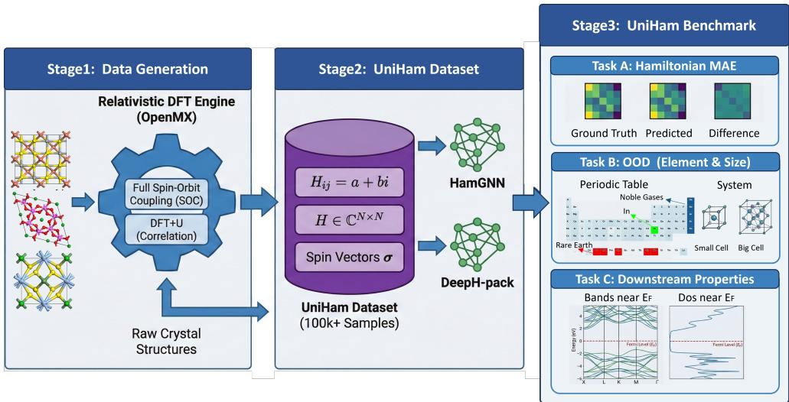  
Figure 1: Overview of the UniHam Benchmark Framework. The pipeline consists of three stages: (1) Data Generation: Con structing high-quality Hamiltonian labels using relativistic DFT (OpenMX) with full Spin-Orbit Coupling (SOC) and DFT+U corrections. (2) Benchmarking: Training representative models (HamGNN, DeepH) on the UniHam dataset containing 100k+ complex-valued Hamiltonians. (3) Comprehensive Evaluation: Assessing model performance across three dimensions: Hamiltonian Reconstruction (MAE), Out-of-Distribution (OOD) Generalization (testing both unseen elements and varying atom counts), and Downstream Physical Properties (Bandgaps, Band structures, and DOS near the Fermi level).

• We construct UniHam, a large-scale dataset of 100K+ DFTcomputed complex-valued Hermitian Hamiltonians with full spin–orbit coupling, spanning 72 elements and diverse crystal geometries and symmetries, substantially expanding the data foundation for learning electronic Hamiltonians in materials.

• We establish a standardized benchmark with complementary metrics that jointly assess Hamiltonian reconstruction accuracy, compositional and symmetry-aware out-of-distribution generalization, and the ability of predicted Hamiltonians to support downstream electronic-structure property predic tion.

• Through extensive evaluation, we show that UniHam reveals SOC-driven and element-dependent failure modes and sharp performance gaps under compositional OOD settings, and demonstrate that incorporating spectral-level evaluation is essential for judging whether Hamiltonian accuracy translates into reliable downstream properties.

## 2 Related Work

We review related work from two complementary perspectives: (i) existing materials Hamiltonian datasets for machine-learningdriven electronic-structure modeling, and (ii) neural architectures for predicting crystal Hamiltonians from atomic structure. Together, these lines of research highlight a persistent gap between the growing demand for general-purpose Hamiltonian learning and the limited availability of large-scale, open, and SOC-complete benchmarks—motivating the construction of UniHam and the systematic evaluations presented in this work.

## 2.1 Hamiltonians Dataset

Existing materials Hamiltonian datasets difer substantially in scale, chemical coverage, relativistic physics (e.g., SOC), and—critically— public availability. Early DeepH-style datasets were largely systemspecific (e.g., graphene/C and MoS2) and primarily served as internal training/evaluation corpora [16]. To illustrate a more general materials-level setting, a subsequent DeepH study curated a 12,062-structure crystal set from Materials Project [12] under explicit filtering rules (e.g., non-magnetic only, first four rows with Sc–Ni excluded to avoid magnetism, noble gases excluded, and unit cells capped at 150 atoms); however, this Hamiltonian dataset is not released as a public benchmark [28]. Similarly, HamGNN reports a larger dataset of ∼44k structures to support universal Hamiltonian learning, but the corresponding Hamiltonian data are not publicly available [32].

In contrast, Materials-HAM-SOC released by NextHAM provides an open SOC-inclusive benchmark with complex-valued Hamiltonians for ∼17k crystals spanning 60+ elements [29]. Building on the need for an open dataset that is simultaneously larger-scale, more chemically diverse, and SOC-complete, we release UniHam, comprising 100k + crystals with full-SOC complex Hermitian Hamiltonians over 72 elements, enabling reproducible scaling studies and robust out-of-distribution evaluation.

Table 1 provides a feature-level comparison between UniHam and prior Hamiltonian datasets. UniHam is 6× larger than the next public SOC dataset, the only one covering lanthanide (4� ) elements, and the only benchmark with systematic OOD evaluation and gauge-corrected multi-level metrics.

Table 1: Feature-level comparison between UniHam and prior Hamiltonian datasets. NR = not reported.
<table><tr><td>Feature</td><td>UniHam (Ours)</td><td>Mat-HAM-SOC [29]</td><td>DeepH [28]</td><td>HamGNN [32]</td></tr><tr><td>Structures</td><td>103,121</td><td>~17,000</td><td>12,062</td><td>~44,000</td></tr><tr><td>Elements</td><td>72</td><td>68</td><td> ${ \sim } 2 4 \ ( \mathrm { p e r . \ } 1 { - } 4 )$ </td><td>NR</td></tr><tr><td>Lanthanide (4f)</td><td>9 (La-Lu)</td><td>Excluded</td><td>Excluded</td><td>NR</td></tr><tr><td>Full SOC</td><td>All</td><td>All</td><td>No</td><td>No</td></tr><tr><td>Heavy elem.  $\left( Z \ge 3 7 \right)$ </td><td>66.6%</td><td>~50%</td><td>0%</td><td>NR</td></tr><tr><td>Max atoms/cell</td><td>444</td><td>~80</td><td>150</td><td>NR</td></tr><tr><td>DFT+U</td><td>Yes</td><td>NR</td><td>No</td><td>NR</td></tr><tr><td>Publicly available</td><td>Yes</td><td>Yes</td><td>No</td><td>No</td></tr><tr><td>Systematic OOD eval.</td><td>Yes</td><td>No</td><td>No</td><td>No</td></tr></table>

## 2.2 Hamiltonians Prediction Models

Hamiltonian prediction from atomic structure is commonly formulated as learning local Hamiltonian blocks in a localized orbital basis with symmetry-aware graph models. DeepH establishes a representative structure-to-Hamiltonian paradigm and demonstrates strong accuracy in system-specific settings [7, 15, 16]. HamGNN advances transferability via O(3)-equivariant GNN designs and training objectives that improve generalization across chemistries [31, 32]. NextHAM further explores SOC-inclusive Hamiltonian learning and proposes a delta-learning formulation conditioned on an auxiliary “zeroth-step” Hamiltonian $H ^ { ( 0 ) }$ [29].

However, Hamiltonians are intrinsically code- and basis-dependent: diferent DFT software stacks and localized orbital conventions lead to representations that are not directly comparable. Since NextHAM and UniHam adopt Hamiltonians generated by diferent DFT packages and basis conventions, a direct quantitative comparison would therefore confound model capability with representation mismatch. Moreover, obtaining $H ^ { ( 0 ) }$ requires additional electronic-structure computation beyond the input structure. Accordingly, we focus our benchmark on structure-only Hamiltonian predictors and evaluate representative equivariant architectures on the open UniHam dataset.

## 3 Problem Formulation

From a machine learning perspective, Hamiltonian prediction can be understood as a structured regression problem on periodic geometric graphs. The input is a crystal structure represented as a graph $\mathcal { G } = ( \mathcal { V } , \mathcal { E } )$ with atoms as nodes and interatomic neighborhoods as edges; the output is a variable-size, block-sparse, complex-valued Hermitian matrix whose entries transform under strict SE(3)-equivariance constraints dictated by Wigner D-matrices. This formulation connects Hamiltonian learning to broader themes in geometric deep learning and equivariant representation theory, while the high-dimensional matrix output—rather than scalar or vector targets—makes it a uniquely demanding structured prediction task.

We progressively introduce (i) the learning target and its structural properties, (ii) the additional complexity induced by Spin– Orbit Coupling (SOC), and (iii) the symmetry constraints that motivate SE(3)-equivariant neural architectures.

## 3.1 Kohn–Sham Hamiltonian

Density Functional Theory (DFT) computes electronic structure by solving the Kohn–Sham eigenproblem

$$
\hat { H } _ { \mathrm { K S } } | \psi _ { i } \rangle = \epsilon _ { i } | \psi _ { i } \rangle ,\tag{1}
$$

where $\hat { H } _ { \mathrm { K S } }$ is the Kohn–Sham Hamiltonian operator, and $\left( \epsilon _ { i } , | \psi _ { i } \rangle \right)$ are eigenpairs. In practice, $\hat { H } _ { \mathrm { K S } }$ is represented in a finite basis, yielding a matrix �.

The Kohn–Sham Hamiltonian matrix � is the central object of electronic-structure theory. Its eigenvalues directly give band structures, and its eigenvectors give wavefunctions. From these fundamental quantities, a wide range of physically important observables can be derived without additional first-principles calculations: band gaps determine semiconductor applicability; band curvature yields efective masses for charge transport; the density of states near the Fermi level governs conductivity and optical spectra; and the global structure of the eigenspectrum encodes topological invariants such as Chern numbers and $\mathbb { Z } _ { 2 }$ indices. This makes � a uniquely informative prediction target: unlike scalar properties such as total energy, a single accurate Hamiltonian enables simultaneous inference of dozens of downstream properties via low-cost post-processing, effectively bypassing the expensive self-consistent field iterations that dominate conventional DFT workflows.

We therefore cast Hamiltonian prediction as a supervised learning problem

$$
\Phi : { \mathcal { G } }  H ,\tag{2}
$$

where $\mathcal { G }$ denotes a crystal structure.

We adopt a localized pseudo-atomic orbital (PAO) basis [24], under which a crystal is naturally represented as a periodic graph $\mathcal { G } = ( \mathcal { V } , \mathcal { E } )$ with atoms as nodes and interatomic neighborhoods as edges. The Hamiltonian becomes block-sparse: each block $H _ { i j }$ corresponds to couplings between orbitals on atoms � and �.

From a machine learning perspective, this target exhibits several important properties: (i) � is Hermitian, satisfying $H _ { i j } = H _ { j i } ^ { \dagger } ;$ (ii) � is local and sparse, since only atom pairs within a finite cutof contribute non-zero blocks; and (iii) each block has a fixed internal structure determined by the orbital basis. Accordingly, learning proceeds at the block level: a neural network predicts orbital-resolved features for atoms and pairwise interactions, which are assembled into Hamiltonian blocks and aggregated to form the full matrix.

## 3.2 Relativistic Regime and Spin–Orbit Coupling

Accurate modeling of heavy elements and quantum materials requires explicit treatment of relativistic efects, most notably SOC. A concrete example is the topological insulator Bi Se : spin–orbit coupling inverts the conduction and valence bands at the Γ point, opening a topologically non-trivial gap. Without SOC, this phase is completely invisible—the material would be incorrectly predicted as a trivial insulator. SOC also governs band splittings in heavyelement semiconductors (e.g., the ∼0.5 eV splitting of the valence band maximum in PbTe), enables spin-Hall efects in spintronics, and determines the fine electronic structure of rare-earth compounds.

While prior Hamiltonian datasets provide limited or inconsistent SOC coverage, UniHam targets a SOC-complete setting. When SOC is included, the Hamiltonian acquires two essential properties:

• Complex-valued entries, reflecting phase information and time-reversal symmetry;

• Spinor degrees of freedom, where each orbital is associated with spin-up and spin-down components, yielding intra-spin and spin-flip couplings.

Consequently, the learning target in UniHam is a complexvalued Hermitian matrix whose blocks encode coupled orbital– spin interactions, substantially increasing modeling dificulty compared to real-valued Hamiltonians.

## 3.3 SE(3)-Equivariance and Symmetry Constraints

Hamiltonians are constrained by the geometric symmetries of atomic structures. For a rotation $R \in S O ( 3 )$ acting on a crystal,

$$
H ( R \cdot g ) = D ( R ) H ( g ) D ( R ) ^ { \dagger } ,\tag{3}
$$

where $D ( R )$ denotes the representation matrix associated with the orbital angular momenta ofthe basis functions. This relation implies that Hamiltonian prediction is inherently an equivariant learning problem: rotating the input structure must induce a corresponding, well-defined transformation of the output matrix. SE(3)-equivariant neural networks [6, 27] provide a principled mechanism to encode this inductive bias by constructing features that transform according to irreducible representations of the rotation group.

Recent models such as DeepH [7] and HamGNN [32] adopt this paradigm, but have primarily been evaluated on small-scale or nonrelativistic datasets. UniHam provides a large-scale, SOC-complete benchmark to rigorously assess equivariant architectures under the full complexity of relativistic Hamiltonian learning.

## 4 The UniHam Dataset and Benchmark

This section introduces UniHam and the accompanying benchmark suite for Hamiltonian learning. We first describe the dataset construction and its statistical characteristics, followed by the defi nition of benchmark tasks that probe reconstruction accuracy, two forms of out-of-distribution generalization, and downstream property prediction. We then specify the evaluation metrics and the baseline models used throughout our experiments.

## 4.1 Dataset

UniHam contains 103,121 crystal structures with converged DFT Hamiltonians, drawn from ICSD [2] (43.0%), Matgen [3] (52.5%), and COD [8] (4.5%). The dataset covers 72 elements (Figure 2); transition metals and oxygen are the most frequently occurring, consistent with the compositional makeup of known inorganic phases. About two-thirds of the structures (66.6%) include at least one heavy element $\left( Z \ge 3 7 \right)$ , providing broad sampling of the 4� and 5�/6� regimes where SOC qualitatively afects the electronic structure. Unit-cell sizes range from 1 to 444 atoms (Figure 3), with a median of 20 and a mean of 30. The dataset spans 225 of 230 crystallographic space groups and all 32 point groups.

To generate high-quality Hamiltonian labels, we employ the OpenMX (Open source package for Material eXplorer) package [21,

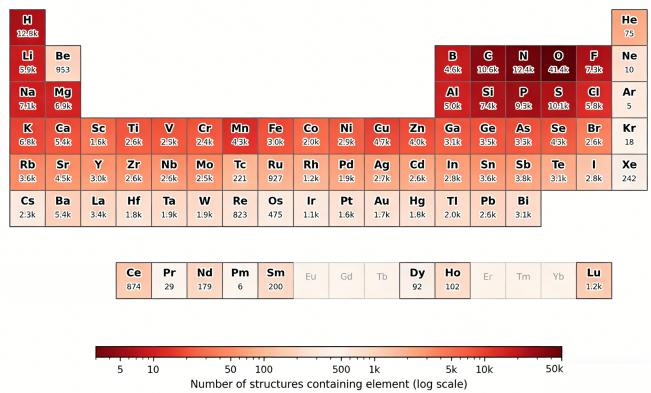

Figure 2: Periodic-table heatmap of per-element structure counts in UniHam. The 72 covered elements are color-coded by occurrence frequency.  
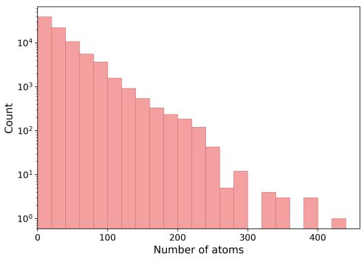  
Figure 3: Distribution of the number of atoms per unit cell. Most structures contain 10–60 atoms; a long tail extends to 444.

22], which is based on localized pseudo-atomic orbital (PAO) basis functions. Compared with plane-wave representations, PAO bases yield compact real-space Hamiltonian matrices that are naturally compatible with graph-based learning architectures and avoid costly basis transformations. All calculations are performed within the generalized gradient approximation using the Perdew–Burke– Ernzerhof (PBE) exchange–correlation functional [23].

To ensure physical completeness, full spin–orbit coupling (SOC) and non-collinear (NC) spin are enabled for all structures, regardless oftheir magnetic character. This leads to complex-valued Hamiltonians and increases the computational cost by approximately 8×, but is essential for describing relativistic efects in heavy elements and topological materials. Strong electron correlations in transition-metal (3�) and rare-earth (4�) elements are treated using the DFT+U (GGA+U) formalism [4]. The efective Hubbard parameters $U _ { \mathrm { e f f } } = U - J$ are strictly standardized following the protocol of Chen et al. [3], ensuring consistency across the entire dataset.

Self-consistent field (SCF) calculations employ a real-space grid cutof of 350 Ry, a convergence threshold of $1 0 ^ { - 6 }$ , and a maximum of 500 SCF iterations. A robust Pulay mixing scheme is adopted with initial, minimum, and maximum mixing weights of 0.3, 0.001, and 0.4, respectively, and Pulay extrapolation activated after six iterations. An electronic temperature of 300 K is used to facilitate convergence. Brillouin-zone sampling is performed using Monkhorst– Pack �-point meshes with a baseline density corresponding to 2000 �-points per reciprocal atom (kppa); for structures that do not converge under this setting, the density is increased to 6000–8000 kppa. All calculations are single-step electronic evaluations without structural relaxation, ensuring that the Hamiltonians correspond exactly to the input geometries.

The full data-construction pipeline is described in Appendix A. Detailed per-element analyses and additional experimental results appear in Appendix C.

## 4.2 Tasks

To comprehensively evaluate Hamiltonian prediction models, we design four benchmark tasks that probe complementary capabilities: in-distribution reconstruction accuracy, two forms of out-ofdistribution generalization, and downstream property prediction. Table 2 summarizes the data configurations and primary evaluation metrics.

Recon-id: In-Distribution Reconstruction. Since SOC-complete Hamiltonians scale quadratically with the number of spinor orbitals, GPU memory consumption during training grows rapidly with system size. Even on NVIDIA H100 GPUs (80 GB) with a batch size of 1, structures exceeding approximately 60 atoms per unit cell cause out-of-memory failures during back-propagation (see $\mathsf { A p - }$ pendix B for details). We therefore restrict the training pool to structures with ≤60 atoms (∼90,000 structures) and partition them into ∼86,000 training, 2,000 validation, and 2,000 test structures using a stratified splitting strategy based on rare-element balancing. Concretely, each structure is assigned to a bin defined by its rarest element (the element with the lowest global occurrence count), and structures within each bin are proportionally allocated across splits via seeded random shufling (seed=42). This guarantees that even infrequent elements (e.g., Tc, Pm) appear across all splits, preventing trivially poor test-time performance on unseen chemical species. The remaining structures with >60 atoms are reserved for the OOD-Size generalization task (see below). The primary metric is gauge-corrected $\mathrm { M A E } _ { H }$

OOD-Size: System-Size Generalization. Models trained on the standard Recon-id training set (structures with ≤60 atoms) are tested on 4,328 held-out structures containing 61–444 atoms per unit cell, covering the same 72-element chemical space. This task probes whether local message-passing architectures can transfer to substantially larger unit cells without retraining.

OOD-Comp: Compositional Generalization. We design three scenarios of escalating chemical distance to evaluate compositional extrapolation and retrain the model:

(1) Chemical Interpolation $( \mathbf { I n } , Z { = } 4 9 ) \div$ Indium is held out while all periodic-table neighbors (Cd, Sn, Ga, Tl) remain in training, forming a favorable interpolation setting with qualitatively identical bonding character (�� hybridization).

Table 2: Task configurations and evaluation protocols.
<table><tr><td>Task</td><td>Training Protocol</td><td>Primary Metrics</td></tr><tr><td>RECON-ID</td><td>Random split (8:1:1)</td><td>MAEH</td></tr><tr><td>OOD-SIZE</td><td>Evaluate on larger structures using RECON-ID model</td><td> $\mathrm { M A E } _ { H }$ </td></tr><tr><td>OOD-CoMP</td><td>Retrain after removing specified ele- ments from training set</td><td> $\mathrm { M A E } _ { H }$ </td></tr><tr><td>PROP-ID</td><td>Use REcoN-ID model; diagonalize pre- dicted Hamiltonians</td><td>Band gap, MAEband, MAEDOS</td></tr></table>

(2) Electronic-Structure Extrapolation (Rare Earths—Pr, Nd, Sm, Dy, Ho): Five lanthanides with partially filled 4� shells $( 4 f ^ { 2 } - 4 f ^ { 1 1 } )$ are held out; only La $( 4 f ^ { 0 } ) , \mathrm { C e } ( 4 f ^ { 1 } )$ , and Lu $( 4 f ^ { 1 4 } )$ remain, providing no coverage of the complex many-electron 4� manifold.

(3) Bonding-Character Extrapolation (Noble Gases—He, $\mathbf { A r } ,$ Kr, Xe): Elements with completely filled shells and fundamentally diferent bonding character (van der Waals / hypervalent) are held out with no chemical analogs in training.

All structures containing any held-out element are excluded from training/validation; each test structure is assigned to exactly one scenario to avoid confounding, yielding 3,111 / 845 / 285 test structures for the In / RE / NG scenarios, respectively.

Prop-id: Downstream Property Prediction. We evaluate whether predicted Hamiltonians support downstream electronic-structure analysis by diagonalizing predicted Hamiltonians and comparing derived observables against DFT references within a physicsmotivated energy window centered on the Fermi level: [�VBM − 3 eV, $E _ { \mathrm { C B M } } + 3 \mathrm { e V } ]$ for non-metals and $[ - 3 \mathrm { e V } ,$ +3 eV] for metals. This task reports band gap error, band-energy MAE (MAEband), DOS MAE $( \mathrm { M A E _ { D O S } } )$ , and eigenstate RMSE $( \mathrm { R M S E } _ { \psi , \Gamma } )$ .

## 4.3 Metrics

We evaluate predicted Hamiltonians from both operator- and observablelevel perspectives using four complementary metrics. Since adding a global shift $\mu S$ (with overlap matrix �) does not change downstream physics, we report gauge-corrected errors.

(1) Gauge-corrected Hamiltonian MAE.. We measure the mean absolute error over all Hamiltonian matrix elements,

$$
\mathrm { M A E } _ { H } = \frac { \sum _ { i \alpha , j \beta } \left| H _ { i \alpha , j \beta } ^ { \mathrm { p r e d } } - H _ { i \alpha , j \beta } ^ { \mathrm { b m } } - \Delta \mu _ { H } S _ { i \alpha , j \beta } \right| } { N _ { H } } ,\tag{4}
$$

where $N _ { H }$ is the total number of Hamiltonian entries.

(2) Band-energy MAE.. We compute the MAE of band energies over Brillouin-zone samples and an energy window $( \varepsilon _ { \mathrm { m i n } } , \varepsilon _ { \mathrm { m a x } } ) { : }$

$$
\mathrm { M A E } _ { \mathrm { b a n d } } = \frac { \int d ^ { n } \mathbf { k } \sum _ { n } ^ { \prime } \left| \varepsilon _ { n } ^ { \mathrm { p r e d } } ( \mathbf { k } ) - \varepsilon _ { n } ^ { \mathrm { b m } } ( \mathbf { k } ) - \Delta \mu _ { \mathrm { b a n d } } \right| } { \int d ^ { n } \mathbf { k } N _ { \mathrm { b a n d } } ^ { \prime } ( \mathbf { k } ) } .\tag{5}
$$

Here $\textstyle \sum _ { n } ^ { \prime }$ (and $N _ { \mathrm { b a n d } } ^ { \prime } )$ restrict bands within the energy window.

(3) DOS MAE (normalized). To assess spectral distribution, we compare densities of states within the same window:

$$
\mathrm { M A E } _ { \mathrm { D O S } } = \frac { \int _ { \varepsilon _ { \mathrm { m i n } } } ^ { \varepsilon _ { \mathrm { m a x } } } \left| D ^ { \mathrm { p r e d } } ( \varepsilon + \Delta \mu _ { \mathrm { b a n d } } ) - D ^ { \mathrm { b m } } ( \varepsilon ) \right| d \varepsilon } { \int _ { \varepsilon _ { \mathrm { m i n } } } ^ { \varepsilon _ { \mathrm { m a x } } } D ^ { \mathrm { b m } } ( \varepsilon ) d \varepsilon } .\tag{6}
$$

For both band energies and DOS, we additionally report the Pearson correlation coeficient � between predicted and groundtruth values within the energy window, providing a complementary shape-similarity measure that is insensitive to uniform shifts.

(4) Band gap error. For non-metallic structures, we report the absolute diference between the predicted and DFT-reference band gaps: $\Delta E _ { g } = | E _ { g } ^ { \mathrm { p r e d } } - E _ { g } ^ { \mathrm { b m } } |$

Gauge correction. The gauge shifts are computed as

$$
\Delta \mu _ { H } = \frac { \sum _ { i \alpha , j \beta } \left( H _ { i \alpha , j \beta } ^ { \mathrm { p r e d } } - H _ { i \alpha , j \beta } ^ { \mathrm { b m } } \right) S _ { i \alpha , j \beta } } { \sum _ { i \alpha , j \beta } S _ { i \alpha , j \beta } ^ { 2 } } ,\tag{7}
$$

$$
\Delta \mu _ { \mathrm { b a n d } } = \mathrm { m e d i a n } \Bigl \{ \varepsilon _ { n } ^ { \mathrm { p r e d } } ( { \bf k } ) - \varepsilon _ { n } ^ { \mathrm { b m } } ( { \bf k } ) \big | \varepsilon _ { \mathrm { m i n } } < \varepsilon _ { n } ^ { \mathrm { b m } } ( { \bf k } ) < \varepsilon _ { \mathrm { m a x } } \Bigr \} .\tag{8}
$$

## 4.4 Baselines

We benchmark two representative state-of-the-art equivariant Hamiltonian predictors that accept crystal structure as sole input (i.e., without requiring a zeroth-step Hamiltonian $H ^ { ( 0 ) } .$ ).

DeepH-pack. We use the DeepH-E3 architecture [7] from the DeepH-pack framework [16], which achieves �(3)-equivariance via equivariant neural networks operating on local atomic neighborhoods. The model employs 3 message-passing blocks with 2 attention heads and a radial cutof of 10.0 Å. We adopt the default loss (MAE on Hamiltonian matrix elements) and the AdamW optimizer with a ReduceOnPlateau scheduler. Since the publicly released DeepH-pack software does not natively support datasets exceeding ∼10k structures, we implement an epoch-level data sharding strategy to enable training on the full 86k training set (details in Appendix B).

HamGNN.. We evaluate two variants of HamGNN [32] to quantify the efect of spectral supervision: HamGNN (Base), trained with Hamiltonian matrix element MAE loss only, and HamGNN (FT), obtained by second-stage fine-tuning that additionally incor porates eigenvalue-level constraints (band-energy loss) to improve spectral fidelity. Both variants share the same architecture: 3 equi variant message-passing layers with a radial cutof of 26.0 Bohr (≈13.8 Å), 64 Bessel radial basis functions, and gate nonlinearity. Note that eigenvalue-level fine-tuning is a built-in capability of HamGNN, while DeepH-pack does not currently provide analogous functionality. We therefore report only the standard MAE-trained variant for DeepH-pack.

Both models are trained on 8 NVIDIA H100 GPUs with FP32 precision. Full hyperparameters are provided in Appendix B.

## 5 Experiments

We present a comprehensive empirical evaluation of Hamiltonian prediction models on the UniHam benchmark. Following the task definitions in Section 4.2, we assess in-distribution reconstruction accuracy, out-of-distribution generalization, and downstream property prediction, using the metrics described in Section 4.3. All experiments are conducted with the baseline models introduced in Section 4.4.

## 5.1 Hamiltonian Reconstruction Accuracy

Table 3: Hamiltonian reconstruction performance (MAE in meV) on the test set, decomposed by real part, imaginary part, and total.

<table><tr><td rowspan="2">Model</td><td colspan="3">Test Set MAE (meV)</td></tr><tr><td>Real</td><td>Imag.</td><td>Total</td></tr><tr><td>DeepH-pack</td><td>4.49</td><td>0.385</td><td>2.44</td></tr><tr><td>HamGNN</td><td>2.96</td><td>0.0412</td><td>1.50</td></tr></table>

We evaluate the Recon-id task using the stratified split. Since SOC yields complex-valued Hamiltonians, we report MAE decomposed into real, imaginary, and total components (Table 3). Both models achieve sub-3 meV total MAE, confirming that equivariant architectures can accurately learn complex-valued Hamiltonians from crystal structures. HamGNN attains 1.50 meV total MAE, outperforming DeepH-pack (2.44 meV) by 1.6×, and achieves lower error on 96.5% of test structures. Errors are dominated by the real part, while imaginary (SOC-induced spin-flip) terms are an order of magnitude smaller; notably, HamGNN exhibits a much lower imaginary-to-real MAE ratio (1.4%) than DeepH-pack (8.6%), indicating better resolution of fine-grained SOC couplings.

Stratifying by SOC strength (using maximum atomic number $Z _ { \mathrm { m a x } }$ as a proxy), we observe a monotonic degradation from weak-SOC to strong-SOC regimes for both models (Table 4). For example, HamGNN increases from 1.10 meV to 1.74 meV and DeepH-pack from 1.90 meV to 2.76 meV, suggesting an intrinsic dificulty in learning relativistic efects rather than an architecture-specific artifact. Element-level analysis further shows that heavy 5�/4� elements (e.g., Os, W, Pt, Lu) are systematically harder, whereas light maingroup elements approach the numerical precision floor. At the structure level, 83.4% of samples are well-predicted by both models (MAE < 3 meV), while the rare hard cases are concentrated in strong-SOC, small-cell, high-symmetry phases. Collectively, these results demonstrate that UniHam exposes SOC-driven and elementdependent failure modes that are invisible in light-element benchmarks, providing a more stringent testbed for Hamiltonian learning (see Appendix C for detailed per-element breakdowns and additional figures).

Table 4: Hamiltonian MAE (meV) stratified by SOC strength regime, defined by the maximum atomic number $Z _ { \mathrm { m a x } }$ in each structure.
<table><tr><td>SOC Regime</td><td>N</td><td>HamGNN</td><td>DeepH-pack</td></tr><tr><td>Weak  $\left( Z \le 2 0 \right)$ </td><td>200</td><td>1.10</td><td>1.90</td></tr><tr><td>Light-3d  $( 2 1 \leq Z \leq 3 6 )$ </td><td>401</td><td>1.42</td><td>2.17</td></tr><tr><td>Medium-4d  $( 3 7 \leq Z \leq 5 4 )$ </td><td>614</td><td>1.38</td><td>2.38</td></tr><tr><td>Strong-5d/4f (Z ≥ 55)</td><td>785</td><td>1.74</td><td>2.76</td></tr></table>

Table 5: Compositional out-of-distribution generalization: Hamiltonian MAE (meV). “ID” rows report the MAE on the same element subgroups under the standard random-split model (elements present in training). “OOD” rows report the MAE when these elements are entirely removed from training. Degradation factors (×) are computed per element group.
<table><tr><td>Model</td><td>Setting</td><td>In</td><td>RE</td><td>NG</td></tr><tr><td rowspan="2">DeepH-pack</td><td>ID</td><td>2.89</td><td>3.14</td><td>5.09</td></tr><tr><td>OOD</td><td>22.49</td><td>22.73</td><td>31.48</td></tr><tr><td rowspan="2">HamGNN</td><td>ID</td><td>1.40</td><td>2.04</td><td>3.06</td></tr><tr><td>OOD</td><td>5.71</td><td>5.39</td><td>5.93</td></tr></table>

Table 6: Per-element OOD MAE (meV) on the rare-earth test set, sorted by atomic number. �: number of structures containing each element. Total MAE is computed over all real and imaginary Hamiltonian matrix elements.
<table><tr><td>Elem.</td><td>N</td><td>DeepH-pack</td><td>HamGNN</td></tr><tr><td>Pr  $( 4 f ^ { 2 } )$ </td><td>107</td><td>19.59</td><td>6.80</td></tr><tr><td>Nd  $( 4 f ^ { 3 } )$ </td><td>228</td><td>21.96</td><td>5.96</td></tr><tr><td>Sm  $( 4 f ^ { 5 } )$ </td><td>262</td><td>22.36</td><td>4.42</td></tr><tr><td>Dy  $( 4 f ^ { 1 0 } )$ </td><td>121</td><td>24.21</td><td>5.25</td></tr><tr><td>Ho  $( 4 f ^ { 1 1 } )$ </td><td>127</td><td>26.15</td><td>5.35</td></tr></table>

## 5.2 Out-of-Distribution Generalization

We evaluate two OOD settings: system-size generalization (OOD-Size) and compositional generalization (OOD-Comp). For OOD-Size, both models exhibit near-perfect transfer from training cells (≤60 atoms) to much larger structures (up to 444 atoms), with HamGNN achieving an OOD/ID MAE ratio of 0.89 and DeepH-pack showing a qualitatively similar trend, confirming that equivariant message-passing architectures inherit a strong locality inductive bias and generalize seamlessly across system sizes. In contrast, compositional OOD remains challenging and is highly architecturedependent (Table 5 and Appendix C). When entire element groups are removed from training, DeepH-pack degrades by 6–8× relative to its ID reference, whereas HamGNN degrades by only 1.9–4.1× and maintains single-digit-meV MAE across all three scenarios (In, RE, NG). Notably, the inter-model performance gap widens substantially under OOD conditions, demonstrating that architectural choices that yield modest gains in-distribution become decisive for zero-shot compositional generalization.

## 5.3 Downstream Property Prediction

We evaluate the Prop-id task using band gap, band structure, and DOS metrics (Table 7). A clear hierarchy emerges. First, incorporating spectral-level supervision is crucial: HamGNN (FT) dramatically outperforms its base counterpart, reducing band gap MAE from 1.697 to 0.622 eV, band structure MAE from 1.612 to 0.360 eV, and DOS MAE from 7.48 to 4.73 states/eV, while increasing band Pearson correlation to 0.988. Second, Hamiltonian MAE alone is an insufficient proxy for downstream fidelity: although HamGNN (Base) achieves substantially lower Hamiltonian MAE than DeepH-pack, this advantage translates only weakly to band gaps and band structures, motivating UniHam’s inclusion of spectral-level evaluation. Finally, DOS reconstruction remains substantially harder than band structure prediction, with only moderate correlations even for HamGNN (FT), highlighting an open challenge in accurately capturing fine-grained spectral distributions.

Figure 4 provides qualitative illustration of these findings. The top row contrasts two HamGNN (Base) predictions: $\mathrm { L a } _ { 6 } \mathrm { C u _ { 2 } S i _ { 2 } S e _ { 1 4 } }$ (left) achieves near-perfect band agreement (band $\mathrm { M A E } = 0 . 0 2 8 \ : \mathrm { e V } )$ as its constituent elements—La, Cu, Si, Se—are well-represented in training and belong to moderate SOC regimes. In contrast, $\mathrm { C _ { 4 } O s _ { 4 } }$ (right) exhibits severe deviations (band $\mathrm { M A E } = 1 1 . 4 \ : \mathrm { e V } )$ : Osmium $\scriptstyle ( Z = 7 6 )$ is the heaviest 5� element in UniHam and the most challenging for both models (cf. Section 5), with strong SOC and limited training coverage (∼0.5% of structures), causing Hamiltonian errors that are amplified through diagonalization. The bottom row demonstrates the impact of fine-tuning on $\mathrm { B i } _ { 4 } \mathrm { S e } _ { 4 } \mathrm { O } _ { 1 2 } \mathrm { F } _ { 4 } .$ , a heavy-element system containing Bi (�=83): HamGNN (Base) (left) captures the overall band topology but produces noticeable deviations in the conduction manifold, while HamGNN (FT) (right) largely eliminates these artifacts, confirming that eigenvalue-level supervision is critical for translating Hamiltonian accuracy into reliable spectral properties. See Appendix C for extended downstream analysis.

## 5.4 Direct-Gap Materials Discovery

Beyond evaluating spectral fidelity on a fixed test set, we demonstrate that predicted Hamiltonians can enable practical materials screening. Direct-gap semiconductors are essential for optoelectronic applications (LEDs, lasers, solar cells) because their bandedge alignment at the same crystal momentum allows radiative recombination without phonon mediation. Identifying such materials conventionally requires full DFT+SOC calculations per candidate—a prohibitive bottleneck for high-throughput screening.

We use the UniHam-trained HamGNN (FT) model to screen the 2,000-structure Prop-id test set. The model identifies 1,241 insulators (defined as having a predicted band $\mathrm { g a p } > 0 . 1 \mathrm { e V } )$ . Among these, the predicted direct- vs. indirect-gap classification achieves 83.4% consistency with DFT ground truth, demonstrating that Hamiltonian-level predictions can recover the gap-type label that directly determines a material’s technological relevance. Crucially, no DFT calculation is required at inference time: both the Hamiltonian prediction and the subsequent diagonalization to obtain band structures and gap types are purely model-driven.

These results establish that the UniHam benchmark, together with spectral-level supervision, produces models that are not merely accurate in the aggregate metric sense, but also actionable for downstream discovery tasks.

## 5.5 Cross-Dataset Generalization on GNoME

A key test of a model’s practical utility is whether it can generalize to structures from sources unseen during training, under realistic screening conditions. We evaluate this by applying the UniHamtrained HamGNN (FT) model directly—without any retraining or fine-tuning—to 3,000 crystal structures randomly sampled from the GNoME database [19] with proportional sampling matching the Materials Project direct:indirect gap ratio.

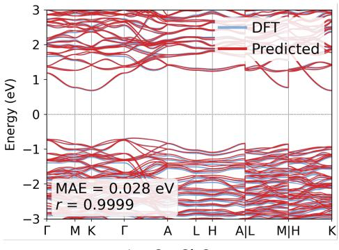  
La₆Cu₂Si₂Se1₄

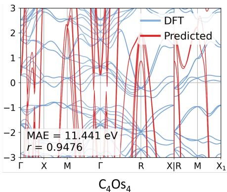

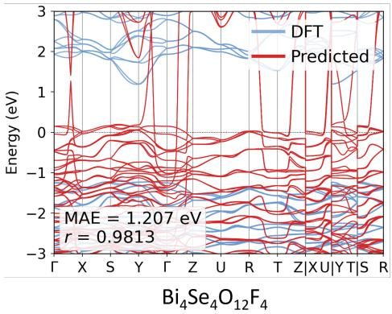

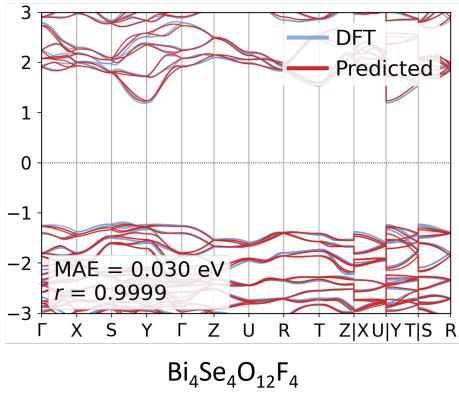  
Figure 4: Qualitative comparison of predicted band structures. (Top left) $\mathbf { L a } _ { 6 } \mathbf { C u } _ { 2 } \mathbf { S i } _ { 2 } \mathbf { S e } _ { 1 4 }$ predicted by HamGNN (Base), achieving near-perfect agreement (band MAE = 0.028 eV). (Top right) $\mathbf { C _ { 4 } O s _ { 4 } }$ predicted by HamGNN (Base), showing severe deviations (band MAE = 11.4 eV) due to strong SOC from Os. (Bottom) $\mathbf { B i } _ { 4 } \mathbf { S e } _ { 4 } \mathbf { O } _ { 1 2 } \mathbf { F } _ { 4 }$ predicted by HamGNN Base (left) vs. HamGNN FT (right), demonstrating how eigenvalue-level fine-tuning corrects conduction-band artifacts.

Table 7: Downstream property prediction accuracy on the test set. Band gap error is evaluated on 1,252 non-metallic structures; band structure and DOS metrics are computed on all 2,000 test structures within a ±3 eV window around the Fermi level.
<table><tr><td rowspan="2">Model</td><td rowspan="2">Band Gap MAE (eV)</td><td colspan="2">Band Structure</td><td colspan="2">DOS</td></tr><tr><td>Pearson r</td><td>MAE (eV)</td><td>Pearson r</td><td>MAE (st/eV)</td></tr><tr><td>DeepH-pack</td><td>1.925</td><td>0.893</td><td>1.795</td><td>0.088</td><td>8.29</td></tr><tr><td>HamGNN (Base)</td><td>1.697</td><td>0.908</td><td>1.612</td><td>0.203</td><td>7.48</td></tr><tr><td>HamGNN (FT)</td><td>0.622</td><td>0.988</td><td>0.360</td><td>0.555</td><td>4.73</td></tr></table>

Table 8: Band-gap distribution of 720 direct-gap candidates identified by HamGNN (FT) on 3,000 GNoME structures.
<table><tr><td>Band gap (eV)</td><td>0-1</td><td>1-2</td><td>2-3</td><td>3-4</td><td>4-5</td><td>5-6</td><td>6+</td></tr><tr><td>Count</td><td>267</td><td>216</td><td>124</td><td>65</td><td>31</td><td>12</td><td>5</td></tr><tr><td>Fraction (%)</td><td>37.1</td><td>30.0</td><td>17.2</td><td>9.0</td><td>4.3</td><td>1.7</td><td>0.7</td></tr></table>

The model screens 720 of the 3,000 structures as direct-gap semiconductors. We validate these predictions against the Materials Project database, which provides independent DFT reference calculations (with diferent pseudopotentials and exchange–correlation functionals).

Results. Among the 720 materials screened as direct-gap, 92% are confirmed in Materials Project. Table 8 presents the band-gap distribution of the predicted direct-gap candidates, which peaks in the 0–2 eV range (67.1%), consistent with the known prevalence of narrow-gap semiconductors in inorganic crystal databases. This cross-dataset generalization experiment demonstrates that an SOCcomplete model trained on UniHam transfers efectively to an independently constructed dataset, providing an end-to-end demonstration of high-throughput materials screening without DFT at inference time.

## 6 Conclusion

We introduced UniHam, a large-scale, SOC-complete Hamilton ian dataset and benchmark comprising 100,000+ complex-valued Hermitian Hamiltonians across 72 elements and diverse crystal symmetries, addressing a critical data bottleneck for foundation models in quantum materials. Systematic evaluation of two representative equivariant architectures shows that while sub-meV Hamiltonian reconstruction is achievable in weak-SOC regimes, both models exhibit consistent degradation for heavy elements and strong SOC, revealing an intrinsic challenge in learning relativistic spin–orbital interactions. We further demonstrate near-perfect system-size transferability, but substantial diferences in compositional OOD robustness, with HamGNN achieving markedly better zero-shot generalization than DeepH-pack. Importantly, we show that Hamiltonian MAE alone is an insuficient proxy for physical fidelity: incorporating spectral-level supervision dramatically improves band gaps, band structures, and DOS, highlighting the necessity of downstream-aware training objectives. Overall, Uni-Ham establishes a reproducible, multidimensional benchmark that sharpens model comparisons and provides a foundation for developing next-generation, physically grounded Hamiltonian-learning models.

A key limitation of UniHam is the substantial computational and storage overhead inherent to Hamiltonian-level learning. Complexvalued Hamiltonians scale quadratically with the number of atomic orbitals, leading to large per-sample file sizes and a total dataset footprint that is orders of magnitude larger than typical scalarproperty datasets. Correspondingly, training requires holding highdimensional matrix targets and intermediate representations in memory, resulting in heavy GPU memory consumption and significantly slower training compared with energy/force or chargedensity prediction. These costs currently constrain batch size, model capacity, and hyperparameter exploration. Future work will investigate more compact representations and memory-eficient training strategies to improve scalability.

## Acknowledgments

We sincerely thank all the anonymous reviewers for their valuable feedback. This research is supported by the National Natural Science Foundation of China (62461146204).

## References

[1] Jörg Behler and Michele Parrinello. 2007. Generalized neural-network representation of high-dimensional potential-energy surfaces. Physical Review Letters 98 (2007), 146401.

[2] Alec Belsky, Mariette Hellenbrandt, Vicky Lynn Karen, and Peter Luksch. 2002. New developments in the Inorganic Crystal Structure Database (ICSD): accessi bility in support of materials research and design. Acta Crystallographica Section B 58 (2002), 364–369.

[3] Pin Chen, Jianwen Chen, Hui Yan, Qing Mo, Zexin Xu, Jinyu Liu, Wenqing Zhang, Yuedong Yang, and Yutong Lu. 2022. Improving material property prediction by leveraging the large-scale computational database and deep learning. The Journal ofPhysical Chemistry C 126, 38 (2022), 16297–16305.

[4] S L Dudarev, G A Botton, S Y Savrasov, C J Humphreys, and A P Sutton. 1998. Electron-energy-loss spectra and the structural stability of nickel oxide: An LSDA+U study. Physical Review B 57, 3 (1998), 1505.

[5] Victor Galitski and Ian B Spielman. 2013. Spin–orbit coupling in quantum gases. Nature 494, 7435 (2013), 49–54

[6] Mario Geiger and Tess E Smidt. 2022. e3nn: Euclidean Neural Networks. arXiv preprint arXiv:2207.09453 (2022).

[7] Xiaoxun Gong, He Li, Nianlong Zou, Runzhang Xu, Wenhui Duan, and Yong Xu. 2023. General framework for E (3)-equivariant neural network representation of density functional theory Hamiltonian. Nature Communications 14, 1 (2023), 2848.

[8] Saulius Graulis, Daniel Chateigner, Robert T Downs, A F T Yokochi, Miguel Quirós, Luca Lutterotti, Elena Manakova, Juozas Butkus, Peter Moeck, and Armel Le Bail. 2009. Crystallography Open Database (COD): an open-access collection of crystal structures and platform for world-wide collaboration. Journal ofApplied Crystallography 42 (2009), 726–729.

[9] Ganesh Hegde and R Chris Bowen. 2017. Machine-learned approximations to density functional theory Hamiltonians. Scientific Reports 7 (2017), 42669.

[10] Pierre Hohenberg and Walter Kohn. 1964. Inhomogeneous electron gas. Physical Review 136, 3B (1964), B864

[11] Bing Huang, Guido Falk von Rudorf, and O Anatole von Lilienfeld. 2023. The central role of density functional theory in the AI age. Science 381, 6654 (2023), 170–175.

[12] Anubhav Jain, Shyue Ping Ong, Geofroy Hautier, Wei Chen, William Davidson Richards, Stephen Dacek, Shreyas Cholia, Dan Gunter, David Skinner, Gerbrand Ceder, et al. 2013. Commentary: The Materials Project: A materials genome approach to accelerating materials innovation. APL materials 1, 1 (2013).

[13] Anubhav Jain, Yongwoo Shin, and Kristin A Persson. 2016. Computational predictions of energy materials using density functional theory. Nature Reviews Materials 1, 1 (2016), 1–13.

[14] Walter Kohn and Lu Jeu Sham. 1965. Self-consistent equations including exchange and correlation efects. Physical Review 140, 4A (1965), A1133.

[15] He Li, Zun Tang, Xiaoxun Gong, Nianlong Zou, Wenhui Duan, and Yong Xu. 2023. Deep-learning electronic-structure calculation of magnetic superstructures. Nature Computational Science 3 (2023), 321.

[16] He Li, Zun Wang, Nianlong Zou, Meng Ye, Runzhang Xu, Xiaoxun Gong, Wenhui Duan, and Yong Xu. 2022. Deep-learning density functional theory Hamiltonian for eficient ab initio electronic-structure calculation. Nature Computational Science 2, 6 (2022), 367–377.

[17] Yifan Li, Xiuying Zhang, and Lei Shen. 2025. A critical review of machine learning interatomic potentials and Hamiltonian. Journal ofMaterials Informatics 5, 4 (2025), N–A.

[18] Nicola Marzari, Andrea Ferretti, and Chris Wolverton. 2021. Electronic-structure methods for materials design. Nature materials 20, 6 (2021), 736–749.

[19] Amil Merchant, Simon Batzner, Samuel S Schoenholz, Muratahan Aykol, Gowoon Cheon, and Ekin Dogus Cubuk. 2023. Scaling deep learning for materials discov ery. Nature 624 (2023), 80–85.

[20] Shyue Ping Ong, William Davidson Richards, Anubhav Jain, Geofroy Hautier, Michael Kocher, Shreyas Cholia, Dan Gunter, Vincent L Chevrier, Kristin A Persson, and Gerbrand Ceder. 2013. Python Materials Genomics (pymatgen): A robust, open-source python library for materials analysis. Computational Materials Science 68 (2013), 314–319.

[21] Taisuke Ozaki. 2003. Variationally optimized atomic orbitals for large-scale electronic structures. Physical Review B 67 (2003), 155108

[22] Taisuke Ozaki and Hiori Kino. 2004. Numerical atomic basis orbitals from H to Kr. Physical Review B 69 (2004), 195113.

[23] John P Perdew, Kieron Burke, and Matthias Ernzerhof. 1996. Generalized gradient approximation made simple. Physical Review Letters 77, 18 (1996), 3865.

[24] Teguh Budi Prayitno and Fumiyuki Ishii. 2018. Implementation of generalized Bloch theorem using linear combination of pseudo-atomic orbitals. Journal of the Physical Society ofJapan 87, 11 (2018), 114709.

[25] Kristof T Schütt, Michael Gastegger, Alexandre Tkatchenko, Klaus-Robert Müller, and Reinhard J Maurer. 2019. Unifying machine learning and quantum chemistry with a deep neural network for molecular wavefunctions. Nature Communications 10 (2019), 5024.

[26] Zechen Tang, Haoxiang Chen, Yang Li, Yubing Qian, Yuxiang Wang, Weizhong Fu, Jialin Li, Chen Si, Wenhui Duan, Ji Chen, et al. 2025. Deep-learning electronic structure calculations. Nature Computational Science (2025), 1–14.

[27] Nathaniel Thomas, Tess Smidt, Steven Kearnes, Lusann Yang, Li Li, Kai Kober, and Patrick Riley. 2018. Tensor field networks: Rotation- and translation-equivariant neural networks for 3D point clouds. In arXiv preprint arXiv:1802.08219.

[28] Yuxiang Wang, Yang Li, Zechen Tang, He Li, Zilong Yuan, Honggeng Tao, Nianlong Zou, Ting Bao, Xinghao Liang, Zezhou Chen, et al. 2024. Universal materials model of deep-learning density functional theory Hamiltonian. Science Bulletin 69, 16 (2024), 2514–2521.

[29] Shi Yin, Zujian Dai, Xinyang Pan, and Lixin He. 2025. Advancing Universal Deep Learning for Electronic-Structure Hamiltonian Prediction of Materials. arXiv preprint arXiv:2509.19877 (2025).

[30] Linfeng Zhang, Jiequn Han, Han Wang, Roberto Car, and Weinan E. 2018. Deep potential molecular dynamics: A scalable model with the accuracy of quantum mechanics. Physical Review Letters 120 (2018), 143001.

[31] Yang Zhong, Hongyi Yu, Mao Su, Xingao Gong, and Hongjun Xiang. 2023. Transferable equivariant graph neural networks for the Hamiltonians of molecules and solids. npj Computational Materials 9, 1 (2023), 182.

[32] Yang Zhong, Hongyu Yu, Jihui Yang, Xingyu Guo, Hongjun Xiang, and Xingao Gong. 2024. Universal machine learning Kohn–Sham Hamiltonian for materials. Chinese Physics Letters 41, 7 (2024), 077103.

## A Dataset Construction and Statistics

We developed a fault-tolerant Python-based pipeline using Pymatgen [20] to manage over 150,000 DFT calculations. The pipeline (Figure 5) consists of three stages: (1) automated generation of OpenMX input files with element-specific basis sets, pseudopoten tials, and DFT+U parameters; (2) distributed execution across HPC clusters; (3) adaptive SCF convergence with automated rerun on failure. ∼33% of initial candidates were filtered, yielding 103,121 verified entries. All calculations used OpenMX 3.9 [21] under PBE [23] with non-collinear spin and full SOC, 350 Ry cutof, 10−6 Ha SCF convergence, ≥2000 kppa �-point density, and DFT+U corrections for 30 elements [4]. The dataset spans 72 elements, 225/230 space groups, 1–444 atoms/cell (mean 30), with 66.6% containing heavy elements (�≥37). Data sources: ICSD (43%), Matgen (53%), COD (5%).

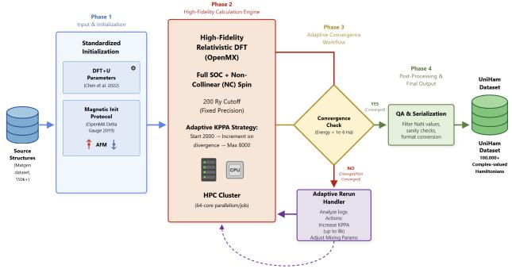  
Figure 5: UniHam Dataset Construction Pipeline.

## B Implementation Details

The training set is restricted to structures with ≤60 atoms per unit cell because SOC-complete Hamiltonians scale quadratically with the number of spinor orbitals: for a structure with � atoms, each atom carries up to 52 spinor components (for the s3p2d2f1 basis), and the full Hamiltonian matrix dimension is �(�2). Even on NVIDIA H100 GPUs (80 GB) with a batch size of 1, structures exceeding ∼60 atoms cause out-of-memory failures during backpropagation. The remaining 4,328 structures with >60 atoms are reserved for the OOD-Size evaluation. Table 10 lists the hyperparameters.

Table 9: Summary statistics of the UniHam dataset.
<table><tr><td>Property</td><td>Value</td></tr><tr><td>Total structures</td><td>103,121</td></tr><tr><td>Unique compositions</td><td>50,077</td></tr><tr><td>Elements covered</td><td>72 / Heavy (Z≥37): 41</td></tr><tr><td>Structures with heavy elements</td><td>66.6%</td></tr><tr><td>Atoms per cell (mean/median/range)</td><td>30 / 20 /  1-444</td></tr><tr><td>Space groups covered</td><td>225  /  230</td></tr><tr><td>Crystal systems covered</td><td>7/7</td></tr></table>

Table 10: Hyperparameters for baseline models.
<table><tr><td>Hyperparameter</td><td>DeepH-pack</td><td>HamGNN</td></tr><tr><td>Architecture</td><td>DeepH-E3 (Eagle)</td><td>HamGNN</td></tr><tr><td>Message-passing layers</td><td>3</td><td>3</td></tr><tr><td>Radial cutoff</td><td>10.0 Å</td><td>26.0 Bohr</td></tr><tr><td>Radial basis</td><td>Gaussian</td><td>64 Bessel</td></tr><tr><td>Attention heads</td><td>2</td><td></td></tr><tr><td>Delta learning (H0)</td><td>No</td><td>Yes</td></tr><tr><td>Hermitian constraint</td><td>No</td><td>Yes</td></tr><tr><td>Optimizer</td><td>AdamW</td><td>Adam</td></tr><tr><td>Initial learning rate</td><td> $1 0 ^ { - 3 }$ </td><td>10⁻3</td></tr><tr><td>LR scheduler</td><td>ReduceOnPlateau ReduceOnPlateau</td><td></td></tr><tr><td>Weight decay</td><td> $1 0 ^ { - 3 }$ </td><td></td></tr><tr><td>Gradient clipping</td><td>一</td><td>1.0</td></tr><tr><td>Batch size</td><td>1</td><td>1 (×4 accum.)</td></tr><tr><td>GPUs</td><td>8× H100</td><td>8× H100</td></tr></table>

DeepH-pack uses epoch-level data sharding to handle the 86k training set (partitioning into � disjoint shards ≤10k each). HamGNN uses gradient accumulation (4 steps) for 100 epochs; HamGNN (FT) adds band-energy loss over 5 random �-points (8 bands near VBM) from the converged Base checkpoint.

## C Extended Experimental Results

Model comparison. HamGNN achieves a total MAE of 1.50 meV, outperforming DeepH-pack (2.44 meV) by 1.6×. HamGNN attains lower MAE on 96.5% ofindividual test structures (1,931 out of2,000). The Pearson correlation between per-structure MAEs of the two models is � = 0.795 (Figure 6), indicating that both models find a largely overlapping set of structures challenging.

Real and imaginary error decomposition. The imaginary part yields substantially smaller absolute errors for both models (HamGNN: 0.041 meV; DeepH-pack: 0.385 meV) compared to the real part (HamGNN: 2.96 meV; DeepH-pack: 4.49 meV). The imaginary-to-real MAE ratio difers markedly between models: approximately 1.4% for HamGNN versus 8.6% for DeepH-pack. HamGNN’s real-part MAE grows by 1.57× from the weak to the strong SOC regime (2.18→3.42 meV), while imaginary-part MAE grows by 2.38× (0.021→0.049 meV). Although imaginary errors remain small in absolute terms, their disproportionate growth with SOC strength indicates that spin-flip interaction terms represent the frontier challenge in Hamiltonian learning.

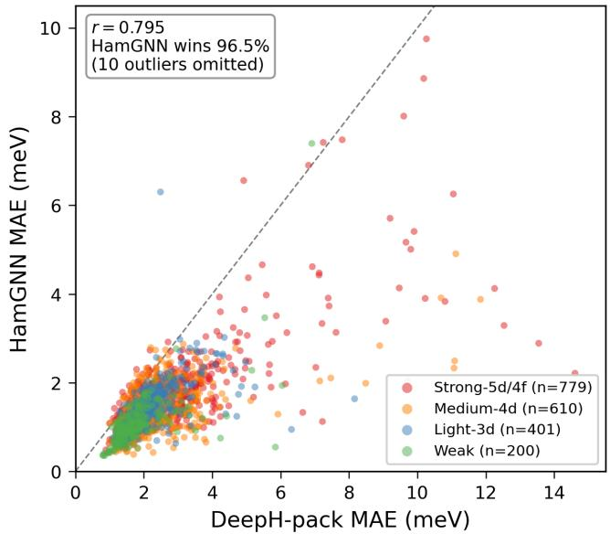  
Figure 6: Per-structure MAE comparison between HamGNN and DeepH-pack on the test set. Each point represents one structure; the dashed line indicates equal performance. Pearson � = 0.795.

SOC-stratified analysis. Figure 7 visualizes the SOC-stratified results (Table 4 in the main text). Both models exhibit a clear monotonic increase in MAE from the weak-SOC to the strong-SOC regime. HamGNN’s mean MAE rises by 58% (1.10→1.74 meV) and DeepH-pack’s by 45% (1.90→2.76 meV).

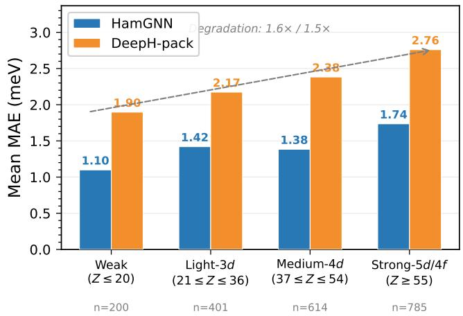  
Figure 7: Hamiltonian MAE (meV) stratified by SOC strength regime for both models.

Crystal system variation. MAE varies across crystal systems, with orthorhombic structures being the hardest (DeepH-pack: 2.84 meV) and monoclinic the easiest (2.08 meV). Atom count efects. Smal

unit cells (1–4 atoms) are counterintuitively harder than large ones, likely due to reduced statistical averaging over matrix elements.

Element-level and structural dificulty. Figure 8 maps the mean MAE of each element onto the periodic table. The visualization reveals a clear gradient: heavier elements are systematically harder to predict. Osmium $( \mathrm { O s } , Z = 7 6 )$ is the most challenging element for both models (HamGNN: 5.87 meV; DeepH-pack: 6.42 meV), exceeding the overall average by 3–4×. More broadly, the 5� transition metals—Ta, W, Os, Ir, and Pt—consistently produce elevated MAEs and exhibit the largest inter-model performance gaps (>1.5 meV advantage for HamGNN), pointing to a regime where architectural diferences matter most. At the other extreme, light main-group elements such as Si (HamGNN: 1.05 meV; DeepH-pack: 1.76 meV) and Ca (HamGNN: 0.98 meV; DeepH-pack: 1.76 meV) approach the numerical precision floor. At the structure level, 83.4% of structures are well-predicted by both models (MAE <3 meV), while only 4 structures (<0.2%) are simultaneously hard for both (MAE >10 meV). All four belong to the strong-SOC regime, share the or thorhombic space group ���� (No. 71) with just 4 atoms per cell, and contain 5� transition metals (W, Os, Pt). Conversely, the easiest structures are dominated by light-element oxides and silicates (e.g., SiO , CaO variants), achieving average MAEs below 0.7 meV. These findings demonstrate that UniHam’s broad elemental and structural coverage exposes meaningful performance variations that would remain invisible in datasets restricted to light elements.

System-size OOD generalization. HamGNN achieves an OOD/ID MAE ratio of 0.89 (OOD 1.34 meV vs. ID 1.50 meV), demonstrating near-perfect size transferability from ≤60-atom training to 444- atom test structures. DeepH-pack exhibits a qualitatively similar pattern. This is physically intuitive: equivariant message-passing architectures operate on local atomic neighborhoods defined by a radial cutof, so prediction for each matrix block depends only on the local chemical environment rather than the global system size.

Compositional OOD: detailed findings. Both models are configured with the same equivariant representation capacity, ensuring that performance diferences arise from architectural design rather than angular-momentum truncation. Architecture is decisive for OOD robustness: DeepH-pack’s MAE rises by 6–8× relative to its per-group ID reference, whereas HamGNN degrades by only 1.9–4.1×. The inter-model gap widens under OOD conditions from 1.5–2.1× (ID) to 3.9–5.3× (OOD). HamGNN maintains single-digit meV accuracy across all three OOD scenarios (5.39–5.93 meV). Its OOD MAE on NG (5.93 meV) is only 1.9× its ID reference and is even lower than DeepH-pack’s ID performance on the same structures (5.09 meV). HamGNN achieves remarkably uniform OOD MAE across all three scenarios, while DeepH-pack exhibits pronounced dependence on chemical distance (NG: 31.48 meV vs. In/RE: ∼22.5 meV).

Downstream property prediction: detailed analysis. HamGNN reduces band gap error by 2.7× (1.697→0.622 eV) and band structure MAE by 4.5× (1.612→0.360 eV). The median band gap error drops from 1.134 to 0.295 eV. Critically, Hamiltonian MAE alone is an insuficient proxy: HamGNN (Base) achieves a 38% lower Hamiltonian MAE than DeepH-pack (1.50 vs. 2.44 meV), yet this translates to only ∼10% band structure MAE improvement (1.612 vs. 1.795 eV). This directly justifies UniHam’s multi-dimensional

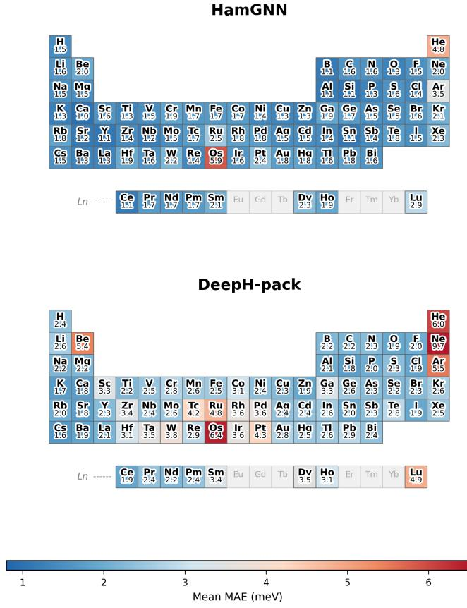  
Figure 8: Element-wise mean Hamiltonian MAE (meV) mapped onto the periodic table.

evaluation protocol. DOS reconstruction remains a frontier challenge: even HamGNN (FT) achieves only moderate DOS correlation (0.555), in stark contrast to its near-perfect band structure correlation (0.988). The band derivative correlation follows a consistent pattern: 0.711 for HamGNN (FT), 0.277 for HamGNN (Base), and 0.176 for DeepH-pack, confirming that eigenvalue fine-tuning improves not only energy accuracy but also the topological features of the electronic structure.

## D Data and Code Availability

The UniHam dataset, benchmark splits, evaluation code, and model training scripts are publicly available at https://github.com/WendyYW/ UniHam.git. All 103,000+ structures with converged, complex-valued Hermitian Hamiltonians (full SOC) are downloadable via provided scripts with selective download support. Data formats are directly T)compatible with DeepH and HamGNN interfaces. We provide com-

plete documentation for reproducing all experimental results.