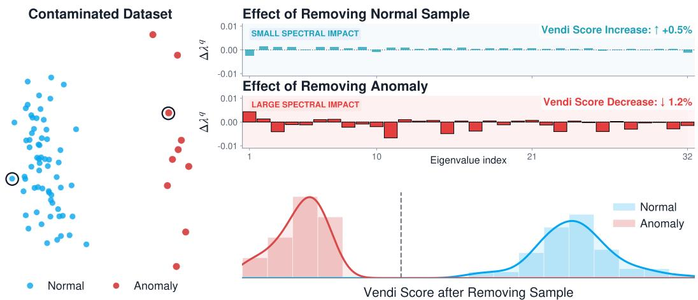
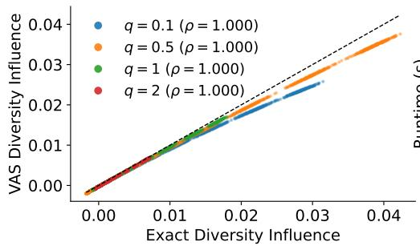
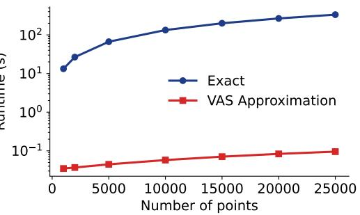
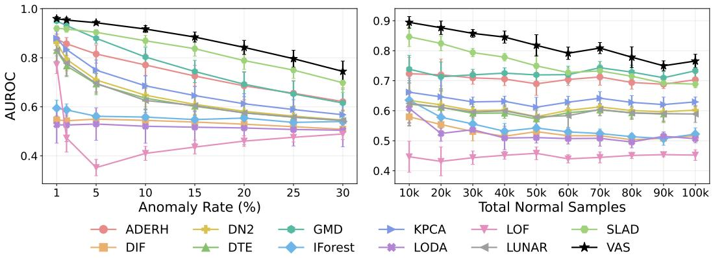
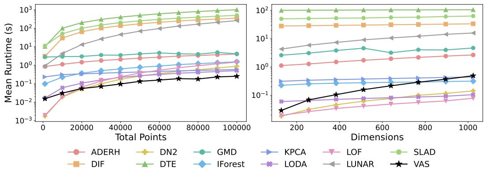
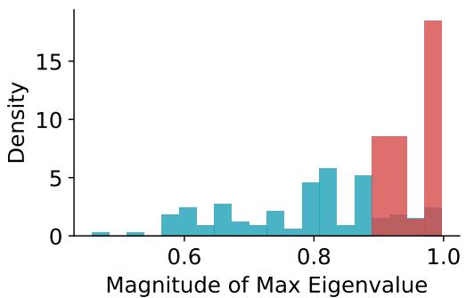
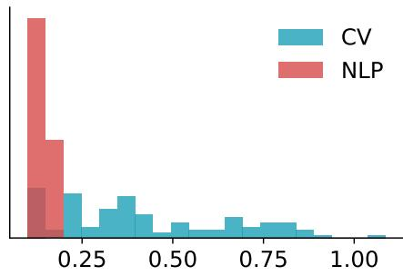

# Vendi Anomaly Scores for Efficient and Accurate Anomaly Detection

Amey P. Pasarkar∗,‡ Adji Bousso Dieng†,‡

Lewis-Sigler Institute for Integrative Genomics, Princeton University † Department of Computer Science, Princeton University ‡ Vertaix

## Abstract

Anomaly detection (AD) is a critical for trustworthy machine learning and scientific discovery. Existing methods typically define anomalies through local density, isolation heuristics, or distance from a fitted distribution, making them sensitive to neighborhood scale, partitioning choices, or restrictive distributional assumptions. In this work, we introduce a new paradigm by formulating anomaly detection from a diversity perspective. We propose the Vendi Anomaly Score (VAS), which detects anomalies by quantifying how much a sample changes the diversity of the dataset, as measured by the Vendi score, when removed. VAS captures both local redundancy and global data structure without relying on density estimation or partitioning heuristics. Moreover, VAS requires no hyperparameter tuning, instead adapting automatically to the spectral structure of the data. VAS is nonparametric and scales linearly with dataset size. Across 148 benchmark embedding datasets derived from 10 source datasets and 4 embedding architectures, VAS achieves state-of-the-art AD performance. We further validate VAS on largescale ImageNet experiments, where it remains robust as both contamination rate and dataset scale increase. Code to reproduce our results is openly available at https://github.com/vertaix/vendi-anomaly-scores.

## 1 Introduction

Anomaly detection (AD) is essential for analyzing and curating machine learning datasets and for discovery [Chandola et al., 2009, Campolongo et al., 2025]. In particular, by identifying samples that are corrupted, mislabeled, out-of-distribution, or otherwise irrelevant, AD helps maintain data quality and improve model reliability [Ahmed et al., 2017, Nassif et al., 2021]. Since modern datasets are increasingly inspected through learned embeddings that encode semantic relationships, effective data curation requires AD methods that operate directly in these embedding spaces [Pang et al., 2021, Reiss et al., 2021, Cao et al., 2025].

AD algorithms are commonly categorized by the supervision available during training. Supervised methods fit detectors using labeled mixtures of normal and anomalous samples [Ma et al., 2016, Vargaftik et al., 2021], while semi-supervised methods assume access to clean data and identify deviations from this reference set [Dai et al., 2024]. Unsupervised AD instead fits directly to the dataset being analyzed, making it especially attractive for modern data curation. As datasets increasingly span diverse modalities, it is often impractical to collect data on anomalies or to construct clean reference sets for every domain, making unsupervised detectors appealing.

Unsupervised AD methods typically define anomalies through isolation [Liu et al., 2008], local density [Breunig et al., 2000], or distance from a fitted distribution [Rippel et al., 2021]. Isolationbased methods score points by how easily they can be separated from the rest of the data, with classical examples including isolation forests (iForest) [Liu et al., 2008], extended isolation forests (EIF) [Hariri et al., 2019], and robust random cut forests (RRCF) [Guha et al., 2016], as well as geometric variants such as the hypersphere ensembles of INNE [Bandaragoda et al., 2014] and ADERH [Durani et al., 2025]. Other approaches use local neighborhood structure, including knearest neighbor scoring [Bergman et al., 2020] and local outlier factor (LOF) [Breunig et al., 2000], or fitted feature-space distributions [Rippel et al., 2021]. These methods are often effective, but their performance depends on certain implicit assumptions: isolation methods seek points that are easy to separate based on some heuristic, local methods depend on a chosen neighborhood scale, and distributional methods rely on the adequacy of the fitted density model. On the other hand, deep unsupervised detectors can learn more flexible notions of abnormality [Xu et al., 2023a,b, Goodge et al., 2022], but they require training a model for each dataset, which adds computational cost and other deployment-related challenges. How can we develop AD methods that retain the efficiency of classical detectors while making fewer assumptions about the geometry of embedding data?

  
Figure 1: Overview of VAS. Left: A multimodal dataset contaminated with an anomaly. Right: Removing a rare anomalous point induces a larger change in the eigenvalue spectrum than removing a normal sample. VAS detects these shifts by estimating the change in Vendi Score, derived from the Rényi entropy of order q of the spectrum (Eq. 1).

Contribution. In this paper, we answer this question and make several contributions and findings that we summarize below.

• We introduce a new paradigm for AD based on diversity. We propose the Vendi Anomaly Score (VAS), which builds on the Vendi Scores (VS), a family of similarity-based diversity metrics [Friedman and Dieng, 2022, Pasarkar and Dieng, 2023], and defines anomaly through changes in the eigenvalue spectrum of the embedding similarity matrix (Figure 1).

• We make VAS practical and easy to deploy. We derive an efficient approximation to the exact leave-one-out score, allowing VAS to scale to large embedding datasets. With a simple heuristic, our method also automatically adjusts to different data geometries, eliminating the need for neighborhood selection, fitting clusters, or estimating parametric densities.

• We demonstrate the effectiveness of VAS across diverse embedding datasets and large-scale contamination experiments. On ADBENCH image and text benchmarks [Han et al., 2022], spanning 148 total datasets, VAS outperforms all other baselines. We also evaluate VAS on controlled ImageNet experiments with up to 100k samples [Deng et al., 2009], showing that VAS is especially effective for detecting contaminating subpopulations at scale.

## 2 Related Work

Our work relates to three lines of research, which we describe below.

Unsupervised anomaly detection. Existing unsupervised AD methods typically identify anomalies based on criteria such as separability, local density, or reconstruction error.

Partitioning-based methods isolate anomalies by recursively subdividing the feature space. Isolation Forest (iForest) [Liu et al., 2008] and its variants, such as Extended Isolation Forest [Hariri et al., 2019], identify anomalies as points that can be separated with fewer splits. While effective in low-dimensional or tabular settings, these methods rely on partitions of the feature space, which can struggle to capture complex geometry in high-dimensional embedding spaces.

A second class of methods estimates local data density. Techniques such as Local Outlier Factor (LOF) [Breunig et al., 2000] and deep nearest neighbors (DN2) [Bergman et al., 2020] identify anomalies as points that lie in low-density regions relative to their neighbors. However, these approaches require constructing neighborhoods of fixed size, making them sensitive to scale and limiting their ability to adapt to heterogeneous or multimodal data distributions.

Ensemble-based methods combine multiple weak signals to improve robustness. For example, Lightweight on-line Detector of Anomalies (LODA) [Pevny, 2016] aggregates anomaly scores from\` random low-dimensional projections, while ADERH leverages ensembles of random hyperspheres to estimate density and support [Durani et al., 2025]. ADERH provides the strongest results to date for AD on tabular data, although it requires the strong assumption that normal data can be bounded within hyperspheres, which may not be true for embedding data.

Recent work has also turned to deep learning to improve AD in complex data. Many of these methods aim to construct representation spaces where anomalies are more easily separated. For example, Deep Isolation Forest [Xu et al., 2023a] learns a non-linear transformation of the data that IForest can leverage. LUNAR [Goodge et al., 2022] unifies local outlier methods such as LOF through a graph neural network message-passing framework, introducing learnability into neighborhood-based AD. Similarly, DeepSVDD [Ruff et al., 2018] learns to project normal data within a hypersphere and anomalous data outside of it. RCA [Liu et al., 2021] and RDP [Wang et al., 2019] use collaboration between multiple models to generate a new space where anomalies are more separable. SLAD [Xu et al., 2023b] and DTE [Livernoche et al., 2024] both measure how far a sample deviates from normal data. SLAD learns to predict self-supervised “scale” relationships within each sample and identifies anomalies via inconsistencies in these predictions, while DTE leverages diffusion models to estimate deviation from the normal data manifold.

Out-of-distribution detection. Out-of-distribution (OOD) detection is closely related to semisupervised AD: both settings assume access to in-distribution data and aim to identify samples that deviate from it. In OOD detection, however, the goal is typically to determine whether a test input falls outside the training distribution of a particular predictive model. As a result, many OOD methods are designed around signals produced by that model, including prediction confidence [Hendrycks and Gimpel, 2016], energy-based scores [Liu et al., 2020, 2023], feature-space statistics such as Mahalanobis distance [Lee et al., 2018, Mueller and Hein, 2025], or other properties of the learned representation [Fang et al., 2025, Bergman et al., 2020, Wang et al., 2022]. Standardized benchmarks such as OpenOOD [Yang et al., 2022] evaluate these methods in model-centric settings where the detector is built around a classifier trained on a specified in-distribution dataset.

In contrast, we study unsupervised AD. Here, the goal is to identify anomalous samples within the dataset being analyzed, using embeddings produced by a model trained independently on that dataset. We do not assume labels, a clean reference set, prediction logits, or model-specific confidence scores. Our method instead operates directly on the similarity structure of the embedding dataset.

Measuring rarity with the Vendi Scores. Friedman and Dieng [2022] introduced the Vendi Score (VS) as a similarity-based diversity measure. It has since been used to evaluate diversity in a wide variety of domains [Stein et al., 2023, Neshat et al., 2025, Zamzmi et al., 2025, DenAdel et al., 2025, Nielsen et al., 2025, Barceló et al., 2024, Tom et al.]. Recent methods have explored how the Vendi Scores can be used to identify rare or novel samples in various settings. In active search, Nguyen and Dieng [2024] measure incremental changes to quality-weighted extensions of the VS, showing that changes in the VS can be used to guide the selection of diverse and informative samples in experimental design settings. Similarly, Askari Hemmat et al. [2024] leverage incremental changes to the VS to guide image generation toward underrepresented regions of the output space. The VS has also been used for OOD detection: the Vendi Novelty Scores (VNS) detect OOD samples by measuring how much a test sample increases the diversity of a reference dataset by class-conditional novelty estimates derived from a trained classifier [Pasarkar and Dieng, 2026]. VNS relies on incremental changes to diversity, but it is designed for inference-time OOD detection relative to a fixed training distribution and leverages model-dependent signals.

## 3 Method

We review the Vendi Scores (VS), and introduce our method for leveraging them in unsupervised AD.

The Vendi Scores. Let $\pmb { X } \in \mathbb { R } ^ { N \times D }$ denote a dataset of N samples. Given a positive semidefinite kernel $k ( \cdot , \cdot )$ , we construct the similarity matrix $\pmb { K } \in \mathbb { R } ^ { N \times N }$ with entries $K _ { i j } = k ( x _ { i } , x _ { j } )$ . The VS [Friedman and Dieng, 2022] measures the diversity of X via the entropy of the eigenvalues of K, normalized such that $\operatorname { T r } ( K ) = 1$

This definition can be generalized using the Rényi entropy [Pasarkar and Dieng, 2023]. Let $\lambda _ { i } ( K )$ denote the ith eigenvalue of K and $q \geq 0$ be the order of the VS. The order-q is defined as

$$
\mathrm { V S } _ { q } ( K ) = \exp \left( \frac { 1 } { 1 - q } \log \sum _ { i = 1 } ^ { N } \lambda _ { i } ( K ) ^ { q } \right) .\tag{1}
$$

This simplifies to the exponential Shannon Entropy when $q = 1$ . The parameter q controls sensitivity to different parts of the spectrum: smaller values emphasize the tail, while larger values emphasize the leading eigenmodes [Pasarkar and Dieng, 2023].

Computing ${ \mathrm { V S } } _ { q }$ naively requires the eigendecomposition of the $N \times N$ matrix K, which requires $O ( N ^ { 3 } )$ complexity. However, as Friedman and Dieng [2022] note, when working with $\ell _ { 2 }$ -normalized features and using a cosine kernel, the VS can be computed more efficiently. In this setting, the similarity matrix is $\pmb { K } = X X ^ { T } / N$ and has the same non-zero eigenvalues of the smaller $\bar { D \times D }$ matrix $\check { X ^ { T } } X / N$ . We therefore can compute the spectrum using $X ^ { T } \breve { X } / N$ , reducing the computational cost to $O ( D ^ { 2 } N + D ^ { 3 } )$ , which is considerably more efficient in the common ML setting where the number of samples greatly exceeds the feature dimension $( N \gg D )$ .

Fast estimation of diversity influence for anomaly detection. We consider a dataset of N samples represented by D-dimensional embeddings $\pmb { X } \in \mathbb { R } ^ { \pmb { \tilde { N } } \times \pmb { D } }$ , obtained from a pretrained model. The goal of unsupervised AD is to identify which samples are anomalous relative to the rest of the dataset. We aim to learn a scoring function $s : \{ 1 , \ldots , \mathbf { \bar { N } } \} \to \mathbb { R }$ that assigns a real-valued anomaly score to each sample based on its embedding. Higher scores correspond to more anomalous points. Only the induced ordering matters: any transformation of $s ( i )$ that preserves the ordering yields an equivalent solution.

We define anomaly scores based on the change in dataset diversity when a sample is removed. Assume $\ell _ { 2 }$ normalized features and let $\rho = \frac { 1 } { N } \bar { \pmb X ^ { \top } } \pmb X \in \mathbb { R } ^ { D \times D }$ denote the feature covariance matrix corresponding to the cosine kernel. For a sample $x _ { i } \in \mathbb { R } ^ { D }$ , let $X _ { - i }$ denote the dataset with $x _ { i }$ removed, and define $\begin{array} { r } { \rho _ { - i } = \frac { 1 } { N - 1 } { \boldsymbol X } _ { - i } ^ { \top } { \boldsymbol X } _ { - i } = \frac { { \boldsymbol X } ^ { \top } { \boldsymbol X } - x _ { i } x _ { i } ^ { \top } } { N - 1 } } \end{array}$ . We then define the anomaly score as,

$$
\Delta ( x _ { i } ) = \log \mathrm { V S } _ { q } ( \rho ) - \log \mathrm { V S } _ { q } ( \rho _ { - i } ) .
$$

Intuitively, samples that contribute uniquely to the structure of the dataset will induce a larger decrease in diversity when removed, yielding larger values of $\Delta ( x _ { i } )$ , as shown in Figure 1.

However, computing $\Delta ( x _ { i } )$ naively for all N samples requires $O ( N D ^ { 3 } )$ time, which is prohibitive for high-dimensional datasets. Moreover, this formulation requires recomputing the spectrum of $\rho _ { - i }$ after removing each sample, preventing efficient vectorization and limiting the ability to leverage batched GPU computation. We can accelerate this computation by noting that each removal corresponds to a rank-one perturbation of $\rho$ of size $O ( 1 / N )$ . Proposition 3.1 shows that the resulting change in Vendi Score can be approximated by a single quadratic form involving $x _ { i }$

Proposition 3.1 (First-order approximation in log-space). Assume that log ${ \mathrm { V S } } _ { q }$ is twice continuously differentiable in a neighborhood ofρ. Let

$$
G _ { q } = \left\{ \begin{array} { l l } { \displaystyle { \frac { q } { ( 1 - q ) \mathrm { T r } ( \rho ^ { q } ) } \rho ^ { q - 1 } } , } & { q \neq 1 , } \\ { \quad } & { } \\ { \displaystyle { - ( \log \rho + I ) } , } & { q = 1 . } \end{array} \right.
$$

Then, for each $i ,$

$$
\log \mathrm { V S } _ { q } ( \rho ) - \log \mathrm { V S } _ { q } ( \rho _ { - i } ) = \frac { x _ { i } ^ { \top } G _ { q } x _ { i } - \operatorname { T r } ( G _ { q } \rho ) } { N - 1 } + O \left( \frac { 1 } { N ^ { 2 } } \right) .
$$

A proof is provided in Appendix Section A. The differentiability assumption excludes spectral boundary cases in which zero eigenvalues make terms such as log $\rho$ or $\rho ^ { q - 1 }$ singular. In implementation, all spectral quantities are computed on the positive eigenspace of $\rho ,$ , equivalently restricting the calculation to the span of the data.

Because $\operatorname { T r } ( G _ { q } \rho )$ in Proposition 3.1 is constant across samples in a dataset, and we only care about ranking samples from our scoring function, we only need to compute the quantity $x _ { i } ^ { \top } G _ { q } x _ { i }$ for each sample $x _ { i }$ . This yields a simple batched computation of the VAS:

$$
\operatorname { V A S } ( x _ { i } ) : = \operatorname { d i a g } ( X G _ { q } \mathbf { { } } X ^ { \top } ) _ { i } \qquad \forall i = 1 \ldots N .\tag{2}
$$

We empirically demonstrate the accuracy of the approximation used in VAS in Section 4.1.

VAS can also be interpreted as a spectral quadratic anomaly score, connecting it to classical methods such as Mahalanobis distance and PCA reconstruction error. While these methods use predefined rules for weighting different directions of variation, VAS derives its weighting from each sample’s influence on dataset diversity, with the relative importance of different directions controlled by the Vendi Score order $q .$ In Appendix Section B, we provide additional description of how VAS relates to other spectral scores.

Automatically adapting $q .$ VAS introduces a single hyperparameter: the order $q$ of the Vendi Score. Previous methods leveraging the Vendi Scores often fix a single value of $q$ across experiments [Yang et al., 2025, Pasarkar and Dieng, 2026] or track the VS across a range of q values to draw diversity profiles [Dieng and Pasarkar, 2025, Hu et al., 2026]. However, in unsupervised AD, the optimal choice of $q$ can vary significantly depending on the geometry of the embedding space, and we are not afforded a validation set to tune hyperparameters. Therefore, we design a simple, data-dependent heuristic that adapts $q$ automatically across datasets.

The parameter $q$ controls how strongly the Vendi Score emphasizes the tail of the eigenvalue spectrum. The importance of this tail varies across datasets. In embedding spaces where the data is highly concentrated, such as BERT embeddings of text, most variance is captured by the leading eigenmode, resulting in a large principal eigenvalue $\lambda _ { 1 }$ of the trace-normalized similarity matrix. In this regime, AD requires amplifying the contribution of the spectral tail, which is achieved by using smaller values of $q .$ In contrast, in more isotropic embedding spaces, such as image representations spanning diverse visual features, the variance is more evenly distributed, leading to a smaller $\lambda _ { 1 }$ . In these settings, less emphasis on the tail is needed, and larger values of $q$ are appropriate.

To capture this behavior without manual tuning, we define $q$ as a function of the principal eigenvalue:

$$
q = \operatorname* { m a x } \big ( 2 ( 1 - \lambda _ { 1 } ) , 0 . 1 \big ) .
$$

The lower bound of 0.1 is introduced for numerical stability when evaluating $\rho ^ { q - 1 }$ for small $q .$ This heuristic assigns smaller values of $q$ to concentrated datasets and larger values to more dispersed ones, adapting automatically to the spectral structure of the data.

Interpreting VAS. Proposition 3.1 shows that VAS ranks samples by the quadratic form $x ^ { \top } G _ { q } x$ Therefore, to understand what kinds of subpopulations VAS identifies as anomalous, it suffices to study the expected score $\mathbb { E } _ { x \sim P _ { c } } [ x ^ { \top } G _ { q } x ]$ for samples drawn from a component $P _ { c }$ . Proposition 3.2 analyzes this quantity under a stylized orthogonal mixture model.

Proposition 3.2 (Expected VAS under orthogonal mixtures). Let $\textstyle P = \sum _ { c = 1 } ^ { K } \pi _ { c } P _ { c }$ be a mixture distribution on $\mathbb { S } ^ { d - 1 } ;$ , and define $\rho = \mathbb { E } _ { x \sim P } [ x x ^ { \top } ]$ . Assume each component $P _ { c }$ is supported on a subspace $U _ { c } \subseteq \mathbb { R } ^ { d }$ , and that the subspaces $U _ { 1 } , \dots , U _ { K }$ are mutually orthogonal. Let $\rho _ { c } =$ $\mathbb { E } _ { x \sim P _ { c } } [ x x ^ { \top } ]$ . Using $G _ { q }$ as defined in Proposition 3.1, for any $x \in U _ { c }$ and $q \neq 1$

$$
x ^ { \top } G _ { q } x = \frac { q } { \left( 1 - q \right) \operatorname { T r } ( \rho ^ { q } ) } \pi _ { c } ^ { q - 1 } x ^ { \top } \rho _ { c } ^ { q - 1 } x .
$$

Consequently, the expected VAS score of a sample from component c is

$$
\mathbb { E } _ { x \sim P _ { c } } [ x ^ { \top } G _ { q } x ] = \frac { q } { ( 1 - q ) \operatorname { T r } ( \rho ^ { q } ) } \left( \frac { \pi _ { c } } { \operatorname { V S } _ { q } ( \rho _ { c } ) } \right) ^ { q - 1 } .
$$

The proof is provided in Appendix C. Proposition 3.2 shows that the expected VAS score for samples from component c depends on the ratio $\bar { \pi _ { c } } / \mathrm { V S } _ { q } ( \rho _ { c } )$ . Here, $\pi _ { c }$ is the component mass, while $\mathrm { V S } _ { q } \dot { ( } \rho _ { c } )$

<table><tr><td>Dataset</td><td>Encoder</td><td>VAS</td><td>ADERH</td><td>DIF</td><td>IForest</td><td>LUNAR</td><td>DN2</td><td>LODA</td><td>LOF</td><td>KPCA</td><td>SLAD</td><td>GMD</td><td>DTE</td></tr><tr><td>CIFAR10</td><td>ResNet18</td><td>0.745</td><td>0.633</td><td>0.684</td><td>0.627</td><td>0.657</td><td>0.740</td><td>0.635</td><td>0.696</td><td>0.751</td><td>0.735</td><td>0.732</td><td>0.673</td></tr><tr><td>CIFAR10</td><td>ViT</td><td>0.941</td><td>0.924</td><td>0.860</td><td>0.876</td><td>0.837</td><td>0.855</td><td>0.856</td><td>0.519</td><td>0.905</td><td>0.942</td><td>0.898</td><td>0.590</td></tr><tr><td>FashionMNIST</td><td>ResNet18</td><td>0.911</td><td>0.865</td><td>0.868</td><td>0.831</td><td>0.852</td><td>0.858</td><td>0.829</td><td>0.605</td><td>0.915</td><td>0.904</td><td>0.912</td><td>0.848</td></tr><tr><td>FashionMNIST</td><td>ViT</td><td>0.930</td><td>0.910</td><td>0.856</td><td>0.890</td><td>0.815</td><td>0.860</td><td>0.862</td><td>0.519</td><td>0.917</td><td>0.919</td><td>0.925</td><td>0.657</td></tr><tr><td>MNIST-C</td><td>ResNet18</td><td>0.793</td><td>0.763</td><td>0.744</td><td>0.734</td><td>0.780</td><td>0.763</td><td>0.724</td><td>0.628</td><td>0.765</td><td>0.782</td><td>0.793</td><td>0.759</td></tr><tr><td>MNIST-C</td><td>ViT</td><td>0.739</td><td>0.723</td><td>0.704</td><td>0.720</td><td>0.695</td><td>0.704</td><td>0.689</td><td>0.555</td><td>0.719</td><td>0.732</td><td>0.723</td><td>0.568</td></tr><tr><td>MVTec-AD</td><td>ResNet18</td><td>0.799</td><td>0.755</td><td>0.750</td><td>0.745</td><td>0.768</td><td>0.797</td><td>0.704</td><td>0.763</td><td>0.741</td><td>0.788</td><td>0.790</td><td>0.705</td></tr><tr><td>MVTec-AD</td><td>ViT</td><td>0.896</td><td>0.809</td><td>0.795</td><td>0.808</td><td>0.858</td><td>0.875</td><td>0.781</td><td>0.842</td><td>0.847</td><td>0.851</td><td>0.891</td><td>0.697</td></tr><tr><td>SVHN</td><td>ResNet18</td><td>0.657</td><td>0.579</td><td>0.615</td><td>0.576</td><td>0.609</td><td>0.662</td><td>0.589</td><td>0.638</td><td>0.657</td><td>0.655</td><td>0.659</td><td>0.592</td></tr><tr><td>SVHN</td><td>ViT</td><td>0.579</td><td>0.519</td><td>0.524</td><td>0.530</td><td>0.564</td><td>0.584</td><td>0.524</td><td>0.577</td><td>0.565</td><td>0.553</td><td>0.580</td><td>0.529</td></tr><tr><td>20News</td><td>BERT</td><td>0.626</td><td>0.543</td><td>0.557</td><td>0.555</td><td>0.571</td><td>0.565</td><td>0.554</td><td>0.607</td><td>0.554</td><td>0.606</td><td>0.603</td><td>0.560</td></tr><tr><td>20News</td><td>RoBERTa</td><td>0.749</td><td>0.636</td><td>0.624</td><td>0.643</td><td>0.698</td><td>0.732</td><td>0.607</td><td>0.723</td><td>0.720</td><td>0.703</td><td>0.716</td><td>0.503</td></tr><tr><td>Agnews</td><td>BERT</td><td>0.676</td><td>0.583</td><td>0.582</td><td>0.583</td><td>0.650</td><td>0.610</td><td>0.558</td><td>0.725</td><td>0.604</td><td>0.656</td><td>0.650</td><td>0.587</td></tr><tr><td>Agnews</td><td>RoBERTa</td><td>0.881</td><td>0.718</td><td>0.661</td><td>0.677</td><td>0.790</td><td>0.850</td><td>0.638</td><td>0.719</td><td>0.846</td><td>0.797</td><td>0.813</td><td>0.501</td></tr><tr><td>Amazon</td><td>BERT</td><td>0.608</td><td>0.577</td><td>0.565</td><td>0.558</td><td>0.608</td><td>0.595</td><td>0.531</td><td>0.578</td><td>0.585</td><td>0.606</td><td>0.604</td><td>0.522</td></tr><tr><td>Amazon</td><td>RoBERTa</td><td>0.544</td><td>0.485</td><td>0.518</td><td>0.509</td><td>0.536</td><td>0.551</td><td>0.520</td><td>0.548</td><td>0.551</td><td>0.532</td><td>0.530</td><td>0.548</td></tr><tr><td>Imdb</td><td>BERT</td><td>0.502</td><td>0.486</td><td>0.490</td><td>0.488</td><td>0.493</td><td>0.517</td><td>0.447</td><td>0.505</td><td>0.517</td><td>0.513</td><td>0.515</td><td>0.483</td></tr><tr><td>Imdb</td><td>RoBERTa</td><td>0.530</td><td>0.439</td><td>0.508</td><td>0.485</td><td>0.518</td><td>0.529</td><td>0.506</td><td>0.532</td><td>0.530</td><td>0.510</td><td>0.504</td><td>0.500</td></tr><tr><td>Yelp</td><td>BERT</td><td>0.679</td><td>0.623</td><td>0.617</td><td>0.603</td><td>0.664</td><td>0.672</td><td>0.573</td><td>0.667</td><td>0.647</td><td>0.659</td><td>0.676</td><td>0.467</td></tr><tr><td>Yelp</td><td>RoBERTa</td><td>0.566</td><td>0.511</td><td>0.537</td><td>0.531</td><td>0.578</td><td>0.594</td><td>0.548</td><td>0.581</td><td>0.577</td><td>0.568</td><td>0.575</td><td>0.532</td></tr><tr><td colspan="2">Average Rank</td><td>2.35</td><td>8.70</td><td>8.55</td><td>9.20</td><td>6.10</td><td>4.05</td><td>10.15</td><td>6.25</td><td>4.70</td><td>4.35</td><td>3.80</td><td>9.80</td></tr><tr><td colspan="2">p-Value</td><td></td><td>1.34e-20</td><td>1.15e-24</td><td>6.27e-24</td><td>3.78e-22</td><td></td><td>3.14e-10 2.08e-25</td><td>5.23e-15</td><td>4.11e-15</td><td>4.49e-16</td><td>1.34e-08</td><td>2.07e-24</td></tr></table>

Table 1: AUROC across dataset families and encoders. For multi-split datasets, we report average AUROC. Orange marks best, blue marks 2nd. Bottom-row p-values are paired Wilcoxon tests: VAS vs. each baseline over all 148 dataset-split/encoder instances.

is the component’s effective spectral dimension. Thus, VAS is sensitive to how much probability mass a component has relative to its internal diversity. Components that are small but spectrally diffuse can receive high anomaly scores, even if their samples are not isolated from one another. This component-level sensitivity emerges without explicitly identifying components or forming local neighborhoods; it arises implicitly from the spectrum of the full dataset.

Time and space complexity. The computational cost of VAS is dominated by forming $\rho = { \pmb X } ^ { \top } { \pmb X } / N$ eigen-decomposing the resulting $D \bar { \times } D$ matrix, and computing the VAS scores from Equation 2 for all samples. Forming ρ costs $\mathrm { { \bar { O } } } ( N D ^ { 2 } )$ time, the eigendecomposition costs $O ( D ^ { 3 } )$ time, and the batched score computation costs $\scriptstyle { \dot { O } } ( N D ^ { 2 } )$ time. Thus, the total runtime is $O ( \dot { N } D ^ { 2 } + D ^ { 3 } )$ , with memory complexity $O ( N D + D ^ { 2 } )$ . In contrast, naively recomputing the Vendi Score after each sample removal would require N separate eigendecompositions, yielding $O ( N D ^ { 3 } )$ time complexity. VAS therefore avoids per-sample spectral computations and reduces scoring to a single global eigendecomposition followed by batched matrix operations.

## 4 Experiments

In this section, we compare VAS against a diverse set of AD algorithms. We benchmark all algorithms on various image and text embedding datasets across multiple architectures.

Datasets and models. We evaluate VAS on the embedding-based image and text datasets from AD BENCH [Han et al., 2022]. These datasets span numerous image and text datasets and architectures. For all image datasets, we test methods against embeddings from both ResNet18 [He et al., 2016] and ViT [Dosovitskiy et al., 2020] architectures that had been pre-trained on ImageNet [Deng et al., 2009]. For text data, we test performance on embeddings from BERT [Devlin et al., 2019] and RoBERTa [Liu et al., 2019]. The benchmark covers a wide range of AD scenarios. These include rare class detection (e.g., CIFAR-10 [Krizhevsky et al., 2009], SVHN [Netzer et al., 2011]), where one class is treated as normal and samples from the remaining classes are downsampled to form anomalies; distributional corruption (e.g., MNIST vs. MNIST-C [Mu and Gilmer, 2019]), where anomalies arise from shifts in data generation; and semantic or structural anomalies (e.g., MVTec-AD [Bergmann et al., 2019]). In text datasets (e.g., Amazon [He and McAuley, 2016], Yelp [Zhang et al., 2015]), anomalies are constructed via shifts in semantic content, such as contrasting sentiment. Additional specifications for each dataset are provided in Appendix Section D.

We additionally perform AD experiments on ImageNet-1K [Deng et al., 2009], using embeddings extracted from the DinoV3 ViT-B/16 model [Siméoni et al., 2025].

  
Figure 2: VAS provides accurate and efficient diversity influence measurements. Left: VAS diversity influence compared against the exact leave-one-out Vendi Score change for multiple orders of q. Spearman rank correlation $\rho$ is shown for each choice of $q .$ Right: Varying dataset sizes shows that VAS provides orders of magnitude speedup over the exact approach.

Baselines. We compare against 11 unsupervised AD algorithms: ADERH [Durani et al., 2025], DIF [Xu et al., 2023a], IForest [Liu et al., 2008], DN2 [Bergman et al., 2020], LODA [Pevny, 2016], LOF\` [Breunig et al., 2000], KPCA [Fang et al., 2025], SLAD [Xu et al., 2023b], DTE [Livernoche et al., 2024], and LUNAR [Goodge et al., 2022]. We also include a custom Gaussian-mixture Mahalanobis distance baseline (GMD) to represent fitted-distribution methods. Inspired by Gaussian feature modeling for AD [Rippel et al., 2021], GMD fits a Bayesian Information Criterion-selected Gaussian mixture model to the unlabeled embeddings and scores each sample by its Mahalanobis distance to its most likely component. Together, these baselines span feature-space partitions (IForest), local neighborhoods (LOF, DN2), randomized ensemble methods based on projections or hyperspheres (LODA, ADERH), deep anomaly detectors (SLAD, DIF, DTE, LUNAR), kernel reconstruction methods (KPCA), and fitted feature-space distributions (GMD). Additional descriptions of each algorithm and their relationship to VAS are provided in Appendix Section E.

Hyperparameters and preprocessing. All main-text experiments use the default hyperparameter recommendations from each method’s reference implementation. VAS uses the adaptive choice of q described in Section 3, with no validation-label tuning. To assess sensitivity of baselines to the default hyperparameter protocol, we additionally report a grid-search comparison in Appendix Section F.

For preprocessing, we use a method-specific protocol designed to match the assumptions of each baseline rather than imposing a single uniform pipeline. This avoids disadvantaging methods whose scoring rules depend on a particular feature scale. Specifically, ADERH uses MinMaxScaler and LUNAR uses StandardScaler [Pedregosa et al., 2011]. SLAD, DIF, IForest, DTE, LOF, and LODA are applied to raw features, consistent with their standard usage. DN2 and GMD operate on $\ell _ { 2 }$ -normalized features, following recent evidence that normalized embeddings improve distanceand Mahalanobis-based scoring in deep feature spaces [Sun et al., 2022, Mueller and Hein, 2025]. Finally, KPCA and VAS use a cosine kernel, so they operate on $\ell _ { 2 } \cdot$ -normalized features.

Evaluation protocol. All methods are fit directly on the contaminated unlabeled dataset and then used to score the same samples, matching the standard unsupervised AD setting. We evaluate performance using Area Under the ROC Curve (AUROC) and Average Precision (AP). Higher values indicate better performance for both metrics.

## 4.1 Empirical Accuracy of VAS

Prior to benchmarking VAS against other baselines, we verify the accuracy of its approximation to the exact leave-one-out VS change. In Figure 2, we test the method on a 25, 000-point, 100-component mixture of gaussians dataset in 512 dimensions. For all tested VS orders q, we achieve a Spearman rank correlation of $\rho = 1 . 0 0$ , showing that the approximation preserves the sample ranking. We also show the preferred efficiency of VAS: Varying the dataset size from 1000 to 25000 points shows that VAS is orders of magnitude faster than the exact approach.

We additionally evaluate the approximation on all 148 ADBENCH benchmark instances by comparing VAS against the exact leave-one-out Vendi Score change. The approximation closely preserves the anomaly rankings, with an average Spearman $\rho$ over 0.98 on all tested benchmarks. The change in AUROC is at most 1.16%. Detailed results are provided in Table 2.

  
Figure 3: VAS achieves accurate ImageNet AD. We construct contaminated datasets by sampling normal and anomalous images from disjoint ImageNet classes. Left: AUROC as the anomaly rate varies with 25,000 normal images from 25 classes. Right: AUROC as dataset size increases at a fixed 20% anomaly rate, adding normal samples in increments of 10, 000. VAS performs best across both sweeps, showing robustness to increasing contamination and scale. Results are averaged over 5 replications, with standard deviation bars included.

## 4.2 ADBENCH Anomaly Detection Performance Results

Tables 1 and 3 show the performance of VAS relative to other baselines on the ADBENCH embedding benchmarks based on AUROC and AP, respectively. We report family-level averages across datasets and across the two embedding models available for each benchmark family. Statistical tests are also run across all 148 benchmark instances, where each instance corresponds to a dataset split paired with an embedding model. VAS achieves significantly stronger performance than the competing methods under a Wilcoxon signed-rank test for both AUROC and AP.

Figure 5 shows the distribution of the adaptively selected Vendi orders q. The order q controls which parts of the spectrum drive the diversity-influence score: larger values emphasize dominant eigen-directions, while smaller values place relatively more weight on lower-variance directions. We observe that NLP embeddings tend to have larger principal eigenvalues than CV embeddings, suggesting stronger concentration around shared semantic context. Consequently, the adaptive rule selects smaller values of q for NLP datasets, which makes VAS more sensitive to variation in the spectral tail.

To ensure that our comparisons are robust against hyperparameters, we perform a grid search over the hyperparameters of all baseline methods. For each method, we pick the hyperparameters that give the strongest performance relative to VAS. Even in this setting of letting methods overfit to the evaluation sets, VAS still provides the strongest results (Tables 4 and 5). Additional details of this grid search experiment are in Appendix Section F.

We additionally evaluate the sensitivity of VAS to alternative rules for selecting $q ,$ including different scaling factors, multiple leading eigenvalues, and the effective spectral rank. Our heuristic performs comparably to several alternatives and significantly outperforms others across 148 ADBENCH tasks, suggesting that its effectiveness is not overly sensitive to the choice of heuristic (Appendix G).

## 4.3 ImageNet Anomaly Detection Results

We next evaluate VAS in a controlled large-scale image setting using ImageNet embeddings from DINOv3 ViT-B/16 [Siméoni et al., 2025]. We construct contaminated datasets by sampling normal images from one set of ImageNet classes and anomalous images from a disjoint set of classes. We study two settings. First, we fix the normal set to 25,000 images from 25 classes and vary the number of anomalous images sampled from 25 disjoint classes, thereby sweeping the anomaly rate. Second, we fix the anomaly rate at 20% and scale the dataset by increasing the number of normal classes in increments of 10, while sampling anomalies from an equal number of disjoint classes. This increases both dataset size and semantic diversity as we scale to 100,000 normal images. Across both settings, VAS uses the same adaptive choice of q as in the ADBENCH experiments and achieves the strongest performance among the evaluated methods (Fig. 3). SLAD provides the most competitive performance, although as shown in the following section, it is orders of magnitude slower than VAS.

  
Figure 4: VAS supports efficient AD. Left: Latency of methods when increasing dataset size at a fixed dimensionality of 128. Right: Latency of methods with increasing dimensionality at a fixed dataset size of 5000. Results are averaged over n = 3 repetitions.

These results match the behavior predicted by Proposition 3.2. The anomalous samples in this experiment are not isolated outliers: they are sampled from a select number of ImageNet classes and can therefore form coherent local neighborhoods in feature space. This structure can weaken local density methods, which may treat anomalous samples as typical once they have nearby anomalous neighbors. VAS instead scores each sample by its diversity influence. Under the mixture structure described in Proposition 3.2, this score depends on both component mass and internal diversity, enabling VAS to detect rare but coherent anomalous subpopulations.

To further investigate VAS across different anomaly types, we consider three additional constructions using ADBENCH embeddings: locally class-confusable observations, global directional perturbations, and disrupted feature dependencies. VAS performs well across constructions compared to the other best-performing baselines. We provide details of these experiments in Appendix H.

## 4.4 Latency Evaluation of VAS

We compare the latency of VAS and all tested baselines on simulated Gaussian datasets while varying either the number of samples or the embedding dimension (Figure 4). We report the time required to fit each method and score all samples. All experiments were performed on a single NVIDIA A6000 GPU. For ADERH, LODA, and LOF, we use custom GPU-friendly implementations to provide fairer latency comparisons, and verify that their outputs match the original implementations.

Figure 4 shows that neural baselines are substantially slower across the tested regimes. As the number of samples increases, VAS exhibits linear scaling and becomes one of the fastest methods on larger datasets. This follows from its batched quadratic-form computation after the matrix $G _ { q }$ has been formed. VAS has a stronger dependence on embedding dimension than alternatives such as IForest or LODA. However, in embedding-based AD, the dimension is fixed by the pretrained model. Thus, the more relevant large-scale regime is increasing N at fixed D, where VAS scales linearly.

## 5 Conclusion

This work introduces VAS, an unsupervised AD method for embedding data that scores each sample by its influence on dataset diversity. By deriving a first-order approximation to leave-one-out Vendi Scores, VAS avoids repeated eigendecompositions, requires no validation-based hyperparameter tuning, and adapts automatically to the geometry of the dataset. Across image and text AD benchmarks,

VAS consistently improves over classical, kernel-based, fitted-distribution, and deep AD baselines. Our large-scale ImageNet experiments further show that VAS is especially effective for detecting coherent contamination, where anomalous samples form rare but structured subpopulations. Together, these results establish VAS as a scalable and effective approach to unsupervised AD.

Limitations. VAS depends on the quality of the embedding space and the chosen similarity function. If anomalies are indistinguishable from normal samples under the embedding or cosine similarity, VAS cannot reliably detect them. While VAS provides a principled anomaly ranking, the scalar score does not by itself explain the source of anomalousness. In addition, our adaptive rule for selecting q is heuristic and may not be optimal for all data geometries.

Future work. Future work includes extending VAS to learned or task-specific kernels and developing principled rules for adapting the VS order to dataset geometry. More broadly, VAS may be useful for other data curation tasks, including coreset selection and duplicate detection.

Broader impacts. VAS can support dataset auditing by helping identify corrupted or mislabeled samples in large embedding datasets. However, anomaly scores depend on the embedding model and similarity function, and may reflect their biases. In sensitive applications, VAS should therefore be used as a tool for prioritizing human review rather than as an automatic rule for removing data.

## Acknowledgments and Disclosure of Funding

Adji Bousso Dieng acknowledges support from the National Science Foundation CAREER grant CAIF #2541965. Amey Pasarkar is supported by an NSF-GRFP fellowship. The authors declare no competing interests.

AI use statement. In this work, we used generative AI tools for implementing methods in code. We have not used generative AI tools for generating data sets, developing theoretical models or conceptual frameworks, formulating mathematical claims, assisting in the writing of proofs, proposing hypotheses, cleaning and reformatting datasets, supporting qualitative and thematic data analysis, interpreting results or designing or providing feedback on research methodology. We have reviewed all AI-assisted work: All code went through testing to ensure we provided faithful reproductions of established baselines and that our code matched the experimental descriptions in the paper. AI tools were used as a small portion of the paper editing process and all changes were reviewed by the Authors. We take responsibility for the final content of this work, including text, claims, or artifacts produced with the aid of generative AI.

## References

Mohiuddin Ahmed, Nazim Choudhury, and Shahadat Uddin. Anomaly detection on big data in financial markets. In Proceedings of the 2017 IEEE/ACM International Conference on Advances in Social Networks Analysis and Mining 2017, pages 998–1001, 2017.

Reyhane Askari Hemmat, Melissa Hall, Alicia Sun, Candace Ross, Michal Drozdzal, and Adriana Romero-Soriano. Improving geo-diversity of generated images with contextualized vendi score guidance. In European Conference on Computer Vision, pages 213–229. Springer, 2024.

Tharindu R Bandaragoda, Kai Ming Ting, David Albrecht, Fei Tony Liu, and Jonathan R Wells. Efficient anomaly detection by isolation using nearest neighbour ensemble. In 2014 IEEE International conference on data mining workshop, pages 698–705. IEEE, 2014.

Roberto Barceló, Cristóbal Alcázar, and Felipe Tobar. Avoiding mode collapse in diffusion models fine-tuned with reinforcement learning. arXiv preprint arXiv:2410.08315, 2024.

Liron Bergman, Niv Cohen, and Yedid Hoshen. Deep nearest neighbor anomaly detection. arXiv preprint arXiv:2002.10445, 2020.

Paul Bergmann, Michael Fauser, David Sattlegger, and Carsten Steger. Mvtec ad–a comprehensive real-world dataset for unsupervised anomaly detection. In Proceedings ofthe IEEE/CVF conference on computer vision and pattern recognition, pages 9592–9600, 2019.

Markus M Breunig, Hans-Peter Kriegel, Raymond T Ng, and Jörg Sander. Lof: identifying densitybased local outliers. In Proceedings of the 2000 ACM SIGMOD international conference on Management ofdata, pages 93–104, 2000.

Elizabeth G Campolongo, Yuan-Tang Chou, Ekaterina Govorkova, Wahid Bhimji, Wei-Lun Chao, Chris Harris, Shih-Chieh Hsu, Hilmar Lapp, Mark S Neubauer, Josephine Namayanja, et al. Building machine learning challenges for anomaly detection in science. arXiv preprint arXiv:2503.02112, 2025.

Yang Cao, Sikun Yang, Chen Li, Haolong Xiang, Lianyong Qi, Bo Liu, Rongsheng Li, and Ming Liu. Tad-bench: A comprehensive benchmark for embedding-based text anomaly detection. arXiv preprint arXiv:2501.11960, 2025.

Varun Chandola, Arindam Banerjee, and Vipin Kumar. Anomaly detection: A survey. ACM computing surveys (CSUR), 41(3):1–58, 2009.

Wei Dai, Kai Hwang, and Jicong Fan. Unsupervised anomaly detection for tabular data using noise evaluation. arXiv preprint arXiv:2412.11461, 2024.

Alan DenAdel, Madeline Hughes, Akshaya Thoutam, Anay Gupta, Andrew W Navia, Nicolo Fusi, Srivatsan Raghavan, Peter S Winter, Ava P Amini, and Lorin Crawford. Evaluating the role of pre-training dataset size and diversity on single-cell foundation model performance. bioRxiv, pages 2024–12, 2025.

Jia Deng, Wei Dong, Richard Socher, Li-Jia Li, Kai Li, and Li Fei-Fei. Imagenet: A large-scale hierarchical image database. In 2009 IEEE conference on computer vision and pattern recognition, pages 248–255. Ieee, 2009.

Jacob Devlin, Ming-Wei Chang, Kenton Lee, and Kristina Toutanova. Bert: Pre-training of deep bidirectional transformers for language understanding. In Proceedings of the 2019 conference of the North American chapter of the association for computational linguistics: human language technologies, volume 1 (long and short papers), pages 4171–4186, 2019.

Adji Bousso Dieng and Amey Pasarkar. A unified and predictive measure of functional diversity. arXiv preprint arXiv:2509.16133, 2025.

Alexey Dosovitskiy, Lucas Beyer, Alexander Kolesnikov, Dirk Weissenborn, Xiaohua Zhai, Thomas Unterthiner, Mostafa Dehghani, Matthias Minderer, Georg Heigold, Sylvain Gelly, et al. An image is worth 16x16 words: Transformers for image recognition at scale. arXiv preprint arXiv:2010.11929, 2020.

Walid Durani, Collin Leiber, Khalid Durani, Claudia Plant, and Christian Böhm. Anomaly detection by an ensemble of random pairs of hyperspheres. In The Thirty-ninth Annual Conference on Neural Information Processing Systems, 2025. URL https://openreview.net/forum?id= vM4PIjsJDG.

Kawin Ethayarajh. How contextual are contextualized word representations? comparing the geometry of bert, elmo, and gpt-2 embeddings. In Proceedings ofthe 2019 conference on empirical methods in natural language processing and the 9th international joint conference on natural language processing (EMNLP-IJCNLP), pages 55–65, 2019.

Kun Fang, Qinghua Tao, Mingzhen He, Kexin Lv, Runze Yang, Haibo Hu, Xiaolin Huang, Jie Yang, and Longbin Cao. Kernel pca for out-of-distribution detection: Non-linear kernel selections and approximations. arXiv preprint arXiv:2505.15284, 2025.

Dan Friedman and Adji Bousso Dieng. The vendi score: A diversity evaluation metric for machine learning. arXiv preprint arXiv:2210.02410, 2022.

Adam Goodge, Bryan Hooi, See-Kiong Ng, and Wee Siong Ng. Lunar: Unifying local outlier detection methods via graph neural networks. In Proceedings of the AAAI conference on artificial intelligence, volume 36, pages 6737–6745, 2022.

Sudipto Guha, Nina Mishra, Gourav Roy, and Okke Schrijvers. Robust random cut forest based anomaly detection on streams. In International conference on machine learning, pages 2712–2721. PMLR, 2016.

Songqiao Han, Xiyang Hu, Hailiang Huang, Minqi Jiang, and Yue Zhao. Adbench: Anomaly detection benchmark. Advances in neural information processing systems, 35:32142–32159, 2022.

Sahand Hariri, Matias Carrasco Kind, and Robert J Brunner. Extended isolation forest. IEEE transactions on knowledge and data engineering, 33(4):1479–1489, 2019.

Kaiming He, Xiangyu Zhang, Shaoqing Ren, and Jian Sun. Deep residual learning for image recognition. In Proceedings of the IEEE conference on computer vision and pattern recognition, pages 770–778, 2016.

Ruining He and Julian McAuley. Ups and downs: Modeling the visual evolution of fashion trends with one-class collaborative filtering. In proceedings ofthe 25th international conference on world wide web, pages 507–517, 2016.

Dan Hendrycks and Kevin Gimpel. A baseline for detecting misclassified and out-of-distribution examples in neural networks. arXiv preprint arXiv:1610.02136, 2016.

Xiuyuan Hu, Xuege Hou, Guoqing Liu, Yang Zhao, Jieran Li, Dongbiao Sun, José Miguel Hernández-Lobato, Hao Zhang, and Xue Liu. Evaluating the diversity of ai-generated content with diversity profiles. arXiv preprint arXiv:2608.17731, 2026.

Alex Krizhevsky, Geoffrey Hinton, et al. Learning multiple layers of features from tiny images. 2009.

Kimin Lee, Kibok Lee, Honglak Lee, and Jinwoo Shin. A simple unified framework for detecting out-of-distribution samples and adversarial attacks. Advances in neural information processing systems, 31, 2018.

Boyang Liu, Ding Wang, Kaixiang Lin, Pang-Ning Tan, and Jiayu Zhou. Rca: A deep collaborative autoencoder approach for anomaly detection. In IJCAI: proceedings of the conference, volume 2021, page 1505, 2021.

Fei Tony Liu, Kai Ming Ting, and Zhi-Hua Zhou. Isolation forest. In 2008 eighth ieee international conference on data mining, pages 413–422. IEEE, 2008.

Weitang Liu, Xiaoyun Wang, John Owens, and Yixuan Li. Energy-based out-of-distribution detection. Advances in neural information processing systems, 33:21464–21475, 2020.

Xixi Liu, Yaroslava Lochman, and Christopher Zach. Gen: Pushing the limits of softmax-based out-of-distribution detection. In Proceedings ofthe IEEE/CVF conference on computer vision and pattern recognition, pages 23946–23955, 2023.

Yinhan Liu, Myle Ott, Naman Goyal, Jingfei Du, Mandar Joshi, Danqi Chen, Omer Levy, Mike Lewis, Luke Zettlemoyer, and Veselin Stoyanov. Roberta: A robustly optimized bert pretraining approach. arXiv preprint arXiv:1907.11692, 2019.

Victor Livernoche, Vineet Jain, Yashar Hezaveh, and Siamak Ravanbakhsh. On diffusion modeling for anomaly detection. In The Twelfth International Conference on Learning Representations, page 7999, 2024.

Jiangang Ma, Le Sun, Hua Wang, Yanchun Zhang, and Uwe Aickelin. Supervised anomaly detection in uncertain pseudoperiodic data streams. ACM Transactions on Internet Technology (TOIT), 16 (1):1–20, 2016.

Norman Mu and Justin Gilmer. Mnist-c: A robustness benchmark for computer vision. arXiv preprint arXiv:1906.02337, 2019.

Maximilian Mueller and Matthias Hein. Mahalanobis++: Improving ood detection via feature normalization. arXiv preprint arXiv:2505.18032, 2025.

Ali Bou Nassif, Manar Abu Talib, Qassim Nasir, and Fatima Mohamad Dakalbab. Machine learning for anomaly detection: A systematic review. Ieee Access, 9:78658–78700, 2021.

Mehdi Neshat, Menasha Thilakaratne, Mohammed El-Abd, Seyedali Mirjalili, Amir H Gandomi, and John Boland. Smart buildings energy consumption forecasting using adaptive evolutionary bagging extra tree learning models. Energy, page 137130, 2025.

Yuval Netzer, Tao Wang, Adam Coates, Alessandro Bissacco, Baolin Wu, Andrew Y Ng, et al. Reading digits in natural images with unsupervised feature learning. In NIPS workshop on deep learning and unsupervised feature learning, volume 2011, page 4. Granada, 2011.

Quan Nguyen and Adji Bousso Dieng. Quality-weighted vendi scores and their application to diverse experimental design. arXiv preprint arXiv:2405.02449, 2024.

Bjarke Frost Nielsen, Amey P Pasarkar, Qiqi Yang, Bryan T Grenfell, and Adji Bousso Dieng. Applications of the vendi score in genomic epidemiology. arXiv preprint arXiv:2509.22520, 2025.

Guansong Pang, Chunhua Shen, Longbing Cao, and Anton Van Den Hengel. Deep learning for anomaly detection: A review. ACM computing surveys (CSUR), 54(2):1–38, 2021.

Amey P Pasarkar and Adji Bousso Dieng. Cousins of the vendi score: A family of similarity-based diversity metrics for science and machine learning. arXiv preprint arXiv:2310.12952, 2023.

Amey P Pasarkar and Adji Bousso Dieng. Vendi novelty scores for out-of-distribution detection. arXiv preprint arXiv:2602.10062, 2026.

Fabian Pedregosa, Gaël Varoquaux, Alexandre Gramfort, Vincent Michel, Bertrand Thirion, Olivier Grisel, Mathieu Blondel, Peter Prettenhofer, Ron Weiss, Vincent Dubourg, et al. Scikit-learn: Machine learning in python. the Journal of machine Learning research, 12:2825–2830, 2011.

Tomáš Pevny. Loda: Lightweight on-line detector of anomalies. \` Machine Learning, 102(2):275–304, 2016.

Tal Reiss, Niv Cohen, Liron Bergman, and Yedid Hoshen. Panda: Adapting pretrained features for anomaly detection and segmentation. In Proceedings ofthe IEEE/CVF conference on computer vision and pattern recognition, pages 2806–2814, 2021.

Oliver Rippel, Patrick Mertens, and Dorit Merhof. Modeling the distribution of normal data in pre-trained deep features for anomaly detection. In 2020 25th International Conference on Pattern Recognition (ICPR), pages 6726–6733. IEEE, 2021.

Lukas Ruff, Robert Vandermeulen, Nico Goernitz, Lucas Deecke, Shoaib Ahmed Siddiqui, Alexander Binder, Emmanuel Müller, and Marius Kloft. Deep one-class classification. In International conference on machine learning, pages 4393–4402. PMLR, 2018.

Oriane Siméoni, Huy V. Vo, Maximilian Seitzer, Federico Baldassarre, Maxime Oquab, Cijo Jose, Vasil Khalidov, Marc Szafraniec, Seungeun Yi, Michaël Ramamonjisoa, Francisco Massa, Daniel Haziza, Luca Wehrstedt, Jianyuan Wang, Timothée Darcet, Théo Moutakanni, Leonel Sentana, Claire Roberts, Andrea Vedaldi, Jamie Tolan, John Brandt, Camille Couprie, Julien Mairal, Hervé Jégou, Patrick Labatut, and Piotr Bojanowski. DINOv3, 2025. URL https://arxiv.org/abs/ 2508.10104.

George Stein, Jesse Cresswell, Rasa Hosseinzadeh, Yi Sui, Brendan Ross, Valentin Villecroze, Zhaoyan Liu, Anthony L Caterini, Eric Taylor, and Gabriel Loaiza-Ganem. Exposing flaws of generative model evaluation metrics and their unfair treatment of diffusion models. Advances in Neural Information Processing Systems, 36:3732–3784, 2023.

Yiyou Sun, Yifei Ming, Xiaojin Zhu, and Yixuan Li. Out-of-distribution detection with deep nearest neighbors. In International conference on machine learning, pages 20827–20840. PMLR, 2022.

Stanic Tom, Marco Jiralerspong, Zhang Xiaofeng, Danilo Vucetic, and Gauthier Gidel. Beyond reward maximization: Evaluating the diversity of trajectories in reinforcement learning with temporal vendi score. In ICLR 2026 Workshop on Lifelong Agents: Learning, Aligning, Evolving.

Shay Vargaftik, Isaac Keslassy, Ariel Orda, and Yaniv Ben-Itzhak. Rade: resource-efficient supervised anomaly detection using decision tree-based ensemble methods. Machine Learning, 110(10): 2835–2866, 2021.

Haoqi Wang, Zhizhong Li, Litong Feng, and Wayne Zhang. Vim: Out-of-distribution with virtuallogit matching. In Proceedings of the IEEE/CVF conference on computer vision and pattern recognition, pages 4921–4930, 2022.

Hu Wang, Guansong Pang, Chunhua Shen, and Congbo Ma. Unsupervised representation learning by predicting random distances. arXiv preprint arXiv:1912.12186, 2019.

Hongzuo Xu, Guansong Pang, Yijie Wang, and Yongjun Wang. Deep isolation forest for anomaly detection. IEEE transactions on knowledge and data engineering, 35(12):12591–12604, 2023a.

Hongzuo Xu, Yijie Wang, Juhui Wei, Songlei Jian, Yizhou Li, and Ning Liu. Fascinating supervisory signals and where to find them: Deep anomaly detection with scale learning. In International Conference on Machine Learning, pages 38655–38673. PMLR, 2023b.

Jingkang Yang, Pengyun Wang, Dejian Zou, Zitang Zhou, Kunyuan Ding, Wenxuan Peng, Haoqi Wang, Guangyao Chen, Bo Li, Yiyou Sun, et al. Openood: Benchmarking generalized out-ofdistribution detection. Advances in Neural Information Processing Systems, 35:32598–32611, 2022.

Yuming Yang, Yang Nan, Junjie Ye, Shihan Dou, Xiao Wang, Shuo Li, Huijie Lv, Tao Gui, Qi Zhang, and Xuan-Jing Huang. Measuring data diversity for instruction tuning: A systematic analysis and a reliable metric. In Proceedings ofthe 63rd Annual Meeting ofthe Associationfor Computational Linguistics (Volume 1: Long Papers), pages 18530–18549, 2025.

Ghada Zamzmi, Adarsh Subbaswamy, Elena Sizikova, Edward Margerrison, Jana G Delfino, and Aldo Badano. Scorecard for synthetic medical data evaluation. Communications Engineering, 4 (1):130, 2025.

Xiang Zhang, Junbo Zhao, and Yann LeCun. Character-level convolutional networks for text classification. Advances in neural information processing systems, 28, 2015.

## A Proof of Proposition 3.1

Removing $x _ { i }$ induces the perturbation

$$
\Delta _ { i } : = \rho _ { - i } - \rho = - \frac { x _ { i } x _ { i } ^ { \top } - \rho } { N - 1 } .
$$

Moreover,

$$
\| \Delta _ { i } \| \leq \frac { \| x _ { i } x _ { i } ^ { \top } \| + \| \rho \| } { N - 1 } \leq \frac { 2 } { N - 1 } = O \left( \frac { 1 } { N } \right) ,
$$

because $\| x _ { i } \| _ { 2 } = 1$ and $\| \rho \| \leq \operatorname { T r } ( \rho ) = 1$

We now compute the first variation of log ${ \mathrm { V S } } _ { q } .$

Case $q \neq 1$

$$
\log \mathrm { V S } _ { q } ( \rho ) = \frac { 1 } { 1 - q } \log \mathrm { T r } ( \rho ^ { q } ) .
$$

Here $D$ log $\mathrm { V S } _ { q } ( \rho ) [ \Delta ]$ denotes the directional derivative of log ${ \mathrm { V S } } _ { q }$ at $\rho$ in the perturbation direction $\Delta .$ Then,

$$
D \log \mathrm { V S } _ { q } ( \rho ) [ \Delta ] = \frac { q } { ( 1 - q ) \mathrm { T r } ( \rho ^ { q } ) } \mathrm { T r } ( \rho ^ { q - 1 } \Delta ) = \mathrm { T r } ( G _ { q } \Delta ) .
$$

Case $q = 1$

$$
\log \mathrm { V S } _ { 1 } ( \rho ) = - \operatorname { T r } ( \rho \log \rho ) .
$$

Using spectral calculus,

$$
D \log \mathrm { V S } _ { 1 } ( \rho ) [ \Delta ] = - \operatorname { T r } ( ( \log \rho + I ) \Delta ) = \operatorname { T r } ( G _ { q } \Delta ) .
$$

Thus, in both cases,

$$
D \log \mathrm { V S } _ { q } ( \rho ) [ \Delta ] = \mathrm { T r } ( G _ { q } \Delta ) .
$$

By Taylor’s theorem,

$$
\log \mathrm { V S } _ { q } ( \rho + \Delta _ { i } ) = \log \mathrm { V S } _ { q } ( \rho ) + \operatorname { T r } ( G _ { q } \Delta _ { i } ) + O ( \| \Delta _ { i } \| ^ { 2 } ) .
$$

Substituting $\Delta _ { i }$ gives

$$
\log \mathrm { V S } _ { q } ( \rho _ { - i } ) - \log \mathrm { V S } _ { q } ( \rho ) = - \frac { 1 } { N - 1 } \operatorname { T r } \bigl ( G _ { q } ( x _ { i } x _ { i } ^ { \top } - \rho ) \bigr ) + O \left( \frac { 1 } { N ^ { 2 } } \right) .
$$

Using $\mathrm { T r } ( G _ { q } x _ { i } x _ { i } ^ { \top } ) = x _ { i } ^ { \top } G _ { q } x _ { i }$ , we obtain

$$
\log { \mathrm { V S } _ { q } ( \rho ) } - \log { \mathrm { V S } _ { q } ( \rho _ { - i } ) } = \frac { x _ { i } ^ { \top } G _ { q } x _ { i } - \operatorname { T r } ( G _ { q } \rho ) } { N - 1 } + O \left( \frac { 1 } { N ^ { 2 } } \right) ,
$$

which completes the proof.

## B Comparison of VAS to Alternative Spectral Scores

VAS belongs to a broader family of spectral quadratic anomaly scores. For $\ell _ { 2 }$ -normalized embeddings $x _ { 1 } , \hdots , x _ { N } \in \mathbb { R } ^ { D }$ , consider the eigendecomposition

$$
\rho = \frac { 1 } { N } \sum _ { i = 1 } ^ { N } x _ { i } x _ { i } ^ { \top } = U \mathrm { d i a g } ( \lambda _ { 1 } , \ldots , \lambda _ { D } ) U ^ { \top } ,\tag{3}
$$

where $\lambda _ { 1 } \geq \cdot \cdot \cdot \geq \lambda _ { D } \geq 0$ . Writing $z _ { j } = u _ { j } ^ { \top }$ x, any spectral function $M = f ( \rho )$ defines a quadratic score

$$
s _ { M } ( x ) = x ^ { \top } M x = \sum _ { j } f ( \lambda _ { j } ) z _ { j } ^ { 2 } .\tag{4}
$$

  
Selected Vendi Score order-q  
Figure 5: Distribution of principal eigenvalue (left) and the selected q orders (right) on all tested ADBENCH benchmarks. The geometry of CV datasets is significantly different than those from NLP datasets, so we select different q orders to account for this.

Different spectral detectors differ in how the choice of $M ,$ and therefore how they weight the eigen-directions of $\rho .$ From Proposition 3.1, VAS assigns the weights

$$
f _ { q } ( \lambda _ { j } ) = \left\{ \frac { q \lambda _ { j } ^ { q - 1 } } { ( 1 - q ) \operatorname { T r } ( \rho ^ { q } ) } , \quad q \neq 1 , \right.\tag{5}
$$

As in the main text, spectral functions are evaluated on the positive eigenspace of $\rho .$ For $0 < q < 1$ VAS assigns larger positive weights to smaller eigenvalues. For $q > 1$ , the weights are negative, with larger magnitudes on leading eigen-directions. Thus, the order q controls how spectral directions contribute to diversity influence.

Mahalanobis distance. For mean-centered features, the covariance equals $\rho ,$ and the squared Mahalanobis score is

$$
s _ { \mathrm { M a h } } ( x ) = x ^ { \top } \rho ^ { \dagger } x = \sum _ { \lambda _ { j } > 0 } \lambda _ { j } ^ { - 1 } z _ { j } ^ { 2 } ,\tag{6}
$$

where $\rho ^ { \dagger }$ is the pseudoinverse. As $q \to 0 ^ { + }$ , the VAS spectral weights become proportional to $\lambda _ { j } ^ { - 1 }$ More precisely,

$$
\operatorname* { l i m } _ { q \to 0 ^ { + } } { \frac { ( 1 - q ) \operatorname { T r } ( \rho ^ { q } ) } { q } } s _ { \mathrm { V A S } , q } ( x ) = x ^ { \top } \rho ^ { \dagger } x .\tag{7}
$$

Thus, VAS approaches the Mahalanobis ranking in this limit. Unlike standard Mahalanobis distance, however, VAS operates on the uncentered second-moment matrix and adaptively selects $q$ rather than fixing inverse eigenvalue weights.

PCA reconstruction error. Let $U _ { r }$ contain the leading r eigenvectors of $\rho .$ The corresponding PCA residual score is

$$
s _ { \mathrm { P C A } , r } ( \boldsymbol { x } ) = \| ( I - U _ { r } U _ { r } ^ { \top } ) \boldsymbol { x } \| _ { 2 } ^ { 2 } = \sum _ { j > r } z _ { j } ^ { 2 } .\tag{8}
$$

PCA therefore assigns zero weight to the leading r directions and equal weight to the remaining directions. Kernel PCA applies an analogous reconstruction principle in a kernel feature space. In contrast, VAS uses a smooth spectral weighting without imposing a hard rank cutoff.

Global similarity. For $q = 2 ,$ , the VAS score simplifies to

$$
\begin{array} { l } { s _ { \mathrm { V A S , 2 } } ( x _ { i } ) = - \displaystyle \frac { 2 } { \mathrm { T r } ( \rho ^ { 2 } ) } x _ { i } ^ { \top } \rho x _ { i } } \\ { = - \displaystyle \frac { 2 } { N \mathrm { T r } ( \rho ^ { 2 } ) } \sum _ { j = 1 } ^ { N } ( x _ { i } ^ { \top } x _ { j } ) ^ { 2 } . } \end{array}\tag{9}
$$

Thus, at $q = 2 ,$ , VAS is ranking-equivalent to negative average squared cosine similarity, favoring samples that are globally dissimilar to the dataset.

VAS is related to classical spectral detectors, but its weighting arises from the leave-one-out influence of a sample on dataset diversity. Rather than prescribing a fixed spectral filter, VAS adapts its weighting to the dataset through the Vendi Score order q.

## C Proof of Proposition 3.2

Since $\begin{array} { r } { P = \sum _ { c = 1 } ^ { K } { \pi } _ { c } P _ { c } , } \end{array}$ , we have

$$
\rho = \mathbb { E } _ { x \sim P } [ x x ^ { \top } ] = \sum _ { c = 1 } ^ { K } \pi _ { c } \mathbb { E } _ { x \sim P _ { c } } [ x x ^ { \top } ] = \sum _ { c = 1 } ^ { K } \pi _ { c } \rho _ { c } .
$$

Because each component $P _ { c }$ is supported on subspace $U _ { c } ,$ , the operator $\rho _ { c }$ is supported on $U _ { c }$ . Since the subspaces are mutually orthogonal, $\rho$ is block diagonal with block $\pi _ { c } \rho _ { c }$ on $U _ { c }$ . Therefore, for $x \in U _ { c } ,$

$$
\rho ^ { q - 1 } x = ( \pi _ { c } \rho _ { c } ) ^ { q - 1 } x = \pi _ { c } ^ { q - 1 } \rho _ { c } ^ { q - 1 } x .
$$

Substituting into the definition of $G _ { q }$ gives

$$
x ^ { \top } G _ { q } x = { \frac { q } { ( 1 - q ) \operatorname { T r } ( \rho ^ { q } ) } } x ^ { \top } \rho ^ { q - 1 } x = { \frac { q } { ( 1 - q ) \operatorname { T r } ( \rho ^ { q } ) } } \pi _ { c } ^ { q - 1 } x ^ { \top } \rho _ { c } ^ { q - 1 } x .
$$

Taking expectation over $x \sim P _ { c } ,$

$$
\mathbb { E } _ { x \sim P _ { c } } [ x ^ { \top } G _ { q } x ] = \frac { q } { ( 1 - q ) \operatorname { T r } ( \rho ^ { q } ) } \pi _ { c } ^ { q - 1 } \mathbb { E } _ { x \sim P _ { c } } [ x ^ { \top } \rho _ { c } ^ { q - 1 } x ] .
$$

Using $\mathbb { E } _ { x \sim P _ { c } } [ x x ^ { \top } ] = \rho _ { c }$

$$
\begin{array} { r } { \mathbb { E } _ { { x } \sim { P } _ { c } } [ x ^ { \top } \rho _ { c } ^ { q - 1 } x ] = \mathrm { T r } \big ( \rho _ { c } ^ { q - 1 } \mathbb { E } _ { { x } \sim { P } _ { c } } [ x x ^ { \top } ] \big ) = \mathrm { T r } ( \rho _ { c } ^ { q } ) . } \end{array}
$$

Finally, since

$$
\mathrm { V S } _ { q } ( \rho _ { c } ) = \left( \mathrm { T r } ( \rho _ { c } ^ { q } ) \right) ^ { 1 / ( 1 - q ) } ,
$$

we have

$$
\mathrm { T r } ( \rho _ { c } ^ { q } ) = \mathrm { V S } _ { q } ( \rho _ { c } ) ^ { 1 - q } .
$$

Thus

$$
\pi _ { c } ^ { q - 1 } \mathrm { T r } ( \rho _ { c } ^ { q } ) = \pi _ { c } ^ { q - 1 } \mathrm { V S } _ { q } ( \rho _ { c } ) ^ { 1 - q } = \left( \frac { \pi _ { c } } { \mathrm { V S } _ { q } ( \rho _ { c } ) } \right) ^ { q - 1 } ,
$$

which proves the claim.

## D ADBENCH Embedding Datasets

Here we summarize the ADBENCH embedding datasets. For all image datasets, we use embeddings from both ResNet18 [He et al., 2016] and ViT models [Dosovitskiy et al., 2020]. For text datasets, we use embeddings from BERT [Devlin et al., 2019] and RoBERTa [Liu et al., 2019].

• CIFAR-10 (10 splits): Each split treats one class as normal and the remaining nine classes as anomalies, which are downsampled to 5% of the total dataset. Each split contains 5,263 samples. Results are averaged across all 10 choices of the normal class. Evaluated using both 512- and 1000-dimensional image embeddings.

• FashionMNIST (10 splits): Same protocol as CIFAR-10, with one class designated as normal and others downsampled to 5% anomalies. Each split contains 6,315 samples. Results are averaged across splits. Evaluated with 512- and 1000-dimensional embeddings.

• SVHN (10 splits): Same one-class protocol as CIFAR-10. Each split corresponds to a different digit as the normal class, with remaining digits downsampled to 5% anomalies. Sample sizes range from 4,904 to 10,000. Evaluated with 512- and 1000-dimensional embeddings.

• MNIST-C (16 splits): Corrupted variants of MNIST, where original MNIST images are treated as normal and corrupted versions (e.g., noise, blur, etc.) are treated as anomalies. Each split corresponds to a different corruption type and contains 10,000 samples. Evaluated with 512- and 1000-dimensional embeddings.

• MVTec-AD (15 splits): Industrial anomaly detection dataset consisting of images of manufactured objects with defects. Each object category (15 total) defines a separate anomaly detection task, where defect-free images are normal and defective images are anomalous. Sample sizes range from 102 to 501 per category. Evaluated with 512- and 1000-dimensional embeddings.

• 20 Newsgroups (6 splits): For each split, one topic group is treated as normal and the remaining groups are treated as anomalies. The six normal classes are computer, recreation, science, miscellaneous, politics, and religion. Sample sizes are 615, 1,532, 1,657, 2,497, 2,514, and 3,090. Evaluated using 768-dimensional text embeddings.

• AG News (4 splits): Multi-class news dataset where each split treats one class as normal and the remaining classes are downsampled to 5% anomalies. Each split contains 10,000 samples. Evaluated with 768-dimensional embeddings.

• Amazon Reviews (1 dataset): Binary sentiment dataset with 10,000 samples. Negative reviews are treated as anomalies and positive reviews as normal. Evaluated using 768- dimensional embeddings.

• IMDB (1 dataset): Binary sentiment dataset with 10,000 samples. Negative reviews are treated as anomalies and positive reviews as normal. Evaluated using 768-dimensional embeddings.

• Yelp (1 dataset): Review dataset with 10,000 samples. Reviews with 0–1 stars are treated as anomalies, while 3–4 star reviews are treated as normal. Evaluated using 768-dimensional embeddings.

## E Baselines

Here we review the baseline methods we compare against. In Figure 4, all baselines were run on a single NVIDIA A6000 GPU with 4 Intel Xeon Gold 5320, 2.20GHz CPUs, with results generated over 25 GPU hours.

IForest. Liu et al. [2008] introduced Isolation Forest to take advantage of the idea that anomalies are easier to separate than a normal point from the rest of the dataset. IForest builds an ensemble of isolation trees based on random partitions of the feature space, and detects anomalies based on average how many partitions are needed to isolate a sample. The hyperparameters are the number of samples used to build each tree, and the total number of trees. IForest relies on the feature being easy to partition, which may not be true when features are highly correlated.

DIF. Xu et al. [2023a] improved on IForest by noting that the linear partitions are not expressive enough for most datasets. The resulting method, Deep Isolation Forest (DIF), augments isolation forests with random deep representations: instead of directly applying axis-parallel splits in the input space, DIF first maps data through an ensemble of randomly initialized neural networks, and then applies standard isolation trees in this transformed space.

DIF is primarily designed for tabular data where nonlinear feature transformations must be learned. On embedding datasets, the representation are already highly expressive and semantically structured. Applying additional random neural projections can distort this geometry, potentially destroying meaningful similarity structure and degrading distance-based anomaly signals. As a result, DIF may offer limited benefit on high-quality embedding datasets, while incurring additional computational overhead.

LOF. Breunig et al. [2000] designed Local Outlier Factor (LOF) to detect anomalies based on local neighborhoods. In particular, LOF measures how dense a sample’s neighborhood is relative to its nearest neighbors. The main assumption is that anomalies will have significantly less dense neighborhoods than their neighbors. This identifies anomalies at a local level, but will ignore global structure, and requires the explicit construction of neighborhoods based on a fixed nearest-neighbor cutoff k. LOF requires O(N2) complexity to construct the nearest-neighbor distances.

<table><tr><td>Dataset</td><td>Encoder</td><td>Approx. AUROC</td><td>Exact AUROC</td><td>∆ AUROC (%)</td><td>Spearman ρ</td></tr><tr><td>CIFAR-10</td><td>ResNet18</td><td>0.745</td><td>0.745</td><td>-0.01</td><td>1.000</td></tr><tr><td>CIFAR-10</td><td>ViT</td><td>0.941</td><td>0.941</td><td>-0.02</td><td>1.000</td></tr><tr><td>FashionMNIST</td><td>ResNet18</td><td>0.911</td><td>0.911</td><td>-0.02</td><td>1.000</td></tr><tr><td>FashionMNIST</td><td>ViT</td><td>0.930</td><td>0.929</td><td>0.00</td><td>1.000</td></tr><tr><td>MNIST-C</td><td>ResNet18</td><td>0.793</td><td>0.793</td><td>0.00</td><td>1.000</td></tr><tr><td>MNIST-C</td><td>ViT</td><td>0.739</td><td>0.739</td><td>0.01</td><td>1.000</td></tr><tr><td>MVTec-AD</td><td>ResNet18</td><td>0.799</td><td>0.796</td><td>-0.41</td><td>0.990</td></tr><tr><td>MVTec-AD</td><td>ViT</td><td>0.896</td><td>0.906</td><td>1.16</td><td>0.985</td></tr><tr><td>SVHN</td><td>ResNet18</td><td>0.657</td><td>0.657</td><td>0.00</td><td>1.000</td></tr><tr><td>SVHN</td><td>ViT</td><td>0.579</td><td>0.579</td><td>0.06</td><td>1.000</td></tr><tr><td>20News</td><td>BERT</td><td>0.626</td><td>0.630</td><td>0.48</td><td>0.997</td></tr><tr><td>20News</td><td>RoBERTa</td><td>0.749</td><td>0.748</td><td>-0.08</td><td>0.995</td></tr><tr><td>AG News</td><td>BERT</td><td>0.676</td><td>0.676</td><td>0.03</td><td>1.000</td></tr><tr><td>AG News</td><td>RoBERTa</td><td>0.881</td><td>0.881</td><td>0.01</td><td>1.000</td></tr><tr><td>Amazon</td><td>BERT</td><td>0.608</td><td>0.608</td><td>0.00</td><td>1.000</td></tr><tr><td>Amazon</td><td>RoBERTa</td><td>0.544</td><td>0.544</td><td>0.00</td><td>1.000</td></tr><tr><td>IMDB</td><td>BERT</td><td>0.502</td><td>0.502</td><td>-0.01</td><td>1.000</td></tr><tr><td>IMDB</td><td>RoBERTa</td><td>0.530</td><td>0.530</td><td>0.00</td><td>1.000</td></tr><tr><td>Yelp</td><td>BERT</td><td>0.679</td><td>0.679</td><td>0.00</td><td>1.000</td></tr><tr><td>Yelp</td><td>RoBERTa</td><td>0.566</td><td>0.566</td><td>0.00</td><td>1.000</td></tr></table>

Table 2: Comparison of exact and approximate VAS across 148 ADBENCH benchmark instances. Results are averaged across dataset splits for each dataset–encoder combination. ∆ AUROC (%) is the percentage change from approximate to exact VAS. Spearman’s $\rho$ measures the rank correlation between exact and approximate anomaly scores. The approximation preserves both anomaly rankings and downstream detection performance across datasets.

DN2. K-Nearest Neighbors on neural embeddings was explored by Bergman et al. [2020] as a simple heuristic for anomaly detection. Anomaly scores are computed as the average distance between a test embedding and its $\dot { k }$ nearest neighbors in the training set. Identifying the nearest neighbors requires $O ( N ^ { 2 } )$ time and similar to LOF, requires the construction of explicit local neighborhoods that ignore global structure.

GMD. Gaussian feature modeling has been used for anomaly detection in pretrained deep feature spaces [Rippel et al., 2021]. To this idea to our fully unsupervised setting, where the unlabeled data may be multi-modal and contaminated, we use a Gaussian-mixture Mahalanobis distance baseline. We fit a GMM with a tied covariance matrix $\Sigma ,$ select the number of components K by BIC, assign each sample x to its most likely component with mean $\mu _ { k }$ , and score it by

$$
d ( x ) = ( x - \mu _ { k } ) ^ { \top } \Sigma ^ { - 1 } ( x - \mu _ { k } ) ,
$$

with larger values indicating greater deviation from the learned feature distribution. The main computational cost is EM fitting, which scales as $O ( T K N D ^ { 2 } )$ for $T$ iterations, K components, N samples, and dimension D. Following recommendations for Mahalanobis scoring in deep feature spaces [Mueller and Hein, 2025], we apply GMD to $\ell _ { 2 } \cdot$ -normalized features.

SLAD. Scale Learning for Anomaly Detection (SLAD) is a deep learning approach for identifying anomalies [Xu et al., 2023b]. It learns representations by introducing auxiliary supervisory signals derived from scale consistency, encouraging the model to produce embeddings that are invariant across randomly sampled feature subspaces. SLAD constructs multiple random subspaces of the input features and trains a neural network to predict consistent representations across these subspaces, thereby capturing stable patterns of normal data while amplifying deviations for anomalies. To improve robustness, SLAD uses an ensemble of subspace learners, where each model operates on different sampled feature subsets and their outputs are aggregated into a final anomaly score.

ADERH. Adaptive Density Estimation via Random Hyperspheres (ADERH) is an unsupervised anomaly detection method that estimates local data density by constructing an ensemble of random hyperspheres in feature space [Durani et al., 2025]. Each hypersphere is defined by a randomly sampled center and radius, and its contribution is weighted based on how many training points fall inside it. Regions that consistently contain many points across sampled hyperspheres are considered high-density (normal), while points that fall into few or low-density hyperspheres are assigned higher anomaly scores. This ensemble-based strategy allows ADERH to approximate complex density structure without explicitly fitting a parametric model, and aligns with the general principle that anomalies correspond to low-density regions in the data. ADERH’s complexity is O(N · M · D), where N is the number of samples, M is the number of hyperspheres, and D is the feature dimension.

ADERH implicitly assumes that normal data can be well-approximated by a union of compact, spherical regions that are separable from anomalies. While this assumption is often reasonable for tabular data, it breaks down in modern embedding spaces. Embeddings tend to lie on continuous, dense manifolds rather than forming isolated clusters [Ethayarajh, 2019]. As a result, while ADERH can perform strongly on structured tabular datasets, it may be less appropriate for anomaly detection on modern embedding representations.

LODA. Lightweight On-line Detector of Anomalies (LODA) is an ensemble, training-free approach for anomaly detection based on sparse random projections [Pevny, 2016]. Specifically, it projects\` high-dimensional data into many one-dimensional subspaces, fits simple histogram-based density estimators in each projection, and aggregates these to estimate the overall likelihood of a sample. LODA is quite fast: the runtime scales with O(NMD) for building M projections and histograms in D dimensions.

LODA assumes that meaningful structure can be captured through the random projections and corresponding densities. While this may be reasonable for tabular data, it breaks down in embedding spaces where information is distributed across many correlated dimensions and lies on a structured manifold. Random projections to 1D can destroy this geometry, making density estimates unreliable and reducing anomaly separability.

KPCA. Fang et al. [2025] demonstrated that Kernel PCA reconstruction errors can be a useful signal for OOD detection. Here, we apply their approach to anomaly detection. The KPCA approach uses a fused cosine-gaussian kernel to fit the data and compute reconstruction errors. Fang et al. [2025] showed that these errors can be computed efficiently for OOD detection using Random Fourier Features (RFFs). In all, this approach has time complexity O(NDm) for an N sample dataset in D dimensions approximated with a m-dimensional RFF.

VAS and KPCA both rely on kernels, but use different motivations for anomaly detection. KPCA learns a low-rank approximation of the data and scores anomalies based on reconstruction error, implicitly assuming that normal data lies near a low-dimensional manifold. In contrast, VAS measures how each sample perturbs the eigenvalue spectrum of the similarity matrix. As a result, KPCA is sensitive primarily to deviations from the leading eigenvalues, whereas VAS captures changes to the full spectral distribution, including effects in the tail. This allows VAS to detect anomalies that may lie within the dominant subspace but still alter the overall diversity structure of the dataset.

LUNAR. LUNAR is a graph-neural-network-based local anomaly detector that learns to score samples from their nearest-neighbor graph [Goodge et al., 2022]. It generalizes classical local outlier methods by replacing fixed neighborhood statistics with trainable message passing over local neighborhoods. Unlike fixed neighborhood scores, LUNAR incurs additional cost from constructing the nearest-neighbor graph and training a GNN, but can learn a more adaptive local anomaly score once the graph is built.

DTE. Diffusion Time Estimation (DTE) identifies anomalies based on how diffuse they are from the normal data distribution [Livernoche et al., 2024]. DTE estimates the posterior distribution over diffusion time for a given sample, which serves as a proxy for its distance from the data manifold. Intuitively, normal samples lie close to the data manifold and correspond to small diffusion times, while anomalous samples require larger diffusion times (i.e., more noise) to be explained. A neural network is trained to predict this diffusion time, and the anomaly score is given by the predicted mean or mode.

We focus on the categorical parametrization, which models diffusion time as a discrete distribution over bins. This variant is the empirically strongest.

<table><tr><td>Dataset</td><td>Encoder</td><td>VAS</td><td>ADERH</td><td>DIF</td><td>IForest</td><td>LUNAR</td><td>DN2</td><td>LODA</td><td>LOF</td><td>KPCA</td><td>SLAD</td><td>GMD</td><td>DTE</td></tr><tr><td>CIFAR10</td><td>ResNet18</td><td>0.153</td><td>0.093</td><td>0.112</td><td>0.088</td><td>0.104</td><td>0.163</td><td>0.091</td><td>0.122</td><td>0.166</td><td>0.145</td><td>0.141</td><td>0.103</td></tr><tr><td>CIFAR10</td><td>ViT</td><td>0.659</td><td>0.541</td><td>0.326</td><td>0.360</td><td>0.389</td><td>0.386</td><td>0.365</td><td>0.072</td><td>0.486</td><td>0.670</td><td>0.491</td><td>0.109</td></tr><tr><td>FashionMNIST</td><td>ResNet18</td><td>0.449</td><td>0.370</td><td>0.395</td><td>0.325</td><td>0.319</td><td>0.337</td><td>0.321</td><td>0.128</td><td>0.495</td><td>0.450</td><td>0.436</td><td>0.335</td></tr><tr><td>FashionMNIST</td><td>ViT</td><td>0.546</td><td>0.508</td><td>0.325</td><td>0.423</td><td>0.333</td><td>0.346</td><td>0.381</td><td>0.085</td><td>0.451</td><td>0.508</td><td>0.511</td><td>0.115</td></tr><tr><td>MNIST-C</td><td>ResNet18</td><td>0.237</td><td>0.232</td><td>0.223</td><td>0.173</td><td>0.192</td><td>0.198</td><td>0.208</td><td>0.123</td><td>0.214</td><td>0.256</td><td>0.235</td><td>0.227</td></tr><tr><td>MNIST-C</td><td>ViT</td><td>0.226</td><td>0.269</td><td>0.220</td><td>0.242</td><td>0.192</td><td>0.216</td><td>0.200</td><td>0.090</td><td>0.200</td><td>0.231</td><td>0.201</td><td>0.091</td></tr><tr><td>MVTec-AD</td><td>ResNet18</td><td>0.642</td><td>0.577</td><td>0.570</td><td>0.565</td><td>0.582</td><td>0.648</td><td>0.520</td><td>0.589</td><td>0.578</td><td>0.628</td><td>0.637</td><td>0.543</td></tr><tr><td>MVTec-AD</td><td>ViT</td><td>0.748</td><td>0.648</td><td>0.612</td><td>0.626</td><td>0.712</td><td>0.723</td><td>0.591</td><td>0.690</td><td>0.684</td><td>0.673</td><td>0.750</td><td>0.489</td></tr><tr><td>SVHN</td><td>ResNet18</td><td>0.092</td><td>0.076</td><td>0.080</td><td>0.071</td><td>0.081</td><td>0.095</td><td>0.076</td><td>0.085</td><td>0.091</td><td>0.091</td><td>0.093</td><td>0.076</td></tr><tr><td>SVHN</td><td>ViT</td><td>0.066</td><td>0.056</td><td>0.055</td><td>0.056</td><td>0.062</td><td>0.067</td><td>0.056</td><td>0.068</td><td>0.063</td><td>0.060</td><td>0.066</td><td>0.057</td></tr><tr><td>20News</td><td>BERT</td><td>0.088</td><td>0.066</td><td>0.069</td><td>0.065</td><td>0.075</td><td>0.076</td><td>0.066</td><td>0.083</td><td>0.069</td><td>0.080</td><td>0.084</td><td>0.069</td></tr><tr><td>20News</td><td>RoBERTa</td><td>0.148</td><td>0.080</td><td>0.074</td><td>0.076</td><td>0.112</td><td>0.125</td><td>0.069</td><td>0.111</td><td>0.127</td><td>0.112</td><td>0.115</td><td>0.055</td></tr><tr><td>Agnews</td><td>BERT</td><td>0.094</td><td>0.066</td><td>0.065</td><td>0.064</td><td>0.088</td><td>0.077</td><td>0.062</td><td>0.130</td><td>0.072</td><td>0.080</td><td>0.087</td><td>0.069</td></tr><tr><td>Agnews</td><td>RoBERTa</td><td>0.334</td><td>0.125</td><td>0.089</td><td>0.089</td><td>0.199</td><td>0.249</td><td>0.081</td><td>0.115</td><td>0.272</td><td>0.188</td><td>0.213</td><td>0.054</td></tr><tr><td>Amazon</td><td>BERT</td><td>0.063</td><td>0.060</td><td>0.059</td><td>0.058</td><td>0.063</td><td>0.061</td><td>0.055</td><td>0.058</td><td>0.060</td><td>0.064</td><td>0.062</td><td>0.054</td></tr><tr><td>Amazon</td><td>RoBERTa</td><td>0.055</td><td>0.048</td><td>0.052</td><td>0.050</td><td>0.053</td><td>0.055</td><td>0.052</td><td>0.056</td><td>0.055</td><td>0.053</td><td>0.052</td><td>0.059</td></tr><tr><td>Imdb</td><td>BERT</td><td>0.047</td><td>0.047</td><td>0.047</td><td>0.047</td><td>0.047</td><td>0.049</td><td>0.044</td><td>0.050</td><td>0.050</td><td>0.050</td><td>0.049</td><td>0.047</td></tr><tr><td>Imdb</td><td>RoBERTa</td><td>0.056</td><td>0.046</td><td>0.053</td><td>0.050</td><td>0.053</td><td>0.054</td><td>0.053</td><td>0.056</td><td>0.055</td><td>0.052</td><td>0.052</td><td>0.049</td></tr><tr><td>Yelp</td><td>BERT</td><td>0.086</td><td>0.074</td><td>0.074</td><td>0.070</td><td>0.086</td><td>0.083</td><td>0.064</td><td>0.084</td><td>0.075</td><td>0.080</td><td>0.083</td><td>0.049</td></tr><tr><td>Yelp</td><td>RoBERTa</td><td>0.057</td><td>0.049</td><td>0.052</td><td>0.051</td><td>0.061</td><td>0.063</td><td>0.053</td><td>0.063</td><td>0.059</td><td>0.058</td><td>0.058</td><td>0.056</td></tr><tr><td colspan="2">Average Rank</td><td>2.90</td><td>7.90</td><td>8.45</td><td>9.65</td><td>6.00</td><td>4.25</td><td>9.95</td><td>6.10</td><td>4.90</td><td>4.40</td><td>4.20</td><td>9.30</td></tr><tr><td colspan="2">p-Value</td><td></td><td>1.12e-14</td><td>2.14e-20</td><td>2.79e-20</td><td>4.42e-20</td><td>3.84e-09</td><td>2.42e-21</td><td>1.89e-12</td><td>1.07e-10</td><td>3.59e-08 6.62e-11 4.99e-22</td><td></td><td></td></tr></table>

Table 3: AP across dataset families and encoders. For multi-split datasets, we report average AP. Orange marks best, blue marks 2nd. Bottom-row p-values are paired Wilcoxon tests: VAS vs. each baseline over all 148 dataset-split/encoder instances.

## F Grid Search Experiment

We perform a discrete grid search over key hyperparameters for each method, while keeping all other settings fixed to their benchmark or paper-specified defaults. Below, we list for each method: (i) the default configuration, (ii) the hyperparameters swept over, and (iii) a brief description of each hyperparameter.

• ADERH: Default: $n _ { \mathrm { e s t i m a t o r s } } ~ = ~ 2 5 6$ , subset size $n \ = \ 1 8 .$ Sweep: $n _ { \mathrm { { e s t i m a t o r s } } } ~ \in$ {100, 200, 300}, $n \in \{ 8 , 1 8 , 2 4 \}$ . Here, $n _ { \mathrm { e s t i m a t o r s } }$ is the number of hyperspheres in the ensemble, and n is the number of samples used to define each hypersphere.

• DIF: Default: $n _ { \mathrm { e s t i m a t o r s } } = 6 , n _ { \mathrm { e n s e m b l e } } = 5 0 . { \mathrm { S w e e p } } \colon n _ { \mathrm { e s t i m a t o r s } } \in \{ 2 5 , 5 0 , 1 0 0 \} , n _ { \mathrm { e n s e m b l e } } \in$ $\{ 2 , 4 , 6 \} . \ n _ { \mathrm { e s t i m a t o r s } }$ is the number of isolation trees, and $n _ { \mathrm { e n s e m b l e } }$ is the number of random neural representations used.

• DTE (Categorical): Default: num\_bins = 7 (all other training hyperparameters fixed as in Livernoche et al. [2024]). Sweep: num\_bins $\in \{ 3 , 7 , 1 5 \}$ . num\_bins is the number of discrete diffusion time bins in the categorical parametrization.

• IForest: Default: $n _ { \mathrm { e s t i m a t o r s } } ~ = ~ 1 0 0 , ~ \mathrm { m a x \mathrm { . s a m p 1 e s } ~ = ~ 2 5 6 . }$ Sweep: nestimators ∈ {50, 100, 200}, max\_ $\mathbf { s a m p l e s } \in \{ 1 2 8 , 2 5 6 , 5 1 2 \}$ . nestimators is the number of trees, and max\_samples is the subsample size used to build each tree.

• KNN: Default: $n _ { \mathrm { n { e i g h b o r s } } } = 5$ (with internal row-wise $\ell _ { 2 }$ normalization). Sweep: $n _ { \mathrm { n e i g h b o r s } } \in$ $\{ 5 , 1 0 , 2 0 \} . \ n _ { \mathrm { n e i g h b o r s } }$ is the number of nearest neighbors used to compute the anomaly score.

• LODA: Default: $n _ { \mathrm { r a n d o m \_ c u t s } } = 1 0 0 , n _ { \mathrm { b i n s } } = 1 0$ . Sweep: $n _ { \mathrm { r a n d o m \_ c u t s } } \in \{ 5 0 , 1 0 0 , 2 0 0 \}$ $n _ { \mathrm { b i n s } } \in \{ 5 , 1 0 , 2 5 \} . \ n _ { \mathrm { r a n d o m \_ c u t s } }$ is the number of random projections (histograms), and $n _ { \mathrm { b i n s } }$ is the number of bins per histogram.

• LOF: Default: $n _ { \mathrm { n { e i g h b o r s } } } = 2 0$ . Sweep: nneighbors ∈ {5, 10, 20, 40}. $n _ { \mathrm { n e i g h b o r s } }$ is the number of neighbors used to estimate local density.

• kPCA: Default: $\gamma \ = \ 2 . 5 ,$ , rff\_dim = 4096, exp\_var\_rati $\mathrm { ~  ~ { ~ o ~ } ~ } = \mathrm { ~  ~ { ~ 0 . 5 } ~ }$ Sweep: $\gamma \in \{ 2 . 0 , 2 . 5 , 3 . 0 \} , \exp _ { - } \mathrm { v a r \_ r a t i o } \in \{ 0 . 5 , 0 . 7 , 0 . 9 \} . \ \gamma$ controls the kernel bandwidth, $\tt r f f _ { - } d \tt \cdot$ im is the number of random Fourier features, and exp\_var\_ratio is the fraction of variance retained in PCA.

• SLAD: Default: $n _ { \mathrm { e n s e m b l e } } ~ = ~ 2 0$ , subspace\_pool\_ $\mathsf { s i z e } ~ = ~ 5 0$ . Sweep: $n _ { \mathrm { e n s e m b l e } } ~ \in$ {10, 20, 50}, subspa $\mathsf { c e } _ { - } \mathsf { p o o l } _ { - } \mathsf { s i z e } \in \{ 2 5 , 5 0 , 1 0 0 \} . \ n _ { \mathrm { e n s e m b l e } }$ is the number of subspace learners, and subspace\_pool\_size is the number of candidate feature subspaces.

<table><tr><td>Dataset</td><td>Encoder</td><td>VAS</td><td>ADERH</td><td>DIF</td><td>IForest</td><td>LUNAR</td><td>DN2</td><td>LODA</td><td>LOF</td><td>KPCA</td><td>SLAD</td><td>GMD</td><td>DTE</td></tr><tr><td>CIFAR10</td><td>ResNet18</td><td>0.745</td><td>0.632</td><td>0.631</td><td>0.633</td><td>0.663</td><td>0.739</td><td>0.651</td><td>0.689</td><td>0.734</td><td>0.736</td><td>0.732</td><td>0.655</td></tr><tr><td>CIFAR10</td><td>ViT</td><td>0.941</td><td>0.924</td><td>0.788</td><td>0.892</td><td>0.876</td><td>0.831</td><td>0.900</td><td>0.444</td><td>0.610</td><td>0.946</td><td>0.898</td><td>0.578</td></tr><tr><td>FashionMNIST</td><td>ResNet18</td><td>0.911</td><td>0.869</td><td>0.832</td><td>0.839</td><td>0.867</td><td>0.838</td><td>0.853</td><td>0.576</td><td>0.895</td><td>0.904</td><td>0.912</td><td>0.823</td></tr><tr><td>FashionMNIST</td><td>ViT</td><td>0.930</td><td>0.911</td><td>0.776</td><td>0.896</td><td>0.820</td><td>0.837</td><td>0.893</td><td>0.493</td><td>0.900</td><td>0.923</td><td>0.925</td><td>0.656</td></tr><tr><td>MNIST-C</td><td>ResNet18</td><td>0.793</td><td>0.772</td><td>0.708</td><td>0.742</td><td>0.791</td><td>0.752</td><td>0.750</td><td>0.599</td><td>0.791</td><td>0.780</td><td>0.793</td><td>0.727</td></tr><tr><td>MNIST-C</td><td>ViT</td><td>0.739</td><td>0.721</td><td>0.682</td><td>0.723</td><td>0.705</td><td>0.697</td><td>0.718</td><td>0.543</td><td>0.732</td><td>0.733</td><td>0.723</td><td>0.566</td></tr><tr><td>MVTec-AD</td><td>ResNet18</td><td>0.799</td><td>0.760</td><td>0.730</td><td>0.746</td><td>0.776</td><td>0.801</td><td>0.747</td><td>0.757</td><td>0.783</td><td>0.791</td><td>0.790</td><td>0.733</td></tr><tr><td>MVTec-AD</td><td>ViT</td><td>0.896</td><td>0.813</td><td>0.753</td><td>0.815</td><td>0.866</td><td>0.880</td><td>0.799</td><td>0.841</td><td>0.718</td><td>0.864</td><td>0.891</td><td>0.672</td></tr><tr><td>SVHN</td><td>ResNet18</td><td>0.657</td><td>0.583</td><td>0.585</td><td>0.583</td><td>0.613</td><td>0.665</td><td>0.592</td><td>0.637</td><td>0.673</td><td>0.654</td><td>0.659</td><td>0.597</td></tr><tr><td>SVHN</td><td>ViT</td><td>0.579</td><td>0.514</td><td>0.515</td><td>0.531</td><td>0.563</td><td>0.594</td><td>0.529</td><td>0.584</td><td>0.584</td><td>0.550</td><td>0.580</td><td>0.526</td></tr><tr><td>20News</td><td>BERT</td><td>0.626</td><td>0.546</td><td>0.555</td><td>0.560</td><td>0.592</td><td>0.572</td><td>0.561</td><td>0.617</td><td>0.606</td><td>0.597</td><td>0.603</td><td>0.567</td></tr><tr><td>20News</td><td>RoBERTa</td><td>0.749</td><td>0.627</td><td>0.597</td><td>0.651</td><td>0.711</td><td>0.733</td><td>0.639</td><td>0.708</td><td>0.731</td><td>0.709</td><td>0.716</td><td>0.539</td></tr><tr><td>Agnews</td><td>BERT</td><td>0.676</td><td>0.592</td><td>0.569</td><td>0.590</td><td>0.666</td><td>0.613</td><td>0.568</td><td>0.711</td><td>0.653</td><td>0.649</td><td>0.650</td><td>0.604</td></tr><tr><td>Agnews</td><td>RoBERTa</td><td>0.881</td><td>0.701</td><td>0.616</td><td>0.690</td><td>0.832</td><td>0.833</td><td>0.674</td><td>0.659</td><td>0.865</td><td>0.804</td><td>0.813</td><td>0.523</td></tr><tr><td>Amazon</td><td>BERT</td><td>0.608</td><td>0.578</td><td>0.548</td><td>0.564</td><td>0.608</td><td>0.594</td><td>0.571</td><td>0.573</td><td>0.608</td><td>0.606</td><td>0.604</td><td>0.525</td></tr><tr><td>Amazon</td><td>RoBERTa 0.544</td><td></td><td>0.474</td><td>0.502</td><td>0.511</td><td>0.537</td><td>0.555</td><td>0.507</td><td>0.552</td><td>0.544</td><td>0.530</td><td>0.530</td><td>0.547</td></tr><tr><td>Imdb</td><td>BERT</td><td>0.502</td><td>0.486</td><td>0.492</td><td>0.488</td><td>0.495</td><td>0.518</td><td>0.497</td><td>0.504</td><td>0.511</td><td>0.510</td><td>0.515</td><td>0.470</td></tr><tr><td>Imdb</td><td>RoBERTa 0.530</td><td></td><td>0.432</td><td>0.493</td><td>0.487</td><td>0.519</td><td>0.540</td><td>0.494</td><td>0.543</td><td>0.537</td><td>0.511</td><td>0.504</td><td>0.506</td></tr><tr><td>Yelp</td><td>BERT</td><td>0.679</td><td>0.628</td><td>0.579</td><td>0.605</td><td>0.684</td><td>0.672</td><td>0.603</td><td>0.656</td><td>0.673</td><td>0.660</td><td>0.676</td><td>0.529</td></tr><tr><td>Yelp</td><td>RoBERTa</td><td>0.566</td><td>0.507</td><td>0.501</td><td>0.543</td><td>0.579</td><td>0.598</td><td>0.546</td><td>0.577</td><td>0.560</td><td>0.573</td><td>0.575</td><td>0.544</td></tr><tr><td colspan="2">Average Rank</td><td>2.60</td><td>8.60</td><td>10.65</td><td>8.80</td><td>5.25</td><td>4.25</td><td>8.50</td><td>6.70</td><td>4.20</td><td>4.60</td><td>3.95</td><td>9.90</td></tr><tr><td colspan="2">p-Value vs VAS</td><td></td><td>5.46e-20</td><td>3.10e-25</td><td>2.28e-23</td><td>8.92e-18</td><td></td><td>8.91e-106.01e-23</td><td></td><td>1.60e-14 6.22e-11</td><td></td><td></td><td>3.14e-14 1.34e-08 9.41e-24</td></tr></table>

Table 4: AUROC across dataset families and encoders using each method’s best hyperparameter setting. For multi-split datasets, we report average AUROC. Orange marks best, blue marks 2nd. Bottom-row p-values are paired Wilcoxon tests: VAS vs. each baseline over all 148 datasetsplit/encoder instances.

<table><tr><td>Dataset</td><td>Encoder</td><td>VAS</td><td>ADERH</td><td>DIF</td><td>IForest</td><td>LUNAR</td><td>DN2</td><td>LODA</td><td>LOF</td><td>KPCA</td><td>SLAD</td><td>GMD</td><td>DTE</td></tr><tr><td>CIFAR10</td><td>ResNet18</td><td>0.153</td><td>0.094</td><td>0.088</td><td>0.091</td><td>0.105</td><td>0.160</td><td>0.094</td><td>0.116</td><td>0.117</td><td>0.143</td><td>0.141</td><td>0.093</td></tr><tr><td>CIFAR10</td><td>ViT</td><td>0.659</td><td>0.544</td><td>0.221</td><td>0.405</td><td>0.441</td><td>0.341</td><td>0.427</td><td>0.054</td><td>0.075</td><td>0.689</td><td>0.491</td><td>0.108</td></tr><tr><td>FashionMNIST</td><td>ResNet18</td><td>0.449</td><td>0.372</td><td>0.315</td><td>0.329</td><td>0.327</td><td>0.310</td><td>0.359</td><td>0.102</td><td>0.383</td><td>0.459</td><td>0.436</td><td>0.264</td></tr><tr><td>FashionMNIST</td><td>ViT</td><td>0.546</td><td>0.510</td><td>0.205</td><td>0.433</td><td>0.329</td><td>0.317</td><td>0.435</td><td>0.073</td><td>0.393</td><td>0.537</td><td>0.511</td><td>0.129</td></tr><tr><td>MNIST-C</td><td>ResNet18</td><td>0.237</td><td>0.237</td><td>0.169</td><td>0.183</td><td>0.196</td><td>0.190</td><td>0.226</td><td>0.109</td><td>0.220</td><td>0.255</td><td>0.235</td><td>0.169</td></tr><tr><td>MNIST-C</td><td>ViT</td><td>0.226</td><td>0.273</td><td>0.167</td><td>0.243</td><td>0.195</td><td>0.209</td><td>0.235</td><td>0.082</td><td>0.219</td><td>0.238</td><td>0.201</td><td>0.100</td></tr><tr><td>MVTec-AD</td><td>ResNet18</td><td>0.642</td><td>0.584</td><td>0.539</td><td>0.567</td><td>0.588</td><td>0.653</td><td>0.572</td><td>0.576</td><td>0.625</td><td>0.635</td><td>0.637</td><td>0.569</td></tr><tr><td>MVTec-AD</td><td>ViT</td><td>0.748</td><td>0.652</td><td>0.554</td><td>0.635</td><td>0.722</td><td>0.734</td><td>0.613</td><td>0.687</td><td>0.554</td><td>0.692</td><td>0.750</td><td>0.468</td></tr><tr><td>SVHN</td><td>ResNet18</td><td>0.092</td><td>0.077</td><td>0.071</td><td>0.074</td><td>0.081</td><td>0.096</td><td>0.077</td><td>0.084</td><td>0.098</td><td>0.092</td><td>0.093</td><td>0.077</td></tr><tr><td>SVHN</td><td>ViT</td><td>0.066</td><td>0.055</td><td>0.054</td><td>0.056</td><td>0.062</td><td>0.068</td><td>0.056</td><td>0.069</td><td>0.067</td><td>0.060</td><td>0.066</td><td>0.056</td></tr><tr><td>20News</td><td>BERT</td><td>0.088</td><td>0.067</td><td>0.067</td><td>0.066</td><td>0.080</td><td>0.074</td><td>0.065</td><td>0.094</td><td>0.082</td><td>0.077</td><td>0.084</td><td>0.072</td></tr><tr><td>20News</td><td>RoBERTa</td><td>0.148</td><td>0.079</td><td>0.073</td><td>0.079</td><td>0.117</td><td>0.128</td><td>0.075</td><td>0.105</td><td>0.135</td><td>0.108</td><td>0.115</td><td>0.064</td></tr><tr><td>Agnews</td><td>BERT</td><td>0.094</td><td>0.067</td><td>0.064</td><td>0.065</td><td>0.093</td><td>0.078</td><td>0.062</td><td>0.120</td><td>0.083</td><td>0.078</td><td>0.087</td><td>0.077</td></tr><tr><td>Agnews</td><td>RoBERTa</td><td>0.334</td><td>0.122</td><td>0.076</td><td>0.092</td><td>0.232</td><td>0.228</td><td>0.087</td><td>0.096</td><td>0.292</td><td>0.183</td><td>0.213</td><td>0.057</td></tr><tr><td>Amazon</td><td>BERT</td><td>0.063</td><td>0.060</td><td>0.057</td><td>0.058</td><td>0.063</td><td>0.061</td><td>0.059</td><td>0.058</td><td>0.063</td><td>0.063</td><td>0.062</td><td>0.054</td></tr><tr><td>Amazon</td><td>RoBERTa 0.055</td><td></td><td>0.047</td><td>0.050</td><td>0.050</td><td>0.053</td><td>0.056</td><td>0.050</td><td>0.057</td><td>0.055</td><td>0.052</td><td>0.052</td><td>0.058</td></tr><tr><td>Imdb</td><td>BERT</td><td>0.047</td><td>0.047</td><td>0.047</td><td>0.047</td><td>0.047</td><td>0.049</td><td>0.047</td><td>0.049</td><td>0.048</td><td>0.049</td><td>0.049</td><td>0.046</td></tr><tr><td>Imdb</td><td>RoBERTa 0.056</td><td></td><td>0.045</td><td>0.050</td><td>0.051</td><td>0.053</td><td>0.054</td><td>0.051</td><td>0.057</td><td>0.057</td><td>0.053</td><td>0.052</td><td>0.051</td></tr><tr><td>Yelp</td><td>BERT</td><td>0.086</td><td>0.075</td><td>0.067</td><td>0.070</td><td>0.090</td><td>0.083</td><td>0.068</td><td>0.082</td><td>0.084</td><td>0.079</td><td>0.083</td><td>0.057</td></tr><tr><td>Yelp</td><td>RoBERTa</td><td>0.057</td><td>0.049</td><td>0.049</td><td>0.052</td><td>0.061</td><td>0.064</td><td>0.052</td><td>0.062</td><td>0.057</td><td>0.058</td><td>0.058</td><td>0.058</td></tr><tr><td colspan="2">Average Rank p-Value vs VAS</td><td>3.05</td><td>7.60 2.80e-14</td><td>10.60 8.96e-26</td><td>8.75 8.92e-20</td><td>5.40 1.35e-17</td><td>4.65 1.71e-08</td><td>8.40 3.89e-18 9.30e-13</td><td>6.30</td><td>4.70</td><td>4.35</td><td>4.30</td><td>9.90</td></tr></table>

Table 5: AP across dataset families and encoders using each method’s best hyperparameter setting. For multi-split datasets, we report average AP. Orange marks best, blue marks 2nd. Bottom-row p-values are paired Wilcoxon tests: VAS vs. each baseline over all 148 dataset-split/encoder instances.

• LUNAR: Default: $n _ { \mathrm { n e i g h b o r s } } = 5 ,$ sampling strategy = mixed. Sweep: $n _ { \mathrm { n e i g h b o r s } } ~ \in$ {5, 10, 20}, sampling strategy ∈ {subspace, mixed, uniform}. $n _ { \mathrm { n e i g h b o r s } }$ is the number of neighbors used when constructing the KNN graph, and sampling strategy describes how the contrastive samples are constructed.

In tables 4 and 5, we report results using the best-performing configuration within the specified grid.

## G Alternative Heuristics for VAS

We evaluate the sensitivity of VAS to alternative data-dependent heuristics for selecting the Vendi Score order $q .$ Our default rule is $q = \operatorname* { m a x } \{ 2 ( 1 - \lambda _ { 1 } ) , 0 . 1 \}$ , where $\lambda _ { 1 }$ is the largest eigenvalue of the trace-normalized feature covariance matrix $\rho .$

We consider three families of alternatives:

$$
q _ { \mathrm { s l o p e } ( a ) } = \operatorname* { m a x } \{ a ( 1 - \lambda _ { 1 } ) , 0 . 1 \} ,
$$

$$
a \in \{ 1 , 5 \} ,\tag{10}
$$

$$
q _ { \mathrm { t o p } ( k ) } = \operatorname* { m a x } \left\{ 2 \left( 1 - \sum _ { j = 1 } ^ { k } \lambda _ { j } \right) , 0 . 1 \right\} ,
$$

$$
k \in \{ 5 , 1 0 \} ,\tag{11}
$$

$$
q _ { \mathrm { V S } _ { 1 } } = \operatorname* { m a x } \left\{ \frac { 2 \mathrm { V S } _ { 1 } ( \rho ) } { D } , 0 . 1 \right\} .\tag{12}
$$

The slope variants modify the scaling factor in our default rule, while the top-k variants use the cumulative mass of the leading eigenvalues. The normalized Vendi Score heuristic instead uses the effective spectral dimension, where $\begin{array} { r } { \mathrm { V S } _ { 1 } ( \rho ) = \exp ( - \sum _ { j } \lambda _ { j } \log \lambda _ { j } ) } \end{array}$ . We retain the lower bound of 0.1 for numerical stability.

Table 6 shows that our default heuristic is robust to several reasonable changes in the adaptation rule. Modifying the scaling factor from 2 to 1, or using the cumulative mass of the top $\bar { 5 }$ or 10 eigenvalues, produces similar AUROC values, with no statistically significant differences under the paired Wilcoxon tests. In contrast, increasing the scaling factor to $\bar { 5 }$ or using the normalized VS1 heuristic yields significantly worse performance. These results support the effectiveness of our simple default rule while indicating that VAS does not depend strongly on its precise formulation.

## H Anomaly Detection Across Different Anomaly Types

Han et al. [2022] define four types of anomalies: local, global, dependency, and clustered anomalies.   
Our ImageNet experiments investigate clustered anomalies: coherent anomalous subpopulations.   
Here we evaluate VAS on three additional constructions inspired by the remaining anomaly types.   
We create realistic anomalies using data from ADBENCH embedding datasets to construct anomalies with different geometric properties.

We evaluate four datasets (CIFAR-10, SVHN, 20News, and AG News), each with two embedding architectures, and compare VAS against five representative baselines: GMD, DN2, KPCA, LOF, and SLAD. Across all tables, we report mean AUROC over five independent trials and the average rank of each method across the eight dataset–encoder combinations.

Local Anomalies. We first investigate local anomalies - those that deviate from their local neighborhood. To construct these, we identify samples that are semantically different from a normal class but appear plausible under its local distribution. For each dataset, we split embeddings into fit and hold-out sets, fit one Gaussian per class, and assign each held-out sample to its highest-likelihood class.

For each predicted class $c ,$ we form a dataset from samples assigned to c. True-c samples are normal; misclassified samples are anomalous. These are local anomalies because they lie in c’s region rather than being globally isolated.

Global Directional Anomalies. We next investigate anomalies that deviate from the global geometry of the normal data. We compute class-centroid directions from the genuine embeddings and define the subspace spanned by these centroids. For each anomaly, we sample a random Gaussian direction $z _ { \bot }$ and project it onto the orthogonal complement of this subspace. Given a normalized genuine embedding t, we construct an anomalous direction as

$$
x _ { \mathrm { a n o m } } = \mathrm { n o r m a l i z e } \left( ( 1 - \alpha ) t + \alpha z _ { \perp } \right) ,\tag{13}
$$

and restore the original embedding norm.

The parameter α controls the magnitude of the directional perturbation. We report results for $\alpha = 0 . 1$ representing a relatively small departure from the original embedding direction. Each trial contains

<table><tr><td>Dataset</td><td>Encoder</td><td>Adaptive</td><td>Slope-1</td><td>Slope-5</td><td> $\bf V S _ { 1 } / D$ </td><td>Top-5</td><td>Top-10</td></tr><tr><td>CIFAR-10</td><td>ResNet18</td><td>0.745</td><td>0.732</td><td>0.725</td><td>0.711</td><td>0.737</td><td>0.729</td></tr><tr><td>CIFAR-10</td><td>ViT</td><td>0.941</td><td>0.914</td><td>0.943</td><td>0.894</td><td>0.919</td><td>0.911</td></tr><tr><td>FashionMNIST</td><td>ResNet18</td><td>0.911</td><td>0.908</td><td>0.876</td><td>0.897</td><td>0.907</td><td>0.903</td></tr><tr><td>FashionMNIST</td><td>ViT</td><td>0.930</td><td>0.928</td><td>0.910</td><td>0.926</td><td>0.929</td><td>0.928</td></tr><tr><td>MNIST-C</td><td>ResNet18</td><td>0.793</td><td>0.794</td><td>0.755</td><td>0.791</td><td>0.794</td><td>0.793</td></tr><tr><td>MNIST-C</td><td>ViT</td><td>0.739</td><td>0.741</td><td>0.737</td><td>0.743</td><td>0.740</td><td>0.741</td></tr><tr><td>MVTec-AD</td><td>ResNet18</td><td>0.799</td><td>0.800</td><td>0.794</td><td>0.790</td><td>0.800</td><td>0.800</td></tr><tr><td>MVTec-AD</td><td>ViT</td><td>0.896</td><td>0.900</td><td>0.873</td><td>0.904</td><td>0.900</td><td>0.900</td></tr><tr><td>SVHN</td><td>ResNet18</td><td>0.657</td><td>0.656</td><td>0.633</td><td>0.646</td><td>0.655</td><td>0.652</td></tr><tr><td>SVHN</td><td>ViT</td><td>0.579</td><td>0.585</td><td>0.546</td><td>0.589</td><td>0.585</td><td>0.586</td></tr><tr><td>20News</td><td>BERT</td><td>0.626</td><td>0.629</td><td>0.613</td><td>0.630</td><td>0.629</td><td>0.629</td></tr><tr><td>20News</td><td>RoBERTa</td><td>0.749</td><td>0.749</td><td>0.749</td><td>0.750</td><td>0.749</td><td>0.749</td></tr><tr><td>AG News</td><td>BERT</td><td>0.676</td><td>0.678</td><td>0.663</td><td>0.680</td><td>0.678</td><td>0.678</td></tr><tr><td>AG News</td><td>RoBERTa</td><td>0.881</td><td>0.881</td><td>0.881</td><td>0.881</td><td>0.881</td><td>0.881</td></tr><tr><td>Amazon</td><td>BERT</td><td>0.608</td><td>0.608</td><td>0.607</td><td>0.608</td><td>0.608</td><td>0.608</td></tr><tr><td>Amazon</td><td>RoBERTa</td><td>0.544</td><td>0.544</td><td>0.544</td><td>0.544</td><td>0.544</td><td>0.544</td></tr><tr><td>IMDB</td><td>BERT</td><td>0.502</td><td>0.501</td><td>0.507</td><td>0.499</td><td>0.501</td><td>0.501</td></tr><tr><td>IMDB</td><td>RoBERTa</td><td>0.530</td><td>0.530</td><td>0.530</td><td>0.529</td><td>0.530</td><td>0.530</td></tr><tr><td>Yelp</td><td>BERT</td><td>0.679</td><td>0.679</td><td>0.678</td><td>0.679</td><td>0.679</td><td>0.679</td></tr><tr><td>Yelp</td><td>RoBERTa</td><td>0.566</td><td>0.566</td><td>0.566</td><td>0.566</td><td>0.566</td><td>0.566</td></tr><tr><td colspan="2">Wilcoxon p-value</td><td></td><td>0.399</td><td> $1 . 4 6 \times 1 0 ^ { - 1 3 }$ </td><td>0.0058</td><td>0.371</td><td>0.0728</td></tr></table>

Table 6: Sensitivity of VAS to alternative adaptive rules for selecting q across 148 ADBENCH benchmark instances. AUROC values are averaged across dataset splits for each dataset–encoder combination. Mean AUROC is computed across all benchmark instances. The bottom row reports unadjusted, one-sided paired Wilcoxon tests comparing our default adaptive rule against each alternative, with the alternative hypothesis that our default achieves higher AUROC.

2,500 genuine normal observations and 278 synthesized anomalies, corresponding to approximately   
10% contamination. Results are averaged across five independent trials.

Feature-Dependency Anomalies. Finally, we investigate anomalies that preserve feature marginals while breaking feature dependence.. For each semantic class, we sample up to 2,500 genuine embeddings, normalize them to unit length, and apply a random orthogonal rotation. We divide the rotated features into four approximately equal-sized blocks.

To construct an anomaly, we replace one randomly selected block with the corresponding block from a different observation. We then apply the inverse rotation and normalize the resulting embedding. This construction combines feature blocks from normal observations while disrupting their joint structure. We generate approximately 10% anomalies and average results across all available semantic classes and five random trials. For classes with fewer observations, sample counts are reduced accordingly.

Overall, VAS achieves the best average rank across all three anomaly constructions. It performs particularly well on global directional anomalies and on feature-dependency anomalies in text embeddings. For image-based dependency anomalies, LOF is also highly competitive. Local classconfusable anomalies are substantially more challenging across methods, although VAS retains the strongest average rank. These experiments provide complementary evidence of VAS’s ability to identify different forms of anomalous structure in pretrained embedding spaces.

<table><tr><td>Dataset</td><td>Encoder</td><td>VAS</td><td>GMD</td><td>DN2</td><td>KPCA</td><td>LOF</td><td>SLAD</td></tr><tr><td>CIFAR-10</td><td>ResNet18</td><td>0.557</td><td>0.561</td><td>0.571</td><td>0.574</td><td>0.544</td><td>0.551</td></tr><tr><td>CIFAR-10</td><td>ViT</td><td>0.733</td><td>0.723</td><td>0.719</td><td>0.721</td><td>0.659</td><td>0.727</td></tr><tr><td>SVHN</td><td>ResNet18</td><td>0.610</td><td>0.610</td><td>0.617</td><td>0.617</td><td>0.579</td><td>0.600</td></tr><tr><td>SVHN</td><td>ViT</td><td>0.552</td><td>0.543</td><td>0.535</td><td>0.543</td><td>0.539</td><td>0.543</td></tr><tr><td>20News</td><td>BERT</td><td>0.555</td><td>0.560</td><td>0.526</td><td>0.525</td><td>0.525</td><td>0.548</td></tr><tr><td>20News</td><td>RoBERTa</td><td>0.604</td><td>0.560</td><td>0.560</td><td>0.561</td><td>0.536</td><td>0.538</td></tr><tr><td>AG News</td><td>BERT</td><td>0.661</td><td>0.608</td><td>0.609</td><td>0.609</td><td>0.620</td><td>0.632</td></tr><tr><td>AG News</td><td>RoBERTa</td><td>0.660</td><td>0.589</td><td>0.642</td><td>0.630</td><td>0.624</td><td>0.605</td></tr><tr><td colspan="2">Average Rank</td><td>1.81</td><td>3.63</td><td>3.56</td><td>3.06</td><td>5.19</td><td>3.75</td></tr></table>

Table 7: AUROC for local class-confusable anomalies constructed from genuine ADBENCH embeddings. Results are averaged across assigned-class subsets and five independent trials. Anomaly rates vary with class overlap. Average ranks are computed across dataset–encoder combinations (lower is better).

<table><tr><td>Dataset</td><td>Encoder</td><td>VAS</td><td>GMD</td><td>DN2</td><td>KPCA</td><td>LOF</td><td>SLAD</td></tr><tr><td>CIFAR-10</td><td>ResNet18</td><td>0.578</td><td>0.561</td><td>0.188</td><td>0.433</td><td>0.517</td><td>0.530</td></tr><tr><td>CIFAR-10</td><td>ViT</td><td>0.526</td><td>0.531</td><td>0.194</td><td>0.215</td><td>0.521</td><td>0.488</td></tr><tr><td>SVHN</td><td>ResNet18</td><td>0.669</td><td>0.558</td><td>0.289</td><td>0.554</td><td>0.530</td><td>0.560</td></tr><tr><td>SVHN</td><td>ViT</td><td>0.956</td><td>0.585</td><td>0.272</td><td>0.607</td><td>0.572</td><td>0.586</td></tr><tr><td>20News</td><td>BERT</td><td>0.996</td><td>0.719</td><td>0.727</td><td>0.746</td><td>0.919</td><td>0.924</td></tr><tr><td>20News</td><td>RoBERTa</td><td>1.000</td><td>0.995</td><td>1.000</td><td>1.000</td><td>0.956</td><td>1.000</td></tr><tr><td>AG News</td><td>BERT</td><td>0.991</td><td>0.712</td><td>0.657</td><td>0.752</td><td>0.932</td><td>0.896</td></tr><tr><td>AG News</td><td>RoBERTa</td><td>1.000</td><td>1.000</td><td>1.000</td><td>1.000</td><td>1.000</td><td>1.000</td></tr><tr><td colspan="2">Average Rank</td><td>1.63</td><td>3.69</td><td>5.13</td><td>3.75</td><td>3.94</td><td>2.88</td></tr></table>

Table 8: AUROC for global directional anomalies constructed by perturbing embeddings outside the span of normal-class centroids. Results use α = 0.1 and approximately 10% contamination, averaged across five trials. Average ranks are computed across dataset–encoder combinations (lower is better).

<table><tr><td>Dataset</td><td>Encoder</td><td>VAS</td><td>GMD</td><td>DN2</td><td>KPCA</td><td>LOF</td><td>SLAD</td></tr><tr><td>CIFAR-10</td><td>ResNet18</td><td>0.825</td><td>0.789</td><td>0.844</td><td>0.864</td><td>0.894</td><td>0.747</td></tr><tr><td>CIFAR-10</td><td>ViT</td><td>0.828</td><td>0.748</td><td>0.793</td><td>0.825</td><td>0.847</td><td>0.669</td></tr><tr><td>SVHN</td><td>ResNet18</td><td>0.858</td><td>0.778</td><td>0.851</td><td>0.841</td><td>0.879</td><td>0.791</td></tr><tr><td>SVHN</td><td>ViT</td><td>0.959</td><td>0.694</td><td>0.799</td><td>0.818</td><td>0.835</td><td>0.716</td></tr><tr><td>20News</td><td>BERT</td><td>0.922</td><td>0.685</td><td>0.814</td><td>0.744</td><td>0.895</td><td>0.775</td></tr><tr><td>20News</td><td>RoBERTa</td><td>0.985</td><td>0.549</td><td>0.728</td><td>0.779</td><td>0.762</td><td>0.628</td></tr><tr><td>AG News</td><td>BERT</td><td>0.917</td><td>0.664</td><td>0.754</td><td>0.736</td><td>0.910</td><td>0.770</td></tr><tr><td>AG News</td><td>RoBERTa</td><td>0.999</td><td>0.531</td><td>0.810</td><td>0.814</td><td>0.827</td><td>0.611</td></tr><tr><td colspan="8">Average Rank 1.63 5.75 3.63</td></tr></table>

Table 9: AUROC for feature-dependency anomalies constructed by swapping blocks of orthogonally rotated embeddings. Results use approximately 10% contamination and are averaged across semantic classes and five trials. Average ranks are computed across dataset–encoder combinations (lower is better).