# What the Loss Curve Misses: FP4 Pretraining Slows the Acquisition of Rare Facts

Chang Lu 1 Mengjiao Zhang 1

## Abstract

Low-precision pretraining is usually judged by validation loss. We ask whether matching loss also means learning rare facts as efficiently. We train transformers from scratch with emulated 4-bit matrix multiplications on synthetic biographies with controlled exposure counts, on their own and mixed into web text. NVFP4 needs 1.32× and 1.52× as many exposures as BF16 to match its recall while validation loss differs by only 0.5% and 2%, and 1.26× and 1.30× when both models are evaluated with BF16 matrix multiplications. Under our primary readout, the exposure cost is about 1.2× at matched loss. Zero-mean gradient noise reproduces the cost of quantizing only the backward pass, which barely moves the loss. In a controlled experiment at twice the NVFP4 error, noise fed only to Adam’s second-moment estimate acts like a lower learning rate and its cost fades, whereas noise in the update lowers its signal-to-noise ratio and carries about two thirds of the cost through the end of training. Raising the learning rate to offset the smaller average step does not recover the cost, either for this noise or for NVFP4. Gradient statistics of BF16 checkpoints rank the costs of formats, partial quantizations and noise controls without fitting (Spearman 0.96). We suggest measuring rare-fact acquisition alongside loss when evaluating low-precision recipes.

## 1. Introduction

Two training runs can produce nearly identical loss curves and still leave models that know different things. Train the same transformer twice on the same data, once with BF16 matrix multiplications and once with NVIDIA’s 4-bit NVFP4 format. The final validation losses differ by half a percent, yet the 4-bit model needs about a third more exposures to learn the same facts (Figure 1).

This gap matters because low-precision training is judged by loss. FP8 training is established at scale (Micikevicius et al., 2022; Peng et al., 2023; Fishman et al., 2025; DeepSeek-AI, 2024), and 4-bit (FP4) recipes now approach the loss and benchmark scores of higher precision (Wang et al., 2025; Castro et al., 2025; Chmiel et al., 2025; Tseng et al., 2025; Agrusa et al., 2026; Cao et al., 2026). The published NVFP4 recipe, for example, trains a 12B model on 10T tokens close to an FP8 baseline (NVIDIA, 2025). Knowledge of the long tail, however, such as facts about less popular entities (Kandpal et al., 2023; Mallen et al., 2023), must be learned from few exposures (Chang et al., 2024; Allen-Zhu & Li, 2025), and token-averaged loss gives such facts little weight. We therefore ask whether low precision changes how many exposures a model needs to learn afact.

We answer by controlling exposure directly. We train transformers from scratch on synthetic biographies (Allen-Zhu & Li, 2024) whose subjects appear 1 to 256 times, on their own and mixed into FineWeb-Edu (Penedo et al., 2024), with BF16 or emulated FP8, MXFP4 and NVFP4 matrix mul tiplications. The exposure multiplier, the factor by which a low-precision model needs more exposures to reach the same recall, condenses the gap into one number. NVFP4 needs 1.32× as many exposures on synthetic data and 1.52× on natural text at matched training tokens, and about 1.2× at matched validation loss. Reading both models with BF16 matrix multiplications, which removes quantization error at evaluation time, leaves 1.26× and 1.30×, so the deficit is not only an evaluation-time effect. Unlike the knowledge loss reported after compression or the collapse of ternary training (Jaiswal et al., 2024; Paudel & Sheshappanavar, 2026), this cost arises with emulated production formats and shows up as slower learning without any collapse.

To locate the cost, we quantize the forward and backward passes separately. Quantizing only the backward pass leaves the loss essentially unchanged but costs exposures, and adding zero-mean noise of the same size and shape to BF16 gradients does the same. Since such noise leaves the expected gradient unchanged, we look for its cost in how the optimizer uses the gradient. Adam (Kingma & Ba, 2015)

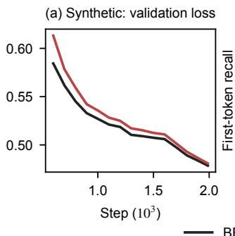

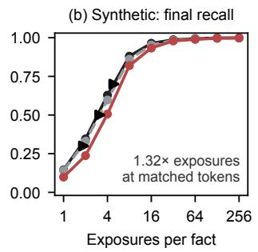  
BF16 NVFP4 BF16 interpolated to the NVFP4 final validation loss

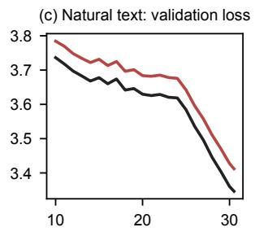  
Step (103)

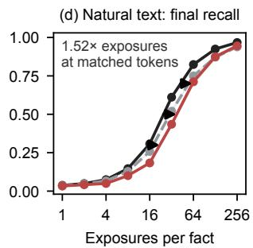  
Figure 1. BF16 (black) and NVFP4 (red) training of the same 40M architecture, mean over six seeds per regime. $( \mathsf { a } , \mathsf { c } )$ Validation loss over the last 70% of training. (b, d) Final recall against exposures per fact (±1 standard error over seeds), with BF16 recall interpolated to the NVFP4 final validation loss in gray. Arrows mark the horizontal shift of the mean curves at recall 0.3, 0.5 and 0.7.

divides each update by a running estimate of the gradient’s magnitude. Gradient noise inflates that estimate and so shrinks every step, as a lower learning rate would. Noise also takes the place of signal in the update. Feeding controlled noise to only one of Adam’s two moments separates the two effects. Over our training runs the step-size cost fades, while the signal-to-noise cost persists and carries about two thirds of the total. Raising the learning rate to offset the smaller average step does not reduce the cost for the noise or for NVFP4, in tests whose criteria we fixed in advance. Full FP4 training also introduces biased gradient error, so this decomposition accounts for the noise-driven part of its cost rather than all of it. The step-size part of this picture, computed from gradient statistics of a BF16 checkpoint, already ranks the costs of the formats, partial quantizations and noise controls we test (Spearman 0.96).

Remedies judged by loss can overstate how much factual acquisition recovers. Our adaptation of the published NVFP4 recipe closes 60% of the loss gap but only 42% of the exposure cost, and on natural text an estimated eighth of it, with a wide interval. Exposure-controlled recall requires only an instrumented slice of the corpus.

We summarize our contributions as follows.

• Measurement. The exposure multiplier measures a cost that loss hides. NVFP4 pretraining needs 1.2– 1.5× as many exposures to reach the same recall at nearly equal loss, in every seed of the primary comparisons (Sections 4 and 7).

• Mechanism. In controlled interventions, zero-mean gradient noise suffices, and Adam turns it into a stepsize cost that fades and a signal-to-noise cost that persists over training and that a larger learning rate does not remove (Sections 2 and 5).

• Practice. Checkpoint gradient statistics rank costs without fitting, and tested remedies close the loss gap faster than the exposure gap (Sections 5 and 6).

## 2. Measuring and Modelling the Cost

The exposure multiplier. We compare a low-precision run with its BF16 reference through their recall curves $R ( x )$ , recall as a function of $x = \log _ { 2 } { }$ exposures, made nondecreasing by a running maximum. For a curve R let $x _ { R } ( \ell ) = \operatorname* { i n f } \{ x : R ( x ) \geq \ell \}$ be the log-exposure at which it first reaches recall ℓ.

Definition 1 (Exposure multiplier). For recall curves $R _ { \mathrm { l o } }$ (low precision) and $R _ { \mathrm { r e f } }$ (reference), defined for all real x, and a set of recall levels L, let $L ^ { \prime } \subseteq L$ contain the levels ℓ at which $x _ { R _ { \mathrm { l o } } } ( \ell )$ and $x _ { R _ { \mathrm { r e f } } } ( \ell )$ are both finite, and $\Delta _ { \ell } =$ $x _ { R _ { \mathrm { l o } } } ( \ell ) - x _ { R _ { \mathrm { r e f } } } ( \ell )$ . The exposure multiplier is $m = 2 ^ { \bar { \Delta } }$ with $\begin{array} { r } { \bar { \Delta } = | L ^ { \prime } | ^ { - 1 } \sum _ { \ell \in L ^ { \prime } } \Delta _ { \ell } } \end{array}$ . The multiplier is undefined if L′ is empty, and for a single level, $L = \{ \ell \}$ , it is $2 ^ { \Delta _ { \ell } }$

Proposition 1. (i) If $R _ { \mathrm { l o } }$ is $R _ { \mathrm { r e f } }$ delayed by a constant δ in log exposures, $R _ { \mathrm { l o } } ( x ) = R _ { \mathrm { r e f } } ( x - \delta )$ for all x, then $\Delta _ { \ell } \ = \ \delta$ for every $\ell \in L ^ { \prime }$ and $m = 2 ^ { \delta }$ whenever L′ is nonempty. (ii) For any strictly increasing h, replacing both curves by h ◦ R and L by h(L) leaves the gap at each level h(ℓ) equal to $\Delta _ { \ell } ,$ and hence m unchanged.

Part (i) states what m measures. If low precision delays learning by a constant factor $2 ^ { \delta }$ in exposures, m is that factor, whatever levels are used. Part (ii) states that a recall measure which is a strictly increasing function of another yields the same multiplier for correspondingly transformed levels. These are properties of the underlying curves, which finitegrid interpolation does not always preserve (Appendix C.1).

One exposure under Adam. We model AdamW’s adaptive update (Loshchilov & Hutter, 2019), which divides the update of coordinate i by $\sqrt { \hat { v } _ { i } }$ , where $\hat { v } _ { i }$ is Adam’s running estimate of the second moment $v _ { i } = \mathbb { E } [ g _ { i } ^ { 2 } ]$ of the minibatch gradient $g .$ A low-precision training configuration replaces g by g+e, where e is the error that quantized matrix multiplications (GEMMs) add to the gradient, with per-coordinate second moment $s _ { i } ^ { 2 } = \mathbb { E } [ e _ { i } ^ { 2 } ]$ ]. For a fact $f ,$ , one attribute value of one person (Section 3), let $g _ { f }$ be the gradient of the loss on its value tokens (the tokens of that value), which one exposure contributes.

BF16: gradient gi, normalizer $\begin{array} { r l } { \sqrt { \nu _ { i } } } & { { } - } \end{array}$ Low precision: gradient $g _ { i } + e _ { i } ,$ normalizer $\sqrt { \nu _ { i } + s _ { i } ^ { 2 } }$  
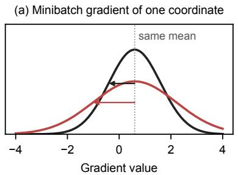

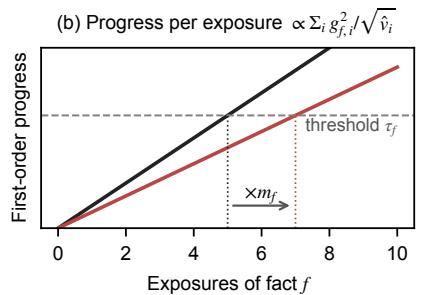

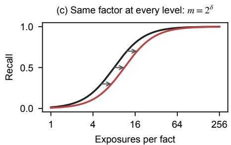  
Figure 2. The model of Section 2 for one coordinate and one fact (illustrative shapes). (a) Zero-mean gradient error widens the distribution of the minibatch gradient and raises Adam’s normalizer from $\sqrt { v _ { i } }$ to $\sqrt { v _ { i } + s _ { i } ^ { 2 } }$ . (b) Each exposure then adds less first-order progress, so the threshold $\tau _ { f }$ is reached after $m _ { f }$ times as many exposures (Proposition 2). (c) A common delay $m _ { f }$ shifts the recall curve by $\log _ { 2 } m _ { f }$ at every level (Proposition 1).

Assumption 1. (a) Locally, the two configurations share fixed $g _ { f } \neq 0 , v _ { i } > 0$ and learning rate η, and $s _ { i } ^ { 2 }$ is also fixed. The error has zero mean given $g ,$ the error and the minibatch fluctuations of $g$ are uncorrelated across steps, and the second-moment estimates equal their expectations. Neglecting $\mathbf { A d a m } ^ { \prime } \mathbf { s } \ \epsilon$ , the normalizers are $\sqrt { v _ { i } }$ and $\sqrt { v _ { i } + s _ { i } ^ { 2 } }$ (b) An exposure’s momentum contribution is integrated at these fixed normalizers. Recall occurs when accumulated first-order progress exceeds a format-independent threshold $\tau _ { f } .$ . Forgetting, curvature, weight decay and interactions between facts are omitted.

Proposition 2. Let $\rho _ { i } = s _ { i } ^ { 2 } / v _ { i \cdot } ( i )$ Under Assumption 1(a), an exposure off moves coordinate $\dot { } b y - \eta g _ { f , i } / \sqrt { v _ { i } + s _ { i } ^ { 2 } }$ in expectation instead $o f { - } \eta g _ { f , i } / \sqrt { v _ { i } }$ . Under Assumption 1, the ratio of the exposure counts needed to recall $f$ in the low-precision and reference runs, treated as continuous, is

$$
m _ { f } = \frac { \sum _ { i } g _ { f , i } ^ { 2 } / \sqrt { v _ { i } } } { \sum _ { i } g _ { f , i } ^ { 2 } / \sqrt { v _ { i } + s _ { i } ^ { 2 } } } \ge 1\tag{1}
$$

for every threshold $\begin{array} { r c l } { { \tau _ { f } . } } & { { \ I f \ \rho _ { i } } } & { { = } } & { { r } } \end{array}$ for all $i ,$ then $m _ { f } = \sqrt { 1 + r } ,$ , and scaling the error by c gives $m _ { f } ( c ) =$ $\sqrt { 1 + c ^ { 2 } r }$ . (ii) Under Assumption 1(a), $i f \mathbb { E } [ g _ { i } ] ^ { 2 } \ll { v _ { i } }$ , the zero-mean part of the update of coordinate i keeps its variance to leading order, so the ratio ofthe update’s mean to its standard deviationfalls by thefactor ${ \sqrt { 1 + \rho _ { i } } } .$ (iii) With the noisy gradient only in Adam’s second moment, the update ofcoordinate i equals the reference update at learning rate $\eta / \sqrt { 1 + \rho _ { i } }$ . With it only in the first moment, the expected update is unchanged and its variance grows by thefactor $\bar { 1 + s _ { i } ^ { 2 } / ( v _ { i } - \mathbb { E } [ g _ { i } ] ^ { 2 } ) }$ ).

Part (i) is a step-size effect. Zero-mean error dilutes the expected progress of every exposure by $m _ { f }$ , which depends only on where the error falls relative to the gradient noise. If the error matched the gradient noise on every coordinate $( \rho _ { i } = 1 )$ , each exposure would count as $1 / \sqrt { 2 }$ of a reference exposure. Part (ii) is a signal-to-noise effect. Where gradient noise dominates, Adam’s normalized update keeps its size, so the error takes the place of signal. Part (iii) gives two interventions that separate the effects (Section 5). A change of learning rate scales the expected update and its noise together, so it can restore the expected step of part (i) but not the signal-to-noise ratio of part (ii). Under $\mathbf { A } \mathbf { s } \mathbf { . }$ sumption $1 , m _ { f }$ does not depend on $\tau _ { f }$ , so progress towards every threshold is delayed alike (Figure 2). Proposition 2 yields four predictions.

(P1) The single-level multiplier $2 ^ { \Delta _ { \ell } }$ is approximately constant across recall levels if $m _ { f }$ varies little across facts. Zero-mean error does not guarantee this.

(P2) For small errors, scaling the error by c gives $m _ { f } ( c ) =$ $1 + c ^ { 2 } \bar { \rho } _ { f } / 2 + O ( c ^ { 4 } )$ , where $\bar { \rho } _ { f } = \langle s ^ { 2 } / v \rangle _ { w }$ , and ⟨·⟩ and $\langle \cdot \rangle _ { w }$ denote the plain mean over coordinates and the mean weighted by $w _ { i } = g _ { f , i } ^ { 2 } / \sqrt { v _ { i } } .$

(P3) At equal total error power $\textstyle \sum _ { i } s _ { i } ^ { 2 }$ , an error with the same $s _ { i } ^ { 2 }$ on every coordinate has a larger coefficient $\bar { \rho } _ { f }$ in P2 than one with $s _ { i } ^ { 2 } \propto v _ { i }$ when $\langle 1 / v \rangle _ { w } > 1 / \langle v \rangle$ (Appendix C.2 gives sufficient conditions). Blockscaled rounding is closer to the proportional case, so the ordering must be checked empirically.

(P4) Noise confined to the second moment acts as a percoordinate learning-rate cut whose effect on a fact’s first-order progress equals a uniform cut by $m _ { f }$ . Where a uniform cut describes it well, its cost should match BF16 trained at the rate divided by $m _ { f }$

Measuring $v , s ^ { 2 }$ and $g _ { f }$ on a BF16 checkpoint gives a prediction without fitting to exposure multipliers (Section 5). Biased gradient error also changes the expected update, which Eq. (1) takes as $g _ { f , i } / \sqrt { v _ { i } + s _ { i } ^ { 2 } }$ , and adds the cross term $2 \mathbb { E } [ g _ { i } e _ { i } ]$ to its second moment. Applying Eq. (1) to such configurations tests it only as a diagnostic, outside the assumption. Assumption 1(b) prices only the expected step, so it implies that a larger learning rate always speeds acquisition. In the model, an interior optimum such as the one we observe (Section 7) arises from the update noise of part (ii). A linearized model of one coordinate (Appendix C.4) shows how the two effects differ over time. A smaller step only slows the approach to the same time-averaged displacement of a repeatedly seen fact, whereas update noise raises the stationary spread of the weights. The first suggests a delay that fades, and the second a lasting penalty.

What validation loss sees. In the synthetic regime the validation stream consists of 2,000 freshly sampled biographies whose persons are drawn in proportion to their exposures, as in the training stream.

Proposition 3. Let facts at log-exposure x have $d i f f e r -$ entiable value-token loss $\mathcal { L } ( x )$ under the reference and $\mathcal { L } ( x - \delta )$ under low precision, for a constant delay $\delta \geq 0$ in log exposures. Let a fraction q(x) offacts have $l o g \mathrm { . }$ exposure x, and the validation stream contain each fact in proportion to $2 ^ { x }$ . Then the excess value-token loss is

$$
\begin{array} { c } { \Delta \mathcal { L } = \frac { \sum _ { x } q ( x ) 2 ^ { x } [ \mathcal { L } ( x - \delta ) - \mathcal { L } ( x ) ] } { \sum _ { x } q ( x ) 2 ^ { x } } } \\ { = \delta \mathbb { E } _ { x \sim \pi } \big [ - \mathcal { L } ^ { \prime } ( \xi _ { x } ) \big ] } \end{array}
$$

with $\pi ( x ) \propto q ( x ) 2 ^ { x }$ and some $\xi _ { x } \in [ x - \delta , x ]$ . If recall is a fixed decreasing function of the value-token loss, then ∆ℓ = δ for every $\ell \in L ^ { \prime }$ and $m = 2 ^ { \delta }$

Loss thus weights the delay by the learning-curve slope under a distribution tilted towards frequent facts. If those facts are already learned $( \mathcal { L } ^ { \prime } \approx 0 )$ , their loss changes little despite a nonzero multiplier. With nine equally populated bins, the most frequent bin holds half of all value tokens and the two most frequent bins three quarters. Template words, which every biography repeats, dilute the gap further.

## 3. Setup

Facts with controlled exposure. Following the synthetic biography (bioS) construction (Allen-Zhu & Li, 2024), each of N persons has six attributes (birth date, birth city, university, major, employer, work city), and each attribute value of a person is one fact. One exposure is one biography, with six sentences in random order, each from one of five templates. Persons are split evenly into nine bins seen $2 ^ { 0 } , \ldots , 2 ^ { 8 }$ times. The k-th person goes to bin k mod 9, and names and attribute values are drawn independently, so the bins are exchangeable. The facts and their bins are fixed across seeds and configurations, and all exposures are shuffled into one stream. Recall is probed for 200 persons per bin with a prompt per attribute, the first of its five training templates cut before the value. We report the accuracy of the first value token (Appendix F shows a biography and its probes).

Scoring exact match of the whole value instead moves every multiplier in Figure 3 by at most 0.07 (Appendix A).

Regimes. Synthetic: the stream consists of biographies only (word-level vocabulary). N is set so that the run has a target training budget (0.7–5.1 tokens per parameter). Natural: biographies of 20,000 persons are inserted as separate documents at random boundaries in FineWeb-Edu (Penedo et al., 2024). The resulting 1B-token mixture contains 72M biography tokens (7.2%) and uses a 16k byte-level BPE vocabulary. Validation loss is measured on held-out FineWeb-Edu documents without inserted biographies.

Models and training. We use pre-norm transformers with RMSNorm (Zhang & Sennrich, 2019), rotary embeddings (Su et al., 2024), SwiGLU MLPs (Shazeer, 2020) and untied embeddings. The architectures are labeled 12M (6 blocks, width d=384, 10.6M non-embedding parameters), 40M (8 blocks, width 512, 25.7M) and 100M (12 blocks, width 768, 92.0M). With the synthetic vocabulary, their total sizes are 12.9M, 28.7M and 96.6M, and the 40M architecture has 42.5M parameters with the natural-text vocabulary. Tokens per parameter count all parameters (Hoffmann et al., 2022). We train with AdamW (Loshchilov & Hutter, 2019) $( ( \beta _ { 1 } , \beta _ { 2 } ) = ( 0 . 9 , 0 . 9 5 )$ , weight decay 0.1 on matrices only, gradients clipped to global norm 1), a peak learning rate of $1 0 ^ { - 3 }$ and a warmup–stable–decay schedule (Hu et al., 2024; Hagele et al.¨ , 2024) with 2% warmup and linear decay to zero over the last 20% of steps. The batch is $6 4 \times 5 1 2$ tokens at every size (100M uses four micro-batches per optimizer step). Seeds change the initialization and the random draws of training (stochastic rounding, Hadamard signs, injected noise). The fact set and the order of the training stream are the same in every run.

Low-precision configurations. All transformer-block linear layers quantize both operands of the forward, datagradient and weight-gradient GEMMs along the reduction dimension. Embeddings, the output head, attention score computations, normalization and optimizer state stay in FP32. The BF16 reference rounds the operands of these GEMMs to BF16, and master weights remain FP32 in every run. NVFP4 uses E2M1 elements (2 exponent bits and 1 mantissa bit, with E4M3 and E5M2 named alike) in 16-element blocks with E4M3 scales under an FP32 tensor scale, stochastic rounding (Gupta et al., 2015) in the backward pass, and a random 16-point Hadamard transform (RHT) (Xi et al., 2023; Ashkboos et al., 2024) on the weightgradient inputs. We call this configuration plain NVFP4 when comparing it with the recipe variants of Section 6. MXFP4 (microscaling) uses E2M1 elements in 32-element blocks with power-of-two scales (Rouhani et al., 2023). FP8 uses per-tensor E4M3 forward and E5M2 backward (Micikevicius et al., 2022). GEMMs are emulated by quantizing operands exactly to the format and multiplying in FP32 (TF32 disabled). This isolates operand rounding and scaling. We do not validate bitwise agreement with Blackwell kernels or measure native FP4 throughput. All runs use one NVIDIA RTX 4090.

Computing the multiplier. The recall levels are $L =$ $\{ 0 . 2 , 0 . 3 , \ldots , 0 . 8 \}$ (20–80%), and recall is observed at $x = 0 , \ldots , 8$ and interpolated linearly in x. On this range we estimate L′ by the levels bracketed by both curves, excluding levels at or below either curve’s first observed recall and those above either curve’s maximum. Token-matched multipliers use the final BF16 checkpoint as reference. Lossmatched multipliers use the BF16 recall curve interpolated along its trajectory at the low-precision run’s final validation loss, interpolating linearly in validation loss between BF16 evaluations (every 100 of about 2,000 steps on synthetic data and every 1,000 of 30,517 on natural text). No comparison is made outside the observed BF16 loss range. The lowprecision run and its reference see every fact on the same schedule, with its exposures spread uniformly over training. The multipliers are horizontal shifts across exposure bins and do not directly measure the wall-clock time that native FP4 hardware would save. We report the geometric mean over seeds with a 95% t-interval on the $\log _ { 2 }$ scale, given in brackets. Since the probed facts and the data order are fixed, these intervals reflect the randomness of initialization and training, and resampling the probed persons as well changes them little (Appendix A). Comparisons between configurations are paired by seed. Our primary comparisons are NVFP4 against BF16 in the two regimes. They and their main controls use six seeds, and the split-moment and learning-rate tests with noise at twice the NVFP4 error use eight because their effects are smaller. Secondary variants (other noise levels, splits at the NVFP4 error, single-operand quantization, training settings, the natural-text recipe and analyses of saved checkpoints) use at least three. Table 1 and Appendix E give the multiplier, interval and seed count of every configuration. The text gives intervals only for the main results, and those outside the primary comparisons are not adjusted for multiple comparisons.

## 4. FP4 Needs More Exposures per Fact

Figure 1(b, d) shows the final recall curves, and Figure 3 the resulting multipliers. On synthetic data (40M) NVFP4 shifts the curve right by 1.32× [1.16, 1.50] at matched tokens and 1.25× [1.13, 1.38] at matched validation loss, with every seed above 1 (sign test $p = 0 . 0 3 )$ , while the final validation loss differs by only $0 . 1 { - } 0 . 9 \%$ . On natural text the validation loss gap is larger (+1.9 to +2.1%) and so is the token-matched shift, 1.52× [1.35, 1.71]. At matched loss it is 1.22× [1.10, 1.36], again with all six seeds above 1 in both comparisons. On natural text, where facts seen eight times or fewer are rarely learned, the recall levels are crossed between about 10 and 100 exposures, so the multiplier describes the learnable part of the tail. The natural-text loss-matched BF16 point lies inside the learning-rate decay (step 28,700–28,900 of 30,517), where BF16 has seen 5–6% fewer tokens and has not finished the decay. The lossmatched control therefore compares different training stages, rather than removing all differences except precision. Both lower BF16 recall at that point, biasing the loss-matched multiplier towards 1.

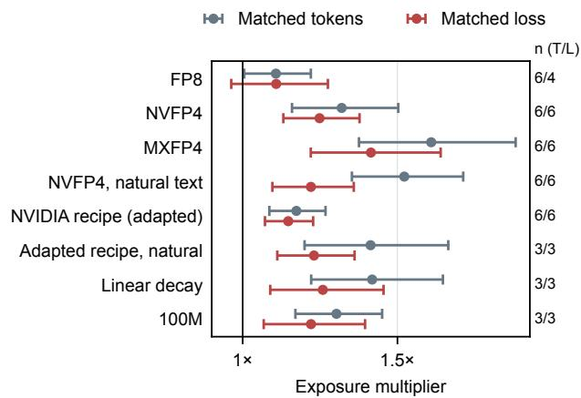  
Figure 3. Exposure multipliers against BF16 at matched tokens (gray) and matched validation loss (red), with 95% intervals and seed counts at matched tokens/loss (T/L). Values above 1 mean more exposures are needed. 40M synthetic data unless labeled otherwise. Further settings are in Table 1.

How the delay depends on the recall level (P1). Measured at single recall levels of 30%, 50% and 70% (matched tokens, Appendix A), the NVFP4 multiplier is 1.44/1.52/1.48× on natural text and 1.38/1.34/1.26× on synthetic data. On synthetic data the multiplier is larger at 30% than at 70% in 18 of 19 settings, typically by a quarter on the $\log _ { 2 }$ scale (the ratio of the $\log _ { 2 }$ shifts at 70% and 30% is 0.72 for NVFP4, 0.69 for backward-only quantization and 0.91 for i.i.d. noise), whereas an exact shift of the BF16 curves, read on our exposure grid, gives 0.93. The delay is therefore approximately a constant factor. On synthetic data it is largest at low recall levels, which the curves reach at the fewest exposures, and this is the direction in which the checkpoint diagnostic predicts slightly larger $m _ { f }$ for rarer facts (Section 5). The multiplier averaged over levels summarizes this shift.

The deficit follows the learning front. Figure 4(a, b) shows when and where NVFP4 falls behind. On synthetic data the deficit appears first for facts seen 256 times, a fifth of the way into training, and moves to rarer facts as training proceeds. It is largest at 16–32 exposures by mid-training and at 2–4 exposures at the end (0.11–0.12 recall), while facts seen 32 times or more end within 0.01. On natural text it sits at 64–128 exposures for most of training and at 32 at the end, growing from 0.10 to 0.17 during the learningrate decay. A delay predicts this pattern, because the recall difference is largest where the learning curve is steepest and that point moves to rarer facts over training.

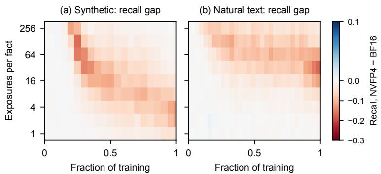

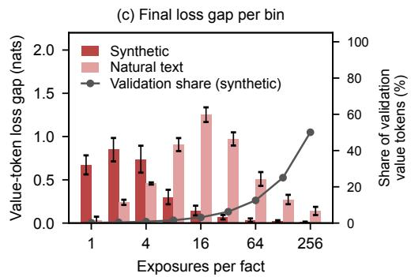  
Figure 4. Where the deficit sits (40M, mean over six seeds per regime). (a, b) Recall of NVFP4 minus BF16 per exposure bin during training (red: NVFP4 behind). (c) Final value-token loss gap per bin (±1 standard error over seeds) and the share of synthetic validation value tokens in each bin (right axis).

Loss sees the delay weighted by frequency. Stratifying the loss of the value tokens by exposure count shows the weighting of Proposition 3 directly (Figure 4(c)). On synthetic data NVFP4 raises it by 0.67–0.85 nats for facts seen 1–4 times and by at most 0.07 nats for facts seen 32 times or more. Averaged with equal weight per fact the gap is 0.32 nats. Averaged with the training frequency, as in the validation stream, it is 0.04 nats, because half of the value tokens belong to facts seen 256 times, which both models recall. Over all validation tokens the loss rises by 0.5%. On natural text, where facts need more exposures, frequency weighting shrinks the gap less (0.53 to 0.32 nats), and the validation loss, measured on web text, contains none of the inserted biographies. The two regimes thus test two limitations of validation loss. The synthetic stream contains the facts in proportion to their frequency and isolates the weighting of Proposition 3. The natural-text validation set, as in practice, lacks the rare facts a model should acquire.

Matched tokens versus matched loss. For plain NVFP4, token-matched estimates exceed 1 under every tested readout, with intervals that exclude 1. Reading the NVFP4 weights with BF16 forward GEMMs, which removes quantization error at evaluation time, gives 1.26× on synthetic data and 1.30× on natural text (Appendix A). Evaluation-time quantization thus accounts for part of the default-readout gap, 15% and 37% of its $\log _ { 2 }$ size, but not for all of it. The loss-matched cost is more fragile. BF16-forward evaluation gives 1.21× (synthetic) and 1.11× [0.97, 1.26] (natural text), and scoring the probability of the correct value gives 1.19× and 1.09×. Part of the loss-matched gap, especially on natural text, is thus quantization error at evaluation time rather than missing knowledge. We treat the token-matched multiplier as the primary measure of acquisition and the loss-matched one as a control for the loss gap.

## 5. Mechanism: Gradient Noise Through Adam

Gradient error costs exposures. At matched tokens, quantizing only the forward GEMMs costs 1.18× and only the backward GEMMs 1.13× [1.04, 1.21], with every seed above 1 in both, and the two costs approximately multiply to the full effect $( 1 . 1 8 \times 1 . 1 3 = 1 . 3 3$ against 1.32×). Backward-only quantization runs the forward pass in BF16 and changes validation loss by just +0.1% on average, so its cost is nearly invisible in the loss. Its gradient error is approximately zero-mean (stochastic rounding, Appendix D), and exactly zero-mean noise reproduces its cost. We add Gaussian noise to the outputs of both backward GEMMs of BF16 training, with the per-tensor RMS of the NVFP4 error of each GEMM, and scale it by the maximum magnitude of each 16-element block as in block-scaled rounding. This block-shaped noise costs 1.11×, and 0.99× [0.94, 1.04] relative to backward-only quantization (paired by seed). The same RMS spread uniformly over each tensor costs more, 1.25×, or 1.12× [1.01, 1.24] relative to block-shaped noise. This is the ordering of P3, since uniform noise places relatively more error where the gradient is small. The cost grows with the noise scale (Figure 5(b)). Block-shaped noise at 0.5, 1 and 2 times the NVFP4 error costs 1.05×, 1.11× and 1.38×, and i.i.d. noise costs 1.02×, 1.25× and 1.33× (Table 1). Zero-mean gradient error is therefore sufficient to cause an exposure cost. Running the backward GEMMs of NVFP4 in FP8 lowers its cost from 1.32× to 1.23×, close to forward-only quantization. Quantizing only the forward weights or activations costs 1.11× or 1.14×.

Adam turns gradient noise into two costs. Proposition 2 distinguishes two effects of zero-mean gradient error under

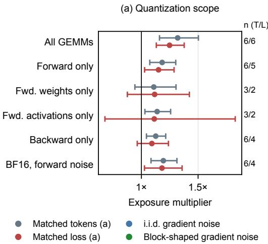

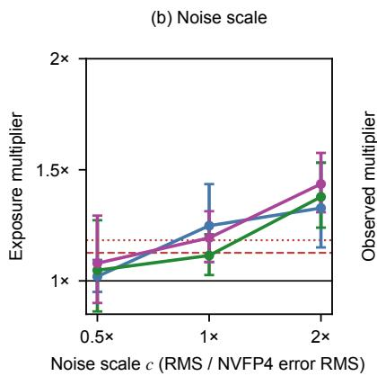

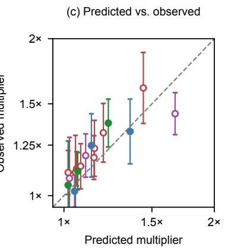  
● Matched tokens (a) i.i.d. gradient noise ● i.i.d. forward noise NVFP4 backward only (b) Biased gradient error (c) ● Matched loss (a) ● Block-shaped gradient noise ● Quantized GEMMs (c) NVFP4 forward only (b)

Figure 5. Where the cost arises (40M synthetic, 95% intervals). (a) Partial quantization and forward noise at matched tokens (gray) and matched loss (red), with seed counts (T/L). (b) Zero-mean noise at 0.5, 1 and 2 times the NVFP4 error on backward GEMM outputs, i.i.d. (blue) or block-shaped (green), or on forward GEMM outputs (purple), at matched tokens. Dashed and dotted: NVFP4 backward-only and forward-only quantization. (c) Multiplier predicted by Eq. (1) against the observed token-matched multiplier for the 17 configurations of Table 6. Open markers: bias ratio above 0.1 (Appendix D). Dashed: equality.  
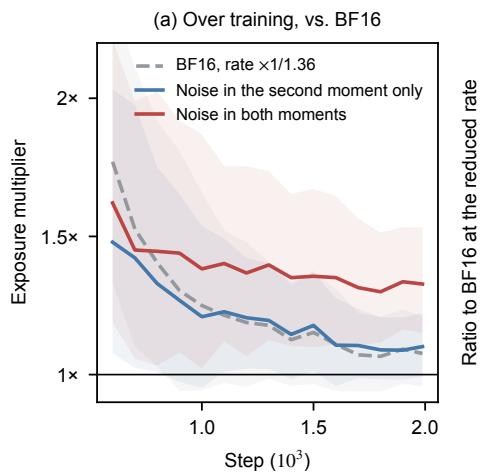

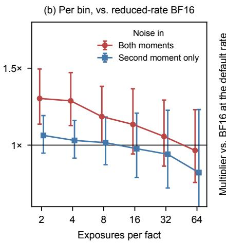

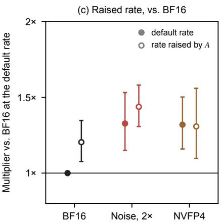  
Figure 6. Splitting gradient noise between Adam’s moments (40M synthetic, i.i.d. noise at twice the NVFP4 error, 8 seeds, 95% intervals). (a) Token-matched multiplier against BF16 at $1 0 ^ { - 3 } .$ , recomputed at every evaluation, for BF16 at $1 0 ^ { - 3 } / A$ (gray), noise in the second moment only (blue) and noise in both moments (red). (b) Horizontal gap per exposure bin against BF16 at $\mathrm { ~ i 0 ^ { - 3 } } / A$ , averaged over evaluations (Appendix E). (c) Multipliers against BF16 at $\mathrm { 1 0 ^ { - 3 } }$ for training at $1 0 ^ { - 3 }$ (filled) and at the rate raised by A (open).

Adam. A larger normalizer shrinks the expected step like a lower learning rate, and noise in the update lowers its signal-to-noise ratio. We separate them by splitting the i.i.d. noise configuration at the optimizer, at twice the NVFP4 error where both effects are large. At every step a second backward pass computes the BF16 gradient of the same batch, scaled by the global-norm clipping factor of the noisy gradient, and Adam’s two moments receive different gradients (Proposition 2(iii)). The shared factor barely couples them. In seed-0 reruns that log the gradient norm, clipping acts on 3–4% of steps for each configuration, mostly early in training, and in the second-moment-only variant on the same steps as it would for the BF16 gradient (Appendix E).

With the noisy gradient in the second moment only, this variant acts as a learning-rate cut. Before training it, we fixed the factor $A = 1 . 3 5 6$ that Eq. (1) predicts for this noise and trained BF16 at $1 0 ^ { - 3 } / A$ , holding the product of learning rate and weight decay fixed. The second-momentonly variant closely matches this reduced-rate BF16. At the end of training it costs 1.02× [0.93, 1.13] relative to it, an interval that excludes differences larger than 13%. The paired ratio stays within 0.93–1.03 at every evaluation from step 700 on (Figure 6(a)), and no exposure bin shows a detectable difference (Figure 6(b)). The cost of such a cut fades over training. Against BF16 at $1 0 ^ { - 3 }$ , the reduced rate costs $1 . 0 8 \times [ 0 . 9 6 , 1 . 2 1 ]$ at the end of training, and within each exposure bin its gap shrinks by 0.36 [0.19, 0.54] $\log _ { 2 }$ exposures per thousand steps. This match to a uniform cut did not hold above the default rate. $\mathrm { A t 2 \times 1 0 ^ { - 3 } }$ , the secondmoment-only variant costs $1 . 6 6 \times \ [ 1 . 3 3 , 2 . 0 7 ]$ more than BF16 at $2 \times 1 0 ^ { - 3 } / A$ , against a pre-specified prediction of no difference (Appendix E). The cut is per coordinate and spares coordinates without injected error, such as the output head. Where BF16’s cost rises steeply with the rate, as it does above $1 0 ^ { - 3 }$ , those coordinates may set the cost.

Noise in the update carries the rest of the cost, and over our runs this part does not fade, including during the learningrate decay to zero in the last 20% of training. Against the reduced-rate BF16, noise in both moments costs 1.22× at step 1,600, as the decay begins, and 1.23× at the end. At equal expected step, noise in both moments costs 1.21× [1.05, 1.39] more than noise in the second moment only (paired, $p = 0 . 0 1 7 , 7$ of 8 seeds), two thirds of its log-cost of 1.33× (seed bootstrap 38–91%). These shares describe zero-mean noise at twice the NVFP4 error. Full NVFP4 training adds biased gradient error (Table 6), so they may not transfer to it. Against the reduced-rate BF16, the gap of noise in both moments shows no trend within an exposure bin (+0.06 [−0.09, 0.21] log per thousand steps) but grows as facts become rarer. At the same step, every halving of a fact’s exposures widens it by 0.08 [0.04, 0.12] log exposures, from 0.97× for facts seen 64 times to 1.30× for facts seen twice (Figure 6(b)). Because rarer facts are also less learned at any step, this profile does not separate exposure count from recall level. With the noise in the first moment only, the normalizer no longer grows with the noise, but the update does. At the NVFP4 error this costs 1.06× (Table 1), and at twice that error 6 of 8 runs diverged (validation loss rose by more than one nat above its running minimum). Correcting Adam’s normalizer for the error thus removes the step-size cost but enlarges the update noise.

If the cost were a uniformly shrunken step, a larger learning rate would remove it. Raising the rate by A, with the product of rate and decay fixed, restores the average expected step of part (i) under the local model but leaves the signal-to-noise ratio of part (ii) unchanged. We fixed the predictions of this test before the runs (Appendix E). The cost does not fall (Figure 6(c)). Relative to its multiplier at $1 0 ^ { - 3 }$ , the noise at the raised rate costs 1.08× [0.95, 1.24], against 0.75 if the cost were the shrunken step. NVFP4 at a rate raised by its own factor A = 1.199 costs 0.99× [0.87, 1.13], against 0.76. At the raised rate the noise costs 1.19× against BF16 at the same rate, close to the update-noise cost at the default rate. The test rules out a cost that consists only of a uniformly shrunken step. A larger rate also changes the trajectory in other ways, which this test does not separate.

A fit-free checkpoint diagnostic. Eq. (1) needs only quantities measured on a BF16 checkpoint. On each of three

BF16 checkpoints (40M) we estimate $v _ { i }$ from 32 training batches, $s _ { i } ^ { 2 }$ for every configuration as the mean squared difference between its gradient and the BF16 gradient of the same batch, and $g _ { f }$ for 96 facts seen 4–16 times (Appendix D). Nothing is fitted to observed multipliers. Across 17 configurations (formats, partial quantization, and i.i.d., block-shaped and forward noise at three scales each), the prediction ranks the observed costs with Spearman correlation 0.96 (bootstrap interval over configurations [0.84, 0.99]). The correlation is 0.95 without the 0.5× and 2× scales, whose order Eq. (1) fixes by construction, and 0.89 among the seven configurations with zero-mean gradient error. The prediction lies inside the observed 95% interval for 15 of the 17 (Figure 5(c), Table 6). It ranks the costs but does not calibrate them. For zero-mean error it matches i.i.d. noise at twice the NVFP4 error (1.36 predicted, 1.33× observed) but underestimates smaller errors (1.13 against 1.25× for i.i.d. noise at the NVFP4 error, 1.06 against 1.13× for backward-only quantization), and its value depends on how the normalizer is estimated (Appendix D). The split-moment variants deviate in the directions Proposition 2 implies. Eq. (1) sees only the normalizer, so it assigns the second-moment-only variant the full prediction of its noise (1.36 against 1.10× observed) and the first-moment-only variant none (1.00 against 1.06×). For NVFP4 the predicted $m _ { f }$ vary little across facts (10th–90th percentile 1.16–1.26×) and are slightly larger for rarer facts (1.22/1.19/1.19× at 4/8/16 exposures). Configurations that quantize or perturb the forward pass have biased gradient error, outside Assumption 1(a), and for them the diagnostic tracks the cost without explaining it. Checkpoint seeds agree closely (standard deviation of $\log _ { 2 }$ predictions at most 0.06). We have tested the diagnostic only at one model size and within this training regime.

Zero-mean forward noise. Zero-mean Gaussian noise on the outputs of the BF16 forward GEMMs, with the pertensor RMS of the NVFP4 forward error and a BF16 backward pass, costs 1.19× at matched tokens (every seed above 1, evaluated without the noise), about as much as forwardonly quantization. A cost thus does not require systematic error at the perturbed output. Forward noise does, however, bias the gradient error (Appendix D), so this control cannot isolate the zero-mean mechanism.

Lenient readouts recover little of the deficit. A model could hold a fact yet fail to generate it. At the position before the answer, where factual associations are retrieved (Geva et al., 2023; Meng et al., 2022), we score the candidate values of the attribute at the output and, through the final norm and unembedding, after each block (the logit lens (nostalgebraist, 2020; Belrose et al., 2023)). A top-five readout at the output tests whether correct values fall just below the top prediction. On three seeds rerun with saved checkpoints, it reduces the multiplier only modestly, from 1.36× to 1.30× for NVFP4, from 1.21× to 1.17× for the adapted recipe and from 1.18× to 1.14× for i.i.d. noise (Figure 9 in Appendix B). It preserves 71–92% of the log-exposure shift in all nine pairs of seed and configuration. Correctvalue probability gives similar token-matched multipliers (1.32× synthetic, 1.46× natural text, Appendix A). Other probes might still find the knowledge, and Appendix B gives intermediate-layer results and probe limitations.

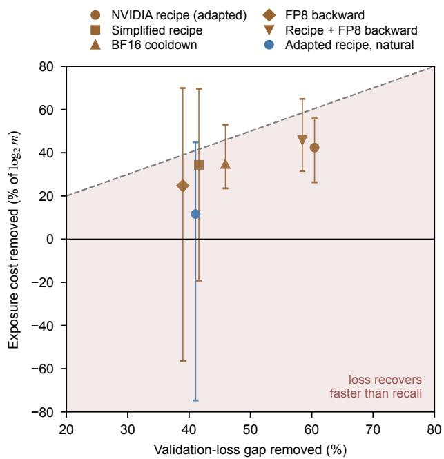  
Figure 7. Share of the validation-loss gap (horizontal) and of the $\log _ { 2 }$ exposure cost at matched tokens (vertical) of plain NVFP4 that each remedy removes, on shared seeds (six synthetic, three natural). Bars: 95% Fieller intervals for the cost share (Appendix B). Below the diagonal, loss recovers faster than factual acquisition. Loss-matched values are in Table 4.

## 6. Mitigation: Loss Recovers Faster Than Recall

Tested interventions. We test the interventions a practitioner would reach for first, each against plain NVFP4 on the same seeds: backward GEMMs in FP8; BF16 for the learning-rate decay (the last 20% of steps, ‘BF16 cooldown’); a simplified recipe (BF16 in the last 2 of 8 blocks, RHT also on the data gradient); the published NVFP4 recipe adapted to our models; and that recipe with FP8 backward GEMMs. All of them lower the estimated exposure cost, and none removes it. Every remedy’s tokenmatched multiplier stays above 1 with an interval that excludes 1. We adapt the published recipe (NVIDIA, 2025) as follows: 16×16 two-dimensional scaling for weights, so the forward and data-gradient GEMMs see the same quantized weight; stochastic rounding only for gradients (nearest rounding for weights and activations); RHT only on the weight-gradient inputs; and high-precision final layers (we keep 2 of 8 blocks in BF16, more than its ∼15%). Figure 7 shows that this adaptation removes 60% of the validation loss gap but 42% of the $\log _ { 2 }$ exposure cost at matched tokens (37% at matched loss, where the remaining 1.15× is above 1 in all six seeds, Table 4). Training the whole learning-rate decay in BF16, which the recipe suggests for closing the loss gap, running the backward GEMMs in FP8, and a simplified recipe fall in the same region. Every remedy we tried lies below the diagonal, where loss recovers faster than factual acquisition. When seeds are resampled jointly for both shares, the difference between them excludes zero for the adapted recipe (18 percentage points [2, 29]) and for the BF16 cooldown (11 [3, 29]). For the other remedies its interval is wide. Running the recipe’s backward GEMMs in FP8 changes little (1.16× against 1.17× at matched tokens). The BF16 cooldown does not repair facts seen before it. Among facts seen at most 8 times, those whose exposures all precede it keep the full NVFP4 recall deficit (cooldown minus plain NVFP4: −0.003 [−0.017, 0.011], about 2,400 facts per seed). Those seen only during the cooldown keep 54% [36, 70] of the deficit (288 facts per seed), and facts seen on both sides of the switch are excluded (Appendix B). An NVFP4-trained model thus continues to learn new facts less efficiently after switching to BF16. This suggests a training-history effect, such as a later formation of the shared circuits that support recall (Zucchet et al., 2025), in addition to the noise of the current update.

Natural text. In the point estimates, the discrepancy is larger on natural text (blue point). Paired with the same BF16 runs, the adapted recipe shrinks the validation-loss gap from 1.96% to 1.15% but changes the exposure cost little, at 1.41× at matched tokens against 1.48× for plain NVFP4 on the same seeds, and 1.23× at matched validation loss against 1.16×, above 1 in all three seeds. The larger loss-matched estimate does not imply worse acquisition. Because the recipe ends closer to BF16 in loss, its lossmatched BF16 checkpoint is a later one, so it is compared against a better-trained reference. At matched tokens it removes about an eighth of the excess cost $( \log _ { 2 }$ scale), 12% [−75, 45] over three seeds (Figure 7).

Directions suggested by the model. Proposition 2 places the cost in the gradient error relative to the gradient noise, $\rho _ { i } = s _ { i } ^ { 2 } / v _ { i }$ , and Section 5 finds most of it in the update’s signal-to-noise ratio, which a change of step size does not restore. Remedies should therefore lower $\rho _ { i }$ where it is largest rather than rescale the step. Two routes follow from our results. First, the error can be shaped to follow the gradient’s scale. At equal RMS, block-shaped gradient noise costs 1.11× against 1.25× for i.i.d. noise. Second, precision can be spent on the backward pass, whose cost loss barely registers. FP8 backward GEMMs lower the cost of NVFP4 from 1.32× to 1.23×. Correcting Adam’s normalizer for the error, for instance from the known variance of stochastic rounding, does not help. An oracle version removes the step-size part but enlarges the update noise, and at twice the NVFP4 error it destabilized 6 of 8 runs. Finally, since the cost acts approximately as a constant delay, sampling knowledge-dense data about m times more often would restore the number of exposures, although its effect on other capabilities is untested.

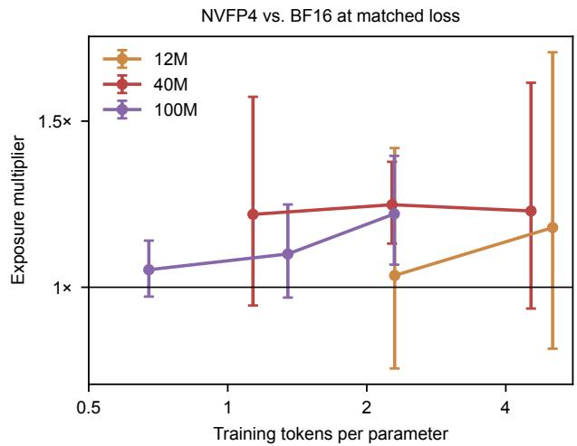  
Figure 8. Loss-matched exposure multiplier of NVFP4 against BF16 vs. training tokens per parameter for the 12M, 40M and 100M architectures (12.9M, 28.7M and 96.6M parameters with the synthetic vocabulary, all counted) on synthetic data, with 95% intervals over 3–6 seeds per point.

## 7. Robustness Across Training Settings

Precision and training budget. The cost increases as precision decreases. Paired by seed, the matched-token multiplier of NVFP4 is 1.19× [1.02, 1.40] that of FP8, and that of MXFP4 is 1.22× [1.01, 1.47] that of NVFP4. FP8 training shows a small cost near the measurement resolution, 1.11× at matched tokens and at matched loss, with intervals that touch or include 1 (Table 1). Two of its seeds end below the BF16 validation loss and have no loss-matched point. MXFP4 costs more than NVFP4 (1.61× vs. 1.32× at matched tokens, 1.41× vs. 1.25× at matched loss). At 100M the loss-matched cost grows with training tokens per parameter, from 1.05× at 0.67 to 1.10× at 1.35 and 1.22× at 2.3, where it matches 40M. Because the synthetic stream grows with the number of persons (N from 9,100 to 68,000), tokens per parameter and facts per parameter change together in Figure 8, so these trends reflect training budget and memorization load jointly. At 40M we see no trend between 1.1 and 4.5 tokens per parameter. At 12M seed variance exceeds the effect. Production models train far beyond these ratios, and our natural-text runs (about 24 tokens per parameter) are the closest point. The cost also persists under a different schedule. With linear decay over the whole run it is 1.26× at matched loss and 1.42× at matched tokens, above 1 in every seed.

Learning-rate sensitivity. We also train both formats at peak rates $5 \times 1 0 ^ { - 4 }$ and $2 \times 1 0 ^ { - 3 }$ (40M, three seeds). Selecting each format’s rate by mean final recall over facts seen 1–8 times selects $1 0 ^ { - 3 }$ for both. On these selection seeds the token-matched multiplier is 1.37×. On three further seeds, which played no part in the selection, it is 1.27× [1.02, 1.58] at matched tokens and 1.20× [1.01, 1.44] at matched loss, so the cost survives rate selection, although a three-point sweep cannot exclude an untested rate. NVFP4 at $5 \times 1 0 ^ { - 4 }$ performs comparably but has lower mean recall. Its $1 . 4 7 \times$ comparison to BF16 at $1 0 ^ { - 3 }$ uses an alternative rate for NVFP4 and does not compare best-recall settings (Appendix B). This sweep keeps the weight decay coefficient fixed, so the decay per step grows with the rate. Proposition 2 motivates a sharper test that holds the product of rate and decay fixed. Raising the rate by A then restores the average expected step of part (i) but not the signal-tonoise ratio of part (ii). Raising the rate of NVFP4 by its $A = 1 . 1 9 9$ in this way leaves its cost unchanged, at $0 . 9 9 \times$ of its multiplier at $1 0 ^ { - 3 }$ (pre-specified, Section 5), and at the raised rate it costs 1.31× against BF16 at $1 0 ^ { - 3 }$ . Neither test finds a learning rate at which the cost disappears.

## 8. Related Work

Low-precision training. Reduced-precision training rests on two ideas that our configurations inherit, a high-precision master copy of the weights (Micikevicius et al., 2018) and stochastic rounding, which makes quantization unbiased (Gupta et al., 2015). FP8 training is now standard at scale (Micikevicius et al., 2022; Peng et al., 2023; Fishman et al., 2025; DeepSeek-AI, 2024). Earlier 4-bit training work used integer formats with Hadamard transforms against outliers (Xi et al., 2023) and unbiased, logarithmically scaled quantization of the neural gradients (Chmiel et al., 2023). Current FP4 recipes combine fine-grained block scaling (Rouhani et al., 2023), stochastic rounding of gradients, random Hadamard rotations and high-precision layers (NVIDIA, 2025; Wang et al., 2025; Tseng et al., 2025; Castro et al., 2025; Chmiel et al., 2025). These methods are typically compared by loss gap and benchmarks (Agrusa et al., 2026; Cao et al., 2026), and precision-aware scaling laws model low-precision training as a loss in effective parameter count (Kumar et al., 2025). All of these are lossbased or aggregate evaluations. We instead measure the exposures required for factual recall and show that this criterion responds differently to precision and recipe changes.

Quantization and knowledge. Post-training compression can preserve perplexity while degrading knowledgeintensive tasks (Jaiswal et al., 2024), and its damage grows with the amount of pretraining (Kumar et al., 2025; Ouyang et al., 2025). Rotation-based and second-order methods reduce it (Frantar et al., 2023; Ashkboos et al., 2024). In controlled settings, language models store about 2 bits of knowledge per parameter after enough exposures, and int4 posttraining quantization reduces this to about 0.7 bits (Allen-Zhu & Li, 2025). Closest to us, ternary-weight training stores far fewer facts than FP16 while perplexity rises only moderately, through a learning-rate-dependent collapse localized in the output head (Paudel & Sheshappanavar, 2026). We study emulated versions of the FP4 formats used in production, with both passes quantized and a high-precision output head. Our question is exposure efficiency rather than retained capacity. We observe a rightward shift of the recall curve without the collapse reported for ternary training, and we locate part of it in the gradients, since quantizing only the backward pass, with a BF16 forward pass, already costs exposures. As in that work, the deficit arises during training, unlike damage introduced by post-training compression.

Acquiring facts during pretraining. Language models answer factual queries from their parameters (Petroni et al., 2019), but their accuracy depends strongly on how often a fact appears in pretraining (Kandpal et al., 2023; Mallen et al., 2023). Controlled studies show that facts are acquired through repeated exposures and partly forgotten in between (Chang et al., 2024), that memorization depends on model size and repetition (Tirumala et al., 2022; Carlini et al., 2023), and that synthetic biographies with diverse phrasings make knowledge extractable (Allen-Zhu & Li, 2024). We use this setting as a measuring instrument for numerical precision. Our noise experiments relate it to work that measures how gradient noise limits the progress of each optimization step (McCandlish et al., 2018) and to analyses of Adam in which the per-coordinate step shrinks as the relative variance of the gradient grows (Balles & Hennig, 2018; Malladi et al., 2022). Chmiel et al. (2025) relate the effectiveness of FP4 training to the ratio of gradient norm to quantization noise. Eq. (1) is a per-coordinate counterpart of that ratio, weighted by the gradient of a fact, and we relate it to the exposures a fact needs. Gradient noise added for differential privacy likewise lowers accuracy most on underrepresented classes (Bagdasaryan et al., 2019). We show how Adam turns such noise into a cost per exposure.

## 9. Discussion

What the model explains. The model is an optimizerlevel account supported by interventions and does not provide a closed-form theory of factual acquisition. It separates two costs of zero-mean gradient error under Adam and predicts how each responds to the split-moment intervention. The step-size cost matched a learning-rate cut fixed in advance at the default rate, but not above it, and a larger rate that restores the average expected step did not reduce the cost, as the signal-to-noise part implies. Its quantitative part, Eq. (1), prices only the expected step. It ranks configurations but underestimates small errors, and the signal-to-noise cost, which carries two thirds of the measured cost at twice the NVFP4 error, has no closed-form multiplier in our account. The linearized model explains why one cost fades and the other persists over our runs, but its link from weight spread to recall is heuristic. The account is local and omits forgetting between exposures (Chang et al., 2024), curvature and interactions between facts. A later formation of the shared attention circuits that support recall (Zucchet et al., 2025) would also shift every exposure bin. The BF16 cooldown, after which facts seen only in BF16 keep about half of the deficit, is consistent with such training-history effects, and our experiments do not separate them from slower progress on each fact. Finally, the evidence that zero-mean gradient noise causes the cost concerns its backward-pass part. The correlation across 17 configurations does not establish that the same mechanism causes the cost of full FP4 training, whose gradient error is biased.

Loss parity at scale. Reports of loss and downstream parity for FP4 pretraining at scale (NVIDIA, 2025; Chmiel et al., 2025) can be reconciled with these results, because token-averaged loss weights frequent content (Proposition 3) and aggregate benchmarks do not isolate rare facts. Higher throughput can offset the cost only insofar as the additional tokens contain further occurrences of the relevant facts, from repeated data or new documents, and we do not measure this trade-off. Whether the multiplier shrinks or grows at production scale remains open (Section 7).

Other optimizers. Only the step-size cost depends on coordinatewise normalization. SGD with momentum has no normalizer to inflate, so under the same approximation zero-mean error leaves its expected step unchanged. The signal-to-noise cost does not depend on normalization, since the error adds variance to any stochastic update, and under Adam it is the larger part. Switching to SGD would therefore not necessarily avoid the cost. Matrix-based optimizers such as Muon (Liu et al., 2025) require a different analysis. Optimizer comparisons are a direct test for future work.

Implications for evaluating low-precision recipes. Our adapted NVFP4 recipe recovers loss more effectively than factual acquisition, especially on natural text. We therefore suggest reporting an exposure-controlled recall curve alongside the loss gap. This requires an instrumented training corpus and a factual probe. In our natural-text runs, biographies occupy 7.2% of tokens. Equation (1) offers an additional checkpoint diagnostic before retraining candidate recipes, although its predictive value beyond these models remains untested.

## 10. Limitations

Our models have at most 96.6M parameters and see at most 1B tokens. Production-scale generalization remains open, and the natural-text setting reaches about 24 tokens per parameter. FP4 GEMMs are emulated, with no nativehardware validation or throughput measurement. Facts are synthetic biographies, on their own or mixed into one web corpus, rather than naturally occurring long-tail knowledge. We test only AdamW, a three-rate sweep at 40M with three seeds, and one alternative schedule. Forward-noise controls are i.i.d., and we do not test block-shaped forward noise. Recall is probed with a template seen in training, and we do not test paraphrased questions. All runs share one data order, so the seed intervals do not include its variability. The model assumes zero-mean gradient error, which holds exactly for the noise controls and approximately for backward-only NVFP4 (Appendix D), and fixed local statistics. Eq. (1) uses final BF16 checkpoints at learning rate $1 0 ^ { - 3 }$ rather than statistics along the training trajectory, its value depends on how the normalizer is estimated, and it underestimates small errors. The split-moment intervention uses i.i.d. noise at two scales, with clipping statistics from one rerun per configuration. Its second-moment-only variant matched a uniform learning-rate cut at the default rate but not at $2 \times 1 0 ^ { - 3 }$ , and the profile of the signal-tonoise cost over exposure counts does not separate exposure count from recall level. The compensation test raises the rate by one factor per configuration. Finally, loss-matched estimates depend on the readout. For plain NVFP4 their intervals include 1 under correct-value probability in both regimes and under BF16-forward evaluation on natural text (Appendix A), whereas token-matched intervals exclude 1 under every readout.

## Impact Statement

This paper studies how 4-bit training affects what language models learn from rarely seen data. A model that acquires rare facts more slowly may be less reliable on knowledge about less frequent entities, topics and languages, although we have not tested such effects. Measuring exposure costs may help practitioners assess these risks alongside efficiency gains. Our experiments use fictitious biographies and a public web corpus.

## References

Agrusa, A., Panferov, A., Wei, E., Wyss, K., Gibbons, P., Schultheis, E., Choi, J., Sun, F., Blankevoort, T., and Alis-

tarh, D. What matters for NVFP4 training? a comparative study of low-precision pretraining recipes. arXiv preprint arXiv:2610.24343, 2026.

Allen-Zhu, Z. and Li, Y. Physics of language models: Part 3.1, knowledge storage and extraction. In Proceedings of the 41st International Conference on Machine Learning, volume 235 of PMLR, pp. 1067–1077, 2024.

Allen-Zhu, Z. and Li, Y. Physics of language models: Part 3.3, knowledge capacity scaling laws. In International Conference on Learning Representations, 2025.

Ashkboos, S., Mohtashami, A., Croci, M. L., Li, B., Cameron, P., Jaggi, M., Alistarh, D., Hoefler, T., and Hensman, J. QuaRot: Outlier-free 4-bit inference in rotated LLMs. In Advances in Neural Information Processing Systems, volume 37, pp. 100213–100240, 2024.

Bagdasaryan, E., Poursaeed, O., and Shmatikov, V. Differential privacy has disparate impact on model accuracy. In Advances in Neural Information Processing Systems, volume 32, 2019.

Balles, L. and Hennig, P. Dissecting Adam: The sign, magnitude and variance of stochastic gradients. In Proceedings of the 35th International Conference on Machine Learning, volume 80 of PMLR, pp. 404–413, 2018.

Belrose, N., Ostrovsky, I., McKinney, L., Furman, Z., Smith, L., Halawi, D., Biderman, S., and Steinhardt, J. Eliciting latent predictions from transformers with the tuned lens. arXiv preprint arXiv:2303.08112, 2023.

Cao, H., Huang, Z., Chen, M., Yang, Y., Dong, F., Chen, A., Huang, R., Zhang, X., Dong, M., Wang, Y., Hou, J., Lv, Q., Dick, R. P., Cheng, Y., Lu, T., Yang, F., Chen, Y., and Shang, L. The curse and blessing of mean bias in FP4-quantized LLM training. arXiv preprint arXiv:2603.10444, 2026.

Carlini, N., Ippolito, D., Jagielski, M., Lee, K., Tramer, F., and Zhang, C. Quantifying memorization across neural language models. In International Conference on Learning Representations, 2023.

Castro, R. L., Panferov, A., Tabesh, S., Sieberling, O., Chen, J., Nikdan, M., Ashkboos, S., and Alistarh, D. Quartet: Native FP4 training can be optimal for large language models. In Advances in Neural Information Processing Systems, volume 38, pp. 48625–48645, 2025.

Chang, H., Park, J., Ye, S., Yang, S., Seo, Y., Chang, D.- S., and Seo, M. How do large language models acquire factual knowledge during pretraining? In Advances in Neural Information Processing Systems, volume 37, pp. 60626–60668, 2024.

Chmiel, B., Banner, R., Hoffer, E., Ben Yaacov, H., and Soudry, D. Accurate neural training with 4-bit matrix multiplications at standard formats. In International Conference on Learning Representations, 2023.

Chmiel, B., Fishman, M., Banner, R., and Soudry, D. FP4 all the way: Fully quantized training of large language models. In Advances in Neural Information Processing Systems, volume 38, pp. 101214–101235, 2025.

DeepSeek-AI. DeepSeek-V3 technical report. arXiv preprint arXiv:2412.19437, 2024.

Fishman, M., Chmiel, B., Banner, R., and Soudry, D. Scaling FP8 training to trillion-token LLMs. In International Conference on Learning Representations, 2025.

Frantar, E., Ashkboos, S., Hoefler, T., and Alistarh, D. GPTQ: Accurate post-training quantization for generative pre-trained transformers. In International Conference on Learning Representations, 2023.

Geva, M., Bastings, J., Filippova, K., and Globerson, A. Dissecting recall of factual associations in auto-regressive language models. In Proceedings of the 2023 Conference on Empirical Methods in Natural Language Processing, pp. 12216–12235, 2023.

Gupta, S., Agrawal, A., Gopalakrishnan, K., and Narayanan, P. Deep learning with limited numerical precision. In Proceedings of the 32nd International Conference on Machine Learning, volume 37 of PMLR, pp. 1737–1746, 2015.

Hagele, A., Bakouch, E., Kosson, A., Ben Allal, L.,¨ Von Werra, L., and Jaggi, M. Scaling laws and computeoptimal training beyond fixed training durations. In Advances in Neural Information Processing Systems, volume 37, pp. 76232–76264, 2024.

Hoffmann, J., Borgeaud, S., Mensch, A., Buchatskaya, E., Cai, T., Rutherford, E., de Las Casas, D., Hendricks, L. A., Welbl, J., Clark, A., Hennigan, T., Noland, E., Millican, K., van den Driessche, G., Damoc, B., Guy, A., Osindero, S., Simonyan, K., Elsen, E., Rae, J. W., Vinyals, O., and Sifre, L. An empirical analysis of computeoptimal large language model training. In Advances in Neural Information Processing Systems, volume 35, pp. 30016–30030, 2022.

Hu, S., Tu, Y., Han, X., He, C., Cui, G., Long, X., Zheng, Z., Fang, Y., Huang, Y., Zhao, W., Zhang, X., Thai, Z. L., Zhang, K., Wang, C., Yao, Y., Zhao, C., Zhou, J., Cai, J., Zhai, Z., Ding, N., Jia, C., Zeng, G., Li, D., Liu, Z., and Sun, M. MiniCPM: Unveiling the potential of small language models with scalable training strategies. In Conference on Language Modeling, 2024.

Jaiswal, A., Gan, Z., Du, X., Zhang, B., Wang, Z., and Yang, Y. Compressing LLMs: The truth is rarely pure and never simple. In International Conference on Learning Representations, 2024.

Kandpal, N., Deng, H., Roberts, A., Wallace, E., and Raffel, C. Large language models struggle to learn long-tail knowledge. In Proceedings of the 40th International Conference on Machine Learning, volume 202 of PMLR, pp. 15696–15707, 2023.

Kingma, D. P. and Ba, J. Adam: A method for stochastic optimization. In International Conference on Learning Representations, 2015.

Kumar, T., Ankner, Z., Spector, B. F., Bordelon, B., Muennighoff, N., Paul, M., Pehlevan, C., Re, C., and Raghu-´ nathan, A. Scaling laws for precision. In International Conference on Learning Representations, 2025.

Liu, J., Su, J., Yao, X., Jiang, Z., Lai, G., Du, Y., Qin, Y., Xu, W., Lu, E., Yan, J., Chen, Y., Zheng, H., Liu, Y., Liu, S., Yin, B., He, W., Zhu, H., Wang, Y., Wang, J., Dong, M., Zhang, Z., Kang, Y., Zhang, H., Xu, X., Zhang, Y., Wu, Y., Zhou, X., and Yang, Z. Muon is scalable for LLM training. arXiv preprint arXiv:2502.16982, 2025.

Loshchilov, I. and Hutter, F. Decoupled weight decay regularization. In International Conference on Learning Representations, 2019.

Malladi, S., Lyu, K., Panigrahi, A., and Arora, S. On the SDEs and scaling rules for adaptive gradient algorithms. In Advances in Neural Information Processing Systems, volume 35, pp. 7697–7711, 2022.

Mallen, A., Asai, A., Zhong, V., Das, R., Khashabi, D., and Hajishirzi, H. When not to trust language models: Investigating effectiveness of parametric and non-parametric memories. In Proceedings of the 61st Annual Meeting of the Associationfor Computational Linguistics, pp. 9802– 9822, 2023.

McCandlish, S., Kaplan, J., Amodei, D., and OpenAI Dota Team. An empirical model of large-batch training. arXiv preprint arXiv:1812.06162, 2018.

Meng, K., Bau, D., Andonian, A., and Belinkov, Y. Locating and editing factual associations in GPT. In Advances in Neural Information Processing Systems, volume 35, pp. 17359–17372, 2022.

Micikevicius, P., Narang, S., Alben, J., Diamos, G., Elsen, E., Garcia, D., Ginsburg, B., Houston, M., Kuchaiev, O., Venkatesh, G., and Wu, H. Mixed precision training. In International Conference on Learning Representations, 2018.

Micikevicius, P., Stosic, D., Burgess, N., Cornea, M., Dubey, P., Grisenthwaite, R., Ha, S., Heinecke, A., Judd, P., Kamalu, J., Mellempudi, N., Oberman, S., Shoeybi, M., Siu, M., and Wu, H. FP8 formats for deep learning. arXiv preprint arXiv:2209.05433, 2022.

nostalgebraist. interpreting GPT: the logit lens. LessWrong, https://www.lesswrong. com/posts/AcKRB8wDpdaN6v6ru/ interpreting-gpt-the-logit-lens, 2020.

NVIDIA. Pretraining large language models with NVFP4. arXiv preprint arXiv:2509.25149, 2025.

Ouyang, X., Ge, T., Hartvigsen, T., Zhang, Z., Mi, H., and Yu, D. Low-bit quantization favors undertrained LLMs. In Proceedings of the 63rd Annual Meeting of the Association for Computational Linguistics, pp. 32338– 32348, 2025.

Paudel, P. M. and Sheshappanavar, S. V. Linger and lose: Knowledge collapse in low-bit language models. arXiv preprint arXiv:2609.32902, 2026.

Penedo, G., Kydl´ıcek, H., Ben Allal, L., Lozhkov, A.,ˇ Mitchell, M., Raffel, C., Von Werra, L., and Wolf, T. The FineWeb datasets: Decanting the web for the finest text data at scale. In Advances in Neural Information Processing Systems (Datasets and Benchmarks Track), volume 37, pp. 30811–30849, 2024.

Peng, H., Wu, K., Wei, Y., Zhao, G., Yang, Y., Liu, Z., Xiong, Y., Yang, Z., Ni, B., Hu, J., Li, R., Zhang, M., Li, C., Ning, J., Wang, R., Zhang, Z., Liu, S., Chau, J., Hu, H., and Cheng, P. FP8-LM: Training FP8 large language models. arXiv preprint arXiv:2310.18313, 2023.

Petroni, F., Rocktaschel, T., Lewis, P., Bakhtin, A., Wu,¨ Y., Miller, A. H., and Riedel, S. Language models as knowledge bases? In Proceedings of the 2019 Conference on Empirical Methods in Natural Language Processing and the 9th International Joint Conference on Natural Language Processing, pp. 2463–2473, 2019.

Rouhani, B. D., Zhao, R., More, A., Hall, M., Khodamoradi, A., Deng, S., Choudhary, D., Cornea, M., Dellinger, E., Denolf, K., Stosic, D., Elango, V., Golub, M., Heinecke, A., James-Roxby, P., Jani, D., Kolhe, G., Langhammer, M., Li, A., Melnick, L., Mesmakhosroshahi, M., Rodriguez, A., Schulte, M., Shafipour, R., Shao, L., Siu, M., Dubey, P., Micikevicius, P., Naumov, M., Verrilli, C., Wittig, R., Burger, D., and Chung, E. Microscaling data formats for deep learning. arXiv preprint arXiv:2310.10537, 2023.

Shazeer, N. GLU variants improve transformer. arXiv preprint arXiv:2002.05202, 2020.

Su, J., Lu, Y., Pan, S., Murtadha, A., Wen, B., and Liu, Y. RoFormer: Enhanced transformer with rotary position embedding. Neurocomputing, 568:127063, 2024.

Tirumala, K., Markosyan, A. H., Zettlemoyer, L., and Aghajanyan, A. Memorization without overfitting: Analyzing the training dynamics of large language models. In Advances in Neural Information Processing Systems, volume 35, pp. 38274–38290, 2022.

Tseng, A., Yu, T., and Park, Y. Training LLMs with MXFP4. In Proceedings ofthe 28th International Conference on Artificial Intelligence and Statistics, volume 258 of PMLR, pp. 1630–1638, 2025.

Wang, R., Gong, Y., Liu, X., Zhao, G., Yang, Z., Guo, B., Zha, Z., and Cheng, P. Optimizing large language model training using FP4 quantization. In Proceedings of the 42nd International Conference on Machine Learning, volume 267 of PMLR, pp. 62937–62957, 2025.

Xi, H., Li, C., Chen, J., and Zhu, J. Training transformers with 4-bit integers. In Advances in Neural Information Processing Systems, volume 36, pp. 49146–49168, 2023.

Zhang, B. and Sennrich, R. Root mean square layer normalization. In Advances in Neural Information Processing Systems, volume 32, pp. 12360–12371, 2019.

Zucchet, N., Bornschein, J., Chan, S., Lampinen, A., Pascanu, R., and De, S. How do language models learn facts? dynamics, curricula and hallucinations. In Conference on Language Modeling, 2025.

## A. Robustness of the Exposure Multiplier

Table 1. Default exposure multipliers averaged over recall levels 20–80%, with geometric means, 95% intervals in brackets and the number of seeds with a defined multiplier (n). Settings are grouped by the experimental factor changed.
<table><tr><td rowspan="2">Setting</td><td colspan="2">Matched tokens</td><td colspan="2">Matched loss</td></tr><tr><td>n</td><td>Multiplier [95% CI]</td><td>n</td><td>Multiplier [95% CI]</td></tr><tr><td colspan="5">Formats</td></tr><tr><td>FP8</td><td>6</td><td>1.11 [1.00, 1.22]</td><td>4</td><td>1.11 [0.96, 1.28]</td></tr><tr><td>NVFP4</td><td>6</td><td>1.32[1.16, 1.50]</td><td>6</td><td>1.25 [1.13, 1.38]</td></tr><tr><td>MXFP4</td><td>6</td><td>1.61 [1.38, 1.88]</td><td>6</td><td>1.41 [1.22, 1.64]</td></tr><tr><td colspan="5">Recipes</td></tr><tr><td>NVÍDIA recipe (adapted)</td><td>6</td><td>1.17 [1.09, 1.27]</td><td>6</td><td>1.15 [1.07, 1.23]</td></tr><tr><td>Simplified recipe</td><td>6</td><td>1.20 [1.08, 1.33]</td><td>6</td><td>1.16[1.04, 1.29]</td></tr><tr><td>BF16 cooldown</td><td>6</td><td>1.20 [1.08, 1.33]</td><td>5</td><td>1.18 [1.09, 1.29]</td></tr><tr><td colspan="5">Natural-text mixture</td></tr><tr><td>NVFP4</td><td>6</td><td>1.52[1.35, 1.71]</td><td>6</td><td>1.22[1.10, 1.36]</td></tr><tr><td>NVIDIA recipe (adapted)</td><td>3</td><td>1.41 [1.20, 1.66]</td><td>3</td><td>1.23 [1.11, 1.36]</td></tr><tr><td colspan="5">Backward precision</td></tr><tr><td>NVFP4 + FP8 backward</td><td>6</td><td>1.23 [1.09, 1.39]</td><td>6</td><td>1.19 [1.07, 1.33]</td></tr><tr><td>Recipe + FP8 backward</td><td>6</td><td>1.16[1.06, 1.27]</td><td>4</td><td>1.12 [0.98, 1.27]</td></tr><tr><td colspan="5">Training settings</td></tr><tr><td>Linear learning-rate decay</td><td>3</td><td>1.42 [1.22, 1.65]</td><td>3</td><td>1.26[1.09, 1.46]</td></tr><tr><td>Peak rate  $5 \times 1 0 ^ { - 4 }$ </td><td>3</td><td>0.91 [0.38, 2.16]</td><td>3</td><td>0.85 [0.36, 1.97]</td></tr><tr><td>Peak rate  $2 \times 1 0 ^ { - 3 }$ </td><td>3</td><td>1.49 [0.70, 3.18]</td><td>3</td><td>1.38 [0.74, 2.55]</td></tr><tr><td>100M architecture</td><td>3</td><td>1.30 [1.17, 1.45]</td><td>3</td><td>1.22 [1.07, 1.40]</td></tr><tr><td colspan="5">Quantization scope</td></tr><tr><td>Forward only</td><td>6</td><td>1.18 [1.07, 1.30]</td><td>5</td><td>1.15 [1.03, 1.29]</td></tr><tr><td>Forward weights only</td><td>3</td><td>1.11 [0.94, 1.31]</td><td>2</td><td>1.12 [0.88, 1.42]</td></tr><tr><td>Forward activations only</td><td>3</td><td>1.14[1.03, 1.26]</td><td>24</td><td>1.11 [0.68, 1.83]</td></tr><tr><td>Backward only</td><td>6</td><td>1.13 [1.04, 1.21]</td><td></td><td>1.09 [0.96, 1.24]</td></tr><tr><td colspan="5">Noise controls</td></tr><tr><td>Forward noise</td><td>6</td><td>1.19 [1.08, 1.31]</td><td></td><td>1.18 [1.03, 1.36]</td></tr><tr><td>i.i.d. gradient noise</td><td>6</td><td>1.25 [1.09, 1.44]</td><td>45</td><td>1.24[1.09, 1.41]</td></tr><tr><td>Block-shaped gradient noise</td><td>6</td><td>1.11 [1.03, 1.21]</td><td>5</td><td>1.11 [1.01, 1.22]</td></tr><tr><td colspan="5">Noise dose (multiple of the NVFP4 error)</td></tr><tr><td>i.i.d. gradient noise, 0.5×</td><td>3</td><td>1.02 [0.95, 1.09]</td><td>1</td><td>1.02</td></tr><tr><td>i.i.d. gradient noise, 2×</td><td>8</td><td>1.33 [1.15, 1.53]</td><td>8</td><td>1.25 [1.11, 1.41]</td></tr><tr><td>Block-shaped gradient noise,  $0 . 5 \times$ </td><td>3</td><td>1.05 [0.86, 1.27]</td><td>2</td><td>1.02 [0.38, 2.75]</td></tr><tr><td>Block-shaped gradient noise, 2×</td><td>3</td><td>1.38 [1.24, 1.53]</td><td>3</td><td>1.31 [1.26, 1.36]</td></tr><tr><td>Forward noise, 0.5×</td><td>3</td><td>1.08 [0.90, 1.29]</td><td>2</td><td>1.06 [0.41, 2.72]</td></tr><tr><td>Forward noise, 2×</td><td>3</td><td>1.44[1.31, 1.58]</td><td>3</td><td>1.32[1.17, 1.51]</td></tr><tr><td colspan="5">Split moments (i.i.d. gradient noise)</td></tr><tr><td>Second moment only, 1×</td><td>3</td><td>1.06 [0.96, 1.17]</td><td>1</td><td>1.08</td></tr><tr><td>First moment only, 1×</td><td>3</td><td>1.06[1.00, 1.11]</td><td>2</td><td>1.05 [0.79, 1.39]</td></tr><tr><td>Second moment only, 2×</td><td>8</td><td>1.10 [0.99, 1.22]</td><td>6</td><td>1.08 [0.94, 1.24]</td></tr></table>

Table 1 reports the default multipliers, and Tables 2 and 3 separate sensitivity to the recall level from sensitivity to the readout. Recall levels: the main multiplier averages the log -exposure gap over recall levels 20–80%. On synthetic data it is larger at 30% than at 70% in 18 of 19 settings, typically by a quarter on the $\log _ { 2 }$ scale. On natural text the three levels agree (Section 4). To check that this level dependence is not produced by the coarse exposure grid, we interpolate each BF16 recall curve by a monotone cubic, shift it by the measured NVFP4 multiplier, and read both curves on the same grid as the data. The ratio of the $\log _ { 2 }$ shifts at 70% and 30% is then 0.93 on synthetic data. Exact match of the whole value instead of the first value token moves no multiplier in Figure 3 by more than 0.07. BF16-forward evaluation reads the low-precision weights with BF16 forward GEMMs, removing quantization error at evaluation time, and also uses the BF16-forward validation loss for loss matching. It is available for all natural-text seeds and for synthetic seeds 3–5 of the original runs. For synthetic seeds 0–2 it comes from reruns of the same configuration with saved checkpoints, whose default-readout multipliers agree with the original runs to within 0.03. The token-matched cost remains (1.26× [1.11, 1.44] synthetic, 1.30× [1.13, 1.50] natural text), and at matched loss it is 1.21× [1.10, 1.34] on synthetic data and shrinks to 1.11× [0.97, 1.26] on natura text. Correct-value probability replaces first-token accuracy by the probability the model assigns to the whole correct value. It gives the same token-matched multipliers (1.32× synthetic, 1.46× natural text) but noisier loss-matched ones, whose intervals include 1 for plain NVFP4 (1.19×, 1.09×) and for the adapted recipe on natural text (1.03×). For plain NVFP4, token-matched estimates therefore exceed 1 under every tested readout. The loss-matched point estimate exceeds 1 at every recall level and under exact match, with an interval that includes 1 only at 70% on natural text, but part of it disappears under BF16-forward evaluation on natural text and under correct-value probability. Fixedfacts: the probed facts are the same in every seed, so the seed intervals do not include uncertainty from the choice of facts. Resampling the 200 probed persons of each bin together with the seeds (2,000 draws, matched tokens, per-probe records of five synthetic and six natural-text seeds) gives [1.20, 1.49] for synthetic NVFP4 against [1.20, 1.48] when only the seeds are resampled, and [1.40, 1.66] agains [1.41, 1.65] on natural text. The choice of facts therefore adds little uncertainty.

Table 2. Sensitivity to the recall level at which the exposure multiplier is computed. Geometric means with 95% intervals. Seed counts are as in Table 1, except where a cell ends with its own n. –: unavailable or outside the BF16 loss range.
<table><tr><td rowspan="2">Setting</td><td colspan="3">Matched tokens</td><td colspan="3">Matched loss</td></tr><tr><td>30%</td><td>50%</td><td>70%</td><td>30%</td><td>50%</td><td>70%</td></tr><tr><td>Formats</td><td></td><td></td><td></td><td></td><td></td><td></td></tr><tr><td>FP8</td><td>1.13 [1.02, 1.26]</td><td>1.11 [1.00, 1.22]</td><td>1.11 [0.98, 1.25]</td><td>1.14 [0.96, 1.35]</td><td>1.11 [0.96, 1.28]</td><td>1.10 [0.94, 1.29]</td></tr><tr><td>NVFP4</td><td>1.38 [1.22, 1.56]</td><td>1.34[1.17, 1.53]</td><td>1.26[1.10, 1.45]</td><td>1.32 [1.20, 1.46]</td><td>1.25 [1.14, 1.38]</td><td>1.17 [1.06, 1.30]</td></tr><tr><td>MXFP4</td><td>1.70 [1.44, 1.99]</td><td>1.62[1.41, 1.87]</td><td>1.46[1.24, 1.72]</td><td>1.53 [1.31, 1.77]</td><td>1.40[1.20, 1.62]</td><td>1.25 [1.09, 1.43]</td></tr><tr><td>Recipes</td><td></td><td></td><td></td><td></td><td></td><td></td></tr><tr><td>NVÍDIA recipe (adapted)</td><td>1.21 [1.11, 1.33]</td><td>1.18 [1.09, 1.28]</td><td>1.16[1.07, 1.25]</td><td>1.19 [1.10, 1.29]</td><td>1.15 [1.08, 1.23]</td><td>1.13 [1.04, 1.21]</td></tr><tr><td>Simplified recipe</td><td>1.25 [1.13, 1.39]</td><td>1.22[1.09, 1.36]</td><td>1.18[1.03, 1.35]</td><td>1.22 [1.10, 1.36]</td><td>1.17 [1.04, 1.32]</td><td>1.13 [0.99, 1.28]</td></tr><tr><td>BF16 cooldown</td><td>1.24[1.11,1.38]</td><td>1.21 [1.08, 1.36]</td><td>1.18[1.06, 1.32]</td><td>1.23 [1.13, 1.35]</td><td>1.20 [1.11, 1.29]</td><td>1.15 [1.05, 1.26]</td></tr><tr><td>Natural-text mixture</td><td></td><td></td><td></td><td></td><td></td><td></td></tr><tr><td>NVFP4</td><td>1.44 [1.30,1.59]</td><td>1.52 [1.35, 1.71]</td><td>1.48 [1.26, 1.75]</td><td>1.24[1.14,1.35]</td><td>1.24[1.11,1.37]</td><td>1.15 [0.99, 1.34]</td></tr><tr><td>NVIDIA recipe (adapted)</td><td>1.37 [1.10,1.70]</td><td>1.38[1.23, 1.54]</td><td>1.38 [1.13, 1.69]</td><td>1.22 [1.01, 1.47]</td><td>1.22[1.14, 1.30]</td><td>1.17 [1.09, 1.26]</td></tr><tr><td>Backward precision</td><td></td><td></td><td></td><td></td><td></td><td></td></tr><tr><td>NVFP4 + FP8 backward</td><td>1.30 [1.13, 1.49]</td><td>1.24[1.09, 1.41]</td><td>1.20 [1.05, 1.36]</td><td>1.26[1.12, 1.43]</td><td>1.20 [1.07, 1.34]</td><td>1.14[1.03,1.27]</td></tr><tr><td>Recipe + FP8 backward</td><td>1.22 [1.12, 1.32]</td><td>1.17 [1.07, 1.27]</td><td>1.14[1.02, 1.28]</td><td>1.19 [1.04, 1.36]</td><td>1.11 [1.00, 1.24]</td><td>1.08 [0.93, 1.26]</td></tr><tr><td>Training settings</td><td></td><td></td><td></td><td></td><td></td><td></td></tr><tr><td>Linear learning-rate decay</td><td>1.46 [1.24, 1.72]</td><td>1.44[1.27, 1.63]</td><td>1.38[1.08, 1.78]</td><td>1.34[1.24, 1.45]</td><td>1.27 [1.09, 1.47]</td><td>1.17 [0.90, 1.51]</td></tr><tr><td>Peak rate  $5 \times 1 0 ^ { - 4 }$ </td><td>1.00 [0.54, 1.83]</td><td>0.97 [0.45, 2.10]</td><td>0.82 [0.29, 2.28]</td><td>0.96 [0.53, 1.73]</td><td>0.90 [0.44, 1.86]</td><td>0.74 [0.27,2.04]</td></tr><tr><td>Peak rate  $2 \times 1 0 ^ { - 3 }$ </td><td>1.53 [0.78, 3.00]</td><td>1.44[0.68, 3.06]</td><td>1.54 [0.75, 3.16]</td><td>1.43 [0.84, 2.41]</td><td>1.34 [0.72, 2.51]</td><td>1.41 [0.74, 2.67]</td></tr><tr><td>100M architecture</td><td>1.38[1.20, 1.57]</td><td>1.32[1.13, 1.55]</td><td>1.28 [1.18, 1.40]</td><td>1.31 [1.12, 1.55]</td><td>1.24 [1.03, 1.49]</td><td>1.17 [1.04, 1.32]</td></tr><tr><td>Quantization scope</td><td></td><td></td><td></td><td></td><td></td><td></td></tr><tr><td>Forward only</td><td>1.24[1.14,1.34]</td><td>1.20 [1.09, 1.31]</td><td>1.16[1.03, 1.31]</td><td>1.22 [1.11, 1.33]</td><td>1.16 [1.04, 1.30]</td><td>1.11 [0.97, 1.27]</td></tr><tr><td>Forward weights only</td><td>1.14 [0.86, 1.51]</td><td>1.11 [0.95, 1.31]</td><td>1.10 [1.01, 1.20]</td><td>1.18 [0.69, 2.02]</td><td>1.11 [0.90, 1.38]</td><td>1.08[1.02, 1.15]</td></tr><tr><td>Forward activations only</td><td>1.17 [1.03, 1.34]</td><td>1.15 [1.00, 1.31]</td><td>1.13 [0.98, 1.30]</td><td>1.17 [1.07, 1.27]</td><td>1.12[0.57,2.22]</td><td>1.09 [0.48, 2.47]</td></tr><tr><td>Backward only</td><td>1.17 [1.08, 1.28]</td><td>1.13 [1.04, 1.23]</td><td>1.12 [1.01, 1.24]</td><td>1.13 [1.00, 1.28]</td><td>1.09 [0.94, 1.26]</td><td>1.09 [0.92, 1.30]</td></tr><tr><td>Noise controls</td><td></td><td></td><td></td><td></td><td></td><td></td></tr><tr><td>Forward noise</td><td>1.26 [1.15, 1.39]</td><td>1.20 [1.08, 1.34]</td><td>1.16[1.03, 1.30]</td><td>1.27 [1.14, 1.43]</td><td>1.19 [1.01, 1.41]</td><td>1.12 [0.94, 1.33]</td></tr><tr><td>i.i.d. gradient noise</td><td>1.27 [1.08, 1.48]</td><td>1.26 [1.09, 1.45]</td><td>1.24[1.08, 1.42]</td><td>1.28[1.12, 1.46]</td><td>1.25 [1.10, 1.42]</td><td>1.20[1.06, 1.37]</td></tr><tr><td>Block-shaped gradient noise</td><td>1.15 [1.03, 1.29]</td><td>1.12[1.03, 1.22]</td><td>1.11 [1.01, 1.22]</td><td>1.16[1.01, 1.32]</td><td>1.12 [1.01, 1.24]</td><td>1.10 [0.97, 1.24]</td></tr></table>

## B. Additional Controls

Recipes at matched loss. Table 4 lists loss-matched multipliers for Section 6 and paired tests against plain NVFP4.

Recovery shares. For a remedy compared with plain NVFP4 on the n seeds where both have a defined token-matched multiplier, let $a _ { j }$ and $b _ { j }$ be the $\log _ { 2 }$ multipliers of plain NVFP4 and of the remedy on seed $j ,$ and $\lambda _ { j }$ and $\kappa _ { j }$ their relative validation-loss gaps to the BF16 run of that seed. With bars denoting means over the n seeds, Figure 7 plots the cost share $C = 1 - \bar { b } / \bar { a }$ against the loss share $1 - \bar { \kappa } / \bar { \lambda } .$ . The interval for $C$ comes from the Fieller interval for the ratio of the expected values of b and $^ { a , }$ the set of θ with $( \bar { b } - \theta \bar { a } ) ^ { 2 } \leq t _ { n - 1 , 0 . 9 7 5 } ^ { 2 } ( S _ { b b } - 2 \theta S _ { a b } + \theta ^ { 2 } S _ { a a } ) / n$ , where $S _ { a a } , S _ { b b }$ and $S _ { a b }$ are the sample variances and covariance over seeds and $t _ { n - 1 , 0 . 9 7 5 }$ is the 97.5th percentile of the t distribution with n − 1 degrees of freedom. The loss-share interval uses $\lambda _ { j }$ and $\kappa _ { j }$ in place of $a _ { j }$ and $b _ { j }$ . For the difference between the two shares we resample seeds with replacement 20,000 times, recompute both shares from the same resampled seeds, and report the 2.5th and 97.5th percentiles. Table 5 gives both shares with Fieller intervals and their difference.

Table 3. Sensitivity to the recall readout (value prob.: correct-value probability). BF16-forward values of NVFP4 for seeds 0, 1, 2 come from a rerun of the same configuration with saved checkpoints. Geometric means with 95% intervals. Seed counts are as in Table 1, except where a cell ends with its own n. –: unavailable or outside the BF16 loss range.
<table><tr><td rowspan=1 colspan=7>Setting                                       Matched tokens                                     Matched lossExact match  BF16 forward    Value prob.   Exact match     BF16 forward    Value prob.</td></tr><tr><td rowspan=1 colspan=7>Formats</td></tr><tr><td rowspan=1 colspan=2>FP8                           1.10[1.00, 1.20]</td><td rowspan=1 colspan=1>1.10 [1.00, 1.21]</td><td rowspan=1 colspan=1>1.14[1.02, 1.28]</td><td rowspan=1 colspan=2>1.09 [0.95, 1.25]      1.10 [0.96, 1.26]</td><td rowspan=1 colspan=1>1.10 [1.00, 1.21]</td></tr><tr><td rowspan=1 colspan=2>NVFP4                       1.31 [1.16, 1.48]</td><td rowspan=1 colspan=1>1.26[1.11, 1.44]</td><td rowspan=1 colspan=1>1.32 [1.06, 1.64]</td><td rowspan=1 colspan=2>1.24[1.13, 1.35]      1.21 [1.10, 1.34]</td><td rowspan=1 colspan=1>1.19 [0.99, 1.43]</td></tr><tr><td rowspan=1 colspan=2>MXFP4                       1.62 [1.38, 1.89]</td><td rowspan=1 colspan=1>1.47 [1.29, 1.69]</td><td rowspan=1 colspan=1>1.71 [1.37,2.13]</td><td rowspan=1 colspan=2>1.42[1.22, 1.64]      1.32 [1.17, 1.50]</td><td rowspan=1 colspan=1>1.34[1.08, 1.65]</td></tr><tr><td rowspan=1 colspan=2>Recipes</td><td rowspan=1 colspan=1></td><td rowspan=2 colspan=1>1.20 [1.05, 1.38]</td><td rowspan=2 colspan=2>1.15 [1.08, 1.22]  1.15 [1.07, 1.24] n=5</td><td rowspan=2 colspan=1>1.15 [1.00, 1.32]</td></tr><tr><td rowspan=1 colspan=2>NVÍDIA recipe (adapted)     1.17 [1.09, 1.25]</td><td rowspan=1 colspan=1>1.15 [1.07, 1.24]</td></tr><tr><td rowspan=1 colspan=1>Simplified recipe</td><td rowspan=1 colspan=1>1.20 [1.09, 1.31]</td><td rowspan=1 colspan=1>1.17 [1.06, 1.30]</td><td rowspan=1 colspan=1>1.21 [1.03, 1.42]</td><td rowspan=1 colspan=2>1.16[1.05, 1.27]      1.14[1.03,1.27]</td><td rowspan=1 colspan=1>1.13 [0.95, 1.35]</td></tr><tr><td rowspan=1 colspan=1>BF16 cooldown</td><td rowspan=1 colspan=1>1.19 [1.07, 1.32]</td><td rowspan=1 colspan=1>1.20 [1.08, 1.33]</td><td rowspan=1 colspan=1>1.18 [1.00, 1.40]</td><td rowspan=1 colspan=2>1.17 [1.08, 1.27]      1.18 [1.09, 1.29]</td><td rowspan=1 colspan=1>1.13 [0.96, 1.33]</td></tr><tr><td rowspan=1 colspan=1>Natural-text mixture</td><td rowspan=1 colspan=1></td><td rowspan=1 colspan=1></td><td rowspan=1 colspan=1></td><td rowspan=1 colspan=1></td><td rowspan=1 colspan=1></td><td rowspan=1 colspan=1></td></tr><tr><td rowspan=1 colspan=1>NVFP4</td><td rowspan=1 colspan=1>1.51 [1.37, 1.68]</td><td rowspan=1 colspan=1>1.30[1.13, 1.50]</td><td rowspan=1 colspan=1>1.46[1.24, 1.72]</td><td rowspan=1 colspan=1>1.19[1.06, 1.34]</td><td rowspan=1 colspan=1>1.11 [0.97, 1.26]</td><td rowspan=1 colspan=1>1.09 [0.90, 1.31]</td></tr><tr><td rowspan=1 colspan=1>NVIDIA recipe (adapted)</td><td rowspan=1 colspan=1>1.36[1.21, 1.53]</td><td rowspan=1 colspan=1>1.25 [1.02, 1.54]</td><td rowspan=1 colspan=1>1.26[1.04, 1.53]</td><td rowspan=1 colspan=1>1.16[1.13,1.20]</td><td rowspan=1 colspan=1>1.12 [0.96, 1.30]</td><td rowspan=1 colspan=1>1.03 [0.87, 1.22]</td></tr><tr><td rowspan=1 colspan=1>Backward precision</td><td rowspan=1 colspan=1></td><td rowspan=1 colspan=1></td><td rowspan=1 colspan=1></td><td rowspan=1 colspan=1></td><td rowspan=1 colspan=1></td><td rowspan=1 colspan=1></td></tr><tr><td rowspan=1 colspan=1>NVFP4 + FP8 backward</td><td rowspan=1 colspan=1>1.22 [1.09, 1.36]</td><td rowspan=1 colspan=1>1.18[1.04, 1.33]</td><td rowspan=1 colspan=1>1.23 [1.08, 1.40]</td><td rowspan=1 colspan=2>1.18 [1.07, 1.29]  1.17 [1.03, 1.34] n=5</td><td rowspan=1 colspan=1>1.15 [1.04, 1.27]</td></tr><tr><td rowspan=1 colspan=1>Recipe + FP8 backward</td><td rowspan=1 colspan=1>1.15 [1.06, 1.26]</td><td rowspan=1 colspan=1>1.13 [1.03, 1.25]</td><td rowspan=1 colspan=1>1.12 [0.93, 1.35]</td><td rowspan=1 colspan=1>1.11 [0.98, 1.24]</td><td rowspan=1 colspan=1>1.15 [0.99, 1.33] n=3</td><td rowspan=1 colspan=1>1.04 [0.78, 1.38]</td></tr><tr><td rowspan=1 colspan=1>Training settings</td><td rowspan=1 colspan=1></td><td rowspan=1 colspan=1></td><td rowspan=1 colspan=1></td><td rowspan=1 colspan=1></td><td rowspan=1 colspan=1></td><td rowspan=1 colspan=1></td></tr><tr><td rowspan=1 colspan=1>Linear learning-rate decay</td><td rowspan=1 colspan=1>1.39 [1.19, 1.62]</td><td rowspan=1 colspan=1>1.32[1.19, 1.47]</td><td rowspan=1 colspan=1>1.30 [1.06, 1.59]</td><td rowspan=1 colspan=1>1.24[1.07, 1.43]</td><td rowspan=1 colspan=1>1.23 [1.09, 1.39]</td><td rowspan=1 colspan=1>1.03 [0.85, 1.26]</td></tr><tr><td rowspan=1 colspan=1>Peak rate $5 \times 1 0 ^ { - 4 }$ </td><td rowspan=1 colspan=1>0.89 [0.37,2.16]</td><td rowspan=1 colspan=1>0.83 [0.35, 2.01]</td><td rowspan=1 colspan=1>0.58 [0.15, 2.23]</td><td rowspan=1 colspan=1>0.82 [0.35, 1.92]</td><td rowspan=1 colspan=1>0.80 [0.34, 1.89]</td><td rowspan=1 colspan=1>0.50 [0.14, 1.82]</td></tr><tr><td rowspan=1 colspan=1>Peak rate $2 \times 1 0 ^ { - 3 }$ </td><td rowspan=1 colspan=1>1.49 [0.72, 3.10]</td><td rowspan=1 colspan=1>1.42 [0.66, 3.07]</td><td rowspan=1 colspan=1>1.56 [0.71, 3.41]</td><td rowspan=1 colspan=1>1.37 [0.76, 2.47]</td><td rowspan=1 colspan=1>1.34[0.72, 2.49]</td><td rowspan=1 colspan=1>1.34 [0.83, 2.16]</td></tr><tr><td rowspan=1 colspan=1>100M architecture</td><td rowspan=1 colspan=1>1.32 [1.16, 1.51]</td><td rowspan=1 colspan=1>1.24[1.14, 1.36]</td><td rowspan=1 colspan=1>1.32[1.21, 1.43]</td><td rowspan=1 colspan=1>1.24[1.07, 1.43]</td><td rowspan=1 colspan=1>1.19 [1.05, 1.34]</td><td rowspan=1 colspan=1>1.15 [1.11, 1.20]</td></tr><tr><td rowspan=1 colspan=1>Quantization scope</td><td rowspan=1 colspan=1></td><td rowspan=1 colspan=1></td><td rowspan=1 colspan=1></td><td rowspan=1 colspan=1></td><td rowspan=1 colspan=1></td><td rowspan=2 colspan=1>1.09 [0.92, 1.31]</td></tr><tr><td rowspan=1 colspan=1>Forward only</td><td rowspan=1 colspan=1>1.18[1.07, 1.30]</td><td rowspan=1 colspan=1>1.13 [1.04, 1.24]</td><td rowspan=1 colspan=1>1.16 [0.99, 1.36]</td><td rowspan=1 colspan=1>1.15 [1.04, 1.28]</td><td rowspan=1 colspan=1>1.12[1.02, 1.24]</td></tr><tr><td rowspan=1 colspan=1>Forward weights only</td><td rowspan=1 colspan=1>1.10 [0.97, 1.25]</td><td rowspan=1 colspan=1>1.10 [0.93, 1.29]</td><td rowspan=1 colspan=1>1.14 [0.92, 1.42]</td><td rowspan=1 colspan=1>1.10 [0.93, 1.30]</td><td rowspan=1 colspan=1>1.11 [0.98, 1.26]</td><td rowspan=1 colspan=1>1.14 [0.98, 1.33]</td></tr><tr><td rowspan=1 colspan=1>Forward activations only</td><td rowspan=1 colspan=1>1.13 [1.01, 1.26]</td><td rowspan=1 colspan=1>1.11 [0.99, 1.23]</td><td rowspan=1 colspan=1>1.14 [0.92, 1.41]</td><td rowspan=1 colspan=1>1.10 [0.62, 1.95]</td><td rowspan=1 colspan=1>1.09 [0.64, 1.88]</td><td rowspan=1 colspan=1>1.06 [0.29, 3.89]</td></tr><tr><td rowspan=1 colspan=1>Backward only</td><td rowspan=1 colspan=1>1.11 [1.03, 1.19]</td><td rowspan=1 colspan=1>1.13 [1.04, 1.21]</td><td rowspan=1 colspan=1>1.14[1.08, 1.21]</td><td rowspan=1 colspan=1>1.07 [0.96, 1.20]</td><td rowspan=1 colspan=1>1.09 [0.96, 1.24]</td><td rowspan=1 colspan=1>1.09 [1.00, 1.19]</td></tr><tr><td rowspan=1 colspan=1>Noise controls</td><td rowspan=1 colspan=1></td><td rowspan=1 colspan=1></td><td rowspan=1 colspan=1></td><td rowspan=1 colspan=1></td><td rowspan=2 colspan=1>1.18 [1.03, 1.36]</td><td rowspan=2 colspan=1>1.06 [0.92, 1.22]</td></tr><tr><td rowspan=1 colspan=1>Forward noise</td><td rowspan=1 colspan=1>1.18 [1.08, 1.30]</td><td rowspan=1 colspan=1>1.19 [1.08, 1.31]</td><td rowspan=1 colspan=1>1.13 [1.03, 1.25]</td><td rowspan=1 colspan=1>1.17 [1.02, 1.34]</td></tr><tr><td rowspan=1 colspan=1>i.i.d. gradient noise</td><td rowspan=1 colspan=1>1.24[1.08, 1.42]</td><td rowspan=1 colspan=1>1.25 [1.09, 1.44]</td><td rowspan=1 colspan=1>1.36[1.18, 1.58]</td><td rowspan=1 colspan=1>1.23 [1.09, 1.39]</td><td rowspan=1 colspan=1>1.24[1.09, 1.41]</td><td rowspan=1 colspan=1>1.31 [1.20, 1.44]</td></tr><tr><td rowspan=1 colspan=2>Block-shaped gradient noise  1.10[1.01, 1.20]</td><td rowspan=1 colspan=1>1.11 [1.03, 1.21]</td><td rowspan=1 colspan=1>1.13 [1.02, 1.25]</td><td rowspan=1 colspan=2>1.10 [0.99, 1.22]      1.11 [1.01, 1.22]</td><td rowspan=1 colspan=1>1.10 [0.97, 1.26]</td></tr></table>

Table 4. Recipe variants of plain NVFP4 (40M synthetic). m: loss-matched multiplier (six seeds, five for BF16 cooldown, four for the recipe with FP8 backward). p: paired t-test of log m against plain NVFP4. After Holm’s correction over the five tests, the two smallest p remain below 0.05.
<table><tr><td>Variant</td><td>Loss gap</td><td>m [95% CI]</td><td>p</td></tr><tr><td>Plain NVFP4</td><td>0.47%</td><td>1.25 [1.13, 1.38]</td><td></td></tr><tr><td>Simplified recipe (BF16 last 2 blocks, RHT also on data gradient)</td><td>0.27%</td><td>1.16 [1.04, 1.29]</td><td>0.17</td></tr><tr><td>BF16 cooldown (final 20%)</td><td>0.25%</td><td>1.18 [1.09, 1.29]</td><td>0.02</td></tr><tr><td>NVIDIA recipe (adapted)</td><td>0.19%</td><td>1.15 [1.07, 1.23]</td><td>0.008</td></tr><tr><td>NVFP4 with FP8 backward GEMMs</td><td>0.29%</td><td>1.19 [1.07, 1.33]</td><td>0.46</td></tr><tr><td>NVIDIA recipe (adapted) with FP8 backward GEMMs</td><td>0.19%</td><td>1.12 [0.98, 1.27]</td><td>0.008</td></tr></table>

Lenient readout. Figure 9 shows the per-seed comparison of top-1 and top-five recall summarized in Section 5.

Intermediate-layer readouts and probe limitations. Under the logit-lens readout, rare facts become accessible in the last three of eight blocks. BF16 reads 18%, 49% and 83% of the facts seen 4–16 times after blocks 6, 7 and 8. The per-layer deficit varies too much across seeds to localize it further. We do not use trained linear probes (Allen-Zhu & Li, 2024). With 200–300 values per attribute and 20k persons, a probe on the name representation stayed at chance for every model. On a small control model, a probe at the pre-value position recovered only about half of the facts the model generates.

Table 5. Shares of the validation-loss gap and of the log2 exposure cost (matched tokens) of plain NVFP4 that each remedy removes, in percent, with 95% Fieller intervals, and their difference (loss share minus cost share, in percentage points) with a 95% seed-bootstrap interval. –: unbounded interval, or too few seeds for a bootstrap.
<table><tr><td>Remedy</td><td>n</td><td>Loss share</td><td>Cost share</td><td>Difference</td></tr><tr><td>NVIDIA recipe (adapted)</td><td>6</td><td>60 [29, 79]</td><td>42 [26, 56]</td><td>18 [2, 29]</td></tr><tr><td>Simplified recipe</td><td>6</td><td>42[-18,59]</td><td>34[-19,70]</td><td>7[-26,37]</td></tr><tr><td>BF16 cooldown</td><td>6</td><td>46 [31, 105]</td><td>35 [23, 53]</td><td>11 [3, 29]</td></tr><tr><td>FP8 backward</td><td>6</td><td>39 [8, 67]</td><td>25[-56, 70]</td><td>14[-4, 42]</td></tr><tr><td>Recipe + FP8 backward</td><td>6</td><td>58 [29, 131]</td><td>46 [32, 65]</td><td>13 [-10, 49]</td></tr><tr><td>Adapted recipe, natural</td><td>3</td><td>41 [32, 51]</td><td>12[-75, 45]</td><td>29 [-]</td></tr></table>

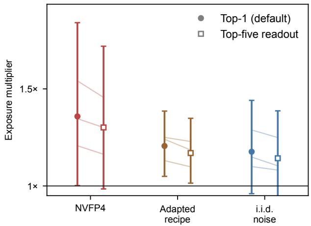  
Figure 9. Exposure multiplier at matched tokens (40M, seeds 0–2, 95% intervals) under the default top-1 readout (filled) and a top-five readout over the values of the attribute (open). Thin lines pair the two readouts of one seed.

Shared learning rates. On seeds 0–2, the token-matched multiplier at a shared rate is $0 . 9 1 \times [ 0 . 3 8 , 2 . 1 6 ]$ at $5 \times 1 0 ^ { - 4 }$ $1 . 3 7 \times [ 0 . 9 2 , 2 . 0 4 ] \mathrm { a t } 1 0 ^ { - 3 }$ , and $1 . 4 9 \times [ 0 . 7 0 , 3 . 1 8 ] \mathrm { a t } 2 \times 1 0 ^ { - 3 }$ . Wide intervals prevent a precise comparison of the endpoints. $\mathrm { A t ~ 5 \times 1 0 ^ { - 4 } }$ , BF16 recalls 58–84% of facts seen eight times across seeds, versus 77–78% for NVFP4, limiting resolution at the lower rate. Across seeds 0–2, mean recall over the 1–8-exposure bins at rates $5 \times 1 0 ^ { - 4 } , 1 0 ^ { - 3 }$ and $2 \times 1 0 ^ { - 3 }$ is 0.371/0.498/0.339 for BF16 and 0.378/0.403/0.234 for NVFP4. A quadratic in $\log _ { 2 }$ of the rate through these three points peaks at about 0.42 for NVFP4 (near $8 \times 1 0 ^ { - 4 } )$ and 0.50 for BF16. This three-point interpolation is descriptive, and it gives no indication of a rate within the tested range that closes the gap. Both formats select $1 0 ^ { - 3 }$ under this criterion, where the three-seed loss-matched multiplier is 1.30× [0.98, 1.71]. Comparing NVFP4 at $5 \times 1 0 ^ { - 4 }$ with BF16 at $1 0 ^ { - 3 }$ instead gives $1 . 4 7 \times [ 1 . 4 2 , 1 . 5 3 ]$ at matched tokens and 1.40× [1.31, 1.49] at matched loss. These comparisons use the same three seeds, but the latter selects a different NVFP4 rate.

BF16 cooldown by exposure timing. The cooldown run switches from NVFP4 to BF16 at step 1,590 of 1,988. From the data-stream index we take every probed fact of the bins seen 1–8 times and classify it by the steps of its exposures, either all before the switch or all after it. For each group and seed, the deficit of a run is the mean recall of BF16 minus that of the run over the group’s facts. Plain NVFP4 is evaluated with BF16 matrix multiplications (seeds 0–2 from reruns that store this readout), so that it is read in the same arithmetic as the cooldown run. We report the mean recall difference between the cooldown run and plain NVFP4 with a t interval over the six seeds, and the remaining share, the mean cooldown deficit over the mean NVFP4 deficit, with an interval from 20,000 seed resamples.

## C. Proofs and a Linearized Model

## C.1. Proof of Proposition 1

Proof. (i) For every $\ell , x _ {  { { R _ { \mathrm { I o } } } } } ( \ell ) = \operatorname* { i n f } \{ x : R _ { \mathrm { r e f } } ( x - \delta ) \geq \ell \} = \delta + \operatorname* { i n f } \{ y : R _ { \mathrm { r e f } } ( y ) \geq \ell \} = \delta + x _ {  { { R _ { \mathrm { r e f } } } } } ( \ell )$ , with $y = x - \delta$ Hence $x _ { R _ { \mathrm { l o } } } ( \ell )$ is finite exactly when $\boldsymbol { v } _ { R _ { \mathrm { r e f } } } ( \ell )$ is, and $\Delta _ { \ell } = \delta$ for every $\ell \in L ^ { \prime } , \bar { \Delta } = \delta$ and $m = 2 ^ { \delta }$ whenever L′ is nonempty. (ii) Since h is strictly increasing, $h ( R ( x ) ) \geq h ( \ell )$ if and only if $R ( x ) \geq \ell ,$ so the two sets in the definition of $x _ { h \circ R } ( h ( \ell ) )$ and $x _ { R } ( \ell )$ coincide and $x _ { h \circ R } ( h ( \ell ) ) = x _ { R } ( \ell )$ for both curves. Hence the gap at level $h ( \ell )$ equals $\Delta _ { \ell }$ and is finite exactly when $\Delta _ { \ell } \mathrm { i } \mathbf { s } ,$ so $L ^ { \prime }$ maps to $h ( L ^ { \prime } )$ , and $\bar { \Delta }$ and m are unchanged. The running maximum commutes with $h ,$ so the statement also holds for curves made nondecreasing after the transformation. □

On the observed grid $x \in \{ 0 , \ldots , 8 \}$ with linear interpolation, (i) holds exactly for integer $\delta$ when levels are bracketed by both curves, and up to interpolation error otherwise. Part (ii) holds for the interpolated curves only for affine $h ,$ since a nonlinear h does not preserve linear interpolation. Both are therefore properties of the measure rather than guarantees about the finite-grid estimate. Table 2 and Appendix A examine (i) empirically. The alternative readouts of Table 3 are not monotone transforms of first-token recall, so (ii) does not cover them.

## C.2. Proof of Proposition 2

Proof. With learning rate $\eta$ and Adam’s step $- \eta \mu _ { i } / \sqrt { \hat { v } _ { i } }$ , where $\mu _ { i }$ is the momentum (Adam’s first-moment estimate), an exposure of $f$ adds $g _ { f }$ to the minibatch gradient (up to the batch normalization, a constant factor that cancels in $m _ { f } )$ and moves coordinate $i \ \dot { \mathbf { b y } } \ - \eta g _ { f , i } / \sqrt { \hat { v } _ { i } }$ in expectation: the momentum average spreads the step over later updates, but its weights sum to one, and $\hat { v } _ { i }$ changes little over that horizon. By Assumption 1(a) the error adds nothing to this expectation and changes only the normalizer, so the first-order decrease of the fact’s loss per exposure is $\begin{array} { r } { P _ { f } = \eta \sum _ { i } g _ { f , i } ^ { 2 } / \sqrt { \hat { v } _ { i } } } \end{array}$ , with $\hat { v } _ { i } = v _ { i }$ for the reference and $\hat { v } _ { i } = v _ { i } + s _ { i } ^ { 2 }$ for the low-precision configuration. By Assumption 1(b) the number of exposures needed is $\tau _ { f } / P _ { f }$ , so the ratio between the two is $P _ { f , \mathrm { r e f } } / P _ { f , \mathrm { l o } } = m _ { f }$ , whatever $\tau _ { f }$ . Every term of the denominator of Eq. (1) is at most the matching term of the numerator, so $m _ { f } \geq 1 . \mathrm { ~ I f ~ } s _ { i } ^ { 2 } = r v _ { i } .$ , every term is the matching one divided by ${ \sqrt { 1 + r } } ,$ , and replacing $s _ { i } ^ { 2 }$ by $c ^ { 2 } s _ { i } ^ { 2 }$ replaces r by $c ^ { 2 } r$ . For general $s _ { i } ^ { 2 } .$ , write $\rho _ { i } = s _ { i } ^ { 2 } / v _ { i }$ and $w _ { i } = g _ { f , i } ^ { 2 } / \sqrt { v _ { i } }$ and neglect $\epsilon .$ Then $( 1 + c ^ { 2 } \rho _ { i } ) ^ { - 1 / 2 } = 1 - c ^ { 2 } \rho _ { i } / 2 + O ( c ^ { 4 } )$ , so the denominator of Eq. (1) is $\textstyle ( \sum _ { i } w _ { i } ) ( 1 - c ^ { 2 } { \bar { \rho } } _ { f } / 2 ) + O ( c ^ { 4 } )$ with $\begin{array} { r } { \bar { \rho } _ { f } = \sum _ { i } w _ { i } \rho _ { i } / \sum _ { i } w _ { i } . } \end{array}$ , and $m _ { f } ( c ) = 1 + c ^ { 2 } \bar { \rho } _ { f } / 2 + O ( c ^ { 4 } )$ . For (P3), an error with $s _ { i } ^ { 2 } = \sigma ^ { 2 }$ on every coordinate gives $\bar { \rho } _ { f } = \sigma ^ { 2 } \langle 1 / v \rangle _ { w }$ , and one with the same total power and $s _ { i } ^ { 2 } = \sigma ^ { 2 } v _ { i } / \langle v \rangle$ gives $\bar { \rho } _ { f } = \sigma ^ { 2 } / \langle v \rangle$ , so the first is larger if and only if $\langle 1 / v \rangle _ { w } > 1 / \langle v \rangle$ ⟩. Jensen’s inequality gives $\langle 1 / v \rangle \geq 1 / \langle v \rangle$ , strictly unless all $v _ { i }$ are equal, which settles uniform weights. In general $\langle 1 / v \rangle _ { w } = \langle w / v \rangle / \langle w \rangle$ , which is at least $\langle 1 / v \rangle$ whenever w and $1 / v$ are nonnegatively correlated across coordinates. If $g _ { f , i } ^ { 2 }$ is uncorrelated across coordinates with $v _ { i } ^ { - 1 / 2 }$ and $v _ { i } ^ { - 3 / 2 }$ , as when it is independent of $v _ { i }$ and the coordinates are many, then $\langle 1 / v \rangle _ { w } = \langle v ^ { - 3 / 2 } \rangle / \langle v ^ { - 1 / 2 } \rangle \geq \langle 1 / v \rangle$ , because $v ^ { - 1 / 2 }$ and $v ^ { - 1 }$ are both decreasing in v and hence nonnegatively correlated (Chebyshev’s sum inequality). Otherwise the condition is a property of the facts that must be checked empirically. For (ii) and (iii), write $g _ { i } = \mathbb { E } [ g _ { i } ] + \xi _ { i }$ with $\mathrm { V a r } ( \xi _ { i } ) = v _ { i } - \mathbb { E } [ g _ { i } ] ^ { 2 }$ . The momentum is a weighted sum of past gradients with weights summing to one, so at fixed normalizer the update of coordinate i has mean $- \eta \mathbb { E } [ g _ { i } ] / \sqrt { \hat { v } _ { i } }$ , and, because the noise and the error are uncorrelated across steps, its zero-mean part has variance $\kappa \eta ^ { 2 } \mathrm { V a r } ( \xi _ { i } + e _ { i } ) / \hat { v } _ { i }$ with the same factor κ (set by $\beta _ { 1 } )$ in every configuration. With the error in both moments, the mean is divided by $\sqrt { 1 + \rho _ { i } }$ and the variance is multiplied by $( v _ { i } - \mathbb { E } [ g _ { i } ] ^ { 2 } \stackrel { - } { + } s _ { i } ^ { 2 } ) v _ { i } / \big ( ( v _ { i } + s _ { i } ^ { 2 } ) ( v _ { i } - \mathbb { E } [ g _ { i } ] ^ { 2 } ) \big )$ , so the ratio of mean to standard deviation falls by exactly $\sqrt { 1 + s _ { i } ^ { 2 } / ( v _ { i } - \mathbb { E } [ g _ { i } ] ^ { 2 } ) }$ , which is $\sqrt { 1 + \rho _ { i } }$ to leading order when $\mathbb { E } [ g _ { i } ] ^ { 2 } \ll v _ { i }$ . The variance is then unchanged to leading order. With the error only in the second moment the momentum is the reference one and the normalizer is $\sqrt { v _ { i } } \sqrt { 1 + \rho _ { i } }$ , so the update is the reference update with η replaced by $\eta / \sqrt { 1 + \rho _ { i } }$ . With the error only in the first moment the normalizer is the reference one, the mean is unchanged and the variance grows by $\mathrm { V a r } ( \xi _ { i } + e _ { i } ) / \mathrm { V a r } ( \xi _ { i } ) = 1 + s _ { i } ^ { 2 } / ( v _ { i } - \mathbb { E } [ g _ { i } ] ^ { 2 } )$ □

## C.3. Proof of Proposition 3

Proof. A fact with log-exposure x contributes to the validation stream in proportion to $2 ^ { x }$ , so the excess loss averaged over fact occurrences in the stream is the first expression. The mean value theorem gives $\mathcal { L } ( x - \delta ) - \mathcal { L } ( x ) = - \delta \mathcal { L } ^ { \prime } ( \xi _ { x } )$ for some $\xi _ { x } \in [ x - \delta , x ]$ in each term, which gives the second. If recall is a fixed decreasing function of the value-token loss, the recall curves inherit the shift by δ, and Proposition 1(i) gives $\Delta _ { \ell } = \delta$ for every $\ell \in L ^ { \prime }$ and $m = 2 ^ { \delta }$ □

Table 6. Configurations of Figure 5(c): multiplier predicted by Eq. (1) (geometric mean over 96 facts and 3 checkpoints), observed multiplier at matched tokens with 95% interval and seed count, and gradient-error bias ratio (about 1/32 if zero-mean, Appendix D).
<table><tr><td>Configuration</td><td>Predicted</td><td>Observed [95% CI]</td><td>n</td><td>Bias ratio</td></tr><tr><td>Block-shaped gradient noise, 0.5×</td><td>1.02</td><td>1.05 [0.86, 1.27]</td><td>3</td><td>0.03</td></tr><tr><td>FP8</td><td>1.02</td><td>1.11 [1.00, 1.22]</td><td>6</td><td>0.30</td></tr><tr><td>Forward noise, 0.5×</td><td>1.03</td><td>1.08 [0.90, 1.29]</td><td>3</td><td>0.51</td></tr><tr><td>i.i.d. gradient noise, 0.5×</td><td>1.05</td><td>1.02 [0.95, 1.09]</td><td>3</td><td>0.03</td></tr><tr><td>NVFP4, forward weights only</td><td>1.05</td><td>1.11 [0.94, 1.31]</td><td>3</td><td>0.81</td></tr><tr><td>NVFP4, backward only</td><td>1.06</td><td>1.13 [1.04, 1.21]</td><td>6</td><td>0.03</td></tr><tr><td>Block-shaped gradient noise, 1 ×</td><td>1.07</td><td>1.11 [1.03, 1.21]</td><td>6</td><td>0.03</td></tr><tr><td>NVFP4, forward activations only</td><td>1.08</td><td>1.14 [1.03, 1.26]</td><td>3</td><td>0.71</td></tr><tr><td>Forward noise, 1×</td><td>1.11</td><td>1.19 [1.08, 1.31]</td><td>6</td><td>0.79</td></tr><tr><td>i.i.d. gradient noise, 1 ×</td><td>1.13</td><td>1.25 [1.09, 1.44]</td><td>6</td><td>0.03</td></tr><tr><td>NVFP4, forward only</td><td>1.15</td><td>1.18 [1.07, 1.30]</td><td>6</td><td>0.85</td></tr><tr><td>NVFP4, FP8 backward</td><td>1.15</td><td>1.23 [1.09, 1.39]</td><td>6</td><td>0.85</td></tr><tr><td>NVFP4</td><td>1.20</td><td>1.32 [1.16, 1.50]</td><td>6</td><td>0.80</td></tr><tr><td>Block-shaped gradient noise, 2×</td><td>1.23</td><td>1.38 [1.24, 1.53]</td><td>3</td><td>0.03</td></tr><tr><td>i.i.d. gradient noise, 2×</td><td>1.36</td><td>1.33 [1.15, 1.53]</td><td>8</td><td>0.03</td></tr><tr><td>MXFP4</td><td>1.44</td><td>1.61 [1.38, 1.88]</td><td>6</td><td>0.94</td></tr><tr><td>Forward noise, 2×</td><td>1.67</td><td>1.44 [1.31, 1.58]</td><td>3</td><td>0.89</td></tr></table>

## C.4. Linearized Dynamics of One Coordinate

To see how the step-size and signal-to-noise effects differ over time, let the mean gradient of coordinate i near its optimum be $h \left( \theta - \theta ^ { * } \right)$ , add zero-mean noise $\xi _ { t }$ of variance $\sigma ^ { 2 }$ and error $e _ { t }$ of variance $s ^ { 2 }$ , both uncorrelated across steps, and hold the normalizer $\sqrt { \hat { v } }$ fixed. Ignoring momentum, the update $\theta _ { t + 1 } - \theta ^ { * } = ( 1 - k ) ( \theta _ { t } - \theta ^ { * } ) - \eta ( \xi _ { t } + e _ { t } ) / \sqrt { \hat { v } }$ with $k = \eta h / \sqrt { \hat { v } } \ll 1$ is a discretized Ornstein–Uhlenbeck process. An exposure of $f$ displaces θ by $- \eta g _ { f } / \sqrt { \hat { v } }$ , and the displacement decays as $( 1 - k ) ^ { t }$ . Exposures at a rate of r per step hold it at $- r g _ { f } / h$ on time average, a value independent of η and vˆ, which set only the relaxation time $1 / k$ . The stationary variance of θ is $\eta ^ { 2 } ( \sigma ^ { 2 } + s ^ { 2 } ) / { \left( \hat { v } \left( 1 - ( 1 - k ) ^ { 2 } \right) \right) } \approx \eta ( \sigma ^ { 2 } + s ^ { 2 } ) / ( 2 h \sqrt { \hat { v } } )$ . In noise-dominated coordinates $( \sigma ^ { 2 } \approx v )$ , error in both moments multiplies it by ${ \sqrt { 1 + \rho } } ,$ error only in the second moment by $1 / \sqrt { 1 + \rho } ,$ as a learning rate divided by $\sqrt { 1 + \rho }$ would, and error only in the first moment by $1 + \rho . \mathrm { ~ A ~ }$ smaller step thus delays the approach to the same time-averaged displacement, whereas update noise widens the spread around it for as long as the noise lasts. If recall depends on a fact’s displacement relative to this spread, the first effect is a delay that fades once displacements have equilibrated and the second a lasting penalty that weighs most on facts with small displacements. This link to recall is heuristic.

## D. Parameter-Free Prediction

For each BF16 checkpoint (40M synthetic, seeds 0–2, final weights) we draw 32 training batches of the original size (64 × 512 tokens, with gradients accumulated over 8 micro-batches for memory) and compute, per batch, the BF16 gradient g and the gradient $g + e$ of every configuration with its GEMMs on the same batch. We estimate $v _ { i }$ as the mean of $g _ { i } ^ { 2 }$ and $s _ { i } ^ { 2 }$ as the mean of $e _ { i } ^ { 2 }$ over batches, using all parameters, including the unquantized embeddings and output head, whose gradients change through the backward pass. For 32 probe facts in each of the bins seen 4, 8 and 16 times we approximate $g _ { f }$ by the gradient of the summed value-token loss under the probe prompt, evaluate Eq. (1) with Adam’s $\epsilon = 1 0 ^ { - 8 }$ added to both square roots, and report the geometric mean over facts. For the gradient-noise configurations the error has zero mean conditionally on the gradient by construction (independent Gaussian noise), which also removes the cross term $\mathbb { E } [ g _ { i } e _ { i } ]$ Backward-only NVFP4 comes close to this case. Its stochastic rounding draws independently for every operand of every backward GEMM, and the backward pass is linear in each rounded operand given the forward activations, so unbiased rounding would make its error conditionally zero-mean. The emulated rounding is slightly biased, because the E4M3 block scale is rounded to nearest and, when it is rounded down, the largest elements of a block saturate. In 2,000 repeated roundings of fixed Gaussian, Laplace and $\mathrm { S t u d e n t } { - } t _ { 3 }$ tensors, this bias affects about 3% of elements, carries at most about 1% of the error power and slightly shrinks magnitudes $( \mathbb { E } [ x b ] / \mathbb { E } [ x ^ { 2 } ]$ between −0.6% and −0.3% for input x and bias b). For MXFP4 it carries 7–12% of the error power. The BF16 reference itself rounds with a relative error of at most $2 ^ { - 9 }$ , against a relative RMS error of about 0.14 for one NVFP4 rounding. As a check on the mean error over batches only, the bias ratio $\textstyle \sum _ { i \in I } { \bar { e } } _ { i } ^ { 2 } / \sum _ { i \in I } s _ { i } ^ { 2 }$ , where $\bar { e } _ { i }$ is the mean of $e _ { i }$ over the 32 batches and I contains every 64th coordinate, is about $1 / 3 2$ for a zero-mean error. It is 0.03 for every backward-noise configuration and for backward-only NVFP4, and 0.3–0.94 for every configuration whose forward pass is quantized or perturbed, including FP8 and MXFP4 (open markers in Figure 5(c), which mark ratios above 0.1). Table 6 lists the prediction, the observation and this ratio for every configuration.

Estimator sensitivity. The value of Eq. (1), though not its ranking, depends on how the normalizer is estimated. On the seed-0 checkpoint with 64 batches, log $m _ { \mathrm { p r e d } }$ is 0.88 times its 32-batch value (median over the 17 configurations, range 0.78–0.96), and replacing $\mathbb { E } [ g _ { i } ^ { 2 } ]$ by Adam’s normalizer, an exponential average with $\beta _ { 2 } = 0 . 9 5$ of squared minibatch gradients whose error comes from an independent batch, multiplies it by $1 . 1 5 \ : ( 1 . 0 5 { - 1 . 4 0 } )$ . At 64 batches the two corrections nearly cancel. Through the origin, the slope of log $m _ { \mathrm { o b s } }$ on log $m _ { \mathrm { p r e d } }$ over all 17 configurations is 1.07 both for the 32-batch estimate used in the paper and for Adam’s normalizer at 64 batches, and Spearman’s correlation is 0.96 under every estimator. The near-unit slope averages configurations that deviate in opposite directions. For the seven configurations with zero-mean gradient error the two slopes are 1.22 and 1.23, whereas forward noise at twice the error is overestimated (1.67 predicted against 1.44× observed).

## E. Split-Moment Analyses and Pre-Specified Tests

Split-moment variants. The split-moment variants inject the i.i.d. gradient noise of the noise configuration, at the NVFP4 error or twice it. At every step a second backward pass without noise computes the BF16 gradient of the same batch, and both gradients are clipped with the factor of the noisy gradient’s global norm, so that the two moments differ only by the injected noise. In the second-moment-only variant Adam’s first moment receives the BF16 gradient and its second moment the noisy one, and the first-moment-only variant does the reverse. Bias correction, decoupled weight decay and the schedule are those of AdamW with $\beta = ( 0 . 9 , 0 . 9 5 )$ . Seed-0 reruns that log the global gradient norm at every step show that this shared clipping factor couples the moments only weakly. The median norm is 0.18–0.21 against the threshold of 1, and clipping acts on 3.3% of steps for $\mathrm { B F } 1 6 , 3 . 7 \%$ for noise in both moments, 3.4% for noise in the second moment only and 3.3% for NVFP4. It acts on about 10% of the first 30% of steps (9.6–10.9%) and on at most 0.9% afterwards. In the second-moment-only run the noisy gradient’s norm exceeds the BF16 gradient’s by 3.9% at the median (0.2–6.4%, 5th–95th percentile over steps) and varies by at most 1.5% within 20 steps (95th percentile of the coefficient of variation), so the factor depends on the noise level rather than on the particular draw. Clipping acts on the same steps on which it would act for the BF16 gradient, and the two factors differ by $2 \times 1 0 ^ { - 5 }$ on average. The reruns end within 0.0007 of the original runs final validation loss and within 0.0012 of their mean recall.

Analyses over training and by exposure count. For Figure 6(a) we recompute the token-matched multiplier of Definition 1 from the recall curves of a run and of BF16 at $1 0 ^ { - 3 }$ at every evaluation step they share and average its logarithm over seeds. For Figure 6(b), at every evaluation from step 700 on (after the loss plateau) and in every exposure bin where the recall of both runs lies in [0.2, 0.8], the gap is the bin’s $\mathrm { . o g _ { 2 } }$ exposure count minus the $\log _ { 2 }$ exposure count at which the reference’s recall curve at the same step reaches the recall of the run. Per seed, the within-bin slope regresses the gaps on the step with a fixed effect per bin, the between-bin slope regresses them on $\log _ { 2 }$ exposures with a fixed effect per step, and the profile averages the gaps of each bin. We report means over seeds with t intervals, for bins with at least three seeds (six for facts seen twice, eight otherwise). The update-noise share is $\bar { d } / \bar { f }$ , where $f$ is the $\log _ { 2 }$ multiplier of noise in both moments and d its difference from noise in the second moment only, both against BF16 at $1 0 ^ { - 3 }$ , averaged over the eight seeds, and its interval resamples seeds 20,000 times.

Failure rule. A run fails if its validation loss first reaches $V ^ { * }$ , the median validation loss of the BF16 runs at $1 0 ^ { - 3 }$ near 30% of training, later than twice their median step or never, or if after 10% of training it rises more than one nat above its running minimum. We fixed this rule with the learning-rate compensation test below, before its runs and after those of E1–E3. Among the latter it flags six of the eight first-moment-only runs at twice the NVFP4 error, all by the second criterion, and both runs of seed 4 a $2 \times 1 0 ^ { - 3 }$ , which reach $V ^ { * }$ only after 90% of training.

E1–E3. We recorded the following predictions and decision rules in the analysis code before the runs, and the version history of the code records the order. E3: at $1 0 ^ { - 3 }$ , noise in the second moment only matches BF16 at $1 0 ^ { - 3 } / A$ , with $A = 1 . 3 5 6$ from Eq. (1) for this noise (geometric mean over the three checkpoints) and the product of rate and decay fixed, and the reduced rate costs about 1.09× against BF16 at $1 0 ^ { - 3 }$ . Observed: $1 . 0 2 \times \ [ 0 . 9 3 , 1 . 1 3 ]$ and $1 . 0 8 \times \ [ 0 . 9 6 , 1 . 2 1 ]$ (8 seeds), as predicted. E2: at $2 \times 1 0 ^ { - 3 }$ , above the optimal rate, the same variant was predicted to save exposures against BF16 at $2 \times 1 0 ^ { - 3 } \ : ( 0 . 7 0 \times [ 0 . 5 7 , 0 . 8 6 ]$ , from a quadratic through BF16’s recall at three rates) and to match BF16 at $2 \times 1 0 ^ { - 3 } / A$

Over the six seeds it gives $0 . 5 6 \times [ 0 . 1 0 , 3 . 2 5 ]$ , outcome B of the rule (point below 1, interval containing 1), but only because BF16 failed in seed 4. Without that seed it gives $1 . 1 1 \times [ 0 . 9 2 , 1 . 3 5 ]$ , with no saving. Against BF16 at $2 \times 1 0 ^ { - 3 } / A$ the variant costs $1 . 6 6 \times [ 1 . 3 3 , 2 . 0 7 ]$ , above 1 in all six seeds $( 1 . 5 8 \times [ 1 . 2 4 , 2 . 0 0 ]$ without seed 4), although BF16 at $2 \times 1 0 ^ { - 3 } / A$ does beat BF16 a $2 \times 1 0 ^ { - 3 }$ as predicted $( 0 . 7 0 \times [ 0 . 5 6 , 0 . 8 9 ]$ without seed 4). The uniform-cut reading thus fails above the optimum. A candidate explanation, which we have not tested, is the per-coordinate structure of the cut. The measured mean of $v _ { i } / ( v _ { i } + s _ { i } ^ { 2 } )$ at this noise is 0.43–0.66 for the embedding and the weight matrices of the blocks but 1.0 for the output head, whose gradient carries no injected error and keeps the full rate. E1: (i) for i.i.d. noise the median $s _ { i } ^ { 2 } / v _ { i }$ of the query and key rows was predicted to be at least ten times that of the value rows. It is 2.7–3.1 times (below 1 for block-shaped noise and backward-only NVFP4, as predicted). (ii) The slope of log $m _ { \mathrm { o b s } }$ on log $m _ { \mathrm { p r e d } }$ after replacing $\mathbb { E } [ g _ { i } ^ { 2 } ]$ by Adam’s normalizer was to attribute the underestimate of Eq. (1) to heavy-tailed per-batch gradients, a bias of the estimator (at most 1.10), or to the training dynamics (at least 1.15). The pre-specified statistic, which applies the normalizer correction to the 32-batch estimate, was 1.13 when first computed, with the forward-noise configurations evaluated with the noise on. With the corrected readout of Section 5 it is 0.99, which the rule attributes to the estimator. Over the seven zero-mean configurations, which the readout does not affect, the same statistic is 1.12, between the thresholds, and the underestimate persists under every estimator (Appendix D).

Learning-rate compensation. Before the runs we fixed two primary statistics, both paired by seed and token-matched against BF16 at $1 0 ^ { - 3 }$ , with the product of rate and decay at $1 0 ^ { - 4 } \colon R _ { 1 }$ , the multiplier of noise at twice the NVFP4 error with the rate raised by $A = 1 . 3 5 6$ over that at $1 0 ^ { - 3 }$ (seeds 0–7), and $R _ { 2 }$ , the same for NVFP4 with its $A = 1 . 1 9 9$ (seeds 0–5). If the cost were only the shrunken step, raising the rate would remove it, giving $R _ { 1 } \approx 0 . 7 5$ and $R _ { 2 } \approx 0 . 7 6$ , the inverses of the multipliers at $1 0 ^ { - 3 }$ . If only the step-size cost is removed, $R _ { 1 } \approx 0 . 9 1$ , the inverse of the second-moment-only multiplier, or BF16’s own multiplier at the raised rate (measured in the same test and expected near 1.10) if larger updates cost as they do for BF16, and $R _ { 2 } \mathrm { i s } 0 . 9 5  – 1 . 0 5$ . The rate counts as restoring the cost if the upper 95% bound lies below 0.83 for $R _ { 1 }$ (0.85 for $R _ { 2 } )$ , as not restoring it if the lower bound lies above, and as partial otherwise. Every seed enters the primary analysis, and a secondary analysis drops seeds with a run that fails the rule above. Both primary statistics fall in the region where the rate does not restore the cost, with $R _ { 1 } = 1 . 0 8 [ 0 . 9 5 , 1 . 2 4 ]$ (per seed 0.83–1.29) and $R _ { 2 } = 0 . 9 9 [ 0 . 8 7 , 1 . 1 3 ] ( 0 . 8 9 - 1 . 2 0 )$ . No run failed the rule, so the secondary analysis equals the primary one. $R _ { 1 }$ lies between the two forms of the signal-to-noise account, 0.91 and BF16’s own multiplier at the raised rate, 1.20× [1.08, 1.35]. The secondary comparisons also follow that account. The noise at the raised rate costs 1.44× [1.31, 1.58] against BF16 at $1 0 ^ { - 3 }$ (pre-specified range 1.21–1.46 for the signal-to-noise account and about 1 for the step-size account) and 1.19× [1.09, 1.30] against BF16 at the raised rate (1.1–1.33 against about 0.9).

## F. Example Biography and Probes

Each exposure of a person is a newly sampled biography, with the six attribute sentences in random order, each from one of the five templates of its attribute. The box shows one biography of a probed person from the bin seen eight times, generated with the code and data seed of the 40M runs, and the six probe prompts with their values. A fact counts as recalled if the model’s top prediction is the first value token (bold). In the word-level vocabulary every word and punctuation mark is one token. In the natural-text regime the same text is inserted as a separate document between FineWeb-Edu documents and tokenized by the byte-level BPE. Its first value token is then a whole city or major but is shared by several universities and by several companies (41 distinct first tokens among the probed universities and 50 among the probed companies). Exact match of the whole value is unaffected (Appendix A).

<table><tr><td colspan="2">Biography. The alma mater of Lunsawi MVorbel LOrlochefen is UKami University . Lunsawi MVorbel LOrlochefen completed a degree in SDasdri . Lunsawi MVorbel LOrlochefen relocated to CChefen for work . Lunsawi MVorbel LOrlochefen celebrates a birthday on March 26 , 1950 . Lunsawi MVorbel LOrlochefen was employed by KBelvorpa Inc . Lunsawi MVorbel LOrlochefen</td></tr><tr><td colspan="2">was born in CWirapa .</td></tr><tr><td>Probes.</td><td></td></tr><tr><td>Lunsawi MVorbel LOrlochefen was born on</td><td>March 26 , 1950</td></tr><tr><td>Lunsawi MVorbel LOrlochefen was born in</td><td>CWirapa</td></tr><tr><td>Lunsawi MVorbel LOrlochefen studied at</td><td>UKami University</td></tr><tr><td>Lunsawi MVorbel LOrlochefen majored in</td><td>SDasdri</td></tr><tr><td>Lunsawi MVorbel LOrlochefen worked at</td><td>KBelvorpa Inc</td></tr><tr><td>Lunsawi MVorbel LOrlochefen worked in</td><td>CChefen</td></tr></table>