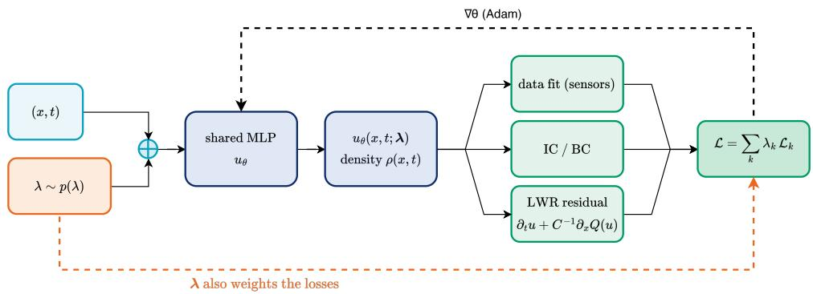
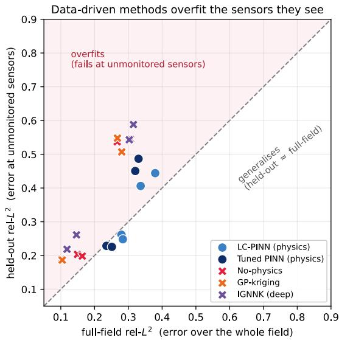
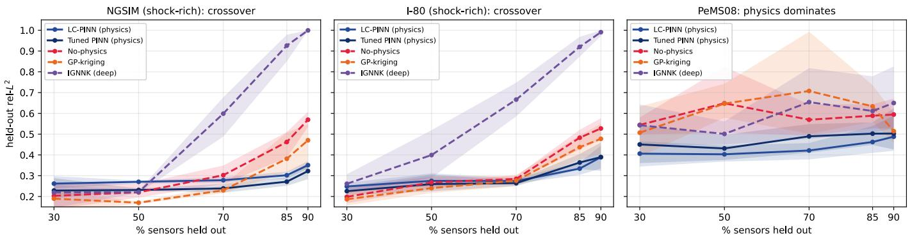
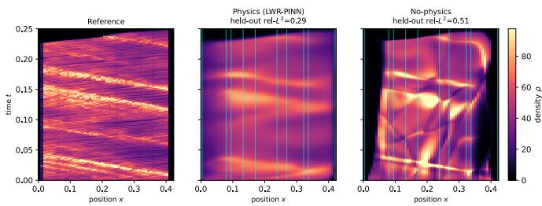
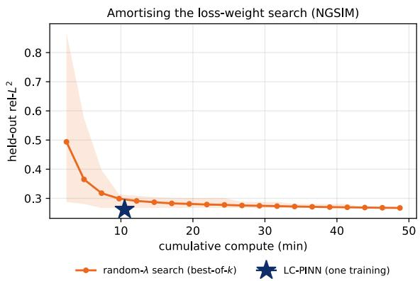

# When Does Physics Beat Data? Data-Efficient Traffic State Estimation with Amortized PINNs

Anna Lazareva∗† and Alexander Tarakanov∗‡

∗HSE University, Moscow, Russia

†Moscow Institute of Physics and Technology (MIPT), Russia

‡AI VK, Moscow, Russia

lazareva.anna@phystech.edu, annelzrv@gmail.com, atarakanov@hse.ru

Abstract—Traffic state estimation (TSE) reconstructs traffic density at unmonitored locations from a sparse set of sensors. Data-driven models work well when sensors are dense but degrade sharply as coverage thins. We show that imposing the Lighthill–Whitham–Richards conservation law as a physicsinformed prior makes TSE more data-efficient. On four real corridors (NGSIM, I-80, PeMS04, PeMS08), physics-informed estimators generalise to held-out sensors where data-driven models, including classical and deep kriging, overfit the observed ones. On the two shock-rich corridors the effect is a clear crossover: as more sensors are held out, data-driven models collapse while the physics-informed estimator degrades gracefully, leading the no-physics network by ≈ 26–38% at 85–90% held out and the strongest classical kriging by ≈ 10–21% at 90%. A matched smoothness prior does not reproduce the gain, and an extended Kalman filter on the same LWR model is outperformed on the shock corridors, so the advantage comes from how the conservation law is imposed. Finally, one loss-conditional PINN removes the per-corridor loss-weight search, matching a 20-point search at ∼ 5× lower cost.

## I. INTRODUCTION

Traffic state estimation (TSE) reconstructs the density and speed of traffic along a road from a sparse set of fixed sensors. It feeds ramp metering, incident detection and routing. Sensors are expensive, so real corridors are instrumented sparsely and unevenly, and the important question is what traffic does between the sensors. This is a spatiotemporal kriging problem, and it becomes harder as coverage thins.

Data-driven estimators, including modern spatiotemporal graph networks, work well when sensors are dense because they learn spatial correlation from the observed signals. That correlation must be estimated from data, and with fewer sensors there is less data to estimate it from, so these methods degrade sharply under sparse sensing, the regime that matters for deployment.

Traffic flow obeys a conservation law, the Lighthill– Whitham–Richards (LWR) model, which constrains the density over the whole road, not only at the sensors. Embedding this law in a network’s training objective, as physics-informed neural networks (PINNs) do, gives a prior that holds where no data does. Physics-informed TSE is not new: Shi et al. [1] proposed a PINN on the LWR model and observed that the prior helps as detectors thin. We turn that observation into a quantified and explained result.

Contributions:

• Physics is data-efficient (the main result). On four real corridors (NGSIM, I-80, PeMS04, PeMS08), physicsinformed estimators generalise to unmonitored sensors where no-physics networks, Gaussian-process kriging and deep inductive kriging (IGNNK) collapse as coverage thins, and even the most robust baseline (kNN kriging) is overtaken at the sparsest coverage. On the two shockrich corridors (NGSIM and I-80) this is a crossover that replicates: data-driven methods win when dense, physics wins when sparse, by ≈ 26–38% relative to the no-physics network and ≈ 7–21% against the strongest classical kriging at 85–90% held out. On PeMS08 physics leads the strongest classical baseline at every coverage; near-free-flow PeMS04 is closer (Table II). Where shock structure is present it is also ahead of an EKF on the same LWR model.

• The gain is the conservation law, not smoothing. A matched generic-smoothness prior is worse than a nophysics network.

• No weight search via loss-conditioning. A lossconditional PINN (LC-PINN) trains once over a prior on the data-vs-physics loss weights, amortising the percorridor weight search (∼ 5× cheaper than a measured search, 18–58× vs. an exhaustive grid) and, on the PeMS corridors, slightly improving on a tuned fixed-weight PINN.

• A theoretical account: an a-posteriori error certificate at unmonitored locations that data-driven estimators lack.

The contribution is the phenomenon and its explanation, not a new architecture. Held-out TSE at unmonitored locations is hard: our result is the relative physics-vs-data-driven gap, and at a single fixed weighting a tuned PINN remains slightly more accurate than the amortised LC-PINN (§V-H, §VII).

## II. RELATED WORK

Traffic state estimation and physics-informed learning: Classical TSE assumes a traffic-flow model, typically the first-order LWR conservation law [2, 3], and estimates the state by filtering or variational data assimilation; the extended Kalman filter (EKF) is the standard tool, with measurements aggregated by Edie’s definitions [4]. Physics-informed deep learning instead puts the flow model into a neural network’s loss. The closest prior work is Shi et al. [1], who introduce PINN-based TSE on the same LWR model, show that the physical prior beats NN, LSTM and EKF estimators as detectors become sparse, and name the choice of data-vs-physics loss weights as an open problem (a companion paper treats the second-order ARZ model [5]). We build on this work. We condition the network on the loss weights instead of tuning them per corridor; we compare against deep spatiotemporal kriging and an EKF on the same LWR model; we isolate the gain with a matched-smoothness control; and we give the effect a theoretical account.

Data-driven traffic models: Spatiotemporal graph networks such as DCRNN [6] and ASTGCN [7], trained on detector archives such as Caltrans PeMS [8], target forecasting: the future state at sensors observed during training. Held-outsensor TSE is the complementary kriging problem, the present state where no sensor exists, so we compare against kriging models built for that task.

Spatiotemporal kriging and imputation: Gaussian-process kriging and nearest-neighbour interpolation reconstruct unobserved locations from spatial correlation. Deep inductive methods learn this correlation: IGNNK [9] uses inductive graph message passing for virtual sensors, and GRIN [10] uses a bidirectional recurrent graph network. We use GP, kNN and IGNNK on every corridor.

Amortised conditional inference: Conditioning a network on a quantity normally fixed by hand, and training over a prior on it, comes from loss-conditional training in generative modelling [11]. The loss-conditional PINN (LC-PINN) [12] extended it to parametric PDEs; we adopt it for TSE to amortise loss-weight selection. Unlike the generative case, the trade-offs here share a common minimiser (Proposition 1), so conditioning serves robustness and amortisation, not navigation of a preference frontier (Section III-D).

## III. METHOD

We cast traffic state estimation (TSE) as a held-out-sensor reconstruction problem and solve it with a physics-informed neural network whose physics is the LWR conservation law. To remove the loss-weight tuning that physics-informed estimators normally require, we condition the network on the loss weights themselves and train a single network over a prior on them, recovering tuned-quality estimates without a per-corridor weight search.

## A. Traffic state estimation as sensor kriging

A corridor is a one-dimensional road segment $x \in [ 0 , L ]$ observed over a window $t ~ \in ~ [ 0 , T ]$ . Its macroscopic state is the vehicle density $\rho ( x , t )$ (equivalently the normalized occupancy), from which speed and flow follow through a fundamental diagram (FD). We observe $\rho$ only at a sparse set of sensor locations: an observed set $S _ { \mathrm { o b s } } \subset [ 0 , L ]$ and a disjoint held-out set $\boldsymbol { S } _ { \mathrm { t e s t } }$ of locations with no sensor. The estimation task is to reconstruct $\rho$ on the full space-time domain, and we report the relative-L2 error on the held-out sensors,

$$
\mathrm { r e l - L ^ { 2 } } _ { \mathrm { t e s t } } = \frac { \left\| \widehat { \rho } - \rho \right\| _ { L ^ { 2 } ( S _ { \mathrm { t e s t } } \times [ 0 , T ] ) } } { \left\| \rho \right\| _ { L ^ { 2 } ( S _ { \mathrm { t e s t } } \times [ 0 , T ] ) } } ,\tag{1}
$$

which measures generalisation to unmonitored locations rather than fit at observed ones. This is the spatiotemporal-kriging (sensor imputation) setting, distinct from forecasting: we estimate the present state where no sensor exists, not the future state where one does.

## B. LWR physics

The Lighthill–Whitham–Richards model [2, 3] states conservation of vehicles,

$$
\partial _ { t } \rho + \partial _ { x } Q ( \rho ) = 0 , \qquad Q ( \rho ) = \rho V ( \rho ) ,\tag{2}
$$

where the flow $Q$ is a function of density alone through a fundamental diagram $V ( \rho )$ . We use the Greenshields relation $V ( \rho ) = v _ { f } \left( 1 - \rho / \rho _ { \mathrm { m a x } } \right)$ , with free-flow speed $v _ { f }$ and jam density $\rho _ { \mathrm { m a x } }$ calibrated per corridor; a triangular diagram is evaluated as an ablation. Because $Q$ is strictly concave (hence nonlinear), the entropy solution of (2) develops shocks — the backward-propagating stop-and-go fronts of congested traffic — which a conservation-law prior reconstructs but a generic smoothness prior cannot (Section V-D). For a smooth, entropy-admissible residual we add a small viscous term $\varepsilon \partial _ { x x } \rho ( \varepsilon = 1 0 ^ { - 2 } ) \colon$ : the diffusively-corrected LWR also used for physics-informed TSE by Shi et al. [1].

## C. Physics-informed loss and loss-conditioning

Let $u _ { \theta } ( x , t )$ approximate the (normalized) density. A standard physics-informed estimator minimises a weighted sum of a data term on the observed sensors, the LWR residual on interior collocation points, and initial/boundary terms:

$$
\begin{array} { r } { \mathcal { L } ( \theta ; \lambda ) = \lambda _ { \mathrm { d } } \mathcal { L } _ { \mathrm { d a t a } } + \lambda _ { \mathrm { r } } \mathcal { L } _ { \mathrm { r e s } } + \lambda _ { \mathrm { i } } \mathcal { L } _ { \mathrm { i c } } + \lambda _ { \mathrm { b } } \mathcal { L } _ { \mathrm { b c } } , } \end{array}\tag{3}
$$

with $\lambda = ( \lambda _ { \mathrm { d } } , \lambda _ { \mathrm { r } } , \lambda _ { \mathrm { i } } , \lambda _ { \mathrm { b } } )$ on the simplex $\Delta ^ { 3 }$ . The residual term is non-dimensionalised by the characteristic wave speed $C = v _ { f } L _ { t } / L _ { x }$ (here $C \approx 2 0 )$ so that its gradients do not swamp the data term: $\mathcal { L } _ { \mathrm { r e s } } = \Vert \partial _ { t } u _ { \theta } + C ^ { - 1 } \bar { \partial _ { x } } Q ( u _ { \theta } ) \Vert ^ { 2 }$

The estimate is notoriously sensitive to λ: too much residual weight ignores the sensors, too little discards the physics. The standard remedy is a per-corridor weight search. Instead we use the loss-conditional PINN (LC-PINN) [12], which adapts the loss-conditional construction [11] to the PDE-residual setting: λ is supplied to the network as an input and one network is trained to minimise the expected loss over a prior $p ( \lambda )$

$$
J ( \theta ) = \mathbb { E } _ { \lambda \sim p ( \lambda ) } \big [ \mathcal { L } \big ( \theta ; \lambda , u _ { \theta } ( \cdot , \log \lambda ) \big ) \big ] ,\tag{4}
$$

estimated at each step from $n _ { \lambda }$ samples of λ. The weight vector enters by input-level concatenation of log λ; because $\lambda$ reweights the objective rather than altering the PDE, input concatenation is the appropriate injection (hidden-layer modulation gives no consistent gain in this regime). The resulting network is the LC-PINN for traffic state estimation (Figure 1). It amortises the weight search: one training run covers the whole weight frontier, and no λ need be chosen before training. Because the held-out optimum is essentially λ-invariant (Proposition 1), the estimate is insensitive to the exact prior $p ( \lambda )$ — we use a log-uniform prior on the simplex — and K-shot averaging over the trained region only reduces variance, not bias; we therefore do not tune the prior per corridor.

## D. Inference and the role of λ

At inference there is no canonical λ, so we average the network over K samples from the prior,

$$
\widehat { u } _ { K } ( x , t ) = \textstyle \frac { 1 } { K } \sum _ { k = 1 } ^ { K } u _ { \theta } \big ( x , t , \log \lambda ^ { ( k ) } \big ) , \qquad \lambda ^ { ( k ) } \sim p ( \lambda ) ,\tag{5}
$$

which we call K-shot averaging. Its justification is an invariance property of the optimum.

Proposition 1 (Loss-weight invariance at the optimum). Let $p ( \lambda )$ have full support on $\Delta ^ { 3 }$ and suppose the network class contains, for each $\lambda ,$ a minimiser of $\mathcal { L } ( \cdot ; \lambda )$ that drives every loss term to zero (an idealisation for noise-free, modelmatched data; on real corridors it holds only approximately, hence the residual λ-dependence noted below). Then for any $\theta ^ { \star } \in$ arg minθ $J ( \theta )$ and p-almost every λ, the section u ⋆ (·, log λ) is a residual minimiser of $\mathcal { L } ( \cdot ; \lambda )$ ; in particular it is independent of λ on the support of p.

Proposition 1 (established for LC-PINN by $[ 1 2 ] ) ^ { 0 }$ frames λ as a robustness knob rather than a preference selector: at the population optimum the estimate does not depend on which λ is queried. At finite training a small residual λ-dependence remains, and (5) acts as a Monte Carlo ensemble that reduces its standard deviation at rate $\mathcal { O } ( K ^ { - 1 / 2 } )$ while leaving the λ-invariant mean unchanged. Consistent with this, K-shot averaging does not improve mean accuracy over evaluating at the prior centre; we therefore report centre-λ estimates and use K-shot only to quantify residual non-invariance.

## E. Baselines

We compare against the natural alternatives for held-outsensor TSE, grouped by how much physics they use. Physics: the tuned fixed-weight LWR-PINN (the strongest singleweighting estimator, whose weights are themselves found from the LC-PINN frontier). No physics: the same network with the residual weight set to zero (“data-only”), and a generic Laplacian-smoothness prior that penalises curvature without the conservation law — the control that isolates whether it is the physics that helps rather than any regulariser. Datadriven kriging: Gaussian-process spatiotemporal kriging and k-nearest-neighbour interpolation (classical), and the deep inductive-kriging model IGNNK [9]. Forecasting models such as DCRNN [6] and ASTGCN [7] predict the future state at monitored sensors and are not estimators for unmonitored locations; we therefore position them as related work rather than as baselines, to avoid a task mismatch.

## IV. EXPERIMENTAL SETUP

Corridors: We evaluate on four real freeway corridors.1 NGSIM US-101 and NGSIM I-80 (US DOT/FHWA) provide vehicle trajectories, which we aggregate into a space-time density field by Edie’s definitions [4]; both are congestedpeak recordings that exhibit genuine backward-propagating stop-and-go waves (I-80 is the more congested of the two). PeMS04 and PeMS08 are Caltrans loop-detector corridors [8] that report both flow and speed, so density follows directly as $\rho = q / v$ without assuming a fundamental diagram; we select the longest contiguous sensor chain and a congested window. All four corridors thus carry independently-measured density (we deliberately exclude speed-only corridors, where density would have to be inferred from the same fundamental diagram the physics enforces). Each corridor is discretised on a spacetime grid; the macroscopic state is the (normalised) density $\rho ( x , t )$

Held-out-sensor protocol: Sensors are interior grid locations. For a held-out fraction $f \in \{ 0 . 3 0 , 0 . 5 0 , 0 . 7 0 , 0 . 8 5 , 0 . 9 0 \}$ we randomly designate $f$ of the interior sensors as heldout (test) and keep the rest as observed (train), retaining the endpoints; the split is reseeded per random seed. All methods see the same observed sensors and are scored by the held-out rel- $. L ^ { 2 }$ of (1). We emphasise that this metric is evaluated only at the held-out sensors — locations with no observation at any time — which is strictly harder than the full-field error (averaged over observed cells as well) reported in much of the TSE literature [1]; our absolute numbers are correspondingly larger and are not directly comparable to full-field results. We report means over five seeds for every method, with bootstrap 95% CIs in Figure 3.

Models and training: All PINNs use a 4 × 64 tanh MLP. The fixed-weight LWR-PINN and the no-physics network minimise (3) with the indicated weights; LC-PINN concatenates log λ and trains over a log-uniform prior on the simplex with $n _ { \lambda } { = } 4$ samples per step. Training is Adam $( 1 0 ^ { - 3 }$ , cosine schedule, gradient clipping, 25k steps); the residual is nondimensionalised by $C { = } v _ { f } L _ { t } / L _ { x }$ . The fundamental diagram is Greenshields (triangular as an ablation), calibrated as two global scalars $( v _ { f } , \rho _ { \mathrm { m a x } } )$ from the aggregate flow–density scatter; it encodes the corridor’s bulk regime, not per-location state, so it transmits no held-out sensor values to the estimator. Classical kriging (GP, kNN) and the deep inductive-kriging baselines (IGNNK) are fit on the observed sensors and predict the held-out ones; GP/kNN are training-free at inference and IGNNK uses 3k epochs. All data-driven baselines use standard

$$
\mathrm { I n f e r e n c e \left( K - s h o t \right) } \colon \hat { \rho } ( x , t ) = \frac { 1 } { K } \sum _ { k = 1 } ^ { K } u _ { \theta } \Bigl ( x , t ; \lambda ^ { ( k ) } \Bigr ) , \quad \lambda ^ { ( k ) } \sim p _ { \mathrm { t r a i n } } ( \lambda )
$$

Fig. 1. LC-PINN for traffic state estimation. Loss weights $\lambda \sim p ( \lambda )$ are concatenated to the inputs (x, t) (⊕), so one network uθ $( x , t ; \lambda )$ represents every weighting; the same λ weights the data, LWR-residual and initial/boundary losses. At inference λ can be K-shot averaged (Proposition 1); we report centre-λ estimates.

settings (kNN k=6, GP with an RBF kernel); like the physics methods, they receive no per-corridor hyperparameter search, so no estimator is advantaged by tuning effort. As a classical model-based counterpart we also run an extended Kalman filter (EKF) data-assimilation baseline on the same calibrated Greenshields LWR dynamics (Godunov discretisation, ensemble formulation for robustness to shocks), observing the train sensors at every time step and estimating the held-out ones; it uses a single fixed process/observation-noise setting across all corridors, so it is, like LC-PINN, free of per-corridor tuning. The external PDEBench 2-D Darcy benchmark uses the same conditioning applied to a permeability-parameterised elliptic problem.

Reproducibility: After Edie/loop aggregation the corridors are NGSIM US-101 (56 × 180 cells, 40 ft×5 s, 8 lanes), NGSIM I-80 (45 × 394, 7 lanes, ∼30-min congested window), and PeMS04 / PeMS08 (24 sensors × 120 five-minute bins, congested window). Held-out fractions remove f of the interior sensors (endpoints retained as boundaries), reseeded per run. All PINNs are 4 × 64 tanh MLPs trained with Adam $( 1 0 ^ { - 3 }$ , 25k steps). All models were trained on a single Applesilicon GPU (MPS backend); one 25k-step LC-PINN fit takes ≈ 11 minutes, while the EKF and classical-kriging baselines run in seconds.

## V. RESULTS

We evaluate on four real freeway corridors with independently-measured density — two shock-rich trajectory corridors (NGSIM US-101 and I-80, aggregated by Edie’s definitions) and two Caltrans loop-detector corridors (PeMS04, PeMS08; flow and speed) — holding out a fraction of interior sensors and reporting the held-out rel- $L ^ { 2 }$ of (1). Unless noted, errors are means over five seeds for every method; the fundamental diagram is Greenshields, calibrated per corridor. We report four findings: physics-informed estimators generalise to unmonitored sensors where data-driven models do not (§V-A); the advantage grows under sparse sensing, sharply enough to produce a data-efficiency crossover (§V-B); the gain is attributable to the conservation law specifically, not to smoothing (§V-D); and the loss-conditional network recovers tuned-quality estimates while amortising the weight search (§V-G). An external PDEBench benchmark corroborates the amortisation behaviour (§V-H).

## A. Physics generalises to unmonitored sensors

Table I reports held-out error at a moderate 30% holdout across all four corridors. On the PeMS corridors the physics-informed estimators (LC-PINN, tuned) are strongest at held-out sensors, although the no-physics network fits the observed sensors best. On the dense shock corridors (NGSIM, I-80), data-driven kriging is best at this hold-out level; the physics advantage there emerges only as sensing thins (§V-B). A trivial mean-density predictor (Table I, last row) anchors the scale: on the shock-rich NGSIM corridor all estimators except the EKF sit well below it, whereas on the near-freeflow PeMS corridors several baselines (no-physics, GP/kNNkriging, IGNNK, the EKF) fall at or above the floor on at least one corridor, while the physics-informed estimators (LC-PINN and the tuned PINN) are the only methods that clear it on all four. The pattern is diagnostic: a purely data-driven estimator overfits the sensors it sees and fails to extrapolate to the locations it does not. Figure 2 makes this visible across all methods and corridors: plotting full-field error against held-out error, the data-driven methods sit far above the diagonal (low full-field, high held-out error), while the physics-informed estimators lie on it (they generalise).

## B. Data-efficiency under sparse sensing

The defining result is how the methods behave as sensors thin. Figure 3 sweeps the held-out fraction from 30% to 90% on the two shock corridors (NGSIM, I-80) and PeMS08. Most data-driven baselines degrade sharply: on NGSIM the nophysics network rises from 0.20 to 0.57, GP-kriging from 0.19 to 0.47, and the deep IGNNK collapses from 0.22 to ≈ 1.0; I-80 shows the same pattern (no-physics 0.20 → 0.53, GPkriging 0.19 → 0.48, IGNNK 0.26 → 0.99), and the PeMS corridors show the same collapse (Table II). The physicsinformed estimators instead stay nearly flat.

  
Fig. 2. Full-field vs. held-out error at 30% hold-out, for the plotted methods on each corridor. Points on the diagonal generalise (held-out = full-field); points above it overfit. Physics-informed estimators (circles) lie on the diagonal; data-driven methods (crosses) sit in the overfitting region.

TABLE I  
HELD-OUT REL- $L ^ { 2 }$ AT 30% SENSORS HELD OUT (LOWER IS BETTER; MEAN OVER SEEDS). PHYSICS-INFORMED ESTIMATORS (LC-PINN, TUNED) LEAD AT HELD-OUT ON THE PEMS CORRIDORS; ON DENSE NGSIM DATA-DRIVEN KRIGING IS BEST, THE CROSSOVER EMERGING ONLY UNDER SPARSITY (§V-B). BEST PER COLUMN IN BOLD.
<table><tr><td>Method</td><td>NGSIM</td><td>I-80</td><td>PeMS04</td><td>PeMS08</td></tr><tr><td>LC-PINN (no weight search)</td><td>0.262</td><td>0.248</td><td>0.444</td><td>0.406</td></tr><tr><td>Tuned LWR-PINN</td><td>0.229</td><td>0.226</td><td>0.487</td><td>0.450</td></tr><tr><td>No-physics (data-only)</td><td>0.203</td><td>0.198</td><td>0.537</td><td>0.544</td></tr><tr><td>GP-kriging</td><td>0.190</td><td>0.187</td><td>0.548</td><td>0.507</td></tr><tr><td>kNN-kriging</td><td>0.192</td><td>0.182</td><td>0.582</td><td>0.486</td></tr><tr><td>IGNNK (deep kriging)</td><td>0.219</td><td>0.261</td><td>0.588</td><td>0.543</td></tr><tr><td>EKF (classical DA)</td><td>0.488</td><td>0.434</td><td>0.547</td><td>0.585</td></tr><tr><td>Mean predictor (floor)</td><td>0.371</td><td>0.437</td><td>0.545</td><td>0.485</td></tr></table>

Two regimes emerge. When sensors are dense, data-driven interpolation is most accurate (kNN/GP ≈ 0.18–0.19 at 30%). As coverage thins, the no-physics network, GP-kriging, and deep IGNNK collapse, and on both shock corridors the LC-PINN overtakes them by ≈26–38% relative to the no-physics network at 85–90% held out. The lone exception among data-driven methods is kNN interpolation, which degrades gracefully: against kNN the margin is smaller and emerges later (≈ 7–21% at 85–90%) — kNN is most accurate when dense, the two are within seed noise at 85%, and the LC-PINN pulls clearly ahead only at the sparsest 90%. The crossover is thus robust against correlation-learning and deep baselines, and narrower — but still present on the shock corridors — against simple local interpolation. That it replicates across two independent freeways, not a single corridor, is the central evidence that physics is the data-efficient prior. On PeMS08 the LC-PINN is the most accurate method at every fraction (≈ 0.40–0.49, ahead of the strongest classical baseline at ≈ 0.49–0.54); on near-free-flow PeMS04 the LC-PINN and the EKF trade places (LC-PINN best at 30, 50 and 85%, the EKF at 70 and 90%), as expected where little shock structure remains. A seed-paired test on the shock corridors sharpens this: against kNN the LC-PINN advantage is significant only at the sparsest 90% (NGSIM +0.095, 5/5 seeds; I-80 +0.043, 4/5; paired 95% CIs excluding zero) and within seed noise at 85%, whereas against the no-physics network it is already large and significant by 85% (+0.16 on NGSIM, +0.15 on I-80; 5/5 seeds) and against the collapsing deep baseline it reaches +0.6 at 90%. On the shock corridors and PeMS08, the physics-informed estimators degrade least as sensing becomes sparse. Figure 4 shows this qualitatively: at 85% held out the physics-informed reconstruction preserves the coherent stopand-go structure while the no-physics field fragments.

TABLE II  
SPARSE-SENSOR SWEEP, HELD-OUT REL-L2 (MEAN OVER SEEDS). PHYSICS-INFORMED ERROR GROWS LEAST ON THE SHOCK CORRIDORS.
<table><tr><td>Method</td><td></td><td>.30 .50</td><td>.70</td><td>.85</td><td>.90</td></tr><tr><td rowspan="5">NGGSIM</td><td>LC-PINN</td><td>0.262 0.203</td><td>0.271</td><td>0.278</td><td>0.302</td><td>0.351 0.569</td></tr><tr><td>No-physics GP-kriging</td><td></td><td>0.220</td><td>0.303 0.230</td><td>0.462</td><td>0.471</td></tr><tr><td></td><td>0.190</td><td>0.170</td><td></td><td>0.382</td><td></td></tr><tr><td>kNN-krig IGNNK</td><td>0.192 0.219</td><td>0.197 0.221</td><td>0.251 0.599</td><td>0.354</td><td>0.445</td></tr><tr><td>EKF (phys)</td><td>0.488</td><td>0.496</td><td>0.538</td><td>0.926 0.598</td><td>0.999 0.661</td></tr><tr><td rowspan="5">08-I</td><td>LC-PINN No-physics GP-kriging</td><td>0.248 0.198 0.187</td><td>0.275 0.268 0.240</td><td>0.274 0.285 0.276</td><td>0.334 0.483 0.437</td><td>0.389 0.527 0.477</td></tr><tr><td>kNN-krig IGNNK EKF (phys)</td><td>0.182 0.261 0.434</td><td>0.206 0.399 0.448</td><td>0.252 0.666 0.492</td><td>0.358 0.920 0.644</td><td>0.432 0.991 0.663</td></tr><tr><td>LC-PINN</td><td>0.444</td><td>0.488</td><td>0.610</td><td>0.495</td><td>0.579</td></tr><tr><td>No-physics GP-kriging</td><td>0.537 0.548 0.582</td><td>0.510 0.581</td><td>0.585</td><td>0.636 0.709</td><td>0.634 0.708</td></tr><tr><td></td><td></td><td></td><td></td><td></td><td></td></tr><tr><td rowspan="6">PMMSS04</td><td></td><td></td><td></td><td></td><td></td><td></td></tr><tr><td>kNN-krig</td><td></td><td>0.525</td><td>1.058 0.636</td><td>0.598</td><td></td></tr><tr><td>IGNNK EKF (phys)</td><td>0.588</td><td>0.543</td><td>0.606</td><td>0.826</td><td>0.704 0.988</td></tr><tr><td></td><td>0.547</td><td>0.600</td><td>0.584</td><td>0.585</td><td>0.571</td></tr><tr><td></td><td>0.406</td><td></td><td></td><td></td><td></td></tr><tr><td></td><td></td><td></td><td></td><td></td><td></td><td></td></tr><tr><td rowspan="5">PMSS08</td><td>LC-PINN</td><td></td><td></td><td></td><td></td><td></td></tr><tr><td>No-physics</td><td></td><td>0.403</td><td>0.421</td><td>0.462</td><td>0.488</td></tr><tr><td>GP-kriging</td><td>0.544 0.507</td><td>0.649</td><td>0.569</td><td>0.589</td><td>0.594</td></tr><tr><td></td><td></td><td></td><td></td><td></td><td></td></tr><tr><td></td><td></td><td></td><td></td><td></td><td></td></tr><tr><td rowspan="5"></td><td></td><td></td><td>0.647</td><td>0.708</td><td>0.634</td><td>0.514</td></tr><tr><td>kNN-krig</td><td>0.486</td><td>0.535</td><td>0.502</td><td>0.496</td><td>0.507</td></tr><tr><td>IGNNK</td><td>0.543</td><td>0.501</td><td>0.654</td><td>0.611</td><td>0.650</td></tr><tr><td></td><td></td><td></td><td></td><td></td><td></td></tr><tr><td>EKF (phys)</td><td>0.585</td><td>0.670</td><td>0.597</td><td>0.639</td><td>0.639</td></tr></table>

The deployment implication: on NGSIM the physicsinformed estimator at 15% sensor coverage (0.302) matches the no-physics network at 30% coverage (0.303), so it reaches their accuracy with roughly half the sensors.

  
Fig. 3. Held-out rel-L2 vs. fraction of sensors held out, on the two shock-rich corridors NGSIM (left) and I-80 (centre) and the near-free-flow PeMS08 (right). On both shock corridors the data-driven baselines (dashed) are best when dense but collapse as sensors thin, while the physics-informed estimators (solid) stay flat — a clean data-efficiency crossover that replicates across two independent freeways; on PeMS08 physics dominates throughout. Bands are bootstrap 95% CIs over seeds.

  
Fig. 4. Space-time density on NGSIM at 85% of sensors held out: reference (left), LWR-PINN (centre), no-physics (right); titles report held-out rel-L2 for the run shown. With only 15% of sensors retained the physics-informed estimator preserves the coherent backward-propagating congestion structure, while the no-physics network fragments. The physical prior smooths the finest stop-and-go waves — the cost of the prior — but recovers the macroscopic state that data alone cannot.

## C. Classical data assimilation is also outperformed

An extended Kalman filter (EKF) on the same calibrated LWR dynamics stays bounded as sensors thin (NGSIM 0.49→ 0.66, PeMS08 ≈0.60) instead of collapsing, so the conservation law resists sparsity however it is imposed. On the corridors with shock structure, however, it is clearly less accurate than the LWR-PINN (NGSIM 0.49 vs. LC-PINN 0.26 at 30%, 0.66 vs. 0.35 at 90%; Tables I, II); only on near-free-flow PeMS04 is it competitive. A soft, learnable physics prior fits the data better than a rigid Godunov model, matching the ordering reported by Shi et al. [1]. Held-out EKF error changes by under 0.05 across a 3× range of the observation-noise level, so the gap is not an artifact of an undertuned filter.

## D. It is the physics, not smoothing

Replacing the LWR residual on NGSIM with a weightmatched Laplacian-curvature penalty is worse than even the no-physics network at every sparsity (≈ 0.54–0.60, vs. LWR 0.23–0.32): the curvature penalty blurs the backwardpropagating shock fronts that carry the held-out signal. The gain is specific to the conservation law.

## E. Robustness checks

Tuned baselines do not close the gap: Selecting the GP length-scale and kNN neighbourhood per corridor on a validation split of the observed sensors moves their held-out error by only a few points, in both directions. At 85–90% held out the LC-PINN stays ahead of the strongest tuned kriging on both shock corridors (NGSIM +0.06/+0.05, I-80 +0.03/+0.03), though on NGSIM the margin falls within seed noise $( 4 / 5$ seeds; still significant on I-80 at 90%). IGNNK collapses regardless of training budget.

The crossover is not an FD-calibration artifact: The fundamental diagram is fitted to aggregate flow–density data that include held-out sensors. Recalibrating it on training sensors only leaves NGSIM held-out error essentially unchanged (EKF 0.488 → 0.487 at $3 0 \% , 0 . 6 6 1  0 . 6 5 3$ at 90%; tuned PINN within 0.022 at all sparsities).

## F. Robustness to sensor noise

With multiplicative noise $\tilde { \rho } = \rho ( 1 + \sigma \epsilon ) , \epsilon \sim \mathcal { N } ( 0 , 1 )$ scored against the clean field (NGSIM, 50% held out), the tuned physics-informed network is nearly flat (0.231→0.235 over $\sigma ~ \in ~ [ 0 , 0 . 5 ] )$ while the no-physics network degrades (0.220→0.367), a 36% relative gap at σ=0.5.

## G. Amortising the weight search

Fixed-weight PINNs require a per-corridor loss-weight search; the tuned weights in the tables above were themselves found from an LC-PINN sweep. LC-PINN removes that search: a single training run covers the whole weight frontier. On NGSIM, one LC-PINN training (held-out 0.262) matches — indeed slightly beats — the best of a measured 20-point random-λ search (best 0.267, median 0.380) at ≈ 5× less compute and without the gamble; relative to an exhaustive grid the saving is 18–58×. On the PeMS corridors LC-PINN goes further, slightly outperforming the tuned fixed-weight PINN (Table I), so on these corridors the amortised estimate is also slightly more accurate. Consistent with Proposition 1, K-shot averaging reduces variance but does not change the mean; we report centre-λ estimates throughout.

  
Fig. 5. Amortising the loss-weight search on NGSIM. The random-λ search of fixed-weight PINNs improves with cumulative compute but with high variance (shaded, 10–90%); one LC-PINN training (⋆) matches the search’s best accuracy at ∼ 5× less compute and without the gamble.

## H. External benchmark: PDEBench Darcy

To test the amortisation behaviour outside traffic, we apply the same conditioning to the PDEBench 2D Darcy-flow benchmark. On a single Darcy instance a fixed-weight PINN is more accurate $( \mathrm { r e l } { - } L ^ { 2 } 0 . 3 3 \ \mathrm { v s }$ . LC-PINN 0.38), the cost expected when one model covers a family instead of fitting one instance. Strong-form PINNs are a known hard case on Darcy’s rough permeability field, so absolute accuracy is modest for all variants; the value of the comparison is that the amortisation–accuracy trade-off observed in traffic reproduces on an independent, public benchmark.

## VI. WHY PHYSICS GENERALISES: THEORY

We give a theoretical account of the empirical asymmetry — physics generalises to unmonitored sensors, data-driven methods do not. We give two results: an identifiability statement in the inviscid limit, and an error certificate for the viscousregularised model we train $( N _ { \varepsilon } [ u ] = \partial _ { t } u + \partial _ { x } Q ( u ) - \varepsilon \partial _ { x x } u ,$ $\varepsilon = 1 0 ^ { - 2 }$ , with exact density ρ and network residual $R _ { \theta } =$ $N _ { \varepsilon } [ u _ { \theta } ] ,$ ).

Sparse sensors suffice (identifiability): In the inviscid smooth (pre-shock) limit, the conservation law transports each observation along characteristics:

Proposition 2 (Identifiability). Let $\rho ~ \in ~ C ^ { 1 }$ solve $\partial _ { t } \rho +$ $\partial _ { x } Q ( \rho ) = 0$ on a shock-free region. Along each characteristic $\dot { x } { \bf \Delta } = { \bf \Delta } Q ^ { \prime } ( \rho )$ , ρ is constant; hence for any (x, t) whose characteristic meets a sensor line $\ell _ { i } = \left\{ x _ { i } \right\} \times \left( 0 , T \right) a t \left( x _ { i } , s \right)$ $\rho ( x , t ) = \rho ( x _ { i } , s )$ is determined. The field is thus identified on the union of the sensors’ domains of determinacy.

Each sensor line determines a two-dimensional region, not just itself, because the PDE transports the observation to unobserved $( x , t )$ . A correlation-based interpolant has no transport — an observation constrains only its own location — which is the structural origin of the data-efficiency gap (a single sensor informs an area, not a point). Outside the domain of determinacy the field is recoverable by no method; this limit applies to every method.

A certificate at unmonitored locations: For the viscous problem there is a computable a-posteriori bound.

Theorem 1 (Held-out error certificate). Let $\varepsilon > 0$ and $\rho ,$ uθ $\in$ $C ^ { 2 , 1 } ( { \overline { { \Omega } } } )$ . Then

$$
\| u _ { \theta } - \rho \| _ { L ^ { 2 } ( \Omega ) } ^ { 2 } \le C \big ( \| R _ { \theta } \| _ { L ^ { 2 } ( \Omega ) } ^ { 2 } + d a t a m i s f i t \big ) ,\tag{6}
$$

with $C = C ( T , \varepsilon , \operatorname* { s u p } | Q ^ { \prime } | )$ growing at most like $e ^ { c T }$

The point is which quantities bound the error. The residual $\| R _ { \theta } \| _ { L ^ { 2 } ( \Omega ) }$ is an interior term on collocation points that carry no labels and can be placed densely throughout Ω. So a small training residual plus a small data misfit certifies small error over the whole domain — including at held-out, sensor-free locations. A data-driven estimator minimises only the data misfit at observed sensors and has no residual term: nothing it minimises controls its error away from those sensors. This asymmetry is the theoretical counterpart of the data-efficiency effect that Figure 2 shows.

Loss-conditioning and K-shot: Finally, Proposition 1 (Section III-D) states that at the optimum the loss weights λ are inert; at finite training, K-shot averaging reduces variance but leaves bias unchanged, which is why it reduces spread but not the mean.

Scope: Proposition 2 is inviscid and pre-shock; the certificate (Theorem 1) needs no such restriction, so the two bracket the physical small-ε regime. The certificate is aposteriori (it bounds the error given an achieved residual; it does not assert one is achievable), and its constant degrades for long horizons and sharp fronts. In practice the residual is evaluated on finitely many collocation points, which estimate the continuous norm $\| R _ { \theta } \| _ { L ^ { 2 } ( \Omega ) }$ . Denser collocation makes this estimate more reliable, so the certificate can be trusted more; it does not make the bound itself tighter, because C depends on the horizon, the viscosity and the flux, not on the number of points. Near shocks the residual concentrates in thin regions that sparse uniform collocation can miss, which is where denser or adaptive sampling matters most. We state it for boundary and initial data; it extends to interior sensors by treating each sensor line as an internal boundary.

## VII. DISCUSSION AND LIMITATIONS

What the result is, and is not: The claim is relative: under sparse sensing, a conservation-law prior generalises to unmonitored locations where data-driven estimators collapse. Absolute held-out errors remain high (LC-PINN rel- $L ^ { 2 } ~ 0 . 2 6 -$ 0.35 on NGSIM, 0.40–0.61 on the PeMS corridors); estimating the state at locations with no sensor is intrinsically hard, and we do not claim deployable absolute accuracy. Whether these levels are useful depends on the downstream task. Coarse tasks, such as detecting congestion or classifying the level of service, need the location and extent of congested regions more than exact density values, and the estimator recovers this macroscopic structure. Fine tasks, such as travel-time prediction or ramp-metering control, need tighter accuracy than the sparsest settings provide. Under extreme sparsity the estimate is best read as a structural reconstruction, not as a substitute for a sensor. We also do not claim that LC-PINN beats a tuned fixed-weight PINN at a single weighting: widening the LC-PINN to 15× the parameters narrows but does not close its gap to the tuned PINN on NGSIM, and on PDEBench Darcy a fixed-weight PINN is more accurate on a single instance. LC-PINN’s value is amortisation (no per-corridor weight search) and, on the PeMS corridors, a modest accuracy gain. Finally, the direction of the NGSIM crossover — data-driven kriging ahead at the densest sensing — is a property of our held-out-only metric on the two shock corridors; we report it as an observation, not as a contradiction of prior full-field studies [1] in which the physical prior is uniformly ahead.

Where the advantage is strongest: The crossover is sharpest on the shock-rich NGSIM corridor, where the conservation law is most constraining. On the near-free-flow PeMS corridors physics still leads on PeMS08 and is closer on PeMS04, and classical kNN-kriging remains competitive on PeMS08 (≈ 0.49–0.54): with little shock structure to exploit, the physics prior is less decisive. The conservation law helps most where the traffic has shock structure.

Modelling choices and caveats: We use the first-order LWR model with a per-corridor calibrated Greenshields fundamental diagram; results are similar with a triangular diagram. Jointly estimating the FD parameters $( \rho _ { \mathrm { m a x } } , v _ { f } , \varepsilon )$ is orthogonal to the data-efficiency question we study and is left aside. All results concern single, continuous 1-D corridors. Urban networks with signalised intersections, on-ramps and off-ramps add junction conditions and source terms that the single-corridor LWR model does not represent, so our results should not be read as evidence for such networks. The conditioning itself is not 1-D-specific (it transfers to the 2-D Darcy benchmark, §V-H), but a network-level traffic estimator with junction models is future work. The four corridors all carry independentlymeasured density (trajectories, or flow and speed); we deliberately exclude speed-only corridors (e.g. PeMS-BAY, METR-LA) because their density must be inferred from the same fundamental diagram the physics enforces, which would confound the comparison. L-BFGS finishing, which helps on the synthetic PDEs of the conditioning literature, does not help on traffic LWR; we train with Adam only. The deep kriging baseline (IGNNK) is designed for large 2-D sensor graphs and are out of their comfort zone on a short 1-D corridor; we report them with this caveat rather than as a rigged comparison. Qualitatively, the estimator recovers macroscopic congestion structure but smooths the finest stop-and-go waves.

Future work: Second-order traffic models (ARZ) would give a richer prior on the PeMS corridors, and the conditioning extends naturally to a network-level estimator over many corridors, with the loss weights amortised across them.

## REFERENCES

[1] R. Shi, Z. Mo, K. Huang, X. Di, and Q. Du, “Physicsinformed deep learning for traffic state estimation,” arXiv preprint arXiv:2101.06580, 2021.

[2] M. J. Lighthill and G. B. Whitham, “On kinematic waves. II. A theory of traffic flow on long crowded roads,” Proceedings of the Royal Society of London A, vol. 229, no. 1178, pp. 317–345, 1955.

[3] P. I. Richards, “Shock waves on the highway,” Operations Research, vol. 4, no. 1, pp. 42–51, 1956.

[4] L. C. Edie, “Discussion of traffic stream measurements and definitions,” in Proceedings of the 2nd International Symposium on the Theory ofTraffic Flow, London, 1963, pp. 139–154.

[5] R. Shi, Z. Mo, and X. Di, “Physics-informed deep learning for traffic state estimation: A hybrid paradigm informed by second-order traffic models,” in Proceedings of the AAAI Conference on Artificial Intelligence, vol. 35, no. 1, 2021, pp. 540–547.

[6] Y. Li, R. Yu, C. Shahabi, and Y. Liu, “Diffusion convolutional recurrent neural network: Data-driven traffic forecasting,” in International Conference on Learning Representations (ICLR), 2018.

[7] S. Guo, Y. Lin, N. Feng, C. Song, and H. Wan, “Attention based spatial-temporal graph convolutional networks for traffic flow forecasting,” in Proceedings of the AAAI Conference on Artificial Intelligence, vol. 33, no. 1, 2019, pp. 922–929.

[8] C. Chen, K. Petty, A. Skabardonis, P. Varaiya, and Z. Jia, “Freeway performance measurement system: Mining loop detector data,” Transportation Research Record, vol. 1748, no. 1, pp. 96–102, 2001.

[9] Y. Wu, D. Zhuang, A. Labbe, and L. Sun, “Inductive graph neural networks for spatiotemporal kriging,” in Proceedings of the AAAI Conference on Artificial Intelligence, vol. 35, no. 5, 2021, pp. 4478–4485.

[10] A. Cini, I. Marisca, and C. Alippi, “Filling the gaps: Multivariate time series imputation by graph neural networks,” in International Conference on Learning Representations (ICLR), 2022.

[11] A. Dosovitskiy and J. Djolonga, “You only train once: Loss-conditional training of deep networks,” in International Conference on Learning Representations (ICLR), 2020.

[12] A. Lazareva and A. Tarakanov, “Loss-conditional PINNs for parametric PDE families,” arXiv preprint arXiv:2606.04420, 2026. [Online]. Available: https: //arxiv.org/abs/2606.04420