# Where Does Alignment Emerge and What Does It Mean? A Closer Look at the Platonic Representation Hypothesis

Julia Herbst1,2 Simon Roschmann1,2,3 Quentin Bouniot1,2,3,4 Zeynep Akata1,2,3

1Helmholtz Munich 2Technical University of Munich 3Munich Center for Machine Learning 4LTCI, Télécom Paris, Institut Polytechnique de Paris, Palaiseau, France

{julia.herbst,simon.roschmann,zeynep.akata}@tum.de quentin.bouniot@telecom-paris.fr

## Abstract

The Platonic Representation Hypothesis (PRH) suggests that neural networks are converging toward similar representation spaces. As language models become more capable, their representations are aligning with those of vision models. However, recent work has questioned whether this trend continues to hold for newer language models. Moreover, it has been shown that representation similarity metrics can be confounded by model depth and width, requiring appropriate baselines for interpretation. In this work, we first investigate where alignment emerges between unimodal models across model layers and representation dimensions. Next, we find that the PRH capability-alignment trend persists for newer models as long as the captions are sufficiently clean and informative. Finally, we contextualize cross-modal alignment, introducing unimodal and multimodal baselines on various datasets. Our results show that the cross-modal representational alignment of unimodal models can surpass that of explicitly aligned vision-language models, but remains substantially behind the alignment observed for models of the same modality. Code is available at github. com/ExplainableML/prh-closer-look.

## 1 Introduction

Images and textual descriptions provide two views of the same underlying world. The Platonic Representation Hypothesis (PRH) [Huh et al., 2024] posits that sufficiently capable vision and language models may therefore learn similar abstractions despite being trained on different modalities. This insight has motivated a series of methods [Huang et al., 2026, Maniparambil et al., 2025, Roschmann et al., 2026, Vouitsis et al., 2024, Yacobi et al., 2025, Zhang et al., 2025a] that align pretrained unimodal models with lightweight alignment layers and limited paired data instead of training for cross-modal alignment from scratch [Radford et al., 2021, Tschannen et al., 2025, Zhai et al., 2023].

Recent work has refined the PRH. Koepke et al. [2026] show that some findings strongly depend on the evaluation protocol and that performance-alignment trends observed for earlier language models no longer extend to newer model families. Gröger et al. [2026] argue that similarity scores are difficult to interpret without suitable baselines, and thus propose calibrating them against a null hypothesis representing the absence of alignment. Moreover, these investigations into the PRH commonly report the maximum similarity across all layer pairs using the full representation of models, obscuring at which layers and dimensions alignment emerges.

We take a closer look at the PRH along three axes. First, we analyze where alignment emerges across model layers and dimensions under compression via principal component analysis (PCA). Second, we examine how the relationship between language model capability and cross-modal alignment is affected by caption characteristics. Third, we contextualize the cross-modal alignment of unimodal vision and language models beyond a null baseline. To our knowledge, no prior work has provided a comparison with randomly initialized models, explicitly aligned vision-language models (VLMs), and model pairs from the same modality.

## 2 Experimental setup

Models. We evaluate a broad set of unimodal models. On the vision side, we consider DINOv2 ViT L [Oquab et al., 2024], DINOv3 ViT-L [Siméoni et al., 2026] and MAE ViT-L [He et al., 2022]. On the language side, we evaluate 21 generative models from the BLOOMZ [Muennighoff et al., 2023], Llama [Touvron et al., 2023, Llama Team et al., 2024, Meta AI, 2024], Mistral [Jiang et al., 2023], Qwen [Qwen Team et al., 2024, Qwen Team, 2024, Qwen Team et al., 2025], Gemma [Gemma Team et al., 2024a, Gemma Team, 2024, Gemma Team et al., 2024b], and DeepSeek [DeepSeek-AI et al., 2025] families. Additionally, we include the text embedding models Qwen3-Embedding-8B [Zhang et al., 2025b] and NV-Embed-v2 [Lee et al., 2025]. We compare their alignment against explicitly aligned VLMs such as CLIP ViT-L/14 [Radford et al., 2021, Ilharco et al., 2021, Schuhmann et al., 2022], SigLIP 2 So400M [Tschannen et al., 2025] and Qwen3-VL-Embedding-8B [Li et al., 2026]. For the explicitly aligned VLMs, we extract image and text representations from the joint embedding space after the final projection layer. The text encoders of CLIP and SigLIP 2 support a maximum context length of 77 and 64 tokens, respectively. For captions exceeding these limits, we split the text into chunks that respect the context window, embed each chunk independently, and finally average these chunk representations.

Datasets. We evaluate alignment on image-text datasets with different caption properties: WIT [Srinivasan et al., 2021] with short and noisy captions from Wikipedia, CC3M [Sharma et al., 2018] with short and synthetically created DreamLIP captions [Zheng et al., 2024], COCO [Lin et al., 2014] with concise human-written captions, and DOCCI [Onoe et al., 2024] with long and fine-grained human-written captions. To investigate the effect of caption verbosity for the same set of images, we additionally construct shortened versions of the DOCCI captions. Specifically, we prompt Qwen3-8B [Qwen Team et al., 2025] to summarize each caption to approximately 10%, 25% 50% or 75% of its original length while preserving the most salient semantic content. The prompt is provided in Appendix H along with a DOCCI sample and its newly generated captions.

Metric. We measure alignment using mutual k-nearest-neighbor overlap [Huh et al., 2024] and its calibrated variant proposed by Gröger et al. [2026]. For each dataset, we sample N = 1024 image-caption pairs and compare the indices of the k = 10 nearest images in vision space with those of the nearest captions in language space. Koepke et al. [2026] find that alignment decreases for fixed k with increasing gallery size, but also show that it remains stable when the relative neighborhood size k/N is preserved. An ablation study on k and N is provided in Appendix G. We use the CLS token for vision models and mean-pooled representations for language models and apply L2 normalization.

Implementation. All experiments can be performed on a single NVIDIA A100 GPU with 80 GB memory. We use the LM Evaluation Harness framework [Gao et al., 2024] to obtain the MMLU and ARC Challenge accuracies as well as the GSM8K exact match scores for the generative language models in Section 3.2.

## 3 Evaluation

## 3.1 Where does alignment emerge across layers and dimensions?

Prior work [Huh et al., 2024, Koepke et al., 2026, Gröger et al., 2026] reports only the maximum alignment across layer pairs. Figure 1 instead shows the complete layer-wise alignment between two models on WIT. Cross-modal alignment emerges mainly in later layers, once more abstract semantic representations have formed, and peaks at a mutual k-NN score of 0.143 between DINOv3 layer 21 and Qwen3-8B layer 30. Within-modality alignment is much stronger. Vision models form three broad block-diagonal regions above 0.3, peaking at 0.538 among later layers. A generative language model (Qwen3-8B) and a language embedding model (NV-Embed-v2) reach a mutual k-NN score around 0.5 across many early-to-middle layer pairs. Notably, final-layer representations never reach maximum alignment and may even be far from it. More layer-wise alignment results are presented in Appendix B.

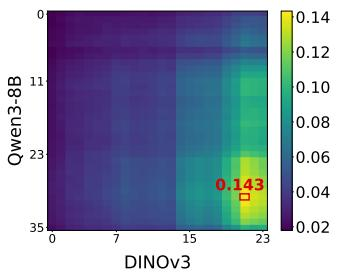  
(a) Vision-Language

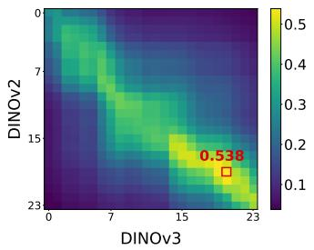  
(b) Vision-Vision

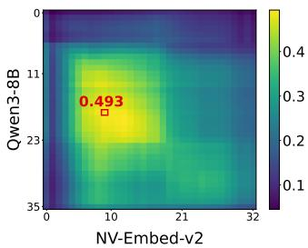  
(c) Language-Language

Figure 1: Heatmaps with mutual k-NN alignment between every layer on WIT.  
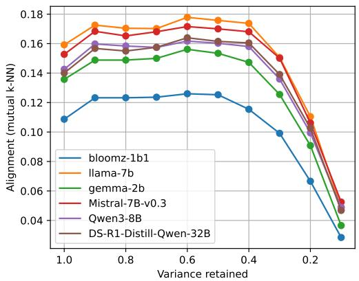  
(a) Explained variance.

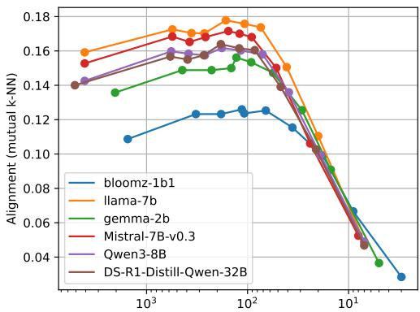  
(b) Number of dimensions.  
Figure 2: Effect of PCA compression on alignment between DINOv2 and language models on WIT.

We next investigate whether alignment is localized not only to specific layers, but also within a small subspace of the representations. Specifically, we compress the vision and language representations via PCA before computing mutual k-NN on WIT. PCA is fit independently for each layer of each model, with separate transformations for the language and vision representations. Figure 2 shows that retaining 40% of the variance preserves or slightly improves alignment for most models, suggesting that lower-variance directions mainly capture modality-specific or noisy information. However, very strong compression causes alignment to collapse, indicating that the shared structure remains distributed across multiple principal components. In Figure 2b, we plot alignment against the number of dimensions retained after PCA. This allows us to investigate the effective dimensionality of the subspaces in which the observed alignment resides. In particular, the results suggest that the cross-modal alignment is largely captured within a relatively small subspace of approximately 100 dimensions, compared to the original language spaces with 1,536–5,120 dimensions. Additional results on DOCCI and COCO are provided in Appendix C.

Together, these results indicate that cross-modal alignment is localized both across depth and within the representation space: only particular layers exhibit strong correspondence, and within those layers, the correspondence can be captured by relatively low-dimensional subspaces.

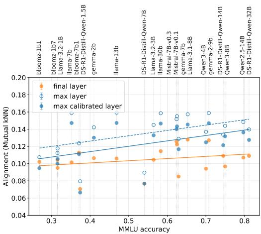  
(a) WIT.

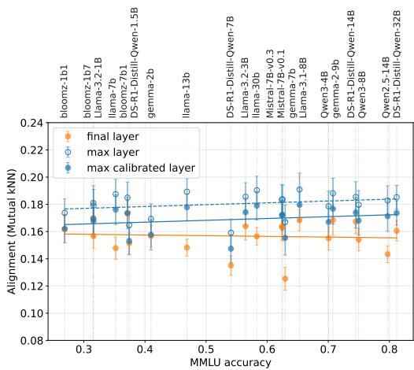  
(b) CC3M short synthetic.

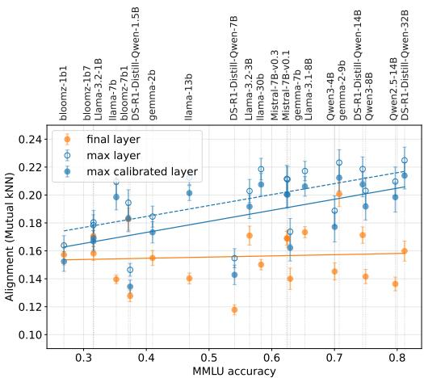  
(c) DOCCI short synthetic.

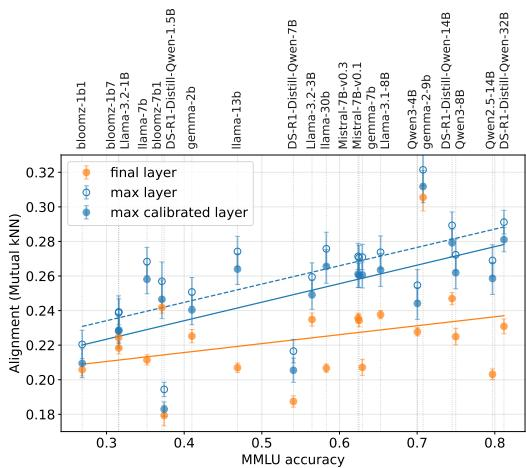  
(d) DOCCI.  
Figure 3: Performance of language models on MMLU vs. alignment with vision models.

## 3.2 Does higher alignment indicate stronger model performance?

The PRH originally suggested that stronger language models exhibit greater representational alignment with vision models on WIT [Huh et al., 2024]. However, this trend does not extend to newer model families on the same dataset [Koepke et al., 2026]. Following Koepke et al. [2026], we examine the relationship between five-shot MMLU accuracy [Hendrycks et al., 2021] and alignment with DINOv3 across datasets with different caption characteristics. For each dataset, we independently sample 1024 image-caption pairs across five runs and report the mean and standard deviation of the mutual k-NN score with k = 10. Since the original WIT subset provided by Huh et al. [2024] contains only 1024 samples, its evaluation corresponds to a single run.

Figure 3 compares the performance-alignment relationship on WIT, CC3M, and DOCCI using both original and summarized captions. We observe a weak to moderate positive correlation for maximally aligned layers on CC3M (Pearson $r = 0 . 2 6 , p = 0 . 2 5 )$ and WIT $\dot { ( r = 0 . 4 6 , p = 0 . 0 3 ) }$ , consistent with the findings of Koepke et al. [2026]. In contrast, DOCCI exhibits a stronger positive correlation when considering the maximally aligned layers $( r = 0 . 6 6 , p = 0 . 0 0 1 )$ ), which remains significant with calibrated mutual k-NN $( r = 0 . 6 6 , p = 0 . 0 0 1 )$ . Importantly, this trend persists when DOCCI captions are compressed to 10% of their original length, with $r = 0 . 5 9 ( p = 0 . 0 0 5 )$ for the maximally aligned layers. Caption verbosity alone therefore does not explain the performance-alignment trend. Instead, the substantially weaker trend on the short and noisy WIT and CC3M captions, together with its persistence on original and summarized DOCCI captions, suggests that sufficiently clean and visually informative data is important for revealing shared structure between vision and language representations.

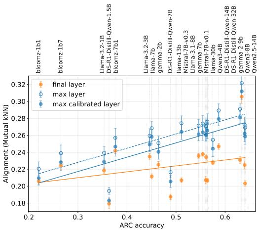  
(a) ARC accuracy.

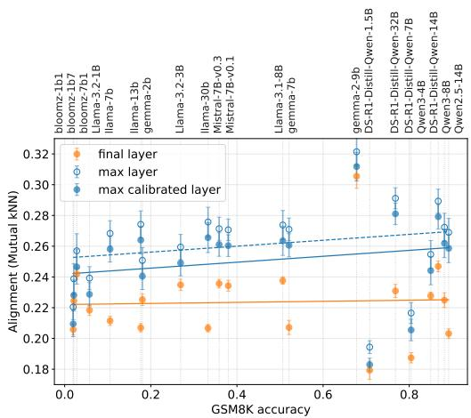  
(b) GSM8K accuracy.  
Figure 4: Performance of LLMs on ARC and GSM8K vs. alignment with vision models on DOCCI.

To assess whether these MMLU findings generalize to other measures of language-model capability Figure 4 relates alignment with DINOv3 on DOCCI to four-shot ARC Challenge accuracy [Clark et al., 2018] and five-shot GSM8K exact-match accuracy [Cobbe et al., 2021]. ARC performance correlates strongly with alignment at the maximally aligned layers $( \mathrm { P e a r s o n } r = 0 . 7 3 , p = 0 . 0 0 0 2 )$ and the correlation remains significant after calibration (Pearson $r = 0 . 7 3 , p = 0 . 0 0 0 2 )$ . This is in line with the MMLU results and shows that the performance-alignment trend is not specific to a single benchmark. Solving MMLU and ARC requires factual and semantic knowledge about the world that may be represented similarly by both vision and language models. In contrast, GSM8K primarily evaluates mathematical reasoning, which is less directly grounded in the semantic knowledge shared with visual representations, and its performance does not correlate significantly with alignment Therefore, cross-modal alignment is not a universal proxy for language-model capability, but may be more closely associated with capabilities that rely on semantic knowledge. Results for ARC and GSM8K with alignment measured on the remaining caption datasets are provided in Appendix D.

## 3.3 How to interpret the magnitude of cross-modal alignment?

Alignment scores are difficult to interpret in isolation. A score such as 0.3 does not indicate by itself whether two representation spaces are weakly or strongly aligned. Therefore, we explicitly compare four regimes: randomly initialized models, pairs of unimodal vision and language models as the main object of study, explicitly aligned VLMs as cross-modal references, and pairs of unimodal models within one modality.

As displayed in Figure 5, the cross-modal alignment of unimodal models on COCO and DOCCI reaches a mutual k-NN score above 0.3, surpassing VLMs such as CLIP and SigLIP 2, but remaining below Qwen3-VL-Embedding-8B. For VLMs, we use the final embeddings in the shared image-text space, using the maximum across layer pairs instead yields nearly identical scores (Appendix E). Notably, Qwen3-VL-Embedding-8B reports state-of-the-art performance on multimodal retrieval benchmarks and achieves the highest mutual k-NN cross-modal alignment. This shows that strong downstream retrieval performance is compatible with high cross-modal neighborhood agreement. The cross-modal alignment of unimodal models remains far below a mutual k-NN score of 0.5 observed for models of the same modality. This gap indicates that unimodal vision and language models learn partially shared representations that support cross-modal neighborhood agreement, but remain substantially less similar than models operating on the same modality.

The DOCCI caption variants provide a controlled view of how caption detail affects this comparison while keeping the underlying images fixed. Shortening the captions reduces absolute cross-modal alignment, but leaves the relative ordering of the model pairs largely unchanged. In particular

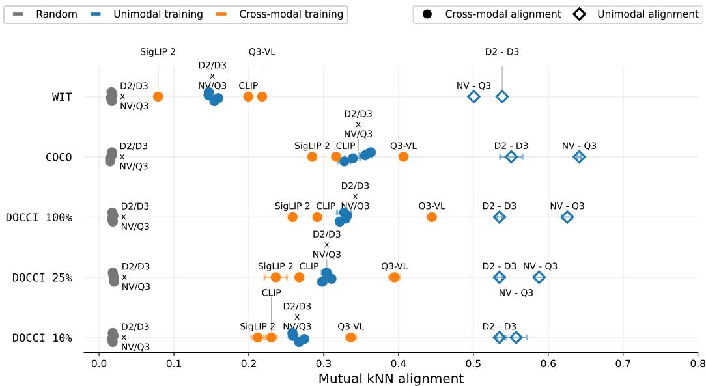  
Figure 5: Alignment for different models and evaluation protocols: DINOv2/v3 (D2/D3), Qwen3- Emb-8B (Q3), NV-Embed-v2 (NV), CLIP, SigLIP 2, Qwen3-VL-Emb-8B (Q3-VL) (mean and standard deviation across 3 runs).

DINOv2/v3 paired with Qwen3-Embedding-8B or NV-Embed-v2 continue to surpass CLIP and SigLIP 2. Caption detail therefore affects the magnitude of alignment without changing our main contextual conclusions. Results across all DOCCI caption lengths are provided in Appendix F.

The high similarity between independently pretrained unimodal models is consistent with prior work: Zhang et al. [2025a] showed that their representations can be mapped into a shared embedding space using lightweight alignment layers and limited paired data, outperforming CLIP.

## 4 Conclusion

We revisited the PRH through a fine-grained analysis of alignment between unimodal vision and language models. Cross-modal alignment emerges in later model layers and is preserved under substantial dimensionality reduction. Moreover, we find that performance-alignment trends of the PRH persist for newer language models on image-text datasets with sufficiently informative captions. Finally, our baseline analysis shows that unimodal vision and language models can reach the representational alignment of explicitly aligned VLMs, but remain far below models of the same modality.

Limitations. The conclusions of our empirical work are limited to the evaluated models, datasets, and alignment metrics. We focus on cross-modal alignment between unimodal encoders from the vision and language domain; whether our findings generalize to other modalities remains open. Moreover, mutual k-NN captures only one notion of representational alignment, and its absolute scores depend on the metric hyperparameters, representation extraction choices, and evaluation data. We mitigate these dependencies by demonstrating that our findings persist with calibrated mutual k-NN and by interpreting the raw scores relative to a wide set of baselines.

## Acknowledgments and Disclosure of Funding

This work was partially funded by the ERC (853489 - DEXIM) and the Alfried Krupp von Bohlen und Halbach Foundation, which we thank for their generous support. The authors gratefully acknowledge the scientific support and resources of the AI service infrastructure LRZ AI Systems provided by the Leibniz Supercomputing Centre (LRZ) of the Bavarian Academy of Sciences and Humanities (BAdW), funded by Bayerisches Staatsministerium für Wissenschaft und Kunst (StMWK). The authors gratefully acknowledge the Gauss Centre for Supercomputing e.V. (www.gausscentre.eu) for funding this project by providing computing time on the Supercomputer JUPITER at Jülich Supercomputing Centre (JSC). This work was supported by the EuroHPC JU and the Gauss Centre for Supercomputing (GCS) through funding by the European Commission, German Federal Ministry of Research, Technology and Space (BMFTR), the Ministry of Culture and Science of the State of North Rhine-Westphalia (MKW). This work benefited from Hi! PARIS and State funding managed by the French National Research Agency (ANR) under the France 2030 program, reference ANR-23- IACL-0005.

## References

Peter Clark, Isaac Cowhey, Oren Etzioni, Tushar Khot, Ashish Sabharwal, Carissa Schoenick, and Oyvind Tafjord. Think you have solved question answering? try ARC, the AI2 reasoning challenge. arXiv preprint arXiv:1803.05457, 2018.

Karl Cobbe, Vineet Kosaraju, Mohammad Bavarian, Mark Chen, Heewoo Jun, Lukasz Kaiser, Matthias Plappert, Jerry Tworek, Jacob Hilton, Reiichiro Nakano, et al. Training verifiers to solve math word problems. arXiv preprint arXiv:2110.14168, 2021.

DeepSeek-AI, Daya Guo, Dejian Yang, Haowei Zhang, Junxiao Song, Peiyi Wang, Qihao Zhu, Runxin Xu, Ruoyu Zhang, Shirong Ma, Xiao Bi, et al. DeepSeek-R1 incentivizes reasoning in LLMs through reinforcement learning. Nature, 645:633–638, 2025.

Leo Gao, Jonathan Tow, Baber Abbasi, Stella Biderman, Sid Black, Anthony DiPofi, Charles Foster, Laurence Golding, Jeffrey Hsu, Alain Le Noac'h, Haonan Li, Kyle McDonell, Niklas Muennighoff, Chris Ociepa, Jason Phang, Laria Reynolds, Hailey Schoelkopf, Aviya Skowron, Lintang Sutawika, Eric Tang, Anish Thite, Ben Wang, Kevin Wang, and Andy Zou. The language model evaluation harness. https://zenodo.org/records/12608602, July 2024.

Gemma Team. Gemma. https://www.kaggle.com/m/3301,2024.

Gemma Team, Thomas Mesnard, Cassidy Hardin, Robert Dadashi, Surya Bhupatiraju, Shreya Pathak, Laurent Sifre, Morgane Rivière, Mihir Sanjay Kale, Juliette Love, Pouya Tafti, et al. Gemma: Open models based on Gemini research and technology. arXiv preprint arXiv:2403.08295, 2024a.

Gemma Team, Morgane Rivière, Shreya Pathak, Pier Giuseppe Sessa, Cassidy Hardin, Surya Bhupatiraju, Léonard Hussenot, Thomas Mesnard, Bobak Shahriari, Alexandre Ramé, Johan Ferret, et al. Gemma 2: Improving open language models at a practical size. arXiv preprint arXiv:2408.00118, 2024b.

Fabian Gröger, Shuo Wen, and Maria Brbić. Revisiting the Platonic representation hypothesis: An Aristotelian view. In International Conference on Machine Learning (ICML), 2026.

Kaiming He, Xinlei Chen, Saining Xie, Yanghao Li, Piotr Dollár, and Ross Girshick. Masked autoencoders are scalable vision learners. In IEEE/CVF Conference on Computer Vision and Pattern Recognition (CVPR), 2022.

Dan Hendrycks, Collin Burns, Steven Basart, Andy Zou, Mantas Mazeika, Dawn Song, and Jacob Steinhardt. Measuring massive multitask language understanding. In International Conference on Learning Representations (ICLR), 2021.

Weiquan Huang, Aoqi Wu, Yifan Yang, Xufang Luo, Yuqing Yang, Usman Naseem, Chunyu Wang, Qi Dai, Xiyang Dai, Dongdong Chen, Chong Luo, Lili Qiu, and Liang Hu. LLM2CLIP: Powerful language model unlocks richer cross-modality representation. In AAAI Conference on Artificial Intelligence (AAAI), 2026.

Minyoung Huh, Brian Cheung, Tongzhou Wang, and Phillip Isola. Position: The Platonic representation hypothesis. In International Conference on Machine Learning (ICML), 2024.

Gabriel Ilharco, Mitchell Wortsman, Ross Wightman, Cade Gordon, Nicholas Carlini, Rohan Taori. Achal Dave, Vaishaal Shankar, Hongseok Namkoong, John Miller, Hannaneh Hajishirzi, Ali Farhadi, and Ludwig Schmidt. OpenCLIP, 2021. Version 0.1. URL: https://doi.org/10. 5281/zenodo.5143773.

Albert Q. Jiang, Alexandre Sablayrolles, Arthur Mensch, Chris Bamford, Devendra Singh Chaplot, Diego de las Casas, Florian Bressand, Gianna Lengyel, Guillaume Lample, Lucile Saulnier, Lélio Renard Lavaud, Marie-Anne Lachaux, Pierre Stock, Teven Le Scao, Thibaut Lavril, Thomas Wang, Timothée Lacroix, and William El Sayed. Mistral 7B. arXiv preprint arXiv:2310.06825, 2023.

A. Sophia Koepke, Daniil Zverev, Shiry Ginosar, and Alexei A. Efros. Back into Plato's cave: Examining cross-modal representational convergence at scale. arXiv preprint arXiv:2604.18572, 2026.

Chankyu Lee, Rajarshi Roy, Mengyao Xu, Jonathan Raiman, Mohammad Shoeybi, Bryan Catanzaro, and Wei Ping. NV-Embed: Improved techniques for training LLMs as generalist embedding models. In International Conference on Learning Representations (ICLR), 2025.

Mingxin Li, Yanzhao Zhang, Dingkun Long, Keqin Chen, Sibo Song, Shuai Bai, Zhibo Yang, Pengjun Xie, An Yang, Dayiheng Liu, Jingren Zhou, and Junyang Lin. Qwen3-VL-Embedding and Qwen3-VL-Reranker: A unified framework for state-of-the-art multimodal retrieval and ranking. arXiv preprint arXiv:2601.04720, 2026.

Tsung-Yi Lin, Michael Maire, Serge Belongie, James Hays, Pietro Perona, Deva Ramanan, Piotr Dollár, and C. Lawrence Zitnick. Microsoft COCO: Common objects in context. In European Conference on Computer Vision (ECCV), 2014.

Llama Team, Aaron Grattafiori, Abhimanyu Dubey, Abhinav Jauhri, Abhinav Pandey, Abhishek Kadian, Ahmad Al-Dahle, Aiesha Letman, Akhil Mathur, Alan Schelten, Alex Vaughan, et al. The Llama 3 herd of models. arXiv preprint arXiv:2407.21783, 2024.

Mayug Maniparambil, Raiymbek Akshulakov, Yasser Abdelaziz Dahou Djilali, Sanath Narayan, Ankit Singh, and Noel E. O'Connor. Harnessing frozen unimodal encoders for flexible multimodal alignment. In IEEE/CVF Conference on Computer Vision and Pattern Recognition (CVPR), 2025.

Meta AI. Llama 3.2: Revolutionizing edge ai and vision with open, customizable models. https: // ai.meta.com/blog/1lama-3-2-connect-2024-vision-edge-mobile-devices/,2024.

Niklas Muennighoff, Thomas Wang, Lintang Sutawika, Adam Roberts, Stella Biderman, Teven Le Scao, M. Saiful Bari, Sheng Shen, Zheng-Xin Yong, Hailey Schoelkopf, et al. Crosslingual generalization through multitask finetuning. In Annual Meeting of the Association for Computational Linguistics (ACL), 2023.

Yasumasa Onoe, Sunayana Rane, Zachary Berger, Yonatan Bitton, Jaemin Cho, Roopal Garg, Alexander Ku, Zarana Parekh, Jordi Pont-Tuset, Garrett Tanzer, et al. DOCCI: Descriptions of connected and contrasting images. In European Conference on Computer Vision (ECCV), 2024.

Maxime Oquab, Timothée Darcet, Théo Moutakanni, Huy Vo, Marc Szafraniec, Vasil Khalidov, Pierre Fernandez, Daniel Haziza, Francisco Massa, Alaaeldin El-Nouby, et al. DINOv2: Learning robust visual features without supervision. Transactions on Machine Learning Research (TMLR), 2024.

Qwen Team. Qwen2.5: A party of foundation models. https://qwenlm.github.io/blog/ qwen2.5/, September 2024.

Qwen Team, An Yang, Baosong Yang, Binyuan Hui, Bo Zheng, Bowen Yu, Chang Zhou, Chengpeng Li, Chengyuan Li, Dayiheng Liu, Fei Huang, et al. Qwen2 technical report. arXiv preprint arXiv:2407.10671, 2024.

Qwen Team, An Yang, Anfeng Li, Baosong Yang, Beichen Zhang, Binyuan Hui, Bo Zheng, Bowen Yu, Chang Gao, Chengen Huang, Chenxu Lv, et al. Qwen3 technical report. arXiv preprint arXiv:2505.09388, 2025.

Alec Radford, Jong Wook Kim, Chris Hallacy, Aditya Ramesh, Gabriel Goh, Sandhini Agarwal, Girish Sastry, Amanda Askell, Pamela Mishkin, Jack Clark, Gretchen Krueger, and Ilya Sutskever. Learning transferable visual models from natural language supervision. In International Conference on Machine Learning (ICML), 2021.

Simon Roschmann, Paul Krzakala, Sonia Mazelet, Quentin Bouniot, and Zeynep Akata. SOTAlign: Semi-supervised alignment of unimodal vision and language models via optimal transport. In International Conference on Machine Learning (ICML), 2026.

Christoph Schuhmann, Romain Beaumont, Richard Vencu, Cade W. Gordon, Ross Wightman, Mehdi Cherti, Theo Coombes, Aarush Katta, Clayton Mullis, Mitchell Wortsman, Patrick Schramowski. Srivatsa R. Kundurthy, Katherine Crowson, Ludwig Schmidt, Robert Kaczmarczyk, and Jenia Jitsev. LAION-5B: An open large-scale dataset for training next generation image-text models. In Advances in Neural Information Processing Systems (NeurIPS), 2022. Datasets and Benchmarks Track.

Piyush Sharma, Nan Ding, Sebastian Goodman, and Radu Soricut. Conceptual captions: A cleaned, hypernymed, image alt-text dataset for automatic image captioning. In Annual Meeting of the Association for Computational Linguistics (ACL), 2018.

Oriane Siméoni, Huy V. Vo, Maximilian Seitzer, Federico Baldassarre, Maxime Oquab, Cijo Jose, Vasil Khalidov, Marc Szafraniec, Seungeun Yi, Michaël Ramamonjisoa, et al. DINOv3. Transactions on Machine Learning Research (TMLR), 2026.

Krishna Srinivasan, Karthik Raman, Jiecao Chen, Michael Bendersky, and Marc Najork. WIT: Wikipedia-based image text dataset for multimodal multilingual machine learning. In International ACM SIGIR Conference on Research and Development in Information Retrieval (SIGIR), 2021.

Hugo Touvron, Thibaut Lavril, Gautier Izacard, Xavier Martinet, Marie-Anne Lachaux, Timothée Lacroix, Baptiste Rozière, Naman Goyal, Eric Hambro, Faisal Azhar, et al. LLaMA: Open and efficient foundation language models. arXiv preprint arXiv:2302.13971, 2023.

Michael Tschannen, Alexey Gritsenko, Xiao Wang, Muhammad Ferjad Naeem, Ibrahim Alabdulmohsin, Nikhil Parthasarathy, Talfan Evans, Lucas Beyer, Ye Xia, Basil Mustafa, Olivier Hénaff, Jeremiah Harmsen, Andreas Steiner, and Xiaohua Zhai. SigLIP 2: Multilingual vision-language encoders with improved semantic understanding, localization, and dense features. arXiv preprint arXiv:2502.14786, 2025.

Noël Vouitsis, Zhaoyan Liu, Satya Krishna Gorti, Valentin Villecroze, Jesse C. Cresswell, Guangwei Yu, Gabriel Loaiza-Ganem, and Maksims Volkovs. Data-efficient multimodal fusion on a single GPU. In IEEE/CVF Conference on Computer Vision and Pattern Recognition (CVPR), 2024.

Amitai Yacobi, Nir Ben-Ari, Ronen Talmon, and Uri Shaham. Learning shared representations from unpaired data. In Advances in Neural Information Processing Systems (NeurIPS), 2025.

Xiaohua Zhai, Basil Mustafa, Alexander Kolesnikov, and Lucas Beyer. Sigmoid loss for language image pre-training. In IEEE/CVF International Conference on Computer Vision (ICCV), 2023.

Le Zhang, Qian Yang, and Aishwarya Agrawal. Assessing and learning alignment of unimodal vision and language models. In IEEE/CVF Conference on Computer Vision and Pattern Recognition (CVPR), 2025a.

Yanzhao Zhang, Mingxin Li, Dingkun Long, Xin Zhang, Huan Lin, Baosong Yang, Pengjun Xie, An Yang, Dayiheng Liu, Junyang Lin, et al. Qwen3 Embedding: Advancing text embedding and reranking through foundation models. arXiv preprint arXiv:2506.05176, 2025b.

Kecheng Zheng, Yifei Zhang, Wei Wu, Fan Lu, Shuailei Ma, Xin Jin, Wei Chen, and Yujun Shen. DreamLIP: Language-image pre-training with long captions. In European Conference on Computer Vision (ECCV), 2024.

## A Broader impacts

This work complements prior research on the Platonic Representation Hypothesis by identifying where alignment emerges across layers and dimensions, showing that its correlation with model performance re-emerges for sufficiently clean and informative captions, and contextualizing its magnitude against a broad set of baselines. While our study is diagnostic and does not introduce any new model, our findings may help practitioners select encoders and representations for efficient cross-modal alignment, potentially reducing paired supervision and computation. The evaluated models and image-text datasets may encode societal and cultural biases that aggregate alignment scores cannot reveal. Therefore, downstream applications will require task-specific evaluation.

## B Layer-wise alignment analysis

Complementing the analysis in Section 3.1, we provide additional heatmaps with layer-wise alignment scores for more model combinations on WIT in Figure 6 and on DOCCI in Figure 7. Here, we also include layer-wise alignment scores between two generative language models for the languagelanguage regime. While mutual k-NN alignment between a generative model and a language embedding model is primarily concentrated in early-to-intermediate layer pairs, alignment between two generative language models often peaks in later layers.

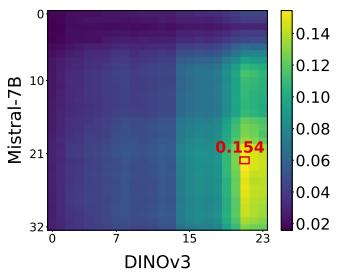

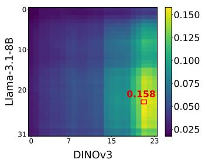  
Vision-Language

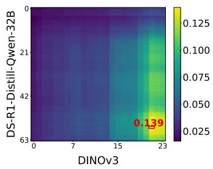

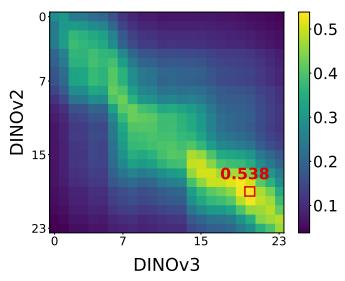

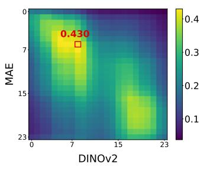

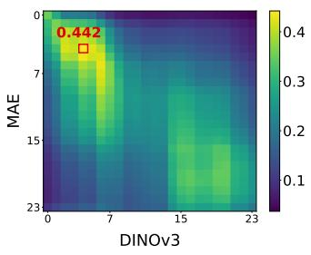  
Vision-Vision

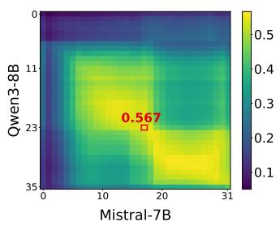

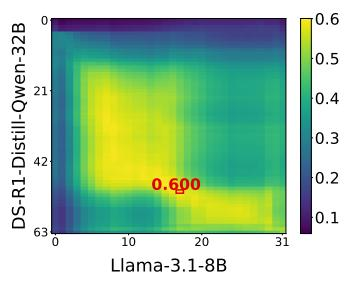  
Language-Language

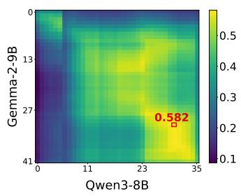  
Figure 6: Heatmaps with mutual k-NN alignment between every layer on WIT.

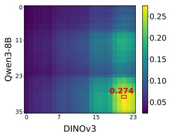

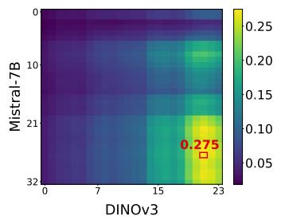  
Vision-Language

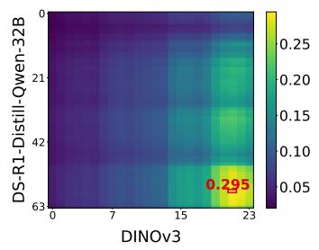

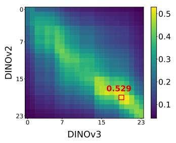

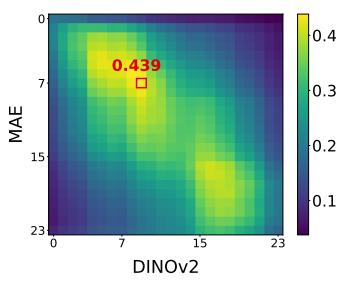  
Vision-Vision

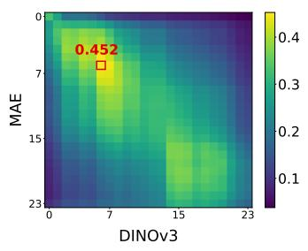

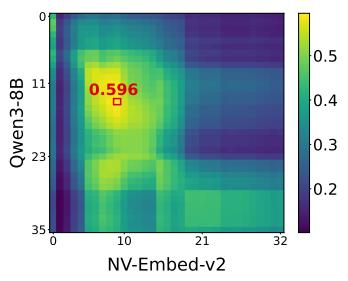

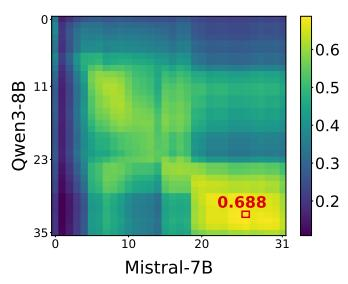  
Language-Language

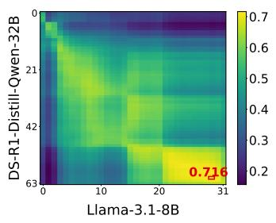  
Figure 7: Heatmaps with mutual k-NN alignment between every layer on DOCCI.

## C Compression of representations via PCA

Figure 8 extends the PCA compression analysis from Section 3.1 to DOCCI. We report the mean and standard deviation across 5 runs. Figure 8a shows that, on DOCCI, a larger fraction of the variance must be retained to preserve alignment, while alignment remains largely preserved when compressing the language representations to 100 dimensions (Figure 8b). Figure 9 shows the results on COCO.

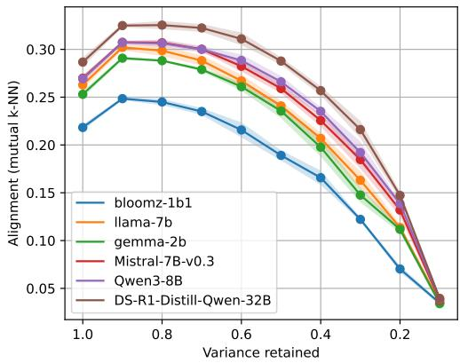  
(a) Explained variance.

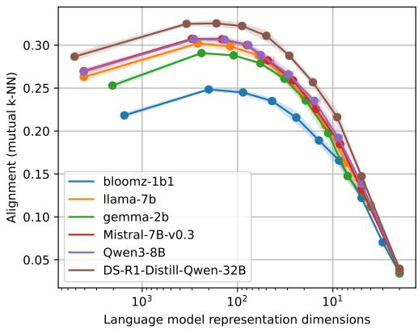  
(b) Number of dimensions.

Figure 8: Effect of PCA compression on alignment between DINOv2 and language models on DOCCI.  
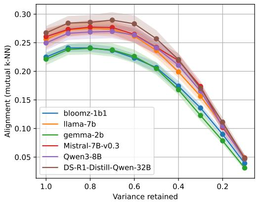  
(a) Explained variance.

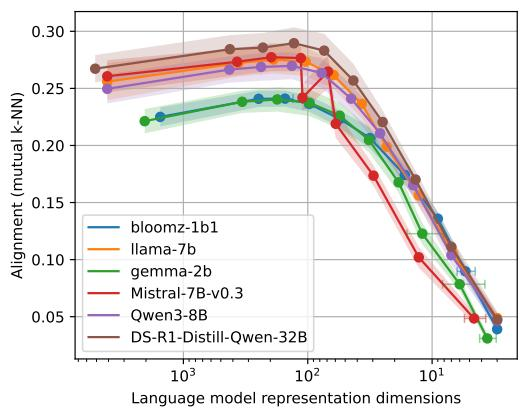  
(b) Number of dimensions.  
Figure 9: Effect of PCA compression on alignment between DINOv2 and language models on COCO.

## D Performance-alignment trends

Section 3.2 analyzes the relationship between language-model performance on ARC and GSM8K and cross-modal alignment only on DOCCI. Figure 10 extends the ARC analysis to WIT, CC3M, and summarized DOCCI captions. The positive relationship observed on original DOCCI remains visible although more weakly, on WIT and summarized DOCCI when considering the maximally aligned layers. In contrast, CC3M exhibits little consistent relationship, and final-layer alignment is generally less predictive.

Figure 11 presents the corresponding results for GSM8K. Unlike MMLU and ARC, GSM8K accuracy exhibits no consistent positive correlation with cross-modal alignment. Therefore, cross-modal alignment should not be interpreted as a general measure of language-model capability. Instead its relationship with performance is benchmark-dependent and may primarily reflect capabilities associated with semantic structure shared across vision and language, which mathematical reasoning on GSM8K probes less directly.

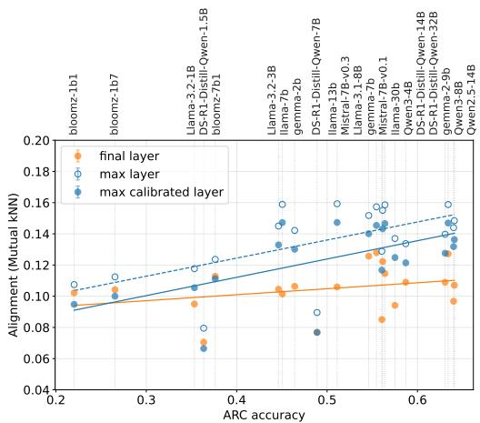  
(a) WIT.

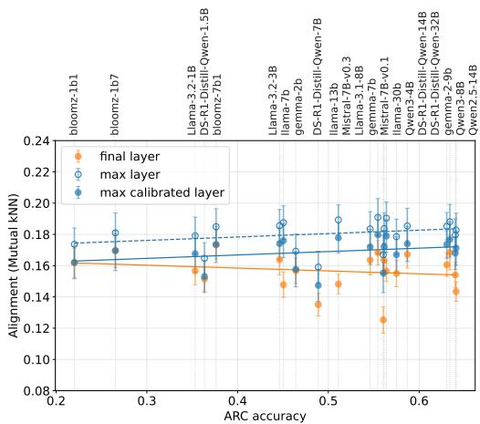  
(b) CC3M short synthetic.

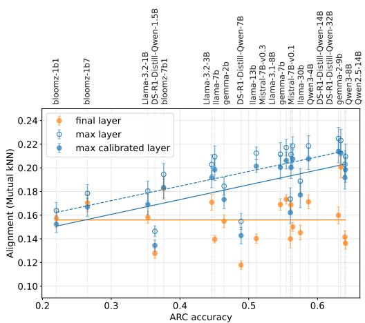  
(c) DOCCI short synthetic.

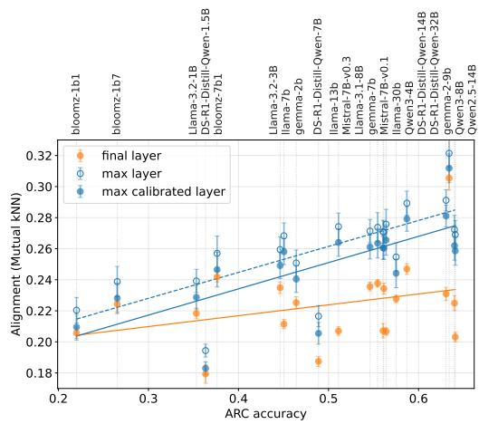  
(d) DOCCI.  
Figure 10: Performance on ARC vs. alignment with DINOv3.

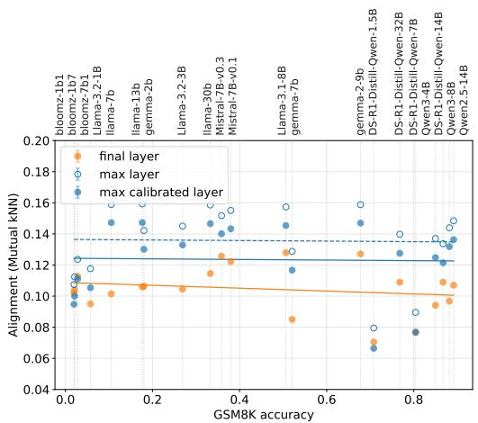  
(a) WIT.

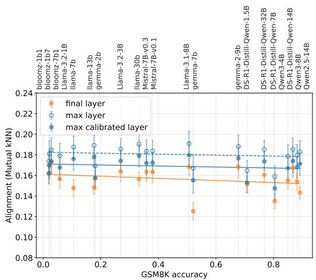  
(b) CC3M short synthetic.

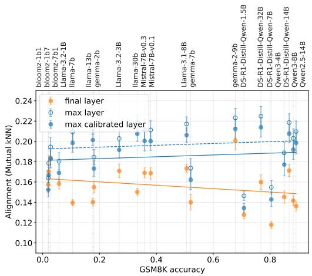  
(c) DOCCI short synthetic.

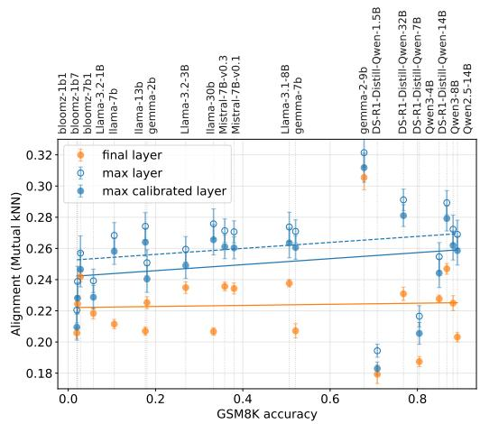  
(d) DOCCI.  
Figure 11: Performance on GSM8K vs. alignment with DINOv3.

## E Layer selection for VLM baselines

In Section 3.3, we represent explicitly aligned VLMs using their final layer representations in the shared image-text space. These are the representations employed in downstream tasks, such as retrieval, and directly optimized for cross-modal alignment during training. In contrast, unimodal model pairs are evaluated at their maximally aligned layer pair. To verify that this difference in evaluation does not disadvantage the VLMs, Table 1 compares the alignment obtained at the projection layer with the maximum alignment across all layer pairs. While the projection layer does not always achieve the highest score, its alignment remains consistently close to the maximum. The largest difference is 0.016 for SigLIP 2 on COCO, while all other differences are at most 0.006. Consequently, using the maximum alignment instead of the projection-layer alignment does not alter the relative ordering of the regimes in Figure 5. The layer-wise alignment patterns of the VLMs are visualized in Figure 12.

Table 1: Alignment of explicitly aligned VLMs at the final layer pair (shared embedding space) and at the maximally aligned layer pair. Mean and standard deviation over three runs for COCO and DOCCI. WIT consists of a single run.
<table><tr><td rowspan="2">VLM</td><td colspan="2">WIT</td><td colspan="2">COCO</td><td colspan="2">DOCCI100%</td></tr><tr><td>Final</td><td>Max</td><td>Final</td><td>Max</td><td>Final</td><td>Max</td></tr><tr><td>CLIP</td><td>0.199</td><td>0.199</td><td> $0 . 3 1 7 \pm 0 . 0 0 5$ </td><td> $0 . 3 1 7 \pm 0 . 0 0 5$ </td><td> $0 . 2 9 2 \pm 0 . 0 0 5$ </td><td> $0 . 2 9 3 \pm 0 . 0 0 3$ </td></tr><tr><td>SigLIP 2</td><td>0.079</td><td>0.079</td><td> $0 . 2 8 5 \pm 0 . 0 0 4$ </td><td> $0 . 3 0 1 \pm 0 . 0 0 5$ </td><td> $0 . 2 5 8 \pm 0 . 0 0 1$ </td><td> $0 . 2 6 3 \pm 0 . 0 0 6$ </td></tr><tr><td>Q3-VL</td><td>0.218</td><td>0.224</td><td> $0 . 4 0 7 \pm 0 . 0 0 2$ </td><td> $0 . 4 0 7 \pm 0 . 0 0 2$ </td><td> $0 . 4 4 5 \pm 0 . 0 0 3$ </td><td> $0 . 4 4 5 \pm 0 . 0 0 3$ </td></tr></table>

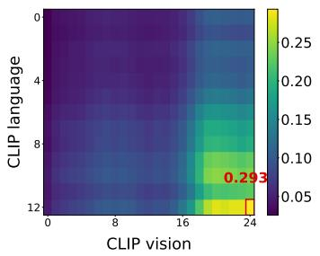

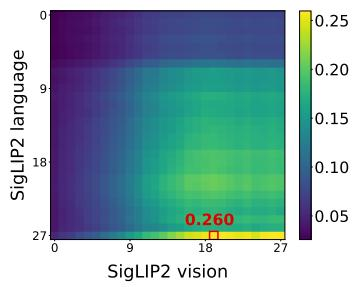  
VLMs

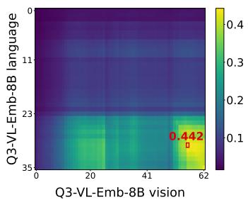  
Figure 12: Heatmaps with mutual k-NN alignment between every layer on DOCCI.

## F Contextualization with varying DOCCI captions

Section 3.3 compares the alignment of unimodal models against a set of baselines on original DOCCI captions and selected summarized variants. Figure 13 complements this analysis by comparing the contextualization baselines across a larger set of DOCCI caption lengths while keeping the underlying images fixed. As captions become more concise, the absolute cross-modal alignment measured by mutual k-NN decreases. However, the relative ordering between unimodal vision-language pairs, explicitly aligned VLMs, and within-modality pairs remains largely unchanged. In particular DINOv2/v3 paired with Qwen3-Embedding-8B or NV-Embed-v2 remain more strongly aligned than CLIP and SigLIP 2 across caption lengths.

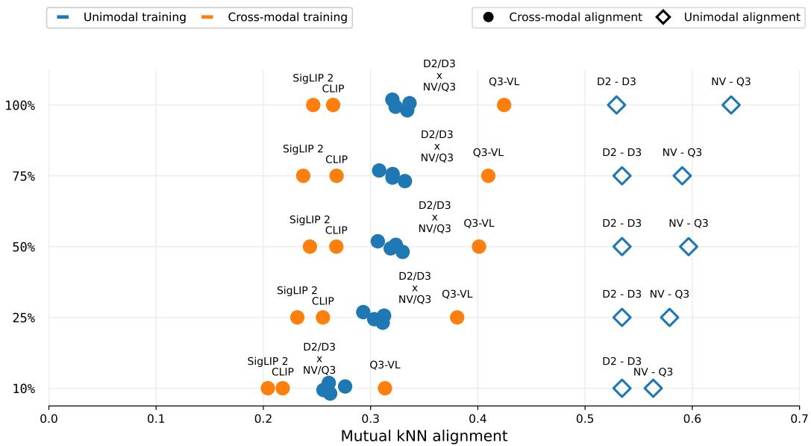  
Figure 13: Alignment for different models and evaluation protocols with DOCCI captions of varying verbosity: DINOv2/v3 (D2/D3), Qwen3-Emb-8B (Q3), NV-Embed-v2 (NV), CLIP, SigLIP 2, Qwen3- VL-Emb-8B (Q3-VL).

## G Mutual k-NN for varying k and N

We investigate the sensitivity of mutual k-NN alignment to the choice of the neighborhood size k and the gallery size N using the DOCCI dataset.

First, we fix the gallery size to $N = 1 0 2 4$ and compare $k \in \{ 1 , 5 , 1 0 , 1 0 0 \}$ in Figure 14. While the alignment scores increase with larger k, the relative ordering of the alignment regimes remains unchanged, suggesting that the observed differences are robust to the choice of k.

Second, we examine the effect of varying k while keeping the ratio $\begin{array} { r } { \frac { k } { N } \approx 0 . 0 1 } \end{array}$ fixed, considering $( k , N ) \in \{ ( 1 , 1 0 2 ) , ( 5 , 5 1 2 ) , ( 1 0 , 1 0 2 \dot { 4 } ) \}$ (see Figure 15). For each gallery size $( N < 1 0 2 4 )$ , we randomly subsample from the same pool of 1024 images and repeat the experiment five times, reporting the mean and standard deviation across subsamples. For $N = 1 0 2 4 .$ , we use the full set of images and report a single score. The alignment scores remain relatively stable across these settings, which is in line with Koepke et al. [2026], who find that alignment is stable when the neighborhood size scales with the gallery size.

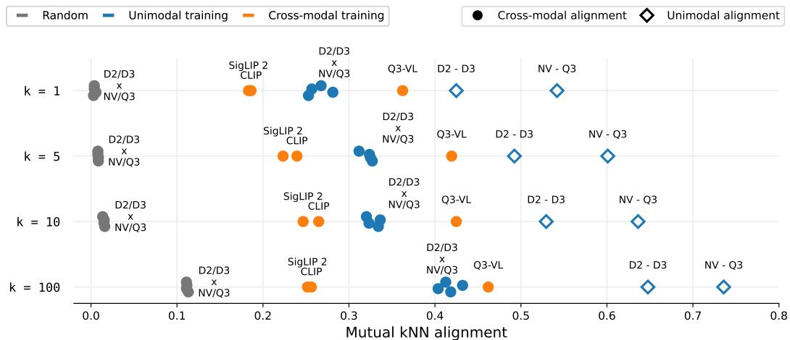  
Figure 14: Alignment for different models and evaluation protocols with $N = 1 0 2 4 { \mathrm { D O C C I } }$ samples and varying k.

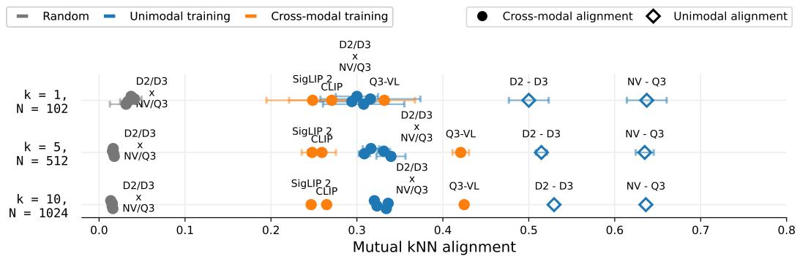  
Figure 15: Alignment for different models and evaluation protocols on DOCCI samples with varying N and k but constant ratio $\frac { k } { N }$

## H DOCCI summarization prompt and example

We provide the prompt for summarizing DOCCI captions to a fraction of their original word count in Figure 16. An example from DOCCI with its original caption and newly generated captions of varying length is displayed in Figure 17.

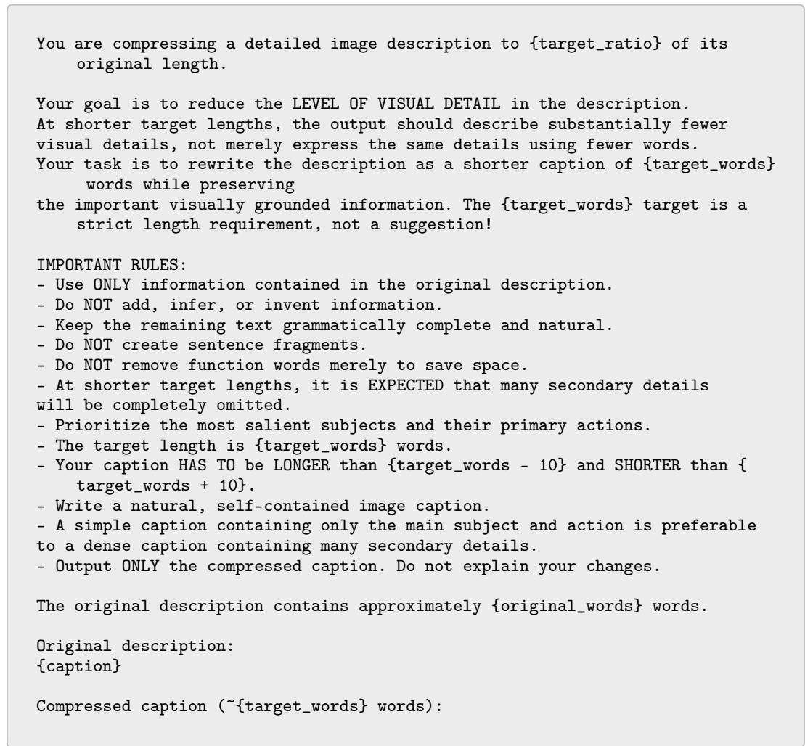  
Figure 16: Prompt for the summarization of detailed DOCCI captions with Qwen3-8B to a fraction of their original word count.

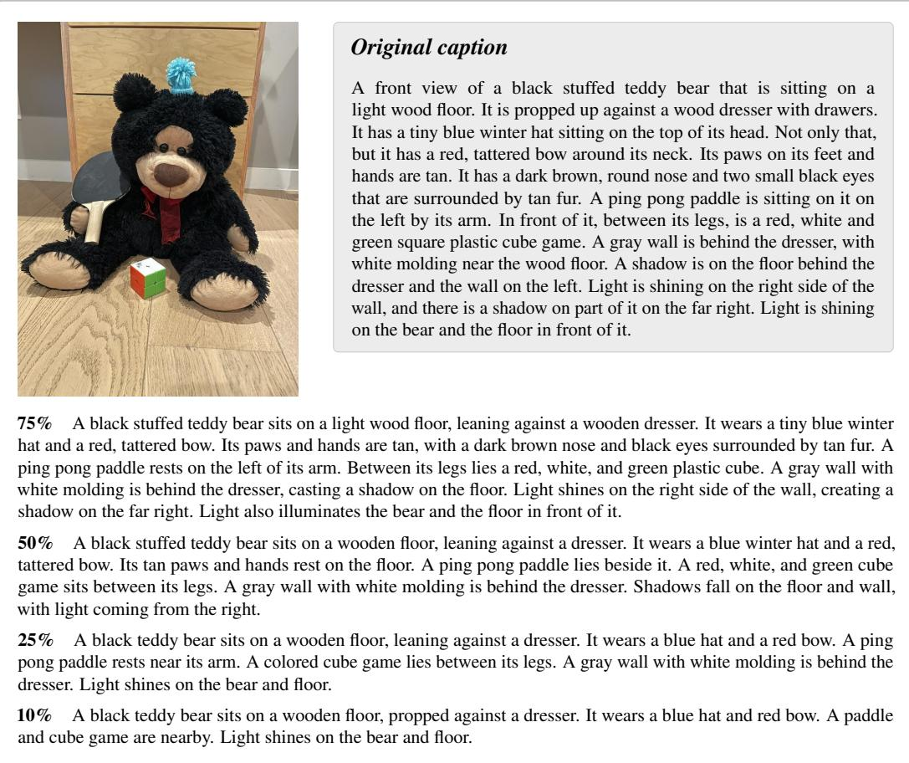  
Figure 17: Example of progressively compressed DOCCI captions for the same image.