# Plug-and-Play ADMM for Inverse Problems with Flow Matching Denoiser

Dibyanshu Kumar TH Würzburg-Schweinfurt, CAIRO University of Würzburg dibyanshu.kumar@thws.de

Magda Gregorová TH Würzburg-Schweinfurt, CAIRO magda.gregorova@thws.de

## Abstract

Plug-and-Play (PnP) methods with generative priors have achieved strong performance in inverse problems, with recent flow matching models enabling fast and scalable reconstruction. However, a key challenge in PnP methods is maintaining consistency between data fidelity updates and the learned generative prior, as dataconsistency steps can move iterates away from the flow trajectory. We propose an ADMM-based PnP framework for flow matching priors that enforces stronger consistency between the measurement model and the prior through auxiliary variables and dual updates. In addition, we introduce a trajectory correction mechanism that restores consistency with the flow via a combination of deterministic and stochastic projections. Our method provides a more principled integration of flow priors within PnP frameworks, achieving high-quality reconstructions with reduced computational cost.

## 1 Introduction

A fundamental challenge in imaging and scientific computing is solving the inverse problem, where the goal is to recover an unknown signal $\mathbf { x } \in \mathbb { R } ^ { m }$ from measurements $\mathbf { \bar { y } } \in \mathbb { R } ^ { n }$ , modeled through a linear forward operator $\mathcal { A } : \mathbb { R } ^ { m }  \bar { \mathbb { R } ^ { n } }$ . In practice, A is typically non-invertible or ill-conditioned and the measurements are noisy, making the inverse problem ill-posed.

The measurement process is commonly described by the linear model

$$
\mathbf { y } = \mathcal { A } \mathbf { x } + \epsilon ,\tag{1}
$$

where $\epsilon \in \mathbb { R } ^ { n }$ represents measurement noise, typically assumed to follow a Gaussian distribution, i.e., $\epsilon \sim \mathcal { N } ( \mathbf { 0 } , \sigma ^ { 2 } I )$

The unknown signal x is modeled as a sample from a data distribution with density $p ( \mathbf { x } )$ , while the measurements y are generated according to the likelihood $p ( \mathbf { y } \mid \mathbf { x } )$ induced by the forward model. The inverse problem then amounts to computing the posterior distribution $p ( \mathbf { x } \mid \mathbf { y } )$

There are two primary approaches to solving this problem using unconditional pretrained diffusion models. The first performs posterior sampling by leveraging the learned score $\nabla _ { \mathbf { x } _ { t } } \log p ( \mathbf { x } _ { t } )$ and combining it with an approximation of the intractable likelihood score $\nabla _ { \mathbf { x } _ { t } } \log p ( \mathbf { \dot { y } } \mid \mathbf { x } _ { t } )$ at each diffusion timestep, enabling iterative refinement Chung et al. [2023], Song et al. [2023].

The second approach formulates the problem as an optimization task, where the prior $p ( \mathbf { x } )$ is incorporated through regularization or proximal steps within an iterative algorithm. This class of methods includes MAP estimation Zhu et al. [2023], Mardani et al. [2024] and projection-based frameworks Song et al. [2022], Chung et al. [2022], where updates alternate between enforcing data fidelity and applying the prior operator. In this setting, the reconstruction is formulated as the

following minimization problem,

$$
\hat { \mathbf { x } } = \arg \operatorname* { m i n } _ { \mathbf { x } } ~ \left\{ - \log p ( \mathbf { y } ~ | ~ \mathbf { x } ) - \log p ( \mathbf { x } ) \right\}\tag{2}
$$

$$
\hat { \mathbf { x } } = \arg \operatorname* { m i n } _ { \mathbf { x } } ~ \{ l ( \mathbf { y } ; \mathbf { x } ) + s ( \mathbf { x } ) \}\tag{3}
$$

where $l ( \mathbf { y } ; \mathbf { x } ) = - \log p ( \mathbf { y } \mid \mathbf { x } )$ enforces data consistency, and under Gaussian noise assumption reduces to $\begin{array} { r } { l ( \mathbf { y } ; \mathbf { x } ) = \frac { 1 } { 2 \sigma ^ { 2 } } \| \mathbf { y } - \mathbf { \mathcal { A } } \mathbf { x } \| ^ { 2 } } \end{array}$ , while $s ( \mathbf { x } ) = - \log p ( \mathbf { x } )$ is a regularizer that encodes prior information.

Venkatakrishnan et al. [2013] introduced the Plug-and-Play (PnP) framework that replaces the regularizer with a denoiser-induced implicit prior, enabling the use of pretrained models without explicitly specifying the prior. Early PnP methods Zhang et al. [2017a], Ryu et al. [2019] used CNN denoisers for inverse problems, while later works incorporated stronger priors such as GANs Bora et al. [2017] and diffusion models Zhu et al. [2023], Mardani et al. [2024], Li et al. [2025] for improved reconstruction. More recently, motivated by the strong empirical performance of flow matching Lipman et al. [2023], researchers have extended the PnP framework to flow based models Martin et al. [2025], Pourya et al. [2026]. These methods provide a more efficient alternative by learning deterministic transport maps that can yield nearly straight trajectories Liu et al. [2023], enabling faster inference and improved scalability for inverse problems.

Challenges: Despite their strong empirical performance, integrating generative priors within PnP frameworks remains challenging. A key difficulty arises from the interaction between the dataconsistency step and the learned prior. In standard PnP algorithms, the data-consistency update (e.g., a gradient or proximal step with respect to $l ( \mathbf { y } ; \mathbf { x } ) )$ ) can move the iterate away from the data manifold or the learned flow trajectory, thereby degrading the effectiveness of the prior s(x). This mismatch is especially pronounced for flow matching models (or flow matching ODEs), where the generative process follows structured transport paths, and updates that are not aligned with the learned vector field can deviate from these trajectories.

Contributions: In this work, we study PnP methods with flow matching priors and make the following contributions,

• ADMM-based Plug-and-Play formulation for flow priors. We extend the PnP framework based on the Alternating Direction Method of Multipliers (ADMM) Boyd et al. [2010] for inverse problems to flow matching priors. ADMM introduces auxiliary variables and dual updates that explicitly enforce consistency between the measurement model and the learned prior, leading to improved reconstructions (section 4.1 and table 1).

• Trajectory correction for flow consistency. We introduce a new trajectory correction mechanism designed for flow-based priors. Following the data-consistency step, we project the iterate back toward the flow trajectory using a weighted combination of stochastic and deterministic projections. This method helps recovery from poor initializations while guiding convergence to consistent solutions (section 4.1 and table 1).

• Improved integration of flow priors for inverse problems. By combining ADMM with our trajectory correction, we achieve a more robust integration of flow-matching priors within PnP frameworks, leading to strong reconstruction performance and significant reduction of computational cost, runtime, and memory footprint compared to existing approaches (section 4.2 and table 2). Our code is available at https://github.com/dibyanshu100/ flow\_admm.git.

## 2 Background

## 2.1 Plug-and-Play Methods for Inverse Problems

The PnP framework addresses inverse problems by combining a data-fidelity term with a learned prior implemented as a denoising operator. A key feature of PnP is that the prior is trained independently of the inverse problem, typically as a standalone denoiser, and can therefore be reused across different forward models. This decoupling enables the use of powerful learned priors without requiring problem specific retraining.

PnP methods have been developed across a range of optimization schemes. Early works employed CNN-based denoisers within ADMM Venkatakrishnan et al. [2013], Half-Quadratic Splitting (HQS) Zhang et al. [2017b], Regularization by Denoising (RED)Romano et al. [2017], and Forward Backward Splitting (FBS) Ryu et al. [2019]. More recently, stronger generative priors have been incorporated, with diffusion-based denoisers adopted within HQS Zhu et al. [2023]. These methods share a common structure of alternating updates between data-consistency and denoising steps, but differ in how they enforce data fidelity and integrate the learned prior. Notably, this distinction becomes more pronounced for complex generative priors such as diffusion or flow models, where consistency with the underlying data trajectory is not explicitly enforced.

In this work, we adopt a general operator-based view of PnP methods, where the prior is represented by a denoising operator $\bar { \mathcal { D } } _ { t } ( \cdot )$ . In particular, we consider a time-dependent denoiser derived from a pre-trained flow matching model, thereby integrating flow-based priors within the PnP framework.

## 2.2 Flow Matching and Straight Trajectories

Flow matching Lipman et al. [2023] provides a framework for learning deterministic transformations that transport samples from a simple base distribution $\mathbf { x } _ { 0 } \sim p _ { 0 }$ where $p _ { 0 }$ is typically a standard Gaussian, to a target data distribution $\mathbf { x } _ { 1 } \sim p _ { 1 }$ . This is achieved by learning a time-dependent vector field $\mathbf { v } ( \mathbf { x } _ { t } , t )$ that defines the ODE

$$
\frac { d { \mathbf x } _ { t } } { d t } = { \mathbf v } ( { \mathbf x } _ { t } , t ) , \quad t \in [ 0 , 1 ] ,\tag{4}
$$

whose solution maps $p _ { 0 }$ to $p _ { 1 }$ .

Flow matching constructs a family of intermediate distributions $( p _ { t } ) _ { t \in [ 0 , 1 ] }$ connecting $p _ { 0 }$ and $p _ { 1 }$ . Given a coupling $\pi \in \Gamma ( p _ { 0 } , p _ { 1 } )$ , an effective choice of trajectory is to define paths via straight-line interpolation Liu et al. [2023], i.e. ${ \bf x } _ { t } = ( 1 - t ) { \bf x } _ { 0 } + t { \bf x } _ { 1 }$ where $( { \bf x } _ { 0 } , { \bf x } _ { 1 } ) \sim \pi$ . Under mild conditions, this path has a velocity field $\mathbf { v } _ { t }$ satisfying the continuity equation $\partial _ { t } p _ { t } + \nabla \cdot ( p _ { t } \mathbf { v } _ { t } ) = 0$

The associated flow can be characterized by a flowmap $\psi _ { t } ( \mathbf { x } _ { 0 } )$ solving

$$
\frac { d } { d t } \psi _ { t } ( \mathbf { x } _ { 0 } ) = \mathbf { v } _ { t } ( \psi _ { t } ( \mathbf { x } _ { 0 } ) ) , \quad \psi _ { 0 } ( \mathbf { x } _ { 0 } ) = \mathbf { x } _ { 0 } ,\tag{5}
$$

such that $p _ { t } = ( \psi _ { t } ) _ { \# } p _ { 0 }$ . In practice, $\mathbf { v } _ { t }$ is unknown and we approximate it using a neural network $\mathbf { v } _ { \pmb { \theta } } .$ . For straight-line trajectories, the target velocity is given as $\mathbf { v } _ { t } ^ { * } ( \mathbf { x } _ { t } \mid \mathbf { x } _ { 0 } , \mathbf { x } _ { 1 } ) = \mathbf { x } _ { 1 } - \mathbf { x } _ { 0 }$ , leading to the conditional flow matching objective

$$
\begin{array} { r } { \mathcal { L } _ { \mathrm { C F M } } ( \pmb { \theta } ) = \mathbb { E } _ { ( \mathbf { x } _ { 0 } , \mathbf { x } _ { 1 } ) \sim \pi , t \sim \mathcal { U } ( 0 , 1 ) } \left[ \left\| \mathbf { v } _ { \pmb { \theta } } \big ( ( 1 - t ) \mathbf { x } _ { 0 } + t \mathbf { x } _ { 1 } , t \big ) - \big ( \mathbf { x } _ { 1 } - \mathbf { x } _ { 0 } \big ) \right\| ^ { 2 } \right] . } \end{array}\tag{6}
$$

For inference, the flow from time t to 1 can be written as $\begin{array} { r } { \psi _ { 1 } ( \mathbf { x } _ { t } ) = \mathbf { x } _ { t } + \int _ { t } ^ { 1 } \mathbf { v } _ { \theta } ( \mathbf { x } _ { q } , q ) \ d t } \end{array}$ dq. This integral can be approximated using an explicit Euler step, yielding the one-step update

$$
\psi _ { 1 } ( \mathbf x _ { t } ) \approx \mathbf x _ { t } + ( 1 - t ) \mathbf v _ { \theta } ( \mathbf x _ { t } , t ) .\tag{7}
$$

The resulting flow operator $\psi _ { 1 }$ can be interpreted as a one-step, time-dependent denoiser, mapping $\mathbf { x } _ { t }$ toward the data distribution at $t = 1$ . In our framework, we use $\psi _ { 1 }$ as the denoising operator, i.e., $\mathcal { D } _ { t } ( \mathbf { x } _ { t } ) : = \psi _ { 1 } ( \mathbf { x } _ { t } )$ , and describe its role within the PnP-ADMM framework in Section 3.

## 2.3 Plug-and-Play Flow via FBS

Recently, several works have used flow-matching priors to solve inverse problems Pokle et al. [2024], Ben-Hamu et al. [2024]. A recent approach, proposed by Martin et al. [2025], integrates these priors into the $\mathrm { P n P }$ framework based on the Forward Backward Splitting (FBS) algorithm (see appendix E); we refer to it as PnP-FBS. This has since been adopted and further developed within various flow based PnP frameworks Li and Wang [2026], Wickremasinghe et al. [2025].

In vanilla FBS, the optimization is performed via alternating gradient and prior updates in a sequential manner. However, as noted by Martin et al. [2025], the data-consistency step moves the iterate away from the flow trajectory $p _ { t } .$ . To address this drift, they introduce a projection step before applying the denoiser in PnP-FBS. Specifically, the output of the data-consistency step $\mathbf { z } ^ { k }$ , is projected back on the flow trajectory using $\epsilon \sim p _ { 0 }$ as,

$$
\tilde { \mathbf { z } } ^ { k } = ( 1 - t _ { k } ) \boldsymbol { \epsilon } + t _ { k } \mathbf { z } ^ { k }\tag{8}
$$

This step should ensure that the input to the flow operator remains consistent with the interpolation structure used during training.

## Limitations of PnP-FBS:

• Projection inconsistency: The projection step in the PnP-FBS algorithm introduces stochasticity at every iteration through independent sampling from $p _ { 0 }$ . Since a new random sample ϵ is drawn at each step, the iterate is repeatedly perturbed away from its current trajectory. While such stochasticity is beneficial in the early stages of the sampling process, where it encourages exploration across possible flow trajectories, it becomes undesirable near convergence, where the updates tend to average out the solution rather than refine it toward the MAP estimate. As a result, the updates lack consistency across iterations, leading to deviations from a coherent transport path and potential loss of fine details as can be seen in the reconstructed images of PnP-FBS in fig. 2.

• Step-size sensitivity and lack of consensus enforcement: As noted by Martin et al. [2025], PnP-FBS is highly sensitive to the choice of the time-dependent step size $\gamma ( t _ { k } )$ in the gradient step. In their work, $\gamma ( t _ { k } ) = ( 1 - t _ { k } ) ^ { \alpha }$ with $\alpha \in ( 0 , 1 ]$ , and the authors acknowledge that more effective tuning strategies may be required. This sensitivity arises because, $\gamma ( t _ { k } )$ directly controls the balance between the data-consistency term and priorconsistency, without any explicit mechanism to enforce this balance. This makes the method rely entirely on careful step-size tuning across time, where an improper choice can lead to dominance of the data-consistency term and collapse to a noisy solution.

## 3 Proposed Approach

We propose an ADMM-based plug-and-play framework with flow-matching priors, along with a structured projection mechanism for trajectory correction that improves stability and consistency. In this section, we present our approach in detail.

## 3.1 Plug-and-Play Flow via ADMM

A principled approach to incorporate denoisers into inverse problems is via ADMM, as proposed by Venkatakrishnan et al. [2013]. PnP-ADMM reformulates the MAP objective in equation (3) as a constrained optimization problem by introducing an auxiliary variable z:

$$
\operatorname* { m i n } _ { \mathbf { x } , \mathbf { z } } \ l ( \mathbf { y } ; \mathbf { x } ) + s ( \mathbf { z } ) \quad { \mathrm { s . t . } } \quad \mathbf { x } = \mathbf { z }\tag{9}
$$

This variable splitting decouples the data-consistency term and the prior, allowing each to be handled independently. The resulting constrained problem is solved using ADMM by forming the augmented Lagrangian as,

$$
\mathcal { L } _ { \rho } ( \mathbf { x } , \mathbf { z } , \mathbf { u } ) = l ( \mathbf { y } ; \mathbf { x } ) + s ( \mathbf { z } ) + \frac { \rho } { 2 } \| \mathbf { x } - \mathbf { z } + \mathbf { u } \| _ { 2 } ^ { 2 } ,\tag{10}
$$

where u is a scaled dual variable and $\rho > 0$ is a penalty parameter that controls the strength of the consensus constraint. The ADMM iterations take the form

$$
\mathbf { x } ^ { k + 1 } = \arg \operatorname* { m i n } _ { \mathbf { x } } ~ l ( \mathbf { y } ; \mathbf { x } ) + \frac { \rho } { 2 } \| \mathbf { x } - ( \mathbf { z } ^ { k } - \mathbf { u } ^ { k } ) \| _ { 2 } ^ { 2 }\tag{11}
$$

$$
\mathbf { z } ^ { k + 1 } = \arg \operatorname* { m i n } _ { \mathbf { z } } ~ s ( \mathbf { z } ) + \frac { \rho } { 2 } \| ( \mathbf { x } ^ { k + 1 } + \mathbf { u } ^ { k } ) - \mathbf { z } \| _ { 2 } ^ { 2 }\tag{12}
$$

$$
\mathbf { u } ^ { k + 1 } = \mathbf { u } ^ { k } + \mathbf { x } ^ { k + 1 } - \mathbf { z } ^ { k + 1 }\tag{13}
$$

The z-update corresponds to the proximal operator of the prior s and has the same form as a Gaussian denoising problem, with $\mathbf { x } ^ { k + 1 } + \mathbf { \bar { u } } ^ { k }$ serving as the input to the denoising operator. The PnP framework replaces this proximal operator in equation (12) with a generic denoiser $\mathcal { D } ( \cdot )$ , yielding the update

$$
\mathbf { z } ^ { k + 1 } = \mathcal { D } ( \mathbf { x } ^ { k + 1 } + \mathbf { u } ^ { k } )\tag{14}
$$

In our approach, this denoiser is instantiated as the time-dependent flow operator $\mathcal { D } _ { t } ( \cdot )$ as formulated in equation (7).

For linear degradation operators ${ \mathcal { A } } ,$ the data-consistency subproblem (equation (11)) reduces to a quadratic objective that can be efficiently solved using iterative linear solvers, such as conjugate gradient Hestenes and Stiefel [1952], without requiring explicit matrix inversion (see appendix B). This leads to computationally efficient and scalable optimization, even in high-dimensional problems.

Algorithm 1 PnP-Flow ADMM with time-adaptive projection   
1: Input: Denoiser $\mathcal { D } _ { t } ,$ observation $\mathbf { y } ,$ data-fidelity $l ( \mathbf { y } ; \mathbf { x } )$ , penalty parameter $\rho ,$ time sequence   
$( t _ { k } ) _ { k }$ with $t _ { k } = k / N , N \in \mathbb { N }$ , or infinite with lim $k \to \infty \mathrm { ~ } t _ { k } = 1$   
2: Initialize: $\tilde { \mathbf { x } } ^ { 0 } \sim \mathcal { N } ( 0 , I ) , \mathbf { z } ^ { 0 } = \mathbf { x } ^ { 0 } , \mathbf { u } ^ { 0 } = 0 , \epsilon ^ { 0 } = \tilde { \mathbf { x } } ^ { 0 }$   
3: for $k = 0 , 1 , \ldots$ do   
4: $\begin{array} { r } { { \mathbf { x } } ^ { k + 1 } = \arg \operatorname* { m i n } _ { \mathbf { x } } ~ l ( \mathbf { y } ; \mathbf { x } ) + \frac { \rho } { 2 } \| \mathbf { x } - ( \mathbf { z } ^ { k } - \mathbf { u } ^ { k } ) \| _ { 2 } ^ { 2 } } \end{array}$ ▷ data-consistency   
5: $\widehat { \mathbf { z } } ^ { k } = \mathbf { x } ^ { k + 1 } + \mathbf { u } ^ { k }$ ▷ consensus   
6: $\widetilde { \mathbf { z } } ^ { k } = ( 1 - t _ { k } ) \boldsymbol { \epsilon } ^ { k } + t _ { k } \hat { \mathbf { z } } ^ { k }$ $\triangleright$ projection on flow trajectory   
7: $\mathbf { z } ^ { k + 1 } = \mathcal { D } _ { t _ { k } } ( \tilde { \mathbf { z } } ^ { k } )$ ▷ denoiser prior consistency   
8: $\begin{array} { r } { \epsilon _ { P } = \frac { \tilde { \mathbf { z } } ^ { k } - t _ { k } \mathbf { z } ^ { k + 1 } } { 1 - t _ { k } } , } \end{array}$ $\epsilon _ { R } \sim \mathcal { N } ( 0 , I )$ ▷ deterministic(16) and stochastic component   
9: $\begin{array} { r } { \epsilon ^ { k + 1 } = \frac { t _ { k } \epsilon _ { P } + ( 1 - t _ { k } ) \epsilon _ { R } } { \sqrt { \mathrm { ~ o ~ } } } } \end{array}$ ▷ time adaptive latent sample (17)   
$\begin{array} { r l } { \epsilon } & { { } \mathrm { ~ - ~ } \frac { } { \sqrt { t _ { k } ^ { 2 } + ( 1 - t _ { k } ) ^ { 2 } } } } \end{array}$   
10: $\mathbf u ^ { k + 1 } = \mathbf u ^ { k } + \mathbf x ^ { k + 1 } - \mathbf z ^ { k + 1 }$ ▷ dual update   
11: end for   
12: return $\mathbf { z } ^ { k + 1 }$

Advantages of ADMM: The ADMM iterations can be interpreted as comprising three interacting components: (i) a data-consistency update defined by the forward model (11), (ii) a prior-consistency update implemented via a denoising operator (14), and (iii) a dual variable update that enforces agreement between the two (13). The presence of the dual variable u is a key distinguishing feature of ADMM. It behaves like an error signal with memory that accumulates discrepancies across iterations and acts as a feedback mechanism to correct future updates so that the two variables x and z converge to a common solution. In contrast to FBS, which relies on a carefully tuned time-dependent step size $\gamma _ { k }$ , ADMM uses a penalty parameter $\rho$ that can be kept fixed across iterations and requires minimal tuning (see appendix $\mathrm { C } ) .$ . This leads to improved empirical stability compared to FBS and makes ADMM-based PnP methods particularly well-suited for integrating complex learned priors (see evaluation in section 4.1).

Convergence: Classical ADMM has convergence guarantees in convex settings [Boyd et al., 2010], but in PnP-ADMM the proximal operator is replaced by a learned denoiser, so standard theory no longer applies. Existing PnP analyses therefore establish fixed-point convergence under structural assumptions on the denoiser, such as nonexpansiveness or averagedness [Chan et al., 2016, Ryu et al., 2019], while stronger guarantees require more restrictive denoiser classes [Hurault et al., 2022]. For our flow-matching denoiser, these properties are not guaranteed, so we complement the theory with empirical convergence diagnostics (see appendix A), where the decay of primal and dual residuals indicates stable behavior in practice.

## 3.2 Trajectory Correction

While the ADMM formulation enforces consensus between the data-consistent iterate $\mathbf { x } ^ { k + 1 }$ and the prior-consistent variable $\mathbf { z } ^ { k + 1 }$ , it does not guarantee that the denoiser input lies on the family of intermediate distributions $\{ p _ { t } \} _ { t \in [ 0 , 1 ] }$ induced by the flow matching model. In particular, the input to the denoiser,

$$
\hat { \mathbf { z } } ^ { k } = \mathbf { x } ^ { k + 1 } + \mathbf { u } ^ { k } ,\tag{15}
$$

is influenced by both the forward operator and the dual variable, and therefore generally deviates from the linear interpolation structure used during flow training.

To address this mismatch, we introduce a time-adaptive projection mechanism that explicitly steers the iterates toward the learned flow trajectory. Similar to the correction step in equation (8), we project $\hat { \mathbf { z } } ^ { k }$ onto the flow path via $\tilde { \mathbf { z } } ^ { k } \gets \mathsf { \bar { ( } } 1 - \bar { t _ { k } } ) \boldsymbol { \epsilon } ^ { k } + t _ { k } \hat { \mathbf { z } } ^ { k }$ where the variable $\mathbf { \epsilon } _ { \epsilon } ^ { \mathbf { { \lambda } } , \mathbf { { \lambda } } }$ represents a latent sample from $p _ { 0 }$

Deterministic and stochastic components of $\epsilon ^ { k } : \mathrm { ~ \bf ~ A ~ }$ key difference in our method is that we do not rely solely on random sample from $p _ { 0 }$ . Instead, we construct $\epsilon ^ { k }$ as a combination of: (i) a stochastic component $\epsilon _ { R } \sim \mathcal { N } ( 0 , I )$ , promoting exploration across trajectories, and (ii) a deterministic component $\epsilon _ { P } ,$ that captures the local structure of the current flow trajectory.

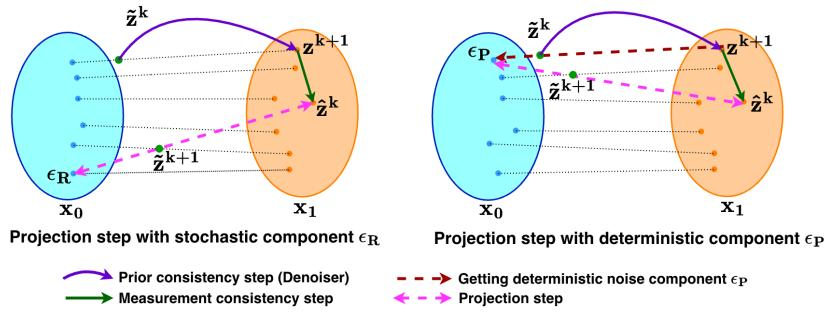  
Figure 1: Comparison of projection using stochastic (left) and deterministic (right) components of $\epsilon _ { k }$ . Stochastic projection using $\epsilon _ { R }$ could shift the iterate across trajectories, while deterministic projection using $\epsilon _ { P }$ keeps it closer to the current flow path.

To construct the deterministic component $\epsilon _ { P } .$ , we use the coupling between $p _ { 0 }$ and $p _ { 1 }$ underlying the flow. Given $\tilde { \mathbf { z } } ^ { k }$ and the denoised output $\bar { \mathbf { z } } ^ { k + 1 } = \mathcal { D } _ { t _ { k } } ( \tilde { \mathbf { z } } ^ { k } )$ , we estimate the corresponding latent variable in $p _ { 0 }$ that is coupled with $\mathbf { z } ^ { k + 1 }$ under the linear interpolation structure of the flow. This is obtained from the interpolation defining the flow at time $t _ { k }$

$$
\epsilon _ { P } = \frac { \tilde { \mathbf { z } } ^ { k } - t _ { k } \mathbf { z } ^ { k + 1 } } { 1 - t _ { k } }\tag{16}
$$

In $\mathrm { f i g } .$ . 1 we show a pictorial representation of projection using $\epsilon _ { P }$ and $\epsilon _ { R } .$ Using $\epsilon _ { P }$ allows us to project the output of the data-consistency step onto a flow trajectory consistent with the current iterate, in contrast to the random sample $\epsilon _ { R } .$ , which ignores this structure. However, relying exclusively on $\epsilon _ { P }$ can be limiting as it biases the algorithm toward a single trajectory determined by earlier iterates, potentially preventing exploration of alternative solutions that better satisfy the measurement constraints. On the contrary, using purely random sample $\epsilon _ { R }$ disregards the current trajectory and may lead to unstable updates. We further analyze these design choices in section 4.1.

Time-adaptive projection: To balance exploration and consistency, we combine the stochastic and deterministic component through a normalized, time-dependent weighting as,

$$
\epsilon ^ { k + 1 } = \frac { t _ { k } \epsilon _ { P } + ( 1 - t _ { k } ) \epsilon _ { R } } { \sqrt { t _ { k } ^ { 2 } + ( 1 - t _ { k } ) ^ { 2 } } } , \quad \mathrm { w i t h ~ } \epsilon ^ { 0 } = { \bf x } ^ { 0 }\tag{17}
$$

This design follows a simple principle: at early iterations (small $t _ { k } )$ , the algorithm emphasizes stochastic exploration via $\epsilon _ { R } ,$ , allowing the iterate to traverse different regions of the solution space. $\mathbf { A s } t _ { k } \to 1$ , the weight progressively shifts toward $\epsilon _ { P }$ , encouraging convergence along a consistent flow trajectory aligned with the denoiser. Overall, this method enables the algorithm to both (i) recover from poor initializations and (ii) commit to a stable trajectory as it approaches a solution that satisfies the data fidelity term.

## 4 Experiments and Results

Dataset and evaluation metrics: We conduct our experiments on two datasets CelebA Yang et al. [2015] (resized to 128 × 128) and AFHQ-Cat (resized to $2 5 6 \times 2 5 6 )$ Choi et al. [2020]. For quantitative evaluation, we randomly select 100 test images from each dataset. All methods are evaluated using pre-trained flow matching models from Martin et al. [2025]. To assess reconstruction quality, we report both pixel-level and perceptual metrics. Specifically, we use Peak Signal-to-Noise Ratio (PSNR) and Structural Similarity Index (SSIM) to measure fidelity to the ground truth, and Learned Perceptual Image Patch Similarity (LPIPS) to evaluate perceptual similarity.

Experimental settings: We evaluate six inverse problems: denoising, box inpainting, paintbrush inpainting, random inpainting, Gaussian deblurring, and super-resolution. Gaussian noise with $\sigma = 0 . 3$ is used for denoising, $\sigma = 0 . 0 5$ for box inpainting, paintbrush inpainting, super-resolution, and deblurring, and $\sigma = 0 . 0 1$ for random inpainting. Box inpainting uses a centered square mask of size $4 0 \times 4 0$ for CelebA and $8 0 \times 8 0$ for AFHQ-Cat, while random inpainting masks 70% of pixels uniformly at random and paintbrush inpainting uses irregular stochastic masks. Super-resolution uses downsampling factors $\times 2$ for CelebA and ×4 for AFHQ-Cat. Gaussian deblurring uses a 61 × 61 kernel with $\sigma _ { b } = 1 . 0$ for CelebA and $\sigma _ { b } = 3 . 0$ for AFHQ-Cat. Subsequent work [Kumar and Gregorova, 2026] extends the evaluation of our approach to more challenging linear as well as nonlinear inverse problems and explores alternative hyperparameter choices.

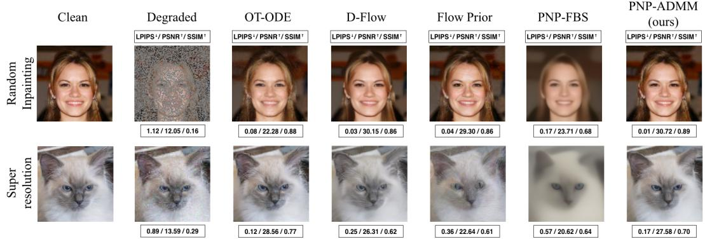  
Figure 2: Comparison of image restoration methods on random inpainting and super-resolution tasks, with additional qualitative results in appendix G. Our method produces visually sharp and structurally consistent reconstructions. It preserves fine details while avoiding over-smoothing artifacts.

Table 1: Quantitative results on AFHQ-Cat and CelebA across various inverse tasks, averaged over 100 randomly selected test images per dataset. Best results are bold, second-best are shown in blue.
<table><tr><td></td><td></td><td colspan="3">AFHQ-Cat</td><td colspan="3">CelebA</td></tr><tr><td></td><td>Task Method</td><td>SSIM↑</td><td>LPIPS↓</td><td>PSNR↑</td><td>SSIM↑</td><td>LPIPS↓</td><td>PSNR↑</td></tr><tr><td rowspan="5">Resouton Super</td><td>PnP-ADMM (ours)</td><td>0.64</td><td>0.16</td><td>25.19</td><td>0.79</td><td>0.05</td><td>28.93</td></tr><tr><td>OT-ODE</td><td>0.72</td><td>0.11</td><td>26.30</td><td>0.90</td><td>0.02</td><td>31.47</td></tr><tr><td>Flow Priors</td><td>0.54</td><td>0.32</td><td>21.05</td><td>0.80</td><td>0.07</td><td>27.17</td></tr><tr><td>D-Flow</td><td>0.58</td><td>0.19</td><td>24.33</td><td>0.82</td><td>0.07</td><td>27.36</td></tr><tr><td>PnP-FBS</td><td>0.51</td><td>0.55</td><td>18.15</td><td>0.70</td><td>0.21</td><td>22.47</td></tr><tr><td rowspan="5">Iupning BX</td><td>PnP-ADMM (ours)</td><td>0.77</td><td>0.10</td><td>25.48</td><td>0.80</td><td>0.05</td><td>28.78</td></tr><tr><td>OT-ODE</td><td>0.87</td><td>0.10</td><td>23.29</td><td>0.91</td><td>0.06</td><td>27.25</td></tr><tr><td>Flow Priors</td><td>0.87</td><td>0.11</td><td>25.82</td><td>0.92</td><td>0.04</td><td>28.52</td></tr><tr><td>D-Flow</td><td>0.74</td><td>0.13</td><td>26.25</td><td>0.86</td><td>0.06</td><td>28.89</td></tr><tr><td>PnP-FBS</td><td>0.73</td><td>0.29</td><td>25.24</td><td>0.85</td><td>0.11</td><td>27.61</td></tr><tr><td rowspan="5">Gausian Dering</td><td>PnP-ADMM (ours)</td><td>0.69</td><td>0.17</td><td>27.30</td><td>0.82</td><td>0.07</td><td>31.10</td></tr><tr><td>OT-ODE</td><td>0.73</td><td>0.12</td><td>27.63</td><td>0.92</td><td>0.03</td><td>32.78</td></tr><tr><td>Flow Priors</td><td>0.71</td><td>0.18</td><td>26.87</td><td>0.87</td><td>0.04</td><td>29.92</td></tr><tr><td>D-Flow</td><td>0.70</td><td>0.19</td><td>26.75</td><td>0.87</td><td>0.06</td><td>30.26</td></tr><tr><td>PnP-FBS</td><td>0.69</td><td>0.38</td><td>26.01</td><td>0.82</td><td>0.15</td><td>27.98</td></tr></table>

<table><tr><td colspan="2"></td><td colspan="3">AFHQ-Cat</td><td colspan="3">CelebA</td></tr><tr><td></td><td>Task Method</td><td>SSIM↑</td><td>LPIPS↓</td><td>PSNR↑</td><td>SSIM↑</td><td>LPIPS↓</td><td>PSNR↑</td></tr><tr><td rowspan="5">Inupning Random</td><td>PnP-ADMM (ours)</td><td>0.86</td><td>0.04</td><td>31.06</td><td>0.89</td><td>0.03</td><td>30.80</td></tr><tr><td>OT-ODE</td><td>0.81</td><td>0.09</td><td>29.34</td><td>0.84</td><td>0.07</td><td>27.78</td></tr><tr><td>Flow Priors</td><td>0.83</td><td>0.10</td><td>29.53</td><td>0.85</td><td>0.06</td><td>27.87</td></tr><tr><td>D-Flow</td><td>0.79</td><td>0.13</td><td>29.42</td><td>0.86</td><td>0.05</td><td>29.99</td></tr><tr><td>PnP-FBS</td><td>0.69</td><td>0.37</td><td>25.23</td><td>0.72</td><td>0.19</td><td>23.57</td></tr><tr><td rowspan="5">Denising</td><td>PnP-ADMM (ours)</td><td>0.37</td><td>0.41</td><td>22.45</td><td>0.61</td><td>0.18</td><td>20.14</td></tr><tr><td>OT-ODE</td><td>0.76</td><td>0.10</td><td>28.71</td><td>0.81</td><td>0.05</td><td>28.64</td></tr><tr><td>Flow Priors</td><td>0.49</td><td>0.27</td><td>24.61</td><td>0.54</td><td>0.20</td><td>23.95</td></tr><tr><td>D-Flow</td><td>0.30</td><td>0.38</td><td>20.66</td><td>0.32</td><td>0.33</td><td>19.46</td></tr><tr><td>PnP-FBS</td><td>0.81</td><td>0.24</td><td>29.68</td><td>0.87</td><td>0.09</td><td>29.83</td></tr><tr><td rowspan="5">Painush Inupning</td><td>PnP-ADMM (ours)</td><td>0.77</td><td>0.10</td><td>26.74</td><td>0.76</td><td>0.07</td><td>25.44</td></tr><tr><td>OT-ODE</td><td>0.86</td><td>0.11</td><td>24.58</td><td>0.85</td><td>0.09</td><td>23.18</td></tr><tr><td>Flow Priors</td><td>0.89</td><td>0.09</td><td>27.67</td><td>0.86</td><td>0.08</td><td>24.61</td></tr><tr><td>D-Flow</td><td>0.79</td><td>0.12</td><td>26.36</td><td>0.82</td><td>0.09</td><td>26.46</td></tr><tr><td>PnP-FBS</td><td>0.79</td><td>0.28</td><td>26.57</td><td>0.81</td><td>0.14</td><td>25.03</td></tr></table>

Hyperparameters: Our ADMM-based method involves only a few hyperparameters. The main one is the penalty $\rho ,$ which controls the consensus strength between data-consistency and prior updates. Across all experiments in section 4, we fix $\rho = 5 0 0$ for AFHQ-Cat and $\rho = 1 0 0 0$ for CelebA. We analyse the effect of choosing ρ in an ablation study discussed in appendix C. The data-consistency step requires solving a linear system associated with the forward operator, for which we use conjugate gradient (CG) Hestenes and Stiefel [1952]. This inner solver is specified by a maximum number of iterations and a relative residual tolerance. We fix these to standard values, max\_cgiter = 10 and $\mathsf { c g } _ { - } \mathsf { t o l } = 1 0 ^ { - 5 }$ in all experiments (see appendix B.3). For a consistent evaluation, we use a fixed set of hyperparameters per dataset across all inverse tasks, without task-specific tuning. Likewise, each baseline uses its default hyperparameters, kept fixed across tasks.

Baselines: We benchmark our approach against recent state-of-the-art methods for linear inverse problems with pretrained flow-based priors: OT-ODE Pokle et al. [2024], D-Flow Ben-Hamu et al. [2024], Flow Priors Zhang et al. [2024], and PnP-FBS Martin et al. [2025].

Quantitative and qualitative evaluation: We report reconstruction quality in table 1, and runtime and memory in table 2. Our method achieves strong performance across diverse tasks, ranking among the top methods in terms of reconstruction quality, with particularly strong results on challenging problems such as random inpainting and super-resolution. At the same time, it maintains low runtime and memory consumption across all settings, making it efficient and scalable in practice. Qualitative results in fig. 2 show that our method yields sharp and detailed reconstructions, with additional results provided in appendix G.

Our method systematically outperforms PnP-FBS across all tasks except denoising, and consistently ranks first or second in reconstruction quality across most inverse problems. Denoising has an identity forward operator, making it a special case where uncertainty comes only from additive noise. In this case, closed-form methods such as Tikhonov regularization are already effective. Nevertheless, minor adaptations of our method can further improve performance (see appendix F).

Table 2 shows that our method is also faster and more memory-efficient than competing methods, including OT-ODE, while approaches such as D-Flow and Flow-Prior incur substantially higher computational costs, making them impractical in real-world settings.

## 4.1 Analysis of Proposed Method

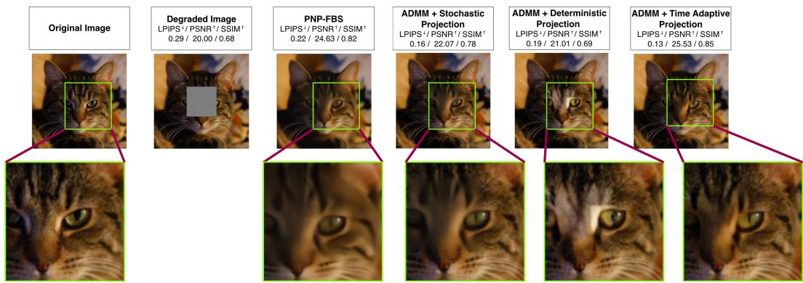  
Figure 3: Comparison of update strategies for box inpainting; zoomed regions highlight the inpainted area and its neighboring pixels.

Fig. 3 provides a qualitative comparison of different update strategies for the box inpainting, with a more detailed analysis provided in appendix D. For reference, we also include PnP-FBS, which produces overly smooth reconstructions. This behavior stems from the repeated injection of random noise throughout the iterations, which leads to loss of high-frequency details.

ADMM with stochastic projections: Replacing FBS with ADMM significantly improves reconstruction quality by better preserving fine structures. However, this approach still yields blurry results in the inpainting region due to projections using purely random component $\epsilon _ { R } .$ . While stochasticity enables exploration, it lacks guidance from the current iterate, resulting in suboptimal refinement of missing regions.

ADMM with deterministic projections: Replacing $\epsilon _ { R }$ with the deterministic component ϵ improves sharpness, as updates remain aligned with the current trajectory. However, relying solely on this strategy introduces a critical limitation: the method becomes highly dependent on initialization and early iterates. Consequently, it restricts exploration and may converge to suboptimal solutions. This reflects the inherent trade-off where trajectory-consistent updates bias the algorithm toward a single solution path, limiting the ability to discover alternatives that better satisfy the measurement constraints.

ADMM with time adaptive projections: Finally, our proposed method effectively addresses this limitation through the time adaptive projection, in which $\boldsymbol { \dot { \epsilon } } ^ { k }$ is estimated from equation (17). By promoting exploration in the early iterations and gradually transitioning toward trajectory-consistent updates, the method achieves a principled balance between exploration and exploitation. This results in reconstructions that are both sharp and semantically consistent, particularly in challenging regions such as the inpainting mask.

Table 2: Per-batch runtime (in seconds) and peak GPU memory (in GB) on AFHQ-Cat and CelebA (batch size of 4 images, averaged over 25 batches). Entries with the best time–memory trade-offs based on joint consideration of runtime and peak memory are highlighted.
<table><tr><td></td><td></td><td colspan="2">AFHQ-Cat</td><td colspan="2">CelebA</td></tr><tr><td>Task</td><td>Method</td><td>Time↓</td><td>Mem.↓</td><td>Time↓</td><td>Mem.↓</td></tr><tr><td></td><td>PnP-ADMM (ours)</td><td>12.81</td><td>1.79</td><td>7.46</td><td>0.55</td></tr><tr><td>Supper</td><td>OT-ODE</td><td>27.63</td><td>9.52</td><td>16.57</td><td>2.63</td></tr><tr><td>Resuton</td><td>Flow Priors</td><td>75.59</td><td>34.21</td><td>35.13</td><td>9.04</td></tr><tr><td></td><td>D-Flow</td><td>85.80</td><td>51.37</td><td>66.12</td><td>13.59</td></tr><tr><td></td><td>PnP-FBS</td><td>19.68</td><td>1.77</td><td>15.61</td><td>0.55</td></tr><tr><td></td><td>PnP-ADMM (ours)</td><td>10.32</td><td>0.79</td><td>6.59</td><td>0.30</td></tr><tr><td></td><td>OT-ODE</td><td>16.34</td><td>8.47</td><td>15.03</td><td>2.32</td></tr><tr><td>Inupting BXx</td><td>Flow Priors</td><td>75.46</td><td>33.21</td><td>35.22</td><td>8.79</td></tr><tr><td></td><td>D-Flow</td><td>85.90</td><td>50.38</td><td>67.99</td><td>13.34</td></tr><tr><td></td><td>PnP-FBS</td><td>19.51</td><td>0.77</td><td>15.57</td><td>0.30</td></tr><tr><td></td><td>PnP-ADMM (ours)</td><td>10.80</td><td>0.79</td><td>6.89</td><td>0.30</td></tr><tr><td>Deblurring</td><td>OT-ODE</td><td>16.42</td><td>8.49</td><td>14.12</td><td>2.33</td></tr><tr><td></td><td>Flow Priors</td><td>75.55</td><td>33.22</td><td>35.86</td><td>8.80</td></tr><tr><td>Gaussian</td><td>D-Flow</td><td>85.91</td><td>50.38</td><td>68.28</td><td>13.34</td></tr><tr><td></td><td>PnP-FBS</td><td>19.54</td><td>0.78</td><td>15.91</td><td>0.30</td></tr></table>

<table><tr><td></td><td></td><td colspan="2">AFHQ-Cat</td><td colspan="2">CelebA</td></tr><tr><td>Task</td><td>Method</td><td>Time↓</td><td>Mem.↓</td><td>Time↓</td><td>Mem.↓</td></tr><tr><td></td><td>PnP-ADMM (ours)</td><td>39.58</td><td>0.79</td><td>12.52</td><td>0.30</td></tr><tr><td>Inupniung Ranndom</td><td>OT-ODE</td><td>18.71</td><td>8.47</td><td>14.72</td><td>2.32</td></tr><tr><td></td><td>Flow Priors</td><td>76.14</td><td>33.22</td><td>36.18</td><td>8.79</td></tr><tr><td></td><td>D-Flow</td><td>86.02</td><td>50.37</td><td>66.70</td><td>13.34</td></tr><tr><td></td><td>PnP-FBS</td><td>20.44</td><td>0.77</td><td>15.63</td><td>0.30</td></tr><tr><td>Dnising</td><td>PnP-ADMM (ours)</td><td>9.95</td><td>0.79</td><td>6.46</td><td>0.30</td></tr><tr><td></td><td>OT-ODE</td><td>16.41</td><td>8.47</td><td>14.37</td><td>2.32</td></tr><tr><td></td><td>Flow Priors</td><td>75.51</td><td>33.21</td><td>35.60</td><td>8.79</td></tr><tr><td></td><td>D-Flow</td><td>85.96</td><td>50.38</td><td>66.73</td><td>13.34</td></tr><tr><td></td><td>PnP-FBS</td><td>19.50</td><td>0.77</td><td>15.45</td><td>0.30</td></tr><tr><td></td><td>PnP-ADMM (ours)</td><td>12.52</td><td>0.79</td><td>7.90</td><td>0.30</td></tr><tr><td>Inupniung</td><td>OT-ODE</td><td>16.99</td><td>8.47</td><td>14.42</td><td>2.32</td></tr><tr><td></td><td>Flow Priors</td><td>76.15</td><td>33.21</td><td>36.76</td><td>8.79</td></tr><tr><td>Painqush</td><td>D-Flow</td><td>85.97</td><td>50.38</td><td>65.90</td><td>13.34</td></tr><tr><td></td><td>PnP-FBS</td><td>19.67</td><td>0.77</td><td>15.67</td><td>0.30</td></tr></table>

## 4.2 Computational Complexity and Efficiency

In this section, we analyze the computational efficiency and memory footprint of all methods. Experiments are conducted on a single NVIDIA A100-SXM4-80GB GPU (CUDA 13.0), using a batch size of 4 images and averaged over 25 batches. Table 2 reports per-batch runtime and peak GPU memory usage.

D-Flow and Flow Priors incur significant computational and memory overhead, limiting practical efficiency. D-Flow is expensive because it repeatedly solves the full ODE and backpropagates through the entire trajectory to optimize the initial noise. This leads to high memory usage from storing intermediate activations and long runtime due to repeated full-trajectory differentiation. Flow Priors is computationally expensive, as each ODE step involves multiple gradient updates, requiring repeated forward and backward passes through the model along with costly Jacobian trace evaluations. Thi nested optimization leads to high overall runtime. OT-ODE is more efficient as it avoids full trajectory backpropagation, instead applying a data-consistency correction at each ODE step that requires a single vector-Jacobian product (VJP) through the denoiser. However, computing this VJP still incurs notable memory overhead, as intermediate activations must be stored within each step.

In contrast, PnP-Flow methods are significantly more memory efficient. However, PnP-FBS in Martin et al. [2025] uses Monte Carlo averaging in the denoising step to improve reconstruction quality, which increases computational cost. Specifically, PnP-FBS requires M denoiser forward passes per iteration, leading to a complexity of $\dot { \mathcal { O } } ( T M C _ { \mathrm { m o d e l } } )$ , where T denotes the number of iterations and $C _ { \mathrm { m o d e l } }$ the cost of a single denoiser forward pass. In contrast, our ADMM-based formulation uses a single denoiser evaluation per iteration, yielding $\mathcal { O } ( T C _ { \mathrm { m o d e l } } )$ ), together with an additional CG solve for data consistency. In practice, the CG step is cheaper than repeated network evaluations, so runtime is dominated by denoiser calls, resulting in an approximate O(M) speedup over PnP-FBS. Both methods exhibit similarly low memory consumption, while PnP-ADMM achieves faster runtimes across all tasks except random inpainting in AFHQ-Cat dataset.

## 5 Conclusion and Limitations

We presented an ADMM-based PnP framework for inverse problems with flow matching priors, addressing the mismatch between data-consistency updates and flow trajectories. By introducing a time-adaptive trajectory correction, our method effectively balances exploration and trajectory alignment, leading to sharper reconstructions across a range of inverse tasks. Our experiments show that the proposed approach outperforms PnP-FBS in most settings and is competitive with state-ofthe-art methods, while achieving significantly lower computational cost, runtime, and memory usage. These results highlight the practical advantages of PnP-ADMM with flow priors for scalable and efficient inverse problem solving.

A limitation of our work is the lack of a rigorous theoretical convergence analysis for PnP-ADMM with flow-based priors. While we observe stable convergence behavior empirically, establishing formal guarantees remains challenging due to the implicit, nonlinear, and nonconvex nature of learned denoisers (see appendix A.1). Addressing these theoretical questions is an important direction for future work.

## Acknowledgments and Disclosure of Funding

This research is supported by the Center for Artificial Intelligence and Robotics (CAIRO) at the Technical University of Applied Sciences Würzburg-Schweinfurt (THWS), Würzburg, Germany.

The authors have no competing interests to declare that are relevant to the content of this article.

## References

Heli Ben-Hamu, Omri Puny, Itai Gat, Brian Karrer, Uriel Singer, and Yaron Lipman. D-flow: Differentiating through flows for controlled generation. In International Conference on Machine Learning, 2024.

Mario Bertero and Patrizia Boccacci. Introduction to Inverse Problems in Imaging. Institute of Physics Publishing, 1998.

Yochai Blau and Tomer Michaeli. The perception-distortion tradeoff. In 2018 IEEE/CVF Conference on Computer Vision and Pattern Recognition. IEEE, 2018.

Ashish Bora, Ajil Jalal, Eric Price, and Alexandros G. Dimakis. Compressed sensing using generative models. In International Conference on Machine Learning, 2017.

Stephen Boyd and Lieven Vandenberghe. Convex Optimization. Cambridge University Press, 2004.

Stephen Boyd, Neal Parikh, Eric Chu, Borja Peleato, and Jonathan Eckstein. Distributed Optimization and Statistical Learning via the Alternating Direction Method of Multipliers. Foundations and Trends in Machine Learning, 2010.

Stanley H. Chan, Xiran Wang, and Omar A. Elgendy. Plug-and-play admm for image restoration: Fixed point convergence and applications. IEEE Transactions on Computational Imaging, 2016.

Yunjey Choi, Youngjung Uh, Jaejun Yoo, and Jung-Woo Ha. Stargan v2: Diverse image synthesis for multiple domains. In IEEE/CVF Conference on Computer Vision and Pattern Recognition, 2020.

Hyungjin Chung, Byeongsu Sim, Dohoon Ryu, and Jong Chul Ye. Improving diffusion models for inverse problems using manifold constraints. In Advances in Neural Information Processing Systems, 2022.

Hyungjin Chung, Jeongsol Kim, Michael T. Mccann, Marc L. Klasky, and Jong Chul Ye. Diffusion posterior sampling for general noisy inverse problems. In International Conference on Learning Representations, 2023.

Magnus R Hestenes and Eduard Stiefel. Methods of conjugate gradients for solving linear systems. Journal ofresearch ofthe National Bureau ofStandards, 1952.

Samuel Hurault, Arthur Leclaire, and Nicolas Papadakis. Gradient step denoiser for convergent plug-and-play. In International Conference on Learning Representations, 2022.

Dibyanshu Kumar and Magda Gregorova. Pnp-cf: A consensus flow-matching solver for general inverse problems. 2026. URL https://arxiv.org/abs/2610.26000.

Ji Li and Chao Wang. Image restoration via primal dual hybrid gradient and flow generative model. In Proceedings of the AAAI Conference on Artificial Intelligence, 2026.

Xiang Li, Soo Min Kwon, Shijun Liang, Ismail R. Alkhouri, Saiprasad Ravishankar, and Qing Qu. Decoupled data consistency with diffusion purification for image restoration. arXiv:2403.06054, 2025.

Yaron Lipman, Ricky T. Q. Chen, Heli Ben-Hamu, Maximilian Nickel, and Matt Le. Flow matching for generative modeling. In International Conference on Learning Representations, 2023.

Xingchao Liu, Chengyue Gong, and Qiang Liu. Flow straight and fast: Learning to generate and transfer data with rectified flow. In International Conference on Learning Representations, 2023.

Morteza Mardani, Jiaming Song, Jan Kautz, and Arash Vahdat. A variational perspective on solving inverse problems with diffusion models. In International Conference on Learning Representations, 2024.

Ségolène Martin, Anne Gagneux, Paul Hagemann, and Gabriele Steidl. Pnp-flow: Plug-and-play image restoration with flow matching. In International Conference on Learning Representations, 2025.

Ashwini Pokle, Matthew J. Muckley, Ricky T. Q. Chen, and Brian Karrer. Training-free linear image inverses via flows. Transactions on Machine Learning Research, 2024.

Mehrsa Pourya, Bassam El Rawas, and Michael Unser. FLOWER: A flow-matching solver for inverse problems. In International Conference on Learning Representations, 2026.

Yaniv Romano, Michael Elad, and Peyman Milanfar. The little engine that could: Regularization by denoising (red). SIAM Journal on Imaging Sciences, 2017.

Leonid I. Rudin, Stanley Osher, and Emad Fatemi. Nonlinear total variation based noise removal algorithms. Physica D: Nonlinear Phenomena, 1992.

Ernest K. Ryu, Jialin Liu, Sicheng Wang, Xiaohan Chen, Zhangyang Wang, and Wotao Yin. Plugand-play methods provably converge with properly trained denoisers. In International Conference on Machine Learning, 2019.

Rajesh Shrestha and Xiao Fu. Taming score-based denoisers in admm: A convergent plug-and-play framework. In International Conference on Learning Representations, 2026.

Jiaming Song, Arash Vahdat, Morteza Mardani, and Jan Kautz. Pseudoinverse-guided diffusion models for inverse problems. In International Conference on Learning Representations, 2023.

Yang Song, Liyue Shen, Lei Xing, and Stefano Ermon. Solving inverse problems in medical imaging with score-based generative models. In International Conference on Learning Representations, 2022.

A. N. Tikhonov and Vasiliy Yakovlevich Arsenin. Solutions of ill-posed problems. Winston & Sons, 1977.

Singanallur V Venkatakrishnan, Charles A Bouman, and Brendt Wohlberg. Plug-and-play priors for model based reconstruction. In 2013 IEEE Global Conference on Signal and Information Processing. IEEE, 2013.

Curtis R. Vogel. Computational Methods for Inverse Problems. Society for Industrial and Applied Mathematics, 2002.

Tharindu Wickremasinghe, Chenyang Qi, Harshana Weligampola, Zhengzhong Tu, and Stanley H. Chan. Flowsteer: Conditioning flow field for consistent image restoration. arXiv:2512.08125, 2025.

Shuo Yang, Ping Luo, Chen Change Loy, and Xiaoou Tang. From facial parts responses to face detection: A deep learning approach. In IEEE International Conference on Computer Vision, 2015.

Kai Zhang, Wangmeng Zuo, Yunjin Chen, Deyu Meng, and Lei Zhang. Beyond a gaussian denoiser: Residual learning of deep cnn for image denoising. IEEE Transactions on Image Processing, 2017a.

Kai Zhang, Wangmeng Zuo, Shuhang Gu, and Lei Zhang. Learning deep cnn denoiser prior for image restoration. In IEEE Conference on Computer Vision and Pattern Recognition, 2017b.

Yasi Zhang, Peiyu Yu, Yaxuan Zhu, Yingshan Chang, Feng Gao, Ying Nian Wu, and Oscar Leong. Flow priors for linear inverse problems via iterative corrupted trajectory matching. In Advances in Neural Information Processing Systems, 2024.

Yuanzhi Zhu, Kai Zhang, Jingyun Liang, Jiezhang Cao, Bihan Wen, Radu Timofte, and Luc Van Gool. Denoising diffusion models for plug-and-play image restoration. In IEEE/CVF Conference on Computer Vision and Pattern Recognition, 2023.

## A Convergence Discussion and Empirical Evidence

## A.1 Theoretical Background and Limitations

For classical ADMM, convergence follows from convexity and proximal structure of the subproblems Boyd et al. [2010]. In PnP-ADMM, however, the prior step is replaced by a learned denoiser that does not in general correspond to the proximal operator of any explicit regularizer, making the regularizer implicit and rendering the standard convex ADMM theory inapplicable. As a result, existing PnP analyses typically establish fixed-point convergence rather than convergence to a minimizer of an explicit objective Chan et al. [2016], Ryu et al. [2019].

To obtain a rigorous fixed-point convergence result for the present ADMM-flow scheme, one would need to establish suitable operator-theoretic properties of the denoiser $\mathcal { D } _ { t }$ . In the PnP-ADMM literature, such guarantees are commonly derived under assumptions such as nonexpansiveness or averagedness of the denoiser (or of a related residual operator), which in turn imply that the reduced Douglas-Rachford / ADMM operator is averaged and therefore convergent to a fixed point Chan et al. [2016], Ryu et al. [2019]. More recent work shows that stronger results, such as stationary-point convergence, can be obtained for more structured denoisers, for example gradient-step denoisers or specially trained conservative operators, but such guarantees do not directly extend to general generative priors or flow-matching denoisers Hurault et al. [2022]. The recent score-based ADMM framework of Shrestha and Fu [2026] follows the same philosophy: it derives convergence by proving weak nonexpansiveness or boundedness properties of the denoiser under additional structural assumptions.

Our denoiser has the form

$$
\begin{array} { r } { \mathcal { D } _ { t } ( \mathbf { x } ) = \mathbf { x } + ( 1 - t ) v _ { t } ( \mathbf { x } ) , } \end{array}
$$

where $v _ { t }$ is the learned flow-matching velocity field. To analyze its stability, consider two inputs $\mathbf { x } _ { 1 } , \mathbf { x } _ { 2 } \in \mathbb { R } ^ { m }$ . Then

$$
\begin{array} { r } { \mathcal { D } _ { t } ( \mathbf { x } _ { 1 } ) - \mathcal { D } _ { t } ( \mathbf { x } _ { 2 } ) = \mathbf { x } _ { 1 } - \mathbf { x } _ { 2 } + ( 1 - t ) \big ( v _ { t } ( \mathbf { x } _ { 1 } ) - v _ { t } ( \mathbf { x } _ { 2 } ) \big ) . } \end{array}\tag{18}
$$

Taking the $\ell _ { 2 }$ norm and applying the triangle inequality yields

$$
\begin{array} { r } { \| \mathcal { D } _ { t } ( \mathbf { x } _ { 1 } ) - \mathcal { D } _ { t } ( \mathbf { x } _ { 2 } ) \| _ { 2 } \leq \| \mathbf { x } _ { 1 } - \mathbf { x } _ { 2 } \| _ { 2 } + ( 1 - t ) \| v _ { t } ( \mathbf { x } _ { 1 } ) - v _ { t } ( \mathbf { x } _ { 2 } ) \| _ { 2 } . } \end{array}\tag{19}
$$

Assuming that $v _ { t }$ is $L _ { t } – \mathbf { L }$ ipschitz, i.e.,

$$
\| v _ { t } ( \mathbf { x } _ { 1 } ) - v _ { t } ( \mathbf { x } _ { 2 } ) \| _ { 2 } \leq L _ { t } \| \mathbf { x } _ { 1 } - \mathbf { x } _ { 2 } \| _ { 2 } ,
$$

we obtain

$$
\begin{array} { r l } & { \| \mathcal { D } _ { t } ( \mathbf { x } _ { 1 } ) - \mathcal { D } _ { t } ( \mathbf { x } _ { 2 } ) \| _ { 2 } \leq \| \mathbf { x } _ { 1 } - \mathbf { x } _ { 2 } \| _ { 2 } + ( 1 - t ) L _ { t } \| \mathbf { x } _ { 1 } - \mathbf { x } _ { 2 } \| _ { 2 } } \\ & { \qquad = \left( 1 + ( 1 - t ) L _ { t } \right) \| \mathbf { x } _ { 1 } - \mathbf { x } _ { 2 } \| _ { 2 } . } \end{array}\tag{20}
$$

(21)

For $\mathcal { D } _ { t }$ to be nonexpansive, one would require

$$
\| \mathcal { D } _ { t } ( \mathbf { x } _ { 1 } ) - \mathcal { D } _ { t } ( \mathbf { x } _ { 2 } ) \| _ { 2 } \leq \| \mathbf { x } _ { 1 } - \mathbf { x } _ { 2 } \| _ { 2 } ,
$$

which implies $1 + ( 1 - t ) L _ { t } \leq 1$ . However, for any $L _ { t } > 0$ and $t < 1$

$$
1 + ( 1 - t ) L _ { t } > 1 ,
$$

so $\mathcal { D } _ { t }$ is generally expansive. Therefore, plain Lipschitz continuity of $v _ { t }$ is not sufficient to guarantee nonexpansiveness (or firm nonexpansiveness) of $\mathcal { D } _ { t }$

Thus, a full ADMM convergence proof would require additional structure on $v _ { t }$ , such as monotonicity, cocoercivity, or architectural constraints ensuring that Dt is an averaged operator. Establishing such properties for general flow-matching networks is beyond the scope of the present work and remains an interesting direction for future research.

For this reason, we do not claim a full theoretical convergence proof for the complete time-varying ADMM-flow algorithm. Instead, we provide empirical convergence diagnostics that assess whether the iterates stabilize in practice and whether the ADMM consensus constraint is progressively enforced.

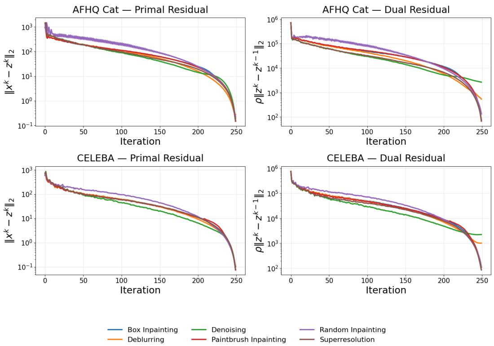  
Figure 4: Empirical convergence diagnostics of the proposed PnP-Flow-ADMM method across multiple inverse problems on the AFHQ-CAT (top) and CelebA (bottom) datasets. We plot the primal residual $\| \mathbf { x } ^ { k } - \mathbf { \dot { z } } ^ { k } \| _ { 2 }$ (left) and the dual residual $\rho \| \mathbf { z } ^ { k } - \mathbf { z } ^ { k - 1 } \| _ { 2 }$ (right) as a function of iterations. Across all tasks, the residuals decrease steadily, indicating progressive enforcement of the ADMM consensus constraint and stabilization of the iterates.

## A.2 Empirical convergence diagnostics

We evaluate convergence using standard ADMM diagnostics.

The primal residual

$$
r _ { \mathrm { p r i } } ^ { k } : = \| \mathbf { x } ^ { k } - \mathbf { z } ^ { k } \| _ { 2 }
$$

measures violation of the consensus constraint $\mathbf x = \mathbf z$ . Its decay indicates that the data-consistency variable and prior variable agree.

The dual residual

$$
r _ { \mathrm { d u a l } } ^ { k } : = \rho \| \mathbf { z } ^ { k } - \mathbf { z } ^ { k - 1 } \| _ { 2 }
$$

measures the change in the auxiliary variable across iterations and reflects stabilization of the dual updates. In standard ADMM, convergence is characterized by the joint decay of both primal and dual residuals Boyd et al. [2010].

We evaluate these diagnostics across multiple inverse problems on the AFHQ and CelebA datasets.   
The same network, degradation models and penalty parameter ρ as in the main experiments are used.   
At each iteration, we record the residuals and plot them against the iteration index k.

## A.3 Interpretation of the plots

We show the evolution of the primal and dual residuals across different tasks and datasets in figure 4. The primal residual $\| \mathbf { x } ^ { k } - \mathbf { z } ^ { k } \| _ { 2 }$ decreases steadily for all the tasks. This indicates that the ADMM consensus constraint is progressively enforced. The dual residual $\rho \| \mathbf { z } ^ { k } - \mathbf { z } ^ { k - 1 } \| _ { 2 }$ also decreases, showing that updates to the auxiliary variable diminish and the iterates approach a stable regime.

We observe that denoising and, to a lesser extent, deblurring exhibit strong primal convergence, yet their dual residuals show slower decay toward the end of the iterations compared to other tasks, which undergo a sharper final drop. This suggests that although the consensus constraint is well enforced, the auxiliary variable updates do not fully stabilize. While this behavior has limited impact on the reconstruction quality for deblurring, it affects denoising more noticeably; in section F.2, we introduce minor adaptations to mitigate this effect.

Overall, the consistent decay of both primal and dual residuals across datasets and tasks provides strong empirical evidence that the proposed ADMM-flow iteration stabilizes and operates in a fixed-point regime in practice.

## B Data Consistency via Conjugate Gradient

## B.1 Data-Consistency Subproblem

For Gaussian noise with variance $\sigma ^ { 2 }$ , the data-fidelity term is

$$
l ( \mathbf { y } ; \mathbf { x } ) = \frac { 1 } { 2 \sigma ^ { 2 } } \lVert \mathcal { A } \mathbf { x } - \mathbf { y } \rVert _ { 2 } ^ { 2 } .\tag{22}
$$

Substituting into the x-update (11) gives the quadratic subproblem

$$
\mathbf { x } ^ { k + 1 } = \arg \operatorname* { m i n } _ { \mathbf { x } } \ \frac { 1 } { 2 \sigma ^ { 2 } } \| \mathcal { A } \mathbf { x } - \mathbf { y } \| _ { 2 } ^ { 2 } + \frac { \rho } { 2 } \| \mathbf { x } - ( \mathbf { z } ^ { k } - \mathbf { u } ^ { k } ) \| _ { 2 } ^ { 2 } ,\tag{23}
$$

where the first term enforces measurement consistency and the second anchors x to the current ADMM estimate $\mathbf { z } ^ { k } - \mathbf { u } ^ { k }$

## B.2 Reduction to a Linear System

Since (23) is a strongly convex quadratic, its unique minimizer satisfies the first-order optimality condition

$$
\nabla _ { \mathbf { x } } \left[ \frac { 1 } { 2 \sigma ^ { 2 } } \| \boldsymbol { A } \mathbf { x } - \mathbf { y } \| _ { 2 } ^ { 2 } + \frac { \rho } { 2 } \| \mathbf { x } - ( \mathbf { z } ^ { k } - \mathbf { u } ^ { k } ) \| _ { 2 } ^ { 2 } \right] = \mathbf { 0 }\tag{24}
$$

Setting the gradient to zero and collecting terms yields

$$
\underbrace { \left( { \frac { 1 } { \sigma ^ { 2 } } } { \mathcal { A } } ^ { \top } { \mathcal { A } } + \rho I \right) } _ { \mathcal { M } } \mathbf { x } = \underbrace { { \frac { 1 } { \sigma ^ { 2 } } } { \mathcal { A } } ^ { \top } \mathbf { y } + \rho ( \mathbf { z } ^ { k } - \mathbf { u } ^ { k } ) } _ { \mathbf { b } } ,\tag{25}
$$

i.e. a linear system $\mathcal { M } \mathbf { x } = \mathbf { b }$ with operator and right-hand side as

$$
\mathcal { M } ( \mathbf { x } ) = \frac { 1 } { \sigma ^ { 2 } } A ^ { \top } ( A \mathbf { x } ) + \rho \mathbf { x } , \qquad \mathbf { b } = \frac { 1 } { \sigma ^ { 2 } } A ^ { \top } \mathbf { y } + \rho ( \mathbf { z } ^ { k } - \mathbf { u } ^ { k } ) .\tag{26}
$$

Symmetry of M follows from the fact that $\mathcal { A } ^ { \top } \mathcal { A }$ is self-adjoint and $\rho I$ is symmetric. Positive definiteness follows since

$$
\langle \mathbf { x } , \mathcal { M } ( \mathbf { x } ) \rangle = \frac { 1 } { \sigma ^ { 2 } } \| \pmb { \mathcal { A } } \mathbf { x } \| _ { 2 } ^ { 2 } + \rho \| \mathbf { x } \| _ { 2 } ^ { 2 } > 0 \qquad \forall \mathbf { x } \neq 0 .\tag{27}
$$

guaranteeing a unique solution and making (25) amenable to the conjugate gradient (CG) method.

## B.3 Conjugate Gradient Solver and Practical Details

Explicitly forming or inverting the system matrix is computationally infeasible at the image resolutions considered here. We therefore solve (25) iteratively with CG Hestenes and Stiefel [1952], Boyd and Vandenberghe [2004], which requires only matrix-vector products through $\mathcal { M } ,$ each reducible to one application of the forward operator $\mathcal { A }$ and one of its adjoint $\mathcal { A } ^ { \top }$ . CG is initialized with the previous iterate $\mathbf { x } ^ { k }$ and terminated when the relative residual falls below a prescribed tolerance,

$$
\frac { \| \mathbf { r } ^ { ( j ) } \| _ { 2 } } { \| \mathbf { b } \| _ { 2 } + \epsilon } < \mathbf { c g \_ t o l } ,\tag{28}
$$

where b denotes the right-hand side of the linear system in (25), $\mathbf { r } ^ { ( j ) } = \mathbf { b } - \mathcal { M } \mathbf { x } ^ { ( j ) }$ is the residual at the $j \cdot$ -th CG iteration, and $\epsilon > 0$ is a small constant introduced for numerical stability to avoid division by zero. The iterations are terminated either when this criterion is satisfied or after a maximum of max $\mathtt { \_ c g i }$ ter iterations. In all experiments we use max $\mathsf { . c g i t e r = 1 0 , c g \_ t o l = 1 0 ^ { - 5 } }$ . The ADMM penalty is set to $\rho = 1 0 0 0$ for CelebA and $\rho = 5 0 0$ for AFHQ-Cat.

## C Effect of the penalty parameter $\rho$

The penalty parameter $\rho$ governs the strength of the consensus constraint between the data-consistency variable x and the prior-driven variable z. In particular, larger values of $\rho$ enforce stronger agreement between the two variables, effectively biasing the x-update toward the denoised estimate $( \mathbf { z } - \mathbf { u } )$ . As a result, $\rho$ controls the trade-off between adherence to the measurements and reliance on the learned prior.

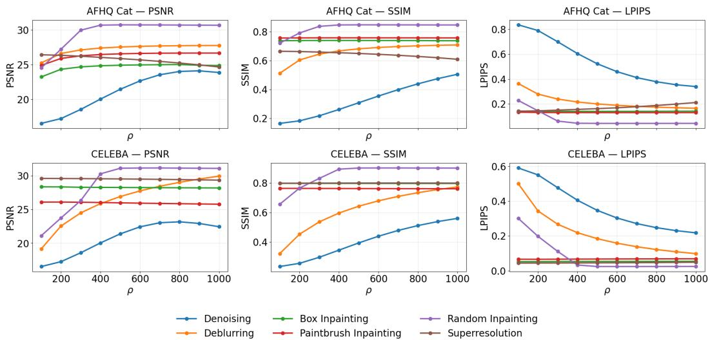  
Figure 5: Effect of the penalty parameter $\rho$ on AFHQ-Cat (top) and CelebA (bottom) across inverse problems. Increasing ρ improves performance for denoising, deblurring, and random inpainting, with gains saturating at higher values, while showing marginal sensitivity for structured inpainting tasks and slight degradation for super-resolution.

Figure 5 illustrates the impact of $\rho$ across different inverse problems and datasets. We observe a consistent trend for denoising, deblurring, and random inpainting, where increasing $\rho$ leads to substantial improvements in PSNR and SSIM, along with a corresponding decrease in LPIPS. This indicates that these tasks benefit from stronger coupling between data-consistency and the prior. In contrast, tasks such as box inpainting and paintbrush inpainting exhibit only mild sensitivity to $\rho .$ For superresolution, we observe a slight performance degradation as $\rho$ increases, likely because the downsampled measurements lack high-frequency information and stronger coupling, together with the perception–distortion trade-off Blau and Michaeli [2018], can lead to smoother reconstructions with reduced fine detail.

Despite this, we observe that larger values of $\rho$ consistently yield significant improvements across the majority of tasks. In these settings, stronger consensus enforcement allows the denoiser to effectively regularize the solution and mitigate the ill-posedness of the inverse problem. Based on these observations, we select $\rho$ from this regime, favoring larger values that provide consistent gains across tasks while maintaining stability. Specifically, we use $\rho = 5 0 0$ for AFHQ-Cat and $\rho = 1 0 0 0$ for CelebA, as these values lie in the saturation region where the method achieves a favorable balance between data consistency and prior regularization, with only minor degradation in super-resolution.

## D Ablation Studies

In this section, we study the impact of different design choices in our method through additional ablation experiments. Specifically, we analyze how different projection strategies and optimization schemes affect reconstruction performance, providing further support for the analysis presented in Section 4.1.

We consider multiple variants of our framework, in addition to the PnP-FBS baseline of Martin et al. [2025]. First, we evaluate PnP-ADMM with stochastic projections, where the projection step relies purely on random noise. Second, we study PnP-ADMM with deterministic projections, where only the deterministic component is used. Finally, we consider our full approach, PnP-ADMM with time adaptive projections, which combines both stochastic and deterministic components in an adaptive manner within the ADMM framework.

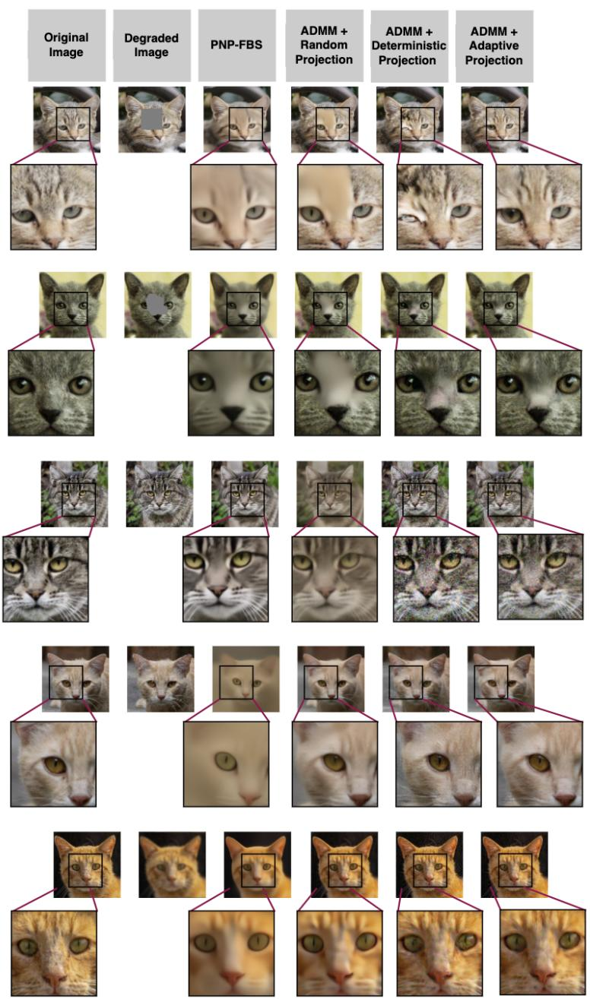  
Figure 6: Qualitative comparison across inverse tasks on AFHQ-Cat. Columns (left→right): original, degraded, PnP-FBS, ADMM (stochastic), ADMM (deterministic), and ADMM (adaptive). Rows (top→bottom): box inpainting, paintbrush inpainting, denoising, super-resolution, and deblurring. PnP-FBS yields overly smooth results; ADMM (stochastic) improves structure but remains blurry; ADMM (deterministic) sharpens details but introduces artifacts. The proposed adaptive projection achieves sharper, more consistent reconstructions, as highlighted in the zoomed regions.

Table 3 reports the average performance across all inverse tasks. ADMM-based variants achieve better results than the PnP-FBS baseline across most metrics, demonstrating the benefit of the ADMM formulation over forward-backward splitting. Among these, ADMM with time-adaptive projection achieves the best overall performance across all the metrics.

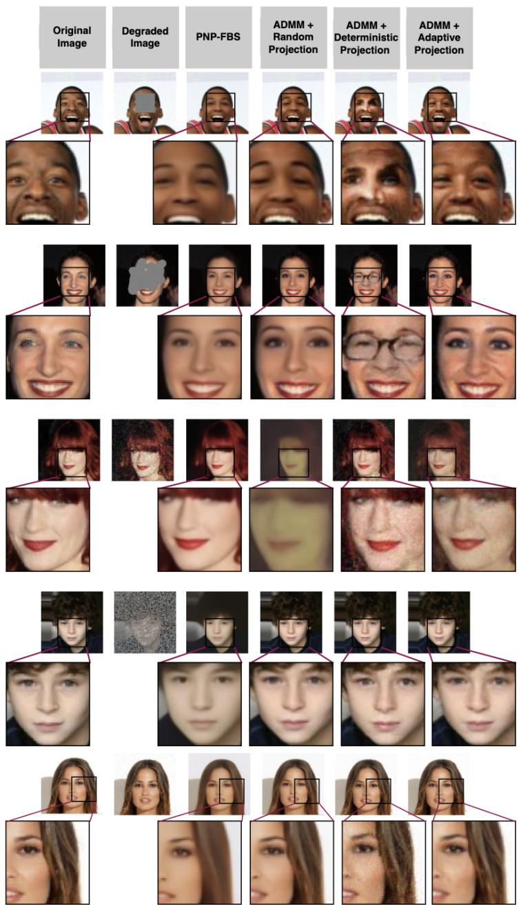  
Figure 7: Qualitative comparison across inverse tasks on CelebA. Columns (left→right): original, degraded, PnP-FBS, ADMM (stochastic), ADMM (deterministic), and ADMM (adaptive). Rows (top→bottom): box inpainting, paintbrush inpainting, denoising, random inpainting, and superresolution.

This is further corroborated by qualitative evaluation. As shown in fig. 6 and fig 7, PnP-FBS produces overly smooth reconstructions, while ADMM with random projections, although improved, still fails to recover fine-grained details. ADMM with deterministic projection yields sharper images but introduces visible artifacts. In contrast, the proposed adaptive projection strategy strikes a favorable balance: reconstructions are both perceptually sharp and free of structural artifacts.

Table 3: Average performance of different settings across all inverse tasks (denoising, deblurring, random inpainting, box inpainting, paintbrush inpainting and superresolution).
<table><tr><td rowspan="2">Method</td><td colspan="3">AFHQ-CAT</td><td colspan="3">CelebA</td></tr><tr><td>SSIM↑</td><td>LPIPS↓</td><td>PSNR↑</td><td>SSIM↑</td><td>LPIPS↓</td><td>PSNR↑</td></tr><tr><td>PNP-ADMM (adaptive)</td><td>0.74</td><td>0.16</td><td>26.26</td><td>0.80</td><td>0.07</td><td>27.55</td></tr><tr><td>PNP-ADMM (random)</td><td>0.71</td><td>0.21</td><td>25.81</td><td>0.79</td><td>0.09</td><td>26.47</td></tr><tr><td>PNP-ADMM (deterministic)</td><td>0.61</td><td>0.23</td><td>23.78</td><td>0.73</td><td>0.10</td><td>26.16</td></tr><tr><td>PNP-FBS</td><td>0.70</td><td>0.36</td><td>25.15</td><td>0.79</td><td>0.15</td><td>26.18</td></tr></table>

## E PnP-FBS Algorithm

Below we provide the PnP-FBS algorithm Martin et al. [2025] used as one of the baselines in our experiments. The method alternates between a data-consistency gradient step and a denoising step using a time-dependent flow-based prior, with an additional projection onto the intermediate flow trajectory at each iteration.

Algorithm 2 PnP-FBS   
1: Input: Denoiser $\mathcal { D } _ { t }$ , time sequence $( t _ { k } ) _ { k }$ either finite with $t _ { k } = k / N , N \in \mathbb { N }$ , or infinite with   
$\scriptstyle \operatorname* { l i m } _ { k \to \infty } t _ { k } = 1$ , time dependent step size $\gamma ( t _ { k } ) , p _ { 0 } = \mathcal { N } ( 0 , I )$   
2: Initialize: $\mathbf { x } ^ { 0 } \in \mathbb { R } ^ { m }$   
3: for $k = 0 , 1 , \ldots$ do   
4: $\mathbf { z } ^ { k } = \mathbf { x } ^ { k } - \gamma ( t _ { k } ) \nabla l ( \mathbf { y } ; \mathbf { x } ^ { k } )$   
5: $\tilde { \mathbf { z } } ^ { k } = ( 1 - t _ { k } ) \boldsymbol { \epsilon } + t _ { k } \mathbf { z } ^ { k } , \quad \boldsymbol { \epsilon } \sim \mathcal { N } ( 0 , I )$   
6: $\mathbf { x } ^ { k + 1 } = \mathcal { D } _ { t _ { k } } ( \tilde { \mathbf { z } } ^ { k } )$   
7: end for   
8: return $\mathbf { x } ^ { k + 1 }$

## F Denoising as a Simple Inverse Problem

While our method performs strongly across most inverse problems, its performance on denoising is comparatively lower. In this section, we discuss what makes denoising fundamentally different, show that the problem can be effectively addressed using standard Tikhonov regularization, and demonstrate that minor adaptations of our method can further improve performance.

Denoising is a particularly simple inverse problem in which the forward operator $A = I$ is the identity. The observation model is

$$
\mathbf { y } = \mathbf { x } + \epsilon , \quad \epsilon \sim \mathcal { N } ( 0 , \sigma ^ { 2 } I ) ,\tag{29}
$$

where $\mathbf { x } \in \mathbb { R } ^ { n }$ is the clean signal and $\mathbf { y }$ is the noisy observation. Unlike ill-posed problems such as inpainting or super-resolution Bertero and Boccacci [1998], the forward operator is perfectly conditioned and introduces no structural loss of information. The remaining uncertainty arises solely from additive noise, so the data-fidelity term

$$
\operatorname* { m i n } _ { \mathbf { x } } \frac { 1 } { 2 \sigma ^ { 2 } } \lVert \mathbf { x } - \mathbf { y } \rVert ^ { 2 }\tag{30}
$$

is already well-posed, and regularization serves only to suppress noise rather than to recover lost information.

## F.1 Closed-Form Solution

A classical approach to solving the denoising problem is first-order Tikhonov regularization Tikhonov and Arsenin [1977],

$$
\operatorname* { m i n } _ { \mathbf { x } } \frac { 1 } { 2 \sigma ^ { 2 } } \| \mathbf { x } - \mathbf { y } \| ^ { 2 } + \frac { \lambda } { 2 } \| \nabla \mathbf { x } \| ^ { 2 } ,\tag{31}
$$

where $\lambda > 0$ is a regularization parameter that controls the trade-off between data fidelity and smoothness. The optimality condition, after multiplying through by $\sigma ^ { 2 }$ , is given by

$$
\left( I + \lambda \sigma ^ { 2 } \nabla ^ { \top } \nabla \right) \mathbf { x } = \mathbf { y } .\tag{32}
$$

Since $\nabla ^ { \top } \nabla$ diagonalizes under the discrete Fourier transform Vogel [2002], this system admits the closed-form solution

$$
\widehat { \mathbf { x } } ^ { \star } ( \pmb { \xi } ) = \frac { \widehat { \mathbf { y } } ( \pmb { \xi } ) } { 1 + \lambda \sigma ^ { 2 } \lVert \pmb { \xi } \rVert ^ { 2 } } ,\tag{33}
$$

where $\boldsymbol { \xi }$ denotes the spatial frequency. The solution acts as a low-pass filter, attenuating highfrequency noise while preserving low-frequency structure Rudin et al. [1992], and is obtained in a single step without iterative optimization.

Table 4: Denoising performance using Tikhonov regularization for different values of λ on AFHQ-Cat and CelebA datasets. Best results are obtained around λ = 15 using the closed-form solution in Eq. (33).
<table><tr><td rowspan="2">λ</td><td colspan="2">AFHQ-Cat</td><td colspan="3">CelebA</td></tr><tr><td>SSIM↑</td><td>LPIPS↓ PSNR↑</td><td>SSIM↑</td><td>LPIPS↓</td><td>PSNR ↑</td></tr><tr><td>5</td><td>0.51</td><td>0.41</td><td>24.91 0.55</td><td>0.31</td><td>24.26</td></tr><tr><td>10</td><td>0.56</td><td>0.38 25.73</td><td>0.60</td><td>0.29</td><td>24.85</td></tr><tr><td>15</td><td>0.60</td><td>0.36 26.13</td><td>0.62</td><td>0.28</td><td>25.04</td></tr><tr><td>20</td><td>0.54</td><td>0.39</td><td>25.29 0.58</td><td>0.30</td><td>24.45</td></tr></table>

Table 4 shows that Tikhonov regularization achieves strong denoising performance across all metrics, with the best results obtained around $\lambda = 1 5$ . This highlights that simple closed-form methods are already effective for denoising, providing high-quality reconstructions in a single step without iterative or sampling procedures.

## F.2 Adaptation of PnP-ADMM for Denoising

In the convergence analysis (section A.3), we observe that for denoising the primal residual $\| \mathbf { x } ^ { k } - \mathbf { z } ^ { k } \| _ { 2 }$ decreases rapidly, indicating early consensus between the data-consistency and denoiser outputs, while the dual residual $\rho \| \mathbf { z } ^ { \widetilde { k } + 1 } - \mathbf { z } ^ { k } \| _ { 2 }$ plateaus at a non-zero value, suggesting that the denoiser continues to introduce small variations across iterations without fully stabilizing.

Table 5: Performance of our method on denoising with different numbers of PnP steps. Early stopping is applied at 85% of the total steps that is selected based on empirical tuning.
<table><tr><td rowspan="2">PnP steps</td><td rowspan="2">Early Stop</td><td colspan="3">AFHQ-Cat</td><td colspan="3">CelebA</td></tr><tr><td>SSIM↑</td><td>LPIPS ↓</td><td>PSNR↑</td><td>SSIM↑</td><td>LPIPS ↓</td><td>PSNR ↑</td></tr><tr><td>200</td><td>170</td><td>0.58</td><td>0.30</td><td>19.05</td><td>0.60</td><td>0.19</td><td>17.58</td></tr><tr><td>300</td><td>255</td><td>0.65</td><td>0.22</td><td>21.68</td><td>0.67</td><td>0.14</td><td>19.76</td></tr><tr><td>400</td><td>340</td><td>0.68</td><td>0.19</td><td>23.63</td><td>0.66</td><td>0.12</td><td>23.51</td></tr><tr><td>800</td><td>680</td><td>0.72</td><td>0.13</td><td>27.47</td><td>0.76</td><td>0.07</td><td>26.01</td></tr><tr><td>1000</td><td>850</td><td>0.72</td><td>0.12</td><td>28.05</td><td>0.76</td><td>0.06</td><td>26.99</td></tr></table>

A possible explanation is that, since the forward operator is the identity, the iterates quickly approach the data manifold, after which the denoiser operates in a regime where updates become small and less stable, leading to diminishing improvements and potential variations in perceptual quality. Motivated by this observation, we adopt a combined strategy of early stopping together with an increased number of Euler steps for sampling.

Table 5 shows that increasing the number of PnP steps together with early stopping consistently improves performance across all metrics. This suggests that using more Euler steps improves the accuracy of the denoiser, while early stopping prevents unnecessary late-stage updates. Overall, this combination provides a simple and effective adaptation of PnP-ADMM for denoising.

Flow Prior

## G Additional Qualitative Results

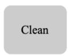  
Degraded

OT-ODE

D-Flow

PNP-FBS

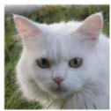

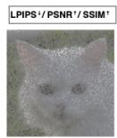  
1.09/15.66/0.26  
LPIPS+/PSNR↑/SSIM†

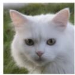  
0.09 /30.65/0.87  
LPIPS+/PSNR↑/SSIM{

PNP-ADMM (ours)

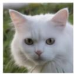  
LPIPS+/PSNR{/SSIM  
0.09/31.02/0.84

  
LPIPS+/PSNR⁺/SSIM

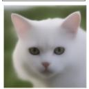  
0.09 /31.04 /0.85  
0.35/26.61/0.76

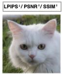  
0.03 /33.34/0.89

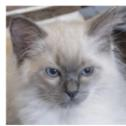

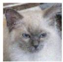  
0.89 /13.59/0.29

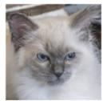  
0.12/28.56/0.77

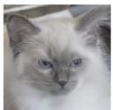  
0.25 / 26.31 / 0.62

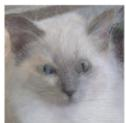  
0.36/22.64/0.61

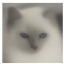  
0.57 /20.62/ 0.64

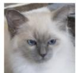  
0.17/27.58/0.70

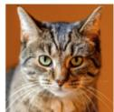

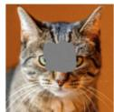  
0.15/22.05/0.75

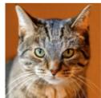  
0.04 / 23.08 /0.89

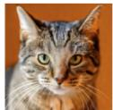  
0.06 /24.63 / 0.83

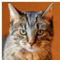  
0.07/25.85/0.90

  
0.18 /24.38/0.81

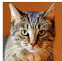  
0.07 /24.61 /0.79

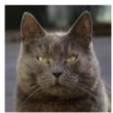

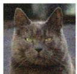  
0.83/16.48/0.15

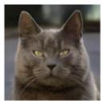  
0.13/28.91 /0.72

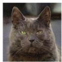  
0.46/20.19/0.15

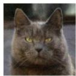  
0.31/24.80 /0.45

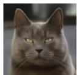  
0.29 /29.83 /0.77

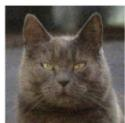  
0.26/22.04/0.54

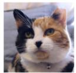

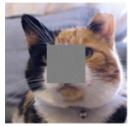  
0.20 / 21.01 / 0.73

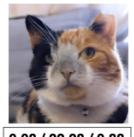  
0.08/22.28 /0.88

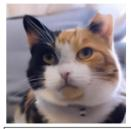  
0.18/23.64 /0.75

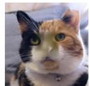  
0.12/21.99 /0.86

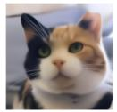  
0.25/24.70/0.82

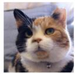  
0.10/23.80 /0.75

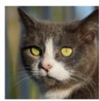

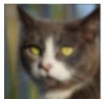  
0.46/24.51/0.50

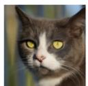  
0.12/26.19/0.67

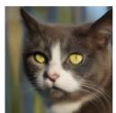  
0.18/25.73/0.65

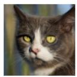  
0.17/26.04/0.66

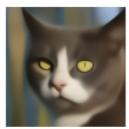  
0.40/25.29/0.63

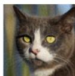  
0.17/26.05/0.64

Figure 8: Additional qualitative comparisons on the AFHQ-Cat dataset across multiple inverse tasks, including random inpainting (1st row), super-resolution (2nd row), paintbrush inpainting (3rd row), denoising (4th row), box inpainting (5th row), and deblurring (6th row). From left to right: clean image, degraded input, OT-ODE, D-Flow, Flow Prior, PnP-FBS, and the proposed PnP-ADMM (ours). Quantitative metrics (LPIPS / PSNR/ SSIM) are reported below each reconstruction.

Clean

Degraded

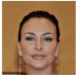  
LPIPS+/PSNR1/SSIM  
OT-ODE

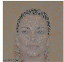  
0.98/12.43/0.19  
LPIPS+/PSNR1/SSIM

  
0.09 /27.86/0.84  
D-Flow  
LPIPS+/PSNR⁺/SSIM  
Flow Prior

  
0.04/30.66/ 0.87  
LPIPS+/PSNR1/SSIM  
PNP-FBS

  
0.06/27.91/0.86  
LPIPS+/PSNR⁺/SSIM

PNP-ADMM (ours)

  
LPIPS+/PSNR1/SSIM

  
0.20/23.86/0.73  
0.02/31.58/0.91

  
0.83 /10.61 / 0.22

  
0.02/31.40/0.90

  
0.04/ 29.06 / 0.82

  
0.05/26.97/0.82

  
0.20 /22.24 / 0.67

  
0.04 /29.63 / 0.80

  
0.28/18.38/0.69

  
0.09/22.36/0.83

  
0.06 / 25.08 / 0.80

  
0.08/22.35 /0.84

  
0.17/24.41/0.77

  
0.05 /24.81/0.80

  
0.52/16.48/0.26

  
0.04/28.18/0.79

  
0.26/19.72/0.36

  
0.16 /24.07 /0.57

  
0.08 / 29.71 / 0.86

  
0.10/20.64/0.65

  
0.20/20.76 /0.76

  
0.04 /27.85 /0.90

  
0.04/29.55/0.86

  
0.03/27.63/0.92

  
0.10/27.55/0.84

  
0.03/29.58 /0.90

  
0.16/27.88/0.72

  
0.043/ 32.65 /0.93

  
0.05/30.21/0.89

  
0.06/30.35/0.87

  
0.15/27.94/0.85

  
0.05/32.95/0.81

Figure 9: Additional qualitative comparisons on the CelebA dataset across multiple inverse tasks, including random inpainting (1st row), super-resolution (2nd row), paintbrush inpainting (3rd row), denoising (4th row), box inpainting (5th row), and deblurring (6th row). From left to right: clean image, degraded input, OT-ODE, D-Flow, Flow Prior, PnP-FBS, and the proposed PnP-ADMM (ours). Quantitative metrics (LPIPS / PSNR / SSIM) are reported below each reconstruction.

  
Paintbrush-Inpainting  
Deblurring  
Figure 10: Supplementary results of our method on CelebA. For each inverse task: row 1 shows the clean image, row 2 the degraded input, and row 3 the reconstruction.

  
Box-Inpainting

  
Random-Inpainting

  
Denoising

  
Superresolution

  
Paintbrush-Inpainting

  
Deblurring

  
Figure 11: Supplementary results of our method on AFHQ-Cat. For each inverse task: row 1 shows the clean image, row 2 the degraded input, and row 3 the reconstruction.

## NeurIPS Paper Checklist

## 1. Claims

Question: Do the main claims made in the abstract and introduction accurately reflect the paper’s contributions and scope?

Answer: [Yes]

Justification: The contributions are clearly mentioned in section 1 and the analysis is done in sections 4.1 and 4.2, as well as the results reported in tables 1 and 2.

Guidelines:

• The answer [N/A] means that the abstract and introduction do not include the claims made in the paper.

• The abstract and/or introduction should clearly state the claims made, including the contributions made in the paper and important assumptions and limitations. A [No] or [N/A] answer to this question will not be perceived well by the reviewers.

• The claims made should match theoretical and experimental results, and reflect how much the results can be expected to generalize to other settings.

• It is fine to include aspirational goals as motivation as long as it is clear that these goals are not attained by the paper.

## 2. Limitations

Question: Does the paper discuss the limitations of the work performed by the authors?

Answer: [Yes]

Justification: We provide the limitations of this study in section 5 and in more detail in Appendix A.1.

Guidelines:

• The answer [N/A] means that the paper has no limitation while the answer [No] means that the paper has limitations, but those are not discussed in the paper.

• The authors are encouraged to create a separate “Limitations” section in their paper.

• The paper should point out any strong assumptions and how robust the results are to violations of these assumptions (e.g., independence assumptions, noiseless settings, model well-specification, asymptotic approximations only holding locally). The authors should reflect on how these assumptions might be violated in practice and what the implications would be.

• The authors should reflect on the scope of the claims made, e.g., if the approach was only tested on a few datasets or with a few runs. In general, empirical results often depend on implicit assumptions, which should be articulated.

• The authors should reflect on the factors that influence the performance of the approach. For example, a facial recognition algorithm may perform poorly when image resolution is low or images are taken in low lighting. Or a speech-to-text system might not be used reliably to provide closed captions for online lectures because it fails to handle technical jargon.

• The authors should discuss the computational efficiency of the proposed algorithms and how they scale with dataset size.

• If applicable, the authors should discuss possible limitations of their approach to address problems of privacy and fairness.

• While the authors might fear that complete honesty about limitations might be used by reviewers as grounds for rejection, a worse outcome might be that reviewers discover limitations that aren’t acknowledged in the paper. The authors should use their best judgment and recognize that individual actions in favor of transparency play an important role in developing norms that preserve the integrity of the community. Reviewers will be specifically instructed to not penalize honesty concerning limitations.

## 3. Theory assumptions and proofs

Question: For each theoretical result, does the paper provide the full set of assumptions and a complete (and correct) proof?

## Answer: [Yes]

Justification: We discuss about the convergence of our method in section 3.1 where we say that it is common to assume nonexpansiveness of denoiser in the PnP setting, therefore we show the convergence empirically in appendix section A.

## Guidelines:

• The answer [N/A] means that the paper does not include theoretical results.

• All the theorems, formulas, and proofs in the paper should be numbered and crossreferenced.

• All assumptions should be clearly stated or referenced in the statement of any theorems.

• The proofs can either appear in the main paper or the supplemental material, but if they appear in the supplemental material, the authors are encouraged to provide a short proof sketch to provide intuition.

• Inversely, any informal proof provided in the core of the paper should be complemented by formal proofs provided in appendix or supplemental material.

• Theorems and Lemmas that the proof relies upon should be properly referenced.

## 4. Experimental result reproducibility

Question: Does the paper fully disclose all the information needed to reproduce the main experimental results of the paper to the extent that it affects the main claims and/or conclusions of the paper (regardless of whether the code and data are provided or not)?

Answer: [Yes]

Justification: The paper provides detailed methodological and experimental descriptions in section 4, and a code repository with a README is included, ensuring reproducibility of the results.

Guidelines:

• The answer [N/A] means that the paper does not include experiments.

• If the paper includes experiments, a [No] answer to this question will not be perceived well by the reviewers: Making the paper reproducible is important, regardless of whether the code and data are provided or not.

• If the contribution is a dataset and/or model, the authors should describe the steps taken to make their results reproducible or verifiable.

• Depending on the contribution, reproducibility can be accomplished in various ways. For example, if the contribution is a novel architecture, describing the architecture fully might suffice, or if the contribution is a specific model and empirical evaluation, it may be necessary to either make it possible for others to replicate the model with the same dataset, or provide access to the model. In general. releasing code and data is often one good way to accomplish this, but reproducibility can also be provided via detailed instructions for how to replicate the results, access to a hosted model (e.g., in the case of a large language model), releasing of a model checkpoint, or other means that are appropriate to the research performed.

• While NeurIPS does not require releasing code, the conference does require all submissions to provide some reasonable avenue for reproducibility, which may depend on the nature of the contribution. For example

(a) If the contribution is primarily a new algorithm, the paper should make it clear how to reproduce that algorithm.

(b) If the contribution is primarily a new model architecture, the paper should describe the architecture clearly and fully.

(c) If the contribution is a new model (e.g., a large language model), then there should either be a way to access this model for reproducing the results or a way to reproduce the model (e.g., with an open-source dataset or instructions for how to construct the dataset).

(d) We recognize that reproducibility may be tricky in some cases, in which case authors are welcome to describe the particular way they provide for reproducibility. In the case of closed-source models, it may be that access to the model is limited in some way (e.g., to registered users), but it should be possible for other researchers to have some path to reproducing or verifying the results.

## 5. Open access to data and code

Question: Does the paper provide open access to the data and code, with sufficient instructions to faithfully reproduce the main experimental results, as described in supplemental material?

Answer: [Yes]

Justification: The paper provides a code repository with open access, along with a README containing instructions to reproduce the main experimental results and access the required data.

Guidelines:

• The answer [N/A] means that paper does not include experiments requiring code.

• Please see the NeurIPS code and data submission guidelines (https://neurips.cc/ public/guides/CodeSubmissionPolicy) for more details.

• While we encourage the release of code and data, we understand that this might not be possible, so [No] is an acceptable answer. Papers cannot be rejected simply for not including code, unless this is central to the contribution (e.g., for a new open-source benchmark).

• The instructions should contain the exact command and environment needed to run to reproduce the results. See the NeurIPS code and data submission guidelines (https: //neurips.cc/public/guides/CodeSubmissionPolicy) for more details.

• The authors should provide instructions on data access and preparation, including how to access the raw data, preprocessed data, intermediate data, and generated data, etc.

• The authors should provide scripts to reproduce all experimental results for the new proposed method and baselines. If only a subset of experiments are reproducible, they should state which ones are omitted from the script and why.

• At submission time, to preserve anonymity, the authors should release anonymized versions (if applicable).

• Providing as much information as possible in supplemental material (appended to the paper) is recommended, but including URLs to data and code is permitted.

## 6. Experimental setting/details

Question: Does the paper specify all the training and test details (e.g., data splits, hyperparameters, how they were chosen, type of optimizer) necessary to understand the results?

Answer: [Yes]

Justification: We provide a comprehensive description of the experimental setup in Section 4. In particular, this section clearly outlines the dataset used, the experimental settings, the baseline methods, and the selected hyperparameters. Details on the hyperparameter selection process are given in appendix section C.

Guidelines:

• The answer [N/A] means that the paper does not include experiments.

• The experimental setting should be presented in the core of the paper to a level of detail that is necessary to appreciate the results and make sense of them.

• The full details can be provided either with the code, in appendix, or as supplemental material.

## 7. Experiment statistical significance

Question: Does the paper report error bars suitably and correctly defined or other appropriate information about the statistical significance of the experiments?

Answer: [No]

Justification: All results are averaged over multiple batches, and details are provided in Section 4. We do not include error bars as the evaluation involves computationally expensive baselines, making multiple independent runs impractical; averaging over a large number of samples provides a stable estimate of performance.

Guidelines:

• The answer [N/A] means that the paper does not include experiments.

• The authors should answer [Yes] if the results are accompanied by error bars, confidence intervals, or statistical significance tests, at least for the experiments that support the main claims of the paper.

• The factors of variability that the error bars are capturing should be clearly stated (for example, train/test split, initialization, random drawing of some parameter, or overall run with given experimental conditions).

• The method for calculating the error bars should be explained (closed form formula, call to a library function, bootstrap, etc.)

• The assumptions made should be given (e.g., Normally distributed errors).

• It should be clear whether the error bar is the standard deviation or the standard error of the mean.

• It is OK to report 1-sigma error bars, but one should state it. The authors should preferably report a 2-sigma error bar than state that they have a 96% CI, if the hypothesis of Normality of errors is not verified.

• For asymmetric distributions, the authors should be careful not to show in tables or figures symmetric error bars that would yield results that are out of range (e.g., negative error rates).

• If error bars are reported in tables or plots, the authors should explain in the text how they were calculated and reference the corresponding figures or tables in the text.

## 8. Experiments compute resources

Question: For each experiment, does the paper provide sufficient information on the computer resources (type of compute workers, memory, time of execution) needed to reproduce the experiments?

Answer: [Yes]

Justification: We provide the details on the GPU specifications in section 4.2 and detailed time and memory consumption in table 2.

Guidelines:

• The answer [N/A] means that the paper does not include experiments.

• The paper should indicate the type of compute workers CPU or GPU, internal cluster, or cloud provider, including relevant memory and storage.

• The paper should provide the amount of compute required for each of the individual experimental runs as well as estimate the total compute.

• The paper should disclose whether the full research project required more compute than the experiments reported in the paper (e.g., preliminary or failed experiments that didn’t make it into the paper).

## 9. Code of ethics

Question: Does the research conducted in the paper conform, in every respect, with the NeurIPS Code of Ethics https://neurips.cc/public/EthicsGuidelines?

Answer: [Yes]

Justification: The research adheres to the NeurIPS Code of Ethics and standard ethical guidelines for scientific research and reporting.

Guidelines:

• The answer [N/A] means that the authors have not reviewed the NeurIPS Code of Ethics.

• If the authors answer [No], they should explain the special circumstances that require a deviation from the Code of Ethics.

• The authors should make sure to preserve anonymity (e.g., if there is a special consideration due to laws or regulations in their jurisdiction).

## 10. Broader impacts

Question: Does the paper discuss both potential positive societal impacts and negative societal impacts of the work performed?

Answer: [N/A]

Justification: This work is purely methodological and focuses on foundational research in solving inverse problems, without direct deployment or application to societal settings. Therefore, it does not have immediate or identifiable societal impacts.

## Guidelines:

• The answer [N/A] means that there is no societal impact of the work performed.

• If the authors answer [N/A] or [No], they should explain why their work has no societal impact or why the paper does not address societal impact.

• Examples of negative societal impacts include potential malicious or unintended uses (e.g., disinformation, generating fake profiles, surveillance), fairness considerations (e.g., deployment of technologies that could make decisions that unfairly impact specific groups), privacy considerations, and security considerations.

• The conference expects that many papers will be foundational research and not tied to particular applications, let alone deployments. However, if there is a direct path to any negative applications, the authors should point it out. For example, it is legitimate to point out that an improvement in the quality of generative models could be used to generate Deepfakes for disinformation. On the other hand, it is not needed to point out that a generic algorithm for optimizing neural networks could enable people to train models that generate Deepfakes faster.

• The authors should consider possible harms that could arise when the technology is being used as intended and functioning correctly, harms that could arise when the technology is being used as intended but gives incorrect results, and harms following from (intentional or unintentional) misuse of the technology.

• If there are negative societal impacts, the authors could also discuss possible mitigation strategies (e.g., gated release of models, providing defenses in addition to attacks, mechanisms for monitoring misuse, mechanisms to monitor how a system learns from feedback over time, improving the efficiency and accessibility of ML).

## 11. Safeguards

Question: Does the paper describe safeguards that have been put in place for responsible release of data or models that have a high risk for misuse (e.g., pre-trained language models, image generators, or scraped datasets)?

Answer: [N/A]

Justification: This work does not release high-risk assets such as large-scale generative models or sensitive datasets, and focuses on methodological contributions. Therefore, no specific safeguards are required.

Guidelines:

• The answer [N/A] means that the paper poses no such risks.

• Released models that have a high risk for misuse or dual-use should be released with necessary safeguards to allow for controlled use of the model, for example by requiring that users adhere to usage guidelines or restrictions to access the model or implementing safety filters.

• Datasets that have been scraped from the Internet could pose safety risks. The authors should describe how they avoided releasing unsafe images.

• We recognize that providing effective safeguards is challenging, and many papers do not require this, but we encourage authors to take this into account and make a best faith effort.

## 12. Licenses for existing assets

Question: Are the creators or original owners of assets (e.g., code, data, models), used in the paper, properly credited and are the license and terms of use explicitly mentioned and properly respected?

Answer: [Yes]

Justification: The work builds upon an existing standard datasets/models and codebase, and the original sources are properly cited. Their licenses and terms of use are respected in accordance with the respective repositories and publications.

## Guidelines:

• The answer [N/A] means that the paper does not use existing assets.

• The authors should cite the original paper that produced the code package or dataset.

• The authors should state which version of the asset is used and, if possible, include a URL.

• The name of the license (e.g., CC-BY 4.0) should be included for each asset.

• For scraped data from a particular source (e.g., website), the copyright and terms of service of that source should be provided.

• If assets are released, the license, copyright information, and terms of use in the package should be provided. For popular datasets, paperswithcode.com/datasets has curated licenses for some datasets. Their licensing guide can help determine the license of a dataset.

• For existing datasets that are re-packaged, both the original license and the license of the derived asset (if it has changed) should be provided.

• If this information is not available online, the authors are encouraged to reach out to the asset’s creators.

## 13. New assets

Question: Are new assets introduced in the paper well documented and is the documentation provided alongside the assets?

Answer: [Yes]

Justification: A code repository is provided with the submission, along with sufficient implementation details, enabling reproducibility and proper use of the proposed method.

Guidelines:

• The answer [N/A] means that the paper does not release new assets.

• Researchers should communicate the details of the dataset/code/model as part of their submissions via structured templates. This includes details about training, license, limitations, etc.

• The paper should discuss whether and how consent was obtained from people whose asset is used.

• At submission time, remember to anonymize your assets (if applicable). You can either create an anonymized URL or include an anonymized zip file.

## 14. Crowdsourcing and research with human subjects

Question: For crowdsourcing experiments and research with human subjects, does the paper include the full text of instructions given to participants and screenshots, if applicable, as well as details about compensation (if any)?

Answer: [N/A]

Justification: This work does not involve human subjects, user studies, or crowdsourced data, and is purely focused on algorithmic and theoretical development.

Guidelines:

• The answer [N/A] means that the paper does not involve crowdsourcing nor research with human subjects.

• Including this information in the supplemental material is fine, but if the main contribution of the paper involves human subjects, then as much detail as possible should be included in the main paper.

• According to the NeurIPS Code of Ethics, workers involved in data collection, curation, or other labor should be paid at least the minimum wage in the country of the data collector.

## 15. Institutional review board (IRB) approvals or equivalent for research with human subjects

Question: Does the paper describe potential risks incurred by study participants, whether such risks were disclosed to the subjects, and whether Institutional Review Board (IRB) approvals (or an equivalent approval/review based on the requirements of your country or institution) were obtained?

## Answer: [N/A]

Justification: This work does not involve human subjects, user studies, or crowdsourced data, and is purely focused on algorithmic and theoretical development.

Guidelines:

• The answer [N/A] means that the paper does not involve crowdsourcing nor research with human subjects.

• Depending on the country in which research is conducted, IRB approval (or equivalent) may be required for any human subjects research. If you obtained IRB approval, you should clearly state this in the paper.

• We recognize that the procedures for this may vary significantly between institutions and locations, and we expect authors to adhere to the NeurIPS Code of Ethics and the guidelines for their institution.

• For initial submissions, do not include any information that would break anonymity (if applicable), such as the institution conducting the review.

## 16. Declaration of LLM usage

Question: Does the paper describe the usage of LLMs if it is an important, original, or non-standard component of the core methods in this research? Note that if the LLM is used only for writing, editing, or formatting purposes and does not impact the core methodology, scientific rigor, or originality of the research, declaration is not required.

Answer: [N/A]

Justification: The core method developed in this research does not involve use of LLMs.

Guidelines:

• The answer [N/A] means that the core method development in this research does not involve LLMs as any important, original, or non-standard components.

• Please refer to our LLM policy in the NeurIPS handbook for what should or should not be described.