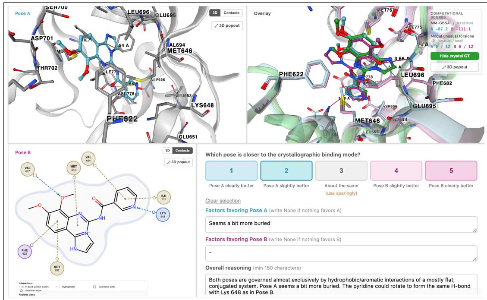
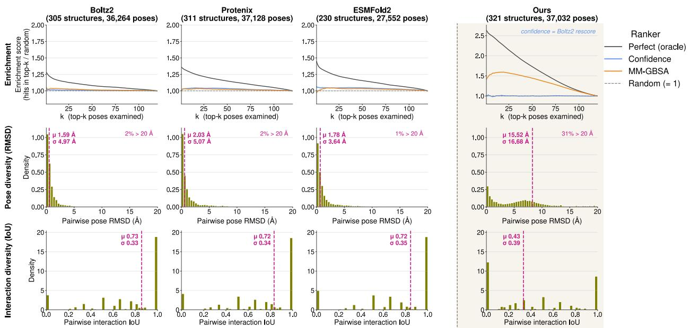
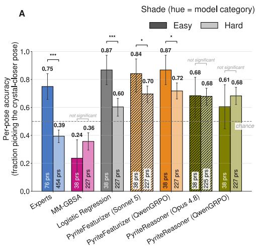
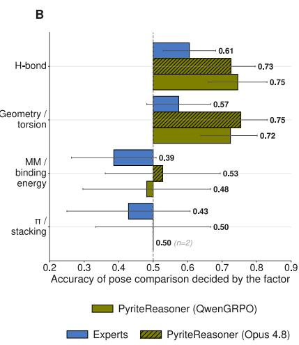
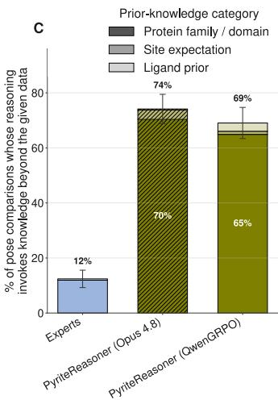
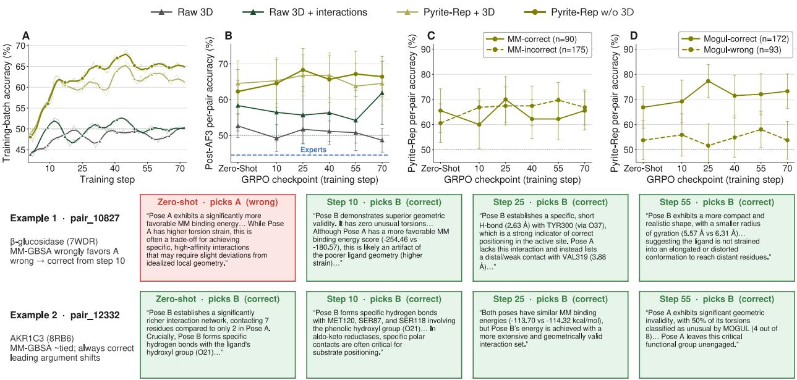
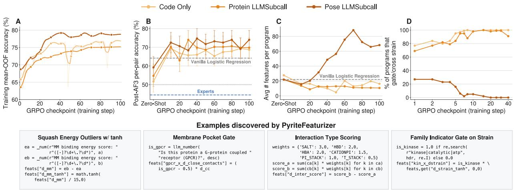

# Pyrite: Building and Benchmarking Protein-Ligand Pose Ranking Agents

Megha Srivastava\* megha@cs.stanford.edu Stanford University

Michael H. Lim mlim@genesis.ml Genesis Molecular AI

Allison M. Keys allikeys@genesis.ml Genesis Molecular AI

Pranav Murugan pranav@genesis.ml Genesis Molecular Al

Nate Gruver ngruver@genesis.ml Genesis Molecular AI

## Abstract

Predicting how a ligand binds to its target is central to small-molecule drug discovery. Modern cofolding models can generate diverse candidate poses, but reliably ranking these candidates remains challenging. We introduce Pyrite, a pairwise pose-ranking benchmark comprising 1,500 pose pairs across diverse protein-ligand complexes. Expert chemists equipped with 3D visualization tools and physics-based scores perform near chance, highlighting the difficulty of interpreting available chemical signals. To investigate automated ranking, we introduce PyriteRep, a structured representation of molecular geometry, protein-ligand interactions, and physicochemical scores, and develop two LLM-based agents: PyriteReasoner, which directly compares poses through text-based reasoning, and PyriteFeaturizer, which generates executable code to construct features for logistic regression, optionally incorporating features derived from LLM subcalls. These agents achieve up to 67% and 74% accuracy, respectively, exceeding observed expert performance. LLM-guided feature discovery generally outperforms direct reasoning, while Group Relative Policy Optimization (GRPO) improves open-weight models, enabling them to match or surpass closed-source frontier models in our evaluations. These results establish Pyrite as a challenging test of pose-ranking ability and highlight LLM-guided feature discovery as a promising approach to interpret and combine the outputs of computational chemistry tools.

Code: https://github.com/genesistherapeutics/pyrite Dataset: https://huggingface.co/datasets/genesisml/pyrite

## 1 Introduction

Structure-based drug design typically begins from an experimental crystal structure, but because new structures are slow and costly to obtain, the field relies on computational pocket discovery, docking, and scoring (Batool et al., 2019). State-of-the-art cofolding models (Abramson et al., 2024; Zhang et al., 2026; Genesis Research Team et al., 2025), combined with diversity-promoting sampling, can now predict many plausible binding modes for a protein-ligand pair. However, this diversity is only useful if the most plausible poses can be identified. At test time, the true binding mode is unknown, and chemists must triage large sets of

predictions. Errors in pose ranking can waste downstream effort and erode trust in the underlying models.   
We study whether agentic AI systems offer a potential path toward faster and more accurate pose ranking.

Pose ranking is difficult because the available signals are individually weak and often disagree. Physics-based scores such as MM-GBSA (Genheden & Ryde, 2015), an estimate of binding free energy, and ligand torsional strain from Mogul (Bruno et al., 2004a) each correlate only loosely with distance to the native pose, and for a given pair they may favor different candidates. Chemists resolve these conflicts using domain knowledge, such as familiarity with the target or chemical series, and by inspecting structures in 3D visualization software. For AI agents, this highlights a central challenge: invoking tools is easy, but interpreting their conflicting outputs to reach a sound decision is not. Can a language model-based agent, given the same computational tools as a chemist, rank poses more accurately than either the tools alone or expert chemists?

In this work, we create and publicly release Pyrite, the first dedicated benchmark for pairwise pose ranking of protein-ligand complexes. The limited pose diversity of many publicly available cofolding models reduces the utility of physics-based scores for ranking and provides less challenging decoys for benchmarking (Figure 2). This is consistent with recent work (Khiari et al., 2026), which combines an LLM agent with physicochemical tools to rank poses from classical docking, but only matches, rather than exceeds, the underlying scoring function's accuracy on a small benchmark. In contrast, Pyrite draws poses from our proprietary cofolding model and diversity-promoting sampling algorithm, yielding a challenging benchmark of 1,500 pose pairs spanning 285 structures and 1,799 unique poses.

We use Pyrite to investigate whether LLM-based agents can effectively interpret and combine the outputs of computational chemistry tools. Surprisingly, expert chemists perform near or below random chance despite substantial agreement between annotators, suggesting that conventional chemical intuition can be misleading when distinguishing high-quality cofolded poses. To systematically evaluate automated approaches, we next develop two complementary LLM-based agents: PyriteReasoner directly compares candidate poses through explicit text-based chemical reasoning, while PyriteFeaturizer uses an LLM to discover informative structural features for a lightweight logistic-regression classifier. This distinction allows us to investigate whether LLMs are more effective as direct pose-ranking agents or as feature engineers for conventional statistical models. Finally we explore whether reinforcement learning (RL) can improve the pose-ranking capabilities of open-weight models. Our contributions include:

1. Pyrite, a challenging pairwise pose-ranking benchmark constructed from diverse, high-quality cofolded poses. We find that expert chemists perform near or below random chance, despite substantial interannotator agreement, and that conventional physics-based scores can be anti-correlated with correctness.

2. PyriteRep, a structured data format for representing 3D poses, including molecular geometry, proteinligand interactions, and precomputed physicochemical features. We demonstrate that PyriteRep substantially improves LLM-based agents' pose-ranking accuracy compared to raw 3D coordinates alone.

3. PyriteReasoner, an LLM-based agent that directly ranks pose pairs through text-based chemical reasoning, achieving up to 67% accuracy. RL improves the performance of open-weight models, narrowing the gap with closed-source frontier models.

4. PyriteFeaturizer, an LLM-based coding agent that discovers and implements predictive structural features for a simple logistic-regression classifier. By combining code-derived quantitative descriptors with features generated through LLM subcalls, PyriteFeaturizer achieves up to 74% pose-ranking accuracy, the highest performance on our benchmark. RL substantially improves feature discovery in open-weight models, enabling them to match or exceed closed-source frontier models

Overall, our results demonstrate that ranking poses generated by modern cofolding models remains a challenging task, even for experienced chemists. While classical models trained on quantitative structural features are surprisingly competitive with direct LLM reasoning, LLM-guided feature discovery offers a promising way to improve upon these models by incorporating additional chemical and biological knowledge.

  
Figure 1: Interface for human expert annotations on our pairwise pose ranking benchmark Pyrite (ground truth crystal shown only for paper visualization). The example shows two predicted poses of a potential small-molecule inhibitor of the autotaxin protein (Protein Data Bank 7G63), with toggle control for 2D contact map and interactive 3D and overlay views. Experts are asked to select which pose is closer to the crystallographic binding mode (selecting 1-5), write factors in favor of both pose A and B, and describe their reasoning on how they weigh these factors for pose selection. Annotators are also provided MM-GBSA scores and the # of unusual torsions using Mogul for each pose.

## 2 Problem Setup: Pose Ranking

To introduce the pose ranking problem, let us walk through the example in Figure 1, which shows two predicted poses (Poses A and B) of a small-molecule that binds to autotaxin protein (Protein Data Bank 7G63). These predictions come from a proprietary cofolding model. At test time, the ground truth crystallographic binding mode of the protein-ligand complex is unknown; therefore, a strong pose ranker should be able to select which pose is closer to the ground truth 3D structure. In the example shown, the correct choice is Pose A. Now, consider the following reasoning from an expert chemist:

Expert Reasoning: Both poses are governed almost exclusively by hydrophobic/aromatic interactions of a mostly flat, conjugated system. Pose A seems a bit more buried. The pyridine could rotate to form the same H-bond with Lys 648 as in Pose B.

The chemist weighs many different factors before ultimately choosing Pose A, combining physical reasoning with more intuitive features. Our goal is to learn a strong pose ranker, and investigate whether AI agents based on language models can successfully reason over the outputs of computational chemistry tools to achieve high pose ranking accuracy. Although strong pairwise pose ranking ability is not the same as overall ranking, both tasks share the same underlying reasoning requirements from AI agents. We specifically chose to focus on a pairwise pose ranking due to its simplicity in light of context-length limits of language models, as well as the cognitive burden placed on the human experts we use for evaluating our benchmark Furthermore, pairwise comparison allows us to derive better semantic features than scoring a single pose.

## 2.1 Representing poses for Al agents with PyriteRep

Inspired by recent work showing that molecular graph schemas help improve the performance of LLM-based systems for chemical discovery (Runcie et al., 2026), we introduce PyriteRep, a structured data format for representing 3D poses for our pose ranking task. In Section B, we will show that PyriteRep improves the performance of LLM-based agents reasoning in text over pose ranking, in comparison to only providing each pose's 3D-coordinates. PyriteRep consists of 29 features, including both pose-invariant (identical for both poses) and pose-dependent features. These features are the outputs of several computational chemistry tools, including RDKit and OpenMM (Landrum et al., 2026; Eastman et al., 2024). We describe the features in the boxes below. Pose geometry features are computed from the ligand's N heavy-atom 3D coordinates with centroid $\begin{array} { r } { \bar { \mathbf { r } } = \frac { 1 } { N } \sum _ { i } \mathbf { r } _ { i } } \end{array}$ and gyration tensor $\begin{array} { r } { S = { \frac { 1 } { N } } \sum _ { i } ( { \bf r } _ { i } - \bar { \bf r } ) ( { \bf r } _ { i } - \bar { \bf r } ) ^ { \top } } \end{array}$

## Pose Invariant Features in PyriteRep

1. Target context: Protein ID, name, family name, and description of function from UniProt.

2. Atom List: List of heavy atoms with element and index.

3. Aromatic NH atoms: List of indices of hydrogen-bearing aromatic nitrogen atoms.

4. Bond List: List of bonds with type [single (-), double (=), triple (#), or aromatic (:)].

5. Formal Charges: List of non-zero formal charges per atom.

6. SMILES: Canonical SMILES string (Weininger et al., 1989).

7. IUPAC name: Canonical IUPAC name (Favre & Powell, 2014).

## Pose Dependent Features in PyriteRep

1. 3D Coordinates: List of 3D coordinates by $( \operatorname { i d } , \operatorname { x } , \operatorname { y } , \operatorname { z } )$

2. Asphericity: $b = \lambda _ { 3 } - { \textstyle { \frac { 1 } { 2 } } } ( \lambda _ { 1 } + \lambda _ { 2 } )$ , from eigenvalues $\lambda _ { 1 } \leq \lambda _ { 2 } \leq \lambda _ { 3 }$ of $S ; b = 0$ for a sphere.

3. Radius of Gyration: $\begin{array} { r } { R _ { g } = \sqrt { \frac { 1 } { N } \sum _ { i } \| { \bf r } _ { i } - \bar { \bf r } \| ^ { 2 } } = \sqrt { \lambda _ { 1 } + \lambda _ { 2 } + \lambda _ { 3 } } . } \end{array}$

4. Maximum Extent: $D _ { \operatorname* { m a x } } = \operatorname* { m a x } _ { i , j } \| { \bf r } _ { i } - { \bf r } _ { j } \| .$

5. Interactions List: List of interactions with residue, backbone/side-chain origin, and type (Hydrogen-bond Donor, Hydrogen-bond Acceptor, Salt Bridge, π-stacking, etc.).

6. # of Internal Close Contacts: $\begin{array} { r } { \sum _ { i < j , | i - j | \ge 2 } { \mathcal { k } } ^ { \ell } [ \| \mathbf { r } _ { i } - \mathbf { r } _ { j } \| < d _ { \mathrm { c c } } ] , d _ { \mathrm { c c } } = 3 . 2 \mathring \mathrm { A } } \end{array}$

7. # Residues Contacted: Total number of distinct residues making at least one detected contact.

8. # Sidechain Residues Contacted: Total number of distinct sidechain residues making at least one detected contact.

9. Torsional Strain: Torsion strain for the (i) protein backbone, (ii) sidechain, and (iii) total (kcal/mol)

10. Per-Residue Strain: Torsion strain for the (i) protein backbone, (ii) sidechain, and (iii) total divided by $N _ { \mathrm { r e s } } ~ \mathrm { ( k c a l / m o l ) }$

11. PoseBusters Validity: PosEBuSTERs validity check (Buttenschoen et al., 2024).

12. Mogul Total # Torsions: Total # of ligand torsion angles analyzed based on the Cambridge Structural Database (CSD) library using Mogul (Bruno et al., 2004b).

13. Mogul % Unusual Torsions: % of ligand torsion angles that are unusual, deviating from the CSD distribution, based using Mogul.

14. Mogul # Unusual Torsions: Total # of ligand torsion angles that are unusual based using Mogul.

15. Mogul Torsion Penalty: Aggregate deviation from CSD torsion angle distributions using Mogul.

16. Mogul # Unusual Rings: Total # of ligand rings with conformations deviating from CSD geometries using Mogul.

17. Inter-pose ligand RMSD: $\begin{array} { r } { \sqrt { \frac { 1 } { N } \sum _ { i } \| { \bf r } _ { i } ^ { A } - { \bf r } _ { i } ^ { B } \| ^ { 2 } } . } \end{array}$

18. MM-GBSA Score: Binding energy score, estimated from first step of docking pipeline.

  
Figure 2: Top-k pose enrichment and diversity across cofolding models For each of Boltz2, Protenix, ESMFold2, and our cofolding model, we scored 120 poses per complex against the ground truth crystal, calling a pose a "hit" at $\mathrm { R M S D } < 2 \mathring { \mathrm { A } }$ and $\mathrm { \ l D D T { \cdot } P L I } \ge 0 . 8$ . Top Row shows top-k enrichment (EF@k = hits in the top-k over hits expected at random, pooled across complexes, so random = 1). Middle Row and Bottom Row: the 3rd-party cofolding models are far less diverse than ours, measured both by the distribution of per-pair RMSD and Interaction IoU.

## 3 Pyrite Benchmark Creation

## 3.1 Generating Diverse Poses

We create Pyrite using poses from our proprietary cofolding model and inference-time method that generates a diverse set of binding poses for each target, while using physics-based guidance to steer predictions toward chemically and geometrically valid structures. Figure 2 shows that the poses from our model are more diverse than three different public 3rd-party models (Boltz2 (Passaro et al., 2025), Protenix (Zhang et al., 2026), and ESMFold2 (Candido et al., 2026)). Moreover, for all three cofolding models, both the model's own confidence and MM-GBSA score barely passes random chance at pose ranking, falling significantly short of the oracle. Only our system receives real enrichment from MM-GBSA, but that underperforms a far higher ceiling, necessitating building stronger pose-ranking methods.

To create our benchmark, we first use our cofolding model to sample up to 120 poses for protein-ligand queries spanning more than 50,000 structures from the RCSB Protein Data Bank (2026). We then take the top-25 poses scored by MM-GBSA for each query, entering a tight regime of high-quality poses where, as we will later show in Figure 2, MM-GBSA can actually become anti-correlated with pose ranking performance. We then consider all possible pairs of poses for the same query, and filter this set to create Pyrite.

## 3.2 Filtering Pose Pairs for Comparison

Not all pairs are useful for a pose ranking benchmark: for example, some poses may be obviously low quality or structurally invalid, while some pairs of poses might be too similar to each other to distinguish. We first categorize each pose by measuring RMSD-to-ground truth crystal over the 3D coordinates for each atom, IDDT-PLI (Local Distance Difference Test for Protein-Ligand Interactions), which is a scoring metric that measures local interatomic distances (Robin et al., 2023), and the interaction recall given the reference crystal's interactions. We designate thresholds for these metrics in order to create three categories:

1. GOOD: RMSD-to-ground truth crystal < 1 Å, 1DDT-PLI ≥ 0.85, interaction recall ≥ 0.90   
2. MAYBE: RMSD-to-ground truth crystal < 2 Å and ≥ 1 Å, 0.5 ≤ lDDT-PLI < 0.85   
3. BAD: RMSD-to-ground truth crystal < 4 Å and ≥ 2 Å, lDDT-PLI < 0.5, interaction recall < 0.5

Pose Categorization (Ground Truth Crystal Reference)

We filter down our dataset to only consist of Hard pairs (GOOD, MAYBE) and Easy pairs (GOOD, BAD), ensuring that every pair in Pyrite consists of at least one high-quality pose. However, we found that this high-level categorization was not sufficient in removing pairs with poses that were too similar or low-quality, so we introduced additional filtering conditions described in Appendix A. After applying all these filters, our final Pyrite benchmark consists of 1,500 pose pairs spanning 285 unique structures and 1,799 unique poses. Of these structures, 195 were released in the RCSB Protein Data Bank before September 30, 2021 (pre-AF3) and 90 were released afterwards (post-AF3). Because human annotation is costly, we select a curated subset of 750 pairs (177 structures, 890 poses), on which we collect annotations from expert chemists (see Section 4). For the rest of this paper, we will focus on three splits within Pyrite:

• pre-AF3 curated: 485 pairs, 121 structures. We report human accuracy on this split in Section 4. We do not evaluate LLM agents (see Sections 6.1 and 6.3) on pre-AF3 pairs, since we reserve the pre-AF3 data for training data

• post-AF3 all: 484 pairs, 90 structures, every post-AF3 pair in Pyrite.

• post-AF3 curated: 265 pairs, 56 structures, the subset of post-AF3 all with human annotations. This is the only split where we can directly compare LLM agents against expert chemists.

Because Pyrite is a balanced binary-classification task, we focus on comparing the accuracy of various pose-ranking methods. To ensure fair comparison, we treat abstentions (neither choosing Pose A or B) as incorrect across all methods.

## 3.3 Physics scores are anti-correlated for strong pose decoys

We first check whether the pre-computed physics scores we include in PyriteRep (see Section 2.1) can, as individual features, serve a strong pose rankers on Pyrite. For example, the MM-GBSA score estimates the binding free energy of a protein-ligand complex by combining molecular mechanics energies with implicit solvation models; intuitively, a lower MM-GBSA structure can imply that the predicted pose is more thermodynamically stable and closer to the native binding mode. However, we find that selecting the pose with the lower MM-GBSA score is anti-correlated with the correct choice in Pyrite (see Table 1), leading to low accuracy. This is likely due to Pyrite consisting of high-quality pose decoys that are predicted to be thermodynamically stable by construction, and therefore MM-GBSA is not a reliable score for pose ranking in this regime. In fact, Figure 2 shows no ranking improvement when k < 25, and a slight dip in the k < 10 regime of enrichment scores when using MM-GBSA for ranking poses from our system.

Importantly, no aspect of our benchmark creation intentionally selected for pose pairs where MM-GBSA provided an incorrect signal; rather, this appears to be a property of the high-quality pose regime for cofolding. Table 1 shows that other scores, including the total # of interactions, total torsion strain, and total # of unusual torsion angles using Mogul, similarly result in poor pose ranking accuracy across all splits. Collectively, these results suggest that any strong pose ranking method needs to both (i) overcome any potential inductive biases (e.g. that lower MM-GBSA scores are more favorable), and (ii) learn nontrivial ways to combine all the features in PyriteRep.

Given these results, a natural question is whether one should simply invert the sign of a physical score like MM-GBSA to use as the ranking criterion, which would by construction achieve above-chance accuracy on Pyrite. This would be problematic as such a rule contradicts the physical interpretation of the score, and would be inadvisable to deploy without evidence that the inversion generalizes beyond our benchmark: in fact, Figure 2 shows that the relationship between MM-GBSA and pose correctness depends on the number of candidate poses retained. Nevertheless, we find empirically that our trained methods presented later in Section 6 outperform sign-flipped MM-GBSA with a low agreement-rate (Appendix G), indicating that it is possible to learn a stronger decision rule that is not just a noisy copy of inverted physical heuristics.

Table 1: Accuracy and 95% CIs from expert chemists, Boltz-2 confidence, and various physics scores from PyriteRep across three benchmark splits. No method achieves pairwise accuracy significantly above chance.
<table><tr><td rowspan=1 colspan=6>Predictor                               Pre-AF3 curated Post-AF3 curated Post-AF3 full</td></tr><tr><td rowspan=7 colspan=3>Human experts (abstain-as-wrong)Human experts (decisive only)MM-GBSA energy ↓Total interactions ↑Total torsion strain $\downarrow$ Mogul unusual torsions ↓Boltz-2 confidence $\uparrow$ </td><td rowspan=1 colspan=1> $0 . 4 2 \pm 0 . 0 3$ </td><td rowspan=1 colspan=1> $0 . 4 5 \pm 0 . 0 4$ </td><td rowspan=1 colspan=1></td></tr><tr><td rowspan=1 colspan=1> $0 . 5 1 \pm 0 . 0 3$ </td><td rowspan=1 colspan=1> $0 . 5 7 \pm 0 . 0 5$ </td><td rowspan=1 colspan=1></td></tr><tr><td rowspan=1 colspan=1> $0 . 3 2 \pm 0 . 0 4$ </td><td rowspan=1 colspan=1> $0 . 3 4 \pm 0 . 0 6$ </td><td rowspan=1 colspan=1> $0 . 3 5 \pm 0 . 0 4$ </td></tr><tr><td rowspan=1 colspan=1> $0 . 4 1 \pm 0 . 0 4$ </td><td rowspan=1 colspan=1> $0 . 4 0 \pm 0 . 0 6$ </td><td rowspan=1 colspan=1> $0 . 4 0 \pm 0 . 0 4$ </td></tr><tr><td rowspan=1 colspan=1></td><td rowspan=1 colspan=1> $0 . 4 5 \pm 0 . 0 4$ </td><td rowspan=1 colspan=1> $0 . 5 1 \pm 0 . 0 6$ </td><td rowspan=1 colspan=1> $0 . 5 1 \pm 0 . 0 4$ </td></tr><tr><td rowspan=1 colspan=2></td><td rowspan=1 colspan=1> $0 . 3 5 \pm 0 . 0 4$ </td><td rowspan=1 colspan=1> $0 . 5 0 \pm 0 . 0 6$ </td><td rowspan=1 colspan=1> $0 . 4 3 \pm 0 . 0 4$ </td></tr><tr><td rowspan=1 colspan=1> $0 . 5 2 \pm 0 . 0 4$ </td><td rowspan=1 colspan=1> $0 . 4 6 \pm 0 . 0 6$ </td><td rowspan=1 colspan=1> $0 . 4 5 \pm 0 . 0 4$ </td></tr></table>

## 4 Human expert performance: oracle or baseline?

We next evaluate Pyrite with expert human chemists. Although our initial goal was to use the reasoning text provided by human experts to guide the design a strong automated pose-ranking method, we surprisingly find that expert chemists perform below/at random chance on Pyrite, as we describe below

## 4.1 Human expert annotation overview

We recruit 5 expert chemists with an average of more than 10 years of experience with computer-aided drug discovery (CADD), molecular docking, and virtual screening. Each annotator was provided a set of pose pairs, and asked to choose which pose (A or B) is closer to the crystallographic binding mode for each pair, providing the following:

1. Selection: A choice from 1-5 corresponding to which pose the expert believes is closer to the crystallographic binding mode (1: Pose A clearly better, 2: Pose A slightly better, 3: About the same, 4: Pose B slightly better, 5: Pose B clearly better).

2. Factors favoring Pose A/B: Any specific factors (or "None") about both Pose A and B that make it closer to the crystallographic binding mode.

3. Overall Reasoning: The overall reasoning behind the selection, describing all features of the two poses that influenced your decision, as well as any trade-offs. For the reasoning, we enforce a minimum 150 character requirement.

Figure 1 shows the interface provided to human experts, as well as example annotations. Experts were provided both 3D visualizations and 2D contact maps, as well as two physics-based and statistical scores: MM-GBSA and Mogul $\#$ of Unusual Torsions. Furthermore, experts were provided the UniProt protein family name and description, and could download PDB/SDF files of the protein-ligand poses to further analyze in molecular visualization tools like PyMOL (Schrödinger, LLC, 2015). We collected 2 annotations per pose pair in the curated subset of Pyrite, reaching a total of 1500 annotations.

## 4.2 Human experts perform below chance at pairwise ranking of cofolded poses

We surprisingly find that human experts achieved an average pose pair comparison accuracy below chance for both pre-AF3 and post-AF3 structures (see Table 1). This low performance holds even when we removed pose pairs where annotators selected option 3 ("About the same", pre-AF3 0.42 → 0.51, post-AF3 0.45 → 0.57). Interestingly, the agreement rate between annotators (77%) was significantly higher than their accuracy.





  
Figure 3: Human experts vs. models performance on post-AF3 curated split. (A) Accuracy for experts and a subset of ranking methods, split by Easy and Hard pairs. Error bars are 95% CIs. (B) Average accuracy across experts and two PyriteReasoner agents grouped by factors driving the reasoning for a given pair selection. (C) Rate at which experts and and two PyriteReasoner agents reference proteinfamily and domain knowledge in their reasoning output.

One hypothesis for human expert's poor accuracy on our benchmark is that pairs based on poses generated from cofolding models are, versus classical docking methods, more likely to have subtle differences that are unintuitive for experts to detect, despite their extensive molecular docking experience. In fact, we observe a statistically significant gap in expert accuracy between the Easy and Hard pairs in our benchmark (see Figure 3), suggesting that experts achieve higher accuracy when the difference between two poses is more significant. We also find that experts often rely on the MM-GBSA score for their selection which, as shown earlier, is actually anti-correlated with accuracy on Pyrite. In fact, expert accuracy is low when their reasoning relies on the MM-GBSA score, but is significantly higher whenever they mention features like the pose's interactions or torsion geometry (Figure 3). Overall, the surprisingly poor performance of experts chemists on Pyrite motivates the need for building stronger automated pose ranking methods.

## 5 Methods: Building pose ranking agents

In this section, we give an overview of our two LLM-based agents for pose ranking: PyriteReasoner and PyriteFeaturizer. Recent advances in large language models (LLMs) have enabled the development of agents capable of performing complex scientific tasks, including chemical synthesis planning, drug discovery and autonomous experiment design (Boiko et al., 2023; Bran et al., 2024; Roohani et al., 2025). These advances motivate our exploration of LLM-based agents for pose ranking, a task that requires integrating qualitative chemical reasoning with quantitative assessments of molecular geometry, interactions, and physics.

A key motivation for our approach is the potential to combine the interpretability of language-based reasoning with the precision of quantitative analysis. While LLMs are increasingly capable of articulating chemical principles and providing human-readable explanations for their predictions, their reasoning may also inherit the heuristics and biases of human expert chemists (e.g., the assumption that lower MM-GBSA scores necessarily indicate better poses). Meanwhile, exposure to high-quality poses from pre-AF3 structures may help counter such biases by grounding agents’ reasoning in empirical structural evidence, enabling them to identify useful pose-ranking criteria that extend beyond conventional chemical intuition

We therefore develop two complementary approaches. PyriteReasoner uses an LLM to directly evaluate candidate poses through explicit chemical reasoning. In contrast, PyriteFeaturizer draws inspiration from automated feature engineering (Katz et al., 2016; Kanter & Veeramachaneni, 2015), using an LLM to discover informative structural features that can be incorporated into a lightweight logistic-regression classifier. Together, these approaches allow us to investigate the relative merits of using LLMs as direct reasoning agents versus using them to discover features for conventional models.

## 5.1 Text-based reasoning with PyriteReasoner

PyriteReasoner compares candidate pose pairs through explicit text-based reasoning, leveraging chemical and structural knowledge acquired during LLM pretraining to assess their relative plausibility. To examine how model capabilities affect pose-ranking performance, we instantiate PyriteReasoner with four LLMs: two large frontier models (Opus 4.8 and GPT-5.6-sol), one midsize frontier model (Sonnet 5), and one openweight model (Qwen3.8-27B). We evaluate five input ablations to investigate how different representations of structural information affect pose-ranking performance:

1. Raw 3D Coordinates Only: Protein and ligand atomic coordinates for both poses.

2. Interactions + Raw 3D Coordinates: Atomic coordinates supplemented with a list of protein-ligand interactions for each pose.

3. PyriteRep w/ 3D Coordinates: All features in PyriteRep (Section 2), including atomic coordinates.

4. PyriteRep w/o 3D Coordinates: All PyriteRep features except atomic coordinates.

5. In-Context: PyriteRep supplemented with two labeled examples retrieved from the pre-AF3 split, selected by ligand Tanimoto similarity to the query.

For ablations using PyriteRep, the large number of features may make it difficult for the LLM to identify the most informative differences between poses. To make these differences more salient, we append a block of precomputed summaries derived from PyriteRep, explicitly highlighting features that differ between Pose A and Pose B, such as the shared interactions or overall number of hydrogen-bond donors (Appendix D). An example prompt for the PyriteRep w/o 3D Coordinates configuration is provided in Appendix C.

## 5.2 Discovering predictive features with PyriteFeaturizer

Since many features in PyriteRep are quantitative, we hypothesize that classical machine learning methods, such as logistic regression, can learn which structural features are predictive of pose correctness, including relationships that may contradict the heuristics we saw experts employ (e.g. overreliance on MM-GBSA). However, LLMs may possess additional chemical and biological knowledge that is not readily captured by predefined quantitative descriptors, such as known interactions within protein families, or chemical intuition about which ligand substructures should be solvent-exposed or occupy hydrophobic pockets.

Motivated by prior work on automated feature engineering (Katz et al., 2016; Kanter & Veeramachaneni, 2015) and AutoML (Real et al., 2020), we develop PyriteFeaturizer, an LLM-based coding agent that generates Python scripts to construct predictive features from the PyriteRep schema. These features are subsequently used to train a logistic-regression classifier. All classifiers are trained exclusively on structures from the pre-AF3 split. We evaluate PyriteFeaturizer using the same four LLMs as PyriteReasoner (Opus 4.8, GPT-5.6-sol, Sonnet 5, and Qwen3.8-27B) under three feature-generation ablations:

1. Code Only: PyriteFeaturizer generates Python code that computes features directly from PyriteRep, without additional LLM calls.

2. Protein LLM Subcall: In addition to code-derived features, PyriteFeaturizer can design and invoke calls to a smaller LLM (Qwen3.5-9B) to extract protein-level features shared by Pose A and Pose B.

3. Pose LLM Subcall: PyriteFeaturizer can additionally design and invoke calls to Qwen3.5-9B to extract pose-specific features for Pose A and Pose B.

We compare these ablations against a Vanilla Logistic Regression baseline trained on all quantitative features in PyriteRep. We use logistic regression as our downstream classifier for its simplicity, but also evaluate alternative classical methods, including tree-based models, in Appendix B.

Table 2: PyriteReasoner pose ranking accuracy across four different base LLMs, five input ablations, and Qwen3.8-27B finetuned with GRPO. Values are mean accuracy $\pm \ 9 5 \%$ confidence intervals. † means significantly higher than expert, curated split only, and \* means significant difference for ∆ GRPO, $p < 0 . 0 5$
<table><tr><td rowspan=1 colspan=7>Variant                      Opus 4.8    Sonnet 5    $\mathrm { G P T - 5 . 6 { \cdot } s o l }$  Qwen3.8-27BQwen3.8-27B-GRPO ∆ GRPOCurated (n=265)</td></tr><tr><td rowspan=1 colspan=1>Raw 3D Coord Only</td><td rowspan=1 colspan=1> $0 . 4 9 \pm 0 . 0 6$ </td><td rowspan=1 colspan=1> $0 . 3 4 \pm 0 . 0 7$ </td><td rowspan=1 colspan=1> $0 . 5 2 \pm 0 . 0 6 ^ { \dagger }$ </td><td rowspan=1 colspan=1> $0 . 5 3 \pm 0 . 0 6$ </td><td rowspan=1 colspan=1> $0 . 5 2 \pm 0 . 0 6 ^ { \dagger }$ </td><td rowspan=1 colspan=1>-0.01</td></tr><tr><td rowspan=1 colspan=1>Interactions + Raw 3D</td><td rowspan=1 colspan=1> $0 . 5 1 \pm 0 . 0 6 ^ { \dagger }$ </td><td rowspan=1 colspan=1> $0 . 4 9 \pm 0 . 0 6$ </td><td rowspan=1 colspan=1> $0 . 5 5 \pm 0 . 0 6 ^ { \dagger }$ </td><td rowspan=1 colspan=1> $0 . 5 8 \pm 0 . 0 6 ^ { \dagger }$ </td><td rowspan=1 colspan=1> $0 . 6 2 \pm 0 . 0 6 ^ { \dagger }$ </td><td rowspan=1 colspan=1>+0.04</td></tr><tr><td rowspan=1 colspan=1>PyriteRep</td><td rowspan=1 colspan=1> $0 . 6 3 \pm 0 . 0 6 ^ { \dagger }$ </td><td rowspan=1 colspan=1> $0 . 6 2 \pm 0 . 0 6 ^ { \dagger }$ </td><td rowspan=1 colspan=1> $0 . 6 0 \pm 0 . 0 6 ^ { \dagger }$ </td><td rowspan=1 colspan=1> $0 . 6 5 \pm 0 . 0 6 ^ { \dagger }$ </td><td rowspan=1 colspan=1> $0 . 6 7 \pm 0 . 0 6 ^ { \dagger }$ </td><td rowspan=1 colspan=1>+0.02</td></tr><tr><td rowspan=1 colspan=1>PyriteRep $\mathrm { w / o }$ Raw 3D</td><td rowspan=1 colspan=1> $0 . 6 5 \pm 0 . 0 6 ^ { \dagger }$ </td><td rowspan=1 colspan=1> $0 . 6 1 \pm 0 . 0 6 ^ { \dagger }$ </td><td rowspan=1 colspan=1> $0 . 5 7 \pm 0 . 0 6 ^ { \dagger }$ </td><td rowspan=1 colspan=1> $0 . 6 2 \pm 0 . 0 6 ^ { \dagger }$ </td><td rowspan=1 colspan=1>0.67 ± 0.06†</td><td rowspan=2 colspan=1> $+ 0 . 0 5 ^ { * }$ </td></tr><tr><td rowspan=1 colspan=1>In-Context</td><td rowspan=1 colspan=1> $0 . 6 2 \pm 0 . 0 6 ^ { \dagger }$ </td><td rowspan=1 colspan=1> $0 . 5 8 \pm 0 . 0 6 ^ { \dagger }$ </td><td rowspan=1 colspan=1> $0 . 4 7 \pm 0 . 0 6$ </td><td rowspan=1 colspan=1> $0 . 5 9 \pm 0 . 0 6 ^ { \dagger }$ </td><td></td></tr><tr><td rowspan=1 colspan=7>All $\scriptstyle ( n = 4 8 4 )$ </td></tr><tr><td rowspan=1 colspan=1>Raw 3D Coord Only</td><td rowspan=1 colspan=1> $0 . 5 0 \pm 0 . 0 4$ </td><td rowspan=1 colspan=1> $0 . 3 6 \pm 0 . 0 5$ </td><td rowspan=1 colspan=1> $0 . 5 0 \pm 0 . 0 4$ </td><td rowspan=1 colspan=1> $0 . 5 2 \pm 0 . 0 4$ </td><td rowspan=1 colspan=1> $0 . 5 2 \pm 0 . 0 4$ </td><td rowspan=1 colspan=1>+0.00</td></tr><tr><td rowspan=1 colspan=1>Interactions + Raw 3D</td><td rowspan=1 colspan=1> $0 . 6 0 \pm 0 . 0 4$ </td><td rowspan=1 colspan=1> $0 . 5 5 \pm 0 . 0 5$ </td><td rowspan=1 colspan=1> $0 . 6 1 \pm 0 . 0 4$ </td><td rowspan=1 colspan=1> $0 . 6 4 \pm 0 . 0 4$ </td><td rowspan=1 colspan=1> $0 . 6 4 \pm 0 . 0 4$ </td><td rowspan=1 colspan=1>+0.00</td></tr><tr><td rowspan=1 colspan=1>PyriteRep</td><td rowspan=1 colspan=1> $0 . 6 5 \pm 0 . 0 4$ </td><td rowspan=1 colspan=1> $0 . 6 1 \pm 0 . 0 4$ </td><td rowspan=1 colspan=1> $0 . 6 2 \pm 0 . 0 4$ </td><td rowspan=1 colspan=1> $0 . 6 5 \pm 0 . 0 4$ </td><td rowspan=1 colspan=1> $0 . 6 6 \pm 0 . 0 4$ </td><td rowspan=1 colspan=1>+0.01</td></tr><tr><td rowspan=1 colspan=1>PyriteRep $\mathrm { w / o }$ Raw 3D</td><td rowspan=1 colspan=1> $0 . 6 7 \pm 0 . 0 4$ </td><td rowspan=1 colspan=1> $0 . 6 2 \pm 0 . 0 4$ </td><td rowspan=1 colspan=1> $0 . 6 1 \pm 0 . 0 4$ </td><td rowspan=1 colspan=1> $0 . 6 3 \pm 0 . 0 4$ </td><td rowspan=1 colspan=1> $0 . 6 7 \pm 0 . 0 4$ </td><td rowspan=1 colspan=1>+0.04</td></tr><tr><td rowspan=1 colspan=1>In-Context</td><td rowspan=1 colspan=1> $0 . 6 4 \pm 0 . 0 4$ </td><td rowspan=1 colspan=1> $0 . 5 9 \pm 0 . 0 4$ </td><td rowspan=1 colspan=1> $0 . 4 8 \pm 0 . 0 4$ </td><td rowspan=1 colspan=1> $0 . 5 8 \pm 0 . 0 4$ </td><td rowspan=1 colspan=2></td></tr></table>

## 5.3 Improving pose ranking accuracy with GRPO

For both PyriteReasoner and PyriteFeaturizer. we investigate whether GRPO (Shao et al., 2024), the de facto standard algorithm for RL-based reasoning improvements in open-weight models (Guo et al., 2025), can similarly improve pose ranking accuracy on the post-AF3 evaluation splits. For both agents, we use the same pre-AF3 training dataset used in5.2, as well as the same base model (Qwen3.8-27B). The rewards we use for training both agents are:

• PyriteReasoner: An output (pose selection and reasoning) receives 0 unless it ends with a parseable SELECTION line, 1 if it is well-formatted but selects the incorrect pose, and 2 if it selects the correct pose.

• PyriteFeaturizer: An output (a Python featurizer script) receives 0 if it fails to execute, exceeds 20s, or yields only constant features. Otherwise, the reward is the accuracy of a logistic regression trained on the returned features, under a 5-fold leave-structure-out cross-validation over the pre-AF3 training pool.

Because training PyriteFeaturizer with GRPO optimizes the quality of a single Python featurizer script, controlling batch variation is a bigger challenge for PyriteReasoner, due to both sampling and input diversity. More details on the training hyperparameters and implementation are in Appendix E.

## 6 Experiment Results

We now present and discuss experiment results for all ablations and comparison studied for both PyriteReasoner and PyriteFeaturizer. Because we use data from the pre-AF3 split in Pyrite for training (both GRPO and the logistic regression in PyriteFeaturizer), we evaluate only on the post-AF3 splits. We report per-pair accuracy for post-AF3 all and post-AF3 curated separately to enable direct comparison with the curated subset we received expert chemist annotations over.

## 6.1 PyriteReasoner: Using PyriteRep improves zero-shot LLM performance

Table 2 shows that when PyriteReasoner is provided only raw 3D coordinates, it performs near or below random chance across all LLMs. This suggests that LLMs struggle to extract geometric signal directly from atomic coordinates. However, supplying explicit interaction information substantially improves performance, and using the entire PyriteRep representation yields further gains, reaching accuracy significantly above random chance. Interestingly, omitting raw 3D coordinates from PyriteRep does not hurt performance.

Table 3: PyriteFeaturizer pose ranking accuracy across four different base LLMs, give input ablations, and Qwen3.8-27B finetuned with GRPO. Values are mean accuracy ± 95% confidence intervals. † means significantly higher than expert, curated split only, and \* means significant difference for ∆ GRPO, $\begin{array} { r } { p < 0 . 0 5 . } \end{array}$
<table><tr><td>Arm</td><td>Opus 4.8</td><td>Sonnet 5</td><td> $\mathrm { G P T - 5 . 6 { \cdot } s o l }$ </td><td>Qwen3.8-27B</td><td> $\mathrm { Q w e n 3 . 8 – 2 7 B  – G R P O }$ </td><td>∆</td></tr><tr><td colspan="7">Curated (n=265), † means significantly higher than expert</td></tr><tr><td>Code Only</td><td> $0 . 6 5 \pm 0 . 0 6 ^ { \dagger }$ </td><td> $0 . 6 3 \pm 0 . 0 6 ^ { \dagger }$ </td><td> $0 . 6 5 \pm 0 . 0 6 ^ { \dagger }$ </td><td> $0 . 5 2 \pm 0 . 0 6 ^ { \dagger }$ </td><td> $0 . 6 9 \pm 0 . 0 6 ^ { \dag }$ </td><td> $+ 0 . 1 7 ^ { * }$ </td></tr><tr><td>Protein LLMSubcall</td><td> $0 . 6 9 \pm 0 . 0 6 ^ { \dagger }$ </td><td> $0 . 7 2 \pm 0 . 0 5 ^ { \dagger }$ </td><td> $0 . 6 6 \pm 0 . 0 6 ^ { \dagger }$ </td><td> $0 . 5 5 \pm 0 . 0 6 ^ { \dagger }$ </td><td> $0 . 7 0 \pm 0 . 0 6 ^ { \dagger }$ </td><td> $+ 0 . 1 5 ^ { * }$ </td></tr><tr><td>Pose LLMSubcall</td><td> $0 . 6 9 \pm 0 . 0 6 ^ { \dagger }$ </td><td> $0 . 7 3 \pm 0 . 0 6 ^ { \dagger }$ </td><td> $0 . 7 1 \pm 0 . 0 6 ^ { \dagger }$ </td><td> $0 . 5 9 \pm 0 . 0 6 ^ { \dagger }$ </td><td> $0 . 7 4 \pm 0 . 0 5 ^ { \dagger }$ </td><td> $+ 0 . 1 5 ^ { * }$ </td></tr><tr><td colspan="7">Vanilla Logistic Regression (all features in PyriteRep)</td></tr><tr><td colspan="7"> $A l l \ ( \mathrm { n { = } 4 8 4 } )$ </td></tr><tr><td>Code Only</td><td> $0 . 6 6 \pm 0 . 0 4$ </td><td> $0 . 6 2 \pm 0 . 0 4$ </td><td> $0 . 6 5 \pm 0 . 0 4$ </td><td> $0 . 4 7 \pm 0 . 0 4$ </td><td> $0 . 6 7 \pm 0 . 0 4$ </td><td rowspan="3"> $+ 0 . 1 9 ^ { * }$   $+ 0 . 1 3 ^ { * }$ </td></tr><tr><td>Protein LLMSubcall</td><td> $0 . 6 5 \pm 0 . 0 4$ </td><td> $0 . 6 9 \pm 0 . 0 4$ </td><td> $0 . 6 8 \pm 0 . 0 4$ </td><td> $0 . 5 3 \pm 0 . 0 4$ </td><td> $0 . 6 6 \pm 0 . 0 4$ </td></tr><tr><td>Pose LLMSubcall</td><td> $0 . 6 7 \pm 0 . 0 4$ </td><td> $0 . 6 9 \pm 0 . 0 4$ </td><td> $0 . 6 8 \pm 0 . 0 4$ </td><td> $0 . 6 0 \pm 0 . 0 4$ </td><td> $0 . 7 1 \pm 0 . 0 4$ </td></tr><tr><td colspan="7">Vanilla Logistic Regression (all features in PyriteRep)  $0 . 6 0 \pm 0 . 0 4$ </td></tr></table>

Likewise, including in-context examples offer no consistent benefit, possibly because the retrieved examples may not be sufficiently informative.

In Figure 3, we more closely compare the performance of the best frontier LLM, Opus 4.8, with human experts. We find that unlike human experts, PyriteReasoner shows a much smaller gap in performance between Easy and Hard pose pairs, and slightly underperforming experts in the Easy regime (see Section 3.2 for Easy/Hard classification). Furthermore, upon examining the reasoning traces, we find that PyriteReasoner is more effective at accurately reasoning about factors like torsion, hydrogen bonds, and MM-GBSA scores in comparison with experts, as well as more likely to explicitly reference domain knowledge about the target protein and ligand (Figure 3 B). Overall, our results show that PyriteReasoner is able to achieve stronger pose ranking accuracy than expert chemists by not over-relying on heuristics that are adversarial for ranking the high-quality poses in Pyrite.

## 6.2 Classical machine learning is competitive with text-based reasoning

We next evaluate classical machine learning algorithms on our benchmark using the quantitative features described in Section 2. We compare logistic regression (Cox, 1958) against three tree-based methods capable of capturing nonlinear interactions between features: random forest (Breiman, 2001), LightGBM (Ke et al. 2017), and XGBoost (Chen & Guestrin, 2016).

As shown in Table 4, we observe no statistically significant differences between logistic regression and the tree-based methods on post-AF3 pose pairs in Pyrite. Notably, even vanilla logistic regression achieves performance comparable to PyriteReasoner, outperforming both Sonnet 5 and GPT-5.6-sol on the post-AF3 curated subset (64% mean per-pose accuracy), although it remains below the strongest LLM, Opus 4.8. These findings highlight the predictive value of quantitative structural features and demonstrate that relatively simple statistical models can be competitive with LLM-based reasoning. This motivates Pyrite-Featurizer, which investigates whether LLM-guided feature discovery can further improve the predictive capabilities of simple models by incorporating chemical knowledge beyond existing quantitative features.

## 6.3 PyriteFeaturizer: LLM subcalls improve predictive feature discovery

As shown in Table 3, PyriteFeaturizer generally outperforms PyriteReasoner across models, with the exception of the open-weight model Qwen3.8-27B, perhaps suggest that advanced frontier model capabilities include the ability to translate chemical reasoning into executable, feature-engineering code. Furthermore, allowing PyriteFeaturizer to incorporate LLM-derived features through subcalls further improves performance in most settings, particularly when subcalls evaluate individual poses (e.g. “Is the ligand well packed in this pose?".

  
Figure 4: GRPO training dynamics for PyriteReasoner (A) Train accuracy for four ablations across training steps (error bars are ±SEM) (B) Post-AF3 per-pair accuracy for four ablations across training steps in comparison with human experts (C) Post-AF3 per-pair accuracy for only the PyriteRep w/o 3D coordinates ablation, split by whether MM-GBSA picks incorrect pose. (D) Post-AF3 per-pair accuracy for only the PyriteRep w/o 3D coordinates ablation, split by whether Mogul # Unusual Torsions picks incorrect pose. Bottom Rows Example reasoning outputs from PyriteRep w/o 3D coordinates ablation over the course GRPO steps.

We also find that training logistic regression models on PyriteFeaturizer-generated features generally outperform the Vanilla Logistic Regression baseline, suggesting that LLM-guided feature discovery can improve upon the existing quantitative descriptors in PyriteRep. Together, these results highlight that Pyrite-Featurizer serves as an effective hybrid method by leveraging both the learned relationship of precomputed features from training data and any pretrained chemical reasoning knowledge in the underlying languagee model. Motivated by the weaker performance of Qwen3.8-27B, we next investigate whether reinforcement learning with Group Relative Policy Optimization (GRPO) can improve the feature-discovery capabilities of open-weight models.

## 6.4 GRPO narrows the gap between open-weight and frontier models

Both PyriteReasoner and PyriteFeaturizer exhibit a performance gap between open-weight and closedsource frontier models, particularly for PyriteFeaturizer. We investigate whether reinforcement learning with Group Relative Policy Optimization (GRPO; Section 5.3) can improve the pose-ranking capabilities of open-weight models. As shown in Tables 2 and 3, GRPO training on pre-AF3 structures improves performance for both agents, with especially substantial gains for PyriteFeaturizer.

For PyriteReasoner, GRPO improves pose-ranking accuracy on post-AF3 structures, including the challenging MM-incorrect subset, where the MM-GBSA score favors the incorrect pose. We also observe improvements on cases where the number of unusual Mogul torsions favors the correct pose, suggesting that training improves the model's ability to identify how to rely on different structural features in PyriteRep. Example reasoning traces further illustrate how PyriteReasoner learns to rely less heavily on MM-GBSA over the course of training, suggesting that RL can help refine the chemical heuristics used by LLMs, enabling them to move beyond some of the cognitive biases demonstrated by human experts.

For PyriteFeaturizer, GRPO yields even larger improvements, with the Pose LLM Subcall configuration reaching 74% pose-ranking accuracy, the highest performance observed on our benchmark (Table 3). Figure 5 shows increases in both training and post-AF3 test accuracy across all three configurations, with Pose LLM Subcall achieving the strongest performance. A closer look at the generated programs reveals several learned feature-engineering strategies, including bounding outlier-sensitive quantities such as MM-GBSA scores using tanh, and combining LLM-derived contextual information with quantitative descriptors. For example, one generated feature assigns greater weight to differences in close-contact counts between candidate poses when the target protein is a G protein-coupled receptor (GPCR). We also observe a shift in the feature-generation strategies learned under the Pose LLM Subcall ablation. Rather than relying exclusively on intricate codebased logic, such as conditional gating of ligand strain metrics, the agent increasingly incorporates explicit LLM subcalls to evaluate pose-specific properties. This shift is accompanied by a substantial increase in the number of generated features compared to the other two ablations. Example programs from all three configurations are provided in Appendix F.

  
Figure 5: GRPO training dynamics for PyriteFeaturizer (A) Train mean-OOF accuracy for three ablations across training steps (error bars are ±SEM) (B) Post-AF3 per-pair accuracy for three ablations across training steps in comparison with human experts and vanilla logistic regression (C) Average # of distinct features in each program output for all three ablations across training steps (D) % of program outputs using gating logic on strain metrics for all three ablations across training steps. Bottom Rows Example features discovered by PyriteFeaturizer to use for logistic regression.

Overall, our results suggest that LLMs may be more effective at pose ranking when used to discover predictive structural features rather than to make direct text-based judgments over each instance in Pyrite. By combining LLM-derived chemical knowledge with a simple classical model, PyriteFeaturizer provides a promising alternative to conventional LLM reasoning. Furthermore, the substantial gains from GRPO demonstrate that RL can enable open-weight models to discover increasingly effective feature representations, even reversing the performance gap with closed-source frontier models. Together, these findings highlight the potential of combining LLM-guided feature discovery with RL for robust and interpretable pose ranking.

## 7 Related Work

Docking and cofolding methods Classical docking combines physics-based search with scoring functions to predict binding poses (Trott & Olson, 2009; Koes et al., 2013; Friesner et al., 2004). The ability to select near-native poses from fixed candidate sets is evaluated explicitly by the docking-power benchmark in CASF-2016 (Su et al., 2019). Deep learning has since been applied to both scoring and sampling, though these methods largely retain the rigid-protein assumption (McNutt et al., 2025; Alcaide et al., 2024; Corso et al., 2023). Cofolding models remove this constraint, predicting protein and ligand structure jointly without requiring an experimental structure or known binding mode (Abramson et al., 2024; Wohlwend et al., 2024). Like earlier generative models for docking and folding (Corso et al., 2023; Jumper et al., 2021; Krishna et al., 2024), cofolding models include confidence heads trained to predict error in their own outputs, but recent benchmarks highlight limitations of these confidence scores for ranking diverse ligand poses (Genesis Research Team et al., 2025; Škrinjar et al., 2026).

LLMs for scientific reasoning Large language models are widely used to rank and critique outputs in domains such as writing, mathematics, and coding (Zheng et al., 2023; Cobbe et al., 2021; Ni et al., 2023), and agentic systems for scientific discovery rely on these abilities to generate, evaluate, and refine hypotheses (Ren et al., 2025). Several recent benchmarks have shown a steadily improving performance of state-of-theart LLMs on scientific tasks, including drug discovery (Han et al., 2026; Narayanan et al., 2025; Mirza et al., 2024), and tool use can substantially boost performance even on basic chemistry tasks such as interpreting SMILES (Jang et al., 2025; Yu et al., 2025a). However, few evaluations target tasks that require reasoning over 3D molecular geometry. Pose ranking offers a well-defined, verifiable instance of this problem.

LLM-based feature engineering and program search Several works have leveraged LLMs to support predictive pipelines by generating features for downstream models. For example, CAAFE (Hollmann et al., 2023) creates contextual feature transformations with executable Python code, while FeatLLM (Han et al., 2024) combines LLM-generated features with lightweight predictors. FeRG-LLM (Ko et al., 2025) further trains feature-generating models using supervised learning and preference optimization driven by downstream predictive performance. More broadly, FunSearch (Romera-Paredes et al., 2024) searches over LLM-generated programs using an automated evaluator, while Eureka (Ma et al., 2024) refines rewardfunction code using feedback from policy training . PyriteFeaturizer applies these ideas to pose ranking, using GRPO training with cross-validation accuracy as a reward to improving LLM-derived features.

Expert judgment in molecular discovery Previous studies of molecular compound prioritization have similarly demonstrated human bias among medicinal chemists, including differences between reported and statistically inferred decision criteria (Kutchukian et al., 2012). More broader reviews of virtual screening have documented methodological pitfalls (Scior et al., 2012) that motivate our empirical evaluation of expert's chemical judgment and use of computational tools in the context of pose ranking.

## 8 Future Work & Conclusion

AI agents for scientific discovery ultimately need do more than call the right tool: they must know how to reason over and when to trust different tools' output. Our pose ranking benchmark Pyrite makes this tension concrete: expert chemists perform near or below chance, while physics-based scores can be actively anti-correlated with correctness on our strong, diverse pose decoys. Although we showed that both PyriteReasoner and PyriteFeaturizer agents can not only successfully learn from different outputs of computational chemistry tools, but also improve their performance with reinforcement learning, there is still a significant accuracy gap remaining before reaching benchmark saturation on Pyrite. One direction for future work is creating larger training datasets; we limited our training data to pre-AF3 structures to match the broader literature, but there might be inherent distribution shifts between pre-AF3 and post-AF3 structures that hinder learning methods. Future work should also test whether our findings hold for poses sampled from other generative models with different sampling techniques, as well as whether improvement on our pairwise pose comparison task reliably translates to pose ranking pipelines used in drug discovery.

## References

Josh Abramson, Jonas Adler, Jack Dunger, Richard Evans, Tim Green, Alexander Pritzel, Olaf Ronneberger, Lindsay Willmore, Andrew J. Ballard, Joshua Bambrick, Sebastian W. Bodenstein, David A. Evans, Chia-Chun Hung, Michael O'Neill, David Reiman, Kathryn Tunyasuvunakool, Zachary Wu, Akvilė Żemgulytė, Eirini Arvaniti, Charles Beattie, Ottavia Bertolli, Alex Bridgland, Alexey Cherepanov, Miles Congreve, Alexander I. Cowen-Rivers, Andrew Cowie, Michael Figurnov, Fabian B. Fuchs, Hannah Gladman, Rishub Jain, Yousuf A. Khan, Caroline M. R. Low, Kuba Perlin, Anna Potapenko, Pascal Savy, Sukhdeep Singh, Adrian Stecula, Ashok Thillaisundaram, Catherine Tong, Sergei Yakneen, Ellen D. Zhong, Michal Zielinski, Augustin Žídek, Victor Bapst, Pushmeet Kohli, Max Jaderberg, Demis Hassabis, and John M. Jumper.

Accurate structure prediction of biomolecular interactions with alphafold 3. Nature, 630(8016):493–500. May 2024. ISSN 1476-4687. doi: 10.1038/s41586-024-07487-w. URL http://dx.doi.org/10.1038/ s41586-024-07487-w.

Eric Alcaide, Zhifeng Gao, Guolin Ke, Yaqi Li, Linfeng Zhang, Hang Zheng, and Gengmo Zhou. Uni-mol docking v2: Towards realistic and accurate binding pose prediction, 2024. URL https://arxiv.org/abs/ 2405.11769.

Maria Batool, Bilal Ahmad, and Sangdun Choi. A structure-based drug discovery paradigm. International Journal of Molecular Sciences, 20(11):2783, 2019. ISSN 1422-0067. doi: 10.3390/ijms20112783. URL http://dx.doi.org/10.3390/ijms20112783.

G. Richard Bickerton, Gaia V. Paolini, Jérémy Besnard, Sorel Muresan, and Andrew L. Hopkins. Quantifying the chemical beauty of drugs. Nature Chemistry, 4(2):90–98, 2012. doi: 10.1038/nchem.1243.

Daniil A. Boiko, Robert MacKnight, Ben Kline, and Gabe Gomes. Autonomous chemical research with large language models. Nature, 624:570–578, 2023. doi: 10.1038/s41586-023-06792-0.

Andres M. Bran, Sam Cox, Oliver Schilter, Carlo Baldassari, Andrew D. White, and Philippe Schwaller. Augmenting large language models with chemistry tools. Nature Machine Intelligence, 6:525–535, 2024. doi:10.1038/s42256-024-00832-8.

Leo Breiman. Random forests. Machine Learning, 45(1):5–32, 2001.

Ian J. Bruno, Jason C. Cole, Magnus Kessler, Jie Luo, W. D. Sam Motherwell, Lucy H. Purkis, Barry R. Smith, Robin Taylor, Richard I. Cooper, Stephanie E. Harris, and A. Guy Orpen. Retrieval of crystallographically-derived molecular geometry information. Journal of Chemical Information and Computer Sciences, 44(6):2133–2144, 2004a. doi: 10.1021/ci049780b.

Ian J. Bruno, Jason C. Cole, Michael Kessler, Jie Luo, W. D. Sam Motherwell, L. Helena Purkis, Barry R. Smith, Robin Taylor, Richard I. Cooper, Samantha E. Harris, and A. Guy Orpen. Retrieval of crystallographically-derived molecular geometry information. Journal of Chemical Information and Computer Sciences, 44(6):2133–2144, 2004b. doi: 10.1021/ci049780b.

Martin Buttenschoen, Garrett M. Morris, and Charlotte M. Deane. PoseBusters: AI-based docking methods fail to generate physically valid poses or generalise to novel sequences. Chemical Science, 15:3130–3139, 2024. doi: 10.1039/D3SC04185A. URL http://dx.doi.org/10.1039/D3SC04185A.

Salvatore Candido, Thomas Hayes, Alexander Derry, Roshan Rao, Zeming Lin, Robert Verkuil, Bryan Wu, Jin Sub Lee, Elise S. Bruguera, Jehan A. Keval, Mykhailo Kopylov, John E. Pak, Wesley Wu, Neil Thomas, Samson Mataraso, Alvin Hsu, Ashton C. Trotman-Grant, Kilian Fatras, Allan dos Santos Costa, Rohil Badkundri, Halil Akın, Deniz Oktay, Jonathan Deaton, Elizabeth Montabana, Hrishita Sitwala, Yue Yu, Marius Wiggert, Dylan Alexander Carlin, Anthony W. Goering, Tomasz Blazejewski, McCullen Sandora, Michael Hla, Tina Z. Jia, Leon H. Kloker, Nicholas J. Sofroniew, Masatoshi Uehara, Jassi Pannu, Sharrol Bachas, Daniel S. Liu, Tom Sercu, and Alexander Rives. Language modeling materializes a world model of protein biology. bioRxiv, 2026. doi: 10.64898/2026.06.03.729735.

Tianqi Chen and Carlos Guestrin. XGBoost: A scalable tree boosting system. In Proceedings of the 22nd ACM SIGKDD International Conference on Knowledge Discovery and Data Mining, pp. 785–794, 2016.

Karl Cobbe, Vineet Kosaraju, Mohammad Bavarian, Mark Chen, Heewoo Jun, Lukasz Kaiser, Matthias Plappert, Jerry Tworek, Jacob Hilton, Reiichiro Nakano, Christopher Hesse, and John Schulman. Training verifiers to solve math word problems, 2021. URL https://arxiv.org/abs/2110.14168

Gabriele Corso, Hannes Stärk, Bowen Jing, Regina Barzilay, and Tommi Jaakkola. Diffdock: Diffusion steps, twists, and turns for molecular docking. In International Conference on Learning Representations (ICLR), 2023.

David R. Cox. The regression analysis of binary sequences. Journal of the Royal Statistical Society: Series B (Methodological), 20(2):215–232, 1958.

Peter Eastman, Raimondas Galvelis, Raúl P. Peláez, Charlles R. A. Abreu, Stephen E. Farr, Emilio Gallicchio, Anton Gorenko, Michael M. Henry, Frank Hu, Jing Huang, Andreas Krämer, Julien Michel, Joshua A. Mitchell, Vijay S. Pande, João P. G. L. M. Rodrigues, Jaime Rodriguez-Guerra, Andrew C. Simmonett, Sukrit Singh, Jason Swails, Philip Turner, Yuanqing Wang, Ivy Zhang, John D. Chodera, Gianni De Fabritiis, and Thomas E. Markland. OpenMM 8: Molecular dynamics simulation with machine learning potentials. The Journal of Physical Chemistry B, 128(1):109–116, 2024. doi: 10.1021/acs.jpcb.3c06662.

Henri A. Favre and Warren H. Powell (eds.). Nomenclature of Organic Chemistry: IUPAC Recommendations and Preferred Names 2013. Royal Society of Chemistry, 2014. doi: 10.1039/9781849733069.

Richard A. Friesner, Jay L. Banks, Robert B. Murphy, Thomas A. Halgren, Jasna J. Klicic, Daniel T. Mainz, Matthew P. Repasky, Eric H. Knoll, Mee Shelley, Jason K. Perry, David E. Shaw, Perry Francis, and Peter S. Shenkin. Glide: A new approach for rapid, accurate docking and scoring. 1. method and assessment of docking accuracy. Journal of Medicinal Chemistry, 47(7):1739–1749, February 2004. ISSN 1520-4804. doi: 10.1021/jm0306430. URL http://dx.doi.org/10.1021/jm0306430.

Genesis Research Team, Alejandro Dobles, Nina Jovic, Kenneth Leidal, Pranav Murugan, David C. Williams, Drausin Wulsin, Nate Gruver, Christina X. Ji, Korrawat Pruegsanusak, Gianluca Scarpellini, Ansh Sharma, Wojciech Swiderski, Andrea Bootsma, Richard Strong Bowen, Charlotte Chen, Jamin Chen, Marc André Dämgen, Benjamin DiFrancesco, J. D. Fishman, Alla Ivanova, Zach Kagin, David Li-Bland, Zuli Liu, Igor Morozov, Jeffrey Ouyang-Zhang, Frank C. Pickard, Kushal S. Shah, Ben Shor, Gabriel Monteiro da Silva, Roy Tal, Maxx Tessmer, Carl Tilbury, Cyr Vetcher, Daniel Zeng, Maruan Al-Shedivat, Aleksandra Faust, Evan N. Feinberg, Michael V. LeVine, and Matteus Pan. Pearl: A foundation model for placing every atom in the right location, 2025. URL https://arxiv.org/abs/2510.24670.

Samuel Genheden and Ulf Ryde. The MM/PBSA and MM/GBSA methods to estimate ligand-binding affinities. Expert Opinion on Drug Discovery, 10(5):449–461, 2015. doi: 10.1517/17460441.2015.1032936.

Daya Guo, Dejian Yang, Haowei Zhang, et al. Deepseek-r1 incentivizes reasoning in llms through reinforcement learning. Nature, 645:633–638, 2025.

Kevin Han, Renfei Zhang, Kathy Wei, Hamed Mahdavi, Niloofar Mireshghallah, and Amir Barati Farimani Smdd-bench: Can llms solve real-world small molecule drug design tasks?, 2026. URL https://arxiv. org/abs/2605.21740.

Sungwon Han, Jinsung Yoon, Sercan O. Arik, and Tomas Pfister. Large language models can automatically engineer features for few-shot tabular learning. In Proceedings of the 41st International Conference on Machine Learning, volume 235 of Proceedings of Machine Learning Research, pp. 17454–17479. PMLR, 2024. URL https://proceedings.mlr.press/v235/han24f.html.

Paul C. D. Hawkins, A. Geoffrey Skillman, and Anthony Nicholls. Comparison of shape-matching and docking as virtual screening tools. Journal of Medicinal Chemistry, 50(1):74–82, 2007. doi: 10.1021/jm0603365.

Noah Hollmann, Samuel Müller, and Frank Hutter. Large language models for automated data science: Introducing CAAFE for context-aware automated feature engineering. In Advances in Neural Information Processing Systems, volume 36, pp. 44753–44775, 2023. URL https://proceedings .neurips.cc/paper\_ files/paper/2023/hash/8c2df4c35cdbee764ebb9e9d0acd5197-Abstract-Conference.html.

Yunhui Jang, Jaehyung Kim, and Sungsoo Ahn. Improving chemical understanding of LLMs via SMILES parsing. In Proceedings of the 2025 Conference on Empirical Methods in Natural Language Processing, pp. 15694–15709, Stroudsburg, PA, USA, 2025. Association for Computational Linguistics.

John Jumper, Richard Evans, Alexander Pritzel, Tim Green, Michael Figurnov, Olaf Ronneberger, Kathryn Tunyasuvunakool, Russ Bates, Augustin Žídek, Anna Potapenko, Alex Bridgland, Clemens Meyer, Simon A. A. Kohl, Andrew J. Ballard, Andrew Cowie, Bernardino Romera-Paredes, Stanislav Nikolov, Rishub

Jain, Jonas Adler, Trevor Back, Stig Petersen, David Reiman, Ellen Clancy, Michal Zielinski, Martin Steinegger, Michalina Pacholska, Tamas Berghammer, Sebastian Bodenstein, David Silver, Oriol Vinyals, Andrew W. Senior, Koray Kavukcuoglu, Pushmeet Kohli, and Demis Hassabis. Highly accurate protein structure prediction with alphafold. Nature, 596(7873):583–589, 2021. ISSN 1476-4687. doi: 10.1038/ s41586-021-03819-2. URL http://dx.doi.org/10.1038/s41586-021-03819-2.

James Max Kanter and Kalyan Veeramachaneni. Deep feature synthesis: Towards automating data science endeavors. In 2015 IEEE International Conference on Data Science and Advanced Analytics (DSAA), pp. 1–10. IEEE, 2015. doi: 10.1109/DSAA.2015.7344858.

Gilad Katz, Eui Chul Richard Shin, and Dawn Song. Explorekit: Automatic feature generation and selection. In 2016 IEEE 16th International Conference on Data Mining (ICDM), pp. 979–984. IEEE, 2016. doi: 10.1109/ICDM.2016.0123.

Guolin Ke, Qi Meng, Thomas Finley, Taifeng Wang, Wei Chen, Weidong Ma, Qiwei Ye, and Tie-Yan Liu. LightGBM: A highly efficient gradient boosting decision tree. In Advances in Neural Information Processing Systems, volume 30, pp. 3146–3154, 2017.

Sofiene Khiari, Amr H. Mahmoud, and Markus A. Lill. Agenticposesranker: An agentic ai framework for physically grounded ranking of protein-ligand docking poses, 2026. URL https://arxiv.org/abs/2605. 03707.

Jeonghyun Ko, Gyeongyun Park, Donghoon Lee, and Kyunam Lee. FeRG-LLM: Feature engineering by reason generation large language models. In Findings of the Association for Computational Linguistics: NAACL 2025, pp. 4211–4228. Association for Computational Linguistics, 2025. doi: 10.18653/v1/2025. findings-naacl.237. URL https://aclanthology.org/2025.findings-naacl.237/.

David Ryan Koes, Matthew P. Baumgartner, and Carlos J. Camacho. Lessons learned in empirical scoring with smina from the csar 2011 benchmarking exercise. Journal of Chemical Information and Modeling, 53 (8):1893-–1904, February 2013. ISSN 1549-960X. doi: 10.1021/ci300604z. URL http://dx.doi.org/10. 1021/ci300604z.

Rohith Krishna, Jue Wang, Woody Ahern, Pascal Sturmfels, Preetham Venkatesh, Indrek Kalvet, Gyu Rie Lee, Felix S. Morey-Burrows, Ivan Anishchenko, Ian R. Humphreys, Ryan McHugh, Dionne Vafeados, Xinting Li, George A. Sutherland, Andrew Hitchcock, C. Neil Hunter, Alex Kang, Evans Brackenbrough, Asim K. Bera, Minkyung Baek, Frank DiMaio, and David Baker. Generalized biomolecular modeling and design with rosettafold all-atom. Science, 384(6693), April 2024. ISSN 1095-9203. doi: 10.1126/science. adl2528. URL http://dx.doi.org/10.1126/science.ad12528.

Peter S. Kutchukian, Nadya Y. Vasilyeva, Jordan Xu, Mika K. Lindvall, Michael P. Dillon, Meir Glick, John D. Coley, and Natasja Brooijmans. Inside the mind of a medicinal chemist: The role of human bias in compound prioritization during drug discovery. PLOS ONE, 7(11):e48476, 2012. doi: 10.1371/journal.pone.0048476. URL https://journals.plos.org/plosone/article?id=10.1371/ journal.pone.0048476.

Woosuk Kwon, Zhuohan Li, Siyuan Zhuang, Ying Sheng, Lianmin Zheng, Cody Hao Yu, Joseph E. Gonzalez, Hao Zhang, and Ion Stoica. Efficient memory management for large language model serving with PagedAttention. In Proceedings of the ACM SIGOPS 29th Symposium on Operating Systems Principles, October 2023. Version 0.23.0.

Greg Landrum, Paolo Tosco, Ricardo Rodriguez, Brian Kelley, David Cosgrove, Riccardo Vianello, sriniker, Peter Gedeck, Gareth Jones, Dan Nealschneider, Eisuke Kawashima, NadineSchneider, tadhurst-cdd, Niels Maeder, Andrew Dalke, Yakov Pechersky, Matt Swain, Kevin Boyd, Brian Cole, Samo Turk, Aleksandr Savelev, Rachel Walker, Alain Vaucher, Maciej Wójcikowski, Hussein Faara, Ichiru Take, Vincent F. Scalfani, Chris Von Bargen, Steven Kearnes, and Kazuya Ujihara. rdkit/rdkit: 2026 09 1b1 (Q3 2026) Beta Release, 2026. URL https://doi.org/10.5281/zenodo.22986081.

Yecheng Jason Ma, William Liang, Guanzhi Wang, De-An Huang, Osbert Bastani, Dinesh Jayaraman, Yuke Zhu, Jim Fan, and Anima Anandkumar. Eureka: Human-level reward design via coding large language models. In International Conference on Learning Representations, 2024. URL https://openreview.net/ forum?id=IEduRU055F.

Andrew T. McNutt, Yanjing Li, Rocco Meli, Rishal Aggarwal, and David Ryan Koes. Gnina 1.3: the next increment in molecular docking with deep learning. Journal of Cheminformatics, 17(1), March 2025. ISSN 1758-2946. doi: 10.1186/s13321-025-00973-x. URL http://dx.doi.org/10.1186/s13321-025-00973-x.

Adrian Mirza, Nawaf Alampara, Sreekanth Kunchapu, Martiño Ríos-García, Benedict Emoekabu, Aswanth Krishnan, Tanya Gupta, Mara Schilling-Wilhelmi, Macjonathan Okereke, Anagha Aneesh, Amir Mohammad Elahi, Mehrdad Asgari, Juliane Eberhardt, Hani M Elbeheiry, María Victoria Gil, Maximilian Greiner, Caroline T Holick, Christina Glaubitz, Tim Hoffmann, Abdelrahman Ibrahim, Lea C Klepsch Yannik Köster, Fabian Alexander Kreth, Jakob Meyer, Santiago Miret, Jan Matthias Peschel, Michael Ringleb, Nicole Roesner, Johanna Schreiber, Ulrich S Schubert, Leanne M Stafast, Dinga Wonanke. Michael Pieler, Philippe Schwaller, and Kevin Maik Jablonka. Are large language models superhuman chemists? April 2024.

Siddharth M Narayanan, James D Braza, Ryan-Rhys Griffiths, Albert Bou, Geemi Wellawatte, Mayk Caldas Ramos, Ludovico Mitchener, Samuel G Rodriques, and Andrew D White. Training a scientific reasoning model for chemistry. June 2025.

Ansong Ni, Srini Iyer, Dragomir Radev, Ves Stoyanov, Wen-tau Yih, Sida I. Wang, and Xi Victoria Lin. Lever: Learning to verify language-to-code generation with execution, 2023. URL https://arxiv.org/ abs/2302.08468.

Saro Passaro, Gabriele Corso, Jeremy Wohlwend, Mateo Reveiz, Stephan Thaler, Vignesh Ram Somnath, Noah Getz, Tally Portnoi, Julien Roy, Hannes Stark, David Kwabi-Addo, Dominique Beaini, Tommi Jaakkola, and Regina Barzilay. Boltz-2: Towards accurate and efficient binding affinity prediction. bioRxiv, 2025. doi: 10.1101/2025.06.14.659707.

RCSB Protein Data Bank. Rcsb protein data bank: Delivering integrative structures alongside experimental structures and computed structure models. Nucleic Acids Research, 54(D489–D498), 2026. doi: 10.1093/ nar/gkaf1187.

Esteban Real, Chen Liang, David So, and Quoc Le. Automl-zero: Evolving machine learning algorithms from scratch. In Proceedings of the 37th International Conference on Machine Learning, volume 119 of Proceedings of Machine Learning Research, pp. 8007–8019. PMLR, 2020. URL https://proceedings. mlr.press/v119/real20a.html.

Shuo Ren, Can Xie, Pu Jian, Zhenjiang Ren, Chunlin Leng, and Jiajun Zhang. Towards scientific intelligence: A survey of LLM-based scientific agents. March 2025.

Xavier Robin, Gabriel Studer, Janani Durairaj, et al. Assessment of protein-ligand complexes in casp15. Proteins: Structure, Function, and Bioinformatics, 91(12):1811–1821, 2023. doi: 10.1002/prot.26601.

Bernardino Romera-Paredes, Mohammadamin Barekatain, Alexander Novikov, Matej Balog, M. Pawan Kumar, Emilien Dupont, Francisco J. R. Ruiz, Jordan S. Ellenberg, Pengming Wang, Omar Fawzi, Pushmeet Kohli, and Alhussein Fawzi. Mathematical discoveries from program search with large language models. Nature, 625:468–475, 2024. doi: 10.1038/s41586-023-06924-6. URL https://www.nature.com/articles/ s41586-023-06924-6.

Yusuf Roohani, Andrew Lee, Qian Huang, Jian Vora, Zachary Steinhart, Kexin Huang, Alexander Marson, Percy Liang, and Jure Leskovec. Biodiscoveryagent: An ai agent for designing genetic perturbation experiments. In International Conference on Learning Representations, 2025. URL https://openreview. net/forum?id=dcfab1feaba7d38761a21e709247e9d97d4b98e2.

Nicholas T. Runcie, Fergus Imrie, and Charlotte M. Deane. Molecular representations for large language models, 2026. URL https://arxiv.org/abs/2605.01822.

Schrödinger, LLC. The PyMOL molecular graphics system, version 1.8. November 2015.

Thomas Scior, Andreas Bender, Gary Tresadern, José L. Medina-Franco, Karina Martínez-Mayorga, Thierry Langer, Karina Cuanalo-Contreras, and Dimitris K. Agrafiotis. Recognizing pitfalls in virtual screening: A critical review. Journal of Chemical Information and Modeling, 52(4):867–881, 2012. doi: 10.1021/ ci200528d. URL https://doi.org/10.1021/ci200528d.

Zhihong Shao, Peiyi Wang, Qihao Zhu, Runxin Xu, Junxiao Song, Xiao Bi, Haowei Zhang, Mingchuan Zhang, Y. K. Li, Y. Wu, and Daya Guo. Deepseekmath: Pushing the limits of mathematical reasoning in open language models. arXiv preprint arXiv:2402.03300, 2024.

Peter Škrinjar, Jérôme Eberhardt, Gabriel Studer, Gerardo Tauriello, Torsten Schwede, and Janani Durairaj. Evaluating generalization in protein-ligand cofolding methods. Nat. Struct. Mol. Biol., 33(5):782–794, May 2026.

Minyi Su, Qifan Yang, Yu Du, Guoqin Feng, Zhihai Liu, Yan Li, and Renxiao Wang. Comparative assessment of scoring functions: The CASF-2016 update. Journal of Chemical Information and Modeling, 59(2):895– 913, 2019. doi: 10.1021/acs.jcim.8b00545. URL https://doi.org/10.1021/acs.jcim.8b00545.

Oleg Trott and Arthur J. Olson. Autodock vina: Improving the speed and accuracy of docking with a new scoring function, efficient optimization, and multithreading. Journal of Computational Chemistry, 31(2): 455–461, 2009. ISSN 1096-987X. doi: 10.1002/jcc.21334. URL http://dx.doi.org/10.1002/jcc.21334.

Leandro von Werra, Younes Belkada, Lewis Tunstall, Edward Beeching, Tristan Thrush, Nathan Lambert, Shengyi Huang, Kashif Rasul, and Quentin Gallouédec. TRL: Transformers reinforcement learning, 2020. URL https://github.com/huggingface/trl. Version 1.9.1.

David Weininger, Arthur Weininger, and Joseph L. Weininger. Smiles. 2. algorithm for generation of unique smiles notation. Journal of Chemical Information and Computer Sciences, 29(2):97–101, 1989. doi: 10.1021/ci00062a008.

Jeremy Wohlwend, Gabriele Corso, Saro Passaro, Noah Getz, Mateo Reveiz, Ken Leidal, Wojtek Swiderski, Liam Atkinson, Tally Portnoi, Itamar Chinn, Jacob Silterra, Tommi Jaakkola, and Regina Barzilay. Boltz-1 democratizing biomolecular interaction modeling. November 2024. doi: 10.1101/2024.11.19.624167. URL http://dx.doi.org/10.1101/2024.11.19.624167.

Botao Yu, Frazier N Baker, Ziru Chen, Garrett Herb, Boyu Gou, Daniel Adu-Ampratwum, Xia Ning, and Huan Sun. Tooling or not tooling? the impact of tools on language agents for chemistry problem solving. Find. ACL NAACL, 2025:7620–7640, April 2025a.

Qiying Yu, Zheng Zhang, Ruofei Zhu, Yufeng Yuan, Xiaochen Zuo, Yu Yue, Weinan Dai, Tiantian Fan, Gaohong Liu, Lingjun Liu, Xin Liu, Haibin Lin, Zhiqi Lin, Bole Ma, Guangming Sheng, Yuxuan Tong, Chi Zhang, Mofan Zhang, Wang Zhang, Hang Zhu, Jinhua Zhu, Jiaze Chen, Jiangjie Chen, Chengyi Wang, Hongli Yu, Yuxuan Song, Xiangpeng Wei, Hao Zhou, Jingjing Liu, Wei-Ying Ma, Ya-Qin Zhang, Lin Yan, Mu Qiao, Yonghui Wu, and Mingxuan Wang. DAPO: An open-source LLM reinforcement learning system at scale. arXiv preprint arXiv:2503.14476, 2025b.

Yuxuan Zhang, Chengyue Gong, Hanyu Zhang, Wenzhi Ma, Zhenyu Liu, Xinshi Chen, Jiaqi Guan, Lan Wang, Yanping Yang, Yu Xia, and Wenzhi Xiao. Protenix-v1: Toward high-accuracy open-source biomolecular structure prediction. bioRxiv, 2026. doi: 10.64898/2026.02.05.703733.

Lianmin Zheng, Wei-Lin Chiang, Ying Sheng, Siyuan Zhuang, Zhanghao Wu, Yonghao Zhuang, Zi Lin, Zhuohan Li, Dacheng Li, Eric P. Xing, Hao Zhang, Joseph E. Gonzalez, and Ion Stoica. Judging llm-asa-judge with mt-bench and chatbot arena. In Proceedings of the 37th International Conference on Neural Information Processing Systems, NIPS '23, Red Hook, NY, USA, 2023. Curran Associates Inc.

## Appendix

## A Pose Pair Filtering Conditions for Pyrite

## Pose Pair Filtering Conditions

1. Ground-truth ligand poorly resolved: The deposited crystal ligand has density support $< 0 . 7 5$ RSCC given the observed density map, so the ground truth itself is unreliable.

2. GOOD pose unsupported by density: The GOOD pose's density support is $< 0 . 5 0 .$

3. Density cannot discriminate the poses: The two poses' density support differ by $< 0 . 1 0 .$

4. Poses too similar in 3D: The combined shape-and-chemistry overlap score between the two poses > 1.5, using OpenEYE ROCS (Hawkins et al., 2007).

5. Missing ion from cofolding: A metal or halide ion that coordinate the ligand in the crystal (within 6 Å) is absent from the cofolded structure, so the pose cannot be scored fairly.

6. Protein misaligned: The Cα RMSD between the two poses'protein conformations $> 1 0 \mathrm { \AA }$

7. Ligand poses too similar: The RMSD between the two ligand poses $< 1 . 0 \mathring \mathrm { A }$

8. Too few atoms displaced between poses: Fewer than 6 ligand atoms (per ligand copy) move by $\ge 2 \mathrm { \AA }$ between the two poses

9. Not drug-like: The ligand fails at least one drug-likeness criterion: QED ≥ 0.29 (Bickerton et al., 2012), molecular weight between 100 and 1000 Da, at most 12 rotatable bonds, and exclusion of simple alkanes.

## B Classical Methods

We compare logistic regression against three tree-based methods: Random Forest, XGBoost, and LightGBM. All models are trained on the quantitative features in PyriteRep, using only structures from the pre-AF3 split, and evaluated on the post-AF3 splits. Unlike logistic regression, tree-based methods can capture nonlinear relationships and interactions between features without explicit feature engineering. As shown in Table 4, all four methods achieve comparable pose-ranking accuracy, with no statistically significant differences. This suggests that more complex nonlinear models provide limited additional benefit over logistic regression when using the existing quantitative features in PyriteRep.

<table><tr><td>Method</td><td>post-AF3 curated</td><td>post-AF3 full</td></tr><tr><td>Logistic Regression</td><td> $0 . 6 4 \pm 0 . 0 6$ </td><td> $0 . 6 0 \pm 0 . 0 4$ </td></tr><tr><td>Random Forest</td><td> $0 . 6 1 \pm 0 . 0 6$ </td><td> $0 . 6 5 \pm 0 . 0 4$ </td></tr><tr><td>XGBoost</td><td> $0 . 5 9 \pm 0 . 0 6$ </td><td> $0 . 6 2 \pm 0 . 0 4$ </td></tr><tr><td>LightGBM</td><td> $0 . 6 2 \pm 0 . 0 6$ </td><td> $0 . 6 2 \pm 0 . 0 4$ </td></tr></table>

Table 4: Pose-ranking accuracy of classical machine learning methods trained on quantitative features from PyriteRep. Values are mean accuracy ± 95% confidence intervals on the post-AF3 curated and post-AF3 full evaluation splits.

## C Example Prompt for PyriteReasoner

========== SYSTEMPROMPT==========

You are an expert structural chemist. You will be presented with a pair of protein-ligand poses. Many of these poses have been predicted by different pose-generation models. For each pair, your goal is to choose which pose is closer to the crystallographic binding mode. Please return your SELECTION: A choice from 1-5 corresponding to which → pose you believe is closer to the crystallographic binding mode (1= Pose A clearly → better, 2= Pose A slightly better, 3= About the same, 4= Pose B slightly better, → 5=Pose B clearly better).

POINTS TO KEEP IN MIND: 1. There may exist water-mediated interactions with the structures shown. We do not show them, but expect you to infer them when possible. 2. Please use Option 3= About the same sparingly. 3. We provide the UniProt group name and description for each pose, which you are encouraged in your reasoning and selection. 4. The protein and ligand are the exact same for both poses. 5. You are encouraged to use the provided information -- the raw 3D coordinates, and, when shown, the listed protein-ligand interactions, energetic and strain/validity metrics (e.g. MM binding energy, torsion strain, mogul torsion/ring validity), pose-shape descriptors (radius of gyration, asphericity, extent, internal close contacts, and residue/sidechain contact breadth), and a precomputed structural-features block -- to compare the two poses.

## ========== USERMESSAGE ==========

UniProt: Aclacinomycin methylesterase RdmC

Description: Involved in the biosynthesis of the anthracycline aclacinomycin which is an → aromatic polyketide antibiotic that exhibits high cytotoxicity and is widely applied → in the chemotherapy of a variety of cancers. Catalyzes the removal of the methoxy → group from the C-15 position of aclacinomycin T and A to yield → 15-demethoxyaclacinomycin T and A, respectively.

## === POSE A ===

LIGAND POSE (compact; each section names its format, then lists rows).

atoms [37] (id = element symbol + index): 00 C1 C2 C3 C4 C5 C6 C7 08 C9 010 C11 C12 C13   
→ 014 C15 C16 C17 C18 C19 C20 C21 022 C23 C24 025 C26 C27 C28 N29 C30 C31 C32 033 C34   
↔ 035 C36   
bonds [41] (A-B single, A=B double, A#B triple, A:B aromatic): C7-08 C9=010 C5:C7 C6:C7   
N29-C31 C4:C5 C13-014 N29-C30 C6-C9 C9-C12 C2:C6 C3:C4 C28-N29 C12:C13 C13:C18   
↔ C11:C12 C27-C28 C26-C27 C2:C3 C1-C2 C28-C32 C18-C19 C19-C20 C19-025 C16:C18 C1-C11   
↔ C11:C1500=C1 025-C26C26-035C20-C21 C15:C16 C16-C17 C32-033 C32-C34C34-035C17-C21   
↔ C21-C23 C21-022 C34-C36 C23-C24

coords (id x,y,z, Angstrom): 00 8.532,16.096,11.072 C1 9.339,15.614,10.341 C2 10.104,16.44,9.565 C3 10.033,17.791,9.701 C4 10.811,18.651,8.969 C5   
→ 11.675,18.135,8.108 C6 10.989,15.935,8.679 C7 11.764,16.801,7.908 08   
→ 12.583,16.342,7.057 C9 11.101,14.55,8.554 010 11.917,14.073,7.74 C11 9.446,14.228,10.266 C12 10.333,13.708,9.372 C13 10.463,12.342,9.295 014   
↔ 11.296,11.831,8.459 C15 8.702,13.404,11.065 C16 8.83,12.056,10.999 C17 7.989,11.222,11.884 C18 9.709,11.528,10.133 C19 10.013,10.122,10.057 C20   
↔ 8.968,9.229,10.695 C21 8.478,9.812,12.027 022 9.527,9.829,12.93 C23   
↔ 7.392,8.929,12.584 C24 6.84,9.437,13.864 025 11.218,10.099,10.742 C26   
↔ 12.252,9.61,10.388 C27 13.264,10.032,9.403 C28 13.958,11.228,9.911 N29   
↔ 15.083,11.622,8.991 C30 15.985,10.668,8.55 C31 14.614,12.5,7.95 C32   
4 14.456,10.97,11.307 033 15.499,10.092,11.248 C34 13.396,10.527,12.198 035 12.914,9.436,11.663 C36 13.845,10.184,13.532

formal\_charges(id:charge, nonzero only): N29:1

target\_iupac: (7S,9S)-7-[(2R,4S,5S,6S)-4-(dimethylamino)-5-hydroxy-6-methyloxan-2-yl]oxy   
→-9-ethy1-4,6,9-trihydroxy-8,10-dihydro-7H-tetracene-5,12-dione   
interactions (RESIDUE-BB|SC-TYPE;e.g. HBD/HBA/ionic/pi): ASP135-SALT ASP135-SC-HBA   
→ PHE134-PI STACK THR106-SC-HBD

Strain, avg per residue (kcal/mol/residue): backbone\_torsion=1.2, sidechain\_torsion=0.8, →total\_torsion=2.0

Pose quality/validity metrics: pb\_valid=1, mogul\_num\_unusual\_torsions=2,

mogul\_percent\_unusual\_torsions=18.1818, mogul\_total\_torsions=11,

mogul\_torsion\_penalty=0.960737, mogul\_num\_unusual\_rings=0

Pose shape descriptors (computed from the 3D coordinates + contacts -- use these to

compare compactness, elongation, and contact breadth between the poses):

→radius\_of\_gyration=4.04, asphericity=5.89, max\_extent=11.50,

internal\_close\_contacts=121.00, residues\_contacted=3.00, sidechain\_residues=2.00

=== POSE B ===

LIGAND POSE (compact; each section names its format, then lists rows).

atoms [37] (id = element symbol + index): 00 C1 C2 C3 C4 C5 C6 C7 08 C9 010 C11 C12 C13   
→ 014 C15 C16 C17 C18 C19 C20 C21 022 C23 C24 025 C26 C27 C28 N29 C30 C31 C32 033 C34   
→ 035 C36   
bonds [41] (A-B single, A=B double, A#B triple, A:B aromatic): C7-08 C9=010 N29-C31   
C13-014 C5:C7 C6:C7 N29-C30 C6-C9 C9-C12 C4:C5 C28-N29 C27-C28 C26-C27 C2:C6 C12:C13   
↔ C13:C18 C11:C12 C18-C19 C19-C20 C19-025 C28-C32 C3:C4 025-C26 C26-035 C16:C18 C20-C21   
→ C2:C3 C1-C2 C1-C11C11:C15 00=C1C32-033 C15:C16 C16-C17 C34-035 C32-C34C21-C23   
→ C17-C21 C21-022 C23-C24 C34-C36   
coords (id x,y,z, Angstrom): 00 9.594,18.224,11.328 C1 10.265,17.744,10.426 C2   
11.166,18.579,9.731 C3 11.308,19.904,10.079 C4 12.208,20.726,9.434 C5   
↔ 12.942,20.254,8.4 C6 11.95,18.072,8.707 C7 12.83,18.934,8.031 08   
→ 13.597,18.52,7.052 C9 11.855,16.698,8.376 010 12.585,16.262,7.462 C11   
↔ 10.19,16.367,10.124 C12 10.989,15.835,9.111 C13 10.936,14.481,8.847 014   
→ 11.703,14.006,7.909 C15 9.363,15.536,10.808 C16 9.321,14.167,10.575 C17   
↔ 8.367,13.313,11.394 C18 10.075,13.647,9.572 C19 10.092,12.208,9.238 C20   
→ 8.813,11.485,9.66 C21 8.438,11.814,11.091 022 9.401,11.283,11.976 C23   
↔ 7.11,11.132,11.365 C24 6.726,11.157,12.801 025 11.206,11.722,9.913 C26   
↔ 11.866,10.621,9.438 C27 13.082,10.937,8.58 C28 14.05,11.776,9.354 N29   
↔ 15.25,12.072,8.558 C30 16.003,10.944,8.052 C31 14.986,13.041,7.51 C32   
↔ 14.392,11.1,10.671 033 15.112,9.967,10.46 C34 13.118,10.782,11.449 035   
→ 12.283,9.992,10.648 C36 13.36,10.038,12.711

formal\_charges(id:charge, nonzero only): N29:1

target\_smiles: CC[C@]1(0)Cc2cc3c(c(0)c2[C@@H](0[C@H]2C[C@H](N(C)C)[C@H](0)[C@H](C)02)C1)」 →C(=0)c1c(0)cccc1C3=0

target\_iupac: (7S,9S)-7-[(2R,4S,5S,6S)-4-(dimethylamino)-5-hydroxy-6-methyloxan-2-yl]oxy →-9-ethy1-4,6,9-trihydroxy-8,10-dihydro-7H-tetracene-5,12-dione interactions (RESIDUE-BB|SC-TYPE;e.g. HBD/HBA/ionic/pi): ASP135-SALT ASP135-SC-HBA

Strain, avg per residue (kcal/mol/residue): backbone\_torsion=1.2, sidechain\_torsion=0.7, →total\_torsion=1.9

Pose quality/validity metrics: pb\_valid=1, mogul\_num\_unusual\_torsions=2,   
→mogul\_percent\_unusual\_torsions=18.1818,mogul\_total\_torsions=11,   
mogul\_torsion\_penalty=0.84604,mogul\_num\_unusual\_rings=0   
Pose shape descriptors (computed from the 3D coordinates + contacts -- use these to   
compare compactness, elongation, and contact breadth between the poses):   
→radius\_of\_gyration=4.26,asphericity=7.94, max\_extent=11.86,   
internal\_close\_contacts=116.00,residues\_contacted=3.00,sidechain\_residues=2.00   
=== PRECOMPUTED STRUCTURAL FEATURES (from coordinates + protein structure) ===   
Ligand: formula C28H33N08, 5 rings [6, 6, 6, 6, 6], HBA 9, HBD 4, rotatable bonds 4   
Ligand functional groups: hydroxyl×4, phenol×2, ketone×2   
[Pose A] functional groups: hydroxyl(08); hydroxyl(014); hydroxyl(022); carboxylic   
→ acid(C26,025,035); amine(N29); hydroxyl(033)   
[Pose A] interactions (ligand FG per contact, resolved via protein coords):   
ASP135-SC-HBA ↔ amine(N29) via N29 (2.87Å, H-bond)   
THR106-SC-HBD ↔ hydroxyl(08) via 08 (3.09Å, H-bond)   
[Pose B] functional groups: hydroxyl(08); hydroxyl(014); hydroxyl(022); carboxylic   
→acid(C26,025,035); amine(N29); hydroxyl(033)   
[Pose B] interactions (ligand FG per contact, resolved via protein coords):   
ASP135-SC-HBA ↔ amine(N29) via N29(2.84Å, H-bond)   
THR106-SC-HBD ↔ hydroxy1(08) via 08 (2.89Å, H-bond)   
Pose A vs B comparisons:   
Interactions shared: ASP135-SC-HBA, THR106-SC-HBD   
Only A: none; Only B: none   
Inter-pose ligand RMSD: 1.99Å (37 atoms)   
Per-FG displacement (A→B): hydroxy1(08)=2.4Å, hydroxy1(014)=2.3Å, hydroxy1(022)=1.7Å,   
→ carboxylic acid(C26)=1.5Å, amine(N29)=0.6Å, hydroxyl(033)=0.9Å   
FG spacing changes (∆>1Å): hydroxyl(08)↔hydroxyl(033) 8.1→9.3Å;   
→ hydroxy1(08)↔amine(N29) 5.7→6.8Å   
Metric summary -- favors A: none; favors B: energy,strain,mogul; interaction count A=2   
→B=2   
Respond with:   
\* 3-5 bullet points comparing the poses. Consider both scalar metrics (binding energy,   
→ strain) AND structural features (bond validity, torsion geometry, interaction   
→ quality).   
\* Then a final line: SELECTION: <one integer 1-5>   
Scale: 1= Pose A clearly better, 2= A slightly better, 3= About the same, 4= B slightly   
→better, 5= Pose B clearly better.   
Keep your response between 200 and 400 words.

## D Precomputed Feature Block for PyriteReasoner

Additional Precomputed Features for PyriteReasoner   
1. Functional Group List: List of functional groups and their defining atoms.   
2. Functional Group Displacement List: List of $\| \mathbf { c } _ { g } ^ { B } - \mathbf { c } _ { g } ^ { A } \|$ for each functional group's centroid $\mathbf { c } _ { g } .$   
3. Functional Group Distortion List: List of functional group pairs whose separation changes between   
Pose A and Pose B by > 1 Å.   
4. Resolved Interactions: List of interactions mapped to a ligand functional group (Å).   
5. Interaction Count: Number of resolved interactions.   
6. Shared Interactions List: List of interactions shared by Pose A and Pose B.   
7. Unique Interactions List: List of interactions unique to either Pose A and B, respectively.   
8. # of Rings: Total number of rings in molecular structure.   
9. Ring Size List: List of the number of atoms in each ring.   
10. # of Hydrogen-bond Acceptors: Total number of hydrogen-bond acceptor sites   
11. # of Hydrogen-bond Donors: Total number of hydrogen-bond donor sites.   
12. Metric Summary: List of features in favor of Pose A or Pose B.

## E GRPO Hyperparameters

We fine-tune Qwen3.8-27B using Group Relative Policy Optimization (GRPO), with only the language decoder trained via LoRA. Training uses 8×H200 GPUs with fully-sharded data parallelism (FSDP) as implemented in the Hugging Face tr1 GRPOTrainer (v1.9.1) (von Werra et al., 2020), and vLLM (v0.23.0) for on-policy generation with tensor parallelism across all 8 GPUs using collocate mode (Kwon et al., 2023). Since vLLM and Hugging Face model forward generates different log-probabilities, we apply importance sampling corrections and off-policy sequence masking, and ensured the importance sampling ratio stays relatively stable throughout training.

For PyriteReasoner, the reward is rule-based: a completion receives 0 unless it ends with a parseable SELECTION line, 1 if it is well-formatted but selects the incorrect pose, and 2 if it selects the correct pose. For PyriteFeaturizer, the policy writes a Python featurizer that maps the pose-pair text to a set of numeric features. The reward is the accuracy of a logistic regression trained on those features, under 5-fold leavestructure-out cross-validation on the training pool. A featurizer that fails to run, exceeds 20 s, or yields only constant features receives 0. To discourage overly long completions, we add the DAPO soft overlong penalty (Yu et al., 2025b): a penalty that grows linearly from 0 to -1 over the final 3,072 tokens before the 10,240-token cap, weighted 3×. PyriteFeaturizer is trained for 100 steps of 8 prompts × 16 completions, without a KL penalty or vLLM importance-sampling correction (Table 5).

## F PyriteFeaturizer Examples

## F.1 Code Only

import re, math

```python
def featurize(pair_text):
feats =
try:
a, _, rest = pair_text.partition("=== POSE B ===")
b = rest
ua = a.upper(); ub = b.upper()
```

Table 5: GRPO training hyperparameters for PyriteReasoner and PyriteFeaturizer (Qwen3.8-27B).
<table><tr><td>Parameter</td><td>PyriteReasoner</td><td>PyriteFeaturizer</td></tr><tr><td colspan="3">Model</td></tr><tr><td>Base model</td><td>Qwen3.8-27B (decoder-only)</td><td>Qwen3.8-27B (decoder-only)</td></tr><tr><td>LoRA rank / alpha</td><td>16 / 32</td><td>16 / 32</td></tr><tr><td>LoRA dropout</td><td>0.0</td><td>0.0</td></tr><tr><td>LoRA targets</td><td>q/k/v/o, gate/up/down proj</td><td> $\mathrm { { q } / \mathrm { { k } / \mathrm { { v } / o } } }$  gate/up/down proj</td></tr><tr><td>Trainable parameters</td><td>79.7M / 27B (0.29%)</td><td>79.7M/ 27B (0.29%)</td></tr><tr><td colspan="3">Optimization</td></tr><tr><td>Learning rate</td><td> $1 \times 1 0 ^ { - 4 }$  , cosine, 10% warmup</td><td> $1 \times 1 0 ^ { - 4 }$  , cosine, 3% warmup</td></tr><tr><td>Prompts per step</td><td>32</td><td>8</td></tr><tr><td>Global batch size (completions)</td><td>256</td><td>128</td></tr><tr><td>Training steps</td><td>72 (2 epochs)</td><td>100</td></tr><tr><td colspan="3">GRPO</td></tr><tr><td>Loss type</td><td>DAPO (Yu et al., 2025b)</td><td>DAPO (Yu et al., 2025b)</td></tr><tr><td>KL coefficient β</td><td>0.04</td><td>0</td></tr><tr><td>Clip €</td><td>0.2</td><td>0.2</td></tr><tr><td>Group size</td><td>8</td><td>16</td></tr><tr><td>Updates per batch</td><td>1 (on-policy)</td><td>1 (on-policy)</td></tr><tr><td>Entropy bonus</td><td>0.1, adaptive (target 0.5)</td><td>None</td></tr><tr><td>Sampling temperature</td><td>1.0</td><td>1.0</td></tr><tr><td>Max completion length</td><td>2048 tokens</td><td>10,240 tokens</td></tr><tr><td>Mask truncated completions</td><td>Yes</td><td>Yes</td></tr><tr><td>vLLM IS correction</td><td>Token-level, truncated at 2.0</td><td>None</td></tr><tr><td>Off-policy sequence masking</td><td>δ = 0.5</td><td>δ = 0.5</td></tr><tr><td>Thinking mode</td><td>Off</td><td>Off</td></tr><tr><td>Subcall model</td><td></td><td>Qwen3.5-9B</td></tr><tr><td colspan="3">Infrastructure</td></tr><tr><td>Hardware</td><td>8×H200</td><td>8×H200</td></tr><tr><td>TRL parallelism</td><td>8-GPU FSDP (full shard)</td><td>8-GPU FSDP (full shard</td></tr><tr><td>vLLM parallelism</td><td>8-GPU TP, colocate</td><td>8-GPU TP, colocate</td></tr><tr><td>vLLM max model length</td><td>8192 tokens (14,336 for 3D formats)</td><td>14,336 tokens</td></tr></table>

```python
def sd(key, pp, scale=1.0, invert=True):
# larger = evidence for A
va = _num(pp, a)
vb = _num(pp, b)
d = vb - va # lower A is better when invert
if invert is False:
d = va - vb
return d / scale
# --- core strain (lower better) ---
try: feats["d_strain"] = sd(r"total_torsion=([-]?\d+\.?\d*)", r"", 1.0, True)
except Exception: pass
try: feats["d_strain_total2"] = _num(r"total_torsion=([-]?\d+\.?\d*)", b) -
→_num(r"total_torsion=([-]?\d+\.?\d*)", a)
except Exception: pass
try: feats["d_strain_tanh"] = math.tanh((_num(r"total_torsion=([-]?\d+\.?\d*)",
→ b) - _num(r"total_torsion=([-]?\d+\.?\d*)", a)) / 5.0)
except Exception: pass
```

# --- MM energy (more negative better for A) ---   
try:   
ea = \_num(r"MM binding energy score: ([-]?\d+\.?\d\*)", a)   
eb = \_num(r"MM binding energy score: ([-]?\d+\.?\d\*)", b)   
feats["d\_mm"] = eb - ea # A more negative -> eb-ea >0 -> favors A   
feats["d\_mm\_tanh"] = math.tanh(feats["d\_mm"]/ 15.0)   
except Exception: pass   
# --- MOGUL validity (lower unusual = better A) ---   
try: feats["d unusual tor"] = num(r"mogul num unusual torsions=(\d+)", b) -   
\_num(r"mogul\_num\_unusual\_torsions=(\d+)", a)   
except Exception: pass   
try: feats["d\_pct\_unusual"] = \_num(r"mogul\_percent\_unusual\_torsions=(\d+\.?\d\*)",   
→ b) - \_num(r"mogul\_percent\_unusual\_torsions=(\d+\.?\d\*)", a)   
except Exception: pass   
try: feats["d\_tor\_penalty"] = \_num(r"mogul\_torsion\_penalty=(\d+\.?\d\*)", b) -   
→ \_num(r"mogul\_torsion\_penalty=(\d+\.?\d\*)", a)   
except Exception: pass   
try: feats["d\_unusual\_rings"] = \_num(r"mogul\_num\_unusual\_rings=(\d+)", b) -   
→ num(r"mogul num unusual rings=(\d+)", a)   
except Exception: pass   
# --- interaction quality: count weighted by type in precomputed blocks ---   
def \_iq\_text(blk):   
out =   
for t, w in [("H-bond", 3.0), ("long/weak", 1.0), ("distal", 0.3)]:   
out[t] = len(re.findall(re.escape(t), blk))   
# near counts by residue interaction tokens   
return out   
try:   
ia = \_iq\_text(a); ib = \_iq\_text(b)   
qa = sum(ia[k] \* w for k, w in [("H-bond",3.0),("long/weak",1.0),("distal --   
→ verify",0.3)])   
qb = sum(ib[k] \* w for k, w in [("H-bond",3.0),("long/weak",1.0),("distal --   
→ verify",0.3)])   
feats["d\_iquality"] = qb - qa   
except Exception: pass   
try:   
ca = len(re.findall(r"RES\d", a)); cb = len(re.findall(r"RES\d", b))   
feats["d\_incount"] = cb - ca   
feats["d\_incount\_tanh"] = math.tanh((cb - ca) / 2.0)   
except Exception: pass   
# --- intensive: strain per rotatable bond ---   
try:   
rb = \_num(r"rotatable bonds (\d+)", pair\_text) or \_num(r"rotatable   
→ bonds\s\*(\d+)", pair\_text)   
if rb and rb > 0:   
feats["strain\_per\_rb"] = feats.get("d\_strain\_total2", 0.0) / rb   
except Exception: pass

```python
# --- CROSS: kinase indicator * strain delta (strain matters more for kinases)
try:
hdr = pair_text.split("=== POSE")[0]
is_kinase = 1.0 if re.search(r"kinaselcatalyticlatp", hdr, re.I) else 0.0
feats["kin_x_dstrain"] = is_kinase * feats.get("d_strain_tanh", 0.0)
feats["kin_x_dmm"] = is_kinase * feats.get("d_mm_tanh", 0.0)
except Exception: pass
# --- CROSS: salt/cationpi unique contacts favor their pose ---
try:
salt_a = len(re.findall(r"SALT|CATIONPI", a)); salt_b =
→ len(re.findall(r"SALT|CATIONPI", b))
feats["d_salt"] = salt_b - salt_a
except Exception: pass
# --- signed non-finite / inf guard ---
try:
inf_a = 1.0 if ("inf" in a.lower()) else 0.0
inf_b = 1.0 if ("inf" in b.lower()) else 0.0
feats["inf_gate"] = inf_b - inf_a # B surprising -> favors A
except Exception: pass
except Exception:
pass
# ensure all finite floats
out =
for k, v in feats.items():
try:
v = float(v)
if math.isfinite(v):
out[k] = v
else:
out[k] = 0.0
except Exception:
pass
return out
```

## F.2 w/ Protein LLM Subcall

import re   
import math   
def featurize(pair\_text: str) -> dict[str, float]:   
"""Parse ONE protein-ligand pose-pair description and return a flat dict of   
SIGNED numeric features describing Pose A relative to Pose B.   
Orientation convention: a LARGER value is stronger evidence FOR Pose A   
(i.e. that Pose A is the crystallographic / correct pose).

```python
feats: dict[str, float] =
# ---- split per-pose text (A vs B)
a_text, _, b_text = pair_text.partition("=== POSE B ===")
# ---- protein-LEVEL LLM priors (CONSTANT per protein; compute ONCE)
# Pull the header / Description text once; reuse for every question.
_desc = pair_text.split("=== POSE A ===")[0]
_kinase = 0.5
_metal = 0.5
_gpcr = 0.5
try:
_kinase = llm_number(
"Is this protein a kinase or an enzyme with an active catalytic "
"site that forms hydrogen bonds and salt bridges in a binding "
"pocket? Answer 1 if yes, 0 if no.",
_desc,
)
except Exception:
pass
try:
_metal = 1lm_number(
"Does this protein coordinate a metal ion or contain charged "
"catalytic residues (acidic/basic) in an active site? Answer 1"
"if yes, 0 if no.",
_desc,
)
except Exception:
pass
try:
_gpcr = 1lm_number(
"Is this protein a GPCR, ion channel, or other membrane receptor "
"with a deep binding cavity? Answer 1 if yes, 0 if no.",
_desc,
)
except Exception:
pass
#
# "lower is better" metrics: (B - A) => A lower (better) => positive
#
```

```python
# Strain: lower strain is better. A lower than B => (B - A) > 0 => favors A.
try:
feats["d_strain_total"] = (
_num(r"total_torsion=([-\d.]+)", b_text)
- _num(r"total_torsion=([-\d.]+)", a_text)
)
except Exception:
pass
# Mogul torsion penalty: lower is better.
try:
feats["d_mogul_torsion_penalty"] = (
```

\_num(r"mogul\_torsion\_penalty=([-\d.]+)", b\_text)   
- \_num(r"mogul\_torsion\_penalty=([-\d.]+)", a\_text)   
)   
except Exception:   
pass

```python
try:
feats["d_mogul_num_unusual"] = (
_num(r"mogul_num_unusual_torsions=(\d+)", b_text)
- _num(r"mogul_num_unusual_torsions=(\d+)", a_text)
)
except Exception:
pass
```

```python
# Internal close contacts: fewer is better.
try:
feats["d_internal_close_contacts"] = (
_num(r"internal_close_contacts=([-\d.]+)", b_text)
- _num(r"internal_close_contacts=([-\d.]+)", a_text)
)
except Exception:
pass
```

try:   
feats["d\_asphericity"] = (   
\_num(r"asphericity=([-\d.]+)", b\_text)   
- \_num(r"asphericity=([-\d.]+)", a\_text)   
)   
except Exception:   
pass

```python
# Mogul percent unusual torsions: lower is better.
try:
feats["d_mogul_percent_unusual"] =(
_num(r"mogul_percent_unusual_torsions=([-\d.]+)", b_text)
- _num(r"mogul_percent_unusual_torsions=([-\d.]+)", a_text)
)
except Exception:
pass
```

```python
# Mogul number of unusual rings: lower (0) is better.
try:
feats["d_mogul_unusual_rings"] = (
_num(r"mogul_num_unusual_rings=(\d+)", b_text)
- _num(r"mogul_num_unusual_rings=(\d+)", a_text)
)
except Exception:
pass
```

# MM binding energy: MORE NEGATIVE = stronger (better). We want A to be   
# more negative (lower) to favor A => (B - A): A lower => positive.   
# (Kept; MM is weak on its own but still a signed signal.)

```python
#
try:
feats["d_mm_binding_energy"] = (
_num(r"MM binding energy score: ([-\d.]+)", b_text)
- _num(r"MM binding energy score: ([-\d.]+)", a_text)
)
except Exception:
pass
# Kinase prior weighting the strain difference.
try:
feats["kinase_x_d_strain"] = (
(_kinase - 0.5) * feats.get("d_strain_total", 0.0)
)
except Exception:
pass
# Metal / charged-active-site prior weighting the mogul penalty difference.
try:
feats["metal_x_d_mogul_penalty"] = (
(_metal - 0.5) * feats.get("d_mogul_torsion_penalty", 0.0)
)
except Exception:
pass
# GPCR / cavity prior weighting the close-contact difference.
try:
feats["gpcr_x_d_close_contacts"] = (
(_gpcr - 0.5) * feats.get("d_internal_close_contacts", 0.0)
)
except Exception:
pass
return feats
```

## F.3 w/ Pose LLM Subcall

```python
import re, math
def featurize(pair_text):
feats =
try:
a, sep1, b = pair_text.partition("=== POSE B ===")
cmp_sec = ""
m = re.search(r"Pose A vs B comparisons:", pair_text)
if m:
cmp_sec = pair_text[m.start():]
rm = re.search(r"Metric summary.*?favors A:\s*([^;]*);?\s*favors B:", cmp_sec)
def _f(p, pat, d=0.0):
v = _num(pat, p)
return v if math.isfinite(v) else d
# strain: lower is better -> B - A
```

```python
feats["B_minus_A_total_tors"] = _f(b, r"total_torsion=([-\d.]+)") - _f(a,
→ r"total_torsion=([-\d.]+)")
feats["B_minus_A_avg_tors"] = _f(b, r"residue\):
→backbone_torsion=([-\d.]+),[\s\S]*?total_torsion=([-\d.]+)") - _f(a,
→ r"residue\): backbone_torsion=([-\d.]+),[\s\S]*?total_torsion=([-\d.]+)")
# energy more negative = stronger A -> A - B
try:
feats["A_minus_B_energy"] = _f(a, r"MM binding energy score:\s*([-\d.]+)") -
→ _f(b, r"MM binding energy score:\s*([-\d.]+)")
except Exception:
pass
# mogul: lower better -> B - A
for pg, key in [(r"mogul_num_unusual_torsions=(\d+)", "d_mogul_unusual_tors"),
(r"mogul_num_unusual_rings=(\d+)", "d_mogul_unusual_rings"),
(r"mogul_torsion_penalty=([-\d.]+)", "d_mogul_penalty")]:
feats[key] = _f(b, pg) - _f(a, pg)
# interact quality
def iq(p):
s = 0.0
for mm in re.findall(r"(HBD|HBA|SALT|CATIONPI|PI_STACK|T_STACK)", p):
w = "SALT": 2.0, "HBD": 1.2, "HBA": 1.0, "CATIONPI": 0.8, "PI_STACK":
→ 0.7, "T_STACK": 0.5.get(mm, 0.4)
S += w
return s
feats["A_minus_B_iq"] = iq(a) - iq(b)
feats["A_minus_B_cnt"] = len(re.findall(r"\d+-BB|[\w]+-SC|-\d+-\w+-\w+", a)) - 0
# LLM per-pose, signed
for q, key in [
("Does this pose make a geometrically ideal, well-satisfied H-bond network?",
→ "11m_hbond"),
("Are all polar groups of the ligand satisfied in this pose?",
→"1lm_polar_sat"),
("Does this pose show any strained or clashing (unphysically close)
→ contacts?", "1lm_clash"),
("Is the ligand well packed with good steric complementarity in this pose?",
→"1lm_pack"),
1:
feats["A_minus_B_" + key] = (1lm_number(q, a) - 1lm_number(q, b))
if key == "llm_clash":
feats["A_minus_B_" + key] = -feats["A_minus_B_" + key]
# normalizers
rbs = _num(r"rotatable bonds\s+(\d+)", pair_text, 1.0) or 1.0
feats["d_tors_per_rb"] = feats.get("B_minus_A_total_tors", 0.0) / rbs
feats["d_pen_per_rb"] = feats.get("d_mogul_penalty", 0.0) / rbs
except Exception:
pass
for k in list(feats):
try:
if not math.isfinite(feats[k]):
feats[k] = 0.0
except Exception:
feats.pop(k, None)
return feats
```

## G Comparison with Sign-Flipped MM-GBSA

Because selecting the pose with the lower MM-GBSA score is anti-correlated with correctness on PYRITE (Table 1), the complementary rule of selecting the higher-scoring pose achieves above-chance accuracy. We report its performance in Table 6 but do not treat it as a competitive baseline for the following reasons:

1. The sign is regime-dependent. MM-GBSA estimates binding free energy, and the convention that lower values are more favorable is grounded in the meaning of this quantity, rather than an arbitrary labeling choice. Figure 2 shows that the inversion in does not hold universally: the relationship degrades only in the tight top-k regime from which PYRITE pairs are drawn. Choosing the inverted sign a priori therefore requires knowing how aggressively candidates have already been filtered, which is equivalent to solving the pose-ranking problem itself.

2. If the inverted signal were learnable from training data, our methods would have found it. Vanilla Logistic Regression and PYRITEFEATURIZER both receive MM-GBSA as an input feature with no constraint on coefficient sign, and GRPO rewards ranking accuracy directly. That these methods instead converge on feature combinations (and, for PYRITEFEATURIZER, on transformations bounding MM-GBSA's influence (Figure 5)) indicates that the inverted heuristic is not the dominant signal during training.

3. Learning-based methods beat score inversion without imitating it. Table 6 reports accuracy alongside prediction-level agreement with the inverted heuristic. After GRPO, PYRITEREAsONER exceeds the sign-flipped MM-GBSA score while agreeing with it on only half of pairs. The trained model is therefore not simply reward-hacking Pyrite by converging to an inverted heuristic, but learning a substantially different and more accurate decision rule. We take this decoupling of accuracy from agreement as the clearest evidence that sign-inverted MM-GBSA is an artifact of ranking high-quality poses rather than a reliable and learnable signal.

Table 6: Accuracy on the post-AF3 full split and prediction-level agreement with the sign-flipped MM-GBSA rule. PYRITEREAsONER surpasses the sign-flipped rule while agreeing with it at close to the chance rate.
<table><tr><td>Method</td><td>Accuracy</td><td>Agreement with sign-flipped MM-GBSA</td></tr><tr><td>Sign-flipped MM-GBSA</td><td>64.7%</td><td>100.0%</td></tr><tr><td>PYRITEREASONER, zero-shot</td><td>63.0%</td><td>46.3%</td></tr><tr><td>PYRITEREASONER, GRPO step 70</td><td>67.4%</td><td>51.4%</td></tr></table>