# SINKSTATE: ON-THE-FLY SVD OF RECURRENT STATES FOR EFFICIENT HYBRID LLM SERVING

Haolin Jiang \* 1 Weihang Li \* 1 Zhongzhu Zhou 2 Jinwen Pan 1 Santosh Pandey 3 Hang Liu 1

## ABSTRACT

Hybrid models combine softmax attention with linear attention, which compresses history into fixed-size recurrent states to balance model quality and inference efficiency. However, linear attention has not pushed this compression to its limit: we find that the queries, keys, and values of linear layers concentrate in a stable, low-dimensional subspace, a phenomenon we call the linear attention sink, so each state is effectively low-rank, with a rank that varies across states. Yet existing serving systems keep these redundant states dense, reading and rewriting them in full at every decoding step, so their memory traffic grows with the batch size and dominates the decoding cost. Thus SINKSTATE stores each recurrent state in an adaptive low-rank form throughout inference with buffered updates and a local SVD restricted to the top subspace. SINKSTATE further consolidates the remaining components asynchronously on the CPU. On four hybrid models with Mamba-2 and GDN layers, from 4B to 120B parameters, SINKSTATE reduces the peak memory of recurrent states by up to 2.6× (1.9× on average) and speeds up decoding by up to 1.58× (1.25× on average) over Mamba-SSM and FLA, while maintaining accuracy.

## 1 INTRODUCTION

Linear attention has emerged as a promising solution by compressing the entire history into a fixed-size recurrent state, striking a balance between model quality and inference efficiency to benefit long sequence applications ranging from reasoning traces (Guo et al., 2025) reaching tens of thousands of tokens to agentic workflows (Yao et al., 2023) spanning hundreds of tool calls (Yang et al., 2024a). Hybrid models (Lieber et al., 2024; MiniMax et al., 2025; NVIDIA et al., 2025a; Kimi Team et al., 2025), which combine linear and softmax attention layers, have thus gained prominence. Leading hybrid models like Kimi K3 (Kimi Team et al., 2026), Qwen3.8 (Qwen Team, 2026b), Nemotron 3 Ultra (NVIDIA et al., 2025b), and GLM-5.3-Flash (Z.ai, 2026) match full attention baseline at lower inference costs.

However, has linear attention pushed compression to its limit? The answer is no: across different linear-attention variants, we find that queries, keys, and values concentrate in a low-dimensional subspace that remains stable as the context grows, even for randomly sampled inputs–a phenomenon we call the linear attention sink (§ 3.1). This concentration explains the low effective rank observed in recent studies (Nazari & Rusch, 2026; Sun et al., 2026; Menezes & Kyrillidis, 2026). Consequently, storing and repeatedly accessing these redundant states in dense form during the decoding wastes GPU memory and bandwidth. The large state footprint further amplifies this waste: in Qwen3.8-2.4T-A95B under typical settings, recurrent states alone occupy 6,144× the KV-cache memory per token.

Existing approaches do not fully exploit the redundancy within each state. They reduce this overhead through state reuse (Huang et al., 2026; Pan et al., 2025; Liu et al., 2026b) or deferred state writes (Liou et al., 2026; Pan et al., 2026), but all retain dense representations. State pruning (Nazari & Rusch, 2026; Menezes & Kyrillidis, 2026; Sun et al., 2026) and calibrated projections (Kwon et al., 2026) largely rely on static compression choices, with no guarantee of generalization to unseen inputs.

A straightforward way to exploit this redundancy is to recompute the SVD of each state after every update. However, this is prohibitively expensive: at a batch size of 128, running SVD on all states of Nemotron-3-Nano-4B takes 4,000 ms, over two orders of magnitude longer than a typical decoding step (20–30 ms). We therefore ask: can we exploit this redundancy on the fly by adaptively discarding unimportant state directions, reducing memory usage and decoding latency while preserving model quality?

Building upon the linear attention sink, we make two key observations. Observation i: Incoming keys and values are mainly captured by the leading components of the state, with diminishing contributions toward the tail. This suggests that the factorization can be maintained through inexpensive local updates. Observation ii: When the remaining components are left unchanged over many updates, similar directions may be stored as separate components, inflating the stored rank and memory footprint. Periodic consolidation is therefore needed for memory and bandwidth savings.

We present SINKSTATE, a serving system that adaptively compresses recurrent states throughout inference using three techniques. i. Local SVD Update (§4.2). For a given state, SINKSTATE splits its existing factors into an active part containing the leading components and afrozen part containing the rest. It computes a small local SVD on the active part together with new token updates, while keeping the frozen part unchanged. To further amortize the cost, SINKSTATE buffers K token updates and merges them at once. ii. Asynchronous CPU Consolidation (§4.3). SINKSTATE asynchronously consolidates the frozen factors via an exact SVD on the CPU, removing redundant components while GPU decoding proceeds. As CPU consolidation cannot keep pace with GPU compactions, SINKSTATE processes layers in a round-robin order. iii. Kernel Design (§4.4). SINKSTATE uses a compact memory layout to accommodate ranks that differ across states and change during decoding. Fused kernels append incoming updates to the buffer and compute outputs directly from the factors and buffered updates, without materializing dense states. SINKSTATE also optimizes load balancing and supports CUDA Graphs.

To summarize, we make the following three contributions:

• We identify the linear attention sink across Mamba-2, GDN, and KDA, which explains the low effective rank of recurrent states (§3.1).

• We design SINKSTATE, which tracks the dominant subspace of each state online with local SVD and asynchronous CPU consolidation, supported by optimized GPU kernels (§4).

• We conduct extensive experiments on four hybrid models, showing that SINKSTATE reduces the peak recurrent-state memory by 1.6–2.6×, improves end-toend decoding throughput by up to 1.58×, accelerates the state kernels by up to 2.41×, and serves up to 2× larger batches, while maintaining model accuracy (§5).

## 2 BACKGROUND

## 2.1 Linear Attention and Hybrid Models

Linear attention, or the state space model (SSM), replaces softmax attention with a recurrence over a fixed-size matrix, called the state $H _ { t }$ (Katharopoulos et al., 2020; Gu & Dao, 2024; Dao & Gu, 2024). At the t-th token, linear attention produces three vectors, a query $q _ { t }$ , a key $k _ { t }$ , and a value $v _ { t }$ The key $k _ { t }$ and value $v _ { t }$ update the previous state $H _ { t - 1 }$ into the current state $H _ { t }$ , and the query $q _ { t }$ then computes the output $y _ { t }$ , also called the readout, from $H _ { t }$ :

$$
H _ { t } = \alpha _ { t } H _ { t - 1 } + v _ { t } k _ { t } ^ { \top } ,\tag{1}
$$

$$
y _ { t } = H _ { t } q _ { t } ,\tag{2}
$$

where $\alpha _ { t } \in ( 0 , 1 )$ is a scalar decay, as in Mamba2 (Dao $\&$ Gu, 2024). Later variants change only how the state forgets, i.e., the first term of Equation (1), and keep the rank-1 write $v _ { t } k _ { t } ^ { \top }$ . GDN (Yang et al., 2025) applies the delta rule (Yang et al., 2024b), which replaces $\alpha _ { t } H _ { t - 1 }$ with $\alpha _ { t } H _ { t - 1 } ( I - \beta _ { t } k _ { t } k _ { t } ^ { \top } )$ and scales the write by $\beta _ { t } \in ( 0 , 1 )$ KDA (Kimi Team et al., 2025) further replaces the scalar $\alpha _ { t }$ with a diagonal matrix Diag(α ) applied to the columns of $H _ { t - 1 }$ , giving $H _ { t - 1 } \mathrm { D i a g } ( \alpha _ { t } ) ( I - \beta _ { t } k _ { t } k _ { t } ^ { \top } )$ . Overall, all of these variants follow the same process: (i) a decay of $H _ { t - 1 }$ plus a rank-1 update $v _ { t } k _ { t } ^ { \top }$ , and (ii) the output $y _ { t } =$ $H _ { t } q _ { t }$ Hybrid models stack many such layers with a few full-attention layers (Lieber et al., 2024; MiniMax et al., 2025; NVIDIA et al., 2025a; Qwen Team, 2026a; Kimi Team et al., 2025).

## 2.2 Low-Rank Factorization

The singular value decomposition (SVD) writes a matrix as $H = U \Sigma V ^ { \top }$ with singular values $\sigma _ { 0 } \geq \sigma _ { 1 } \geq \cdot \cdot \cdot$ , and truncating the small ones gives the best low-rank approximation of $H$ in the Frobenius norm. Since an exact SVD of a $d \times d$ matrix costs $O ( d ^ { 3 } )$ , randomized SVD (Halko et al., 2011; Martinsson & Voronin, 2016) approximates the dominant subspace with a few random projections, and its blocked variants determine the rank on the fly. Incremental SVD (Brand, 2006) further updates a factorization after a low-rank modification by decomposing a small core matrix. In LLM inference, SVD compresses static weights (Wang et al., 2025) and KV caches (Chang et al., 2026) once before serving. A recurrent state, however, changes at every decoding step, and to our knowledge, no prior work keeps it in a low-rank SVD form throughout decoding.

## 3 MOTIVATION

## 3.1 Linear Attention Sink

We find that, across different linear-attention variants, the queries $q _ { t }$ , keys $k _ { t }$ , and values $v _ { t }$ concentrate in a stable and semantics-independent low-dimensional subspace, making both the state $H _ { t }$ and its output $H _ { t } q _ { t }$ dominated by a few directions, a phenomenon we call the linear attention sink.

Figure 1 profiles Qwen3.5-9B (GDN), Nemotron-3-Nano-4B (Mamba2), and Kimi-Linear-48B (KDA) on 32 sequences of 64k tokens (1k = 1024) from PG-19 and from random tokens. For each state, we stack all its $q _ { t } , k _ { t }$ , and $v _ { t }$ vectors into three matrices. Figure 1(a) measures the fraction of each matrix captured by its top-r subspace, and Figure 1(b) profiles whether this top-r subspace is stable as the context grows to 64k tokens. On PG-19 (Figure 1(a)), the top-1 direction captures 39–74% of each stacked matrix (44– 95× more than isotropic vectors) and the top-8 directions capture 73–88% (8–14× more) in most cases. Figure 1(b) shows that this dominant subspace remains stable as the context grows: it still accounts for 70.8–87.8% even at 64k, reaching 87.6–99.2% of an optimal subspace recomputed there. More importantly, neither the concentration nor its stability relies on the semantics of the given context. On random tokens, this phenomenon becomes even stronger: the top-1 and top-8 directions capture 72–90% and 87–96% (Figure 1(a)), and the top-8 directions still keep 82.6–95.3% at 64k (90.8–99.2% of the optimal, Figure 1(b)).

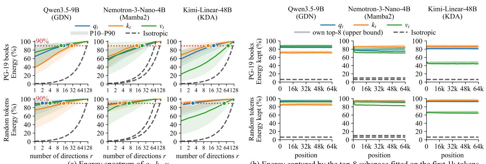  
(a) Energy spectrum of $q _ { t } , k _ { t } , \nu _ { t } .$  
(b) Energy captured by the top-8 subspace fitted on the first 1k tokens.  
Figure 1. The $q _ { t } , k _ { t } ,$ , and $v _ { t }$ vectors of three linear-attention models on PG-19 (top rows) and uniformly random tokens (bottom rows), profiled on 32 sequences of 64k tokens for each state $H _ { t } .$ (a) Energy spectrum: the fraction of energy captured by the top-r directions of the stacked $q _ { t } , k _ { t } .$ , and $v _ { t } .$ (b) Stability: energy of each segment [nk, (n + 1)k) captured by the top-8 subspace computed on [0, 1k), versus its own optimal top-8 subspace. Gray dashed lines show the results for uniformly random (isotropic) directions.

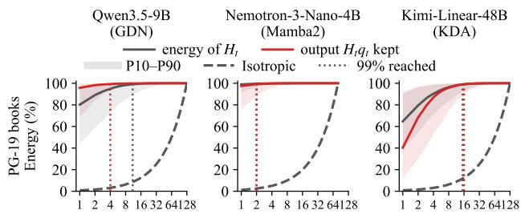  
number of components r number of components r number of components r  
Figure 2. Fractions of $H _ { t } \mathbf { \bar { s } }$ energy and output $H _ { t } q _ { t }$ retained when only the top-r components of $H _ { t }$ are kept. Measurements are taken every 0.5k tokens across 32 sequences of 64k tokens each.

Since $H _ { t }$ accumulates $v _ { t } k _ { t } ^ { \top }$ at each step, the dominant subspace of $k _ { t }$ and $v _ { t }$ piles up into a few top components of $H _ { t } ,$ which also contribute most of the output $H _ { t } q _ { t }$ . As shown in Figure 2, only the top 2–15 of up to 128 components already contribute 99% of $H _ { t }$ , and keeping only the top 2–16 components recovers 99% of the output $H _ { t } q _ { t }$ . Therefore, the dense state $H _ { t }$ is highly redundant: a few top components already recover almost all of $H _ { t }$ and its output, yet every decoding step still reads and writes the full dense state, wasting both GPU memory and bandwidth and increasing the latency of each step. A straightforward approach is to project $H _ { t }$ onto an offline-calibrated low-rank basis, which is neither general nor scalable. This factorization therefore has to be maintained online, yet recomputing an exact SVD at every decoding step is prohibitive. For example, at a batch size of 128, Nemotron-3-Nano-4B holds 258k recurrent states of size $8 0 \times 1 2 8$ (21 Mamba2 layers × 96 heads × 128 requests), and running an exact SVD on all of them takes about 4000 ms, over 100× longer than a typical decoding step (∼20–30 ms). Thus, SINKSTATE builds upon two key observations to efficiently keep each state factorized during decoding (Section 3.2).

## 3.2 Enabling On-the-Fly SVD

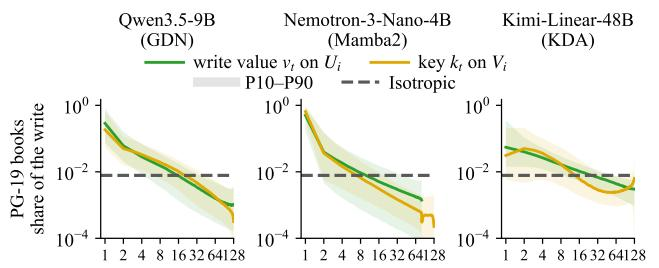  
component index i of Ht component index i of Ht component index i of Ht  
Figure 3. Share of an incoming $v _ { t } , k _ { t }$ on each component of $H _ { t - 1 } .$

Observation 1: The incoming $k _ { t }$ and $v _ { t }$ are mostly captured by the top components of $H _ { t - 1 }$ , with a diminishing share toward the tail. Given the factorized form $H _ { t - 1 } = U _ { t - 1 } \Sigma _ { t - 1 } V _ { t - 1 } ^ { \top }$ obtained at step t − 1, Figure 3 measures the share of each incoming $v _ { t }$ captured by the i-th column of $U _ { t - 1 } ,$ , i.e., $( U _ { t - 1 } [ i ] ^ { \top } v _ { t } ) ^ { 2 } / \| v _ { t } \| ^ { 2 }$ , and likewise for $k _ { t }$ and $V _ { t - 1 }$ . On Qwen3.5 and Nemotron-3-Nano, the top-1 column already captures 18–65% of $v _ { t }$ and $k _ { t }$ (23– 83× more than isotropic vectors, which capture ∼1% per column), and the top-8 columns capture 40–76% (6.3–12× more). Kimi-Linear follows the same trend, with 29–40% in its top-8 columns (4.6–6.4× more). In contrast, the later columns (e.g., >16 on Qwen3.5) capture even less than isotropic vectors, with the share of the last column diminishing to 0.03–0.1%.

Design 1: Merging new tokens into only the top subspace keeps SVD practical on the fly. Given the factorized form $H _ { t - 1 } = U _ { t - 1 } \Sigma _ { t - 1 } V _ { t - 1 } ^ { \top }$ , SINKSTATE splits it into an active part (the top-r columns $U _ { t - 1 } [ : r ]$ and $V _ { t - 1 } [ : r ] )$ , and a frozen part (the remaining $U _ { t - 1 } [ r \ : ]$ and $V _ { t - 1 } [ r \ : ] )$ . It concatenates only the new tokens with the active part into a small matrix and runs a local SVD on it, giving the updated singular vectors $U _ { \mathrm { a c t i v e } } , V _ { \mathrm { a c t i v e } }$ and singular values $\sigma _ { 0 } \geq \sigma _ { 1 } \geq \cdot \cdot \cdot$ . It then merges $U _ { \mathrm { a c t i v e } } , V _ { \mathrm { a c t i v e } }$ back with the frozen part $U _ { t - 1 } [ r : ] , V _ { t - 1 } [ r : ]$ , and drops the components below $\varepsilon \sigma _ { 0 }$ , where ε is a threshold. To further amortize the cost of local SVD, SINKSTATE buffers K new tokens and merges them at once (Section 4.2).

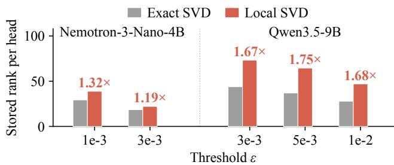  
Figure 4. Rank stored per head under local SVD and exact SVD after 128 decoding steps on GSM8K.

Observation 2: With local SVD alone, redundant components accumulate in the frozen part and inflate the memory footprint. Since the frozen part never enters the local SVD, it may continue to accumulate components with similar directions, making the stored rank much larger than that of an exact SVD. As shown in Figure 4, local SVD stores 1.19–1.32× more components per head than an exact SVD on Nemotron-3-Nano and 1.67–1.75× more on Qwen3.5 across thresholds, offsetting the savings from the low-rank factorization. However, simply letting the local SVD process more columns slows down decoding.

Design 2: Consolidating the frozen part asynchronously on idle CPUs keeps it off the critical path. During decoding, the GPU runs the model while the host CPUs stay mostly idle (∼2% utilization). SINKSTATE consolidates the frozen part asynchronously on the CPU: since it stays unchanged between two consecutive SVD compactions, SINKSTATE downloads it, merges its redundant components with an OpenMP-parallel exact SVD, and uploads the result back before the next compaction. As the CPU cannot keep pace with the GPU compactions, SINKSTATE consolidates the layers in a round-robin order (Section 4.3).

## 4 DESIGN

## 4.1 Overview

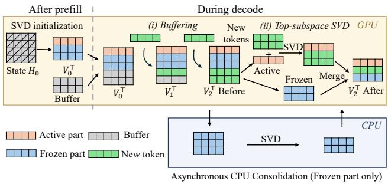  
Figure 5. Overview of SINKSTATE.

The goal of SINKSTATE is to adaptively maintain the rank of each state, so that states that carry more information retain a higher rank, while the others retain a lower rank. To determine which components to retain, SINKSTATE drops those whose singular values (σ) fall below a fraction ε of the largest singular value $( \sigma _ { 0 } ) , \mathrm { i . e . , } \sigma < \varepsilon \sigma _ { 0 }$ . SINKSTATE applies this truncation at initialization and at every compaction. After prefill, SINKSTATE first initializes the low-rank factors of the resulting state, $H _ { 0 } \approx U _ { 0 } \Sigma _ { 0 } V _ { 0 } ^ { \top }$ . To avoid the prohibitive cost of an exact SVD, SINKSTATE adopts the widely used randomized SVD (Halko et al., 2011; Martinsson & Voronin, 2016) and computes it block by block. During decode, SINKSTATE maintains the low-rank factors $U _ { 0 }$ , V in two ways: (i) Buffering: to amortize the cost of SVD across decoding steps, SINKSTATE caches the keys and values of new tokens in a buffer of size K and compacts the factors only when the buffer is full. (ii) Top-subspace SVD: as new updates are mainly absorbed by the top subspace (see Section 3.2), SINKSTATE merges the buffer only into this subspace, while the other components remain frozen, thereby avoiding the prohibitive cost of running an SVD on the whole state.

## 4.2 Local SVD Update

Figure 6 illustrates the local SVD update on a single $4 \times 4$ state $H _ { 0 } .$ , using $\varepsilon = 0 . 1$ and the prompt $^ { * } A f t e r 2 5$ years, Wikipedia is still” followed by two generated tokens, $" t h e "$ and $\cdots b i g g e s t ^ { \prime \prime }$ . This example uses buffer size $K = 2$

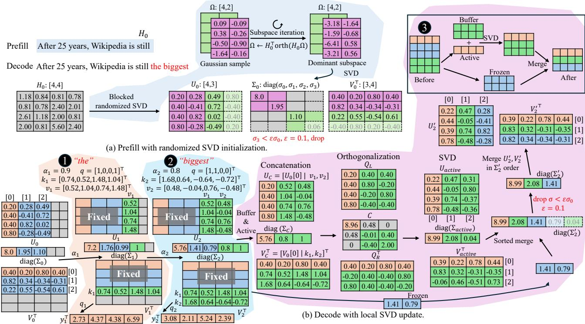  
Figure 6. Prefill and decoding with local SVD updates.

Randomized SVD initialization after prefill. After prefilling the prompt “After 25 years, Wikipedia is still”, SINKSTATE obtains the 4 × 4 state $H _ { 0 }$ (gray matrix in Figure 6(a)), whose first row is [1.18, 0.84, 0.81, 0.78], and approximates it as $H _ { 0 } \approx U _ { 0 } \Sigma _ { 0 } \dot { V } _ { 0 } ^ { \top }$ using randomized SVD. Specifically, SINKSTATE constructs the approximation one block at a time through (i) subspace approximation and (ii) block SVD, and checks the resulting singular values against the threshold to decide whether to continue.

(i) Subspace approximation identifies the dominant subspace of the state $H _ { 0 }$ using a small random matrix. Specifically, SINKSTATE first samples a 4 × 2 Gaussian matrix Ω (purple matrix in Figure 6(a)) with [0.09, −0.09] as its first row. The matrix Ω is then refined through repeated subspace iteration (Halko et al., 2011): $\Omega \gets H _ { 0 } ^ { \top } \mathrm { o r t h } ( H _ { 0 } \Omega )$ . Each iteration multiplies Ω by $H _ { 0 } .$ , orthogonalizes the result, and multiplies it by $H _ { 0 } ^ { \top }$ . After a few iterations, Ω approximately spans the top-2 subspace of $H _ { 0 } ,$ giving [−3.18, −1.64] as its first row.

(ii) Block SVD then extracts the singular components of the current block from Ω. Specifically, SINKSTATE applies SVD to Ω, yielding the singular values 8.0 and 1.95 and their corresponding singular vectors, shown as the pink columns of $U _ { 0 }$ (first row [0.20, 0.28]) and pink rows of $V _ { 0 } ^ { \top }$ (first row [0.40, 0.20, 0.80, 0.40]).

Since both singular values exceed the threshold $\varepsilon \sigma _ { 0 } =$

$0 . 1 \times 8 . 0 = 0 . 8 , H _ { 0 }$ may still contain significant directions, so SINKSTATE repeats the two steps on a new block. It samples another random matrix, finds the next dominant subspace (green matrix), and applies SVD, yielding singular values 1.10 and 0.06 along with their singular vectors (the green columns of $U _ { 0 }$ and the green rows of $V _ { 0 } ^ { \top } )$ . Since 0.06 falls below 0.8, SINKSTATE truncates it (dashed) and stops adding blocks. Finally, SINKSTATE concatenates the kept components of both blocks into $U _ { 0 }$ (first row [0.20, 0.28, 0.49]), Σ = diag(8.0, 1.95, 1.10), and $V _ { 0 }$ (first row [0.40, 0.20, 0.80, 0.40]), giving a rank-3 approximation $H _ { 0 } \approx U _ { 0 } \Sigma _ { 0 } V _ { 0 } ^ { \top }$

Decode with local SVD update. SINKSTATE then decodes two tokens, “the” and “biggest” (Figure 6(b)). For ease of illustration, the figure uses the Mamba2 recurrence (Dao & Gu, 2024). The t-th token produces a key $k _ { t } ,$ , a value $v _ { t } ,$ , a query $q _ { t }$ , and a scalar decay $\alpha _ { t } \in ( 0 , 1 )$ . The state is then updated as $H _ { t } = \alpha _ { t } H _ { t - 1 } + v _ { t } k _ { t } ^ { \top }$ , and the output is $y _ { t } = H _ { t } q _ { t }$ . The same procedure also applies to GDN (Yang et al., 2025). SINKSTATE maintains the low-rank factors through (i) buffering and (ii) top-subspace SVD.

(i) Buffering caches the new $v _ { t }$ and $k _ { t }$ of each token and applies the decay $\alpha _ { t }$ to the singular values $\Sigma _ { 0 } .$ , keeping $U _ { 0 }$ and $V _ { 0 }$ unchanged (marked as fixed in Figure 6(b)). At 1 (orange region), SINKSTATE processes the token $" t h e '$ with $\alpha _ { 1 } = 0 . 9 , q _ { 1 } = [ 1 , 0 , 0 , 1 ] ^ { \top } , k _ { 1 } = [ 0 . 7 4 , 0 . 5 2 , 1 . 4 8 , 1 . 0 4 ] ^ { \top }$ and $v _ { 1 } = [ 0 . 5 2 , 1 . 0 4 , 0 . 7 4 , 1 . 4 8 ] ^ { \top }$ . SINKSTATE first applies the decay $\alpha _ { 1 }$ to the singular values $\Sigma _ { 0 }$ , scaling diag(8.0, 1.95, 1.10) to diag(7.2, 1.76, 0.99). It then appends $v _ { 1 }$ as a new column of $U _ { 0 }$ and $k _ { 1 }$ as a new row of $V _ { 0 } ^ { \top }$ , filling the first buffer slot (gray slots turn green) and giving $U _ { 1 } ~ = ~ [ U _ { 0 } ~ \vert ~ v _ { 1 } ]$ and $V _ { 1 } ^ { \bar { \top } } ~ \bar { = } ~ [ V _ { 0 } ~ | ~ k _ { 1 } ] ^ { \bar { \top } }$ . To match the extended factors, SINKSTATE also appends a weight of 1 to the singular values, giving diag $\left( \Sigma _ { 1 } \right) \ =$ [7.2, 1.76, 0.99, 1] and completing the factors $U _ { 1 } \Sigma _ { 1 } V _ { 1 } ^ { \top }$ The output y1 is then computed from the extended factors with the query $\begin{array} { c c l } { q _ { 1 } } & { = } & { [ 1 , 0 , 0 , 1 ] ^ { \top } } \end{array}$ , giving $\begin{array} { r l } { y _ { 1 } } & { { } = } \end{array}$ $U _ { 1 } \Sigma _ { 1 } V _ { 1 } ^ { \top } q _ { 1 } = [ 2 . 7 3 , 4 . 3 7 , 4 . 3 8 , 6 . 5 9 ] ^ { \top }$ . At 2 (blue region), SINKSTATE processes the token $\cdots b i g g e s t ^ { \prime \prime }$ with $\alpha _ { 2 } =$ $0 . 8 , q _ { 2 } = [ 1 , 1 , 0 , 0 ] ^ { \top } , k _ { 2 } = [ 1 . 6 8 , 0 . 6 4 , - 0 . 6 4 , - 0 . 7 2 ] ^ { \top }$ and $v _ { 2 } = \lceil 0 . 4 8 , - 0 . 0 4 , 0 . 7 6 , - 0 . 4 8 \rceil ^ { \top }$ . In the same way, SINKSTATE first applies the decay $\alpha _ { 2 }$ to all singular values, including the buffered weight, scaling [7.2, 1.76, 0.99, 1] to [5.76, 1.41, 0.79, 0.8]. It then appends v and k to the second buffer slot, giving $U _ { 2 } = [ U _ { 1 } \mid v _ { 2 } ] , V _ { 2 } ^ { \top } = [ V _ { 1 } \mid k _ { 2 } ] ^ { \top }$ and $\mathrm { d i a g ( \Sigma _ { 2 } ) = [ 5 . 7 6 , 1 . 4 1 , 0 . 7 9 , 0 . 8 , 1 ] }$ . The output is computed as $y _ { 2 } = U _ { 2 } \Sigma _ { 2 } V _ { 2 } ^ { \top } q _ { 2 } = [ 3 . 0 8 , 2 . 1 1 , 5 . 2 4 , 2 . 3 9 ] ^ { \top }$ Now the buffer is full, triggering the compaction in 3 .

(ii) Top-subspace SVD aims to compact the extended factors with a small, local SVD, thereby avoiding the prohibitive overhead of running an SVD over all the factors. The black box at 3 gives a brief sketch of this procedure. SINKSTATE first splits the current factors into an active part, i.e., the dominant components with the largest singular values (orange), and afrozen part with the remaining components (blue). It then concatenates the active part with the buffer (green) and runs a small SVD on them. Finally, SINKSTATE merges the frozen part into the result and drops the components below the threshold. In this example, the active part is the top-1 component (5.76) with $U _ { 0 } [ 0 ]$ and $V _ { 0 } [ 0 ]$ , and the frozen part keeps 1.41 and 0.79. As shown in the pink region, SINKSTATE concatenates the active part with the buffer into $U _ { C } = [ U _ { 0 } [ 0 ] \ | \ v _ { 1 } , v _ { 2 } ] , \Sigma _ { C } = \mathrm { d i a g } ( 5 . 7 6 , 0 . 8 , 1 )$ , and $V _ { C } = [ V _ { 0 } [ 0 ] \mid k _ { 1 } , k _ { 2 } ]$ . To keep the SVD small, SINKSTATE uses an equivalent reformulation following Brand’s incremental SVD (Brand, 2006) to decompose only a small core matrix instead of the concatenated factors. By orthogonalizing the two concatenated factors into $Q _ { L }$ and $Q _ { R } ^ { \top } ,$ , SINKSTATE rewrites their product with the diagonal factor as $U _ { C } \Sigma _ { C } V _ { C } ^ { \top } = Q _ { L } C \bar { Q _ { R } ^ { \top } } ,$ where only the small $3 \times 3$ core C (first row [8.96, 0.48, 0]) requires an SVD. An SVD of C then yields $U _ { \mathrm { a c t i v e } }$ (first row [0.22, 0.47, 0.31]), $\mathrm { d i a g } ( \Sigma _ { \mathrm { a c t i v e } } ) = [ 8 . 9 9 , 2 . 0 8 , 0 . 0 4 ]$ , and $V _ { \mathrm { a c t i v e } } ^ { \top }$ (first row $[ 0 . 3 9 , 0 . 2 2 , 0 . 7 8 , 0 . 4 4 ] )$ . SINKSTATE then merges these singular values with the frozen ones [1.41, 0.79] in descending order, giving $[ 8 . 9 9 , 2 . 0 8 , 1 . 4 1 , 0 . 7 9 , 0 . 0 4 ]$ , and drops those below $\varepsilon \sigma _ { 0 } ~ = ~ 0 . 1 \times 8 . 9 9 ~ = ~ 0 . 8 9 9$ (dashed), giving diag(Σ′ ) = [8.99, 2.08, 1.41]. SINKSTATE then concatenates the corresponding singular vectors from $U _ { \mathrm { a c t i v e } } ,$ $V _ { \mathrm { a c t i v e } }$ , and the frozen parts (blue slots) in the order of

diag $\left( \Sigma _ { 2 } ^ { \prime } \right)$ to form $U _ { 2 } ^ { \prime }$ and $V _ { 2 } ^ { \prime } .$

Staggered compaction across layers. If all layers compact their buffers at the same step, that step runs all the local SVDs at once, causing a latency spike every K steps. SINKSTATE therefore staggers the compaction across layers: at each decoding step, only $1 / K$ of the layers compact their buffers, and each layer is offset by a different number of steps. For example, in a 24-layer model with $K = 8 ,$ , three layers are compacted at each step, thereby amortizing the compaction cost evenly across decoding steps.

## 4.3 Asynchronous CPU Consolidation

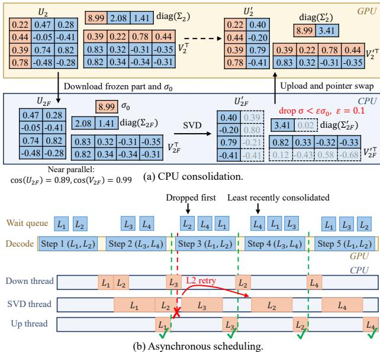  
Figure 7. Asynchronous CPU Consolidation.

Local SVD keeps each update small by leaving the frozen part untouched. However, later updates may re-add existing directions as new frozen rows, causing the number of frozen rows to gradually exceed the actual rank of the frozen part and increasing both GPU memory usage and memory traffic during decoding. SINKSTATE therefore periodically consolidates the frozen part with an exact SVD on the CPU. Figure 7 illustrates this process in two parts: (i) CPU consolidation of one layer (Figure 7(a)), and (ii) Asynchronous scheduling of the consolidation across layers (Figure 7(b)).

CPU consolidation re-decomposes the frozen part to eliminate redundant components. Figure 7(a) continues the example of Figure 6, where the factors after the local SVD update are denoted as $U _ { 2 } , \ \Sigma _ { 2 }$ , and $V _ { 2 }$ for brevity. Here $U _ { 2 }$ has [0.22, 0.47, 0.28] as its first row, $V _ { 2 } ^ { \top }$ has [0.39, 0.22, 0.78, 0.44] as its first row, and $\mathrm { d i a g ( \Sigma _ { 2 } ) ~ = ~ }$ [8.99, 2.08, 1.41], with only the largest component (8.99, orange) active. The two frozen components $U _ { 2 F } , V _ { 2 F }$ with singular values 2.08 and 1.41 have similar directions, with $\cos ( U _ { 2 F } ) = 0 . 8 9$ and cos $( V _ { 2 F } ) = 0 . 9 9$ . SINKSTATE first downloads the frozen part $U _ { 2 F } , \Sigma _ { 2 F }$ , and $V _ { 2 F }$ to the CPU, together with the largest singular value $\sigma _ { 0 } = 8 . 9 9 $ . An exact SVD is then performed on the frozen part, yielding $U _ { 2 F } ^ { \prime } ,$ $\mathrm { d i a g } ( \Sigma _ { 2 F } ^ { \prime } ) = [ 3 . 4 1 , 0 . 0 2 ]$ , and $V _ { 2 F } ^ { \prime }$ . Since 0.02 falls below $\varepsilon \sigma _ { 0 } = 0 . 1 \times 8 . 9 9 = 0 . 8 9 9$ , SINKSTATE drops it (dashed) and keeps a single component, i.e., the first column of $U _ { 2 F } ^ { \prime } , [ 0 . \dot { 4 } 0 , - 0 . \dot { 2 } 0 , 0 . 7 9 , \dot { - } 0 . 4 1 ] ^ { \top }$ , the singular value $3 . 4 1$ and the first row of $V _ { 2 F } ^ { \prime \top } , ~ [ 0 . 8 \dot { 2 } , 0 . 3 3 , - \bar { 0 . 3 2 } , - 0 . 3 3 ]$ . Finally, SINKSTATE uploads the retained frozen factors to the GPU and replaces the unconsolidated frozen part, yielding $\mathrm { d i a g ( \Sigma _ { 2 } ^ { \prime } ) } = [ 8 . 9 9 , 3 . 4 1 ]$ with corresponding factors $U _ { 2 } ^ { \prime }$ and $V _ { 2 } ^ { \prime \top }$ . This reduces the rank from 3 to 2 while leaving the active part untouched on the GPU. In practice, the replacement is implemented by swapping pointers, avoiding additional data copies on the GPU. For layers with multiple heads, SINKSTATE uses OpenMP to parallelize consolidation across heads.

Asynchronous scheduling overlaps the CPU consolidation with GPU decoding without slowing down decoding. Figure 7(b) shows a model with four layers $( L _ { 1 } { - } L _ { 4 } ) .$ , where staggered compaction (Section 4.2) compacts two layers at each decoding step, $\mathrm { e . g . , } L _ { 1 }$ and $L _ { 2 }$ at Step 1 and $L _ { 3 }$ and $L _ { 4 }$ at Step 2. After each decoding step, the compacted layers enter a wait queue and are processed by a three-stage CPU pipeline, with dedicated threads for downloading the frozen part, performing SVD, and uploading the result. In this example, Step 1 compacts $L _ { 1 }$ and $L _ { 2 } .$ , so both enter the wait queue. $L _ { 1 }$ is downloaded first, consolidated, and uploaded. Since the upload finishes before Step 3, which compacts $L _ { 1 }$ again and rewrites its frozen part, the result still matches the frozen part on the GPU, so SINKSTATE safely swaps it in (green check). In contrast, the SVD of $L _ { 2 }$ is still running when Step 3 compacts $L _ { 2 }$ again, making the result on the CPU stale. SINKSTATE therefore drops this consolidation (red cross) and immediately starts consolidating $L _ { 3 } ,$ , which is uploaded before its next compaction at Step 4. After Step 3, $L _ { 2 } , L _ { 4 } .$ , and $L _ { 1 }$ all wait for consolidation. Since $L _ { 2 }$ has failed before, SINKSTATE retries it first (i.e., droppedfirst) and finishes it before its next compaction at Step 5. By the end of Step 4, $L _ { 4 } , L _ { 1 }$ , and $L _ { 3 }$ wait for consolidation. Since $L _ { 4 }$ has never been consolidated, SINKSTATE prioritizes it (i.e., least-recently-consolidated) and completes its consolidation before Step 6. In practice, SINKSTATE uses a CUDA event to trigger consolidation once the frozen part is ready. The CPU then manages the data transfers on a separate CUDA stream, performs the SVD, and swaps the pointers, all without stalling decoding on the GPU. To avoid CPU contention, SINKSTATE pins the download, SVD, and upload threads to different CPU cores and sets the number of OpenMP threads for the SVD to the cores available to it.

## 4.4 Kernel Design

To handle uneven ranks across adaptively compressed states, SINKSTATE uses dedicated kernels with a compact memory layout.

Memory layout. To avoid writing back the state at every decoding step (Section 4.2), SINKSTATE stores the buffer separately from the low-rank factors, so that buffering a new token only appends its key and value to the buffer. Since an asynchronous copy between the GPU and the CPU operates on a contiguous tensor (Section 4.3), mixing active and frozen rows would require an extra gather kernel before each transfer, thereby delaying the decoding. SINKSTATE therefore separates the frozen part from the active part and stores each in a contiguous region, so that every transfer can start directly without gathering. SINKSTATE uses a CSRlike format to compactly store the factors of all states, with an offset array that records their starting positions. After each compaction, SINKSTATE reallocates the storage to exactly fit the new ranks and updates the offsets accordingly. For some states, the low-rank form does not save memory. For example, a $1 2 8 \times 1 2 8$ state of rank r stores 256r values in the low-rank form, which exceeds the $1 2 8 \times 1 2 8$ values of the dense form when $r > 6 4$ . SINKSTATE therefore falls back to the dense form for such states after initialization (Section 4.2) and stores them in a separate dense region.

Kernel fusion, load balancing, and support for CUDA graphs. Since the ranks are small, running each operation on the factors as a separate kernel would be dominated by launch overhead and intermediate memory traffic. SINKSTATE therefore fuses these operations in two places. First, a single decoding kernel appends the new key-value pair to the buffer and computes $y _ { t }$ directly from the factors and the buffer, applying the accumulated decay on the fly without materializing the dense state. Second, SINKSTATE fuses chains of algebraic operations on the factors, such as subspace iteration, orthogonalization, and concatenation, thereby avoiding writing intermediate results back to global memory. Besides, assigning one program to each state leaves programs in low-rank states idle while those in high-rank states are still running. Therefore, for row-independent operations such as readout, SINKSTATE launches one program per component row to balance the workload. SINKSTATE also supports CUDA graphs through a device-side pointer table and a counter.

## 5 EVALUATION

## 5.1 Experimental Setup

Models. SINKSTATE is evaluated on four hybrid models: Nemotron-3-Nano-4B (Nemo-4B) (NVIDIA, 2026a) and Nemotron-3-Super-120B-A12B (Nemo-120B) (NVIDIA, 2026b), whose recurrent layers are Mamba2 (Dao & Gu,

SINKSTATE: On-the-Fly SVD of Recurrent States for Efficient Hybrid LLM Serving  
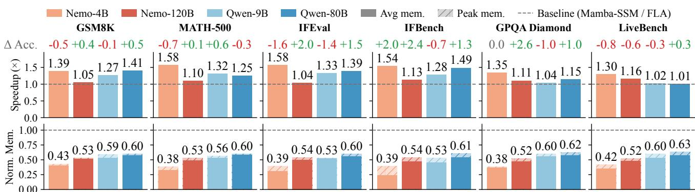  
Figure 8. End-to-end performance. Geometric-mean speedup on Nemo-4B, Nemo-120B, Qwen-9B, and Qwen-80B: 1.45×, 1.10×, 1.20×, 1.27×; normalized peak state memory: 0.40, 0.53, 0.57, 0.61 (i.e., memory saving: 60%, 47%, 43%, 39%).

2024), and Qwen3.5-9B (Qwen-9B) (Qwen Team, 2026a) and Qwen3-Next-80B-A3B-Instruct (Qwen-80B) (Qwen Team, 2025), who use GDN (Yang et al., 2025).

Hardware. All experiments run on one NVIDIA RTX PRO 6000 Blackwell GPU with 96 GB of GDDR7 memory, connected via PCIe 5.0 to two Intel Xeon 6515P CPUs (32 cores in total) with 252 GB of host memory. Nemo-4B and Qwen-9B run in BF16, while Nemo-120B and Qwen-80B use NVFP4 weights with an FP8 KV cache to fit on a single GPU. The recurrent states are kept in FP32 for all models.

Baselines. Mamba-SSM (Gu & Dao, 2024) and FLA (Yang & Zhang, 2024) provide recurrent kernels widely adopted by serving engines such as vLLM (Kwon et al., 2023) and SGLang (Zheng et al., 2024). We therefore use their densestate implementations as baselines. Unless otherwise stated, SINKSTATE and the baseline use the same batch size for each benchmark, chosen based on available GPU memory.

Workloads and metrics. End-to-end performance is measured on GSM8K (Cobbe et al., 2021), MATH-500 (Lightman et al., 2024; Hendrycks et al., 2021), IFEval (Zhou et al., 2023), IFBench (Pyatkin et al., 2025), GPQA Diamond (Rein et al., 2024), and LiveBench (White et al., 2025) with greedy decoding and the default generation length of each benchmark. Accuracy on long contexts and long generations is further measured on four NIAH tasks of RULER (Hsieh et al., 2024), and on MATH-500 and GPQA Diamond with thinking enabled and up to 32K generated tokens. Speedup is the end-to-end serving time of the baseline over that of SINKSTATE on each benchmark, and Norm. Mem. is the memory of the recurrent states under SINKSTATE normalized to that under the baseline, at peak and on average.

Configuration of SINKSTATE. SINKSTATE uses $\varepsilon =$ $3 \times 1 0 ^ { - 3 }$ for the Nemotron models and $\varepsilon = 1 0 ^ { - 2 }$ for the Qwen models, a buffer size of $K = 8 ,$ and the top eight components as the active subspace for each local SVD.

## 5.2 End-to-End Performance

SINKSTATE speeds up decoding by 1.25× and nearly halves the state memory without hurting accuracy. Figure 8 reports the speedup, the accuracy change, and the state memory of SINKSTATE on the six benchmarks. SINKSTATE speeds up decoding by 1.25× and by up to 1.58× (geomean, Nemo-4B on MATH-500 and IFEval). Meanwhile, the accuracy changes by −1.6 to +2.6 points with no consistent direction: it improves in 12 of 24 model-benchmark pairs, and in average +0.3 points. Speedup is the largest on Nemo-4B (1.30–1.58×), whose recurrent states dominate the step time of the model, and the smallest on Nemo-120B (1.04– 1.16×), where the MoE layers take a larger share of each step and the larger weights leave much less memory for large batches. On the Qwen models, the speedup is lower on GPQA Diamond and LiveBench, whose long outputs keep the batch size small. At small batches, the state traffic is only a small part of the step time, so shrinking it brings less benefit (§5.3). SINKSTATE also reduces the peak memory of the recurrent states to 0.38–0.63 of the baseline (i.e., 1.6–2.6× smaller, 0.52 on average) and the average memory to 0.24–0.58. The saving is the largest on Nemo-4B (0.38– 0.43 at peak) and the smallest on Qwen-80B (0.60–0.63 at peak), consistent with the higher ranks of the GDN states (Figure 4).

## 5.3 Kernel Speedup

SINKSTATE cuts the state-kernel time by up to 2.41× and serves up to 2× larger batches. Figure 9 isolates the time spent in the state kernels at each decoding step as the batch size grows. The time of the dense kernels in Mamba-SSM and FLA grows linearly with the batch size, since every step reads and writes the full dense state of each request. SINKSTATE grows much more slowly, reducing this time by 1.64–2.41× on Nemo-4B and by 1.03–1.95× on Qwen-9B. The speedup grows with the batch size and levels off beyond B = 128: at small batches, the kernels do not saturate the memory bandwidth, so reducing the traffic helps less. Of the state-kernel time of SINKSTATE, compaction takes 36–40% on Nemo-4B and 26–30% on Qwen-9B, and readout takes the rest. Since the factors are smaller than the dense states, SINKSTATE can serve larger batches. The baselines fit at most B = 640 on Nemo-4B and B = 768 on Qwen-9B (shaded beyond), while SINKSTATE still runs at B = 1280 on both, i.e., 2× and 1.67× larger. At these larger batches, the state kernels of SINKSTATE also take less time per step than those of the baselines at their largest batch.

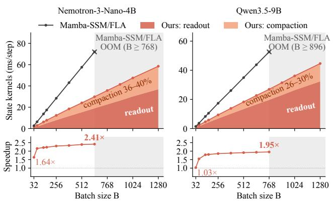  
Figure 9. State-kernel time per decoding step (top) and speedup (bottom) under different batch sizes of SINKSTATE vs. Mamba-SSM/FLA. Shaded regions: the baselines run out of memory.

## 5.4 Accuracy

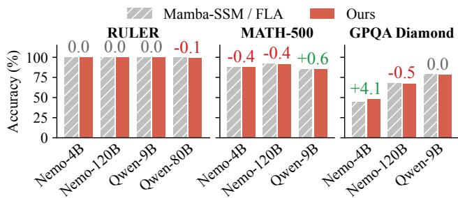  
Figure 10. Accuracy on long-context retrieval (RULER) and long reasoning in thinking mode (MATH-500, GPQA Diamond, up to 32K generated tokens). Numbers show the accuracy change of SINKSTATE over the baseline.

SINKSTATE preserves accuracy on long contexts and after 32K generated tokens. Figure 10 evaluates SINKSTATE on long-context retrieval and on long reasoning with thinking enabled. On RULER, we report the mean accuracy over four NIAH subsets (single, multi-key, multi-value, and multi-query) with 16K contexts. SINKSTATE matches the baseline on all four models, with at most a 0.1% drop (Qwen-80B). On MATH-500 and GPQA Diamond, where an answer takes up to 32K generated tokens, SINKSTATE loses at most 0.5%. The 4.1-point gain on GPQA Diamond for Nemo-4B arises because the baseline reaches the generation limit on more questions. Qwen-80B is omitted on these two benchmarks because it is an instruct model. Thus, local SVD and the frozen tail do not degrade accuracy even after 32K decoding steps.

## 5.5 Verbosity

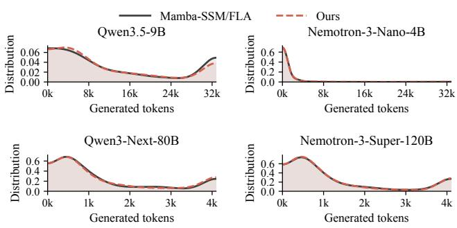  
Figure 11. Distribution of the number of generated tokens on MATH-500 under SINKSTATE and the baseline.

SINKSTATE preserves the output length. Figure 11 compares the distributions of the number of generated tokens on MATH-500. On Nemo-4B, Nemo-120B, and Qwen-80B, the distributions of SINKSTATE and the baseline nearly overlap. On Qwen-9B, whose outputs often reach the 32K limit, SINKSTATE places slightly less mass at the limit (11.4% vs. 16.0% of the outputs reach 32K), while the rest of the distribution again overlaps.

## 5.6 Ablation Study

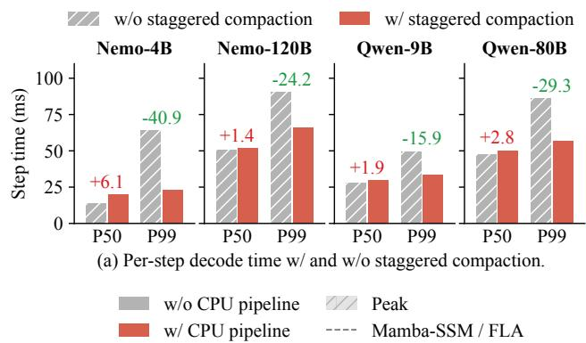

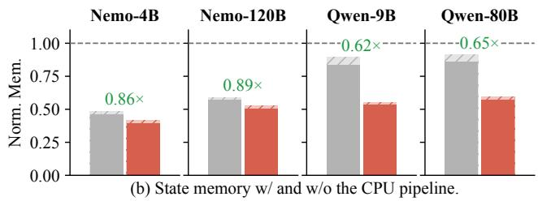  
Figure 12. Ablation of (a) staggered compaction and (b) CPU consolidation. Numbers show the step-time change (ms) in (a) and the state-memory ratio of w/ to w/o the CPU pipeline in (b).

Staggered compaction removes latency spikes. Without staggering, all layers compact their buffers at the same step, causing a latency spike every K steps. Staggering reduces the P99 step time by 15.9–40.9 ms across the four models (Figure 12(a)), e.g., by 2.8 × on Nemo-4B. In exchange, the P50 step time increases but only slightly on Nemo-120B, Qwen-9B, and Qwen-80B (1.4–2.8 ms), since every step now runs a small part of the compaction. The increase is larger on Nemo-4B (6.1 ms), whose short step time makes the compaction share more visible, yet Nemo-4B also gains the largest P99 reduction (40.9 ms).

CPU consolidation is essential for the GDN models. Without the CPU pipeline, redundant components keep accumulating in the frozen part (Figure 4). The CPU pipeline removes them, reducing the state memory by a factor of 0.86 and 0.89 on Nemo-4B and Nemo-120B, and 0.62 and 0.65 on Qwen-9B and Qwen-80B (Figure 12(b)). On the Qwen models, the CPU pipeline contributes more to the memory saving, since their states show larger rank inflation under local SVD alone (Figure 4).

## 5.7 Rank Distribution Visualization

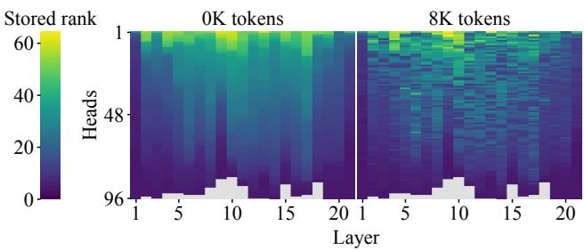

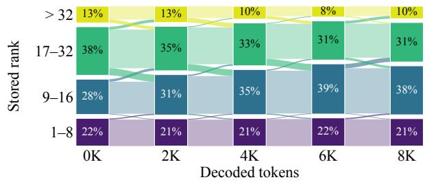  
Figure 13. Stored rank per head of Nemo-4B on RULER after prefill and after 8K decoded tokens (top; gray: dense), and the share of heads per rank range (bottom).

SINKSTATE adapts ranks to individual heads. Figure 13 shows the ranks stored by SINKSTATE for Nemo-4B. We prefill the first 8K tokens of each of 32 RULER sequences, then teacher-force the remaining 8K one token per step. Ranks vary widely across heads and layers: 22% retain at most 8 components, 13% retain more than 32, and a few use dense states. A fixed rank would therefore waste memory or lose information. During decoding, the distribution remains stable: each rank group’s share changes by at most 10 percentage points. Heads shift mainly from 17–32 components (38% → 31%) to 9–16 components (28% → 38%).

## 6 RELATED WORK

Inference systems for hybrid models. LLM serving systems are built around the token-indexed KV cache, with continuous batching (Yu et al., 2022), IO-aware attention kernels (Dao et al., 2022), paged memory management (Kwon et al., 2023), and prefix caching (Zheng et al., 2024; Qin et al., 2025). Hybrid serving systems focus on reusing states across requests. They store state checkpoints alongside the KV cache (Huang et al., 2026), decide which checkpoints to keep and where to place them under a memory budget (Pan et al., 2025; Shirokikh & Nikolenko, 2026), extend positionindependent caching to hybrid models (Liu et al., 2026c;a), or reconstruct a state by replaying a recent suffix of its inputs (Liu et al., 2026b). ReplaySSM buffers recent inputs and writes the state back periodically, removing most state writes, but every step reads the full state (Liou et al., 2026). Existing systems keep the state dense, whereas SINKSTATE shrinks it, reducing both reads and writes of every step.

Compression for LLM inference. Weights are quantized with second-order or activation-aware methods (Frantar et al., 2023; Xiao et al., 2023; Lin et al., 2024) or factorized with SVD (Yuan et al., 2023; Wang et al., 2025), and the KV cache is compressed by low-bit quantization (Liu et al., 2024) or low-rank projection (Chang et al., 2025; Sun et al., 2025). For SSMs, Quamba quantizes weights and activations (Chiang et al., 2025b), and Quamba2 additionally quantizes the cached SSM state (Chiang et al., 2025a). These tensors are fixed or only appended to, whereas the recurrent state is rewritten at every step. LeapQuant quantizes the state once per window but still moves every entry at every step (Pan et al., 2026), and SketchSSM approximates only the reads while keeping the full state for writes (Kwon et al., 2026). SINKSTATE instead keeps the state itself in an adaptive low-rank form without calibration, shrinking both its memory and its per-step traffic.

## 7 CONCLUSION

This paper presents SINKSTATE, a serving system that thins the recurrent states of hybrid models during decoding. SINKSTATE builds on the observation called linear attention sink: the queries, keys, and values of linear layers concentrate in a stable, low-dimensional subspace, so each recurrent state is effectively low-rank. SINKSTATE therefore keeps each state in an adaptive low-rank SVD form, maintaining it throughout the inference. SINKSTATE then utilizes asynchronous CPU consolidation and fused kernels to keep this maintenance off the critical path of decoding. On four hybrid models with Mamba-2 and GDN layers, SINKSTATE reduces the peak memory of recurrent states by up to 2.6×, speeds up decoding by up to 1.58×, and serves up to 2× larger batches, while maintaining model accuracy.

## REFERENCES

Brand, M. Fast low-rank modifications of the thin singular value decomposition. Linear Algebra and its Applications, 415(1):20–30, 2006.

Chang, C.-C., Lin, W.-C., Lin, C.-Y., Chen, C.-Y., Hu, Y.- F., Wang, P.-S., Huang, N.-C., Ceze, L., Abdelfattah, M. S., and Wu, K.-C. Palu: KV-cache compression with low-rank projection. In International Conference on Learning Representations (ICLR), 2025. URL https: //arxiv.org/abs/2407.21118.

Chang, C.-C., Lin, W.-C., Lin, C.-Y., Chiang, H.-Y., Akhauri, Y., Dai, X., Jiang, H., Li, Y., Ceze, L., Wu, K.-C., and Abdelfattah, M. S. xKV: Cross-layer KV-cache compression via aligned singular vector extraction. In International Conference on Machine Learning (ICML), 2026. URL https://arxiv.org/abs/2503.18893.

Chiang, H.-Y., Chang, C.-C., Frumkin, N., Wu, K.-C., Abdelfattah, M. S., and Marculescu, D. Quamba2: A robust and scalable post-training quantization framework for selective state space models. In International Conference on Machine Learning (ICML), 2025a. URL https://arxiv.org/abs/2503.22879.

Chiang, H.-Y., Chang, C.-C., Frumkin, N., Wu, K.-C., and Marculescu, D. Quamba: A post-training quantization recipe for selective state space models. In International Conference on Learning Representations (ICLR), 2025b. URL https://arxiv.org/abs/2410.13229.

Cobbe, K., Kosaraju, V., Bavarian, M., Chen, M., Jun, H., Kaiser, L., Plappert, M., Tworek, J., Hilton, J., Nakano, R., Hesse, C., and Schulman, J. Training verifiers to solve math word problems, 2021. URL https://arxiv. org/abs/2110.14168.

Dao, T. and Gu, A. Transformers are SSMs: Generalized models and efficient algorithms through structured state space duality. In International Conference on Machine Learning (ICML), 2024. URL https://arxiv.org/ abs/2405.21060.

Dao, T., Fu, D. Y., Ermon, S., Rudra, A., and Re, C.´ FlashAttention: Fast and memory-efficient exact attention with IO-awareness. In Advances in Neural Information Processing Systems (NeurIPS), 2022. URL https://arxiv.org/abs/2205.14135.

Frantar, E., Ashkboos, S., Hoefler, T., and Alistarh, D. OPTQ: Accurate quantization for generative pre-trained transformers. In International Conference on Learning Representations (ICLR), 2023. URL https://arxiv. org/abs/2210.17323.

Gu, A. and Dao, T. Mamba: Linear-time sequence modeling with selective state spaces. In Conference on Language Modeling (COLM), 2024. URL https: //arxiv.org/abs/2312.00752.

Guo, D., Yang, D., Zhang, H., Song, J., Wang, P., Zhu, Q., Xu, R., Zhang, R., Ma, S., Bi, X., Zhang, X., Yu, X., Wu, Y., Wu, Z. F., Gou, Z., Shao, Z., Li, Z., Gao, Z., Liu, A., Xue, B., Wang, B., Wu, B., Feng, B., Lu, C., Zhao, C., Deng, C., Ruan, C., Dai, D., Chen, D., Ji, D., Li, E., Lin, F., Dai, F., Luo, F., Hao, G., Chen, G., Li, G., Zhang, H., Xu, H., Ding, H., Gao, H., Qu, H., Li, H., Guo, J., Li, J., Chen, J., Yuan, J., Tu, J., Qiu, J., Li, J., Cai, J. L., Ni, J., Liang, J., Chen, J., Dong, K., Hu, K., You, K., Gao, K., Guan, K., Huang, K., Yu, K., Wang, L., Zhang, L., Zhao, L., Wang, L., Zhang, L., Xu, L., Xia, L., Zhang, M., Zhang, M., Tang, M., Zhou, M., Li, M., Wang, M., Li, M., Tian, N., Huang, P., Zhang, P., Wang, Q., Chen, Q., Du, Q., Ge, R., Zhang, R., Pan, R., Wang, R., Chen, R. J., Jin, R. L., Chen, R., Lu, S., Zhou, S., Chen, S., Ye, S., Wang, S., Yu, S., Zhou, S., Pan, S., Li, S. S., Zhou, S., Wu, S., Yun, T., Pei, T., Sun, T., Wang, T., Zeng, W., Liu, W., Liang, W., Gao, W., Yu, W., Zhang, W., Xiao, W. L., An, W., Liu, X., Wang, X., Chen, X., Nie, X., Cheng, X., Liu, X., Xie, X., Liu, X., Yang, X., Li, X., Su, X., Lin, X., Li, X. Q., Jin, X., Shen, X., Chen, X., Sun, X., Wang, X., Song, X., Zhou, X., Wang, X., Shan, X., Li, Y. K., Wang, Y. Q., Wei, Y. X., Zhang, Y., Xu, Y., Li, Y., Zhao, Y., Sun, Y., Wang, Y., Yu, Y., Zhang, Y., Shi, Y., Xiong, Y., He, Y., Piao, Y., Wang, Y., Tan, Y., Ma, Y., Liu, Y., Guo, Y., Ou, Y., Wang, Y., Gong, Y., Zou, Y., He, Y., Xiong, Y., Luo, Y., You, Y., Liu, Y., Zhou, Y., Zhu, Y. X., Huang, Y., Li, Y., Zheng, Y., Zhu, Y., Ma, Y., Tang, Y., Zha, Y., Yan, Y., Ren, Z. Z., Ren, Z., Sha, Z., Fu, Z., Xu, Z., Xie, Z., Zhang, Z., Hao, Z., Ma, Z., Yan, Z., Wu, Z., Gu, Z., Zhu, Z., Liu, Z., Li, Z., Xie, Z., Song, Z., Pan, Z., Huang, Z., Xu, Z., Zhang, Z., and Zhang, Z. DeepSeek-R1 incentivizes reasoning in LLMs through reinforcement learning. Nature, 645 (8081):633–638, September 2025. ISSN 1476-4687. doi: 10.1038/s41586-025-09422-z. URL https://doi. org/10.1038/s41586-025-09422-z.

Halko, N., Martinsson, P.-G., and Tropp, J. A. Finding structure with randomness: Probabilistic algorithms for constructing approximate matrix decompositions. SIAM Review, 53(2):217–288, 2011.

Hendrycks, D., Burns, C., Kadavath, S., Arora, A., Basart, S., Tang, E., Song, D., and Steinhardt, J. Measuring mathematical problem solving with the MATH dataset. In Advances in Neural Information Processing Systems (NeurIPS), Datasets and Benchmarks Track, 2021. URL https://arxiv.org/abs/2103.03874.

Hsieh, C.-P., Sun, S., Kriman, S., Acharya, S., Rekesh, D.,

Jia, F., Zhang, Y., and Ginsburg, B. RULER: What’s the real context size of your long-context language models? In Conference on Language Modeling (COLM), 2024. URL https://arxiv.org/abs/2404.06654.

Huang, Z., Bao, K., Zhang, Y., Ouyang, J., and Pan, S. Unified radix cache: One tree for hybrid model prefix caching. LMSYS Blog, https://www.lmsys.org/blog/ 2026-08-11-unified-radix-cache, 2026.

Katharopoulos, A., Vyas, A., Pappas, N., and Fleuret, F. Transformers are RNNs: Fast autoregressive transformers with linear attention. In International Conference on Machine Learning (ICML), 2020. URL https: //arxiv.org/abs/2006.16236.

Kimi Team, Zhang, Y., Lin, Z., Yao, X., Hu, J., Meng, F., Liu, C., Men, X., Yang, S., Li, Z., Li, W., Lu, E., Liu, W., Chen, Y., Xu, W., Yu, L., Wang, Y., Fan, Y., Zhong, L., Yuan, E., Zhang, D., Zhang, Y., Liu, T. Y., Wang, H., Fang, S., He, W., Liu, S., Li, Y., Su, J., Qiu, J., Pang, B., Yan, J., Jiang, Z., Huang, W., Yin, B., You, J., Wei, C., Wang, Z., Hong, C., Chen, Y., Chen, G., Wang, Y., Zheng, H., Wang, F., Liu, Y., Dong, M., Zhang, Z., Pan, S., Wu, W., Wu, Y., Guan, L., Tao, J., Fu, G., Xu, X., Wang, Y., Lai, G., Wu, Y., Zhou, X., Yang, Z., and Du, Y. Kimi Linear: An expressive, efficient attention architecture. arXiv preprint arXiv:2510.26692, 2025. URL https://arxiv.org/abs/2510.26692.

Kimi Team, Bai, T., Bai, Y., Bao, Y., M. C., Cai, J., Cai, X., Cao, P., Cao, Y., Chai, Z., Charles, Y., Che, H. S., Chen, G., Chen, G., Chen, G., Chen, H., Chen, J., Chen, J., Chen, J., Chen, K., Chen, P., Chen, R., Chen, W., Chen, X., Chen, Y., Chen, Y., Chen, Y., Chen, Y., Chen, Y., Chen, Y., Chen, Y., Chen, Z., Cheng, D., Cheng, Y., Cui, J., Cui, J., Dai, A., Deng, J., Ding, H., Ding, R., Ding, S., Dong, M., Dong, M., Dong, Y., Dong, Y., Du, A., Du, C., Du, D., Du, J., Du, Y., Fan, Y., Feng, J., Feng, Q., Feng, Y., Fu, K., Fu, Q., Gao, F., Gao, H., Gao, J., Gao, T., Gao, W., Geng, S., Gong, J., Gong, L., Gong, S., Gong, X., Gu, Q., Gu, Y., Guan, S., Guo, H., Guo, S., Guo, X., Guo, Z., Hao, B., Hao, W., Hao, X., He, D., He, H., He, L., He, Q., He, W., He, X., He, X., He, Y., He, Y., Hong, C., Hong, T., Hu, H., Hu, J., Hu, R., Hu, W., Hu, Y., Hu, Z., Hua, L., Huang, J., Huang, K., Huang, R., Huang, S., Huang, W., Huang, Y., Huang, Z., Huang, Z., Hui, Y., Jia, C., Jiang, Y., Jiang, Z., Jiang, Z., Jin, W., Jin, X., Jing, Y., Kong, H., Lai, G., Li, A., Li, C., Li, C., Li, C., Li, F., Li, G., Li, H., Li, J., Li, J., Li, L., Li, L., Li, L., Li, W., Li, W., Li, X., Li, Y., Li, Y., Li, Y., Li, Y., Li, Z., Li, Z., Li, Z., Li, Z., Li, Z., Lin, J., Lin, X., Lin, Y., Lin, Z., Lin, Z., Liu, B., Liu, B., Liu, C., Liu, L., Liu, S., Liu, S., Liu, S., Liu, T., Liu, W., Liu, Y., Liu, Y., Liu, Y., Liu, Y., Liu, Z., Liu, Z., Lu, E., Lu, H., Lu, L., Lu, T., Lu, Z., Luo, A., Luo, G., Luo, J., Luo, Y., Lyu, B., Lyu, W., Mao, S.,

Kwon, O., Shin, J., Kim, M., Keutzer, K., Kim, S., and Lee, J. W. SketchSSM: Write to the full state, read from a compact sketch. arXiv preprint arXiv:2609.33051, 2026. URL https://arxiv.org/abs/2609.33051.

Kwon, W., Li, Z., Zhuang, S., Sheng, Y., Zheng, L., Yu, C. H., Gonzalez, J. E., Zhang, H., and Stoica, I. Efficient memory management for large language model serving with PagedAttention. In ACM Symposium on Operating Systems Principles (SOSP), 2023. URL https: //arxiv.org/abs/2309.06180.

Lieber, O., Lenz, B., Bata, H., Cohen, G., Osin, J., Dalmedigos, I., Safahi, E., Meirom, S., Belinkov, Y., Shalev-Shwartz, S., Abend, O., Alon, R., Asida, T., Bergman, A., Glozman, R., Gokhman, M., Manevich, A., Ratner, N., Rozen, N., Shwartz, E., Zusman, M., and Shoham, Y. Jamba: A hybrid transformer-Mamba language model. arXiv preprint arXiv:2403.19887, 2024. URL https: //arxiv.org/abs/2403.19887.

Lightman, H., Kosaraju, V., Burda, Y., Edwards, H., Baker, B., Lee, T., Leike, J., Schulman, J., Sutskever, I., and Cobbe, K. Let’s verify step by step. In International Conference on Learning Representations (ICLR), 2024. URL https://arxiv.org/abs/2305.20050.

Lin, J., Tang, J., Tang, H., Yang, S., Chen, W.-M., Wang, W.-C., Xiao, G., Dang, X., Gan, C., and Han, S. AWQ: Activation-aware weight quantization for on-device LLM compression and acceleration. In Proceedings ofMachine Learning and Systems (MLSys), 2024. URL https: //arxiv.org/abs/2306.00978.

Liou, Z.-W., Nover, H., Naik, A., Skliar, A., Shovkun, I., Shahaf, I., and Dao, T. ReplaySSM: Cache SSM inputs, not state. arXiv preprint arXiv:2610.13778, 2026. URL https://arxiv.org/abs/2610.13778.

Liu, Y., Qi, R., Wang, L., Wu, X., Chen, J., Jin, Y., Shao, J., and Li, X. LinearKV: One cached state suffices for position-independent caching in hybrid LLMs. arXiv preprint arXiv:2608.11231, 2026a. URL https:// arxiv.org/abs/2608.11231.

Liu, Y., Qi, R., Wu, X., Jin, Y., Chen, J., Liu, P., Huang, Y., Shao, J., and Li, X. Just let linear states forget the distant past: Prefix caching via SuffixReplay for hybrid LLMs. arXiv preprint arXiv:2609.33477, 2026b. URL https://arxiv.org/abs/2609.33477.

Liu, Y., Wu, J., Liu, Y., Hu, J., Li, M., Chen, X., and Chen, W. HYPIC: Accelerating hybrid-attention LLM serving with position-independent caching. arXiv preprint arXiv:2607.01299, 2026c. URL https://arxiv. org/abs/2607.01299.

Liu, Z., Yuan, J., Jin, H., Zhong, S., Xu, Z., Braverman, V., Chen, B., and Hu, X. KIVI: A tuning-free asymmetric 2bit quantization for KV cache. In International Conference on Machine Learning (ICML), 2024. URL https://arxiv.org/abs/2402.02750.

Martinsson, P.-G. and Voronin, S. A randomized blocked algorithm for efficiently computing rank-revealing factorizations of matrices. SIAM Journal on Scientific Computing, 38(5):S485–S507, 2016.

Menezes, M. and Kyrillidis, A. GHOST: Unmasking phantom states in Mamba2 via grouped hidden-state output-aware selection & truncation. In International Conference on Machine Learning (ICML), 2026. URL https://arxiv.org/abs/2602.11408.

MiniMax, Li, A., Gong, B., Yang, B., Shan, B., Liu, C., Zhu, C., Zhang, C., Guo, C., Chen, D., Li, D., Jiao, E., Li, G., Zhang, G., Sun, H., Dong, H., Zhu, J., Zhuang, J., Song, J., Zhu, J., Han, J., Li, J., Xie, J., Xu, J., Yan, J., Zhang, K., Xiao, K., Kang, K., Han, L., Wang, L., Yu, L., Feng, L., Zheng, L., Chai, L., Xing, L., Ju, M., Chi, M., Zhang, M., Huang, P., Niu, P., Li, P., Zhao, P., Yang, Q., Xu, Q., Wang, Q., Wang, Q., Li, Q., Leng, R., Shi, S., Yu, S., Li, S., Zhu, S., Huang, T., Liang, T., Sun, W., Sun, W., Cheng, W., Li, W., Song, X., Su, X., Han, X., Zhang, X., Hou, X., Min, X., Zou, X., Shen, X., Gong, Y., Zhu, Y., Zhou, Y., Zhong, Y., Hu, Y., Fan, Y., Yu, Y., Yang, Y., Li, Y., Huang, Y., Li, Y., Huang, Y., Xu, Y., Mao, Y., Li, Z., Li, Z., Tao, Z., Ying, Z., Cong, Z., Qin, Z., Fan, Z., Yu, Z., Jiang, Z., and Wu, Z. MiniMax-01: Scaling foundation models with lightning attention. arXiv preprint arXiv:2501.08313, 2025. URL https://arxiv.org/abs/2501.08313.

Nazari, P. and Rusch, T. K. On state reduction in linear attention. arXiv preprint arXiv:2602.04852, 2026. URL https://arxiv.org/abs/2602.04852.

NVIDIA. NVIDIA-Nemotron-3-Nano-4B. Model card, https://huggingface.co/nvidia/ NVIDIA-Nemotron-3-Nano-4B-BF16, 2026a.

NVIDIA. Nemotron 3 Super: Open, efficient mixture-ofexperts hybrid Mamba-transformer model for agentic reasoning. arXivpreprint arXiv:2604.12374, 2026b. URL https://arxiv.org/abs/2604.12374.

NVIDIA, Blakeman, A., Basant, A., Khattar, A., Renduchintala, A., Bercovich, A., Ficek, A., Bjorlin, A., Taghibakhshi, A., Deshmukh, A. S., Mahabaleshwarkar, A. S., Tao, A., Shors, A., Aithal, A., Poojary, A., Dattagupta, A., Buddharaju, B., Chen, B., Ginsburg, B., Wang, B., Norick, B., Butterfield, B., Catanzaro, B., del Mundo, C., Dong, C., Harvey, C., Parisien, C., Su, D., Korzekwa, D., Yin, D., Gitman, D., Mosallanezhad, D., Narayanan, D., Fridman, D., Rekesh, D., Ma, D., Pykhtar, D., Ahn, D., Riach, D., Stosic, D., Long, E., Segal, E., Evans, E., Chung, E., Galinkin, E., Bakhturina, E., Dobrowolska, E., Jia, F., Liu, F., Prasad, G., Shen, G., Liu, G., Chen, G., Qian, H., Ngo, H., Liu, H., Li, H., Gitman, I., Karmanov, I., Moshkov, I., Golan, I., Kautz, J., Scowcroft, J. P., Casper, J., Seppanen, J., Lu, J., Sewall, J., Zeng, J., You, J., Zhang, J., Zhang, J., Huang, J., Xue, J., Huang, J., Conway, J., Kamalu, J., Barker, J., Cohen, J., Jennings, J., Parmar, J., Sapra,

K., Briski, K., Chumachenko, K., Luna, K., Santhanam, K., Kong, K., Sivamani, K., Pawelec, K., Anik, K., Li, K., McAfee, L., Derczynski, L., Pavao, L., Vega, L., Voegtle, L., Bala, M., de Melo, M. R., Sreedhar, M. N., Chochowski, M., Kliegl, M., Stepniewska-Dziubinska, M., Le, M., Novikov, M., Samadi, M., Andersch, M., Evans, M., Martinez, M., Chrzanowski, M., Ranzinger, M., Blaz, M., Smelyanskiy, M., Fawzy, M., Shoeybi, M., Patwary, M., Lee, N., Tajbakhsh, N., Xu, N., Rybakov, O., Kuchaiev, O., Delalleau, O., Nitski, O., Chadha, P., Shamis, P., Micikevicius, P., Molchanov, P., Dykas, P., Fischer, P., Aquilanti, P.-Y., Bialecki, P., Varshney, P., Gundecha, P., Tredak, P., Karimi, R., Kandu, R., El-Yaniv, R., Joshi, R., Waleffe, R., Zhang, R., Kavanaugh, S., Jain, S., Kriman, S., Lym, S., Satheesh, S., Muralidharan, S., Narenthiran, S., Anandaraj, S., Bak, S., Kashirsky, S., Han, S., Acharya, S., Ghosh, S., Sreenivas, S. T., Clay, S., Thomas, S., Prabhumoye, S., Pachori, S., Toshniwal, S., Prayaga, S., Jain, S., Das, S., Kierat, S., Majumdar, S., Han, S., Singhal, S., Niverty, S., Alborghetti, S., Panguluri, S., Bhendigeri, S., Akter, S. N., Migacz, S., Shiri, T., Kong, T., Roman, T., Ronen, T., Saar, T., Konuk, T., Rintamaki, T., Poon, T., De, U., Noroozi, V., Singh, V., Korthikanti, V., Kurin, V., Ahmad, W. U., Du, W., Ping, W., Dai, W., Byeon, W., Ren, X., Xu, Y., Choi, Y., Zhang, Y., Lin, Y., Suhara, Y., Yu, Z., Li, Z., Li, Z., Zhu, Z., Yang, Z., and Chen, Z. Nemotron-H: A family of accurate and efficient hybrid Mamba-transformer models. arXiv preprint arXiv:2504.03624, 2025a. URL https://arxiv.org/abs/2504.03624.

NVIDIA, Blakeman, A., Grattafiori, A., Basant, A., Gupta, A., Khattar, A., Renduchintala, A., Vavre, A., Shukla, A., Bercovich, A., Ficek, A., Shaposhnikov, A., Kondratenko, A., Bukharin, A., Milesi, A., Taghibakhshi, A., Liu, A., Barton, A., Mahabaleshwarkar, A. S., Klein, A., Zuker, A., Geifman, A., Shen, A., Bhiwandiwalla, A., Tao, A., Agrusa, A., Verma, A., Guan, A., Mandarwal, A., Mehta, A., Aithal, A., Poojary, A., Ahamed, A., Mishra, A., Thekkumpate, A. K., Dattagupta, A., Zhu, B., Sadeghi, B., Simkin, B., Lanir, B., Schifferer, B., Nushi, B., Kartal, B., Rouhani, B. D., Ginsburg, B., Norick, B., Soubasis, B., Kisacanin, B., Yu, B., Catanzaro, B., del Mundo, C., Hwang, C., Wang, C., Hsieh, C.-P., Zhang, C., Yu, C., Mungekar, C., Patel, C., Alexiuk, C., Parisien, C., Neale, C., Meurillon, C., Mosk-Aoyama, D., Su, D., Corneil, D., Afrimi, D., Lo, D., Rohrer, D., Serebrenik, D., Gitman, D., Levy, D., Stosic, D., Mosallanezhad, D., Narayanan, D., Nathawani, D., Rekesh, D., Yared, D., Kakwani, D., Ahn, D., Riach, D., Stosic, D., Minasyan, E., Lin, E., Long, E., Long, E. P., Segal, E., Lantz, E., Evans, E., Ning, E., Chung, E., Harper, E., Tramel, E., Galinkin, E., Pounds, E., Briones, E., Bakhturina, E., Tsykunov, E., Ladhak, F., Wang, F., Jia, F., Soares, F., Chen, F., Galko,

F., Sun, F., Siino, F., Agam, G. H., Ajjanagadde, G., Bhatt, G., Prasad, G., Armstrong, G., Shen, G., Batmaz, G., Nalbandyan, G., Qian, H., Sharma, H., Ross, H., Ngo, H., Hum, H., Sahota, H., Wang, H., Soni, H., Upadhyay, H., Mao, H., Nguyen, H. C., Nguyen, H. Q., Cunningham, I., Galil, I., Shahaf, I., Gitman, I., Loshchilov, I., Schen, I., Levy, I., Moshkov, I., Golan, I., Putterman, I., Kautz, J., Scowcroft, J. P., Casper, J., Mitra, J., Glick, J., Chen, J., Oliver, J., Zhang, J., Zeng, J., Lou, J., Zhang, J., Choi, J., Huang, J., Conway, J., Guman, J., Kamalu, J., Greco, J., Cohen, J., Jennings, J., Daw, J., Vialard, J. V., Yi, J., Parmar, J., Xu, K., Zhu, K., Briski, K., Cheung, K., Luna, K., Wyss, K., Santhanam, K., Shih, K., Kong, K., Bhardwaj, K., Shankar, K., Puvvada, K. C., Pawelec, K., Anik, K., McAfee, L., Sleiman, L., Der czynski, L., Ding, L., Wei, L., Liebenwein, L., Vega, L., Grover, M., Segbroeck, M. V., de Melo, M. R., Nazemi, M., Sreedhar, M. N., Kilaru, M., Ashkenazi, M., Romeijn, M., Chochowski, M., Cai, M., Kliegl, M., Moosaei, M., Kulka, M., Novikov, M., Samadi, M., Corpuz, M., Wang, M., Price, M., Andersch, M., Boone, M., Evans, M., Martinez, M., Khona, M., Chrzanowski, M., Lee, M., Dabbah, M., Shoeybi, M., Patwary, M., Mulepati, N., Nabwani, N., Hereth, N., Assaf, N., Habibi, N., Zmora, N., Haber, N., Sessions, N., Bhatia, N., Jukar, N., Pope, N., Ludwig, N., Tajbakhsh, N., Ailon, N., Juluru, N., Sharma, N., Hrinchuk, O., Kuchaiev, O., Delalleau, O., Olabiyi, O., Argov, O. U., Puny, O., Tropp, O., Xie, O., Chadha, P., Shamis, P., Gibbons, P., Molchanov, P., Morkisz, P., Dykas, P., Jin, P., Xu, P., Januszewski, P., Thombre, P. P., Varshney, P., Gundecha, P., Tredak, P., Miao, Q., Wan, Q., Mahabadi, R. K., Garg, R., El-Yaniv, R., Zilberstein, R., Shafipour, R., Harang, R., Izzo, R., Shahbazyan, R., Garg, R., Borkar, R., Gala, R., Islam, R., Hesse, R., Waleffe, R., Watve, R., Koren, R., Zhang, R., Hewett, R., Hewett, R. J., Prenger, R., Timbrook, R., Mahdavi, S., Modi, S., Kriman, S., Lim, S., Kariyappa, S., Satheesh, S., Kaji, S., Pasumarthi, S., Muralidharan, S., Narentharen, S., Narenthiran, S., Bak, S., Kashirsky, S., Poulos, S., Mor, S., Ramasamy, S., Acharya, S., Ghosh, S., Sreenivas, S. T., Thomas, S., Fan, S., Gopal, S., Prabhumoye, S., Pachori, S., Toshniwal, S., Ding, S., Singh, S., Sun, S., Ithape, S., Majumdar, S., Singhal, S., Sergienko, S., Alborghetti, S., Ge, S., Devare, S. D., Barua, S. K., Panguluri, S., Gupta, S., Priyadarshi, S., Akter, S. N., Bui, T., Ene, T.-D., Kong, T., Do, T., Blankevoort, T., Moon, T., Balough, T., Asida, T., Natan, T. B., Ronen, T., Konuk, T., Vashishth, T., Karpas, U., De, U., Noorozi, V., Noroozi, V., Srinivasan, V., Elango, V., Cui, V., Korthikanti, V., Rao, V., Kurin, V., Lavrukhin, V., Anisimov, V., Jiang, W., Ahmad, W. U., Du, W., Ping, W., Zhou, W., Jennings, W., Zhang, W., Prazuch, W., Ren, X., Karnati, Y., Choi, Y., Meyer, Y., Wu, Y.-F., Zhang, Y., Qin, Y., Lin, Y., Geifman, Y., Fu, Y., Subara, Y., Suhara, Y., Gao, Y.,

Moshe, Z., Dong, Z., Zhu, Z., Liu, Z., Chen, Z., and Yan, Z. NVIDIA Nemotron 3: Efficient and open intelligence. arXiv preprint arXiv:2512.20856, 2025b. URL https://arxiv.org/abs/2512.20856.

Pan, R., Wang, Z., Jia, Z., Karakus, C., Zancato, L., Dao, T., Wang, Y., and Netravali, R. Marconi: Prefix caching for the era of hybrid LLMs. In Proceedings ofMachine Learning and Systems (MLSys), 2025. URL https: //arxiv.org/abs/2411.19379.

Pan, Y., Xi, H., Zhu, K., Li, X., Wu, Y., Mishra, M., Zhang, H., Zheng, W. X., Kasikci, B., Han, S., Keutzer, K., Iyer, R., and Stoica, I. LeapQuant: Efficient linear attention with accurate recurrent state quantization. arXiv preprint arXiv:2609.38166, 2026. URL https: //arxiv.org/abs/2609.38166.

Pyatkin, V., Malik, S., Graf, V., Ivison, H., Huang, S., Dasigi, P., Lambert, N., and Hajishirzi, H. Generalizing verifiable instruction following. In Advances in Neural Information Processing Systems (NeurIPS), 2025.

Qin, R., Li, Z., He, W., Cui, J., Ren, F., Zhang, M., Wu, Y., Zheng, W., and Xu, X. Mooncake: Trading more storage for less computation—a KVCachecentric architecture for serving LLM chatbot. In 23rd USENIX Conference on File and Storage Technologies (FAST 25), pp. 155–170. USENIX Association, 2025. URL https://www.usenix.org/conference/ fast25/presentation/qin.

Qwen Team. Qwen3-Next-80B-A3B-Instruct. Model card, https://huggingface.co/Qwen/ Qwen3-Next-80B-A3B-Instruct, 2025.

Qwen Team. Qwen3.5. Model card, https:// huggingface.co/Qwen/Qwen3.5-9B, 2026a.

Qwen Team. Qwen3.8-2.4T-A95B. Model card, https://huggingface.co/Qwen/Qwen3.8-2. 4T-A95B, 2026b.

Rein, D., Hou, B. L., Stickland, A. C., Petty, J., Pang, R. Y., Dirani, J., Michael, J., and Bowman, S. R. GPQA: A graduate-level Google-proof Q&A benchmark. In Conference on Language Modeling (COLM), 2024. URL https://arxiv.org/abs/2311.12022.

Shirokikh, M. and Nikolenko, S. Sparse prefix caching for hybrid and recurrent LLM serving. arXiv preprint arXiv:2605.05219, 2026. URL https://arxiv. org/abs/2605.05219.

Sun, A., Zhang, H., Zhou, H., Ma, Y., Qin, Y., Su, T., Liu, Y., Ma, Z., Xu, J., Gao, J., Hao, J., and He, R. State rank dynamics in linear attention LLMs. arXiv preprint arXiv:2602.02195, 2026. URL https:// arxiv.org/abs/2602.02195.

Sun, H., Chang, L.-W., Bao, W., Zheng, S., Zheng, N., Liu, X., Dong, H., Chi, Y., and Chen, B. ShadowKV: KV cache in shadows for high-throughput long-context LLM inference. In International Conference on Machine Learning (ICML), 2025. URL https://arxiv.org/ abs/2410.21465.

Wang, X., Zheng, Y., Wan, Z., and Zhang, M. SVD-LLM: Truncation-aware singular value decomposition for large language model compression. In International Conference on Learning Representations (ICLR), 2025. URL https://arxiv.org/abs/2403.07378.

White, C., Dooley, S., Roberts, M., Pal, A., Feuer, B., Jain, S., Shwartz-Ziv, R., Jain, N., Saifullah, K., Dey, S., Shubh-Agrawal, Sandha, S. S., Naidu, S., Hegde, C., LeCun, Y., Goldstein, T., Neiswanger, W., and Goldblum, M. LiveBench: A challenging, contaminationlimited LLM benchmark. In International Conference on Learning Representations (ICLR), 2025. URL https: //arxiv.org/abs/2406.19314.

Xiao, G., Lin, J., Seznec, M., Wu, H., Demouth, J., and Han, S. SmoothQuant: Accurate and efficient post-training quantization for large language models. In International Conference on Machine Learning (ICML), 2023. URL https://arxiv.org/abs/2211.10438.

Yang, J., Jimenez, C. E., Wettig, A., Lieret, K., Yao, S., Narasimhan, K., and Press, O. SWE-agent: Agentcomputer interfaces enable automated software engineering. In Advances in Neural Information Processing Systems (NeurIPS), 2024a. URL https://arxiv.org/ abs/2405.15793.

Yang, S. and Zhang, Y. FLA: A Triton-based library for hardware-efficient implementations of linear attention mechanism, January 2024. URL https://github. com/fla-org/flash-linear-attention.

Yang, S., Wang, B., Zhang, Y., Shen, Y., and Kim, Y. Parallelizing linear transformers with the delta rule over sequence length. In Advances in Neural Information Processing Systems (NeurIPS), 2024b. URL https: //arxiv.org/abs/2406.06484.

Yang, S., Kautz, J., and Hatamizadeh, A. Gated delta networks: Improving Mamba2 with delta rule. In International Conference on Learning Representations (ICLR), 2025. URL https://arxiv.org/abs/ 2412.06464.

Yao, S., Zhao, J., Yu, D., Du, N., Shafran, I., Narasimhan, K., and Cao, Y. ReAct: Synergizing reasoning and acting in language models. In International Conference on Learning Representations (ICLR), 2023. URL https://arxiv.org/abs/2210.03629.

Yu, G.-I., Jeong, J. S., Kim, G.-W., Kim, S., and Chun, B.-G. Orca: A distributed serving system for transformer-based generative models. In USENIX Symposium on Operating Systems Design and Implementation (OSDI), 2022.

Yuan, Z., Shang, Y., Song, Y., Yang, D., Wu, Q., Yan, Y., and Sun, G. ASVD: Activation-aware singular value decomposition for compressing large language models. arXiv preprint arXiv:2312.05821, 2023. URL https: //arxiv.org/abs/2312.05821.

Z.ai. GLM-5.3-Flash. Model card, https:// huggingface.co/zai-org/GLM-5.3-Flash, 2026.

Zheng, L., Yin, L., Xie, Z., Sun, C., Huang, J., Yu, C. H., Cao, S., Kozyrakis, C., Stoica, I., Gonzalez, J. E., Barrett, C., and Sheng, Y. SGLang: Efficient execution of structured language model programs. In Advances in Neural Information Processing Systems (NeurIPS), 2024. URL https://arxiv.org/abs/2312.07104.

Zhou, J., Lu, T., Mishra, S., Brahma, S., Basu, S., Luan, Y., Zhou, D., and Hou, L. Instruction-following evaluation for large language models. arXiv preprint arXiv:2311.07911, 2023. URL https://arxiv. org/abs/2311.07911.