# SLIC: Reinforcement Fine-Tuning Small LMs for Multi-Turn Analog Circuit Optimization

Yan Xu<sup>1</sup>, Zhengqi Gao<sup>1</sup>, Ching-Yun Ko<sup>3</sup>, Zhang-Wei Hong<sup>3</sup>, Wenjie Lu<sup>2</sup> Tao Yu<sup>2</sup>, Xin Zhang<sup>3</sup>, Duane S. Boning<sup>1</sup>, Ruonan Han<sup>1</sup>

<sup>1</sup>MIT <sup>2</sup>Analog Devices, Inc. <sup>3</sup>IBM Research

## Abstract

Analog integrated circuit (IC) design is a multi-turn, simulator-grounded engineering task that demands iterative reasoning over coupled performance trade-offs, yet proprietary process design kits (PDKs) make hosted large language model workflows difficult to deploy in practical design settings. We present SLIC – Small LM Iterating on Circuits – a reinforcement fine-tuning framework that trains a 4B-scale, locally deployable language model for closed-loop analog circuit optimization. SLIC pairs structured circuit representations with discretized relative-update actions, domain- and success-gated multi-objective rewards, and Reward-Guided Rollout Steering (RGRS), which turns per-step simulator feedback into signals for both policy learning and online rollout construction in this sparse, highly constrained domain. We further release an open, goal-conditioned benchmark of 41 amplifier topologies with standardized protocols for in-distribution validation, held-out topology evaluation, and cross-technology-node transfer. Trained solely with open source 65 nm CMOS predictive technology models (PTM), SLIC-RANDOM achieves 87.1% in-distribution four-specification Pass@1 within eight turns, surpassing the 763B DeepSeek-V4.1-Flash THINK by 48.5 percentage points. Beyond the training distribution, SLIC-SOFTMAX reaches 72.6% Pass@1 on held-out topologies, and the trained policies consistently transfer across five unseen technology nodes without additional fine-tuning. This transfer extends to a commercial TSMC 65 nm CMOS PDK, where SLIC-RANDOM achieves 49.9% held-out-topology Pass@1, demonstrating practical deployment through local inference without transmitting proprietary data to external LLM services. Performance further scales with test-time simulator interactions, reaching up to 83.2% heldout-topology Pass@1 at a 32-turn budget, suggesting that SLIC enables the small policy to convert additional simulator calls into improved circuit designs. Project page: https://hangroup.mit.edu/slic/.

## 1 Introduction

Analog integrated circuits (ICs) [8, 51] sit at the interface between the physical world and modern computation. They perform high-fidelity conditioning and conversion of sensor signals [50], enable efficient power regulation in advanced integrated systems [24], support high-speed data conversion [5], and form the high-bandwidth, low-power I/O fabric of AI accelerators and wireless infrastructure [39, 59, 67]. Despite this importance, analog IC design remains highly manual, expert-driven, and tightly coupled to process technology, making design productivity difficult to scale across circuits, specifications, and technology nodes. As artificial intelligence (AI) advances rapidly, this longstanding scalability bottleneck has renewed interest in AI-driven analog circuit design automation.

However, translating this opportunity into practical analog IC design frameworks remains challenging, as several key issues must be addressed. First, any practical framework must contend with severe data scarcity and semiconductor technology fragmentation. Circuit performance and design decisions depend strongly on the underlying fabrication process, yet publicly available analog circuit designs are sparse due to proprietary protection and foundry confidentiality constraints. Many existing optimization [20, 23, 37] and learning-based approaches [7, 19, 53, 54, 65] remain specialized to particular circuit families or rely primarily on numerical search, limiting their ability to transfer across design settings. Therefore, a reasoning-driven approach trained on synthetic, simulator-grounded data is preferable: a model learns to navigate the design space rather than to memorize specific solutions, which in turn enables generalization across circuit topologies and technology nodes. When implemented using LLMs, human-interpretable design behavior is enabled, where proposed decisions and updates throughout the design process can be understood, inspected, and refined rather than treated as opaque black-box outputs. Second, local deployability is essential: exposing foundry process design kits (PDKs), device models, or proprietary circuit inventions to external LLM APIs is prohibited in most commercial and national-security-related settings [28, 30, 34]. Repeated reliance on external LLM APIs in agentic design workflows also incurs substantial token consumption and operational costs [3, 64]. Third, the framework should support scalability and parallelism, enabling multiple specialized agents to operate concurrently on different circuit sub-modules (e.g. amplifiers, mixers and comparators) and thereby improve system-level design efficiency. It should also remain composable within a unified framework that can scale to larger systems with additional specialized agents, so that updating one agent when new circuit-domain-specific data or methodologies become available does not disturb the rest of the framework.

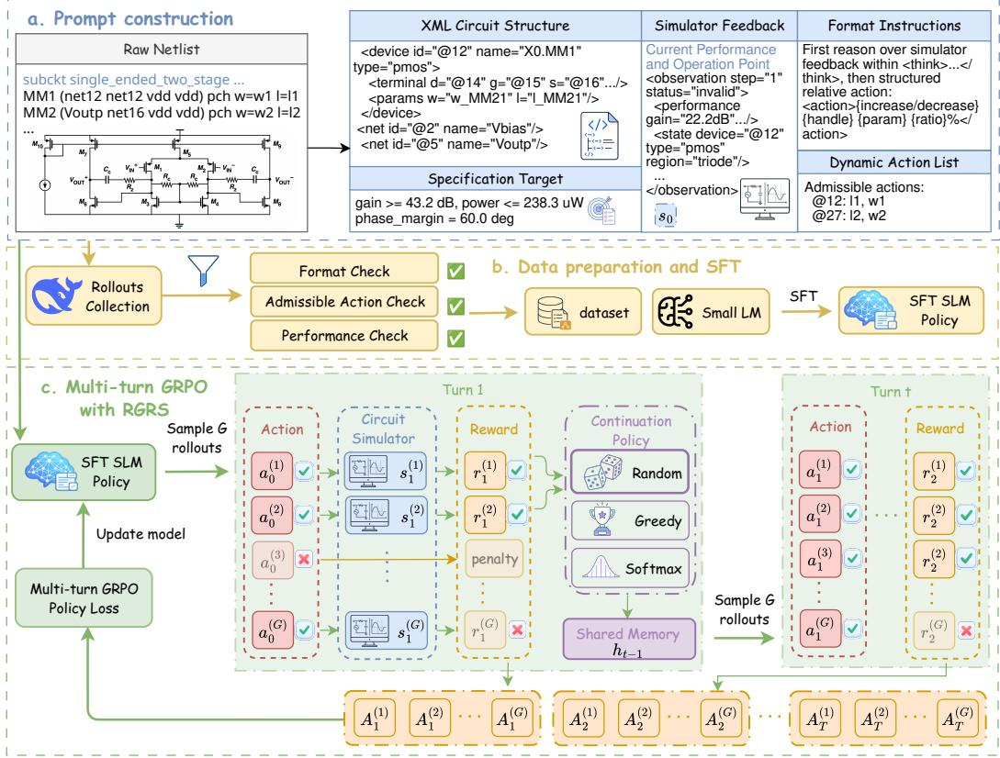  
Figure 1: Overview of SLIC. Given a goal-conditioned analog circuit optimization task, SLIC builds a structured prompt from the circuit representation and target specifications, then trains a languagemodel agent through SFT and simulator-interactive RL. The upper path shows SFT data construction from filtered teacher rollouts. The lower loop shows multi-turn GRPO with Reward-Guided Rollout Steering (RGRS), where multiple candidate responses propose relative parameter updates that are evaluated through simulation, one eligible continuation is selected to advance the trajectory, and all candidates contribute to group-relative policy updates. Subscripts denote interaction steps, and superscripts index candidates within each group.

In this paper, we introduce SLIC (Small LM Iterating on Circuits, as shown in Figure 1), a lightweight, circuit-specific and reasoning-driven small language model (SLM) training framework that addresses the local deployability and scalability challenges above by performing multi-turn reinforcement learning with verifiable rewards (RLVR). RLVR has recently driven substantial progress in single-turn reasoning tasks such as mathematics and coding [9, 11, 13, 27, 36, 41, 42, 56, 62, 69, 78, 82], and has been extended to multi-turn agentic settings [21, 31] where models act over multiple steps and adapt to environmental feedback [58, 76]. Such a paradigm shift from isolated answer generation toward stateful decision-making is a natural fit for analog circuit design: it is inherently multi-turn, requires reasoning over coupled trade-offs among performance objectives, and admits quantitatively verifiable feedback from circuit simulators at every step. Training small LMs under this paradigm reflects a practical trade-off between reasoning capability and parallel deployability. We focus on 4B-scale models as a balanced operating point: large enough to support structured reasoning and action generation, yet small enough to enable multiple specialized agents to run concurrently in local design environments. Our contributions are threefold:

1. A reasoning-driven, locally deployable framework for analog design optimization. We train SLIC on simulator-grounded synthetic data generated using public predictive technology models (PTM), addressing data scarcity without requiring proprietary PDK data. Trained solely using PTM 65 nm CMOS, the 4B SLIC-SOFTMAX policy maintains 61.9–71.0% Pass@1 on heldout topologies across five unseen technology nodes without additional fine-tuning, compared with 72.6% at the training node. Transfer to a commercial TSMC 65 nm CMOS PDK further demonstrates practical deployment through local inference and simulation without exposing proprietary process models or circuit data to external LLM services.

2. Domain adaptations for simulator-interactive design optimization. We combine domain- and success-gated rewards with Reward-Guided Rollout Steering (RGRS) to learn from intermediate simulator feedback. The rewards prioritize functional designs and target satisfaction, while RGRS guides rollout continuation and supports comparisons among candidate actions from the same interaction history. In our main setting, the 4B SLIC-RANDOM policy achieves 87.1% in-distribution four-specification Pass@1 within eight turns, outperforming the 763B DeepSeek-V4.1-Flash THINK baseline by 48.5 percentage points.

3. Open simulator-interactive benchmark. We release an open, goal-conditioned benchmark of 41 amplifier topologies paired with target specifications and initial states, with standardized protocols for in-distribution validation, held-out topology evaluation, and cross-technology-node transfer (22–130 nm CMOS), providing a reproducible testbed for closed-loop, multi-turn analog circuit design optimization.

## 2 Background and Problem Formulation

## 2.1 Multi-turn RL for Analog Circuit Optimization

We formulate analog circuit optimization as a multi-turn RLVR problem. At turn $t ,$ let $c _ { t } \in \mathcal { C }$ denote the textual circuit representation and $f _ { t } \in \mathcal { F }$ the simulator feedback, comprising measured performance metrics (e.g., gain, power) and device-level operating states (e.g., whether each transistor is in saturation or triode). The stepwise state is $s _ { t } = ( c _ { t } , f _ { t } )$ . Let $h _ { t }$ contain the task specification $q ,$ the current state $s _ { t }$ , and the retained interaction history. The policy generates a variable-length sequence of circuit edit actions $a _ { t } \sim \pi _ { \theta } ( \cdot \ | \ h _ { t } )$ corresponding to a structured parameter update. The simulator-interactive environment applies the update and returns $\boldsymbol { s } _ { t + 1 } = \boldsymbol { \mathcal { M } } ( \boldsymbol { s } _ { t } , \boldsymbol { a } _ { t } )$ together with a verifiable reward $\boldsymbol { r } _ { t } = \mathcal { R } ( \boldsymbol { a } _ { t } , \boldsymbol { s } _ { t + 1 } )$ . An episode terminates when all target specifications are satisfied or when the maximum horizon is reached.

## 2.2 Multi-turn GRPO

Given a task instance $( q , s _ { 0 } )$ , trajectory-level GRPO [56] samples a group of trajectories $\{ \tau _ { i } \} _ { i = 1 } ^ { G }$ from the behavior policy $\pi _ { \boldsymbol { \theta } _ { \mathrm { o l d } } } .$ , where each trajectory $\tau _ { i } = ( s _ { 0 , i } , a _ { 0 , i } , r _ { 0 , i } , . ~ . ~ . , s _ { T _ { i } , i } )$ is generated through simulator-interactive optimization. Let $o _ { i } = \left( o _ { i , 1 } , . . . , o _ { i , | o _ { i } | } \right)$ denote the model output sequence that induces trajectory $\tau _ { i }$ through interaction with the environment. Each sampled trajectory $\tau _ { i }$ receives a scalar return $R _ { i } = R ( \tau _ { i } )$ , defined by its terminal reward $R _ { i } = r _ { T _ { i } - 1 , i }$ or by aggregating step rewards as $\begin{array} { r } { R _ { i } = \sum _ { t = 0 } ^ { T _ { i } - 1 } r _ { t , i } } \end{array}$ . GRPO normalizes these returns across the sampled trajectories:

$$
\hat { A } _ { i } = \frac { R _ { i } - \mu _ { G } } { \sigma _ { G } + \epsilon } , \qquad \mu _ { G } = \frac { 1 } { G } \sum _ { i ^ { \prime } = 1 } ^ { G } R _ { i ^ { \prime } } , \qquad \sigma _ { G } = \mathrm { s t d } \big ( \{ R _ { i ^ { \prime } } \} _ { i ^ { \prime } = 1 } ^ { G } \big ) ,\tag{1}
$$

where $\epsilon > 0$ ensures numerical stability. The resulting advantage is shared across all turns and generated response tokens ℓ in the trajectory, so $\hat { A } _ { i , \ell } = \hat { A } _ { i }$ . Turn-level variants retain the clipped policy objective below but construct a separate advantage for each turn.

The policy is then updated with a PPO-style clipped objective [52],

$$
\begin{array} { l } { \displaystyle \mathcal { L } _ { \mathrm { G R P O } } ( \theta ) = \mathbb { E } \left[ \frac { 1 } { G } \sum _ { i = 1 } ^ { G } \frac { 1 } { | o _ { i } | } \sum _ { \ell = 1 } ^ { | o _ { i } | } \operatorname* { m i n } \Bigl ( \rho _ { i , \ell } ( \theta ) \hat { A } _ { i , \ell } , \mathrm { c l i p } ( \rho _ { i , \ell } ( \theta ) , 1 - \epsilon _ { \mathrm { l o w } } , 1 + \epsilon _ { \mathrm { h i g h } } ) \hat { A } _ { i , \ell } \Bigr ) \right] } \\ { \displaystyle - \beta D _ { \mathrm { K L } } ( \pi _ { \theta } \| \pi _ { \mathrm { r e f } } ) , } \end{array}\tag{2}
$$

where $\rho _ { i , \ell } ( \theta ) = \pi _ { \theta } ( o _ { i , \ell } \mid \cdot ) / \pi _ { \theta _ { \mathrm { o l d } } } ( o _ { i , \ell } \mid \cdot )$ is the token-level importance ratio, with both policies conditioned on the same context and preceding tokens. We set $\beta = 0$ (Table 17). Following the Clip-Higher strategy in DAPO [78], we use an asymmetric clipping range with $\epsilon _ { \mathrm { h i g h } } > \epsilon _ { \mathrm { l o w } }$ , mildly relaxing the upper policy-ratio bound for positive-advantage tokens to preserve exploration during multi-turn training.

## 2.3 Challenges of Off-the-Shelf Multi-Turn GRPO for Analog Circuit Design Optimization

Although multi-turn GRPO provides a natural policy-optimization backbone for simulator-interactive circuit design optimization, applying it directly presents several challenges. First, analog circuit optimization involves tightly coupled performance requirements within a narrow feasible design space. Assessing progress requires considering both circuit validity and improvements toward satisfying all target specifications. Second, vanilla trajectory-level credit assignment can be ambiguous in multi-turn optimization. Since the final trajectory return is attached to multiple turns, invalid or unhelpful turns may inherit high rewards from trajectories that are later rescued, while locally beneficial turns may receive low scores when later turns fail. This motivates denser intermediate rewards that provide more direct feedback on individual updates. Finally, sampled groups can lack reward contrast, including when all candidates fail or all succeed. If their rewards are identical, group-relative advantages vanish. Maintaining informative reward differences within each group is therefore important for learning efficiently from sampled simulator feedback.

## 3 SLIC: Domain Adaptations for Simulator-Interactive Circuit Optimization

## 3.1 SLIC Framework

Figure 1 summarizes the SLIC pipeline. We collect training trajectories by running a strong prompted model (DeepSeek-V4.1-Flash) on simulator-grounded multi-turn optimization without specifying explicit goals, then relabel each trajectory with its best-observed performance tuple as the goalconditioned training target, following the hindsight relabeling principle of HER [2]. This bypasses the lack of labeled (circuit, target-spec) pairs and yields a fully simulator-grounded synthetic training set. The dataset is filtered to retain valid and performance-improving turns for supervised fine-tuning (SFT), which initializes the policy with basic reasoning and action-generation behavior (Figure 1b). The SFT checkpoint is then further trained with multi-turn GRPO using the domain-gated rewards of Section 3.2 and the Reward-Guided Rollout Steering procedure of Section 3.3 (Figure 1c).

Each prompt contains the XML-structured circuit state, target specifications, simulator feedback, and a dynamically generated admissible action list (Figure 1a). The policy outputs reasoning and interpretable discretized relative-update actions rather than absolute parameter values. Full representation details, action grammar, and validity checks are provided in Appendix B.

## 3.2 Domain Reward Shaping

Analog circuit optimization requires satisfying coupled performance targets under physically meaningful operating conditions. Our reward design prioritizes valid amplification and joint specification satisfaction, while rewarding additional performance headroom among successful designs.

Domain-validity gates. Directly aggregating performance metrics can favor nonfunctional designs, such as circuits that consume little power because they fail to provide valid amplification. We therefore apply gates that reflect the physical prerequisites of amplifier operation before aggregating perspecification rewards. Non-positive gain suppresses power, bandwidth, and phase-margin credit. An in-band flatness gate additionally suppresses gain, bandwidth, and phase-margin credit when peaking exceeds 6 dB, preventing distorted frequency responses from receiving misleading performance credit. The same gates apply when checking specification satisfaction, with flatness used only to assess validity. Full definitions are provided in Appendix C.

Success-conditional slack bonus. To prioritize target satisfaction, we keep unsuccessful scores strictly below one and assign successful scores in [1, 1.5], with a bonus based on mean normalized specification slack. A constant success reward would leave all-success groups without a performance learning signal. DAPO [78] addresses this through dynamic sampling, filtering out groups with uniform correctness outcomes. To obtain richer feedback from successful terminal candidates, we use the slack bonus to preserve differences in their measured specification headroom, allowing allsuccess groups to remain informative when their slack differs. The bonus also encourages additional headroom, providing margin against performance degradation and improving design robustness and policy generalization. The formulation and its tolerance alignment are detailed in Appendix C.

For policy updates, we normalize validity and performance feedback separately before combining their advantages, following the reward-decoupled normalization principle of GDPO [35]. The formulation is provided in Appendix C.4.

## 3.3 Reward-Guided Rollout Steering

Motivated by the credit-assignment challenges discussed in Section 2.3, we introduce Reward-Guided Rollout Steering (RGRS), a search-augmented procedure for online rollout construction guided by intermediate simulator feedback. At each turn, RGRS samples G candidate responses from the same interaction history, each proposing an alternative set of parameter edits, and evaluates the resulting circuits through simulation. This procedure serves two roles. For policy learning, all sampled candidates remain available for group-relative updates, providing same-context comparisons for stepwise advantage estimation. For trajectory construction, RGRS selects one eligible successor as the parent state for the next turn, advancing the shared history. Continuation selection is restricted to valid candidates whenever any are available.

This design is motivated by the view of search as a policy-improvement operator. Best-of-G selection induces a reward-biased distribution over outputs, and prior work has analyzed the distributional shift and KL trade-offs of such best-of-N policies [4]. More broadly, expert-iteration and AlphaZero-style methods use search to produce improved behavior that is later internalized by a learned policy [12]. A related principle appears in automated discovery: TTT-Discover [81] selects promising parent states from previously evaluated candidates while retaining exploration through its reuse procedure. In our setting, RGRS applies candidate selection locally at each turn. We study three continuation policies to examine the trade-off between performance preference and exploration: RANDOM samples uniformly from eligible candidates, GREEDY selects a highest-scoring candidate, and SOFTMAX favors higher-scoring candidates while retaining nonzero selection probability for other eligible candidates. The full procedure is provided in Algorithm 1 in Appendix D.

## 4 Experiments

## 4.1 Setup

Dataset. We construct a benchmark of 41 amplifier topologies, using 35 for training and indistribution (ID) evaluation and reserving six held-out topologies for out-of-distribution (OOD) evaluation. The dataset is further divided into Simple and Complex topology categories, each paired with multiple target goals and initial states. As shown in Table 15, the benchmark spans a wide range of topology complexity, tunable parameter counts, and valid/invalid initial-state ratios, providing a challenging testbed for multi-turn analog circuit optimization. The main experiments extend the original evaluation with a newer backbone, a larger benchmark, and an additional bandwidth objective. Training at 65 nm enables transfer evaluation toward both more advanced (22–45 nm) and more mature (90–130 nm) technology nodes. Appendix G.1 reports this earlier configuration, which uses the Apache-2.0-licensed Qwen2.5-7B-Instruct [45, 74], 22 nm training, and three specifications (excluding bandwidth).

Simulation environment. Training tasks are simulated with ngspice [40] using the 65 nm bulk CMOS Predictive Technology Model (PTM) [38, 83]. In this setting, transistor sizing is constrained to channel length L [45 nm, 100 µm] and width W [45 nm, 500 µm]. For cross-technology evaluation, each node uses its corresponding PTM models [38] and node-specific sizing bounds, as summarized in Table 5. We use Cadence Spectre [6] for evaluation with a commercial TSMC 65 nm CMOS foundry PDK.

Model training configuration. We initialize SFT from Apache-2.0-licensed Qwen3.5-4B [47, 48], choosing a 4B-scale model as a practical operating point for locally deployable specialized analog design agents under proprietary PDK constraints. RL is initialized from the resulting SFT checkpoint and optimized with GRPO using RGRS. Training uses an XML circuit representation and, unless another horizon is specified, a maximum rollout horizon of eight turns, taking approximately 39 hours on 2 B200 GPUs. Tables 16 and 17 summarize the SFT and RL configurations, respectively. We also train a variant of SLIC-RANDOM with dynamic filtering inspired by DAPO’s dynamic sampling [78], which skips candidate groups with no group relative policy gradient signal. It is labeled “+ filter” in the figures and “+ dynamic filtering” in the tables. To assess applicability beyond Qwen3.5-4B, we also apply the same SFT-to-RL pipeline to the Apache-2.0-licensed Qwen3.5-9B [47, 49] and Qwen3-8B [46, 75] using SLIC-RANDOM. Results are reported in Table 4.

Baselines. We compare our method with several complementary baselines. We include Bayesian Optimization with TuRBO [20] as a representative black-box numerical optimizer, the Qwen3.5- 4B model to evaluate the zero-shot capability of an untuned locally deployable LLM, and the supervised fine-tuned (SFT) model as an initialization without reinforcement learning. We also evaluate DeepSeek-V4.1-Flash [14, 15], a recent large open-weight model, in THINK mode as a strong prompt-based reasoning baseline. To compare SLIC with a strong closed-source model, we evaluate GPT-6-Astra [43] on the same tasks, with one rollout per task and up to eight interaction turns. See Appendix I.2 for evaluation notes and API costs for both models. We also include two GRPO baselines. Single-turn GRPO uses SLIC’s reward design, with the effect of training horizon analyzed in Section 4.4. For multi-turn training, trajectory-level GRPO with only terminal supervision was unstable in our experiments. We therefore evaluate the branching-rollout formulation of multi-turn GRPO (MT-GRPO) [68], referred to here as Tree MT-GRPO, which combines intermediate and terminal feedback, with SLIC’s success-conditional slack bonus in the outcome reward. Its budget of candidate evaluations is approximately matched to SLIC-RANDOM. Implementation details are provided in Appendix F.1.

Metrics. We evaluate four specifications: gain, power consumption, 3 dB bandwidth, and phase margin. A rollout succeeds if it reaches a valid design satisfying all four target specifications within the prescribed 5% tolerance under the domain-validity gates. At a turn budget T, Pass@k measures the probability that at least one of k sampled rollouts succeeds within T interaction turns, averaged over evaluation tasks. We primarily report cumulative four-specification Pass@1 at Turns 4 and 8. Unless otherwise noted, we report means standard deviations over three evaluation runs.

## 4.2 Evaluation Results

In-distribution evaluation. Table 1 shows that all 4B SLIC variants substantially outperform SFT and DeepSeek-V4.1-Flash THINK at both evaluation horizons. At four turns, SLIC-RANDOM achieves 74.9% Pass@1, exceeding GPT-6-Astra’s 67.1%. At eight turns, Astra achieves higher success at 90.6%, while the locally deployable 4B SLIC-RANDOM policy reaches 87.1%, a gap of 3.5 percentage points. Among SLIC variants, SOFTMAX performs best on simple topologies, while RANDOM leads on complex topologies and overall. Although DeepSeek-V4.1-Flash also generated the SFT data, RL lifts the student from below its teacher (26.5% vs. 38.6%) to well above it (87.1%).

Generalization to held-out topologies. Table 2 shows that SLIC generalizes to held-out topologies. At eight turns, SLIC-SOFTMAX achieves the highest Pass@1 among SLIC variants, exceeding DeepSeek by 45.9 percentage points. GPT-6-Astra achieves 86.2% on the same held-out tasks, with its advantage concentrated in structurally simple topologies, which can still require substantial performance improvements to meet their targets. Both methods achieve $8 2 . 5 \%$ on complex topologies. Softmax’s advantage over Random is not statistically significant (Appendix H.5), although both outperform Greedy, suggesting a benefit from preserving diversity during rollout construction for topology generalization. Rollout analysis associates Softmax with more consistent recovery and planning after performance decreases, while Greedy shows more hesitation and repeated reconsideration despite longer responses (Appendix H.1, Figure 6). Required performance improvements also help explain differences across topologies beyond circuit size alone (Appendix H.3).

Table 1: In-distribution evaluation at the PTM 65 nm technology node over 840 tasks with breakdowns by topology complexity. GPT-6-Astra is evaluated once on the full evaluation set. Bayesian Optimization uses 96 and 192 simulator calls per topology to match SLIC’s total simulation budget. Bold and underline denote the best and second-best mean results in each column respectively.
<table><tr><td rowspan="2">Method</td><td colspan="3">4-spec Pass@1 (%) @Turn 4</td><td colspan="3">4-spec Pass@1 (%) @Turn 8</td></tr><tr><td>Simple</td><td>Complex</td><td>Total</td><td>Simple</td><td>Complex</td><td>Total</td></tr><tr><td>Bayesian Optimization</td><td> $5 4 . 3 \pm 7 . 2$ </td><td> $3 4 . 2 \pm 1 . 9$ </td><td> $4 3 . 4 \pm 3 . 9$ </td><td> $7 0 . 5 \pm 7 . 5$ </td><td> $5 4 . 1 \pm 5 . 3$ </td><td> $6 1 . 6 \pm 6 . 1$ </td></tr><tr><td>GPT-6-Astra</td><td> $^ { 7 7 . 6 }$ </td><td> $5 8 . 3$ </td><td> $6 7 . 1$ </td><td> $9 6 . 1$ </td><td> $\mathbf { 8 6 . 0 }$ </td><td> $\mathbf { 9 0 . 6 }$ </td></tr><tr><td>DeepSeek-V4.1-Flash THINK (763B)</td><td> $3 3 . 1 \pm 0 . 0$ </td><td> $1 1 . 1 \pm 1 . 8$ </td><td> $2 1 . 2 \pm 1 . 0$ </td><td> $5 6 . 0 \pm 1 . 6$ </td><td> $2 4 . 0 \pm 1 . 1$ </td><td> $3 8 . 6 \pm 1 . 3$ </td></tr><tr><td>Qwen3.5-4B</td><td> $2 . 4 \pm 0 . 6$ </td><td> $1 . 0 \pm 0 . 3$ </td><td> $1 . 7 \pm 0 . 2$ </td><td> $3 . 2 \pm 1 . 1$ </td><td> $1 . 5 \pm 0 . 4$ </td><td> $2 . 3 \pm 0 . 5$ </td></tr><tr><td>SFT</td><td> $2 2 . 4 \pm 1 . 2$ </td><td> $6 . 1 \pm 0 . 1$ </td><td> $1 3 . 5 \pm 0 . 6$ </td><td> $4 1 . 0 \pm 1 . 8$ </td><td> $1 4 . 4 \pm 0 . 7$ </td><td> $2 6 . 5 \pm 0 . 7$ </td></tr><tr><td>Single-turn GRPO</td><td> $6 6 . 4 \pm 2 . 0$ </td><td> $4 1 . 7 \pm 0 . 8$ </td><td> $5 3 . 0 \pm 1 . 0$ </td><td> $7 4 . 3 \pm 0 . 8$ </td><td> $5 1 . 0 \pm 1 . 9$ </td><td> $6 1 . 6 \pm 1 . 4$ </td></tr><tr><td>Tree MT-GRPO</td><td> $8 2 . 7 \pm 1 . 6$ </td><td> $4 9 . 6 \pm 2 . 5$ </td><td> $6 4 . 7 \pm 0 . 9$ </td><td> ${ \bf 9 6 . 3 \pm 1 . 1 }$ </td><td> $6 8 . 4 \pm 1 . 4$ </td><td> $8 1 . 2 \pm { 1 . 3 }$ </td></tr><tr><td>Proposed (Qwen3.5-4B)</td><td></td><td></td><td></td><td></td><td></td><td></td></tr><tr><td>SLIC-GREEDY</td><td> $7 2 . 4 \pm 1 . 3$ </td><td> $3 6 . 6 \pm 1 . 5$ </td><td> $5 3 . 0 \pm 1 . 2$ </td><td> $8 4 . 1 \pm 0 . 9$ </td><td> $5 1 . 6 \pm 1 . 1$ </td><td> $6 6 . 5 \pm 0 . 8$ </td></tr><tr><td>SLIC-RANDOM </td><td> $\underline { { 8 6 . 8 \pm 0 . 8 } }$  </td><td> ${ \bf 6 4 . 8 \pm 0 . 7 }$  </td><td> ${ \bf 7 4 . 9 \pm 0 . 0 }$ </td><td> $9 2 . 7 \pm 1 . 2$  </td><td> $\underline { { 8 2 . 5 \pm 1 . 0 } }$ </td><td> $8 7 . 1 \pm 0 . 7$ </td></tr><tr><td>w/o domain-validity gates</td><td> $\overline { { 8 2 . 2 \pm 0 . 8 } }$ </td><td> $5 7 . 2 \pm 0 . 1$ </td><td> $6 8 . 6 \pm 0 . 4$ </td><td> $8 9 . 1 \pm 0 . 5$ </td><td> $7 7 . 6 \pm 2 . 3$ </td><td> $8 2 . 8 \pm 1 . 2$ </td></tr><tr><td> $\mathbf { S L I C - S O F T M A X }$ </td><td> ${ \bf 8 7 . 7 \pm 0 . 3 }$ </td><td> $5 9 . 8 \pm 1 . 5$ </td><td> $7 2 . 5 \pm 0 . 7$ </td><td> $\underline { { 9 3 . 9 \pm 0 . 8 } }$ </td><td> $7 6 . 2 \pm 1 . 5$ </td><td> $8 4 . 3 \pm 1 . 0$ </td></tr></table>

Comparison with Tree MT-GRPO. While Tree MT-GRPO leads SLIC-RANDOM on simple ID topologies at Turn 8 (96.3% vs. 92.7%), SLIC-RANDOM achieves higher overall Pass@1 on both ID tasks (87.1% vs. 81.2%) and held-out topologies (70.6% vs. 58.3%), with the largest gaps on complex topologies (Tables 1 and 2). In circuit optimization, each action jointly modifies multiple parameters, making it important to associate the resulting performance with the corresponding update. This association is less direct in Tree MT-GRPO, where aggregating advantages across subsequent turns mixes feedback on the current joint update with the effects of later edits. Moreover, Tree MT-GRPO exhibits a sharp increase in policy entropy during training. Its branching structure also makes sampling cost grow exponentially with the training horizon, limiting the depth of training rollouts. SLIC therefore uses RGRS to compare candidates from the same interaction history and learns from stepwise simulator feedback. This supports effective iterative circuit optimization by keeping credit assignment focused on local refinement, while advancing one selected successor allows larger candidate groups and longer training rollouts with linear sampling cost.

Technology node generalization. Figure 2 shows that policies trained at PTM 65 nm can transfer to both older and more advanced technology nodes without additional fine-tuning. Across the five unseen technology nodes, SLIC-SOFTMAX maintains 73.3–79.8% Pass@1 on ID tasks and 61.9– 71.0% on held-out topologies, compared with 83.5% and 72.6%, respectively, at the training node. These results suggest that SLIC internalizes simulator-grounded optimization strategies that remain useful beyond the training node, supporting our hypothesis that some learned strategies are agnostic to the technology node. Valid parameter ranges for each node are reported in Table 5.

To assess effectiveness in a practical circuit design setting, we also evaluate SLIC on a commercial TSMC 65 nm CMOS foundry PDK without additional fine-tuning. SLIC-RANDOM achieves 55.8% ID and 49.9% OOD Pass@1 within eight turns, down from 86.9% and 70.6%, respectively, on the same tasks with PTM 65 nm. The foundry PDK captures process-specific effects that PTM simplifies. Differences in device behavior can therefore shift the trade-offs achievable with a given topology, making the four targets selected under PTM harder to satisfy jointly. This mismatch may help explain the observed drop in Pass@1 after transfer. Our task-level audit shows that SFT mainly succeeds when the initial design needs only minor adjustments to meet the targets, which may explain its similar Pass@1 across the two processes. On the foundry PDK, SLIC-RANDOM still outperforms

Table 2: Out-of-distribution evaluation at the PTM 65 nm technology node over 240 tasks, with breakdowns by topology complexity (two simple and four complex). GPT-6-Astra is evaluated once on the full evaluation set. Bayesian Optimization uses 96 and 192 simulator calls per topology to match SLIC’s total simulation budget. Bold and underline denote the best and second-best reported mean results in each column respectively.
<table><tr><td rowspan="2">Method</td><td colspan="3">4-spec Pass@1 (%) @Turn 4</td><td colspan="3">4-spec Pass@1 (%) @Turn 8</td></tr><tr><td>Simple</td><td>Complex</td><td>Total</td><td>Simple</td><td>Complex</td><td>Total</td></tr><tr><td>Bayesian Optimization</td><td> $2 . 5 \pm 0 . 0$ </td><td> $3 6 . 7 \pm 1 . 0$ </td><td> $2 5 . 3 \pm 0 . 6$ </td><td> $3 . 3 \pm 1 . 4$ </td><td> $4 6 . 0 \pm 1 . 4$ </td><td> $3 1 . 8 \pm 0 . 5$ </td></tr><tr><td>GPT-6-Astra</td><td>66.2</td><td>62.5</td><td>63.7</td><td>93.8</td><td>82.5</td><td>86.2</td></tr><tr><td>DeepSeek-V4.1-Flash THINK (763B)</td><td> $1 0 . 8 \pm { 3 . 8 }$ </td><td> $1 6 . 9 \pm 1 . 1$ </td><td> $1 4 . 9 \pm 0 . 6$ </td><td> $2 0 . 0 \pm 3 . 7$ </td><td> $3 0 . 0 \pm 2 . 3$ </td><td> $2 6 . 7 \pm 2 . 2$ </td></tr><tr><td>Qwen3.5-4B</td><td> $3 . 3 \pm 0 . 7$ </td><td> $3 . 8 \pm 0 . 6$ </td><td> $3 . 6 \pm 0 . 5$ </td><td> $3 . 3 \pm 0 . 7$ </td><td> $5 . 0 \pm 1 . 1$ </td><td> $4 . 4 \pm 0 . 9$ </td></tr><tr><td>SFT</td><td> $3 . 3 \pm 3 . 1$ </td><td> $1 4 . 8 \pm 1 . 3$ </td><td> $1 1 . 0 \pm 0 . 2$ </td><td> $1 0 . 4 \pm 1 . 4$ </td><td> $2 4 . 6 \pm 1 . 3$ </td><td> $1 9 . 9 \pm 1 . 3$ </td></tr><tr><td>Single-turn GRPO</td><td> $3 1 . 2 \pm 2 . 5$ </td><td> $4 1 . 2 \pm 2 . 9$ </td><td> $3 7 . 9 \pm 2 . 7$ </td><td> $4 9 . 2 \pm 0 . 7$ </td><td> $4 6 . 9 \pm 1 . 7$ </td><td> $4 7 . 6 \pm 0 . 9$ </td></tr><tr><td>Tree MT-GRPO</td><td> $2 9 . 6 \pm 5 . 8$ </td><td> $5 2 . 3 \pm 1 . 6$ </td><td> $4 4 . 7 \pm 1 . 0$ </td><td> $4 5 . 0 \pm 3 . 3$ </td><td> $6 5 . 0 \pm 4 . 1$ </td><td> $5 8 . 3 \pm 3 . 6 $ </td></tr><tr><td>Proposed (Qwen3.5-4B)</td><td></td><td></td><td></td><td></td><td></td><td></td></tr><tr><td>SLIC-GREEDY</td><td> $2 2 . 5 \pm 2 . 5$ </td><td> $3 6 . 2 \pm 2 . 9$ </td><td> $3 1 . 7 \pm 1 . 8$ </td><td> $3 2 . 1 \pm 1 . 9$ </td><td> $4 9 . 8 \pm 2 . 9$ </td><td> $4 3 . 9 \pm 2 . 4$ </td></tr><tr><td>SLIC-RANDOM</td><td> $3 5 . 0 \pm 1 . 2$ </td><td> ${ \bf 6 7 . 7 \pm 2 . 2 }$ </td><td> $5 6 . 8 \pm 1 . 3$ </td><td> $4 6 . 7 \pm 1 . 4$ </td><td> ${ \bf 8 2 . 5 \pm 2 . 3 }$ </td><td> $7 0 . 6 \pm 1 . 2$ </td></tr><tr><td>w/o domain-validity gates</td><td> $3 1 . 2 \pm 4 . 5$ </td><td> $5 5 . 2 \pm 2 . 2$ </td><td> $4 7 . 2 \pm 2 . 3$ </td><td> $4 6 . 2 \pm 2 . 2$ </td><td> ${ \underline { { 7 2 . 3 \pm 1 . 9 } } }$ </td><td> $6 3 . 6 \pm 0 . 9$ </td></tr><tr><td>SLIC-SOFTMAX</td><td> $3 6 . 7 \pm 4 . 0 $  </td><td> $6 7 . 1 \pm 3 . 0 $  </td><td> $5 6 . 9 \pm 3 . 1$  </td><td> ${ \underline { { 5 2 . 9 \pm 4 . 7 } } }$  </td><td> ${ \bf 8 2 . 5 \pm 0 . 6 }$ </td><td> $7 2 . 6 \pm 2 . 0$ </td></tr></table>

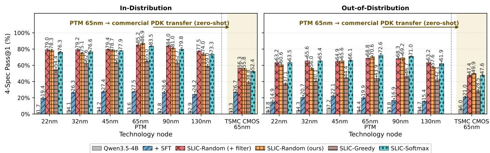  
Figure 2: Technology transfer under four-specification Pass@1 evaluation within eight turns. Policies are trained on PTM 65 nm and evaluated across PTM nodes from 22 to 130 nm and a TSMC CMOS 65 nm PDK without additional fine-tuning. Initial parameters are adjusted to the valid ranges of each technology, while the PTM 65 nm target specifications are reused. Left: a 420-task subset of the full 840 in-distribution tasks. Right: 240 held-out topology tasks.

SFT by about 29 percentage points on both splits. These results demonstrate the practical value of local policy inference and simulation, which keep proprietary device models and circuit data in-house while enabling automated circuit optimization in workflows where PDK confidentiality prevents the use of hosted LLM services.

## 4.3 Component Ablations

Domain-validity guidance. Removing domain-validity reward gates from SLIC-RANDOM reduces Turn 8 Pass@1 by 4.3 percentage points in-distribution and 7.0 points out-of-distribution (Tables 1 and 2), which supports our inductive bias that bringing a circuit into a feasible operating region before further optimization is beneficial.

Table 3: Slack bonus ablation with random continuation and dynamic filtering.

Success-conditional slack bonus. Table 3 reports four-specification Pass@1 at Turn 8. With dynamic filtering enabled, adding the slack bonus improves Pass@1 by 8.5 percentage points on ID tasks and 12.1 points on held-out topologies. The larger gain on heldout topologies supports the benefit of this richer feedback for generalization.

<table><tr><td>Slack bonus</td><td>ID OOD</td></tr><tr><td>Without</td><td> $7 6 . 4 \pm 0 . 9$   $5 6 . 7 \pm 1 . 3$ </td></tr><tr><td>With</td><td> $8 4 . 9 \pm 0 . 7$   $6 8 . 8 \pm 2 . 2$ </td></tr></table>

Table 4: Generalization across backbones at Turn 8 on 840 ID and 240 OOD tasks. Qwen3 and Qwen3.5 backbones follow the main SLIC-RANDOM configuration. <sup>†</sup>Qwen2.5-7B-Instruct uses SLIC-SOFTMAX with 800 RL updates (Appendix G.2).
<table><tr><td rowspan="2">Backbone</td><td colspan="3">In-distribution Pass@ 1 (%)</td><td colspan="3">Out-of-distribution Pass @1 (%)</td></tr><tr><td>Base</td><td>SFT</td><td>SLIC</td><td>Base</td><td>SFT</td><td>SLIC</td></tr><tr><td>Qwen2.5-7B-Instruct†</td><td> $1 . 0 \pm 0 . 2$ </td><td> $1 4 . 0 \pm 0 . 7$ </td><td> $3 2 . 2 \pm 0 . 8$ </td><td> $2 . 8 \pm 0 . 6$ </td><td> $1 3 . 3 \pm 1 . 1$ </td><td> $2 4 . 9 \pm 1 . 7$ </td></tr><tr><td>Qwen3-8B</td><td> $1 . 4 \pm 0 . 0$ </td><td> $1 3 . 0 \pm 0 . 9$ </td><td> $3 9 . 8 \pm 0 . 5$ </td><td> $3 . 2 \pm 0 . 2$ </td><td> $1 1 . 4 \pm 1 . 3$ </td><td> $2 9 . 0 \pm 1 . 2$ </td></tr><tr><td>Qwen3.5-4B</td><td> $2 . 3 \pm 0 . 5$ </td><td> $2 6 . 5 \pm 0 . 7$ </td><td> $8 7 . 1 \pm 0 . 7$ </td><td> $4 . 4 \pm 0 . 9$ </td><td> $1 9 . 9 \pm 1 . 3$ </td><td> $7 0 . 6 \pm 1 . 2$ </td></tr><tr><td>Qwen3.5-9B</td><td> $3 . 0 \pm 0 . 2$ </td><td> $2 7 . 1 \pm 2 . 0$ </td><td> $8 8 . 9 \pm 0 . 4$ </td><td> $4 . 2 \pm 0 . 7$ </td><td> $1 6 . 9 \pm 1 . 0$ </td><td> $7 6 . 1 \pm 1 . 3$ </td></tr></table>

Additional ablations in Appendix E examine advantage normalization, rollout construction, episode termination, training horizon, and history representation and length.

## 4.4 Backbone Generalization and Test-Time Scaling

Generalization across backbones. Table 4 shows that SLIC improves over SFT across all four evaluated backbones. Within the Qwen3.5 family, scaling from 4B to 9B improves Pass@1 by 1.8 percentage points on ID tasks and 5.5 points on held-out topologies, suggesting additional benefits from scaling model capacity.

Pass@1 over interaction turns. Figure 3 shows that additional test-time simulator interactions improve cumulative Pass@1 on both splits, with the largest gains in early turns and diminishing returns at longer horizons. This suggests that much of the benefit can be captured within a moderate interaction budget, motivating us to examine shorter training horizons. Training with four turns remains effective and allows continued improvement beyond the training horizon. Further shortening the training horizon to single-turn GRPO lowers Pass@1 (Tables 1 and 2) and leads to earlier saturation, particularly on held-out topologies. This is consistent with its lack of training experience in successive simulator-guided refinement. These results suggest that a moderate multi-turn training budget may reduce training compute while preserving test-time scaling (Appendix E).

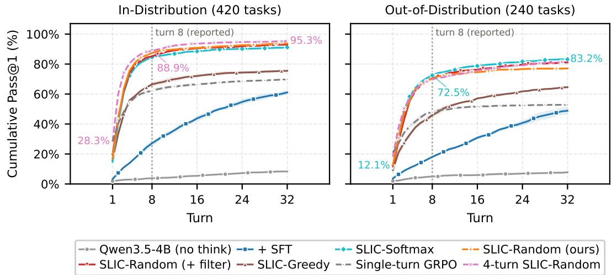  
Figure 3: Test-time scaling of cumulative Pass@1 with up to 32 interaction turns on a 420-task subset of the full 840 ID tasks (left) and 240 OOD tasks (right). Qwen3.5-4B is evaluated in non-thinking mode; we also tested thinking mode with an 8k-token generation budget, but reasoning did not terminate within this limit. Numerical annotations highlight selected values along the best-performing curve in each panel.

Pass@k over k. Increasing the number of test-time rollouts raises Pass@k toward saturation across the evaluated methods, although SLIC’s higher first-attempt success leaves less room for improvement (Figure 4). SFT attains substantially higher success rates with a large sampling budget, suggesting that successful optimization strategies are already accessible to the policy. SLIC-RANDOM exceeds SFT’s Pass@32 with a single rollout on both splits, consistent with reinforcement fine-tuning concentrating probability mass on effective optimization behaviors [80] and reducing the need for repeated sampling.

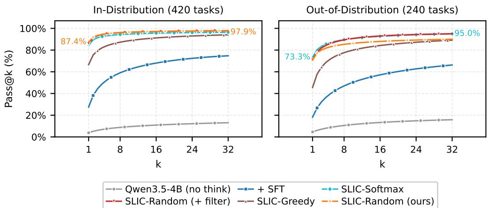  
Figure 4: Test-time scaling of Pass@k with the number of sampled rollouts on a 420-task subset of the full 840 ID tasks (left) and 240 OOD tasks (right) with eight-turn simulator budget per rollout. Numerical annotations highlight selected values along the best-performing curve in each panel.

## 5 Conclusion and Future Work

We present SLIC, a simulator-interactive RLVR framework that formulates analog circuit optimization as a multi-turn language-model decision problem grounded in verifiable simulator feedback. With structured circuit representations, interpretable relative-update actions, domain-aware reward shaping, and reward-guided rollout steering, a 4B policy reaches 87.1% in-distribution Pass@1 within eight turns, 3.5 percentage points below GPT-6-Astra, and exceeds GPT-6-Astra at four turns. The trained policies transfer to held-out topologies, five unseen PTM nodes, and a commercial TSMC 65 nm PDK without additional fine-tuning, while running entirely with local inference. These results position simulator-grounded RLVR on small models as a practical path toward locally deployable analog circuit design automation.

Future work will extend this formulation toward the multi-agent analog design framework envisioned in the introduction. Rather than relying on a single design-optimization agent, future systems may coordinate multiple specialized agents for topology exploration, block-level optimization, verification, layout-aware refinement, and system-level specification decomposition. This direction better matches the modular and hierarchical nature of analog circuit design, but also raises new challenges in scaling to larger analog and mixed-signal systems, including long-context management, cross-agent coordination, and maintaining consistent design state across hierarchical blocks. Addressing these issues could enable scalable collaboration among lightweight, locally deployable agents for more complex circuit and system-level design workflows.

Additional experiments, implementation details, limitations, and broader impact discussions are provided in the Appendix.

## Acknowledgments

This work was supported primarily by Analog Devices (ADI), with additional funding from the MIT Cadence Fellowship and the JLO/MACOM Endowment Fund. We thank the MIT Center for Integrated Circuits and Systems (CICS) for its support. We also acknowledge IBM, the MIT Office of Research Computing and Data (ORCD), and the Artificial Intelligence Compute Resources (AICR) cluster for providing computing and storage resources.

## References

[1] Mohsen Ahmadzadeh, Jan Lappas, Norbert Wehn, et al. AnaCraft: Duel-play probabilistic-modelbased reinforcement learning for sample-efficient PVT-robust analog circuit sizing optimization. IEEE Transactions on Computer-Aided Design ofIntegrated Circuits and Systems, 45(2):901–914, 2026. doi: 10.1109/TCAD.2025.3582175. URL https://doi.org/10.1109/TCAD.2025.3582175.

[2] Marcin Andrychowicz, Filip Wolski, Alex Ray, et al. Hindsight experience replay. In Advances in Neural Information Processing Systems (NeurIPS), 2017.

[3] Longju Bai, Zhemin Huang, Xingyao Wang, et al. How do AI agents spend your money? Analyzing and predicting token consumption in agentic coding tasks. arXiv preprint arXiv:2604.22750, 2026. doi: 10.48550/arXiv.2604.22750.

[4] Ahmad Beirami, Alekh Agarwal, Jonathan Berant, et al. Theoretical guarantees on the best-of-n alignment policy. In Proceedings of the 42nd International Conference on Machine Learning, volume 267 of Proceedings of Machine Learning Research, pages 3580–3602. PMLR, 2025. URL https://proceedings.mlr.press/v267/beirami25a.html.

[5] Chakravarti Bheemisetti, Karunanidhan Pandey, Idan Lotan, et al. A 7-bit 1.75-GS/s 6.9-fJ/conv.-step FoM loop-unrolled fully asynchronous SAR ADC in 3-nm CMOS for a 224-Gb/s SerDes receiver. IEEE Journal ofSolid-State Circuits, 60(4):1486–1499, 2025. doi: 10.1109/JSSC.2024.3449115.

[6] Cadence Design Systems. Cadence Spectre circuit simulator. Computer software, 2026. URL https://www.cadence.com/en\_US/home/tools/custom-ic-analog-rf-design/ circuit-simulation.html. Commercial software used under institutional license.

[7] Weidong Cao, Mouhacine Benosman, Xuan Zhang, et al. Domain knowledge-based automated analog circuit design with deep reinforcement learning. In 1st Annual AAAI Workshop on AI to Accelerate Science and Engineering (AI2ASE), 2022. URL https://arxiv.org/abs/2202.13185.

[8] Tony Chan Carusone, David A Johns, and Kenneth W Martin. Analog integrated circuit design. John Wiley & Sons, 2nd edition, 2011.

[9] Guoxin Chen, Minpeng Liao, Chengxi Li, et al. Step-level value preference optimization for mathematical reasoning. In Findings ofthe Associationfor Computational Linguistics: EMNLP, 2024.

[10] Xingyu Chen, Jiahao Xu, Tian Liang, et al. Do NOT think that much for 2+3=? On the overthinking of long reasoning models. In Proceedings ofthe 42nd International Conference on Machine Learning, volume 267 of Proceedings of Machine Learning Research, pages 9487–9499. PMLR, 2025. URL https://proceedings.mlr.press/v267/chen25bx.html

[11] Ganqu Cui, Lifan Yuan, Zefan Wang, et al. Process reinforcement through implicit rewards, 2025. URL https://arxiv.org/abs/2502.01456v2.

[12] Ivo Danihelka, Arthur Guez, Julian Schrittwieser, et al. Policy improvement by planning with Gumbel. In International Conference on Learning Representations, 2022.

[13] DeepSeek-AI. DeepSeek-R1: Incentivizing reasoning capability in LLMs via reinforcement learning. arXiv preprint arXiv:2501.12948, 2025. URL https://arxiv.org/abs/2501.12948v1.

[14] DeepSeek-AI. DeepSeek-V4.1-Flash: Pushing the limits of KV cache compression, 2026. URL https: //arxiv.org/abs/2609.19969.

[15] DeepSeek-AI. DeepSeek-V4.1-Flash. Hugging Face model card, 2026. URL https://huggingface. co/deepseek-ai/DeepSeek-V4.1-Flash.

[16] DeepSeek-AI. DeepSeek-V4-Pro model card. Hugging Face, 2026. URL https://huggingface.co/ deepseek-ai/DeepSeek-V4-Pro.

[17] DeepSeek-AI. DeepSeek-V4: Towards highly efficient million-token context intelligence. arXiv preprint arXiv:2606.19348, 2026. URL https://arxiv.org/abs/2606.19348.

[18] Yifeng Ding, Hung Le, Songyang Han, et al. Empowering multi-turn tool-integrated agentic reasoning with group turn policy optimization. In Proceedings of the 64th Annual Meeting of the Association for Computational Linguistics (Volume 1: Long Papers), pages 42409–42423, 2026. URL https: //aclanthology.org/2026.acl-long.1962/.

[19] Zehao Dong, Weidong Cao, Muhan Zhang, et al. CktGNN: Circuit graph neural network for electronic design automation. In International Conference on Learning Representations (ICLR), 2023.

[20] David Eriksson, Michael Pearce, Jacob Gardner, et al. Scalable global optimization via local Bayesian optimization. In Advances in Neural Information Processing Systems (NeurIPS), 2019.

[21] Lang Feng, Zhenghai Xue, Tingcong Liu, et al. Group-in-group policy optimization for LLM agent training. In Advances in Neural Information Processing Systems, volume 38, 2025. URL https://proceedings.neurips.cc/paper\_files/paper/2025/hash/ 420c9f777c0b4f78d515e53cf74d58b2-Abstract-Conference.html.

[22] Zhengqi Gao and Duane S Boning. A review of Bayesian methods in electronic design automation. arXiv preprint arXiv:2304.09723, 2023.

[23] Zhengqi Gao, Jun Tao, Fan Yang, et al. Efficient performance trade-off modeling for analog circuit based on Bayesian neural network. In IEEE/ACM International Conference on Computer-Aided Design (ICCAD), 2019.

[24] Rinkle Jain, Shunjiang Xu, Rajiv Kaushal, et al. 28.6 An 87% efficient 2V-input, 200A voltage regulator chiplet enabling vertical power delivery in multi-kW systems-on-package. In 2024 IEEE International Solid-State Circuits Conference (ISSCC), pages 466–468, 2024. doi: 10.1109/ISSCC49657.2024.10454349. URL https://doi.org/10.1109/ISSCC49657.2024.10454349.

[25] Haoning Jiang, Han Wu, Zhuoli Ouyang, et al. FD-MAGRPO: Functionality-driven multi-agent group relative policy optimization for analog-LDO sizing. Proceedings of the AAAI Conference on Artificial Intelligence, 40(27):22310–22317, 2026. doi: 10.1609/aaai.v40i27.39388. URL https://ojs.aaai. org/index.php/AAAI/article/view/39388.

[26] Lingyu Jiang, Zirui Li, Lingyu Xu, et al. PathCal: State-aware reflection-marker calibration for efficient reasoning, 2026. URL https://arxiv.org/abs/2605.23074.

[27] Amirhossein Kazemnejad, Milad Aghajohari, Eva Portelance, et al. VinePPO: Refining credit assignment in RL training of LLMs. In Proceedings of the 42nd International Conference on Machine Learning, volume 267 of Proceedings of Machine Learning Research, pages 29557–29590. PMLR, 2025. URL https://proceedings.mlr.press/v267/kazemnejad25a.html.

[28] Dimple Vijay Kochar, Hanrui Wang, Anantha P. Chandrakasan, et al. LEDRO: LLM-enhanced design space reduction and optimization for analog circuits. In 2025 IEEE International Conference on LLM-Aided Design (ICLAD), 2025. doi: 10.1109/ICLAD65226.2025.00011. URL https://doi.org/10.1109/ ICLAD65226.2025.00011.

[29] Kishor Kunal, Tonmoy Dhar, Meghna Madhusudan, et al. GANA: Graph convolutional network based automated netlist annotation for analog circuits. In 2020 Design, Automation & Test in Europe Conference & Exhibition (DATE), pages 55–60, 2020. doi: 10.23919/DATE48585.2020.9116329.

[30] Yao Lai, Sungyoung Lee, Guojin Chen, et al. AnalogCoder: Analog circuit design via training-free code generation. Proceedings of the AAAI Conference on Artificial Intelligence, 39(1):379–387, 2025. doi: 10.1609/aaai.v39i1.32016. URL https://ojs.aaai.org/index.php/AAAI/article/view/32016.

[31] Junbo Li, Peng Zhou, Rui Meng, et al. Turn-PPO: Turn-level advantage estimation with PPO for improved multi-turn RL in agentic LLMs. arXiv preprint arXiv:2512.17008, 2025. URL https://arxiv.org/ abs/2512.17008.

[32] Peiji Li, Linyang Li, Handa Sun, et al. TL-GRPO: Turn-level RL for reasoning-guided iterative optimization. arXiv preprint arXiv:2601.16480, 2026. URL https://arxiv.org/abs/2601.16480.

[33] Bo Liu, Qingfu Zhang, and Georges G. E. Gielen. A Gaussian process surrogate model assisted evolutionary algorithm for medium scale expensive optimization problems. IEEE Transactions on Evolutionary Computation, 18(2):180–192, 2014. doi: 10.1109/TEVC.2013.2248012. URL https://doi.org/10. 1109/TEVC.2013.2248012.

[34] Chang Liu and Danial Chitnis. EEsizer: LLM-based AI agent for sizing of analog and mixed signal circuit. IEEE Transactions on Circuits and Systems I: Regular Papers, 2026. doi: 10.1109/TCSI.2025.3646359. URL https://doi.org/10.1109/TCSI.2025.3646359.

[35] Shih-Yang Liu, Xin Dong, Ximing Lu, et al. GDPO: Group reward-decoupled normalization policy optimization for multi-reward RL optimization. In Proceedings of the 43rd International Conference on Machine Learning, volume 306 of Proceedings ofMachine Learning Research, pages 75978–76000. PMLR, 2026. URL https://proceedings.mlr.press/v306/liu26aa.html.

[36] Trung Quoc Luong, Xinbo Zhang, Zhanming Jie, et al. ReFT: Reasoning with reinforced fine-tuning. In Proceedings ofthe 62nd Annual Meeting ofthe Associationfor Computational Linguistics (Volume 1: Long Papers), pages 7601–7614, 2024. doi: 10.18653/v1/2024.acl-long.410. URL https://aclanthology. org/2024.acl-long.410/.

[37] Wenlong Lyu, Fan Yang, Changhao Yan, et al. Batch Bayesian optimization via multi-objective acquisition ensemble for automated analog circuit design. In International Conference on Machine Learning (ICML), 2018.

[38] Microelectronics Co-design Research Group, University of Minnesota. Predictive Technology Model (PTM). https://mec.umn.edu/ptm, 2026. Accessed: 2026-05-07; PTM transistor model files.

[39] Susnata Mondal, Junyi Qiu, Sashank Krishnamurthy, et al. 18.2 A 4×64Gb/s NRZ 1.3pJ/b co-packaged and fiber-terminated 4-ch VCSEL-based optical transmitter. In 2024 IEEE International Solid-State Circuits Conference (ISSCC), pages 340–342, 2024. doi: 10.1109/ISSCC49657.2024.10454455.

[40] ngspice Developers. ngspice: Open-source SPICE circuit simulator. Computer software, n.d. URL https://ngspice.sourceforge.io/. Accessed: 2026-11-02.

[41] OpenAI. OpenAI o1 system card. arXiv preprint arXiv:2412.16720, 2024. URL https://arxiv.org/ abs/2412.16720v1.

[42] OpenAI. Learning to reason with LLMs, September 2024. URL https://openai.com/index/ learning-to-reason-with-llms/. Accessed: 2025-05-05.

[43] OpenAI. GPT-6 Astra. Model documentation, 2026. URL https://developers.openai.com/api/ docs/models/gpt-6-astra.

[44] Guanyuan Pan, Shuai Wang, Yugui Lin, et al. VLM-CAD: VLM-optimized collaborative agent design workflow for analog circuit sizing. arXiv preprint arXiv:2601.07315, 2026. URL https://arxiv.org/ abs/2601.07315v5.

[45] Qwen Team. Qwen2.5-7B-Instruct. https://huggingface.co/Qwen/Qwen2.5-7B-Instruct, 2024. Model card; Apache-2.0 license.

[46] Qwen Team. Qwen3-8B. Hugging Face model card, 2025. URL https://huggingface.co/Qwen/ Qwen3-8B.

[47] Qwen Team. Qwen3.5: Towards native multimodal agents, February 2026. URL https://qwen.ai/ blog?id=qwen3.5.

[48] Qwen Team. Qwen3.5-4B. Hugging Face model card, 2026. URL https://huggingface.co/Qwen/ Qwen3.5-4B.

[49] Qwen Team. Qwen3.5-9B. Hugging Face model card, 2026. URL https://huggingface.co/Qwen/ Qwen3.5-9B.

[50] Dakey Sudhir Nageswara Rao, Udara Yedukondalu, and N. Balaji. A comprehensive survey on low power analog front end circuits with digital converters for biomedical sensor application. Analog Integrated Circuits and Signal Processing, 126:11, 2026. doi: 10.1007/s10470-025-02531-9. URL https://doi. org/10.1007/s10470-025-02531-9.

[51] Behzad Razavi. Design of analog CMOS integrated circuits. McGraw-Hill Education, 2nd edition, 2017.

[52] John Schulman, Filip Wolski, Prafulla Dhariwal, et al. Proximal policy optimization algorithms. arXiv preprint arXiv:1707.06347, 2017.

[53] Keertana Settaluri, Ameer Haj-Ali, Qijing Huang, et al. AutoCkt: Deep reinforcement learning of analog circuit designs. In 2020 Design, Automation & Test in Europe Conference & Exhibition (DATE), pages 490–495, 2020. doi: 10.23919/DATE48585.2020.9116200. URL https://ieeexplore.ieee.org/ document/9116200/.

[54] Aditya Shahane, Saripilli Swapna Manjiri, Ankesh Jain, et al. Graph of circuits with GNN for exploring the optimal design space. In Advances in Neural Information Processing Systems, volume 36, pages 6014–6025, 2023. doi: 10.52202/075280-0263. URL https://proceedings.neurips.cc/paper\_ files/paper/2023/file/12da92b7c64176eb6eb6ad0ae31554fd-Paper-Conference.pdf.

[55] Bobak Shahriari, Kevin Swersky, Ziyu Wang, et al. Taking the human out of the loop: A review of Bayesian optimization. Proceedings ofthe IEEE, 104(1):148–175, 2016. doi: 10.1109/JPROC.2015.2494218. URL https://doi.org/10.1109/JPROC.2015.2494218.

[56] Zhihong Shao, Peiyi Wang, Qihao Zhu, et al. DeepSeekMath: Pushing the limits of mathematical reasoning in open language models. arXiv preprint arXiv:2402.03300, 2024. URL https://arxiv.org/abs/ 2402.03300.

[57] Jinyi Shen, Zihao Chen, Ji Zhuang, et al. Atelier: An automated analog circuit design framework via multiple large language model-based agents. IEEE Transactions on Computer-Aided Design of Integrated Circuits and Systems, 45(1):31–44, 2026. doi: 10.1109/tcad.2025.3573228. URL https: //doi.org/10.1109/tcad.2025.3573228.

[58] Mohit Shridhar, Xingdi Yuan, Marc-Alexandre Côté, et al. ALFWorld: Aligning text and embodied environments for interactive learning. In International Conference on Learning Representations, 2021.

[59] Alan Smith, Eric Chapman, Chintan Patel, et al. 11.1 AMD Instinct™ MI300 series modular chiplet package – HPC and AI accelerator for exa-class systems. In 2024 IEEE International Solid-State Circuits Conference (ISSCC), volume 67, pages 490–492, 2024. doi: 10.1109/ISSCC49657.2024.10454441.

[60] N. S. Karthik Somayaji and Peng Li. LLM-USO: Large language model-based universal sizing optimizer. IEEE Transactions on Computer-Aided Design ofIntegrated Circuits and Systems, 45(4):1907–1920, 2026. doi: 10.1109/TCAD.2025.3604643. URL https://doi.org/10.1109/TCAD.2025.3604643.

[61] Michael Sullivan and Alexander Koller. GRPO is secretly a process reward model. In Proceedings of the 43rd International Conference on Machine Learning, volume 306 of Proceedings of Machine Learning Research, pages 116364–116379. PMLR, 2026. URL https://proceedings.mlr.press/ v306/sullivan26a.html.

[62] Jonathan Uesato, Nate Kushman, Ramana Kumar, et al. Solving math word problems with process- and outcome-based feedback. arXiv preprint arXiv:2211.14275, 2022.

[63] Prashanth Vijayaraghavan, Luyao Shi, Ehsan Degan, et al. AUTOCIRCUIT-RL: Reinforcement learningdriven LLM for automated circuit topology generation. In Proceedings ofthe 42nd International Conference on Machine Learning, volume 267 of Proceedings ofMachine Learning Research, pages 61498–61512, 2025. URL https://proceedings.mlr.press/v267/vijayaraghavan25a.html.

[64] Noppanat Wadlom, Junyi Shen, and Yao Lu. Efficient LLM serving for agentic workflows: A data systems perspective. Proceedings ofthe ACM on Management ofData, 4(3):1–29, 2026. doi: 10.1145/3802046.

[65] Hanrui Wang, Kuan Wang, Jiacheng Yang, et al. GCN-RL circuit designer: Transferable transistor sizing with graph neural networks and reinforcement learning. In Proceedings of the 57th ACM/IEEE Design Automation Conference (DAC), 2020.

[66] Ruiyi Wang and Prithviraj Ammanabrolu. A practitioner’s guide to multi-turn agentic reinforcement learning. arXiv preprint arXiv:2510.01132, 2025. URL https://arxiv.org/abs/2510.01132.

[67] Zisong Wang, Huan Wang, Youssef O. Hassan, et al. A bits-to-antenna F-band 120-Gb/s CMOS RF-64QAM transmitter for FutureG wireless links. IEEE Journal ofSolid-State Circuits, 60(8):2694–2710, 2025. doi: 10.1109/JSSC.2024.3523842.

[68] Quan Wei, Siliang Zeng, Chenliang Li, et al. Reinforcing multi-turn reasoning in LLM agents via fine-grained reward structure and credit assignment. arXiv preprint arXiv:2505.11821v3, 2026. URL https://arxiv.org/abs/2505.11821v3.

[69] Yuxiang Wei, Olivier Duchenne, Jade Copet, et al. SWE-RL: Advancing LLM reasoning via reinforcement learning on open software evolution. In Advances in Neural Information Processing Systems, volume 38, 2025. URL https://arxiv.org/abs/2502.18449.

[70] Xinyue Wu, Fan Hu, Shaik Jani Babu, et al. EasySize: Elastic analog circuit sizing via LLM-guided heuristic search. arXiv preprint arXiv:2508.05113, 2025. URL https://arxiv.org/abs/2508.05113.

[71] Yutao Xie, Nathaniel Thomas, Nicklas Hansen, et al. TIPS: Turn-level information-potential reward shaping for search-augmented LLMs. arXiv preprint arXiv:2603.22293, 2026. URL https://arxiv. org/abs/2603.22293.

[72] Wei W. Xing, Weijian Fan, Zhuohua Liu, et al. KATO: Knowledge alignment and transfer for transistor sizing of different design and technology. In Proceedings of the 61st ACM/IEEE Design Automation Conference (DAC), pages 1–6, 2024. doi: 10.1145/3649329.3657380.

[73] Yihao Xue, Allan Zhang, Jianhao Huang, et al. Beyond what seems necessary: Hidden gains from scaling training-time reasoning length under outcome supervision, 2026. URL https://arxiv.org/abs/2602. 00927.

[74] An Yang, Baosong Yang, Beichen Zhang, et al. Qwen2.5 technical report. arXiv preprint arXiv:2412.15115, 2024. URL https://arxiv.org/abs/2412.15115v1.

[75] An Yang, Anfeng Li, Baosong Yang, et al. Qwen3 technical report. arXiv preprint arXiv:2505.09388, 2025. URL https://arxiv.org/abs/2505.09388v1.

[76] Shunyu Yao, Howard Chen, John Yang, et al. WebShop: Towards scalable real-world web interaction with grounded language agents. In Advances in Neural Information Processing Systems, volume 35, pages 20744–20757, 2022. doi: 10.52202/068431-1508. URL https://proceedings.neurips.cc/paper\_ files/paper/2022/file/82ad13ec01f9fe44c01cb91814fd7b8c-Paper-Conference.pdf.

[77] Yuxuan Yin, Yu Wang, Boxun Xu, et al. ADO-LLM: Analog design Bayesian optimization with in-context learning of large language models. In Proceedings ofthe 43rd IEEE/ACM International Conference on Computer-Aided Design, pages 1–9, 2025. doi: 10.1145/3676536.3676816. URL https://doi.org/10. 1145/3676536.3676816.

[78] Qiying Yu, Zheng Zhang, Ruofei Zhu, et al. DAPO: An open-source LLM reinforcement learning system at scale. In Advances in Neural Information Processing Systems, volume 38, 2025. doi: 10. 52202/085713-3775. URL https://proceedings.neurips.cc/paper\_files/paper/2025/hash/ a4277440d50f1f15d2cb4c14f7e0c0d2-Abstract-Conference.html.

[79] Xi Yu, Dmitrii Torbunov, Soumyajit Mandal, et al. AutoSizer: Automatic sizing of analog and mixed-signal circuits via large language model (LLM) agents. In Proceedings of the 43rd International Conference on Machine Learning, volume 306 of Proceedings ofMachine Learning Research, pages 151161–151186. PMLR, 2026. URL https://proceedings.mlr.press/v306/yu26aw.html.

[80] Yang Yue, Zhiqi Chen, Rui Lu, et al. Does reinforcement learning really incentivize reasoning capacity in LLMs beyond the base model? In Advances in Neural Information Processing Systems, volume 38, pages 57654–57689, 2025. doi: 10.52202/085713-1933. URL https://proceedings.neurips.cc/paper\_ files/paper/2025/file/537d5aa768c2d534016a4d06f87bc8fb-Paper-Conference.pdf.

[81] Mert Yuksekgonul, Daniel Koceja, Xinhao Li, et al. Learning to discover at test time. In Proceedings of the 43rd International Conference on Machine Learning, volume 306 of Proceedings of Machine Learning Research, pages 152432–152496. PMLR, 2026. URL https://proceedings.mlr.press/ v306/yuksekgonul26a.html.

[82] Kaiwen Zha, Zhengqi Gao, Maohao Shen, et al. RL Tango: Reinforcing generator and verifier together for language reasoning. In Advances in Neural Information Processing Systems (NeurIPS), 2025.

[83] Wei Zhao and Yu Cao. New generation of predictive technology model for sub-45 nm early design exploration. IEEE Transactions on Electron Devices, 53(11):2816–2823, 2006. doi: 10.1109/TED.2006. 884077.

[84] Haitian Zhong, Jixiu Zhai, Lei Song, et al. RC-GRPO: Reward-conditioned group relative policy optimization for multi-turn tool calling agents. arXiv preprint arXiv:2602.03025, 2026. URL https://arxiv.org/abs/2602.03025.

[85] Yifei Zhou, Song Jiang, Yuandong Tian, et al. SWEET-RL: Training multi-turn LLM agents on collaborative reasoning tasks. arXiv preprint arXiv:2503.15478, 2025.

## A Related Work

Analog circuit design and automation. Prior work on analog circuit design automation mainly follows two directions. The first treats sizing as black-box optimization [55] over simulator feedback. Representative early efforts investigated single-objective [33] or multi-objective Bayesian optimization [23, 37] for analog circuit design. We refer readers to the review paper [22] for a compre hensive overview. Subsequent developments, such as TuRBO [20], further improved the scalability of Bayesian optimization by using local trust regions. More recently, KATO [72] studies knowledge transfer for transistor sizing across different circuits and technology nodes. Despite their effectiveness, these approaches still optimize through implicit black-box search, offering limited interpretability and no explicit multi-turn reasoning process. The second direction learns optimization policies directly from data or simulation [1, 25]. AutoCkt [53] formulates analog design as a reinforcement learning problem over circuit environments. GCN-RL [65] further introduces graph convolutional neural networks to improve transfer across technology nodes and similar circuit topologies. While these learning-based approaches demonstrate the promise of neural automation, they typically train a topology-specific optimizer or policy network rather than a general-purpose reasoning model.

Multi-turn and multi-reward reinforcement learning. Our method is closely related to recent work on reinforcement learning for multi-turn agentic optimization [66, 84]. MT-GRPO [68] studies turn-level credit assignment in multi-turn reasoning trajectories, highlighting that purely trajectorylevel returns can produce ambiguous supervision across turns [71, 85]. GiGPO [21] further provides a practical formulation for multi-turn policy optimization over structured agent trajectories, and our implementation builds on this line of formulation. GTPO [18] combines turn-level rewards and return-based advantages for tool-integrated reasoning. Complementary theoretical work analyzes the process-level credit assignment implicit in outcome-based GRPO [61]. Our setting is also related to multi-reward reinforcement learning, where multiple objectives must be combined into a stable scalar training signal. GDPO [35] addresses this issue by introducing decoupled normalization for GRPO under multiple reward channels. In addition, Hindsight Experience Replay (HER) [2] shows that achieved outcomes can be relabeled as training targets in goal-conditioned reinforcement learning, which is closely related to our automatic goal construction strategy. Concurrent work TL-GRPO [32] also studies turn-level GRPO-style reinforcement learning for analog sizing. In contrast, we focus on problem-driven, locally deployable small-model training, with domain adaptations for circuit representation, multi-objective rewards, reward-guided rollout sampling, and simulator-interactive evaluation across topologies and technology nodes.

Large language models for circuit design. Recent work has begun to explore LLMs for analog design automation [44, 57, 60, 70, 77]. AnalogCoder [30] studies training-free analog circuit design through Python code generation with feedback-enhanced prompting. EEsizer [34] integrates an LLM with circuit simulation and custom analysis functions for closed-loop transistor sizing. LEDRO [28] uses LLMs to iteratively reduce the analog sizing search space and guide downstream optimization, with an emphasis on cross-topology and cross-technology generalization. AutoSizer [79] further proposes a reflective two-loop meta-optimization framework and introduces AMS-SizingBench for evaluation. These works introduce stronger knowledge priors and often improve interpretability over earlier black-box methods, but they primarily rely on prompting, reflection, or agent scaffolds around fixed foundation models. While prior work uses reinforcement learning to train an LLM for circuit topology generation [63], we focus on training lightweight, locally deployable SLM agents for closedloop analog circuit optimization, which is important for realistic workflows where proprietary PDKs and simulator models cannot be exposed to external APIs. This shifts the emphasis from using large hosted models as design assistants to adapting smaller models themselves for simulator-grounded multi-turn optimization.

## B Circuit Representation and Action Format

## B.1 XML Circuit Representation

We represent circuits using an XML-like structured text format augmented with explicit handle annotations. Unlike raw SPICE netlists, which are designed for simulator compatibility and often encode many task-relevant relations only implicitly, this representation makes component types, editable attributes, and structural boundaries explicit in the token stream. This is particularly useful in our multi-turn setting, where the model must repeatedly inspect the current circuit state and produce targeted edits. The handle annotations further provide stable references for editable circuit elements across turns, reducing ambiguity during iterative optimization. A representative prompt excerpt is shown in the case study (Appendix L).

## B.2 Discretized Relative Actions

The policy outputs each circuit edit action as a tuple (target component, parameter, direction, ratio), which the simulator applies as a multiplicative update to the current parameter value rather than generating an absolute new value from scratch. The framework does not prescribe a fixed number of circuit parameter edits per turn; instead, the model may generate a variable-length sequence of circuit edit actions in each single turn. For example, increase @27 l\_MM4 50% multiplies the current channel length of the device at handle @27 by 1.5. The ratio is a positive integer percentage with a configurable upper bound; we cap it at 500% in our experiments, which bounds the per-action perturbation while still allowing coarse early-stage circuit edits. This converts continuous parameter tuning into a finite set of local refinement operations and matches the iterative nature of analog sizing: each action refines the current design state instead of respecifying the full parameter configuration. The relative formulation is also less sensitive to scale variation across devices, topologies, and technology nodes.

## B.3 Action Validity

SLIC enforces a multi-layer validity check on every action, with three pre-invocation filters and one post-execution detector. (1) Format check: actions failing to parse against the relative-update template are rejected. (2) Admissibility check: actions referencing components or parameters outside the dynamically generated admissible list are rejected. (3) Parameter Range check: after applying the multiplicative update, parameters falling outside their node-specific valid ranges (Table 5) are rejected. (4) Simulatorfailure: actions that pass the three pre-invocation filters but trigger DC/AC convergence failures or non-finite measurements during simulation are treated as invalid post-execution. All four cases incur the invalid-transition penalty $\lambda _ { \mathrm { i n v } }$ and contribute to GRPO advantages under joint normalization. Under separate normalization, invalidity affects the validity advantage, while candidates without usable performance measurements are excluded from the performance comparison. The first three additionally save simulator budget by rejecting actions before any simulator call.

Table 5: Technology-specific valid ranges for editable transistor parameters used in the parameter range check (Appendix B.3, item (3)).
<table><tr><td>Technology</td><td>Channel length L</td><td>Channel width W</td></tr><tr><td>PTM 22 nm</td><td>22 nm–100 µm</td><td> $4 5 \mathrm { n m } { - } 5 0 0 \mu \mathrm { m }$ </td></tr><tr><td>PTM 32 nm</td><td>45 nm–100 µm</td><td> $4 5 \mathrm { n m } { - } 5 0 0 \mu \mathrm { m }$ </td></tr><tr><td>PTM 45 nm</td><td>45 nm–100 µm</td><td> $4 5 \mathrm { n m } { - } 5 0 0 \mu \mathrm { m }$ </td></tr><tr><td>PTM 65 nm (training)†</td><td>45 nm–100 µm</td><td> $4 5 \mathrm { n m } { - } 5 0 0 \mu \mathrm { m }$ </td></tr><tr><td>PTM 90 nm</td><td>56 nm–100 µm</td><td> $4 5 \mathrm { n m } { - } 5 0 0 \mu \mathrm { m }$ </td></tr><tr><td>PTM 130 nm</td><td>85 nm–100 µm</td><td>45 nm–500 µm</td></tr><tr><td>TSMC CMOS 65 nm</td><td>60 nm−20 µm</td><td> $1 2 0 \mathrm { n m } { - } 5 0 0 \mu \mathrm { m }$ </td></tr></table>

<sup>†</sup>At PTM 65 nm, nine training topologies have topology-specific upper bounds on L ranging from 2.5 to 40 µm. No held-out topology is affected.

## C Reward Function Details

## C.1 Per-Specification Reward

We consider four specifications indexed by $\mathcal { K } = \{ \Gamma , \mathrm { B } , \mathrm { P } , \varphi \}$ , corresponding to gain, bandwidth, power consumption, and phase margin. At turn t, their measured values are

$$
\begin{array} { r } { m _ { t } ^ { \mathrm { ( T ) } } = \Gamma _ { t } , \qquad m _ { t } ^ { \mathrm { ( B ) } } = B _ { t } , \qquad m _ { t } ^ { \mathrm { ( P ) } } = P _ { t } , \qquad m _ { t } ^ { \mathrm { ( \varphi ) } } = \varphi _ { t } . } \end{array}
$$

These measurements are obtained after executing the candidate action. We omit the candidate index when describing a single reward evaluation. Gain is expressed in dB.

For gain, bandwidth, and power, let $q ^ { ( k ) }$ denote the corresponding target in the task specification $q ,$ with $\mathrm { \dot { I } ^ { \star } } = q ^ { ( \Gamma ) }$ . We define

$$
r _ { t } ^ { ( k ) } = \operatorname* { m i n } \left( 1 , \left( \frac { m _ { t } ^ { ( k ) } + \delta } { q ^ { ( k ) } + \delta } \right) ^ { \eta _ { k } } \right) , \qquad \eta _ { k } = \left\{ { + 1 , } \quad k \in \{ \Gamma , \mathrm { B } \} , \right.\tag{3}
$$

The direction $\eta _ { k }$ reflects that higher gain and bandwidth are preferred, whereas lower power is preferred. When δ is negligible, the scores approach $m _ { t } ^ { ( k ) } / q ^ { ( k ) }$ for gain and bandwidth and $q ^ { ( k ) } / m _ { t } ^ { ( k ) }$ for power, capped at one. The small constant $\delta > 0$ prevents division by zero for nonnegative measurements and targets.

For a finite phase-margin measurement, the reward is the indicator of whether it lies within the target window $[ \varphi _ { \mathrm { l o } } , \varphi _ { \mathrm { h i } } ] \colon$

$$
r _ { t } ^ { ( \varphi ) } = b _ { t } ^ { ( \varphi ) } = \mathbb { I } [ \varphi _ { \mathrm { l o } } \le \varphi _ { t } \le \varphi _ { \mathrm { h i } } ] ,\tag{4}
$$

where I[ ] is the indicator function. The no-unity-gain-crossing case is handled separately under the domain-validity rules.

## C.2 Domain-Validity Gates

Let $F _ { t }$ denote the in-band peaking measure in dB. We define $d _ { t } = \mathbb { I } [ \Gamma _ { t } > 0 ]$ to indicate positive gain and $\chi _ { t } = \mathbb { I } [ F _ { t }$ is finite and $F _ { t } > 6 \mathrm { d B } ]$ to indicate excessive peaking. The gated per-specification rewards are

$$
\begin{array} { r } { \widetilde { r } _ { t } ^ { ( k ) } = r _ { t } ^ { ( k ) } \left\{ \begin{array} { l l } { 1 - \chi _ { t } , } & { k = \Gamma , } \\ { d _ { t } , } & { k = \mathrm { P } , } \\ { d _ { t } ( 1 - \chi _ { t } ) , } & { k \in \{ \mathrm { B } , \varphi \} . } \end{array} \right. } \end{array}\tag{5}
$$

Non-positive gain therefore suppresses auxiliary performance credit, while excessive peaking suppresses gain, bandwidth, and phase-margin credit. Power remains eligible when gain is positive because it is measured from the DC operating point. For a simulator-reported no-unity-gaincrossing case, phase-margin credit requires positive gain and a finite flatness measurement satisfying $F _ { t } \leq 6 \mathrm { { { d B } } }$

The same gates apply to specification satisfaction. A design succeeds only when all target specifications pass their tolerance-relaxed thresholds under these conditions. We use relative tolerance $\varepsilon _ { \mathrm { t o l } , k } = 0 . 0 5 \mathrm { : }$ gain and bandwidth lower bounds are multiplied by $1 - \varepsilon _ { \mathrm { t o l } , k } ,$ the power upper bound by $1 + \varepsilon _ { \mathrm { t o l } , k } .$ , and the phase-margin window is widened about its center by a factor of $1 + \varepsilon _ { \mathrm { t o l } , \varphi } .$ Flatness is a validity condition rather than an additional optimization objective.

## C.3 Success-Conditional Slack Bonus

Uniform rewards for successful candidates can eliminate group-relative learning signals, motivating the dynamic sampling and filtering strategy in DAPO [78]. In circuit optimization, successful candidates can still differ in specification headroom. We therefore retain this information through a bounded success-conditional slack bonus.

For gain, bandwidth, and power, we define relative slack as

$$
u _ { t } ^ { ( k ) } = \eta _ { k } \frac { m _ { t } ^ { ( k ) } - q ^ { ( k ) } } { | q ^ { ( k ) } | } , \qquad k \in \{ \Gamma , \mathrm { B } , \mathrm { P } \} ,\tag{6}
$$

using the optimization direction $\eta _ { k }$ defined in Equation 3. Positive slack indicates performance beyond the target in the desired direction.

We map each slack to [0, 1] before averaging, assigning zero at the tolerance-relaxed boundary and one at the prescribed headroom cap. For phase margin, the score instead measures proximity to the

center of the accepted window. Writing $\varphi _ { c } = ( \varphi _ { \mathrm { l o } } + \varphi _ { \mathrm { h i } } ) / 2$ and $h _ { \varphi } = ( \varphi _ { \mathrm { h i } } - \varphi _ { \mathrm { l o } } ) / 2$ , we define

$$
\begin{array} { r l r } & { z _ { t } ^ { ( k ) } = \exp \left( \frac { u _ { t } ^ { ( k ) } + \varepsilon _ { \mathrm { t o l } , k } } { u _ { \mathrm { m a x } } + \varepsilon _ { \mathrm { t o l } , k } } , 0 , 1 \right) , \ } & { k \in \{ \Gamma , \mathrm { B } , \mathrm { P } \} , \quad u _ { \mathrm { m a x } } = 1 , } \\ & { z _ { t } ^ { ( \varphi ) } = \mathrm { c l i p } \left( 1 - \frac { \left| \varphi _ { t } - \varphi _ { c } \right| } { h _ { \varphi } \left( 1 + \varepsilon _ { \mathrm { t o l } , \varphi } \right) } , 0 , 1 \right) . \ } \end{array}\tag{7}
$$

The tolerance shift preserves distinctions between designs that succeed within the tolerance band, while $u _ { \mathrm { m a x } } = 1$ saturates the one-sided terms at 100% relative headroom. The phase-margin term rewards centering within the accepted window. For a no-crossing case satisfying the domain-validity conditions, we set $z _ { t } ^ { ( \varphi ) } = 1$

## C.4 Separate Normalization of Validity and Performance

Following the reward-decoupled normalization principle of GDPO [35], we normalize action validity and measured performance separately before combining their advantages. In mixed-validity groups, the separation between valid actions and constant-penalty failures can dominate aggregate reward variance, compressing performance contrast among measured designs.

At turn t, let $\mathcal { T } _ { t } = \{ 1 , \ldots , G \}$ index the $G$ candidate actions, and let $v _ { t , i } \in \{ 0 , 1 \}$ denote the actionvalidity label of candidate i. Let $\mathcal { T } _ { t } ^ { \mathrm { m e a s } } \subseteq \mathcal { T } _ { t }$ contain candidates for which the simulator returns sufficient measurements to compute a performance reward $\boldsymbol { r } _ { t , i }$

We compute a validity advantage relative to the full candidate group and a performance advantage relative to the candidates with available performance rewards:

$$
\begin{array} { r l } & { { \cal A } _ { t , i } ^ { \mathrm { v a l } } = { \mathcal N } _ { { \mathscr T } _ { t } } ( v _ { t } ) _ { i } , } \\ & { { \cal A } _ { t , i } ^ { \mathrm { p e r f } } = \left\{ \begin{array} { l l } { N _ { { \mathscr T } _ { t } ^ { \mathrm { m e a s } } } ( \mathbf { r } _ { t } ) _ { i } , } & { i \in { \mathscr T } _ { t } ^ { \mathrm { m e a s } } , } \\ { 0 , } & { i \notin { \mathscr T } _ { t } ^ { \mathrm { m e a s } } . } \end{array} \right. } \end{array}\tag{8}
$$

Here, $v _ { t }$ and $\mathbf { r } _ { t }$ collect the validity labels and performance rewards at turn $t ,$ respectively. For a comparison set $s$ with at least two members and nonzero variance, the normalization operator is

$$
\mathcal { N } _ { S } ( x ) _ { i } = \frac { x _ { i } - \mu _ { S } ( x ) } { \mathrm { s t d } _ { S } ( x ) + \epsilon } ,
$$

where $\mu _ { S } ( x )$ and $\operatorname { s t d } _ { \boldsymbol { \mathscr { S } } } ( \boldsymbol { x } )$ are the mean and standard deviation of $\{ x _ { j } : j \in S \}$ , and $\epsilon > 0$ ensures numerical stability. Empty or singleton comparison sets and sets with zero variance contribute zero advantage. Thus, each advantage measures how a candidate compares with the mean of its respective comparison set.

The combined turn-level advantage is

$$
A _ { t , i } = \lambda _ { \mathrm { v a l } } A _ { t , i } ^ { \mathrm { v a l } } + \lambda _ { \mathrm { p e r f } } A _ { t , i } ^ { \mathrm { p e r f } } ,\tag{9}
$$

where $\lambda _ { \mathrm { v a l } }$ and $\lambda _ { \mathrm { p e r f } }$ weight the validity and performance advantages, respectively. We set $\lambda _ { \mathrm { v a l } } =$ $\lambda _ { \mathrm { p e r f } } = 1$ . This separates validity discrimination from performance ranking without interpreting unavailable measurements as ordinary low-performance observations. The combined advantage is assigned to the generated response tokens, including reasoning and actions, and used in the clipped policy objective.

## C.5 Final Reward

The final turn reward is

$$
r _ { t } = \left\{ \begin{array} { l l } { \lambda _ { \mathrm { i n v } } , } & { \mathrm { n o ~ u s a b l e ~ p e r f o r m a n c e ~ m e a s u r e m e n t } } \\ { \displaystyle 1 + \frac { w } { | \mathcal { K } | } \sum _ { k \in \mathcal { K } } z _ { t } ^ { ( k ) } , } & { \mathrm { d e s i g n ~ s u c c e e d s ~ w i t h i n ~ t o l e r a n c e } , } \\ { \displaystyle 1 0 ^ { ( \Gamma _ { t } - \Gamma ^ { \star } ) / 2 0 } , } & { \Gamma _ { t } < 0 , } \\ { \displaystyle \operatorname* { m i n } \left( 1 - \epsilon _ { s } , \frac { 1 } { | \mathcal { K } | } \sum _ { k \in \mathcal { K } } \widetilde { r } _ { t } ^ { ( k ) } \right) , } & { \mathrm { o t h e r w i s e } , } \end{array} \right.\tag{10}
$$

where $w = 0 . 5 , \lambda _ { \mathrm { i n v } } = - 0 . 1$ , and $\epsilon _ { s } > 0$ caps unsuccessful scores strictly below one. Successful scores lie in $[ 1 , 1 . 5 ]$ , with the bonus reflecting mean specification headroom. Under separate normalization, $\lambda _ { \mathrm { i n v } }$ does not enter the advantage calculation. The same reward applies whether episode stop at success or continue optimizing afterward.

## D Reward-Guided Rollout Steering Algorithm

At each turn t, the policy samples G candidate edits $a _ { t , i } \sim \pi _ { \theta } ( { \cdot } \mid h _ { t } )$ from the shared history $h _ { t }$ Here, $h _ { t }$ denotes the prompt containing the task specification, current circuit state, and retained interaction history. The simulator executes each candidate, producing successor states $s _ { t + 1 , i } ,$ , validity labels $v _ { t , i } \in \{ 0 , 1 \}$ , and post-action rewards $\boldsymbol { r } _ { t , i }$ from Section 3.2. We then form the eligible set

$$
\mathcal { E } _ { t } = \left\{ \begin{array} { l l } { \{ i : v _ { t , i } = 1 \} , } & { \mathrm { i f ~ n o n e m p t y , } } \\ { \{ 1 , \ldots , G \} , } & { \mathrm { o t h e r w i s e ~ ( r a n d o m ~ f a l l b a c k ) , } } \end{array} \right.\tag{11}
$$

and a continuation policy κ selects $i _ { t } ^ { \star } \sim \kappa ( \{ r _ { t , i } \} _ { i \in \mathcal { E } _ { t } } )$ to advance the shared history. All G transitions are retained for group-relative policy updates. For softmax continuation, $\tau _ { \mathrm { s e l } } > 0$ controls the preference for higher-scoring candidates. The full algorithm is provided in Algorithm 1.

Algorithm 1 Reward-Guided Rollout Steering (RGRS)   
Require: Initial circuit state s<sub>0</sub>, target specification q, policy π<sub>θ</sub>, horizon T, group size ${ \overline { { G , } } }$ continua  
tion policy κ   
1: Initialize shared history $h _ { 0 } \gets$ Prompt $( q , s _ { 0 } )$   
2: Initialize buffer $\mathcal { D }  \dot { \emptyset }$   
3: for $t = 0 , \ldots , T - 1$ do   
4: Sample candidate edits $\{ a _ { t , i } \} _ { i = 1 } ^ { G }$ from $\pi _ { \theta } ( \cdot \mid h _ { t } )$   
5: for $i = 1 , \dots , G$ do   
6: Execute $a _ { t , i }$ in the simulator to obtain successor state $s _ { t + 1 , i }$   
7: Compute validity label $v _ { t , i }$ <sub>i</sub> and post-action reward $\boldsymbol { r } _ { t , i }$   
8: Store $( h _ { t } , a _ { t , i } , s _ { t + 1 , i } , r _ { t , i } , v _ { t , i } )$ in   
9: end for   
10: Construct valid set $\mathcal { V } _ { t } \gets \{ i \in \{ 1 , \dots , G \} : v _ { t , i } = 1 \}$   
11: if $\nu _ { t } = \emptyset$ then   
12: Set eligible set $\mathcal { E } _ { t } \gets \{ 1 , \ldots , G \}$   
13: else   
14: Set eligible set $\mathcal { E } _ { t }  \mathcal { V } _ { t }$   
15: end if   
16: if $\kappa = \mathbf { R }$ ANDOM or $\nu _ { t } = \emptyset$ then   
17: Sample $i _ { t } ^ { \star }$ uniformly from $\mathcal { E } _ { t }$   
18: else if κ = GREEDY then   
19: Set $i _ { t } ^ { \star } \gets \arg \operatorname* { m a x } _ { i \in \mathcal { E } _ { t } } r _ { t , i }$   
20: else if $\dot { \kappa } = \mathbf { S } \mathbf { O } \mathbf { \bar { F } } \mathbf { T } \mathbf { M } \mathbf { A } \mathbf { X }$ then   
21: Sample $i _ { t } ^ { \star }$ from $\mathcal { E } _ { t }$ with $p ( i ) \propto \exp ( r _ { t , i } / \tau _ { \mathrm { s e l } } )$   
22: end if   
23: Update shared history $h _ { t + 1 } \gets \mathrm { U p d a t e } ( h _ { t } , a _ { t , i _ { t } ^ { \star } } , s _ { t + 1 , i _ { t } ^ { \star } } )$   
24: $\textbf { i f } s _ { t + 1 , i _ { t } ^ { \star } }$ satisfies all target specifications then   
25: break   
26: end if   
27: end for   
28: Compute turn-level advantages as in Appendix C.4 and update $\pi _ { \theta }$ using all transitions in

## E Additional Ablations

We report four-specification Pass@1 (%) at Turn 8 on 840 in-distribution and 240 out-of-distribution tasks. Each comparison changes only the indicated component within its specified training setting. All variants use the same evaluation targets and domain-validity criteria.

Table 6: Trajectory construction with dynamic filtering, no slack bonus, and stopping at success. RGRS uses random continuation. Turn 8 Pass@1 (%).
<table><tr><td>Construction</td><td>In- distribution</td><td>Out-of- distribution</td></tr><tr><td>Fixed-base (TL-GRPO)</td><td> $7 3 . 8 \pm 0 . 5$ </td><td> $5 7 . 6 \pm 0 . 6$ </td></tr><tr><td>Online (RGRS)</td><td> $7 6 . 4 \pm 0 . 9$ </td><td> $5 6 . 7 \pm 1 . 3$ </td></tr></table>

Table 7: Continuation candidate set with softmax selection, joint normalization, and continued optimization after success. Turn 8 Pass@1 (%).
<table><tr><td>Candidate set</td><td>In- distribution</td><td>Out-of- distribution</td></tr><tr><td>Eligible only</td><td> $7 7 . 5 \pm 0 . 3$ </td><td> $5 9 . 3 \pm 1 . 3$ </td></tr><tr><td>All candidates</td><td> $7 6 . 9 \pm 0 . 4$ </td><td> $5 9 . 6 \pm 0 . 7$ </td></tr></table>

Table 9: History-length ablation for Qwen3.5- 4B with 2k training tasks, softmax continuation, and joint normalization. Results are fourspecification Pass@1 (%) at Turn 8.

Table 8: Normalization ablation for Qwen3.5- 4B with random continuation and continued optimization after success. Results are fourspecification Pass@1 (%) at Turn 8.
<table><tr><td></td><td></td><td>Normalization In-distribution Out-of-distribution</td></tr><tr><td>Joint</td><td> $7 9 . 0 \pm 0 . 7$ </td><td> $6 0 . 4 \pm 2 . 3$ </td></tr><tr><td>Separate</td><td> $8 5 . 2 \pm 2 . 2$ </td><td> $6 5 . 3 \pm 2 . 4$ </td></tr></table>

<table><tr><td></td><td></td><td>History length In-distribution Out-of-distribution</td></tr><tr><td>H = 1</td><td> $8 2 . 8 \pm 0 . 7$ </td><td> $6 4 . 9 \pm 2 . 1$ </td></tr><tr><td> $H = 8$ </td><td> $8 3 . 6 \pm 0 . 8$ </td><td> $6 9 . 2 \pm 2 . 5$ </td></tr></table>

## E.1 Rollout Construction

Trajectory construction. With dynamic filtering [78] enabled and the slack bonus disabled, online construction improves in-distribution Pass@1 by 2.6 percentage points over fixed-base TL-GRPO [32], while out-of-distribution Pass@1 decreases by 0.9 points (Table 6). Thus, this comparison shows an in-distribution benefit but does not establish a generalization advantage for online construction alone.

Continuation candidate set. Restricting softmax selection to eligible candidates changes indistribution and out-of-distribution Pass@1 by +0.6 and 0.3 percentage points, respectively (Table 7). The small, mixed differences suggest limited sensitivity to this restriction.

## E.2 Advantage Normalization

With episodes continuing after success, separate normalization improves in-distribution and out-ofdistribution Pass@1 by 6.2 and 4.9 percentage points, respectively (Table 8). Under joint normalization, the reward gap between invalid actions and measured designs can inflate group variance, compressing advantage differences among designs with distinct performance. Normalizing validity and performance separately preserves these comparisons and avoids using the invalid-action penalty to calibrate the scale of performance advantages.

## E.3 Training Configuration and History

Termination after success. Stopping at success yields higher mean Pass@1 on both splits, with a larger improvement on held-out topologies (Table 10). Continuing after success is better suited to searching for higher-performing designs beyond target satisfaction, while stopping at success fits our goal-directed setting.

Training horizon. Training with four turns remains competitive with the main eight-turn configuration, whereas single-turn training substantially reduces performance on both splits when evaluated at eight turns (Table 10). For the main policy, rollouts that succeed within eight evaluation turns reach their first success after an average of 2.87 turns in-distribution and 3.16 turns out-of-distribution. This concentration of successful refinement within a few turns is consistent with the effectiveness of four-turn training.

Four-turn training also preserves the ability to improve through additional test-time simulator feedback. In contrast, single-turn training exhibits more pronounced diminishing returns from additional evaluation turns and saturates earlier, particularly on held-out topologies. A single-turn budget provides no RL experience of refinement through successive updates, which may limit the ability to sustain improvement during evaluation. Together, these observations suggest a trade-off between training and test-time compute. A moderate training horizon may reduce training cost while retaining the iterative refinement behavior needed to benefit from further simulator interactions.

Table 10: Ablations relative to the main SLIC-RANDOM configuration, which uses separate normalization, the success-conditional slack bonus, stopping at success, an eight-turn training budget, and structured history. All policies are evaluated at Turn 8.
<table><tr><td>Training configuration</td><td></td><td>In-distribution Out-of-distribution</td></tr><tr><td>Main configuration</td><td> $8 7 . 1 \pm 0 . 7$ </td><td> $7 0 . 6 \pm 1 . 2$ </td></tr><tr><td>Continue optimization after success</td><td> $8 5 . 2 \pm 2 . 2$ </td><td> $6 5 . 3 \pm 2 . 4$ </td></tr><tr><td>Single-turn GRPO</td><td> $6 1 . 6 \pm 1 . 4$ </td><td> $4 7 . 6 \pm 0 . 9$ </td></tr><tr><td>Four-turn SLIC-RANDOM</td><td> $8 9 . 5 \pm 0 . 1$ </td><td> $6 9 . 3 \pm 0 . 6$ </td></tr><tr><td>Retain raw model outputs in history</td><td> $7 6 . 8 \pm 0 . 5$ </td><td> $5 5 . 7 \pm 1 . 7$ </td></tr><tr><td>Train with zero tolerance</td><td> $8 1 . 7 \pm 0 . 5$ </td><td> $6 0 . 1 \pm 0 . 6$ </td></tr></table>

History representation. The main configuration retains the parsed action and simulator observation from the most recent turn (H = 1). The raw-history variant also uses H = 1 but retains the full model response, including reasoning and actions, along with the simulator observation. This change reduces performance on both splits (Table 10). Both variants start from the same SFT checkpoint, without additional SFT for the raw-history format. The degradation may partly reflect this format mismatch, as well as greater difficulty identifying relevant actions and simulator feedback within the additional reasoning text.

History length. We study retained history length using SLIC-SOFTMAX trained on a smaller dataset of 2,000 tasks, with joint normalization held fixed. Increasing history length from $H = 1$ to H = 8 yields a small in-distribution improvement and a larger gain on held-out topologies (Table 9). A longer history may help the policy compare earlier parameter edits and their outcomes, guiding subsequent exploration on unfamiliar circuit structures. Both variants start from the same SFT checkpoint trained with $H = 1$ . Mean training prompt lengths with $H = 8$ are approximately 5.8–6.6k tokens, exceeding the 4.6–4.8k tokens observed in the raw-history experiment. These results suggest that longer inputs need not impair small-model performance when they provide useful, structured interaction history.

Training tolerance. Using zero tolerance during training reduces Turn 8 in-distribution and outof-distribution Pass@1 by 5.4 and 10.5 percentage points, respectively, under the same evaluation criterion (Table 10). This suggests that tolerance-relaxed training thresholds provide a more effective learning signal near specification boundaries, whereas strict thresholds may place excessive emphasi on small residual violations.

## E.4 Tolerance Sensitivity

SLIC-RANDOM trained with the default 5% success tolerance outperforms its zero-tolerance training counterpart across the evaluated range, even when evaluation requires strict target satisfaction (Figure 5). This suggests that modestly relaxing the training success threshold can improve learning and generalization. One possible explanation is that relaxing the success threshold makes higher rewards more accessible early in training, while the success-conditional slack bonus continues to encourage specification headroom. This may improve the utilization of sampled simulator evaluations and help the policy progress toward strict target satisfaction.

## F Baseline Tree MT-GRPO Implementation

## F.1 Tree MT-GRPO

We implement Tree MT-GRPO [68] with 16 tasks per training step, matching the main SLIC-RANDOM run. To keep the simulation budgets comparable, we use a four-turn training horizon and group size $G = 3$ . Each active state branches into three candidate actions in the first three turns, and each surviving branch takes one action in the final turn. A fully expanded tree thus contains

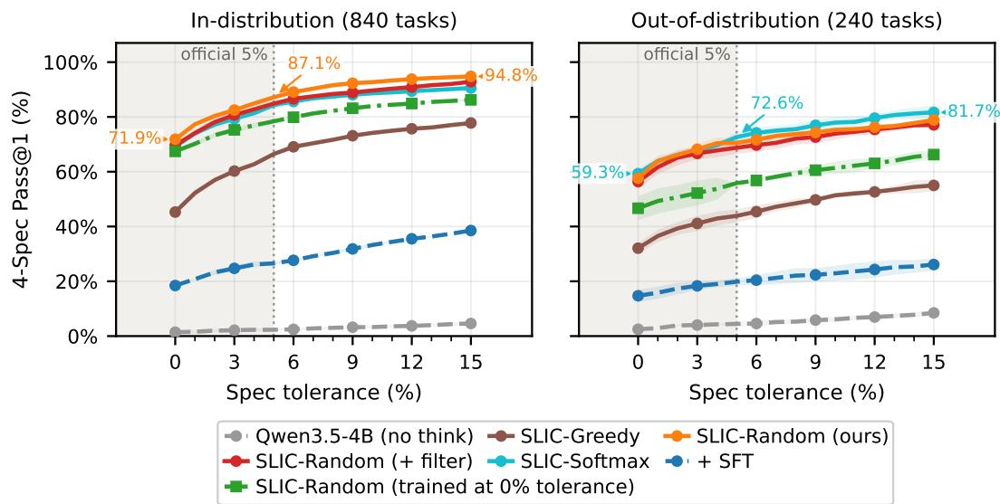  
Figure 5: Tolerance sweep of four-specification Pass@1 within eight turns on 840 in-distribution tasks (left) and 240 out-of-distribution tasks (right), with evaluation tolerances ranging from 0% to 15%. The vertical dotted line marks the default 5% tolerance. Trajectories are generated with strict targets and reevaluated at each tolerance. Numerical annotations highlight selected values along the best-performing curve in each panel.

$3 + 9 + 2 7 + 2 7 = 6 6$ candidate actions per task, close to the $8 \times 8 =$ 64 candidates in a full SLIC-RANDOM rollout. Episodes terminate at first success. All other optimization and generation settings follow the main SLIC-RANDOM configuration. Both methods are evaluated with the standard eight-turn interaction budget.

Intermediate rewards use SLIC’s performance score for the updated circuit, with 0.1 assigned to invalid actions. The outcome reward evaluates the terminal circuit and includes the successconditional slack bonus for successful designs. We normalize intermediate rewards among sibling actions to obtain $A ^ { \mathrm { i n t } }$ , and outcome rewards across trajectories for the same task to obtain $\bar { \boldsymbol A } ^ { \mathrm { o u t } }$

Following MT-GRPO [68, Eq. 5], we combine current and future intermediate advantages with the outcome advantage. With unit discount, the advantage at turn t of trajectory i, whose length is T , is

$$
A _ { t , i } ^ { \mathrm { t r e e } } = \sum _ { t ^ { \prime } = t } ^ { T _ { i } - 2 } A _ { t ^ { \prime } , i } ^ { \mathrm { i n t } } + A _ { i } ^ { \mathrm { o u t } } .\tag{12}
$$

The terminal turn $t = T _ { i } - 1$ receives only the outcome advantage $A _ { i } ^ { \mathrm { o u t } }$ . For a shared response node n at turn t, Eq. 12 gives a trajectory advantage $A _ { t , i } ^ { \mathrm { t r e e } }$ for each continuation i. We average these advantages to obtain a single training advantage ${ \overline { { A } } } ( n )$ . With $\operatorname { C h } ( n )$ denoting its child responses,

$$
\begin{array} { r l } & { \overline { { A } } ( n ) = \mathbb { E } _ { i \mid n } \left[ A _ { t , i } ^ { \mathrm { t r e e } } \right] } \\ & { \quad \quad = \left\{ \begin{array} { l l } { A ^ { \mathrm { o u t } } ( n ) , } & { \mathrm { i f ~ } n \mathrm { ~ i s ~ t e r m i n a l , } } \\ { A ^ { \mathrm { i n t } } ( n ) + \operatorname* { m e a n } _ { n ^ { \prime } \in \mathrm { C h } ( n ) } \overline { { A } } ( n ^ { \prime } ) , } & { \mathrm { o t h e r w i s e . } } \end{array} \right. } \end{array}\tag{13}
$$

The expectation assigns equal weight to each child branch recursively. At each non-terminal node, we add its intermediate advantage to the mean of its children’s advantages, which already include all subsequent intermediate and outcome terms. Each shared response is trained once, with $\overline { { A } } ( n )$ assigned to all its generated tokens.

Tree depth is the main scalability bottleneck. $\mathrm { { A t } } G = 3$ , extending the fully expanded tree from four to eight turns increases the number of trajectories per task from $3 ^ { 3 } = 2 \bar { 7 } 1 0 \dot { 3 } ^ { 7 } = 2 { , } 1 8 7$ . At eight turns, increasing the group size from three to four raises this count to $4 ^ { 7 } = 1 6 { , } 3 8 4$ . Under a fixed simulation budget, this exponential growth makes it difficult to scale tree-based training to more complex circuits and tasks that require more successive refinement steps to reach a successful design.

Table 11: Three-specification setting with Qwen2.5-7B-Instruct at 22 nm, evaluated on 196 indistribution and 246 held-out-topology tasks. All trained policies use a four-turn training horizon. Bold denotes the highest mean in each column.
<table><tr><td rowspan="2">Method</td><td colspan="2">In-distribution</td><td colspan="2">Out-of-distribution</td></tr><tr><td>Turn 4</td><td>Turn 8</td><td>Turn 4</td><td>Turn 8</td></tr><tr><td>Qwen2.5-7B-Instruct</td><td> $1 0 . 4 \pm 0 . 8$ </td><td> $1 2 . 4 \pm 0 . 8$ </td><td> $5 . 6 \pm 0 . 6$ </td><td> $7 . 3 \pm 1 . 2$ </td></tr><tr><td>+ SFT</td><td> $3 6 . 1 \pm 0 . 6$ </td><td> $4 7 . 6 \pm 2 . 4$ </td><td> $2 2 . 5 \pm 1 . 9$ </td><td> $3 3 . 9 \pm 1 . 4$ </td></tr><tr><td>+ Trajectory-level GRPO</td><td> $4 4 . 2 \pm 1 . 6$ </td><td> $4 8 . 6 \pm 2 . 1$ </td><td> $4 9 . 2 \pm 2 . 2$ </td><td> $5 5 . 4 \pm 2 . 4$ </td></tr><tr><td>1.6T DeepSeek-V4-Pro THINK [16, 17]</td><td> $5 3 . 6 \pm 1 . 8$ </td><td> ${ \bf 6 7 . 9 \pm 0 . 5 }$ </td><td> $4 3 . 0 \pm 3 . 8$ </td><td> $5 8 . 7 \pm 0 . 6$ </td></tr><tr><td>SLIC-GREEDY</td><td> ${ \bf 6 0 . 7 \pm 1 . 3 }$ </td><td> $6 3 . 4 \pm 1 . 6$ </td><td> $5 4 . 2 \pm 1 . 3$ </td><td> $5 8 . 7 \pm 2 . 1 $ </td></tr><tr><td>SLIC-RANDOM</td><td> ${ \bf 6 0 . 7 \pm 2 . 7 }$ </td><td> $6 5 . 0 \pm 1 . 8$ </td><td> $5 0 . 0 \pm 5 . 3$ </td><td> $5 2 . 6 \pm 5 . 5$ </td></tr><tr><td>SLIC-SOFTMAX</td><td> $5 8 . 8 \pm 2 . 9$ </td><td> $6 4 . 6 \pm 1 . 5$ </td><td> ${ \bf 5 9 . 2 \pm 2 . 1 }$ </td><td> ${ \bf 6 6 . 1 \pm 2 . 5 }$ </td></tr></table>

Table 12: Qwen2.5-7B-Instruct four-specification Pass@1 (%) at Turn 8.
<table><tr><td></td><td></td><td>Normalization In-distribution Out-of-distribution</td></tr><tr><td>Joint</td><td> $3 2 . 2 \pm 0 . 8$ </td><td> $2 4 . 9 \pm 1 . 7$ </td></tr><tr><td>Separate</td><td> $4 1 . 8 \pm 0 . 5$ </td><td> $2 8 . 7 \pm 1 . 1$ </td></tr></table>

## G Training and Evaluation with Qwen2.5-7B-Instruct

## G.1 Three-Specification Setting at 22 nm

We evaluate an earlier configuration that trains Qwen2.5-7B-Instruct at the 22 nm PTM node with a four-turn horizon and optimizes gain, power consumption, and phase margin. Evaluation covers 196 in-distribution tasks across 31 training topologies and 246 tasks across three held-out topologies at four and eight turns. The trajectory-level GRPO baseline uses independently sampled episodes with terminal-return supervision and trains stably in this three-specification setting.

Table 11 shows that all three SLIC variants outperform SFT on both splits at both horizons. At four turns, Greedy and Random achieve the highest in-distribution success, while Softmax performs best on held-out topologies. Softmax retains this OOD advantage at eight turns, reaching 66.1% Pass@1. All SLIC variants improve beyond their four-turn training horizon, demonstrating that the learned policies can benefit from additional simulator interactions.

## G.2 Setting at 65 nm

We train Qwen2.5-7B-Instruct on approximately 2k tasks at the 65 nm PTM node, using Cadence Spectre for simulation. RL uses SLIC-SOFTMAX with group size G = 4 for 800 updates, without the success-conditional slack bonus. The joint-normalization run is used in the main backbone comparison. Separate normalization improves Pass@1 by 9.6 percentage points in-distribution and 3.8 points out-of-distribution (Table 12), supporting its effectiveness on Qwen2.5-7B-Instruct.

## H Additional Experiments and Analysis

## H.1 Training Dynamics

Figure 6 shows that Greedy develops the longest responses while remaining less successful than Random and Softmax. Its sampled responses repeatedly reconsider edits, using expressions such as “Actually,” “Maybe,” and “let’s revert” (Figure 7). This pattern is consistent with unproductive overthinking, where additional tokens are spent revisiting decisions without comparable performance gains [10]. Individual reflection markers are not sufficient evidence of poor reasoning, as their effects depend on context [26].

Softmax’s responses more often organize simulator feedback into a diagnosis, proposed edits, and expected effects. An auxiliary analysis of eight-turn evaluation rollouts also finds that its mean next-turn improvement after a performance decrease remains similar across the two splits, whereas Random’s declines on held-out topologies. These observations suggest that Softmax uses additional reasoning to support corrective progress on unfamiliar circuits. Although longer training-time reasoning can benefit OOD generalization [73], our results indicate that response length alone does not explain the differences between continuation strategies.

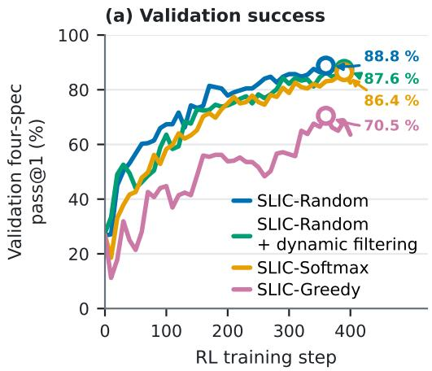

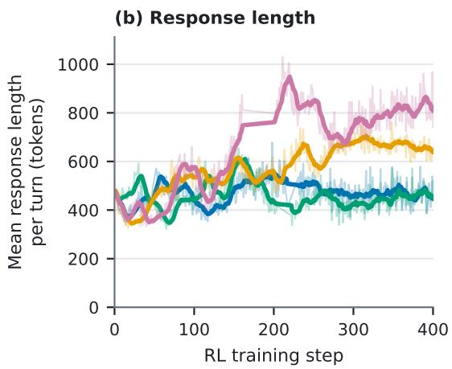

Figure 6: Training dynamics of SLIC under different continuation strategies. (a) Four-specification Pass@1 on the validation set used for checkpoint selection; open circles mark the best validation checkpoint for each variant. (b) Mean generated response length per turn during training, including both reasoning and actions.  
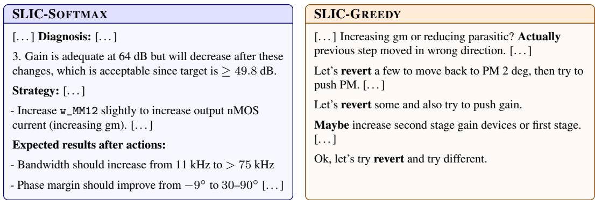  
Figure 7: Illustrative response excerpts from two different training tasks. Softmax organizes its response around diagnosis, proposed edits, and expected effects. Greedy repeatedly revisits the decision to revert earlier changes. Bold text highlights these patterns, and brackets mark omissions.

## H.2 Evaluation on Harder Tasks

We additionally evaluate HARD, a more challenging benchmark variant at the same 65 nm technology node, retaining the 35 training topologies, six held-out topologies, and parameter ranges of STANDARD (Table 15). The fraction of valid initial designs decreases to 50.0% and 52.5% on the in-distribution and out-of-distribution evaluation splits, respectively. To assess target difficulty, we use the dataset builder’s joint target-hit rate: the fraction of sampled candidate designs satisfying all target specifications. On held-out topologies, this rate drops from 2.3–3.4% on STANDARD to 0.18–0.40% on HARD, indicating rarer joint target attainment under the same sampling procedure.

Transfer from standard training. Table 13 shows that policies trained on STANDARD retain substantial success on HARD, with random and softmax continuation outperforming greedy continuation on both splits. The comparable success rates between initially valid and invalid tasks may partly reflect our effort to balance task difficulty during dataset construction. Valid initial designs are selected to perform poorly on the designated hard specification, while the selection criteria tend to yield less demanding targets for invalid initial designs, which additionally require recovery to a valid operating state.

Table 13: Four-specification Pass@1 (%) within eight turns on HARD, evaluated on 420 indistribution and 240 out-of-distribution tasks. Reported overall and separately for tasks with valid and invalid initial designs. The upper group evaluates models trained on STANDARD without additional fine-tuning; the lower group compares training on HARD with and without the gain-prioritized difficulty gate. All models use Qwen3.5-4B unless otherwise specified.
<table><tr><td></td><td colspan="3">In-distribution</td><td colspan="3">Out-of-distribution</td></tr><tr><td>Method</td><td>Overall</td><td>Valid init.</td><td>Invalid init.</td><td>Overall</td><td>Valid init.</td><td>Invalid init.</td></tr><tr><td colspan="7">Trained on STANDARD; evaluated on HARD</td></tr><tr><td>SLIC-GREEDY</td><td> $3 6 . 2 \pm 2 . 3$ </td><td> $3 6 . 7 \pm 2 . 5$ </td><td> $3 5 . 7 \pm 2 . 1$ </td><td> $3 2 . 5 \pm 2 . 9$ </td><td> $2 9 . 9 \pm 3 . 6$ </td><td> $3 5 . 4 \pm 3 . 5$ </td></tr><tr><td>SLIC-SOFTMAX</td><td> $5 4 . 3 \pm 0 . 4$ </td><td> $5 2 . 2 \pm 1 . 0$ </td><td> $5 6 . 3 \pm 0 . 7$ </td><td> $5 4 . 4 \pm 2 . 3$ </td><td> $5 1 . 9 \pm 2 . 6$ </td><td> $5 7 . 3 \pm 2 . 0$ </td></tr><tr><td>SLIC-RANDOM</td><td> $5 7 . 9 \pm 1 . 8$ </td><td> $5 6 . 2 \pm 1 . 3$ </td><td> $5 9 . 5 \pm 2 . 4$ </td><td> $5 3 . 9 \pm 0 . 5$ </td><td> $5 4 . 2 \pm 1 . 7$ </td><td> $5 3 . 5 \pm 2 . 3$ </td></tr><tr><td>+ dynamic filtering</td><td> $5 9 . 9 \pm 1 . 6$ </td><td> $5 9 . 4 \pm 1 . 1$ </td><td> $6 0 . 5 \pm 2 . 1$ </td><td> $5 9 . 4 \pm 2 . 1$ </td><td> $5 6 . 1 \pm 2 . 8$ </td><td> $6 3 . 2 \pm 3 . 0$ </td></tr><tr><td>w/o domain-validity gates</td><td> $5 6 . 7 \pm 1 . 0$ </td><td> $5 5 . 6 \pm 0 . 7$ </td><td> $5 7 . 8 \pm 1 . 5$ </td><td> $4 9 . 2 \pm 0 . 7$ </td><td> $4 9 . 2 \pm { 0 . 8 }$ </td><td> $4 9 . 1 \pm 1 . 8$ </td></tr><tr><td>Qwen3.5-9B SLIC-RANDOM</td><td> $6 2 . 5 \pm 1 . 6$ </td><td> $6 0 . 8 \pm 3 . 8$ </td><td> $6 4 . 3 \pm { 0 . 8 }$ </td><td> $5 8 . 1 \pm 1 . 3$ </td><td> $5 8 . 2 \pm 0 . 5$ </td><td> $5 7 . 9 \pm 2 . 3$ </td></tr><tr><td colspan="7">SLIC-RANDOM trained and evaluated on HARD</td></tr><tr><td>Without difficulty gate</td><td> $5 8 . 0 \pm 0 . 5$ </td><td> $5 6 . 3 \pm 1 . 2$ </td><td> $5 9 . 7 \pm 2 . 0$ </td><td> $5 0 . 3 \pm 1 . 0$ </td><td> $4 8 . 9 \pm 3 . 7$ </td><td> $5 1 . 8 \pm 6 . 1$ </td></tr><tr><td>With difficulty gate</td><td> $6 3 . 5 \pm 0 . 6$ </td><td> $6 0 . 8 \pm 1 . 5$ </td><td> $6 6 . 2 \pm 1 . 4$ </td><td> $5 6 . 5 \pm 1 . 0$ </td><td> $5 7 . 4 \pm 2 . 3$ </td><td> $5 5 . 6 \pm 1 . 0$ </td></tr></table>

Gain-prioritized difficulty gate. This additional gate activates reward terms for easier specifications only after gain meets its target within the 5% tolerance, preventing easier objectives from dominating the reward before gain is sufficient [35]. Specifically, the gain prerequisite is $\Gamma _ { t } \geq ( 1 - 0 . 0 5 ) \mathbf { \bar {Gamma } } ^ { \star }$ . We compare training with and without this difficulty gate, while retaining the domain-validity gates and the same 5% success tolerance in both configurations. Although we observed no clear benefit on STANDARD, enabling it during training on HARD improves in-distribution and out-of-distribution Pass@1 by 5.5 and 6.2 percentage points, respectively (Table 13). The larger initial gain deficits on HARD suggest that gain is a more prominent bottleneck, making gain prioritiza tion useful for identifying suitable operating points. On STANDARD, the difficulty differences among specifications are less pronounced, which may explain the limited benefit of imposing this priority.

## H.3 Factors Associated with Topology Generalization

Figure 8 highlights contrasting cases of topology generalization. On STANDARD, CG-CSL has the fewest transistors among the held-out topologies, yet SLIC-RANDOM achieves only 15.8% Pass@1. Its tasks require large bandwidth increases and power reductions, making this structurally simple circuit challenging to optimize. Conversely, SE-CCM has the most tunable parameters (40) but reaches 85.8% Pass@1, with smaller required bandwidth increases and power reductions. For the same SE-CCM topology, success drops to 53.3% on HARD, where the required gain improvement is substantially larger. These cases illustrate that circuit size alone does not determine optimization difficulty: the performance changes required by the tasks are also important for interpreting success across topologies.

Correlation analysis. Figure 9 relates these performance differences to topology-level factors. On STANDARD, larger required bandwidth increases and power reductions are associated with lower success for the 4B RANDOM and SOFTMAX variants (Spearman $\rho = - 0 . 7 1 \ \mathrm { t o } - 0 . 6 4 )$ . On HARD, required gain increases become more variable across topologies and are negatively associated with success across all four variants, while the negative association with required power reduction does not persist. Transistor count is positively associated with success on both datasets, whereas tunable parameter count shows little association, indicating that larger circuits are not necessarily harder to optimize in this benchmark. This is consistent with our goal construction, which aims to balance task difficulty across topologies: even structurally simple circuits can be assigned demanding performance targets and consequently exhibit low success rates. Together, these observations support interpreting difficulty through the performance changes required of each topology, rather than circuit size alone.

<table><tr><td></td><td></td><td rowspan=1 colspan=1>7</td><td rowspan=1 colspan=1>8</td><td rowspan=1 colspan=1>10</td><td rowspan=1 colspan=1>11</td><td rowspan=1 colspan=1>24</td><td rowspan=1 colspan=1>10</td><td></td><td rowspan=1 colspan=1>7</td><td rowspan=1 colspan=1>8</td><td rowspan=1 colspan=1>10</td><td rowspan=1 colspan=1>11</td><td rowspan=1 colspan=1>24</td><td rowspan=1 colspan=1>10</td></tr><tr><td></td><td></td><td rowspan=1 colspan=1>18</td><td rowspan=1 colspan=1>14</td><td rowspan=1 colspan=1>22</td><td rowspan=1 colspan=1>18</td><td rowspan=1 colspan=1>40</td><td rowspan=1 colspan=1>14</td><td></td><td rowspan=1 colspan=1>18</td><td rowspan=1 colspan=1>14</td><td rowspan=1 colspan=1>22</td><td rowspan=1 colspan=1>18</td><td rowspan=1 colspan=1>40</td><td rowspan=1 colspan=1>14</td></tr><tr><td></td><td></td><td rowspan=1 colspan=1>0.27</td><td rowspan=1 colspan=1>0.71</td><td rowspan=1 colspan=1>0.49</td><td rowspan=1 colspan=1>0.45</td><td rowspan=1 colspan=1>0.34</td><td rowspan=1 colspan=1>0.69</td><td></td><td rowspan=1 colspan=1>0.27</td><td rowspan=1 colspan=1>0.71</td><td rowspan=1 colspan=1>0.49</td><td rowspan=1 colspan=1>0.45</td><td rowspan=1 colspan=1>0.34</td><td rowspan=1 colspan=1>0.69</td></tr><tr><td></td><td></td><td rowspan=1 colspan=1>1.10</td><td rowspan=1 colspan=1>1.65</td><td rowspan=1 colspan=1>1.65</td><td rowspan=1 colspan=1>1.35</td><td rowspan=1 colspan=1>1.48</td><td rowspan=1 colspan=1>1.52</td><td></td><td rowspan=1 colspan=1>0.55</td><td rowspan=1 colspan=1>0.70</td><td rowspan=1 colspan=1>0.47</td><td rowspan=1 colspan=1>0.78</td><td rowspan=1 colspan=1>0.60</td><td rowspan=1 colspan=1>0.80</td></tr><tr><td></td><td></td><td rowspan=1 colspan=1>15.5</td><td rowspan=1 colspan=1>15.3</td><td rowspan=1 colspan=1>11.8</td><td rowspan=1 colspan=1>13.2</td><td rowspan=1 colspan=1>15.8</td><td rowspan=1 colspan=1>15.6</td><td></td><td rowspan=1 colspan=1>19.3</td><td rowspan=1 colspan=1>26.5</td><td rowspan=1 colspan=1>21.4</td><td rowspan=1 colspan=1>15.9</td><td rowspan=1 colspan=1>37.9</td><td rowspan=1 colspan=1>22.1</td></tr><tr><td></td><td></td><td rowspan=1 colspan=1>89%</td><td rowspan=1 colspan=1>25%</td><td rowspan=1 colspan=1>43%</td><td rowspan=1 colspan=1>54%</td><td rowspan=1 colspan=1>50%</td><td rowspan=1 colspan=1>39%</td><td></td><td rowspan=1 colspan=1>100%</td><td rowspan=1 colspan=1>62%</td><td rowspan=1 colspan=1>100%</td><td rowspan=1 colspan=1>76%</td><td rowspan=1 colspan=1>71%</td><td rowspan=1 colspan=1>76%</td></tr><tr><td></td><td></td><td rowspan=1 colspan=1>79.2</td><td rowspan=1 colspan=1>3.4</td><td rowspan=1 colspan=1>25.2</td><td rowspan=1 colspan=1>5.5</td><td rowspan=1 colspan=1>5.2</td><td rowspan=1 colspan=1>3.1</td><td></td><td rowspan=1 colspan=1>538</td><td rowspan=1 colspan=1>338</td><td rowspan=1 colspan=1>362</td><td rowspan=1 colspan=1>9.9</td><td rowspan=1 colspan=1>8.3</td><td rowspan=1 colspan=1>282</td></tr><tr><td></td><td></td><td rowspan=1 colspan=1>57%</td><td rowspan=1 colspan=1>39%</td><td rowspan=1 colspan=1>75%</td><td rowspan=1 colspan=1>57%</td><td rowspan=1 colspan=1>54%</td><td rowspan=1 colspan=1>43%</td><td></td><td rowspan=1 colspan=1>76%</td><td rowspan=1 colspan=1>62%</td><td rowspan=1 colspan=1>67%</td><td rowspan=1 colspan=1>76%</td><td rowspan=1 colspan=1>81%</td><td rowspan=1 colspan=1>57%</td></tr><tr><td></td><td></td><td rowspan=1 colspan=1>3.31</td><td rowspan=1 colspan=1>2.67</td><td rowspan=1 colspan=1>1.66</td><td rowspan=1 colspan=1>2.32</td><td rowspan=1 colspan=1>1.36</td><td rowspan=1 colspan=1>2.07</td><td></td><td rowspan=1 colspan=1>31.6</td><td rowspan=1 colspan=1>2.63</td><td rowspan=1 colspan=1>38.5</td><td rowspan=1 colspan=1>3.72</td><td rowspan=1 colspan=1>3.13</td><td rowspan=1 colspan=1>4.72</td></tr><tr><td></td><td rowspan=1 colspan=1>reduction (×)</td><td rowspan=1 colspan=1>50%</td><td rowspan=1 colspan=1>54%</td><td rowspan=1 colspan=1>43%</td><td rowspan=1 colspan=1>57%</td><td rowspan=1 colspan=1>54%</td><td rowspan=1 colspan=1>46%</td><td></td><td rowspan=1 colspan=1>57%</td><td rowspan=1 colspan=1>86%</td><td rowspan=1 colspan=1>67%</td><td rowspan=1 colspan=1>76%</td><td rowspan=1 colspan=1>90%</td><td rowspan=1 colspan=1>86%</td></tr><tr><td></td><td></td><td rowspan=1 colspan=1>2.3</td><td rowspan=1 colspan=1>2.6</td><td rowspan=1 colspan=1>3.3</td><td rowspan=1 colspan=1>3.0</td><td rowspan=1 colspan=1>3.4</td><td rowspan=1 colspan=1>2.7</td><td></td><td rowspan=1 colspan=1>0.40</td><td rowspan=1 colspan=1>0.18</td><td rowspan=1 colspan=1>0.22</td><td rowspan=1 colspan=1>0.21</td><td rowspan=1 colspan=1>0.22</td><td rowspan=1 colspan=1>0.22</td></tr><tr><td rowspan=1 colspan=15>CG-CSLSE-2SCS-PCSLSE-TPSE-CCMFD-CMCG-CSLSE-2SCS-PCSLSE-TPSE-CCMFD-CM</td></tr></table>

<table><tr><td rowspan=2 colspan=6>一   一</td><td></td></tr><tr><td rowspan=11 colspan=1>100(%)80urnms860 fousic wsed w-phin40200</td></tr><tr><td rowspan=1 colspan=1>0.0</td><td rowspan=1 colspan=1>0.0</td><td rowspan=1 colspan=1>0.0</td><td rowspan=1 colspan=1>0.0</td><td rowspan=1 colspan=1>0.0</td><td rowspan=1 colspan=1>1.7</td></tr><tr><td rowspan=1 colspan=1>0.8</td><td rowspan=1 colspan=1>1.7</td><td rowspan=1 colspan=1>2.5</td><td rowspan=1 colspan=1>11.7</td><td rowspan=1 colspan=1>2.5</td><td rowspan=1 colspan=1>10.0</td></tr><tr><td rowspan=1 colspan=1>20.8</td><td rowspan=1 colspan=1>12.5</td><td rowspan=1 colspan=1>27.5</td><td rowspan=1 colspan=1>65.0</td><td rowspan=1 colspan=1>25.8</td><td rowspan=1 colspan=1>43.3</td></tr><tr><td rowspan=1 colspan=1>3.3</td><td rowspan=1 colspan=1>43.3</td><td rowspan=1 colspan=1>79.2</td><td rowspan=1 colspan=1>80.0</td><td rowspan=1 colspan=1>53.3</td><td rowspan=1 colspan=1>64.2</td></tr><tr><td rowspan=1 colspan=1>18.3</td><td rowspan=1 colspan=1>54.2</td><td rowspan=1 colspan=1>65.8</td><td rowspan=1 colspan=1>78.3</td><td rowspan=1 colspan=1>53.3</td><td rowspan=1 colspan=1>56.7</td></tr><tr><td rowspan=1 colspan=1>18.3</td><td rowspan=1 colspan=1>25.8</td><td rowspan=1 colspan=1>81.7</td><td rowspan=1 colspan=1>70.8</td><td rowspan=1 colspan=1>50.0</td><td rowspan=1 colspan=1>55.0</td></tr><tr><td rowspan=1 colspan=1>0.0</td><td rowspan=1 colspan=1>0.0</td><td rowspan=1 colspan=1>0.0</td><td rowspan=1 colspan=1>0.0</td><td rowspan=1 colspan=1>0.0</td><td rowspan=1 colspan=1>0.0</td></tr><tr><td rowspan=1 colspan=1>0.8</td><td rowspan=1 colspan=1>3.3</td><td rowspan=1 colspan=1>1.7</td><td rowspan=1 colspan=1>4.2</td><td rowspan=1 colspan=1>2.5</td><td rowspan=1 colspan=1>5.0</td></tr><tr><td rowspan=1 colspan=1>4.2</td><td rowspan=1 colspan=1>5.0</td><td rowspan=1 colspan=1>12.5</td><td rowspan=1 colspan=1>26.7</td><td rowspan=1 colspan=1>4.2</td><td rowspan=1 colspan=1>29.2</td></tr><tr><td rowspan=1 colspan=1>13.3</td><td rowspan=1 colspan=1>37.5</td><td rowspan=1 colspan=1>84.2</td><td rowspan=1 colspan=1>98.3</td><td rowspan=1 colspan=1>46.7</td><td rowspan=1 colspan=1>68.3</td></tr></table>

(b) Hard OOD set four-spec pass@1 (%)  
(a) Standard OOD set four-spec pass@1 (%)  
Gain / bandwidth / power rows: top = median gap between the initial design and the goal (dB of gain to add, × bandwidth increase, × power reduction), over the tasks where that spec is not met initially; bottom = initial unmet rate: % of tasks with a valid initial design that do not meet that spec (5 % tolerance).

Figure 8: Topology-level performance and task characteristics on STANDARD (left) and HARD (right). (a,b) Four-specification Pass@1 (%) on each held-out topology. Language models use up to eight turns, and BO uses 192 simulator calls per topology. SLIC checkpoints are trained on STANDARD unless labeled otherwise. Dashes denote unavailable results. (c,d) Circuit characteristics and task difficulty. For each specification gap, the main value is the median gap among tasks that initially miss the target. The smaller percentage gives the fraction of initially valid designs that miss it. Color scales are shared across datasets: one for Pass@1 and one per factor, with darker cells indicating larger values. Topology abbreviations: CG-CSL, common-gate amplifier with a current-source load; SE-2S, single-ended two-stage amplifier; CS-PCSL, common-source amplifier with a PMOS cascode current-source load; SE-TP, single-ended telescopic PMOS amplifier; SE-CCM, single-ended cascode current-mirror amplifier; FD-CM, fully differential current-mirror amplifier.

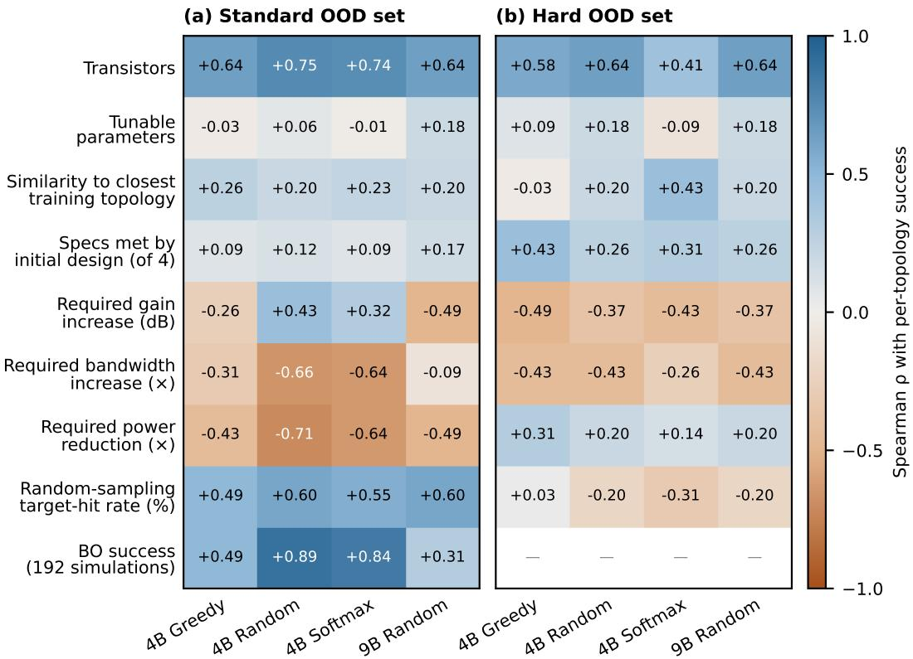  
Figure 9: Spearman rank correlations between topology-level factors and mean four-specification Pass@1 within eight turns on STANDARD (left) and HARD (right). Each coefficient is computed across the six held-out topologies for the indicated SLIC variant. Gain, bandwidth, and power factors describe required improvements rather than raw performance values; larger values denote larger required changes. Blue and orange indicate positive and negative associations with success, respectively, on a shared scale centered at zero. Dashes denote unavailable results.

## H.4 Distribution Shift

Figure 10 compares initial conditions, target specifications, initial target gaps, and circuit structure across dataset splits. Within both STANDARD and HARD, in-distribution tasks closely match their respective training sets, whereas held-out tasks show larger differences in device and parameter counts and architectural properties. Target specifications also differ across splits, particularly for bandwidth, so held-out evaluation involves changes in both circuit structure and target distributions. Comparing HARD training data with STANDARD, the structural distributions remain unchanged, while initial validity, target specifications, and initial target gaps shift substantially, especially for power. These changes reflect how HARD modifies the starting conditions and performance requirements within the same topology pool.

## H.5 Statistical Analysis

We conduct task-paired comparisons on the 840 in-distribution and 240 out-of-distribution evaluation tasks. Each task’s score is the mean of three binary indicators of four-specification success within eight turns. We estimate mean task-wise differences and their 95% percentile confidence interval using paired bootstrap resampling over tasks (10,000 resamples, seed 7). Each resampled task retains all three evaluation repetitions and the pairing between methods.

Table 14 reports selected comparisons. Significance is assessed using two-sided bootstrap tests with Holm correction across all 20 Turn 8 tests in the analysis. The analysis treats tasks as independent sampling units and conditions on the evaluated checkpoints.

<table><tr><td colspan="3">(a) Standard sets</td><td colspan="3">(b) Hard sets</td><td colspan="3">0.9</td></tr><tr><td>itil stiate</td><td>valid start</td><td>0.01</td><td>0.01</td><td>0.02</td><td>0.07</td><td>0.47</td><td rowspan="9">0.8 0.7</td></tr><tr><td></td><td>gain (dB)</td><td>0.04</td><td>0.35</td><td>0.04 0.07</td><td>0.22</td><td>0.11</td></tr><tr><td></td><td>log₁o power</td><td>0.10</td><td>0.22</td><td>0.13</td><td>0.08</td><td></td></tr><tr><td></td><td>log₁o bandwidth</td><td>0.03</td><td>0.31</td><td>0.07</td><td>0.40</td><td>0.05</td></tr><tr><td rowspan="3">laá</td><td>phase margin</td><td>0.11</td><td>0.11</td><td>0.09</td><td>0.18</td><td>0.07</td></tr><tr><td>gain_min</td><td>0.11</td><td>0.25</td><td>0.03</td><td>0.30</td><td>0.25</td></tr><tr><td>log₁o power_max</td><td>0.12</td><td>0.28</td><td>0.04</td><td>0.30</td><td>0.75</td></tr><tr><td></td><td>log₁o bw_min</td><td>0.24</td><td>0.47</td><td>0.03</td><td>0.55</td><td>0.23</td></tr><tr><td>tart r-</td><td>Δ gain</td><td>0.08</td><td>0.30</td><td>0.05</td><td>0.38</td><td>0.42</td></tr><tr><td></td><td>∆ log₁o power</td><td>0.13</td><td>0.19</td><td>0.09</td><td>0.24</td><td>0.68</td></tr><tr><td>|oál</td><td>∆ log₁o bandwidth</td><td>0.24</td><td>0.24</td><td>0.10</td><td>0.29</td><td>0.39</td></tr><tr><td></td><td># violated specs</td><td>0.03</td><td>0.09</td><td>0.09</td><td>0.11</td><td>0.64</td></tr><tr><td rowspan="9">cirit srccuze</td><td># MOS</td><td>0.00</td><td>0.59</td><td>0.00</td><td>0.59</td><td>0.00</td></tr><tr><td># resistors</td><td>0.00</td><td>0.21</td><td>0.00</td><td>0.21</td><td>0.00</td></tr><tr><td># capacitors</td><td>0.00</td><td>0.25</td><td>0.00</td><td>0.25</td><td>0.00</td></tr><tr><td># current sources</td><td>0.00</td><td>0.50</td><td>0.00</td><td>0.50</td><td>0.00</td></tr><tr><td># nets</td><td>0.00</td><td>0.59</td><td>0.00</td><td>0.60</td><td>0.00</td></tr><tr><td># tunable params</td><td>0.00</td><td>0.69</td><td>0.00</td><td>0.69</td><td>0.00</td></tr><tr><td># width params</td><td>0.00</td><td>0.67</td><td>0.00</td><td>0.67</td><td>0.00</td></tr><tr><td># R/C params</td><td>0.00</td><td>0.27</td><td>0.00</td><td>0.27</td><td>0.00</td></tr><tr><td>fully differential</td><td>0.00</td><td>0.01</td><td>0.00</td><td>0.01</td><td>0.00</td></tr><tr><td></td><td>OTA (diff-pair input)</td><td>0.00</td><td>0.25</td><td>0.00</td><td>0.25</td><td>0.00</td><td> wass snce</td></tr><tr><td></td><td>PMOS input</td><td>0.00</td><td>0.64</td><td>0.00</td><td>0.64</td><td>0.00</td><td>0.3</td></tr><tr><td>common-gate input</td><td></td><td>0.00</td><td>0.47</td><td>0.00</td><td>0.47</td><td>0.00</td><td></td></tr><tr><td>two-stage</td><td></td><td>0.00</td><td>0.29</td><td>0.00</td><td>0.29</td><td>0.00</td><td></td></tr><tr><td>copy ooas Miller compensation</td><td></td><td>0.00</td><td>0.25</td><td>0.00</td><td>0.25</td><td>0.00</td><td></td></tr><tr><td></td><td>cascoded</td><td>0.00</td><td>0.26</td><td>0.00</td><td>0.27</td><td>0.00</td><td>0.2</td></tr><tr><td></td><td>telescopic</td><td>0.00</td><td>0.83</td><td>0.00</td><td>0.83</td><td>0.00</td><td></td></tr><tr><td>folded cascode</td><td></td><td>0.00</td><td>0.25</td><td>0.00</td><td>0.25</td><td>0.00</td><td></td></tr><tr><td>low-voltage cascode</td><td></td><td>0.00</td><td>0.25</td><td>0.00</td><td>0.25</td><td>0.00</td><td></td></tr><tr><td>resistive load</td><td></td><td>0.00</td><td>0.45</td><td>0.00</td><td>0.45</td><td>0.00</td><td>0.1</td></tr><tr><td>diode-connected load</td><td></td><td>0.00</td><td>0.31</td><td>0.00</td><td>0.31</td><td>0.00</td><td></td></tr><tr><td>current-source load</td><td></td><td>0.00</td><td>0.33</td><td>0.00</td><td>0.33</td><td>0.00</td><td></td></tr><tr><td>current-mirror load</td><td></td><td>0.00</td><td>0.69</td><td>0.00</td><td>0.69</td><td>0.00</td><td></td></tr><tr><td>source degeneration</td><td></td><td>0.00</td><td>0.36</td><td>0.00</td><td>0.36</td><td>0.00</td><td>0.0</td></tr><tr><td></td><td></td><td>IID</td><td>OOD</td><td>Hard</td><td>Hard</td><td>Hard</td><td></td></tr><tr><td></td><td></td><td>VS</td><td>VS</td><td>IID VS</td><td>OOD vs</td><td>train vs</td><td></td></tr><tr><td></td><td></td><td>train</td><td>train</td><td>Hard train</td><td>Hard train</td><td>Standard train</td><td></td></tr></table>

Figure 10: Feature-wise distribution shifts for STANDARD and HARD. Each column compares the indicated dataset with its reference training set using Wasserstein-1 distances computed after standardization using the same reference-training statistics for both compared sets. Power and bandwidth are log-transformed, and distances are expressed in reference-training standard-deviation units. Features describe initial conditions, specification targets, initial target gaps, circuit-size counts, and 15 expert-defined binary design descriptors. The descriptors encode architectural properties using fixed rules applied to circuit metadata and canonical topology names; multiple descriptors may apply to the same topology. For binary descriptors, distances reflect differences in attribute prevalence after normalization. Larger distances indicate stronger distribution shifts.

Table 14: Task-paired differences in four-specification Pass@1 within eight turns. Differences (∆, in percentage points) are computed as the first method minus the second. Random, Softmax, and Greedy denote the corresponding SLIC variants. The normalization and slack-bonus comparisons use their respective matched training settings. Confidence intervals are pointwise 95% percentile bootstrap intervals. <sup>∗</sup> indicates significance at α = 0.05 after Holm correction across all 18 Turn 8 tests in the analysis.
<table><tr><td rowspan="2">Comparison</td><td colspan="2">In-distribution</td><td colspan="2">Out-of-distribution</td></tr><tr><td>∆</td><td>95% CI</td><td>∆</td><td>95% CI</td></tr><tr><td>Random vs. SFT</td><td>+60.6*</td><td>[57.9, 63.3]</td><td>+50.7*</td><td>[45.0, 56.4]</td></tr><tr><td>Random vs. DeepSeek-V4.1-Flash THINK</td><td>+48.5*</td><td>[45.6, 51.5]</td><td>+43.9*</td><td>[38.2, 49.4]</td></tr><tr><td>Random vs. Greedy</td><td>+20.7*</td><td>[18.1, 23.3]</td><td>+26.7*</td><td>[21.2, 32.1]</td></tr><tr><td>Random vs. w/o domain-validity gates</td><td>+4.3*</td><td>[2.4, 6.2]</td><td>+6.9*</td><td>[3.1, 11.0]</td></tr><tr><td>Softmax vs. Random</td><td>-2.8*</td><td>[-4.7, -1.0]</td><td>+2.1</td><td>[-1.7, 5.8]</td></tr><tr><td>Separate vs. joint normalization</td><td>+6.2*</td><td>[4.2, 8.3]</td><td>+4.9</td><td>[0.1, 9.7]</td></tr><tr><td>With vs. without success-conditional slack bonus</td><td>+8.5*</td><td>[6.3, 10.8]</td><td>+12.1*</td><td>[7.5, 16.7]</td></tr></table>

SLIC-RANDOM significantly outperforms SFT, DeepSeek, SLIC-GREEDY, and its variant without domain-validity gates on both splits after correction. SLIC-SOFTMAX has significantly lower indistribution performance than SLIC-RANDOM, while its higher out-of-distribution mean does not establish a statistically significant difference. Among the component ablations, separate normalization significantly improves in-distribution performance, while its out-of-distribution improvement does not remain significant after correction. The success-conditional slack bonus significantly improves performance on both splits under dynamic filtering.

## I Implementation Details

## I.1 Dataset

We build our benchmark by adapting circuit topologies from the GANA dataset [29]. For each topology, we retain the main amplifier circuit together with its associated current-bias circuit, and curate the resulting circuits into train, validation, and held-out test splits for simulator-interactive optimization. We group the topologies by complexity, treating differential-input amplifiers as complex circuits and single-input amplifiers as simple circuits. The dataset is constructed by varying both the initial circuit states and the target goal specifications. Within the prescribed topology split, training and evaluation tasks are sampled with stratification by circuit topology and task difficulty to control the representation of different circuit structures and optimization demands. The resulting category-level dataset statistics are summarized in Table 15.

SFT data. The SFT corpus contains 6,981 single-turn samples from 1,568 teacher-generated episodes across the 35 training topologies. We split the corpus by episode into 6,233 training samples from 1,400 episodes and 748 test samples from 168 episodes. All samples from the same episode remain in one split, while both splits cover the same 35 topologies.

## I.2 Hosted Model Evaluation

We evaluated DeepSeek-V4.1-Flash on the 840 ID tasks in two 420-task batches at different times, using the same API model identifier, prompts, and protocol. DeepSeek achieved 35.3% and 41.9% Pass@1 on the two batches, for an aggregate of 38.6% in Table 1. GPT-6-Astra scored similarly on the two batches (91.0% and 90.2%), suggesting that the gap for DeepSeek may reflect changes in the served model or inference backend. Using fixed local checkpoints avoids uncertainty about model version changes between evaluations. Across both splits, we spent about \$227 in API charges to evaluate DeepSeek three times per task and about \$276 to evaluate GPT-6-Astra once per task.

Table 15: Category-wise dataset statistics for STANDARD and HARD at the 65 nm technology node. Both variants share the topology sets and parameter ranges within each split and category. Tunable parameters are reported as min–max ranges across topologies. Valid init. denotes the percentage of tasks with a valid initial design.
<table><tr><td colspan="5"></td><td colspan="2">STANDARD</td><td colspan="2">HARD</td></tr><tr><td>Split</td><td>Category</td><td>Topology count</td><td>Tunable parameters (min-max)</td><td>Samples</td><td>Valid init. (%)</td><td>Samples</td><td></td><td>Valid init. (%)</td></tr><tr><td rowspan="3">Train</td><td>Complex</td><td>19</td><td>10-36</td><td>3,605</td><td>70.5</td><td></td><td>2,432</td><td>49.2</td></tr><tr><td>Simple</td><td>16</td><td>4-22</td><td>3,027</td><td>70.4</td><td></td><td>2,048</td><td>49.2</td></tr><tr><td>Total</td><td>35</td><td>4-36</td><td>6,632</td><td>70.4</td><td></td><td>4,480</td><td>49.2</td></tr><tr><td rowspan="3">In-distribution test</td><td>Complex</td><td>19</td><td>10-36</td><td>456</td><td></td><td>71.1</td><td>228</td><td>50.0</td></tr><tr><td>Simple</td><td>16</td><td>4-22</td><td>384</td><td>70.8</td><td></td><td>192</td><td>50.0</td></tr><tr><td>Total</td><td>35</td><td>4-36</td><td>840</td><td>71.0</td><td></td><td>420</td><td>50.0</td></tr><tr><td rowspan="3">Out-of-distribution test</td><td>Complex</td><td>4</td><td>14-40</td><td>160</td><td>70.0</td><td></td><td>160</td><td>52.5</td></tr><tr><td>Simple</td><td>2</td><td>18-22</td><td>80</td><td>70.0</td><td></td><td>80</td><td>52.5</td></tr><tr><td>Total</td><td>6</td><td>14-40</td><td>240</td><td>70.0</td><td></td><td>240</td><td>52.5</td></tr></table>

## I.3 Training Configurations

Table 16: Main supervised fine-tuning (SFT) configuration.
<table><tr><td>Category</td><td>Setting</td><td>Value</td></tr><tr><td>Hardware</td><td>Nodes / GPUs</td><td>1 node, 8 × H100 (80 GB)</td></tr><tr><td>Model</td><td>Base model</td><td>Qwen3.5-4B</td></tr><tr><td></td><td>Training strategy Model load dtype</td><td>FSDP2</td></tr><tr><td></td><td></td><td>bfloat16 Enabled</td></tr><tr><td></td><td>Gradient checkpointing</td><td></td></tr><tr><td>Data</td><td>Dataset</td><td>Single-turn step samples</td></tr><tr><td></td><td>Training samples</td><td>6,233</td></tr><tr><td></td><td>Test samples</td><td>748</td></tr><tr><td></td><td>Train batch size</td><td>8</td></tr><tr><td></td><td>Micro-batch size / GPU</td><td>1</td></tr><tr><td></td><td>Max sequence length</td><td>11,776</td></tr><tr><td></td><td>Truncation</td><td>Left</td></tr><tr><td>Environment / Task</td><td>Representation</td><td>XML</td></tr><tr><td></td><td>Technology node</td><td>65 nm (PTM)</td></tr><tr><td></td><td>Max episode steps</td><td>8</td></tr><tr><td></td><td>History length</td><td>1</td></tr><tr><td>Optimization</td><td>Optimizer</td><td>AdamW</td></tr><tr><td></td><td>Learning rate</td><td> $1 \times 1 0 ^ { - 5 }$ </td></tr><tr><td></td><td>Warmup ratio</td><td>0.1</td></tr><tr><td></td><td>Total epochs</td><td>4</td></tr></table>

## J Limitations

While SLIC demonstrates strong capabilities in analog circuit optimization, several limitations remain. First, SLIC focuses on device sizing within a given circuit topology. Extending it to a complete design flow that integrates topology generation, sizing, robustness verification under process, voltage, and temperature (PVT) variations, and physical layout remains future work. Second, our evaluation currently focuses on amplifier optimization with four specifications. Extending SLIC to a broader range of circuits, including low-dropout regulators (LDOs), low-noise amplifiers (LNAs), and power amplifiers (PAs), and incorporating additional coupled objectives such as noise and offset remain directions for future work.

Table 17: Main RL training configuration for SLIC-RANDOM.
<table><tr><td>Category</td><td>Setting</td><td>Value</td></tr><tr><td rowspan="4">Hardware</td><td>Nodes / GPUs</td><td>1 node, 2 × B200</td></tr><tr><td>CPUs per GPU</td><td>16</td></tr><tr><td>Host memory</td><td>400 GB</td></tr><tr><td></td><td>Qwen3.5-4B SFT</td></tr><tr><td rowspan="6">Model</td><td>Initialization checkpoint</td><td>1 × 10−6</td></tr><tr><td>Actor learning rate</td><td></td></tr><tr><td>Learning-rate schedule</td><td>Cosine decay to 1 × 10−7</td></tr><tr><td>Warmup</td><td>None</td></tr><tr><td>Optimizer</td><td>AdamW</td></tr><tr><td>Weight decay</td><td>0.01 Enabled</td></tr><tr><td rowspan="9">Data</td><td>Gradient checkpointing</td><td></td></tr><tr><td>Train batch size</td><td>16 tasks 8</td></tr><tr><td>Rollout group size</td><td></td></tr><tr><td>Training turns per step</td><td>1,024</td></tr><tr><td>Validation set size</td><td>420 tasks</td></tr><tr><td>Max prompt length</td><td>13,072</td></tr><tr><td>Max response length</td><td>2,048 Middle</td></tr><tr><td>Truncation</td><td></td></tr><tr><td>Representation Technology node</td><td>XML 65 nm (PTM)</td></tr><tr><td rowspan="5"></td><td>Max steps</td><td>8</td></tr><tr><td>History length</td><td>1</td></tr><tr><td></td><td></td></tr><tr><td>Algorithm Advantage normalization</td><td>GRPO with RGRS Separate validity / performance</td></tr><tr><td></td><td></td></tr><tr><td rowspan="7"></td><td>Validity / performance weights</td><td>1.0 / 1.0</td></tr><tr><td>PPO epochs</td><td>1</td></tr><tr><td>PPO mini-batch size</td><td>256</td></tr><tr><td>PPO micro-batch size / GPU</td><td>1</td></tr><tr><td>Clip ratio (low / high)</td><td>0.2 / 0.28</td></tr><tr><td>KL loss</td><td>Disabled</td></tr><tr><td>Backend</td><td>vLLM</td></tr><tr><td rowspan="5">Rollout</td><td>Tensor parallel size</td><td>1</td></tr><tr><td>Temperature</td><td>1.0</td></tr><tr><td></td><td></td></tr><tr><td>Top-p</td><td>0.9</td></tr><tr><td>Samples per prompt</td><td>1</td></tr><tr><td rowspan="2">Reward shaping</td><td>Invalid action penalty magnitude</td><td>0.1</td></tr><tr><td>Simulation failure penalty magnitude</td><td>0.1</td></tr><tr><td>Training schedule</td><td>Total training steps</td><td>400</td></tr></table>

## K Broader Impact

SLIC aims to advance practical AI-driven automation for analog circuit design, a field that remains highly manual, expert-intensive, and difficult to scale across circuit families, specifications, and technology nodes. By training a locally deployable language-model agent to iteratively optimize circuits using verifiable simulator feedback, this work points toward design tools that can reduce repetitive manual tuning and improve the scalability of analog and mixed-signal development. The local deployment setting is especially important for industry, where proprietary PDKs, device models, and circuit IP often cannot be exposed to hosted LLM APIs. Circuit-specialized small models could therefore provide a practical alternative for secure in-house design assistance and parallel multi-agent workflows across circuit sub-blocks.

Local deployment could also support education in analog integrated circuit design, particularly when repeated use of hosted LLM APIs is costly and confidentiality restrictions prevent sharing proprietary commercial PDK data with external services. Teaching analog integrated circuit design often requires instructors to demonstrate how to make design decisions, interpret simulation results, and debug circuits, yet such individual guidance can be difficult to provide when teaching resources are limited.

Analog integrated circuit design agents running locally on students’ computers could complement this guidance by making the design process visible and interactive. Students could follow proposed changes, inspect simulator feedback, and explore subsequent revisions, making practical design experience more accessible.

However, such systems should remain coupled with expert review and standard verification flows, since final analog designs must satisfy reliability, manufacturability, and safety requirements beyond the simulated objectives considered in this work.

## L Case Studies

We present two evaluation rollouts of SLIC-RANDOM at the 65 nm technology node, covering different topologies, initial operating conditions, and target specifications. Case 1 uses a fully-differential folded-cascode amplifier from the in-distribution split and starts from a valid design that meets only the bandwidth target. Case 2 uses a held-out fully-differential current-mirror amplifier from the out-of-distribution split and starts from an invalid design. Both reach all four targets in four turns, including recovery from an invalid intermediate design. Model responses are reproduced as generated, including their intermediate interpretations. Long graph descriptions and repeated device features are omitted where indicated.

## L.1 Case 1: In-Distribution Folded-Cascode Amplifier

Figure 11 shows the folded-cascode amplifier used in this case. This topology contains 20 transistors across the amplifier core and three bias-generator blocks, with 31 tunable parameters. The initial gain is 36.7 dB below the target, power is about 34 times the budget, and phase margin is outside the required window. The policy first recovers from an invalid update, then increases bandwidth while retaining sufficient gain and acceptable power.

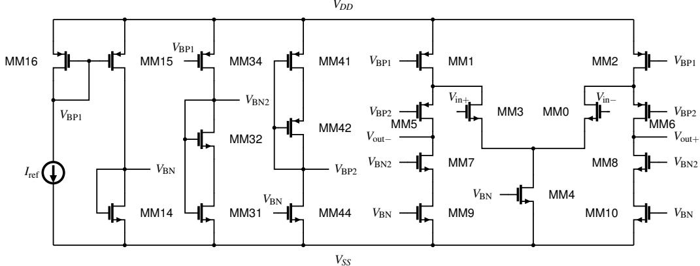  
Figure 11: Fully differential folded-cascode amplifier used in Case 1. X0 is the amplifier core and X1–X3 generate its bias voltages. Device identifiers and connections follow the supplied netlist. In the top-level instance, $V _ { \mathrm { b i a s n 1 } }$ is tied to $V _ { \mathrm { b i a s n } } .$ . Identical bias labels denote the same electrical net.

<table><tr><td colspan="2">Task Setup</td></tr><tr><td>Topology</td><td>Fully-differential folded-cascode amplifier</td></tr><tr><td>Evaluation split</td><td>In-distribution</td></tr><tr><td>Technology</td><td>65 nm CMOS (PTM), VDD = 1.2 V</td></tr><tr><td>Gain target</td><td>≥ 61.7 dB</td></tr><tr><td>Power target</td><td>≤ 425.7 µW</td></tr><tr><td>Bandwidth target</td><td>≥ 43.1 kHz (−3 dB bandwidth)</td></tr><tr><td>Phase-margin target</td><td>30° ≤ PM ≤ 90°</td></tr><tr><td>Evaluation tolerance</td><td>5%, as defined in the main evaluation</td></tr><tr><td>Initial gain</td><td>25.0 dB</td></tr><tr><td>Initial power</td><td>14,349 µW</td></tr><tr><td>Initial bandwidth</td><td>111 kHz</td></tr><tr><td>Initial phase margin</td><td>-36°</td></tr><tr><td>Initial in-band peaking</td><td>0.0 dB</td></tr><tr><td>Initial validity</td><td>Valid. Only the bandwidth target is met.</td></tr></table>

## Structured System Input Excerpt

<GRAPH\_INFO>   
TOPOLOGY\_NAME: Fully\_differential\_folded\_cascode   
</GRAPH\_INFO>   
<GRAPH\_NODE\_IDMAP>   
type=pin: @0=vdd @1=vss   
type=current\_source: @70=X1.I0   
type=n\_mosfet: @10=X0.MM0 @114=X3.MM44 @16=X0.MM10 @30=X0.MM3 @35=X0.MM4 @50=X0.MM7   
0 8 60 0 9 73 1 14 88 2 31 93 2 32   
type=p\_mosfet: @104=X3.MM41 @109=X3.MM42 @15=X0.MM1 @25=X0.MM2 @40=X0.MM5 @45=X0.MM6   
@78=X1.MM15 @83=X1.MM16 @98=X2.MM34   
type=net: LG\_Vbiasn LG\_Vbiasn2 LG\_Vbiasp1 LG\_Vbiasp2 Vinn Vinp Voutn Voutp ...   
</GRAPH\_NODE\_IDMAP>   
<PINMAP> ... </PINMAP>   
<EDGES> ... </EDGES>   
Design bounds:   
For tech 65nm, length l must stay within [45nm, 100um] and width w must stay   
within [45nm, 500um]. Designs outside this range are invalid.   
Fixed global: vdd=1.2V (user-set, not tunable).   
Allowed valid target handles and parameter tokens:   
@10: l\_MM30, w\_MM30 (MM0 -- NMOS input pair, matched with @30)   
@15: l\_MM12, w\_MM12 (MM1 -- PMOS current source, matched with @25)   
@16: l\_MM910, w\_MM910 (MM10 -- NMOS current source, matched with @60)   
@35: l\_MM4, w\_MM4 (MM4 -- NMOS tail)   
@40: l\_MM56, w\_MM56 (MM5 -- PMOS cascode, matched with @45)   
@50: l\_MM78, w\_MM78 (MM7 -- NMOS cascode, matched with @55)   
@70: iref (I0 -- reference current)   
@73, @78, @83: MM14/MM15/MM16 (X1: LG\_nmos\_l1 -> Vbiasn, Vbiasp1)   
@88, @93, @98: MM31/MM32/MM34 (X2: LG\_load\_biasn\_LV -> Vbiasn2)   
@104, @109, @114: MM41/MM42/MM44 (X3: LG\_load\_biasp\_LV -> Vbiasp2)

## Turn 1 User Input Excerpt

Your goal is: Achieve gain >= 61.7 dB, power <= 425.7 uW,   
-3dB bandwidth >= 43.1 kHz,   
30.0 deg <= phase\_margin <= 90.0 deg   
(each spec has 5% tolerance). Prioritize gain first.   
[...]   
Your current observation is:   
<PERFORMANCE>   
<GainAt1kHz>25.0 dB</GainAt1kHz>   
<Power>14349 uW</Power>   
<Bandwidth3dB>111 kHz</Bandwidth3dB>   
<PhaseMargin>-36 deg</PhaseMargin>   
<InBandFlatness>0.0 dB (limit 6)</InBandFlatness>   
</PERFORMANCE>   
<FEATURES>   
@10 id=X0.MM0 type=n\_mosfet w=w\_MM30=34.78u l=l\_MM30=166.8n Vgs=496 mV   
Vds=698 mV Vdsat=83.9 mV Ids=438 uA Gm=7 mS region=sat   
@15 id=X0.MM1 type=p\_mosfet w=w\_MM12=17.5u l=l\_MM12=69.58n Vgs=-476 mV   
Vds=-286 mV Vdsat=-157 mV Ids=-436 uA Gm=4.6 mS region=sat   
@16 id=X0.MM10 type=n\_mosfet w=w\_MM910=175.1u l=l\_MM910=6.297u Vgs=834 mV   
Vds=5 mV Vdsat=367 mV Ids=33.6 uA Gm=66.1 uS region=triode   
@35 id=X0.MM4 type=n\_mosfet w=w\_MM4=4.998u l=l\_MM4=199.9n Vgs=834 mV   
Vds=216 mV Vdsat=315 mV Ids=872 uA Gm=2.2 mS region=triode   
@40 id=X0.MM5 type=p\_mosfet w=w\_MM56=117.9n l=l\_MM56=20u Vgs=-914 mV   
Vds=-202 mV Vdsat=-471 mV Ids=-22.0 nA Gm=48.2 nS region=triode   
@50 id=X0.MM7 type=n\_mosfet w=w\_MM78=75.97n l=l\_MM78=20u Vgs=502 mV   
Vds=706 mV Vdsat=114 mV Ids=11.9 nA Gm=167 nS region=sat   
@70 id=X1.I0 type=current\_source dc=iref=23u ...   
</FEATURES>

## Turn 1 Original LLM Output Excerpt

<think>   
The current operating point is far from specs: DC gain is only 25 dB (needs >=61.7 dB),   
power is 14.35 mW (needs <=425.7 uW), and phase margin is -36 deg (needs 30-90 deg).   
Bandwidth is 111 kHz, which is acceptable, but the main problems are: 1. Excessive bias   
current: iref=23u causes excessive DC current. 2. PMOS current source MM1/MM2 is too   
short (69.58nm) and wide, allowing too much DC current. 3. NMOS current source MM9/MM10   
is very wide (175.1u) and acts as resistor rather than current source; needs moderate   
W/L. 4. Input pair MM3/MM0 is too wide and short; needs stronger gm with better ro.   
5. Tail MM4 is over-sized in current. 6. PMOS current source MM5/MM6 and NMOS cascode MM7/MM8 are weak (only 117.9n/75.97n). 7. DC gain is low because ro of signal devices are too small. Strategy: Reduce iref, make PMOS load stronger but less conductive, improve input pair, moderate tail, strengthen cascode current source, and fix bias blocks.

## </think>

<action>decrease @70 iref 95%</action> <action>increase @15 l\_MM12 200%</action> <action>decrease @15 w\_MM12 50%</action> <action>decrease @30 w\_MM30 70%</action> <action>increase @30 l\_MM30 200%</action> <action>decrease @35 w\_MM4 50%</action> <action>increase @35 l\_MM4 20%</action> <action>decrease @16 w\_MM910 95%</action> <action>increase @16 l\_MM910 50%</action> <action>increase @40 w\_MM56 500%</action> <action>decrease @40 l\_MM56 99%</action> <action>increase @50 w\_MM78 500%</action> <action>decrease @50 l\_MM78 99%</action> <action>decrease @73 w\_MM14 95%</action> <action>decrease @73 l\_MM14 85%</action> <action>decrease @78 w\_MM15 98%</action> <action>increase @78 l\_MM15 300%</action> <action>decrease @83 w\_MM16 95%</action> <action>decrease @83 l\_MM16 70%</action> <action>increase @104 w\_MM41 500%</action> <action>increase @109 w\_MM42 500%</action> <action>increase @114 w\_MM44 10%</action>

Simulator Result After Turn 1   
Gain / power −21.9 dB / 23 µW   
Bandwidth Not measurable   
Phase margin Unavailable   
The 22 simultaneous updates produce an invalid design with non-positive gain. The policy receives the   
simulator measurements and the design\_error message before the next turn.

Turn 2 User Input Excerpt   
<PERFORMANCE>   
<Status>INVALID - design\_error</Status>   
<Error>Design produces non-positive gain: -21.86 dB.</Error>   
<GainAt1kHz>-21.9 dB</GainAt1kHz>   
<Power>23 uW</Power>   
<Bandwidth3dB>not measurable</Bandwidth3dB>   
<Validity>non-positive gain; power/bandwidth/PM not meaningful until gain > 0</Validity>   
</PERFORMANCE>   
<FEATURES>   
@10 id=X0.MM0 type=n\_mosfet w=w\_MM30=10.4u l=l\_MM30=500.4n   
@15 id=X0.MM1 type=p\_mosfet w=w\_MM12=8.8u l=l\_MM12=208.7n   
@16 id=X0.MM10 type=n\_mosfet w=w\_MM910=8.8u l=l\_MM910=9.4u   
@35 id=X0.MM4 type=n\_mosfet w=w\_MM4=2.5u l=l\_MM4=239.9n   
@40 id=X0.MM5 type=p\_mosfet w=w\_MM56=707.4n l=l\_MM56=200n   
@50 id=X0.MM7 type=n\_mosfet w=w\_MM78=455.8n l=l\_MM78=200n   
@70 id=X1.I0 type=current\_source dc=iref=1.2u ...   
</FEATURES>

Turn 2 Original LLM Output Excerpt  
<think>  
The current operating point is invalid: DC gain is -21.9 dB (magnitude only 0.219x). The  
previous aggressive changes destroyed the DC bias: the PMOS current source/load  
(MM1/MM2) is too strong, tail MM4 is weak, input pair MM3/MM0 is weak, and NMOS current  
source MM9/MM10 is overkill. The core needs to be restored: make PMOS load weaker  
(larger l\_MM12, smaller MM1/MM2), stronger input pair MM3/MM0, stronger tail MM4,  
moderate iref, and adjust NMOS cascode/load. Need positive DC gain first.  
</think>  
<action>increase @15 l\_MM12 400.0%</action>  
<action>decrease @15 w\_MM12 30.0%</action>  
<action>increase @10 w\_MM30 100.0%</action>  
<action>increase @10 l\_MM30 100.0%</action>  
<action>increase @35 w\_MM4 300.0%</action>  
<action>increase @35 l\_MM4 50.0%</action>  
<action>decrease @16 w\_MM910 70.0%</action>  
<action>increase @16 l\_MM910 20.0%</action>  
<action>increase @40 w\_MM56 300.0%</action>  
<action>increase @40 l\_MM56 20.0%</action>  
<action>increase @50 w\_MM78 200.0%</action>  
<action>increase @50 l\_MM78 20.0%</action>  
<action>decrease @70 iref 10.0%</action>  
<action>decrease @73 w\_MM14 70.0%</action>  
<action>decrease @73 l\_MM14 20.0%</action>  
<action>increase @78 w\_MM15 100.0%</action>  
<action>decrease @78 l\_MM15 10.0%</action>  
<action>decrease @83 w\_MM16 70.0%</action>  
<action>increase @83 l\_MM16 10.0%</action>  
<action>increase @98 w\_MM34 150.0%</action>  
<action>decrease @93 w\_MM32 85.0%</action>  
<action>decrease @88 w\_MM31 70.0%</action>  
<action>decrease @88 l\_MM31 60.0%</action>

<table><tr><td colspan="2">Simulator Result After Turn 2</td></tr><tr><td colspan="2">Gain / power 75.6 dB / 98 µW</td></tr><tr><td colspan="2">Bandwidth / phase margin 15 kHz / 42°</td></tr><tr><td colspan="2">In-band peaking 0.0 dB</td></tr><tr><td colspan="2">The design becomes valid and meets the gain, power, and phase-margin targets. Bandwidth remains below</td></tr><tr><td colspan="2">its 43.1 kHz target, while gain now has substantial headroom.</td></tr></table>

## Turn 3 User Input Excerpt

<PERFORMANCE>   
<GainAt1kHz>75.6 dB</GainAt1kHz>   
<Power>98 uW</Power>   
<Bandwidth3dB>15 kHz</Bandwidth3dB>   
<PhaseMargin>42 deg</PhaseMargin>   
<InBandFlatness>0.0 dB (limit 6)</InBandFlatness>   
</PERFORMANCE>   
<FEATURES>   
@10 id=X0.MM0 type=n\_mosfet w=w\_MM30=20.8u l=l\_MM30=1u Vgs=324 mV   
Vds=434 mV Vdsat=48.5 mV Ids=3 uA Gm=63.6 uS region=subthreshold   
@15 id=X0.MM1 type=p\_mosfet w=w\_MM12=6.2u l=l\_MM12=1u Vgs=-477 mV   
Vds=-760 mV Vdsat=-139 mV Ids=-3.3 uA Gm=42.6 uS region=sat   
@16 id=X0.MM10 type=n\_mosfet w=w\_MM910=2.6u l=l\_MM910=11.3u Vgs=446 mV   
Vds=281 mV Vdsat=83.1 mV Ids=351 nA Gm=6 uS region=sat   
@35 id=X0.MM4 type=n\_mosfet w=w\_MM4=10u l=l\_MM4=359.8n Vgs=446 mV   
Vds=6.2 mV Vdsat=82.0 mV Ids=6 uA Gm=71.8 uS region=triode   
@40 id=X0.MM5 type=p\_mosfet w=w\_MM56=2.8u l=l\_MM56=240n Vgs=-440 mV   
Vds=-110 mV Vdsat=-61.9 mV Ids=-342 nA Gm=7.5 uS region=subthreshold   
@50 id=X0.MM7 type=n\_mosfet w=w\_MM78=1.4u l=l\_MM78=240n Vgs=345 mV   
Vds=49.2 mV Vdsat=45.8 mV Ids=341 nA Gm=7.7 uS region=cutoff   
@70 id=X1.I0 type=current\_source dc=iref=1.1u ...   
</FEATURES>

## Turn 3 Original LLM Output Excerpt

<think>   
Current specs: Gain is 75.6 dB, well above the 61.7 dB target. Power is only 98 uW, well   
within 425.7 uW. Phase margin is 42 deg, which meets 30-90 deg. The unmet spec is   
bandwidth: only 15 kHz, needs >=43.1 kHz. The main bottleneck is the high output   
resistance: MM3/MM0 are long (1u), MM1/MM2 PMOS load is long (1u), MM9/MM10 current   
source is very long (11.3u), and PMOS/NMOS cascode/load devices MM5/MM6 and MM7/MM8 are   
modest. The DC gain is excessive because ro of input pair and PMOS load are large. Need   
to reduce device lengths, especially ro of signal path devices ... Goal is to lower ro   
to reduce Rout, improving -3dB bandwidth while maintaining adequate DC gain.   
</think>   
<action>decrease @10 l\_MM30 70%</action>   
<action>increase @10 w\_MM30 10%</action>   
<action>decrease @15 l\_MM12 60%</action>   
<action>increase @15 w\_MM12 20%</action>   
<action>decrease @16 l\_MM910 80%</action>   
<action>increase @16 w\_MM910 50%</action>   
<action>increase @40 w\_MM56 100%</action>   
<action>decrease @40 l\_MM56 20%</action>   
<action>increase @50 w\_MM78 100%</action>   
<action>decrease @50 l\_MM78 15%</action>   
<action>decrease @70 iref 10%</action>

## Simulator Result After Turn 3

Bandwidth increases from 15 to 37 kHz following the combined length, width, and bias updates. It remains below the target even with the 5% evaluation tolerance. The other three targets remain met.

## Turn 4 Observation Summary

(Observation: <GainAt1kHz>75.9 dB</GainAt1kHz><Power>169 uW</Power><Bandwidth3dB>37 kHz </Bandwidth3dB><PhaseMargin>52 deg</PhaseMargin>; input pair w=22.9u l=300n Ids=7.3 uA Gm=160 uS; MM1 w=7.4u l=400n; MM10 w=3.9u l=2.3u; MM5 w=5.6u l=192n; MM7 w=2.8u l=204n; iref=990n)

Turn 4 Original LLM Output Excerpt   
<think>   
Current specs: Gain is 75.9 dB (well above 61.7 dB target), Power is only 169 uW (well   
within 425.7 uW), Phase Margin is 52 deg (meets 30-90 deg). The only unmet spec is   
Bandwidth: 37 kHz requires >=43.1 kHz. The main bottleneck is the DC gain, dominated by   
ro of signal path devices. Need to reduce ro of MM0/MM3 (input pair), MM1/MM2 PMOS load,   
MM9/MM10 current source, MM5/MM6 PMOS cascode, MM7/MM8 NMOS cascode. Strategy: decrease   
device lengths, especially l\_MM30, l\_MM12, l\_MM910, l\_MM56, l\_MM78. Also improve iref   
slightly for more current.   
</think>   
<action>decrease @10 l\_MM30 50.0%</action>   
<action>decrease @15 l\_MM12 40.0%</action>   
<action>increase @15 w\_MM12 10.0%</action>   
<action>decrease @16 l\_MM910 55.0%</action>   
<action>increase @16 w\_MM910 15.0%</action>   
<action>decrease @40 l\_MM56 25.0%</action>   
<action>increase @40 w\_MM56 10.0%</action>   
<action>decrease @50 l\_MM78 30.0%</action>   
<action>increase @50 w\_MM78 15.0%</action>   
<action>increase @70 iref 15.0%</action>

Final Simulator Result After Turn 4   
Gain / power 68.4 dB / 318 µW   
Bandwidth / phase margin 172 kHz / 56.4<sup>◦</sup>   
In-band peaking 0.0 dB   
All four original targets are satisfied without relying on the evaluation tolerance. The episode terminates   
after four turns.

## L.2 Case 2: Out-of-Distribution Current-Mirror Amplifier

Figure 12 shows the current-mirror amplifier used in this case. The second task starts with a gain of 123.2 dB and 61.2 dB of in-band peaking. The input pair and PMOS output mirror are in triode, and bandwidth is not measurable. After two turns, the policy reaches a valid operating point with sufficient gain and bandwidth. Two further updates reduce power and improve phase margin while retaining enough gain to meet the target.

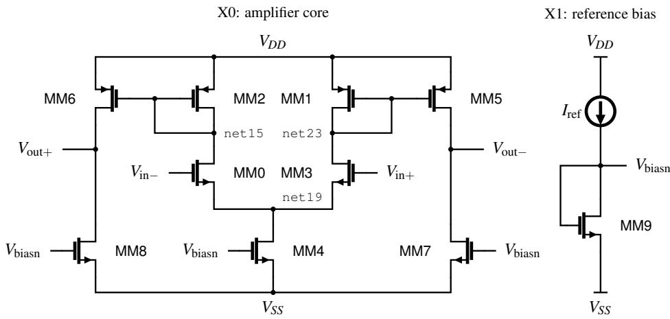  
Figure 12: Fully differential current-mirror amplifier used in Case 2. X0 contains the amplifier and X1 supplies its shared bias voltage. Device identifiers and connections follow the supplied netlist. Identical bias labels denote the same electrical net. In both schematics, $V _ { \mathrm { i n + } } / V _ { \mathrm { i n - } }$ and $\bar { V } _ { \mathrm { o u t + } } / V _ { \mathrm { o u t - } }$ correspond to Vinp/Vinn and Voutp/Voutn, respectively.

Task Setup   
Topology Fully-differential current-mirror amplifier   
Evaluation split Out-of-distribution   
Technology 65 nm CMOS (PTM), V<sub>DD</sub> = 1.2 V   
Gain target ≥ 26.4 dB   
Power target ≤ 170.1 µW   
Bandwidth target ≥ 1.25 MHz (−3 dB bandwidth)   
Phase-margin target 30<sup>◦</sup> ≤ PM ≤ 90<sup>◦</sup>   
Evaluation tolerance 5%, as defined in the main evaluation   
Initial gain −123.2 dB   
Initial power 52 µW   
Initial bandwidth Not measurable   
Initial phase margin Unavailable   
Initial in-band peaking 61.2 dB   
Initial validity Invalid under the domain-validity gates.

## Structured System Input Excerpt

<GRAPH\_INFO>   
TOPOLOGY\_NAME: Fully\_differential\_current\_mirror   
</GRAPH\_INFO>   
<GRAPH\_NODE\_IDMAP>   
type=pin: @0=vdd @1=vss   
type=current\_source: @55=X1.I0   
type=n\_mosfet: @22=X0.MM3 @27=X0.MM4 @42=X0.MM7 @47=X0.MM8 @58=X1.MM9 @7=X0.MM0   
type=p\_mosfet: @12=X0.MM1 @17=X0.MM2 @32=X0.MM5 @37=X0.MM6   
type=net: @2=LG\_Vbiasn @3=Vinn @4=Vinp @5=Voutn @6=Voutp ...   
</GRAPH\_NODE\_IDMAP>   
<PINMAP> ... </PINMAP>   
<EDGES> ... </EDGES>   
Design bounds:   
For tech 65nm, length l must stay within [45nm, 100um] and width w must stay   
within [45nm, 500um]. Designs outside this range are invalid.   
Fixed global: vdd=1.2V (user-set, not tunable).   
Allowed valid target handles and parameter tokens:   
@7: l\_MM30, w\_MM30 (MM0 -- NMOS input pair, matched with @22)   
@12: l\_MM21, w\_MM21 (MM1 -- PMOS diode load, matched with @17)   
@27: l\_MM4, w\_MM4 (MM4 -- NMOS tail)   
@32: l\_MM56, w\_MM56 (MM5 -- PMOS output mirror, matched with @37)   
@42: l\_MM78, w\_MM78 (MM7 -- NMOS output sink, matched with @47)   
@55: iref (I0 -- bias current source)   
@58: l\_MM9, w\_MM9 (MM9 -- NMOS bias diode)

## Turn 1 User Input Excerpt Turn 1 User Input Excerpt

Your goal is: Achieve gain >= 26.4 dB, power <= 170.1 uW,   
-3dB bandwidth >= 1.25 MHz,   
30.0 deg <= phase\_margin <= 90.0 deg   
(each spec has 5% tolerance). Prioritize gain first.   
[...]   
Your current observation is:   
<PERFORMANCE>   
<GainAt1kHz>-123.2 dB</GainAt1kHz>   
<Power>52 uW</Power>   
<Bandwidth3dB>not measurable</Bandwidth3dB>   
<InBandFlatness>61.2 dB (limit 6)</InBandFlatness>   
<Validity>non-positive gain; power/bandwidth/PM not meaningful until gain >   
0</Validity>   
</PERFORMANCE>   
<FEATURES>   
@7 id=X0.MM0 type=n\_mosfet w=w\_MM30=462.5n l=l\_MM30=185.9n Vgs=647 mV   
Vds=970 uV Vdsat=132 mV Ids=188 nA Gm=1.3 uS region=triode   
@12 id=X0.MM1 type=p\_mosfet w=w\_MM21=1.6u l=l\_MM21=20u Vgs=-646 mV   
Vds=-646 mV Vdsat=-276 mV Ids=-188 nA Gm=1.2 uS region=sat   
@27 id=X0.MM4 type=n\_mosfet w=w\_MM4=1.8u l=l\_MM4=20u Vgs=522 mV   
Vds=553 mV Vdsat=127 mV Ids=428 nA Gm=5.5 uS region=sat   
@32 id=X0.MM5 type=p\_mosfet w=w\_MM56=22u l=l\_MM56=417.4n Vgs=-646 mV   
Vds=-32.0 uV Vdsat=-277 mV Ids=-30.5 nA Gm=102 nS region=triode   
@42 id=X0.MM7 type=n\_mosfet w=w\_MM78=58.7n l=l\_MM78=7.9u Vgs=522 mV   
Vds=1.2 V Vdsat=127 mV Ids=29.9 nA Gm=381 nS region=sat   
@55 id=X1.I0 type=current\_source dc=iref=8.2u   
@58 id=X1.MM9 type=n\_mosfet w=w\_MM9=196.1n l=l\_MM9=140.5n Vgs=522 mV   
Vds=522 mV Vdsat=118 mV Ids=8.1 uA Gm=93.6 uS region=sat   
</FEATURES>

## Turn 1 Original LLM Output Excerpt

<think>   
The current operating point is invalid: DC gain is -123.2 dB (magnitude only   
0.123 dB), power 52 uW is fine but bandwidth is not measurable because the   
low-frequency gain is essentially zero. The main problems are:   
1. PMOS load MM1/MM2 is very weak: W/L only 1.6u/20u = 0.08. Needs stronger PMOS   
current source.   
2. NMOS pair MM3 is too weak: W/L only 462.5n/185.9n = 2.49, needs wider input   
pair.   
3. Tail MM4 is poorly sized: W/L only 1.8u/20u = 0.09, should provide more tail   
current.   
4. PMOS current source MM5/MM6 is too wide/triode: 22u/417n acts as resistor   
rather than DC current source.   
5. NMOS load MM7/MM8 is too weak: W=58.7n, L=7.9u gives poor DC level shifting.   
Need stronger NMOS load.   
6. iref can be reduced later, but first establish DC bias. Strategy: Make MM3   
strong pair, MM1/MM2 moderate PMOS load, stronger tail, better PMOS current   
source, stronger NMOS load, moderate iref.   
</think>   
<action>increase @22 w\_MM30 500%</action>   
<action>decrease @22 l\_MM30 20%</action>   
<action>increase @12 w\_MM21 500%</action>   
<action>decrease @12 l\_MM21 99%</action>   
<action>increase @27 w\_MM4 500%</action>   
<action>decrease @27 l\_MM4 99%</action>   
<action>decrease @32 w\_MM56 95%</action>   
<action>increase @32 l\_MM56 100%</action>   
<action>increase @42 w\_MM78 500%</action>   
<action>decrease @42 l\_MM78 99%</action>   
<action>decrease @55 iref 50%</action>   
<action>increase @58 w\_MM9 100%</action>   
<action>increase @58 l\_MM9 50%</action>

<table><tr><td colspan="2">Simulator Result After Turn 1</td></tr><tr><td colspan="2">Gain / power −118.4 dB / 25 µW</td></tr><tr><td colspan="2">Bandwidth / phase margin Not measurable</td></tr><tr><td colspan="2">In-band peaking 39.5 dB</td></tr><tr><td colspan="2">The first update does not restore valid operation. Gain remains non-positive and in-band peaking exceeds</td></tr><tr><td colspan="2">the validity threshold. The simulator again returns a design_error.</td></tr></table>

(observation: INVALID - design\_error, gain -118.4 dB, power 25 uW,   
in-band flatness 39.5 dB; sizes after Turn 1: MM0/MM3 2.8u/148.7n, MM1/MM2   
9.6u/200n,   
MM4 10.8u/200n, MM5/MM6 1.1u/834.8n, MM7/MM8 352.2n/79n, MM9 392.2n/210.8n,   
iref 4.1u)

Turn 2 Original LLM Output Excerpt   
<think>   
The current operating point is invalid: DC gain is -118.4 dB (magnitude only   
0.118 V/V). The DC gain polarity and magnitude are wrong. The main problems are   
the bias: PMOS load MM1/MM2 is too strong compared to NMOS pair MM0/MM3, tail   
MM4 current is moderate, PMOS current source MM5/MM6 and NMOS current mirror   
MM7/MM8 are not properly sized. The DC operating point is such that Vout is   
wrong. Need to restore DC: make NMOS pair MM0/MM3 stronger (larger W, longer L),   
PMOS load MM1/MM2 weaker (smaller W, longer L), stronger tail MM4, stronger PMOS   
current source MM5/MM6, and better NMOS current mirror MM7/MM8. iref can be   
reduced later for power.   
</think>   
<action>increase @22 w\_MM30 500.0%</action>   
<action>increase @22 l\_MM30 200.0%</action>   
<action>decrease @12 w\_MM21 80.0%</action>   
<action>increase @12 l\_MM21 400.0%</action>   
<action>increase @27 w\_MM4 200.0%</action>   
<action>decrease @27 l\_MM4 10.0%</action>   
<action>increase @32 w\_MM56 300.0%</action>   
<action>decrease @32 l\_MM56 50.0%</action>   
<action>increase @42 w\_MM78 500.0%</action>   
<action>increase @42 l\_MM78 100.0%</action>   
<action>decrease @55 iref 20.0%</action>   
<action>decrease @58 w\_MM9 20.0%</action>   
<action>decrease @58 l\_MM9 20.0%</action>

<table><tr><td colspan="2">Simulator Result After Turn 2</td></tr><tr><td>Gain / power 40.2 dB / 224 µW</td><td></td></tr><tr><td rowspan="2">Bandwidth / phase margin</td><td>6.9 MHz / 8.5°</td></tr><tr><td>In-band peaking 0.0 dB</td></tr><tr><td>The design becomes valid and exceeds the gain and bandwidth targets. Power remains above the budget, and phase margin is below the accepted range.</td><td></td></tr></table>

<table><tr><td>Turn 3 Observation Summary</td></tr><tr><td>(observation: gain 40.2 dB, power 224 uW, bandwidth 7 MHz, PM 8 deg; MM0/MM3 16.8u/446.1n Ids=4 uA, MM5/MM6 4.4u/417.4n Ids=-24.2 uA, MM7/MM8 2.1u/158n Ids=24.2 uA, iref</td></tr></table>

## Turn 3 Original LLM Output Excerpt

<think>   
Current specs: Gain is 40.2 dB (well above 26.4 dB target), BW is 7 MHz (meets   
1.25 MHz requirement), but Power is 224 uW (exceeds 170.1 uW) and Phase Margin   
is only 8 deg (needs 30-90 deg). The main issues are excessive bias current and   
over-sized PMOS current source/load devices causing too much unity-gain   
frequency phase lag. Need to reduce iref, scale down MM5/MM6 PMOS current   
source, MM7/MM8 NMOS load, and iref/MM9 bias to save power and improve phase   
margin while maintaining gain and bandwidth.   
</think>   
<action>decrease @55 iref 65.0%</action>   
<action>decrease @32 w\_MM56 60.0%</action>   
<action>decrease @32 l\_MM56 40.0%</action>   
<action>decrease @42 w\_MM78 50.0%</action>   
<action>decrease @42 l\_MM78 20.0%</action>   
<action>decrease @27 w\_MM4 40.0%</action>   
<action>decrease @27 l\_MM4 15.0%</action>   
<action>decrease @12 w\_MM21 20.0%</action>   
<action>decrease @12 l\_MM21 20.0%</action>   
<action>decrease @58 w\_MM9 30.0%</action>   
<action>increase @58 l\_MM9 10.0%</action>

## Simulator Result After Turn 3

Gain / power 36.2 dB / 90 µW   
Bandwidth / phase margin 4.8 MHz / 23.6<sup>◦</sup>

The combined bias and sizing updates bring power within the budget and improve phase margin from 8.5<sup>◦</sup> to 23.6<sup>◦</sup>. Only the phase-margin specification remains unmet.

## Turn 4 Observation Summary

```csv
(observation: gain 36.2 dB, power 90 uW, bandwidth 5 MHz, PM 24 deg; MM0/MM3
16.8u/446.1n
Ids=2.1 uA, MM5/MM6 1.8u/250.4n Ids=-9.4 uA, MM7/MM8 1u/126.4n Ids=9.4 uA, iref
1.2u)
```

## Turn 4 Original LLM Output Excerpt

Current specs: Gain is 36.2 dB (well above 26.4 dB target), Power is only 90 uW   
(well within 170.1 uW), Bandwidth is 5 MHz (exceeds 1.25 MHz requirement). The   
only unmet spec is Phase Margin, which is 24 deg but requires 30.0 deg to 90.0   
deg. The main issue is excessive DC gain due to large ro of signal path devices,   
causing too much phase lag at unity-gain frequency. Need to reduce ro of   
output/load devices to lower DC gain and improve phase margin while maintaining   
gain and bandwidth. Strategy: reduce device lengths (MM0/MM3, MM1/MM2, MM5/MM6,   
MM7/MM8) and iref to lower ro and DC current, decreasing DC gain and improving   
phase margin. Decrease iref moderately to save power.   
</think>   
<action>decrease @7 w\_MM30 50.0%</action>   
<action>decrease @7 l\_MM30 40.0%</action>   
<action>decrease @12 w\_MM21 30.0%</action>   
<action>decrease @12 l\_MM21 40.0%</action>   
<action>decrease @32 w\_MM56 50.0%</action>   
<action>decrease @32 l\_MM56 40.0%</action>   
<action>decrease @42 w\_MM78 40.0%</action>   
<action>decrease @42 l\_MM78 30.0%</action>   
<action>decrease @55 iref 30.0%</action>   
<action>decrease @27 w\_MM4 30.0%</action>   
<action>decrease @27 l\_MM4 15.0%</action>   
<action>decrease @58 w\_MM9 20.0%</action>   
<action>decrease @58 l\_MM9 10.0%</action>

<table><tr><td colspan="2">Final Simulator Result After Turn 4</td></tr><tr><td colspan="2">Gain / power 28.4 dB / 78.8 µW</td></tr><tr><td>Bandwidth / phase margin 10.2 MHz</td><td> $/ 4 6 . 8 ^ { \circ }$ </td></tr><tr><td>In-band peaking 0.0 dB</td><td></td></tr><tr><td colspan="2">All four original targets are satisfied without relying on the evaluation tolerance. Gain remains 2.0 dB above the target, while phase margin reaches  $4 6 . 8 ^ { \circ }$  and power remains within the budget. The episode terminates</td></tr><tr><td colspan="2">after four turns.</td></tr></table>

These examples illustrate how simulator feedback can guide recovery from invalid operation and subsequent refinement of coupled performance metrics. The two rollouts demonstrate successful optimization from different initial conditions and specification targets on an in-distribution topology and a held-out topology.