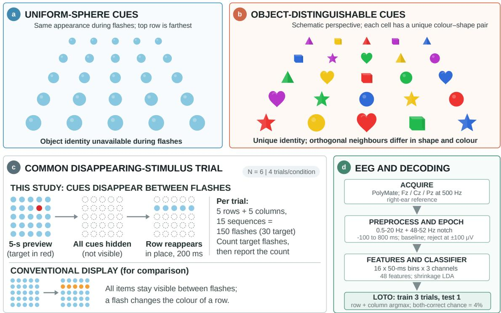
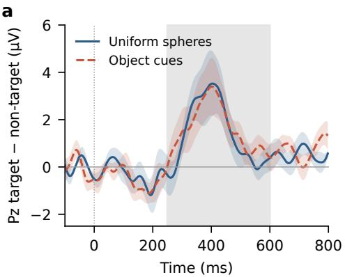
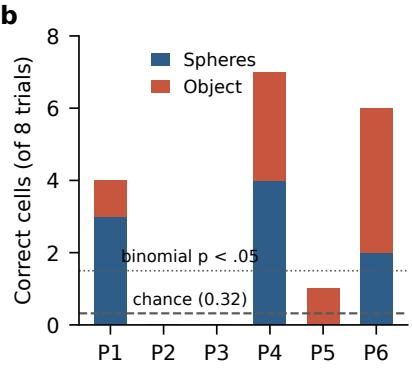
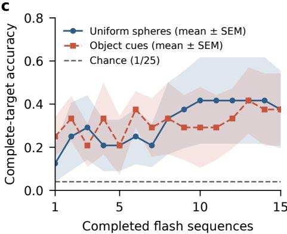

# Target Selection with a Disappearing-Stimulus Mixed-Reality P300 Interface: Feasibility and Object-Distinguishable Versus Uniform Cues

Runqi Pan1,2, Takuto Niinuma2, Yunshan Huang2, Masato Sugino2, Kenta Shimba2, and Kiyoshi Kotani2,†

1Imperial College London, London, UK

2Graduate School of Frontier Sciences, The University of Tokyo, Kashiwa, Japan

†Corresponding author: Kiyoshi Kotani

Abstract—Mixed-reality (MR) P300 interfaces can register selectable destinations, such as wheelchair goals, directly in the user’s surroundings. When the cues disappear between flashes, however, the user must retain an intended target that is no longer visible. We tested whether such an interface supports target selection and whether giving each cue a stable colour–shape identity improves it compared with visually uniform spheres. Six healthy adults completed four trials in each cue condition of a 5 × 5 row/column task on a head-mounted MR display, with EEG from Fz, Cz, and Pz. Shrinkage linear discriminant analysis was evaluated with nested validation in which complete trials were held out from class balancing, hyperparameter selection, and fitting. Both conditions evoked a parietal target-related positivity. The decoded cell was correct in 18 of 48 held-out trials, against 1.9 expected by chance (binomial $p \ < \ 1 0 ^ { - 1 2 } ) .$ and in three participants individually. Cue format made no detectable difference: complete-target accuracy was 9/24 in both conditions (paired difference 0.0 percentage points, 95% CI [−37, 37]), and held-out AUC was 0.609 for spheres and 0.585 for object cues. Disappearing-stimulus MR P300 selection is therefore feasible under strict trial-level evaluation, but the benefit of object identity, if any, is too small to resolve in a pilot of this size.

## I. INTRODUCTION

Brain–computer interfaces (BCIs) decode information from brain responses to visual [1], [2] and auditory [3], [4] stimuli and from motor imagery [5]. P300 is an event-related potential (ERP) elicited by task-relevant stimuli and has been widely used as a control signal in BCIs [6], [7]. In assistive wheelchairs, P300 BCIs are often used for high-level destination selection while an autonomous layer handles navigation [8], [9]. Mixed reality (MR) extends this idea by placing the selectable destinations in the user’s own environment instead of on a separate monitor. Head-mounted P300 communication [10] and broader BCI–AR integration [11] have been demonstrated, immersive presentation can change ERP amplitude and classification performance [12], and online MR destination selection has been used to drive a wheelchair [13].

Showing every destination continuously can clutter the scene. An alternative hides all cues after a target preview and reveals them only as transient row and column flashes. The user must then retain the intended destination and recognise its brief reappearance. Two questions follow. First, does this disappearing-stimulus design still yield usable target evidence? Second, does the cue format matter? With identical spheres, location is the only cue to the target; with unique colour–shape objects, the target can also be recognised by its appearance. Visual P300 performance is known to depend on display design, including flash grouping [14], face overlays [15], and stimulus colour or shape [16], [17], but in the matrix-based and head-mounted P300 displays cited here the selectable items remain visible between flashes [14], [10], [18], including the MR wheelchair interface of [13]; in rapid serial visual presentation (RSVP) designs, items are shown one at a time without a persistent spatial layout [19], [20]. In the present design, the spatial layout is previewed and then removed, so that each row or column is visible only during its 200-ms flash. Fig. 1c contrasts this design with a conventional P300 display.

Small EEG datasets add a methodological risk. Neighbouring epochs from one trial are dependent, and random epoch-level partitions can inflate accuracy [21]. We therefore evaluated both cue formats with nested validation in which complete trials were held out. The study has two aims: (1) to test whether P300 target selection remains feasible when the cues disappear between flashes, and (2) to estimate the effect of object-distinguishable colour–shape cues compared with uniform spheres in this setting, together with its uncertainty.

## II. METHODS

## A. Participants and design

Six healthy adults (five male; 20–28 years; right-handed; normal or corrected vision; all with prior BCI experience) took part after giving written informed consent. Two participants are authors (P1 and P6). P1 was aware of the hypothesis; results are also reported without P1 and without both. P6 is also a co-author of the MR wheelchair system study [13]. This study was conducted in accordance with the Regulations on Research Ethics of the University of Tokyo and was approved by the Ethics Committee of the University of Tokyo. Each participant completed four trials with uniform spheres and four with object-distinguishable cues, giving 48 trials. Condition order was recorded but not formally counterbalanced: by file time stamps, three participants did all sphere trials first, one did all object trials first, P5 recorded S, O, S blocks of 2, 4 and 2 trials, and P6 alternated.

## B. MR task and cue conditions

An HTC Vive XR Elite displayed a $5 \times 5$ grid of virtual destinations in the room, with the nearest row about 2 m away (column and row spacing 0.60 and 0.45 m). In the sphere condition all cells were identical spheres. In the object condition each cell had a unique combination of five colours and five shapes, and orthogonal neighbours differed in both (Fig. 1). The experimenter entered the target cell for each trial; targets were not randomised or matched between conditions. The target was previewed for 5 s, then all cues disappeared. Rows and columns reappeared for 200 ms in pseudo-random order, each once per sequence, for 15 sequences (150 events, 30 targets per trial; median marker interval 805.6 ms). Participants silently counted target flashes.

## C. EEG recording and preprocessing

EEG was recorded from Fz, Cz, and Pz at 500 Hz (PolyMate Mini AP108, Miyuki Giken), referenced to the right earlobe. Data were filtered with zero-phase Butterworth filters (0.5 Hz high-pass, 48–52 Hz band-stop, 20 Hz low-pass) and epoched from −100 to 800 ms around software markers, with baseline correction over −100 to 0 ms. Epochs with any sample at or above $1 0 0 ~ \mu \mathrm { V }$ in absolute value were rejected. The P300 was quantified as the 250–600 ms mean of the Pz target-minusnon-target difference.

## D. Decoding and evaluation

Features were the mean amplitudes of sixteen 50-ms bins from 0 to 800 ms on each channel (48 features) [22], classified with shrinkage linear discriminant analysis [23]. For each participant and condition, the outer loop held out one complete trial. Within the remaining three trials, the shrinkage parameter (0–1) was chosen by an inner leave-one-trial-out loop. Each fit undersampled non-targets to a 2:1 ratio with a fixed seed. No epoch of a test trial was used for balancing, model selection, or fitting. Row and column scores were the mean target-class score over their accepted flashes. The decoded cell was the highest-scoring row and column, and it was also recomputed after each of the 15 sequences. A row or column with no accepted epoch was excluded from the choice. As a secondary analysis, the same nested procedure was repeated with both conditions pooled, so that each model was trained on the other seven trials of a participant.

## E. Statistics

Feasibility was tested at the trial level: under the null hypothesis of no target information, each held-out trial is correct with probability 1/25, so the number of correct trials follows a binomial distribution. Because target cells were not uniformly distributed, we also report a conservative test with chance equal to the product of the most frequent target row and column proportions, taking the larger of the two conditions (spheres $9 / 2 4 \times 7 / 2 4 = 0 . 1 0 9$ ; object 0.097). We also ran a permutation test that preserves the target distribution: target cells were shuffled among each participant’s trials (200 permutations). Cue-format contrasts used the participant as the unit, with two-sided exact paired sign-flip tests over all $2 ^ { 6 }$ sign assignments and t-based 95% confidence intervals. With six participants the smallest attainable exact p is 0.031, so nonsignificant contrasts are not read as equivalence. Completetarget accuracy was the focal outcome; Pz amplitude and AUC were supporting outcomes. Analyses used MATLAB.

## III. RESULTS

## A. Signal quality and ERPs

Of 7,200 epochs, 6,614 (91.9%) passed artefact rejection (sphere $7 . 6 \pm 8 . 6 \%$ rejected, object $8 . 7 \pm 7 . 1 \% )$ ). Both conditions showed a parietal target-related positivity peaking near 400 ms (Fig. 2a). The Pz difference was $1 . 4 4 \pm 1 . 6 3 ~ \mu \mathrm { V }$ for spheres and $1 . 6 3 \pm 1 . 3 3 ~ \mu \mathrm { V }$ for object cues. It was positive in five of six participants in each condition (exact sign-flip test of the mean, $p ~ = ~ 0 . 0 6 3 ;$ participant-level percentile bootstrap with 10,000 resamples, 95% CIs [0.44, 2.70] and [0 $. 6 4 , 2 . 5 7 ] \ \mu \mathrm { V } )$

## B. Feasibility of target selection

After 15 sequences, both the row and column were decoded correctly in 18 of 48 held-out trials (37.5%), against 1.9 expected by chance (binomial $p = 1 . 6 \times 1 0 ^ { - 1 3 } \mathrm { { ; } }$ ; conservative chance $0 . 1 0 9 , p = 1 . 4 \times 1 0 ^ { - 6 } )$ . Each condition alone reached 9/24 $( p ~ = ~ 2 . 0 ~ \times ~ 1 0 ^ { - 7 } )$ . Performance was heterogeneous (Fig. 2b): three participants exceeded chance individually (4/8, 7/8, and 6/8 correct; each $p < 0 . 0 0 1 )$ , one was correct once, and two never were. Excluding the author-participant aware of the hypothesis (P1) left 14/40 correct $( p = 2 . 3 \times 1 0 ^ { - 1 0 } ) ;$ excluding both author-participants (P1 and P6) left 8/32 correct $( p = 2 . 9 \times 1 0 ^ { - 5 } ; p = 0 . 0 6 2$ against the conservative chance level of these four participants, 0.137). Row and column accuracies were 52% and 54% (chance 20%). At 15 sequences one selection took about 2 min, corresponding to an information transfer rate of 0.82 bit per selection or about 0.4 bit/min. Training a single classifier on both cue conditions (seven trials per model) gave 20/48 correct (spheres 11/24, object 9/24; $p = 6 \times 1 0 ^ { - 1 6 } )$ and $\mathrm { A U C ~ 0 . 6 0 5 \pm 0 . 1 2 5 }$ . In a permutation test that shuffled target cells among each participant’s eight trials and repeated the full nested pipeline, no permutation reached the observed 18 correct (null mean 2.3, maximum 8; $p = 0 . 0 0 5$ , the smallest attainable with 200 permutations).

## C. Cue-format comparison

Cue format produced no detectable difference in any principal outcome (Table I). Complete-target accuracy was identical (paired difference 0.0 percentage points, 95% CI $[ - 3 7 . 1 , 3 7 . 1 ] )$ . Object cues had a descriptively higher row accuracy but a lower column accuracy, which cancelled in the conjunction. Held-out AUC was slightly lower for object cues (difference −0.023, [−0.102, 0.055]). Classifiers transferred across conditions with similar performance: training on spheres and testing on object cues gave $\mathrm { A U C \ 0 . 5 9 3 } \pm 0 . 1 0 6$ and the reverse gave $0 . 6 1 8 \pm 0 . 1 1 4$

  
Fig. 1. Cue conditions, trial structure, and analysis. (a) Uniform spheres. (b) Object-distinguishable cues; each cell has a unique colour–shape identity. (c) Top: after a 5-s target preview all cues are hidden and reappear in place only as 200-ms row and column flashes. Bottom: in a conventional display all items stay visible and a flash changes the colour of a row (orange). (d) Identical acquisition, preprocessing, features, and complete-trial-held-out decoding in both conditions.

TABLE I PARTICIPANT-LEVEL OUTCOMES (N = 6, MEAN ± SD)
<table><tr><td>Outcome</td><td>Spheres</td><td>Object</td><td>Difference [95% CI]</td><td></td><td>p</td></tr><tr><td>Pz diff. (µV)</td><td> $1 . 4 4 \pm 1 . 6 3$ </td><td> $1 . 6 3 \pm 1 . 3 3$ </td><td></td><td>0.19 [−1.09, 1.46]</td><td>.72</td></tr><tr><td>AUC</td><td> $. 6 0 9 \pm . 1 3 4$ </td><td> $. 5 8 5 \pm . 0 9 2$ </td><td></td><td>-.023 [−.102, .055]</td><td>.47</td></tr><tr><td>Row acc. (%)</td><td> $4 1 . 7 \pm 4 0 . 8$ </td><td> $6 2 . 5 \pm 3 0 . 6$ </td><td></td><td>20.8 [−14.0, 55.7]</td><td>.25</td></tr><tr><td>Column acc. (%)</td><td> $5 8 . 3 \pm 3 7 . 6$ </td><td> $5 0 . 0 \pm 3 8 . 7$ </td><td></td><td>-8.3 [−29.8, 13.1]</td><td>.63</td></tr><tr><td>Complete target (%)</td><td> $3 7 . 5 \pm 4 4 . 0$ </td><td> $3 7 . 5 \pm 4 1 . 1$ </td><td></td><td>0.0 [−37.1, 37.1]</td><td>1.00</td></tr></table>

Differences are object minus spheres; p from exact paired sign-flip tests, unadjusted and exploratory.

## D. Accuracy across flash sequences

Fig. 2c asks how many flash sequences a selection needs. With hidden cues the user must hold the target in mind for the whole trial, so evidence could keep accumulating or stop improving as attention fades; the curve also shows the speed– accuracy trade-off for an online interface, in which fewer sequences mean faster selections. It was computed offline: each held-out trial was decoded by the same trial-held-out model from its first k sequences, so it does not measure online performance. Accuracy did not increase monotonically with the number of sequences (Fig. 2c): for spheres it was 12.5%, 20.8%, 41.7%, and 37.5% after 1, 5, 10, and 15 sequences, and for object cues 25.0%, 20.8%, 29.2%, and 37.5%. The curves crossed repeatedly and did not separate the cue formats. Because accuracy for spheres was no higher at 15 than at 10 sequences, fewer than 15 sequences may suffice, but these data do not identify an optimal number; an online study should test this.

## E. Robustness

Excluding the two trials with more than 50% rejected epochs and retraining left participant-mean complete-target accuracy at 37.5% in both conditions (17/46 trials correct; $p < 1 0 ^ { - 1 1 } )$ . Choosing any of the six possible pairs of archived P5 sphere recordings changed the sphere AUC only between 0.601 and 0.619. Accuracy was 11/24 in each participant’s first four trials and 7/24 in the last four. Because four participants recorded one condition entirely before the other (of the other two, P5 recorded S, O, S blocks of 2, 4 and 2 trials and P6 alternated), this comparison is confounded with condition for those four, but it gives no sign that practice raised accuracy.

## IV. DISCUSSION

Hiding MR destinations between flashes still allowed P300 target selection. Under evaluation that kept every test trial out of balancing, model selection, and fitting, the decoded cell was correct about nine times more often than chance, and the result held under a conservative chance level, after removing the hypothesis-aware author-participant (P1), and after removing high-artefact trials. With both author-participants removed, 8/32 remained above the 1/25 chance level but not above the conservative level $( p = 0 . 0 6 2 )$ . This matters for MR navigation interfaces because it permits an uncluttered scene in which destinations appear only when they are being probed.

c  

b  

  
Fig. 2. (a) Grand-average Pz target-minus-non-target difference (mean ± SEM, $N = 6 ) ;$ grey marks the 250–600 ms window. (b) Correct cells out of eight held-out trials per participant, split by condition. The dashed line is the chance expectation (0.32); two or more correct is significant for one participant (binomial $p < 0 . 0 5 )$ . (c) Complete-target accuracy after each completed flash sequence (mean ± SEM across participants), decoded offline by the trial-held-out models; the dashed line is chance (0.04).

Giving each destination a stable colour–shape identity did not yield a detectable advantage. Object identity may have been redundant because spatial attention already sufficed, it may have aided target retention without enlarging the P300, or its effect may simply be smaller than six participants can resolve; the confidence interval for complete-target accuracy spans ±37 percentage points. Colour [16] and shape [17] benefits reported for screen-based spellers should therefore not be assumed to transfer to disappearing MR cues. The similar cross-condition transfer suggests that one classifier could serve both cue formats, although four training trials cannot establish cue invariance.

Performance varied strongly between participants, as in large P300 cohorts [24], and the information transfer rate was low. Both follow partly from deliberate choices for this initial test: a conservative 805-ms marker interval suited to MR rendering, only three midline channels, and only three calibration trials per model. Row/column paradigms also suffer when target row and column flashes occur back to back [14]. Shorter intervals, a posterior montage, and dynamic stopping are the obvious next steps.

The study has clear limitations. The sample was small, healthy, and BCI-experienced; condition order was not counterbalanced; target cells were chosen by the experimenter rather than randomised; and neither eye movements nor marker-to-photon latency [25] were measured. All outcomes were offline. A confirmatory online study should randomise order and targets, fix complete-target accuracy as the primary outcome, and size the sample to detect a difference that matters for navigation.

## V. CONCLUSION

A disappearing-stimulus MR P300 interface supported above-chance target selection under strict complete-trial-heldout evaluation. Object-distinguishable cues did not detectably outperform uniform spheres, and the wide uncertainty around this contrast defines the sample needed for a confirmatory online study.

## ACKNOWLEDGMENT

The authors thank the participants and the other members of the Kotani & Shimba Laboratory, The University of Tokyo. A generative-AI assistant was used to support analysis-code review and language editing; the authors verified all analyses and text and take full responsibility for them.

## REFERENCES

[1] L. A. Farwell and E. Donchin, “Talking off the top of your head: toward a mental prosthesis utilizing event-related brain potentials,” Electroencephalography and Clinical Neurophysiology, vol. 70, no. 6, pp. 510–523, 1988.

[2] M. Sugino, M. Tanaka, K. Shimba, K. Kotani, and Y. Jimbo, “Reservoir computing based on a firing rate model for magnetoencephalogram data analysis,” Advanced Biomedical Engineering, vol. 14, pp. 185–195, 2025.

[3] J. Senda, M. Tanaka, K. Iijima, M. Sugino, F. Mori, Y. Jimbo, M. Iwasaki, and K. Kotani, “Auditory stimulus reconstruction from ECoG with DNN and self-attention modules,” Biomedical Signal Processing and Control, vol. 89, p. 105761, 2024.

[4] M. Tanaka, M. Sugino, R. Otsuki, K. Shimba, K. Kotani, and Y. Jimbo, “Investigation of the cross-frequency coupling characteristics during attentive listening in a two-speaker paradigm,” Advanced Biomedical Engineering, vol. 14, pp. 89–100, 2025.

[5] Y. Huang, K. Toyokawa, T. Zheng, K. Shimba, K. Kotani, and Y. Jimbo, “Object-centered control of brain-computer interface systems in threedimensional spaces using an intuitive motor imagery paradigm,” Advanced Biomedical Engineering, vol. 14, pp. 173–184, 2025.

[6] J. Polich, “Updating P300: an integrative theory of P3a and P3b,” Clinical Neurophysiology, vol. 118, no. 10, pp. 2128–2148, 2007.

[7] J. R. Wolpaw, N. Birbaumer, D. J. McFarland, G. Pfurtscheller, and T. M. Vaughan, “Brain-computer interfaces for communication and control,” Clinical Neurophysiology, vol. 113, no. 6, pp. 767–791, 2002.

[8] I. Iturrate, J. M. Antelis, A. Kubler, and J. Minguez, “A noninvasive¨ brain-actuated wheelchair based on a P300 neurophysiological protocol and automated navigation,” IEEE Transactions on Robotics, vol. 25, no. 3, pp. 614–627, 2009.

[9] B. Rebsamen, C. Guan, H. Zhang, C. Wang, C. Teo, M. H. Ang, and E. Burdet, “A brain controlled wheelchair to navigate in familiar environments,” IEEE Transactions on Neural Systems and Rehabilitation Engineering, vol. 18, no. 6, pp. 590–598, 2010.

[10] I. Kathner, A. K¨ ubler, and S. Halder, “Rapid P300 brain-computer¨ interface communication with a head-mounted display,” Frontiers in Neuroscience, vol. 9, p. 207, 2015.

[11] H. Si-Mohammed, J. Petit, C. Jeunet, F. Argelaguet, F. Spindler, A. Evain, N. Roussel, G. Casiez, and A. Lecuyer, “Towards BCI-based´ interfaces for augmented reality: Feasibility, design and evaluation,” IEEE Transactions on Visualization and Computer Graphics, vol. 26, no. 3, pp. 1608–1621, 2020.

[12] S. M. U. Arif, A. Shomanov, B. Tyler, and A. Yazici, “Next-generation BCI spellers: a comparative study of ERP responses and fatigue in mixed, virtual, and desktop realities,” Virtual Reality, vol. 30, no. 1, p. 29, 2026.

[13] F. Mori, M. Sugino, Y. Huang, K. Kotani, and Y. Jimbo, “Control of electric wheelchair by brain-computer interface using mixed reality and virtual sound source,” IEEJ Transactions on Electrical and Electronic Engineering, vol. 19, no. 6, pp. 1014–1025, 2024.

[14] G. Townsend, B. K. LaPallo, C. B. Boulay, D. J. Krusienski, G. E. Frye, C. K. Hauser, N. E. Schwartz, T. M. Vaughan, J. R. Wolpaw, and E. W. Sellers, “A novel P300-based brain–computer interface stimulus presentation paradigm: moving beyond rows and columns,” Clinical Neurophysiology, vol. 121, no. 7, pp. 1109–1120, 2010.

[15] T. Kaufmann, S. M. Schulz, C. Grunzinger, and A. K ¨ ubler, “Flashing¨ characters with famous faces improves ERP-based brain–computer interface performance,” Journal of Neural Engineering, vol. 8, no. 5, p. 056016, 2011.

[16] D. B. Ryan, G. Townsend, N. A. Gates, K. Colwell, and E. W. Sellers, “Evaluating brain–computer interface performance using color in the P300 checkerboard speller,” Clinical Neurophysiology, vol. 128, no. 10, pp. 2050–2057, 2017.

[17] A. Fern´ andez-Rodr´ ´ıguez, F. Velasco-Alvarez, M. T. Medina-Juli´ a, and´ R. Ron-Angevin, “Evaluation of flashing stimuli shape and colour heterogeneity using a P300 brain–computer interface speller,” Neuroscience Letters, vol. 709, p. 134385, 2019.

[18] S. Kim, S. Lee, H. Kang, S. Kim, and M. Ahn, “P300 brain–computer interface-based drone control in virtual and augmented reality,” Sensors, vol. 21, no. 17, p. 5765, 2021.

[19] L. Acqualagna and B. Blankertz, “Gaze-independent BCI-spelling using rapid serial visual presentation (RSVP),” Clinical Neurophysiology, vol. 124, no. 5, pp. 901–908, 2013.

[20] S. Chennu, A. Alsufyani, M. Filetti, A. M. Owen, and H. Bowman, “The cost of space independence in P300-BCI spellers,” Journal of NeuroEngineering and Rehabilitation, vol. 10, p. 82, 2013.

[21] Y. Moreno-Alcayde, V. J. Traver, and L. A. Leiva, “Sneaky emotions: impact of data partitions in affective computing experiments with braincomputer interfacing,” Biomedical Engineering Letters, vol. 14, no. 1, pp. 103–113, 2024.

[22] D. J. Krusienski, E. W. Sellers, D. J. McFarland, T. M. Vaughan, and J. R. Wolpaw, “Toward enhanced P300 speller performance,” Journal of Neuroscience Methods, vol. 167, no. 1, pp. 15–21, 2008.

[23] B. Blankertz, S. Lemm, M. Treder, S. Haufe, and K.-R. Muller,¨ “Single-trial analysis and classification of ERP components—a tutorial,” NeuroImage, vol. 56, no. 2, pp. 814–825, 2011.

[24] C. Guger, S. Daban, E. Sellers, C. Holzner, G. Krausz, R. Carabalona, F. Gramatica, and G. Edlinger, “How many people are able to control a P300-based brain–computer interface (BCI)?” Neuroscience Letters, vol. 462, no. 1, pp. 94–98, 2009.

[25] P. Swami, K. Gramann, E. K. Vonstad, B. Vereijken, A. Holt, T. Holt, G. Sandstrak, J. H. Nilsen, and X. Su, “CLET: computation of latencies in event-related potential triggers using photodiode on virtual reality apparatuses,” Frontiers in Human Neuroscience, vol. 17, p. 1223774, 2023.