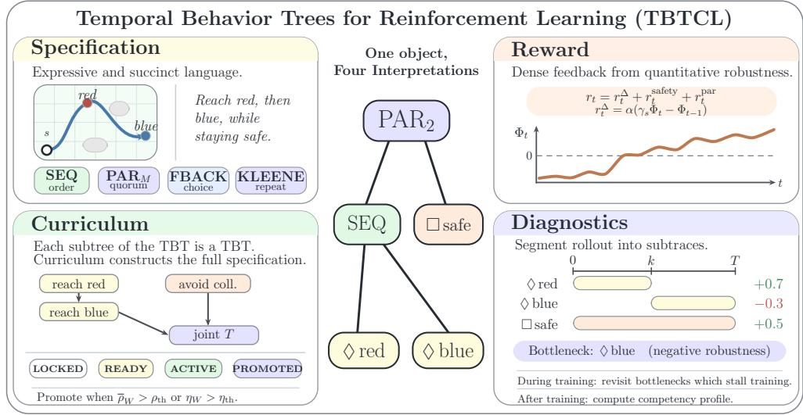
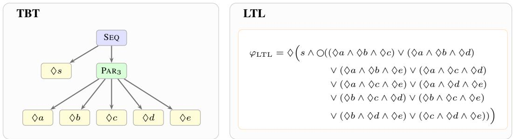
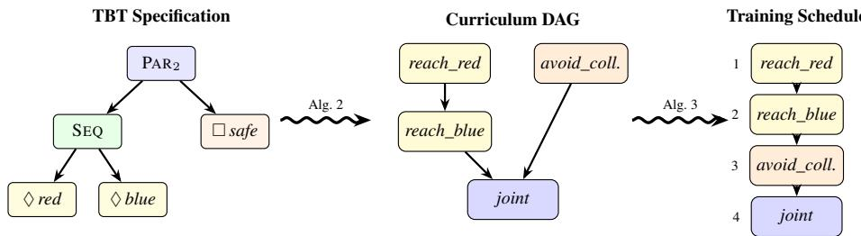
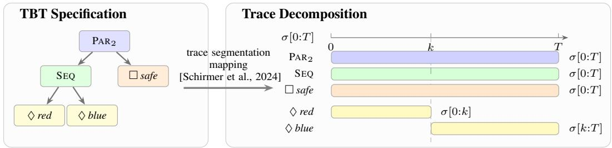
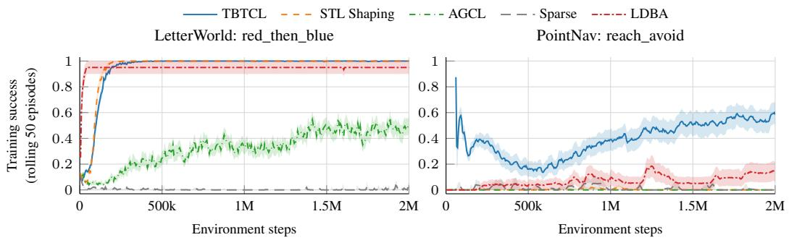

# Temporal Behavior Trees for Reinforcement Learning: Specifications as Rewards, Curricula, and Diagnostics

Vladimir Krsmanovic´1∗ Bernd Finkbeiner1,2

1CISPA Helmholtz Centerfor Information Security 2Technical University ofMunich {vladimir.krsmanovic,finkbeiner}@cispa.de

## Abstract

Reinforcement learning from formal specifications often separates task definition, reward shaping, curriculum design, and policy diagnostics into different mathematical objects. This fragmentation requires additional conversion steps and discards structure already present in the specification, such as subtask boundaries, ordering constraints, and quantitative measures. We introduce TBTCL (Temporal Behavior Tree Centric Learning), a framework that uses Temporal Behavior Trees (TBTs) as a unified interface for specification-guided reinforcement learning. A single TBT specifies the task, induces dense robustness-based rewards, defines a curriculum, and supports better understanding of learned policies. By adapting TBT syntax and semantics for specification-guided reinforcement learning, we provide a formalism that is more expressive than popular specification languages such as LTL and inherently hierarchical. We present algorithms to automatically extract a curriculum DAG and derive dense, robustness-based rewards directly from TBT semantics. Furthermore, we utilize TBT trace segmentation to build understandable competence profiles and automatically adapt the reward toward bottlenecks. We evaluate TBTCL on six specifications across discrete and continuous domains and show that Temporal Behavior Trees can serve as a specification, a reward, a curriculum, and a diagnostic.

## 1 Introduction

Temporal Logics are a powerful tool in reinforcement learning, enabling the formal specification of tasks and serving as the engine of Specification-Guided Reinforcement Learning. Most standard approaches convert a logical specification into a deterministic finite automaton, which is then used to guide the learning process. While this conversion is necessary to translate standard logics such as LTL [Pnueli, 1977] into a form suitable for RL, it incurs a high cost as it loses crucial information at each step. Properties such as subtask boundaries, quantitative performance measures, hierarchical structures, and task orderings and priorities are already present in the logical specification but are discarded by most methods during intermediate conversion steps.

The core cause of these problems is that most specification languages are not designed for purposes beyond task specification. A typical pipeline represents the task specification in one object, derives a reward in another, constructs a curriculum through an additional procedure and yet another representation, and then relies on separate diagnostics and derivations to understand how a learned policy behaves, performs, and fails. As such, a potential solution would be a specification language that provides the task definition, a dense reward, a curriculum, and behavioral diagnostics, without requiring separate conversion algorithms, representations, or user inputs for each. In this paper, we argue that a single formal object can simultaneously serve as the task definition, a dense reward source, a curriculum structure, and a diagnostic model.

  
Figure 1: Temporal Behavior Trees provide a single formal object for task specification, dense robustness-based reward shaping, curriculum extraction, and trace-based diagnostics.

We show that Temporal Behavior Trees (TBTs) [Schirmer et al., 2024] have these important properties and provide a flexible formalism for reinforcement learning. Existing work has developed this formalism for monitoring and trace analysis of cyber-physical systems [Schirmer et al., 2024, Schirmer, 2025, Schirmer et al., 2026] and has demonstrated its power and flexibility in these applications.

A TBT composes STL formulas at its leaves with tree-level operators such as sequence, parallel composition, and fallback. The STL leaves provide quantitative robustness, while the tree structure describes how behaviors compose over a trace. This hierarchical structure, which combines STL formulas at the leaves with tree-level operators, enables a concise and expressive definition of subtasks and their interconnections, which are frequently goals in reinforcement learning. This combination further enables more concise and expressive specifications than those of commonly used logics such as LTL. Furthermore, the quantitative semantics encoded by a robustness metric for TBT yields a dense reward signal and builds on previous work in the field that adapted the robustness of logics such as STL for Reinforcement Learning [Várnai and Dimarogonas, 2020]. Finally, TBTs support trace decomposition, connecting policy rollouts directly to the specification expressed as a TBT without additional steps, and can be used to evaluate policy behavior and identify bottlenecks and weak points.

Building on these properties, we adapt the Temporal Behavior Trees for reinforcement learning and demonstrate their use in specification, training, and evaluation. We present TBTCL (Temporal Behavior Tree Centric Learning), a framework that exploits this unified structure. Given a TBT specification, TBTCL extracts a curriculum represented by a directed acyclic graph (DAG) by structural recursion over the tree, trains a single policy through a bottom-up sequence of subformula reward functions, and advances stages based on achieved STL robustness rather than fixed episode budgets. When learning stalls, trace segmentation can identify the bottleneck subtask and redirect training to address it. Moreover, the same segmentation algorithm that drives online curriculum adaptation can also serve as a runtime diagnostic mechanism, decomposing any evaluation trace into per-subtask quality scores directly aligned with TBT semantics, without requiring any additional external mechanism.

We make the following contributions:

• We present Temporal Behavior Trees as a unified interface for specification-guided RL, adapting the semantics to reinforcement learning (Section 3.1).

• We use the quantitative robustness semantics of TBTs to derive a dense reward from the prefix robustness of the TBT (Section 3.2).

• We leverage the tree structure of TBTs and present an algorithm to extract a curriculum directly from their structure and semantics (Section 3.3).

• We demonstrate how the TBT trace segmentation mechanism can be used to understand policies and improve their learning by identifying bottlenecks during training (Section 3.4).

## 2 Background

Signal Temporal Logic. Signal Temporal Logic (STL) [Maler and Nickovic, 2004, Donzé and Maler, 2010] was developed for monitoring and verification of cyber-physical systems.

An STL formula is defined inductively $\mathrm { a s } \ \varphi : = \mu \ | \quad \neg \varphi \ | \quad \varphi _ { 1 } \wedge \varphi _ { 2 } \ | \quad \varphi _ { 1 } \vee \varphi _ { 2 } \ | \quad \bigcirc _ { [ l , u ] } \varphi |$ $\prod _ { [ l , u ] } \varphi ~ | ~ \varphi _ { 1 } \mathcal { U } _ { [ l , u ] } \varphi _ { 2 }$ , where $\mu : \mathbb { R } ^ { n } \to \mathbb { R }$ is an atomic predicate over the state space and $[ l , u ]$ are optional time bounds (omitted full signal). ♢ (Eventually) requires satisfaction at some point; □ (Globally) requires it at all points; (Until) requires the first operand to hold until the second becomes true.

It extends Boolean temporal logic to real-valued signals, replacing the binary satisfied/violated verdict with a quantitative robustness score. The robustness of a given STL formula is a real number whose sign indicates satisfaction and whose magnitude measures the margin. We provide a full definition of STL semantics, syntax and recursive robustness computation in Appendix C.

Temporal Behavior Trees. Temporal Behavior Trees (TBTs) [Schirmer et al., 2024] compose STL leaves with hierarchical operators, yielding a two-level language: tree structure for compositional organization, STL for quantitative leaf-level properties. A TBT leaf $\operatorname { L E A F } ( \varphi )$ evaluates an STL formula, while a sequence node $\operatorname { S E Q } ( \mathcal { T } _ { 1 } , \mathcal { T } _ { 2 } )$ , a parallel node $\mathrm { P A R } _ { M } ( { \mathcal T } _ { 1 } , \ldots , { \mathcal T } _ { k } )$ with quorum M, and a fallback node $\mathrm { F B A C K } ( \mathcal T _ { 1 } , \dots , \mathcal T _ { k } )$ compose child behaviors over trace segments:

$$
\mathcal { T } : : = \mathrm { L E A F } ( \varphi ) \mid \mathrm { S E Q } ( \mathcal { T } _ { 1 } , \mathcal { T } _ { 2 } ) \mid \mathrm { P A R } _ { M } ( \mathcal { T } _ { 1 } , \ldots , \mathcal { T } _ { k } ) \mid \mathrm { F B A C K } ( \mathcal { T } _ { 1 } , \ldots , \mathcal { T } _ { k } ) .
$$

Intuitively, SEQ searches for a cut point such that the prefix satisfies the first child and the suffix satisfies the second. $\mathrm { P A R } _ { M }$ evaluates all children on the same segment and requires at least M to succeed (quorum). FBACK represents alternatives, selecting the child and suffix with maximal robustness. We provide a detailed description of the TBT syntax and semantics in Appendix C.

Rollouts as traces. We consider episodic reinforcement learning in a Markov Decision Process (MDP) with horizon H and initial-state distribution µ0. A rollout under policy π, starting from $s _ { 0 } \sim \mu _ { 0 }$ , induces a finite trajectory $\sigma = ( s _ { 0 } , \ldots , s _ { H } )$ of environment states, which we call a trace following the formal methods literature, optionally augmented with real-valued signals such as distances to goals, hazards, or objects. STL predicates are evaluated on this trace: an atomic predicate µ maps a state or signal value to a real number, with $\mu ( s _ { t } ) > 0$ indicating that the predicate is satisfied at time t. We write $\sigma [ l { : } u ]$ to denote the contiguous segment from time l to u.

## 3 Method

We show that Temporal Behavior Trees can act as the specification and as a dense reward and as a curriculum and as a diagnostic metric. First, in Section 3.1, we argue that TBTs are an expressive and succinct specification language for describing complex behaviors and a powerful formalism for describing reinforcement learning tasks. Afterward, in Section 3.2, we show how STL’s robustness metrics are inherited by TBTs and present adaptations that enable effective training directly using TBT semantics. In Section 3.3 we demonstrate how the tree structure of TBTs directly induces a curriculum schedule, and show theoretical results about it. Finally, in Section 3.4 we use TBTs’ ability to segment traces (in our case, policy rollouts) to both better understand learned policies and guide the learning process towards better ones.

## 3.1 Temporal Behavior Trees as Specifications

Temporal Behavior Trees provide an expressive and concise specification language, owing to their hierarchical structure and expressiveness of the underlying semantics. Temporal Behavior Trees provide not only a more succinct way to write out many specifications, but are also known to be more expressive than other commonly used logics. As shown by Schirmer et al. [2024] building on proofs from Wolper [1983], Temporal Behavior Trees are strictly more expressive than STL, whose robustness semantics they inherit.

Each leaf of a TBT contains an STL formula describing a simple task, such as reaching a target or avoiding a hazard. Internal nodes specify how behaviors described by child nodes compose: a

  
Figure 2: Comparison of equivalent TBT and LTL specifications. Both describe the desired behavior of “reach S, and afterward at least three ofthefive possible targets”. While the LTL formula must explicitly enumerate structures, TBT can express them directly because of its tree structure.

Sequence node (SEQ) imposes temporal order (reach A before reaching $B )$ , a parallel node $( \mathrm { P A R } _ { M } )$ defines simultaneous requirements (reach A while avoiding C), and a Fallback node (FBACK) represents alternatives (reach either target A or target B). The combination of simple-to-specify leaf properties with powerful operators enables users to specify hierarchical specifications rather than just flat, linear-time formulas.

We further adapt the TBT formalism by Schirmer et al. [2024] for reinforcement learning by providing an operator to describe repeated behaviors, KLEENE $( n , \mathcal { T } _ { c } )$ . This node enables the specification of n+1 successful repetitions of the child behavior ${ \dot { \tau _ { c } } } .$ Its robustness can be computed as the best partition of the trace into n+1 segments, scored by the weakest repetition:

$$
\rho ( \sigma [ l : u ] , \mathrm { K L E E N E } ( n , \mathcal { T } _ { c } ) ) = \operatorname* { m a x } _ { \mathcal { P } _ { n + 1 } ( l , u ) } \operatorname* { m i n } _ { i = 1 } ^ { n + 1 } \rho ( \sigma _ { i } , \mathcal { T } _ { c } ) ,\tag{1}
$$

where $\mathcal { P } _ { n + 1 } ( l , u )$ is the set of valid ordered partitions of $\sigma [ l { : } u ]$ into $n { + 1 }$ non-empty contiguous segments. This operator enables easier specification of recurring properties (such as reach A 5 times) and avoids the need to define the same behavior through lengthy unfoldings of a flat temporal formula 2.

As a concrete example of one task description, in Figure 2 we show an example specification in a Temporal Behavior Tree as well as its equivalent in a formula in Linear Time Temporal Logic (LTL) [Pnueli, 1977]. Due to the linear nature of LTL, many such specifications require a significantly larger number of operators to describe, whereas the tree structure of TBT permits significantly more concise, easier-to-specify task descriptions.

## 3.2 Temporal Behavior Trees as Reward Functions

As TBTs inherit the robustness semantics of STL, we can use the dense reward signal to guide learning, similar to existing work applying STL to RL [Várnai and Dimarogonas, 2020]. A positive robustness score indicates that a rollout satisfies a TBT specification task, whereas a negative robustness score indicates a violation of that same specification, with the magnitude yielding a dense margin score.

Using this, we formulate our reward signal as a robustness-based potential over observed prefixes. For a TBT , we compute the prefix potential as $\Phi _ { t } ( T ) = \rho ( \sigma [ 0 : t ] , T )$ , with $\Phi _ { t } ( T ) = 0$ when the prefix is too short to admit a valid decomposition. The dense term for the reward is expressed as the discounted potential difference.

$$
r _ { t } ^ { \Delta } = \alpha \Bigl ( \gamma _ { s } \Phi _ { t } ( \mathcal { T } ) - \Phi _ { t - 1 } ( \mathcal { T } ) \Bigr ) , \qquad t = 1 , \ldots , N ,\tag{2}
$$

with α being a reward scale coefficient and $\gamma _ { s } \in ( 0 , 1 ]$ a shaping discount. This term is the per-step form of quantitative semantics, rewarding policy changes that improve the robustness score of a TBT specification, thereby avoiding the need to convert to a different object or to use external mechanisms to produce a dense reward signal.

While the STL robustness semantics are directly inherited for leaves, we have to adapt the reward formulation to account for the semantics of the other TBT nodes. For Leaves with safety properties (such as “never $g o$ through $A ^ { \prime \prime } )$ , the TBT semantics must account for the fact that, after a violation of a safety property, no future action can repair it [Baier and Katoen, 2008]. Because the robustness score defined in eq. (2) is determined by the previous state, this leads to a situation where no change is possible in the robustness, and the delta-based reward signal disappears [Várnai and Dimarogonas, 2020].

Similarly, the semantics of $\mathrm { P A R } _ { M }$ nodes suffer from a similar issue. As the robustness is computed against the weakest child in the quorum of the $\mathrm { P A R } _ { M }$ node, a step improvement in any child other than the one currently holding the M-th largest robustness value is masked, and there is no reward for such improvements [Várnai and Dimarogonas, 2020]. This leads to potentially beneficial policy changes not being properly rewarded. We combat these issues by adding additional terms adjusting the reward signal for these situations.

To provide a dense reward signal even after a safety violation, we introduce a term

$$
r _ { t } ^ { \mathrm { s a f e t y } } = \beta \sum _ { \substack { \forall \varphi _ { g } \in \mathcal { G } ( T ) } } \operatorname* { m i n } \bigl ( 0 , \ \rho ( \sigma [ t : t ] , \varphi _ { g } ) \bigr ) .\tag{3}
$$

where $\mathcal { G } ( \tau )$ ranges over all leaves of $\tau$ encoding safety properties. This term imposes a penalty proportional to the extent of the agent’s violation of the safety property. Unlike the delta-based approach, $r _ { t } ^ { \mathrm { s a f e t y } }$ accumulates the penalty for repeating violations and pushes the policy back towards safe behavior. This provides a dense signal even when there is no way to recover from violating a safety property in a Leaf.

For $\mathrm { P A R } _ { M }$ nodes, TBTCL exposes the progress of every child as a second potential term with zero terminal value:

$$
r _ { t } ^ { \mathrm { p a r } } = \gamma _ { s } \Psi _ { t } - \Psi _ { t - 1 } , \qquad \Psi _ { t } = \lambda _ { \mathrm { p a r } } \sum _ { i \in \mathcal { C } ( \mathcal { T } _ { o } ) } \Phi _ { t } ( \mathcal { T } _ { i } ) \mathrm { ~ f o r ~ } 0 \le t < N , \qquad \Psi _ { N } = 0 ,\tag{4}
$$

where $\mathcal { C } ( \mathcal { T } _ { o } )$ is the set of immediate children of the parallel objective $\tau$ and $\lambda _ { \mathrm { p a r } }$ a shaping scale hyperparameter. While quorum robustness remains the satisfaction score, this formulation ensures that an update that improves any child also improves the rewards, and not only for the one that currently holds the quorum back.

Combining the prefix potential reward and the two terms, TBTCL provides a potential-based reward directly from the TBT semantics

$$
r _ { t } = r _ { t } ^ { \Delta } + r _ { t } ^ { \mathrm { s a f e t y } } + r _ { t } ^ { \mathrm { p a r } } ,\tag{5}
$$

We show several properties of the robustness-based reward, starting by showing that maximizing expected return is equivalent to maximizing the expected terminal robustness net of the safety penalty, $U _ { \textrm { \scriptsize : } }$ , and then relating U to the satisfaction of the specification. This gives a satisfaction-probability bound and, under additional assumptions, almost-sure satisfaction by return maximizers.

For a trace $\sigma = ( s _ { 0 } , \ldots , s _ { N } )$ we write $\begin{array} { r } { G ( \sigma ) = \sum _ { t = 1 } ^ { N } \gamma _ { s } ^ { t - 1 } r _ { t } } \end{array}$ for the return of Eq. 5 and $S ( \sigma ) =$ $\begin{array} { r } { \sum _ { t = 1 } ^ { N } \gamma _ { s } ^ { t - 1 } r _ { t } ^ { \mathrm { s a f e t y } } \le 0 } \end{array}$ for the accumulated safety penalty, and write $U ( \sigma ) = \alpha \gamma _ { s } ^ { N } \Phi _ { N } ( T ) + S ( \sigma )$ for the discounted terminal potential net of this penalty.

Lemma 1 (Return identity). For every trace, $G ( \sigma ) = U ( \sigma ) - c ( s _ { 0 } )$ with $c ( s _ { 0 } ) = \alpha \Phi _ { 0 } ( T ) + \Psi _ { 0 }$ a function ofthe initial state alone, and $U ( \sigma ) \leq 0$ whenever σ $\nvDash \mathcal T$

Proof. The delta term telescopes

$$
\sum _ { t = 1 } ^ { N } \gamma _ { s } ^ { t - 1 } \alpha \bigl ( \gamma _ { s } \Phi _ { t } ( T ) - \Phi _ { t - 1 } ( T ) \bigr ) = \alpha \sum _ { t = 1 } ^ { N } \bigl ( \gamma _ { s } ^ { t } \Phi _ { t } ( T ) - \gamma _ { s } ^ { t - 1 } \Phi _ { t - 1 } ( T ) \bigr ) = \alpha \bigl ( \gamma _ { s } ^ { N } \Phi _ { N } ( T ) - \Phi _ { 0 } ( T ) \bigr ) ,\tag{6}
$$

the parallel term sums to $\gamma _ { s } ^ { N } \Psi _ { N } - \Psi _ { 0 } = - \Psi _ { 0 }$ since $\Psi _ { N } = 0$ and the safety term sums to $S ( \sigma )$ Both initial potentials depend only on $s _ { 0 } ,$ and so does $c ( s _ { 0 } )$ as well. As non-satisfying traces produce negative robustness scores [Fainekos and Pappas, 2009], if $\sigma \nvDash \mathcal T$ it follows that $\Phi _ { N } ( \mathcal { T } ) \leq 0$ which together with $S \le 0$ leads to $U \leq 0$ □

As the constant $c ( s _ { 0 } )$ is outside the policy’s control, maximizing the expected return maximizes $\mathbb { E } _ { \pi } [ U ]$ . Since $U \leq 0$ on violating traces as per robustness semantics, this expectation yields a bound on the satisfaction probability.

Proposition 1 (Satisfaction-probability bound). Let $U ^ { * } = \operatorname* { s u p } _ { \sigma } U ( \sigma )$ over thefeasible traces ofa finite-horizon MDP and assume $0 < U ^ { \cdot } < \infty .$ . Every policy π satisfies

$$
\operatorname* { P r } _ { \pi } ( \sigma \vdash \mathcal { T } ) \ \ge \ \frac { \mathbb { E } _ { \pi } [ U ( \sigma ) ] } { U ^ { * } } \ = \ \frac { \mathbb { E } _ { \pi } [ G ] + \mathbb { E } _ { \mu _ { 0 } } [ c ( s _ { 0 } ) ] } { U ^ { * } } .
$$

The bound holds for every $\gamma _ { s } \in ( 0 , 1 ] , \alpha > 0 a n d \beta , \lambda _ { \mathrm { p a r } } \geq 0 .$

Proof. By Lemma 1, $U \leq 0$ on violating traces, and $U \leq U ^ { * }$ on satisfying ones by definition of $U ^ { * }$ Splitting $\dot { \mathbb { E } } _ { \pi } [ U ]$ by whether $\sigma \models \mathcal { T }$ therefore gives $\mathbb { E } _ { \pi } [ U ] \leq U ^ { * } \operatorname* { P r } _ { \pi } ( \stackrel { \cdot } { \sigma } \models \mathcal { T } )$ . Dividing by $U ^ { * } > 0$ proves the bound; the equality is Lemma 1. □

Corollary 1 (Almost-sure satisfaction of return maximizers). Under the assumptions of Proposition 1, let transitions and termination be deterministic and the action setfinite. Ifµ0-almost every initial state admits a trajectory with $U > 0 ,$ , then every policy maximizing $\mathbb { E } _ { \pi } [ G ]$ satisfies  almost surely.

Proof. Each action sequence determines a trajectory from $s _ { 0 } ,$ , so the finite horizon and action set ensure that $U ^ { * } ( s _ { 0 } ) = { \bf \bar { \Psi } } \operatorname* { m a x } _ { \sigma } U ( \sigma )$ over them is attained. Choosing a maximizing sequence for each observed $s _ { 0 }$ attains $\mathbb { E } _ { \mu _ { 0 } } [ U ^ { * } ( s _ { 0 } ) ]$ ], the upper bound on $\mathbb { E } _ { \pi } [ U ] = \mathbb { E } _ { \mu _ { 0 } } \left[ \mathbb { E } _ { \pi } [ U ~ \vert ~ s _ { 0 } ] \right]$ . Since $\mathbb { E } _ { \pi } [ U \mid s _ { 0 } ] \le U ^ { * } ( s _ { 0 } )$ , every maximizer of $\mathbb { E } _ { \pi } [ G ] = \mathbb { E } _ { \pi } [ U ] - \mathbb { E } _ { \mu _ { 0 } } [ c ( s _ { 0 } ) ]$ has $\mathbb { E } _ { \pi } [ U \mid s _ { 0 } ] \stackrel { - } { = } U ^ { * } ( s _ { 0 } )$ for µ0-almost every $s _ { 0 }$ . Applying Proposition 1 conditional on s0, with $0 < U ^ { \bar { * } } ( s _ { 0 } ) \dot { < } \infty$ , gives $\operatorname* { P r } _ { \pi } ( \sigma \mid = \mathcal { T } \mid s _ { 0 } ) \geq 1$ . A satisfying trajectory without an instantaneous violation has $S = 0$ and $U = \alpha \gamma _ { s } ^ { N } \rho ( \sigma , \mathcal { T } ) > 0$ □

In stochastic settings, however, this only gives a loose bound as a maximizer of $\mathbb { E } _ { \pi } [ U ]$ need not maximize the satisfaction probability, since a policy that satisfies with a large margin most of the time and otherwise leads to a violation, contributing a $U$ close to $0 ,$ can outscore one that satisfies surely with a small margin.

## 3.3 Temporal Behavior Trees as Curriculum

Owing to their tree structure, we can extract a curriculum directly from a TBT without requiring additional inputs or representations. As a TBT is a tree, every subtree of a TBT is a TBT as well. We use this fact and construct a curriculum which iteratively builds up from the leaf nodes of the TBT toward the full specification. Using this, TBTCL trains a single policy throughout the curriculum, with progression through the curriculum corresponding to which subtree of the full TBT specification provides the robustness-based reward.

  
Figure 3: Going from a TBT specification to a curriculum DAG via Algorithm 2. Each leaf first becomes a stage, SEQ induces prerequisite edges and $\mathrm { P A R _ { 2 } }$ creates a joint stage gated on both children. Finally, topological sort yields the linear training schedule executed by Algorithm 3.

Curriculum Extraction The curriculum extraction begins with a walk-through of the TBT, defining the specification task and constructing a Curriculum Graph directly from the semantics of TBTs. We directly use the hierarchical structure of TBTs, traversing through the tree and building a curriculum based on the leaf nodes and the internal nodes connecting them.

First, we compute a Curriculum Graph in which each node encodes a stage (the subtrees specification being learned), and each edge encodes dependencies between stages (which subtask must be mastered before proceeding to the next stage). We convert a TBT into a Curriculum Graph by traversing it, with its semantics governing its encoding.

Each $\operatorname { L E A F } ( \varphi )$ node is converted into a stage, as it corresponds to learning the behavior encoded in the STL formula, such as reaching a target or maintaining distance from a hazard. Sequence nodes $\operatorname { S E Q } ( { \mathcal { T } } _ { 1 } , { \mathcal { T } } _ { 2 } )$ impose order between stages and encode a dependency between stages such that $\mathcal { T } _ { 1 }$ must be promoted before the stages extracted from $\mathcal { T } _ { 2 }$ become available. Similarly, $\mathrm { F B A C K } ( \mathcal T _ { 1 } , \dots , \mathcal T _ { k } )$ encodes a dependency where a single stage becoming PROMOTED is sufficient to unlock the current stage.

PAR and KLEENE nodes encode composition stages as they control how rewards from multiple tasks interact. For $\mathrm { P A R } _ { M } ( { \mathcal T } _ { 1 } , \ldots , { \mathcal T } _ { k } )$ nodes, every child is first trained as a subobjective, and a joint stage whose objective is the full parallel node becomes available once at least M child stages are promoted. For $\mathrm { K L E E N E } ( n , \mathcal { T } _ { c } )$ nodes, the stages of $\mathcal { T } _ { c }$ are followed by one stage per repetition count $k = 2 , \ldots , n { + } 1$ , each requiring k repetitions of $\mathcal { T } _ { c }$ and unlocked by the promotion of its predecessor, until the full $n { + 1 }$ repetitions are reached.

We show a pseudo-code implementation in Algorithm 2.

Scheduling We convert the Curriculum Graph into a learning schedule by traversing the Curriculum Graph. The scheduler then moves through one stage at a time, tracking the status of each stage in the Curriculum Graph following the progression of $\mathrm { L O C K E D } \to \mathrm { R E A D Y } \to \mathrm { A C T I V E } \to$ PROMOTED.

Stages that have no prerequisites, such as those corresponding to LEAF nodes, start READY while all others start LOCKED. The TBT formula of the stage marked ACTIVE is used as the reward function as described in Section 3.2.

A stage becomes PROMOTED after the policy has successfully learned the corresponding subtask, meaning that over the sliding window of W episodes either the rolling mean robustness $\overline { { \rho } } _ { W }$ or the success rate $\eta _ { W }$ is above the respective thresholds $( \overline { { { \rho } } } _ { W } > \rho _ { \mathrm { t h r e s h } } \quad \mathrm { o r } \quad \eta _ { W } > \eta _ { \mathrm { t h r e s h } } )$ . We also enforce a minimum number of episodes per stage, $E _ { \mathrm { m i n } }$ , before promotion becomes possible.

When all (or, in the case of $\mathrm { P A R } _ { M }$ , at least M) the dependencies of a stage become PROMOTED , it is marked as READY and available for selection by the scheduler. The next stage to become ACTIVE is selected by a scheduler using an on-the-fly topological sort of the Curriculum Graph.

Once all curriculum stages are promoted, they effectively reconstruct the full TBT specification $\tau .$ TBTCL then enters a consolidation phase that trains on the full TBT specification, recovering any degraded subtask performance. This phase is further augmented by the adaptive mode we present in Section 3.4, which actively recovers policies’ abilities on specific subtasks by directing the reward towards leaf nodes with the lowest robustness.

We can show that the curriculum that TBTCL builds is a finite, bounded-size DAG (which we discuss in Appendix D). Furthermore, we can show that the decomposition of the TBT into subtrees, as done during curriculum generation, aligns with the task described in the full TBT specification. While this guarantees neither optimality nor convergence, it shows that the tree structure of TBT can be used to derive a curriculum without requiring external mechanisms or difficulty rankings.

Proposition 2 (Semantic Curriculum Characterization). For any finite TBT specification  and finite trace $\sigma , \rho ( \sigma , \mathcal { T } ) > 0$ holds if and only if the operators of  can be resolved recursively into satisfied leaf-level STL obligations on the corresponding trace segments.

Proof. We use structural induction over the TBT. Leaves directly inherit STL satisfaction and internal nodes follow TBT robustness semantics. Applying the induction hypothesis gives the corresponding satisfied leaf obligations in both directions. The full proof is in Appendix D.

## 3.4 Temporal Behavior Trees as Diagnostics

The same semantics of TBTs that make them effective for task specification and learning also enable us to better understand the trained policies. Trace segmentation [Schirmer et al., 2024] maps every subtree of the TBT to the segment of a rollout on which it was evaluated and assigns that segment a robustness value, as shown in Figure 4. While Schirmer [2025] use segmentation to repair autonomous drone behavior [Schirmer et al., 2026], we use it to examine how a learned policy behaves and how it aligns with the specification described by the TBT.

  
Figure 4: Trace decomposition induced by a TBT  , mapping subtrees onto subtraces and providing a robustness score for each subtree

Aggregating this mapping across several episodes, we can construct a per-leaf competence profile that shows which part of the TBT specification was acted on, when, and how well the policy performed it. This analysis of learned policy behavior follows directly from the formal semantics of the TBTs and their trace segmentation, and provides a more robust analysis of policy actions.

Furthermore, we can use this technique not only for post-training diagnostics but also to guide training by identifying bottlenecks that occur during learning. By tracking the robustness scores of each leaf over a sliding window of sampled episodes, we can identify bottleneck nodes with the lowest robustness scores.

Using this information, during the consolidation phase, we can redirect the scheduler to these nodes, using their subspecification to derive the reward and reinforce the policy on this subtask.

Algorithm 1: Adaptive Training   
Input :trace σ, active stage s; window $\overline { { W _ { \mathrm { s t a l l } } } } ,$   
budget $R ,$ threshold τ   
1 Segment σ on s; record its bottleneck leaf   
2 if s was promoted then reset stall; end redirect   
3 else if redirect budget R is spent then resume s   
4 else if no promotion $f o r \ge W _ { s t a l l }$ episodes then   
5 b∗ ← top non-safety bottleneck leaf   
6 $\mathrm { i f } \mathrm { f r e q } ( \hat { b ^ { * } } ) \geq \tau$ then redirect training to $b ^ { * }$

We call this mechanism adaptive training (Algorithm 1), which further mitigates catastrophic forgetting, often observed in compositional learning, by refocusing the agent on specific tasks that degrade during the final phase of learning.

## 4 Experiments

Setup We evaluate TBTCL on six specifications across two domains, spanning reachability, sequential composition, Kleene repetition, and reach-avoid tasks with safety constraints. We base our implementation on Stable-Baselines3 [Raffin et al., 2021] and PyTorch [Paszke et al., 2019], with NumPy [Harris et al., 2020] for the robustness and TBT engines, NetworkX [Hagberg et al., 2008] for graph operations, and Hydra [Yadan, 2019] for experiment configuration. We ran the evaluations on a single Dell R6525 (2x AMD Epyc 7773x - 128 Cores, 256 Threads, 2TB RAM).

LetterWorld is a discrete gridworld with lettered target cells; the agent observes its normalized position in $[ 0 , 1 ] ^ { 2 }$ and selects from five actions. Manhattan-distance signals serve as inputs to STL predicates; collisions with obstacles terminate the episode. We use $5 \times 5$ grids for compositional tasks and a $1 0 \times 1 0$ grid with 14 obstacles for reach-avoid. PointNav is a continuous 2D point-mass domain in $[ - 5 , 5 ] ^ { 2 }$ with continuous acceleration in $[ - 1 , 1 ] ^ { 2 }$ ; waypoints and circular hazards provide Euclidean distance signals. All methods are trained using PPO [Schulman et al., 2017], 2M environment steps, 20 random seeds and are evaluated over 100 episodes with the stochastic policy.

We evaluate six specifications (Appendix F): single-goal reachability (REACH\_RED, REACH\_A), sequential composition (RED\_THEN\_BLUE), repetition (PATROL), and reach-avoid (REACH\_AVOID). We compare TBTCL against five baselines: STL Shaping [Várnai and Dimarogonas, 2020] (dense robustness reward, no curriculum), AGCL [Shukla et al., 2023] (DFA-based curriculum, Boolean reward), SPECTRL [Jothimurugan et al., 2019] (subpolicy decomposition, sparse reward), Sparse (+1 on task completion) and LDBA [Hahn et al., 2019] (using limit-deterministic Büchi automata to derive the reward).

Results We report the specification satisfaction rate: the fraction of episodes where the learned policy produces a trace with positive robustness $( \rho > 0 )$ . A rate of 1.00 indicates that the policy reliably produces traces that satisfy the full TBT specification. Table 1 and Figure 5 report satisfaction rates on the six specifications we evaluate.

All methods can solve single-goal reachability in LetterWorld. The dense robustness reward drives the sequential and repetition results: TBTCL and STL Shaping both reach 1.00 on RED\_THEN\_BLUE and 0.99 and 1.00 on PATROL, whereas AGCL partially solves both (0.50 and 0.60), LDBA solves the sequence (0.95) but not the repetition (0.40), and SPECTRL and Sparse fail. The curriculum separates methods on reach-avoid tasks: in LetterWorld, TBTCL achieves 0.85 versus 0.74 for STL Shaping and 0.38 for Sparse; in PointNav, TBTCL reaches 0.64 while STL Shaping, AGCL, SPECTRL and Sparse remain at 0 and LDBA reaches 0.14. (Figure 5).

Table 1: Mean specification satisfaction rate (fraction of evaluation episodes with $\rho > 0 )$ over 20 seeds.
<table><tr><td></td><td colspan="4">LetterWorld</td><td colspan="2">PointNav</td></tr><tr><td>Method</td><td>REACH</td><td>SEQ</td><td>PATROL</td><td>AVOID</td><td>REACH</td><td>AVOID</td></tr><tr><td>TBTCL</td><td> $\mathbf { 1 . 0 0 \pm 0 . 0 0 }$ </td><td>1.00</td><td> $0 . 9 9 \pm 0 . 0 1$ </td><td> ${ \bf 0 . 8 5 \pm 0 . 0 6 }$ </td><td>1.00</td><td> ${ \bf 0 . 6 4 \pm 0 . 0 9 }$ </td></tr><tr><td>STL Shaping</td><td> $\mathbf { 1 . 0 0 \pm 0 . 0 0 }$ </td><td>1.00</td><td>1.00</td><td> $0 . 7 4 \pm 0 . 0 8$ </td><td>1.00</td><td> $0 . 0 0 \pm 0 . 0 0$ </td></tr><tr><td>AGCL</td><td>1.00</td><td> $0 . 5 0 \pm 0 . 0 7$ </td><td> $0 . 6 0 \pm 0 . 1 0$ </td><td>0.00</td><td>0.00</td><td>0.00</td></tr><tr><td>SPECTRL</td><td>1.00</td><td> $0 . 0 0 \pm 0 . 0 0$ </td><td>0.00</td><td> $0 . 3 8 \pm 0 . 1 1$ </td><td> $0 . 2 4 \pm 0 . 0 9$ </td><td>0.00</td></tr><tr><td>Sparse</td><td>1.00</td><td> $0 . 0 2 \pm 0 . 0 2$ </td><td>0.00</td><td> $0 . 3 8 \pm 0 . 1 1$ </td><td> $0 . 2 4 \pm 0 . 0 9$ </td><td>0.00</td></tr><tr><td>LDBA</td><td>1.00</td><td> $0 . 9 5 \pm 0 . 0 5$ </td><td> $0 . 4 0 \pm 0 . 1 1$ </td><td> $0 . 4 5 \pm 0 . 1 1$ </td><td> $0 . 7 0 \pm 0 . 1 1$ </td><td> $0 . 1 4 \pm 0 . 0 8$ </td></tr></table>

These results suggest that dense robustness derived from either STL formula or TBTs, and the curriculum mechanism are complementary. On tasks where the reward provides sufficient information, such as sequential composition and patrol, robustness shaping alone suffices, and the curriculum provides no additional benefit. However, when satisfying multiple subtasks simultaneously requires balancing multiple objectives such as both safety and goal completion, the curriculum becomes essential. It allows the policy to first master reachability subtasks before the safety constraint is introduced, avoiding the reward conflict that stalls all non-curriculum baselines that attempt the full specification at once. The complementary nature of the robustness rewards and the curriculum supports the claim that encoding both objects as a single TBT provides benefit at no additional cost. We provide ablations, failure analyses, and parameter-sensitivity analyses in Appendix E.

  
Figure 5: Training success on the full specification vs. environment steps (rolling mean over 50 episodes, mean SEM over 20 seeds)

## 5 Related Work

Temporal specifications as rewards and automata. STL robustness has been extensively used as a dense reward signal for reinforcement learning and control [Aksaray et al., 2016, Balakrishnan and Deshmukh, 2019, Várnai and Dimarogonas, 2020, Camacho et al., 2019]. Automata-based methods, such as Reward Machines [Icarte et al., 2018, 2022], LDBAs [Hahn et al., 2019] and AGCL [Shukla et al., 2023], expose task structure through automaton states and transitions. We build on this line of work but keep task semantics, reward, curriculum, and diagnostics in a single TBT rather than deriving separate objects or requiring additional inputs.

Compositional specification languages. SPECTRL [Jothimurugan et al., 2019] and DiRL [Jothimurugan et al., 2021] also use logical structure to decompose RL tasks, train subpolicies, and compose them at execution time. TBTCL instead trains a single policy through changing subformula rewards, avoiding execution-time policy composition. The TBT semantics also provide trace segmentation, offering direct evidence for policy diagnostics and adaptive consolidation.

Temporal Behavior Trees. Temporal Behavior Trees were introduced for robust monitoring and segmentation of cyber-physical traces [Schirmer et al., 2024], and later applied to the analysis of autonomous systems and trace repair [Schirmer, 2025, Schirmer et al., 2026]. Concurrent work by Puranic et al. [2026] uses TBTs to shape RL rewards from imperfect demonstrations. Our approach is complementary, as it does not require demonstrations or trace repair; instead, it uses the TBT directly to generate curriculum stages, training rewards, and diagnostics.

Hierarchical and curriculum RL. Hierarchical RL decomposes behavior into skills or options [Sutton et al., 1999, Dietterich, 2000, Nachum et al., 2018, Levy et al., 2019], while curriculum learning orders training problems to improve optimization [Bengio et al., 2009, Narvekar et al., 2020]. TBTCL is closer to curriculum learning: it decomposes the reward and training schedule, not the deployed policy, and obtains the hierarchy from the formal specification rather than from learned option discovery or a task generator [Florensa et al., 2017, Dennis et al., 2020, Jiang et al., 2021].

## 6 Limitations

We evaluate TBTCL on six specifications across two small domains, aiming to showcase the potential of this research direction and show that TBTCL matches dense STL shaping on reachability, sequence, and repetition tasks, and improves over baselines on reach-avoid tasks where curriculum and bottleneck redirection matter more. While this is sufficient to show that TBTs can drive rewards, curriculum extraction, and diagnostics within a single RL pipeline, future work should address its scalability, optimization, and adaptation to realistic applications. The current reward construction requires additional terms to handle safety properties and parallel operators, as well as introducing additional hyperparameters. While TBTs provide a dense reward signal, their effective usage requires additional tuning via these parameters. As noted by Schirmer et al. [2024], robustness and trace segmentation can become expensive for long traces and partition-searching operators such as SEQ and KLEENE. While our formal results on curriculum structure guarantee a well-formed schedule, they provide no guarantees of convergence or optimal curriculum ordering.

## 7 Conclusion

We presented TBTCL, a framework for using Temporal Behavior Trees as a unified object for specification-guided reinforcement learning. The central idea is that the same TBT should not only define the task but also provide the dense reward, the curriculum structure, and the diagnostic model for learned policies. By adapting TBT robustness to prefix-based rewards, extracting curriculum stages directly from the tree, and using trace segmentation for bottleneck analysis, TBTCL preserves the structure that is lost in existing methods, where specifications must be compiled into separate, dedicated objects for rewards, curricula, and diagnostic tools. TBTCL matches dense STL shaping on reachability, sequence, and repetition tasks, and improves over baselines on reach-avoid tasks, where curriculum and bottleneck redirection have greater impact. We show the potential of developing a flexible specification language not only for task description but also for derivation of several RL objects at once, providing several benefits at minimal cost.

## Acknowledgments and Disclosure of Funding

This work was partially supported by the European Union with ERC Grant HYPER (No. 101055412). Views and opinions expressed are however those of the authors only and do not necessarily reflect those of the European Union or the European Research Council Executive Agency. Neither the European Union nor the granting authority can be held responsible for them.

## References

Amir Pnueli. The temporal logic of programs. In 18th Annual Symposium on Foundations of Computer Science, Providence, Rhode Island, USA, 31 October - 1 November 1977. IEEE Computer Society, 1977.

Sebastian Schirmer, Jasdeep Singh, Emily Jensen, Johann C. Dauer, Bernd Finkbeiner, and Sriram Sankaranarayanan. Temporal behavior trees: Robustness and segmentation. In Proceedings ofthe 27th ACM International Conference on Hybrid Systems: Computation and Control, HSCC 2024, Hong Kong SAR, China, May 14-16, 2024, 2024.

Sebastian Schirmer. Specifying Monitors for Autonomous Cyber-Physical Systems. PhD thesis, Saarland University, Saarbrücken, Germany, 2025. URL https://publikationen.sulb. uni-saarland.de/handle/20.500.11880/41293.

Sebastian Schirmer, Philipp Schitz, Johann C. Dauer, Bernd Finkbeiner, and Sriram Sankaranarayanan. Trace repair for temporal behavior trees. In Tools and Algorithmsfor the Construction and Analysis ofSystems - 32nd International Conference, TACAS 2026, Held as Part ofthe International Joint Conferences on Theory and Practice ofSoftware, ETAPS 2026, Turin, Italy, April 11-16, 2026, Proceedings, Part I, Lecture Notes in Computer Science, 2026.

Péter Várnai and Dimos V. Dimarogonas. On robustness metrics for learning STL tasks. In 2020 American Control Conference, ACC 2020, Denver, CO, USA, July 1-3, 2020. IEEE, 2020.

Oded Maler and Dejan Nickovic. Monitoring temporal properties of continuous signals. In Formal Techniques, Modelling and Analysis of Timed and Fault-Tolerant Systems, Joint International Conferences on Formal Modelling and Analysis ofTimed Systems, FORMATS 2004 and Formal Techniques in Real-Time and Fault-Tolerant Systems, FTRTFT 2004, Grenoble, France, September 22-24, 2004, Proceedings, Lecture Notes in Computer Science, 2004.

Alexandre Donzé and Oded Maler. Robust satisfaction of temporal logic over real-valued signals. In Formal Modeling and Analysis ofTimed Systems - 8th International Conference, FORMATS 2010, Klosterneuburg, Austria, September 8-10, 2010. Proceedings, Lecture Notes in Computer Science, 2010.

Pierre Wolper. Temporal logic can be more expressive. Inf. Control., 56, 1983.

Christel Baier and Joost-Pieter Katoen. Principles of model checking. MIT Press, 2008.

Georgios E. Fainekos and George J. Pappas. Robustness of temporal logic specifications for continuous-time signals. Theor. Comput. Sci., 410(42):4262–4291, 2009. doi: 10.1016/J.TCS. 2009.06.021. URL https://doi.org/10.1016/j.tcs.2009.06.021.

Antonin Raffin, Ashley Hill, Adam Gleave, Anssi Kanervisto, Maximilian Ernestus, and Noah Dormann. Stable-baselines3: Reliable reinforcement learning implementations. J. Mach. Learn. Res., 22:268:1–268:8, 2021.

Adam Paszke, Sam Gross, Francisco Massa, Adam Lerer, James Bradbury, Gregory Chanan, Trevor Killeen, Zeming Lin, Natalia Gimelshein, Luca Antiga, et al. Pytorch: An imperative style, high-performance deep learning library. Advances in neural information processing systems, 2019.

Charles R. Harris, K. Jarrod Millman, Stéfan J. van der Walt, Ralf Gommers, Pauli Virtanen, David Cournapeau, Eric Wieser, Julian Taylor, Sebastian Berg, Nathaniel J. Smith, Robert Kern, Matti Picus, Stephan Hoyer, Marten H. van Kerkwijk, Matthew Brett, Allan Haldane, Jaime Fernández del Río, Mark Wiebe, Pearu Peterson, Pierre Gérard-Marchant, Kevin Sheppard, Tyler Reddy, Warren Weckesser, Hameer Abbasi, Christoph Gohlke, and Travis E. Oliphant. Array programming with NumPy. Nature, 585, September 2020.

Aric Hagberg, Pieter J. Swart, and Daniel A. Schult. Exploring network structure, dynamics, and function using networkx. Technical report, 01 2008. URL https://www.osti.gov/biblio/ 960616.

Omry Yadan. Hydra - a framework for elegantly configuring complex applications. Github, 2019. URL https://github.com/facebookresearch/hydra.

John Schulman, Filip Wolski, Prafulla Dhariwal, Alec Radford, and Oleg Klimov. Proximal policy optimization algorithms. CoRR, 2017.

Yash Shukla, Abhishek Kulkarni, Robert Wright, Alvaro Velasquez, and Jivko Sinapov. Automatonguided curriculum generation for reinforcement learning agents. In Sven Koenig, Roni Stern, and Mauro Vallati, editors, Proceedings ofthe Thirty-Third International Conference on Automated Planning and Scheduling, Prague, Czech Republic, July 8-13, 2023, pages 605–613. AAAI Press, 2023. doi: 10.1609/ICAPS.V33I1.27242. URL https://doi.org/10.1609/icaps.v33i1. 27242.

Kishor Jothimurugan, Rajeev Alur, and Osbert Bastani. A composable specification language for reinforcement learning tasks. In Hanna M. Wallach, Hugo Larochelle, Alina Beygelzimer, Florence d’Alché-Buc, Emily B. Fox, and Roman Garnett, editors, Advances in Neural Information Processing Systems 32: Annual Conference on Neural Information Processing Systems 2019, NeurIPS 2019, December 8-14, 2019, Vancouver, BC, Canada, pages 13021–13030, 2019. URL https://proceedings.neurips.cc/paper/2019/hash/ f5aa4bd09c07d8b2f65bad6c7cd3358f-Abstract.html.

Ernst Moritz Hahn, Mateo Perez, Sven Schewe, Fabio Somenzi, Ashutosh Trivedi, and Dominik Wojtczak. Omega-regular objectives in model-free reinforcement learning. In International conference on tools and algorithms for the construction and analysis of systems, pages 395–412. Springer, 2019.

Derya Aksaray, Austin Jones, Zhaodan Kong, Mac Schwager, and Calin Belta. Q-learning for robust satisfaction of signal temporal logic specifications. In 55th IEEE Conference on Decision and Control, CDC 2016, Las Vegas, NV, USA, December 12-14, 2016. IEEE, 2016.

Anand Balakrishnan and Jyotirmoy V. Deshmukh. Structured reward shaping using signal temporal logic specifications. In 2019 IEEE/RSJ International Conference on Intelligent Robots and Systems, IROS 2019, Macau, SAR, China, November 3-8, 2019. IEEE, 2019.

Alberto Camacho, Rodrigo Toro Icarte, Toryn Q. Klassen, Richard Anthony Valenzano, and Sheila A. McIlraith. LTL and beyond: Formal languages for reward function specification in reinforcement learning. In Proceedings ofthe Twenty-Eighth International Joint Conference on Artificial Intelligence, IJCAI 2019, Macao, China, August 10-16, 2019, 2019.

Rodrigo Toro Icarte, Toryn Q. Klassen, Richard Anthony Valenzano, and Sheila A. McIlraith. Using reward machines for high-level task specification and decomposition in reinforcement learning. In Proceedings ofthe 35th International Conference on Machine Learning, ICML 2018, Stockholmsmässan, Stockholm, Sweden, July 10-15, 2018, Proceedings of Machine Learning Research. PMLR, 2018.

Rodrigo Toro Icarte, Toryn Q. Klassen, Richard Anthony Valenzano, and Sheila A. McIlraith. Reward machines: Exploiting reward function structure in reinforcement learning. J. Artif. Intell. Res., 2022. URL https://doi.org/10.1613/jair.1.12440.

Kishor Jothimurugan, Suguman Bansal, Osbert Bastani, and Rajeev Alur. Compositional reinforcement learning from logical specifications. In Marc’Aurelio Ranzato, Alina Beygelzimer, Yann N. Dauphin, Percy Liang, and Jennifer Wortman Vaughan, editors, Advances in Neural Information Processing Systems 34: Annual Conference on Neural Information Processing Systems 2021, NeurIPS 2021, December 6-14, 2021, virtual, pages 10026–10039, 2021. URL https://proceedings.neurips.cc/paper/2021/hash/ 531db99cb00833bcd414459069dc7387-Abstract.html.

Aniruddh G Puranic, Sebastian Schirmer, John S Baras, and Calin Belta. Learning from imperfect demonstrations via temporal behavior tree-guided trajectory repair. arXiv preprint arXiv:2604.04225, 2026.

Richard S. Sutton, Doina Precup, and Satinder Singh. Between mdps and semi-mdps: A framework for temporal abstraction in reinforcement learning. Artif. Intell., 1999.

Thomas G. Dietterich. Hierarchical reinforcement learning with the MAXQ value function decomposition. J. Artif. Intell. Res., 13:227–303, 2000.

Ofir Nachum, Shixiang Gu, Honglak Lee, and Sergey Levine. Data-efficient hierarchical reinforcement learning. In Advances in Neural Information Processing Systems 31: Annual Conference on Neural Information Processing Systems 2018, NeurIPS 2018, December 3-8, 2018, Montréal, Canada, pages 3307–3317, 2018.

Andrew Levy, George Dimitri Konidaris, Robert Platt Jr., and Kate Saenko. Learning multi-level hierarchies with hindsight. In 7th International Conference on Learning Representations, ICLR 2019, New Orleans, LA, USA, May 6-9, 2019, 2019.

Yoshua Bengio, Jérôme Louradour, Ronan Collobert, and Jason Weston. Curriculum learning. In Proceedings ofthe 26th Annual International Conference on Machine Learning. Association for Computing Machinery, 2009.

Sanmit Narvekar, Bei Peng, Matteo Leonetti, Jivko Sinapov, Matthew E. Taylor, and Peter Stone. Curriculum learning for reinforcement learning domains: A framework and survey. J. Mach. Learn. Res., 2020.

Carlos Florensa, David Held, Markus Wulfmeier, Michael Zhang, and Pieter Abbeel. Reverse curriculum generation for reinforcement learning. In 1st Annual Conference on Robot Learning, CoRL 2017, Mountain View, California, USA, November 13-15, 2017, Proceedings, Proceedings of Machine Learning Research, pages 482–495. PMLR, 2017.

Michael Dennis, Natasha Jaques, Eugene Vinitsky, Alexandre M. Bayen, Stuart Russell, Andrew Critch, and Sergey Levine. Emergent complexity and zero-shot transfer via unsupervised environment design. In Advances in Neural Information Processing Systems 33: Annual Conference on Neural Information Processing Systems 2020, NeurIPS 2020, December 6-12, 2020, virtual, 2020.

Minqi Jiang, Michael Dennis, Jack Parker-Holder, Jakob N. Foerster, Edward Grefenstette, and Tim Rocktäschel. Replay-guided adversarial environment design. In Advances in Neural Information Processing Systems 34: Annual Conference on Neural Information Processing Systems 2021, NeurIPS 2021, December 6-14, 2021, virtual, 2021.

## A LLM Use Statement

LLMs (Claude Opus 4.6/4.7/Fable 5) and Grammarly were used for editing and formatting. Agentic Coding tools (Claude Code) were used to implement the codebase and baselines. Other LLM tools (namely Claude Opus 4.6, Gemini 3.1, and GPT-5.5) were used to solicit feedback on the paper draft, proofread the results presented in the paper, and conduct background research on the literature.

## B Hyperparameters and Sensitivity

<table><tr><td>Parameter</td><td>Value</td><td>Curriculum Parameter</td><td>Value</td></tr><tr><td>Algorithm</td><td>PPO [Schulman et al., 2017]</td><td>ρthresh (promotion robustness threshold)</td><td>0.05</td></tr><tr><td>Policy</td><td> $\mathrm { M L P ( S B 3 \ n i l p P o l i c y ) }$ </td><td> $\eta _ { \mathrm { t h r e s h } }$  (promotion success rate threshold)</td><td>0.8</td></tr><tr><td>Learning rate</td><td> $3 \times 1 0 ^ { - 4 }$ </td><td>W (sliding window size)</td><td>80 episodes</td></tr><tr><td>Rollout length</td><td> $2 0 4 8 ~ \mathrm { s t e p s }$ </td><td> $E _ { \mathrm { m i n } }$  (minimum episodes before promotion)</td><td>50</td></tr><tr><td>Minibatch size</td><td>256</td><td>α (reward scale)</td><td>5.0</td></tr><tr><td>Epochs per update</td><td>10</td><td>β (safety penalty scale)</td><td>0.5</td></tr><tr><td> $\gamma$  (PPO discount)</td><td>0.995</td><td> $\lambda _ { \mathrm { p a r } } ( \mathrm { P A R \ s h a p i n g \ s c a l e } )$ </td><td>0.5</td></tr><tr><td>Entropy coefficient</td><td>0.01</td><td>γs (shaping discount)</td><td>1.0</td></tr><tr><td>Max gradient norm</td><td>0.5</td><td>PAR term gate</td><td>safety-free parallels only</td></tr><tr><td>Training steps</td><td> $2 \times 1 0 ^ { 6 }$ </td><td>Reward clipping</td><td>none</td></tr><tr><td>Seeds</td><td> $2 0 \left( 1 { - } 2 0 \right)$ </td><td>Kleene cycle window</td><td>100 steps</td></tr><tr><td></td><td></td><td> $W _ { \mathrm { s t a l l } }$  (adaptive stall window)</td><td>50 episodes</td></tr><tr><td></td><td></td><td>R (redirect budget, episodes)</td><td>30 episodes</td></tr><tr><td></td><td></td><td>Redirect frequency threshold τ</td><td>0.3</td></tr></table>

Table 2: One-factor-at-a-time sensitivity of TBTCL (satisfaction rate, mean SEM over 20 seeds). Bold value = the setting used everywhere else in the paper.

Table 2 shows how the performance on two reach-avoid tasks differs in sensitivity to the defaults above, varying one factor at a time (18 settings $\times 2$ tasks $\times 2 0$ seeds = 720 runs). The discrete task is robust to most parameters, with only the reward scale α showing sensitivity (0.64 at $\alpha = 1$ , 0.98 at $\alpha = 1 0 )$ . However, the continuous domain depends on the safety scale $( \beta = 0 . 1 \colon 0 . 2 0 ; \beta = 1 . 0 \colon 0 . 7 2 )$ , and on the promotion window (160 episodes: 0.42) the shaping discount $( \gamma _ { s } = 0 . 9 9 5 $ , matching $\mathrm { P P O ^ { \circ } s }$ discount so that the estimated return is exactly G: 0.00) . The effects of the $\mathrm { P A R } _ { M }$ gate and the promotion threshold are limited in our evaluation. Similarly, for the stall window and the redirect budget the impact is overall small but helps with stability and avoiding stalls during learning of complex specifications.

<table><tr><td>Factor</td><td>Value</td><td>LW AVOID</td><td>PN AVOID</td></tr><tr><td rowspan="4">α (reward scale)</td><td>1.0</td><td> $0 . 6 4 \pm 0 . 0 8$ </td><td> $0 . 5 2 \pm 0 . 1 0$ </td></tr><tr><td>2.5</td><td> $0 . 8 4 \pm 0 . 0 6$ </td><td> $0 . 7 6 \pm 0 . 0 7$ </td></tr><tr><td>5.0</td><td> $0 . 8 5 \pm 0 . 0 6$ </td><td> $0 . 6 4 \pm 0 . 0 9$ </td></tr><tr><td>10.0</td><td> $0 . 9 8 \pm 0 . 0 0$ </td><td> $0 . 4 7 \pm 0 . 0 7$ </td></tr><tr><td rowspan="3">β (safety scale)</td><td>0.1</td><td> $0 . 8 5 \pm 0 . 0 6$ </td><td> $0 . 2 0 \pm 0 . 0 7$ </td></tr><tr><td>0.5</td><td> $0 . 8 5 \pm 0 . 0 6$ </td><td> $0 . 6 4 \pm 0 . 0 9$ </td></tr><tr><td>1.0</td><td> $0 . 8 5 \pm 0 . 0 6$ </td><td> $0 . 7 2 \pm 0 . 0 8$ </td></tr><tr><td rowspan="3">PAR scale</td><td>0.1</td><td> $0 . 8 5 \pm 0 . 0 6$ </td><td> $0 . 6 4 \pm 0 . 0 9$ </td></tr><tr><td>0.5</td><td> $0 . 8 5 \pm 0 . 0 6$ </td><td> $0 . 6 4 \pm 0 . 0 9$ </td></tr><tr><td>1.0</td><td> $0 . 8 5 \pm 0 . 0 6$ </td><td> $0 . 6 4 \pm 0 . 0 9$ </td></tr><tr><td rowspan="2">γs (shaping discount)</td><td>0.995</td><td> $0 . 7 6 \pm 0 . 0 9$ </td><td>0.00</td></tr><tr><td>1.0</td><td> $0 . 8 5 \pm 0 . 0 6$ </td><td> $0 . 6 4 \pm 0 . 0 9$ </td></tr><tr><td rowspan="2">PAR gate</td><td>none</td><td> $0 . 8 9 \pm 0 . 0 5$ </td><td> $0 . 7 0 \pm 0 . 0 9$ </td></tr><tr><td>safety_free</td><td> $0 . 8 5 \pm 0 . 0 6$ </td><td> $0 . 6 4 \pm 0 . 0 9$ </td></tr><tr><td rowspan="3">promotion ρ threshold</td><td>0.01</td><td> $0 . 9 1 \pm 0 . 0 4$ </td><td> $0 . 6 2 \pm 0 . 1 0$ </td></tr><tr><td>0.05</td><td> $0 . 8 5 \pm 0 . 0 6$ </td><td> $0 . 6 4 \pm 0 . 0 9$ </td></tr><tr><td>0.2</td><td> $0 . 9 0 \pm 0 . 0 4$ </td><td> $0 . 6 5 \pm 0 . 0 9$ </td></tr><tr><td rowspan="3">promotion window</td><td>40</td><td> $0 . 9 1 \pm 0 . 0 4$ </td><td> $0 . 5 2 \pm 0 . 0 9$ </td></tr><tr><td>80</td><td> $0 . 8 5 \pm 0 . 0 6$ </td><td> $0 . 6 4 \pm 0 . 0 9$ </td></tr><tr><td>160</td><td> $0 . 8 5 \pm 0 . 0 6$ </td><td> $0 . 4 2 \pm 0 . 0 9$ </td></tr><tr><td rowspan="3">stall window</td><td>25</td><td> $0 . 8 3 \pm 0 . 0 7$ </td><td> $0 . 6 8 \pm 0 . 0 9$ </td></tr><tr><td>50</td><td> $0 . 8 5 \pm 0 . 0 6$ </td><td> $0 . 6 4 \pm 0 . 0 9$ </td></tr><tr><td>100</td><td> $0 . 8 9 \pm 0 . 0 4$ </td><td> $0 . 5 6 \pm 0 . 0 9$ </td></tr><tr><td rowspan="3">redirect budget</td><td>15</td><td> $0 . 8 3 \pm 0 . 0 6$ </td><td> $0 . 5 4 \pm 0 . 1 0$ </td></tr><tr><td>30</td><td> $0 . 8 5 \pm 0 . 0 6$ </td><td> $0 . 6 4 \pm 0 . 0 9$ </td></tr><tr><td>60</td><td> $0 . 9 3 \pm 0 . 0 4$ </td><td> $0 . 5 9 \pm 0 . 1 0$ </td></tr></table>

## C STL and TBT definition

Definition 1 (STL Syntax). An STL formula is defined inductively as $\varphi : : = \mu \ | \ \neg \varphi \ | \ \varphi _ { 1 } \land \varphi _ { 2 } \ |$ $\varphi _ { 1 } \vee \varphi _ { 2 } | \bigcirc \rangle _ { \scriptstyle { [ l , u ] } } \varphi | \bigcirc | \bigcirc _ { [ l , u ] } \varphi | \varphi _ { 1 } \mathcal { U } _ { [ l , u ] } \varphi _ { 2 }$ , where $\mu : \mathbb { R } ^ { d }  \mathbb { R }$ is an atomic predicate over the state space and [l, u] are time interval bounds.

Definition 2 (STL Robustness). The quantitative robustness $\rho ( \sigma , \varphi , t ) \in \mathbb { R }$ of a formula $\varphi$ on trace σ at time tfollows the standard recursive definition [Fainekos and Pappas, 2009]:

$$
\rho ( \sigma , \mu , t ) = \mu ( \sigma ( t ) )\tag{7}
$$

$$
\rho ( \sigma , \neg \varphi , t ) = - \rho ( \sigma , \varphi , t )\tag{8}
$$

$$
\rho ( \sigma , \varphi _ { 1 } \wedge \varphi _ { 2 } , t ) = \operatorname* { m i n } \big ( \rho ( \sigma , \varphi _ { 1 } , t ) , \rho ( \sigma , \varphi _ { 2 } , t ) \big )\tag{9}
$$

$$
\rho ( \sigma , \varphi _ { 1 } \lor \varphi _ { 2 } , t ) = \operatorname* { m a x } \big ( \rho ( \sigma , \varphi _ { 1 } , t ) , \rho ( \sigma , \varphi _ { 2 } , t ) \big )\tag{10}
$$

$$
\rho ( \sigma , \diamond _ { [ l , u ] } \varphi , t ) = \operatorname* { m a x } _ { \substack { i \in [ t + l , t + u ] } } \rho ( \sigma , \varphi , i )\tag{11}
$$

$$
\rho ( \sigma , \sqcup _ { [ l , u ] } \varphi , t ) = \operatorname* { m i n } _ { \substack { i \in [ t + l , t + u ] } } \rho ( \sigma , \varphi , i )\tag{12}
$$

$$
\rho ( \sigma , \varphi _ { 1 } \mathcal { U } _ { [ l , u ] } \varphi _ { 2 } , t ) = \operatorname* { m a x } _ { i \in [ t + l , t + u ] } \operatorname* { m i n } \Bigl ( \rho ( \sigma , \varphi _ { 2 } , i ) , \ \operatorname* { m i n } _ { j \in [ t , i ) } \rho ( \sigma , \varphi _ { 1 } , j ) \Bigr )\tag{13}
$$

When interval bounds $[ l , u ]$ are omitted, the operators range over thefull signal. Maxima and minima over empty index sets are defined as and + respectively. Positive robustness ofa trace implies Boolean satisfaction and negative robustness implies violation [Fainekos and Pappas, 2009].

Definition 3 (TBT Syntax and Robustness). Following Schirmer et al. [2024] and adding explicit repetition, a TBT node is defined inductively as $\mathcal T : : = \mathrm { L E A F } ( \varphi ) \quad | \quad \mathrm { S E Q } ( \mathcal T _ { 1 } , \mathcal T _ { 2 } ) \quad |$ $\mathbf { \dot { P } A R } _ { M } ( { \dot { T } } _ { 1 } , \dots , { \ T } _ { k } )$ FBACK $( T _ { 1 } , \ldots , T _ { k } )$ KLEENE ${ \left( n , \mathcal { T } _ { c } \right) }$ , where M is the PAR quorum, KLEENE $: ( n , \mathcal { T } _ { c } )$ requires n+1 repetitions of ${ \cdot } _ { \mathcal { T } _ { c } } .$ . Robustness on sub-trace $\sigma [ l { : } u ]$

$$
\rho ( \sigma [ l { : } u ] , \operatorname { L E A F } ( \varphi ) ) = \rho ( \sigma [ l { : } u ] , \varphi )\tag{14}
$$

$$
\rho ( \sigma [ l ; u ] , { \mathrm { S E Q } } ( { \mathcal T } _ { 1 } , { \mathcal T } _ { 2 } ) ) = \operatorname* { m a x } _ { i \in \{ l , \ldots , u - 1 \} } \operatorname* { m i n } \bigl ( \rho ( \sigma [ l ; i ] , { \mathcal T } _ { 1 } ) , \rho ( \sigma [ i + 1 ; u ] , { \mathcal T } _ { 2 } ) \bigr )\tag{15}
$$

$$
\rho ( \sigma [ l : u ] , \mathbf { P A R } _ { M } ( \mathcal { T } _ { 1 } , \ldots , \mathcal { T } _ { k } ) ) = M \cdot t h \ l a r g e s t \ o f \left\{ \rho ( \sigma [ l : u ] , \mathcal { T } _ { j } ) \right\} _ { j = 1 } ^ { k }\tag{16}
$$

$$
\rho ( \sigma [ l { : } u ] , \mathrm { F B A C K } ( \mathcal T _ { 1 } , \ldots , \mathcal T _ { k } ) ) = \operatorname* { m a x } _ { i \in [ l , u ] } \operatorname* { m a x } _ { j \in [ 1 , k ] } \rho ( \sigma [ i { : } u ] , \mathcal T _ { j } )\tag{17}
$$

$$
\rho ( \sigma [ l : u ] , \mathrm { K L E E N E } ( n , \mathcal { T } _ { c } ) ) = \operatorname* { m a x } _ { \substack { ( \sigma _ { 1 } , \ldots , \sigma _ { n + 1 } ) \in P _ { n + 1 } ( l , u ) } } \operatorname* { m i n } _ { m = 1 } ^ { n + 1 } \rho ( \sigma _ { m } , \mathcal { T } _ { c } )\tag{18}
$$

SEQ partitions the trace at an optimal cut point; FBACK selects the best child on the best suffix. The set $P _ { k } ( l , u )$ contains the valid ordered partitions of σ[l:u] into k non-empty contiguous segments, and max $\varnothing = - \infty$ when a segment is too short to be partitioned.

For a more detailed explanation of TBTs, their semantics, satisfaction relation, and their use in runtime monitoring, we refer the reader to the foundational work by Schirmer et al. [2024].

## D Curriculum Properties

ProofofProposition 2 (Semantic Curriculum Characterization). We prove the stronger segmentlevel statement used by structural induction. To avoid side conditions for trace segments that admit no valid cut or partition, we use the standard convention max $\varnothing = - \infty$ . Define $\operatorname { S a } \bar { \operatorname { t } } ( \sigma [ l { : } u ] , \mathcal { T } )$ to mean that the recursive satisfaction conditions induced by hold on segment σ[l:u]:

$$
\mathrm { S a t } ( \sigma [ l { : } u ] , \mathrm { L E A F } ( \varphi ) ) \iff \rho ( \sigma [ l { : } u ] , \varphi ) > 0 ,
$$

$$
\mathrm { S a t } ( \sigma [ l { : } u ] , \mathrm { S E Q } ( \mathcal { T } _ { 1 } , \mathcal { T } _ { 2 } ) ) \iff \exists i \in \{ l , \dots , u - 1 \} : \mathrm { S a t } ( \sigma [ l { : } i ] , \mathcal { T } _ { 1 } ) \wedge \mathrm { S a t } ( \sigma [ i { + } 1 { : } u ] , \mathcal { T } _ { 2 } ) ,
$$

$$
\mathrm { S a t } ( \sigma [ l { : } u ] , \mathrm { P a R } _ { M } ( \mathcal { T } _ { 1 } , \ldots , \mathcal { T } _ { k } ) ) \iff \exists Q \subseteq \{ 1 , \ldots , k \} , | Q | = M : \forall j \in Q , \mathrm { S a t } ( \sigma [ l { : } u ] , \mathcal { T } _ { j } ) ,
$$

$$
\mathrm { S a t } ( \sigma [ l { : } u ] , \mathrm { F B A C K } ( \mathcal T _ { 1 } , \dots , \mathcal T _ { k } ) ) \iff \exists j \in \{ 1 , \dots , k \} , \exists i \in \{ l , \dots , u \} : \mathrm { S a t } ( \sigma [ i { : } u ] , \mathcal T _ { j } ) ,
$$

$$
\mathrm { S a t } ( \sigma [ l { : } u ] , \mathrm { K L E E N E } ( n , \mathcal { T } _ { c } ) ) \iff \exists ( \sigma _ { 1 } , \dotsc , \sigma _ { n + 1 } ) \in P _ { n + 1 } ( l , u ) : \forall m , \mathrm { S a t } ( \sigma _ { m } , \mathcal { T } _ { c } ) .
$$

We prove by structural induction on $\tau$ that

$$
\operatorname { S a t } ( \sigma [ l : u ] , \mathcal { T } ) \iff \rho ( \sigma [ l : u ] , \mathcal { T } ) > 0 .
$$

Leaf. Equation 14 gives

$$
\rho ( \sigma [ l { : } u ] , \mathrm { L E A F } ( \varphi ) ) = \rho ( \sigma [ l { : } u ] , \varphi ) ,
$$

so the equivalence holds by the definition of Sat for leaves.

Sequence. Assume the claim holds for $\mathcal { T } _ { 1 }$ and $\mathcal { T } _ { 2 }$ . By Eq. 15,

$$
\rho ( \sigma [ l : u ] , \mathrm { { S E Q } } ( \mathcal { T } _ { 1 } , \mathcal { T } _ { 2 } ) ) = \operatorname* { m a x } _ { i \in \{ l , . . . , u - 1 \} } \operatorname* { m i n } ( \rho ( \sigma [ l : i ] , \mathcal { T } _ { 1 } ) , \rho ( \sigma [ i + 1 : u ] , \mathcal { T } _ { 2 } ) ) .
$$

This value is positive if and only if some cut i makes the displayed minimum positive, which holds iff both child robustness values at that cut are positive. By the induction hypothesis, this is equivalent to $\mathrm { S a t } ( \sigma [ l { : } i ] , \mathcal { T } _ { 1 } )$ and $\operatorname { S a t } ( \sigma [ i + 1 : u ] , \mathcal { T } _ { 2 } )$ for some valid cut, which is exactly Sat for the sequence.

Parallel. Assume the claim holds for all children. Equation 16 says that robustness is the M-th largest child robustness value. The M-th largest value is positive if and only if at least M children have positive robustness on the shared segment, equivalently, if and only if there exists a size-M quorum of positive children. By the induction hypothesis, this is exactly the existence of a size-M quorum whose children satisfy Sat on the shared segment.

Fallback. Assume the claim holds for all children. By Eq. 17,

$$
\rho ( \sigma [ l \cdot u ] , \mathrm { F B A C K } ( \mathcal T _ { 1 } , \ldots , \mathcal T _ { k } ) ) = \operatorname* { m a x } _ { i \in [ l , u ] } \operatorname* { m a x } _ { j \in [ 1 , k ] } \rho ( \sigma [ i \cdot u ] , \mathcal T _ { j } ) .
$$

This maximum is positive if and only if some child is positive on some suffix. By the induction hypothesis, this is equivalent to $\mathrm { S a t } ( \bar { \sigma } [ i { : } u ] , \mathcal { T } _ { j } )$ for some child j and suffix start i, which is exactly Sat for fallback.

Kleene. Assume the claim holds for $\mathcal { T } _ { c } .$ . By Eq. 18,

$$
\rho ( \sigma [ l \cdot u ] , \mathrm { K L E E N E } ( n , \mathcal { T } _ { c } ) ) = \operatorname* { m a x } _ { \substack { ( \sigma _ { 1 } , \ldots , \sigma _ { n + 1 } ) \in P _ { n + 1 } ( l , u ) } } \operatorname* { m i n } _ { m = 1 } ^ { n + 1 } \rho ( \sigma _ { m } , \mathcal { T } _ { c } ) .
$$

This value is positive if and only if some valid partition has a positive minimum, which holds if and only if every repetition segment in that partition gives positive robustness for the child. By the induction hypothesis, this is equivalent to every segment in that partition satisfying $\mathrm { S a t } ( \sigma _ { m } , \mathcal { T } _ { c } )$ ， which is exactly Sat for KLEENE nodes. □

Proposition 3 (Curriculum Well-Formedness). For anyfinite TBT $\tau$ , Algorithm 2 returns afinite acyclic curriculum graph $D = ( V _ { D } , E _ { D } )$ , with vertex set $V _ { D }$ of at most $| \bar { V } _ { D } | = | L e a f | + | \mathrm { P A R } | +$ $\begin{array} { r } { | \mathrm { F B A C K } | + \sum _ { \mathrm { K L E E N E } ( n , \cdot ) \in \mathcal { T } } : } \end{array}$ n nodes and at most $| E _ { D } | \leq | V _ { D } | ^ { 2 }$ edges.

Proof of Proposition 3 (Curriculum Well-Formedness). As EXTRACT visits every node of the finite tree, it leads to a finite curriculum graph. During its traversal, it creates one stage per leaf, one joint stage per $ { \mathrm { P A R } } _ { M }$ node, one gate stage per FBACK node, none for a SEQ node, and the n repetition stages $r _ { 2 } , \ldots , r _ { n + 1 }$ per $\mathrm { K L E E N E } ( n , \cdot )$ node. By construction, this gives the vertex count.

For acyclicity, we observe that every edge runs from a stage that already exists to one created later. SEQ connects the latest stage of $\mathcal { T } _ { 1 }$ to the sources of $\mathcal { T } _ { 2 } .$ , which are created only after $\mathcal { T } _ { 1 }$ has been processed, while $\mathrm { P A R } _ { M }$ , FBACK and KLEENE connect existing frontiers to the stage created in the same step. By construction, at each step, newly created edges can only point from existing stages to stages created in that step. As they can never encode a dependency in the opposite direction, no directed cycle can exist. The edge bound follows trivially from $E _ { D } \subseteq V _ { D } \times \dot { V _ { D } }$ □

## E Ablations and Failure Modes

We take a closer look at the components of TBTCL and remove one at a time on the two reach-avoid tasks: the safety term of the reward (Section 3.2), the curriculum (Section 3.3) and the adaptive training (Section 3.4). The results in Table 3 show that the reward terms and the curriculum are complementary. In PointNav the curriculum without the safety term does not learn at all (0.00), and the full reward without a curriculum reaches 0.37, both significantly below the full method (0.64). In LetterWorld the variant without the safety term is identical to the full method over all 20 seeds: a collision ends the episode before the safety leaf is ever violated, so the term never fires and this column measures the curriculum alone, which lifts the satisfaction rate from 0.74 to 0.85.

We apply the trace segmentation mechanism from Section 3.4 to the 100 evaluation episodes of every TBTCL seed on PointNav reach-avoid to analyze how outcomes and bottlenecks vary across seeds. We find that the overall outcome distribution is bimodal: 8 of the 20 seeds satisfy the specification in at least 90% of episodes, 2 never do, and the remaining 10 lie in between. The per-leaf competence profile shows that the safety leaf avoid\_hazard is the most common bottleneck for all 12 seeds, and the reach leaf reach\_a contributes to issues for 6 seeds.

Table 3: Reward-component ablation of TBTCL on the two reach-avoid specifications (satisfaction rate, mean SEM over 20 seeds).
<table><tr><td>Variant</td><td> $\mathrm { L W \ A V O I D }$ </td><td> $\mathrm { P N } _ { \mathrm { \ A V O I D } }$ </td></tr><tr><td>TBTCL (full)</td><td> $0 . 8 5 \pm 0 . 0 6$ </td><td> $0 . 6 4 \pm 0 . 0 9$ </td></tr><tr><td>no safety term  $( r ^ { \Delta }$  only; PAR term gated off)</td><td> $0 . 8 5 \pm 0 . 0 6$ </td><td>0.00</td></tr><tr><td>shaping only (full reward, no curriculum)</td><td> $0 . 7 4 \pm 0 . 0 8$ </td><td> $0 . 3 7 \pm 0 . 1 0$ </td></tr><tr><td>no adaptive redirect</td><td> $0 . 8 6 \pm 0 . 0 5$ </td><td> $0 . 6 0 \pm 0 . 1 0$ </td></tr></table>

## F Specification Definitions

Table 4 lists the six specifications evaluated in the main experiments.

Table 4: Evaluated task specifications. LW: LetterWorld (discrete); PN: PointNav (continuous).
<table><tr><td>Spec</td><td>TBT Formula</td><td>Env</td><td>Grid / Arena</td><td> $H$ </td></tr><tr><td>REACH_RED</td><td> $\mathrm { L E A F } ( \diamondsuit ( d \_ r e d < 1 . 0 ) )$ </td><td>LW</td><td> $5 \times 5$ </td><td>50</td></tr><tr><td>RED_THEN_BLUE</td><td> $\mathbf { S E Q } ( \diamond r e d , \diamond b l u e )$ </td><td>LW</td><td> $5 \times 5$ </td><td>100</td></tr><tr><td>PATROL</td><td> $\mathrm { K L E E N E } ( 2 , \mathrm { S E Q } ( \diamondsuit r e d , \diamondsuit b l u e ) )$ </td><td>LW</td><td> $5 \times 5$ </td><td>200</td></tr><tr><td>REACH_AVOID</td><td> $\mathrm { P A R _ { 2 } } ( \diamond { r e d } , \sqsupset ( d \_ o b s > 0 . 5 ) )$ </td><td>LW</td><td> $1 0 \times 1 0 + { \mathrm { o b s } }$ </td><td>200</td></tr><tr><td> $\mathrm { R E A C H \_ A }$ </td><td> $\mathrm { L E A F } ( \diamond ( d \_ a < 0 . 5 ) )$ </td><td>PN</td><td>5.0</td><td>200</td></tr><tr><td> $\mathrm { R E A C H \_ A V O I D }$ </td><td> $\mathrm { P A R _ { 2 } } ( \diamondsuit a , \sqsupset ( d \_ h z > 0 . 5 ) )$ </td><td>PN</td><td> $5 . 0 + \mathrm { h a z a r d s }$ </td><td>300</td></tr></table>

## G Algorithm Details

We show the pseudocode implementation of the curriculum extraction and curriculum scheduler algorithms presented in Section 3.3.

Algorithm 2: Curriculum DAG Extraction   
Input :TBT   
Output :Curriculum DAG $D = ( V _ { D } , E _ { D } )$ , its source stages A and its frontier stages $F$   
1 Initialize empty graph $D = ( V _ { D } , E _ { D } ) ;$   
2 Function Extract( ):   
3 $\mathbf { i f } { \mathcal { T } } = \operatorname { L E A F } ( \varphi )$ then // single leaf stage, Globally leaves included   
4 Create stage v with formula $\varphi ;$ add v to $V _ { D } ;$   
5 return $( \{ v \} , \{ v \} ) ;$   
6 else if $\mathscr { T } = \mathrm { S E Q } ( \mathscr { T } _ { 1 } , \mathscr { T } _ { 2 } )$ then // prefix before suffix   
7 $( A _ { 1 } , F _ { 1 } ) $ Extract $( T _ { 1 } ) ; ( A _ { 2 } , F _ { 2 } ) $ Extract $( \mathcal { T } _ { 2 } )$   
8 Add edges $f  v$ for all $f \in F _ { 1 } , v \in A _ { 2 } ;$ $/ / \ T _ { 2 } ^ { } \bullet$ sources wait for   
9 return $( A _ { 1 } , F _ { 2 } ) ;$   
10 else if $\mathcal { T } = \mathrm { P a R } _ { M } ( \mathcal { T } _ { 1 } , \dots , \mathcal { T } _ { k } )$ then // parts then compose   
11 $( A _ { i } , F _ { i } ) $ Extract( ) for each child $\tau _ { i } ;$   
12 Create joint stage j with formula  and quorum $M ;$ ; add $j$ to $V _ { D } ;$   
13 Add edges $f  j$ for all $f \in \textstyle \bigcup _ { i } F _ { i }$   
14 return $\begin{array} { r l } { \dot { ( } \bigcup _ { i } A _ { i } , \dot { \{ j \} } ) ; } \end{array}$   
15 else if $\mathcal { T } = \bar { \mathrm { K L E E N E } } ( \bar { n } , \mathcal { T } _ { c } )$ then // one lap, then $2 , \ldots , n { + } 1$   
16 $\left( A _ { c } , F _ { c } \right) \gets \mathtt { E x t r a c t } ( \mathcal { T } _ { c } ) ; P \gets F _ { c } ;$   
17 for $k \gets 2$ to $n { + 1 }$ do   
18 Create repetition stage $r _ { k }$ with formula “k repetitions of ${ \mathcal T } _ { c } ^ { \mathfrak N } ( { \boldsymbol r } _ { n + 1 }$ carries itself);   
add $r _ { k }$ to $V _ { D } ;$   
19 Add edges $p \to r _ { k }$ for all $p \in P ; P \gets \{ r _ { k } \}$   
20 return $( A _ { c } , P ) ;$   
21 else if $\mathcal { T } =$ FBACK $( \mathcal { T } _ { 1 } , \ldots , \mathcal { T } _ { k } )$ then // any child suffices   
22 $( A _ { i } , F _ { i } ) $ Extract( i) for each child;   
23 Create gate stage g with formula  and quorum 1; add $g$ to $V _ { D } ;$   
24 Add edges $f  g$ for all $f \in \textstyle \bigcup _ { i } F _ { i } ;$   
25 return $\textstyle { \big ( } \bigcup _ { i } A _ { i } , \{ g \} ) ;$   
26 (A, F) Extract( ); return $( D , A , F ) ;$

Algorithm 3: Bottom-Up Curriculum Scheduler   
Input :TBT , curriculum DAG $D = ( V _ { D } , E _ { D } )$ with stage formulas $X _ { v }$ and quorums $q _ { v }$   
ρthresh, ηthresh, $W , E _ { \mathrm { m i n } }$   
1 Initialize: source stages READY; all others LOCKED;   
2 while training budget not exhausted do   
3 v the ACTIVE stage, else the first READY stage in topological order, set to ACTIVE;   
4 if no such v then Train one episode on the reward of $\bar { \tau } ;$ continue; $/ /$ consolidation   
5 Train one episode on the reward of $X _ { v } ;$ record $\rho ( \sigma , X _ { v } )$ for the episode trace σ;   
6 ρ mean of ρ, ηW fraction with $\rho > 0 ,$ , over the last W episodes recorded for $v ;$   
7 if episodes $( v ) \geq E _ { m i n }$ and $( \overline { { \rho } } _ { W } > \rho _ { t h r e s h }$ $o r \eta _ { W } \geq \eta _ { t h r e s h } )$ then Promote(v);   
8 Procedure Promote(v):   
9 v.status PROMOTED;   
10 foreach dependent d ofv in D that is LOCKED or READY do   
11 if at least qd prerequisites of d are PROMOTED then $/ /$ quorum met   
12 if d is a FBACK gate then Mark the other prerequisites of d SKIPPED; Promote(d);   
13 else Mark the other prerequisites of d PROMOTED; d.status $ \mathrm { R E A D Y }$