# The RSI Tax:

# When Recursive Self-Improvement Is Not Worth the Cost

Yitong Zhang1 Ang Li2 Yisen Wang2

1School of Physics, Peking University

2State Key Lab of General Artificial Intelligence,

School of Intelligence Science and Technology, Peking University

## Abstract

Recursive self-improvement (RSI) seeks to improve an agent using its own task experience. Its practical value depends on whether performance gains justify the full cost of self-improvement and task execution. We evaluate this trade-of on continual task streams, scoring each task before its feedback is used for subsequent updates. We define the RSI Tax as the token cost of the self-improvement process and include it alongside task-execution costs in end-to-end evaluation. Across six methods and two language models, a bounded-note baseline matches or exceeds the observed accuracy of Meta-Harness, EvoSkill, and RRSI, with mean total-token savings of 65.6–71.0%. We decompose the RSI Tax into verification, exploration, and writing costs, and track subsequent use of the associated state or artifact. For these three RSI methods, verification accounts for 74.8–93.6% of the aggregate RSI Tax. A substantial share of the RSI Tax is also associated with states or artifacts that are not used later in the evaluated streams. These results expose a practical limitation of costly RSI procedures: improvements in the deployed agent need not justify the expense of the improvement process. They motivate RSI objectives that jointly optimize the RSI Tax and expected task-execution cost while ensuring continued growth in agent capabilities across the task stream.

## 1 Introduction

Large language model (LLM) agents use tools to perform software development and other professional tasks [1–4]. During continued use, an agent may encounter related tasks within the same repository or application. Retaining useful procedures and lessons from failures could reduce repeated exploration and improve later task performance. Recent sequential benchmarks examine this reuse through connected workflows, related task variants, and skill accumulation [5–7].

Recursive self-improvement (RSI) uses task experience to update the state an agent carries into subsequent tasks. We focus on RSI with fixed model weights and distinguish methods by the components they update. One category of RSI maintains an evolving set of memories or skills for use in later tasks [8– 10]. Another category modifies the agent’s harness, including the instructions, tool interfaces, and control code used for task execution [11–13].

The self-improvement process has a cost of its own. Recent studies compare online auxiliary modules and task-level search under resource constraints, and relate capability gains to learning cost [14–16]. Validation-task selection and the amortization of skill-search cost are also studied [17, 18]. On a task stream, each update incurs a cost before its value for later tasks is known. Task execution itself also varies in token demand across tasks, runs, and models [19].

We call the token cost of the self-improvement process the RSI Tax. We count the tokens spent attempting an update even when the agent ultimately retains its previous state. End-to-end cost is the sum of these update tokens and the tokens used to execute the task stream. The two terms are coupled: an update can shorten later executions, but can also add context or induce longer trajectories. The relevant trade-of is between the agent’s capability gains over the task stream and this combined token cost.

We compare six methods on repository and terminal task streams using two backbone models. Our simple baseline, Simple Reflection with Notes (SRN), revises one bounded note from completed failures without candidate search. Across the four model–environment settings, SRN matches or exceeds the observed accuracy of Meta-Harness, EvoSkill, and RRSI while using 65.6–71.0% fewer total tokens on average, depending on the comparison method (Figure 1).

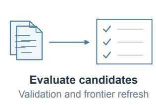

## (a) Evaluate adaptation on a task stream

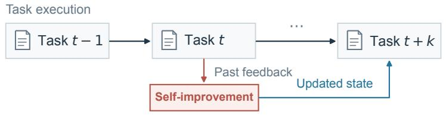

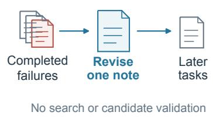

## (b) Account for computational function

## 1 Verify

## 2 Explore

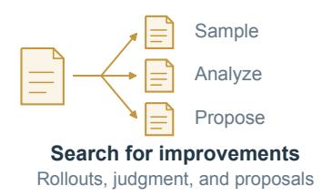

## 3 Write

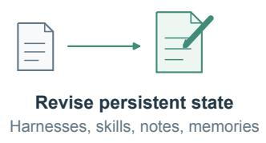

## (c) Mean accuracy (%)

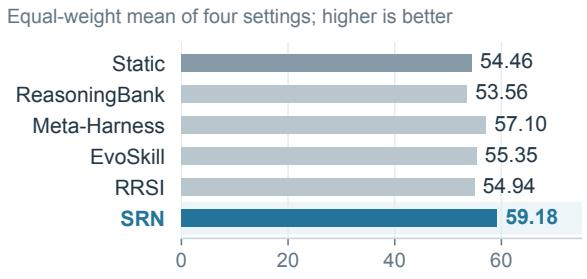

## (d) Total tokens (M)

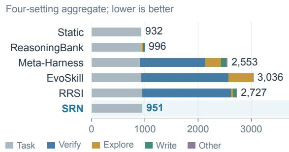  
Figure 1: Streaming evaluation and the RSI Tax. (a) Updates use completed-task feedback; SRN maintains a bounded note. (b) The RSI Tax is broken down into verification, exploration, and writing costs. (c) Accuracy averaged equally over the four settings. (d) Input-plus-output tokens summed over those settings, including task execution, the three RSI Tax components, and the Other residual. These sums describe token volume across the runs; within-setting comparisons are reported in Section 5.1.

To explain these diferences, we decompose the RSI Tax into verification, exploration, and writing. For these three RSI methods, verification accounts for 74.8–93.6% of the RSI Tax after aggregation over the four settings. We also track whether the associated state or artifact is used by later tasks. Among the evaluated RSI methods other than SRN, 23.7–63.6% of the RSI Tax is associated with states or artifacts that are not used later in the observed stream.

Our results expose a gap between recursively improving an agent and making the improvement process cost-efective. Our decomposition shows that repeated verification can consume more tokens than task execution itself, while substantial update costs are associated with artifacts that are not used later. HarnessPro and RRSI already account for execution cost in harness selection [12, 13]. Their selection objectives do not, however, jointly optimize the cost of obtaining updates and the expected cost of serving a continuing task stream. Our findings therefore motivate policies that choose when to update, how much to spend on proposals and validation, and which artifacts to retain according to their expected contribution to future task performance and token use. The goal is to sustain growth in agent capabilities as tasks arrive while jointly optimizing the RSI Tax and expected task-execution cost.

To summarize, our contributions are:

1. A streaming cost–performance evaluation. We compare six methods on common task streams and assess accuracy against end-to-end token cost, including the RSI Tax.

2. A simple adaptive baseline. SRN provides a counterexample to the need for costly update procedures to attain the performance observed in these experiments.

3. A decomposition of the RSI Tax. We separate verification, exploration, and writing costs, and link them to subsequent use of the associated state or artifact.

## 2 Evaluation Setup

## 2.1 RSI Methods and Evaluation Protocols

We study RSI that updates an agent’s persistent state while keeping its backbone model fixed. One category of RSI updates the memories or skills available to the agent during task execution. ReasoningBank extracts strategies from completed trajectories and retrieves them for later tasks [8]; Dynamic Cheatsheet maintains an evolving note [9]. EvoSkill searches over reusable skill folders [10], while SkillOpt applies bounded edits to skill documents [20].

Another category modifies the harness that controls prompting, tool use, and task execution. GEPA optimizes instructions using execution feedback [21], and Meta-Harness searches over controller code [11]. RRSI regularizes harness changes to discourage benchmark-specific edits [12]; HarnessPro considers execution cost as well as performance when selecting a harness [13].

Evaluation procedures difer in when feedback becomes available and where performance is measured. ReasoningBank updates memory between successive tasks, whereas EvoSkill and RRSI optimize skills or harnesses on a fixed task collection before evaluating the selected state on held-out tasks or other benchmarks [8, 10, 12]. EvoTest evaluates adaptation across repeated episodes of the same game [22], whereas TTHE adapts to an unlabeled current batch before scoring performance on that batch [23]. ServeLearnBench separates serving and held-out test tasks within each window and includes learning calls in its resource accounting [24].

## 2.2 Task Streams and Metrics

We record a task’s outcome before using its feedback to update the agent. Let $x _ { 1 } , \ldots , x _ { T }$ be the ordered tasks, θ the fixed model parameters, and $s _ { t }$ the state used for task t. Execution produces a trajectory and a binary verification outcome:

$$
\tau _ { t } \sim \pi _ { \theta } ( \cdot \mid x _ { t } , s _ { t } ) , \qquad y _ { t } = V ( x _ { t } , \tau _ { t } ) \in \{ 0 , 1 \} .\tag{1}
$$

Updates use completed-task history $\mathcal { H } _ { t } = \{ ( x _ { i } , \tau _ { i } , y _ { i } ) : i \le t \}$ , restricted by the state boundaries and support windows. They may read public instructions, visible trajectories, and scalar outcomes, but not future tasks, reference solutions, or hidden test contents. Tokens spent re-executing completed tasks are charged to the RSI Tax; these runs do not replace the tasks’ original outcomes.

Repository tasks come from seven selected 15-task chains in SWE-Chain-Evo, totaling 105 positions [25]. Learned state persists within each chain and resets between chains; each task starts from its prescribed repository snapshot. Terminal-Bench 2.1 supplies 89 heterogeneous tasks in a fixed order, with learned state retained throughout [26]. Ordering these independent tasks allows cross-task reuse but does not introduce environmental drift.

For a prefix of length t, we define

$$
Q ( t ) = \sum _ { i = 1 } ^ { t } y _ { i } , \qquad A ( t ) = { \frac { Q ( t ) } { t } } , \qquad N ( t ) = N _ { \mathrm { t a s k } } ( t ) + N _ { \mathrm { R S I } } ( t ) .\tag{2}
$$

$N ( t )$ includes the tokens used for task execution and the RSI Tax incurred through that position. We report final accuracy $A ( T )$ and total tokens $N ( T )$ ; Section 3 specifies the token accounting. Sequential reuse of experience overlaps with continual learning. Our objective is the accuracy and cost of serving the arriving tasks, while concurrent work on self-evolving agents evaluates retention across task families [27].

## 2.3 Experimental Settings

We compare Static, ReasoningBank, EvoSkill, Meta-Harness, RRSI, and SRN (Section 4) using DeepSeek V4.1 Flash [28] and GPT-6 Luna [29]. This gives $6 \times 2 \times ( 1 0 5 + 8 9 ) = 2 { , } 3 2 8$ scored method–task pairs. Within each model–benchmark setting, the methods share the task order, initial KIRA agent, and nominal execution limits.

SRN, Meta-Harness, and EvoSkill update every four completed tasks and hold the selected state fixed within each window. Parallel tasks in a window do not receive one another’s feedback. Their support sets contain the two most recent tasks on DeepSeek/SWE and four tasks in the other settings. ReasoningBank retains per-task retrieval and memory updates, without its separate memory-aware testtime scaling component.

The original EvoSkill procedure is adapted to changing support sets by re-scoring its existing frontier. Our Meta-Harness selector requires a strict accuracy improvement to change the deployment. We also retain the methods’ feedback choices: SRN selects failures using oficial scalar outcomes, while ReasoningBank uses its internal trajectory judge. Model parameters and implementation details are in Appendix A.

## 3 The RSI Tax

## 3.1 Cost Accounting

For a recorded model call c, let $n ( c )$ be its input-plus-output usage. Task-execution calls $\mathcal { C } _ { \mathrm { t a s k } }$ and self-improvement calls $\mathcal { C } _ { \mathrm { R S I } }$ are disjoint. The absolute RSI Tax and its rate are

$$
\begin{array} { r l r } { N _ { \mathrm { t a s k } } = \displaystyle \sum _ { c \in \mathcal { C } _ { \mathrm { t a s k } } } n ( c ) , } & { \ N _ { \mathrm { R S I } } = \displaystyle \sum _ { c \in \mathcal { C } _ { \mathrm { R S I } } } n ( c ) , } \\ { \rho _ { \mathrm { R S I } } = \displaystyle \frac { N _ { \mathrm { R S I } } } { N _ { \mathrm { t a s k } } } , } & { \ N _ { \mathrm { t o t a l } } = N _ { \mathrm { t a s k } } + N _ { \mathrm { R S I } } . } \end{array}\tag{3}
$$

The tax includes the tokens spent producing or evaluating an update, regardless of whether that update is adopted. Reading learned state during task execution belongs to $N _ { \mathrm { t a s k } }$ . Embedding tokens are included in the RSI Tax under Explore. The RSI Tax accounts for $\rho _ { \mathrm { R S I } } / ( 1 + \rho _ { \mathrm { R S I } } )$ of total token usage; at a Tax rate of 100%, it equals task-execution cost. We compare token costs within each model setting.

Relative to a reference method b, the net token premium is

$$
\Delta N _ { m , b } = N _ { \mathrm { t o t a l } , m } - N _ { \mathrm { t o t a l } , b } .\tag{4}
$$

We compare this premium with task accuracy. We next break down the RSI Tax by operation and by subsequent use of the associated state or artifact.

## 3.2 Decomposing RSI Tax

We report verification, exploration, and writing separately, while retaining the reported Other residual (Table 1).

Verify. Verification evaluates an incumbent or candidate on completed support tasks to inform selection. It includes baseline validation, candidate smoke tests and further validation, and re-evaluation of an existing skill frontier. Verification performed during the original task execution remains in $N _ { \mathrm { t a s k } }$

Explore. Exploration gathers or analyzes experience used to propose an update. It includes extra task rollouts, proposal generation without artifact edits, trajectory judgment, and ReasoningBank’s embedding calls.

Write. Writing creates or revises persistent state, including harness code, skills, notes, and memories. For Meta-Harness, trajectory analysis and candidate search are charged to Explore, and candidate-code edits to Write. EvoSkill likewise separates skill proposals from materialization. SRN combines note analysis and revision in one operation, which is charged entirely to Write. Each cost item is counted once.

## 3.3 Use in Subsequent Tasks

We classify costs within the RSI Tax by whether the associated state or artifact is used in a subsequent task before the next reset or the end of the stream. Use includes running an updated harness, using a skill during execution, or adding a revised note or retrieved memory to the agent’s task context. Verification and exploration costs follow their recorded association with a state or artifact; attribution is not limited to the final writing call. The labels record subsequent use, not a measured efect on task behavior or accuracy.

Table 1: RSI operations in the three cost categories. Token totals also retain a separate Other residual, reported in Appendix C.2.
<table><tr><td>Method</td><td>Verify</td><td>Explore</td><td>Write</td></tr><tr><td>ReasoningBank</td><td></td><td>Trajectory judgment; embeddings</td><td>Memory extraction</td></tr><tr><td>Meta-Harness</td><td>Incumbent and candidate validation</td><td>Trajectory analysis; candidate search</td><td>Candidate harness editing</td></tr><tr><td>EvoSkill</td><td>Initial, new-skill, and frontier validation</td><td>Extra rollouts; skill proposals</td><td>Skill materialization</td></tr><tr><td>RRSI</td><td>Incumbent and candidate validation</td><td>Trajectory analysis and summarization</td><td>Candidate harness generation and revision</td></tr><tr><td>SRN</td><td></td><td></td><td>Joint note analysis and revision</td></tr></table>

Let $p ( c ) \in \{ V , E , W , O \}$ identify the cost category of RSI call c (verification, exploration, writing, or Other), and $d ( c ) \in \{ 1 , 0 \}$ the use status of its associated state or artifact. Then

$$
N _ { p , d } = \sum _ { c \in \mathcal { C } _ { \mathrm { R S I } } } n ( c ) { \bf 1 } \{ p ( c ) = p , ~ d ( c ) = d \} , \qquad N _ { \mathrm { t o t a l } } = N _ { \mathrm { t a s k } } + \sum _ { p \in \{ V , E , W , O \} } \sum _ { d \in \{ 0 , 1 \} } N _ { p , d } .\tag{5}
$$

The share of the RSI Tax associated with unused state or artifacts is

$$
r _ { \mathrm { n o - u s e } } = \frac { \sum _ { p } N _ { p , 0 } } { N _ { \mathrm { R S I } } } .\tag{6}
$$

This is a share of tokens, not a fraction of updates or artifacts. Section 5.2 reports costs by category and use status $N _ { p , d }$ , with category totals $\begin{array} { r } { N _ { p } = \sum _ { d } N _ { p , d } } \end{array}$ and use-status totals $\begin{array} { r } { N _ { d } = \sum _ { p } N _ { p , d } } \end{array}$ . Appendix B.3 describes aggregation and precision, and Appendix D provides supplementary event diagnostics.

## 4 Simple Reflection with Notes (SRN)

SRN is a bounded-note baseline based on cumulative-note adaptation [9]. At each four-task update, SRN uses scalar verifier outcomes to select failed tasks for note revision; it includes the current note in later task contexts. The note is limited to 2,048 tokens.

At an update boundary, let m be the current note and ${ \mathcal { W } } _ { t }$ the permitted recent window. The update is

$$
\begin{array} { r l } & { \mathcal { F } _ { t } = \{ ( x _ { i } , \tau _ { i } , y _ { i } ) \in \mathcal { W } _ { t } : y _ { i } = 0 \} , } \\ & { m ^ { + } = \left\{ \begin{array} { l l } { m , } & { \mathcal { F } _ { t } = \emptyset , } \\ { \mathrm { L i m i t } _ { 2 0 4 8 } \big ( G _ { \theta } ( m , \mathrm { E x c e r p t } ( \mathcal { F } _ { t } ) ) \big ) , } & { \mathrm { o t h e r w i s e } . } \end{array} \right. } \end{array}\tag{7}
$$

The generator receives the previous note, public instructions, fixed trajectory excerpts, and scalar outcomes. A valid nonempty revision is adopted directly; an invalid response leaves the note unchanged. Appendix A.4 gives the prompt and excerpt limits.

SRN performs no extra task sampling, candidate validation, or retrieval search. Its total cost includes note construction and the complete execution cost of solving tasks with the note. It provides a low-cost adaptive comparison, although the experiment does not isolate the efect of each design choice.

## 5 Experiments

We compare accuracy and total token cost, then break down the RSI Tax by operation and subsequent use. Accounting details are given in Appendix B.1.

## 5.1 Accuracy and End-to-End Cost

Table 2 and Figure 2 compare the six methods. SRN has the highest observed accuracy in three settings and ties EvoSkill in the fourth, while using fewer total tokens than Meta-Harness, EvoSkill, and RRSI in every setting. ReasoningBank incurs a smaller RSI Tax than these three methods but does not consistently improve accuracy over Static.

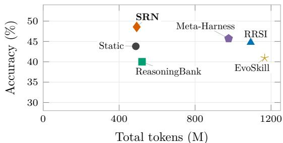  
(a) DeepSeek V4.1 Flash / SWE-Chain-Evo

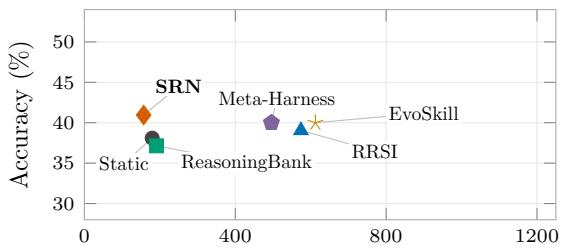  
Total tokens (M)  
(b) GPT-6 Luna / SWE-Chain-Evo

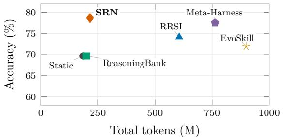  
(c) DeepSeek V4.1 Flash / Terminal-Bench 2.1

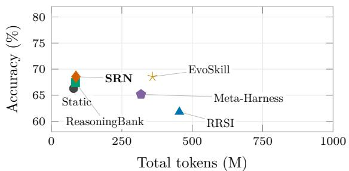  
(d) GPT-6 Luna / Terminal-Bench 2.1  
Figure 2: Accuracy and total token cost on the four task streams. Each point summarizes one method; total cost combines task-execution cost and the RSI Tax. Higher accuracy and lower cost are preferable. Axes are shared within each benchmark, and lines connect labels to points.

Table 2: Accuracy and total token cost. Accuracy is in percent; Total is in millions of input-plus-output tokens and includes both task-execution cost and the RSI Tax. DeepSeek denotes DeepSeek V4.1 Flash. Bold marks the highest accuracy and lowest total cost in each setting, including ties. Detailed subtotals and accounting conventions are in Appendices C.1 and B.1.

<table><tr><td></td><td colspan="4">SWE-Chain-Evo (105 positions)</td><td colspan="4">Terminal-Bench 2.1 (89 tasks)</td></tr><tr><td></td><td colspan="2">DeepSeek</td><td colspan="2">GPT-6 Luna</td><td colspan="2">DeepSeek</td><td colspan="2">GPT-6 Luna</td></tr><tr><td>Method</td><td>Acc.</td><td>Total</td><td>Acc.</td><td>Total</td><td>Acc.</td><td>Total</td><td>Acc.</td><td>Total</td></tr><tr><td>Static</td><td>43.8</td><td>487.92</td><td>38.1</td><td>179.69</td><td>69.7</td><td>185.55</td><td>66.3</td><td>78.86</td></tr><tr><td>ReasoningBank</td><td>40.0</td><td>520.64</td><td>37.1</td><td>191.21</td><td>69.7</td><td>198.87</td><td>67.4</td><td>85.46</td></tr><tr><td>Meta-Harness</td><td>45.7</td><td>976.61</td><td>40.0</td><td>495.81</td><td>77.5</td><td>762.57</td><td>65.2</td><td>317.99</td></tr><tr><td>EvoSkill</td><td>41.0</td><td>1,166.51</td><td>40.0</td><td>612.39</td><td>71.9</td><td>898.72</td><td>68.5</td><td>358.85</td></tr><tr><td>RRSI</td><td>44.8</td><td>1,092.94</td><td>39.0</td><td>574.07</td><td>74.2</td><td>605.75</td><td>61.8</td><td>454.30</td></tr><tr><td>SRN</td><td>48.6</td><td>492.56</td><td>41.0</td><td>157.07</td><td>78.7</td><td>214.65</td><td>68.5</td><td>87.08</td></tr></table>

Relative to Static, SRN gains 4.7 percentage points in mean accuracy with a 3.6% mean increase in total tokens. The mean token reductions relative to Meta-Harness, EvoSkill, and RRSI are 65.6%, 71.0%, and 68.2%, respectively. These summaries weight the four settings equally: accuracy gains are averaged diferences, while token changes are computed as within-setting ratios before averaging. SRN’s update calls account for less than 0.4% of its total tokens; task execution, including use of the note, accounts for the rest.

The relation between accuracy and total token cost varies across settings. On the DeepSeek terminal stream, Static uses the fewest tokens (185.55M), while SRN uses 15.7% more and gains 9.0 percentage points in observed accuracy. On the GPT-6 Luna repository stream, SRN uses 156.67M task-execution tokens compared with Static’s 179.69M, a diference that more than ofsets its 0.40M update cost. Its total is 12.6% lower than Static’s and its accuracy is 2.9 points higher.

Execution cost and total cost. Omitting the RSI Tax can reverse the cost comparison. On the DeepSeek terminal stream, Meta-Harness uses fewer task-execution tokens than SRN (184.13M versus

214.37M). Its 578.45M RSI Tax, however, raises the total to 762.57M, compared with SRN’s 214.65M, while its observed accuracy is slightly lower (77.5% versus 78.7%). These task totals cover all deployed states used during the stream, rather than a separate evaluation of the final checkpoint.

## 5.2 Cost Breakdown and Subsequent Use

The RSI Tax exceeds task-execution cost for Meta-Harness, EvoSkill, and RRSI in all four settings (Table 3). For SRN, the tax rate remains below 0.4%.

Table 3: RSI Tax rate, $1 0 0 N _ { \mathrm { R S I } } / N _ { \mathrm { t a s k } }$ (%). A value of 100 means that the RSI Tax equals task-execution cost. Static has rate zero. RRSI rates are the reported summary values; the other rates are computed from unrounded token totals. DeepSeek denotes DeepSeek V4.1 Flash. See Appendix B.3 for the aggregation details.
<table><tr><td></td><td colspan="2">SWE-Chain-Evo</td><td colspan="2">Terminal-Bench 2.1</td></tr><tr><td>Method</td><td>DeepSeek</td><td>GPT-6 Luna</td><td>DeepSeek</td><td>GPT-6 Luna</td></tr><tr><td>ReasoningBank</td><td>4.78</td><td>5.96</td><td>4.53</td><td>7.39</td></tr><tr><td>Meta-Harness</td><td>109.06</td><td>177.35</td><td>314.16</td><td>329.15</td></tr><tr><td>EvoSkill</td><td>144.35</td><td>213.21</td><td>393.10</td><td>358.57</td></tr><tr><td>RRSI</td><td>125.79</td><td>213.02</td><td>223.23</td><td>346.68</td></tr><tr><td>SRN</td><td>0.04</td><td>0.25</td><td>0.13</td><td>0.36</td></tr></table>

Figure 3 breaks down total token cost and links the RSI Tax to subsequent use of the associated state or artifact.

Sources of the RSI Tax. Verification accounts for 74.8% of Meta-Harness’s RSI Tax, 78.1% of EvoSkill’s, and 93.6% of RRSI’s after aggregation over the four settings. EvoSkill also spends 455.29M tokens on additional rollouts and proposals, compared with 4.59M on skill materialization. ReasoningBank divides its cost almost equally between exploration (judgment and embeddings) and memory writing. SRN spends 1.21M tokens on its joint note-analysis and revision operation. Full component totals are given in Appendix C.2.

Verification repeatedly runs the agent on support tasks, often evaluating several candidate or retained programs per update. On the DeepSeek terminal stream, EvoSkill spends 497.45M tokens refreshing its old frontier, compared with 182.26M on the 89 arriving tasks. Re-evaluating existing programs alone therefore costs more than serving the task stream, before accounting for extra rollouts or new-skill validation. Recorded input accounts for approximately 98.1% of the RSI Tax in both Meta-Harness and EvoSkill.

Costs associated with subsequent use. Under the attribution in Section 3.3, 52.78% of Meta-Harness’s RSI Tax, 37.91% of EvoSkill’s, 63.57% of ReasoningBank’s, and 23.70% of RRSI’s are associated with states or artifacts that are not used in later tasks. All reported SRN update cost is associated with notes supplied to subsequent executions. These percentages describe token expenditure, not the frequency of successful updates or an efect on accuracy. Appendix C gives the component totals and Appendix D examines individual update traces.

The same lack of subsequent use can involve diferent operations. Meta-Harness assigns 564.85M verification tokens, 217.60M exploration tokens, and 69.22M writing tokens to candidates not used later. For ReasoningBank, the corresponding costs are 15.51M for judgment and embeddings and 15.63M for memory extraction. The breakdown identifies diferent sources of RSI Tax in these two methods; their overall shares of costs without subsequent use do not reveal this composition.

(b) RSI costs by impact on subsequent tasks Function colors match (a); solid = with impact, hatched = no impact  
(a) End-to-end token costs  
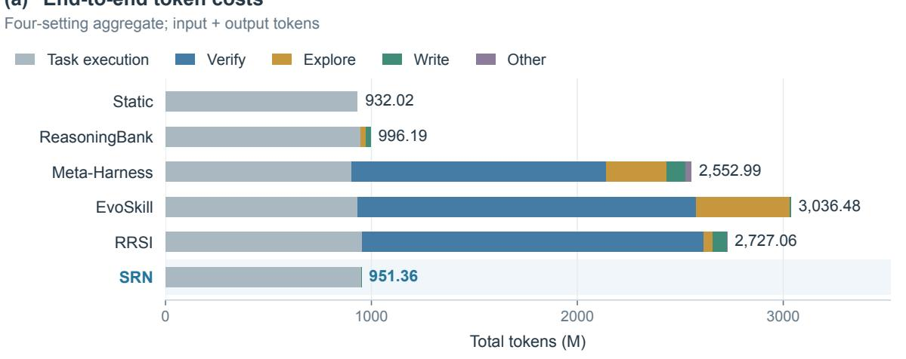

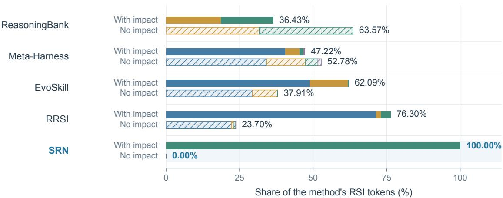  
Figure 3: Token cost breakdown and subsequent use. (a) Input-plus-output tokens summed over the four settings, split into task execution, verification, exploration, writing, and Other. (b) RSI Tax associated with states or artifacts used in later tasks (solid) or not used within the observation period (hatched). Both rows are normalized by the method’s total RSI Tax. Static incurs no RSI Tax. These pooled token volumes are descriptive; the mean cost comparisons in Section 5.1 use within-setting ratios.

## 6 Discussion

The results show that the RSI Tax can exceed the cost of executing the task stream. We discuss how this changes the design of update policies, where costs might be reduced, and what the current evidence can establish.

Choosing an update policy. An RSI update policy should pursue continued gains in agent capabilities as tasks arrive while controlling the RSI Tax. Its eficiency objective should include the immediate update cost, expected task-execution cost, and the cost of subsequent RSI updates over the remaining tasks. Such a policy could retain the current state, update memory or skills, or generate and evaluate harness changes. Repeated reuse may justify a larger initial investment [18]. Our experiments compare fixed procedures and realized costs; they do not evaluate a policy that forecasts these costs and selects updates.

Reducing the RSI Tax. When verification dominates the RSI Tax, reducing the cost of candidate evaluation becomes a priority. Support-task selection and frontier maintenance are therefore natural targets for reducing update cost. Adaptive validation-task selection already provides one approach [17]. The subsequent-use analysis also motivates more selective construction of skills and memories. Whether these changes reduce total tokens while preserving task performance requires controlled evaluation. Reducing update cost complements the execution-cost objectives used in cost-aware harness selection [12, 13].

Limitations. The evaluation covers two backbone models, seven repository chains, and one ordering of a terminal benchmark. Other models, workloads, orderings, and repeated runs are needed to assess the stability of the observed comparisons. The cost attribution is descriptive: use in a later task does not establish an accuracy benefit, and the absence of such use does not establish that the associated calls can be removed without changing later updates or task outcomes. Controlled interventions are needed to measure the efects of reducing each cost component.

## 7 Conclusion

We evaluate the end-to-end token cost and task performance of mainstream RSI methods on task streams, using SRN as a simple adaptive baseline. We introduce the RSI Tax to quantify the token cost of the self-improvement process during deployment. On the studied streams, SRN shows that competitive task accuracy need not require a large RSI Tax. Decomposing the RSI Tax into verification, exploration, and writing costs shows that repeated verification can consume more tokens than executing the task stream itself. A substantial share of the RSI Tax is also associated with states or artifacts that are not used in subsequent tasks. These findings motivate RSI agents that jointly optimize the RSI Tax incurred by trial-and-error self-improvement and expected task-execution cost while ensuring continued growth in agent capabilities across the task stream.

## References

[1] Anthropic. Claude 3.7 Sonnet and Claude Code. Oficial product announcement, 2025. URL https://www.anthropic.com/news/claude-3-7-sonnet.

[2] OpenAI. Introducing Codex. Oficial product announcement, 2025. URL https://openai.com/index/introducing-codex/.

[3] Mike A. Merrill, Alexander G. Shaw, Nicholas Carlini, Boxuan Li, Harsh Raj, Ivan Bercovich, Lin Shi, Jeong Yeon Shin, Thomas Walshe, E. Kelly Buchanan, Junhong Shen, Guanghao Ye, Haowei Lin, Jason Poulos, Maoyu Wang, Marianna Nezhurina, Jenia Jitsev, Di Lu, Orfeas Menis Mastromichalakis, Zhiwei Xu, Zizhao Chen, Yue Liu, Robert Zhang, Leon Liangyu Chen, Anurag Kashyap, Jan-Lucas Uslu, Jefrey Li, Jianbo Wu, Minghao Yan, Song Bian, Vedang Sharma, Ke Sun, Steven Dillmann, Akshay Anand, Andrew Lanpouthakoun, Bardia Koopah, Changran Hu, Etash Guha, Gabriel H. S. Dreiman, Jiacheng Zhu, Karl Krauth, Li Zhong, Niklas Muennighof, Robert Amanfu, Shangyin Tan, Shreyas Pimpalgaonkar, Tushar Aggarwal, Xiangning Lin, Xin Lan, Xuandong Zhao, Yiqing Liang, Yuanli Wang, Zilong Wang, Changzhi Zhou, David Heineman, Hange Liu, Harsh Trivedi, John Yang, Junhong Lin, Manish Shetty, Michael Yang, Nabil Omi, Negin Raoof, Shanda Li, Terry Yue Zhuo, Wuwei Lin, Yiwei Dai, Yuxin Wang, Wenhao Chai, Shang Zhou, Dariush Wahdany, Ziyu She, Jiaming Hu, Zhikang Dong, Yuxuan Zhu, Sasha Cui, Ahson Saiyed, Arinbjörn Kolbeinsson, Jesse Hu, Christopher Michael Rytting, Ryan Marten, Yixin Wang, Alex Dimakis, Andy Konwinski, and Ludwig Schmidt. Terminal-Bench: Benchmarking Agents on Hard, Realistic Tasks in Command Line Interfaces. arXiv:2601.11868, 2026.

[4] Bertie Vidgen, Austin Mann, Abby Fennelly, John Wright Stanly, Lucas Rothman, Marco Burstein, Julien Benchek, David Ostrofsky, Anirudh Ravichandran, Debnil Sur, Neel Venugopal, Alannah Hsia, Isaac Robinson, Calix Huang, Olivia Varones, Daniyal Khan, Michael Haines, Austin Bridges, Jesse Boyle, Koby Twist, Zach Richards, Chirag Mahapatra, Brendan Foody, and Osvald Nitski. APEX-Agents. arXiv:2601.14242, 2026.

[5] Haoyu Zhao, Sitian Tu, Yuxuan Huang, Huichi Zhou, Zhangyue Yin, Jiahao Huang, Jingyuan Xu, Tianmiao Shi, Jin Shi, Nianxi Zhang, Yangmiao Zhang, Zhuolang Chan, Huiyan Hu, Chenchao Sheng, Yaqing Luo, Yue Chen, Huaxiu Yao, Meng Fang, and Jun Wang. Continual Learning Exam: Benchmarking Long-Horizon RSI and Experiential Learning in LLM Agents. arXiv:2610.33956v1, 2026.

[6] Sihang Jiang, Lipeng Ma, Zhonghua Hong, Keyi Wang, Zhiyu Lu, Tengfei Wang, Shisong Chen, Jinghao Zhang, Tianjun Pan, Weijia Li, Jiaqing Liang, and Yanghua Xiao. SEA-Eval: A Benchmark for Evaluating Self-Evolving Agents Beyond Episodic Assessment. arXiv:2604.08988v3, 2026.

[7] Tianyi Guan, Yiding Wang, Haotong Yang, Siyuan Cao, Shirui Liu, Yi Hu, Jiaqi Li, and Muhan Zhang. ContinualSkillBench: Can LLM Agents Truly Evolve Their Capabilities? arXiv:2608.03874v3, 2026.

[8] Siru Ouyang, Jun Yan, I-Hung Hsu, Yanfei Chen, Ke Jiang, Zifeng Wang, Rujun Han, Long T. Le, Samira Daruki, Xiangru Tang, Vishy Tirumalashetty, George Lee, Mahsan Rofouei, Hangfei Lin, Jiawei Han, Chen-Yu Lee, and Tomas Pfister. ReasoningBank: Scaling Agent Self-Evolving with Reasoning Memory. In ICLR, 2026.

[9] Mirac Suzgun, Mert Yuksekgonul, Federico Bianchi, Dan Jurafsky, and James Zou. Dynamic Cheatsheet: Test-Time Learning with Adaptive Memory. In EACL, 2026.

[10] Salaheddin Alzubi, Noah Provenzano, Jaydon Bingham, Weiyuan Chen, and Tu Vu. EvoSkill: Automated Skill Discovery for Multi-Agent Systems. arXiv:2603.02766, 2026.

[11] Yoonho Lee, Roshen Nair, Qizheng Zhang, Kangwook Lee, Omar Khattab, and Chelsea Finn. Meta-Harness: End-to-End Optimization of Model Harnesses. arXiv:2603.28052, 2026.

[12] Peng Xia, Rujun Han, Zifeng Wang, Yanfei Chen, Yufan Zhuang, Yoonho Lee, Chengsong Huang, Han Yu, Zhongying CuiZhu, Yifei Ming, Huaxiu Yao, Burak Gokturk, Tomas Pfister, and Chen-Yu Lee. RRSI: Regularized Recursive Self-Improvement of Agent Harnesses. arXiv:2609.24972v3, 2026.

[13] Zhuoshi Pan, ZhiYuan Feng, Yukuo Cen, Honglin Lin, Junru Lu, Zhongxia Chen, Shuo Yang, H. Vicky Zhao, and Jie Tang. HarnessPro: Recursive Harness Self-Improvement with Pareto Optimization for Performance-Cost Trade-ofs. arXiv:2610.26770v2, 2026.

[14] Sina Hajimiri, Masih Aminbeidokhti, Jose Dolz, Ismail Ben Ayed, Issam H. Laradji, Spandana Gella, and Nicolas Gontier. Are Online Skill and Memory Modules Always Worth Their Tokens? A Budget-Constrained Study of Web Agents. In EMNLP, 2026.

[15] Yike Wang, Huaisheng Zhu, Zhengyu Hu, Yige Yuan, Zhengyu Chen, Shakti Senthil, Hannaneh Hajishirzi, Yulia Tsvetkov, Noah A. Smith, Pradeep Dasigi, and Teng Xiao. Rethinking the Evaluation of Harness Evolution for Agents. arXiv:2607.12227v4, 2026.

[16] Harman Singh, Anton Bakhtin, Rulin Shao, Gabriel Synnaeve, Ilia Kulikov, Rob Fergus, Sanjeev Arora, Kurt Keutzer, Jason Weston, Anuj Mahajan, and Anirudh Goyal. Agent Plasticity: Measuring Self-Improvement Through Experience. arXiv:2610.08902, 2026.

[17] Atsuyuki Miyai, Kiyoharu Aizawa, and Toshihiko Yamasaki. Task-CoEvolve: Eficient Harness Optimization via Adaptive Validation Task Selection. arXiv:2608.20169, 2026.

[18] Jingzhi Gong, Ruizhen Gu, Zhiwei Fei, Yazhuo Cao, Lukas Twist, Alina Geiger, Shuo Han, Dominik Sobania, Federica Sarro, and Jie M. Zhang. SkillMOO: Multi-objective Optimization of Agent Skills for Software Engineering. In ASE, 2026.

[19] Longju Bai, Zhemin Huang, Xingyao Wang, Jiao Sun, Rada Mihalcea, Erik Brynjolfsson, Alex Pentland, and Jiaxin Pei. How Do AI Agents Spend Your Money? Analyzing and Predicting Token Consumption in Agentic Coding Tasks. arXiv:2604.22750v3, 2026.

[20] Yifan Yang, Ziyang Gong, Weiquan Huang, Qihao Yang, Ziwei Zhou, Zisu Huang, Yan Li, Xuemei Gao, Qi Dai, Bei Liu, Kai Qiu, Yuqing Yang, Dongdong Chen, Xue Yang, and Chong Luo. SkillOpt: Executive Strategy for Self-Evolving Agent Skills. arXiv:2605.23904, 2026.

[21] Lakshya A Agrawal, Shangyin Tan, Dilara Soylu, Noah Ziems, Rishi Khare, Krista Opsahl-Ong, Arnav Singhvi, Herumb Shandilya, Michael J Ryan, Meng Jiang, Christopher Potts, Koushik Sen, Alexandros G. Dimakis, Ion Stoica, Dan Klein, Matei Zaharia, and Omar Khattab. GEPA: Reflective Prompt Evolution Can Outperform Reinforcement Learning. In ICLR, 2026.

[22] Yufei He, Juncheng Liu, Yue Liu, Yibo Li, Tri Cao, Zhiyuan Hu, Xinxing Xu, and Bryan Hooi. EvoTest: Evolutionary Test-Time Learning for Self-Improving Agentic Systems. In ICLR, 2026.

[23] Jun Nie, Yonggang Zhang, Jun Song, Qianshu Cai, Dahai Yu, Yike Guo, Xinmei Tian, and Bo Han. TTHE: Test-Time Harness Evolution. arXiv:2607.08124, 2026.

[24] Haizhong Zheng, Yizhuo Di, Ranajoy Sadhukhan, Shuowei Jin, and Beidi Chen. ServeLearnBench: How Well Can Agents Self-Improve from Serving Experience? arXiv:2610.07792v1, 2026.

[25] Jundong Xu, Qingchuan Li, Jiaying Wu, Yihuai Lan, Shuyue Stella Li, Huichi Zhou, Bowen Jiang, Lei Wang, Jun Wang, Anh Tuan Luu, Caiming Xiong, Hae Won Park, Bryan Hooi, and Zhiyuan Hu. EvoArena: Tracking Memory Evolution for Robust LLM Agents in Dynamic Environments. arXiv:2606.13681v2, 2026.

[26] The Terminal-Bench Team. Terminal-Bench 2.1. Terminal-Bench release notes, n.d. URL https://www.tbench.ai/news/terminal-bench-2-1.

[27] Xiaoyin Chen, Yizheng Huang, Yinglun Xu, Ziyun Zhao, Emmett McQuinn, Julie Liu, and Hope Yao. Are Self-Evolving Agents Continual Learners? arXiv:2610.25858v1, 2026.

[28] DeepSeek. DeepSeek-V4.1-Flash: Smarter, Faster, More Eficient. DeepSeek model release, 2026. URL https://api-docs.deepseek.com/news/news260910/.

[29] OpenAI. GPT-6 Luna. OpenAI API documentation, n.d. URL https://developers.openai.com/api/docs/models/gpt-6-luna.

[30] Dastin Huang, Baran Nama, and Salaheddin Alzubi. EvoSkill v2: Fully Agentic Skill Evolution from Benchmark Adaptation to a Stateful Evolver. arXiv:2610.25931, 2026.

[31] Sarel Weinberger and Amir Hozez. Token Reduction Is Not Cost Reduction. arXiv:2607.12161v5, 2026.

## A Experimental Protocol

## A.1 Streams, State Boundaries, and Model Parameters

The reported SWE-Chain-Evo subset uses Click, CoreDNS, NATS, Fiber, Loki, Istio, and Prometheus, each with 15 ordered task positions. These 105 positions are a selected subset of EvoArena, whose full SWE-Chain-Evo benchmark contains 50 chains and 493 chain-step instances [25]. Notes, memories, skills, and harness state reset at chain boundaries. Each task starts from its benchmark-prescribed repository snapshot; earlier agent patches are not transplanted into later tasks. The current repository and public history remain available to all methods, including Static. The terminal evaluation uses all 89 Terminal Bench 2.1 tasks in one fixed order with task-specific environments and persistent learned state across the stream.

The recorded router identifiers are deepseek/deepseek-v4.1-flash and openai/gpt-6-luna. Ofi cial model documentation is provided by DeepSeek [28], OpenAI [29]. The recorded harness configuration specifies high reasoning efort for both models, a nominal 262,144-token context limit, a nominal 65,536- token per-call output limit, and at most 100 agent turns, without a cumulative per-task token cap. These are harness-imposed limits, not the maximum capacities advertised by the providers. DeepSeek uses temperature 1 and top-p 0.95; the reported GPT-6 Luna configuration omits both sampling parameters. Model-specific tokenization means that nominal limits do not imply identical efective capacity. SWE solving and verification limits are 7,200 and 600 seconds; terminal tasks use their oficial task-specific limits.

## A.2 Periodic Updates and Support Sets

SRN, Meta-Harness, and EvoSkill have an update opportunity after every four completed tasks, with no final partial-window update. There are three opportunities per repository chain and 22 per terminal stream. Periodic methods freeze the selected state within each four-task window; parallel execution does not expose another task’s feedback inside that window. ReasoningBank retains its per-task memory workflow.

The DeepSeek V4.1 Flash repository experiments use the most recent two tasks as update support; the other three settings use the most recent four. Thus, the four-task update interval is shared, while support size difers between those settings. Comparisons are made within each setting before macro averaging; support size is held fixed within a setting. Re-evaluating support tasks supplies scalar feedback for future updates, not replacements for their earlier formal outcomes.

## A.3 Method Configurations

Static retains the initial KIRA execution policy and no learned cross-task state. The reported Meta-Harness configuration permits one native search iteration per update, with smoke evaluation and supportset validation. Its deployment adapter requires a strict improvement in mean validation accuracy and retains the incumbent on a tie. Subsequent tasks run under the selected harness. This rule is narrower than the population-based search described by the original method [11]; the saturated-selector case concerns this evaluated deployment rule.

RRSI’s update procedure includes an analyst and trajectory digesters, a proposer, a critic, and validation. The analyst and digesters examine past trajectories and summarize failure modes and reusable behavior; the proposer constructs candidate harness edits. The critic separately screens candidate changes before validation [12].

The reported EvoSkill configuration uses the upstream proposal, skill materialization, and programselection operators with one native iteration, a frontier size of three, and one sampling category containing two samples. Existing frontier members are re-scored on the current support set as the window moves. The original algorithm uses a fixed validation set and evaluates new candidates [10]. The rolling refresh is part of our streaming implementation and its full recorded cost is charged. The original proposer may inspect ground-truth answers; our information boundary permits only public instructions, visible traces, and scalar feedback from completed tasks. The selected skill catalog is made available to the agent through the existing skill-discovery interface. These runs use the original EvoSkill procedure; EvoSkill v2 instead adopts each epoch’s skill revision without validation-based rejection [30].

ReasoningBank preserves trajectory judgment, memory extraction, and retrieval of the highest-ranked episode bundle. A bundle can contain multiple memory items; retrieving it adds those items to the agent’s task context. ReasoningBank’s trajectory judge is distinct from the task verifier used to calculate accuracy. Embedding uses gemini-embedding-001; embedding tokens are included in the RSI Tax. This evaluates the memory workflow without adding a separate inference-scaling treatment.

## A.4 Note Baseline and Prompt

SRN maintains a note of at most 2,048 tokens and uses the same backbone for note updates and task execution. The generator receives the previous note, public instructions, scalar outcomes, and excerpts from failed trajectories. Each excerpt contains the first 20,000 and last 10,000 characters, or the full trajectory when shorter. A valid, nonempty response replaces the note; an invalid response leaves it unchanged. Oversized notes are truncated by the configured tokenizer. Each update uses one logical generation, and all retry calls remain in the token count.

The terminal note prompt is reproduced below; the repository prompt uses the same constraints in the repository-chain setting.

Maintain a short experience note for a terminal agent learning across a chronological sequence of independent tasks. Use only the supplied previous note, public task instructions, visible execution traces, and scalar verifier rewards.

Return only the replacement note in plain Markdown. Keep the final note within 2048 tokens. Keep useful earlier lessons, remove outdated or unsupported claims, and add reusable lessons supported by the current evidence. Prefer concrete environment inspection, tool-use, debugging, implementation, and verification advice. Distinguish observed facts from hypotheses. Do not infer hidden tests or reference solutions, invent command results, or include instructions to access future tasks. Do not solve the next task, request tools, or repeat a full task-specific patch. Experience is guidance; future tasks may change the relevant assumptions.

Trace excerpts use a fixed head/tail view and may omit intermediate steps. A scalar reward of zero does not establish a specific root cause. Avoid drawing strong causal lessons without supporting visible evidence. An empty useful update may retain the previous note. Output a note, without surrounding explanation.

## B Accounting and Interpretation

## B.1 Token and Outcome Accounting

The task-execution total includes context management and reading retained state. The RSI Tax includes tokens spent on memory construction, embeddings, proposal sessions, extra sampling, and candidate and incumbent validation. Request identities prevent double-counting across logs. Input and output tokens are included; cached input remains in the count, and reasoning tokens already included in provider output are not added a second time. The per-setting stage sums reconcile with the corresponding RSI totals in Table 4, subject to display rounding. These totals measure token use rather than monetary cost, which also depends on the pricing of input, output, and cached tokens [31].

Accuracy summarizes task outcomes under the streaming protocol in Section 2.2. Tokens spent on support-set validation are charged to the RSI Tax; validation scores do not replace the earlier task outcomes.

## B.2 Cross-Setting Summaries

Let $A _ { m , g }$ denote fractional accuracy and $N _ { m , g }$ total tokens for method m in setting g. For comparison method $b ,$ we report

$$
\Delta A _ { b } = \frac { 1 0 0 } { 4 } \sum _ { g = 1 } ^ { 4 } ( A _ { \mathrm { S R N } , g } - A _ { b , g } ) , \qquad S _ { b } = \frac { 1 0 0 } { 4 } \sum _ { g = 1 } ^ { 4 } \left( 1 - \frac { N _ { \mathrm { S R N } , g } } { N _ { b , g } } \right) .\tag{8}
$$

The unrounded records give $\Delta A _ { \mathrm { S t a t i c } } ~ = ~ 4 . 7 1 4$ percentage points, $S _ { \mathrm { S t a t i c } } ~ = ~ - 3 . 6 1 6 \% , ~ S _ { \mathrm { M e t a - H a r n e s s } }$ = 65.588%, $S _ { \mathrm { E v o S k i l l } } = 7 0 . 9 9 4 \%$ , and $S _ { \mathrm { R R S I } } = 6 8 . 2 4 2 \%$ . The mean accuracy diference relative to RRSI is 4.238 percentage points. Each model–benchmark setting receives equal weight. Token ratios are formed within settings before averaging.

## B.3 Cost Categories and Subsequent Use

We report verification, exploration, and writing costs alongside the Other residual from the source records, and separately track whether the associated state or artifact is used in later tasks. Figure 3(b) reports the resulting breakdown, with every segment normalized by the method’s complete RSI Tax.

The accounting is a sum over the four model–environment settings, in millions of input-plus-output tokens. Summing the available per-setting stage totals reproduces the corresponding aggregate RSI Tax, up to display rounding. This aggregate measures token volume, not a common physical-compute unit across diferent model tokenizers. Comparative ratios in the main results are computed within settings before averaging.

Cells, totals, and percentages are independently rounded, generally to two decimal places; RRSI’s Other cost is reported as 0.009M (less than 0.01% of the RSI Tax). Independently rounded cells need not sum exactly to the displayed totals. In particular, Meta-Harness’s use-status rows sum to 297.00M Explore and 91.73M Write, while the separately reported category totals are 296.99M and 91.74M. RRSI’s 0.009M Other cost belongs to the row without subsequent use. RRSI’s aggregate RSI Tax is 1,770.50M tokens: 1,350.81M with subsequent use and 419.69M without subsequent use. For methods with separately reported full-precision total and RSI counts, task tokens are computed as their diference. RRSI’s aggregate task-execution cost is approximately 956.56M tokens, computed as 2,727.06M total tokens minus the rounded 1,770.50M RSI total and subject to that rounding precision.

The operation-to-category mapping is given in Table 1. Meta-Harness’s proposal sessions total 414.969432M tokens, comprising 296.99M Explore, 91.74M Write, and 26.24M Other; these amounts sum to 414.97M at the reported precision. The per-setting stage tables below report proposal sessions as a combined category, while Table 5 gives their aggregate cost breakdown. SRN’s joint note-analysis and revision calls belong to Write.

## B.4 Linking Costs to Subsequent Execution

We attribute each cost item to the state or artifact it concerns, including items incurred during verification or exploration. For a harness, subsequent use means execution under the associated controller; for skills, notes, and memories, it means their use during task execution or inclusion in the agent’s context. Each cost item contributes once to the table; shared verification or analysis costs follow the designated candidate. Attribution follows the recorded association and subsequent use before reset or the end of the stream. A round-level comparison of the deployed state alone does not give the same classification, because a round may inspect multiple artifacts. Use is recorded separately from changes in accuracy.

## C Detailed Token Results

## C.1 Task Tokens and RSI Tax

Table 4 gives the task-execution costs and RSI Tax underlying Table 2. Static incurs no RSI Tax, shown as an em dash, and is excluded from the RSI-column minimum. RRSI’s task-execution cost and RSI Tax are reported at the aggregate level in Figure 3; the Tax components appear in Table 5.

## C.2 Aggregate Costs and Subsequent Use

Table 5(a) reports the three RSI Tax components and the Other residual; panel (b) groups these costs by subsequent use. Percentages use each method’s complete RSI Tax as the denominator. Static incurs no RSI Tax.

## C.3 RSI Tax by Implementation Stage

The following tables report token use by implementation stage for each model–benchmark setting. Values include input and output usage. The aggregate cost attribution is described in Appendix B.3; the aggregate visualization appears in Figure 3. These stage totals do not themselves determine the subsequent-use status of individual cost items.

Table 4: Task-execution cost and RSI Tax. Accuracy is in percent; token costs are in millions. Static incurs no RSI Tax and is excluded from the RSI-column minimum. Bold marks the best reported value within each setting, including ties. Display rounding can make Task plus RSI difer slightly from Total.
<table><tr><td></td><td colspan="4">DeepSeek V4.1 Flash</td><td colspan="4">GPT-6 Luna</td></tr><tr><td>Method</td><td>Acc.</td><td>Task</td><td>RSI</td><td>Total</td><td>Acc.</td><td>Task</td><td>RSI</td><td>Total</td></tr><tr><td colspan="9">SWE-Chain-Evo (105 positions)</td></tr><tr><td>Static</td><td>43.8</td><td>487.92</td><td></td><td>487.92</td><td>38.1</td><td>179.69</td><td></td><td>179.69</td></tr><tr><td>ReasoningBank</td><td>40.0</td><td>496.91</td><td>23.74</td><td>520.64</td><td>37.1</td><td>180.46</td><td>10.75</td><td>191.21</td></tr><tr><td>Meta-Harness</td><td>45.7</td><td>467.13</td><td>509.47</td><td>976.61</td><td>40.0</td><td>178.77</td><td>317.04</td><td>495.81</td></tr><tr><td>EvoSkill</td><td>41.0</td><td>477.40</td><td>689.12</td><td>1,166.51</td><td>40.0</td><td>195.52</td><td>416.87</td><td>612.39</td></tr><tr><td>RRSI</td><td>44.8</td><td>484.05</td><td>608.89</td><td>1,092.94</td><td>39.0</td><td>183.40</td><td>390.68</td><td>574.07</td></tr><tr><td>SRN</td><td>48.6</td><td>492.34</td><td>0.22</td><td>492.56</td><td>41.0</td><td>156.67</td><td>0.40</td><td>157.07</td></tr><tr><td colspan="9">Terminal-Bench 2.1 (89 tasks)</td></tr><tr><td>Static</td><td>69.7</td><td>185.55</td><td></td><td>185.55</td><td>66.3</td><td>78.86</td><td></td><td>78.86</td></tr><tr><td>ReasoningBank</td><td>69.7</td><td>190.26</td><td>8.61</td><td>198.87</td><td>67.4</td><td>79.58</td><td>5.88</td><td>85.46</td></tr><tr><td>Meta-Harness</td><td>77.5</td><td>184.13</td><td>578.45</td><td>762.57</td><td>65.2</td><td>74.10</td><td>243.89</td><td>317.99</td></tr><tr><td>EvoSkill</td><td>71.9</td><td>182.26</td><td>716.46</td><td>898.72</td><td>68.5</td><td>78.25</td><td>280.60</td><td>358.85</td></tr><tr><td>RRSI</td><td>74.2</td><td>187.40</td><td>418.34</td><td>605.75</td><td>61.8</td><td>101.71</td><td>352.59</td><td>454.30</td></tr><tr><td>SRN</td><td>78.7</td><td>214.37</td><td>0.28</td><td>214.65</td><td>68.5</td><td>86.77</td><td>0.31</td><td>87.08</td></tr></table>

(a) RSI costs by function: tokens (M) and share of RSI cost
<table><tr><td>Method</td><td>RSI total</td><td>Verify</td><td>Explore</td><td>Write</td><td>Other</td></tr><tr><td>Static</td><td>0.00</td><td></td><td></td><td></td><td></td></tr><tr><td rowspan="2">ReasoningBank</td><td rowspan="2">48.98</td><td>0</td><td>24.61 (50.25%)</td><td>24.37 (49.75%)</td><td>0</td></tr><tr><td>1,233.89</td><td>296.99</td><td>91.74</td><td>26.24</td></tr><tr><td rowspan="2">Meta-Harness</td><td rowspan="2">1,648.86</td><td>(74.83%)</td><td>(18.01%)</td><td>(5.56%)</td><td>(1.59%)</td></tr><tr><td>1,643.17</td><td>455.29</td><td>4.59</td><td></td></tr><tr><td>EvoSkill</td><td>2,103.05</td><td>(78.13%) 1,656.86</td><td>(21.65%) 45.22</td><td>(0.22%) 68.41</td><td>0 0.009</td></tr><tr><td>RRSI</td><td>1,770.50</td><td>(93.58%)</td><td>(2.55%)</td><td>(3.86%) 1.21</td><td>(&lt; 0.01%)</td></tr><tr><td>SRN</td><td>1.21</td><td>0</td><td>0</td><td>(100%)</td><td>0</td></tr></table>

(b) RSI costs by function and downstream impact (M)
<table><tr><td>Method</td><td>Impact</td><td>Verify</td><td>Explore</td><td>Write</td><td>Other</td><td>Share (%)</td></tr><tr><td rowspan="2">ReasoningBank</td><td>With impact</td><td>0.00</td><td>9.10</td><td>8.74</td><td>0.00</td><td>36.43</td></tr><tr><td>No impact</td><td>0.00</td><td>15.51</td><td>15.63</td><td>0.00</td><td>63.57</td></tr><tr><td>Meta-Harness</td><td>With impact No impact</td><td>669.03 564.85</td><td>79.40 217.60</td><td>22.51 69.22</td><td>7.57 18.67</td><td>47.22 52.78</td></tr><tr><td>EvoSkill</td><td>With impact No impact</td><td>1,025.71 617.46</td><td>276.29 179.01</td><td>3.75 0.84</td><td>0.00 0.00</td><td>62.09 37.91</td></tr><tr><td>RRSI</td><td>With impact</td><td>1,264.13</td><td>28.79</td><td>57.88</td><td>0.00</td><td>76.30</td></tr><tr><td rowspan="2">SRN</td><td>No impact</td><td>392.73</td><td>16.43</td><td>10.53</td><td>0.009</td><td>23.70</td></tr><tr><td>With impact</td><td>0.00</td><td>0.00</td><td>1.21</td><td>0.00</td><td>100.00</td></tr><tr><td></td><td>No impact</td><td>0.00</td><td>0.00</td><td>0.00</td><td>0.00</td><td>0.00</td></tr></table>

Table 5: Aggregate RSI costs by function and downstream impact. Both panels sum over the four model– environment settings. Panel (a) reports function totals, with Other as a separate residual. Panel (b) reports costs by function and impact; impact means integration into subsequent task execution. Row shares use each method’s complete RSI cost, not the subtotal for an individual function. Cells, function totals, and shares are independently rounded; Static’s function shares and impact status are undefined because its RSI cost is zero.

Table 6: Meta-Harness: RSI Tax by stage (millions of tokens). DeepSeek denotes DeepSeek V4.1 Flash.
<table><tr><td></td><td colspan="2">SWE-Chain-Evo</td><td colspan="2">Terminal-Bench 2.1</td></tr><tr><td>Phase</td><td>DeepSeek</td><td>GPT-6 Luna</td><td>DeepSeek</td><td>GPT-6 Luna</td></tr><tr><td>Proposal session</td><td>109.997932</td><td>62.540720</td><td>155.750468</td><td>86.680312</td></tr><tr><td>Incumbent validation</td><td>193.403359</td><td>139.638809</td><td>211.104585</td><td>70.721386</td></tr><tr><td>Candidate smoke</td><td>95.848101</td><td>27.941626</td><td>38.117662</td><td>11.285732</td></tr><tr><td>Further candidate validation</td><td>110.224752</td><td>86.921894</td><td>173.474330</td><td>75.207386</td></tr><tr><td>Total</td><td>509.474144</td><td>317.043049</td><td>578.447045</td><td>243.894816</td></tr></table>

Table 7: EvoSkill: RSI Tax by stage (millions of tokens). DeepSeek denotes DeepSeek V4.1 Flash.
<table><tr><td></td><td colspan="2">SWE-Chain-Evo</td><td colspan="2">Terminal-Bench 2.1</td></tr><tr><td>Phase</td><td>DeepSeek</td><td>GPT-6 Luna</td><td>DeepSeek</td><td>GPT-6 Luna</td></tr><tr><td>Initial baseline validation</td><td>55.390798</td><td>38.509148</td><td>7.343709</td><td>1.632162</td></tr><tr><td>Extra rollouts</td><td>200.396353</td><td>71.161754</td><td>112.474010</td><td>35.706044</td></tr><tr><td>Skill proposal</td><td>20.072240</td><td>6.416161</td><td>6.122136</td><td>2.946065</td></tr><tr><td>Skill materialization</td><td>1.361587</td><td>1.229830</td><td>1.092549</td><td>0.901379</td></tr><tr><td>New-skill validation</td><td>141.891026</td><td>120.816937</td><td>91.976435</td><td>43.580524</td></tr><tr><td>Old-frontier refresh</td><td>270.004290</td><td>178.735837</td><td>497.454675</td><td>195.831597</td></tr><tr><td>Total</td><td>689.116294</td><td>416.869667</td><td>716.463514</td><td>280.597771</td></tr></table>

Table 8: ReasoningBank: RSI Tax by stage (millions of tokens). DeepSeek denotes DeepSeek V4.1 Flash.
<table><tr><td></td><td colspan="2">SWE-Chain-Evo</td><td colspan="2">Terminal-Bench 2.1</td></tr><tr><td>Phase</td><td>DeepSeek</td><td>GPT-6 Luna</td><td>DeepSeek</td><td>GPT-6 Luna</td></tr><tr><td>Trajectory judgment</td><td>11.578243</td><td>5.354226</td><td>4.659062</td><td>2.892283</td></tr><tr><td>Memory extraction</td><td>12.142389</td><td>5.378519</td><td>3.904759</td><td>2.943139</td></tr><tr><td>Embeddings (combined)</td><td>0.015485</td><td>0.015418</td><td>0.048303</td><td>0.048426</td></tr><tr><td>Total</td><td>23.736117</td><td>10.748163</td><td>8.612124</td><td>5.883848</td></tr></table>

Notes and embedding details. SRN’s joint analysis-and-revision stage costs 215,633, 398,194, 284,637, and 311,598 tokens for DeepSeek/SWE, GPT-6 Luna/SWE, DeepSeek/terminal, and GPT-6 Luna/terminal, respectively. For ReasoningBank, the cache-key and retrieval-query embedding subtotals are 6,265 and 9,220 on SWE-Chain-Evo with DeepSeek V4.1 Flash, and 6,198 and 9,220 with GPT-6 Luna. Terminal subtotals are 22,611 and 25,692 for DeepSeek V4.1 Flash, and 22,734 and 25,692 for GPT-6 Luna.

Input and output. Across all settings, recorded input accounts for approximately 98.1% of the RSI Tax for both Meta-Harness and EvoSkill. These totals are consistent with repeated processing of growing execution contexts, but input dominance alone does not identify redundancy. Exact input/output attribution requires per-call usage; matching character sequences can establish repeated inclusion of trajectory text, but cannot determine token allocation within a prompt.

## D Illustrative Update Traces

The following diagnostics examine proposal generation, acceptance decisions, and memory retrieval in individual update traces. They use diferent observation units and do not form an additive partition of the RSI Tax. Observing one of these events does not establish that removing its calls would preserve later performance.

## D.1 Event Criteria

Table 9 summarizes the criteria.

Table 9: Supplementary event criteria for individual update traces. These diagnostics concern proposal generation, acceptance decisions, and retrieval.
<table><tr><td>Pattern</td><td>Failure criterion</td><td>Unit and observation point</td></tr><tr><td>Proposal-free search</td><td>A search round consumes tokens but emits no proposal.</td><td>Search round; after it ends.</td></tr><tr><td>Decision-invariant evaluation</td><td>All possible validation results lead to the same acceptance decision.</td><td>Candidate-evaluation calls; condition known before evaluation.</td></tr><tr><td>Unretrieved memory</td><td>A stored bundle has later task opportunities but is never retrieved before reset.</td><td>Bundle construction; retrieval observed through the remaining stream.</td></tr></table>

## D.1.1 Proposal-Free Search

For a method that runs candidate search, let $C _ { u }$ be the recorded cost of round $u ,$ and let $q _ { u }$ count new proposals emitted by its proposer. A round is proposal-free when $C _ { u } \ > \ 0$ and $q _ { u } = 0$ . A proposal is counted before materialization or validation, including one that later fails to build. Re-scoring an existing candidate does not create a new proposal.

This pattern concerns failure to produce a proposed update, not the absence of every possible benefit from search. A method may still select a previously evaluated candidate when $q _ { u } = 0$ , so deployment changes must be recorded separately.

## D.1.2 Decision-Invariant Evaluation

Fix the proposal, the acceptance rule, and all information available before candidate evaluation. Let $A _ { u , c } ( v ) \in \{ 0 , 1 \}$ be the decision to accept candidate c at update u if validation returns v. Let $\mathcal { V } _ { u , c }$ contain the validation outcomes not ruled out by that pre-evaluation information. Evaluation is decision invariant when

$$
A _ { u , c } ( v ) = A _ { u , c } ( v ^ { \prime } ) \quad \mathrm { f o r ~ a l l ~ } v , v ^ { \prime } \in \mathcal { V } _ { u , c } .\tag{9}
$$

Thus, no possible result can change acceptance; an observed rejection alone does not establish this condition. The recorded example is the always-reject case: the incumbent scores 1, accuracy is bounded by 1, and only a strict improvement on the same support set is accepted. A rule that also rewards lower execution cost could still accept a candidate at equal accuracy; it would require a diferent analysis.

The charged unit is candidate evaluation after this condition becomes known. Incumbent evaluation used to establish the score, and analysis or proposal generation in the same round, are not automatically part of the diagnostic. Section D.2.2 applies this test to the strict selector used in our Meta-Harness implementation.

## D.1.3 Unretrieved Memory

For a retrieval-based memory bank, let $b _ { a }$ be the judgment and extraction cost of stored bundle a, $h _ { a }$ its remaining eligible task opportunities, and $r _ { a }$ its retrieval count before the next reset. Construction is classified as unretrieved when $h _ { a } > 0$ and $r _ { a } = 0$ , with total cost

$$
N _ { \mathrm { u n r e t r i e v e d } } = \sum _ { a : h _ { a } > 0 , r _ { a } = 0 } b _ { a } .\tag{10}
$$

The unit is a bundle, which may contain several memory items. We exclude updates that produce no bundle and construction after the final task. Embedding tokens remain in total RSI usage but are not assigned to bundle construction.

Retrieval records whether a bundle’s contents entered the agent’s task context, not whether they were useful. A bundle can remain unretrieved because later tasks do not need it; remaining task opportunities do not establish semantic relevance. The criterion identifies a construction cost that receives no retrieval during the observed horizon, rather than proving the memory incorrect or permanently useless.

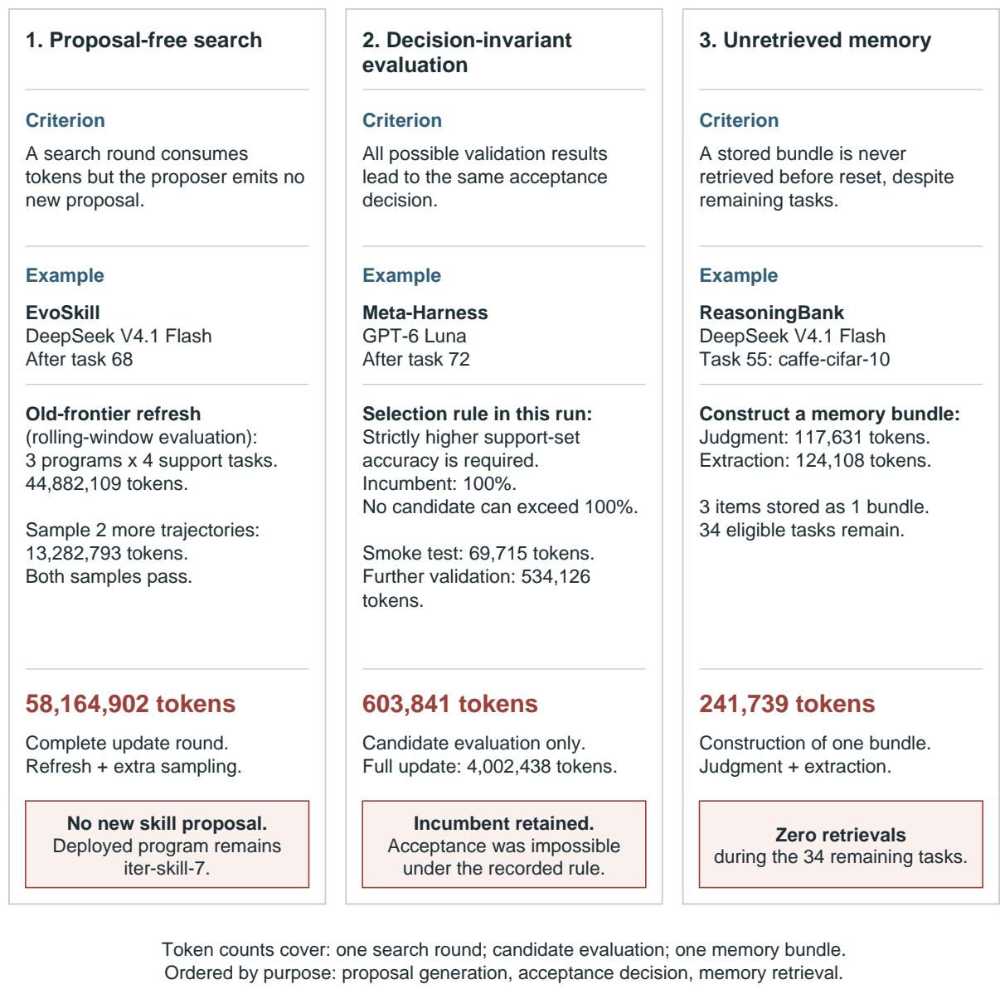

Figure 4: Illustrative update traces. Left: a search round without a proposal. Middle: candidate evaluation whose result cannot change acceptance. Right: a stored memory bundle with no later retrieval. The first two examples depend on the online implementation choices described in Section 2.3.

## D.2 Case Studies

We now apply the three criteria in their defined order (Figure 4). Proposal-free search and decisioninvariant evaluation are illustrated by individual traces; the unretrieved-memory diagnostic also has aggregate construction costs satisfying its predicate. Their prevalence should not be inferred from the stage totals above.

## D.2.1 Proposal-Free Search

After task 68 in the DeepSeek EvoSkill run, three existing programs are evaluated on four support tasks at a cost of 44,882,109 tokens. The method then spends 13,282,793 tokens on two additional trajectories. Both succeed, leaving no failed sample to trigger the proposer. The complete round costs 58,164,902 tokens, produces no new proposal, and retains iter-skill-7.

Most tokens in this round are spent re-evaluating the existing frontier before a new proposal is available. The repeated refresh comes from the rolling support window in our implementation; EvoSkill’s original algorithm uses a fixed validation set. The case motivates testing whether such maintenance can be deferred or reduced when the proposal step has no new change to ofer.

## D.2.2 Decision-Invariant Evaluation

After task 72 in the GPT-6 Luna Meta-Harness run, the incumbent scores 100% on the support set and the selector requires a strictly higher accuracy. Its acceptance function is therefore zero for every possible candidate score. Nevertheless, the new candidate receives a 69,715-token smoke test and 534,126 tokens of further validation.

The diagnostic covers the 603,841 candidate-evaluation tokens, rather than all 4,002,438 tokens in the update. Incumbent evaluation may be needed to establish the saturation condition. This example concerns our strict deployment rule; the original Meta-Harness population search does not require it. The identified calls cannot change the immediate acceptance decision, although their traces may inform later search.

## D.2.3 Unretrieved Memory

For task 55, caffe-cifar-10, in the DeepSeek ReasoningBank run, judgment and extraction cost 117,631 and 124,108 tokens. They produce one bundle of three items concerning the build and verification task. None of the 34 remaining tasks retrieves that bundle. The bundle therefore contributes 241,739 construction tokens to $N _ { \mathrm { u n r e t r i e v e d } }$ in Equation 10.

This narrower unretrieved-bundle diagnostic excludes several costs that the main accounting can classify as having no subsequent use. Applying its predicate to all available memory records gives 53.1%– 61.5% of ReasoningBank RSI tokens. On terminal tasks, the corresponding construction costs are 5.16M of 8.61M RSI tokens for DeepSeek and 3.62M of 5.88M for GPT-6 Luna. The numerator excludes embeddings, updates without a stored bundle, and construction without a later task opportunity; the denominator includes all RSI tokens. These are cost shares, not fractions of memory items.