# The Unused Input: The Initial State as a Conditioning Interface for Recurrent TSFMs

Bernhard Voggenberger1,2,\*, Christian Ganhör1, Levente Zólyomi1,2, Sebastian Böck1, Sepp Hochreiter1,2

1NXAI GmbH, Linz, Austria 2Institute for Machine Learning, Johannes Kepler University, Linz, Austria

Accepted at the NeurIPS 2026 Workshop on Foundation Models for Temporal Systems (FMTS).

Corresponding author: Sebastian Böck (sebastian.boeck@nx-ai.com) \*Work done during an internship at NXAI GmbH.

## Abstract

Time series foundation models (TSFMs) forecast unseen series without task-specific training. Increasingly they are built on recurrent backbones, whose constant per-step cost makes long-context inference cheap, and which, unlike transformers, carry a state. A recurrent backbone computes its prediction from two inputs: the observed context window and the initial recurrent state. In practice only the first is utilised and the initial state is unused by convention. We ask whether the initial state can be utilised in recurrent TSFMs. Using the xLSTM-based zero-shot forecaster TiRex as a case study, we freeze the backbone and train only a small head that writes a context vector into the initial state, so that any change in accuracy is attributable to the injected state rather than to adapted weights. A spectral summary of the input window, learned once and applied unchanged to every series, lowers mean GiftEval MASE by 0.175%, with every seed improving, which neither a parameter-matched LoRA adapter nor a learnable static state reproduces. An embedding of text attached to each series, evaluated on six MoTime datasets, reveals two roles for the state. As a per-dataset adaptation surface, a static state lowers MASE by 0.04–6.96% of the zero-shot baseline (8–70% of the gain of full fine-tuning). As a channel for exogenous information, the text-conditioned state lowers it by a further 0.15–0.41% of the zero-shot baseline on four of six datasets and, combined with a LoRA adapter, exceeds full fine-tuning, which has no access to the text, on one of them. In TiRex, the effect concentrates in the mLSTM blocks and is strongest at short context. The results are preliminary and the improvements small, but they point to the initial state as a direction for further research.

## 1 Introduction

Time series foundation models, pretrained once and applied across many forecasting tasks without further training, have become a standard tool for zero-shot forecasting (Das et al., 2024; Ansari et al., 2024; Woo et al., 2024; Cohen et al., 2024). Many are built on recurrent architectures, like TiRex (Auer et al., 2025a; Podest et al., 2026) on xLSTM (Beck et al., 2024), TSMamba (Ma et al., 2024) and Mamba4Cast (Bhethanabhotla et al., 2024) on Mamba, and others on gated DeltaNet (Hartl et al., 2026). A recurrent forecaster produces its forecast as a function of two inputs: the context window it observes, and the initial state it starts from. In practice only the first is used; the initial state is set to a fixed default that holds no information about the series being forecast. We investigate this unused initial state, taking TiRex as a case study.

Prompt and prefix tuning adapt a frozen model by optimising a sequence of trained vectors that its inputs attend to, leaving its weights unchanged (Lester et al., 2021; Li and Liang, 2021); recent work shows that similar conditioning mechanisms extend to time series forecasters (Ahamed et al., 2026; Wang et al., 2025). Initialising the state of classical RNNs is known to be beneficial, both for forecasting and systems-modelling tasks (Mohajerin and Waslander, 2017, 2019), and for conditioning on context more broadly (Wenke and Fleming, 2019), and the Temporal Fusion Transformer initialises its LSTM from static covariates (Lim et al., 2021). In NLP, Kang et al. (2025) extend this idea to modern state space models, adapting them by directly tuning states rather than prepending prompts, and Galim et al. (2025) show that, for state space models, tuning the initial state of a frozen model is at least as expressive as prefix tuning. To our knowledge, we are the first to study the initial state of a frozen, pretrained recurrent time series foundation model as a conditioning interface, and to characterise how the injected state behaves.

Our contributions are: (1) using TiRex, we show the recurrent initial state is a usable conditioning interface that can improve a frozen time series foundation model; (2) we condition on a spectral summary of the input window and on a CLIP-aligned (Radford et al., 2021) embedding of exogenous text, comparing each against a parameter-matched LoRA adapter (Hu et al., 2022) and an expressivity-matched static state; and (3) we characterise the behaviour of the injected state, whose influence in TiRex is strongest at short context and diminishes as data accumulates, and localises to the matrix memory of its underlying xLSTM (the mLSTM blocks).

## 2 State conditioning

Backbone and interface. The backbone follows the TiRex architecture and pretraining data mixture (Auer et al., 2025a), and is built on xLSTM. It interleaves two block types: sLSTM blocks with a scalar state and mLSTM blocks with a matrix state. The configuration deviates from the released TiRex checkpoint in the block arrangement, so that the effect of the initial state can be measured on both a scalar and a matrix state. We maintain a 1:1 ratio of the two blocks as it has shown to be a balanced tradeoff for this architecture family (Zólyomi et al., 2026). We train with a context window of 8,192 steps, so that at patch size 32 the model performs 256 recurrent steps, enough to observe how the injected state decays over a long recurrence. At inference the model is normally run from an all-zero initial state $c _ { 0 } = 0$ . We keep the backbone frozen and train only a small state-initialisation head that writes a context vector into $c _ { 0 }$ (one shared dense projection for all sLSTM blocks, one for all mLSTM). The head is small relative to the 38.4M-parameter frozen backbone, its exact size differs by regime and is given below, and the controls are matched to its parameter budget (Appendix A1).

Spectral conditioning (window only). The first regime derives $c _ { 0 }$ from the input window alone. We summarise the window’s magnitude spectrum into a fixed 64-dimensional vector, a compact descriptor of its dominant periodicities, and write it into $c _ { 0 }$ through a small linear head (2.2M parameters, 5.7% of the backbone). The head is trained once on the same data mix used to pretrain the checkpoint, never on the evaluation series, so one spectrum-to-c0 map serves all series (Appendix A2).

Exogenous conditioning (text). The second regime draws on data outside the window. We use MoTime (Zhou et al., 2025), a multimodal suite that pairs each series with an associated text, and retain six text-based evaluation sets drawn from five sources: MovieLens (Harper and Konstan, 2015), News-FO (Wang et al., 2024), Tianchi (Tianchi, 2018), Wiki People (Yang and Huang, 2017), and two splits of PixelRec (Full and Sub) (Cheng et al., 2023). Per dataset we align the series and its text in a shared space with a CLIP-style projection: the text is embedded with Qwen3-Embedding-0.6B (Zhang et al., 2025) and the series with a pretrained TiRex feature extractor (Auer et al., 2025b). The resulting text embedding is the exogenous context vector, written into $c _ { 0 }$ by a shared linear head (1.1M parameters, 2.9% of the backbone) as in the spectral regime; the alignment projection is trained separately (0.6M) and frozen, so it is not counted in the head’s budget (Appendix A3).

Controls. The head adds parameters, so we separate the effect of content from the effect of capacity with two controls trained under identical conditions. A parameter-matched LoRA adapter carries no context vector and adapts the backbone instead; each rank is set just above the head it is matched against (rank 23, 2.23M, against the 2.20M spectral head; rank 12, 1.16M, against the 1.13M text head). An expressivity-matched static state (0.2M) replaces the content-dependent head with a per-layer learnable constant $c _ { 0 }$ that receives no input, controlling for the value of a non-zero, learnable start. We also train head and LoRA jointly, against a parameter-equivalent LoRA-only run, to test whether the two effects stack.

Training. All heads and controls are trained with the backbone frozen (details in Appendix A4); a full fine-tuning run (all weights unfrozen) is included as a reference. Every trained configuration uses six seeds and no test-time augmentation, and we report MASE. On GiftEval the spectral head is evaluated zero-shot across the benchmark (Aksu et al., 2024). On MoTime the text heads are trained per dataset on a training split and evaluated on a held-out split over fixed evaluation windows.

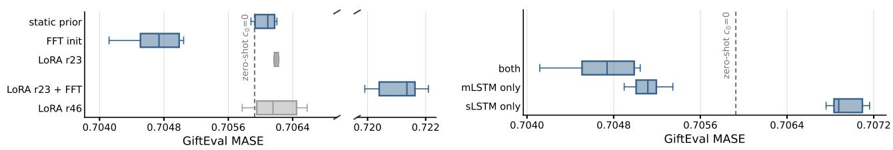  
Figure 1: GiftEval MASE, lower is better; blue uses a state initialisation, grey uses LoRA. Left: FFT init against parameter- and expressivity-matched controls. Right: FFT init into sLSTM, mLSTM, or both. Numbers in Appendices A5 and A6.

## 3 Results

GiftEval (spectral). Writing the window’s own spectrum into $c _ { 0 }$ lowers GiftEval MASE from a single-seed zero-shot baseline of 0.7059 to a six-seed mean of 0.7047, a 0.175% relative improvement, with the backbone frozen and every seed improving (Figure 1). The expressivity-matched static state (0.7061), the parametermatched LoRA-r23 adapter (0.7063), a doubled-rank LoRA-r46 (0.7062) and LoRA trained jointly with the FFT head (0.7211) all remain above the baseline. None of the controls reproduces the improvement. Ablating by block type, injecting the spectrum into only the sLSTM blocks, only the mLSTM blocks, or both, places the effect in the mLSTM: mLSTM-only injection recovers most of the gain, while sLSTM-only injection is above the baseline.

MoTime (exogenous text). We build the conditioning up from the weakest possible signal (Figure 2). The static state is a per-dataset constant: it encodes only which dataset a series belongs to, nothing about the series itself. Even this minimal signal improves the forecast on every dataset: the static state is below the zero-shot baseline on all six. On GiftEval, by contrast, a single static state derived from the pretraining corpus encodes no such distinction and does not improve on the baseline (Figure 1). So the question is not whether the state helps, but how much the associated text adds beyond dataset identity. The text-conditioned state beats the static state on four of six datasets: both splits of PixelRec, Tianchi, and Wiki People, but not MovieLens or News-FO. Of those four, a matched LoRA adapter, carrying no text at all, is stronger on two (PixelRec Full and Tianchi), so at this budget capacity alone can substitute for the text. Combining the two recovers all four: at 2.2M trainable parameters, the text-conditioned state with a LoRA adapter (1.1M each) beats a LoRA adapter of the same total size, and is the strongest parameter-efficient method on all four, though on Wiki People the margin is within seed variation. A shuffled-text control (Appendix A9) confirms the use of series-specific text on Tianchi, but not on Wiki People, whose aligned text embeddings are nearly identical across series.

Because the static state is a per-dataset adaptation, it is directly comparable to full fine-tuning, which adapts the same model to the same dataset. On that comparison the static state recovers between 8% and 70% of the fine-tuning gain, lowering MASE by 0.04% on Tianchi and by 6.96% on News-FO. The text-conditioned state is not a substitute for fine-tuning but an additional input, and it helps precisely where fine-tuning has least room: on the four datasets where it beats the static state, full fine-tuning itself improves zero-shot by only 0.39% to 1.00%. Within that margin the combined text-conditioned state and LoRA model recovers 67% to 121% of the fine-tuning gain, exceeding it on PixelRec Full.

We next measure the effect of the state alone. We give a fixed target progressively more context and forecast it with and without the text-conditioned initial state; the difference between the two is the effect of the state at that context length. Its influence is largest at short context and, after some instability at the very shortest windows, decays steadily as the window grows, both on PixelRec Full, where the text-conditioned state beats the static state, and on MovieLens, where it does not (Figure 3). We attribute this decay to two causes: the mLSTM’s forget gate gradually overwrites the injected state, and a longer window leaves the already-stronger forecast less room to improve.

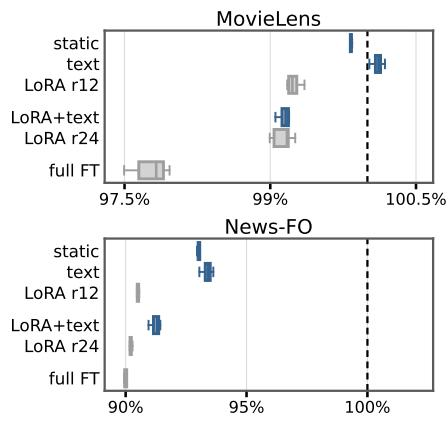

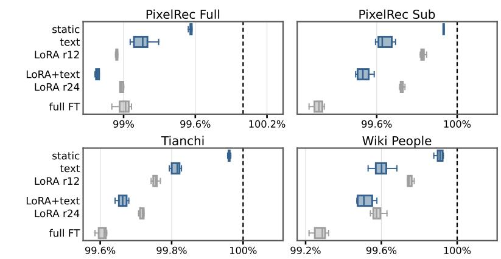  
MASE (% of zero-shot baseline)  
Figure 2: MoTime MASE as a percentage of the zero-shot baseline, lower is better; blue uses a state initialisation, grey uses LoRA or full fine-tuning. Right: the four datasets where text beats static and LoRA+text beats LoRA r24. Left: the two tasks where text does not beat controls. Per-dataset numbers in Appendix A7.

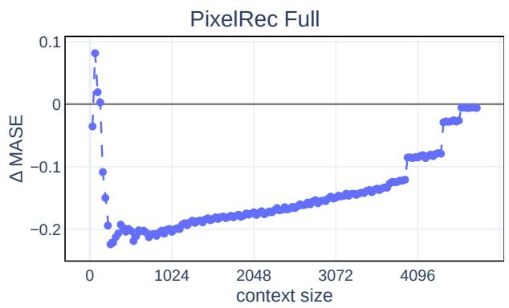

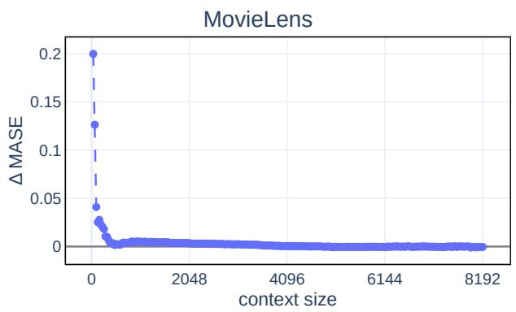  
Figure 3: Per dataset change in MASE over context length when injecting a text-conditioned initial state; negative values indicate improvement. On PixelRec Full the text-conditioned state beats the static state, on MovieLens it does not. The initial state’s influence shrinks as context accumulates. Static and text-conditioned state decay curves for all datasets in Appendix A8.

## 4 Discussion

The initial state of a frozen recurrent forecaster is a usable conditioning interface, and it plays two roles worth keeping apart. As an adaptation surface, a static per-dataset state recovers 8–70% of the gain of full fine-tuning while training a fraction of the parameters. As a channel for exogenous information, it does something finetuning cannot, since a fine-tuned backbone still cannot reach a series’ text without an architectural change to accept a new modality. Whether a better conditioning signal could close the remaining gap to full fine-tuning is open, since we tested only two.

Several scope conditions follow from how the study is set up. We treat TiRex as a case study and do not claim the numbers carry over unchanged to other recurrent forecasters, though the property we rely on, a recurrent state fixed to a default at inference, is shared across them. Whether the improvements transfer is untested. Our backbone configuration is non-default, chosen as described in Section 2 to make the block-type and decay effects measurable. We also leave a direct comparison with prompt and prefix tuning open.

Two fairly simple context vectors, a spectral summary of the window and an aligned text embedding, are already enough to move a frozen foundation model, which suggests the interface is worth future exploration. Richer context vectors, other modalities and other recurrent backbones all remain open. The initial state is an input that recurrent forecasters currently leave idle, and we hope this opens an avenue others can build on.

## Acknowledgments and Disclosure of Funding

This work was supported by the European Union’s Horizon Europe research and innovation program under grant agreement number 101214398 (ELLIOT). The ELLIS Unit Linz, the LIT AI Lab, and the Institute for Machine Learning are supported by the Federal State of Upper Austria. NXAI GmbH provided all computing resources. This work builds on the TiRex-2 codebase (Podest et al., 2026), developed by Patrick Podest, Marco Pichler, Elias Bürger, Levente Zólyomi and Wilhelm Berghammer; we are particularly grateful to Marco Pichler and Patrick Podest for their support. We thank Maximilian Beck and Günter Klambauer for their feedback, David Stap for supporting the idea of a multimodal TiRex from which this work emerged, Andreas Auer for discussing such a model, and the anonymous reviewers for their comments.

## References

Abhimanyu Das, Weihao Kong, Rajat Sen, and Yichen Zhou. A decoder-only foundation model for time-series forecasting. In Ruslan Salakhutdinov, Zico Kolter, Katherine Heller, Adrian Weller, Nuria Oliver, Jonathan Scarlett, and Felix Berkenkamp, editors, Proceedings of the 41st International Conference on Machine Learning, volume 235 of Proceedings of Machine Learning Research, pages 10148–10167. PMLR, 21–27 Jul 2024. URL https://proceedings.mlr.press/v235/das24c.html.

Abdul Fatir Ansari, Lorenzo Stella, Ali Caner Turkmen, Xiyuan Zhang, Pedro Mercado, Huibin Shen, Oleksandr Shchur, Syama Sundar Rangapuram, Sebastian Pineda Arango, Shubham Kapoor, Jasper Zschiegner, Danielle C. Maddix, Hao Wang, Michael W. Mahoney, Kari Torkkola, Andrew Gordon Wilson, Michael Bohlke-Schneider, and Bernie Wang. Chronos: Learning the language of time series. Transactions on Machine Learning Research, 2024. ISSN 2835-8856. URL https://openreview.net/forum?id=gerNCVqqtR. Expert Certification.

Gerald Woo, Chenghao Liu, Akshat Kumar, Caiming Xiong, Silvio Savarese, and Doyen Sahoo. Unified training of universal time series forecasting transformers. In Ruslan Salakhutdinov, Zico Kolter, Katherine Heller, Adrian Weller, Nuria Oliver, Jonathan Scarlett, and Felix Berkenkamp, editors, Proceedings ofthe 41st International Conference on Machine Learning, volume 235 of Proceedings ofMachine Learning Research, pages 53140–53164. PMLR, 21–27 Jul 2024. URL https://proceedings.mlr.press/v235/woo24a.html.

Ben Cohen, Emaad Khwaja, Kan Wang, Charles Masson, Elise Ramé, Youssef Doubli, and Othmane Abou-Amal. Toto: Time series optimized transformer for observability, 2024. URL https://arxiv.org/abs/2407.07874.

Andreas Auer, Patrick Podest, Daniel Klotz, Sebastian Böck, Günter Klambauer, and Sepp Hochreiter. Tirex: Zero-shot forecasting across long and short horizons with enhanced in-context learning. In D. Belgrave, C. Zhang, H. Lin, R. Pascanu, P. Koniusz, M. Ghassemi, and N. Chen, editors, Advances in Neural Information Processing Systems, volume 38, Main Conference, pages 57529–57580. Curran Associates, Inc., 2025a. doi: 10.52202/085713-1929. URL https://proceedings.neurips.cc/paper\_files/paper/2025/file/ 5356603f9c47399adfd372f77a677057-Paper-Conference.pdf.

Patrick Podest, Marco Pichler, Elias Bürger, Levente Zólyomi, Bernhard Voggenberger, Wilhelm Berghammer, Daniel Klotz, Sebastian Böck, Günter Klambauer, and Sepp Hochreiter. Tirex-2: Generalizing tirex to multivariate data and streaming, 2026. URL https://arxiv.org/abs/2607.01204.

Maximilian Beck, Korbinian Pöppel, Markus Spanring, Andreas Auer, Oleksandra Prudnikova, Michael Kopp, Günter Klambauer, Johannes Brandstetter, and Sepp Hochreiter. xlstm: Extended long short-term memory. In A. Globerson, L. Mackey, D. Belgrave, A. Fan, U. Paquet, J. Tomczak, and C. Zhang, editors, Advances in Neural Information Processing Systems, volume 37, pages 107547–107603. Curran Associates, Inc., 2024. doi: 10.52202/079017-3417. URL https://proceedings.neurips.cc/paper\_files/paper/2024/file/ c2ce2f2701c10a2b2f2ea0bfa43cfaa3-Paper-Conference.pdf.

Haoyu Ma, Yushu Chen, Wenlai Zhao, Jinzhe Yang, Yingsheng Ji, Xinghua Xu, Xiaozhu Liu, Hao Jing, Shengzhuo Liu, and Guangwen Yang. A mamba foundation model for time series forecasting, 2024. URL https://arxiv.org/abs/ 2411.02941.

Sathya Kamesh Bhethanabhotla, Omar Swelam, Julien Siems, David Salinas, and Frank Hutter. Mamba4cast: Efficien zero-shot time series forecasting with state space models. In NeurIPS Workshop on Time Series in the Age ofLarge Models, 2024. URL https://openreview.net/forum?id=YBOQ5HnzI6.

Anamaria-Roberta Hartl, Levente Zólyomi, David Stap, Pieter-Jan Hoedt, Niklas Schmidinger, Lukas Hauzenberger, Sebastian Böck, Günter Klambauer, and Sepp Hochreiter. On subquadratic architectures: From applications to principles, 2026. URL https://arxiv.org/abs/2606.12364.

Brian Lester, Rami Al-Rfou, and Noah Constant. The power of scale for parameter-efficient prompt tuning. In Marie-Francine Moens, Xuanjing Huang, Lucia Specia, and Scott Wen-tau Yih, editors, Proceedings ofthe 2021 Conference on Empirical Methods in Natural Language Processing, pages 3045–3059, Online and Punta Cana, Dominican Republic, November 2021. Association for Computational Linguistics. doi: 10.18653/v1/2021.emnlp-main.243. URL https://aclanthology.org/2021.emnlp-main.243/.

Xiang Lisa Li and Percy Liang. Prefix-tuning: Optimizing continuous prompts for generation. In Chengqing Zong, Fei Xia, Wenjie Li, and Roberto Navigli, editors, Proceedings of the 59th Annual Meeting of the Association for Computational Linguistics and the 11th International Joint Conference on Natural Language Processing (Volume 1: Long Papers), pages 4582–4597, Online, August 2021. Association for Computational Linguistics. doi: 10.18653/ v1/2021.acl-long.353. URL https://aclanthology.org/2021.acl-long.353/.

Md Atik Ahamed, Mihir Parmar, Palash Goyal, Chun-Liang Li, Qiang Cheng, Tomas Pfister, and Jinsung Yoon. Reasoningaware training for time series forecasting, 2026. URL https://arxiv.org/abs/2605.08625.

Chengsen Wang, Qi Qi, Zhongwen Rao, Lujia Pan, Jingyu Wang, and Jianxin Liao. Chronosteer: Bridging large language

model and time series foundation model via synthetic data, 2025. URL https://arxiv.org/abs/2505.10083.

Nima Mohajerin and Steven L. Waslander. State initialization for recurrent neural network modeling of time-series data. In 2017 International Joint Conference on Neural Networks (IJCNN), pages 2330–2337, 2017. doi: 10.1109/IJCNN. 2017.7966138

Nima Mohajerin and Steven L. Waslander. Multistep prediction of dynamic systems with recurrent neural networks. IEEE Transactions on Neural Networks and Learning Systems, 30(11):3370–3383, 2019. doi: 10.1109/TNNLS.2019. 2891257.

Sam Wenke and Jim Fleming. Contextual recurrent neural networks, 2019. URL https://arxiv.org/abs/1902. 03455.

Bryan Lim, Sercan Ö. Arık, Nicolas Loeff, and Tomas Pfister. Temporal fusion transformers for interpretable multi-horizon time series forecasting. International Journal ofForecasting, 37(4):1748–1764, 2021. doi: 10.1016/j.ijforecast. 2021.03.012.

Wonjun Kang, Kevin Galim, Yuchen Zeng, Minjae Lee, Hyung Il Koo, and Nam Ik Cho. State-offset tuning: State-based parameter-efficient fine-tuning for state space models. In Wanxiang Che, Joyce Nabende, Ekaterina Shutova, and Mohammad Taher Pilehvar, editors, Proceedings ofthe 63rd Annual Meeting ofthe Associationfor Computational Linguistics (Volume 2: Short Papers), pages 474–487, Vienna, Austria, July 2025. Association for Computational Linguistics. ISBN 979-8-89176-252-7. doi: 10.18653/v1/2025.acl-short.36. URL https://aclanthology. org/2025.acl-short.36/.

Kevin Galim, Wonjun Kang, Yuchen Zeng, Hyung Il Koo, and Kangwook Lee. Parameter-efficient fine-tuning of state space models. In Aarti Singh, Maryam Fazel, Daniel Hsu, Simon Lacoste-Julien, Felix Berkenkamp, Tegan Maharaj, Kiri Wagstaff, and Jerry Zhu, editors, Proceedings of the 42nd International Conference on Machine Learning, volume 267 of Proceedings of Machine Learning Research, pages 18096–18131. PMLR, 13–19 Jul 2025. URL https://proceedings.mlr.press/v267/galim25a.html.

Alec Radford, Jong Wook Kim, Chris Hallacy, Aditya Ramesh, Gabriel Goh, Sandhini Agarwal, Girish Sastry, Amanda Askell, Pamela Mishkin, Jack Clark, Gretchen Krueger, and Ilya Sutskever. Learning transferable visual models from natural language supervision. In Marina Meila and Tong Zhang, editors, Proceedings ofthe 38th International Conference on Machine Learning, volume 139 of Proceedings of Machine Learning Research, pages 8748–8763. PMLR, 18–24 Jul 2021. URL https://proceedings.mlr.press/v139/radford21a.html.

Edward J. Hu, Yelong Shen, Phillip Wallis, Zeyuan Allen-Zhu, Yuanzhi Li, Shean Wang, Lu Wang, and Weizhu Chen. Lora: Low-rank adaptation of large language models. In International Conference on Learning Representations (ICLR), 2022.

Levente Zólyomi, David Stap, Sebastian Böck, Günter Klambauer, and Sepp Hochreiter. Nonlinear RNNs as a compute shortcut for time series foundation models. In 2nd ICML Workshop on Foundation Modelsfor Structured Data, 2026. URL https://openreview.net/forum?id=tFxw63oxzV.

Xin Zhou, Weiqing Wang, Francisco J. Baldán, Wray Buntine, and Christoph Bergmeir. Motime: A dataset suite for multimodal time series forecasting, 2025. URL https://arxiv.org/abs/2505.15072.

F. Maxwell Harper and Joseph A. Konstan. The movielens datasets: History and context. ACM Trans. Interact. Intell. Syst., 5(4), December 2015. ISSN 2160-6455. doi: 10.1145/2827872. URL https://doi.org/10.1145/2827872.

Xinlei Wang, Maike Feng, Jing Qiu, Jinjin Gu, and Junhua Zhao. From news to forecast: Integrating event analysis in llm-based time series forecasting with reflection. In Neural Information Processing Systems, 2024.

Tianchi. Brand and item data from Rec-Tmall contest. Alibaba Cloud Tianchi, Public Dataset, 2018. URL https: //tianchi.aliyun.com/dataset/43. Licensed under CC-BY-SA-NC 4.0. Accessed: 2026-07-21.

Louis Yang and Chen-Hsi Huang. Web traffic forecasting with CNN and Fibonacci median. https://github. com/louis925/kaggle-web-traffic-time-series-forecasting, 2017. Kaggle competition solution (ranked 11th/1095).

Yu Cheng, Yunzhu Pan, Jiaqi Zhang, Yongxin Ni, Aixin Sun, and Fajie Yuan. An image dataset for benchmarking recommender systems with raw pixels, 2023. URL https://arxiv.org/abs/2309.06789.

Yanzhao Zhang, Mingxin Li, Dingkun Long, Xin Zhang, Huan Lin, Baosong Yang, Pengjun Xie, An Yang, Dayiheng Liu, Junyang Lin, Fei Huang, and Jingren Zhou. Qwen3 embedding: Advancing text embedding and reranking through foundation models. arXiv preprint arXiv:2506.05176, 2025.

Andreas Auer, Daniel Klotz, Sebastian Böck, and Sepp Hochreiter. Pre-trained forecasting models: Strong zero-shot feature extractors for time series classification. In Recent Advances in Time Series Foundation Models Have We Reached the ’BERT Moment’?, 2025b. URL https://openreview.net/forum?id=vhngjDHyB0.

Taha Aksu, Gerald Woo, Juncheng Liu, Xu Liu, Chenghao Liu, Silvio Savarese, Caiming Xiong, and Doyen Sahoo.

Gift-eval: A benchmark for general time series forecasting model evaluation, 2024. URL https://arxiv.org/abs/ 2410.10393.

## Appendices

Appendix A1 specifies the backbone configuration and the state-initialisation interface, including the parameter count of every head and control. Appendix A2 describes the spectral context vector, Appendix A3 the text pipeline and the separate CLIP alignment stage, and Appendix A4 the optimisation and evaluation settings shared by all runs. Appendices A7, A8, A5 and A6 give the per-dataset MoTime scores, the decay curves of the static and text-conditioned states, the GiftEval scores by method and the per-seed localisation scores. Appendix A9 reports the shuffled-text control.

## A1 Model architecture and state-initialisation interface

Backbone. Table A1 lists the backbone configuration used in every experiment. It follows the TiRex architecture with 12 xLSTM blocks in a strictly alternating arrangement, so that six blocks carry a scalar memory (sLSTM) and six a matrix memory (mLSTM), and the contribution of each block type can be ablated separately. Figure A1 shows the full data path, including the point at which the state-initialisation head writes into the recurrent state.

Table A1: Backbone configuration, read from the training runs’ own resolved configuration. The same configuration is used for every run in the paper; only the state initialiser and the set of trainable parameters change.
<table><tr><td>Setting</td><td>Value</td></tr><tr><td>Blocks</td><td>12, alternating; sLSTM at indices 1, 3, 5, 7, 9, 11</td></tr><tr><td>Embedding dimension</td><td>512</td></tr><tr><td>mLSTM heads</td><td>4; query/key dimension 256, value dimension 512</td></tr><tr><td>sLSTM heads</td><td>4; head dimension 128</td></tr><tr><td>Input and output patch size</td><td>32, stride 32</td></tr><tr><td>Maximum context</td><td>8,192 steps</td></tr><tr><td>Quantile levels</td><td>0.1 to 0.9 in steps of 0.1</td></tr><tr><td>Backbone parameters</td><td>38.4M, frozen in all state-init and LoRA runs</td></tr></table>

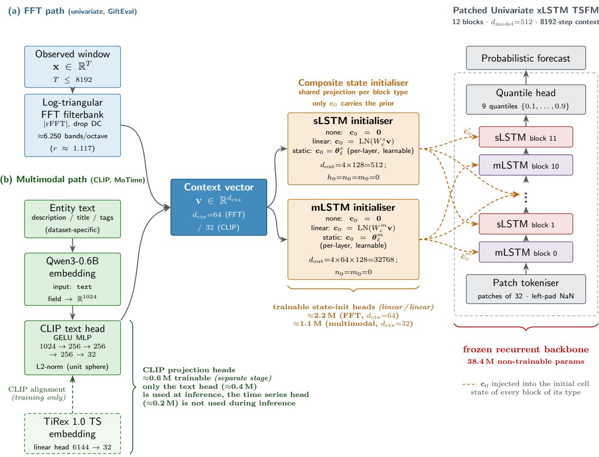  
Figure A1: Detailed architecture of the backbone and of the state-initialisation interface. The context vector is produced outside the backbone, either from the input window (spectral regime, Appendix A2) or from an aligned text embedding (exogenous regime, Appendix A3), and is written into the initial recurrent state of the xLSTM blocks.

What the head writes. Each xLSTM block is entered with a recurrent state that is normally all zero. In an mLSTM block that state comprises a matrix memory $C _ { 0 } \in \mathbb { R } ^ { 4 \times 6 4 \times 1 2 8 }$ (32,768 entries per block), a normaliser $n _ { 0 } \in \mathbb { R } ^ { 4 \times 6 4 }$ and a stabiliser $\bar { m } _ { 0 } \in \mathbb { R } ^ { 4 \times 1 }$ . In an sLSTM block it comprises a cell state $c _ { 0 } \in \mathbb { R } ^ { 4 \times 1 2 8 }$ (512 entries per block) alongside the hidden, normaliser and stabiliser slots. The head writes only the memory slot, $C _ { 0 }$ in mLSTM blocks and $c _ { 0 }$ in sLSTM blocks; every other slot is left at zero. With $c _ { 0 } = \mathbf { 0 }$ in every block the model reduces exactly to the released zero-shot forecaster.

Head parameterisation. For a context vector of dimension d, the head applies one bias-free linear map $\mathbb { R } ^ { d } \to \mathbb { R } ^ { D }$ followed by a LayerNorm over the D outputs, with $D = 5 1 2$ for sLSTM blocks and $D = 3 2 , 7 6 8$ for mLSTM blocks. One such map is shared by all six blocks of a type, so the same vector is written into every block of that type, and the parameter count is independent of the number of blocks. The static-state control replaces the map with one learnable memory per block: a parameter tensor of the same shape as that block’s memory slot, which receives no input. It is initialised at zero, so training starts from the zero-shot model, and is non-zero once trained; what it learns is a single fixed state written into every forecast, identical for every series. Table A2 gives the resulting counts.

Table A2: Trainable parameters of each state-initialisation variant, counted by instantiating the initialisers and configuring them exactly as a run does. Linear terms are d D and LayerNorm terms 2D, with D = 512 (sLSTM) and D = 32,768 (mLSTM). The static state receives no input and stores one learnable memory per block, so it scales with the block count rather than with d.
<table><tr><td>Variant</td><td>d</td><td>sLSTM part</td><td>mLSTM part</td><td>Total</td></tr><tr><td>Spectral head (GiftEval)</td><td>64</td><td>33,792</td><td>2,162,688</td><td>2,196,480</td></tr><tr><td>Text head (MoTime)</td><td>32</td><td>17,408</td><td>1,114,112</td><td>1,131,520</td></tr><tr><td>Static state</td><td>一</td><td>3,072</td><td>196,608</td><td>199,680</td></tr></table>

LoRA control. The LoRA control adds a rank-r update $\textstyle \Delta W = { \frac { \alpha } { r } } B A$ to selected linear layers inside the block stack, with $\alpha = r$ , A initialised Kaiming-uniform and B initialised to zero, so an injected model is numerically identical to the frozen one before training. Adapted layers are the five mLSTM projections (query, key, value, output gate pre-activation, output projection) in each of the six mLSTM blocks, and the three feed-forward projections (gate, up, down) in all twelve blocks. The patch embedding and the output head are excluded, following the common practice of leaving embeddings and output heads unadapted. The sLSTM cell itself is not adapted, because its gates are block-diagonal head-wise expansions and its recurrent kernel is a fused CUDA extension rather than a set of adaptable linear layers; sLSTM blocks are therefore adapted only through their feed-forward projections. On this geometry each rank adds 96,768 parameters, which gives the counts in Table A3 and lets each rank be placed just above the head it is matched against.

Table A3: LoRA parameter counts on this backbone geometry and the head each rank is matched to. The per-rank cost of 96,768 parameters is measured by injecting the adapter into the 66 target layers with the same routine the runs use.
<table><tr><td>Rank</td><td>Parameters</td><td>Matched against</td></tr><tr><td>12</td><td>1,161,216</td><td>text head, 1,131,520</td></tr><tr><td>23</td><td>2,225,664</td><td>spectral head, 2,196,480</td></tr><tr><td>24</td><td>2,322,432</td><td>LoRA r=12 plus text head, 2,292,736</td></tr><tr><td>46</td><td>4,451,328</td><td>doubled-budget control for rank 23</td></tr></table>

## A2 Spectral conditioning details

In the spectral regime the context vector is a fixed-size summary of the input window itself, so no data beyond the window is used. The same creator object produces the vector during training and during evaluation, which guarantees that the map from window to c0 is identical in both phases.

From window to context vector. The pipeline has four stages. (i) Length alignment. The window is aligned to a fixed length of 8,192 steps: longer windows are truncated to their most recent 8,192 observations, shorter windows are padded on the left with missing values. The context vector therefore has the same dimension for every series, at the cost of a padded prefix for short windows. (ii) Missing-value filling. A leading run of missing values is set to zero, an interior gap is filled by linear interpolation between its neighbours, and a trailing gap decays linearly to zero. A window with no valid observation yields an all-zero series. (iii) Spectrum. The window mean is subtracted and the magnitude of the real FFT is taken. The DC bin is dropped, leaving bins 1 to 4,096. (iv) Filterbank. The magnitude spectrum is projected onto a bank of logarithmically spaced triangular filters, one output feature per filter.

Filterbank construction. Centre bins are the rounded values of a continuous geometric sequence over bin index, $b _ { j } = \lfloor s r ^ { j } + 0 . 5 \rfloor$ with start bin $s = 1$ and ratio $r = 2 ^ { 1 / B }$ , taken for every j with $s r ^ { j }$ at most the highest available bin and clamped to that range. Rounding maps several consecutive j onto the same bin at low frequencies, and those duplicates are removed; the highest available bin is appended as the final centre if the sequence has not already reached it. Writing the surviving centres as $c _ { 1 } < c _ { 2 } < \cdots < c _ { M }$ , filter i is a triangle that rises linearly from $c _ { i - 1 }$ to $c _ { i }$ and falls linearly to $c _ { i + 1 }$ , with a weight of exactly 1 at $c _ { i } ;$ the first and last filters are the corresponding half-triangles. Filters are not area-normalised, and the resulting vector is used without further normalisation and without appended summary statistics. We set $B = 6 . 2 4 9 8 5 5 6 4 9 6 4 4 5 1$ bands per octave, that is $r = 1 . 1 1 7 2 9$ , which is the value that makes the bank contain exactly 64 filters at an 8,192-step window and so fixes the context dimension at $d = 6 4$ . The resulting centre bins are $1 , 2 , 3 , 4 , 5 , 6 , 7 ,$ 8, 9, 10, 11, 13, 14, 16, 18, 20, 22, 25, 28, 31, 35, 39, 43, 49, 54, 61, 68, 76, 84, 94, 105, 118, 132, 147, 164, 184, 205, 229, 256, 286, 320, 357, 399, 446, 498, 556, 622, 695, 776, 867, 969, 1,083, 1,210, 1,351, 1,510, 1,687, 1,885, 2,106, 2,353, 2,629, 2,937, 3,282, 3,667 and 4,096. Resolution is therefore one filter per bin at the lowest frequencies and progressively coarser towards the Nyquist bin.

Injection and ablation. The 64-dimensional vector is written into the memory slot of every block through the shared heads of Table A2, for a total of 2,196,480 trainable parameters. The localisation ablation of Appendix A6 replaces one of the two heads by an initialiser that writes nothing, so the parameters of the disabled side are absent rather than merely unused: the mLSTM-only arm trains 2,162,688 parameters and the sLSTM-only arm 33,792. The two arms are consequently not parameter-matched to each other, since the state sizes they write into differ by a factor of 64.

Controls in this regime. The static-state control writes a learned per-block constant and receives no context vector, which controls for the value of a non-zero learnable starting point. The LoRA controls receive no context vector either and adapt the backbone instead. In the joint arm the spectral head and a rank-23 adapter are trained together, against a rank-46 adapter of comparable total size.

## A3 Exogenous (text) conditioning details

In the exogenous regime the context vector is derived from text associated with each series, which the numeric window does not contain. The pipeline has three stages that are run once per dataset and then frozen: dataset construction, embedding, and CLIP alignment. Only the state-initialisation head is trained inside the forecasting run.

Dataset construction. Each MoTime source is converted into a daily-frequency dataset of univariate series with one associated text per series. Series are split at the series level into training, validation and test partitions in the ratio $8 0 / 1 0 / 1 0$ with seed 42, so the partitions share no series and the head must map texts it has not seen at evaluation time. The missing-value sentinel is mapped to missing, and series with fewer than eight non-missing observations are dropped; this affects only News-FO, where 235 of 26,612 series are removed. For Wiki People, where several traffic channels exist per entity, the all-access, all-agents channel is used. Table A4 reports the resulting sizes together with the evaluation task parameters.

Table A4: MoTime datasets after conversion, and the evaluation task per dataset. Series are split at the series level with seed 42 in the ratio $8 0 / 1 0 / 1 0$ , and series with fewer than 8 non-missing observations are dropped. All tasks use horizon 32, a minimum context of 32 observations and 9 quantile levels; windows are rolling with the given step. Evaluation is on the validation partition. News-FO has variable series lengths.
<table><tr><td>Dataset</td><td>Series length</td><td>Series kept</td><td>Train</td><td>Validation</td><td>Test</td><td>Windows</td><td>Window step</td><td>Seasonality</td></tr><tr><td>MovieLens</td><td>10,505</td><td>84,432</td><td>67,546</td><td>8,443</td><td>8,443</td><td>28</td><td>365</td><td>7</td></tr><tr><td>News-FO</td><td>variable</td><td>26,377</td><td>21,101</td><td>2,638</td><td>2,638</td><td>3</td><td>32</td><td>1</td></tr><tr><td>PixelRec Full</td><td>4,865</td><td>43,082</td><td>34,466</td><td>4,308</td><td>4,308</td><td>20</td><td>224</td><td>7</td></tr><tr><td>PixelRec Sub</td><td>1,308</td><td>998</td><td>798</td><td>100</td><td>100</td><td>20</td><td>64</td><td>7</td></tr><tr><td>Tianchi</td><td>184</td><td>36,397</td><td>29,117</td><td>3,640</td><td>3,640</td><td>4</td><td>32</td><td>7</td></tr><tr><td>Wiki People</td><td>550</td><td>918</td><td>734</td><td>92</td><td>92</td><td>16</td><td>32</td><td>7</td></tr></table>

Embedding. The text of each series is embedded once with Qwen3-Embedding-0.6B into 1,024 dimensions. The series itself is embedded once with the publicly released TiRex 1.0 model: its per-layer hidden states are mean-pooled over patches, $L ^ { 2 } .$ -normalised per layer and concatenated across layers, giving 6,144 dimensions. Both embeddings are stored with the dataset and are never recomputed.

CLIP alignment. The two embedding spaces are aligned per dataset with a CLIP-style contrastive stage. The text branch is a multi-layer perceptron with three hidden layers of width 256 and GELU activations, mapping $1 , 0 2 4 \to 2 5 6 \to 2 5 6 \to 2 5 6 \to 3 2$ . The series branch is a single linear map $6 , 1 4 4  3 2 .$ . Both outputs are $L ^ { 2 }$ -normalised, giving 598,848 trainable parameters in total (402,208 in the text branch and 196,640 in the series branch). Given a batch of paired embeddings, the loss is the symmetric InfoNCE objective: cosine similarities are divided by a temperature of 0.07 and cross entropy against the diagonal is averaged over both directions. Optimisation uses AdamW at a constant learning rate of $1 0 ^ { - 5 }$ with batch size 4,096 and seed 42; no learning-rate schedule is applied. The stage is fitted on the training partition only. Ten percent of that partition is held out as an internal validation split, and training stops when the contrastive validation loss fails to improve by at least $1 0 ^ { - 4 }$ for 100 consecutive epochs, under an epoch cap of 100,000; the parameters at the best validation loss are retained. Raw embeddings are passed through without pre-normalisation and without norm-percentile clipping. Table A5 reports the contrastive validation loss before and after this stage.

Table A5: Symmetric InfoNCE loss on the internal validation split of each dataset’s training partition, at initialisation and at the selected early-stopping point (patience 100 epochs, minimum improvement 10−4). Lower is better.
<table><tr><td>Dataset</td><td>Initial</td><td>Best</td><td>Reduction</td></tr><tr><td>MovieLens</td><td>9.3996</td><td>7.7955</td><td>17.1%</td></tr><tr><td>News-FO</td><td>8.2661</td><td>7.3685</td><td>10.9%</td></tr><tr><td>PixelRec Full</td><td>9.1939</td><td>7.8305</td><td>14.8%</td></tr><tr><td>PixelRec Sub</td><td>5.5657</td><td>4.3007</td><td>22.7%</td></tr><tr><td>Tianchi</td><td>8.9369</td><td>6.9089</td><td>22.7%</td></tr><tr><td>Wiki People</td><td>4.9982</td><td>3.8171</td><td>23.6%</td></tr></table>

Injection. The aligned 32-dimensional text projection is precomputed for every series in every partition and stored as a dataset column. During a forecasting run the collator reads that column and passes the vector to the shared heads of Table A2, for 1,131,520 trainable parameters. The alignment stage is frozen at this point, so its 598,848 parameters are not part of the trainable budget and are not counted in the comparisons against the LoRA controls. The static-state control consumes no column, and the LoRA controls consume no column and adapt the backbone instead. Both therefore have no access to the text.

## A4 Training and evaluation settings

All runs start from the same pretrained checkpoint of the configuration in Table A1 and share the optimisation settings in Table A6. What differs between arms is the set of parameters that receive gradients (Table A7), the training corpus, and the step budget.

Table A6: Optimisation settings shared by every run. The optimiser base learning rate is 0 and the schedule sets the effective rate, so $2 \times 1 0 ^ { - 4 }$ is the peak value reached after the warm-up fraction.
<table><tr><td>Setting</td><td>Value</td></tr><tr><td>Optimiser Schedule</td><td>AdamW, weight decay 0.01</td></tr><tr><td></td><td>one-cycle, peak learning rate  $2 \times 1 0 ^ { - 4 }$  , warm-up fraction 0.05, no momen- tum cycling</td></tr><tr><td>Precision Batch size</td><td>bfloat16 mixed 256, no gradient accumulation</td></tr><tr><td>Loss</td><td>quantile loss over the nine levels 0.1 to 0.9, label offset of one output patch,</td></tr><tr><td>Hardware</td><td>no per-sample impact cap one H100 per run</td></tr></table>

Table A7: Parameter groups that receive gradients in each arm. In every arm except full fine-tuning the backbone weights stay at their pretrained values.
<table><tr><td>Arm</td><td>Trainable parameters</td><td>Backbone</td></tr><tr><td>State-init head, static state</td><td>state initialiser only</td><td>frozen</td></tr><tr><td>LoRA</td><td>adapter factors only</td><td>frozen</td></tr><tr><td>LoRA and state init</td><td>adapter factors and state initialiser</td><td>frozen</td></tr><tr><td>Full fine-tuning</td><td>all parameters</td><td>updated</td></tr><tr><td>Zero-shot</td><td>none, evaluation only</td><td>frozen</td></tr></table>

Spectral runs on GiftEval. The spectral head and its controls are trained for 50,000 steps at batch size 256, which is 12.8M training samples per run. Training uses the TiRex 1.1 pretraining recipe, data mix and augmentation stack unchanged, so the head is fitted only on data the backbone has already seen. Missing values are left in place rather than imputed, each series is truncated to its most recent 8,192 observations, and the next output patch is extracted as the label. GiftEval is scored at the final step of each run. Six seeds per arm are used, 1 through 6, controlling head initialisation and data order. The spectral regime therefore comprises 30 trained runs over its five arms (spectral head, static state, LoRA r=23, LoRA r=46, and the joint spectral-and-LoRA arm), a further 12 trained runs for the two single-block arms of Appendix A6, and one zero-shot evaluation.

Exogenous runs on MoTime. One run is trained per combination of dataset, method and seed, with seeds 7, 11, 42, 123, 456, 789 . Six methods over six datasets and six seeds gives 216 trained runs, plus one zero-shot evaluation per dataset. The training corpus is the training partition of the dataset itself, streamed rather than iterated in epochs, with the same augmentation stack. Step budgets are set per dataset in proportion to the size of its training partition, at approximately ten passes over that partition, and are held fixed across all six methods so that budget is not a confounder between them. Table A8 gives the exact values. Every run is scored on the dataset’s evaluation task at its final step, and that score is the one reported.

Table A8: Per-dataset step budgets for the MoTime runs, identical across the six methods. Samples drawn is the budget times the batch size of 256; passes is that figure divided by the number of training series. Training streams from the dataset, so no epoch boundary exists and the pass count is nominal.
<table><tr><td>Dataset</td><td>Train series</td><td>Steps</td><td>Samples drawn</td><td>Passes</td></tr><tr><td>MovieLens</td><td>67,546</td><td>2,640</td><td>675,840</td><td>10.0</td></tr><tr><td>News-FO</td><td>21,101</td><td>830</td><td>212,480</td><td>10.1</td></tr><tr><td>PixelRec Full</td><td>34,466</td><td>1,350</td><td>345,600</td><td>10.0</td></tr><tr><td>PixelRec Sub</td><td>798</td><td>40</td><td>10,240</td><td>12.8</td></tr><tr><td>Tianchi</td><td>29,117</td><td>1,140</td><td>291,840</td><td>10.0</td></tr><tr><td>Wiki People</td><td>734</td><td>30</td><td>7,680</td><td>10.5</td></tr></table>

Evaluation. GiftEval is evaluated through its benchmark harness over the full set of tasks, and we report the aggregate MASE and the aggregate scaled quantile loss, which that harness labels CRPS. MoTime is evaluated through the same harness with the per-dataset task definitions of Table A4; MASE is reported in the paper, and the scaled quantile loss and RMSE are computed alongside it. Every number reported in the paper is obtained without test-time augmentation. Test-time augmentation is applied only inside the prediction path, which is separate from the training step, so the choice of postprocessor affects the evaluation and not the trained parameters.

## A5 GiftEval results by method

Aggregate GiftEval scores behind Figure 1 (left): the spectral state against every control, on the pretrained checkpoint without test-time augmentation. All five trained arms share the corpus, the step budget, the optimisation settings of Table A6 and six seeds (1 through 6); they differ only in what receives gradients and in whether a context vector is written into $c _ { 0 }$

Table A9: GiftEval aggregate scores for FFT state initialisation and its capacity-matched controls, on the pretrained checkpoint without test-time augmentation. Mean  sample standard deviation over seeds; $\Delta$ is relative to the zero-shot $( { \bf c } _ { 0 } = { \bf 0 } )$ baseline. Lower is better.
<table><tr><td>Method</td><td>n</td><td>MASE</td><td>Δ</td><td>CRPS</td><td>Δ</td></tr><tr><td>FFT init</td><td>6</td><td> $0 . 7 0 4 6 9 \pm 0 . 0 0 0 3 7$ </td><td>-0.175%</td><td> $0 . 4 7 9 9 5 \pm 0 . 0 0 0 2 7$ </td><td>-0.206%</td></tr><tr><td>static prior</td><td>6</td><td> $0 . 7 0 6 0 6 \pm 0 . 0 0 0 1 4$ </td><td>+0.019%</td><td> $0 . 4 8 1 0 4 \pm 0 . 0 0 0 1 0$ </td><td>+0.021%</td></tr><tr><td>LoRA r23</td><td>6</td><td> $0 . 7 0 6 2 5 \pm 0 . 0 0 0 2 0$ </td><td>+0.046%</td><td> $0 . 4 8 1 1 3 \pm 0 . 0 0 0 1 3$ </td><td>+0.039%</td></tr><tr><td>LoRA r23 + FFT</td><td>6</td><td> $0 . 7 2 1 0 9 \pm 0 . 0 0 0 8 8$ </td><td>+2.147%</td><td> $0 . 4 8 9 4 2 \pm 0 . 0 0 0 5 7$ </td><td>+1.762%</td></tr><tr><td>LoRA r46</td><td>6</td><td> $0 . 7 0 6 1 8 \pm 0 . 0 0 0 3 2$ </td><td>+0.036%</td><td> $0 . 4 8 1 0 3 \pm 0 . 0 0 0 2 0$ </td><td>+0.019%</td></tr><tr><td>Zero-shot baseline  $( { \bf c } _ { 0 } = { \bf 0 } )$ </td><td>1</td><td>0.70593</td><td>一</td><td>0.48094</td><td>一</td></tr></table>

The three controls isolate different explanations for the spectral head’s gain. The static state has the same expressivity, one learned tensor per block, but no input, so it controls for the value of a non-zero starting point. LoRA r=23 spends a matched trainable budget on the weights instead of the state. LoRA r=46 doubles that budget, so a reading of the effect as "more trainable parameters help" would predict it to do better than LoRA r=23. The joint arm trains the spectral head and a rank-23 adapter together, against LoRA r=46 as its budget-matched counterpart.

Per-seed scores for the injection-locus arms are in Appendix A6; the both arm there is the same six runs as FFT init in Table A9.

## A6 Block-type localisation

Per-seed GiftEval scores behind Figure 1 (right), on the pretrained checkpoint without test-time augmentation.

Table A10: GiftEval aggregate scores for FFT state initialisation by injection locus, on the pretrained checkpoint without test-time augmentation. Mean sample standard deviation over 6 seeds; $\Delta$ is relative to the zero-shot $( { \bf c } _ { 0 } = { \bf 0 } )$ baseline. Lower is better.
<table><tr><td>Injection locus</td><td>n</td><td>MASE</td><td> $\Delta$ </td><td>CRPS</td><td> $\Delta$ </td></tr><tr><td>both</td><td>6</td><td> $0 . 7 0 4 6 9 \pm 0 . 0 0 0 3 7$ </td><td>-0.175%</td><td> $0 . 4 7 9 9 5 \pm 0 . 0 0 0 2 7$ </td><td>-0.206%</td></tr><tr><td>mLSTM only</td><td>6</td><td> $0 . 7 0 5 1 1 \pm 0 . 0 0 0 1 6$ </td><td>-0.116%</td><td> $0 . 4 7 9 7 4 \pm 0 . 0 0 0 1 0$ </td><td>-0.249%</td></tr><tr><td>sLSTM only</td><td>6</td><td> $0 . 7 0 6 9 4 \pm 0 . 0 0 0 1 7$ </td><td> $+ 0 . 1 4 4 \%$ </td><td> $0 . 4 8 2 0 5 \pm 0 . 0 0 0 1 2$ </td><td> $+ 0 . 2 3 0 \%$ </td></tr><tr><td>Zero-shot baseline  $( { \bf c } _ { 0 } = { \bf 0 } )$ </td><td>1</td><td>0.70593</td><td>一</td><td>0.48094</td><td>一</td></tr></table>

The three arms differ only in where the spectral vector is written. All three train the same spectral head of Appendix A2 on the same corpus for 50,000 steps under the settings of Table A6, with six seeds each. In the single-block arms the head for the disabled block type is replaced by an initialiser that writes nothing, so that side contributes no parameters: the mLSTM-only arm trains 2,162,688 parameters, the sLSTM-only arm 33,792, and the arm that writes into both 2,196,480. The arms are therefore not parameter-matched to each other, because the memory slot of an mLSTM block holds 32,768 entries against 512 in an sLSTM block. Per-seed scores are given in Table A11.

Table A11: Per-seed GiftEval aggregate scores behind Table A10 (pretrained checkpoint, no test-time augmentation).
<table><tr><td>Injection locus</td><td> $s { = } 1$ </td><td> $s { = } 2$ </td><td> $s { = } 3$ </td><td> $s { = } 4$ </td><td> $s { = } 5$ </td><td> $s { = } 6$ </td><td>mean</td><td>std</td></tr><tr><td>MASE</td><td></td><td></td><td></td><td></td><td></td><td></td><td></td><td></td></tr><tr><td>both</td><td>0.70454</td><td>0.70504</td><td>0.70501</td><td>0.70494</td><td>0.70412</td><td>0.70450</td><td>0.70469</td><td>0.00037</td></tr><tr><td>mLSTM only</td><td>0.70498</td><td>0.70522</td><td>0.70510</td><td>0.70535</td><td>0.70513</td><td>0.70490</td><td>0.70511</td><td>0.00016</td></tr><tr><td>sLSTM only</td><td>0.70676</td><td>0.70683</td><td>0.70685</td><td>0.70716</td><td>0.70716</td><td>0.70690</td><td>0.70694</td><td>0.00017</td></tr><tr><td>Zero-shot baseline</td><td>一</td><td>一</td><td></td><td></td><td>一</td><td></td><td>0.70593</td><td></td></tr><tr><td>CRPS</td><td></td><td></td><td></td><td></td><td></td><td></td><td></td><td></td></tr><tr><td>both</td><td>0.47981</td><td>0.48018</td><td>0.48006</td><td>0.48025</td><td>0.47952</td><td>0.47989</td><td>0.47995</td><td>0.00027</td></tr><tr><td>mLSTM only</td><td>0.47969</td><td>0.47978</td><td>0.47980</td><td>0.47987</td><td>0.47976</td><td>0.47957</td><td>0.47974</td><td>0.00010</td></tr><tr><td>sLSTM only</td><td>0.48192</td><td>0.48194</td><td>0.48216</td><td>0.48204</td><td>0.48201</td><td>0.48221</td><td>0.48205</td><td>0.00012</td></tr><tr><td>Zero-shot baseline</td><td></td><td></td><td></td><td></td><td></td><td></td><td>0.48094</td><td></td></tr></table>

## A7 Per-dataset results MoTime

## Per-method, per-dataset MASE behind Figure 2.

Table A12: MoTime MASE per method and dataset (lower is better). Mean  sample standard deviation over seeds; n is the number of seeds. The zero-shot baseline (frozen backbone, $\mathbf { c } _ { 0 } = \mathbf { 0 } )$ is a single run per dataset.
<table><tr><td>Method</td><td>n</td><td>MovieLens</td><td>News-FO</td><td>PixelRec Full</td><td>PixelRec Sub</td><td>Tianchi</td><td>Wiki People</td></tr><tr><td>static</td><td>6</td><td> $2 . 3 2 7 9 4 \pm 0 . 0 0 0 2$ </td><td> $0 . 3 6 3 8 2 6 \pm 0 . 0 0 0 3$ </td><td> $1 3 . 2 9 4 0 \pm 0 . 0 0 1 5$ </td><td> $5 . 5 0 8 9 9 \pm 0 . 0 0 0 7 4$ </td><td> $4 8 . 3 2 1 9 \pm 0 . 0 0 1 5$ </td><td> $3 . 9 5 2 6 7 \pm 0 . 0 0 0 7 7$ </td></tr><tr><td>text</td><td>6</td><td> $2 . 3 3 4 3 8 \pm 0 . 0 0 1 3$ </td><td> $0 . 3 6 5 1 3 8 \pm 0 . 0 0 0 7 9$ </td><td> $1 3 . 2 4 0 0 \pm 0 . 0 1 2$ </td><td> $5 . 4 9 2 8 6 \pm 0 . 0 0 2 3$ </td><td> $4 8 . 2 4 9 9 \pm 0 . 0 0 7$ </td><td> $3 . 9 4 0 5 6 \pm 0 . 0 0 2 1$ </td></tr><tr><td>LoRA r12</td><td>6</td><td> $2 . 3 1 4 1 9 \pm 0 . 0 0 1 6$ </td><td> $0 . 3 5 3 9 1 5 \pm 0 . 0 0 0 1 5$ </td><td> $1 3 . 2 1 1 9 \pm 0 . 0 0 2 4$ </td><td> $5 . 5 0 3 3 3 \pm 0 . 0 0 0 6 4$ </td><td> $4 8 . 2 2 2 2 \pm 0 . 0 0 4 5$ </td><td> $3 . 9 4 6 4 7 \pm 0 . 0 0 0 5 8$ </td></tr><tr><td>LoRA+text</td><td>6</td><td> $2 . 3 1 2 4 1 \pm 0 . 0 0 2 1$ </td><td> $0 . 3 5 6 7 8 7 \pm 0 . 0 0 0 7 2$ </td><td> $1 3 . 1 9 1 0 \pm 0 . 0 0 4 5$ </td><td> $5 . 4 8 7 1 2 \pm 0 . 0 0 2 1$ </td><td> $4 8 . 1 7 7 5 \pm 0 . 0 0 7 3$ </td><td> $3 . 9 3 7 1 6 \pm 0 . 0 0 1 9$ </td></tr><tr><td>LoRA r24</td><td>6</td><td> $2 . 3 1 1 6 0 \pm 0 . 0 0 2 5$ </td><td> $0 . 3 5 2 7 6 8 \pm 0 . 0 0 0 1 7$ </td><td> $1 3 . 2 1 6 7 \pm 0 . 0 0 2$ </td><td> $5 . 4 9 7 6 3 \pm 0 . 0 0 0 5 2$ </td><td> $4 8 . 2 0 5 1 \pm 0 . 0 0 5 6$ </td><td> $3 . 9 3 9 6 8 \pm 0 . 0 0 1 3$ </td></tr><tr><td>full FT</td><td>6</td><td> $2 . 2 7 9 9 1 \pm 0 . 0 0 4 4$ </td><td> $0 . 3 5 1 9 2 6 \pm 0 . 0 0 0 2$ </td><td> $1 3 . 2 1 9 0 \pm 0 . 0 0 8 3$ </td><td> $5 . 4 7 4 5 8 \pm 0 . 0 0 1 6$ </td><td> $4 8 . 1 5 0 2 \pm 0 . 0 0 6 8$ </td><td> $3 . 9 2 7 7 1 \pm 0 . 0 0 1 6$ </td></tr><tr><td>zero-shot  $( { \bf c } _ { 0 } = { \bf 0 } )$ </td><td>1</td><td>2.33189</td><td>0.391027</td><td>13.3525</td><td>5.51275</td><td>48.3407</td><td>3.95633</td></tr></table>

## A8 Static and text-conditioned state decay

Method. The decay measurement isolates the effect of the initial state by holding the forecast target fixed and varying only how much history the model is allowed to see. It is anchored on the evaluation windows of Table A4: for a task with horizon H, W windows and step S, window w has its cutoff at H (W 1 w)S observations from the end of the series, and a window participates if the history available before its cutoff reaches the task minimum of 32 observations. For each window the visible history is then truncated to k patches, that is 32k observations with the most recent kept, for every k from 1 up to that window’s full history and capped at the model’s 8,192-step limit. Every resulting instance is forecast twice on the same frozen backbone, once from c = 0 and once with the trained state initialiser, and the two forecasts are scored against the same target. Whether the text column is read at prediction time follows from the initialiser, so the static-state runs consume none.

MASE and the scaled quantile loss are computed with the harness’s own components, but the seasonal error is taken from the full history up to the cutoff and held fixed across all truncations of that instance, so that values are comparable along the length axis. Following the harness, an undefined seasonal error is replaced by one. Instances whose full history is constant have a seasonal error of zero and are dropped, as are grid points with fewer than 100 surviving paired instances. Each dataset contributes a deterministic subsample of 500 series. The reported quantity is the mean change in MASE over paired instances, trained initialisation minus zero initialisation, so a negative value means the initialiser lowers the error at that context length. The mean is used rather than the median because the training objective is the quantile loss at level 0.5, whose numerator is the same absolute error that MASE averages.

Table A13 gives the grid extent per dataset. The extent is set by the series lengths, so Tianchi and News-FO admit only a few grid points while MovieLens reaches the model’s context limit. The source runs are the single-seed text-conditioned and static-state runs at seed 11.

Table A13: Grid extent of the decay measurement. Paired instances are reported at the shortest and the longest grid point; the count falls with context length because fewer windows have that much history available. Where two counts are listed, the text-conditioned and static-state runs do not rest on the same instance set at that grid point.
<table><tr><td>Dataset</td><td>Grid points</td><td>Context range</td><td>Windows</td><td>Instances at the shortest point</td><td>Instances at the longest point</td></tr><tr><td>MovieLens</td><td>256</td><td>32 to 8,192</td><td>28</td><td>4,060</td><td>2,662</td></tr><tr><td>News-FO</td><td>3</td><td>32 to 96</td><td>3</td><td>1,305</td><td>438</td></tr><tr><td>PixelRec Full</td><td>151</td><td>32 to 4,832</td><td>20</td><td>1,833</td><td>500</td></tr><tr><td>PixelRec Sub</td><td>39</td><td>32 to 1,248</td><td>20</td><td>1,770</td><td>100</td></tr><tr><td>Tianchi</td><td>4</td><td>32 to 128</td><td>4</td><td>909 /1,584</td><td>470</td></tr><tr><td>Wiki People</td><td>15</td><td>32 to 480</td><td>16</td><td>1,472</td><td>184</td></tr></table>

For every dataset except Tianchi the two variants are measured on the same instance set. For Tianchi the text-conditioned run covers 4,600 per-instance rows over 515 series and the static-state run 7,000 rows over 500 series, so its two shortest grid points rest on different instance sets (909 against 1,584 at 32 observations, and 899 against 1,264 at 64); the two longest grid points agree at 885 and 470. The Tianchi panels are therefore not paired between variants at short context.

Figure A2 shows the static-state curves for all six datasets and Figure A3 the text-conditioned curves, including the two datasets shown in Figure 3.

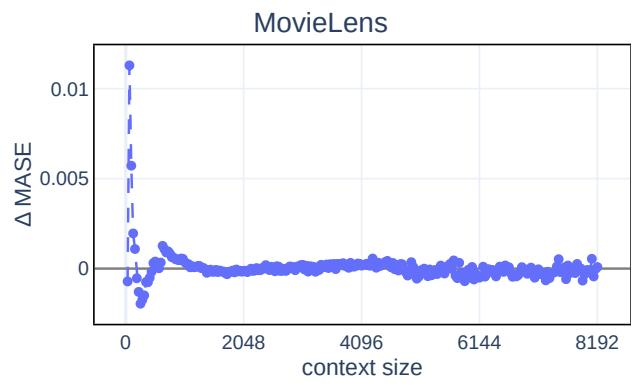

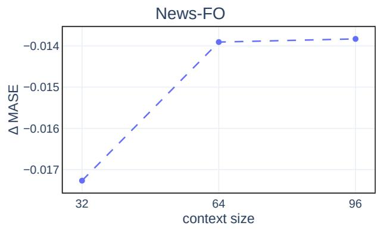

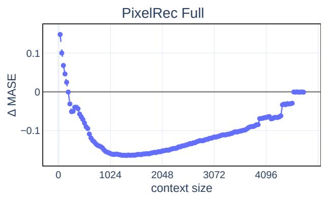

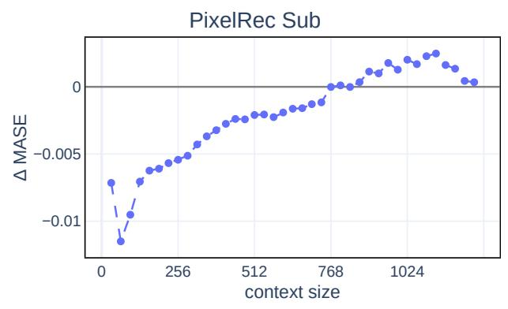

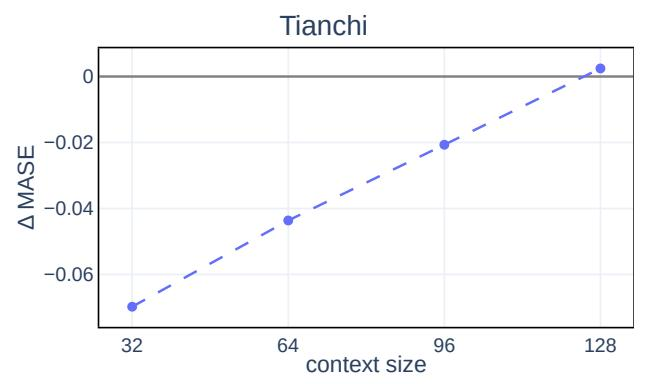

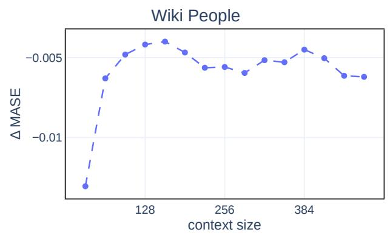  
Figure A2: Static state, mean change in MASE caused by the injected state (with minus without; negative means the initialiser lowers the error) against the number of observations shown. Grid extents differ by dataset as given in Table A13.

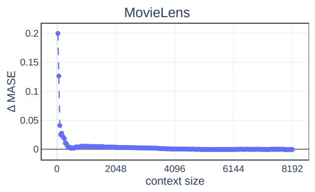

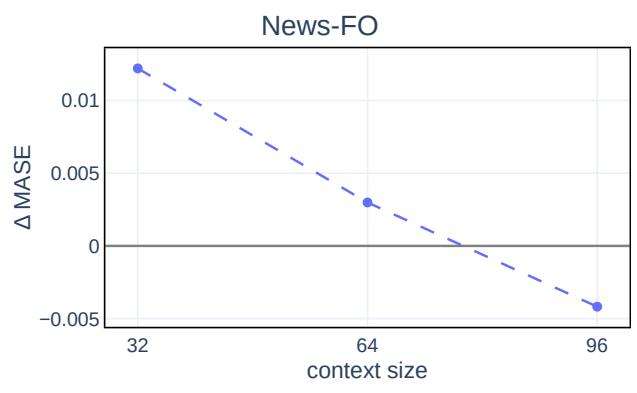

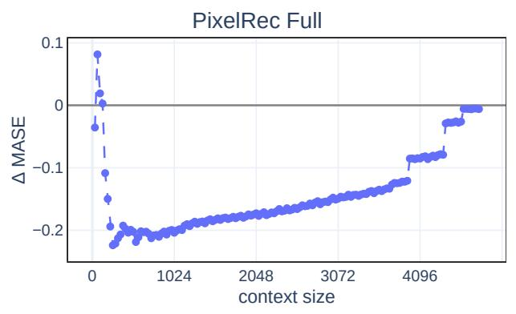

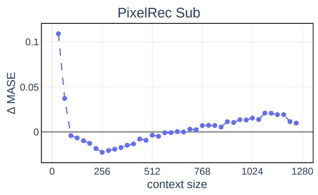

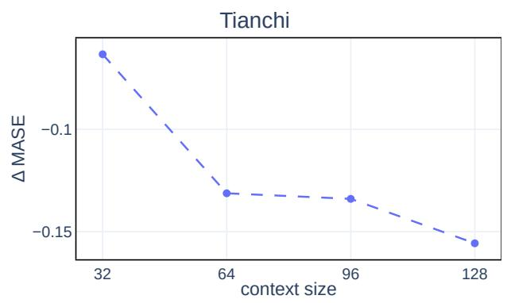

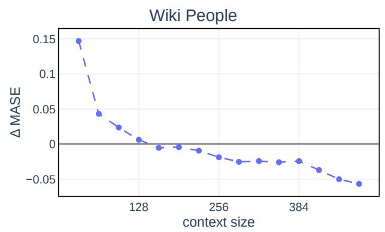  
Figure A3: Text-conditioned state, mean change in MASE caused by the injected state (with minus without; negative means the initialiser lowers the error) against the number of observations shown. The MovieLens and PixelRec Full panels are the data of Figure 3.

## A9 Shuffled-text control

To test whether the gain of the text-conditioned state depends on the text belonging to its series, we repeat the text and LoRA+text runs with every series paired with the text of another series. Within each partition, the text, its Qwen3 embedding and its CLIP projection are reassigned by a fixed random derangement, so that no series keeps its own text; the series, the partitions and all training settings are unchanged, and the shuffled models are trained and evaluated on this assignment. As a second control, which requires no retraining, the text and LoRA+text models trained on the correct text are evaluated with the same vector for every series: the mean CLIP text projection of the training partition. Both controls were added after the main experiments, at the reviewers’ request. We intended to run them on all four datasets where the text-conditioned state beats the static state, but by then the PixelRec item text had been removed from the MoTime release, so they cover Tianchi and Wiki People only. The text and LoRA+text arms were rerun with the same settings and seeds as references; their mean MASE is 0.006% (text) and 0.005% (LoRA+text) lower than in Figure 2 on Tianchi and within 0.003%

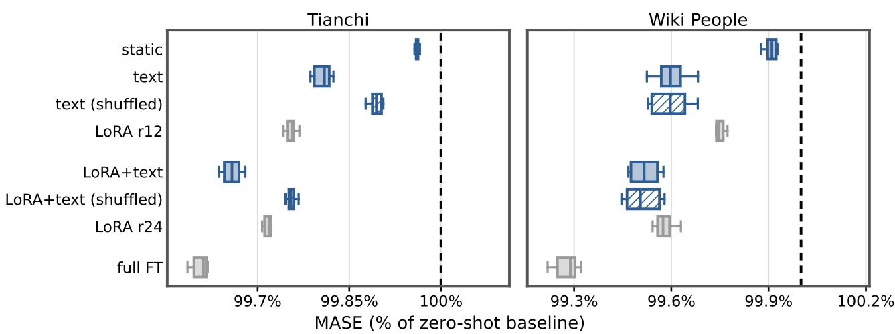  
Figure A4: Shuffled-text control: MASE as a percentage of the zero-shot baseline over six seeds, lower is better. Hatched rows use the text of another series. The text and LoRA+text rows are the reruns; all other rows are the runs of Figure 2.

of it on Wiki People.

Table A14: Change in MASE relative to the correct text, paired by seed $( n = 6 )$ . Shuffled: trained and evaluated on the text of another series. Mean vector: the correct-text model evaluated with the same CLIP vector for every series. ∆: mean standard deviation of the per-seed difference; positive means higher MASE. p: paired t-test.
<table><tr><td>Dataset</td><td>Arm</td><td>Control</td><td>∆ MASE</td><td>∆(%)</td><td>seeds worse</td><td>p</td></tr><tr><td>Tianchi</td><td>text</td><td>shuffled</td><td> $+ 0 . 0 4 2 4 \pm 0 . 0 0 3 8$ </td><td>+0.088</td><td>6/6</td><td> $1 . 2 \times 1 0 ^ { - 6 }$ </td></tr><tr><td>Tianchi</td><td>text</td><td>mean vector</td><td> $+ 0 . 0 4 5 3 \pm 0 . 0 0 3 8$ </td><td>+0.094</td><td>6/6</td><td> $8 . 8 \times 1 0 ^ { - 7 }$ </td></tr><tr><td>Tianchi</td><td>LoRA+text</td><td>shuffled</td><td> $+ 0 . 0 4 7 2 \pm 0 . 0 0 7 5$ </td><td>+0.098</td><td>6/6</td><td> $2 . 0 \times 1 0 ^ { - 5 }$ </td></tr><tr><td>Tianchi</td><td>LoRA+text</td><td>mean vector</td><td> $+ 0 . 0 6 8 7 \pm 0 . 0 0 2 6$ </td><td>+0.143</td><td>6/6</td><td> $1 . 8 \times 1 0 ^ { - 8 }$ </td></tr><tr><td>Wiki People</td><td>text</td><td>shuffled</td><td> $- 0 . 0 0 0 1 \pm 0 . 0 0 0 7$ </td><td>-0.003</td><td>3/6</td><td>0.69</td></tr><tr><td>Wiki People</td><td>text</td><td>mean vector</td><td> $- 0 . 0 0 0 3 \pm 0 . 0 0 0 7$ </td><td>-0.007</td><td>3/6</td><td>0.41</td></tr><tr><td>Wiki People</td><td>LoRA+text</td><td>shuffled</td><td> $- 0 . 0 0 0 3 \pm 0 . 0 0 0 9$ </td><td>-0.007</td><td>2/6</td><td>0.47</td></tr><tr><td>Wiki People</td><td> $\mathrm { L o R A + t e x t }$ </td><td>mean vector</td><td> $- 0 . 0 0 0 3 \pm 0 . 0 0 0 7$ </td><td>-0.007</td><td>2/6</td><td>0.39</td></tr></table>

On Tianchi, both controls increase MASE in every seed, with and without LoRA. The text arm under either control remains below the static state (shuffled: 0.0325 MASE, Welch $p = 1 . 1 \times 1 0 ^ { - 5 } ;$ ; mean vector: 0.0296, $p = 3 . 1 \times 1 0 ^ { - 4 } )$ , and shuffled LoRA+text is indistinguishable from LoRA r12 $( + 0 . 0 0 0 4 , p = 0 . 8 8 )$ . A model trained on shuffled text does not improve when evaluated with the correct text $( - 0 . 0 0 0 2 , p = 0 . 8 5 )$ . On Wiki People, neither control has a measurable effect, and both keep the full gain over the static state (shuffled: $- 0 . 0 1 2 3 , p = 3 . 1 \times 1 0 ^ { - 5 }$ ; mean vector: 0.0124, $p = 2 . 7 \times 1 0 ^ { - 5 } )$

Table A15: Pairwise cosine similarity between the text embeddings of distinct evaluation series: the Qwen3 text embedding and the CLIP text projection that the state-initialisation head receives.
<table><tr><td>Dataset</td><td>Embedding</td><td>Pairs</td><td>Min</td><td>Median</td><td>Mean</td><td>Max</td></tr><tr><td>Tianchi</td><td>Qwen3 (1024-d)</td><td>6,622,980</td><td>-0.03</td><td>0.31</td><td>0.32</td><td>1.00*</td></tr><tr><td>Tianchi</td><td>CLIP (32-d)</td><td>6,622,980</td><td>-0.84</td><td>0.27</td><td>0.26</td><td>1.00*</td></tr><tr><td>Wiki People</td><td>Qwen3 (1024-d)</td><td>4,186</td><td>-0.003</td><td>0.26</td><td>0.26</td><td>0.61</td></tr><tr><td>Wiki People</td><td>CLIP (32-d)</td><td>4,186</td><td>0.53</td><td>0.95</td><td>0.93</td><td>0.999</td></tr></table>

Some Tianchi texts occur more than once (3,638 distinct texts for 3,640 series).

Table A15 compares the text embeddings of the two datasets. Before alignment, the Wiki People texts are as dissimilar as the Tianchi texts (median cosine 0.26 vs. 0.31). After the CLIP projection, the Wiki People vectors are nearly identical (median 0.95, minimum 0.53), whereas the Tianchi vectors remain spread (median 0.27, minimum 0.84). To measure how much the initial state differs between series, we split each series’ state into the mean state over all evaluation series and a series-specific deviation. For the trained text heads (mLSTM state), the summed squared norm of the deviations is 6.1–6.2% of the summed squared norm of the states on Wiki People and 71–74% on Tianchi (range over the six seeds). On Wiki People, the head therefore writes nearly the same state into every series. The gain of the text arm over the static state is also obtained with the same input vector for every series (mean-vector control) and does not depend on series-specific text.

Interpretation. The two datasets give different results. On Tianchi, the text-conditioned state uses seriesspecific information: removing it raises MASE by 0.09–0.14% in every seed, and without it LoRA+text no longer improves on a LoRA adapter of the same rank. Part of the Tianchi gain is nevertheless not tied to the series’ own text: 40–43% of the text arm’s improvement over the static state remains under either control. On Wiki People, the advantage of the text arm over the static state does not come from exogenous information. The texts are distinct, but the CLIP projection maps them to nearly the same vector, so the series-specific information is lost before it reaches the state, and the head writes almost the same state into every series. The text head then acts as a shared static state. It differs from the learnable static state in being shared across layers, its initialisation and its parameterisation (a LayerNorm-normalised projection); which of these accounts for its lower MASE was not tested. The Wiki People result in Figure 2 is therefore not evidence that the state carries exogenous text.