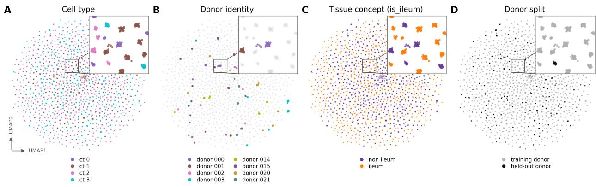
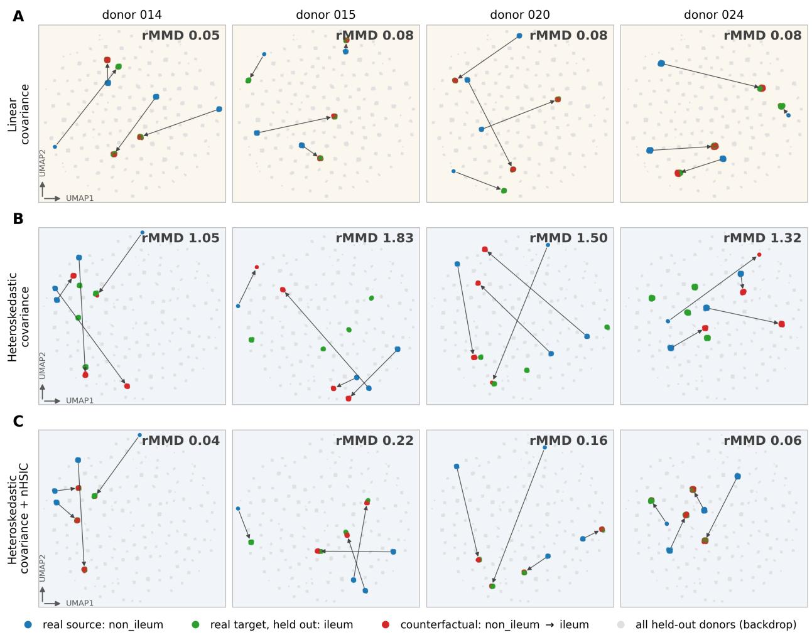
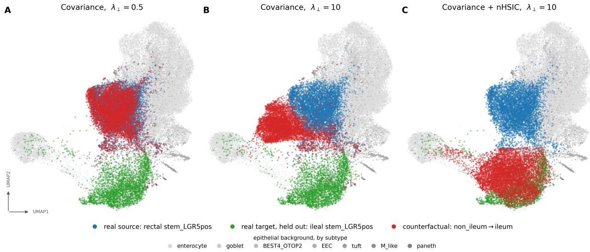

# When Covariance Is Not Enough: Kernel-Based Regularization for Single-Cell Counterfactuals

Korbinian Traeuble1,2,†, Edward de Brouwer3, Archit Verma3, Doron Haviv3, and Kipper Fletez-Brant3

1Institute of Computational Biology, German Research Center for Environmental Health, Helmholtz Zentrum München, Neuherberg, Germany

2Department of Computer Science, TUM School of Computation, Information and Technology, Technical University ofMunich, Garching, Germany

3Computational Sciences Center of Excellence, Genentech, South San Francisco, CA, USA †Work was done during internship at Genentech

November 2026

## Abstract

Counterfactual editing of single cells, predicting how an observed cell would look had one factor been different, enables in-silico screening where experiments are infeasible, but is useful only if the edit is faithful to the individual and not merely to the condition. Concept bottleneck generative models make the effects of interventions interpretable by decomposing a cell’s representation into known and unknown factors. Previous work uses a linear cross-covariance penalty to disentangle known and unknown dimensions. We demonstrate that this first-order criterion does not fully separate information when non-linear interactions are present. We first demonstrate the inadequacy of linear cross-factor penalization with simulation experiments with controlled edits and known non-linear covariate effects. We then demonstrate that adding a nonlinear kernel criterion, the normalized Hilbert-Schmidt Independence Criterion, is able to recover the true intervention effects on simulation data. Finally, we apply the nonlinear concept bottleneck model to a complex single-cell RNA-seq dataset and find that it improves the ability to generate counterfactual expression profiles of cells under different tissue environments.

## 1 Introduction

Counterfactual modeling asks what an observation would have looked like had one of its underlying factors been different when other factors are held fixed. The dominant framework is Pearl’s abduction–action– prediction [1]: infer the latent state that explains the observation, intervene on a single factor, predict the outcome. The edit is useful only if it is at once effective, it produces the requested change, and faithful, it alters nothing else. These models are particularly valuable to observational samples in biology, where high-dimensional measurements are assumed to lie in a lower dimensional space, exhaustive sampling of potential conditions is expensive and infeasible, and a sample can usually only be measured once with a single modality. Common biological counterfactual questions include what a cell’s gene expression would be in a different environment, e.g. different tissue, or under a different context, e.g. alternative drug treatment. Single-cell RNA sequencing [2], measuring the gene expression of individual cells [3] from a sample, provides increasing resolution into disease biology at ever increasing cell numbers and resolution [4, 5]. Improved throughput and decreasing costs have enabled the production of reference atlases across tissues and diseases [6, 7, 8, 9, 10], and enabled training of latent-variable models of the cell types and states [11]. However, while modern foundation models pretrained on tens of millions of cells [12, 13] can describe cellular states, they have fallen short on valuable counterfactual prediction. Improved counterfactual models of single-cell RNA-seq data would enable the exploration of the combinatorial space of cell types, patients, treatments and doses that is infeasible at current experiment scales.

Existing models of cellular response follow two overlapping directions. The first predicts intervention effects at the level of populations rather than of a given cell, whether by assuming a fixed additive shift in latent space [14, 15], conditioning a decoder on the perturbation [16], propagating it through a prior knowledge graph [17], or mapping unpaired control and treated populations onto one another by optimal transport [18, 19]; the transport maps do act per cell, but they match distributions rather than reconstruct a named factor. The second uses interpretable representations with biologically named components [20]. Several methods combine these directions through latent-space arithmetic over disentangled factors [21, 22], latent optimization with capacity-constrained unknown-attribute embeddings [23], or causally structured concept embeddings decoded by a diffusion model [24]. All emit a profile per input cell, but their evaluations do not explicitly test whether an edit preserves donor-specific identity or matches the source donor’s response under the target condition.

The concept bottleneck generative model scCBGM combines both approaches [25] by implementing the concept bottleneck idea [26] for a generative model of cells. The model decomposes each cell’s latent representation into a supervised block of observed concepts, such as cell type, tissue or treatment, and a set of unknown factors that account for other unrecorded variation, from donor identity to library size and batch. Counterfactual predictions for the known factors can be generated via abduction–action–prediction: encode a cell, replace one concept with its target value, and decode from the same unknown factors. Because the concepts are explicit, the edit can be checked rather than trusted, which makes it a plausible route to person alized prediction. This counterfactual, however, is only valid if the two blocks are genuinely independent, such that editing a concept does not alter another concept’s effect, e.g. a donor-specific signal that makes the prediction personal. To ensure disentanglement of the latent factors and concepts, scCBGM enforces independence with a penalty on the linear cross-covariance between the blocks, a first-order criterion blind to any dependence whose conditional means agree. Kernel criteria are the known remedy in this setting: Lopez et al. constrained a single-cell VAE with the d-variable Hilbert-Schmidt Independence Criterion to keep the latent independent of observed nuisance factors [27]. Here both arguments are learned, the concept head on one side and the unknown block on the other, and the question is not invariance to a nuisance but whether an edit made through the concept pathway stays faithful to the individual carried in the unknowns.

We show that the linear penalty is not always enough. On a matched pair of simulations differing in exactly one place, the cross-covariance penalty recovers donor-specific counterfactuals when the edited condition enters as an additive mean shift shared across donors, and fails at every penalty strength when it instead modulates the variance of a donor-specific signature, a regime in which the dependence between the blocks is entirely second-order and the penalty reports no violation. Adding a kernel criterion, the normalized Hilbert-Schmidt Independence Criterion [28], recovers the donor-specific edit, and the same ordering holds on the TAURUS inflammatory bowel disease cohort [29], where the added kernel penalty produces an accurate rectum → ileum edit.

## 2 Results

## 2.1 A single-cell simulator with known donor ground truth

We ask whether a concept bottleneck generative model edits a cell in a donor-specific way. The original single cell concept bottleneck paper established that flipping such a concept can move cells into the target condition [25]. A donor-specific edit, however, should capture the expression of the cells that donor has in the target condition rather than a generic population from the target condition. To that end we implemented a simulator in which the donor effect is known by construction, so that the correct donor-specific answer is available as ground truth even for donors the model has never seen.

  
Figure 1: Structure of the synthetic donor-holdout dataset (240,000 cells, 150 donors, 20 of them held out). All panels show the same UMAP, fitted once on a uniform random subsample of 40,000 cells in the 128- dimensional PCA space the model is trained in, and recoloured: (A) the 4 simulated cell types; (B) donor identity, with 8 donors highlighted (donor\_000, donor\_001, donor\_002, donor\_003, donor\_014, donor\_015, donor\_020, donor\_021) and the remaining donors in gray; (C) the binary tissue concept is\_ileum, which is what the counterfactual flips; (D) training donors versus the 20 held-out donors.

The simulation uses a hierarchical Poisson model to generate single-cell like data [25] (Sec. 4.2). Every cell draws a donor, a tissue, a cell type and a set of binary latent concepts from a fixed hierarchy. Its Poisson log-rate is a sum of gene-wise effects: a baseline expression level, a cell-type effect, a donor fingerprint, a tissue effect, the latent concept effects, a per-cell library-size offset and gene noise (Eq. 6). The two-level tissue axis plays the role of the editable binary concept is\_ileum. Counts are then drawn by inverse-CDF transform of stored exogenous uniforms (Eq. 7), so the sampler is a deterministic function of its latent representation and we can regenerate a dataset with one effect changed and every other draw held fixed. The counts are then pushed through the pre-processing used throughout this work (median library-size normalization, log(1+x), PCA to 128 components), so all training and scoring happen in a 128-dimensional PCA space. The generator produces 240,000 cells over 150 donors, 4 cell types and 3,000 genes (Table 4). Figure 1 illustrates the simulated dataset with four cell types (A), the donor structure (B), and flipped tissue concept identity (C).

## 2.2 Donor effects must be low rank for held-out donors to be predictable

In the original single cell concept bottleneck simulator, the donor fingerprint $\gamma _ { b , g } ,$ the effect of donor b on gene g, is drawn i.i.d. per gene, which makes each donor an isolated point in gene space: nothing learned from the training donors carries information about an unseen donor’s vector $\gamma _ { b } ,$ and the donor holdout is unsolvable in principle rather than merely hard. To properly model donor-specific effects, we replace the donor block by a shared factor model $\gamma = H W$ with $H \in \mathbb { R } ^ { B \times R }$ and $W \in \mathbb { R } ^ { R \times F }$ (Eq. 8), where $B = 1 5 0$ is the number of donors, $F = 3 { , } 0 0 0$ the number of genes, and $R = 1 2$ the rank: H gives each donor R loadings and W holds R gene programs shared across donors, the analogue of a small number of transcriptional programs that individuals up- or downregulate to different degrees rather than F independent per-gene effects. The program matrix W is drawn once and shared, and its variance is scaled by $1 / R$ so that the per-gene donor variance $\mathrm { V a r } ( \gamma _ { b , g } ) = \sigma _ { B } ^ { 2 }$ is unchanged, where $\sigma _ { B }$ is the donor-effect standard deviation: only the rank of the donor signal differs, not its strength. Every donor, held out or not, then lies in the same R-dimensional subspace, so a donor readout learned on training donors can transfer to unseen ones. All results below use this low-rank generator (Table 4).

## 2.3 Linear regime: a covariance penalty is enough

We simulate data with fixed donor, tissue (non-ileum and ileum), and cell type of various library sizes and noisy gene expression observations. When training the model, the cell type and tissue are observed for each cell in a supervised concept vector ˆc, and the unknown-factor block $u ,$ should account for the donor, library size and the gene noise. We test how well the model performs when generating a counterfactual by switching only the tissue concept to ileum (Sec. 4.4). Donor identity is an unknown concept, so for the model to make a successful donor-specific edit the donor identity must survive in u and the decoder must recombine it with the flipped concept. What keeps $\hat { c }$ and u from entangling is an orthogonality penalty $\lambda _ { \perp } \mathcal { L } _ { \perp } ( \hat { c } , u )$ , where $\mathcal { L } _ { \perp }$ penalizes dependence between the two blocks and $\lambda _ { \perp }$ sets its strength; the original model uses a linear cross-covariance penalty, and we start there.

We evaluate the model on held-out donors: 20 of the 150 donors are withheld from training entirely (Figure 1D), and at inference each unseen donor’s non-ileum cells are edited to ileum and compared against that donor’s observed ileal cells of the same cell type. Absolute distances are not comparable across cell types, so we score each held-out (donor b, cell type $k )$ pair by a ratio of squared Maximum Mean Discrepancies (MMD),

$$
\mathrm { r M M D } _ { b , k } = \frac { \mathrm { M M D } \left( \hat { X } _ { b , k } , X _ { b , k } ^ { \mathrm { t g t } } \right) } { \mathrm { M M D } \left( X _ { \cdot , k } ^ { \mathrm { t g t } } , X _ { b , k } ^ { \mathrm { t g t } } \right) } ,\tag{1}
$$

where $\hat { X } _ { b , k }$ is the edit of donor $b \mathbf { \bar { s } }$ type-k source cells, $X _ { b , k } ^ { \mathrm { t g t } }$ that donor’s own real target cells of type $k ,$ and $X _ { \cdot , k } ^ { \mathrm { t g t } }$ the generic target-condition population of type k pooled over all training donors (Sec. 4.5). The denominator is thus the best "get the condition right but ignore the donor" answer: a value near or above 1 means a generic target-condition cell, and a value below 1 means the edit is closer to that donor’s target than the pooled population is, which is exactly the donor-specific property. We report the median over all held-out (donor, cell type) rows and, where stated, the fraction below 1.

We first evaluate a simulation where the donor-specific effect is an additive mean shift shared by all donors, so the donor-specific part of the answer is entirely the donor’s own baseline, which the model must carry in u. Here, the original concept bottleneck model with a linear orthogonality penalty generalizes to unseen donors (Table 1, top block): the cross-covariance penalty gives a median held-out-donor rMMD of 0.09, 0.06 and 0.06 at $\lambda _ { \perp } = 0 . 5 , 1$ and 5, all well below 1. Row A of Figure 2 shows this per donor: for four donors never seen in training, the edited cells (red) land on the withheld real ileal cells (green) for all four cell types, and the arrows track the real source-to-target displacement. This is the regime in which the method behaves as advertised.

## 2.4 Heteroskedastic regime: a covariance penalty fails, nHSIC recovers the edit

A general linear additive shift is an unrealistic assumption for true single-cell RNA-seq observations. We therefore build a matched member of the pair, generated from the same seed and differing only on a block V of the 150 highest-expression genes. On V the tissue main effect is removed and replaced by a donor–tissue variance interaction (Eq. 9): $\varphi _ { b }$ is a per-donor signature on V (drawn once, zero-mean across donors), $m \left( t _ { n } \right)$ is a tissue multiplier equal to 1 in non-ileum and M in ileum, $\rho = 0 . 5$ scales the channel and $M = 3$ is the ileum variance multiplier. Each donor thus carries its own signature $\varphi _ { b }$ whose amplitude grows by M in the ileum. Because $\mathbb { E } [ \boldsymbol { \varphi } ] = 0$ , the condition and the block are uncorrelated, $\mathrm { C o v } ( \mathrm { i } \mathbf { s } _ { - } \mathrm { i } 1 \mathrm { e u m } , V ) = 0$ , while the conditional variance ratio between the two tissues is $M ^ { 2 }$ . The correct edit is to amplify each donor’s own

Figure 2: Donor-holdout counterfactual on the matched linear / heteroskedastic simulation pair. Rows: (A) linear regime with a covariance penalty, (B) heteroskedastic regime with the same covariance penalty, (C) heteroskedastic regime with covariance $+ \mathrm { n H S I C } ;$ all at $\lambda _ { \perp } = 0 . 5$ . Columns are held-out donors (donor\_014, donor\_015, donor\_020, donor\_024), never seen in training. Each panel shows all 4 simulated cell types of that donor: the retained is\_ileum=non\_ileum cells (blue), the withheld real is\_ileum=ileum cells (green), and the model’s counterfactual edit of the blue cells (red). Rows B and C share one UMAP, fitted jointly on their real cells and both predictions, so they are directly comparable and only the red cloud moves; row A is a different dataset and therefore a different coordinate system. Each group is subsampled to at most 300 cells per donor and cell type, so the three groups are drawn at comparable density. The three groups are drawn in a single shuffled scatter, so neither is systematically painted over the other and a true overlap reads as a blend. Arrows run from each cell type’s real source cloud to the model’s counterfactual for that cloud (centroids), i.e. the edit the model actually made; the edit succeeds when the arrow head lands on the green held-out target. They are a reading guide in UMAP coordinates, not a displacement in any metric space. The gray backdrop is the real cells of all 20 held-out donors (20,000 of 32,769 drawn), so each gray blob is another donor. Panels are framed, and tinted by regime – rows B and C share both an embedding and a tint, row A neither. Panel labels give that donor’s median rMMD over the cell types scored for it (a cell type is scored only where the donor has enough cells on both sides); run-level medians over all 20 held-out donors: (A) 0.09, (B) 1.30, (C) 0.15 (lower is better; < 1 beats mapping the cells to the closest existing population).

<table><tr><td>Regime</td><td>Orth. loss</td><td> $\lambda _ { \perp } { = } 0 . 5$ </td><td> $\lambda _ { \perp } = 1$ </td><td> $\lambda _ { \perp } = 5$ </td></tr><tr><td rowspan="3">Linear (mean shift)</td><td>coV</td><td>0.09</td><td>0.06</td><td>0.06</td></tr><tr><td>nHSIC</td><td>0.10</td><td>0.08</td><td>0.06</td></tr><tr><td> $\mathrm { c o v + n H S I C }$ </td><td>0.03</td><td>0.24</td><td>2.02</td></tr><tr><td rowspan="3">Nonlinear (heteroskedastic)</td><td>cov</td><td>1.30</td><td>1.30</td><td>1.09</td></tr><tr><td>nHSIC</td><td>1.09</td><td>0.69</td><td>0.35</td></tr><tr><td> $\mathrm { c o v + n H S I C }$ </td><td>0.15</td><td>0.21</td><td>2.16</td></tr></table>

Table 1: Median per-donor rMMD on held-out donors for the matched linear/heteroskedastic simulation pair. Bold = beats the baseline (< 1). A covariance penalty suffices in the linear regime but fails at every strength in the heteroskedastic one, where the condition enters through a conditional variance; adding nHSIC recovers a donor-specific edit.

baseline signature, and the information needed is present in the donor’s source cells, so the task stays well posed.

In this regime the covariance penalty fails at every strength (Table 1, bottom block): median rMMD 1.30, 1.30 and 1.09, with only 35%, 37% and 46% of the individual (donor, cell type) rows below 1. Row B of Figure 2 shows the failure mode. The edit is not absent, the red cloud does move away from blue, but it moves toward a generic ileal position and does not reach the donor’s own green cells.

By contrast, adding a kernel penalty [28] recovers the edit. The normalized Hilbert-Schmidt Independence Criterion (nHSIC) measures the dependence between ˆc and u through kernels rather than covariance, so it registers the higher-order dependence that a covariance penalty is blind to (Sec. 4.3). With nHSIC alone the median rMMD falls from 1.09 to 0.69 to 0.35 as $\lambda _ { - }$ goes from 0.5 to 1 to 5; combining the two penalties is better still, 0.15 at $\lambda _ { \perp } = 0 . 5$ and 0.21 at $\lambda _ { \perp } = 1$ , with 95% of the individual donor rows below 1 in both cases. Row C of Figure 2 is the same four held-out donors in the same embedding as row B, and the only thing that changes is that the red cloud now lands on green. Since rows B and C share a UMAP, the comparison is direct.

We find that success is dependent on the strength on the penalty. At $\lambda _ { \perp } = 5$ the combined penalty breaks down in both regimes, rMMD 2.16 in the heteroskedastic member and 2.02 in the linear one. This is not an inert decoder. The edit ratio measures how far the decoder’s output moves when the concept is flipped from source to target, relative to the source reconstruction (Sec. 4.4); within these three runs it grows monotonically with $\lambda _ { \perp } \left( 0 . 0 5 , 0 . 0 8 , 0 . 9 0 \right)$ . The model is making a large edit that leaves the target population, i.e. over-regularizing the bottleneck drives the prediction off the data manifold rather than suppressing the edit. The useful range is therefore bounded on both sides, and the two failure modes look nothing alike.

## 2.5 Real data: held-out subtype counterfactual in the Taurus cohort

Finally, we evaluate linear and non-linear penalties in concept bottleneck models on the TAURUS cohort [29]. We use the pooled subtype holdout used by the original authors: all cells of one fine subtype in the target condition are withheld from training, the retained cells of that subtype in the source condition are edited, and the prediction is compared to the withheld cells. The subtype was chosen by a model-free screen of all 36 location-agnostic subtypes, ranking them by the real source-versus-target distance and by the number of donors that carry the subtype on both sides (Sec. 4.5), since a subtype whose two conditions barely differ makes the ratio metric uninformative. We selected stem\_LGR5pos (per-donor real gap MMD 0.20, 14 donors on both sides). The holdout removes all 4,100 ileal stem\_LGR5pos cells of 987,743; at inference the 6,342 retained rectal cells of that subtype are edited non\_ileum → ileum.

<table><tr><td>Orthogonality penalty</td><td> $\lambda _ { \perp }$ </td><td>rMMD↓</td><td>rSinkhorn ↓</td></tr><tr><td>Covariance</td><td>0.5</td><td>0.95</td><td>0.50</td></tr><tr><td>Covariance</td><td>10</td><td>0.96</td><td>0.46</td></tr><tr><td> $\mathrm { C o v a r i a n c e + n H S I C }$ </td><td>10</td><td>0.41</td><td>0.14</td></tr></table>

Table 2: Held-out counterfactual accuracy on the taurus stem holdout (Rectum → terminal ileum, stem\_LGR5pos). rMMD is the ratio metric of Eq. $2 0 \colon < 1$ means the edited cells are closer to the real held-out ileal cells than the closest existing cell population is. All three runs are below 1, but the covarianceonly numerators (0.231 and 0.234) are essentially the denominator (0.244), i.e. the prediction is no closer to the target than the un-edited source it was made from; only cov + nHSIC (bold) makes a complete edit (edit ratio 0.67 vs. 0.04 and 0.22).

We compare three runs that differ only in the orthogonality penalty and its weight (Table 2). The covariance penalty at $\lambda _ { \perp } = 0 . 5$ does not produce an edit. The decoder barely responds to the flip (edit ratio 0.04), and the prediction stays essentially where the source cells were: its MMD to the withheld ileal cells is 0.231, against 0.244 for the un-edited epithelial non-ileum population, which is the closest of the 14 candidates and hence the denominator of the ratio. Read alone, the ratios (rMMD 0.95, rSinkhorn 0.50) are both below 1 and would suggest success; they are below 1 only because the source population is itself the best available answer. Raising the same penalty to $\lambda _ { \perp } = 1 0$ does not fix it (numerator 0.234, rMMD 0.96, rSinkhorn 0.46), although the decoder does now respond to the concept (edit ratio 0.22).

The combined covariance and nHSIC penalty at $\lambda _ { \perp } = 1 0$ gives rMMD 0.41 and rSinkhorn 0.14, a numerator of 0.100 against the same denominator of 0.244, and an edit ratio of 0.67. Figure 3 shows the three runs in a shared embedding and reproduces the ordering seen in the simulation: under cov $\lambda _ { \perp } = 0 . 5$ the prediction sits on top of the source cells, under cov $\lambda _ { \perp } = 1 0$ it is displaced but stops short of the withheld ileal cells, and under cov + nHSIC it overlaps them.

We find that the qualitative ranking found in the heteroskedastic simulation, where a linear orthogonality penalty leaves an incomplete edit and a kernel criterion completes it, is consistent in the real data. The success metric of rMMD < 1 is necessary but not sufficient: all three runs clear that bar, but only the run with the kernel penalty clears it by a margin that corresponds to an actual edit. We therefore read the ratio together with the numerator, the winning denominator population and the decoder edit ratio.

## 3 Discussion

We asked whether a concept bottleneck generative model edits a cell in a donor-specific way, and the answer depends on how the edited condition enters the data. On a matched pair of simulations with linear and nonlinear donor specific effects, the linear cross-covariance penalty of scCBGM [25] suffices when the condition is an additive mean shift shared by all donors and fails when it instead modulates the variance of a donor specific signature, regardless of the strength of the linear orthogonality penalty. The failure is not an absent edit with a high enough penalty: the decoder moves the cells, but to a generic target-condition position rather than that donor’s own. Adding a kernel criterion, nHSIC, to the linear one recovers the donor-specific edit, and the same holds on Taurus [29], where the covariance-only numerators sit at the denominator while cov + nHSIC completes the edit. Neither regime is a strawman. The additive one is plausibly what the interferon-β stimulation benchmark of Kang et al. [30] provides, on which scCBGM was evaluated with the covariance penalty alone: a coordinated up-regulation of an interferon program largely shared across cells and donors, hence a first-order effect that a first-order criterion can keep out of U. The heteroskedastic regime is what one expects when a perturbation amplifies an individual’s existing program instead of adding a fixed offset, as when inflammation exaggerates a donor’s baseline response. The low-rank donor structure is likewise biologically grounded, individuals differing mainly by up- or downregulating a limited set of shared transcriptional programs rather than through F independent per-gene effects, and it is what makes an unseen donor predictable at all. We therefore recommend adding the kernel penalty rather than replacing the linear one. The terms are complementary: cross-covariance is a cheap, low-variance estimate of the first-order dependence, whereas nHSIC must estimate a full kernel dependence from a few hundred cells, so keeping both anchors the first order and leaves the kernel term only what covariance cannot see. The combination reaches the best value in both regimes at the smallest weight (0.03 and 0.15 at $\lambda _ { \perp } = 0 . 5 )$ where nHSIC alone needs $\lambda _ { \perp } = 5$ to reach 0.35.

  
Figure 3: Counterfactual edit of the held-out stem\_LGR5pos subtype (rectum → terminal ileum) under three orthogonality penalties. Every is\_ileum=ileum stem\_LGR5pos cell (n=4,100, green) was withheld from training; at inference the retained rectal cells of the same subtype (n=6,342, blue) are edited to ileum (red) and compared against them. The gray backdrop is the rest of the epithelial lineage, shaded by fine subtype (largest subtype lightest); a uniform random sample of 30,000 of the 317,976 cells is drawn, to keep the UMAP tractable; sampling is uniform, so subtype proportions are preserved.

Hyperparameter sensitivity is the main current weakness of nonlinear concept bottleneck models. We find that over-regularization is a potential issue with the combined kernel and linear penalty. Tuning on rMMD alone would miss this, and we find that joint evaluation with the edit ratio and UMAPs is required. The best setting differed between our two datasets $( \lambda _ { \perp } = 0 . 5$ in simulation, 10 on Taurus). We did not explore the estimator’s batch-size dependence and its median-heuristic bandwidths. Our results are also single-seed, reported without intervals, live in a 128-dimensional PCA space under a Gaussian loss rather than in count space, and rest on one simulator and one cohort with a single held-out subtype.

Growing longitudinal and pan-tissue collection will eventually make further evaluations and develop ment feasible. As data increases, we can move towards patient, rather than cell level, prediction and generation - treating each patient as a distribution over cells and the cohort as a distribution over those distributions, simultaneously generating cell type abundances and cell states. With such a readout the applications follow from the counterfactual framing, in-silico treatment screening in a specific patient, imputing a tissue that was never biopsied, mapping an individual along an axis such as age, and transferring a biomarker from accessible blood to the tissue where the disease sits. Each is an edit that must be faithful to the individual and not merely to the condition, and which independence criterion is used decides whether it is.

Table 3: Cell-type concept: mapping of the 22 major values onto seven lineages.

<table><tr><td>Major cell type Original major values merged</td><td></td></tr><tr><td>epithelial T_ILC</td><td>Ileal_epithelium, Non_ileal_epithelium CD4_T, CD8_T, Unconventional_T, Innate_lymphocytes</td></tr><tr><td>B lineage</td><td>B, Plasma</td></tr><tr><td>myeloid cell endothelial</td><td>Mono_macro, DC, Mast, Cycling_MNP</td></tr><tr><td>glial cell</td><td>Endothelium Glial</td></tr><tr><td>mesenchymal</td><td>Fibroblast, Epi_fibroblast, LP_fibroblast, Myofibroblast, C3pos_fibroblast, THY1pos_FAPpos_PDPNpos_fibroblast, Pericyte,</td></tr></table>

## 4 Methods

## 4.1 Single cell RNA sequencing preprocessing

Raw single cell counts from the Taurus [29] dataset object TAURUS\_raw\_counts\_annotated\_final.h5ad were downloaded from https://zenodo.org/records/14007626 and reduced to the 3,000 most highlyvariable genes (sc.highly\_variable\_genes, seurat\_v3 flavor on raw counts, mitochondrial/ribosomal genes excluded), median full-library-size normalized and log1p-transformed, then embedded into 128 prin cipal components (scanpy PCA, zero-centered, fit on all cells) [31]. From the cell-level annotations (obs) we derived the three columns. The fine subtype was made location-agnostic by stripping the leading Ileal\_/Non\_ileal\_ prefix from minor (minor\_agnostic), which defines the held-out subtype stem\_LGR5pos. The tissue axis was collapsed to a binary concept is\_ileum (ileum if Site == Terminal\_Ileum, else non\_ileum), since the four colon sub-regions are transcriptomically hard to distinguish. The final major cell-type concept was obtained by a deterministic union-merge of the 22-value major column into seven major lineages (Table 3); the Ileal\_epithelium and Non\_ileal\_epithelium majors are merged into a single epithelial lineage so the cell-type concept is not a proxy for is\_ileum.

## 4.2 Synthetic data

Hierarchical Poisson generative model. We adapt the hierarchical Poisson single-cell generator of [25] (conceptlab.datagen.OmicsDataGenerator), reused unchanged as the base model and extended by the two terms below. Each cell n draws a donor $b _ { n }$ , a tissue $t _ { n } ,$ a cell type $u _ { n }$ and a binary latent concept vector $\nu _ { n } \in \{ 0 , 1 \} ^ { C }$

$$
\begin{array} { r } { p ^ { ( B ) } \sim \mathrm { D i r } ( 1 0 \cdot { \bf 1 } _ { B } ) , \quad p ^ { ( T ) } \sim \mathrm { D i r } ( 1 0 \cdot { \bf 1 } _ { T } ) , \quad p _ { t } ^ { ( U ) } \sim \mathrm { D i r } ( { \bf 1 } _ { U } ) , \quad p _ { u } ^ { ( C ) } \sim \mathrm { D i r } ( \frac { 1 } { 5 } { \bf 1 } _ { C } ) , } \end{array}\tag{2}
$$

$$
b _ { n } \sim \mathrm { C a t } ( p ^ { ( B ) } ) , \quad t _ { n } \sim \mathrm { C a t } ( p ^ { ( T ) } ) , \quad u _ { n } \sim \mathrm { C a t } ( p _ { t _ { n } } ^ { ( U ) } ) , \quad v _ { n , c } \sim \mathrm { B e r n } \big ( \sigma ( \zeta _ { n , c } ) \big ) , \ \zeta _ { n } = \mathrm { c l i p } \big ( \log \mathrm { i } t p _ { u _ { n } } ^ { ( C ) } , - 8 , 8 \big ) ,\tag{3}
$$

with gene-wise additive effects

$$
w _ { g } \sim \mathrm { U n i f } ( \log \ell , \log h ) , \quad \gamma _ { b , g } \sim \mathcal { N } ( 0 , \sigma _ { B } ^ { 2 } ) , \quad \omega _ { u , g } \sim \mathcal { N } ( 0 , \sigma _ { U } ^ { 2 } ) , \quad \tau _ { t , g } \sim \mathcal { N } ( 0 , \sigma _ { T } ^ { 2 } ) ,\tag{4}
$$

$$
\begin{array} { r } { s _ { c , g } \sim \mathcal { N } ( 0 , \sigma _ { C } ^ { 2 } ) \cdot { \mathbf { 1 } } [ m _ { c , g } = 1 ] , \quad m _ { c , g } \sim \mathrm { B e r n } ( \pi _ { c } ) , \quad \pi _ { c } = 1 - \mathrm { B e t a } ( a , b ) , } \end{array}\tag{5}
$$

a per-cell library offset $\ell _ { n } \sim \mathcal { N } ( 0 , ( \sigma _ { b _ { n } } ^ { L } ) ^ { 2 } ) , \sigma _ { b } ^ { L } \sim \operatorname { U n i f } ( 0 . 0 1 , 0 . 0 3 )$ , and gene noise $\varepsilon _ { n , g } \sim \mathcal { N } ( 0 , \sigma _ { \varepsilon } ^ { 2 } )$ . The Poisson log-rate is additive,

$$
\log \lambda _ { n , g } = w _ { g } + \sum _ { c } s _ { c , g } \nu _ { n , c } + \omega _ { u _ { n } , g } + \gamma _ { b _ { n } , g } + \tau _ { t _ { n } , g } + \ell _ { n } + \varepsilon _ { n , g } ,\tag{6}
$$

and counts are drawn by inverse-CDF transform of a stored exogenous uniform $a _ { n , g } \sim \mathrm { U n i f } ( 0 , 1 )$

$$
\begin{array} { r } { x _ { n , g } = F _ { \mathrm { P o i s } ( \lambda _ { n , g } ) } ^ { - 1 } ( a _ { n , g } ) . } \end{array}\tag{7}
$$

Keeping $a _ { n , g }$ and $\varepsilon _ { n , g }$ makes the sampler a deterministic function of the latents: we call the generator, read the coefficients and exogenous draws back out, and recompute (6)–(7) ourselves, which is what lets us inject the terms below while holding every other draw fixed. The T = 2 tissue axis is the editable binary concept is\_ileum; the model conditions on {celltype,is\_ileum}, while v, the donor fingerprint γ, the library offset and the noise are unobserved and must be absorbed by the unknown factors U.

Low-rank donor structure. In the base model $\gamma _ { b , g }$ is i.i.d. per gene, so donors are isolated points and a held-out donor is unpredictable in principle. We replace the donor block by a shared factor mode

$$
\begin{array} { r } { \gamma = H W , \qquad H \in \mathbb { R } ^ { B \times R } , H _ { b , r } \sim \mathcal { N } ( 0 , 1 ) , \qquad W \in \mathbb { R } ^ { R \times F } , W _ { r , g } \sim \mathcal { N } \Big ( 0 , \frac { \sigma _ { B } ^ { 2 } } { R } \Big ) , } \end{array}\tag{8}
$$

with the R dense programs W drawn once and shared by all donors. Since $\mathrm { V a r } ( \gamma _ { b , g } ) = R \cdot \sigma _ { B } ^ { 2 } / R = \sigma _ { B } ^ { 2 }$ , only the rank of the donor signal changes, not its strength; every donor, held-out ones included, lies on the same R-dimensional subspace, so a donor readout learned on training donors transfers.

Nonlinear (heteroskedastic) counterfactual axis and matched linear control. The two members are generated from the same seed, hence share all coefficients, per-cell latents and exogenous draws, and differ only on a block V of the $| V |$ highest-baseline genes. In the linear member every gene keeps its additive tissue effect, so the is\_ileum edit is the fixed shift $\tau _ { 1 , \cdot } - \tau _ { 0 , }$ ·, identical for all donors. In the nonlinear member the tissue main effect on V is removed $( \tau _ { t , g } = 0 , g \in V )$ and replaced by a donor–tissue variance interaction

$$
\begin{array} { r } { \log \lambda _ { n , g } \ + = \ \rho \ \varphi _ { b _ { n } } m ( t _ { n } ) , \qquad g \in V , \qquad \varphi _ { b } \sim \mathcal { N } ( 0 , 1 ) \ \mathrm { w i t h } \ \sum _ { b } \varphi _ { b } = 0 , \qquad m ( 0 ) = 1 , \ m ( 1 ) = M , } \end{array}\tag{9}
$$

i.e. each donor has its own signature $\varphi _ { b }$ on $V$ whose amplitude is multiplied by M in the ileum. By construction

$$
\mathbb { E } [ V \mid t ] = \rho m ( t ) \mathbb { E } [ \varphi ] = 0 \Rightarrow \mathrm { C o v ( i s \mathrm { . } i l e u m , } V ) = 0 , \qquad \frac { \mathrm { V a r } [ V \mid \mathrm { i l e u m } ] } { \mathrm { V a r } [ V \mid \mathrm { n o n . i l e u m } ] } = M ^ { 2 } ,\tag{10}
$$

so the channel is invisible to a covariance penalty but visible to a kernel one: the means agree in both conditions and the dependence is entirely second-order. It also keeps the held-out-donor counterfactual well posed, since $\varphi _ { b }$ is present in both conditions (amplitude $\rho$ at the source, $\rho M$ in the ileum) and is therefore readable from a donor’s source cells; the correct edit is to amplify each donor’s own baseline signature by M, whereas storing the raw source amplitude in $U$ under-scales it. A CPU oracle verifies all three properties before training (measured $\mathrm { C o v } \approx 0 .$ , variance ratio $\approx M ^ { 2 }$ , and per-donor Pearson $r \geq 0 . 7 5$ between the source V-mean and the true $\varphi _ { b } )$ . Both members are then passed through the identical pipeline used for the real data, median library-size normalization, log(1 + x), PCA to 128 components, and evaluated under a donor holdout: 20 of the 150 donors are withheld from training entirely, and the $\dot { 1 } { \bf s } _ { - } \dot { { \bf 1 } } ]$ eum edit is scored per cell type on those unseen donors.

Final parameters used. All parameters finally used for the simulation are listed in Table 4.

<table><tr><td>Symbol</td><td>Meaning</td><td>Value</td></tr><tr><td> $N$ </td><td>cells</td><td>240,000</td></tr><tr><td> $F$ </td><td>genes</td><td>3,000</td></tr><tr><td> $B$ </td><td>donors (20 held out)</td><td>150</td></tr><tr><td> $T$ </td><td>tissues (is_ileum)</td><td>2</td></tr><tr><td> $U$ </td><td>cell types</td><td>4</td></tr><tr><td> $C$ </td><td>latent concepts</td><td>3</td></tr><tr><td> $[ \ell , h ]$ </td><td>baseline-expression range</td><td>[1, 6]</td></tr><tr><td> $\sigma _ { B }$ </td><td>donor s.d.</td><td>0.30</td></tr><tr><td> $\sigma _ { U }$ </td><td>cell-type s.d.</td><td>0.20</td></tr><tr><td> $\sigma _ { T }$ </td><td>tissue s.d.</td><td>0.35</td></tr><tr><td> $\sigma _ { C }$ </td><td>concept s.d.</td><td>0.05</td></tr><tr><td> $\sigma _ { \varepsilon }$ </td><td>gene-noise s.d.</td><td>0.02</td></tr><tr><td> $\sigma ^ { L }$ </td><td>library-size s.d.</td><td>Unif(0.01,0.03)</td></tr><tr><td> $( a , b )$ </td><td>zero-inflation Beta parameters</td><td>(1, 0.5)</td></tr><tr><td> $R$ </td><td>donor factor rank</td><td>12</td></tr><tr><td> $| V |$ </td><td>variance-block genes</td><td>150</td></tr><tr><td> $\rho$ </td><td>variance-channel base scale</td><td>0.5</td></tr><tr><td> $M$ </td><td>ileum variance multiplier</td><td>3</td></tr><tr><td></td><td>PCA components</td><td>128</td></tr><tr><td></td><td>seed</td><td>0</td></tr></table>

Table 4: Generator settings for the matched linear / heteroskedastic pair.

## 4.3 Normalized Hilbert Schmidt Independence Criterion

The nHSIC orthogonality loss. HSIC as a differentiable penalty inside a single-cell VAE follows [27]; we use the normalized, centered-kernel-alignment form and apply it between the two bottleneck blocks rather than between the latent and a nuisance variable. The bottleneck of cell i splits into a concept vector $c _ { i } \in \mathbb { R } ^ { d _ { c } }$ and an unknown-factor vector $u _ { i } \in \mathbb { R } ^ { d _ { u } }$ . The two blocks have different dimensions and cannot be compared directly; instead we compare their pairwise-similarity patterns over a minibatch of n cells. With an RBF kernel $\bar { k ( a , b ) } = \mathrm { e x p } ( - \| a - \bar { b } \| ^ { 2 } / 2 \sigma ^ { 2 } )$ this gives two $n \times n$ Gram matrices

$$
K _ { i j } = \exp \Bigl ( - \frac { \| c _ { i } - c _ { j } \| ^ { 2 } } { 2 \sigma _ { c } ^ { 2 } } \Bigr ) , \qquad L _ { i j } = \exp \Bigl ( - \frac { \| u _ { i } - u _ { j } \| ^ { 2 } } { 2 \sigma _ { u } ^ { 2 } } \Bigr ) , \qquad i , j = 1 , \dots , n ,\tag{11}
$$

where entry $i j$ is the similarity of cells i and $j$ in the respective channel (1 = identical, 0 = far apart). The bandwidths use the median heuristic, $\sigma ^ { 2 } = \mathrm { m e d i a n } \{ \| x _ { i } - x _ { j } \| ^ { 2 } \} _ { i \neq j }$ , evaluated per batch and detached from the computational graph, so the optimizer cannot trivialize the penalty by inflating $\sigma$ until all similarities collapse to 1. Both matrices are centered with

$$
\begin{array} { r } { H = I _ { n } - \frac { 1 } { n } { \bf 1 1 } ^ { \top } , } \end{array}\tag{12}
$$

which subtracts row, column and grand means in the implicit feature space, so dependence is judged from deviations rather than from the overall similarity level. Alignment of the two centered patterns is measured by the (biased) Hilbert-Schmidt Independence Criterion [28].

$$
\mathrm { H S I C } ( c , u ) = \frac { 1 } { ( n - 1 ) ^ { 2 } } \mathrm { t r } ( K H L H ) , \qquad \mathrm { t r } ( K H L H ) = \sum _ { i , j } ( H K H ) _ { i j } ( H L H ) _ { i j } ,\tag{13}
$$

i.e. an entrywise inner product of the two centered similarity tables: large when cells that are alike in concept space are also alike in unknown space, zero iff c and u are independent in the RKHS (nonlinear dependence included, unlike a cross-covariance penalty). Its magnitude, however, depends on the feature scales and on n. Normalizing by the geometric mean of the two self-alignments gives the centered kernel alignment we use as the orthogonal loss,

$$
\boxed { \mathcal { L } _ { \perp } ( c , u ) = \mathcal { L } _ { \mathrm { { n H S I C } } } ( c , u ) = \frac { \mathrm { t r } ( K H L H ) } { \sqrt { \mathrm { t r } ( K H K H ) \cdot \mathrm { t r } ( L H L H ) } } \in [ 0 , 1 ] , }\tag{14}
$$

with 0 = independent and 1 = fully dependent. The $( n - 1 ) ^ { - 2 }$ factors cancel, so the value is scale-invariant and comparable across batches, and its weight in the objective is on an interpretable scale $( \lambda _ { \perp } \approx 1 { - } 1 0 )$ .

Numerical details. Three guards make the criterion differentiable in practice. (i) Squared distances are expanded as $D _ { i j } = \operatorname* { m a x } ( \lvert \lvert x _ { i } \rvert \rvert ^ { 2 } + \lvert \lvert x _ { j } \rvert \rvert ^ { 2 } - 2 x _ { i } ^ { \top } x _ { j } , 0 )$ rather than obtained from a Euclidean-distance primitive, whose gradient is undefined at coincident rows (a batch of near-identical concept predictions would emit NaNs); the max $( \cdot , 0 )$ only absorbs floating-point round-off. (ii) The traces are evaluated as $\operatorname { t r } ( A H B H ) =$ $\begin{array} { r } { \sum _ { i j } ( A H ) _ { i j } ( B H ) _ { j i } . } \end{array}$ , avoiding the full matrix products. (iii) The denominator is clamped inside the square root, $\sqrt { \operatorname* { m a x } ( \mathrm { t r } ( K H K H ) \mathrm { t r } ( L H L H ) , \varepsilon ) }$ with $\varepsilon = 1 0 ^ { - 1 2 }$ : if the concept predictions collapse, $\mathrm { t r } ( K H K H )  0$ and ${ \frac { \dot { d } } { d s } } { \sqrt { s } }$ diverges, so clamping the argument bounds the backward pass at $\frac { 1 } { 2 } \pmb { \mathscr { E } } ^ { - 1 / 2 }$ while leaving non-degenerate batches unchanged. The loss returns 0 for $n < 4 .$ , where the estimator is meaningless. Cost is $O ( n ^ { 2 } )$ per batch.

## 4.4 Model and training

Architecture. We use the concept-bottleneck VAE of [25] unchanged, and modify only the orthogonality penalty (Sec. 4.3). An encoder maps a cell $x \in \mathbb { R } ^ { d }$ to $( \mu , \log \sigma ^ { 2 } )$ through a linear embedding into $\mathbb { R } ^ { 1 0 2 4 }$ followed by 4 residual blocks (LINEAR→LAYERNORM→RELU→DROPOUT, $p = 0 . 1$ , plus identity skip); $z \in \mathbb { R } ^ { 1 2 8 }$ is drawn by the reparametrization trick [32]. The bottleneck splits z into two heads,

$$
\boldsymbol { \hat { c } } = \mathrm { s i g m o i d } ( W _ { c } \boldsymbol { z } + b _ { c } ) \in [ 0 , 1 ] ^ { d _ { c } } , \qquad \boldsymbol { u } = \mathrm { R e L U } ( W _ { u } \boldsymbol { z } + b _ { u } ) \in \mathbb { R } _ { \ge 0 } ^ { d _ { u } } , \qquad d _ { u } = 1 2 8 ,\tag{15}
$$

where ˆc are the supervised concepts and u the unknown factors that must absorb everything else (donor identity, library size, unmodelled state). The skip decoder embeds ˆc and u separately into $\mathbb { R } ^ { 1 0 \bar { 2 } 4 }$ and passes the u-embedding through 4 residual blocks, each of which re-concatenates the concept embedding before its linear layer, so the concept vector is re-injected at every depth; a final linear layer returns $\hat { x } \in \mathbb R ^ { d }$ . During training the decoder is conditioned on the predicted cˆ (never on the ground-truth one-hot), so the concept pathway is the only route by which concept information can reach the reconstruction. A counterfactual replaces only the edited concept block by its target one-hot, and decodes from the same u: abduction of $u ,$ action on c, prediction.

Objective. With a minibatch of n cells,

$$
\begin{array} { r } { \mathcal { L } = \underbrace { \mathbf { M } \mathbf { S } \mathbf { E } ( \hat { x } , x ) } _ { \mathrm { r e c o n s t r u c t i o n } } + \beta \underbrace { \left[ - \frac { 1 } { 2 } \overline { { \left( 1 + \log \sigma ^ { 2 } - \mu ^ { 2 } - \sigma ^ { 2 } \right) } } \right] } _ { \mathrm { K L } } + \lambda _ { c } \underbrace { d _ { c } \cdot \mathrm { B C E } \big ( \mathrm { c l i p } ( \hat { c } , 0 , 1 ) , c \big ) } _ { \mathrm { c o n c e p t } } + \lambda _ { \perp } \underbrace { \mathcal { L } _ { \perp } \big ( \hat { c } , u \big ) } _ { \mathrm { o r t h o g o n a l i t y } } , } \end{array}\tag{16}
$$

all terms averaged over cells and coordinates (· denotes the mean over the batch and latent dimensions). The clip to [0,1] guards the BCE against sigmoid round-off. Concepts are one-hot encoded and scored per column, so a multi-class concept contributes one BCE term per level. The orthogonality term is either the linear cross-covariance penalty

$$
\begin{array} { r } { \mathcal { L } _ { \mathrm { c o v } } ( \hat { c } , u ) = \left| \left| \widehat { \mathrm { C o v } } ( u , \hat { c } ) \right| \right| _ { F } ^ { 2 } , \qquad \widehat { \mathrm { C o v } } ( u , \hat { c } ) = \frac { 1 } { n - 1 } \tilde { u } ^ { \top } \tilde { c } } \end{array}\tag{17}
$$

(˜· = batch-centered), our normalized-HSIC penalty ${ \mathcal { L } } _ { \mathrm { n H S I C } }$ (Sec. 4.3), or their sum $\mathcal { L } _ { \mathrm { c o v } } + \mathcal { L } _ { \mathrm { n H S I C } }$ (cov\_nhsic);   
a single weight $\lambda _ { \perp }$ multiplies whichever is selected.

Class-balanced concept loss. The binary tissue concept is strongly imbalanced (83% non-ileum) in the Taurus dataset, and an unweighted BCE lets the head reach a high accuracy while under-fitting the minority level, which is exactly the concept we edit. We therefore rescale the positive entries of column j by $w _ { j } =$ $( 1 - p _ { j } ) / p _ { j } .$ , with $p _ { j }$ the training prevalence of that level, keeping reduction=’mean’ so the loss scale of the other concepts is unchanged. For the taurus runs this gives $w = 4 . 8 8$ on is\_ileum; the cell-type concept is left unweighted. The synthetic runs use the unweighted loss (all levels are near-balanced by construction).

Inputs and concepts. Both settings enter the model in the same representation: median library-size normalization, log(1 +x), the top 3,000 highly variable genes $( \mathtt { s e u r a t \_ v 3 } )$ , and PCA to 128 components fitted once on all cells, so $d = 1 2 8$ . This means the whole model training and evaluations run in PCA space. Concepts are supervised one-hot blocks: taurus uses the 7-way major lineage label plus the binary is\_ileum $( d _ { c } = 8 )$ ; the simulation uses the 4-way celltype plus the binary is\_ileum $( d _ { c } = 5 )$ . Donor identity and sub cell type are never concepts, but must be recovered in u, which is what the counterfactual evaluation tests.

Splits. Two nested splits are used, with different purposes. (i) Evaluation holdout: Removed from training entirely, never seen in any form. For taurus this is a global subtype holdout: all cells of the held-out subtype in the target condition (is\_ileum = ileum × stem\_LGR5pos) are withheld, 4,100 of 987,743 cells, leaving 983,643 for training. At evaluation the retained Rectum stem\_LGR5pos cells are edited non\_ileum → ileum and compared to the real held-out ileal cells, per donor for the 14 donors that carry the subtype on both sides, and pooled. For the simulation this is a donor holdout: 20 of the 150 donors are withheld in full (207,231 of 240,000 cells remain), and the edit is scored per cell type on donors the model has never seen (Sec. 4.2). (ii) Train/validation: A uniformly random 10% of the remaining cells is held out as a validation set for monitoring, early stopping and checkpoint selection only: 885,279 / 98,364 for taurus and 186,508 / 20,723 for the simulation. This split is disjoint from (i) and is drawn from a fixed seed, so training and inference reconstruct identical splits from the observation table without caching them.

Optimization. Adam [33], learning rate $3 \times 1 0 ^ { - 4 }$ with an exponential per-epoch decay $( \gamma = 0 . 9 9 7 )$ , batch size 512 with reshuffling each epoch, at most 256 epochs. Training stops early when the total validation loss has not improved for patience consecutive epochs (min\_delta = 0), and the checkpoint with the lowest total validation loss, not the last one, is the model used for every reported evaluation. Gradients are clipped to a global norm of 1.0 in the synthetic runs and left unclipped in the taurus runs. All runs use seed 0 for the data split, weight initialization, dropout and batch order.

Training diagnostics. Two quantities are logged every 10 epochs, since the scalar concept loss hides the two failure modes we care about. Per-concept accuracy (argmax within a one-hot block, threshold 0.5 for binary concepts) is compared against the majority-class rate of that concept, detecting a collapsed concept head. The edit ratio measures whether edits reach the output: validation cells are encoded once and decoded twice from the same u, with the edited concept block set to source and to target,

$$
{ \mathrm { e d i t ~ r a t i o } } = { \frac { \left\| \operatorname* { d e c } ( c ^ { \mathrm { { t g t } } } , u ) - \operatorname* { d e c } ( c ^ { \mathrm { { s r c } } } , u ) \right\| _ { 2 } } { \left\| \operatorname* { d e c } ( c ^ { \mathrm { { s r c } } } , u ) \right\| _ { 2 } } } .\tag{18}
$$

A ratio near zero means the decoder reconstructs from u alone and ignores the concept, so no counterfactual can propagate regardless of concept accuracy.

Configurations. Table 5 lists the settings that differ between runs; everything else is shared. On the real data we report the selected model $( \mathsf { c o v } + \mathsf { n H S I C } , \lambda _ { \perp } = 1 0 )$ together with the two covariance-only baselines at $\lambda _ { \perp } = 0 . 5$ and $\lambda _ { \perp } = 1 0$ , which isolate the penalty type from its strength. The baselines were run with the more generous stopping patience (50 vs. 25) and still converged and stopped much earlier (87 and 71 epochs, best epochs 37 and 21) than the selected model (173 epochs, best epoch 148), so their weaker edits are not a consequence of a shorter budget. On the simulation we train the full grid {cov, nHSIC, cov + nHSIC} × {0.5,1,5} on both members of the matched pair (18 runs) with a single shared configuration on NVIDIA A100 GPUs.
<table><tr><td rowspan="2"></td><td colspan="2">taurus (Rectum → ileum, stem)</td><td>Synthetic pair</td></tr><tr><td>cov baselines</td><td>selected</td><td>grid</td></tr><tr><td>Orthogonality penalty</td><td>coV</td><td>cov + nHSIC</td><td>cov / nHSIC / cov + nHSIC</td></tr><tr><td> $\lambda _ { \perp }$  Class-balanced concepts</td><td>0.5, 10 is_ileum</td><td>10</td><td>0.5, 1, 5</td></tr><tr><td></td><td></td><td>is_ileum</td><td>none</td></tr><tr><td>Patience</td><td>50</td><td>25</td><td>50</td></tr><tr><td>Gradient clipping</td><td></td><td></td><td>1.0</td></tr><tr><td>Epochs run (best epoch)</td><td>71 (21), 87 (37)</td><td>173 (148)</td><td>up to 256</td></tr><tr><td colspan="4">Shared:  $d = 1 2 8 \ ( { \mathrm { P C A } } )$  , latent 128,  $d _ { u } = 1 2 8$  , hidden 1024, 4 layers, dropout 0.1, skip decoder,  $\beta = 1 0 ^ { - 5 }$   $\lambda _ { c } = 0 . 1$  , Adam  $3 \times 1 0 ^ { - 4 }$   $\chi _ { \mathrm { i r } } = 0 . 9 9 7 .$  , batch 512, max 256 epochs, seed 0, val. fraction 0.1. 2</td></tr></table>

Table 5: Training configurations. All models share one architecture and optimizer; the runs differ only in the orthogonality penalty and its weight (plus the stopping patience and gradient clipping noted above).

## 4.5 Evaluation

Distances. Two distances between two sets of cells are used, both computed in the 128-dimensional PCA space the model is trained in. The first is the unbiased squared maximum mean discrepancy, written MMD throughout, with a Gaussian kernel,

$$
\mathbf { M M D } ( X , Y ) = { \frac { 1 } { n ( n - 1 ) } } \sum _ { i \neq j } k ( x _ { i } , x _ { j } ) + { \frac { 1 } { m ( m - 1 ) } } \sum _ { i \neq j } k ( y _ { i } , y _ { j } ) - { \frac { 2 } { n m } } \sum _ { i , j } k ( x _ { i } , y _ { j } ) ,\tag{19}
$$

with $k ( a , b ) = \exp ( - \varsigma \| a - b \| ^ { 2 } )$ and the bandwidth set by the median heuristic on the pooled sample, $\varsigma =$ $1 / ( 2$ median $\{ \| z _ { i } - z _ { j } \| \} ^ { 2 } ) , z = X \cup Y$ . Self-similarity terms are excluded and the estimate is clipped at 0. The second is the debiased Sinkhorn divergence $\begin{array} { r } { S ( X , Y ) =  { \operatorname { O T } _ { \varepsilon } } ( X , Y ) - \frac { 1 } { 2 }  { \operatorname { O T } _ { \varepsilon } } ( X , X ) - \frac { 1 } { 2 }  { \operatorname { O T } _ { \varepsilon } } ( Y , Y ) } \end{array}$ with entropic regularization $\varepsilon = 0 . 1$ on squared-Euclidean cost matrices, each normalized by its own maximum before solving and the divergence rescaled back. Both groups are subsampled to at most 2,000 cells with a fixed seed before either distance is computed.

Ratio metrics. Absolute distances are not comparable across subtypes or datasets, so, following [25], we normalize by the distance from the target to the closest population that already exists in the training data. Writing $\hat { X }$ for the edited cells and $X ^ { \mathrm { t g t } }$ for the real withheld target cells,

$$
\mathrm { r M M D } = \frac { \mathbf { M M D } ( \hat { X } , X ^ { \mathrm { t g t } } ) } { \operatorname* { m i n } _ { p \in \mathcal { P } } \mathbf { M M D } ( X _ { p } , X ^ { \mathrm { t g t } } ) } , \qquad \mathrm { r S i n k h o r n } = \frac { S ( \hat { X } , X ^ { \mathrm { t g t } } ) } { \operatorname* { m i n } _ { p \in \mathcal { P } } S ( X _ { p } , X ^ { \mathrm { t g t } } ) } ,\tag{20}
$$

where $\mathcal { P }$ is a set of candidate populations drawn from the training cells only. A value below 1 means the edit is a better description of the target than the best available "map the cells onto the nearest existing population" answer; the numerator, the identity of the winning population $p ^ { \star }$ and the full candidate list are recorded for every run. The minimum is taken separately for each metric, so the winner may differ between rMMD and rSinkhorn.

Candidate populations, pooled subtype holdout (Taurus). Here $\mathcal { P }$ is the set of joint combinations of the model’s own concept columns: every observed pair (major lineage, is\_ileum) among the training cells, with populations of fewer than 10 cells dropped. For the Taurus runs this yields 14 candidates from the 7 lineages crossed with the binary tissue concept. Fine subtypes are deliberately not used to define candidates, so the baseline is "the closest population the model is allowed to name", not "the same subtype in the target condition", which would not exist for a held-out subtype. For all three Taurus runs the winning population was (epithelial, non\_ileum) at MMD 0.244, i.e. the un-edited source lineage, and the same population also won under the Sinkhorn divergence.

Candidate populations, donor holdout (simulation). The donor holdout scores each (held-out donor b, cell type k) pair separately. The numerator is the distance between the edit of that donor’s source cells of type k and the same donor’s real target cells of type k. The denominator is the distance between the generic training population of the target condition and cell type k, pooled over all training donors, and that same donor’s real target cells. The ratio therefore isolates donor specificity: a model that predicts the condition correctly but ignores who the donor is scores ≈ 1 by construction, and only a model that recovers the donor’s own position scores below it. A (donor, cell type) row is scored only if both sides have at least 20 cells and the denominator population has at least 10; we report the median over the surviving rows and, where stated, the fraction of rows below 1. For the final simulation pair this gives 65 rows across the 20 held-out donors.

Subtype screen. The held-out subtype for the pooled evaluation was chosen before any training by a model-free screen. For each of the 36 location-agnostic fine subtypes we computed the real source-versustarget distance (MMD and Sinkhorn, per donor and pooled) together with the number of donors carrying the subtype on both sides and the cell counts per side. Subtypes whose two conditions barely differ are unsuitable, because the denominator of Eq. 20 then collapses onto the source population and the ratio becomes unstable. stem\_LGR5pos ranked third by per-donor MMD (0.201; pooled 0.146) with 14 paired donors, 12,614 source and 4,100 target cells, and was preferred over the two larger-gap subtypes for its higher paired-donor count and its coherence in the target condition. Because the holdout is baked into training, each candidate subtype would require its own model, so the screen is run first and only the selected subtype’s hold-out model is trained.

## 4.6 Use of LLMs.

During the preparation of this work, the authors used Claude Opus 4.8, Opus 5 and Opus 5.5 to improve the code, language, readability, and flow of the manuscript. After using this tool, the authors reviewed and edited the content as needed and take full responsibility for the scientific integrity and final content of the publication.

## References

[1] Judea Pearl. Causality: Models, Reasoning, and Inference. 2nd. Cambridge, UK: Cambridge University Press, 2009.

[2] Evan Z Macosko et al. “Highly parallel genome-wide expression profiling of individual cells using nanoliter droplets”. en. In: Cell 161.5 (May 2015), pp. 1202–1214. DOI: 10.1016/j.cell.2015. 05.002.

[3] Fuchou Tang et al. “mRNA-Seq whole-transcriptome analysis of a single cell”. en. In: Nat. Methods 6.5 (May 2009), pp. 377–382. DOI: 10.1038/nmeth.1315.

[4] Alexandra-Chloé Villani et al. “Single-cell RNA-seq reveals new types of human blood dendritic cells, monocytes, and progenitors”. en. In: Science 356.6335 (Apr. 2017), eaah4573. DOI: 10.1126/ science.aah4573.

[5] Cyril Neftel et al. “An integrative model of cellular states, plasticity, and genetics for glioblastoma”. en. In: Cell 178.4 (Aug. 2019), 835–849.e21. DOI: 10.1016/j.cell.2019.06.024.

[6] Tabula Muris Consortium. “Single-cell transcriptomics of 20 mouse organs creates a Tabula Muris”. en. In: Nature 562.7727 (Oct. 2018), pp. 367–372. DOI: 10.1038/s41586-018-0590-4.

[7] Aviv Regev et al. “The Human Cell Atlas”. en. In: Elife 6 (Dec. 2017), e27041. DOI: 10 . 7554 / eLife.27041.

[8] Tabula Sapiens Consortium. “The Tabula Sapiens: A multiple-organ, single-cell transcriptomic atlas of humans”. en. In: Science 376.6594 (May 2022), eabl4896. DOI: 10.1126/science.abl4896.

[9] Korbinian Traeuble et al. “Integrated single-cell atlas of human atherosclerotic plaques”. en. In: Nat. Commun. 16.1 (Sept. 2025), p. 8255. DOI: 10.1038/s41467-025-63202-x.

[10] Cristian Ruiz-Moreno et al. “Charting the single-cell and spatial landscape of IDH-wild-type glioblastoma with GBmap”. en. In: Neuro Oncol. 27.9 (2025), pp. 2281–2295. DOI: 10.1093/neuonc/ noaf113.

[11] Romain Lopez et al. “Deep generative modeling for single-cell transcriptomics”. en. In: Nat. Methods 15.12 (Dec. 2018), pp. 1053–1058. DOI: 10.1038/s41592-018-0229-2.

[12] Christina V Theodoris et al. “Transfer learning enables predictions in network biology”. en. In: Nature 618.7965 (June 2023), pp. 616–624. DOI: 10.1038/s41586-023-06139-9.

[13] Haotian Cui et al. “scGPT: toward building a foundation model for single-cell multi-omics using generative AI”. en. In: Nat. Methods 21.8 (Aug. 2024), pp. 1470–1480. DOI: 10.1038/s41592- 024-02201-0.

[14] Mohammad Lotfollahi, F Alexander Wolf, and Fabian J Theis. “scGen predicts single-cell perturbation responses”. en. In: Nat. Methods 16.8 (Aug. 2019), pp. 715–721. DOI: 10.1038/s41592-019- 0494-8.

[15] Omar Kana et al. “Generative modeling of single-cell gene expression for dose-dependent chemical perturbations”. en. In: Patterns 4.8 (Aug. 2023), p. 100817. DOI: 10.1016/j.patter.2023.100817.

[16] Mohammad Lotfollahi et al. “Predicting cellular responses to complex perturbations in high-throughput screens”. en. In: Mol. Syst. Biol. 19.6 (June 2023), e11517. DOI: 10.15252/msb.202211517.

[17] Yusuf Roohani, Kexin Huang, and Jure Leskovec. “Predicting transcriptional outcomes of novel multigene perturbations with GEARS”. en. In: Nat. Biotechnol. 42.6 (June 2024), pp. 927–935. DOI: 10.1038/s41587-023-01905-6.

[18] Charlotte Bunne et al. “Learning single-cell perturbation responses using neural optimal transport”. en. In: Nat. Methods 20.11 (Nov. 2023), pp. 1759–1768. DOI: 10.1038/s41592-023-01969-x.

[19] Mingze Dong et al. “Causal identification of single-cell experimental perturbation effects with CINEMA-OT”. en. In: Nat. Methods 20.11 (Nov. 2023), pp. 1769–1779. DOI: 10.1038/s41592-023-02040- 5.

[20] Mohammad Lotfollahi et al. “Biologically informed deep learning to query gene programs in singlecell atlases”. en. In: Nat. Cell Biol. 25.2 (Feb. 2023), pp. 337–350. DOI: 10.1038/s41556-022- 01072-x.

[21] Hengshi Yu and Joshua D Welch. “MichiGAN: sampling from disentangled representations of singlecell data using generative adversarial networks”. en. In: Genome Biol. 22.1 (May 2021), p. 158. DOI: 10.1186/s13059-021-02373-4.

[22] Ziqi Zhang et al. “scDisInFact: disentangled learning for integration and prediction of multi-batch multi-condition single-cell RNA-sequencing data”. en. In: Nat. Commun. 15.1 (Jan. 2024), p. 912. DOI: 10.1038/s41467-024-45227-w.

[23] Zoe Piran et al. “Disentanglement of single-cell data with biolord”. en. In: Nat. Biotechnol. 42.11 (Nov. 2024), pp. 1678–1683. DOI: 10.1038/s41587-023-02079-x.

[24] Yicheng Gao et al. “Causal disentanglement for single-cell representations and controllable counterfactual generation”. In: Nat. Commun. 16 (2025). DOI: 10.1038/s41467-025-62008-1.

[25] Alma Andersson et al. scCBGM: Interpretable Single-Cell Counterfactual Editing. 2026. arXiv: 2606.07760 [cs.LG]. URL: https://arxiv.org/abs/2606.07760.

[26] Pang Wei Koh et al. “Concept bottleneck models”. In: Proceedings of the 37th International Conference on Machine Learning (ICML). Vol. 119. PMLR. 2020, pp. 5338–5348.

[27] Romain Lopez et al. “Information Constraints on Auto-Encoding Variational Bayes”. In: Advances in Neural Information Processing Systems (NeurIPS). Vol. 31. 2018, pp. 6114–6125.

[28] Arthur Gretton et al. “Measuring statistical dependence with Hilbert–Schmidt norms”. In: Algorithmic Learning Theory (ALT). Vol. 3734. Lecture Notes in Computer Science. Springer, 2005, pp. 63– 77. DOI: 10.1007/11564089\_7.

[29] Tom Thomas et al. “A longitudinal single-cell atlas of anti-tumour necrosis factor treatment in in flammatory bowel disease”. en. In: Nat. Immunol. 25.11 (Nov. 2024), pp. 2152–2165. DOI: https: //doi.org/10.1038/s41590-024-01994-8.

[30] Hyun Min Kang et al. “Multiplexed droplet single-cell RNA-sequencing using natural genetic variation”. en. In: Nat. Biotechnol. 36.1 (Jan. 2018), pp. 89–94. DOI: 10.1038/nbt.4042.

[31] F Alexander Wolf, Philipp Angerer, and Fabian J Theis. “SCANPY: large-scale single-cell gene expression data analysis”. en. In: Genome Biol. 19.1 (Feb. 2018), p. 15. DOI: 10.1186/s13059-017- 1382-0.

[32] Diederik P. Kingma and Max Welling. “Auto-Encoding Variational Bayes”. In: 2nd International Conference on Learning Representations, ICLR 2014, Banff, AB, Canada, April 14-16, 2014, Conference Track Proceedings. 2014. URL: http://arxiv.org/abs/1312.6114.

[33] Diederik P. Kingma and Jimmy Ba. “Adam: A Method for Stochastic Optimization”. In: International Conference on Learning Representations (ICLR). 2015. URL: https://arxiv.org/abs/1412. 6980.